# MFVSR: A MULTI-STYLE AND FINE-GRAINED BENCHMARK FOR VIDEO SUBTITLE REMOVAL

Xiyan Huang1, Qingdong He2, Peng Tang2, Bo Yin1, Chaoyi Wang3, Xiaobin Hu1

1National University of Singapore, 2Tencent Youtu Lab,

3University of Chinese Academy of Sciences

Code: https://github.com/hxyiiii/MFVSR

Data: https://huggingface.co/datasets/siiian/MFVSR

## ABSTRACT

Video subtitle removal (VSR) is an important video restoration task, yet existing evaluation remains limited by low-resolution datasets, fragmented test sets, and generic video-inpainting protocols that fail to adequately capture localized restoration errors, unintended modifications, temporal instability, and incomplete outputs. In this paper, we introduce MFVSR, a large-scale multi-style benchmark for fine-grained and reliability-aware video subtitle removal evaluation. MFVSR distinguishes itself through three key features: (1) Large-scale and diverse data, comprising 3,000 paired videos from Real-HQ, Real-LQ, and AI-Generated sources, with an auxiliary set of 953 in-the-wild real videos for real-world coverage analysis; (2) Controlled subtitle diversity, spanning 16 languages and four factors covering spatial layout, temporal behavior, visual style, and language mode; (3) Fine-grained evaluation, introducing an informationconditioned, spatially decoupled protocol that separates blind from mask-guided removal and measures Restoration Fidelity, Preservation Fidelity, Temporal Fidelity, coverage, and failures. Experiments on six representative methods reveal substantial discrepancies between local restoration, outside-region preservation, temporal consistency, and full-set reliability that are obscured by conventional full-frame metrics. MFVSR therefore provides a more comprehensive and diagnostic foundation for evaluating and advancing video subtitle removal methods.

## 1 INTRODUCTION

Video Subtitle Removal (VSR) aims to remove burned-in subtitles while reconstructing the occluded background and preserving the original visual content (Kim et al., 2019; Xu et al., 2021). Although closely related to video inpainting and scene text removal (Zhang et al., 2024; Ding et al., 2025; Peng et al., 2024; Wang et al., 2024), VSR presents a distinct combination of challenges: subtitle regions must be accurately localized, covered scene content must be faithfully restored, unaffected regions should remain unchanged, and the reconstructed video must remain temporally consistent across frames. These challenges are further complicated by variations in subtitle layout, visual style, language, resolution, and temporal behavior. Consequently, a comprehensive evaluation of existing methods is essential for understanding their capabilities and limitations and for supporting reliable progress in VSR.

However, existing public resources remain insufficient for such systematic VSR evaluation, presenting three core limitations: (L1) Fragmented benchmark coverage. ChaLearn (ChaLearn Looking at People, 2018; Kim et al., 2019) is limited to short 128 × 128 clips, while recent methods such as SEDiT (Hui & Bai, 2026) and CLEAR (He et al., 2026) rely on independently constructed paper-specific test sets. As a result, current evaluations cover only a narrow range of video sources, resolutions, and real-world content distributions, making broad and reproducible comparison diffi cult. (L2) Insufficiently structured subtitle variation. Existing test sets include diverse subtitle appearances, but these variations are rarely organized along explicit and independently controlled factors such as spatial layout, temporal behavior, visual style, and language. This makes it difficult to attribute performance differences to specific subtitle conditions or to conduct systematic stratified analysis. (L3) Generic Benchmarks Lack Subtitle-Specific Evaluation Design. Broader video-inpainting evaluation resources and benchmarks (Perazzi et al., 2016; Xu et al., 2018; Chang et al., 2019; Szeto & Corso, 2022; Wu et al., 2025; Miao et al., 2025) improve content diversity, motion coverage, temporal evaluation, and restoration diagnosis, but are not designed around multilingual subtitle structure, the information asymmetry between blind localization and mask-guided restoration, or spatially decoupled diagnosis with explicit coverage and failure accounting. The core gap is therefore not merely a lack of data, but the absence of a unified benchmark that combines high-resolution paired supervision, controlled subtitle diversity, complementary real-world subtitle coverage, and information-conditioned, spatially decoupled evaluation.

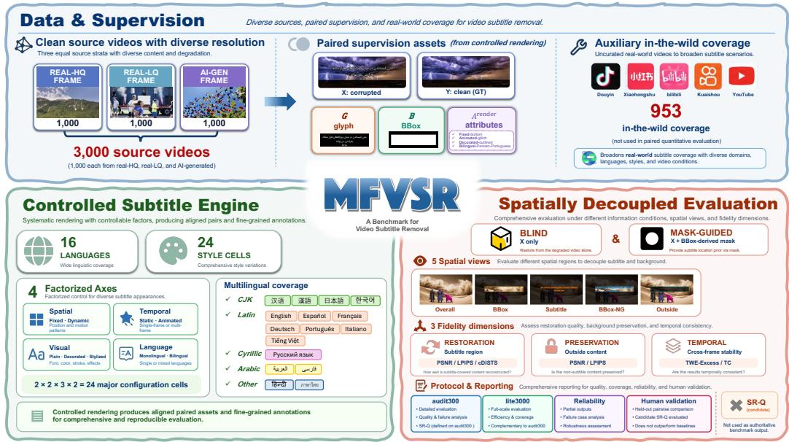  
Figure 1: Overview of MFVSR. MFVSR contains 3,000 paired videos from Real-HQ, Real-LQ, and AI-generated sources, together with 953 auxiliary in-the-wild videos. It spans 16 languages and four subtitle factors, and evaluates blind and mask-guided removal through five spatial views and three complementary dimensions: Restoration Fidelity, Preservation Fidelity, and Temporal Fidelity.

To directly address these limitations, we propose MFVSR, a Multi-style and Fine-grained benchmark for Video Subtitle Removal, as shown in Figure 1. MFVSR is built around three key contributions: (1) Large-scale and diverse data. MFVSR contains 3,000 resolution-diverse paired videos, balanced equally across the Real-HQ, Real-LQ, and AI-Generated source strata. Controlled subtitle rendering provides paired clean targets, pixel-level glyph masks, frame-level BBoxes, BBox-derived model-input masks, and rendering metadata, enabling fine-grained evaluation against known clean content. In addition, we curate an auxiliary set of 953 naturally subtitled in-the-wild real videos from Bilibili, Douyin, Xiaohongshu, Kuaishou, and YouTube to broaden coverage of real-world subtitle appearances and content distributions. (2) Controlled subtitle diversity. MFVSR covers 16 languages and factorizes subtitle rendering into four independently configurable factors: Spatial Layout, Temporal Behavior, Visual Style, and Language Mode, yielding 24 configuration cells. This controlled design facilitates standardized cross-method comparison and stratified analysis, without presupposing that any language or rendering factor is inherently more challenging. (3) Fine-grained evaluation. MFVSR separates blind subtitle removal from mask-guided removal. Predictions are evaluated using five spatial views and grouped into Restoration Fidelity, Preservation Fidelity, and Temporal Fidelity. It also jointly reports conditional quality, spatial and temporal coverage, partial outputs, and full-benchmark failures.

We evaluate six representative subtitle-removal, video-inpainting, and object-removal methods under MFVSR. The results reveal distinct trade-offs across restoration, preservation, temporal fidelity, and reliability that conventional full-frame similarity does not capture. Held-out human comparisons provide stronger support for the spatial components than for the temporal component, and do not establish an advantage of SR-Q over conventional Overall metrics. MFVSR thus provides a more diagnostic basis for comparing VSR systems. Benchmark resources will be made publicly available to support reproducible research and future VSR development.

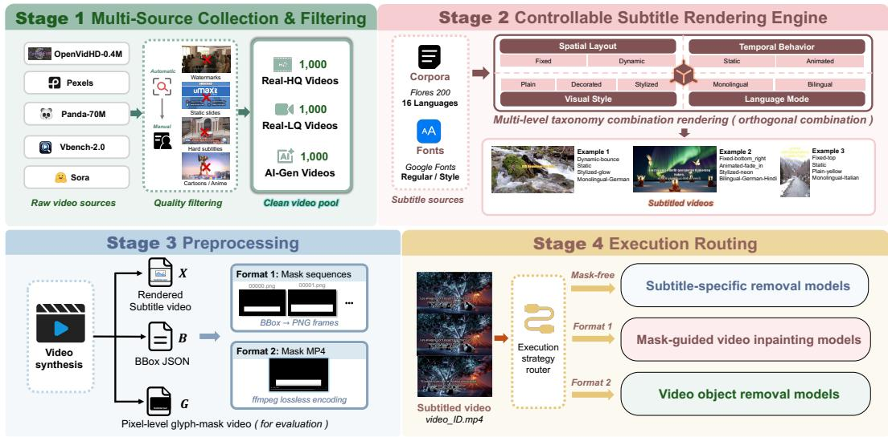  
Figure 2: Dataset construction and unified processing of MFVSR consists of: (1) Multi-source collection and filtering to provide a clean video pool (Section 2.1); (2) Controllable subtitle rendering to generate diverse subtitled videos with different attributes (Section 2.2); (3) Preprocessing to construct paired supervision assets (Section 2.3); (4) Execution routing to assign each sample to the corresponding model (Section 2.4).

## 2 MFVSR BENCHMARK CONSTRUCTION

## 2.1 MULTI-SOURCE COLLECTION AND BASE-VIDEO FILTERING

Multi-source collection for MFVSR. To cover different content origins, resolutions, durations, scenes, and motion patterns, MFVSR contains 3,000 clean base videos from real and generated sources. We divide them into three equal strata. Real-HQ contains 1,000 real videos from Open-VidHD and Pexels (Nan et al., 2025; Pexels, 2026), with retained resolution at or above 1080p. Real-LQ contains 1,000 real videos from Panda-70M and Pexels (Chen et al., 2024; Pexels, 2026), with retained resolution at or above 512p and below 1080p. AI-Generated contains 1,000 videos from the VBench-2.0 sampled-video release (Zheng et al., 2025) and the Rapidata Sora video-generation alignment dataset (Rapidata, 2025). Real-HQ and Real-LQ are resolution-based strata rather than perceptual-quality labels, and the three sources do not imply exhaustive content coverage.

Automatic and manual filtering. We use automatic screening followed by manual verification. Automatic screening samples frames, checks decoding and basic validity, filters by resolution and preliminary clarity, and uses OCR to flag burned-in text, URLs, and other overlays. Manual verification removes videos with burned-in subtitles, salient watermarks, subtitle-like text overlays, static slideshows, cartoons, anime, or other content unsuitable for paired subtitle rendering. Small logos may remain if they are fixed in a corner and cannot be confused with the rendered subtitles. Large, prominent, textual, or subtitle-region watermarks are excluded. The resulting clean videos enter the rendering pipeline in Figure 2. Additional asset-validation checks are described in Appendix B.1.

## 2.2 CONTROLLABLE SUBTITLE RENDERING ENGINE

Text and font resources. Subtitle text is drawn from FLORES-200 (Costa-Jussa et al.\` , 2022; Goyal et al., 2022; Guzman et al.´ , 2019), and fonts are obtained from Google Fonts (Google Fonts, 2026). MFVSR uses 16 languages: Simplified Chinese, Traditional Chinese, Japanese, and Korean for CJK scripts; English, Spanish, French, German, Portuguese, Italian, and Vietnamese for Latin scripts;

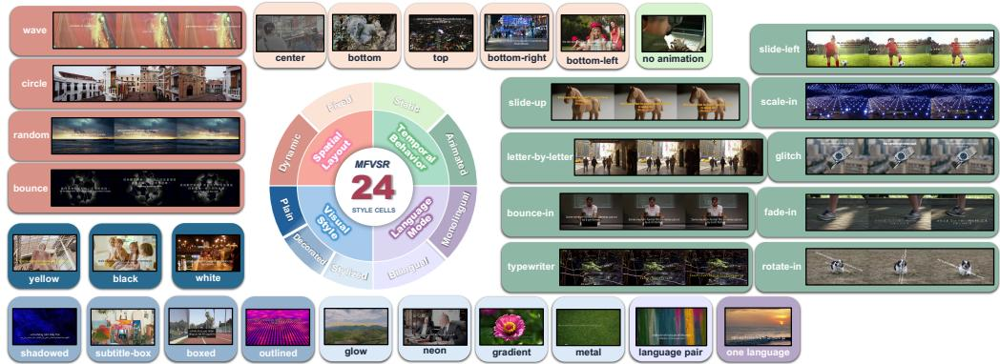  
Figure 3: Controlled subtitle-rendering taxonomy in MFVSR. The two-level ring summarizes four independently configurable factors: Spatial Layout, Temporal Behavior, Visual Style, and Language Mode and their major options, forming 24 configuration cells. Surrounding examples are color-coded by factor to illustrate finer-grained within-cell variations.

Russian for Cyrillic; Arabic and Persian for right-to-left scripts; and Hindi and Thai for additional writing systems. These languages introduce different glyph structures, shaping rules, reading di rections, and layout characteristics without assuming a language-specific difficulty order. Fonts are divided into regular and style-oriented resources.

Multi-level taxonomy combination rendering. MFVSR structures the taxonomy around the changing aspect of a subtitle over its display interval, spanning four independently configurable axes. The four independently configurable factors form

$$
\mathrm { S p a t i a l \ L a y o u t \times T e m p o r a l \ B e h a v i o r \times V i s u a l \ S t y l e \times L a n g u a g e \ M o d e } ,
$$

which yields $2 \times 2 \times 3 \times 2 = 2 4$ major configuration cells. And finer-grained subtypes add further within-cell variation, as shown in Figure 3.

Spatial layout governs where a subtitle appears and whether its coordinates change over time: fixed subtitles occupy one of five anchors with constant coordinates, whereas dynamic subtitles follow one of four trajectories, making position a function of time. Temporal behavior captures how a subtitle evolves between appearance and disappearance. Static subtitles remain unchanged while visible, whereas animated subtitles comprise nine subtypes that cover entrance transformations of whole blocks, reveals at the character level, and persistent perturbations. Spatial layout and temporal behavior are orthogonal and may occur together. For example, a caption can translate from point A to point B (spatial, dynamic), while a fade-in or typewriter effect alters its form without displac ing it (temporal, animated). Therefore, we retain them as separate axes. Visual style determines how glyphs are rendered, ranging from plain (color variation only), to decorated (shadows, outlines, or background boxes for functional separation), to stylized (glow, gradients, neon, textures, or expressive fonts). Language mode sets how many languages appear simultaneously: monolingual subtitles contain a single language, while bilingual subtitles pair two randomly selected languages, typically arranged in two lines, and configurations with more than two languages are excluded as uncommon in practice.

The four axes combine to produce 24 major cells. While the factors are independent in configuration, their effects on removal difficulty may not be statistically independent. Therefore, potential mediators like subtitle area and line count are evaluated separately for each factor.

## 2.3 PREPROCESSING AND PAIRED-ASSET GENERATION

For each clean base, video synthesis yields three aligned outputs: a rendered subtitle video, a pixellevel glyph-mask video, and per-frame BBox JSON. The clean base is retained as ground truth, and the rendering configuration is stored as metadata. The BBox JSON is the canonical rectangular annotation for mask-guided models. From it, we generate two equivalent mask representations: Mask Sequences (frame-wise binary PNG masks) and Mask MP4 (the same sequence losslessly encoded as a video). These formats encode identical spatial and temporal mask information and are not separate ground-truth annotations. The glyph mask is reserved for fine-grained evaluation, whereas the BBox-derived mask is used as model input.

Table 1: Characteristics and MFVSR input interfaces of evaluated methods. Detailed inference configurations are in Table 6.
<table><tr><td>Category</td><td>Method</td><td>Mask Backbone</td><td></td><td>Temporal mechanism</td></tr><tr><td>Inpainting</td><td>ProPainter (Zhou et al., 2023)</td><td>Seq.</td><td>Flow + Sparse ViT</td><td>Flow-guided propagation</td></tr><tr><td>Inpainting</td><td>DiffuEraser (Li et al., 2025)</td><td>MP4</td><td>SD 1.5 + BrushNet</td><td>Motion module w/ prior</td></tr><tr><td>Object</td><td>MiniMax-Remover (Zi et al., 2026)</td><td>MP4</td><td>Wan DiT</td><td>Full-seq. attention</td></tr><tr><td>Object</td><td>OmnimatteZero (Samuel et al., 2025)</td><td>MP4</td><td>LTX DiT</td><td>Attn. guidance</td></tr><tr><td>Object</td><td>EffectErase (Fu et al., 2026)</td><td>MP4</td><td>Wan DiT</td><td>Region guidance</td></tr><tr><td>Subtitle</td><td>CLEAR (He et al., 2026)</td><td>None</td><td>Wan DiT</td><td>Spatio-temporal attention</td></tr></table>

## 2.4 EXECUTION ROUTING

MFVSR routes each integrated model through deterministic input preprocessing. All mask-guided methods start from the same canonical BBox-derived annotation. Model-specific operations, such as resizing, thresholding, and dilation when required, follow the evaluated inference configuration, and no routing or preprocessing step accesses the glyph mask, clean target, or manually adjusted samplespecific conditions. Blind removal takes only the subtitle-corrupted video as input, whereas maskguided removal additionally receives the canonical BBox-derived mask defined above. MFVSR therefore ranks the two families separately. Table 1 lists the resulting model interfaces.

## 2.5 STATISTICS AND ANALYSIS

Video statistics. MFVSR contains a diverse collection of videos representing a wide range of visual content, source qualities, and temporal characteristics. Figure 4(b) presents the resolution distributions of the three source subsets, where Real-LQ is dominated by 720p videos and Real-HQ primarily contains 1080p and 4K videos, while AI-Gen exhibits a distinct lower-resolution profile. Figure 4(c) shows the frame-count distributions, capturing substantial variation in sequence length across the three subsets. Figure 4(d) presents the distribution of video durations, ranging from short clips below 10 seconds to longer sequences exceeding 30 seconds. Figure 4(f) shows the distribution of video content across nine major topics, with Arts, Urban, and Nature forming the largest categories. Figure 4(g) illustrates a word cloud constructed from video captions generated using the LLaVA-Llama-3-8B-v1.1 (Liu et al., 2024; XTuner Contributors, 2024), highlighting diverse people, objects, scenes, colors, and activities represented in the benchmark.

Subtitle statistics. MFVSR provides diverse multilingual subtitles with balanced coverage of controlled subtitle configurations. Figure 4(a) shows a sunburst chart of 4,505 language occurrences across 16 languages and five script groups, including both monolingual and bilingual settings. These groups capture script-level visual differences in glyph density, stroke complexity, diacritics, connected writing, and writing direction that directly affect subtitle localization, removal, and reconstruction. Figure 4(e) summarizes four controlled subtitle design factors and their full factorial combination yields 24 joint configurations, with 123-126 videos per configuration, providing nearly uniform coverage of the predefined subtitle design space.

Comparison with existing evaluation resources. Table 2 compares MFVSR with representative video inpainting, object-removal, and subtitle-removal evaluation resources. MFVSR combines 3,000 paired clips and controlled subtitle strata with separate blind and mask-guided reporting, spatially decoupled and temporal evaluation, and explicit statistics on execution failures and valid evaluation coverage.

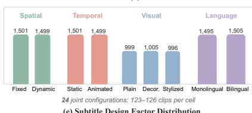

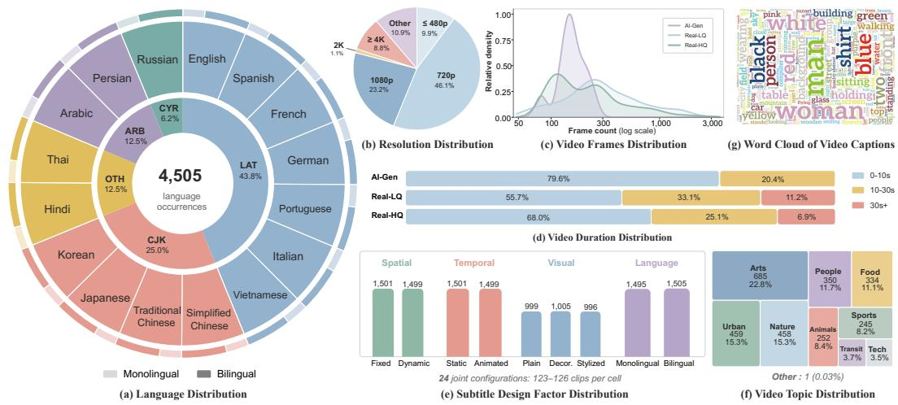  
Figure 4: MFVSR demonstrates rich diversity and balanced coverage. Subtitle Statistics: (a) shows a sunburst chart of language coverage across 16 languages, five script groups, and monolingual/bilingual settings; (e) shows balanced distributions across spatial, temporal, visual style, and language factors, whose full factorial combination forms 24 configurations with 123-126 videos each. Video Statistics: (b) indicates diverse video resolutions across AI-Gen, Real-LQ, and Real-HQ; (c) presents frame-count distributions with substantial variation in video length; (d) shows video durations ranging from short clips to sequences longer than 30 seconds; (f) illustrates video content distributed across nine semantic categories; (g) presents a word cloud of video captions, covering diverse objects, scenes, attributes, and activities.

Table 2: Comparison with related evaluation resources. $\checkmark , \bigtriangleup , \mathrel { \times } ,$ and – denote full, partial, unsupported, and not-applicable settings, respectively.
<table><tr><td rowspan="2">Benchmark</td><td colspan="2">Resource</td><td colspan="2">Task setting</td><td colspan="5">Evaluation design</td><td rowspan="2">Venue</td></tr><tr><td>Videos Paired GT Input</td><td></td><td></td><td>Sep.</td><td>Strat. Region Temp. Failure Coverage</td><td></td><td></td><td></td><td></td></tr><tr><td colspan="10">Video Inpainting Evaluation</td></tr><tr><td>FVI test set (Chang et al., 2019)</td><td>100</td><td>V</td><td>M</td><td></td><td>V</td><td>×</td><td>△</td><td>×</td><td>×</td><td>ICCV 2019</td></tr><tr><td>DEVIL (Szeto &amp; Corso, 2022)</td><td>1,250</td><td>V</td><td>M</td><td></td><td>V</td><td>△</td><td>V</td><td>X</td><td>×</td><td>CVPR 2022</td></tr><tr><td>BVINet evaluation (Wu et al., 2025)</td><td>568</td><td>√</td><td>B+M</td><td>V</td><td>×</td><td>×</td><td>V</td><td>×</td><td>×</td><td>ICCV 2025</td></tr><tr><td colspan="10">Video Object Removal</td></tr><tr><td>HQVI (Cho et al., 2025)</td><td>N/V</td><td>V</td><td>M</td><td>一</td><td>×</td><td>×</td><td>△</td><td>X</td><td>×</td><td>AAAI 2025</td></tr><tr><td>ROSE-Bench (syn.) (Miao et al., 2025)</td><td>60</td><td>√</td><td>M</td><td></td><td>√</td><td>X</td><td>X</td><td>X</td><td>X</td><td>NeurIPS 2025</td></tr><tr><td>PROVE-Bench (Li et al., 2026)</td><td>180†</td><td>△</td><td>M</td><td></td><td>√</td><td>√</td><td>V</td><td>×</td><td>×</td><td>ACM MM 2026</td></tr><tr><td colspan="10">Video Subtitle Removal</td></tr><tr><td>ChaLearn Decaptioning (ChaLearn Looking at People, 2018) ≈13.5K‡</td><td></td><td></td><td>B</td><td></td><td>×</td><td>×</td><td>×</td><td>×</td><td>×</td><td>WCCI/ECCV 2018</td></tr><tr><td>CLEAR test set (He et al., 2026)</td><td>400</td><td>V</td><td>B+M</td><td>×</td><td>×</td><td>×</td><td>√</td><td>×</td><td>×</td><td>ICML 2026</td></tr><tr><td>VSR-Bench-400 (Hui &amp; Bai, 2026)</td><td>400</td><td>V</td><td>B+M</td><td>×</td><td>×</td><td>×</td><td>△</td><td>×</td><td>×</td><td>arXiv</td></tr><tr><td>MFVSR (Ours)</td><td>3,000</td><td>√</td><td>B+M</td><td>V</td><td>V</td><td>√</td><td>√</td><td>√</td><td>√</td><td></td></tr></table>

B/M: blind/mask-guided; Sep.: separate reporting by input setting; Strat.: stratified evaluation; N/V: count not verified. †80 paired + 100 unpaired videos. ‡Estimated test size from the reported ∼90K clips and 15% test split.

## 3 EXPERIMENTS

## 3.1 EXPERIMENTAL SETTING

Methods and fairness. Section 2 constructs each MFVSR instance by rendering temporally controlled subtitles over a clean base video. Given a clean target Y, the renderer produces a subtitlecorrupted video X, glyph mask G, frame-level BBoxes B, and identifier-encoded rendering attributes Arender:

$$
\mathcal { T } = ( \mathbf { X } , \mathbf { Y } , \mathbf { G } , \mathbf { B } , \mathcal { A } ^ { \mathrm { r e n d e r } } ) .\tag{1}
$$

The attributes describe language mode, visual style, spatial layout, temporal behavior, and the stored font, color, decoration, animation, and trajectory parameters. We evaluate one blind method, CLEAR, and five mask-guided methods: ProPainter, DiffuEraser, MiniMax-Remover, OmnimatteZero, and EffectErase. Blind removal receives only X; mask-guided removal additionally receives the same canonical BBox-derived mask. The glyph mask is reserved for evaluation and is never exposed as model input. Because the two settings provide different information, they share targets and metrics but remain in separate result blocks. Every method retains its released resolution limit, precision, chunking, sampling, and deterministic mask adapter. Raw outputs are immutable: missing frames are neither copied nor padded, and a metric is withheld when its spatial or temporal correspondence cannot be verified. All model interfaces are frozen in Table 6.

Table 3: Metric–view design. Bold views and metrics form the three primary dimensions; the remaining views are diagnostic or compatibility measurements. TC denotes flow-free Temporal Change Error, and TWE-X denotes RAFT-based TWE-Excess.
<table><tr><td>Dimension</td><td>Central question</td><td>Primary views</td><td>Representative evidence</td></tr><tr><td>Restoration Fidelity</td><td>Is content covered by the subtitle reconstructed toward the paired clean target?</td><td>Subtitle</td><td>PSNR and LPIPS; conditioned DISTS</td></tr><tr><td>Preservation Fidelity</td><td>Does content outside the operational edit box remain close to the paired clean target?</td><td>Outside</td><td>PSNR, LPIPS</td></tr><tr><td>Temporal Fidelity</td><td>Does the output preserve legitimate target dynamics without model-induced instability?</td><td>BBox, Outside</td><td>Temporal Change Error; TWE-Excess</td></tr></table>

Spatially decoupled evaluation. As illustrated in Figure 1, MFVSR evaluates five views: Overall, BBox, Subtitle, BBox-NG, and Outside. Subtitle, BBox-NG, and Outside partition each frame, BBox is the union of the first two, and Overall is the full frame. Because the glyph mask can omit shadows, outlines, glow, or subtitle boxes, BBox-NG mixes nearby background with non-core subtitle effects and is used only as a local diagnostic. Boxed and Subtitle-box styles are analyzed separately because their affected support can extend beyond the text BBox.

The five views are organized into three capabilities (Table 3). Restoration Fidelity asks whether the subtitle core is replaced by the clean target; Preservation Fidelity asks whether content outside the operational BBox remains unchanged; and Temporal Fidelity asks whether the prediction introduces temporal error beyond the target motion. PSNR, SSIM (Wang et al., 2004), LPIPS (Zhang et al., 2018), DISTS (Ding et al., 2020), and RAFT (Teed & Deng, 2020) retain their released implementations and weights. Regional PSNR, SSIM, and LPIPS change only the aggregation support; conditioned DISTS is explicitly a controlled-input intervention, not an official dense DISTS variant. Overall metrics are retained for conventional full-frame compatibility rather than used as the primary evidence.

Evaluation tracks and Audit300. We separate benchmark coverage from measurement density. Lite3000 provides broad spatial and temporal evaluation, whereas Audit300 adds more expensive structural and motion-compensated metrics on a fixed 300-video subset. Sampling is frozen and shared across methods, and Audit300 is drawn from the common-evaluable pool using only dataset attributes, without access to model outputs, metric values, rankings, or human judgments. This provides a controlled shared-ID set for detailed cross-method analysis. Selection details and composition are reported in Appendix B.2.

Statistics and human alignment. Unless otherwise stated, quality results are video-level macro estimates with bootstrap 95% confidence intervals, while delivery statistics use all scheduled videos. Cross-model comparisons use shared IDs and symmetric metric support, and model-native results are interpreted only conditionally. Reliability is reported separately from quality through complete, partial, and failed or missing outputs. Held-out human comparisons show stronger alignment for the spatial dimensions than for Temporal Fidelity, while the preregistered SR-Q summary shows no advantage over conventional Overall metrics and is retained only as a secondary analysis. Full statistical and human-study procedures are provided in Appendix B.

## 3.2 OVERALL RESULTS

Table 4 reports Audit300 results under matched per-metric support across all six methods. Confidence intervals and additional metrics are provided in Appendix C.1. Blind and mask-guided methods are reported separately because they use different input information.

Table 4: Raw metrics on ${ \cal A } _ { 3 0 0 } .$ PSNR is in dB; TC and TWE-X are scaled by $1 0 ^ { 2 }$ and $1 0 ^ { 3 }$ . Dark and light shading mark the best and second-best mask-guided means. ∗EffectErase is evaluated on its verified prefix.
<table><tr><td rowspan="2">Setting</td><td rowspan="2">Method</td><td colspan="3">Restoration: Subtitle</td><td colspan="2">Preservation: Outside</td><td colspan="4">Temporal Fidelity</td><td rowspan="2">Joint cov. (%)↑</td></tr><tr><td>PSNR ↑</td><td>LPIPS ↓</td><td>cDISTS ↓</td><td>PSNR ↑</td><td>LPIPS ↓</td><td>BBox TC ↓</td><td>Out. TC ↓</td><td>BBox TWE-X ↓</td><td>Out. TWE-X ↓</td></tr><tr><td>Blind</td><td>CLEAR</td><td>11.99</td><td>0.621</td><td>0.236</td><td>21.48</td><td>0.221</td><td>5.00</td><td>1.77</td><td>15.042</td><td>0.076</td><td>85.4</td></tr><tr><td rowspan="5">Mask-guided</td><td>ProPainter</td><td>19.66</td><td>0.364</td><td>0.138</td><td>34.11</td><td>0.050</td><td>2.57</td><td>0.70</td><td>0.683</td><td>0.072</td><td>100.0</td></tr><tr><td>DiffuEraser</td><td>21.36</td><td>0.269</td><td>0.116</td><td>32.87</td><td>0.062</td><td>2.53</td><td>0.73</td><td>0.686</td><td>0.068</td><td>99.9</td></tr><tr><td>MiniMax-Remover</td><td>20.32</td><td>0.321</td><td>0.132</td><td>30.73</td><td>0.086</td><td>2.52</td><td>1.12</td><td>1.142</td><td>0.028</td><td>99.4</td></tr><tr><td>OmnimatteZero</td><td>17.69</td><td>0.369</td><td>0.160</td><td>26.00</td><td>0.131</td><td>2.77</td><td>1.51</td><td>0.653</td><td>0.048</td><td>98.5</td></tr><tr><td> $_ \mathrm { E f f e c t E r a s e } ^ { * }$ </td><td>20.58</td><td>0.251</td><td>0.138</td><td>25.77</td><td>0.120</td><td>2.39</td><td>1.51</td><td>0.634</td><td>0.129</td><td>43.1</td></tr></table>

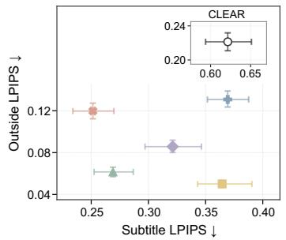  
(a) Restoration vs preservation

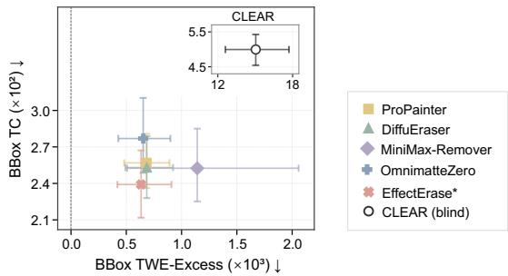  
(b) Temporal evidence  
Figure 5: Decoupled quality on Audit300. (a) Subtitle versus Outside LPIPS. (b) BBox TWE-Excess versus BBox TC. Points show video-level macro means with video-bootstrap 95% CIs; lower-left is better. CLEAR (blind) is plotted separately with independent axis ranges; cross-facet distances are not comparable. The dashed line marks zero TWE-Excess; negative values are retained. ∗EffectErase is evaluated on its verified prefix.

Shared-video quality decomposes into non-interchangeable capabilities. The strongest methods differ across Restoration, Preservation, and Temporal fidelity even on the same Audit300 videos. DiffuEraser favors glyph-core reconstruction, ProPainter Outside preservation and temporal consistency, and MiniMax-Remover Outside TWE-X, while EffectErase achieves favorable conditional values only on its verified prefix. Thus, gains in one capability do not imply gains in another, and conditional quality must be interpreted together with output support. These results motivate a capability profile rather than a single aggregate ordering.

## 3.3 FINDINGS OF MFVSR

We present five findings from MFVSR, with supporting analyses in Appendix C.

Decoupled evaluation reveals quality trade-offs. Figure 5 and Table 4 show that Subtitle and Outside LPIPS disagree on five of ten mask-guided method pairs. For example, DiffuEraser has lower Subtitle LPIPS than ProPainter but higher Outside LPIPS. BBox TWE-Excess and BBox TC likewise disagree on six of ten pairs, highlighting non-interchangeable temporal evidence. Overall LPIPS follows Outside LPIPS more closely than Subtitle LPIPS. These descriptive comparisons include EffectErase’s verified-prefix results and support reporting Restoration, Preservation, and Temporal Fidelity separately rather than relying on full-frame scores alone. See Appendix C.2 for detailed comparisons.

Subtitle removal performance varies across dataset dimensions and capabilities. Figure 6 shows that source, resolution, duration, and style complexity affect different capabilities in different ways. Real-HQ yields higher Subtitle and Outside LPIPS than AI-generated videos for all six methods, yet lower BBox TC for five, indicating that visually harder restoration does not necessarily imply greater temporal instability. Because source and resolution are coupled in Audit300, this contrast should be interpreted as a property of the joint data strata rather than an isolated resolution effect. Duration and style further reveal method-dependent shifts in error: all five mask-guided methods have higher Subtitle LPIPS on 10–30 s clips, while Hard styles reduce their Subtitle LPIPS but increase Outside LPIPS; CLEAR instead worsens on both. Thus, increasing data complexity can redistribute errors across restoration and preservation rather than degrade all capabilities uniformly, motivating capability-wise evaluation over a single aggregate score. Further analyses are provided in Appendix C.3.

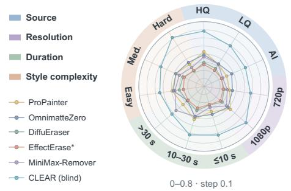  
(a) Subtitle LPIPS ↓

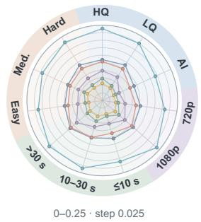  
(b) Outside LPIPS ↓

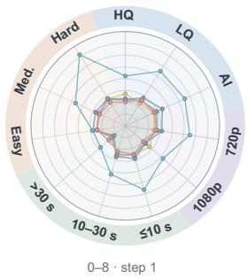  
(c) BBox TC (×10²) ↓  
Figure 6: Performance across Audit300 dimensions. (a) Subtitle LPIPS, (b) Outside LPIPS, and (c) BBox TC $( \times 1 0 ^ { 2 } )$ represent Restoration, Preservation and Temporal fidelity. Points are videolevel macro means and colored sectors indicate attribute domains. CLEAR is blind; ∗EffectErase uses its verified prefix.

High evaluability masks different delivery regimes. Table 5 shows sharply different delivery regimes across all 3,000 scheduled videos: complete rates range from 3.9% to 98.3%, although every method produces evaluable output for more than 95% of instances. High temporal coverage likewise does not imply complete-video delivery. Quality and delivery should therefore be reported as complementary properties rather than collapsed into a single successful-output score.Further analyses are provided in Appendix C.4.

Table 5: Full-set delivery (%). Rates use all 3,000 videos; temporal coverage is averaged over evaluable outputs.
<table><tr><td>Method Comp. Part. Non-eval. Time cov.</td></tr><tr><td>CLEAR 5.6</td></tr><tr><td>94.4 &lt; 0.1 86.2 ProPainter 98.3 0.0 1.7 100.0</td></tr><tr><td>DiffuEraser 72.4 26.6 1.0 99.8</td></tr><tr><td>MiniMax-Remover 30.8 64.9 4.3 99.3</td></tr><tr><td>OmnimatteZero 21.0 75.2 3.8 98.1</td></tr><tr><td>EffectErase 3.9 93.7 2.4 47.1</td></tr><tr><td></td></tr></table>

Evaluable scope and conditional quality require separate interpretation. Table 13 and Figure 12 show that extending evaluation from the common intersection to each method’s native evaluable set changes both the assessed scope and the observed quality distribution. These changes are methodand metric-dependent: typical and tail errors can shift differently, while spatial and temporal quality can even move in opposite directions. Thus, broader evaluability should not be interpreted as uniformly easier or harder data, nor should conditional quality be used as a proxy for operating scope. Native evaluation instead complements shared-ID comparisons by revealing performance on videos excluded from the common intersection, while comparisons across different native sets do not constitute controlled cross-method rankings. Further analysis is provided in Appendix C.5.

Human judgments support spatial components, but not an SR-Q advantage. Table 15 shows substantially stronger human–metric agreement for Restoration and Preservation than for Temporal fidelity, where comparisons are also more frequently undecided. This suggests that the spatial components capture perceptually meaningful differences more reliably, while temporal perceptual validation remains less conclusive. SR-Q is comparable to the preregistered Overall-region baselines but shows no consistent advantage over them. We therefore retain the three-dimensional raw profile as the primary diagnostic representation and use SR-Q only as a secondary summary, without post-hoc refitting. Further details are provided in Appendix C.6.

## 4 CONCLUSION

In this work, we presented MFVSR, a benchmark for systematic evaluation of video subtitle removal. MFVSR combines paired videos with controlled multilingual subtitle variations and an auxiliary collection of naturally subtitled videos. Its protocol distinguishes blind from mask-guided removal and separately evaluates restoration, preservation, temporal fidelity, and delivery coverage.

Experiments on six representative methods reveal quality trade-offs and gaps between conditional performance and complete-video delivery. The held-out human study shows stronger agreement for spatial than temporal components, leaving temporal perceptual validation open. We hope that MFVSR and its analyses support reproducible comparison and the development of more reliable video subtitle removal methods.

## AI USE STATEMENT

Generative AI tools assisted with code implementation and debugging, evaluation-protocol review, manuscript organization, and language editing. The authors reviewed the resulting text, verified the reported numerical results against the analysis outputs, and tested the evaluation code used in the study. The authors take responsibility for all claims, code, and artifacts in this submission.

## ETHICS STATEMENT

MFVSR uses videos from OpenVidHD, Panda-70M, Pexels, VBench-2.0, and Rapidata, subtitle text from FLORES, and fonts from Google Fonts. These resources remain subject to their respective licenses and upstream restrictions. The auxiliary collection contains 953 naturally subtitled videos collected from Bilibili, Douyin, Xiaohongshu, Kuaishou, and YouTube using a web crawler. No additional privacy screening or de-identification was applied to these videos. This collection has no clean targets and is excluded from paired quantitative evaluation. We plan to redistribute only assets for which redistribution is permitted, and otherwise provide permissible provenance information, annotations, and reconstruction instructions.

We recruited students from relevant academic disciplines for the human evaluation. Participants were informed of the research purpose and agreed to participate before the study. The study interface used coded participant identifiers, and no additional identifying information was retained with the study responses. Participants compared subtitle-removal outputs using a reference-based interface with concealed model identities. Human-evaluation results are reported only in aggregate in the manuscript.

## REPRODUCIBILITY STATEMENT

Sections 2 and 3.1 describe the benchmark construction, model information boundaries, and evaluation design, while Appendix B specifies spatial supports, metric regionalization, frozen frame and pair sampling, record reuse, aggregation, comparison sets, human evaluation, and fixed-budget validation. Across the six baselines, the retained inference logs cover a total of 10,137.4 GPU-hours (422.4 GPU-days). Appendix D details the logging coverage and method-specific timing boundaries. Subject to upstream licensing constraints, we plan to release the renderer, evaluation code, frozen identifiers, model configurations, analysis tables, and per-instance provenance records.

## REFERENCES

ChaLearn Looking at People. Video decaptioning (wcci’18, eccv’18): Dataset description. https://chalearnlap.cvc.uab.cat/dataset/31/description/, 2018. Accessed September 8, 2026.

Ya-Liang Chang, Zhe Yu Liu, Kuan-Ying Lee, and Winston Hsu. Free-form video inpainting with 3D gated convolution and temporal PatchGAN. In Proceedings of the IEEE/CVF International Conference on Computer Vision, pp. 9065–9074, 2019.

Tsai-Shien Chen, Aliaksandr Siarohin, Willi Menapace, Ekaterina Deyneka, Hsiang-wei Chao, Byung Eun Jeon, Yuwei Fang, Hsin-Ying Lee, Jian Ren, Ming-Hsuan Yang, and Sergey Tulyakov. Panda-70M: Captioning 70m videos with multiple cross-modality teachers. In Proceedings of the IEEE/CVF Conference on Computer Vision and Pattern Recognition, pp. 13320–13331, 2024.

Suhwan Cho, Seoung Wug Oh, Sangyoun Lee, and Joon-Young Lee. Elevating flow-guided video inpainting with reference generation. In Proceedings ofthe AAAI Conference on Artificial Intelli gence, volume 39, pp. 2527–2535, 2025.

Marta R Costa-Jussa, James Cross, Onur C¸ elebi, Maha Elbayad, Kenneth Heafield, Kevin Heffernan,\` Elahe Kalbassi, Janice Lam, Daniel Licht, Jean Maillard, et al. No language left behind: Scaling human-centered machine translation. arXiv preprint arXiv:2207.04672, 2022.

Ding Ding, Yueming Pan, Ruoyu Feng, Qi Dai, Kai Qiu, Jianmin Bao, Chong Luo, and Zhenzhong Chen. HomoGen: Enhanced video inpainting via homography propagation and diffusion. In Proceedings of the IEEE/CVF Conference on Computer Vision and Pattern Recognition, pp. 22953–22962, 2025.

Keyan Ding, Kede Ma, Shiqi Wang, and Eero P. Simoncelli. Image quality assessment: Unifying structure and texture similarity. IEEE Transactions on Pattern Analysis and Machine Intelligence, 44(5):2567–2581, 2020.

Yang Fu, Yike Zheng, Ziyun Dai, and Henghui Ding. EffectErase: Joint video object removal and insertion for high-quality effect erasing. In Proceedings of the IEEE/CVF Conference on Computer Vision and Pattern Recognition, pp. 2005–2014, 2026.

Google Fonts. Google fonts repository. https://github.com/google/fonts, 2026. Accessed September 8, 2026. Font-family licenses are provided individually.

Naman Goyal, Cynthia Gao, Vishrav Chaudhary, Peng-Jen Chen, Guillaume Wenzek, Da Ju, Sanjana Krishnan, Marc’Aurelio Ranzato, Francisco Guzman, and Angela Fan. The flores-101 eval-´ uation benchmark for low-resource and multilingual machine translation. Transactions of the Associationfor Computational Linguistics, 10:522–538, 2022.

F Guzman, PJ Chen, M Ott, J Pino, G Lample, P Koehn, V Chaudhary, and M Ranzato. Two´ new evaluation datasets for low-resource machine translation: Nepali-english and sinhala-english. arxiv 2019. arXiv preprint arXiv:1902.01382, 2019.

Qingdong He, Chaoyi Wang, Peng Tang, Yifan Yang, and Xiaobin Hu. CLEAR: Context-aware learning with end-to-end mask-free inference for adaptive video subtitle removal. In International Conference on Machine Learning, 2026.

Ziqi Huang, Yinan He, Jiashuo Yu, Fan Zhang, Chenyang Si, Yuming Jiang, Yuanhan Zhang, Tianxing Wu, Qingyang Jin, Nattapol Chanpaisit, Yaohui Wang, Xinyuan Chen, Limin Wang, Dahua Lin, Yu Qiao, and Ziwei Liu. VBench: Comprehensive benchmark suite for video generative models. In Proceedings of the IEEE/CVF Conference on Computer Vision and Pattern Recognition, pp. 21807–21818, 2024.

Zheng Hui and Yunlong Bai. SEDiT: Mask-free video subtitle erasure via one-step diffusion transformer. arXiv preprint arXiv:2605.14894, 2026.

Dahun Kim, Sanghyun Woo, Joon-Young Lee, and In So Kweon. Deep blind video decaptioning by temporal aggregation and recurrence. In Proceedings ofthe IEEE/CVF Conference on Computer Vision and Pattern Recognition, pp. 4258–4267, 2019.

Wei-Sheng Lai, Jia-Bin Huang, Oliver Wang, Eli Shechtman, Ersin Yumer, and Ming-Hsuan Yang. Learning blind video temporal consistency. In Proceedings ofthe European Conference on Computer Vision, pp. 179–195, 2018.

Fuhao Li, Shaofeng You, Jiagao Hu, Yu Liu, Yuxuan Chen, Zepeng Wang, Fei Wang, Daiguo Zhou, and Jian Luan. PROVE: A perceptual RemOVal cohErence benchmark for visual media. In Proceedings of the 34th ACM International Conference on Multimedia, 2026.

Xiaowen Li, Haolan Xue, Peiran Ren, and Liefeng Bo. DiffuEraser: A diffusion model for video inpainting. arXiv preprint arXiv:2501.10018, 2025.

Zhen Li, Cheng-Ze Lu, Jianhua Qin, Chun-Le Guo, and Ming-Ming Cheng. Towards an end-to-end framework for flow-guided video inpainting. In Proceedings of the IEEE/CVF Conference on Computer Vision and Pattern Recognition, pp. 17541–17550, 2022.

Haotian Liu, Chunyuan Li, Yuheng Li, and Yong Jae Lee. Improved baselines with visual instruction tuning. In 2024 IEEE/CVF Conference on Computer Vision and Pattern Recognition (CVPR), pp. 26286–26296, 2024.

Chenxuan Miao, Yutong Feng, Jianshu Zeng, Zixiang Gao, Hantang Liu, Yunfeng Yan, Donglian Qi, Xi Chen, Bin Wang, and Hengshuang Zhao. ROSE: Remove objects with side effects in videos. In Advances in Neural Information Processing Systems, volume 38, 2025.

Kepan Nan, Rui Xie, Penghao Zhou, Tiehan Fan, Zhenheng Yang, Zhijie Chen, Xiang Li, Jian Yang, and Ying Tai. OpenVid-1M: A large-scale high-quality dataset for text-to-video generation. In International Conference on Learning Representations, pp. 1045–1064, 2025.

Dezhi Peng, Chongyu Liu, Yuliang Liu, and Lianwen Jin. ViTEraser: Harnessing the power of vision transformers for scene text removal with SegMIM pretraining. In Proceedings ofthe AAAI Conference on Artificial Intelligence, volume 38, pp. 4468–4477, 2024.

Federico Perazzi, Jordi Pont-Tuset, Brian McWilliams, Luc Van Gool, Markus Gross, and Alexander Sorkine-Hornung. A benchmark dataset and evaluation methodology for video object segmentation. In Proceedings of the IEEE Conference on Computer Vision and Pattern Recognition, pp. 724–732, 2016.

Pexels. Free stock photo and video license. https://www.pexels.com/license/, 2026. Accessed September 8, 2026.

Rapidata. Sora video generation alignment likert scoring dataset. https://huggingface.co/datasets/Rapidata/ sora-video-generation-alignment-likert-scoring, 2025. Accessed September 8, 2026.

Dvir Samuel, Matan Levy, Nir Darshan, Gal Chechik, and Rami Ben-Ari. OmnimatteZero: Fast training-free omnimatte with pre-trained video diffusion models. In Proceedings of the SIG-GRAPH Asia 2025 Conference Papers, pp. 1–11, 2025.

Ryan Szeto and Jason J. Corso. The DEVIL is in the details: A diagnostic evaluation benchmark for video inpainting. In Proceedings of the IEEE/CVF Conference on Computer Vision and Pattern Recognition, pp. 21022–21031, 2022.

Zachary Teed and Jia Deng. RAFT: Recurrent all-pairs field transforms for optical flow. In Proceedings of the European Conference on Computer Vision, pp. 402–419, 2020.

Zhou Wang, Alan C. Bovik, Hamid R. Sheikh, and Eero P. Simoncelli. Image quality assessment: From error visibility to structural similarity. IEEE Transactions on Image Processing, 13(4): 600–612, 2004.

Zixiao Wang, Hongtao Xie, YuXin Wang, Yadong Qu, Fengjun Guo, and Pengwei Liu. Leveraging text localization for scene text removal via text-aware masked image modeling. In Proceedings of the European Conference on Computer Vision, pp. 357–373, 2024.

Zhiliang Wu, Kerui Chen, Kun Li, Hehe Fan, and Yi Yang. BVINet: Unlocking blind video inpainting with zero annotations. In Proceedings of the IEEE/CVF International Conference on Computer Vision, pp. 14017–14027, 2025.

XTuner Contributors. LLaVA-Llama-3-8B-v1.1 (Transformers). https://huggingface.co/ xtuner/llava-llama-3-8b-v1\_1-transformers, 2024. Accessed September 24, 2026.

Haoran Xu, Yanbai He, Xinya Li, Xiaoying Hu, Chuanyan Hao, and Bo Jiang. Joint subtitle extraction and frame inpainting for videos with burned-in subtitles. Information, 12(6):233, 2021.

Ning Xu, Linjie Yang, Yuchen Fan, Jianchao Yang, Dingcheng Yue, Yuchen Liang, Brian Price, Scott Cohen, and Thomas Huang. YouTube-VOS: Sequence-to-sequence video object segmentation. In Proceedings ofthe European Conference on Computer Vision, pp. 603–619, 2018.

Richard Zhang, Phillip Isola, Alexei A. Efros, Eli Shechtman, and Oliver Wang. The unreasonable effectiveness of deep features as a perceptual metric. In Proceedings of the IEEE Conference on Computer Vision and Pattern Recognition, pp. 586–595, 2018.

Zhixing Zhang, Bichen Wu, Xiaoyan Wang, Yaqiao Luo, Luxin Zhang, Yinan Zhao, Peter Vajda, Dimitris Metaxas, and Licheng Yu. AVID: Any-length video inpainting with diffusion model. In Proceedings of the IEEE/CVF Conference on Computer Vision and Pattern Recognition, pp. 7162–7172, 2024.

Dian Zheng, Ziqi Huang, Hongbo Liu, Kai Zou, Yinan He, Fan Zhang, Lulu Gu, Yuanhan Zhang, Jingwen He, Wei-Shi Zheng, et al. VBench-2.0: Advancing video generation benchmark suite for intrinsic faithfulness. arXiv preprint arXiv:2503.21755, 2025.

Shangchen Zhou, Chongyi Li, Kelvin C. K. Chan, and Chen Change Loy. ProPainter: Improving propagation and transformer for video inpainting. In Proceedings of the IEEE/CVF International Conference on Computer Vision, pp. 10477–10486, 2023.

Bojia Zi, Weixuan Peng, Xianbiao Qi, Jianan Wang, Shihao Zhao, Rong Xiao, and Kam-Fai Wong. Minimax-remover: Taming bad noise helps video object removal. Advances in Neural Information Processing Systems, 38:75518–75547, 2026.

## APPENDIX CONTENTS

A Related Work . .   
B Benchmark and Evaluation Details . 15   
B.1 Dataset Validation . . 15   
B.2 Evaluation Supports, Sampling, and Aggregation . 15   
B.3 Benchmark-Specific Metric Conventions 17   
B.4 Human-Evaluation Protocol 17   
B.5 SR-Q: Definition and Validation Scope . 18   
C Supplementary Results . . . 19   
C.1 Complete Audit300 Results . 19   
C.2 Decoupled Quality 19   
C.3 Dataset and Subtitle Diagnostics . . 20   
C.4 Full-Set Delivery and Coverage . 20   
C.5 Evaluable Scope and Conditional Quality 23   
C.6 Human Alignment and Qualitative Evidence . 23   
D Computational Workload. . 25   
E Qualitative Cases and Diagnostic Insights . 26   
E.1 Restoration: Text Removal and Scene Reconstruction . . 26   
E.2 Preservation: Changes beyond the Subtitle . . . 28   
E.3 Temporal Fidelity: Changes Relative to the Target . . 30

## A RELATED WORK

Video Subtitle Removal. Video subtitle removal combines localization, completion, and temporal stabilization. The ChaLearn 2018 video-decaptioning task (ChaLearn Looking at People, 2018) provided paired corrupted and clean clips, while Kim et al. (2019) introduced a blind encoder–decoder that aggregates neighboring frames with recurrent feedback without requiring an input mask. Recent diffusion-based methods revisit end-to-end mask-free removal at higher resolution. CLEAR (He et al., 2026) separates subtitle-prior extraction from generative refinement and performs mask-free inference, whereas SEDiT (Hui & Bai, 2026) formulates subtitle erasure as localized one-step video generation with chunk-wise streaming. These methods strengthen the case for a dedicated task, but their paper-specific 400-sample evaluations do not provide a shared, fine-grained protocol for diagnosing residual text, local reconstruction, distant modification, and failure coverage. The distinction between mask-free and mask-guided inference is methodological rather than cosmetic. A blind method must infer both where and how to edit, whereas a mask-guided method is given spatial side information. Combining both settings in one ranking conflates localization and restoration. MFVSR therefore uses the same paired targets and diagnostic views for both settings but reports them in separate leaderboard blocks.

Video Inpainting and Object Removal. Most video-inpainting methods assume a binary hole mask and focus on reconstructing spatially plausible and temporally coherent content. Flowguided methods such as E2FGVI (Li et al., 2022) propagate visible evidence across frames, while later transformer- and diffusion-based approaches expand temporal context and generative capacity. ProPainter (Zhou et al., 2023) combines dual-domain propagation with a mask-guided sparse video transformer, while DiffuEraser (Li et al., 2025) incorporates diffusion priors for masked video completion. Recent video-object-removal systems further target large objects and associated visual effects. MiniMax-Remover (Zi et al., 2026) reduces sampling cost through a distilled removal model; OmnimatteZero (Samuel et al., 2025) uses pretrained video diffusion models to remove objects together with their footprints; and EffectErase (Fu et al., 2026) jointly learns removal and insertion to better handle shadows, reflections, and deformation. These methods are relevant baselines because the same canonical BBox-derived subtitle annotation can be deterministically adapted to their re leased interfaces. They are not subtitle localizers, however, and their mask-guided results are no presented as evidence of blind subtitle-removal ability.

Diagnostic Benchmarking and Perceptual Evaluation. Generic video-inpainting evaluations commonly repurpose DAVIS (Perazzi et al., 2016) or YouTube-VOS (Xu et al., 2018) with synthetic masks, but aggregate scores reveal little about the conditions under which a method fails. DEVIL (Szeto & Corso, 2022) addresses this limitation by labeling video and mask attributes and evaluating controlled slices with reconstruction, realism, and temporal-consistency criteria. BVINet (Wu et al., 2025) defines a blind video-inpainting setting and evaluates on 508 YouTube-VOS and 60 DAVIS clips with synthesized corruptions. These resources motivate controlled and diagnostic analysis, but their corruptions are not designed around multilingual subtitle typography, motion, animation, or language layout.

MFVSR also follows the broader move from one-number evaluation toward dimension-specific evidence. VBench (Huang et al., 2024) decomposes video-generation quality into fine-grained dimensions and validates them against human preferences. For paired restoration, PSNR measures pixel-level distortion, SSIM (Wang et al., 2004) measures local structural similarity, LPIPS (Zhang et al., 2018) provides a learned perceptual distance, and DISTS (Ding et al., 2020) compares perceptual structure and texture. Temporal warping error (Lai et al., 2018) measures motion-compensated inconsistency. MFVSR retains the released metric definitions and weights where possible, changing only the spatial support or controlled input used for regional diagnosis. Because DISTS is an imagelevel score rather than a dense map, its regional use is explicitly defined as conditioned DISTS in Appendix B, rather than presented as an official DISTS variant.

## B BENCHMARK AND EVALUATION DETAILS

## B.1 DATASET VALIDATION

Following the screening of the base videos (Section 2.1), we validate decoding, target resolution, and frame alignment across videos, glyph masks, and annotations. A sample is rejected if any glyph pixel lies outside the rasterized BBox union. This check applies to the glyph core only; shadows, glow, outlines, and subtitle boxes may extend beyond it. Glyph masks must span the target timeline. Mask and prediction frame rates must match the target within 0.01 fps, using FFprobe’s rational frame-rate values. Prediction lengths are validated against the method’s temporal contract, and verified prefixes are recorded as partial outputs without padding.

Table 6: Frozen inference configurations in MFVSR. Mpx: per-frame pixel budget; AR: aspect ratio retained; a: dimension alignment; NN: nearest-neighbor resizing. All video masks are lossless.
<table><tr><td>Method</td><td>Mask adapter</td><td>Condition</td><td>Spatial</td><td>Temporal / sampling</td><td>Numerics</td></tr><tr><td>CLEAR</td><td>None</td><td>Fixed removal prompt</td><td>0.92 Mpx; a = 16 Scale-to-cover; center crop</td><td>Window 81; overlap 16 Denoising steps: 5; CFG 1.0</td><td>Precision logged; seed unset; tiled VAE</td></tr><tr><td>ProPainter</td><td>PNG sequence; NN; None dilation 4</td><td></td><td>2.07 Mpx AR; a = 8</td><td>RAFT: 20 iter.; subvideo 80 Neighbor 10; ref. stride 10</td><td>FP16</td></tr><tr><td>DiffuEraser</td><td>Video; binary; dilation 8</td><td>ProPainter prior from X,Q</td><td>2.07 Mpx; a = 8 Long side ≤ 1920</td><td>Prior: subvideo 50, neighbor 10, ref. stride 10 2-Step checkpoint</td><td>FP16</td></tr><tr><td>MiniMax- Remover</td><td>Video; threshold &gt; 20; NN</td><td>No text</td><td>2.07 Mpx AR; a = 16</td><td>Full supplied clip Sampling: 12 steps, 6 iter.</td><td>FP16; seed unset</td></tr><tr><td>OmnimatteZero</td><td>Video; threshold 128 Fixed Empty +</td><td>negative prompts</td><td>2.07 Mpx AR; a = 32</td><td>Full supplied clip Denoising steps: 30</td><td>BF16; seed 1; tiled VAE</td></tr><tr><td>EffectErase</td><td>Video; bilinear resizing</td><td>Fixed prompts; 224×224 crop*</td><td>2.07 Mpx AR; a = 16</td><td>≤ 81 frames; output 4n + 1 Denoising steps: 50; CFG 1.0</td><td>BF16; seed 2025; tiled inference</td></tr></table>

Temporal window, overlap, subvideo, and neighbor lengths are in frames. \*Crop from the first active mask frame.

## B.2 EVALUATION SUPPORTS, SAMPLING, AND AGGREGATION

Spatial support and correspondence. For frame t, let $G _ { t } \in \{ 0 , 1 \} ^ { H \times W }$ be the thresholded glyph mask and let $B _ { t }$ be the union of all rasterized subtitle bounding boxes. MFVSR defines three atomic

supports:

$$
R _ { t } ^ { \mathrm { S u b } } = G _ { t } ,\tag{2}
$$

$$
R _ { t } ^ { \mathrm { B B o x - N G } } = B _ { t } \wedge \neg G _ { t } ,\tag{3}
$$

$$
R _ { t } ^ { \mathrm { O u t s i d e } } = \lnot B _ { t } .\tag{4}
$$

The evaluator requires $G _ { t } \subseteq B _ { t }$ and aborts a sample if any glyph pixel lies outside its BBox under the strict configuration. The three atomic supports are therefore mutually exclusive and exhaustive. The aggregate supports are

$$
R _ { t } ^ { \mathrm { B B o x } } = R _ { t } ^ { \mathrm { S u b } } \cup R _ { t } ^ { \mathrm { B B o x - N G } } , \qquad R _ { t } ^ { \mathrm { O v e r a l l } } = \Omega .\tag{5}
$$

These definitions induce the five views used throughout MFVSR: Overall, BBox, Subtitle, BBox-$\mathrm { N G } ,$ and Outside.

A regional measurement uses $R _ { t } \cap V _ { t } ,$ , with coverage $| R _ { t } \cap V _ { t } | / | R _ { t } | .$ , and empty supports remain missing rather than an artificial zero. Notably, BBox-NG can contain rendered effects and is not a pure background region.

In addition, resolution changes are inverted using the frozen bicubic transform, whereas CLEAR’s recorded scale-to-cover and center-crop operations are inverted only where correspondence is valid. Exact-length contracts require all target frames, while verified-prefix contracts allow shorter outputs with temporal coverage $\dot { T } _ { m } / T$ , without padding or duplication. Frame correspondence is determined using verified indices.

Frame budget. Lite3000 selects at most 48 spatial frames: 32 evenly spaced subtitle-active frames and 16 full-timeline frames. Its 32 adjacent pairs comprise 24 touching an active frame and eight spanning the timeline. Selection covers endpoints, removes duplicates, and fills unused allocation from the full timeline. Activity means a nonempty benchmark BBox list. Selected indices are stored and depend only on annotations and video length. Audit300 reuses this support, adding SSIM, conditioned DISTS, and TWE-Excess to Lite3000’s PSNR, LPIPS, and TC.

Audit300 selection. For Audit300 selection, we started from the common-evaluable pool across the evaluated models, then removing held-out human-study videos and box-style videos, yielding the candidate set. A fixed-seed, metadata-only optimizer finally selected 300 videos to reduce marginal deficits across source, resolution, duration, style complexity, and the four subtitle factors, plus Source×Complexity and Resolution×Duration. Metrics, method identities, ranks, and human judgments were not used. Eligibility required current records and positive verified support. Table 7 reports the selected composition, and Figure 8 gives the subtitle-factor group sizes and contrasts.

Table 7: Audit300 composition. Resolution labels denote evaluation classes.
<table><tr><td>Attribute</td><td>Groups (videos)</td></tr><tr><td>Source</td><td>Real-HQ (123), Real-LQ (88), AI-generated (89)</td></tr><tr><td>Resolution</td><td>720p-class (177), 1080p-class (123)</td></tr><tr><td>Duration</td><td> $\leq 1 0 \mathrm { ~ s ~ } ( 1 6 8 ) , 1 0 - 3 0 \mathrm { ~ s ~ } ( 1 2 2 ) , > 3 0 \mathrm { ~ s ~ } ( 1 0 )$ </td></tr><tr><td>Style complexity</td><td> $\operatorname { E a s y } { ( 9 3 ) } , \operatorname { M e d i u m } { ( 9 7 ) } , \operatorname { H a r d } { ( 1 1 0 ) }$ </td></tr></table>

Style complexity. The frozen metadata score is $d = 2 \vert k \vert \mathrm { D y n a m i c } \vert + \vert k \vert \mathrm { A n i m a t e d } \vert + s _ { \mathrm { v i s u a l } } +$ ⊮[Bilingual], where $s _ { \mathrm { v i s u a l } } = 0 , 1 , 2$ for Plain, Decorated, and Stylized. Easy, Medium, and Hard denote $d \leq \mathrm { { \bar { 1 } } } , 2 \leq d \leq 3 \quad$ , and $d \geq 4 .$ . These are rendering-complexity groups, not an empirically calibrated difficulty scale or a claim about language-specific difficulty.

Aggregation and comparison sets. We pool pixel-additive statistics within each video and average perceptual and temporal values over valid sampled frames or pairs. Dataset results are video-level macro means with fixed-seed video-bootstrap intervals. Reliability uses the scheduled set $\mathcal { D } _ { : }$ while conditional quality uses each method’s evaluable set ${ \mathcal { E } } _ { m }$ . The common intersection $\mathcal { D } _ { \cap }$ and Audit300 provide shared-ID comparisons, with symmetric validity checked separately for each metric. Shared IDs do not guarantee equal coverage. We report blind and guided methods separately and leave quality undefined for failed outputs.

## B.3 BENCHMARK-SPECIFIC METRIC CONVENTIONS

PSNR, SSIM (Wang et al., 2004), LPIPS (Zhang et al., 2018), and DISTS (Ding et al., 2020) use their standard definitions. We specify only the regionalization and compatibility choices needed to reproduce MFVSR. Table 8 distinguishes primary measurements from diagnostic and compatibility views.

Table 8: Metric–view matrix. Lite measurements cover Lite3000; Audit adds measurements on Audit300. Bold entries define the fidelity components. Overall is retained for compatibility; BBox-NG is a mixed local diagnostic.
<table><tr><td>Metric / tier</td><td>Overall</td><td>BBoX</td><td>Subtitle</td><td>BBox-NG</td><td>Outside</td></tr><tr><td>PSNR / Lite</td><td>Compat.</td><td>Diag.</td><td>Primary</td><td>Diag.</td><td>Primary</td></tr><tr><td>SSIM / Audit</td><td>Compat.</td><td>Diag.</td><td>Diag.</td><td>Diag.</td><td>Diag.</td></tr><tr><td>LPIPS / Lite</td><td>Compat.</td><td>Diag.</td><td>Primary</td><td>Diag.</td><td>Primary</td></tr><tr><td>DISTS / Audit</td><td>Compat.</td><td>一</td><td>cDISTS</td><td>cDISTS</td><td>一</td></tr><tr><td>TWE / TWE-Excess Audit</td><td>一</td><td>Primary</td><td>一</td><td>一</td><td>Primary</td></tr><tr><td>TC /Lite</td><td></td><td>Primary</td><td></td><td></td><td>Primary</td></tr></table>

Regional spatial metrics. PSNR pools RGB squared error before conversion (range 255); exact matches retain infinite PSNR. Regional SSIM averages the standard map after excluding a five-pixel image boundary and is diagnostic on sparse glyph masks. Regional LPIPS uses AlexNet v0.1 and fractional mask weights obtained by area-resampling the support to the released spatial map. Overall SSIM and LPIPS use their standard scalars.

Conditioned DISTS. DISTS is an image-level metric. For Subtitle or BBox-NG support $R _ { t }$ , we replace only that region in the target with the prediction:

$$
\widetilde { Y } _ { t } ^ { ( R ) } = R _ { t } \odot \widehat { Y } _ { t } + ( 1 - R _ { t } ) \odot Y _ { t } , \qquad \mathrm { c D I S T S } _ { t } ^ { R } = \mathrm { D I S T S } \big ( \widetilde { Y } _ { t } ^ { ( R ) } | _ { C _ { t } } , Y _ { t } | _ { C _ { t } } \big ) .\tag{6}
$$

The shared BBox-context crop $C _ { t }$ adds a 16-pixel margin and expands to a minimum side of 64 pixels where boundaries permit. This controlled-input diagnostic is not an official dense DISTS variant. Overall DISTS requires complete spatial correspondence and area-downsamples long sides above 1920 pixels to 1920; local crops are not subject to that rule. All variants use the released weights and [0, 1] RGB inputs. Non-finite values remain missing if a native-backend retry fails; backend, resize, and validity are logged.

Temporal diagnostics. Both diagnostics use BBox and Outside. RAFT-Large (Teed & Deng, 2020) estimates flow only from consecutive clean targets. The flow is restored bilinearly with component scaling. Forward–backward consistency rejects occlusions and inconsistent coordinates. On the resulting shared support, TWE is the channel-mean squared residual between a frame and its backward-warped predecessor. We retain the signed target-baseline difference

$$
\mathrm { T W E - E x c e s s } ^ { r } = \mathrm { T W E } _ { \mathrm { p r e d } } ^ { r } - \mathrm { T W E } _ { \mathrm { g t } } ^ { r } .\tag{7}
$$

Negative values do not establish superior fidelity or isolate model-induced error. The complementary flow-free diagnostic is

$$
\mathrm { T C } _ { t } ^ { r } = \frac { 1 } { 3 | Q _ { t } ^ { r } | } \sum _ { p \in Q _ { t } ^ { r } } \left. ( \widehat { Y } _ { t } - \widehat { Y } _ { t - 1 } ) _ { p } - ( Y _ { t } - Y _ { t - 1 } ) _ { p } \right. _ { 1 } ,\tag{8}
$$

where $Q _ { t } ^ { r }$ is the same-coordinate intersection of consecutive valid regional supports and RGB values lie in [0, 1]. TC penalizes suppression of legitimate target changes. Empty temporal support remains undefined.

## B.4 HUMAN-EVALUATION PROTOCOL

The held-out study contains 100 distinct videos covering all 15 method pairs, disjoint from Audit300 and the pilot. Selection uses availability, verified support, pair coverage, and frozen metadata, without metrics or anticipated quality. Each comparison uses the shorter verified prefix and intersected valid spatial rectangles; all displayed subtitle BBoxes must lie inside that support. Thus verified partial outputs remain eligible.

Figure 7 shows the four-task interface. Two anonymized predictions accompany a synchronized clean reference. Left–right assignment is randomized and held fixed across the four tasks for each annotator–pair. Restoration assesses residual text, surrounding effects, and reconstruction. Preservation masks the operational BBox identically in all three views to isolate Outside content. Temporal Fidelity assesses coherence relative to target dynamics, and Overall asks for an integrated preference on the same assets. Each task offers left, right, or hard to distinguish; responses unlock after 90% of every required view has been watched.

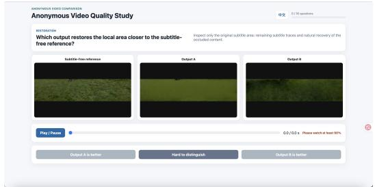  
(a) Restoration Fidelity

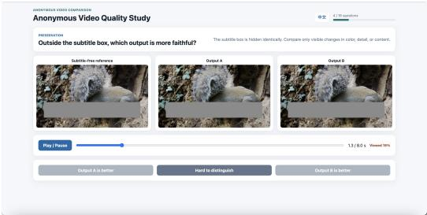  
(b) Preservation Fidelity

  
(c) Temporal Fidelity

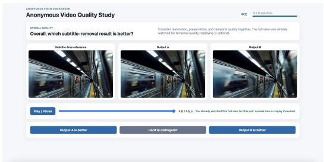  
(d) Overall preference  
Figure 7: Human-evaluation interface for held-out protocol validation.

After preregistered quality control, 16 of 19 annotators contribute 944 valid judgments. For each task, 64 pairs have two ratings and 36 have three. A unique plurality determines the pair label, and exact ties remain undecided. All analyses treat the video pair as the independent unit. We report variable-item-size Fleiss’ agreement, tie rates, accuracy on decisive pairs with Wilson intervals, and Kendall’s $\tau _ { b }$

Each component is compared with its corresponding human task. SR-Q and the four Overall metrics are compared on the same decisive Overall pairs, using paired-bootstrap accuracy differences and exact McNemar tests with Holm correction. Table 15 includes every preregistered candidate.

## B.5 SR-Q: DEFINITION AND VALIDATION SCOPE

SR-Q was preregistered as a scalar summary of the fidelity profile. It did not improve on conventional Overall metrics in the held-out study, so we exclude it from the primary leaderboard and stratified analysis. Its definition is retained here to make that comparison reproducible.

For each metric k, P5/P95 anchors $( a _ { k } , b _ { k } )$ are frozen from the six-model Audit300 grid. We compute $z _ { k } = \mathrm { c l i p } ( ( x _ { k } - a _ { k } ) / ( b _ { k } - a _ { k } ) , 0 , 1 )$ and set $q _ { k } = z _ { k }$ for higher-is-better metrics and $q _ { k } = 1 - z _ { k }$ otherwise. Only this normalization clips TWE-Excess at zero. Anchors use no human labels and are not refit for new methods. The components and candidate are

$$
S _ { \mathrm { r e s t } } = \mathrm { m e a n } ( q _ { \mathrm { S u b , P S N R } } , q _ { \mathrm { S u b , L P I P S } } , q _ { \mathrm { S u b , c D I S T S } } ) ,\tag{9}
$$

$$
S _ { \mathrm { p r e s } } = \mathrm { m e a n } ( q _ { \mathrm { O u t , P S N R } } , q _ { \mathrm { O u t , L P I P S } } ) ,\tag{10}
$$

$$
S _ { \mathrm { t e m p } , r } = \mathrm { m e a n } ( q _ { r , \mathrm { T W E - E x c e s s } } , q _ { r , \mathrm { T C } } ) , \quad r \in \{ \mathrm { B B o x } , \mathrm { O u t } \} ,\tag{11}
$$

$$
S _ { \mathrm { t e m p } } = \sqrt { S _ { \mathrm { t e m p , B B o x } } S _ { \mathrm { t e m p , O u t } } } , \qquad \mathrm { S R \mathrm { - } Q = 1 0 0 } ( S _ { \mathrm { r e s t } } S _ { \mathrm { p r e s } } S _ { \mathrm { t e m p } } ) ^ { 1 / 3 } .\tag{12}
$$

Audit results require common valid support. A metric may be dropped symmetrically only if structurally unsupported for every method on that video; method-specific missing support invalidates the comparison. No component is imputed. Human-study videos remain disjoint from anchor estimation. SR-Q is not extrapolated to failed or unaudited outputs, multiplied by coverage, or combined with computational cost.

## C SUPPLEMENTARY RESULTS

## C.1 COMPLETE AUDIT300 RESULTS

Tables 9 and 10 add video-bootstrap 95% intervals and Subtitle SSIM to the main results. All entries use 300 videos except BBox TWE-Excess, whose symmetric support contains 299. Values remain conditional on each method’s verified output.

Table 9: Audit300 spatial results: mean above video-bootstrap 95% CI. PSNR is in dB; LPIPS and cDISTS are lower-is-better. CLEAR is blind; other methods are mask-guided.
<table><tr><td rowspan="2">Method</td><td colspan="4">Subtitle</td><td colspan="2">Outside</td></tr><tr><td>PSNR</td><td>SSIM</td><td>LPIPS</td><td>cDISTS</td><td>PSNR</td><td>LPIPS</td></tr><tr><td>CLEAR</td><td>11.99 [11.31, 12.75]</td><td>0.356 [0.322, 0.391]</td><td>0.621 [0.594, 0.651]</td><td>0.236 [0.225, 0.248]</td><td>21.48 [21.05, 21.90]</td><td>0.221 [0.211, 0.232]</td></tr><tr><td>ProPainter</td><td>19.66 [18.94, 20.41]</td><td>0.714 [0.694, 0.734]</td><td>0.364 [0.343, 0.390]</td><td>0.138 [0.130, 0.148]</td><td>34.11 [33.78, 34.44]</td><td>0.050 [0.047, 0.054]</td></tr><tr><td>DiffuEraser</td><td>21.36 [20.74, 21.94]</td><td>0.746 [0.726, 0.766]</td><td>0.269 [0.253, 0.287]</td><td>0.116 [0.110, 0.124]</td><td>32.87 [32.59, 33.16]</td><td>0.062 [0.057, 0.066]</td></tr><tr><td>MiniMax- Remover</td><td>20.32 [19.61, 20.96]</td><td>0.725 [0.700, 0.748]</td><td>0.321 [0.297, 0.346]</td><td>0.132 [0.123, 0.141]</td><td>30.73 [30.37, 31.12]</td><td>0.086 [0.080, 0.092]</td></tr><tr><td>OmnimatteZero</td><td>17.69 [17.09, 18.31]</td><td>0.651 [0.628, 0.673]</td><td>0.369 [0.352, 0.388]</td><td>0.160 [0.151, 0.168]</td><td>26.00 [25.53, 26.47]</td><td>0.131 [0.124, 0.139]</td></tr><tr><td>EffectErase</td><td>20.58 [20.00, 21.17]</td><td>0.727 [0.705, 0.749]</td><td>0.251 [0.234, 0.270]</td><td>0.138 [0.130, 0.146]</td><td>25.77 [25.26, 26.27]</td><td>0.120 [0.112, 0.127]</td></tr></table>

Table 10: Audit300 temporal results: mean above video-bootstrap 95% CI. TC is scaled by 102 and TWE-X by 103. CLEAR is blind; other methods are mask-guided.
<table><tr><td rowspan=1 colspan=1>Method</td><td rowspan=1 colspan=6>BBoXTC           TWE-X</td><td rowspan=1 colspan=3>OutsideTC           TWE-X</td><td rowspan=1 colspan=1>Jointcoverage (%)</td></tr><tr><td rowspan=1 colspan=1>CLEAR</td><td rowspan=1 colspan=6>5.00           15.042[4.54, 5.43]      [12.605, 17.707]</td><td rowspan=1 colspan=3>1.77            0.076[1.59, 1.98]      [-0.013,0.175]</td><td rowspan=1 colspan=1>85.4[83.9, 86.8]</td></tr><tr><td rowspan=2 colspan=1>ProPainter</td><td rowspan=2 colspan=6>2.57            0.683[2.36, 2.81]       [0.481, 0.891]</td><td rowspan=2 colspan=3>0.70            0.072[0.65, 0.75]</td><td rowspan=1 colspan=1>100.0</td></tr><tr><td rowspan=1 colspan=2></td><td rowspan=1 colspan=1>[100.0, 100.0]</td></tr><tr><td rowspan=2 colspan=1>DiffuEraserMiniMax-</td><td rowspan=1 colspan=6>2.53            0.686[2.28, 2.79]       [0.491, 0.923]</td><td rowspan=1 colspan=3>0.73[0.68, 0.79]       [0.012, 0.152]</td><td rowspan=1 colspan=1>30.068</td></tr><tr><td rowspan=1 colspan=2></td><td rowspan=1 colspan=3>2.52</td><td rowspan=1 colspan=1></td><td rowspan=1 colspan=2>1.142</td><td rowspan=2 colspan=2>1.12            0.028[1.01, 1.24]      [-0.041,0.117]</td><td></td></tr><tr><td rowspan=3 colspan=1>RemoverOmnimatteZero</td><td rowspan=3 colspan=6>[2.25, 2.85]2.77            0.653[2.49, 3.10]       [0.429, 0.899]</td><td rowspan=1 colspan=1>, 2.8</td><td rowspan=1 colspan=1></td><td rowspan=1 colspan=1></td><td></td></tr><tr><td rowspan=1 colspan=3>1.51            0.048</td><td rowspan=1 colspan=1>98.5</td></tr><tr><td rowspan=1 colspan=3>[1.34, 1.70]      [-0.032, 0.119]</td><td rowspan=1 colspan=1>[98.3, 98.7]</td></tr><tr><td rowspan=1 colspan=1>EffectErase</td><td rowspan=1 colspan=6>2.39            0.634[2.12, 2.67]       [0.420, 0.908]</td><td rowspan=1 colspan=3>1.51            0.129[1.36, 1.67]       [0.062, 0.198]</td><td rowspan=1 colspan=1>43.1[40.4, 45.5]</td></tr></table>

## C.2 DECOUPLED QUALITY

Spatial trade-offs. Among guided methods, EffectErase has the lowest Subtitle LPIPS, whereas ProPainter has the lowest Outside LPIPS. These different strengths lead to substantial ranking reversals (Table 11). Overall LPIPS tracks Outside LPIPS more closely than Subtitle LPIPS, so a full-frame score can hide errors in the repaired region.

Sensitivity to partial outputs. Removing EffectErase still leaves spatial and temporal ranking reversals (2/6 and 6/6 pairs), so its short outputs cannot fully explain the disagreement. This check is descriptive because it does not align temporal support. The temporal metrics also capture different behavior: low TWE-Excess can coexist with a mismatch in target changes measured by TC. Reporting both preserves a distinction that a single score would obscure.

Table 11: Pairwise rank agreement across mask-guided methods. Metric-induced orderings are compared over five methods (10 pairs), including prefix-conditioned EffectErase; reversals indicate opposite pairwise preferences
<table><tr><td>Metric relation</td><td>Reversed pairs</td><td>Kendall τb</td></tr><tr><td>Subtitle LPIPS vs. Outside LPIPS</td><td>5/10</td><td>0.00</td></tr><tr><td>BBox TWE-Excess vs. BBox TC</td><td>6/10</td><td>-0.20</td></tr><tr><td>Overall LPIPS vs. Subtitle LPIPS</td><td>4/10</td><td>0.20</td></tr><tr><td>Overall LPIPS vs. Outside LPIPS</td><td>1/10</td><td>0.80</td></tr></table>

## C.3 DATASET AND SUBTITLE DIAGNOSTICS

Table 7 gives the Audit300 groups used in the main-paper Figure 6.

Dataset slices. Real-HQ has the highest Subtitle LPIPS for every method, whereas AI-generated videos have the lowest Outside LPIPS. Temporal ordering does not simply follow these spatial trends. Medium-duration clips also have higher Subtitle LPIPS than Short clips for all guided methods. These associations identify conditions worth inspecting, but source and resolution cannot be separated here: Real-HQ is entirely 1080p-class, while Real-LQ and AI-generated are 720p-class. The Long slice has only ten Real-LQ videos.

The Hard style-complexity group is easier for guided methods on Subtitle LPIPS but harder for CLEAR. The metadata score therefore measures rendering complexity, not a universal difficulty scale. In particular, access to a mask changes which subtitle attributes create a challenge.

Subtitle factors. Figure 8 contrasts independent groups of base videos. Differences are first minus second group means, with 4,000 within-group video-bootstrap resamples. Bilingual subtitles have higher Subtitle LPIPS for every method, with intervals excluding zero, while their Outside LPIPS and BBox TC contrasts are inconclusive. Dynamic layouts associate with higher Subtitle LPIPS for CLEAR but lower error for all guided methods. Decorated styles likewise have method-dependent effects: DiffuEraser improves on both Subtitle and BBox-NG LPIPS, while CLEAR’s BBox-NG error increases. The differing responses reinforce the value of separating blind and guided methods and evaluating local views. Because the groups contain different base videos, these contrasts describe associations rather than causal effects of individual subtitle attributes.

Box-style stress set. The final common-evaluable set contains 464 Boxed/Subtitle-box videos. Their text-tight BBoxes need not cover the rendered box, so Outside cannot identify unaffected content. Figure 9 therefore reports only Overall and Subtitle PSNR/LPIPS, omitting Preservation, BBox temporal scores, and SR-Q. Good glyph-core fidelity alone cannot establish recovery of the rendered box: changes outside a text-tight BBox may be necessary to remove it. The stress set makes this annotation boundary explicit.

## C.4 FULL-SET DELIVERY AND COVERAGE

All delivery rates use 3,000 scheduled videos per method. Complete outputs have full spatial and temporal coverage; verified partial outputs have positive but incomplete support. Inference failures, missing artifacts, and evaluation failures are distinct terminal states (Table 12). A missing artifact alone does not establish an inference failure. The six evaluation failures concern the same video.

Resolution and duration. Figure 10 breaks down delivery by target resolution and duration.   
ProPainter usually completes videos, with reduced coverage for long, high-resolution inputs.   
CLEAR and EffectErase predominantly return partial outputs under their frozen temporal contracts.   
This distinguishes contractual truncation from inference failure and makes delivery a property of the evaluated configuration as well as the model.

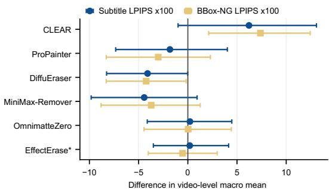  
(a) Visual style: Decorated - Plain

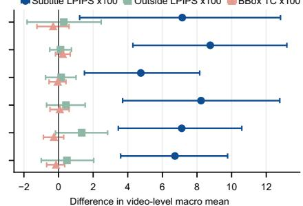  
(b) Language: Bilingual - Monolingual

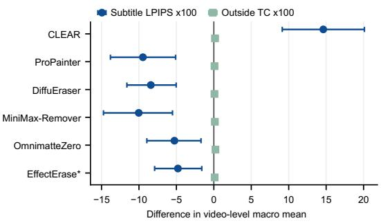  
(c) Spatial Layout: Dynamic - Fixed

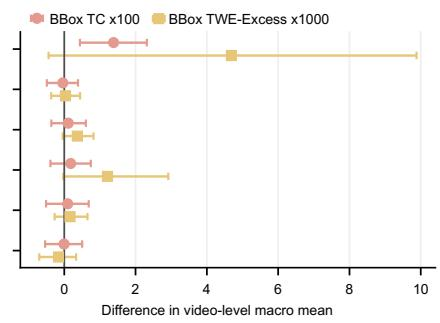  
(d) Temporal Behavior: Animated - Static

Figure 8: Subtitle-factor contrasts on Audit300. Decorated–Plain (96/107), Bilingual– Monolingual (150/150), Dynamic–Fixed (145/155), and Animated–Static (150/150). Positive differences indicate higher error in the first group; bars are 95% bootstrap intervals. EffectErase uses its verified prefix.  
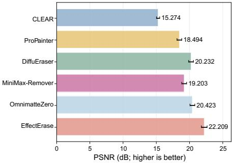  
(a) Overall PSNR

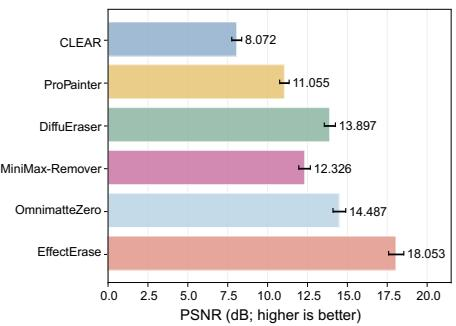  
(b) Glyph PSNR

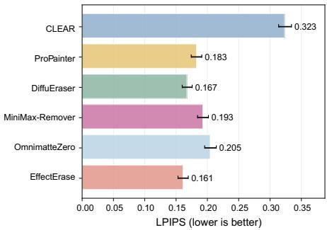  
(c) Overall LPIPS

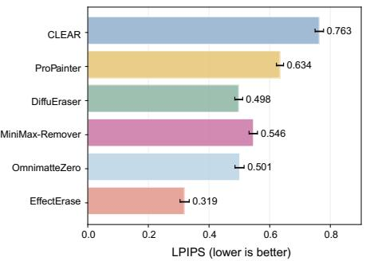  
(d) Glyph LPIPS  
Figure 9: Box-style stress results with video-bootstrap 95% intervals. Each measurement uses 464 videos except EffectErase’s Subtitle metrics $( n = 4 6 3$ , owing to one empty glyph support). Quality uses verified outputs, including partial prefixes; missing values are not imputed.

Table 12: Terminal-state counts: complete (C), verified partial (P), inference failure (IF), missing artifact (MA), and evaluation failure (EF). Each row sums to 3,000.
<table><tr><td>Method</td><td>C</td><td>P</td><td>IF</td><td>MA</td><td>EF</td></tr><tr><td>CLEAR</td><td>168</td><td>2,831</td><td>0</td><td>0</td><td>1</td></tr><tr><td>ProPainter</td><td>2,949</td><td>0</td><td>50</td><td>0</td><td>1</td></tr><tr><td>DiffuEraser</td><td>2,171</td><td>799</td><td>29</td><td>0</td><td>1</td></tr><tr><td>MiniMax-Remover</td><td>924</td><td>1,947</td><td>128</td><td>0</td><td>1</td></tr><tr><td>OmnimatteZero</td><td>630</td><td>2,255</td><td>91</td><td>23</td><td>1</td></tr><tr><td>EffectErase</td><td>117</td><td>2,810</td><td>72</td><td>0</td><td>1</td></tr></table>

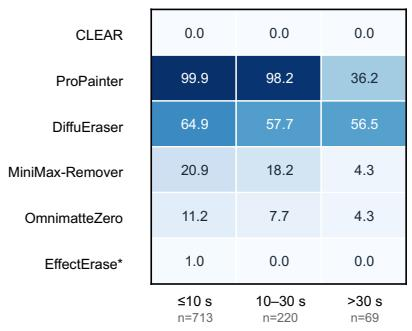  
(a) 1080p-class

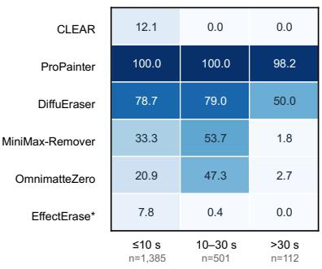  
(b) 720p-class  
Figure 10: Delivery across resolution and duration groups. Rates use all scheduled videos in each group, including failed and missing outputs. Terminal-state mixtures distinguish verified truncation from failure.

Coverage and usable output. Figure 11 distinguishes near-complete from severely truncated outputs. Its coverage curves use all scheduled videos, assigning non-evaluable records zero coverage only for this plot; their quality stays missing. Full temporal coverage does not imply full spatial coverage. Quality and delivery also use different sets and are reported separately. The strict six-method complete non-box intersection contains only 80 short, 720p-class videos, nearly all AI-generated. Restricting evaluation to this set would substantially change the benchmark population, so it cannot support a representative full-video efficiency comparison.

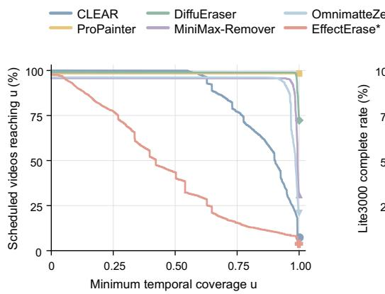  
(a) Temporal coverage

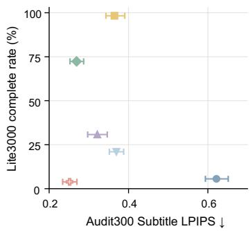  
(b) Quality and delivery  
Figure 11: Quality–coverage relationship across evaluation scopes. Left: temporal coverage over all scheduled videos. Right: Audit300 Subtitle LPIPS versus Lite3000 complete-delivery rate. Quality intervals are video-bootstrap 95% CIs. EffectErase quality is computed on verified prefixes, while delivery is assessed against full targets.

## C.5 EVALUABLE SCOPE AND CONDITIONAL QUALITY

The final non-box primary pool has 2,499 videos; its six-model common intersection has 2,298. Table 13 gives each method’s additional evaluable scope. These sets can overlap and are dominated by Real-LQ videos; all AI-generated primary-pool videos already lie in the common intersection. Figure 12 separates complete and partial outputs and distinguishes typical error from the upper tail. ProPainter’s added videos increase both median and tail Subtitle LPIPS. MiniMax-Remover instead has a lower median but a worse tail, which a mean alone would conceal. For DiffuEraser and EffectErase, worse restoration on added videos coexists with lower BBox TC. For example, DiffuEraser’s median Subtitle LPIPS rises from 0.228 to 0.285, while median BBox TC falls from 0.0212 to 0.0187. MiniMax-Remover’s median Subtitle LPIPS falls from 0.253 to 0.219, while its 90th percentile rises from 0.558 to 0.671. These summaries pool complete and partial outputs with valid metrics. Lower temporal discrepancy or a lower median can therefore conceal a deterioration in another aspect of quality.

The additional sets are selected by method evaluability and differ in composition. These shifts describe each method’s expanded operating scope, not the effect of a controlled increase in difficulty. Common-set results support shared-ID comparisons; native results reveal what those comparisons leave out and do not support cross-method rankings on different IDs.

Table 13: Method-native evaluable scope in the non-box primary pool. All methods share 2,298 videos; native sets include verified partial outputs.
<table><tr><td>Method</td><td>Native set</td><td>Additional videos</td></tr><tr><td>CLEAR</td><td>2,499</td><td>201</td></tr><tr><td>ProPainter</td><td>2,456</td><td>158</td></tr><tr><td>DiffuEraser</td><td>2,474</td><td>176</td></tr><tr><td>MiniMax-Remover</td><td>2,392</td><td>94</td></tr><tr><td>OmnimatteZero</td><td>2,407</td><td>109</td></tr><tr><td>EffectErase</td><td>2,436</td><td>138</td></tr></table>

## C.6 HUMAN ALIGNMENT AND QUALITATIVE EVIDENCE

Agreement with human preferences. The study protocol and interface are given in Appendix B.4 and Figure 7; the cases in Appendix E illustrate the distinctions being assessed. Figure 13 summarizes alignment, with task decisiveness and all preregistered candidates reported in Tables 14 and 15. Restoration and Preservation components agree with most decisive preferences, although neither improves observed accuracy over its LPIPS counterpart. Human validation thus supports the regional views more clearly than the benefit of combining their metrics.

Temporal judgments are less decisive, with most pairs undecided and low inter-annotator agreement. The resulting small decisive subset yields wide intervals, leaving temporal alignment uncertain. Ac curacy is conditional on decisive preferences; tie rates show how much of the full study it represents.

Table 14: Human-response decisiveness and agreement. Each task contains 100 pairs; κ is Fleiss’ inter-annotator agreement.
<table><tr><td>Task</td><td>Decisive n</td><td>Undecided (%)</td><td>κ</td></tr><tr><td>Restoration</td><td>83</td><td>17</td><td>0.544</td></tr><tr><td>Preservation</td><td>58</td><td>42</td><td>0.517</td></tr><tr><td>Temporal</td><td>39</td><td>61</td><td>0.123</td></tr><tr><td>Overall</td><td>84</td><td>16</td><td>0.578</td></tr></table>

Scalar comparison. On the same decisive Overall pairs, SR-Q does not outperform the strongest conventional candidate. All paired-bootstrap accuracy-difference intervals include zero, and all Holm-adjusted McNemar p values are 1.0. SR-Q therefore fails the preregistered promotion rule. We retain the raw fidelity profile without refitting the scalar to these judgments.

Common / complete Additional / complete Common / partial Additional / partial Point: median; segment ends at P90; values ×100.

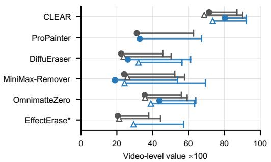  
(a) Subtitle LPIPS ↓

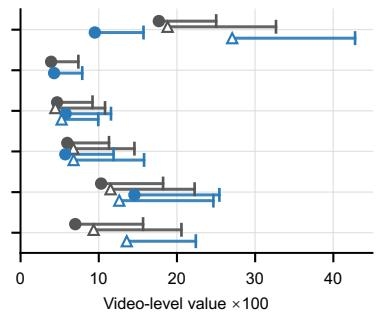  
(b) Outside LPIPS ↓

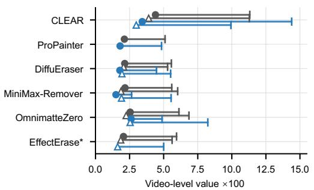  
(c) BBox TC ↓

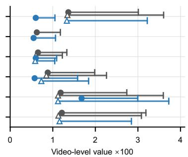  
(d) Outside TC ↓  
Figure 12: Conditional quality on common and additional videos. Points are medians, and segments extend to the 90th percentile, not confidence limits. Values are multiplied by 100.

Table 15: Held-out metric–human alignment. Accuracy uses decisive preferences; intervals are Wilson 95% CIs. Kendall’s τb uses signed aggregate preferences.
<table><tr><td>Human task</td><td>Candidate</td><td>Accuracy (%)</td><td>95% CI</td><td>Tb</td></tr><tr><td>Restoration</td><td>Restoration component</td><td>81.9</td><td>[72.3, 88.7]</td><td>0.471</td></tr><tr><td>(n = 83)</td><td>Subtitle LPIPS</td><td>88.0</td><td>[79.2, 93.3]</td><td>0.501</td></tr><tr><td rowspan="3"></td><td>Subtitle PSNR</td><td>81.9</td><td>[72.3, 88.7]</td><td>0.443</td></tr><tr><td>Subtitle cDISTS</td><td>75.9</td><td>[65.7, 83.8]</td><td>0.391</td></tr><tr><td>Preservation component</td><td>91.4</td><td>[81.4, 96.3]</td><td>0.559</td></tr><tr><td>Preservation (n = 58)</td><td>Outside LPIPS</td><td>91.4</td><td>[81.4, 96.3]</td><td>0.519</td></tr><tr><td></td><td>Outside PSNR</td><td>89.7</td><td>[79.2, 95.2]</td><td>0.574</td></tr><tr><td>Temporal</td><td>Temporal component</td><td>64.1</td><td>[48.4, 77.3]</td><td>0.222</td></tr><tr><td rowspan="4">(n = 39)</td><td>BBox TC</td><td>61.5</td><td>[45.9, 75.1]</td><td>0.221</td></tr><tr><td>BBox TWE-Excess</td><td>59.0</td><td>[43.4, 72.9]</td><td>0.150</td></tr><tr><td>Outside TC</td><td>74.4</td><td>[58.9, 85.4]</td><td>0.280</td></tr><tr><td>Outside TWE-Excess</td><td>41.0</td><td>[27.1, 56.6]</td><td>0.111</td></tr><tr><td>Overall (n = 84)</td><td>SR-Q</td><td>73.8</td><td>[63.5, 82.0]</td><td>0.408</td></tr><tr><td rowspan="4"></td><td>Overall DISTS</td><td>78.6</td><td>[68.7, 86.0]</td><td>0.389</td></tr><tr><td>Overall LPIPS</td><td>77.4</td><td>[67.4, 85.0]</td><td>0.429</td></tr><tr><td>Overall PSNR</td><td>76.2</td><td>[66.1, 84.0]</td><td>0.409</td></tr><tr><td>Overall SSIM</td><td>72.6</td><td>[62.3, 81.0]</td><td>0.367</td></tr></table>

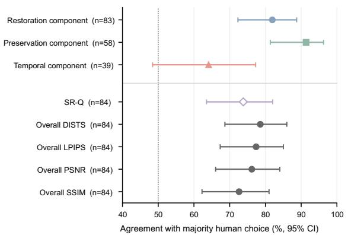  
(a) Matched human task

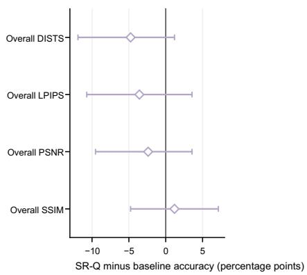  
(b) Same Overall preference task  
Figure 13: Human alignment and scalar comparison. (a) Matched-task agreement with Wilson 95% intervals; n counts decisive pairs and the dashed line marks 50%. (b) SR-Q minus baseline accuracy on the same 84 decisive Overall pairs, with paired-bootstrap 95% intervals. Component and Overall rows address different judgments and should be interpreted within their tasks.

## D COMPUTATIONAL WORKLOAD

Retained inference logs total 10,137.4 GPU-hours, with one unshared GPU per worker. Workload sums elapsed runtime times assigned GPU count, including 207 timed failures and observed runtime up to termination for partial outputs. Table 16 covers 17,814 of 18,000 scheduled records.

Table 16: Recorded inference workload. Each method has 3,000 scheduled videos.
<table><tr><td>Method Timed records</td><td>GPU-hours</td></tr><tr><td>CLEAR 3,000</td><td>844.6</td></tr><tr><td>ProPainter</td><td>3,000 289.6</td></tr><tr><td>DiffuEraser</td><td>3,000 738.9</td></tr><tr><td>MiniMax-Remover</td><td>2,909 4,500.0</td></tr><tr><td>OmnimatteZero</td><td>2,977 2,021.4</td></tr><tr><td>EffectErase</td><td>2,928 1,742.9</td></tr><tr><td>Total</td><td>17,814 10,137.4</td></tr></table>

The totals exclude missing or invalid timing, overwritten attempts, untimed stages, and metric evaluation. External decoding and, where applicable, mask preparation precede timing for CLEAR, MiniMax, OmnimatteZero, and EffectErase. Encoding is included for DiffuEraser and EffectErase but excluded from other successful runs. These differences in timing boundaries prevent interpreting the totals as either project cost or a full-video efficiency comparison.

## E QUALITATIVE CASES AND DIAGNOSTIC INSIGHTS

We retain five cases per diagnostic, selected by decreasing six-model range in Subtitle LPIPS, Outside LPIPS, or BBox TC (ties broken by video ID). Selection uses neither SR-Q nor human labels. Only unreadable assets, invalid common crops, or unavailable shared temporal support permit rejection. The gallery illustrates disagreements, not failure frequencies or an unbiased ranking. Case records retain IDs, frame indices, crops, and scores.

Restoration comparisons use local crops; Preservation comparisons retain full-frame context. Temporal strips show three consecutive shared frames, read left to right. Views and aspect ratios are matched across methods. CLEAR is blind; the other methods receive BBox masks.

## E.1 RESTORATION: TEXT REMOVAL AND SCENE RECONSTRUCTION

The local crops distinguish residual text from errors in the reconstructed scene.

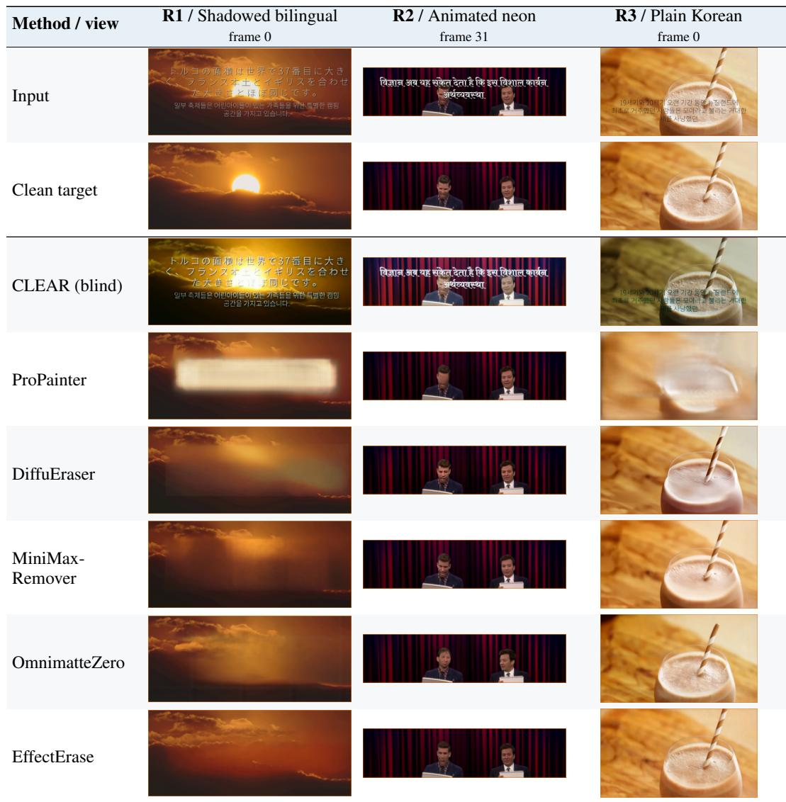  
In R1, CLEAR retains visible glyphs, ProPainter leaves a smooth band, and generative fills change the cloud structure. R2’s stage geometry and R3’s transparent glass expose further reconstruction errors. Removing text is only part of the task: the replacement must also match the clean scene.

## RESTORATION ACROSS BACKGROUNDS

The shared crop spans textured natural content in R4 and a dark background with a localized object in R5.

<table><tr><td>Method / view</td><td>R4 / Moving glow frame 11</td><td>R5 / Animated Thai frame 56</td></tr><tr><td>Input</td><td></td><td>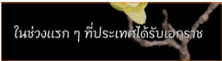</td></tr><tr><td>Clean target</td><td></td><td>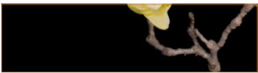</td></tr><tr><td>CLEAR (blind)</td><td>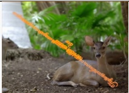</td><td>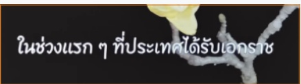</td></tr><tr><td>ProPainter</td><td></td><td>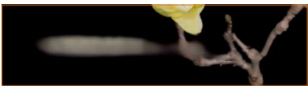</td></tr><tr><td>DiffuEraser</td><td></td><td>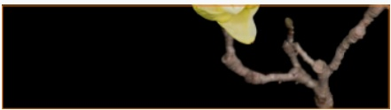</td></tr><tr><td>MiniMax- Remover</td><td></td><td>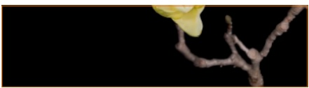</td></tr><tr><td>OmnimatteZero</td><td></td><td>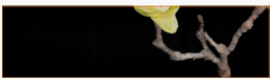</td></tr><tr><td>EffectErase</td><td></td><td>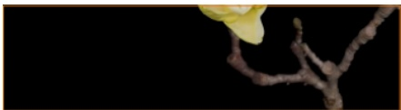</td></tr></table>

R4 reveals losses in natural detail, while R5 makes changes to a localized object visible against a dark background. Both illustrate the cost of reconstructing a region that contains real scene content beneath the text. They complement the factor-level results in Appendix C.3, without attributing an individual error to language or rendering style.

## E.2 PRESERVATION: CHANGES BEYOND THE SUBTITLE

Full frames expose changes beyond the subtitle region that local crops would omit.

<table><tr><td>Method / view</td><td>P1 / Abstract geometry frame 47</td><td>P2 / Forest foliage frame 9</td><td>P3 / Forest stream frame 0</td></tr><tr><td>Input</td><td></td><td></td><td></td></tr><tr><td>Clean target</td><td></td><td></td><td></td></tr><tr><td>CLEAR (blind)</td><td></td><td></td><td></td></tr><tr><td>ProPainter</td><td></td><td></td><td></td></tr><tr><td>DiffuEraser</td><td></td><td></td><td></td></tr><tr><td>MiniMax- Remover</td><td></td><td></td><td></td></tr><tr><td>OmnimatteZero</td><td></td><td></td><td></td></tr><tr><td>EffectErase</td><td></td><td></td><td></td></tr></table>

In P1, CLEAR changes colors and geometric boundaries well beyond the text. P2 and P3 extend the preservation comparison to foliage and flowing water, where texture changes are easy to overlook in a local crop. Outside fidelity records these differences independently of the repair itself.

## PRESERVATION UNDER MOVING AND ANIMATED SUBTITLES

These full-frame comparisons retain grass, foliage, and scene boundaries that a subtitle crop would hide.

<table><tr><td rowspan=1 colspan=4>P4/ Grass and motion                        P5 / Rotating textMethod / viewframe 74                                     frame 33</td></tr><tr><td rowspan=1 colspan=1>Input</td><td rowspan=1 colspan=1>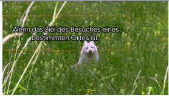</td><td rowspan=1 colspan=1></td><td rowspan=2 colspan=1></td></tr><tr><td rowspan=1 colspan=1>Clean target</td><td rowspan=1 colspan=1>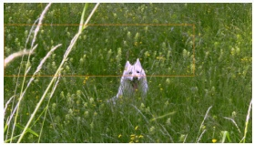</td><td rowspan=1 colspan=1></td></tr><tr><td rowspan=1 colspan=1>CLEAR (blind)</td><td rowspan=1 colspan=1></td><td rowspan=1 colspan=1></td><td rowspan=6 colspan=1>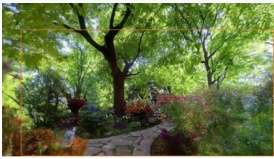</td></tr><tr><td rowspan=1 colspan=1>ProPainter</td><td rowspan=1 colspan=1>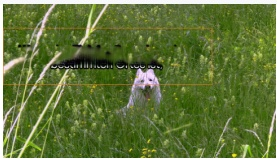</td><td rowspan=1 colspan=1></td><td rowspan=1 colspan=1></td></tr><tr><td rowspan=1 colspan=1>DiffuEraser</td><td rowspan=1 colspan=1></td><td rowspan=1 colspan=1></td><td rowspan=1 colspan=1></td></tr><tr><td rowspan=1 colspan=1>MiniMax-Remover</td><td rowspan=1 colspan=1>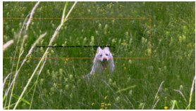</td><td rowspan=1 colspan=1></td><td rowspan=1 colspan=1></td></tr><tr><td rowspan=1 colspan=1>OmnimatteZero</td><td rowspan=1 colspan=1>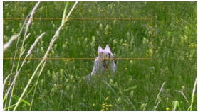</td><td rowspan=1 colspan=1></td><td rowspan=1 colspan=1>正</td></tr><tr><td rowspan=1 colspan=1>EffectErase</td><td rowspan=1 colspan=1>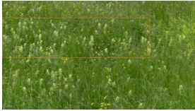</td><td rowspan=1 colspan=1></td></tr></table>

P4 and P5 extend the comparison to moving or animated subtitles, where the relevant background includes grass, foliage, and scene boundaries. Such context is easy to miss when inspecting only the current text location. Outside scores remain tied to the operational BBox: the separate box-style stress test addresses effects that extend beyond this annotation.

T2 / Moving outline

## E.3 TEMPORAL FIDELITY: CHANGES RELATIVE TO THE TARGET

Each strip shows frames 0–2 from a shared crop, ordered left to right.

Frames 0, 1, 2 −→

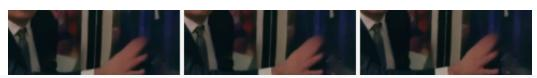

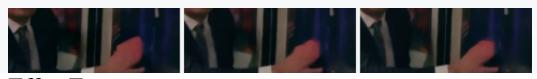

  
Frames 0, 1, 2 −→

Clean target  

  
Frames 0, 1, 2 −→

  
EffectErase

  
Subtitle remnants persist across the strips for CLEAR in T1 and ProPainter in T3. Such errors can look stable, yet differ from the clean target. Temporal fidelity must account for target changes as well as output stability, helping explain the TC–TWE-Excess disagreement in Appendix C.2.

## TEMPORAL FIDELITY UNDER SUBTITLE MOTION

T4 changes subtitle position without character animation; T5 combines motion with bilingual shadowed text.

Spatial errors and temporal changes can occur together, making an overall visual preference difficult to interpret. The separate Restoration and Temporal tasks help distinguish these judgments, though the high undecided rate in the held-out temporal study limits conclusions about metric alignment (Appendix C.6).

Three-frame strips locate transitions for inspection; they cannot establish perceptible flicker over a full video. That assessment requires playback on shared support, as provided by the original evaluation interface in Figure 7.