# MHVF: Training-Free GUI Grounding via Verification-Guided Multi-Hypothesis Search

Minghua Chen Xingming Liao Weiqiang Zhong Zhuowei Wang\*

School of Computer Science and Technology

Guangdong University of Technology, Guangzhou 510090, China

2232706035@mails.gdut.edu.cn liaoxingming@mails.gdut.edu.cn zhongweiqiang@mails.gdut.edu.cn zwwang@gdut.edu.cn

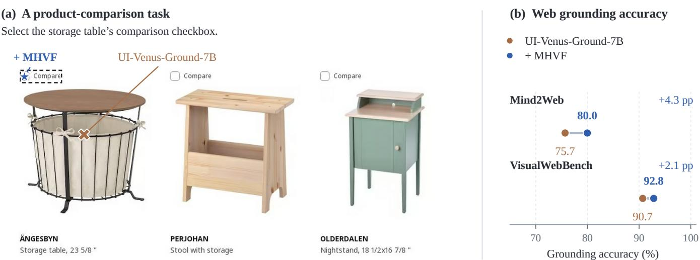

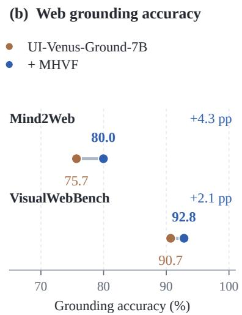  
Figure 1: Web grounding with MHVF. (a) On a Mind2Web product-comparison task, UI-Venus-Ground-7B clicks the product image; adding MHVF locates its comparison checkbox. The dashed box marks the target. (b) Grounding accuracy of the same backbone on two web benchmarks; gains are in percentage points.

## Abstract

GUI grounding enables web agents to translate natural-language instructions into actionable interface locations. However, dense layouts and small, visually similar controls can lead models toward plausible but incorrect elements, while refinement around a single prediction may leave alternative targets unexplored. We propose the Multi-Hypothesis Verification Framework (MHVF) for training free GUI grounding. It combines multi-hypothesis exploration with local visual verification using a single pretrained vision-language model. To explore alternative targets, MHVF constructs spatial hy potheses from multiple full-screen predictions and examines the corresponding regions through zoomed re-localization. To resolve ambiguity among the resulting candidates, it verifies their agree-ment with the instruction in marked local views. Verification scores then guide a second round of local search and rank candidates re- tained from both search levels for final selection. Experiments with five general-purpose and GUI-specific models across eight bench- mark settings demonstrate improvements in grounding accuracy in most settings. MHVF improves UI-Venus-Ground-7B by 4.3 and 2.1 percentage points on Mind2Web and VisualWebBench, respectively, and raises Qwen2.5-VL-7B’s accuracy on ScreenSpot-Pro from 23.6% to 53.6%.

## Keywords

GUI Grounding, Web Agents, Test-Time Scaling, Training-Free, Self-Verification

## 1 Introduction

Web agents rely on GUI grounding to translate natural-language instructions into clicks on the intended interface elements. Visionlanguage models (VLMs) enable this process directly from screenshots, but grounding remains a major obstacle to reliable web interaction [42]. Dense page layouts, small controls, and visually similar elements make precise localization challenging, particularly when fine details are lost at the model’s input resolution [20]. Figure 1(a) illustrates such a failure: given an instruction to select a product’s comparison checkbox, the model clicks the product image.

Recent training-free approaches improve GUI grounding through zooming, multi-view prediction, and candidate comparison. Zoom-Click investigates staged zooming, MVP aggregates predictions across multiple views, and AutoFocus combines region proposals with visual candidate comparison [8, 38, 40]. Magnification pro-vides finer visual evidence, but successful grounding also requires inspecting regions that contain the target and choosing a candidate that matches the instruction. Initial predictions can guide this exploration by suggesting several possible target locations, while verification can assess the candidates obtained through local in- spection. This motivates using local visual verification to connect candidate assessment with subsequent region search and final se- lection.

To this end, we propose the Multi-Hypothesis Verification Framework (MHVF) for training-free GUI grounding. It combines multihypothesis search with local visual verification using a single pretrained VLM. At the first level, multiple full-screen predictions iden- tify potential target regions for inspection. The model re-localizes the target in magnified views of these regions and verifies whether each candidate matches the instruction. To focus additional ex- ploration, MHVF reopens the region associated with the highest-scoring candidate for a second round of hypothesis generation, re-localization, and verification. Candidates from both levels are re- tained, and the point with the highest verification score is selected as the final click.

We conduct extensive experiments with general-purpose and GUI-specific models across web, desktop, and cross-platform inter- faces. The evaluation covers web grounding on Mind2Web and VisualWebBench, high-resolution professional interfaces on ScreenSpot-Pro, and cross-platform grounding on MMBench-GUI L2, among other benchmarks. The results show that MHVF improves the grounding accuracy of existing models in most evaluated settings. Our main contributions are summarized as follows:

• We propose MHVF, a training-free framework for GUI grounding that explores multiple spatial hypotheses and verifies the resulting candidates using a single pretrained VLM.

• We develop a two-level search mechanism that uses local verification scores to guide region reopening and select the final click from candidates retained across both levels.

• We evaluate MHVF on five models across eight benchmark settings covering web, desktop, and cross-platform interfaces, demonstrating improved grounding accuracy in most settings.

## 2 Related Work

## 2.1 Web Agents and GUI Grounding

Web agents use vision-language models to interpret interfaces and translate user instructions into executable actions. SeeAct inves- tigates this process by separating action generation from grounding actions to web elements [42]. To support interaction directly from screenshots, subsequent research develops models that map natural-language instructions to target locations. SeeClick introduces grounding-oriented pretraining with automatically collected data, while UGround and OS-Atlas expand grounding data and model capabilities across web, desktop, and mobile interfaces [2, 6, 33]. These eforts provide the grounding capabilities on which MHVF builds, with our focus on improving existing models through inference-time search and verification.

## 2.2 Test-Time Scaling for GUI Grounding

Test-time scaling improves grounding by allocating additional com putation to visual inspection and prediction. One line of work explores how to select and examine informative screenshot re- gions. ZoomClick studies staged zooming and the efects of initialization, search depth, and context retention, while DRS-GUI uses Monte Carlo Tree Search to plan region-level perceptual actions [8, 21]. Adaptive methods further use model predictions to determine when and where to zoom. UI-Zoomer combines spatial consensus with generation confidence to trigger zooming and derives crop sizes from prediction uncertainty [28]. AutoFocus uses visual self-verification to decide whether refinement is needed, then constructs region proposals from spatial uncertainty estimated through sampled coordinate predictions [38].

A related line of work examines how to aggregate or assess multiple predictions. GUI-RC identifies consensus regions through spatial voting over sampled predictions, while MVP aggregates predictions from attention-guided views and selects the centroid of the densest spatial cluster [4, 40]. Other approaches use visual reasoning to compare candidates. DiMo-GUI generates candidates through separate text and icon grounding paths and selects between them using the instruction and full-resolution screenshot [32]. AutoFocus jointly compares images annotated with candidate locations to determine the final prediction [38]. MHVF assesses candidates individually in magnified local views using the same grounding model. Its verification scores guide both the choice of a region to re- open for further exploration and the final selection from candidates retained across two search levels.

## 3 Method

## 3.1 Problem Formulation

Given a GUI screenshot � and a natural-language instruction �, GUI grounding aims to predict a click position $p = ( x , y ) \in [ 0 , 1 ] ^ { 2 }$ on the interface element specified by �. Coordinates are normalized with respect to the original screenshot.

We use a frozen pretrained vision-language model � as the base grounder. A view � is either the full screenshot or a local region obtained through cropping and resizing, with �0 denoting the fullscreen view. A spatial hypothesis specifies a region for further inspection. A candidate click is a position obtained by re-localizing the target within the corresponding local view and mapping the prediction back to the original screenshot.

## 3.2 Overview of MHVF

As illustrated in Figure 2, MHVF organizes grounding into two search levels. At level 1, the model produces multiple full-screen predictions, which are grouped into spatial hypotheses (P). Each hypothesis determines a region to crop and magnify, allowing the model to re-localize the target with more detailed visual evidence (Z). The resulting candidate is then marked in its local view and assessed against the instruction (V).

At level 2, MHVF reopens the view associated with the highestscoring first-level candidate (R). The model generates new hypothe-ses within this view and applies the same localization and verifi- cation procedure to obtain additional candidates. Candidates from both levels remain available for final selection, and MHVF returns the click with the highest verification score. The same model per- forms hypothesis generation, localization, and verification through- out the process.

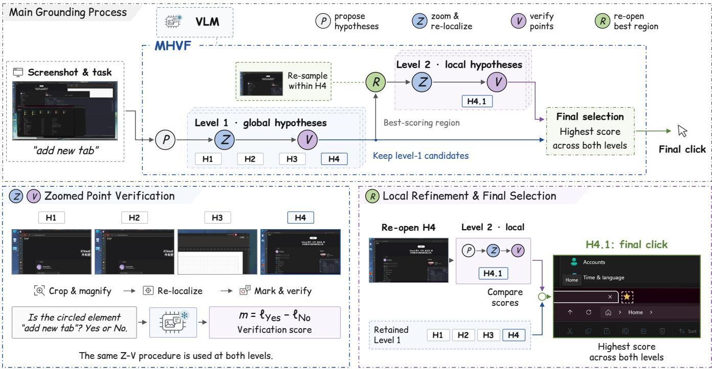  
Figure 2: Overview of MHVF. The blue boundary encloses the inference procedure, which reuses a shared frozen VLM for hypothesis generation (P), zoomed re-localization (Z), and candidate verification (V). Reopening (R) refines the best-scoring region, and candidates from both levels remain eligible for final selection. The lower panels illustrate verification and local refinement for “add new tab,” where H4 is reopened and H4.1 yields the final click.

## 3.3 Spatial Hypothesis Generation

A single full-screen prediction provides only one possible target location. To explore alternative locations, we obtain one determinis- tic prediction through greedy decoding and � stochastic predictions sampled at temperature �. We discard invalid sampled outputs and merge duplicate coordinate predictions, retaining the sequence with the highest log-probability. Let $N \leq n$ denote the number of retained samples and $\lambda _ { j }$ the sequence log-probability of sample �. We assign proposal weights as

$$
w _ { 0 } = 1 , \qquad w _ { j } = \frac { \exp ( \lambda _ { j } ) } { \sum _ { r = 1 } ^ { N } \exp ( \lambda _ { r } ) } , \quad j = 1 , \ldots , N ,\tag{1}
$$

where $w _ { 0 }$ applies to the deterministic prediction when it is valid. This weighting preserves the model’s deterministic prediction while assigning the sampled alternatives an equal total weight.

Several predictions may refer to the same interface element with small coordinate diferences. To reduce redundant inspection, we cluster predictions by spatial proximity, processing them in descending order of weight. A prediction joins the first cluster whose seed lies within � merged visual tokens along both axes of the rendered view; otherwise, it initializes a new cluster. Each cluster retains its seed as the representative, and point-only predictions receive small centered boxes for subsequent cropping.

For a cluster with member set $\mathcal { T } _ { h }$ , its hypothesis weight is

$$
M _ { h } = \sum _ { j \in \mathcal { I } _ { h } } w _ { j } .\tag{2}
$$

Let J1 index the resulting clusters and $b _ { h }$ denote the representa- tive box of cluster ℎ. The first-level hypothesis set is

$$
{ \mathcal { H } } _ { 1 } = \big \{ b _ { h } ~ | ~ h \in \mathrm { T o p K } _ { r \in { \mathcal { T } } _ { 1 } } ( M _ { r } , k ) \big \} ,\tag{3}
$$

where TopK returns the indices of up to � highest-weight clusters. These weights determine which regions receive further inspection. Final candidate selection uses the verification scores obtained after local re-localization.

## 3.4 Zoomed Localization and Verification

Local inspection provides finer visual evidence while preserving context around a possible target. For each hypothesis $b _ { h }$ , we con-struct a crop $c _ { h }$ from the original screenshot. Let � and � denote the screenshot dimensions, and �� and $h _ { b }$ the hypothesis box di- mensions in screenshot pixels. The initial crop is centered on $b _ { h } ,$ with width and height

$$
w _ { c } = \operatorname* { m a x } ( \beta w _ { b } , \rho W ) , \qquad h _ { c } = \operatorname* { m a x } ( \beta h _ { b } , \rho H ) ,\tag{4}
$$

where $\beta$ controls the surrounding context and $\rho$ specifies the mini-mum crop extent. We expand the crop to match the screenshot’s aspect ratio and adjust it to remain within the image boundaries.

To control magnification, we set the crop’s requested minimum pixel budget using its adjusted dimensions $w _ { c }$ and $h _ { c } ;$

$$
P ( c _ { h } ) = ( \kappa s _ { 0 } ) ^ { 2 } w _ { c } h _ { c } ,\tag{5}
$$

Here, $s _ { 0 } = \operatorname* { m i n } ( 1 , \sqrt { P _ { \operatorname* { m a x } } / ( W H ) } )$ is the reference scale for the check- point’s full-screen pixel budget $P _ { \mathrm { m a x } }$ , and � controls the intended magnification. The processor clips the budget and aligns the ren- dered dimensions with its visual-token grid. We query � on the resulting view $v _ { h }$ using deterministic decoding. Let $\boldsymbol { u _ { h } } = ( u _ { h } ^ { x } , u _ { h } ^ { y } )$ be the predicted box center in normalized view coordinates, and $( x _ { h } ^ { 0 } , y _ { h } ^ { 0 } )$ the crop’s upper-left corner in screenshot pixels. The can- didate click in normalized screenshot coordinates is

$$
p _ { h } = \left( \frac { x _ { h } ^ { 0 } + u _ { h } ^ { x } w _ { c } } { W } , \frac { y _ { h } ^ { 0 } + u _ { h } ^ { y } h _ { c } } { H } \right) .\tag{6}
$$

A magnified view can still contain several visually similar ele- ments, so the resulting candidate requires assessment against the instruction. Following visual mark prompting [36], we draw a red ring at the predicted location to obtain a marked view $z _ { h } .$ The same model is asked whether the marked element matches �, with a Yes/No response. Let $\ell _ { \mathrm { Y e s } } ( z _ { h } , q )$ and $\ell _ { \mathrm { N o } } ( z _ { h } , q )$ denote the estimated first-token log-probability scores, each taking the maximum over the available single-token variants of its label. We define the verifi- cation score as

$$
m _ { h } = \ell _ { \mathrm { Y e s } } ( z _ { h } , q ) - \ell _ { \mathrm { N o } } ( z _ { h } , q ) .\tag{7}
$$

A larger score indicates stronger relative support for a match between the marked element and the instruction. We use this score to rank candidates within the same screenshot.

## 3.5 Verification-Guided Refinement and Selection

A high-scoring first-level candidate may still be mislocalized among nearby interface elements. MHVF therefore allocates one additional round of exploration to the view associated with the highest-scoring candidate. Let $C _ { 1 }$ index the valid first-level candidates, each with a click $\begin{array} { r } { \dot { p } _ { i } , } \end{array}$ verification score $m _ { i }$ , and local view $v _ { i }$ . We choose the view to reopen by

$$
r = \underset { i \in C _ { 1 } } { \arg \operatorname* { m a x } } m _ { i } , \qquad v _ { \mathrm { r e o p e n } } = v _ { r } .\tag{8}
$$

Within this view, we draw $n ^ { \prime }$ stochastic predictions at temperature �, filter and deduplicate them, and normalize their sequence- based weights. We then apply spatial clustering using the visualtoken spacing of this local view and retain up to $k ^ { \prime }$ hypotheses.

For each retained hypothesis, we construct a new view from the original screenshot using a smaller crop floor $\rho ^ { \prime } < \rho .$ . The context factor $\beta$ and magnification rule remain unchanged. Each view undergoes the localization and verification procedure in $\ S 3 . 4 ,$ producing additional candidate clicks. First-level candidates are retained so that a position found earlier remains available even when the second round produces diferent predictions.

Let $C _ { 2 }$ index the valid second-level candidates. The final predic- tion is

$$
i ^ { \star } = \underset { i \in C _ { 1 } \cup C _ { 2 } } { \arg \operatorname* { m a x } } m _ { i } , \qquad \quad p = p _ { i ^ { \star } } .\tag{9}
$$

A second-level candidate replaces the best first-level candidate only when it receives a higher verification score; ties retain the first- level candidate. The final pool consists of re-localized candidates from both levels, while the initial full-screen predictions serve as spatial proposals.

The number of generated output sequences per screenshot is bounded by

$$
N _ { \mathrm { s e q } } \leq 1 + n + 2 k + n ^ { \prime } + 2 k ^ { \prime } ,\tag{10}
$$

including at most $k + k ^ { \prime }$ single-token verification responses. Fewer retained hypotheses reduce the actual count. The inference cost also depends on the rendered view sizes and output lengths.

Algorithm 1 summarizes the procedure. Loc maps a deterministically decoded box to normalized screenshot coordinates using Eq. (6) on both corners. Sample returns valid, deduplicated boxes in the same coordinates with weights from Eq. (1); Cluster im-plements Eqs. (2)–(3) using its input view’s visual-token spacing. Mark projects the stored box back into the local view before adding the ring; Verify computes Eq. (7).

Algorithm 1 MHVF for one screenshot   
Require: screenshot �, instruction $q ,$ frozen model �   
1: �0 ← FullScreen(�)   
2: �0 ← Loc(�0, �); � ← Sample(�0, �, �, � )   
3: if �0 is valid then   
4: $A  A \cup \{ ( a _ { 0 } , 1 ) \}$   
5: end if   
6: $\mathcal { H } _ { 1 } \gets \mathrm { C } \mathrm { z } \mathrm { z } \mathrm { z } \mathrm { R } ( A , v _ { 0 } , \delta , k )$   
7: C1 ← LocalizeVerify $( \mathcal { H } _ { 1 } , \rho )$   
8: if $C _ { 1 } = \varnothing$ then   
9: return failure   
10: end if   
11: Select the reopening index � by Eq. (8)   
12: $A ^ { \prime } \gets \mathrm { S A M P L E } ( v _ { r } , q , n ^ { \prime } , T )$ ⊲ re-open   
13: $\mathcal { H } _ { 2 } \gets \mathrm { C } \mathrm { L U S T E R } ( A ^ { \prime } , v _ { r } , \delta , k ^ { \prime } )$   
14: $C _ { 2 } \gets 1$ LocalizeVerify $( \mathcal { H } _ { 2 } , \rho ^ { \prime } )$   
15: Select $i ^ { \star }$ by Eq. (9), favoring $C _ { 1 }$ in ties   
16: return $\mathbf { \nabla } \phi _ { i ^ { \star } }$   
17: function LocalizeVerify $( { \mathcal { H } } , \alpha )$   
18: C ← ∅   
19: for each representative box $b \in { \mathcal { H } }$ do   
20: � ← Crop $I , b , \beta , \alpha )$   
21: � ← Render $\displaystyle ( I , c , P ( c ) )$   
22: $\hat { b } \gets \operatorname { L o c } ( v , q )$   
23: if ˆ� is valid then   
24: Assign a new candidate index �; $v _ { j }  v$   
25: � ← center of ˆ�   
26: � ← Verify(Mark(�, ${ \hat { b } } ) , q )$   
27: $\tilde { C ^ { \prime } } \gets C \cup \{ j \}$   
28: end if   
29: end for   
30: return $c$   
31: end function

## 4 Experiments

## 4.1 Experimental Setup

Metrics and Benchmarks. We evaluate MHVF using grounding accuracy: a prediction is correct if its coordinate falls within the annotated target region. We report results on eight benchmark settings spanning web, desktop, and cross-platform interfaces: Mind2Web [3, 42], VisualWebBench [20], ScreenSpot-Pro [16], OSWorld-G (OSW-G) and OSWorld-G-Refine (OSW-GR) [34], UI-Vision [26], WinDeskGround [41], and MMBench-GUI L2 [31]. On Mind2Web, we evaluate individual grounding steps across its three test splits, using element descriptions alone or combined with task instructions. For VisualWebBench, we use the element-grounding and action-grounding subtasks with coordinate predictions on screenshots without option markers.

Table 1: Grounding accuracy (%) across eight benchmark settings. Rows with + MHVF apply our method to the model above. Bold marks the better result within each pair; superscripts show changes in percentage points. Mind2Web uses element-only instructions.
<table><tr><td></td><td colspan="2">Web</td><td colspan="6">Desktop and cross-platform</td></tr><tr><td>Model</td><td>Mind2Web</td><td>VisualWebBench</td><td>SS-Pro</td><td>OSW-G</td><td>OSW-GR</td><td>UI-V</td><td></td><td>WinDesk MMB-GUI</td></tr><tr><td>General-purpose MLLMs</td><td></td><td></td><td></td><td></td><td></td><td></td><td></td><td></td></tr><tr><td>Qwen2.5-VL-3B</td><td>65.9</td><td>88.0</td><td>25.1</td><td>30.7</td><td>36.7</td><td>13.9</td><td>48.4</td><td>61.8</td></tr><tr><td>+ MHVF</td><td> ${ \bf 7 1 . 2 ^ { + 5 . 3 } }$ </td><td> ${ \bf 8 8 . 2 ^ { + 0 . 2 } }$ </td><td> ${ \bf 5 0 . 0 ^ { + 2 4 . 9 } }$ </td><td> $4 4 . 7 ^ { + 1 4 . 0 }$ </td><td> ${ \bf 5 5 . 1 ^ { + 1 8 . 4 } }$ </td><td> ${ \bf 2 3 . 4 ^ { + 9 . 5 } }$ </td><td>57.3+8.9</td><td>68.4+6.6</td></tr><tr><td>Qwen2.5-VL-7B</td><td>69.0</td><td>85.7</td><td>23.6</td><td>33.9</td><td>38.7</td><td>15.6</td><td>50.3</td><td>67.6</td></tr><tr><td>+ MHVF</td><td> $7 3 . 5 ^ { + 4 . 5 }$ </td><td> ${ \bf 8 7 . 8 ^ { + 2 . 1 } }$ </td><td> ${ \bf 5 3 . 6 ^ { + 3 0 . 0 } }$ </td><td> $5 2 . 0 ^ { + 1 8 . 1 }$ </td><td> ${ \bf 6 2 . 2 ^ { + 2 3 . 6 } }$ </td><td> ${ \bf 3 1 . 2 } ^ { + 1 5 . 6 }$ </td><td> ${ \bf 6 0 . 7 ^ { + 1 0 . 4 } }$ </td><td>76.3+8.7</td></tr><tr><td>GUI-specific models</td><td></td><td></td><td></td><td></td><td></td><td></td><td></td><td></td></tr><tr><td>GTA1-7B</td><td>76.1</td><td>91.3</td><td>49.3</td><td>55.1</td><td>67.6</td><td>26.1</td><td>62.4</td><td>79.6</td></tr><tr><td>+ MHVF</td><td> $7 5 . 2 ^ { - 0 . 8 }$ </td><td> $9 1 . 1 ^ { - 0 . 2 }$ </td><td> ${ \bf 5 9 . 1 ^ { + 9 . 8 } }$ </td><td> ${ \pmb 5 8 . 0 ^ { + 2 . 8 } }$ </td><td> ${ \bf 6 8 . 1 ^ { + 0 . 5 } }$ </td><td> ${ \bf 3 4 . 0 ^ { + 7 . 9 } }$ </td><td>63.2+0.8</td><td>76.5-3.0</td></tr><tr><td>GUI-G2-7B</td><td>76.6</td><td>90.5</td><td>48.3</td><td>52.0</td><td>61.3</td><td>25.9</td><td>61.9</td><td>79.5</td></tr><tr><td>+ MHVF</td><td> ${ \bf 7 9 . 2 ^ { + 2 . 7 } }$ </td><td> $9 2 . 1 ^ { + 1 . 6 }$ </td><td> ${ \bf 6 4 . 1 ^ { + 1 5 . 9 } }$ </td><td> ${ \bf 6 0 . 3 ^ { + 8 . 3 } }$ </td><td> ${ \bf 6 9 . 1 ^ { + 7 . 8 } }$ </td><td> $3 8 . 3 ^ { + 1 2 . 3 }$ </td><td>64.0+2.2</td><td>82.3+2.8</td></tr><tr><td>UI-Venus-Ground-7B</td><td> $7 5 . 7$ </td><td>90.7</td><td>50.3</td><td>54.1</td><td>63.1</td><td>26.7</td><td>62.0</td><td>80.2</td></tr><tr><td>+ MHVF</td><td> ${ \mathbf { 8 0 . 0 } } ^ { + 4 . 3 }$ </td><td> $\mathbf { 9 2 . 8 ^ { + 2 . 1 } }$ </td><td> ${ { \bf 6 6 . 6 } ^ { + 1 6 . 3 } }$ </td><td> ${ \bf 5 9 . 8 ^ { + 5 . 7 } }$ </td><td> ${ \bf 7 0 . 7 ^ { + 7 . 6 } }$ </td><td> ${ \bf 3 8 . 8 ^ { + 1 2 . 1 } }$ </td><td> ${ \bf 6 4 . 3 ^ { + 2 . 3 } }$ </td><td> ${ \pmb 8 2 . 8 ^ { + 2 . 6 } }$ </td></tr></table>

Baseline Models. We evaluate MHVF on both general-purpose open-source MLLMs and GUI-specific models. For general-purpose MLLMs, we adopt Qwen2.5-VL-3B-Instruct and Qwen2.5-VL-7B-Instruct [1]. For GUI-specific models, we use GTA1-7B [37], GUI G2-7B [29], and UI-Venus-Ground-7B [7], which are trained for GUI grounding. All five models are based on the Qwen2.5-VL architecture. These models allow us to assess the robustness and efective- ness of MHVF as a training-free enhancement to GUI grounding.

Implementation Details. We run experiments with vLLM [10] on NVIDIA A800 80GB GPUs. We set the sampling temperature to 1.0, drawing eight samples and retaining up to four hypotheses at the first level, and six samples and up to three hypotheses at the second level. The target magnification is � = 3. We apply the same search configuration across all models and benchmarks.

<table><tr><td>Model</td><td colspan="4">Cross-task Cross-website Cross-domain Overall</td></tr><tr><td colspan="5">(a) Element only</td></tr><tr><td>Qwen2.5-VL-7B</td><td>66.1</td><td>62.9</td><td>71.4</td><td>69.0</td></tr><tr><td>+ MHVF</td><td>71.2</td><td>74.6</td><td>74.0</td><td>73.5</td></tr><tr><td>UI-Venus-Ground-7B</td><td>75.1</td><td>71.7</td><td>76.8</td><td>75.7</td></tr><tr><td>+ MHVF</td><td>77.5</td><td>80.6</td><td>80.6</td><td>80.0</td></tr><tr><td colspan="5">(b) Task + element</td></tr><tr><td>Qwen2.5-VL-7B</td><td>58.2</td><td>51.2</td><td>60.5</td><td>58.6</td></tr><tr><td>+ MHVF</td><td>68.6</td><td>65.2</td><td>69.0</td><td>68.3</td></tr><tr><td>UI-Venus-Ground-7B</td><td>75.2</td><td>71.2</td><td>74.9</td><td>74.4</td></tr><tr><td>+ MHVF</td><td>80.1</td><td>80.0</td><td>79.2</td><td>79.5</td></tr></table>

Table 2: Mind2Web grounding accuracy (%) by test split. (a) Element descriptions only; (b) task instructions plus element descriptions. Bold marks the better result within each model pair. Overall aggregates all instances.

## 4.2 Main Results

Performance on Web Benchmarks. MHVF improves four of the five models on each web benchmark (Table 1). On Mind2Web, the gains range from 2.7 to 5.3 percentage points for these models; UI-Venus-Ground-7B improves from 75.7% to 80.0%. The improve- ments extend across all three test splits for Qwen2.5-VL-7B and UI-Venus-Ground-7B under both instruction formats (Table 2). With task instructions, the largest gains occur on the cross-website split, reaching 14.1 and 8.8 points, respectively. VisualWebBench shows smaller gains, with UI-Venus-Ground-7B improving from 90.7% to 92.8%. GTA1-7B is the exception on both web benchmarks, indicating that additional search does not benefit every grounding model equally.

Performance on Desktop and Cross-Platform Benchmarks. The improvements also hold on ScreenSpot-Pro, OSW-G, OSW-GR, UI-Vision, and WinDeskGround, where all five models benefit (Table 1). ScreenSpot-Pro shows large gains for both general-purpose and GUI-specific models: Qwen2.5-VL-7B improves from 23.6% to 53.6%, while UI-Venus-Ground-7B improves from 50.3% to 66.6%. The latter also improves from 26.7% to 38.8% on UI-Vision. These results extend the web findings to professional desktop interfaces and other GUI domains. Improvements are smaller on WinDeskGround and MMBench-GUI L2 for GUI-specific models; GTA1-7B decreases from 79.6% to 76.5% on MMBench-GUI L2.

Comparison with Existing Methods. Table 3 compares MHVF with existing methods on ScreenSpot-Pro, grouped by backbone and adaptation strategy. With Qwen2.5-VL-7B, MHVF achieves 53.6%, compared with the reported 40.9% of DRS-GUI, 44.0% of ZoomClick, and 52.8% of ZoomUI. On GUI-G2-7B, it reaches 64.1%, compared with 61.4% for UI-Zoomer. Other methods obtain stronger results in some settings: AutoFocus reports 67.8% on UI-Venus-Ground-7B, compared with our 66.6%, and MEGA-GUI reports 68.8% on GTA1-7B, compared with our 59.1%. These reported results use diferent model configurations and compute; MVP and VPSG also use diferent averaging conventions. We therefore use Table 1 to establish gains over each original model and Section 4.4 to examine the accuracy–cost trade-of.

Table 3: ScreenSpot-Pro accuracy (%) of existing methods and MHVF, grouped by backbone. Shaded rows show original models and + MHVF; – denotes an unreported configuration.  
(a) General-purpose backbone: Qwen2.5-VL
<table><tr><td>Method</td><td>3B</td><td>7B</td></tr><tr><td>Forward-inference methods</td><td></td><td></td></tr><tr><td>GUI-RC [4]</td><td>23.6</td><td>24.0</td></tr><tr><td>RegionFocus [24]</td><td></td><td>32.1</td></tr><tr><td>VPSG [30]</td><td>13.3</td><td>19.1</td></tr><tr><td>UI-Zoomer [28]</td><td>一</td><td>41.0</td></tr><tr><td>ZoomClick [8]</td><td></td><td>44.0</td></tr><tr><td>Trifuse [25]</td><td>18.9</td><td>29.7</td></tr><tr><td>DRS-GUI [21]</td><td>28.7</td><td>40.9</td></tr><tr><td>AutoFocus [38]</td><td>一</td><td>35.4</td></tr><tr><td>Latent optimization ZoomUI [23]</td><td>40.2</td><td></td></tr><tr><td>Parameter adaptation or additional training</td><td></td><td>52.8</td></tr><tr><td>GUI-RCPO [4]</td><td>24.7</td><td></td></tr><tr><td>CAL [22]</td><td></td><td>25.9</td></tr><tr><td></td><td>32.1</td><td>32.7</td></tr><tr><td>CANL [22]</td><td>32.7</td><td>33.8</td></tr><tr><td>R-OPSD (MMBench-GUI) [35]</td><td>30.1</td><td>32.3</td></tr><tr><td>GUI-Spotlight [13]</td><td></td><td>38.7</td></tr><tr><td>ReGUIDE (v2) [11]</td><td>44.3</td><td>44.4</td></tr><tr><td>Qwen2.5-VL</td><td>25.1</td><td>23.6</td></tr><tr><td>+ MHVF</td><td>50.0</td><td>53.6</td></tr></table>

(b) GUI-specific backbones
<table><tr><td>Method Acc. (%) ↑</td></tr><tr><td>GTA1-7B</td></tr><tr><td>MVP [40] 61.7</td></tr><tr><td>AutoFocus [38] 54.8</td></tr><tr><td>MEGA-GUI [9] 68.8</td></tr><tr><td>GTA1-7B 49.3</td></tr><tr><td>+MHVF 59.1</td></tr><tr><td>GUI-G2-7B</td></tr><tr><td>GUI-RC [4] 47.9 UI-Zoomer [28] 61.4</td></tr><tr><td>GUI-G2-7B 48.3</td></tr><tr><td>+MHVF 64.1</td></tr><tr><td>UI-Venus-Ground-7B</td></tr><tr><td>UI-Zoomer [28] 61.8</td></tr><tr><td></td></tr><tr><td>ZoomClick [8] 65.7</td></tr><tr><td>AutoFocus [38] 67.8</td></tr><tr><td>UI-Venus-Ground-7B 50.3 + MHVF 66.6</td></tr></table>

Table 4: Component ablations (grounding accuracy, %). The full method is rerun for these comparisons.
<table><tr><td></td><td>Mind2Web</td><td colspan="2">ScreenSpot-Pro</td></tr><tr><td>Variant</td><td>UI-Venus- Ground-7B</td><td>UI-Venus- Ground-7B</td><td>Qwen2.5- VL-7B</td></tr><tr><td>MHVF</td><td>80.0</td><td>66.6</td><td>53.9</td></tr><tr><td>Single initial hypothesis</td><td>79.2</td><td>64.1</td><td>47.5</td></tr><tr><td>w/o Magnification (κ=1)</td><td>78.2</td><td>61.6</td><td>41.4</td></tr><tr><td>w/o Reopening</td><td>79.7</td><td>65.5</td><td>50.9</td></tr><tr><td>w/o Verification and Reopening</td><td>78.9</td><td>61.9</td><td>45.7</td></tr><tr><td>Full-screen verification</td><td>79.5</td><td>65.0</td><td>52.8</td></tr></table>

## 4.3 Ablation Study

Table 4 evaluates the components of MHVF on Mind2Web and ScreenSpot-Pro. Both multiple hypotheses and magnification contribute to accuracy. Using a single initial hypothesis reduces accuracy by 0.8 points on Mind2Web and by 2.5 and 6.4 points on ScreenSpot-Pro for UI-Venus-Ground-7B and Qwen2.5-VL-7B, respectively. Removing magnification (� = 1) while retaining crop- ping produces larger drops on ScreenSpot-Pro, at 5.0 and 12.5 points. This comparison shows that increasing the visual scale of a selected region helps beyond cropping alone, particularly on high-resolution interfaces.

Verification also helps when the search depth is held fixed. Com- paring the two variants without reopening, verification raises accuracy over ranking by hypothesis weight from 78.9% to 79.7% on Mind2Web and from 61.9% to 65.5% and 45.7% to 50.9% on ScreenSpot-Pro. Reopening adds a further 0.3, 1.1, and 3.0 points, respectively, with a modest improvement on Mind2Web. Full-screen verification yields losses of 0.4–1.6 points relative to zoomed-view verification, with no statistically significant diference for Qwen2.5- VL-7B on ScreenSpot-Pro or UI-Venus-Ground-7B on Mind2Web. Thus, verification provides a clearer benefit than the choice of its input view, while the value of reopening varies across settings.

## 4.4 Further Analysis

Candidate Coverage and Final Selection. Local search finds correct candidates missed by the initial proposals, but some are lost during final selection (Figure 3). We measure coverage as the fraction of

(a) Mind2Web

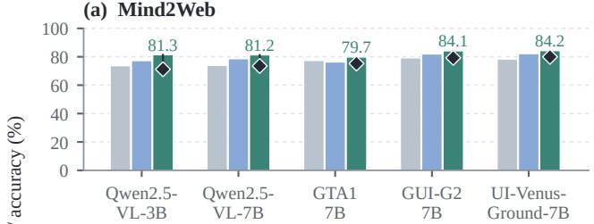

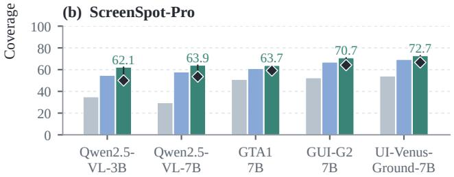  
Figure 3: Candidate coverage and final accuracy. Bars show the fraction of samples with a correct candidate at each stage; diamonds mark final accuracy and segments show the remaining selection gap.

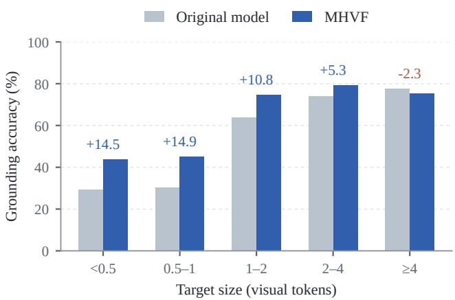  
Figure 4: Accuracy by target size; labels show gains in percent age points. Results pool 39,445 sample–model pairs across three benchmarks and five backbones.

samples with at least one correct candidate. On Mind2Web, UI-Venus-Ground-7B increases coverage from 78.3% for full-screen proposals to 84.2% after both search levels, with 80.0% final accuracy. On ScreenSpot-Pro, first-level localization increases coverage by 9.9–28.3 points across the five models, and reopening adds another 2.8–7.5 points. The remaining gap between both-level coverage and final accuracy is 4.2–12.1 points across the two benchmarks. Improving selection therefore remains useful even after search has found the target.

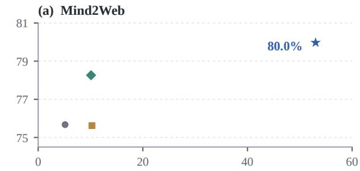

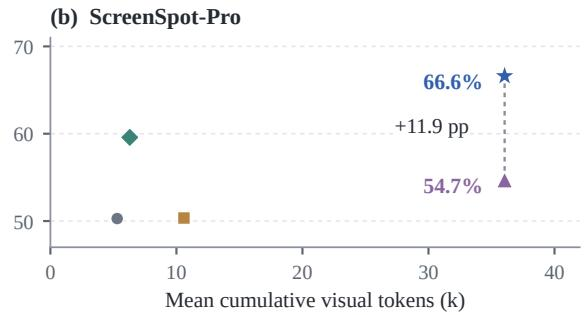  
Figure 5: Accuracy versus visual input cost with UI-Venus-Ground-7B. Cost is the mean cumulative visual token estimate per sample, counting each input request once. The grid control and MHVF use comparable mean visual input on ScreenSpot-Pro.

Target Size. The gains are concentrated on smaller targets (Fig ure 4). We measure target size as the geometric mean of its width and height in visual tokens under the reference full-screen scale, pooling records from Mind2Web, VisualWebBench, and ScreenSpot-Pro across five models. Targets smaller than one token gain 14.5– 14.9 points, whereas targets of at least four tokens show a net decrease of 2.3 points. This pattern is consistent with the benefit of magnification for small elements, although the pooled groups also difer in benchmark and model composition.

Accuracy and Visual Input Cost. Figure 5 compares the original UI-Venus-Ground-7B, Self-Zoom with one additional zoomed grounding step, Sample-and-vote over full-screen predictions, and MHVF. Using the full-method rerun from Table 4, MHVF achieves 80.0% on Mind2Web and 66.6% on ScreenSpot-Pro, exceeding Self-Zoom by 1.7 and 7.0 points. Sample-and-vote remains close to the original model. The gains require more visual input: relative to Self-Zoom, the mean cumulative visual token estimate increases from 10.1k to 53.0k on Mind2Web and from 6.3k to 36.0k on ScreenSpot- Pro.

On ScreenSpot-Pro, we also evaluate a fixed-grid crop and verification control. Fixed-grid cropping is used in ZoomClick’s pre-zoom stage [8]; our control uses nine half-width, half-height crops arranged on a 3 × 3 grid with 50% overlap between adjacent windows. It uses the same localizer and verifier as MHVF and selects the highest-scoring candidate. At matched dataset-mean visual input costs of approximately 36.0k tokens, the control achieves 54.7%, compared with 66.6% for MHVF. This 11.9-point advantage sup- ports hypothesis-guided search over the fixed spatial coverage of this control.

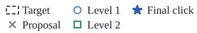

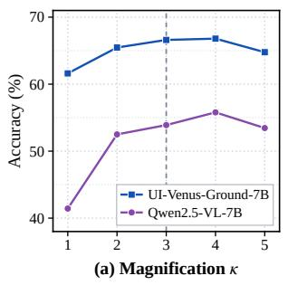

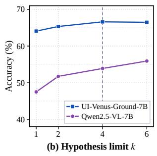  
Figure 6: Parameter sensitivity on ScreenSpot-Pro: (a) mag nification � and (b) the maximum number of first-level hypotheses �. Vertical dashed lines mark the adopted settings, � = 3 and � = 4.

Parameter Sensitivity. Figure 6 varies magnification � and the first-level hypothesis limit � on ScreenSpot-Pro. For both models, accuracy increases up to � = 4 and then decreases at � = 5. Increasing � from 3 to 4 adds 0.2 points for UI-Venus-Ground-7B and 1.9 points for Qwen2.5-VL-7B, while increasing mean visual input by approximately 45% and 40%, respectively. Increasing � from 1 to 4 helps both models; at � = 6, UI-Venus-Ground-7B remains nearly unchanged, whereas Qwen2.5-VL-7B gains another 2.0 points. Thus, larger settings increase cost without consistently improving accuracy. The adopted � = 3 and � = 4 provide a common configuration, while the preferred accuracy–cost trade-of can difer by backbone.

Web Grounding Cases. Figure 7 illustrates four outcomes on Mind2Web and VisualWebBench. For “Select University,” level-1 localization finds the target missed by the full-screen proposals. For “Posters,” reopening reaches the text link after level 1 points to the product image. The two failure cases expose diferent limitations: “Select Model” has a correct candidate that is not selected, whereas “browse poetry categories” remains on a heading instead of the target link at both levels.

## 5 Conclusion

We presented MHVF, a training-free framework that combines multiple spatial hypotheses with local visual verification for GUI grounding. Using a single pretrained VLM, MHVF explores potential target regions, re-localizes candidates in magnified views, and uses verification to guide local refinement and final selection. Experiments with five models across eight benchmark settings demonstrate improved accuracy in most settings, covering web, desktop, and cross-platform interfaces. Candidate-level analyses show that local search expands target coverage, while selecting the correct candidate remains a source of error. This gap, together with the additional visual input cost, motivates further work on more reliable candidate verification and adaptive allocation of the search budget.

  
Level 1 finds the target; its candidate is selected.

(b) Recovery through reopening  
  
Level 2 moves from the poster image to its link.

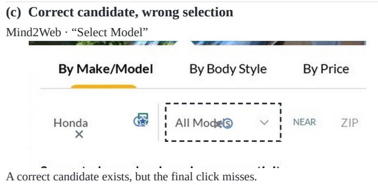

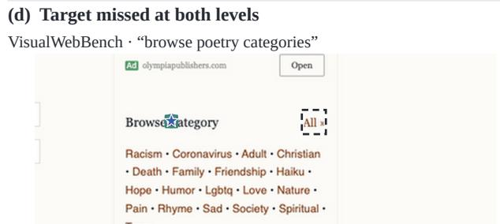  
Both levels stay on the heading instead of the link.

Figure 7: Web grounding cases with UI-Venus-Ground-7B on Mind2Web (a, c) and VisualWebBench (b, d): successful localization, recovery through reopening, selection failure, and missing candidate coverage. Markers show logged predictions from both levels; dashed boxes mark targets. Screenshots are cropped for display.

## References

[1] Shuai Bai, Keqin Chen, Xuejing Liu, Jialin Wang, Wenbin Ge, Sibo Song, Kai Dang, Peng Wang, Shijie Wang, Jun Tang, Humen Zhong, Yuanzhi Zhu, Mingkun Yang, Zhaohai Li, Jianqiang Wan, Pengfei Wang, Wei Ding, Zheren Fu, Yiheng Xu, Jiabo Ye, Xi Zhang, Tianbao Xie, Zesen Cheng, Hang Zhang, Zhibo Yang, Haiyang Xu, and Junyang Lin. 2025. Qwen2.5-VL Technical Report. arXiv:2502.13923

[2] Kanzhi Cheng, Qiushi Sun, Yougang Chu, Fangzhi Xu, Yantao Li, Jianbing Zhang, and Zhiyong Wu. 2024. SeeClick: Harnessing GUI Grounding for Advanced Visual GUI Agents. In Proceedings ofthe 62nd Annual Meeting ofthe Associationfor Computational Linguistics (Volume 1: Long Papers). Association for Computational Linguistics, 9313–9332. doi:10.18653/v1/2024.acl-long.505

[3] Xiang Deng, Yu Gu, Boyuan Zheng, Shijie Chen, Sam Stevens, Boshi Wang, Huan Sun, and Yu Su. 2023. Mind2Web: Towards a Generalist A ent for the Web. In Advances in Neural Information Processing Systems, Vol. 36. 28091–28114. doi:10.52202/075280-1220

[4] Yong Du, Yuchen Yan, Fei Tang, Zhengxi Lu, Chang Zong, Weiming Lu, Shengpei Jiang, and Yongliang Shen. 2026. Test-Time Reinforcement Learning for GUI Grounding via Region Consistency. Proceedings of the AAAI Conference on Artificial Intelligence 40, 36 (2026), 30593–30601. doi:10.1609/aaai.v40i36.40314

[5] Zichuan Fu, Shirong Wang, Wenlin Zhang, Guojing Li, Yimin Deng, Jingtong Gao, Junjia Qi, Hanyu Yan, Yefeng Zheng, Xiaopeng Li, Wanyu Wang, Xian Wu, and Xiangyu Zhao. 2026. GUI-Lens: Coarse-to-Fine Cropping for GUI Grounding with General-Purpose VLMs. arXiv:2608.03270

[6] Boyu Gou, Ruohan Wang, Boyuan Zheng, Yanan Xie, Cheng Chang, Yiheng Shu, Huan Sun, and Yu Su. 2025. Navigating the Digital World as Humans Do: Universal Visual Grounding for GUI Agents. In International Conference on Learning Representations. https://arxiv.org/abs/2410.05243

[7] Zhangxuan Gu, Zhengwen Zeng, Zhenyu Xu, Xingran Zhou, Shuheng Shen, Yunfei Liu, Beitong Zhou, Changhua Meng, Tianyu Xia, Weizhi Chen, Yue Wen, Jingya Dou, Fei Tang, Jinzhen Lin, Yulin Liu, Zhenlin Guo, Yichen Gong, Heng Jia, Changlong Gao, Yuan Guo, Yong Deng, Zhenyu Guo, Liang Chen, and Weiqiang Wang. 2025. UI-Venus Technical Report: Building High-performance UI Agents with RFT. arXiv:2508.10833

[8] Zhiyuan Jiang, Shenghao Xie, Wenyi Li, Wenqiang Zu, Peihang Li, Jiahao Qiu, Siqi Pei, Lei Ma, Tiejun Huang, Mengdi Wang, and Shilong Liu. 2025. Zoom in, Click out: Unlocking and Evaluating the Potential of Zooming for GUI Grounding. arXiv:2512.05941

[9] SeokJoo Kwak, Jihoon Kim, Boyoun Kim, Jung Jae Yoon, Wooseok Jang, Jeon hoon Hon Jaeho Yan and Yeon -Dae Kwon. 2025. MEGA-GUI: Multi stage Enhanced Grounding Agents for GUI Elements. arXiv:2511.13087

[10] Woosuk Kwon, Zhuohan Li, Siyuan Zhuang, Ying Sheng, Lianmin Zheng, Cody Hao Yu, Joseph E. Gonzalez, Hao Zhang, and Ion Stoica. 2023. Eficient Memory Management for Large Language Model Serving with PagedAttention. In Proceedings ofthe 29th Symposium on Operating Systems Principles. Association for Computing Machinery, 611–626. doi:10.1145/3600006.3613165

[11] Hyunseok Lee, Jeonghoon Kim, Beomjun Kim, Jihoon Tack, Chansong Jo, Jaehong Lee, Cheonbok Park, Sookyo In, Jinwoo Shin, and Kang Min Yoo. 2025. ReGUIDE: Data Eficient GUI Grounding via Spatial Reasoning and Search. arXiv:2505.15259v2

[12] Jaeseong Lee, Yeeun Choi, Heechan Choi, Hanjung Kim, and Seonjoo Kim. 2025. A Training-Free, Task-Agnostic Framework for Enhancing MLLM Performance on High-Resolution Images. arXiv:2507.10202

[13] Bin Lei, Nuo Xu, Ali Payani, Mingyi Hong, Chunhua Liao, Yu Cao, and Caiwen Din . 2025. GUI-S otli ht: Ada tive Iterative Focus Refinement for Enhanced GUI Visual Groundin . arXiv:2510.04039

[14] lexuanhoang120. 2026. DART: Density-Aware Adaptive Refinement Technique for GUI Grounding. GitHub repository. Retrieved October 11, 2026 from https:// github.com/lexuanhoang120/Density-Aware-Adaptive-Refinement-Technique

[15] Aiden Yiliu Li, Bizhi Yu, Daoan Lei, Tianhe Ren, and Shilong Liu. 2025. Chainof-Ground: Improving GUI Grounding via Iterative Reasoning and Reference Feedback. arXiv:2512.01979

[16] Kaixin Li, Ziyang Meng, Hongzhan Lin, Ziyang Luo, Yuchen Tian, Jing Ma, Zhiyong Huang, and Tat-Seng Chua. 2025. ScreenSpot-Pro: GUI Grounding for Professional High-Resolution Computer Use. In Proceedings of the 33rd ACM International Conference on Multimedia. Association for Computing Machinery, 8778–8786. doi:10.1145/3746027.3755688

[17] Zhecheng Li, Guoxian Song, Yiwei Wang, Zhen Xiong, Junsong Yuan, and Yujun Cai. 2025. Generalist Scanner Meets Specialist Locator: A Synergistic Coarse-to-Fine Framework for Robust GUI Grounding. arXiv:2509.24133

[18] Jiaping Lin, Fei Shen, Junzhe Li, Ping Nie, Fei Yu, Ming Li, and Haizhou Li. 2026. What Happens Before Decoding? Prefill Determines GUI Grounding in VLMs. arXiv:2605.12549

[19] Chen Liu, Ling Chen, Hanzhang Zhou, Liangyu Chen, Chenglin Cai, Xin Yu, Steven Hoi, and Yue Wang. 2026. One Forward Beats Two: InnerZoom for Accurate and Eficient GUI Grounding. arXiv:2606.30084

[20] Junpeng Liu, Yifan Song, Bill Yuchen Lin, Wai Lam, Graham Neubig, Yuanzhi Li, and Xiang Yue. 2024. VisualWebBench: How Far Have Multimodal LLMs

Evolved in Web Page Understanding and Grounding?. In Conference on Language Modeling. https://openreview.net/forum?id=egVSgtJJAx

[21] Yichao Liu, Huawen Shen, Liu Yu, Shiyu Liu, Zeyu Chen, and Yu Zhou. 2026. DRS-GUI: Dynamic Region Search for Training-Free GUI Grounding. In Proceedings of the IEEE/CVF Conference on Computer Vision and Pattern Recognition. 34606–34616. https://openaccess.thecvf.com/content/CVPR2026/html/Liu\_DRS-GUI\_Dynamic\_Region\_Search\_for\_Training-Free\_GUI\_Grounding\_CVPR\_ 2026\_paper.html

[22] Yizhou Liu, Fei Tang, Yuchen Yan, Zhengxi Lu, Songqin Nong, Tao Jiang, Wenhao Xu, Wenqi Zhang, Weiming Lu, Jun Xiao, and Yongliang Shen. 2026. Learning from Reliable Negatives: Confidence-Anchored Test-Time Adaptation for GUI Grounding. arXiv:2609.15307

[23] Ziwei Liu, Tao Feng, Borui Kang, Yanbing Yang, and Jun Luo. 2026. Zoom to Essence: Trainless GUI Grounding by Inferring upon Interface Elements. arXiv:2603.14448

[24] Tiange Luo, Lajanugen Logeswaran, Justin Johnson, and Honglak Lee. 2025. Visual Test-time Scaling for GUI Agent Grounding. In Proceedings of the IEEE/CVF International Conference on Computer Vision. 19989– 19998. https://openaccess.thecvf.com/content/ICCV2025/html/Luo\_Visual\_Testtime\_Scaling\_for\_GUI\_Agent\_Grounding\_ICCV\_2025\_paper.html

[25] Longhui Ma, Di Zhao, Siwei Wang, Zhao Lv, and Miao Wang. 2026. Trifuse: Enhancing Attention-Based GUI Grounding via Multimodal Fusion. arXiv:2602.06351

[26] Shravan Nayak, Xiangru Jian, Kevin Qinghong Lin, Juan A. Rodriguez, Montek Kalsi, Nicolas Chapados, M. Tamer Özsu, Aishwarya Agrawal, David Vazquez, Christopher Pal, Perouz Taslakian, Spandana Gella, and Sai Rajeswar. 2025. UI-Vision: A Desktop-centric GUI Benchmark for Visual Perception and Interaction. In Proceedings ofthe 42nd International Conference on Machine Learning (Proceedings ofMachine Learning Research, Vol. 267). PMLR, 45817–45851. https://proceedings.mlr.press/v267/nayak25a.html

[27] Siqi Pei, Liang Tang, Tiaonan Duan, Long Chen, Shuxian Li, Kaer Huang, Yanzhe Jing, Yiqiang Yan, Bo Zhang, Chenghao Jiang, Borui Zhang, and Jiwen Lu. 2026. AdaZoom-GUI: Adaptive Zoom-based GUI Grounding with Instruction Refine ment. arXiv:2603.17441

[28] Fei Tang, Bofan Chen, Zhengxi Lu, Tongbo Chen, Songqin Nong, Tao Jiang, Wenhao Xu, Weiming Lu, Jun Xiao, Yueting Zhuang, and Yongliang Shen. 2026. UI-Zoomer: Uncertainty-Driven Adaptive Zoom-In for GUI Grounding. arXiv:2604.14113

[29] Fei Tang, Zhangxuan Gu, Zhengxi Lu, Xuyang Liu, Shuheng Shen, Changhua Meng, Wen Wang, Wenqi Zhang, Yongliang Shen, Weiming Lu, Jun Xiao, and Yueting Zhuang. 2026. GUI-G2: Gaussian Reward Modeling for GUI Grounding. Proceedings ofthe AAAI Conference on Artificial Intelligence 40, 39 (2026), 33214– 33222. doi:10.1609/aaai.v40i39.40606

[30] Xingjian Tao, Yiwei Wang, Yujun Cai, Yihong Luo, Kai Han, and Jing Tang. 2025. Mitigating Coordinate Prediction Bias from Positional Encoding Failures. arXiv:2510.22102

[31] Xuehui Wang, Zhenyu Wu, JingJing Xie, Zichen Ding, Bowen Yang, Zehao Li, Zhaoyang Liu, Qingyun Li, Xuan Dong, Zhe Chen, Weiyun Wang, Xiangyu Zhao, Jixuan Chen, Haodong Duan, Tianbao Xie, Chenyu Yang, Shiqian Su, Yue Yu, Yanting Zhang, Xiangyu Yue, Weijie Su, Xizhou Zhu, Wei Shen, Jifen Dai, and Wenhai Wan . 2026. MMBench-GUI: A Unified Hierarchical Evaluation Framework for Multi-Platform GUI Agents. In Proceedings of the IEEE/CVF Conference on Computer Vision and Pattern Recognition. 6239–6248. https://openaccess.thecvf.com/content/CVPR2026/html/Wang\_MMBench-GUI\_A\_Unified\_Hierarchical\_Evaluation\_Framework\_for\_Multi-Platform\_ GUI\_Agents\_CVPR\_2026\_paper.html

[32] Hang Wu, Hongkai Chen, Yujun Cai, Chang Liu, Qingwen Ye, Ming-Hsuan Yang, and Yiwei Wang. 2025. DiMo-GUI: Advancing Test-time Scaling in GUI Grounding via Modality-Aware Visual Reasoning. In Proceedings of the 2025 Conference on Empirical Methods in Natural Language Processing. Association for Computational Linguistics, 26246–26256. doi:10.18653/v1/2025.emnlp-main.1334

[33] Zhiyong Wu, Zhenyu Wu, Fangzhi Xu, Yian Wang, Qiushi Sun, Chengyou Jia, Kanzhi Cheng, Zichen Ding, Liheng Chen, Paul Pu Liang, and Yu Qiao. 2025. OS-ATLAS: Foundation Action Model for Generalist GUI Agents. In International Conference on Learning Representations. https://openreview.net/forum? id=n9PDaFNi8t

[34] Tianbao Xie, Jiaqi Deng, Xiaochuan Li, Junlin Yang, Haoyuan Wu, Jixuan Chen, Wenjing Hu, Xinyuan Wang, Yuhui Xu, Zekun Wang, Yiheng Xu, Junli Wang, Doyen Sahoo, Tao Yu, and Caiming Xiong. 2025. Scaling Computer-Use Grounding via User Interface Decomposition and Synthesis. In Advances in Neural Information Processing Systems, Vol. 38. doi:10.52202/085713-0817

[35] Shiyu Xuan and Zechao Li. 2026. Test-Time Self-Evolving GUI Visual Grounding via Reflection-Guided On-Policy Self-Distillation. arXiv:2608.11191

[36] Jianwei Yang, Hao Zhang, Feng Li, Xueyan Zou, Chunyuan Li, and Jianfeng Gao. 2023. Set-of-Mark Prompting Unleashes Extraordinary Visual Grounding in GPT-4V. arXiv:2310.1144

[37] Yan Yang, Dongxu Li, Yutong Dai, Yuhao Yang, Ziyang Luo, Zirui Zhao, Zhiyuan Hu, Junzhe Huang, Amrita Saha, Zeyuan Chen, Ran Xu, Liyuan Pan, Caiming Xiong, and Junnan Li. 2026. GTA1: GUI Test-Time Scaling Agent. In International Conference on Learning Representations. https://openreview.net/forum? id=3VIPmz7iAi

[38] Ruilin Yao, Shegnwu Xiong, Tianyu Zou, Shili Xiong, and Yi Rong. 2026. AutoFocus: Uncertainty-Aware Active Visual Search for GUI Grounding. arXiv:2605.02630

[39] Borui Zhang, Bo Zhang, Bo Wang, Wenzhao Zheng, Yuhao Cheng, Liang Tang, Yiqiang Yan, Jie Zhou, and Jiwen Lu. 2026. BAMI: Training-Free Bias Mitigation in GUI Grounding. In Proceedings of the IEEE/CVF Conference on Computer Vision and Pattern Recognition. 34596– 34605. https://openaccess.thecvf.com/content/CVPR2026/html/Zhang\_BAMI\_ Training-Free\_Bias\_Mitigation\_in\_GUI\_Grounding\_CVPR\_2026\_paper.htm

[40] Yunzhu Zhang, Zeyu Pan, Zhengwen Zeng, Shuheng Shen, Changhua Meng, and Linchao Zhu. 2025. MVP: Multiple View Prediction Improves GUI Grounding. arXiv:2512.08529

[41] Haoren Zhao, Tianyi Chen, and Zhen Wang. 2026. WinDeskGround: A Bench mark for Robust GUI Grounding in Complex Multi-Window Desktop Environments. In Proceedings ofthe 43rd International Conference on Machine Learning (Proceedings ofMachine Learning Research, Vol. 306). PMLR, 161261–161271. https://proceedings.mlr.press/v306/zhao26f.html

[42] Boyuan Zheng, Boyu Gou, Jihyung Kil, Huan Sun, and Yu Su. 2024. GPT-4V(ision) is a Generalist Web A ent, if Grounded. In Proceedings ofthe 41st International Conference on Machine Learning (Proceedings of Machine Learning Research, Vol. 235). PMLR, 61349–61385. https://proceedings.mlr.press/v235/zheng24e.html

## A Implementation Details and View Geometry

Search settings. Spatial clustering uses $\delta = 2$ merged visual to- kens. We set $\beta = 3$ at both levels, with crop floors $\rho = 0 . 2 5$ and $\rho ^ { \prime } = 0 . 1 0$ , and reopen one region. GTA1-7B point predictions re- ceive centered boxes spanning 1.5% of the input view along each axis, clipped before mapping to screenshot coordinates. Localization uses greedy decoding with at most 32 output tokens.

Verification implementation. The point-verification prompt is: “The red circle marks one UI element. Is the circled element the one described as ‘instruction’? Answer Yes or $\mathrm { N o } \ '$ We request one output token and the top-20 log-probabilities. Each label score is the maximum over its available single-token variants, including capitalization and leading spaces; absent labels receive −30. These estimates are used in Eq. (7) to rank candidates without an accep- tance threshold. The ring size follows the predicted box extent and is bounded relative to the view dimensions.

Coordinate mapping. A view $\boldsymbol { v } = \left( c , P \right)$ uses crop � and minimum pixel budget �. The bounds $c = ( x _ { 0 } , y _ { 0 } , x _ { 1 } , y _ { 1 } )$ are in screenshot pixels. The processor clips this budget to its supported range, raises the maximum budget when needed, and aligns input dimensions with its merged visual-token size �. Equation (6) maps view-relative coordinates to normalized screenshot coordinates, using $w _ { c } = x _ { 1 } -$ �0 and $h _ { c } = y _ { 1 } - y _ { 0 }$ . For boxes, the transformation applies to both corners; point predictions use the extent specified above.

Let $P _ { \mathrm { m a x } }$ denote the checkpoint’s declared full-screen pixel bud get. For a screenshot of size $W \times H ,$ we define the reference scale

$$
s _ { 0 } = \operatorname* { m i n } \Bigl ( 1 , \sqrt { P _ { \operatorname* { m a x } } / ( W H ) } \Bigr ) .\tag{11}
$$

This budget-based scale does not include processor minimum-size constraints or dimension rounding. It controls the requested mag- nification. Spatial clustering uses the visual-token spacing of the actual rendered view.

Method illustration. The example in Figure 2 uses UI-Venus-Ground-7B on ScreenSpot-Pro with the instruction “add new tab.”

The display crops and red marks are reconstructed illustrations; the exact second-level inference crop was not logged. The dashed target annotation is shown for evaluation only and is not supplied to the grounder.

## B Additional Literature Comparisons

Table 5 extends the ScreenSpot-Pro comparison to additional back- bones and multi-model systems, including ScreenSeekeR, GMS, Re-Prefill, and GUI-Lens, as well as trained zooming methods. Each row retains the configuration and accuracy reported by its source.

Table 5: Literature-reported ScreenSpot-Pro results (%) for additional backbones and multi-model systems. Each row gives one reported configuration.
<table><tr><td>Method</td><td>Model configuration</td><td>Acc. (%) ↑</td></tr><tr><td>Forward-inference methods</td><td></td><td></td></tr><tr><td>Iterative Focusing [16]</td><td>OS-Atlas-7B</td><td>31.0</td></tr><tr><td>Iterative Narrowing [16]</td><td>OS-Atlas-7B</td><td>31.9</td></tr><tr><td>ReGround [16]</td><td>OS-Atlas-7B</td><td>40.2</td></tr><tr><td>ScreenSeekeR [16]</td><td>OS-Atlas-7B + GPT-4o planner</td><td>48.1</td></tr><tr><td>ECP [12]</td><td>OS-Atlas-7B</td><td>40.4</td></tr><tr><td>DiMo-GUI [32]</td><td>OS-Atlas-7B</td><td>49.7</td></tr><tr><td>GMS [17]</td><td>UGround-V1-7B + Gemini 2.5 Flash-Lite</td><td>54.6</td></tr><tr><td>BAMI [39]</td><td>TianXi-Action-7B + GPT-5 correction</td><td>57.8</td></tr><tr><td>Chain-of-</td><td>UI-TARS-1.5-7B →</td><td></td></tr><tr><td>Ground [15]</td><td>Qwen3-VL-235B → Qwen3-VL-32B</td><td>68.4</td></tr><tr><td>Re-Prefill [18]</td><td>GUI-Owl-1.5-8B + zoom-in</td><td>80.1</td></tr><tr><td>GUI-Lens [5]</td><td>GPT-5.5 + coarse-to-fine cropping</td><td>87.9</td></tr><tr><td>DART [14]</td><td>KV-Ground-8B (project report)</td><td>80.9</td></tr><tr><td colspan="3">Parameter adaptation or additional training</td></tr><tr><td>AdaZoom-GUI [27]</td><td>Trained 4B model + Qwen3.5-397B-A17B refiner</td><td>76.8</td></tr><tr><td>InnerZoom [19]</td><td>Qwen3-VL-4B + SFT/RL</td><td>66.2</td></tr></table>

## C Extended Qualitative Cases

Figure 8 presents six additional cases across Mind2Web, VisualWebBench, and ScreenSpot-Pro. Panels (a) and (b) illustrate localization among similar webpage elements and retention of a correct level-1 candidate when reopening misses. Panels (c) and (d) show localization and reopening in professional applications. Panels (e) and (f) contrast selecting an incorrect candidate with failing to find a correct one.

Target Proposal Level 1 Level 2 Final click

## (a) Distinguishing similar options

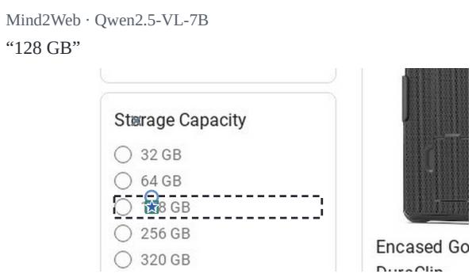  
Zoomed localization reaches the requested capacity.

## (b) Retaining an earlier candidate

Mind2Web · Qwen2.5-VL-7B

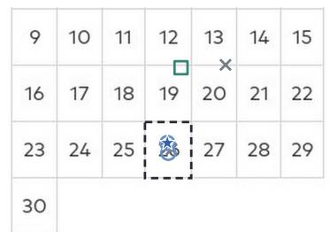  
The level-1 point is retained when level 2 misses.

## (c) Localizing a small control

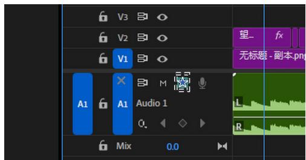  
Local search moves from the track label to Solo.  
ScreenSpot-Pro · UI-Venus-Ground-7B  
“stop level demo”

## (d) Reopening in a dense toolbar

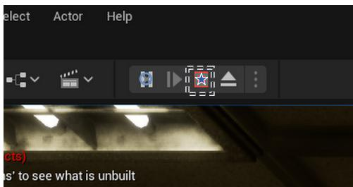  
Level 2 reaches Stop beside Pause and Play.

## (e) Confusing a heading with a link

VisualWebBench · Qwen2.5-VL-7B

“Report Fraud or Scam”

  
Level 2 finds the link; the heading is still selected.

## (f) Missing the toolbar target

ScreenSpot-Pro · Qwen2.5-VL-7B

“Draw rounded corners”

  
Both levels stay in the command pane below the target.

Figure 8: Additional cases with Qwen2.5-VL-7B and UI-Venus-Ground-7B: (a) localization among similar options, (b) retention of a level-1 candidate, (c) small-control localization, (d) recovery through reopening, (e) selection failure, and (f) missing candidate coverage. Markers show logged predictions from both levels; dashed boxes mark targets. Screenshots are cropped for display.