# MIST: MULTI-SCALE SPATIAL CONTEXT FOR GENEEXPRESSION PREDICTION FROM HISTOLOGY

Koushik Howlader1∗ Tirtho Roy1 Md Tauhidul Islam2 Wei Le1 1Iowa State University, Iowa, USA 2Stanford University, CA, USA

## ABSTRACT

Predicting spatial gene expression from standard H&E images could extend molecular analysis to tissues without spatial transcriptomic measurements. A standard Transformer applies self-attention over spots but ignores where each spot sits in the tissue, whereas a spot’s molecular state depends on tissue context at multiple spatial scales. Building on this insight, we introduce MIST, a MultI-context Spatial Transformer that augments the self-attention backbone with two context pathways applied in every layer: a coordinate-invariant local pathway that attends over spatial k-nearest-neighbor spots, and a slide pathway that broadcasts a wholeslide summary to every spot; the model predicts all spots in a single forward pass. Because coordinates enter only through pairwise distances, the local pathway is invariant to translations, rotations, and reflections when image features are fixed. In intra-cohort evaluation across six human organ cohorts from HEST-1k, MIST improves mean Pearson correlation over the strongest evaluated baseline by 9.7%, 11.6%, and 11.4% for 10-, 50-, and 100-gene panels, respectively, with the lowest average MSE and MAE. MIST further improves leave-one-organ-out transfer by 6.0% over the next strongest baseline, attains the best expression-derived domain recovery (highest mean ARI and NMI at every clustering resolution, and higher NMI than the closest baseline on 84% of held-out slides), and reproduces spatial expression patterns of selected cancer-marker genes. Together, these results show that adding local and slide context to a vanilla Transformer backbone is an effective approach to spatial gene expression prediction from histology. Our code is available at https://anonymous.4open.science/r/MIST-F660/.

## 1 INTRODUCTION

Spatial transcriptomics (ST) maps gene expression to tissue locations, revealing spatial heterogeneity and tissue organization Stahl et al. ˚ (2016). However, its cost and experimental requirements limit widespread use. Routine H&E images contain morphological signals associated with molecular state, motivating the prediction of spatial gene expression without matched ST measurements Chen et al. (2024a); Jaume et al. (2024).

A standard Transformer over tissue spots uses self-attention, allowing each spot to attend to all others, but does not explicitly encode where spots lie in the tissue. Existing H&E-to-ST methods use patch-level regression He et al. (2020), graph and transformer modeling Zeng et al. (2022), cross-modal retrieval Xie et al. (2023), or conditional diffusion Zhu et al. (2025). Yet a spot’s molecular state may depend on context beyond self-attention alone, particularly its immediate spatial neighborhood and the overall tissue state. Neither is explicitly modeled by a plain self-attention Transformer. We therefore ask:

## Does augmenting self-attention with local spatial and whole-slide context improve gene expression prediction from histology?

We introduce MIST, which augments a standard self-attention Transformer with two pathways applied in every layer (Fig. 1). Starting from frozen UNI and/or CONCH embeddings Chen et al.

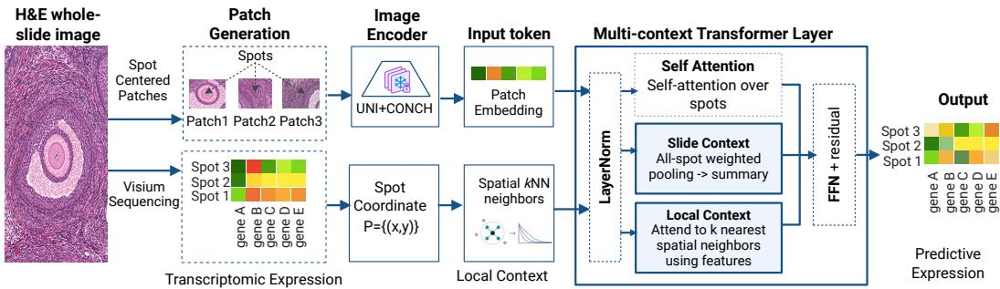  
Figure 1: MIST overview. (a) Frozen UNI and/or CONCH embeddings represent spot-centered H&E patches, while spot coordinates define spatial kNN neighborhoods. (b) Each Transformer layer augments the self-attention backbone with two pathways: local spatial-neighbor attention and an attention-pooled slide summary broadcast to all spots. The final spot representations are mapped to predicted gene expression.

(2024b); Lu et al. (2024), the local pathway attends over each spot’s spatial k-nearest neighbors, while the slide pathway forms an attention-weighted whole-slide summary that is broadcast to every spot. Their outputs are added to the self-attention backbone and refined through residual feedforward updates. The model predicts expression for all spots in a single forward pass.

Coordinates are used only to construct the spatial kNN graph from pairwise distances. Because these distances are unchanged by translations, rotations, and reflections, the local spatial pathway is coordinate-frame invariant for fixed image features, deterministic evaluation, and consistent handling of kNN distance ties Satorras et al. (2021).

We evaluate MIST on six human organ cohorts from HEST-1k Jaume et al. (2024) under intracohort, pooled multi-organ, and leave-one-organ-out settings. In intra-cohort evaluation, MIST improves mean Pearson correlation over the strongest evaluated baseline by 9.7%, 11.6%, and 11.4% for 10-, 50-, and 100-gene panels, respectively, while achieving the lowest average MSE and MAE. In leave-one-organ-out evaluation, it improves mean correlation by 6.0% over BLEEP Xie et al. (2023). MIST also achieves the highest mean ARI and NMI for expression-derived domain recovery across evaluated clustering resolutions, with higher NMI than BLEEP on 84% of held-out slides, although absolute agreement remains modest.

Our experiments address five research questions: RQ1 (Performance): How accurately does MIST predict gene expression within and across represented organs? RQ2 (Transfer): How well does it generalize to an unseen organ? RQ3 (Ablation): How local, slide, and spatial-neighbor context affect performance? RQ4 (Coordinate invariance): How stable are predictions under coordinateframe transformations with image features fixed? RQ5 (Structure): How well do predictions recover expression-derived spatial organization?

## Our contributions are:

1. We introduce MIST, which augments a self-attention Transformer with two pathways applied in every layer: local spatial-kNN attention and attention-pooled slide context. We establish coordinate-frame invariance of the local pathway under stated assumptions.

2. Through matched experiments across organs, gene panels, and image encoders, including heldout-organ transfer, we show that the added local and slide pathways improve prediction over the self-attention backbone, with paired tests showing that the local pathway benefits from spatially defined neighborhoods.

3. We evaluate structure beyond average prediction accuracy through expression-derived spatial domain recovery and selected cancer-marker expression patterns.

## 2 METHOD

MIST maps frozen spot-level histology features and measured spot coordinates to a spatial gene expression map. It has three stages: coordinate-invariant neighborhood construction, a layer that augments a self-attention backbone with local and slide context, and supervised prediction with a correlation-aware objective.

## 2.1 PROBLEM SETUP

For a slide with N spots, let $\mathbf { F } = | \mathbf { f } _ { 1 } , \dots , \mathbf { f } _ { N } | ^ { \top } \in \mathbb { R } ^ { N \times d _ { \mathrm { i n } } }$ denote frozen pathology features and $\mathbf { P } = [ \mathbf { p } _ { 1 } , \dots , \mathbf { p } _ { N } ] ^ { \top } \overset { } { \in } \mathbb { R } ^ { N \times 2 }$ the corresponding spot coordinates. The target $\mathbf { Y } \in \mathbb { R } ^ { N \times G }$ contains log-normalized expression for G genes. We learn $f _ { \boldsymbol { \theta } } : ( \mathbf { F } , \mathbf { P } ) \mapsto \hat { \mathbf { Y } }$ and process each slide independently; the model therefore supports a variable number of spots and does not require expression measurements at test time. In the feature-matched main comparisons, $\mathbf { f } _ { i }$ concatenates frozen UNI Chen et al. (2024b) and CONCH Lu et al. (2024) embeddings $( d _ { \mathrm { i n } } = 1 5 3 6 )$

## 2.2 COORDINATE-INVARIANT NEIGHBORHOOD CONSTRUCTION

We compute pairwise Euclidean distances $D _ { i j } = \| \mathbf { p } _ { i } - \mathbf { p } _ { j } \| _ { 2 }$ and use them to select the indices $\mathcal { N } ( i )$ of each spot’s k nearest neighbors, excluding the spot itself. Coordinates enter the model only through this neighborhood graph: distances are not used as attention features or biases, and absolute positions are not added to spot embeddings. For any orthogonal transformation R and translation t, the transformed coordinates $\mathbf { p } _ { i } ^ { \prime } = R \mathbf { p } _ { i } + \bar { \mathbf { t } }$ preserve every pairwise Euclidean distance. Therefore, with consistent tie handling, they produce the same kNN graph and the same predictions for fixed spot features. The formal guarantee is given in Proposition 1. This is coordinate-frame invariance of the spatial pathway given fixed spot features; it is distinct from invariance to physically rotating or flipping the H&E image, which would change the frozen encoder’s embeddings F and is outside this guarantee.

## 2.3 MIST LAYER: SELF-ATTENTION BACKBONE WITH LOCAL AND SLIDE CONTEXT

Core Idea. Each layer contains a self-attention backbone over all spots and two added pathways: one that aggregates information from each spot’s spatial neighbors and one that summarizes the whole slide. All three outputs are computed from the same normalized spot representations and combined through a residual update. Only the local pathway uses coordinates, and only to construct the spatial neighborhood.

The input features are projected to hidden width $d , \mathbf { X } ^ { ( 0 ) } = \mathbf { F } W _ { \mathrm { i n } } + \mathbf { b } _ { \mathrm { i n } }$ . The same spatial neighbor graph is reused in all L Transformer layers. At layer ℓ, we first compute

$$
{ \bf H } = \mathrm { L N } ( { \bf X } ^ { ( \ell ) } ) ,
$$

which is passed in parallel through the self-attention backbone and the two added pathways.

## 2.3.1 SELF-ATTENTION (BACKBONE)

Standard multi-head self-attention Vaswani et al. (2017) lets every spot attend to all N spots. This backbone captures long-range dependencies but treats spots interchangeably: it introduces no direct coordinate-dependent bias and is permutation-equivariant with respect to spot order. In later layers, its inputs may nevertheless carry spatial information propagated by the two added pathways.

## 2.3.2 LOCAL SPATIAL-NEIGHBORHOOD ATTENTION (ADDED)

The first added pathway lets each spot attend to its k neighbors using content-based attention. For head h, the attention weights are

$$
\alpha _ { i j } ^ { h } = \mathrm { s o f t m a x } _ { j \in { \mathcal { N } } ( i ) } \left( \frac { ( \mathbf { q } _ { i } ^ { h } ) ^ { \top } \mathbf { k } _ { j } ^ { h } } { \sqrt { d _ { h } } } \right) ,\tag{1}
$$

where $d _ { h } = d / H$ for H heads. The local output is the concatenation of the weighted value sums, followed by a learned output projection. Thus, coordinates determine the local neighborhood, while the attention weights depend on the spot representations.

## 2.3.3 ATTENTION-POOLED SLIDE CONTEXT (ADDED)

The second added pathway summarizes the slide. A learned scalar scoring function produces $a _ { i } =$ softma $\mathrm { x } _ { i } ( s ( \mathbf { h } _ { i } ) )$ . The slide representation is

$$
\mathbf { g } = W _ { g } \left( \sum _ { i = 1 } ^ { N } a _ { i } \mathbf { h } _ { i } \right) + \mathbf { b } _ { g } ,\tag{2}
$$

and is broadcast to every spot. Unlike a learned class token, this representation is computed directly from the slide’s current spot representations and summarizes the slide-level context.

For the complete model, the backbone (G) and the two added pathways, local (L) and broadcast slide (S), are summed and added to the residual stream. A second pre-normalization residual update applies a two-layer feed-forward network with expansion factor four and GELU activation:

$$
\widetilde \mathbf { X } ^ { \left( \ell \right) } = \mathbf { X } ^ { \left( \ell \right) } + \mathbf { L } ^ { \left( \ell \right) } + \mathbf { G } ^ { \left( \ell \right) } + \mathbf { S } ^ { \left( \ell \right) } ,\tag{3}
$$

$$
\mathbf { X } ^ { ( \ell + 1 ) } = \widetilde { \mathbf { X } } ^ { ( \ell ) } + \mathrm { F F N } \left( \mathrm { L N } ( \widetilde { \mathbf { X } } ^ { ( \ell ) } ) \right) .\tag{4}
$$

After L layers, layer normalization followed by a linear head maps each spot representation to its G predicted gene values. Thus, MIST produces the complete slide-level gene expression prediction in a single forward pass.

## Proposition 1 (Coordinate frame invariance):

For fixed model parameters and fixed histology features, in deterministic evaluation mode, let $R \in$ $\mathbb { R } ^ { 2 \times 2 }$ be orthogonal, let $\mathbf { t } \in \mathbb { R } ^ { 2 }$ , and define $ { \mathbf { \ w } } \mathbf { P } ^ { \prime } = \mathbf { P }  { R ^ { \intercal } } + \mathbf { 1 } \mathbf { t } ^ { \intercal }$ . If the kNN construction resolves distance ties consistently, the prediction is unchanged:

$$
f _ { \theta } ( { \bf F } , { \bf P } ^ { \prime } ) = f _ { \theta } ( { \bf F } , { \bf P } ) .\tag{5}
$$

## Proposition 2 (Permutation equivariance):

Let $Q \in \{ 0 , 1 \} ^ { N \times N }$ be a permutation matrix. If the kNN construction handles distance ties equivariantly, then

$$
f _ { \theta } ( Q { \bf F } , Q { \bf P } ) = Q f _ { \theta } ( { \bf F } , { \bf P } ) .\tag{6}
$$

Therefore, reordering the input spots only reorders their predicted expression profiles. Details, qualifications, and the proof for both of these propositions are provided in Appendix A. Our numerical checks evaluate both Propositions 1 and 2 under finite precision.

## 2.4 TRAINING OBJECTIVE AND ABLATIONS

For a slide with measured expression Y, we optimize mean squared error together with a gene-wise Pearson-correlation term:

$$
\mathcal { L } = \mathrm { M S E } ( \hat { \mathbf { Y } } , \mathbf { Y } ) + \lambda \left( 1 - \frac { 1 } { \vert \mathcal { V } \vert } \sum _ { g \in \mathcal { V } } \rho _ { g } \right) ,\tag{7}
$$

where $\rho _ { g }$ is the Pearson correlation between predicted and measured expression across the N spots, V is the set of genes with nonzero target variance on that slide, and $\lambda = 0 . 5$ . MSE constrains the scale of the predictions, while the correlation term encourages the model to reproduce spot-to-spot expression patterns.

The complete model uses the self-attention backbone together with the local and slide pathways. The contribution of each added pathway is evaluated in the factorial ablation study reported in Section 4.3, which compares the self-attention (G) backbone with the local (L) and slide-level (S) pathways added on top.

## 3 EXPERIMENTAL SETUP

Dataset and Image Encoder Selection. We evaluate six HEST-1k Jaume et al. (2024) cohorts: IDC (breast), CCRCC (kidney), LUNG (lung), PAAD (pancreas), PRAD (prostate), and SKCM (skin). We concatenate frozen UNI Chen et al. (2024b) and CONCH Lu et al. (2024) embeddings, which achieve the highest average predictive performance among the evaluated encoder configurations. Dataset and encoder details are provided in Appendix C.

Gene-panel selection. We use a 50-gene HVG panel by default and compare it with 50-gene DEG and HMHVG panels (Table 1). HVG selection ranks genes by expression variance; DEG selection uses differential expression across Leiden clusters; and HMHVG selection combines mean expression and variability after variance filtering. We also evaluate 10- and 100-gene HVG panels, and a 200-gene HVG panel used only for the cancer-marker case study (Section 4.6), since several literature markers lie outside the smaller panels. All selection steps use training data only. For each LOOO fold, the panel is recomputed using the five training organs, excluding expression data from the held-out organ.

Evaluation regimes. We evaluate three settings: intra-cohort, with a separate model trained and tested within each cohort; pooled multi-organ, with one model trained across organs and tested on held-out slides from represented organs; and leave-one-organ-out (LOOO), with training on five organs and testing on the sixth. Organ identity is not provided as an input. All train–test splits are slide-disjoint. Because patient identifiers are unavailable in our data pipeline, patient-level disjointness cannot be verified; intra-cohort and pooled results therefore measure slide-level generalization.

Metrics and validation. We report mean per-gene Pearson correlation coefficient (PCC) as the primary metric, mean squared error (MSE) and mean absolute error (MAE) for expression accuracy, and adjusted Rand index (ARI) and normalized mutual information (NMI) for expression-derived domain recovery. Checkpoints are selected using inner validation data and evaluated once on the corresponding outer test fold. Results are averaged across outer folds and three random seeds.

Baselines and implementation. We select one representative, publicly reproducible method per H&E-to-ST modeling family: patch regression (ST-Net He et al. (2020)), spatial graph modeling (Hist2ST Zeng et al. (2022)), cross-modal retrieval (BLEEP Xie et al. (2023)), and conditional generation (STEM Zhu et al. (2025)). All are evaluated under matched features, panels, splits, budgets, and model-selection rules. Unless otherwise stated, MIST uses four layers, width 256, eight spatial neighbors, and 4.88M trainable parameters. Full preprocessing, split, hyperparameter, and implementation details are provided in Appendix C.

## 4 RESULTS

## 4.1 RQ1: PREDICTIVE PERFORMANCE ACROSS DIVERSE ORGANS

We first ask whether MIST consistently predicts gene expression across diverse organs. For a fair comparison, all methods use frozen UNI+CONCH features with matched gene panels and data splits.

We begin with within-organ evaluation, where each model is trained and tested within the same organ. Across the 50-gene HVG, DEG, and HMHVG panels, MIST achieves mean PCCs of 0.496, 0.615, and 0.650, respectively, compared with BLEEP’s 0.444, 0.559, and 0.587 (Table 1). Across HVG panel sizes, MIST reaches PCC@10/50/100 of 0.600/0.496/0.559, leading all six cohorts at PCC@50 with an 11.6% cohort-averaged gain over BLEEP; the 10- and 100-gene panel results are in Appendix F (Table 7). It also achieves the lowest average MSE and MAE across all evaluated panel strategies and sizes.

The improvement is consistent across runs. Treating each cohort–seed run as the statistical unit (n=18), MIST improves PCC@50 over BLEEP by 0.051 (95% bootstrap CI [0.041, 0.062]; Wilcoxon $p = 7 . 6 \times 1 0 ^ { - 6 } )$ . At the gene level, MIST also achieves higher PCC than BLEEP for 87% of the 300 evaluated genes; we report this descriptively because genes within a slide are correlated. Statistical details are provided in Appendix E.

Table 1: Performance across gene-selection strategies (50-gene panels). Dataset PCC is mean ± SD over three seeds; final columns are six-cohort mean PCC, MSE, and MAE. Best per strategy in bold; ↑ higher and ↓ lower is better.
<table><tr><td>Panel</td><td>Model</td><td>IDC</td><td>CCRCC</td><td>LUNG</td><td>PAAD</td><td>PRAD</td><td>SKCM</td><td>PCC Avg. ↑</td><td>MSE Avg. ↓</td><td>MAE Avg. ↓</td></tr><tr><td rowspan="5">HVG</td><td>ST-Net</td><td>0.551±0.01</td><td>0.163±0.02</td><td>0.521±0.01</td><td>0.366±0.03</td><td>0.287±0.02</td><td>0.661±0.01</td><td>0.425</td><td>1.995</td><td>0.969</td></tr><tr><td>Hist2ST</td><td>0.305±0.11</td><td>0.180±0.03</td><td>0.430±0.05</td><td>0.248±0.04</td><td>0.323±0.01</td><td>0.523±0.00</td><td>0.335</td><td>1.561</td><td>0.890</td></tr><tr><td>BLEEP</td><td>0.519±0.00</td><td>0.175±0.02</td><td>0.565±0.01</td><td>0.412±0.03</td><td>0.346±0.01</td><td>0.650±0.00</td><td>0.444</td><td>1.318</td><td>0.819</td></tr><tr><td>STEM</td><td>0.434±0.00</td><td>0.118±0.01</td><td>0.407±0.00</td><td>0.233±0.02</td><td>0.207±0.02</td><td>0.461±0.02</td><td>0.310</td><td>1.747</td><td>0.920</td></tr><tr><td>MIST (ours)</td><td>0.581±0.01</td><td>0.252±0.01</td><td>0.589±0.01</td><td>0.437±0.03</td><td>0.410±0.01</td><td>0.707±0.01</td><td>0.496</td><td>1.233</td><td>0.794</td></tr><tr><td rowspan="5">DEG</td><td>ST-Net</td><td>0.697±0.01</td><td>0.312±0.01</td><td>0.566±0.01</td><td>0.425±0.03</td><td>0.413±0.00</td><td>0.752±0.01</td><td>0.528</td><td>3.336</td><td>1.457</td></tr><tr><td>Hist2ST</td><td>0.549±0.07</td><td>0.335±0.01</td><td>0.518±0.01</td><td>0.352±0.01</td><td>0.437±0.01</td><td>0.656±0.00</td><td>0.475</td><td>1.757</td><td>1.021</td></tr><tr><td>BLEEP</td><td>0.731±0.01</td><td>0.304±0.00</td><td>0.621±0.01</td><td>0.487±0.03</td><td>0.466±0.00</td><td>0.746±0.03</td><td>0.559</td><td>1.557</td><td>0.945</td></tr><tr><td>STEM</td><td>0.684±0.02</td><td>0.253±0.01</td><td>0.440±0.01</td><td>0.306±0.04</td><td>0.355±0.03</td><td>0.617±0.02</td><td>0.443</td><td>1.958</td><td>1.054</td></tr><tr><td>MIST (ours)</td><td>0.774±0.01</td><td>0.402±0.01</td><td>0.662±0.00</td><td>0.518±0.03</td><td>0.539±0.01</td><td>0.794±0.00</td><td>0.615</td><td>1.477</td><td>0.928</td></tr><tr><td rowspan="5">HMHVG</td><td>ST-Net</td><td>0.724±0.01</td><td>0.339±0.01</td><td>0.568±0.00</td><td>0.441±0.03</td><td>0.452±0.00</td><td>0.824±0.03</td><td>0.558</td><td>3.589</td><td>1.470</td></tr><tr><td>Hist2ST</td><td>0.633±0.08</td><td>0.387±0.01</td><td>0.598±0.00</td><td>0.341±0.04</td><td>0.477±0.01</td><td>0.710±0.14</td><td>0.524</td><td>1.832</td><td>1.042</td></tr><tr><td>BLEEP</td><td>0.739±0.02</td><td>0.349±0.01</td><td>0.661±0.00</td><td>0.493±0.02</td><td>0.432±0.04</td><td>0.849±0.02</td><td>0.587</td><td>1.566</td><td>0.936</td></tr><tr><td>STEM</td><td>0.687±0.01</td><td>0.290±0.01</td><td>0.517±0.01</td><td>0.305±0.03</td><td>0.337±0.02</td><td>0.731±0.06</td><td>0.478</td><td>1.976</td><td>1.049</td></tr><tr><td>MIST (ours) 0.774±0.01</td><td></td><td>0.454±0.02</td><td>0.693±0.00 0.524±0.02</td><td></td><td>0.555±0.02</td><td>0.901±0.00</td><td>0.650</td><td>1.393</td><td>0.901</td></tr></table>

Finally, in the pooled multi-organ setting, a single MIST model is trained jointly across all six organs using a shared 14-gene leakage-safe panel. It achieves the highest mean PCC (0.599), compared with BLEEP (0.587) and Hist2ST (0.556) (Table 2). Together, these results show consistent gains both within individual organs and across a shared multi-organ setting.

Table 2: Cross-organ POOLED (six-organ subset). 5-fold slide-level holdout; mea $1 _ { \mathrm { s t d } }$ over three seeds; best in bold.
<table><tr><td>Method</td><td>PCC ↑</td></tr><tr><td>ST-Net He et al. (2020) (NBE’20)</td><td>0.3510.02</td></tr><tr><td>Hist2ST Zeng et al. (2022) (BIB&#x27;22)</td><td>0.5560.01</td></tr><tr><td>BLEEP Xie et al. (2023) (NeurIPS’23)</td><td>0.5870.00</td></tr><tr><td>STEM Zhu et al. (2025) (ICLR’25)</td><td>0.2730.00</td></tr><tr><td>MIST (ours)</td><td>0.5990.01</td></tr></table>

## 4.2 RQ2: CROSS-ORGAN TRANSFER TO AN UNSEEN ORGAN

Having established consistent performance across organs represented during training, we next ask whether MIST can transfer to an entirely unseen organ. We evaluate this using leave-one-organ-out (LOOO) evaluation, where each fold withholds one organ from training and tests exclusively on that organ, ensuring that its anatomy is absent from the training set. As shown in Table 3, MIST achieves the best mean PCC (0.422 vs. BLEEP 0.398) and matches or exceeds BLEEP on all six held-out organs, with PAAD effectively tied (0.499 vs. 0.497). Across the 18 organ×seed runs, this improvement is significant (two-sided Wilcoxon p=0.018; Appendix E), showing that MIST retains consistent gains even when evaluated on organs excluded from training.

Table 3: Leave-one-organ-out (LOOO) performance. Per-organ PCC, mean ± std over three seeds; final columns average PCC/MSE/MAE across the six held-out organs.
<table><tr><td>Model</td><td>IDC</td><td>CCRCC</td><td>LUNG</td><td>PAAD</td><td>PRAD</td><td>SKCM PCC Avg. ↑</td><td>MSE Avg. ↓</td><td></td><td>MAE Avg. ↓</td></tr><tr><td>ST-Net</td><td>0.332±0.02</td><td>0.074±0.00</td><td>0.535±0.07</td><td>0.382±0.00</td><td>0.078±0.01</td><td>0.500±0.09</td><td>0.317</td><td>1.912</td><td>0.984</td></tr><tr><td>Hist2ST</td><td>0.350±0.00</td><td>0.064±0.01</td><td>0.581±0.00</td><td>0.214±0.17</td><td>0.062±0.01</td><td>0.694±0.02</td><td>0.328</td><td>1.356</td><td>0.876</td></tr><tr><td>BLEEP</td><td>0.401±0.04</td><td>0.058±0.00</td><td>0.630±0.00</td><td>0.497±0.03</td><td>0.091±0.00</td><td>0.708±0.01</td><td>0.398</td><td>1.410</td><td>0.847</td></tr><tr><td>STEM</td><td>0.353±0.00</td><td>0.055±0.02</td><td>0.543±0.02</td><td>0.393±0.02</td><td>0.041±0.02</td><td>0.492±0.07</td><td>0.313</td><td>1.413</td><td>0.814</td></tr><tr><td>MIST (ours)</td><td>0.425±0.03</td><td>0.098±0.01</td><td>0.687±0.02</td><td>0.499±0.03</td><td>0.105±0.01</td><td>0.720±0.03</td><td>0.422</td><td>1.288</td><td>0.849</td></tr></table>

## 4.3 RQ3: HOW LOCAL, SLIDE, AND SPATIAL-NEIGHBOR CONTEXT AFFECT PERFORMANCE

Since self-attention treats all spots interchangeably, we add two pathways on top of this backbone, a coordinate-invariant local spatial-kNN pathway (+Local) and a slide-pooling pathway (+Slide), and measure each contribution on the pooled (UNI+CONCH) and SKCM/LUNG intra-cohort (UNI)

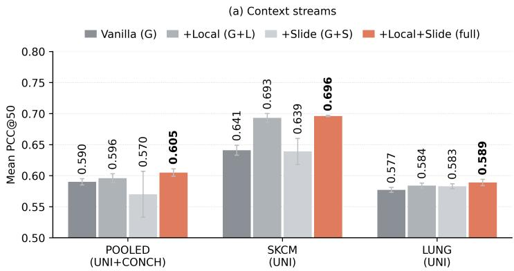

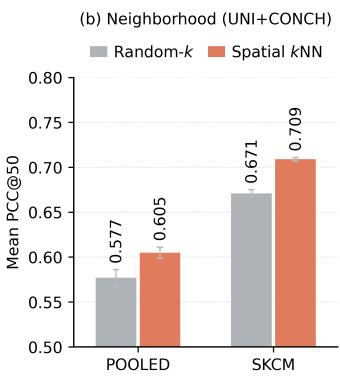  
Figure 2: Context-stream ablation: self-attention is the vanilla Transformer backbone; local and slide are the added levers. (a) Context Streams. (b) Neighborhood.

settings, pairing runs by (setting, seed, fold) and testing each gap with a two-sided Wilcoxon signedrank test (Figure 2). Local context alone improves over the backbone $( + 0 . 0 1 6 , p { = } 0 . 0 2 )$ , and adding both pathways is best in every setting (0.605 pooled, 0.696 SKCM, 0.589 LUNG; +0.024, p=3.4 × $1 0 ^ { - 4 } , n { = } 2 \dot { 7 } ) ;$ the two are complementary, as slide context does not help alone $( - 0 . 0 1 0 , p { = } 0 . 5 9 )$ but adds +0.007 on top of local context. The local pathway relies on spatially defined neighbors, not merely extra attention: replacing kNN with random neighbors of the same size costs 0.031 PCC (Figure 2b; $\scriptstyle p = 8 . 4 \times 1 0 ^ { - 5 } , n = 2 1 )$ . Encoder-feature ablations are in Appendix G.

## 4.4 RQ4: DOES COORDINATE INVARIANCE HOLD IN PRACTICE?

Table 4: Coordinate-transform check on held-out slides. PCC (mean ± std over three seeds, image features fixed); ∆PCC relative to original coordinates. The pooled column uses a different gene panel.
<table><tr><td rowspan="2">Coordinates</td><td colspan="2">CCRCC (HVG; six folds)</td><td colspan="2">PRAD (HVG; two folds)</td><td colspan="2">Pooled (14 genes; five folds)</td></tr><tr><td>PCC ↑</td><td>∆PCC</td><td>PCC ↑</td><td>∆PCC</td><td>PCC ↑</td><td>∆PCC</td></tr><tr><td>Original</td><td>0.25158±0.01041</td><td></td><td>0.41020±0.00730</td><td></td><td>0.59875±0.00671</td><td></td></tr><tr><td>Translation</td><td>0.25157±0.01027</td><td>-0.000014</td><td>0.41025±0.00732</td><td>+0.000058</td><td>0.59871±0.00668</td><td>-0.000036</td></tr><tr><td>Rotation</td><td>0.25175±0.01053</td><td>+0.000166</td><td>0.41026±0.00729</td><td>+0.000066</td><td>0.59876±0.00670</td><td>+0.000010</td></tr><tr><td>Reflection</td><td>0.25158±0.01041</td><td>0</td><td>0.41020±0.00730</td><td>0</td><td>0.59875±0.00671</td><td>0</td></tr><tr><td>Spot permutation</td><td>0.25154±0.01029</td><td>-0.000035</td><td>0.41022±0.00730</td><td>+0.000026</td><td>0.59870±0.00674</td><td>-0.000049</td></tr></table>

In the earlier section, we showed that the added local and slide pathways improve prediction; we next test whether the model is stable to changes in the coordinate frame. With image features fixed, we translate spot coordinates by (37.2, −91.4), rotate them by 0.731 radians, reflect them across the vertical axis, and permute spot order. Across CCRCC, PRAD, and the pooled six-organ setting, these transformations cause only negligible changes in PCC(Table 4). Reflection leaves predictions unchanged, while the tiny differences under translation, rotation, and permutation arise from numerical effects in kNN selection when distances are tied or nearly tied.

## 4.5 RQ5: SPATIAL STRUCTURE PRESERVATION

So far, we have shown that MIST predicts gene expression accurately. We next ask whether it also preserves spatial tissue structure. We cluster spots into k=6 domains using KMeans, separately from predicted and measured expression, and compare the resulting partitions using ARI and NMI on held-out slides (Figure 3).

MIST achieves the highest mean ARI (0.091) and NMI (0.110), outperforming BLEEP (0.081/0.092). This ordering remains unchanged for k ∈ 4, 6, 8, 10 (Appendix I). Although agreement is modest, MIST achieves higher NMI on 84% of slides and higher ARI on 60% of slides against BLEEP $\scriptstyle ( n = 5 8 ; p = 1 . 5 \times 1 0 ^ { - 8 }$ and 0.03, respectively). These results indicate that MIST better preserves spatial gene expression structure, particularly according to NMI.

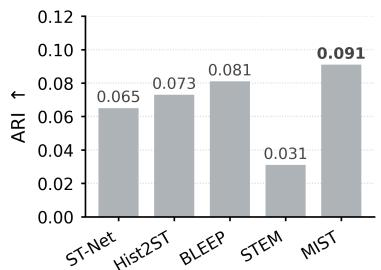

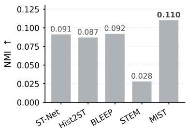

Figure 3: Spatial-domain recovery across all methods. Mean ARI (left) and NMI (right) (KMeans, k=6; predicted vs. measured domains); robustness to k is in Appendix I.  
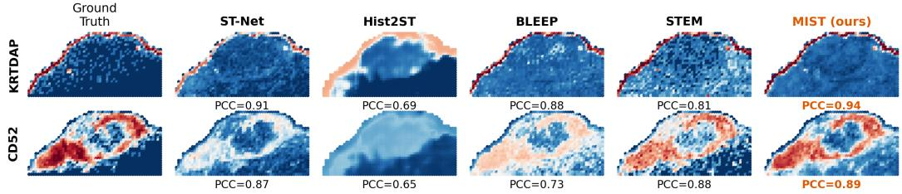  
Figure 4: Qualitative spatial expression maps for SKCM slide TENX117 (two marker genes, rows); per-gene PCC shown, MIST in orange.

## 4.6 CASE STUDY: RECOVERING CANCER-MARKER GENES

To further test its biological relevance, we ask whether MIST can recover canonical cancer-marker genes. We focus on established markers for melanoma (SKCM) Ohsie et al. (2008) and breast cancer (IDC), the latter including the clinically used HER2, ER, and PR receptor markers Wolff et al. (2018); Allison et al. (2020). Because several markers are outside the default panel, we evaluate them using the 200-gene panel and measure the Pearson correlation between predicted and measured expression for each gene (Figure 5).

MIST achieves high correlation for melanoma markers (mean 0.895; MLANA 0.949) and good correlation for breast-cancer markers (mean 0.717; HER2 0.829). It obtains the highest average correlation for both cancers, with the top score for all melanoma markers and five of seven breastcancer markers. Moreover, its predicted maps closely match the measured tumor layout (Figure 6, r ≥ 0.91).

Together, these results show that MIST can recover both the expression and spatial patterns of several canonical cancer markers from H&E. We interpret this as improved marker-gene prediction, not as evidence of standalone clinical utility.

## 5 RELATED WORK

H&E-to-ST prediction. Existing methods include patch-level regression (ST-Net He et al. (2020)), spatial graph modeling (Hist2ST Zeng et al. (2022)), cross-modal retrieval (BLEEP Xie et al. (2023)), and conditional diffusion (STEM Zhu et al. (2025)). We evaluate these four baselines under matched features, gene panels, splits, and training budgets.

Context modeling. Spatial predictors differ in how they aggregate context: ST-Net uses local image patches, while Hist2ST adds a graph over neighboring spots. MIST combines content-based attention over spatial-kNN neighbors, standard self-attention over all spots, and an attention-pooled tissue summary in every layer.

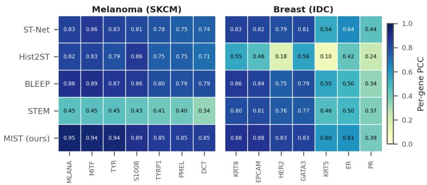  
Figure 5: Case study: per-gene recovery of canonical cancer markers. Per-gene Pearson (200- gene panel, mean over folds and three seeds); darker is higher.  
Measured vs. MIST-predicted marker expression (held-out slides; dark = low, bright = high)

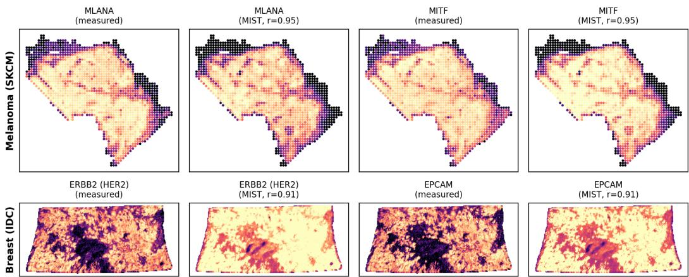  
Figure 6: Spatial recovery of cancer markers. Measured vs. MIST-predicted expression on held out melanoma (top) and breast (bottom) slides (dark = low, bright = high; per-panel r shown).

Pathology foundation models. Recent pathology encoders provide transferable representations for morphology and tissue composition Chen et al. (2024b); Lu et al. (2024). We use frozen UNI and CONCH features as matched inputs for MIST and the baselines, and separately evaluate encoder choice to distinguish representation quality from architectural effects.

Geometry and generalization. Absolute position encodings can change when an equivalent tissue layout is translated, rotated, or reflected; geometric networks instead construct interactions from relative quantities Satorras et al. (2021). MIST uses pairwise Euclidean distances, which are invariant to these frame changes for fixed histology features.

## 6 CONCLUSION AND FUTURE WORK

We introduced MIST, which augments a self-attention backbone with local spatial-neighborhood attention and slide-level context for gene expression prediction from histology. Across six HEST-1k organ cohorts, MIST improves predictive performance, while ablations show that the gains come from the added local and slide pathways and from using spatially defined neighbors. The model also improves held-out-organ transfer and better preserves expression-derived spatial structure. Gen eralization to unseen organs remains challenging. Future work will explore slide-level metadata, transcriptome-wide prediction, end-to-end image encoding, and predictive uncertainty to improve robustness and generalization.

## REPRODUCIBILITY STATEMENT

All experiments use the public HEST-1k dataset Jaume et al. (2024). Preprocessing, genepanel selection (including the leakage-safe per-fold panels for LOOO), train/test splits, evaluation regimes, metrics, model hyperparameters, and baseline configurations are specified in Section 3 and Appendix C; the complete model forward pass is given in Algorithm 1. Code to reproduce the model and the matched-baseline protocol is available at an anonymized repository: https://anonymous.4open.science/r/MIST-F660/.

## USE OF LARGE LANGUAGE MODELS

Large language model (LLM) based tools were used during the preparation of this work only for: (i) language editing and proofreading of the manuscript; (ii) assistance writing and refactoring plotting, results-aggregation, and LATEX formatting scripts; and (iii) consistency checks between the reported tables and figures and the narrative. LLMs were not used to design the method, to generate or modify experimental data, to run model training or evaluation, or to produce any reported numerical result. All experiments were executed by the authors using the described pipeline, and the authors reviewed all AI-assisted text take full responsibility for the content.

## REFERENCES

Kimberly H Allison, M Elizabeth H Hammond, Mitch Dowsett, Shannon E McKernin, Lisa A Carey, Patrick L Fitzgibbons, Daniel F Hayes, Sunil R Lakhani, Mariana Chavez-MacGregor, Jane Perlmutter, et al. Estrogen and progesterone receptor testing in breast cancer: ASCO/CAP guideline update. Journal ofClinical Oncology, 38(12):1346–1366, 2020. doi: 10.1200/JCO.19. 02309. 8

Jiawen Chen, Muqing Zhou, Wenrong Wu, et al. STimage-1K4M: A histopathology image-gene expression dataset for spatial transcriptomics. In Advances in Neural Information Processing Systems, volume 37, pp. 35796–35823, 2024a. doi: 10.52202/079017-1129. 1

Richard J Chen, Tong Ding, Ming Y Lu, et al. Towards a general-purpose foundation model for computational pathology. Nature Medicine, 30:850–862, 2024b. doi: 10.1038/s41591-024-02857-3. 1, 3, 5, 9, 14

Bryan He, Ludvig Bergenstrahle, Linnea Stenbeck, et al. Integrating spatial gene expression and ˚ breast tumour morphology via deep learning. Nature Biomedical Engineering, 4(8):827–834, 2020. doi: 10.1038/s41551-020-0578-x. 1, 5, 6, 8, 14

Tinglin Huang, Tianyu Liu, Mehrtash Babadi, Rex Ying, and Wengong Jin. Stpath: a generative foundation model for integrating spatial transcriptomics and whole-slide images. npj Digital Medicine, 8(1):659, 2025. doi: 10.1038/s41746-025-02020-3. 14

Guillaume Jaume, Paul Doucet, Andrew H Song, et al. HEST-1k: A dataset for spatial transcriptomics and histology image analysis. In Advances in Neural Information Processing Systems, volume 37, pp. 53798–53833, 2024. doi: 10.52202/079017-1704. 1, 2, 5, 10, 14, 15

Ming Y. Lu, Bowen Chen, Drew F. K. Williamson, et al. A visual-language foundation model for computational pathology. Nature Medicine, 30:863–874, 2024. doi: 10.1038/ s41591-024-02856-4. 2, 3, 5, 9, 14

Steven J Ohsie, G Peter Sarantopoulos, Alistair J Cochran, and Scott W Binder. Immunohistochemical characteristics of melanoma. Journal of Cutaneous Pathology, 35(5):433–444, 2008. doi: 10.1111/j.1600-0560.2007.00891.x. 8

Victor Garcia Satorras, Emiel Hoogeboom, and Max Welling. E(n) equivariant graph neural networks. In Proceedings of the 38th International Conference on Machine Learning, volume 139 of Proceedings of Machine Learning Research, pp. 9323–9332, 2021. URL https: //proceedings.mlr.press/v139/satorras21a.html. 2, 9

Patrik L Stahl, Fredrik Salm˚ en, Sanja Vickovic, et al. Visualization and analysis of gene expression´ in tissue sections by spatial transcriptomics. Science, 353(6294):78–82, 2016. doi: 10.1126/ science.aaf2403. 1

Ashish Vaswani, Noam Shazeer, Niki Parmar, et al. Attention is all you need. In Advances in Neural Information Processing Systems, volume 30, 2017. URL https://papers.nips.cc/ paper/2017/hash/3f5ee243547dee91fbd053c1c4a845aa-Abstract.html. 3

Antonio C Wolff, M Elizabeth H Hammond, Kimberly H Allison, Brittany E Harvey, Pamela B Mangu, John M S Bartlett, Michael Bilous, Ian O Ellis, Patrick Fitzgibbons, Wedad Hanna, et al. Human epidermal growth factor receptor 2 testing in breast cancer: American society of clinical oncology/college of american pathologists clinical practice guideline focused update. Journal of Clinical Oncology, 36(20):2105–2122, 2018. doi: 10.1200/JCO.2018.77.8738. 8

Ronald Xie, Kuan Pang, Sai Chung, et al. Spatially resolved gene expression prediction from histology images via bi-modal contrastive learning. In Advances in Neural Information Processing Systems, volume 36, pp. 70626–70637, 2023. doi: 10.52202/075280-3095. 1, 2, 5, 6, 8, 14

Yuansong Zeng, Zhuoyi Wei, Weijiang Yu, et al. Spatial transcriptomics prediction from histology jointly through transformer and graph neural networks. Briefings in Bioinformatics, 23(5): bbac297, 2022. doi: 10.1093/bib/bbac297. 1, 5, 6, 8, 14

Sichen Zhu, Yuchen Zhu, Molei Tao, and Peng Qiu. Diffusion generative modeling for spatially resolved gene expression inference from histology images. In The Thirteenth International Conference on Learning Representations, 2025. URL https://openreview.net/forum? id=FtjLUHyZAO. 1, 5, 6, 8, 14

## APPENDIX TABLE OF CONTENTS

A Formal Guarantees 13   
A.1 Coordinate-frame invariance 13   
A.2 Permutation equivariance 13   
B MIST Algorithm 13   
C Extended Experimental Setup 14   
D Dataset 15   
E Paired Statistical Tests 15   
F Panel-Size Results (10 and 100 genes) 16   
G Encoder Ablation 16   
H Cancer-Marker Recovery: All Cohorts 17   
I Domain-Recovery Robustness to Cluster Count 18   
J Computation Resources and Training 18

## A FORMAL GUARANTEES

This section gives the detailed statements and proofs of the coordinate-frame invariance and permutation-equivariance properties used in the main text. The guarantees concern deterministic evaluation with fixed model parameters and fixed histology features. In finite-precision computation, negligible round-off differences may occur; nearest-neighbor distance ties must also be resolved consistently.

## A.1 COORDINATE-FRAME INVARIANCE

Proposition 1 (Coordinate frame invariance). For fixed model parameters and fixed histology features, in deterministic evaluation mode, let $R \in \mathbb { R } ^ { 2 \times 2 }$ be orthogonal, let $\textbf { t } \in \mathbb { R } ^ { 2 }$ , and define $\mathbf { P } ^ { \prime } = \dot { \mathbf { P } } R ^ { \top } + \mathbf { 1 } \mathbf { t } ^ { \top }$ . If the kNN construction resolves distance ties consistently, the prediction is unchanged:

$$
f _ { \theta } ( { \bf F } , { \bf P } ^ { \prime } ) = f _ { \theta } ( { \bf F } , { \bf P } ) .\tag{8}
$$

Proof. For any two spots,

$$
\mathbf { p } _ { i } ^ { \prime } - \mathbf { p } _ { j } ^ { \prime } = ( \mathbf { p } _ { i } - \mathbf { p } _ { j } ) R ^ { \top } ,\tag{9}
$$

$$
\| { \bf p } _ { i } ^ { \prime } - { \bf p } _ { j } ^ { \prime } \| _ { 2 } ^ { 2 } = ( { \bf p } _ { i } - { \bf p } _ { j } ) R ^ { \top } R ( { \bf p } _ { i } - { \bf p } _ { j } ) ^ { \top } = \| { \bf p } _ { i } - { \bf p } _ { j } \| _ { 2 } ^ { 2 } .\tag{10}
$$

Thus, the full distance matrix and the distance-based kNN ordering are unchanged, assuming consistent tie handling. Any optional median-distance normalization is also unchanged because its input distances are unchanged. The local attention receives the same neighbor indices, while the selfattention, slide pooling, residual blocks, and prediction head receive the same histology features and intermediate representations. Induction over the transformer layers gives identical outputs. The result does not assert invariance of the frozen image encoder to transformations of the H&E image itself. □

## A.2 PERMUTATION EQUIVARIANCE

Proposition 2 (Permutation equivariance). Let $Q \in \{ 0 , 1 \} ^ { N \times N }$ be a permutation matrix. If the kNN construction resolves distance ties equivariantly, then

$$
f _ { \theta } ( Q { \bf F } , Q { \bf P } ) = Q f _ { \theta } ( { \bf F } , { \bf P } ) .\tag{11}
$$

Proof. Permuting the rows of P permutes the rows and columns of its pairwise distance matrix. With equivariant tie handling, the neighbor list and corresponding distances are permuted in the same way. Hence each local attention computation is permuted with its associated spot. The self-attention operation is permutation-equivariant because queries, keys, and values are permuted together. Attention pooling produces the same pooled vector, since it is a weighted sum over the spots, while broadcasting that vector preserves the row permutation. The input projection, residual addition, layer normalization, feed-forward network, and final per-spot prediction head are all row-wise equivariant. Applying these observations inductively through all layers yields $f _ { \theta } ( Q { \bf F } , Q { \bf P } ) = Q f _ { \theta } \bar { ( } { \bf F } , { \bf P } )$ □

## B MIST ALGORITHM

Algorithm 1 gives the full forward pass corresponding to the Method: coordinate-based kNN construction, L multi-context layers that fuse local kNN attention, self-attention, and an attentionpooled slide token, and a linear gene head. Coordinates enter only through the neighbor graph, which is computed once and reused in every layer; local attention weights are content-based (no distance features or positional biases).

Algorithm 1 MIST forward pass (one slide)   
Require: frozen features $\mathbf { F } \in \mathbb { R } ^ { N \times d _ { \mathrm { i n } } }$ , coordinates $\mathbf { P } \in \mathbb { R } ^ { N \times 2 } ;$ layers L, neighbors k   
Ensure: predicted expression $\widehat { \mathbf { Y } } \in \mathbb { R } ^ { N \times G }$   
1: $D _ { i j }  \| \mathbf { p } _ { i } - \mathbf { p } _ { j } \| _ { 2 }$ ▷ pairwise distances (frame-invariant)   
2: $\mathcal { N } ( i )  \overset {  } { k } \mathrm { N N } \overset {  } { ( } \bar { D } )$ ▷ neighbor indices, self excluded (only use of coordinates)   
3: $\mathbf { X }  \mathbf { F W } _ { \mathrm { i n } } + \mathbf { b } _ { \mathrm { i n } }$ ▷ input projection to width d   
4: for ℓ = 1 to L do   
5: $\mathbf { H } \gets \mathrm { L N } ( \mathbf { X } )$   
6: $\mathbf { L } \gets \mathrm { L O C A L K N N A T T N } ( \mathbf { H } , \mathcal { N } )$ ▷ content-based attention over k neighbors   
7: $\mathbf { G } \gets \mathrm { S E L F A T T N } ( \mathbf { H } )$ ▷ full self-attention over all N spots   
8: $a _ { i } \gets \mathrm { s o f t m a x } _ { i } ( s ( \mathbf { h } _ { i } ) ) ; \_ \mathbf { g } \gets \mathbf { W } _ { g } \sum _ { i } a _ { i } \mathbf { h } _ { i } + \mathbf { b } _ { g }$ ▷ attention-pooled slide token   
9: $\mathbf { X } \gets \mathbf { X } + \mathbf { L } + \mathbf { G } + \mathbf { 1 g } ^ { \top }$ ▷ parallel fusion + residual   
10: $\mathbf { X } \gets \mathbf { X } + \mathrm { F F N } ( \mathrm { L N } ( \mathbf { X } ) )$   
11: end for   
12: $\hat { \mathbf { Y } }  \mathrm { L N } ( \mathbf { X } ) \mathbf { W } _ { \mathrm { h e a d } } + \mathbf { b } _ { \mathrm { h e a d } }$   
13: return Yb

Training minimizes $\begin{array} { r } { \mathcal { L } = \mathrm { M S E } ( \widehat { \mathbf { Y } } , \mathbf { Y } ) + \lambda \big ( 1 - \frac { 1 } { | \mathcal { V } | } \sum _ { g \in \mathcal { V } } \rho _ { g } \big ) } \end{array}$ with $\lambda { = } 0 . 5$ , where $\rho _ { g }$ is the per-gene Pearson correlation over spots and V is the set of genes with nonzero target variance on the slide.

## C EXTENDED EXPERIMENTAL SETUP

Dataset and cohort selection. We use HEST-1k Jaume et al. (2024), a collection of spatial transcriptomics measurements paired with matched H&E whole-slide images, available from the HEST-1k Hugging Face repository. HEST-1k has supported subsequent histology-to-transcriptomics studies, including STEM and STPath Zhu et al. (2025); Huang et al. (2025). Our experiments use six cohorts: CCRCC, IDC, LUNG, PAAD, PRAD, and SKCM. Appendix D reports their organs, sample and spot counts, and fold counts.

Image encoders. We use frozen UNI (ViT-L/16, 1,024-dimensional image embeddings; Hugging Face model card) Chen et al. (2024b) and CONCH (ViT-B/16, 512-dimensional image embeddings; Hugging Face model card) Lu et al. (2024). Both encoders were evaluated for gene expression prediction in the HEST-1k benchmark Jaume et al. (2024). We test UNI and CONCH separately and concatenate their features to obtain 1,536-dimensional spot embeddings. Concatenation gives the highest mean PCC in our encoder comparison: 0.496, compared with 0.484 for UNI and 0.463 for CONCH alone (Table 7; Appendix 8). We therefore use UNI+CONCH in the main comparisons.

Preprocessing and gene panels. We use the provided slide-level cross-validation folds and transform expression targets with $\log ( 1 + x )$ . Unless stated otherwise, targets are the 50-gene HEST HVG panel. The panel study additionally uses matched 50-gene DEG, selected by Wilcoxon testing across Leiden clusters, and HMHVG panels, selected using mean-expression and variability criteria after variance filtering (Table 1).

Evaluation protocol. Intra-cohort training fits a model within each cohort. Pooled five-fold validation trains across organs while holding out slide-level samples; organ identity defines the protocol but is not a model input. LOOO trains on all-but-one organ and tests the held-out organ. We report PCC, MSE, MAE, and (for domain recovery) ARI and NMI, averaged over outer folds and three seeds. Checkpoints are selected on inner validation and evaluated once on the outer test fold; singleslide folds use disjoint spots for inner validation. Patient-level disjointness is not guaranteed where identifiers are unavailable.

Baselines and implementation. We compare with ST-Net He et al. (2020), Hist2ST Zeng et al. (2022), BLEEP Xie et al. (2023), and STEM Zhu et al. (2025) under matched features, panels, splits, budgets, and checkpoint selection. All methods use the same fold assignments, the same frozen UNI+CONCH inputs, and the same three random seeds (1, 2, 3); every method is trained per cohort/regime and its checkpoint is selected by best inner-validation PCC, then evaluated once on the outer test fold. MIST uses four layers, width 256, four heads, eight neighbors, and 4.88M parameters. AdamW training uses learning rate 10−3, weight decay $1 0 ^ { - 2 }$ , cosine decay, gradient clipping, 100 epochs maximum, patience 20, and at most 3,000 spots per step.

System and software environment. All experiments run on Linux (RHEL 9, kernel 5.14) with Python 3.13 and PyTorch 2.12 (CUDA 13.0, cuDNN 9.2). Core scientific dependencies are NumPy 2.4, SciPy 1.17, scikit-learn 1.8, pandas 2.3, and scanpy 1.12. Frozen UNI and CONCH features are extracted with timm and the official model weights. Training and inference use NVIDIA GPUs with compute capability ≥ sm 80 (A100 80GB, A100-PCIe, L40s, and H200; Appendix J); Volta (V100) GPUs are incompatible with this CUDA-13 build and were excluded. Cluster nodes use Intel Xeon Gold 6140 CPUs.

## D DATASET

To evaluate MIST, we use six cohorts from the HEST-1k dataset Jaume et al. (2024), a curated collection of 10x Genomics Visium spatial transcriptomics samples paired with matched H&E wholeslide images (WSIs) and standardized metadata. Each cohort covers a distinct organ: (1) CCRCC (kidney) provides 24 WSIs and 74,220 spots; (2) IDC (breast) provides 4 WSIs and 44,974 spots; (3) PRAD (prostate) provides 23 WSIs and 62,710 spots; (4) PAAD (pancreas) provides 3 WSIs and 9,793 spots; (5) LUNG provides 2 WSIs and 7,505 spots; and (6) SKCM (skin) provides 2 WSIs and 5,716 spots. Spots are counted after barcode filtering; all cohorts use Visium spots with a 55 µm diameter. For each spot we use the frozen spot-level UNI+CONCH image embedding provided at the HEST-bench resolution, and the log(1 + x)-transformed expression over the selected gene panel as the prediction target. Per-cohort sample, spot, and cross-validation-fold counts are summarized in Table 5.

Table 5: HEST-1k cohort statistics. Cohorts used in the reported experiments; spots are counted after barcode filtering and folds denote per-cohort train/test splits.
<table><tr><td>Cohort</td><td>Organ</td><td>Samples</td><td>Spots</td><td>Folds</td></tr><tr><td>IDC</td><td>Breast</td><td>4</td><td>44,974</td><td>4</td></tr><tr><td>CCRCC</td><td>Kidney</td><td>24</td><td>74,220</td><td>6</td></tr><tr><td>LUNG</td><td>Lung</td><td>2</td><td>7,505</td><td>2</td></tr><tr><td>PAAD</td><td>Pancreas</td><td>3</td><td>9,793</td><td>3</td></tr><tr><td>PRAD</td><td>Prostate</td><td>23</td><td>62,710</td><td>2</td></tr><tr><td>SKCM</td><td>Skin</td><td>2</td><td>5,716</td><td>2</td></tr></table>

Split granularity and patient disjointness. Each “sample” in Table 5 is a distinct HEST-1k slide (a whole-slide section), and every fold is slide-disjoint: no slide is shared between training and test, the pooled regime holds out entire slides, and the leave-one-organ-out regime holds out entire organs. HEST-1k patient/donor identifiers are not distributed with the per-slide data in our pipeline, so for a cohort in which one donor may contribute several slides we cannot verify patient-level disjointness. The intra-cohort and pooled numbers should therefore be read as slide-level generalization and could be optimistic if a cohort mixes multiple slides from the same patient; this risk is largest for the two multi-slide cohorts, CCRCC (24 slides) and PRAD (23 slides), and small for the remaining cohorts (IDC 4, PAAD 3, LUNG 2, SKCM 2 slides). Importantly, the cross-organ LOOO transfer results (our central generalization claim) are unaffected, because an entire organ (and hence a disjoint set of patients) is withheld at test time.

## E PAIRED STATISTICAL TESTS

This section collects the paired significance results reported in the main text. Tests compare MIST with the strongest relevant baseline under the same splits and evaluation protocol. The table reports the available aggregate statistics; complete per-run or per-slide effect-size vectors are not included in the manuscript.

Table 6: Summary of paired statistical tests. All tests are two-sided Wilcoxon signed-rank tests unless stated otherwise; p-values are reported as available from the matched evaluation.
<table><tr><td>Outcome</td><td>Comparison</td><td>Sample size</td><td>Reported result</td></tr><tr><td>PCC@50</td><td>MIST vs. BLEEP</td><td>runs</td><td>n = 18 paired gain 0.051; 95% bootstrap CI [0.041, 0.062]; p  $7 . 6 \dot { \times } 1 0 ^ { - 6 }$ </td></tr><tr><td>Per-gene PCC@50</td><td>MIST vs. BLEEP</td><td>(descriptive)</td><td>n = 300 genes MIST higher on 87%</td></tr><tr><td>LOOO PCC</td><td>MIST vs. BLEEP</td><td>n 18 organ×seed; also n</td><td> $p = \ 0 . 0 1 8 \ ( n { = } 1 8 ) ;$  exact p = 0.031, all six positive 6 (n=6)</td></tr><tr><td>Spatial ARI Spatial NMI</td><td>MIST vs. BLEEP</td><td>cohorts n = 58 slides</td><td>MIST wins 60%; p = 0.03</td></tr><tr><td></td><td>MIST vs. BLEEP</td><td>n = 58 slides</td><td>MIST wins 84%; p =  $1 . 5 \times 1 0 ^ { - 8 }$ </td></tr></table>

## F PANEL-SIZE RESULTS (10 AND 100 GENES)

Table 7 reports intra-cohort performance on the 10- and 100-gene HVG panels, complementing the 50-gene results in Table 1. MIST attains the highest six-cohort mean PCC at both sizes (PCC@10 0.600, PCC@100 0.559) with the lowest average MSE and MAE.

Table 7: Performance across HVG panel sizes (10 and 100 genes). Dataset PCC is mean ± SD over three seeds; final columns are six-cohort mean PCC, MSE, and MAE. The 50-gene HVG results are in Table 1.
<table><tr><td>Panel size</td><td>Model</td><td>IDC</td><td>CCRCC</td><td>LUNG</td><td>PAAD</td><td>PRAD</td><td>SKCM PCC Avg. ↑</td><td>MSE Avg. ↓</td><td></td><td>MAE Avg. ↓</td></tr><tr><td rowspan="5">PCC@10</td><td>ST-Net</td><td>0.666±0.01</td><td>0.231±0.01</td><td>0.702±0.01</td><td>0.511±0.04</td><td>0.442±0.03</td><td>0.728±0.00</td><td>0.547</td><td>6.087</td><td>1.908</td></tr><tr><td>Hist2ST</td><td>0.636±0.01</td><td>0.273±0.02</td><td>0.519±0.02</td><td>0.377±0.07</td><td>0.459±0.02</td><td>0.471±0.04</td><td>0.456</td><td>3.297</td><td>1.374</td></tr><tr><td>BLEEP</td><td>0.635±0.02</td><td>0.231±0.02</td><td>0.735±0.00</td><td>0.536±0.03</td><td>0.434±0.03</td><td>0.697±0.01</td><td>0.545</td><td>2.859</td><td>1.243</td></tr><tr><td>STEM</td><td>0.591±0.02</td><td>0.170±0.00</td><td>0.616±0.01</td><td>0.393±0.04</td><td>0.325±0.03</td><td>0.598±0.01</td><td>0.449</td><td>3.181</td><td>1.310</td></tr><tr><td>MIST (ours)</td><td>0.708±0.00</td><td>0.322±0.01</td><td>0.759±0.00</td><td>0.519±0.05</td><td>0.524±0.02</td><td>0.769±0.01</td><td>0.600</td><td>2.620</td><td>1.211</td></tr><tr><td rowspan="5">PCC@100 BLEEP</td><td>ST-Net</td><td>0.611±0.01</td><td>0.221±0.01</td><td>0.595±0.00</td><td>0.355±0.04</td><td>0.327±0.01</td><td>0.696±0.01</td><td>0.468</td><td>3.320</td><td>1.354</td></tr><tr><td>Hist2ST</td><td>0.473±0.07</td><td>0.274±0.03</td><td>0.434±0.03</td><td>0.222±0.04</td><td>0.341±0.03</td><td>0.446±0.12</td><td>0.365</td><td>1.843</td><td>1.011</td></tr><tr><td></td><td>0.632±0.01</td><td>0.247±0.02</td><td>0.659±0.01</td><td>0.399±0.04</td><td>0.377±0.02</td><td>0.696±0.01</td><td>0.502</td><td>1.558</td><td>0.915</td></tr><tr><td>STEM</td><td>0.565±0.01</td><td>0.192±0.00†</td><td>0.498±0.03</td><td>0.236±0.02</td><td>0.240±0.03</td><td>0.602±0.02</td><td>0.389</td><td>1.899</td><td>1.001</td></tr><tr><td>MIST (ours) 0.682±0.01</td><td></td><td>0.328±0.02</td><td>0.688±0.00</td><td>0.435±0.03</td><td>0.450±0.00</td><td>0.771±0.01</td><td>0.559</td><td>1.458</td><td>0.894</td></tr></table>

## G ENCODER ABLATION

We compare three encoder configurations on the intra-cohort PCC@50 task, holding models, cohorts, gene panels, splits, and training budget fixed: UNI only (ViT-L/16, 1024-d), CONCH only (512-d), and the concatenated UNI+CONCH representation (1536-d) used in the main results (Table 8). Concatenation is best for MIST (encoder-averaged PCC 0.463→0.484→0.496 for CONCH, UNI, UNI+CONCH), and MIST remains the most accurate method under all three encoders.

Table 8: Encoder ablation: intra-cohort PCC@50 per encoder. UNI-only (1024-d), CONCHonly (512-d), and concatenated UNI+CONCH (1536-d); meanstd over three seeds; best per row in bold.
<table><tr><td>Encoder</td><td>Cohort</td><td>ST-Net</td><td>Hist2ST</td><td>BLEEP</td><td>STEM</td><td>MIST (ours)</td></tr><tr><td rowspan="5">(102-d)</td><td rowspan="5">IDC Breast CCRCC Kidney LUNG Lung</td><td>0.538±0.008</td><td>0.250±0.067</td><td>0.508±0.005</td><td>0.436±0.005</td><td>0.569±0.009</td></tr><tr><td>0.172±0.010</td><td>0.214±0.015</td><td>0.184±0.007</td><td>0.116±0.002</td><td>0.264±0.010</td></tr><tr><td>0.482±0.012</td><td>0.378±0.097</td><td>0.559±0.007</td><td>0.393±0.009</td><td>0.590±0.005</td></tr><tr><td>PAAD Pancreas 0.353±0.022</td><td>0.243±0.061</td><td>0.393±0.035</td><td>0.227±0.017</td><td>0.392±0.040</td></tr><tr><td>PRAD Prostate 0.251±0.008</td><td>0.322±0.020</td><td>0.343±0.009</td><td>0.190±0.010</td><td>0.394±0.003</td></tr><tr><td rowspan="5">SKCM skin Average</td><td rowspan="2">0.632±0.010</td><td>0.510±0.015</td><td>0.639±0.015 0.438</td><td>0.471±0.031</td><td>0.694±0.001</td></tr><tr><td>0.405</td><td>0.319</td><td>0.305</td><td>0.484</td></tr><tr><td rowspan="5">IDC Breast CCRCC Kidney LUNG Lung</td><td>0.515±0.007 0.160±0.010</td><td>0.264±0.018 0.126±0.026</td><td>0.496±0.011 0.141±0.012</td><td>0.396±0.011 0.078±0.001</td><td>0.551±0.004 0.222±0.010</td></tr><tr><td>0.517±0.001</td><td>0.435±0.006</td><td>0.576±0.003</td><td>0.386±0.030</td><td>0.554±0.005</td></tr><tr><td>PAAD Pancreas 0.372±0.035</td><td>0.186±0.035</td><td>0.384±0.033</td><td>0.251±0.028</td><td>0.387±0.045</td></tr><tr><td>PRAD Prostate</td><td>0.327±0.003 0.322±0.009</td><td>0.364±0.010</td><td>0.210±0.013</td><td>0.406±0.006 0.658±0.007</td></tr><tr><td>SKCM skin</td><td>0.633±0.002</td><td>0.388±0.022</td><td>0.633±0.005</td><td>0.453±0.014</td></tr><tr><td rowspan="5">UNOOCH 1(1533d)</td><td rowspan="5">Average IDC Breast CCRCC Kidney LUNG Lung</td><td>0.421</td><td>0.287</td><td>0.432</td><td>0.296</td><td>0.463</td></tr><tr><td>0.551±0.01</td><td>0.309±0.07</td><td>0.519±0.00</td><td>0.439±0.01</td><td>0.581±0.01</td></tr><tr><td>0.163±0.02</td><td>0.184±0.02</td><td>0.175±0.02</td><td></td><td></td></tr><tr><td>0.518±0.01</td><td>0.470±0.01</td><td></td><td>0.123±0.00</td><td>0.252±0.01</td></tr><tr><td>PAAD Pancreas 0.366±0.03 PRAD Prostate 0.294±0.02</td><td>0.248±0.04</td><td>0.562±0.01 0.412±0.03</td><td>0.423±0.03 0.233±0.02</td><td>0.589±0.01 0.437±0.03</td></tr></table>

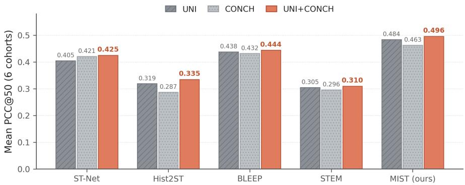  
Figure 7: Encoder-averaged intra-cohort PCC@50 per model. Six-cohort mean for each encoder (UNI, CONCH, UNI+CONCH); same values as Table 8. MIST is highest under every encoder, and UNI+CONCH is best for it.

## H CANCER-MARKER RECOVERY: ALL COHORTS

Figure 8 shows per-gene marker heatmaps for all four cohorts whose canonical markers are present in the 200-gene panel: melanoma (SKCM) and breast (IDC) from the main case study (Figure 5), together with kidney (CCRCC; clear-cell renal markers) and prostate (PRAD). MIST attains the highest per-gene Pearson correlation on nearly every marker in every cohort, most clearly for melanoma and the prostate panel (e.g., KLK3, KLK2, NKX3-1).

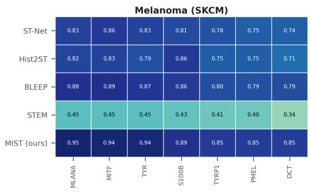

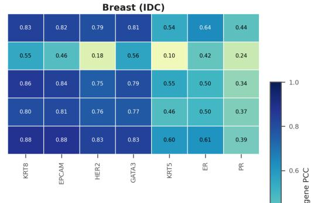

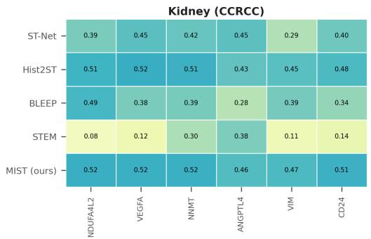

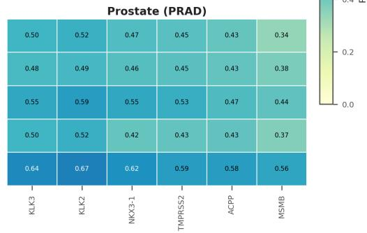  
Figure 8: Per-gene recovery of canonical cancer markers across four cohorts. Per-gene Pearson on the 200-gene panel (melanoma/SKCM, breast/IDC, kidney/CCRCC, prostate/PRAD), mean over folds and three seeds; darker is higher. STEM values for CCRCC and PRAD are computed from the folds available at submission time.

## I DOMAIN-RECOVERY ROBUSTNESS TO CLUSTER COUNT

The spatial-domain analysis (RQ5) fixes the number of KMeans domains at k=6. Table 9 repeats it for $k \in \{ 4 , 6 , 8 , 1 0 \}$ on the same n=58 held-out six-organ pooled slides (StandardScaler features, mean over three seeds). MIST attains the highest mean ARI and NMI at every k, so its domain recovery advantage is not an artifact of the chosen cluster count. Absolute agreement is modest and the across-slide variance is large (median per-slide ARI ≈0.04), consistent with the main text.

Table 9: Domain recovery vs. number of clusters k. Mean ARI and NMI over n=58 held-out slides (three seeds); best per column in bold.
<table><tr><td rowspan="2">Method</td><td colspan="4">ARI↑</td><td colspan="4">NMI↑</td></tr><tr><td>k=4</td><td>k=6</td><td>k=8</td><td>k=10</td><td>k=4</td><td>k=6</td><td>k=8</td><td>k=10</td></tr><tr><td>ST-Net</td><td>0.070</td><td>0.065</td><td>0.055</td><td>0.049</td><td>0.085</td><td>0.091</td><td>0.092</td><td>0.095</td></tr><tr><td>Hist2ST</td><td>0.079</td><td>0.073</td><td>0.062</td><td>0.055</td><td>0.084</td><td>0.087</td><td>0.089</td><td>0.091</td></tr><tr><td>BLEEP</td><td>0.090</td><td>0.081</td><td>0.075</td><td>0.070</td><td>0.088</td><td>0.092</td><td>0.095</td><td>0.099</td></tr><tr><td>STEM</td><td>0.034</td><td>0.031</td><td>0.027</td><td>0.025</td><td>0.028</td><td>0.028</td><td>0.030</td><td>0.032</td></tr><tr><td>MIST (ours)</td><td>0.106</td><td>0.091</td><td>0.080</td><td>0.072</td><td>0.107</td><td>0.110</td><td>0.111</td><td>0.113</td></tr></table>

## J COMPUTATION RESOURCES AND TRAINING

All experiments ran on a shared GPU cluster. Feature extraction and training used NVIDIA GPUs with compute capability ≥ sm 80 (A100 80GB, A100-PCIe, L40s, and H200); Volta (V100) GPUs are incompatible with our CUDA-13 / PyTorch build and were excluded.

• Encoders: frozen UNI (ViT-L/16, 1024-d) and CONCH (512-d) patch features, concatenated to 1536-d; no encoder fine-tuning.

• Model: MIST has 4.88M trainable parameters and predicts a whole slide in a single forward pass, with no iterative sampling.

• Training: AdamW with a cosine schedule, 100 epochs with early stopping (patience 20), nested validation, and a correlation-aware objective; three seeds per configuration.