# MedEvo: Medical Reasoning Evolution through Knowledge Navigation

Xiaoliang Wang1,2,\*, Zhuo Chen2,\*, Chuanyang Zheng2, Quanbin Wang2, Jiangwei Lao2, Yingao Liu2 Jiajia Liu2, Jinming Cao2, Honglin Lin3,4, Zhihong Lu2, Hao Jin1, Jian Wang2, Lijun Wu2,3,†

1Zhejiang University 2Ant Group

3Shanghai Artificial Intelligence Laboratory 4Shanghai Jiao Tong University

## Abstract

Medical multimodal reasoning models are typically trained on teacher-generated rationales, discarding the valid reasonin in students’ own failed trajectories, while eneral-domain correction methods ofer little uidance for errors in ima e readin , anatomical context, or diferential dia nosis. We ro ose MedEvo, which uses medical knowledge, namely a tag taxonomy and error-type diagnosis, to navigate both trajectory repair and data selection. For each failed rollout, a gold-blind auditor locates the first consequential error and provides a minimal, answer-free hint; the same student retains the valid prefix and regenerates the erroneous sufix. After each round, MedEvo identifies capability gaps across medical tags on a held-out feedback set and prioritizes related questions for new rollouts and repairs. With supervised fine-tuning (SFT) alone, MedEvo raises Qwen3.5-9B mean accurac across seven benchmarks from 65.57% to 69.12% (47.40% to 54.50% on the multimodal track of MedXpertQA (MedXpertQA-MM)), surpassing teacher-distillation SFT (66.93%). It also raises Qwen3.5-35B and Qwen3.5-397B mean accuracy from 67.91% to 73.04% and from 71.83% to 74.95%, respectively. Our analyses show that failed trajectories contain reasoning worth preserving, that repair success does not imply learning value, and that independent feedback is key to sustained improvement.

Project: https://pork-pay.github.io/MedEvo/

GitHub: https://github.com/pork-pay/MedEvo

## 1 Introduction

Medical multimodal reasonin re uires connectin visual findin s with anatomical context, disease knowled e, and clinical decisions, and ex ert-level uestions remain challen in for current medical vision-lan ua e models [2, 3, 4]. Despite recognizing several findings, a model can fail through image misreading, overlooked clinical clues, or unsupported diferential diagnosis. Such failures are often local: the reasoning before the mistake can remain valid, so preserving valid steps and recovering from the point of failure directly improves medical reasoning [5, 6]. Existing approaches typically use supervised fine-tuning (SFT) to train students on teacher-generated rationales or on answer-correct student rollouts [7, 8, 9]. Discarding a failed trajectory loses its valid reasoning, while replacing it with a complete teacher solution gives the student a path it did not produce. Methods that learn from failures, such as mistake–correction pairs [6], trajectory fusion [10], and Hindsight Hint Distillation (HHD) [1], were developed for mathematics and software engineering, and ofer little guidance when an error depends on medical images, anatomy, or diferential diagnosis. Moreover, a model’s failures reveal which medical capabilities need further training, yet this signal is rarely used to guide the next round of supervision. We therefore ask two questions: how can we repair reasoning while preserving valid steps, and how can failures guide subsequent learning? We introduce MedEvo through the principle of Knowledge Navigation: using structured medical knowledge and failure diagnosis to guide where to intervene, how to recover, and what to learn next. These questions motivate local recovery decisions and learning decisions reflecting the student’s remaining weaknesses. Medical tags locate a failure in its clinical context, while error types identify the reasoning operation that needs correction. We call this navi ation because these si nals direct a ath from an observed failure to a tar eted intervention, at two connected levels: within a trajectory and across training rounds (Fig. 4). For a failed rollout, a gold-blind auditor identifies the first consequential error, preserves the valid prefix, and provides a minimal, answer-free hint; the same student then regenerates the erroneous sufix, so the correction remains grounded in its own reasoning (Fig. 2). After each round, MedEvo measures performance and errors across medical tags on a held-out feedback set and prioritizes questions for fresh rollouts and repairs, so that recurring failures shape subsequent training.

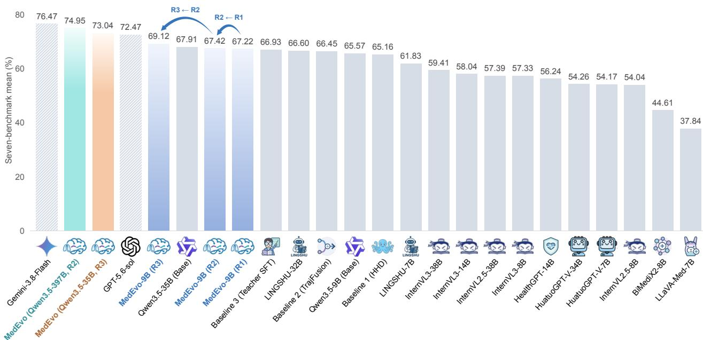  
Fig. 1 Medical multimodal reasoning across model scales. Mean accuracy on seven benchmarks. MedEvo improves 9B/35B/397B Qwen3.5 models. B: billion parameters; Hindsight Hint Distillation (HHD) [1].

Across seven medical multimodal benchmarks (Fig. 1), MedEvo improves the mean accuracy of Qwen3.5-9B, Qwen3.5-35B, and Qwen3.5-397B from 65.57%, 67.91%, and 71.83% to 69.12%, 73.04%, and 74.95%, respectively. With Qwen3.5-9B it out erforms teacher-distillation SFT (69.12% vs. 66.93%); with Qwen3.5-35B and Qwen3.5-397B it surpasses GPT-5.6-sol (72.47%); Gemini-3.8-Flash has the highest mean accuracy in this comparison (76.47%). Our contributions are threefold:

• Medically informed local repair. Within trajectories, Knowledge Navigation uses a medical tag taxonomy and error-type diagnosis to locate the first consequential error and a safe rollback boundary; a gold-blind auditor provides an answer-free hint for same-student sufix regeneration that preserves the valid prefix.

• Feedback-driven data evolution. Across rounds, Knowledge Navigation uses feedback: capability gaps across medical tags and error types on a held-out feedback set target questions and failures for rollout and repair.

• Empirical gains and findings. With SFT alone, MedEvo improves Qwen3.5-9B, Qwen3.5-35B, and Qwen3.5-397B across seven benchmarks. Our analyses show that failed trajectories contain reasoning worth preserving, that repair success does not imply learning value, and that independent feedback is key to sustained improvement.

## 2 Related Work

## 2.1 Medical Multimodal Reasoning and Supervision Quality

Medical vision-language models use biomedical instruction tuning [2, 3], generalist training in Lingshu [11], and bilingual BiMediX2 training [12]. MedGemma builds medical vision-language models on Gemma 3 [13]. Structured knowledge can also be integrated with multimodal learning through knowledge graphs [14]. Beyond answer accuracy, process-level audits separate visual recognition, knowledge application, and evidence integration [15, 16], and rubric-based evaluations can miss hallucinations, motivating factuality checks [17].

Supervision quality depends on reasoning content and student compatibility: process supervision provides step level feedback [18], on-policy distillation studies model compatibility [9], and ChainPrune [19] reduces redundant reasoning while distinguishing structural eficiency from token length. JOLT makes student compatibility explicit: even a higher-performing privileged teacher can induce an unhelpful student update, motivating joint teacher–student training with regularization toward the student’s current policy [20]. MedEvo diagnoses failures with a medical codebook, screening repairs for answer correctness, valid boundaries, integrity, and student-relative learnability.

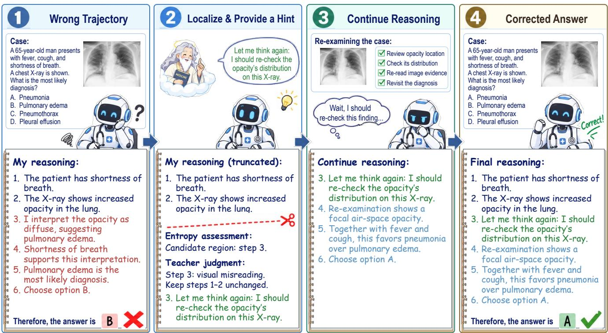  
Fig. 2 Local trajectory repair. A minimal, answer-blind hint guides the student to recover from a failed reasoning step while retaining its supported prefix. Localization and admission checks are detailed in § 3.2.1 and § 3.2.4.

## 2.2 Learning from Failures and Localized Repair

Failed trajectories can supply supervision: Learning from Mistakes (LEMA) trains on mistake–correction pairs [6], TrajFusion combines incorrect and correct trajectories [10], and HHD guides recovery with concise hints [1]. Identifying an error can enable its correction [5], and backtracking distillation and selective regeneration study where correction should begin [21, 22]. MedEvo difers in three respects: the corrected sufix is generated by the same student rather than written by a teacher; the auditor never accesses the reference answer; and both localization and hints are conditioned on medical tags and error types. Self-Retrospection Distillation uses completed interactions, including failed attempts, to supervise pre-interaction predictions of required knowledge and likely pitfalls in the same policy [23]. MedEvo uses the repaired trajectory as its training target: it retains the supported prefix and learns from the student’s regenerated continuation.

## 2.3 Data Evolution and Recursive Self-Improvement

Self-Taught Reasoner (STaR) and Reinforced Self-Training with Expectation–Maximization (ReSTEM) build supervision by filtering self-generated reasoning for correctness [7, 8], and micro-reflective self-distillation adds capability-dependent trajectory selection [24]. MediSkill-Evo [25] instead evolves validated clinical knowledge banks without updating the backbone. Work on frozen medical models similarly evolves external procedures, supported facts, and visual references, checking candidate updates on both new and previously seen cases while leaving model parameters unchanged [26]. MedEvo follows STaR and ReSTEM self-training but difers in two respects: rather than STaR’s rationalization, which supplies the correct answer as a hint [7], it repairs failures with answer-free hints; and it selects each round’s data using medical-tag and error-type feedback on a fixed feedback set, linking local recovery to what the student should learn next. Knowledge Navigation couples repair and feedback selection. Appendix F reviews medical hallucinations, reasoning supervision, correction, and self-evolution.

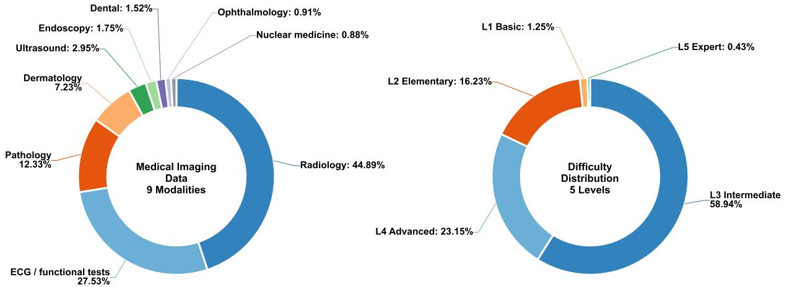

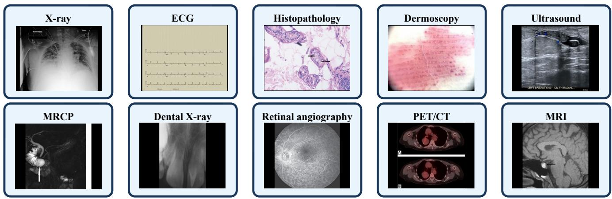  
Fig. 3 Medical multimodal data. Top: modality and dificulty; bottom: examples. Electrocardiogram (ECG); magnetic resonance cholangiopancreatography (MRCP); positron emission tomography/computed tomography (PET/CT); magnetic resonance imaging (MRI). Examples include both anatomical images and physiological recordings.

## 3 Method

Knowledge Navigation. We define Knowledge Navigation as a feedback-guided process that uses structured domain knowled e and failure dia nosis to choose where to intervene, how to recover, and what to learn next. MedEvo instantiates this process with a medical tag taxonomy and an error codebook: tags organize the clinical context, error types identify the failed reasoning operation, and their associated recovery operations guide intervention. Within a trajectory, the process selects a safe rollback boundary and an answer-free hint while preserving supported reasoning (§ 3.2). Across rounds, measured capability gaps guide question selection and repair priorities (§ 3.3). The term navigation therefore describes the link from a structured diagnosis to an actionable decision and its subsequent reassessment. The taxonomy supplies the reference structure; student failures guide learning (Fig. 4).

Learning protocol. A question $x _ { i } = ( I _ { i } , q _ { i } , O _ { i } )$ consists of one or more medical images $I _ { i } ,$ the clinical context and question $q _ { i } ,$ and the answer options $O _ { i }$ . Following STaR and $\mathrm { R e S T ^ { E M } \left[ 7 , 8 \right] } ,$ , each round � uses the current student $M _ { t } = \pi _ { \theta _ { t } }$ to generate trajectories, collects correct rollouts and accepted repairs into the training set $D _ { t + 1 } ,$ , and fine-tunes the next student from the ori inal model $M _ { 0 }$ rather than from $M _ { t }$ . The trainin ool, feedback set, and test benchmarks are kept separate throughout.

## 3.1 Medical Taxonomy and Failure Diagnosis

## 3.1.1 Medical Question Tags

We assign each question a four-dimensional hierarchical tag

$$
z _ { i } = ( z _ { i } ^ { \mathrm { m o d } } , z _ { i } ^ { \mathrm { a n a t } } , z _ { i } ^ { \mathrm { d i s } } , z _ { i } ^ { \mathrm { d i f f } } ) ,\tag{1}
$$

coverin modalit , anatom , disease, and dificult . Ta s serve two roles. Durin re air, the auditor receives onl the observable subset $z _ { i } ^ { \mathrm { o b } \dot { \mathrm { s } } }$ , i.e., tags supported by the input itself, excluding answer-derived labels such as the

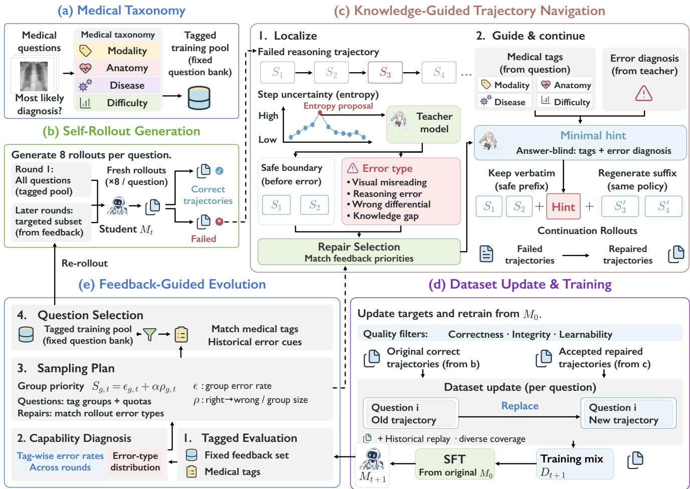  
Fig. 4 Knowledge Navigation in MedEvo. (a) Medical tags organize questions. (b) The current student generates fresh rollouts. (c) Knowledge-guided trajectory navigation localizes errors and provides recovery hints through a gold-blind auditor; the student preserves the valid prefix and regenerates the sufix. (d) Admitted trajectories update the training set, retaining valid historical targets; the next model trains from �0. (e) Fixed-set feedback guides question selection for the next round.

diagnosed disease. Across rounds, tag-level accuracy on the feedback set identifies capability gaps and guides question selection. See Appendix C.1 for the tag hierarchy and annotation rules.

## 3.1.2 Error Types and Their Relation to Repair

We diagnose failures at the process level, building on work that separates medical reasoning from knowledge and audits intermediate steps [15, 16]. Our codebook defines four parent error types with five subtypes each, twenty in total (Appendix C.1.2). Each type is paired with a recovery operation used for hint construction (§ 3.2.2): visual misreading calls for perceptual re-examination; reasoning error for reconstructing the evidence-to-decision link; diferential diagnosis error for comparing discriminative features; and knowledge gap for a narrowly scoped knowledge cue. Whereas tags describe the question, error types describe what went wrong in a specific trajectory; because diagnoses vary across rollouts and checkpoints, each fresh failure is diagnosed independently.

## 3.2 Knowledge-Guided Trajectory Navigation

## 3.2.1 Student Rollouts and Uncertainty-Based Localization

Tyen et al. [5] show that large language models can correct reasoning errors once the error location is given; we therefore localize an error before regenerating. For each selected question, �� samples eight trajectories, and answer-correct ones proceed to quality screening (§ 3.2.4). An incorrect or unparsable trajectory is segmented into semantically complete steps

$$
r ^ { - } = ( s _ { 1 } , \ldots , s _ { K } ) ,\tag{2}
$$

such as image observation, feature interpretation, mechanism, diferential diagnosis, and option mapping. The goal is to keep the steps before the first consequential error and regenerate the rest.

To propose where to audit, we compute the student’s token entropy

$$
H _ { j } = - \sum _ { v \in \mathcal { V } } \pi _ { \theta _ { t } } ( v \mid x , r _ { < j } ^ { - } ) \log \pi _ { \theta _ { t } } ( v \mid x , r _ { < j } ^ { - } ) ,\tag{3}
$$

where $_ \mathrm { ~  ~ }$ is the vocabulary, � indexes tokens, and $r _ { < j } ^ { - }$ is the token prefix. Logs are natural, with 0 log $0 = 0$ . For each nonempty step $s _ { k } ,$ , let $\mathcal { T } _ { k }$ be its token-index set and $\dot { H } _ { s _ { k } } = ( H _ { j } ) _ { j \in \mathcal { T } _ { k } }$ . We combine their mean and 90th percentile $Q _ { 0 . 9 } .$ and measure the increase over the preceding $m _ { k } = \operatorname* { m i n } ( m , k - 1 )$ steps:

$$
E _ { k } ^ { * } = \lambda \frac { 1 } { | \mathcal { T } _ { k } | } \sum _ { j \in \mathcal { T } _ { k } } H _ { j } + ( 1 - \lambda ) Q _ { 0 . 9 } ( H _ { s _ { k } } ) ,\tag{4}
$$

$$
\Delta E _ { k } = \left\{ \begin{array} { l l } { 0 , } & { k = 1 , } \\ { E _ { k } ^ { \ast } - \displaystyle \frac { 1 } { m _ { k } } \sum _ { \ell = k - m _ { k } } ^ { k - 1 } E _ { \ell } ^ { \ast } , } & { 2 \leq k \leq K , } \end{array} \right.\tag{5}
$$

For $k \geq 2 , m _ { k } > 0$ . After min–max normalizing both profiles (constant profiles map to zero), we select the anchor

$$
k ^ { * } \in \underset { 1 \leq k \leq K } { \arg \operatorname* { m a x } } \left[ \widetilde { E } _ { k } ^ { * } + \widetilde { \Delta E } _ { k } \right] ,\tag{6}
$$

and the audit window covers steps $k ^ { * } \pm 1$ , within valid indices, using $\lambda = 0 . 5$ and $m = 3$ (Appendix A.2). Entropy proposes the audit region; the auditor locates errors and boundaries using images, questions, and reasoning (§ 3.2.2).

## 3.2.2 Gold-Blind Auditing and Medical Error Diagnosis

Building on hint-guided recovery in HHD [1], an external auditor � (GPT-5.6-sol) turns the diagnosis into concise guidance. The auditor is gold-blind: it receives the question and images, the failed trajectory, the entropy proposal $\mathcal { E } _ { t } ( x , r ^ { - } )$ , and the observable tags $z ^ { \mathrm { o b s } }$ , but no reference answer, reference rationale, or answer-derived metadata. It returns

$$
\left( a , e , b , h \right) = \mathcal { A } \left( x , r ^ { - } , \mathcal { E } _ { t } ( x , r ^ { - } ) , z ^ { \mathrm { o b s } } \right) ,\tag{7}
$$

where $a \in \{ \mathrm { R e p s I R } , \mathrm { S K I P } \}$ is the action. For Repair, � is the earliest consequential error together with its diagnosed type, � is the last fully valid step before �, and ℎ is a minimal recovery hint. For Skip, (�, �, ℎ) are unused and no continuation is generated. The hint instantiates the recovery operation of the diagnosed type (§ 3.1.2) in the observable context. For example, a perceptual hint may ask the student to reinspect a region or waveform attribute without stating the finding, and a diferential hint may request comparison of a discriminative feature without naming the diagnosis. Hints must not reveal the answer, an answer option, or a corrected rationale. The audit prompt appears in Appendix D.3.

## 3.2.3 Prefix Preservation and Same-Student Continuation

Like LEMA [6], we train on corrected mistakes, but the correction is generated by the student itself. The boundary splits the failed trajectory into a preserved prefix and an erroneous sufix,

$$
\begin{array} { c c } { { r ^ { - } = p _ { b } \oplus s ^ { - } , } } & { { ~ p _ { b } = ( s _ { 1 } , \ldots , s _ { b } ) . } } \end{array}\tag{8}
$$

Here $b \in \{ 0 , \ldots , K - 1 \} , p _ { 0 }$ is empty, and ⊕ denotes token-sequence concatenation. We keep $p _ { b }$ verbatim, append the hint rendered as a natural-language recovery cue $g ( h )$ , and let the same checkpoint continue:

$$
s ^ { + } \sim \pi _ { \theta _ { t } } \bigl ( \cdot \mid x , p _ { b } \oplus g ( h ) \bigr ) , \qquad r ^ { * } = p _ { b } \oplus g ( h ) \oplus s ^ { + } .\tag{9}
$$

The question stays in the user message, $p _ { b } \oplus g ( h )$ prefills an unfinished assistant message, and the structured audit is stored only as metadata. With the prefix fixed, we sample up to five sufixes per failed trajectory, stopping at the first admitted continuation, and send answer-correct continuations to admission (§ 3.2.4; Appendix D.4).

## 3.2.4 Repair Admission and Training Targets

A continuation is admitted only if it passes answer, boundary, integrity, and learnability checks. Learnability is scored on the new sufix alone, so that a valid prefix cannot mask the dificulty of the correction. Adapting the instruction-following dificulty of Li et al. [27], we measure how much the sufix depends on the task input:

$$
D _ { \mathrm { r e p a i r } } = { \frac { { \mathcal { L } } _ { t } ( s ^ { + } \mid x , p _ { b } ) } { { \mathcal { L } } _ { t } ( s ^ { + } \mid p _ { b } ) } } ,\tag{10}
$$

For a token sequence � and context $\begin{array} { r } { c , \mathcal { L } _ { t } ( s \mid c ) = - \sum _ { i = 1 } ^ { | s | } \log \pi _ { \theta _ { t } } ( s _ { j } \mid c , s _ { < j } ) . } \end{array}$ , in nats. Both terms are computed without the hint; the denominator omits � but retains $p _ { b }$ . A smaller ratio indicates a larger relative loss reduction from explicitly conditioning on � beyond the prefix, which may itself contain task information. Both sufixes must be nonempty, all losses finite, and the denominator strictly positive. We also measure how strongly the student still prefers its original wrong sufix, using per-token losses to account for length diferences:

$$
\Delta _ { \mathrm { r e p a i r } } = \frac { \mathcal { L } _ { t } ( s ^ { + } \mid x , p _ { b } ) } { \mid s ^ { + } \mid } - \frac { \mathcal { L } _ { t } ( s ^ { - } \mid x , p _ { b } ) } { \mid s ^ { - } \mid } .\tag{11}
$$

For a repair candidate $\xi = ( x , r ^ { - } , r ^ { * } , b )$ , the gap is measured in nats per token. A positive value means the student assigns lower average loss to the wrong sufix than to the repair. The learnability gate $L _ { \xi }$ requires $D _ { \mathrm { r e p a i r } } \in [ 0 . 3 5 , 0 . 8 5 ]$ and $\Delta _ { \mathrm { r e p a i r } } \in [ 0 . 0 2 , 0 . 3 0 ]$ , with thresholds calibrated on the feedback set and frozen before final evaluation (Appendix A.4). Admission is

$$
\mathrm { A c c e p t } ( \xi ) = C _ { \xi } \wedge A _ { \xi } \wedge N _ { \xi } \wedge L _ { \xi } ,\tag{12}
$$

Here $C _ { \xi }$ checks correctness, $A _ { \xi }$ validates the prefix and boundary, and $N _ { \xi }$ rejects unsupported additions or repetition. Each admitted repair is trained as the complete response $r ^ { * } = p _ { b } \oplus g ( h ) \oplus s ^ { + }$ , including the recovery cue, with loss on all assistant tokens:

$$
\mathcal { L } _ { \mathrm { r e p a i r } } ( \theta ) = - \sum _ { j = 1 } ^ { | r ^ { * } | } \log \pi _ { \theta } ( r _ { j } ^ { * } | x , r _ { < j } ^ { * } ) .\tag{13}
$$

Correct rollouts share this objective; image and user tokens are excluded from the loss. If no repair is admitted, we retain a qualified correct rollout or a valid historical target; if neither is available, we add none. Evaluation excludes hints and audit outputs.

## 3.3 Feedback-Driven Evolution of Supervision

Across-round Knowledge Navigation follows the iterative self-training pattern of STaR and $\mathrm { R e S T ^ { E M } } [ 7 , 8 ] ,$ , but uses medical-tag and error-type feedback on a fixed set to allocate generation and repair efort. The cycle is assessment, targeted selection, local repair, screened dataset update, and retraining. The taxonomy and error codebook remain fixed; selection priorities and the supervision dataset evolve as the student changes.

## 3.3.1 First-Round Coverage

The training pool $\mathcal { T }$ and a separate, fixed feedback set $V _ { \mathrm { f e e d b a c k } }$ are drawn from public medical datasets (§ 4.1). In the first round, $M _ { 0 }$ generates rollouts for every question in $\mathcal { T } ;$ ; correct trajectories enter screening, failures are repaired as in § 3.2, and accepted targets form $D _ { 1 }$ , giving $M _ { 1 } = \mathrm { S F T } ( M _ { 0 } , D _ { 1 } )$ .

## 3.3.2 Feedback across Medical Tags and Error Types

Before constructing $D _ { t + 1 }$ , we evaluate $M _ { t }$ on the feedback set, including $M _ { 0 }$ at initialization. For a supported tag group � with $n _ { g } > 0 .$ , the error rate is

$$
\epsilon _ { g , t } = \frac { 1 } { n _ { g } } \sum _ { i \in V _ { \mathrm { f e e d b a c k } , g } } ( 1 - c _ { i , t } ) , \qquad n _ { g } = | V _ { \mathrm { f e e d b a c k } , g } | ,\tag{14}
$$

where $c _ { i , t } \in \{ 0 , 1 \}$ indicates correctness. Comparing consecutive checkpoints separates corrections, regressions, persistent errors, and retained successes (Appendix $\mathrm { A } . 5 )$ , and diagnosing failed responses yields each group’s error-type distribution. Groups below a support threshold back of to their parent tag. Feedback questions guide selection and threshold calibration but never enter training, and test results never influence data construction.

## 3.3.3 Selecting Questions and Updating the Dataset

From the second round on, we allocate the generation budget across groups by the rule-based priority

$$
S _ { g , t } = \epsilon _ { g , t } + \alpha \rho _ { g , t } , \qquad \rho _ { g , t } = \frac { N _ { g , t } ^ { 1 0 } } { n _ { g } } ,\tag{15}
$$

where $t \geq 1$ and $N _ { g , t } ^ { 1 0 }$ counts correct-to-incorrect transitions from $M _ { t - 1 }$ to $M _ { t }$ and $\alpha \geq 0$ weights regressions. Quotas are proportional to $S _ { g , t } ,$ capped by the available unique questions, and rounded deterministically; unused capacity is redistributed, and each multi-tag question is counted once (Appendix A.5). Within each group, candidates are retrieved by tag match and ranked by historical error records. Selected questions receive fresh rollouts from $M _ { t } ,$ their failures are diagnosed anew, and failures whose error types match the feedback priorities are repaired first. Feedback thus decides where efort is spent, while the checks in § 3.2.4 decide what enters training.

Algorithm 1: MedEvo Training with Local Repair and Feedback-Guided Data Evolution   
Require: Initial student $M _ { 0 } ;$ training pool � with verification labels; fixed feedback set $V _ { \mathrm { f e e d b a c k } } ;$ gold-blind   
auditor ${ \mathcal { A } } ;$ rounds �; selection and generation budgets.   
� ← AssignMedicalTags(� , �feedback)   
$D _ { 0 } \gets \emptyset ; \bar { H } \gets \emptyset$ // Active targets and trajectory history   
for � ← 0 to � − 1 do   
// Feedback assessment and question selection   
�� ← Evaluate $\left( M _ { t } , \right.$ �feedback, �)   
if � = 0 then   
$Q _ { t } \gets \mathcal { T }$ // Broad first-round coverage   
else   
�� ← PlanQuotas $F _ { t } , F _ { t - 1 } , G )$   
�� ← RetrieveUnique(� , $P _ { t } , H )$   
$D _ { t + 1 }  D _ { t }$   
// Fresh student rollouts and local trajectory repair   
foreach $x \in Q _ { t }$ do   
ℛ� ← Rollout(�� � 8)   
$C _ { x }$ ← ScreenCorrec $\mathbf { \alpha } \cdot ( x , \mathcal { R } _ { x } )$   
foreach failed $r ^ { - } \in$ PrioritizeFailures $\left( \mathcal { R } _ { x } , F _ { t } \right)$ within budget do   
� ← StepUncertaint $\ d u _ { \ d } / ( M _ { t } , x , r ^ { - } )$   
$( a , e , b , h )  \mathcal { A } ( x , r ^ { - } , u , z ^ { \mathrm { o b s } } ( x ) )$ // Observable tags only   
� ← RecordHistory $\cdot ( H , x , r ^ { - } , a , e , b , h )$   
if � = Skip then   
continue   
�� ← ValidPrefix(�− �)   
for � ← 1 to 5 do   
$s ^ { + } \sim M _ { t } ( { \cdot } | x , p _ { b } \oplus g ( h ) )$   
$r ^ { * } \gets p _ { b } \oplus g ( h ) \oplus s ^ { + }$   
$\xi  ( x , r ^ { - } , r ^ { * } , b )$   
if Accept(�) (Eq. 12) then   
$C _ { x } \gets C _ { x } \cup \{ r ^ { * } \}$   
break   
// Keep one active target per question; retain valid history on ties   
��+1 ← RetainOrReplace $\left( D _ { t + 1 } , x , C _ { x } \right)$   
// Full-response SFTfrom the same initial student   
$M _ { t + 1 } \gets \mathrm { S F T } ( M _ { 0 } , D _ { t + 1 } )$ // Reset optimizer and schedule   
return $\{ M _ { t } , D _ { t } \} _ { t = 1 } ^ { R }$

The dataset keeps at most one active target per question. An admitted candidate replaces the existing target only if a blinded comparison judges it better in evidence support, reasoning consistency, and conciseness; otherwise the existing target is kept, and all versions are logged separately. Writing each target as a pair $( x , r )$ keyed by question ID, with $D _ { 0 } = \varnothing .$ , replaced targets $R _ { t } \subseteq D _ { t } ,$ , accepted replacements $U _ { t + 1 }$ , and new targets $A _ { t + 1 }$ for previously unrepresented questions,

$$
D _ { t + 1 } = \left( D _ { t } \setminus R _ { t } \right) \cup U _ { t + 1 } \cup A _ { t + 1 } ,\tag{16}
$$

$$
M _ { t + 1 } = { \mathrm { S F T } } ( M _ { 0 } , D _ { t + 1 } ) .\tag{17}
$$

$U _ { t + 1 }$ contains exactl one re lacement for each uestion in $R _ { t } ; A _ { t + 1 }$ contains one target per new question, disjoint by question ID from $D _ { t }$ . Each round restarts from $M _ { 0 }$ with a fresh optimizer and learning-rate schedule, so experience is carried only through the evolving dataset. Algorithm 1 summarizes the procedure.

## 4 Experiments

## 4.1 Experimental Setup

Models and data. Our main backbone is Qwen3.5-9B [28]; Qwen3.5-35B and Qwen3.5-397B test scalability (§ 5.3). The training pool contains 81,293 questions from the training splits of public medical datasets, spanning nine modality categories and five dificulty levels (Fig. 3), and is deduplicated by question and source identifiers, patient/case identifiers when available, image hashes, and near-duplicate clusters (Appendix C.1.4). A separate, fixed set of 5,000 modality- stratified questions serves as the feedback set and never enters training. Dataset roles and training configurations are given in Appendices B.1 and C.1.5.

Tab. 1 Repair workload across rounds. Rate: fraction repaired; arrows compare rounds.
<table><tr><td>Training round Generator</td><td>R1 R0</td><td>R2 R1</td><td>R3 R2</td></tr><tr><td>Sent for repair</td><td>27,233</td><td>25,831↓</td><td>23,620↓</td></tr><tr><td>Share of question bank 33.50%</td><td></td><td>31.78%</td><td>29.06%</td></tr><tr><td>Successfully repaired</td><td>19,567</td><td>18,258</td><td>16,797</td></tr><tr><td>Repair success rate</td><td>71.85%</td><td>70.68%↓</td><td>71.11%↑</td></tr><tr><td>Mean repair attempts</td><td>3.37</td><td>2.48</td><td>2.12</td></tr></table>

Evaluation. We use MedUniEval [29], the Hulu-Med im lementation built on Lin shu’s MedEvalKit [11], for medical visual question answering (VQA) on PMC-VQA [30], VQA-RAD [31], SLAKE [32], PathVQA [33], OmniMedVQA [34], the multimodal track of MedXpertQA (MedXpertQA-MM) [4], and the medical subset of Massive Multi-discipline Multimodal Understanding (MMMU), denoted MMMU-Med [35]. All models share the answering prompt and parser (Appendix D.1). We report accuracy (%) and the unweighted seven-benchmark mean; accuracy gains and Δ denote absolute diferences in percentage points.

Tab. 2 Medical reasoning benchmarks. General-purpose and medical model accuracy (%). MedEvo: R3. Avg.: unweighted seven-benchmark mean; MedXQA: MedX ertQA-MM; MMMU-Med: the medical subset of MMMU. m: medical models; å: trajectory-repair methods. Blue: MedEvo. Bold/underline: top two per group and benchmark, with shared ranks for ties.
<table><tr><td></td><td>Model</td><td>PMC- VQA- VQA RAD</td><td></td><td>SLAKE PathVQA</td><td>OmniMed VQA</td><td>MedXQA</td><td>MMMU- Med</td><td>Avg.</td></tr><tr><td colspan="9">Proprietary models</td></tr><tr><td></td><td>GPT-5.6-sol</td><td>60.43</td><td>70.29</td><td>81.34</td><td>54.84</td><td>76.67</td><td>77.50</td><td>86.24 72.47</td></tr><tr><td></td><td>Gemini-3.8-Flash</td><td>64.52</td><td>74.72 81.34</td><td></td><td>58.58 80.76</td><td>86.30</td><td></td><td>89.10 76.47</td></tr><tr><td colspan="9">Open-source models (&lt; 10B)</td></tr><tr><td>4</td><td>LLaVA-Med-7B [2]</td><td>30.50</td><td>53.70</td><td>48.00</td><td>38.80 44.30</td><td>20.30</td><td></td><td>29.30 37.84</td></tr><tr><td>4</td><td>HuatuoGPT-V-7B [36]</td><td>53.30</td><td>67.00</td><td>67.80</td><td>48.00</td><td>74.20</td><td>21.60</td><td>47.30 54.17</td></tr><tr><td>8</td><td>BiMediX2-8B [12]</td><td>43.50</td><td>49.20</td><td>57.70</td><td>37.00</td><td>63.30</td><td>21.80</td><td>39.80 44.61</td></tr><tr><td></td><td>InternVL2.5-8B [37]</td><td>51.30</td><td>59.40</td><td>69.00</td><td>42.10</td><td>81.30</td><td>21.70</td><td>53.50 54.04</td></tr><tr><td>+</td><td>InternVL3-8B [38]</td><td>53.80</td><td>65.40</td><td>72.80</td><td>48.60</td><td>79.10</td><td>22.40</td><td>59.20 57.33</td></tr><tr><td></td><td>LINGSHU-7B [11]</td><td>56.30</td><td>67.90</td><td>83.10</td><td>61.90</td><td>82.90</td><td>26.70</td><td>54.00 61.83</td></tr><tr><td></td><td>Qwen3.5-9B (Base) [28]</td><td>59.20</td><td>68.10</td><td>76.80</td><td>48.80</td><td>82.20</td><td>47.40</td><td>76.5065.57</td></tr><tr><td></td><td>Baseline 1 (HHD) [1]</td><td>58.93</td><td>67.65</td><td>71.45</td><td>50.12</td><td>82.35</td><td>48.75</td><td>76.90 65.16</td></tr><tr><td></td><td>Baseline 2 (TrajFusion) [10]</td><td>59.32</td><td>69.12</td><td>77.23</td><td>49.23</td><td>83.46</td><td>49.56</td><td>77.20 66.45</td></tr><tr><td></td><td>Baseline 3 (Teacher SFT)</td><td>61.23</td><td>70.15</td><td>71.60</td><td>53.20</td><td>81.90</td><td>52.30</td><td>78.14 66.93</td></tr><tr><td></td><td>MedEvo (9B)</td><td>62.68</td><td>70.40</td><td>78.23</td><td>53.34</td><td>85.41</td><td>54.50</td><td>79.28 69.12</td></tr><tr><td colspan="9">Open-source models (&gt; 10B)</td></tr><tr><td></td><td>HealthGPT-14B [39]</td><td>56.40</td><td>65.00</td><td>66.10</td><td>56.70</td><td>75.20</td><td>24.70</td><td>49.60 56.24</td></tr><tr><td>+</td><td>HuatuoGPT-V-34B [36]</td><td>56.60</td><td>61.40</td><td>69.50</td><td>44.40</td><td>74.00</td><td>22.10</td><td>51.8054.26</td></tr><tr><td></td><td>InternVL3-14B [38]</td><td>54.10</td><td>66.30</td><td>72.80</td><td>48.00</td><td>78.90</td><td>23.10</td><td>63.10 58.04</td></tr><tr><td></td><td>InternVL2.5-38B [37]</td><td>57.20</td><td>61.40</td><td>70.30</td><td>46.90</td><td>79.90</td><td>24.40</td><td>61.60 57.39</td></tr><tr><td>4</td><td>InternVL3-38B [38]</td><td>56.60</td><td>65.40</td><td>72.70</td><td>51.00</td><td>79.80</td><td>25.20</td><td>65.20 59.41</td></tr><tr><td></td><td>LINGSHU-32B [11]</td><td>57.90</td><td>76.50</td><td>89.20</td><td>65.90</td><td>83.40</td><td>30.90</td><td>62.3066.59</td></tr><tr><td></td><td>Qwen3.5-35B (Base) [28]</td><td>62.40</td><td>70.50</td><td>70.10</td><td>49.15</td><td>83.20</td><td>60.00</td><td>80.00 67.91</td></tr><tr><td>L</td><td>MedEvo (35B)</td><td>64.63</td><td>75.83</td><td>80.30</td><td>56.01</td><td>83.97</td><td>66.50</td><td>84.02 73.04</td></tr></table>

Baselines. On Qwen3.5-9B, we compare with two methods that learn from failed trajectories, HHD [1] and TrajFusion [10], and with teacher-distillation SFT on rationales generated by Qwen-3.8-Max. External general-

purpose and medical models provide additional context (Appendix G).

## 4.2 Main Results

Tab. 2 reports the results. On Qwen3.5-9B, MedEvo raises mean accuracy from 65.57% to 69.12% and improves all seven benchmarks, with the largest gain on MedXpertQA-MM [4] (47.40% → 54.50%). It outperforms HHD [1], TrajFusion [10], and teacher-distillation SFT, whose mean accuracies are 65.16%, 66.45%, and 66.93%, respectivel . On Qwen3.5-35B, mean accuracy rises from 67.91% to 73.04% (§ 5.3). A question-level paired bootstrap (10,000 resam les; Tab. 3, ri ht) ields 95% confidence intervals (CIs) that exclude zero on ever benchmark. These intervals capture question-level uncertainty; variation across training runs is reported in Tab. 8.

Tab. 3 Evolution and statistical uncertainty (Qwen3.5-9B). Left: accuracy (%) across rounds, each trained from Base (R0). Right: absolute gain R3−R0 and 95% bootstrap confidence intervals (CIs) (10,000 paired question resamples). The mean CI resamples each benchmark independently before averaging. All gain CIs exclude zero. Arrows compare consecutive rounds; MedXQA annotations give absolute changes. Bold/underline: best/second-best per row.
<table><tr><td colspan="5">Round-wise accuracy</td><td colspan="2">Paired bootstrap</td></tr><tr><td>Benchmark</td><td>R0</td><td>R1</td><td>R2</td><td>R3</td><td>|∆ (R3–R0)</td><td>95% CI</td></tr><tr><td>PMC-VQA</td><td>59.20</td><td>59.54↑</td><td>60.97↑</td><td>62.68 ↑</td><td>+3.48</td><td>[+1.9, +5.1]</td></tr><tr><td>VQA-RAD</td><td>68.10</td><td>68.47↑</td><td>68.06↓</td><td>70.40↑</td><td>+2.30</td><td>[+0.8, +3.8]</td></tr><tr><td>SLAKE</td><td>76.80</td><td>76.92↑</td><td>77.34↑</td><td>78.23↑</td><td>+1.43</td><td>[+0.2, +2.7]</td></tr><tr><td>PathVQA</td><td>48.80</td><td>52.38↑</td><td>51.27↓</td><td>53.34↑</td><td>+4.54</td><td>[+2.6, +6.5]</td></tr><tr><td>OmniMedVQA 82.20</td><td></td><td>80.81↓</td><td>81.58↑</td><td>85.41↑</td><td>+3.21</td><td>[+1.5, +4.9]</td></tr><tr><td>MedXQA</td><td>47.40</td><td>52.56↑5.16</td><td>52.79↑0.23</td><td>54.50↑1.71</td><td></td><td>+7.10 [+5.2, +9.0]</td></tr><tr><td>MMMU-Med</td><td>76.50</td><td>79.83↑</td><td>79.91↑</td><td>79.28↓</td><td></td><td>+2.78 [+1.3, +4.3]</td></tr><tr><td>Avg.</td><td>65.57</td><td>67.22↑</td><td>67.42↑</td><td>69.12↑</td><td></td><td>+3.55 [+2.4, +4.7]</td></tr></table>

## 4.3 Accuracy Gains and Repair Workload

Mean accurac increases from 65.57% to 67.22%, 67.42%, and 69.12% across rounds (Tab. 3, left), while the number of questions sent for repair falls from 27,233 to 23,620 and repair success remains near 71% (Tab. 1). Thus, the later rounds improve benchmark performance with a smaller question-level repair workload; § 5.2 isolates the role of feedback-guided selection. Individual benchmarks still fluctuate, as illustrated by PathVQA [33]. Modality and error-type statistics on the fixed feedback set guide subsequent selection (Appendix B.3); the seven held-out benchmarks assess generalization.

## 5 Ablation Studies and Analysis

We analyze repair, feedback, scale, and learning value, using Qwen3.5-9B except in scaling experiments [28].

## 5.1 Repair Design in the First Round

Tab. 4 Repair design (Qwen3.5-9B, R1). Repair success and downstream accuracy (%); Base accuracy is 65.57%. T e- uided sufix continuation erforms best on both. Red ↓: below the full method; bold: best.
<table><tr><td>Method</td><td>Repair success</td><td>Mean accuracy</td></tr><tr><td>Hint + full rewrite</td><td>57.80↓</td><td>63.20↓</td></tr><tr><td>No-hint rewrite</td><td>36.70↓</td><td>61.16↓</td></tr><tr><td>Generic hint + suffix continuation</td><td>64.50↓</td><td>64.20↓</td></tr><tr><td>Type-guided hint + suffix continuation (Ours)</td><td>71.80</td><td>67.22</td></tr></table>

Tab. 4 compares four first-round designs varying regeneration scope (full rewrite vs. sufix continuation) and hint specificity (none, generic, or type-guided). We measure repair success and downstream mean accuracy. Type-guided sufix continuation performs best with 71.80% repair success and 67.22% mean accuracy. Generic-hint continuation achieves 64.50% repair success and 64.20% accuracy; hint-guided full rewriting achieves 57.80% and 63.20%. Both prefix preservation and error-type conditioning contribute.

## 5.2 Contribution of Feedback across Rounds

Tab. 5 isolates the contribution of feedback. Sharing the R1 data-generation model and historical dataset (R1 accuracy: 67.22%), four variants run two more rounds: repair without feedback, feedback without medical tags, feed- back without error types, and full MedEvo. Full MedEvo reaches 69.12% at R3 versus 66.67%, 67.53%, and 66.21% for the three variants, respectively. Without feedback or without error-type feedback, accuracy falls below the shared R1 reference; without medical tags, it improves only marginally (67.22% to 67.53%). Combined medical-tag and error-type feedback performs best.

Tab. 5 Feedback ablation (Qwen3.5-9B). Mean accuracy (%) for branches sharing the R1 generator and historical dataset (R1: 67.22%); each round of SFT restarts from �0. Full MedEvo achieves the highest R3 accuracy. Arrows compare with R1 Δ = R3 − R1.
<table><tr><td>Method</td><td>R2</td><td>R3</td><td>Δ</td></tr><tr><td>No feedback (repair only)</td><td></td><td>66.39↓66.67↓</td><td>-0.55</td></tr><tr><td>Without medical tags</td><td></td><td>67.32↑67.53↑+0.31</td><td></td></tr><tr><td>Without error-type feedback</td><td></td><td>67.01↓66.21↓-1.01</td><td></td></tr><tr><td>Full MedEvo</td><td></td><td>67.42↑ 69.12↑ +1.90</td><td></td></tr></table>

## 5.3 Generalization across Model Scales

We apply MedEvo to Qwen3.5-35B for three rounds and to Qwen3.5-397B for two rounds, evaluating on the same seven benchmarks [4, 30, 31, 32, 33, 34, 35] (Tab. 6). On Qwen3.5-35B, mean accuracy rises from 67.91% to 69.73%, 70.81%, and 73.04%. MedXpertQA-MM [4] peaks at 66.73% in R2 and declines slightly to 66.50% in R3, indicating benchmark-dependent optima. On Qwen3.5-397B, mean accuracy rises from 71.83% to 74.71% and 74.95%, and MedXpertQA-MM from 67.65% to 75.00%. The R2 model improves six of seven benchmarks, with OmniMedVQA [34] essentially unchanged (85.10% → 85.05%). At both scales, mean accuracy increases in every round.

Tab. 6 Scaling to larger models. Accurac (%) for Qwen3.5-35B (left) and Qwen3.5-397B (ri ht). Ever round trains from Base (R0). Avg.: seven-benchmark mean. Arrows compare consecutive rounds; MedXQA annotations give absolute changes. Bold/underline: best/second-best within each model scale and benchmark.
<table><tr><td></td><td colspan="4">35B</td><td colspan="3">397B</td></tr><tr><td>Benchmark</td><td>R0</td><td>R1</td><td>R2</td><td>R3</td><td>|R0</td><td>R1</td><td>R2</td></tr><tr><td>PMC-VQA</td><td>62.40</td><td>63.12↑</td><td>60.33↓</td><td>64.63↑</td><td>63.47</td><td>64.87↑</td><td>65.72↑</td></tr><tr><td>VQA-RAD</td><td>70.50</td><td>62.08↓</td><td>70.91↑</td><td>75.83↑</td><td>74.72</td><td>76.05↑</td><td>77.15↑</td></tr><tr><td>SLAKE</td><td>70.10</td><td>78.14↑</td><td>79.18↑</td><td>80.30↑</td><td>77.38</td><td>78.89↑</td><td>79.10↑</td></tr><tr><td>PathVQA</td><td>49.15</td><td>52.71↑</td><td>50.87↓</td><td>56.01↑</td><td>52.49</td><td>58.51↑</td><td>57.90↓</td></tr><tr><td>OmniMedVQA 83.20</td><td></td><td>85.39↑</td><td>85.22↓</td><td>83.97↓</td><td>85.10</td><td>85.15↑</td><td>85.05↓</td></tr><tr><td>MedXQA</td><td>60.00</td><td>65.68+5.68</td><td>66.73+1.05</td><td>66.50↓-0.23</td><td>67.65</td><td>74.40↑+6.75</td><td>75.00↑+0.60</td></tr><tr><td>MMMU-Med</td><td>80.00</td><td>81.02↑</td><td>82.41↑</td><td>84.02↑</td><td>82.03</td><td>85.10↑</td><td>84.75↓</td></tr><tr><td>Avg.</td><td>67.91</td><td>69.73↑</td><td>70.81↑</td><td>73.04↑</td><td>71.83</td><td>74.71↑</td><td>74.95↑</td></tr></table>

## 5.4 Learning Value of Repair Supervision

Beyond repair success, we examine three questions about what makes repair supervision useful (Fig. 5).

Which trajectories are worth repairing? We compare the 8,000 questions with the longest failed trajectories against 8,000 random questions, each used in one round. The longest set has lower repair success (55.70% vs. 67.50%) but yields higher downstream accuracy (66.78% vs. 64.35%; Fig. 5a), favoring learning-based trajectory selection.

How many hints help? All main experiments provide one hint per failed trajectory. Using the longest-8k subset from the previous comparison, we vary the number of hints per failed trajectory from 1 to 3, 5, and 8, keeping five continuation attempts. Mean accuracy is 66.78% with one hint and 67.01% with three, then falls to 66.74% and 64.10% with five and eight (Fig. 5b). Three hints yield the highest observed accuracy, 0.23 percentage points above one hint; additional hints reduce accuracy.

Which feedback guides evolution? Training-error feedback raises training accuracy from 63.23% to 78.00% but lowers benchmark accuracy from 65.57% to 64.01%; fixed-set feedback yields 71.00% training and 69.12% benchmark accuracy (Fig. 5c,d). Failures supply repairs; independent feedback reveals generalizable weaknesses.

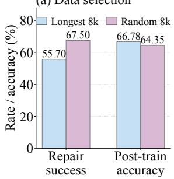

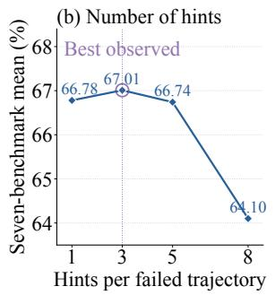

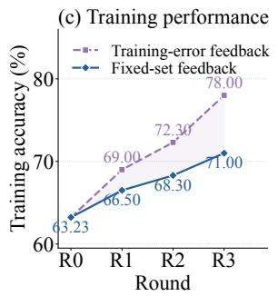

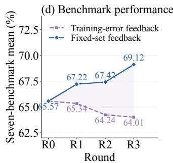

Fig. 5 Selection, hints, and feedback (Qwen3.5-9B). (a) Longest-8k versus random-8k questions: lower repair success can yield higher downstream accuracy. (b) Hint-count ablation uses the same longest-8k subset and run configuration as (a), with five continuation attempts; � = 1 reproduces its 66.78% single-hint baseline. Three hints perform best. (c,d) Training accuracy and seven-benchmark mean with training-error or fixed-set feedback. Feedback: 5,000 held-out questions.  
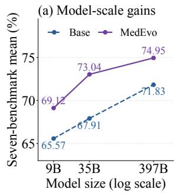

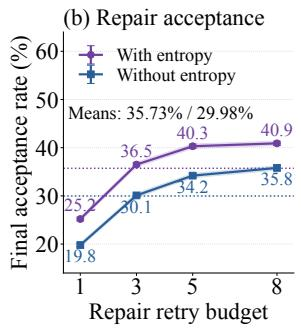

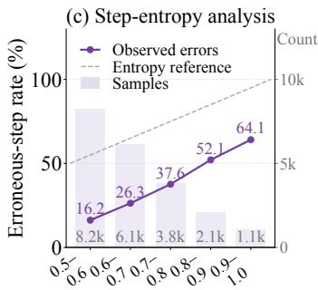

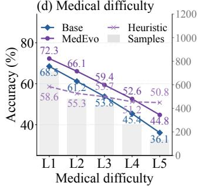  
Fig. 6 Scale, uncertainty, and dificulty. (a) Mean accuracy after R3 for 9B/35B and R2 for 397B. (b) Repair acceptance with/without entropy localization; pointwise 95% Wilson intervals use 45,000 attempts per setting. (c) Error rates and step counts by min–max-normalized step-entropy bin; the diagonal is $y = 1 0 0 x .$ (d) Accuracy on a modality-stratified 2,000-question subset of the feedback set; counts use the right axis. Heuristic is a training-free HHD-inspired hint-recovery baseline (Appendix A.6).

Further analyses. Fi . 6 summarizes additional re air anal ses. Entro localization increases final acce tance, defined as the fraction of repair candidates retained, at every continuation budget: from 19.8–35.8% to 25.2–40.9% for one to eight attempts (Fig. 6b). The erroneous-step rate rises from 16.2% to 64.1% across increasing entropy bins, supporting entropy as an audit prior (Fig. 6c). Relative to Base, MedEvo improves accuracy from 68.5% to 72.3% at L1 and from 36.1% to 44.8% at L5 (Fig. 6d). MedEvo exceeds Heuristic at L1–L4, while Heuristic attains 50.8% at L5 versus 44.8% for MedEvo.

## 6 Reliability Analysis

We assess repair reliability through human audit and MedEvo stability across independent runs.

## 6.1 Human Audit

Two reviewers inde endentl assess each trajector usin the same rubric and resolve disa reements throu h discussion. Pass rates use the resulting adjudicated binary labels. Cohen's � uses the independent labels before adjudication. Tab. 7 reports results for the audited sample of repaired trajectories. Annotators identify 95.5% of submitted trajectories as erroneous (� = 0.90) and validate 84.5% of the selected repair boundaries $( \kappa = 0 . 8 5 )$ . Hints are answer-blind in 97.2% of cases (� = 0.94). Repaired answers are judged correct in 88.3% of cases $( \kappa = 0 . 8 9 )$ , and 78.5% of repairs are judged image-grounded. Across the four error families, answer-correctness pass rates range from 88% to 89%, and grounding pass rates from 76% to 82%.

The audit assesses complementary answer correctness and visual grounding, with mar inal ass rates of 88.3% and 78.5%, respectively. Agreement is higher for answer correctness $( \kappa = 0 . 8 9 )$ than for grounding $( \kappa = 0 . 7 0 )$ . These findings support assessing answers and the visual evidence behind reasoning.

Tab. 7 Human audit of repaired trajectories. Adjudicated binary pass rates (%) and pre-adjudication Cohen's �. The 95% bootstrap CIs are for �, resampling trajectories with the two independent ratings paired. V/R/D/K: visual, reasoning, diferential-diagnosis, and knowledge errors. Repaired-output checks are shaded blue.
<table><tr><td></td><td colspan="2">Agreement</td><td colspan="3">Error family</td></tr><tr><td>Audit criterion</td><td>Pass (%) K</td><td>95% CI</td><td>V 1</td><td>R DK</td><td></td><td></td></tr><tr><td>Original trajectory erroneous</td><td></td><td>95.5 0.90 [0.83, 0.97]</td><td>96</td><td></td><td>96 94 96</td><td></td></tr><tr><td>Valid repair boundary</td><td></td><td>84.5 0.85 [0.66, 0.88]</td><td>88</td><td></td><td>84 82 84</td><td></td></tr><tr><td>No answer leakage in hint</td><td></td><td>97.2 0.94 [0.87, 1.00]</td><td></td><td>96</td><td>100 96 97</td><td></td></tr><tr><td>Image-grounded repaired reasoning</td><td></td><td>78.5 0.70 [0.58, 0.82] 76</td><td></td><td></td><td>80 76 82</td><td></td></tr><tr><td>Correct repaired answer</td><td></td><td>88.3 0.89 [0.81, 0.97]88</td><td></td><td></td><td>89 88 88</td><td></td></tr></table>

## 6.2 Stability across Random Seeds

Tab. 8 reports three independent training runs from the same Base checkpoint. The improvement is highly reproducible. Every run follows the ordering Base $< \mathrm { R 1 } < \mathrm { R 2 } < \mathrm { R 3 } ,$ and R3 averages $6 9 . 0 9 \% \pm 0 . 2 4 ,$ compared with 65.57% for Base. Even the weakest run reaches 68.84%, so the improvement far exceeds the variation across seeds. All three runs improve more from R2 to R3 than from R1 to R2.

Each round retrains from $M _ { 0 } ,$ so the evolving dataset carries information across rounds. Longer training runs can characterize the timing and saturation of these gains.

Tab. 8 Stability across training runs (Qwen3.5-9B). Seven-benchmark mean accuracy (%), three runs; all improve through R3. Sample standard deviation (SD); Δ: absolute gain over Base. Bold/underline: top two rounds; blue: R3.
<table><tr><td colspan="4">Model Seed 1 Seed 2 Seed 3  $\mathrm { M e a n } \pm \mathrm { S D }$ </td></tr><tr><td>Base</td><td>65.57</td><td>65.57 65.57</td><td> $6 5 . 5 7 \pm 0 . 0 0$ </td></tr><tr><td>R1</td><td>67.22</td><td>67.05</td><td>67.38  $6 7 . 2 2 \pm 0 . 1 7$  ↑1.65</td></tr><tr><td>R2</td><td>67.42</td><td>67.21 67.60</td><td> $\underline { { 6 7 . 4 1 } } \pm 0 . 2 0$  ↑1.84</td></tr><tr><td>R3</td><td>69.12</td><td>68.84</td><td>69.31  ${ \bf 6 9 . 0 9 \pm 0 . 2 4 }$  ↑3.52</td></tr></table>

## 7 Conclusion and Discussion

We introduced MedEvo to study how failed medical reasoning trajectories can become useful supervision. Knowledge Navigation links local repair to subsequent data selection: a gold-blind auditor provides a minimal, answer-free hint, the student preserves supported reasoning and regenerates the erroneous sufix, and a fixed feedback set directs later repairs toward remaining weaknesses. With SFT alone, MedEvo improves Qwen3.5-9B, Qwen3.5-35B, and Qwen3.5-397B across seven benchmarks, with consistent gains across the three Qwen3.5-9B runs. The central lesson from these experiments is that correcting a response and constructing useful supervision are diferent objectives. Preserving valid reasoning, selecting repairs for learning value, and using independent feedback each afect what the student learns. Their contribution should therefore be assessed through downstream learning, alongside repair success and evidence grounding.

## 7.1 Insights for Medical Self-Evolution

The practical question is how to allocate repair efort: which parts of a failed trajectory remain useful, which corrections should become training targets, and which capability gaps warrant new data.

From diagnosis to intervention. Medical tags describe the clinical context, while error types identify a recovery operation for the current trajectory. The two guide diferent decisions: tag-level feedback prioritizes questions, and local error diagnosis guides the hint and rollback boundary. The repair and feedback ablations (Tabs. 4 and 5) support this division of roles within MedEvo.

Evolution through supervision. The taxonomy and error codebook remain fixed in the present implementation; selection priorities and accepted supervision change with the student. Each round retrains from $M _ { 0 }$ on the updated dataset, so information passes across rounds through supervision. Regressions and persistent weaknesses then redirect subsequent repair efort.

Failed trajectories retain valuable reasoning. Sufix continuation outperforms full rewriting in both repair success and downstream accuracy (Tab. 4), supporting the value of preserving the valid prefix. In the trajectory-selection experiment, the longest-8k subset has lower repair success than random selection (55.70% vs. 67.50%) but yields higher downstream accuracy (66.78% vs. 64.35%; Fig. 5a). Repair success alone would therefore rank these two choices diferently from their downstream learning outcomes.

Repairability and learning value are diferent objectives. The com arison above shows a diver ence between re air success and learning value in the tested subsets; it does not isolate trajectory length from question dificulty. In the hint-count experiment, three hints yield the highest observed accuracy, only 0.23 percentage points above one hint, while five and eight hints perform worse (Fig. 5b). Guidance should be calibrated against subsequent learning, rather than increased solely to ease correction. Localization has a related distinction: the erroneous-step rate rises from 16.2% to 64.1% across entropy bins (Fig. 6c), making entropy a useful inspection cue in this analysis, while the evidence-grounded audit determines whether an error is present and where regeneration should begin.

The source of feedback matters. Training-error feedback improves fit to the training data while benchmark accuracy declines; fixed-set feedback improves benchmark accuracy across rounds (Fig. 5c,d). In these experiments, training failures supply repair candidates, while independent feedback helps prioritize capability gaps. The distinction prevents progress on the training examples from serving as the sole criterion for allocating later repair efort.

Answer correctness and grounding are complementary. The human audit assesses answer correctness and visual grounding separately (§ 6.1). Its results motivate checking evidence use alongside accuracy and hint non-leakage when admitting repaired trajectories as supervision.

## 7.2 Limitations and Future Directions

The current implementation has a fixed knowledge structure. Its taxonomy and error codebook constrain which weaknesses can be represented, and a strong proprietary auditor supplies the diagnoses. Evaluating open-source auditors and separating the efects of trajectory length from question dificulty would clarify these dependencies. Our benchmarks use multiple-choice and short-answer formats; deployment requires clinical evaluation.

From diagnosis to grounded recovery. Future work could study evidence-grounded recovery through source-attributed retrieval, factuality checks, and image-region supervision, evaluating answer leakage, grounding, and downstream learning jointly.

Adaptive navigation. Persistent failures could guide expert-validated updates to the taxonomy and recovery operations. Longer runs on independent data would help assess the regression, cost, and saturation of such knowledge-structure evolution.

Transferable learning strategies. Further studies could test repair transfer across modalities, specialties, and institutions, while accounting for annotation and auditor budgets. Relevant outcomes include transfer, rare-condition coverage, and robustness under distribution shift.

Declaration of Artificial Intelligence (AI) Assistance. AI tools were used solely for language editing, manuscript formatting, and figure preparation. They were not involved in method development or experimental design. All AI-assisted content was reviewed and revised by the authors, who take full responsibility for the final manuscript.

Reproducibility Statement. The main text and appendices describe the method, prompts, training configurations, and evaluation procedures. The present release is limited to the manuscript; the implementation and training-data files are not released. Use of the underlying public datasets remains subject to their licenses and access restrictions.

## References

[1] Shengjie Wang, Guanghe Li, Zonghan Yang, and Yang Gao. Hindsight hint distillation: Scafolded reasoning for SWE agents from cot-free answers. CoRR, abs/2605.11556, 2026. doi: 10.48550/arxiv.2605.11556. URL https://dblp.org/ rec/journals/corr/abs-2605-11556.

[2] Chunyuan Li, Clif Wong, Sheng Zhang, Naoto Usuyama, Haotian Liu, Jianwei Yang, Tristan Naumann, Hoifung Poon, and Jianfeng Gao. LLaVA-Med: Training a Large Language-and-Vision Assistant for Biomedicine in One Day. In Advances in Neural Information Processin S stems, 2023. URL https://dblp.org/rec/conf/nips/LiWZULYNPG23.

[3] Michael Moor, Qian Huan , Shirle Wu, Michihiro Yasuna a, Yash Dalmia, Jure Leskovec, C ril Zakka, Eduardo Pontes Reis, and Pranav Rajpurkar. Med-Flamingo: a Multimodal Medical Few-shot Learner. In Machine Learning for Health (ML4H), pages 353–367, 2023. URL https://dblp.org/rec/conf/ml4h/MoorHWYDLZRR23.

[4] Yuxin Zuo, Shang Qu, Yifei Li, Zhang-Ren Chen, Xuekai Zhu, Ermo Hua, Kaiyan Zhang, Ning Ding, and Bowen Zhou. Medxpertqa: Benchmarking expert-level medical reasoning and understanding. In International Conference on Machine Learning, volume 267, pages 80961–80990, 2025. URL https://dblp.org/rec/conf/icml/ZuoQLCZHZ0025.

[5] Gladys Tyen, Hassan Mansoor, Victor Carbune, Peter Chen, and Tony Mak. Llms cannot find reasoning errors, but can correct them given the error location. In Findings of the Association for Computational Linguistics, pages 13894–13908, 2024. URL https://dblp.org/rec/conf/acl/TyenMCCM24.

[6] Shengnan An, Zexiong Ma, Zeqi Lin, Nanning Zheng, Jian-Guang Lou, and Weizhu Chen. Learning From Mistakes Makes LLM Better Reasoner. arXiv re rint arXiv:2310.20689, 2023. URL https://arxiv.org/abs/2310.20689.

[7] Eric Zelikman, Yuhuai Wu, Jesse Mu, and Noah D. Goodman. STaR: Self-taught reasoner—bootstrapping reasoning with reasonin . In Advances in Neural Information Processin S stems, 2022. URL https://dblp.org/rec/conf/nips/ ZelikmanWMG22.

[8] Avi Singh, John D. Co-Reyes, Rishabh Agarwal, Ankesh Anand, Piyush Patil, Xavier Garcia, et al. Beyond human data: Scaling self-training for problem-solving with language models. arXiv preprint arXiv:2312.06585, 2023. URL https://arxiv.org/abs/2312.06585.

[9] Yaxuan Li, Yuxin Zuo, Bingxiang He, Jinqian Zhang, Chaojun Xiao, Cheng Qian, Tianyu Yu, Huan ang Gao, Wenkai Yang, Zhiyuan Liu, and Ning Ding. Rethinking on-policy distillation of large language models: Phenomenology, mechanism, and recipe. CoRR, abs/2604.13016, 2026. URL https://dblp.org/rec/journals/corr/abs-2604-13016.

[10] Jie Deng, Hanshuang Tong, Jun Li, Shining Liang, Ning Wu, Hongzhi Li, and Yutao Xie. Beyond rejection sampling: Trajectory fusion for scaling mathematical reasoning. In Maria Liakata, Viviane P. Moreira, Jiajun Zhang, and David Jurgens, editors, Findings of the Association for Computational Linguistics, ACL 2026, San Diego, California, United States, July 2-7, 2026, pages 7943–7959. Association for Computational Linguistics, 2026. doi: 10.18653/V1/2026.FINDINGS-ACL.390. URL https://doi.org/10.18653/v1/2026.findings-acl.390.

[11] LASA Team, Weiwen Xu, Hou Pong Chan, Long Li, Mahani Aljunied, et al. Lingshu: A Generalist Foundation Model for Unified Multimodal Medical Understanding and Reasoning. CoRR, abs/2506.07044, 2025. URL https://dblp.org/rec/ journals/corr/abs-2506-07044.

[12] Sahal Shaji Mullappilly, Mohammed Irfan Kurpath, Sara Pieri, Saeed Yahya Alseiari, Shanavas Cholakkal, Khaled Aldahmani, Fahad Khan, Rao Anwer, Salman Khan, Timoth Baldwin, and Hisham Cholakkal. Bimedix2: Bio-medical ex ert lmm for diverse medical modalities, 2024. URL https://arxiv.org/abs/2412.07769

[13] Andrew Sellergren, Sahar Kazemzadeh, Tiam Jaroensri, Atilla Kiraly, Madeleine Traverse, et al. MedGemma Technical Report. arXiv re rint arXiv:2507.05201, 2025. doi: 10.48550/arXiv.2507.05201. URL https://arxiv.org/abs/2507.05201.

[14] Zhuo Chen, Yichi Zhang, Yin Fang, Yuxia Geng, Lingbing Guo, Xiang Chen, Qian Li, Wen Zhang, Jiaoyan Chen, Yushan Zhu, Jiaqi Li, Xiaoze Liu, Jef Z. Pan, Ningyu Zhang, and Huajun Chen. Knowledge graphs meet multi-modal learning: A comprehensive survey. CoRR, abs/2402.05391, 2024. doi: 10.48550/ARXIV.2402.05391. URL https: //doi.org/10.48550/arXiv.2402.05391.

[15] Rahul Thapa, Qingyang Wu, Kevin Wu, Harrison Zhang, Angela Zhang, Eric Wu, Haotian Ye, Suhana Bedi, Nevin Aresh, Joseph Boen, Shriya Reddy, Ben Athiwaratkun, Shuaiwen Leon Song, and James Zou. Disentangling reasoning and knowled e in medical lar e lan ua e models. CoRR, abs/2505.11462, 2025. doi: 10.48550/arxiv.2505.11462. URL https://dblp.org/rec/journals/corr/abs-2505-11462.

[16] Zhaoyang Jiang, Xuanqi Peng, Fei Teng, Zhizhong Fu, Yunsoo Kim, Jiacong Mi, Zicheng Li, and Honghan Wu. Better accuracies, worse reasoning: A step-level audit of medical chain-of-thought distillation. CoRR, abs/2605.28301, 2026. doi: 10.48550/ARXIV.2605.28301. URL https://doi.org/10.48550/arXiv.2605.28301.

[17] Grifin Farrow, Lily Sijia Li, Jack Johnson, Tingyan Wang, Philip Torr, William Bolton, and Fabio J. Fehr. When Rubrics Fail: Hallucinations Reveal Blind Spots in Medical AI Evaluation. CoRR, abs/2609.12718, 2026. URL https://arxiv.org/ abs/2609.12718

[18] Hunter Li htman Vineet Kosaraju Yuri Burda Harrison Edwards Bowen Baker Tedd Lee Jan Leike John Schulman Il Sutskever, and Karl Cobbe. Let’s verif ste b ste . In International Conference on Learnin Re resentations, 2024. URL https://dblp.org/rec/conf/iclr/LightmanKBEBLLS24.

[19] Weihang Pan, Zhengxu Yu, Yuxiang Zhang, Wenzhi Li, Zhongming Jin, Binbin Lin, Xiaofei He, and Jieping Ye. ChainPrune: Evaluating and Reducing Redundancy in Long Chain-of-Thought Reasoning. CoRR, abs/2608.21860, 2026. URL https: //arxiv.org/abs/2608.21860v1.

[20] Randy Ardywibowo, Arnav Dalal, and Jiantao Jiao. A Good Self-Teacher Meets the Student Where They Are: Joint On-Policy Learning and Teaching, 2026. URL https://arxiv.org/abs/2610.10447.

[21] Bing Wang, Shaotian Yan, Chen Shen, Kaiyuan Liu, Sinan Fan, Ximing Li, Rui Miao, Xiaosong Yuan, Zhanming Shen, and Jieping Ye. Backtracking when it strays: Mitigating dual exposure biases in LLM reasoning distillation. CoRR, abs/2605.19433 2026. doi: 10.48550/ARXIV.2605.19433. URL https://doi.org/10.48550/arXiv.2605.19433.

[22] So hia Xiao Pu, Yumo Xu, Sailik Sen u ta, Millennium Bisma , Ruixue Lian, James Gun , Yi-An Lai, and Arshit Gu ta. Selective regenerative decoding: Trajectory-level intervention for inference-time reasoning. CoRR, abs/2608.24338, 2026. doi: 10.48550/ARXIV.2608.24338. URL https://doi.org/10.48550/arXiv.2608.24338.

[23] Haoxiang Zhang, Qinglin Chen, Hiroaki Hayashi, Zhuofeng Li, Siming Zhang, Jiaxin Zhang, Jixuan Chen, Fang Wu, Pan Lu, Silvio Savarese, Julian McAuley, and Chien-Sheng Wu. Self-Retrospection Distillation: Turning Post-hoc Experiences into Prior Foresight, 2026. URL https://arxiv.org/abs/2610.08077.

[24] Zhilin Huang, Hang Gao, Ziqiang Dong, Yuan Chen, Yifeng Luo, Chujun Qin, Jingyi Wang, Yang Yang, and Guanjun Jiang. Learning from your own mistakes: Constructing learnable micro-reflective trajectories for self-distillation. CoRR, abs/2606.18844 2026. doi: 10.48550/ARXIV.2606.18844. URL https://doi.org/10.48550/arXiv.2606.18844.

[25] Ruoyu Wu, Shenfu Xie, Yinqian Sun, Haibo Tong, and Feifei Zhao. MediSkill-Evo: Process-Constrained Self-Evolution for Evidence-Grounded Clinical Interaction. CoRR, abs/2608.23397, 2026. URL https://arxiv.org/abs/2608.23397v2.

[26] Yexiao He, Yucheng Tang, Pengfei Guo, Yufan He, Andriy Myronenko, Can Zhao, Ang Li, Daguang Xu, and Dong Yang. Frozen Models, Evolving Expertise: Model-Agnostic Learning from Deployment Experience for Multimodal Medical AI, 2026. URL https://arxiv.org/abs/2610.09146

[27] Ming Li, Yong Zhang, Zhitao Li, Jiuhai Chen, Lichang Chen, Ning Cheng, Jianzong Wang, Tianyi Zhou, and Jing

Xiao. From quantity to quality: Boosting llm performance with self-guided data selection for instruction tuning. In Proceedin s of the Conference of the North American Cha ter of the Association for Com utational Lin uistics, 2024. URL https://dblp.org/rec/conf/naacl/LiZLCC0W0024.

[28] Qwen Team. Qwen3.5: Towards native multimodal agents, February 2026. URL https://qwen.ai/blog?id=qwen3.5.

[29] Son tao Jian , Yuan Wan , Sibo Son , Tianxian Hu, Chen i Zhou, Bin Pu, Yan Zhan , Zhibo Yan , Yan Fen , Joe Tian Zhou, Jin Hao, Zijian Chen, Ruijia Wu, Tao Tang, Junhui Lv, Hongxia Xu, Hongwei Wang, Jun Xiao, Bin Feng, Fudong Zhu, Kenli Li, Weidi Xie, Jimeng Sun, Jian Wu, and Zuozhu Liu. Hulu-med: A transparent generalist model towards holistic medical vision-language understanding, 2025. URL https://arxiv.org/abs/2510.08668.

[30] Xiaoman Zhang, Chaoyi Wu, Ziheng Zhao, Weixiong Lin, Ya Zhang, Yanfeng Wang, and Weidi Xie. PMC-VQA: Visual Instruction Tuning for Medical Visual Question Answering. arXiv preprint arXiv:2305.10415, 2023. URL https: //arxiv.org/abs/2305.10415.

[31] Jason J. Lau, Soumya Gayen, Asma Ben Abacha, and Dina Demner-Fushman. A dataset of clinically generated visual questions and answers about radiology images. Scientific Data, 5:180251, 2018. doi: 10.1038/sdata.2018.251.

[32] Bo Liu, Li-Ming Zhan, Li Xu, Lin Ma, Yan Yang, and Xiao-Ming Wu. SLAKE: A Semantically-Labeled Knowledge-Enhanced Dataset for Medical Visual Question Answering. CoRR, abs/2102.09542, 2021. URL https://dblp.org/rec/journals/ corr/abs-2102-09542.

[33] Xuehai He, Yichen Zhang, Luntian Mou, Eric Xing, and Pengtao Xie. PathVQA: 30000+ Questions for Medical Visual Question Answering. CoRR, abs/2003.10286, 2020. URL https://dblp.org/rec/journals/corr/abs-2003-10286.

[34] Yutao Hu, Tianbin Li, Quanfeng Lu, Wenqi Shao, Junjun He, Yu Qiao, and Ping Luo. OmniMedVQA: A New Large-Scale Comprehensive Evaluation Benchmark for Medical LVLM. In IEEE/CVF Conference on Computer Vision and Pattern Recognition, pages 22170–22183, 2024. doi: 10.1109/CVPR52733.2024.02093. URL https://dblp.org/rec/conf/cvpr/ HuLLSHQL24.

[35] Xiang Yue, Yuansheng Ni, Tianyu Zheng, Kai Zhang, Ruoqi Liu, Ge Zhang, Samuel Stevens, Dongfu Jiang, Weiming Ren, Yuxuan Sun, Cong Wei, Botao Yu, Ruibin Yuan, Renliang Sun, Ming Yin, Boyuan Zheng, Zhenzhu Yang, Yibo Liu, Wenhao Huang, Huan Sun, Yu Su, and Wenhu Chen. MMMU: A Massive Multi-discipline Multimodal Understanding and Reasoning Benchmark for Expert AGI. In IEEE/CVF Conference on Computer Vision and Pattern Recognition, pages 9556–9567, 2023. doi: 10.1109/CVPR52733.2024.00913. URL https://dblp.org/rec/conf/cvpr/YueNZ0LZSJRSWYY24.

[36] Junying Chen, Ruyi Ouyang, Anningzhe Gao, Shunian Chen, Guiming Hardy Chen, Xidong Wang, Ruifei Zhang, Zhenyang Cai, Ke Ji, Guangjun Yu, Xiang Wan, and Benyou Wang. Huatuogpt-vision, towards injecting medical visual knowledge into multimodal llms at scale. CoRR, abs/2406.19280, 2024. doi: 10.48550/ARXIV.2406.19280. URL https://doi.org/10.48550/arXiv.2406.19280.

[37] Zhe Chen, Weiyun Wang, Yue Cao, Yangzhou Liu, Zhangwei Gao, Erfei Cui, Jinguo Zhu, Shenglong Ye, Hao Tian, Zhaoyang Liu, Lixin Gu, Xuehui Wang, Qingyun Li, Yimin Ren, Zixuan Chen, Jiapeng Luo, Jiahao Wang, Tan Jiang, Bo Wang, Conghui He, Botian Shi, Xingcheng Zhang, Han Lv, Yi Wang, Wenqi Shao, Pei Chu, Zhongying Tu, Tong He, Zhiyong Wu, Huipeng Deng, Jiaye Ge, Kai Chen, Min Dou, Lewei Lu, Xizhou Zhu, Tong Lu, Dahua Lin, Yu Qiao, Jifeng Dai, and Wenhai Wang. Expanding performance boundaries of open-source multimodal models with model, data, and test-time scaling. CoRR, abs/2412.05271, 2024. doi: 10.48550/ARXIV.2412.05271. URL https://doi.org/10.48550/arXiv.2412.05271.

[38] Jinguo Zhu, Weiyun Wang, Zhe Chen, Zhaoyang Liu, Shenglong Ye, Lixin Gu, Hao Tian, Yuchen Duan, Weijie Su, Jie Shao, Zhangwei Gao, Erfei Cui, Xuehui Wang, Yue Cao, Yangzhou Liu, Xingguang Wei, Hongjie Zhang, Haomin Wang, Weiye Xu, Hao Li, Jiahao Wang, Nianchen Deng, Songze Li, Yinan He, Tan Jiang, Jiapeng Luo, Yi Wang, Conghui He, Botian Shi, Xingcheng Zhang, Wenqi Shao, Junjun He, Yingtong Xiong, Wenwen Qu, Peng Sun, Penglong Jiao, Han Lv, Lijun Wu, Kaipeng Zhang, Huipeng Deng, Jiaye Ge, Kai Chen, Limin Wang, Min Dou, Lewei Lu, Xizhou Zhu, Tong Lu, Dahua Lin, Yu Qiao, Jifeng Dai, and Wenhai Wang. Internvl3: Exploring advanced training and test-time recipes for open-source multimodal models. CoRR, abs/2504.10479, 2025. doi: 10.48550/ARXIV.2504.10479. URL https://doi.org/10.48550/arXiv.2504.10479.

[39] Tianwei Lin, Wenqiao Zhang, Sijing Li, Yuqian Yuan, Binhe Yu, Haoyuan Li, Wanggui He, Hao Jiang, Mengze Li, Xiaohui Song, Siliang Tang, Jun Xiao, Hui Lin, Yueting Zhuang, and Beng Chin Ooi. Healthgpt: A medical large vision-language model for unifying comprehension and generation via heterogeneous knowledge adaptation. In Aarti Singh, Maryam Fazel, Daniel Hsu, Simon Lacoste-Julien, Felix Berkenkamp, Tegan Maharaj, Kiri Wagstaf, and Jerry Zhu, editors, Forty-second International Conference on Machine Learning, ICML 2025, Vancouver, BC, Canada, July 13-19, 2025, volume 267 of Proceedings of Machine Learning Research. PMLR / OpenReview.net, 2025. URL https: //proceedings.mlr.press/v267/lin25n.html.

[40] Jun in Chen, Zhen an Cai, Ke Ji, Xidon Wan , Wanlon Liu, Ron shen Wan , Jian e Hou, and Ben ou Wan . HuatuoGPT-o1, Towards Medical Complex Reasoning with LLMs. arXiv preprint arXiv:2412.18925, 2024. URL https: //arxiv.org/abs/2412.18925.

[41] Chi Liu, Derek Li, Yan Shu, Robin Chen, Derek Duan, Teng Fang, and Bryan Dai. Fleming-r1: Toward expert-level medical reasoning via reinforcement learning. CoRR, abs/2509.15279, 2025. doi: 10.48550/arxiv.2509.15279. URL https://dblp.org/rec/journals/corr/abs-2509-15279.

[42] Haolin Li, Shuyang Jiang, Ruipeng Zhang, Jiangchao Yao, Ya Zhang, and Yanfeng Wang. Eliciting medical reasoning with knowledge-enhanced data synthesis: A semi-supervised reinforcement learning approach. In Maria Liakata, Viviane P. Moreira, Jiajun Zhang, and David Jurgens, editors, Findings of the Association for Computational Linguistics, ACL 2026,

San Diego, California, United States, July 2-7, 2026, pages 2847–2870. Association for Computational Linguistics, 2026. doi: 10.18653/V1/2026.FINDINGS-ACL.137. URL https://doi.org/10.18653/v1/2026.findings-acl.137.

[43] Jianwen Chen, Xinyu Yang, Peng Xia, Arian Azarang, Yueh Z. Lee, Gang Li, Hongtu Zhu, Yun Li, Beidi Chen, and Huaxiu Yao. Medverse: Eficient and reliable medical reasoning via dag-structured parallel execution. In Maria Liakata, Viviane P. Moreira, Jiajun Zhang, and David Jurgens, editors, Proceedings of the 64th Annual Meeting of the Association for Computational Linguistics (Volume 1: Long Papers), ACL 2026, San Diego, California, United States, July 2-7, 2026, pages 15320–15336. Association for Computational Linguistics, 2026. doi: 10.18653/V1/2026.ACL-LONG.699. URL https://doi.org/10.18653/v1/2026.acl-long.699.

[44] Yu Zhao, Hao Guan, Yongcheng Jing, Ying Zhang, and Dacheng Tao. Medcog: Maximizing LLM inference density in medical reasoning via meta-cognitive regulation. CoRR, abs/2602.07905, 2026. doi: 10.48550/ARXIV.2602.07905. URL https://doi.org/10.48550/arXiv.2602.07905.

[45] Peng Xia, Jinglu Wang, Yibo Peng, Kaide Zeng, Zihan Dong, Xian Wu, Xiangru Tang, Hongtu Zhu, Yun Li, Linjun Zhang, Shujie Liu, Yan Lu, and Huaxiu Yao. MMedAgent-RL: Optimizing Multi-Agent Collaboration for Multimodal Medical Reasoning. In International Conference on Learning Representations, 2026. URL https://dblp.org/rec/journals/ corr/abs-2506-00555.

[46] Sicheng Yang, Hangjie Yuan, Wenjun Zhang, Jinwang Wang, Yichen Qian, Weihua Chen, Fan Wang, and Lei Zhu. Clinhallu: A benchmark for diagnosing stage-wise hallucinations in medical MLLM reasoning. CoRR, abs/2606.14697, 2026. doi: 10.48550/ARXIV.2606.14697. URL https://doi.org/10.48550/arXiv.2606.14697.

[47] Juekai Lin, Honglin Lin, Yuqian Yuan, Xiaolong Wu, Jie Cao, Liang Liang, Yunqi Cao, Yun Zhu, Wenqiao Zhang, and Lijun Wu. MMVistaReason: Toward open-data and post-training recipes for multimodal reasoning. CoRR, abs/2610.01352, 2026. doi: 10.48550/ARXIV.2610.01352. URL https://arxiv.org/abs/2610.01352.

[48] Honglin Lin, Zheng Liu, Yun Zhu, Chonghan Qin, Juekai Lin, Xiaoran Shang, Conghui He, Wentao Zhang, and Lijun Wu. Mmfinereason: Closing the multimodal reasoning gap via open data-centric methods. CoRR, abs/2601.21821, 2026. doi: 10.48550/ARXIV.2601.21821. URL https://doi.org/10.48550/arXiv.2601.21821.

[49] Abhranil Chandra, Ayush Agrawal, Arian Hosseini, Sebastian Fischmeister, Rishabh Agarwal, Navin Goyal, and Aaron Courville. Shape of thought: When distribution matters more than correctness in reasoning tasks. arXiv preprint arXiv:2512.22255 2025.

[50] Zhanming Shen, Jintao Tong, Shaotian Yan, Chen Shen, Hao Chen, Wentao Ye, Xiaomeng Hu, Rui Miao, Haobo Wang, Junbo Zhao, Gang Chen, and Jieping Ye. Purified OPSD: on-policy self-distillation without losing how to think. CoRR, abs/2607.02234, 2026. doi: 10.48550/arxiv.2607.02234. URL https://dblp.org/rec/journals/corr/ abs-2607-02234.

[51] Zhinan Hou et al. What Matters in On-Policy Distillation? A Perspective on Data Eficiency and Data Selection. arXiv preprint arXiv:2609.05198, 2026. URL https://arxiv.org/abs/2609.05198.

[52] Zixuan Fu et al. Rethinking On-Policy Distillation of Large Language Models II: One Training Example. arXiv preprint arXiv:2609.04172, 2026. URL https://arxiv.org/abs/2609.04172.

[53] Aman Madaan Niket Tandon Prakhar Gu ta Sk ler Hallinan Lu u Gao Sarah Wie refe Uri Alon Nouha Dziri Shrima Prabhumoye, Yiming Yang, Shashank Gupta, Bodhisattwa Prasad Majumder, Katherine Hermann, Sean Welleck, Amir Yazdanbakhsh, and Peter Clark. Self-refine: Iterative refinement with self-feedback. In Advances in Neural Information Processing Systems, volume 36, pages 46534–46594, 2023. doi: 10.52202/075280-2019. URL https://dblp.org/rec/ conf/nips/MadaanTGHGW0DPY23.

[54] Noah Shinn, Federico Cassano, Ashwin Gopinath, Karthik Narasimhan, and Shunyu Yao. Reflexion: language agents with verbal reinforcement learnin . In Advances in Neural Information Processin S stems, volume 36, 2023. URL https://dblp.org/rec/conf/nips/ShinnCGNY23

[55] Li-Cheng Lan, Andrew Bai, Minhao Cheng, Cho-Jui Hsieh, and Tianyi Zhou. Exploring Expert Failures Improves LLM A ent Tunin . arXiv re rint arXiv:2504.13145, 2025. URL https://arxiv.org/abs/2504.13145.

[56] Dongyi Lv et al. FailForge: Distilling Procedural Competence from Persistent Failures into Code Agents. arXiv preprint arXiv:2608.08570, 2026. URL https://arxiv.org/abs/2608.08570.

[57] Rajiv Shailesh Chitale, Rahul Madhavan, Taneesh Gupta, Deepanway Ghosal, and Aravindan Raghuveer. Test-time scaling via error localization. CoRR, abs/2607.21453, 2026. doi: 10.48550/ARXIV.2607.21453. URL https://doi.org/10.48550/ arXiv.2607.21453.

[58] Aviral Kumar Vincent Zhuan Rishabh A arwal Yi Su John D. Co-Re es Avi Sin h Kate Baumli Shari I bal Colton Bishop, Rebecca Roelofs, Lei M. Zhang, Kay McKinney, Disha Shrivastava, Cosmin Paduraru, George Tucker, Doina Precup, Feryal M. P. Behbahani, and Aleksandra Faust. Training language models to self-correct via reinforcement learning. In International Conference on Learning Representations, 2025. URL https://dblp.org/rec/conf/iclr/ KumarZASCSBIBRZ25.

[59] Aradhya Dixit, Tianxi Liang, and Jai Telang. Project aletheia: Verifier-guided distillation of backtracking for small language models. arXiv preprint arXiv:2601.14290, 2026.

[60] Dmitr Beresnev Vladimir Makharev Roman Khalikov Ivan V. Oseledets and Petr Anokhin. Search fail recover: A training framework for correction-aware reasoning. CoRR, abs/2607.07492, 2026. doi: 10.48550/ARXIV.2607.07492. URL https://doi.org/10.48550/arXiv.2607.07492.

[61] Xinbang Dai, Zheyu Xin, Huikang Hu, Lin Ren, Rihui Jin, Guohui Xiao, Kuicai Dong, Zhaocheng Du, and Yuyang Zhang. Evothink: Evolving thinking in large reasoning models via self-pruning and aha-moment preference optimization. In

Proceedings of the Thirty-Fifth International Joint Conference on Artificial Intelligence and the 29th European Conference on Artificial Intelligence, IJCAI/ECAI 2026, Bremen, Germany, 15-21 August 2026, pages 5693–5701. ijcai.org, 2026. doi: 10.24963/IJCAI.2026/634. URL https://doi.org/10.24963/ijcai.2026/634.

[62] Ziqi Zhao, Xinyu Ma, Liu Yang, Yujie Feng, Daiting Shi, Jingzhou He, Xin Xin, Zhaochun Ren, and Xiao-Ming Wu. ROSD: reflective on-policy self-distillation for language model reasoning across domains. CoRR, abs/2605.28014, 2026. doi: 10.48550/ARXIV.2605.28014. URL https://doi.org/10.48550/arXiv.2605.28014.

[63] Yi Duan Yin Liu Zirui Tan Haodon Chen Jun Zhou Yumou Liu et al. The Last AI Built b Humans: Toward Genuine Recursive Self-Improvement. arXiv preprint arXiv:2609.11873, 2026. URL https://arxiv.org/abs/2609.11873.

[64] Bo Yin Qi Li and Xinchao Wan . On-Polic Self-Evolution via Failure Trajectories for A entic Safet Ali nment. arXiv preprint arXiv:2605.11882, 2026. URL https://arxiv.org/abs/2605.11882.

[65] Zhen an Yan et al. RedFlow: Redirect Failure into Action-Level Corrections for Flow-matchin VLA Polic . arXiv preprint arXiv:2607.27782, 2026. URL https://arxiv.org/abs/2607.27782.

[66] Ganlong Zhao et al. FLARE: A Failure-Aware Framework for Autonomous Correction and Recovery in Visual-Language Robotic Manipulation. arXiv preprint arXiv:2608.26645, 2026. URL https://arxiv.org/abs/2608.26645.

[67] Xiaoyu Luo, Tao Ren, Wenrui Yu, Xiao Li, Qiongxiu Li, and Johannes Bjerva. Capable yet Parsimonious: Extracting and Characterizing Hidden Chain-of-Thought in Frontier Models. arXiv preprint arXiv:2609.26637, 2026. URL https: //arxiv.org/abs/2609.26637.

[68] Zheng Liu, Honglin Lin, Xiaoyang Wang, Xin Gao, Yu Li, Mengzhang Cai, Yun Zhu, Zhanping Zhong, Qizhi Pei, Zhuosh Pan, Xiaoran Shang, Conghui He, Bin Cui, Wentao Zhang, and Lijun Wu. Chartverse: Scaling chart reasoning via reliable programmatic synthesis from scratch. In Maria Liakata, Viviane P. Moreira, Jiajun Zhang, and David Jurgens, editors, Proceedin s of the 64th Annual Meetin of the Association for Com utational Lin uistics (Volume 1: Lon Pa ers), ACL 2026, San Diego, California, United States, July 2-7, 2026, pages 7551–7577. Association for Computational Linguistics, 2026. doi: 10.18653/V1/2026.ACL-LONG.344. URL https://doi.org/10.18653/v1/2026.acl-long.344.

[69] Johnn Greco et al. NeMo Data Desi ner: An Extensible Framework for Multimodal S nthetic Data Generation. arXiv preprint arXiv:2609.17699, 2026. URL https://arxiv.org/abs/2609.17699.

[70] Fanqing Meng, Lingxiao Du, Qiguang Chen, Ziqi Zhao, Haocheng Lu, Mengkang Hu, and Michael Qizhe Shieh. Rsibench-data: Benchmarkin data-centric research for recursive self-im rovement. CoRR, abs/2607.25886, 2026. doi: 10.48550/ARXIV.2607.25886. URL https://doi.org/10.48550/arXiv.2607.25886.

[71] Tong Zheng et al. Dream-RSI: Recursive Self-Improvement through Evolving Worlds. arXiv preprint arXiv:2609.14858, 2026. URL https://arxiv.org/abs/2609.14858.

[72] Junqi Liu, Yufan He, Yexiao He, Pengfei Guo, Dong Yang, Andriy Myronenko, Can Zhao, Hanrong Ye, Tianhao Qi, Yuyin Zhou, Daguang Xu, and Yucheng Tang. Bat: Towards self-evolving medical research agent with stage rubrics. CoRR, abs/2608.16211, 2026. doi: 10.48550/ARXIV.2608.16211. URL https://doi.org/10.48550/arXiv.2608.16211.

## Appendix Contents and Reading Guide

This guide links to each supplementary section and its starting page.

<table><tr><td>Section</td><td>Contents</td><td>Page</td></tr><tr><td>A</td><td>Method Details. Algorithms, mathematical formulation, and implementation of navigation and local repair.</td><td>20</td></tr><tr><td>A.1</td><td>Failure Definition and Step Segmentation. Failed answers, semantic steps, and prefix boundaries.</td><td>20</td></tr><tr><td>A.2</td><td>Entropy-Based Localization. Step scores, audit windows, and proposal assessment.</td><td>20</td></tr><tr><td>A.3</td><td>Gold-Blind Audit and Recovery Operators. Auditor inputs, recovery hints, and cue rendering.</td><td>20</td></tr><tr><td>A.4</td><td>Continuation, Admission, and Training Targets. Budgets, learnability gates, admission, and fallback.</td><td>21</td></tr><tr><td>A.5</td><td>Feedback Statistics, Quota Allocation, and Dataset Update. Transitions, quotas, retrieval, and target replacement.</td><td>21</td></tr><tr><td>A.6</td><td>Settings of Analysis Experiments. Repair, feedback, hint-count, and entropy comparisons.</td><td>21</td></tr><tr><td>B</td><td>Dataset Statistics. Dataset sizes and roles, round-wise construction counts, and detailed feedback- set measurements.</td><td>22</td></tr><tr><td>B.3</td><td>Additional Experimental Details. Evolution of twenty error subtypes, plus round-wise modality and error-family statistics.</td><td>23</td></tr><tr><td>B.4</td><td>Detailed Error Statistics for the Current Rounds. Numerical rates for all twenty subtypes and repair attempts, successes, and success rates by error family.</td><td>24</td></tr><tr><td>C</td><td>Medical Taxonomy and Error Categories. Medical tags, error definitions, information-access rules, and reproducibility specifications.</td><td>25</td></tr><tr><td>C.1</td><td>Taxonomy, Permissions, and Execution Contracts. Four-axis tag dictionary; four error families and twenty subtypes; access matrix; structured records and plan validation; training configuration and evaluation scope.</td><td>25</td></tr><tr><td>D</td><td>Prompts. Templates for answering questions, planning feedback-driven rounds, auditing failures, and continuing repaired trajectories.</td><td>29</td></tr><tr><td>D.1</td><td>Shared Question-Answering Prompt. The common question-answering instruction.</td><td>29</td></tr><tr><td>D.2</td><td>Main-Agent Feedback and Next-Round Planning. Inputs, constraints, and structured outputs for diagnosing weaknesses and planning the next training round.</td><td>29</td></tr><tr><td>D.3</td><td>Stage 1 Audit Prompt. Failure diagnosis, localization, and construction of an error-conditioned recovery cue.</td><td>29</td></tr><tr><td>D.4</td><td>Stage 2 Continuation Prompt. Same-student continuation from the retained prefix and recovery cue.</td><td>31</td></tr><tr><td>E</td><td>Case Study. Worked radiograph examples showing the question, image, retained prefix, hint, and continuation.</td><td>32</td></tr><tr><td>E.1</td><td>Case 08: Chest radiograph. Chest-image example of local trajectory repair.</td><td>32</td></tr><tr><td>E.2</td><td>Case 31: Elbow radiograph. Elbow-image example of local trajectory repair.</td><td>33</td></tr><tr><td>F</td><td>Additional Related Work. Extended medical-AI background, hallucinations, supervision quality, correction methods, and broader self-evolution settings.</td><td>34</td></tr><tr><td>G</td><td>Additional Baseline Details. Backbones, comparison models, trajectory-supervision baselines, and the evaluation protocol.</td><td>36</td></tr></table>

## A Method Details

This appendix provides implementation details that complement $\ S 3$ . Within round $t ,$ the generator $M _ { t } = \pi _ { \theta _ { t } }$ is frozen: it produces rollouts, entropy profiles, continuations, and learnability scores, while the next student is trained from $\mathrm { { \dot { M } _ { 0 } } ( E q . 1 7 ) }$

## A.1 Failure Definition and Step Segmentation

Given a question $x = ( I , q , O )$ with reference answer $y \in O , M _ { t }$ samples a trajectory � and a parsed answer �ˆ. A trajectory �− fails if $\hat { y } \ne y$ or no valid answer can be parsed. Each failed trajectory is segmented into � semantically complete steps $( \operatorname { E q } . 2 )$ , typically covering image observation, feature interpretation, mechanism, diferential diagnosis, and option mapping. A boundary $b \ \in \ \{ 0 , \ldots , K - 1 \}$ } splits $r ^ { - }$ into the preserved prefix $p _ { b } = \left( s _ { 1 } , \ldots , s _ { b } \right)$ and the erroneous sufix $s ^ { - } = ( s _ { b + 1 } , \ldots , s _ { K } ) ( { \mathrm { E q . ~ } } 8 )$ , where $b = 0$ denotes an empty prefix.

## A.2 Entropy-Based Localization

Step scores. Token entropy $H _ { j } ,$ the step score $E _ { k } ^ { * } ,$ and the local surge $\Delta E _ { k }$ follow Eqs. 3–5, with entropy measured in nats. We use $\lambda = 0 . 5$ and $m = 3$ , with $m _ { k } = \operatorname* { m i n } ( m , k - 1 )$ for $k > 1$ and $\Delta E _ { 1 } = 0$ . Combining the mean with the 90th percentile $Q _ { 0 . 9 }$ balances average uncertainty with an upper-tail signal within each step.

Anchor and window. Both profiles are min–max normalized within each trajectory, giving $\widetilde { E } _ { k } ^ { * }$ and $\widetilde { \Delta E } _ { k } ,$ a constant profile maps to zero. The anchor is $k ^ { \ast } \in$ arg $\mathrm { m a x } _ { 1 \leq k \leq K } \big ( \widetilde { E } _ { k } ^ { * } + \widetilde { \Delta E } _ { k } \big ) .$ , and the audit window is

$$
\mathcal { W } ( k ^ { * } ) = \{ s _ { \operatorname* { m a x } ( 1 , k ^ { * } - w _ { \ell } ) } , \ldots , s _ { \operatorname* { m i n } ( K , k ^ { * } + w _ { r } ) } \} , \qquad w _ { \ell } = w _ { r } = 1 .\tag{18}
$$

The step preceding the window defines a provisional boundary

$$
b _ { 0 } = \operatorname* { m a x } ( 0 , \ k ^ { * } - w _ { \ell } - 1 ) .\tag{19}
$$

Both $\mathcal { W } ( k ^ { * } )$ and $b _ { 0 }$ are proposals; the auditor sets the final boundary � (Appendix A.3).

Proposal assessment. For every audited trajectory, the auditor classifies the entropy proposal as HIT (the first consequential error lies at or adjacent to $k ^ { * } )$ , PARTIAL\_HIT (the window covers the propagated error, but the unsupported premise begins earlier), MISS (the first error lies outside the window), or NON\_ERROR\_UNCERTAINTY (the high-entropy region is medically and logically valid). These logged labels support Fig. 6c.

## A.3 Gold-Blind Audit and Recovery Operators

Auditor. We use GPT-5.6-sol as the auditor � in Eq. 7. Its inputs are the images, the question and options, the failed trajectory, the entropy profile $( E _ { k } ^ { * } ,$ normalized scores, $\Delta E _ { k } , \ \hat { k } ^ { * } , \mathrm { a n d } \ \mathcal { W } ( k ^ { * } ) )$ , and observable tags with provenance. The reference answer reference rationale answer-derived ta s and retrieval metadata are excluded through allowlist serialization (Appendix C.1.3). The auditor returns a structured record (Appendix D.3) containing an action in {Repair, Skip}, the first consequential error � with its type and subtype, the boundary � with a verbatim ending span (from $s _ { b }$ if $b > 0 ,$ empty if $b = 0 ) .$ , and the hint ℎ. It returns Skip when onl answer formattin or option selection is wrong and no reasoning revision is justified. The final boundary may difer from $b _ { 0 }$ . The auditor traces evidence dependencies backward and moves the boundary earlier when a later entropy surge stems from an upstream unsupported premise; conversely, it retains a high-entropy step that is medically and logically valid.

Recovery operators. An error type selects a recovery operator $o ;$ the text hint ℎ instantiates that operator in natural language. The operator belongs to

$$
o \in \{ \mathcal { P } _ { \mathrm { i n s p e c t } } , \mathcal { R } _ { \mathrm { r e c o n s t r u c t } } , \mathcal { D } _ { \mathrm { d i s a m b i g u a t e } } , \mathcal { K } _ { \mathrm { b r i d g e } } \} ,\tag{20}
$$

each paired with a parent error type (§ 3.1.2); subtype-level operations are listed in Appendix C.1.2. Operators define recovery actions.

• Perceptual re-examination $( { \mathcal { P } } _ { \mathrm { i n s p e c t } } )$ names a region or attribute to revisit: lesion distribution, boundary shape, waveform morphology, stain localization, or cross-view consistency, without stating the finding.

• Inference reconstruction $( \mathcal { R } _ { \mathrm { r e c o n s t r u c t } } )$ asks students to link evidence, mechanism, diagnosis, and decision, for example when supportive and causal treatments are confused or care steps are misordered.

• Diferential disambiguation $( { \mathcal { D } } _ { \mathrm { d i s a m b i g u a t e } } )$ requests comparison of discriminative features: contrast pattern, onset profile, lesion location, signature pathology, or an exclusion criterion, without naming the diagnosis.

• Knowledge bridging $( \mathcal { K } _ { \mathrm { b r i d g e } } )$ supplies a narrowly scoped concept, such as a diagnostic criterion, drug mechanism, or immunohistochemical localization rule. It may state the concept but must not map it to an answer option.

Rendering. The cue $g ( h )$ consists of a natural transition followed by the hint, with flexible wording. Error labels and audit explanations are stored as metadata and are never shown to the student.

## A.4 Continuation, Admission, and Training Targets

Continuation budget. The current checkpoint generates eight rollouts per selected question. Each failed trajectory selected for repair is audited once and receives a single hint. With $p _ { b } \oplus g ( h )$ fixed, up to five sufixes are sampled $( \operatorname { E q . 9 } ) ;$ sampling stops at the first admitted continuation. The user messa e contains �, the unfinished assistant message contains $p _ { b } \oplus g ( h )$ , and generation continues within the same message without repeating or modifying the prefix (Appendix D.4)

Learnability gate. Using the sufix scores $D _ { \mathrm { r e p a i r } }$ and $\Delta _ { \mathrm { r e p a i r } }$ (Eqs. 10–11), computed under $M _ { t }$ without the hint,

$$
L _ { \xi } = \mathbb { 1 } \left[ D _ { \mathrm { m i n } } \le D _ { \mathrm { r e p a i r } } ( \xi ) \le D _ { \mathrm { m a x } } \ \wedge \ \Delta _ { \mathrm { m i n } } \le \Delta _ { \mathrm { r e p a i r } } ( \xi ) \le \Delta _ { \mathrm { m a x } } \right] ,\tag{21}
$$

with $\left[ D _ { \operatorname* { m i n } } , D _ { \operatorname* { m a x } } \right] = \left[ 0 . 3 5 , 0 . 8 5 \right]$ and $[ \Delta _ { \mathrm { m i n } } , \Delta _ { \mathrm { m a x } } ] = [ 0 . 0 2 , 0 . 3 0 ]$ . The lower bound on $\Delta _ { \mathrm { r e p a i r } }$ re uires that the student still prefers its original wrong sufix, so the repair carries information the student has not yet acquired. The upper bound limits the increase in per-token loss relative to the wrong sufix. Thresholds are selected on the feedback set and frozen before final evaluation. Feedback-set questions are excluded from training targets. Thresholds, retained fractions, and generator hashes are logged with each repair record (Appendix C.1.4).

Admission checks. Admission follows Eq. 12. $C _ { \xi }$ compares the parsed answer with the reference label. $A _ { \xi }$ verifies that the exported prefix matches the auditor’s verbatim span and that � precedes the diagnosed error. $N _ { \xi }$ rejects continuations that introduce symptoms, history, measurements, or findings absent from the input, as well as repetition loops. Reject candidates with either sufix empty, nonfinite losses, or a nonpositive denominator in Eq. 10.

Training targets andfallback. Admitted repairs are exported as $r ^ { * } = p _ { b } \oplus g ( h ) \oplus s ^ { + }$ and trained with Eq. 13; original correct rollouts and historical repairs use the same full-response loss, and image and user tokens are masked. If no repair is admitted for a question, a quality-screened correct rollout or the existing valid target is retained; if neither exists, the question contributes no target. No hint or auditor output is used at evaluation.

## A.5 Feedback Statistics, Quota Allocation, and Dataset Update

Feedback statistics. Besides the error rate in Eq. 14, consecutive checkpoints yield transition counts

$$
N _ { g , t } ^ { u v } = \sum _ { i \in V _ { \mathrm { f e e d b a c k } , g } } \mathbb { 1 } \left[ c _ { i , t - 1 } = u \wedge c _ { i , t } = v \right] , \qquad u , v \in \{ 0 , 1 \} , \quad t \geq 1 ,\tag{22}
$$

which se arate corrected errors $( N ^ { 0 1 } )$ , regressions $( N ^ { 1 0 } )$ , persistent errors $( N ^ { 0 0 } )$ , and retained successes $( N ^ { 1 1 } )$ The priority in Eq. 15 normalizes regressions by $n _ { g } .$ . For diagnostics, we also report the conditional regression rate $N _ { g , t } ^ { 1 0 } / ( N _ { g , t } ^ { 1 0 } + N _ { g , t } ^ { 1 1 } )$ only when its denominator is positive; it is undefined and omitted when the preceding checkpoint has no correct examples. Groups comprise supported single-axis tags and predeclared intersections. A group with $n _ { g } < {  { n _ { \mathrm { m i n } } } }$ backs of to its nearest supported ancestor, and identical resolved nodes are merged. Each question is counted once within a group, and overall statistics are computed over the deduplicated union of questions.

Quota allocation. From the second round on, the budget $B _ { t }$ is allocated in proportion to $S _ { g , t }$ (Eq. 15), using largest-remainder rounding with deterministic tie-breaking. Quotas are capped by the available unique training questions, and surplus capacity is redistributed among eligible groups. Each multi-tag question is charged to the budget once. If all scores are zero, questions are sampled uniformly from eligible unique questions. Token and auditor-call caps impose additional limits, and any unfilled quota is recorded. The priority and quota rule is Eq. 15; the planning template in Appendix D.2 assembles a plan and tag-based retrieval requests subject to these numerical constraints. The validator in Appendix C.1.4 checks the plan before execution.

Retrieval and repair priority. Within each group, candidates are retrieved by tag match and ranked by historical error records. Candidates may include questions already used in training. Selected questions receive fresh rollouts from $M _ { t } ,$ , and their failures are diagnosed anew. Failures matching both the modality and the error type prioritized by feedback are repaired first, followed by modality-only or error-type-only matches. Matching uses current diagnoses. Priority determines where repair efort is spent; admission (Appendix $\mathrm { A . 4 } )$ determines what enters training.

Dataset update. Questions are deduplicated by canonical ID, and each keeps at most one active target. An admitted candidate replaces the existing target only if a comparison auditor, blinded to round and model labels, judges it better in evidence support, reasoning consistency, and conciseness; ties retain the existing target. All versions and rollout-specific diagnoses are logged in a separate history. Each round retrains from $M _ { 0 }$ on the complete updated dataset (Eqs. 16–17) with a fresh optimizer and learning-rate schedule. Generation caps are fixed in advance, and plan records follow Appendix C.1.4.

## A.6 Settings of Analysis Experiments

Unless stated otherwise, analyses use Qwen3.5-9B with the training configuration in Tab. 14 and evaluation in $\ S 4 . 1$

Repair designs (Tab. 4). All variants are applied in the first round under the same rollout and continuation budgets. Hint + full rewrite uses the type-guided hint but regenerates the trajectory from the start of the response. No-hint rewrite regenerates the full trajectory without a hint. Generic hint + sufix continuation keeps the auditor’s boundary but replaces the type-guided hint with a fixed generic cue.

Feedback ablations (Tab. 5). All variants share the R1 data- eneration model and historical dataset and use the same budgets. R2 data are generated by the shared R1 model; R3 data are generated by each branch's own R2 model. In every branch and round, SFT starts from $M _ { 0 }$ with a fresh optimizer and learning-rate schedule. No feedback omits feedback-guided question selection. Without medical tags omits medical-tag feedback. Without error-type feedback uses tag-group quotas but does not match repairs to prioritized error types.

Trajectory selection (Fig. 5a). The longest-8k subset contains the 8,000 questions whose failed trajectories are longest; the random-8k subset is sampled uniformly. Each subset is used for one round of continuation training from $M _ { 0 } .$

Hint count (Fig. 5b). Using the same longest-8k subset, $M _ { 0 }$ initialization, and one-round training configuration as Fig. 5a, we use � ∈ {1, 3, 5, 8} hints per failure and five continuation attempts. The � = 1 setting reproduces the single-hint baseline of 66.78%.

Feedback source (Fig. 5c,d). Training-error feedback selects by training errors, replacing feedback-set errors.

Retry budget and entropy (Fig. 6b). We vary the continuation budget over {1, 3, 5, 8} with and without entropy localization. Final acceptance is the admitted fraction over 45,000 attempts per setting, with 95% Wilson intervals.

Step-entropy analysis (Fig. 6c). The horizontal axis uses min–max-normalized step entropy rather than raw entropy in nats. The five equal-width bins have boundaries 0.5 0.6 0.7 0.8 0.9 1.0; the statistical unit is a reasoning step. Each bin reports the erroneous-step rate and the number of steps. The dashed line is the numerical reference � = 100�, with � expressed as a percentage, rather than an error-probability calibration target.

Dificulty analysis and Heuristic baseline (Fig. 6d). We sample 2,000 questions from the 5,000-question feedback set using modality-stratified sampling. The dificulty counts are 710, 480, 420, 260, and 130 for L1–L5, following the rubric in Appendix C.1.1. This subset is used only for dificulty analysis and does not enter training; capability-gap assessment in every round uses the full 5,000-question feedback set. Thus, this analysis characterizes performance on feedback-set questions.

Heuristic is an HHD-ins ired hint-recover variant [1] evaluated on the same dificult -anal sis subset as MedEvo. It takes the image and question as input and performs direct inference without additional training. It uses hint-based recovery without error localization, prefix preservation, or feedback-driven data evolution. This variant serves as a dificult -anal sis baseline. At L5, it attains 50.8% accurac versus 44.8% for MedEvo; MedEvo is hi her at L1–L4. The L5 result indicates that HHD-style hint recovery remains competitive on the hardest stratum.

## B Dataset Statistics

## B.1 Dataset Roles and Evaluation Scope

The study separates the training bank, the fixed feedback set, and the final evaluation benchmarks. Training questions supply supervision; feedback guides diagnosis and selection; benchmarks measure performance.

Tab. 9 Dataset roles and sizes. Test coverage is counted in benchmarks.
<table><tr><td>Resource</td><td>Size Role</td><td></td></tr><tr><td>Training bank</td><td>81,293 questions</td><td>Source of original correct rollouts, accepted repairs, and retained valid targets.</td></tr><tr><td>Fixed feedback set</td><td>5,000 questions</td><td>Medical capability diagnosis and subsequent data selection; excluded from training.</td></tr><tr><td>Final evaluation</td><td>7 benchmarks</td><td>Independent downstream accuracy reporting.</td></tr></table>

The training bank is constructed from public medical training splits and deduplicated using question and source identifiers, available patient or case identifiers, image hashes, and near-duplicate clusters. See Appendix C.1.4 for structured records and plan validation, and Appendix C.1.3 for information-access rules. Fig. 3 shows nine modality categories and five dificulty levels; the tag hierarchy is described in Appendix C.1.1.

Evaluation uses MedUniEval from Hulu-Med [29], built on Lingshu’s MedEvalKit [11]. The seven benchmarks are PMC-VQA [30], VQA-RAD [31], SLAKE [32], PathVQA [33], OmniMedVQA [34], MedXpertQA-MM [4], and the medical subset of MMMU [35]. Their accuracies are averaged without weighting by benchmark size. Modality and error-family results below describe the feedback set, separately from benchmark evaluation.

## B.2 Round-wise Data Construction

Tab. 1 highlights a declining repair workload across training rounds. The number of questions submitted for repair falls from 27,233 to 23,620, a reduction of 3,613 questions (13.27%) relative to R1. Their share of the fixed question bank decreases from 33.50% to 29.06%. The unit of this workload measure is a submitted question.

The final training set remains fixed at 81,293 questions in each round, combining qualified original correct trajectories with accepted repairs and retained valid historical targets. Thus, repair workload decreases while training coverage stays constant. The number of successfully repaired questions decreases from 19,567 to 16,797 as fewer questions are submitted. Repair success rates are 71.85%, 70.68%, and 71.11%, remaining stable across rounds. With at most five continuation attempts per repair, the mean number of attempts also falls from 3.37 to 2.12, indicating improved hint-guided correction eficiency. Each column identifies the generator and training round.

## B.3 Additional Experimental Details

## B.3.1 Evolution across Twenty Error Subtypes

Fig. 7 shows twenty subtypes across four families. Bars normalize rates by subtype R0 values; labels retain reported percentages. All subtypes are below R0 at R3. The knowledge-gap family has an R3/R0 ratio of approximately 0.89, compared with 0.72–0.75 for the other families, indicating a smaller relative reduction in the reported breakdown, conditional on a consistent counting denominator across rounds. Rates remain separate by subtype.

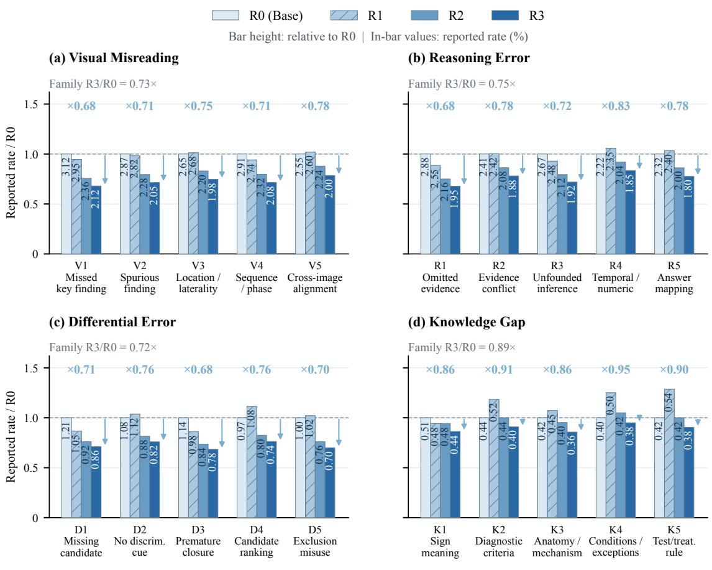  
Light-blue arrows: R0 → R3 | Multipliers: R3/R0 | Lower is better  
Fig. 7 Error-subtype evolution (Qwen3.5-9B). Bar heights normalize each subtype rate by R0; labels show original percentages. Arrows and multipliers compare R3 with R0. Family ratios divide summed R3 rates by summed R0 rates. Horizontal R1–R5 codes identif reasonin -error subt es; le end R0–R3 labels identif trainin rounds.

## B.3.2 Round-wise Feedback Statistics

Tab. 10 and 11 report the per-round modality error rates and error-family percentages; § 4.3 summarizes the modality trends. Blue downward arrows indicate decreases, red upward arrows increases, and equality signs unchanged rates. The error-family percentages are reported separately from the modality-level error rates.

Tab. 10 Modality-wise feedback errors. Error rates (%) on the fixed feedback set; �: group size. Arrows compare consecutive rounds. Bold/underline: two lowest rates; blue: R3.
<table><tr><td>Modality</td><td>N R0 R1</td><td>R2</td><td>R3</td></tr><tr><td>Radiology</td><td>1509 37.18 35.9831.28</td><td></td><td>32.21 ↑</td></tr><tr><td>Nuclear medicine</td><td>234 34.62 26.50↓24.79</td><td></td><td>22.65 ↓</td></tr><tr><td>Ultrasound</td><td>351 44.73 39.03 ↓ 39.60 ↑</td><td></td><td>36.18 ↓</td></tr><tr><td>Endoscopy</td><td>247 32.39 30.36↓27.13</td><td></td><td>21.86 ↓</td></tr><tr><td>Pathology</td><td>378 34.13 34.66 ↑ 30.95</td><td></td><td>28.31↓</td></tr><tr><td>Ophthalmology</td><td>135 34.07 27.41↓</td><td>22.96↓</td><td>20.00↓</td></tr><tr><td>Dermatology</td><td>593 30.35 27.82↓24.62</td><td></td><td>23.10↓ 32.79 ↓</td></tr><tr><td>Dental imaging</td><td>308 40.26 37.01 ↓ 37.66 ↑</td><td></td><td></td></tr><tr><td>Functional tests</td><td>1245 20.00 17.75↓16.22</td><td></td><td>15.50↓</td></tr></table>

Tab. 11 Error-family feedback profiles. Percentages sum the five subtypes in each family. These aggregates are not directly comparable to modality error rates. Notation follows Tab. 10.
<table><tr><td>Error family</td><td>R0 R1 R2</td><td>R3</td></tr><tr><td>Visual misreading</td><td>14.10 13.79 11.40 火</td><td>10.23↓</td></tr><tr><td>Reasoning error</td><td>12.50 12.20 ↓ 10.40</td><td>9.40↓</td></tr><tr><td>Differential error</td><td>5.40 5.25↓ 4.20</td><td>3.90↓</td></tr><tr><td>Knowledge gap</td><td>2.19 2.49 ↑</td><td>2.16↓ 1.96 ↓</td></tr></table>

## B.4 Detailed Error Statistics for the Current Rounds

Tab. 12 Error-subtype rates (%). Visual/reasoning subtypes are on the left; diferential/knowledge subtypes on the right. R1–R5 are reasoning-error codes. Arrows compare consecutive rounds: blue ↓/red ↑/gray = indicate lower/higher/unchanged rates. Bold/underline: two lowest distinct rates per row; blue shading: R3.
<table><tr><td rowspan=1 colspan=1>Subtype                      R0R1   R2</td><td rowspan=1 colspan=1>R3</td></tr><tr><td rowspan=2 colspan=1>V1 Missed key finding    3.12 2.955 ↓2.36V2 Spurious finding      2.87 2.822.28YV3 Location / laterality   2.65 2.68 ↑ 2.20YV4 Sequence / phase     2.91 2.74↓2.324V5 Cross-image alignment 2.55 2.60 ↑2.24米</td><td rowspan=1 colspan=1>2.12 ↓2.051.982.08</td></tr><tr><td rowspan=1 colspan=1>2.00</td></tr><tr><td rowspan=2 colspan=1>R1 Omitted evidence     2.88 2.55  2.16R2 Conflicting evidence  2.41 2.42 ↑ 2.08R3 Unsupported inference 2.67 2.48 ↓ 2.12R4 Temporal / numeric   2.22 2.35 ↑ 2.04R5 Answer mapping      2.32 2.40 ↑ 2.00</td><td rowspan=1 colspan=1>1.95↓1.881.921.85</td></tr><tr><td rowspan=1 colspan=1>1.80</td></tr></table>

<table><tr><td rowspan=1 colspan=2>Subtype                      R0 R1  R2  R3</td></tr><tr><td rowspan=1 colspan=1>D1 Missing candidate      1.21 1.05↓0.92↓</td><td rowspan=1 colspan=1>0.86↓</td></tr><tr><td rowspan=1 colspan=1>D2 No discriminating cue 1.08 1.12 ↑ 0.88↓</td><td rowspan=3 colspan=1>0.82↓0.78 ↓0.74↓</td></tr><tr><td rowspan=1 colspan=1>D3 Premature closure      1.14 0.98↓0.84↓</td></tr><tr><td rowspan=1 colspan=1>D4 Candidate ranking     0.97 1.08 ↑ 0.80↓</td></tr><tr><td rowspan=1 colspan=1>D5 Exclusion misuse        $1 . 0 0 \ 1 . 0 2 \uparrow \underline { { 0 . 7 6 } } \downarrow \ 0</td><td rowspan=1 colspan=1>. 7 0 \downarrow$ </td></tr><tr><td rowspan=1 colspan=1>K1 Sign interpretation     0.51 0.48↓0.48</td><td rowspan=1 colspan=1>0.44↓</td></tr><tr><td rowspan=1 colspan=1>K2 Diagnostic criteria      0.44 0.52 ↑ 0.44↓</td><td rowspan=1 colspan=1>0.40↓</td></tr><tr><td rowspan=2 colspan=1>K3 Anatomy / mechanism  $0 . 4 2 \ 0 . 4 5 \uparrow \underline { { { 0 . 4 0 } } } \downarrow \ 0K4 Conditions / exceptions 0.40 0.50 ↑ 0.42↓K5 Test / treatment rule    <eq>\underline { { 0 . 4 2 } } 0 . 5 4 \uparrow \underline { { 0 . 4 2 } } \downarro</td><td rowspan=1 colspan=1>. 3 6 \downarrow$ 0.38↓</td></tr><tr><td rowspan=1 colspan=1>w 0 . 3 8 \downarrow</eq></td></tr></table>

Tab. 13 separates repair volume from success rate. Counts measure attempted and successful repairs within each error family.  
Reasoning-error repair success rises from 56.43% at R1 to 83.18% at R3, while knowledge-gap repair success falls from 90.28% to 48.82%. These rates describe the repair candidates submitted in each round.

Tab. 13 Repair outcomes by error family. Attempted and successful question counts, and repair success rates (%). Gray arrows track counts; blue/red arrows mark rising/falling success rates. Bold/underline: best/second-best rates per family; blue shading: R3.
<table><tr><td rowspan="2">Error family</td><td colspan="3">R1</td><td colspan="3">R2</td><td colspan="3">R3</td></tr><tr><td>Attempted Successful</td><td></td><td>Success (%)</td><td>Attempted Successful</td><td></td><td>Success (%)</td><td>Attempted Successful</td><td></td><td>Success (%)</td></tr><tr><td>Visual misreading</td><td>12,189</td><td>9,826</td><td>80.61</td><td>10,245↓</td><td></td><td>6,78966.27↓</td><td>10,478↑</td><td>7,094↑67.70↑</td><td></td></tr><tr><td>Reasoning error</td><td>9,355</td><td>5,279</td><td>56.43</td><td>7,857↓</td><td></td><td>6,246↑79.50↑</td><td>6,789 ↓</td><td></td><td>5,64783.18↑</td></tr><tr><td>Differential error</td><td>4,064</td><td>2,995</td><td>73.70</td><td>6,742↑</td><td>4,673↑</td><td>69.31↓</td><td>4,786↓</td><td></td><td>3,29168.76↓</td></tr><tr><td>Knowledge gap</td><td>1,625</td><td>1,467</td><td>90.28</td><td>987↓</td><td></td><td>550↓55.72↓</td><td>1,567↑</td><td></td><td>765↑48.82↓</td></tr></table>

## C Medical Taxonomy and Error Categories

## C.1 Taxonomy, Permissions, and Execution Contracts

## C.1.1 Four-Dimensional Medical Tag Dictionary

The medical taxonom describes each uestion alon four inde endent axes: modalit , anatom , disease, and dificulty. Each axis allows multiple hierarchical labels for capability analysis and question retrieval.

Modalities. Computed tomography (CT), magnetic resonance imaging (MRI), positron emission tomography (PET), and single-photon emission computed tomography (SPECT). Other abbreviations include optical coherence tomography (OCT), fundus fluorescein angiography (FFA), indocyanine green angiography (ICGA), cone-beam computed tomography (CBCT), electroencephalogram (EEG), electromyogram (EMG), and electrocardiogram (ECG)

<table><tr><td>Parent</td><td>Second-level scope</td></tr><tr><td>1 Radiography</td><td>X-ray; CT; MRI; mammography; fluoroscopy; angiography</td></tr><tr><td>2 Nuclear medicine</td><td>PET/CT; SPECT; radionuclide scans</td></tr><tr><td>3 Ultrasound</td><td>B-mode; echocardiography; vascular; interventional</td></tr><tr><td>4 Endoscopy</td><td>Gastrointestinal; bronchial; laryngeal/nasal; bladder; joint; laparoscopic</td></tr><tr><td>5 Pathology</td><td>Histology; cytology; molecular pathology</td></tr><tr><td>6 Ophthalmology</td><td>Fundus photography; OCT; FFA/ICGA; slit lamp</td></tr><tr><td>7 Dermatology</td><td>Dermoscopy; clinical photography; reflectance confocal microscopy</td></tr><tr><td>8 Dental</td><td>Panoramic; CBCT; periapical; cephalometric</td></tr><tr><td>9 Functional tests</td><td>ECG; EEG; EMG</td></tr></table>

<table><tr><td>Parent</td><td>Second-level scope</td></tr><tr><td>1 Nervous system</td><td>Brain; spinal cord; peripheral nerves</td></tr><tr><td>2 Head and neck</td><td>Orbit; ear; sinuses; oral/maxillofacial; pharynx/larynx; neck soft tissue</td></tr><tr><td>3 Thorax</td><td>Lung/airway; mediastinum; pleura; heart; great vessels; breast; chest wall</td></tr><tr><td>4 Abdomen</td><td>Hepatobiliary; pancreas; spleen; gastrointestinal; renal/urinary; retroperitoneum</td></tr><tr><td>5 Pelvis</td><td>Male reproductive; female reproductive; pelvic floor; pelvic bones</td></tr><tr><td>6 Spine</td><td>Cervical; thoracic; lumbar; sacrococcygeal; disc; canal; paraspinal tissue</td></tr><tr><td>7 Musculoskeletal</td><td>Craniofacial bones; upper limb; lower limb; muscles; periarticular soft tissue</td></tr><tr><td>8 Vascular</td><td>Arteries; veins; lymphatic system</td></tr><tr><td>9 Skin and soft tissue</td><td>Head/face; trunk; limbs; subcutaneous; deep soft tissue</td></tr></table>

<table><tr><td>Parent</td><td>Second-level scope</td></tr><tr><td>1 Neoplasm</td><td>Malignant; benign; metastatic; precancerous categories</td></tr><tr><td>2 Infection and inflammation</td><td>Bacterial; tuberculosis; viral; fungal; parasitic; noninfectious inflammation</td></tr><tr><td>3 Vascular disease</td><td>Ischemic; hemorrhagic; aneurysm; thrombosis/embolism; malformations;</td></tr><tr><td>4 Degenerative disease</td><td>atherosclerosis/stenosis Joint; neural; organ degeneration</td></tr><tr><td>5 Trauma</td><td>Fracture; joint injury; visceral injury; head injury; foreign body</td></tr><tr><td>6 Congenital/developmental 7 Metabolic/endocrine</td><td>Cardiovascular; nervous; skeletal; digestive; urinary; respiratory</td></tr><tr><td>8 Autoimmune</td><td>Diabetes complications; thyroid; adrenal; gout; metabolic bone Lupus; ankylosing spondylitis; multiple sclerosis; neuromyelitis optica spectrum disorder</td></tr><tr><td></td><td>(NMOSD); autoimmune liver; immunoglobulin G4 (IgG4); vasculitis; systemic sclerosis; myositis; Sjogren</td></tr><tr><td>9 Functional disorders</td><td>Obstruction; effusion; ectopic gas; torsion; stones</td></tr><tr><td>10 Iatrogenic/postoperative</td><td>Normal postoperative change; complications; implants; post-radiotherapy; drug-related</td></tr></table>

Leafspecificity and multi-label assignment. CT branches into noncontrast, contrast-enhanced, CT angiography (CTA), high-resolution CT (HRCT), and low-dose CT; MRI includes T1- and T2-weighted imaging, fluid-attenuated inversion recovery (FLAIR), difusion-weighted imaging (DWI), magnetic resonance angiography (MRA), functional MRI (fMRI), magnetic resonance spectroscopy (MRS), and susceptibility-weighted imaging (SWI). Anatomy can descend from thorax to lung/airway and then to a lung lobe, or from abdomen to pancreas and then head/body/tail. Disease labels descend from a broad family to a mechanism or disease group and then to a named entry. Preserve ima e IDs for mixed modalities and record ever su orted anatomical site. Assign the deepest supported node not a guessed leaf; use unknown, not-applicable, or a supported parent when necessary. Expand ancestors as a set and count each uestion once er rou . Related conce ts on diferent aths re uire an alias led er, not automatic merging. Log label text, evidence/image ID, confidence, visibility, and taxonomy version.

<table><tr><td>Level</td><td>Task requirement</td></tr><tr><td>L1</td><td>Single modality and conspicuous canonical findings; direct recognition.</td></tr><tr><td>L2</td><td>Common presentation requiring localization or characterization and limited context.</td></tr><tr><td>L3</td><td>Atypical or multiple findings requiring sequence integration or differential comparison.</td></tr><tr><td>L4</td><td>Subtle findings, multisystem involvement, or complex context requiring extensive integration.</td></tr><tr><td>L5</td><td>Highly complex or disputed tasks requiring multidisciplinary, quantitative, or specialized knowledge.</td></tr></table>

Assign dificulty from the actual question: visibility, number of required comparisons, evidence integration, and specialized knowledge. A disease name, modality, or a single failed rollout does not determine the level. Rare disease alone does not force L5. Record the rationale and adjudicate ambiguous adjacent levels.

## C.1.2 Error Codebook: Four Parents and Twenty Subtypes

We specify five subtypes under each of the four existing parent categories. Each row defines an observable diagnostic criterion and a navigation operation; it does not supply a gold answer.

<table><tr><td>Code / subtype</td><td>Diagnostic criterion</td><td>Navigation operation</td></tr><tr><td>V1 Missed finding</td><td>A supported salient finding is not observed or described. An artifact, normal structure, or unsupported feature is</td><td>Reinspect the relevant region.</td></tr><tr><td>V2 Hallucinated or misidentified finding</td><td>read as a lesion.</td><td>Check direct visual support.</td></tr><tr><td>V3 Anatomy or laterality error</td><td>The organ, level, compartment, or side conflicts with</td><td>Recheck landmarks and</td></tr><tr><td>V4 Modality, sequence, or</td><td>visible evidence. Acquisition type, sequence, or phase is misidentified,</td><td>orientation. Verify acquisition context</td></tr><tr><td>phase error V5 Cross-image</td><td>distorting feature reading. A lesion is matched incorrectly across images, slices, or</td><td>before reading features. Align images and anatomical</td></tr><tr><td>correspondence error</td><td>views.</td><td>locations.</td></tr><tr><td colspan="3">R: Reasoning error.</td></tr><tr><td>Code / subtype</td><td>Diagnostic criterion</td><td>Navigation operation</td></tr><tr><td>R1 Omitted evidence</td><td>An observed finding or stated fact is omitted from inference.</td><td>Reintroduce the omitted evidence.</td></tr><tr><td>R2 Conflicting evidence integration</td><td>Correctly extracted evidence conflicts and is not reconciled.</td><td>Reconcile supporting and opposing evidence.</td></tr><tr><td>R3 Unsupported inference or causal leap</td><td>A conclusion lacks the required logical or causal link.</td><td>Restore a testable intermediate inference.</td></tr><tr><td>R4 Temporal or quantitative error</td><td>Correctly read facts are combined with an incorrect temporal or numerical relation.</td><td>Check chronology, units, or calculation.</td></tr><tr><td>R5 Task constraint or answer-mapping error</td><td>The reasoning violates the requested target, negation, or option mapping.</td><td>Recheck the requested target and answer mapping.</td></tr><tr><td colspan="3">D: Wrong differential.</td></tr><tr><td>Code / subtype</td><td>Diagnostic criterion</td><td>Navigation operation</td></tr><tr><td>D1 Omitted candidate</td><td>A necessary evidence-compatible alternative is not considered.</td><td>Broaden the candidate comparison.</td></tr><tr><td>D2 Missing discriminative comparison</td><td>Alternatives are listed without comparing discriminative evidence.</td><td>Identify discriminative evidence.</td></tr><tr><td>D3 Premature closure or anchoring</td><td>An initial diagnosis is fixed before counterevidence is considered.</td><td>Revisit counterevidence and alternatives.</td></tr><tr><td>D4 Incorrect candidate ranking</td><td>Known support, counterevidence, or priors are weighted incorrectly.</td><td>Compare the strength of evidence.</td></tr><tr><td>D5 Misapplied exclusion</td><td>An alternative is excluded using insufficient negative evidence or a nonessential criterion.</td><td>Check whether exclusion is justified.</td></tr></table>

K: Knowledge gap.
<table><tr><td>Code / subtype</td><td>Diagnostic criterion</td><td>Navigation operation</td></tr><tr><td>K1 Missing finding interpretation</td><td>The required medical meaning of a finding or term is missing.</td><td>Cue the relevant conceptual relation.</td></tr><tr><td>K2 Missing diagnostic criterion</td><td>A required diagnostic, grading, or staging rule is unavailable.</td><td>Cue the relevant rule category.</td></tr><tr><td>K3 Missing anatomy or pathophysiology</td><td>Knowledge linking anatomy, mechanism, and</td><td>Bridge the minimal</td></tr><tr><td>K4 Missing applicability</td><td>manifestations is missing. A general rule is known but its prerequisites or exceptions</td><td>mechanistic relation. Cue the applicability check.</td></tr><tr><td>condition or exception K5 Missing investigation or management knowledge</td><td>are missing. A next-investigation or management task requires an unavailable principle.</td><td>Cue the decision principle</td></tr></table>

Boundary rules and reporting. A finding not perceived is V1; a finding already perceived but omitted from inference is R1. Incorrect correspondence across images is V5; conflicting correctly extracted evidence is R2. Candidate-set construction, comparison, and exclusion belong to D; a demonstrated missing prerequisite rule belongs to K. Knowledge-gap labels require evidence of a missing prerequisite rule. Select the earliest consequential supported error as the primary subtype and record later failures as secondary labels, with step spans and evidence. If the parent is clear but the subtype is not, retain the parent and an unresolved-subtype status; if even the parent is unsupported, mark the audit unresolved. These are annotation states, not extra error classes. Use one primary subtype per trajectory for additive counts; report secondary labels separately. Aggregate V1–V5 into V, and similarly for R, D, and K. Re-audit fresh rollouts at each checkpoint using subtype-specific annotations and denominators.

C.1.3 Information Access Matrix
<table><tr><td>Component</td><td>Permitted inputs</td><td>Excluded inputs</td></tr><tr><td>Feedback evaluator</td><td>Feedback items, labels, current predictions; emits aggregates and transitions</td><td>Final-test results for planning; feedback export into SFT</td></tr><tr><td>Planner / retrieval</td><td>Aggregate feedback, training tag metadata (including true disease labels), coverage, budgets</td><td>Final-test items/results; any authority to forward answer-derived labels to repair</td></tr><tr><td>Auditor / hint renderer</td><td>Original images, question/options, current failed trajectory, entropy profile, observable</td><td>Gold answer, answer-derived disease/location, reference rationale, hidden retrieval labels</td></tr><tr><td>Continuation Mt</td><td>tags with provenance Original input and assistant prefill pb ⊕ g(h)</td><td>Gold answer, full audit, hidden tags, teacher solution</td></tr><tr><td>Admission / exporter</td><td>Candidate, reference answer for verification, boundary, provenance, suffix scores</td><td>Feedback/test examples as training targets</td></tr><tr><td>SFT trainer</td><td>Frozen training manifest; pb ⊕ g(h) ⊕ s+, masks Full audit as model input; feedback/test</td><td>samples</td></tr></table>

Use explicit allowlist serialization, not deletion of one answer field from an otherwise unrestricted object. Reject fields without observable provenance, including filenames/IDs encoding labels. An authorized evaluator can identify a wrong training answer before repair without transmitting the answer. Generation sees only a boolean routing decision, not the key. Record hashes of redacted requests for leakage audit. The planner’s chosen hint family is passed through an eligibility check derived from observable context and current diagnosis; disease-bearing planner explanations are never forwarded.

## C.1.4 Structured Fields and Plan Validation

Use JavaScript Object Notation (JSON). Missing measurements are null with reasons; zero is measured zero.

Question metadata: canonical question ID; source ID; patient/case/article cluster IDs when available; image hashes and near-duplicate cluster; split; taxonomy version; per-image modality; all four tag sets; per-tag provenance, visibility (statistical or observable), and uncertainty.

Feedback record: checkpoint hash; split hash; group and resolved parent; unique sample count; error count/rate; all four transition counts; both regression denominators; current error-type/subtype counts; confidence interval; training-pool unique availability; measured repair/admission/cost fields.

Plan: round ID; generator and initialization hashes; planner type/version and seed; feedback hash; target group IDs; numeric feedback evidence and fallback ancestry; training sources; selected IDs; attempt/call/token ceilings; per-group quota; permissible hint operation; history replay allocation; replacement rule; supervised-token cap; shortfall/reallocation policy; fixed training-config hash; acceptance-validator result.

Repair record: question/checkpoint IDs; rollout hash; step/token spans; entropy profile/proposal; error type/subtype; audit boundary; verbatim prefix span; observable-tag payload hash; recovery cue; continuations/seeds; correctness/integrity checks; student sufix scores and cutofs; reason for admission or rejection; all tokens generated or scored.

Mix and training record: ordered example IDs; source round and generator; dedup/replacement ledger; historical/new role; token masks; sequence lengths; unit weights; packing map; efective repetitions and exposures; optimizer and scheduler reset flags; learning rate/warmup; initialization hash; output hash; second-stage and cumulative costs.

Execution receipt: planned and actual quotas, unique selected and attempted failures, successful and admitted repairs, substitutions, exhausted budgets, rejected records, uncovered groups, and actual training tokens.

Reject cross-split IDs, duplicate quota charges, exceeded budgets, out-of-pool retrieval, unsupported hints, missing visibility provenance, and changed training hyperparameters. Save plans before generation; log counts.

The main-agent feedback and next-round planning prompt is given in Appendix D.2; the trajectory audit prompt is given in Appendix D.3.

## C.1.5 Training Configuration and Evaluation Scope

Training uses brain floating-point 16 (BF16) precision on graphics processing units (GPUs). Parallelism abbreviations are tensor parallelism (TP), expert parallelism (EP), pipeline parallelism (PP), context parallelism (CP), expert tensor parallelism (ETP), and data parallelism (DP); the following number gives the parallelism degree. Configuration keys retain their literal software spelling: llm denotes large language model, vit denotes vision transformer, cpu denotes central processing unit, moe denotes mixture of experts (MoE), gemm denotes general matrix multiplication, mlp denotes multilayer perceptron, and lr denotes learning rate.

Tab. 14 MoE training configuration. Recorded settings for model training.
<table><tr><td>Configuration</td><td>Value</td><td>Configuration</td><td>Value</td></tr><tr><td>Framework</td><td>ms-swift + Megatron-LM backend</td><td>add_non_thinking_prefix</td><td>true</td></tr><tr><td>Precision</td><td>BF16</td><td>loss_scale</td><td>ignore_empty_think</td></tr><tr><td>micro_batch_size</td><td>1</td><td>MAX_PIXELS</td><td>3145728</td></tr><tr><td>global_batch_size</td><td>64</td><td>dataset_num_proc</td><td>96</td></tr><tr><td>packing</td><td>true</td><td>dataloader_num_workers</td><td>8</td></tr><tr><td>attention_backend</td><td>flash</td><td>logging_steps</td><td>1</td></tr><tr><td>calculate_per_token_loss</td><td>true</td><td>eval_iters</td><td>1000</td></tr><tr><td>freeze_llm /freeze_vit / freeze_aligner</td><td>false /true /true</td><td>recompute_granularity</td><td>selective</td></tr><tr><td>optimizer_cpu_offload</td><td>true</td><td>sequence_parallel</td><td>true</td></tr><tr><td>use_precision_aware_ optimizer</td><td>true</td><td>max_length</td><td>28672</td></tr><tr><td>offload_fraction</td><td>1.0</td><td>epochs</td><td>2</td></tr><tr><td>moe_grouped_gemm</td><td>true</td><td></td><td></td></tr><tr><td>moe_shared_expert_overlap</td><td>true</td><td>save_total_limit</td><td>2</td></tr><tr><td>moe_aux_loss_coeff</td><td>1e-6</td><td>Recompute modules</td><td>core_attn + moe + mlp</td></tr><tr><td>lr</td><td>1e-5</td><td>moe_permute_fusion</td><td>true</td></tr><tr><td>lr_warmup_fraction</td><td>0.05</td><td>Parallelism</td><td>TP4/EP8/PP1/CP1/ETP1;</td></tr><tr><td>min_lr</td><td>1e-7</td><td></td><td>64 GPUs</td></tr></table>

EP and MoE-specific options apply only to MoE models.

Both example types use full-response loss, retaining recovery cues in repairs. § 4 reports accuracy on seven benchmarks and their mean, comparing each backbone’s best complete checkpoint with Base.

## D Prompts

## D.1 Shared Question-Answering Prompt

All question-answering tasks use the following instruction verbatim.

<table><tr><td>Shared Question-Answering Instruction</td></tr><tr><td>Please reason step by step, and put your final answer within \boxed{}.</td></tr></table>

## D.2 Main-Agent Feedback and Next-Round Planning

The following template connects feedback diagnosis to next-round selection and repair priorities under the method protocol. It specifies agent behavior; run-specific inputs and execution records are required to document its use.

Main Agent: Feedback Summary and Next-Round Data Plan

$$
\mathbf { \hat { \boldsymbol { S } } } _ { g , t } = \hat { \epsilon _ { g , t } } + \alpha N _ { g , t } ^ { 1 0 } / n _ { g }
$$

3. Select training questions. Allocate the fixed budget proportionally to group scores, cap quotas by available unique questions, and redistribute unused quota. Preserve modality coverage and apply the configured fallback when all scores are zero or support is insuficient. Retrieve by medical tags, using historical errors only as prioriti- zation cues. Dedu licate uestions; return trainin IDs, uotas, and shortfalls. Exclude feedback/test examples. 4. Guide fresh rollouts and repair. Ask the current checkpoint to generate the configured eight rollouts per selected question. Diagnose their actual errors again. Use feedback-identified modality–error pairs to prioritize failed training trajectories: prefer joint matches, followed by modality-only or error-type-only matches when necessary. For each selected trajectory, pass its observable medical tags and current error diagnosis to the hint generator. The recovery hint must address the error actually observed in this trajectory. Send observable tags and local diagnoses to the auditor and hint generator, without reference answers or answer-bearing metadata. Retain correct rollouts and accepted continuations under the existing screening rules; if repair fails, use an available quality-screened correct rollout. If none is available, retain a valid historical target or report none accepted.

5. Plan the next round. Keep at most one active target per question and replace it only with an accepted improvement. Train on the complete updated dataset from �0. Keep training settings and evaluation protocol fixed. Evaluate the next checkpoint on the same feedback set to measure the targeted changes; independent benchmark results are reported separately and must not drive selection.

Output. Return a structured plan containing: round and checkpoint; feedback summary and denominators; priority tag/error pairs and supporting statistics; score and quota per group; selected unique training IDs; rollout and repair budgets; repair priorities; dataset-retention/replacement rules; initialization $M _ { 0 } ;$ next-round feedback comparisons; and missing inputs or budget shortfalls. After execution, record actual generated, repaired, admitted, and replaced counts.

## D.3 Stage 1 Audit Prompt

The dia nostic model receives the ima e, the question with options, the failed trajector , the complete step-level uncertainty profile, and the entropy-derived anchor and candidate window. The auditor is gold-blind: the reference answer is not an input to diagnosis. Answer-derived disease labels, hidden lesion positions, reference explanations, and planner retrieval metadata are also excluded. Only provenance-checked observable tags are allowed. The entropy proposal is a localization prior, not an error label: the auditor inspects the proposed region first, traces its evidence dependencies backward, and may move the final boundary when the medical or logical evidence requires it. It returns a structured audit that identifies a compact revision region and constrains the subsequent continuation.

The emitted hint must remain answer-blind. Fill brace-delimited placeholders at runtime.

<table><tr><td>Prompt D.3: Stage-1 Entropy-Guided Medical Trajectory Audit</td></tr><tr><td>You are a senior medical reviewer auditing a failed multimodal reasoning trajectory segmented into semantic steps  $s _ { 1 } , \ldots , s _ { K } .$ </td></tr><tr><td>You are given:</td></tr><tr><td>(1) the medical image(s); (2) the clinical question and answer options;</td></tr><tr><td>(3) the failed student trajectory segmented into semantic steps;</td></tr><tr><td>(4) STEP_ENTROPY: the uncertainty score  $E _ { k } ^ { \ast }$  of every step;</td></tr><tr><td>(5) NORMALIZED_ENTROPY: the normalized uncertainty score of every step;</td></tr><tr><td>(6) LOCAL_SURGE: the local increase  $\Delta E _ { k }$  relative to the preceding step history; </td></tr><tr><td>(7) ENTROPY_ANCHOR: the step proposed by the uncertainty locator;</td></tr><tr><td>(8) ENTROPY_WINDOW: the compact candidate window surrounding that anchor, and</td></tr><tr><td>ENTROPY_THRESHOLD if a threshold was used. (9) OBSERVABLE_TAGS: per-image modality and other context supported by the original input, with evidence</td></tr><tr><td>provenance; never hidden answer-derived tags. The entropy signal guides audit localization. High uncertainty can reflect a genuine failure, but it can also arise</td></tr><tr><td>from difficult terminology, ambiguous visual evidence, or a medically valid differential diagnosis. Combine the entropy proposal with the image, clinical evidence, and dependencies between reasoning steps to identify the</td></tr><tr><td>first consequential failure. Error-conditioned hint construction. Construct the hint from OBSERVABLE_TAGS, ERROR_TYPE,</td></tr><tr><td>ERROR_SUBTYPE, and KEY_ERROR. Select a recovery operation addressing the diagnosed failure:</td></tr><tr><td>• Visual misreading: direct attention to the relevant region, visual attribute, or cross-image correspondence.</td></tr><tr><td>• Reasoning error: revisit an unsupported inference or reconnect observed evidence to the requested decision. • Differential diagnosis error: compare discriminative evidence or reconsider an underexamined alternative.</td></tr><tr><td>• Knowledge gap: identify the relevant concept, rule, or applicability condition to reconsider.</td></tr><tr><td>Specify one concrete next operation grounded in the current question and trajectory. Express it as a brief</td></tr><tr><td>recovery cue without supplying the corrected finding, final diagnosis, or answer option. Audit procedure:</td></tr><tr><td>(1) Inspect ENTROPY_WINDOW first. Determine whether its local entropy peak or surge corresponds to an unsupported observation, invalid inference, incorrect differential comparison, or missing medical principle.</td></tr><tr><td>(2) Trace evidence dependencies backward from ENTROPY_ANCHOR. Decide whether the decisive failure begins inside the proposed window or an earlier step introduced the unsupported premise that caused the later</td></tr><tr><td>entropy increase. (3) Do not automatically select the highest-entropy step. Justify the final AUDIT_ANCHOR and</td></tr><tr><td>SAFE_PREFIX_END using the medical image, clinical information, and logical dependencies.</td></tr><tr><td>(4) Prefer a compact localized repair and preserve every preceding step that remains medically and logically valid.</td></tr><tr><td>(5) You may move the audit anchor outside ENTROPY_WINDOW when the proposal misses the first consequential failure, but briefly explain why the entropy signal was misleading.</td></tr><tr><td>Return a JavaScript Object Notation (JSON) object with the following fields, grounded strictly in the provided</td></tr><tr><td>image and text: (a) ACTION: REPAIR or SKIP.</td></tr><tr><td>(b) STEP_SUMMARY: a brief one-sentence semantic summary for each step.</td></tr><tr><td>(c) ENTROPY_ASSESSMENT, containing: proposed_anchor, proposed_window, proposal_status, and</td></tr><tr><td>brief_reason. proposal_status must be one of {HIT, PARTIAL_HIT, MISS, NON_ERROR_UNCERTAINTY}. HIT</td></tr><tr><td></td></tr><tr><td></td></tr><tr><td></td></tr><tr><td></td></tr><tr><td></td></tr><tr><td></td></tr><tr><td></td></tr><tr><td></td></tr><tr><td>means that the first consequential failure is at or immediately adjacent to the proposed anchor; PARTIAL_HIT</td></tr><tr><td></td></tr><tr><td></td></tr><tr><td>means that the proposal covers the propagated error region but the unsupported premise begins earlier; MISS</td></tr><tr><td></td></tr><tr><td></td></tr><tr><td></td></tr><tr><td></td></tr><tr><td></td></tr><tr><td></td></tr><tr><td></td></tr><tr><td></td></tr><tr><td></td></tr><tr><td></td></tr><tr><td></td></tr><tr><td></td></tr><tr><td></td></tr><tr><td></td></tr><tr><td></td></tr><tr><td></td></tr><tr><td></td></tr><tr><td></td></tr><tr><td></td></tr><tr><td></td></tr><tr><td></td></tr><tr><td></td></tr><tr><td></td></tr><tr><td></td></tr><tr><td></td></tr><tr><td></td></tr><tr><td></td></tr><tr><td></td></tr><tr><td></td></tr><tr><td></td></tr><tr><td></td></tr><tr><td></td></tr><tr><td></td></tr><tr><td></td></tr><tr><td></td></tr><tr><td></td></tr><tr><td></td></tr><tr><td></td></tr><tr><td></td></tr><tr><td></td></tr><tr><td></td></tr><tr><td></td></tr><tr><td></td></tr><tr><td></td></tr><tr><td></td></tr><tr><td></td></tr><tr><td></td></tr><tr><td></td></tr><tr><td></td></tr><tr><td></td></tr><tr><td></td></tr><tr><td></td></tr><tr><td></td></tr><tr><td></td></tr><tr><td></td></tr><tr><td></td></tr><tr><td></td></tr><tr><td></td></tr><tr><td></td></tr><tr><td></td></tr><tr><td></td></tr><tr><td></td></tr><tr><td></td></tr><tr><td></td></tr><tr><td></td></tr><tr><td></td></tr><tr><td></td></tr><tr><td></td></tr><tr><td></td></tr><tr><td></td></tr><tr><td></td></tr><tr><td></td></tr><tr><td></td></tr><tr><td></td></tr><tr><td>means that the first failure lies outside the proposed window; and NON_ERROR_UNCERTAINTY indicates a</td></tr><tr><td></td></tr><tr><td></td></tr><tr><td></td></tr><tr><td></td></tr><tr><td></td></tr><tr><td></td></tr><tr><td></td></tr><tr><td></td></tr><tr><td></td></tr><tr><td></td></tr><tr><td></td></tr><tr><td></td></tr><tr><td></td></tr><tr><td></td></tr><tr><td></td></tr><tr><td></td></tr><tr><td></td></tr><tr><td></td></tr><tr><td></td></tr><tr><td></td></tr><tr><td>(d) AUDIT_ANCHOR: the index of the first consequentially incorrect step. (e) SAFE_PREFIX_END, containing step_index and the exact verbatim_ending_span of the last fully valid step before the repair region. (f) AUDIT_WINDOW: a short contiguous sequence of steps that should be reconsidered.</td></tr><tr><td>(g) ERROR_TYPE and ERROR_SUBTYPE: checkpoint-specific diagnosis, plus KEY_ERROR: the localized error stated without revealing the correct answer. (h) HINT_TYPE: one of {perceptual_reexamination, inference_reconstruction, differential_disambiguation,</td></tr><tr><td>knowledge_bridging}. (i) MINIMAL_HINT: a brief recovery cue with flexible wording, conditioned on observable medical tags and the</td></tr><tr><td>diagnosed local error. Name the evidence or reasoning operation to revisit. Do not include the error-category label or audit explanation. Introduce the cue with a natural transition; no fixed phrase or first-person form is required.</td></tr><tr><td>(j) IMAGE_CHECK, containing applicable (true or false) and target (the specific modality, anatomy, laterality, finding, relation, or measurement to re-inspect).</td></tr><tr><td>(k) KNOWLEDGE_SCOPE: the narrow medical principle to recall, or null. (1) DIFFERENTIAL_FOCUS: the discriminative axis to compare, or null.</td></tr><tr><td>(m) STOP_CONDITION: the evidence condition under which the continuation should commit to an answer and</td></tr><tr><td>stop.</td></tr><tr><td>Constraints: - Do not access hidden disease labels or hidden lesion coordinates. - Do not state a gold answer, corrected diagnosis, or correct option letter.</td></tr></table>

D.4 Stage 2 Continuation Prompt

The continuation input contains the original question and an unfinished assistant message with the retained prefix and an error-conditioned recovery cue. Stage 1 constructs the cue from observable medical tags, ERROR\_TYPE, ERROR\_SUBTYPE, and KEY\_ERROR. Feedback determines repair priority; the selected trajectory’s own diagnosis determines cue content. The same student continues from this prefilled message.

<table><tr><td>Prompt D.4: Stage-2 Assistant-Prefill Continuation</td></tr><tr><td>User message: {original medical image(s), question, and answer options}</td></tr><tr><td></td></tr><tr><td>Assistant message:</td></tr><tr><td>{safe_prefix} {Natural transition} {MINIMAL_HINT from Stage 1}</td></tr><tr><td>MINIMAL_HINT is inserted verbatim after the retained prefix. The student receives only the cue; error labels and audits remain metadata. Continue immediately after the cue in the same assistant message; preserve the prefix. The SFT export retains the student-style recovery cue. Repaired and original correct examples use full-response loss in Equation 13, supervising all assistant-response tokens. No audit or external hint is supplied at final evaluation</td></tr></table>

## E Case Study

We present two medical image question-answering cases, including the question, options, and excerpts from the student’s initial reading and subsequent continuation, with the hint marked separately. We preserve the wording of the student outputs without language editing. Purple labels separate the original text, hint, and continuation; blue emphasis marks selected observations and reasoning actions in the quoted outputs.

## E.1 Case 08: Chest radiograph

The initial reading is shown as a failed-rollout excerpt for comparison; it is not the safe prefix retained after rollback. The hint and continuation show how the initial interpretation is revised. Clinical terms: anteroposterior (AP), electrocardiogram (ECG),

nasogastric (NG), chest radiograph (CXR), pulmonary embolism (PE), tuberculosis (TB).

## Original question and options

A 67-year-old man is recovering in the surgical intensive care unit following an esophagectomy. A portable anteroposterior chest radiograph (Figure A) is obtained to evaluate his postoperative status. The patient has a right-sided chest tube in place. Based on the radiographic findings, which of the following is the most likely cause of the bilateral lower lung opacities? Options:

A. Pleural efusion

B. Pulmonary embolism

C. Emphysema

D. Cavitary tuberculosis

E. Tension pneumothorax

Please reason step by step, and put your final answer within \boxed{}.

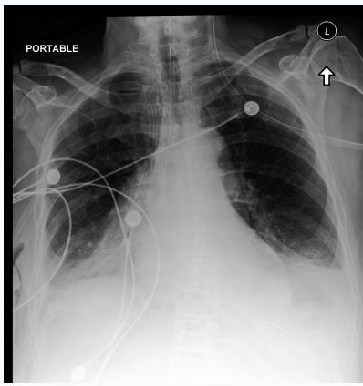

<table><tr><td>Student model output</td></tr><tr><td>Initial reading from the failed rollout (before rollback) &lt;think&gt; The user wants a step-by-step reasoning and a final boxed answer. Let me look at the radiograph carefully. It&#x27;s a portable AP chest radiograph of a 67-year-old man post-esophagectomy. There&#x27;s a right-sided chest tube. There are ECG leads overlying</td></tr><tr><td>the chest. There&#x27;s an NG tube or feeding tube coursing down the midline (post-esophagectomy, possibly gastric pull-up). The question asks about bilateral lower lung opacities. Looking at the image, the lower zones do not show convincing increased opacity; the costophrenic angles are not clearly blunted, and there is no definite meniscus-like contour. The hemidiaphragms remain relatively well defined. So pleural effusion is not strongly supported.</td></tr><tr><td>Navigation hint Before weighing the choices, re-check the morphology of the basal opacities: costophrenic-angle blunting, a meniscus-like contour, and partial obscuration of the hemidiaphragms would localize the process primarily to the...</td></tr><tr><td>Student continuation after the hint Now, let me think about the other</td></tr><tr><td>options: pulmonary embolism doesn&#x27;t usually cause bilateral lower lobe opacities (may cause atelectasis or infarction, but not typical). Emphysema causes hyperlucency, not opacity. Cavitary TB causes upper lobe cavities, not bilateral lower lobe opacities. Tension pneumothorax causes hyperlucency and mediastinal shift, not opacity. So the answer is A, pleural effusion.</td></tr><tr><td>The question says &quot;bilateral lower lung opacities&quot; — in</td></tr><tr><td>a postoperative patient with a chest tube, bilateral pleural effusions (or a chylothorax after esophagectomy) are common. The radiographic appearance of basal opacities with meniscus and blunting of the costophrenic angles supports pleural effusion.</td></tr><tr><td>Therefore the Let me describe the radiographic findings in more detail: bilateral lower zone opacities with a meniscus sign, blunting of the costophrenic angles, obscuration of the hemidiaphragms; the chest tube is on the right; the left side shows a similar opacity. No evidence of hyperlucency or pneumothorax; no cavitary lesions; no findings of emphysema (which would be</td></tr></table>

<table><tr><td colspan="2">Original question and options</td></tr><tr><td>elbow pain, swelling, and limited range of motion following a fall onto an outstretched hand. An anteroposterior radiograph of the right elbow is obtained (Figure A). What is the most likely diagnosis? Options: A. Normal elbow radiograph B. Isolated elbow dislocation 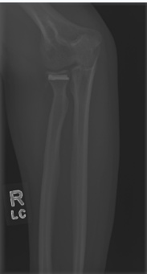 C. Elbow fracture D. Advanced osteoarthritis E. Osteochondritis dissecans Please reason step by step, and put your final answer within \boxed{}.</td><td></td></tr><tr><td colspan="2">Student model output</td></tr></table>

Clinical abbreviations in this case: anteroposterior (AP) and fall on an outstretched hand (FOOSH).

<table><tr><td>Let me double-check the image description once more: the left costophrenic angle is blunted with a meniscus; the right base shows opacity consistent with effusion and possibly some atelectasis. The question asks for the &quot;most likely cause&quot; — pleural effusion.</td></tr><tr><td>Also, after esophagectomy, patients often develop pleural effusions due to chylothorax or transudate from fluid shifts. So A is clinically plausible as well. Format: the answer should be moderately detailed, with step-by-step reasoning, and a final answer. Use headings or bullet</td></tr><tr><td>points sparingly. Let me write a concise structured analysis: findings, differential exclusion, conclusion. Then give the final Let me write it like this: Step 1 — Systematic reading: portable AP film; cardiac</td></tr><tr><td>silhouette is difficult to assess; bilateral lower zone opacities; blunting of the costophrenic angles with a meniscus-like upper border; obscuration of the hemidiaphragms; right-sided chest tube (likely for drainage of pleural fluid/air); no evidence of pneumothorax (no visceral pleural line with hyperlucency); no cavitary lesions; lung volumes are not hyperinflated.</td></tr><tr><td>Step 2 — Match with options: - Pleural effusion: fits — dependent (basal) opacities with meniscus, blunting of the costophrenic angles, common after</td></tr><tr><td>esophagectomy (including chylothorax). - PE: not visible on CXR; wouldn&#x27;t cause diffuse basal opacities.</td></tr><tr><td>- Emphysema: causes hyperlucency, flattened diaphragms — opposite of opacity.</td></tr><tr><td>- Cavitary TB: upper lobe cavitary lesions, not bilateral basal opacities. - Tension pneumothorax: hyperlucent hemithorax, mediastinal shift away — not present.</td></tr><tr><td>Conclusion: A.</td></tr><tr><td>I might also mention that the chest tube on the right is for drainage of pleural fluid/air, and that the left effusion is likely also present.</td></tr></table>

## E.2 Case 31: Elbow radiograph

<table><tr><td>Student continuation after the hint The radiocapitellar alignment appears normal (the radial head is opposite the capitellum), and the ulnohumeral articulation is also maintained,</td></tr><tr><td>suggesting no dislocation. In case of an isolated dislocation, the radial head would be displaced from the capitellum. Here the alignment looks preserved, so an isolated dislocation is unlikely. The presence of a fracture line at the radial head suggests a radial head fracture, so the answer is C (elbow fracture). Osteoarthritis wouldn&#x27;t present acutely after trauma, and there are no osteophytes. Osteochondritis dissecans is a chronic condition with a loose body, not an acute trauma presentation. Therefore, the most likely diagnosis is C: elbow fracture (radial head fracture). Let&#x27;s describe the reasoning steps:</td></tr><tr><td>1. Verify patient history: 32-year-old, fall on an outstretched hand (FOOSH) -&gt; typical mechanism for radial head/neck fractures, coronoid fractures, lateral collateral ligament injuries, etc. 2. Radiographic findings: AP view of the right elbow shows a lucent line with cortical disruption at the radial head/neck, with some displacement/fragmentation - consistent with a radial head fracture. The radiocapitellar and ulnohumeral joints remain congruent, excluding dislocation. No evidence of advanced osteoarthritis (no joint space narrowing, osteophytes,</td></tr><tr><td>subchondral sclerosis). No chronic loose body or cartilage defect suggestive of osteochondritis dissecans. 3. Therefore the answer is C. Also, it&#x27;s worth mentioning that</td></tr><tr><td>the &quot;fat pad sign&quot; may be present (elevated anterior fat pad), indicating an intra-articular fracture/hemarthrosis, supporting the diagnosis of a fracture. In the image, there may be a faint anterior fat pad sign. But the key is the radial head fracture. Let me double-check</td></tr><tr><td>the image description once more: the image shows the humerus, ulna, and radius. In the proximal radius region, there&#x27;s a clear horizontal white line - a fracture of the radial head. The radial head may also be comminuted. So the answer is C.</td></tr><tr><td>Let me also consider the possibility of a coronoid fracture. Regardless, it&#x27;s an elbow fracture. Thus, the final Format: The answer should be moderately detailed, including step-by-step reasoning: mechanism, radiographic findings,</td></tr><tr><td>exclusion of other options, conclusion. Use headings or bullet points. Final Let me carefully</td></tr><tr><td>describe the image: In the image, the radial head shows a transverse lucency consistent with a fracture; the radial head fragment is slightly displaced; the radiocapitellar relationship is preserved; the ulnohumeral angle is normal; no dislocation. Let me also mention that the lateral fat pad sign supports an intra-articular fracture.</td></tr><tr><td>Let me write the response. Also, the question states &quot;anteroposterior radiograph,&quot; but the image is somewhat lateral; I won&#x27;t overemphasize the view.</td></tr><tr><td>Final</td></tr><tr><td>**Step 1 – Mechanism of injury:** A fall onto an outstretched hand (FOOSH) is the classic mechanism for a radial head/neck fracture, coronoid fracture, or lateral collateral ligament injury in a young adult.</td></tr><tr><td>**Step 2 – Systematic review of the radiograph:** - **Joint alignment:** The radiocapitellar and ulnohumeral relationships are preserved – the radial head remains opposite the</td></tr><tr><td>capitellum and the ulna articulates normally with the trochlea. This argues **against an isolated elbow dislocation** (option</td></tr><tr><td>B), which would show obvious displacement of these relationships. - **Bony detail:** There is a transverse lucent line with cortical disruption and a small displaced fragment at the radial</td></tr><tr><td>head/neck region – i.e., a **fracture of the radial head**. A faint anterior fat-pad sign (sail sign) is also suggestive of an</td></tr><tr><td>intra-articular fracture/hemarthrosis. - **No degenerative changes:** There is no joint-space narrowing, osteophyte formation, or subchondral sclerosis, excluding</td></tr><tr><td>**advanced osteoarthritis** (option D), which would also be unlikely to present as an acute traumatic event.</td></tr><tr><td>- **No chronic lesion:** There is no well-circumscribed subchondral defect with a loose body, which would suggest</td></tr><tr><td>**osteochondritis dissecans** (option E); that condition is chronic/overuse-related, not acute post-traumatic.</td></tr><tr><td></td></tr><tr><td></td></tr><tr><td></td></tr><tr><td>- The film is clearly **not normal** (option A) given the visible fracture line and fragment.</td></tr><tr><td></td></tr><tr><td></td></tr><tr><td></td></tr><tr><td></td></tr><tr><td></td></tr><tr><td>**Step 3 – Synthesis:** Acute trauma + FOOSH mechanism + visible fracture at the radial head with preserved joint</td></tr><tr><td></td></tr><tr><td></td></tr><tr><td></td></tr><tr><td></td></tr><tr><td></td></tr><tr><td></td></tr><tr><td></td></tr><tr><td></td></tr><tr><td></td></tr><tr><td></td></tr><tr><td></td></tr><tr><td></td></tr><tr><td></td></tr><tr><td></td></tr><tr><td></td></tr><tr><td></td></tr><tr><td></td></tr><tr><td></td></tr><tr><td></td></tr><tr><td></td></tr><tr><td></td></tr><tr><td></td></tr><tr><td></td></tr><tr><td></td></tr><tr><td></td></tr><tr><td></td></tr><tr><td></td></tr><tr><td></td></tr><tr><td></td></tr><tr><td></td></tr><tr><td></td></tr><tr><td></td></tr><tr><td></td></tr><tr><td></td></tr><tr><td></td></tr><tr><td></td></tr><tr><td></td></tr><tr><td></td></tr><tr><td></td></tr><tr><td></td></tr><tr><td></td></tr><tr><td></td></tr><tr><td></td></tr><tr><td></td></tr><tr><td></td></tr><tr><td></td></tr><tr><td></td></tr><tr><td></td></tr><tr><td></td></tr><tr><td></td></tr><tr><td></td></tr><tr><td></td></tr><tr><td></td></tr><tr><td>alignment = a fracture of the elbow (radial head fracture), not a dislocation or degenerative/chronic lesion.</td></tr><tr><td></td></tr><tr><td></td></tr><tr><td></td></tr><tr><td></td></tr><tr><td></td></tr><tr><td></td></tr><tr><td></td></tr><tr><td></td></tr><tr><td></td></tr><tr><td></td></tr><tr><td></td></tr><tr><td></td></tr><tr><td></td></tr><tr><td></td></tr><tr><td></td></tr><tr><td></td></tr><tr><td></td></tr><tr><td></td></tr><tr><td></td></tr><tr><td></td></tr><tr><td></td></tr><tr><td></td></tr><tr><td></td></tr><tr><td></td></tr><tr><td></td></tr><tr><td></td></tr><tr><td></td></tr><tr><td></td></tr><tr><td></td></tr><tr><td></td></tr><tr><td></td></tr><tr><td></td></tr><tr><td></td></tr><tr><td></td></tr><tr><td></td></tr><tr><td></td></tr><tr><td></td></tr><tr><td></td></tr><tr><td></td></tr><tr><td></td></tr><tr><td></td></tr><tr><td></td></tr><tr><td></td></tr><tr><td></td></tr><tr><td></td></tr><tr><td></td></tr><tr><td></td></tr><tr><td></td></tr><tr><td></td></tr><tr><td></td></tr><tr><td></td></tr><tr><td></td></tr><tr><td></td></tr><tr><td></td></tr><tr><td></td></tr><tr><td></td></tr><tr><td></td></tr><tr><td></td></tr><tr><td></td></tr><tr><td></td></tr><tr><td></td></tr><tr><td></td></tr><tr><td></td></tr><tr><td></td></tr><tr><td></td></tr><tr><td></td></tr><tr><td></td></tr><tr><td></td></tr><tr><td></td></tr><tr><td></td></tr><tr><td></td></tr><tr><td></td></tr><tr><td></td></tr><tr><td></td></tr><tr><td></td></tr><tr><td></td></tr><tr><td></td></tr><tr><td></td></tr><tr><td></td></tr><tr><td></td></tr><tr><td></td></tr><tr><td>**Most likely diagnosis: C. Elbow fracture**&lt;/think&gt;</td></tr></table>

## F Additional Related Work

This section ex ands the main-text review of medical evaluation su ervision ualit localized correction and alternative forms of self-evolution. It also covers complementary work in agent safety, robotics, and data generation.

## F.1 Medical Reasoning, Distillation, and Data Selection

Medical vision-language models use biomedical instruction tuning [2, 3], generalist reasoning with Lingshu [11], and English–Arabic medical image understanding in BiMediX2 [12]. Verifier-guided search, knowledge-enhanced synthesis, and reinforcement learning[40, 41, 42], together with parallel reasoning and multi-agent collaboration[43, 44, 45], improve reasoning capabilities. Process-level diagnostics and distillation audits distinguish answer correctness from reliable visual recognition, knowledge application, and evidence integration[15, 16, 46].

MMVistaReason [47] combines open-data curation with capacity-aware post-training for multimodal reasoning.

Medical hallucinations expose evaluation limits. In controlled experiments, Farrow et al. [17] show that clinical hallucinations outside predefined criteria can leave rubric scores unchanged. This motivates explicit factuality checks. Process supervision provides intermediate-step feedback[18], while trajectory synthesis and selection address rationale quality, dificulty, and distribution[48, 49]. ChainPrune [19] organizes self-generated reasoning paths into a tree and selects paths that reduce redundancy while preserving essential reasoning steps. Its distinction between token length and structural eficiency motivates content-based trajectory selection. On-policy distillation emphasizes compatibility between student states and teacher capabilities[9]; reference-induced shortcuts, reasoning aths, and state covera e also sha e su ervision value[50, 51, 52]. MedEvo connects medical error dia nosis with student-centered supervision, guiding correction with minimal hints while preserving student reasoning.

## F.2 Learning from Failed Trajectories and Localized Repair

Failed trajectories contain reusable reasonin as well as errors. Self-Refine and Reflexion im rove subse uent attempts through self-feedback and verbal memory without weight updates [53, 54]. Learning from Mistakes (LEMA) constructs mistake–correction pairs, TrajFusion combines incorrect and correct trajectories, and Exploring Expert Failures (EEF) extracts useful actions from failed demonstrations [6, 10, 55]. Hindsight Hint Distillation (HHD) and FailForge guide recovery with concise hints or skills instead of full teacher solutions [1, 56].

Local recovery also depends on where guidance enters and how it becomes supervision. Error-localization studies, backtracking-based distillation, Test-Time Scaling via Error Localization (TTEL), and Selective Regenerative Decoding investigate localization, backtracking corrections, and prefix reuse [5, 21, 22, 57]. Self-Correction via Reinforcement Learning (SCoRe) learns self-correction through reinforcement learning; Project Aletheia and Pyligent derive supervision from verified backtracking traces or search trees; micro-reflective self-distillation combines micro-reflective trajectories with capability-dependent selection [24, 58, 59, 60]. EvoThink and Reflective On-Policy Self-Distillation (ROSD) instead use preference learning and reflective on-policy self-distillation [61, 62]. MedEvo uses medically grounded, same-student local navigation: preserving supported prefixes, guiding continuation with gold-blind auditing and tag-conditioned hints, and selecting learnable supervision.

## F.3 Data Evolution and Recursive Self-Improvement

STaR and ReSTEM select correct self-generated reasoning for supervision[7, 8]. EvoThink and ROSD use preference learning and reflective self-distillation[61, 62]; capability-dependent selection matches supervision and students [24]. Recursive self-improvement examines how feedback changes subsequent learning experience [63]. In clinical interaction, MediSkill-Evo [25] evolves validated clinical, process, symbolic, and visual knowledge banks without fine-tuning the backbone, using process constraints to guide evidence-grounded actions. MedEvo instead updates model weights through SFT on repaired student trajectories: it diagnoses medical groups and error patterns on a fixed feedback set, then generates and repairs training-pool trajectories for subsequent self-distillation.

## F.4 Failure Feedback beyond Medical Reasoning

Failure-aware approaches also organize recovery using structured failure feedback in agent safety and robotics [64, 65, 66].

## F.5 Analysis of Frontier-Model Reasoning

Luo et al. [67] study frontier-model reasoning eficiency, step types, and tree structure alongside outcomes.

## F.6 Broader Data and Environment Evolution

Dificulty-guided chart synthesis and multimodal generation workflows expand the supervision distribution [68, 69]. Data-strategy optimization, evolving environments, and autonomous medical curricula provide broader settings for recursive improvement [70, 71, 72]. MedEvo evolves data for medical reasoning repair and supervision.

## G Additional Baseline Details

Tab. 2 compares external models and trajectory-supervision baselines.

## G.1 Backbones and External Comparison Models

We use Qwen3.5-9B, scaling to Qwen3.5-35B and Qwen3.5-397B [28]. A Base result refers to the corresponding initial checkpoint before MedEvo training. Later-round models are trained from that same initial checkpoint using the updated supervision dataset; the current checkpoint generates its training trajectories.

The external comparison set includes general-purpose models and models specialized for medicine. Medical models include LLaVA-Med [2], HuatuoGPT-Vision [36], BiMediX2 [12], Lingshu [11], and HealthGPT [39]. InternVL2.5 and InternVL3 provide general-purpose multimodal comparisons [37, 38]. Tab. 2 groups models by proprietary access and open-source parameter scale. These comparisons contextualize performance; they difer from MedEvo’s controlled ablations.

## G.2 Trajectory-Supervision Baselines

Baseline 1: HHD. Hindsight Hint Distillation uses concise hints to scafold recovery [1]. Its role in the comparison is to assess hint-based supervision alongside MedEvo’s medical diagnosis, prefix preservation, and feedback-driven data updates. The method follows the cited work; Tab. 2 re orts our medical-benchmark evaluation.

Baseline 2: TrajFusion. TrajFusion combines incorrect and correct trajectories to construct training supervision [10]. It provides a comparison for learning from failed reasoning. MedEvo instead constructs a corrected sufix from the same student’s retained prefix and uses medical feedback to prioritize later repairs.

Baseline 3: Teacher SFT. This baseline uses SFT on supervision generated by Qwen-3.8-Max. It compares teacher-generated supervision with MedEvo’s repaired student trajectories. This isolates supervision.

## G.3 Reading the Comparisons

The medical icon identifies models specialized for medicine, and the repair icon identifies trajectory-repair methods. Blue shading identifies MedEvo. Bold and underlining indicate the highest and second-highest distinct scores within each model group and column, with ties sharing a rank. The seven-benchmark average weights each benchmark equally. It is distinct from repair success, the fraction of submitted questions corrected.

Component ablations test full rewriting, sufix continuation, medical-tag feedback, and error-type feedback. Their purpose is to isolate design choices within the reported setup. Training configuration and information-access rules are provided in Appendices C.1.5 and C.1.3, respectively.