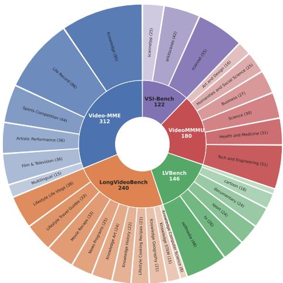
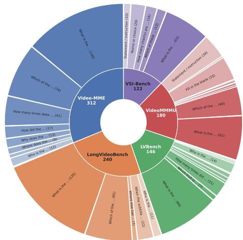
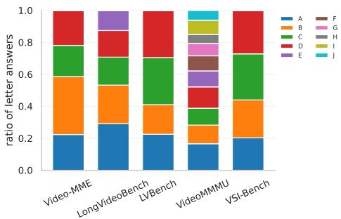
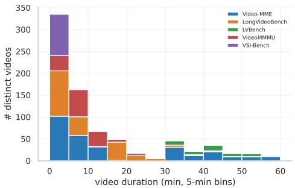
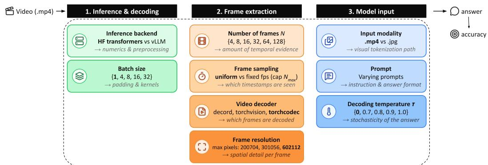
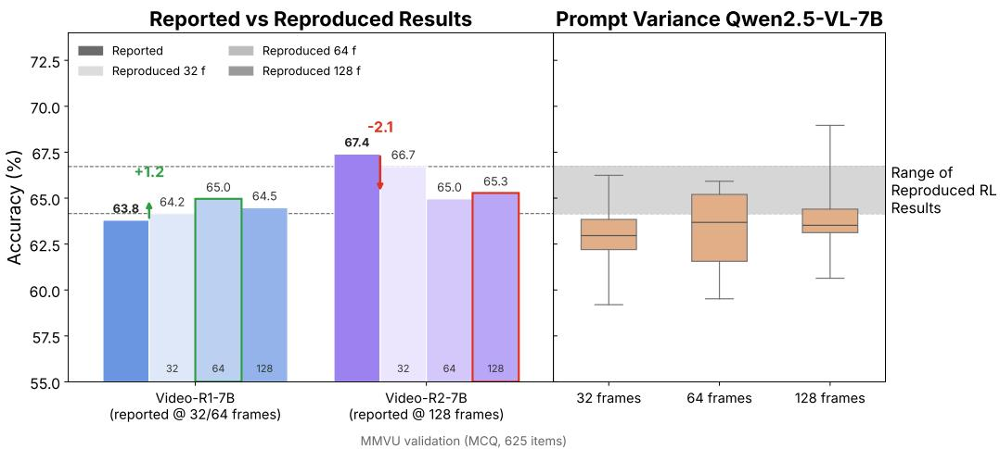
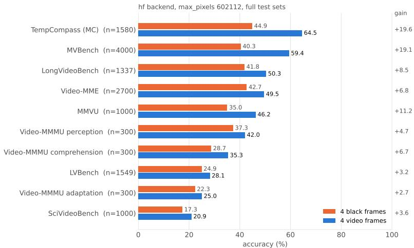
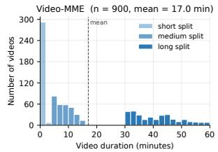
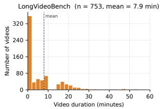
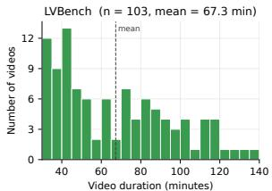

# Meta-Video: Efficient Standardized Evaluation for Video Understanding

Soumya Shamarao Jahagirdar1 Anna Kukleva2 Vishaal Udandarao1 Samuel Thomas³   
Brian Kingsbury3 Rogerio Feris3,5 James R. Glass4 Ameya Prabhu6 Hilde Kuehne1,5,6

1University of Tübingen 2Max Planck Institute for Informatics, SIC 3IBM Research 4MIT 5MIT-IBM Watson AI Lab 6Tübingen AI Center

## Abstract

Video understanding benchmarks are the primary yardstick for measuring progress in video-language modeling, and a growing body of work relies on them to claim improvements. The reported benchmark scores in these works, however, are almost always produced by frameworks (e.g., 1mms\_eval) used as black boxes: certain evaluation choices like frame sampling, preprocessing, and input formatting are inherited from preset defaults and seldom inspected carefully. We show these unexamined choices are a major source of variance. Even for the same model checkpoint, evaluation configuration alone can shift accuracy by up to 19.5pp. Hence, it is unclear whether reported gains reflect genuine improvements in capability or differences in evaluation setup. Moreover, many benchmark samples offer little evidence of visual capability, since they can be answered without the video, and the full suites are expensive to evaluate. We address these issues in two parts. First, we curate existing suites for discriminability and efficiency, producing Meta-Video, a balanced 1,000-question benchmark over 791 videos spanning diverse tasks and durations, which largely preserves model rankings, at 5× inference speedup for a full-frame count sweep experiment (4-128 frames). Second, we establish a standardized evaluation protocol by sweeping the configuration space to isolate choices that measurably affect results, distill them into best practices and reporting standards, and release reproducible reference scores across five models and seven benchmarks. We hope that the proposed evaluation framework and the Meta-Video benchmark will support video understanding research by providing a reproducible and efficient foundation to measure progress in a reliable way. Project page: https://soumyasj.github.io/meta-video/

## 1 Introduction

Benchmarks measure progress in video understanding, with researchers often using benchmark scores to claim improvements over prior methods or base models. Such claims assume that scores for the same checkpoint on the same benchmark are fairly comparable across evaluations and papers. We find that they are not. Table 1 compares scores reported in recent papers for two widely used checkpoints, Qwen2.5-VL-7B [5] and Qwen3-VL-8B-Instruct [4], across 11 video benchmarks. Several methods report gains over the Qwen2.5-VL-7B baseline that fall below our reproduction of the same baseline. When we evaluate these methods under identical settings, they don't improve consistently over the baseline across varying frame counts. We see that reported performance varies substantially across papers by up to 19.5pp on VideoMME on the same checkpoint. These differences far exceed the 2–5pp gains commonly showcased by these same papers over the base model. This makes it hard to tell whether an apparent gain claimed in these prior works, stems from a real capability improvement in the model, a difference in evaluation configuration, or both.

Table 1: Performance reported for the Qwen2.5-VL-7B and Qwen3-VL-8B backbone. across general video understanding and video reasoning benchmarks. Max ∆ denotes the range of scores for each benchmark, differing by up to 19.5pp despite identical model weights. Ours (reproduced) are reported for 128 frames setting.
<table><tr><td rowspan="2">Model</td><td colspan="5">General Video Understanding</td><td colspan="7">Video Reasoning</td></tr><tr><td>VideoMME</td><td>TempCompass</td><td>MVBench</td><td>LongVideoBench</td><td>LVBench</td><td>VideoMMMU</td><td> $\mathbf { M M V U _ { m c q } }$ </td><td>MMVUval</td><td>VSIBench</td><td>SciVideoBench</td><td>VideoMathQA</td><td>Minerva</td></tr><tr><td>Base model: Owen2.5-VL-7B</td><td></td><td></td><td></td><td></td><td></td><td></td><td></td><td></td><td></td><td></td><td></td><td></td></tr><tr><td>Qwen2.5-VL-7B [5]</td><td>65.1</td><td>71.7</td><td>69.6</td><td>56.0</td><td>45.3</td><td>47.4</td><td></td><td>50.1</td><td></td><td></td><td></td><td></td></tr><tr><td>VideoRFT [59]</td><td>52.8.12.3</td><td>69.2-2.5</td><td>59.4-10.2</td><td>56.0</td><td>45.3</td><td>47.4</td><td>61.3</td><td></td><td>31.8</td><td></td><td></td><td></td></tr><tr><td>Videochat-R1.5 [67]</td><td>64.4.0.7</td><td></td><td>67.4.22</td><td></td><td></td><td>46.7-0.7</td><td></td><td></td><td></td><td></td><td></td><td></td></tr><tr><td>Open-o3-video [45]</td><td>62.4.2.7</td><td></td><td></td><td></td><td></td><td>51.2+3.8</td><td></td><td></td><td></td><td></td><td></td><td></td></tr><tr><td>Video-R2 [42]</td><td>66.1+1.0 56.6.8.5</td><td>74.2+2.5 72.6+0.9</td><td>68.1-1.5</td><td>61.3+5.3</td><td></td><td>50.3+2.9</td><td>67.4</td><td></td><td>37.7</td><td>16.4</td><td>26.7</td><td>35.3</td></tr><tr><td>Viss-R1 [17]</td><td>55.5.9.6</td><td></td><td>59.0-10.6 63.2.6.4</td><td></td><td> $3 4 . 2 _ { - 1 1 . 1 }$ </td><td>48.1+0.7</td><td>60.0</td><td></td><td>30.1</td><td></td><td></td><td></td></tr><tr><td>Rethinking CoT [77] STORM [34]</td><td>55.4.9.7</td><td>69.9.1.8</td><td>60.5.9.1</td><td> $5 2 . 5 _ { - 3 . 5 }$ </td><td></td><td></td><td>63.4</td><td></td><td></td><td></td><td></td><td></td></tr><tr><td>CoVER [60]</td><td>63.1.2.0</td><td></td><td></td><td>56.0</td><td></td><td></td><td></td><td></td><td></td><td></td><td></td><td></td></tr><tr><td>Video-VER [39]</td><td>59.2.5.9</td><td>73.7+2.0</td><td>63.6-6.0</td><td></td><td> $4 2 . 0 _ { - 3 . 3 }$ </td><td> $4 7 . 3 _ { - 0 . 1 }$ </td><td>64.2</td><td></td><td>32.3</td><td></td><td></td><td></td></tr><tr><td>Video-TwG [7]</td><td>46.6.18.5</td><td></td><td></td><td></td><td></td><td> $4 4 . 4 _ { - 3 . 0 }$ </td><td></td><td></td><td></td><td></td><td></td><td></td></tr><tr><td>SDRL [58]</td><td>56.5.8.6</td><td>72.5+0.8</td><td> $6 3 . 3 _ { - 6 . 3 }$ </td><td></td><td></td><td> $4 8 . 4 _ { + 1 . 0 }$ </td><td>65.4</td><td></td><td>29.1</td><td></td><td></td><td></td></tr><tr><td>Video-ToC [53]</td><td>59.6.5.5</td><td>72.9+1.2</td><td>59.2-10.4</td><td></td><td></td><td>50.4+3.0</td><td>60.0</td><td></td><td>31.4</td><td></td><td></td><td></td></tr><tr><td>VidBridge-R1 [9]</td><td>59.4.5.7</td><td></td><td>58.7-10.9</td><td> $5 0 . 6 _ { - 5 . 4 }$ </td><td></td><td></td><td></td><td></td><td></td><td></td><td></td><td></td></tr><tr><td>TW-GRPO [12]</td><td>56.5-8.6</td><td>72.5+0.8</td><td>63.3-6.3</td><td></td><td></td><td></td><td>65.4</td><td></td><td></td><td></td><td></td><td></td></tr><tr><td></td><td>66.0+0.9</td><td></td><td> $6 7 . 1 _ { - 2 . 5 }$ </td><td> $6 0 . 9 _ { + 4 . 9 }$ </td><td></td><td> $5 2 . 7 _ { + 5 . 3 }$ </td><td></td><td></td><td></td><td></td><td></td><td></td></tr><tr><td>VideoAuto-R1 [35]</td><td>59.7.5.4</td><td> $7 2 . 2 _ { + 0 . 5 }$ </td><td> $6 7 . 1 _ { - 2 . 5 }$ </td><td></td><td></td><td>48.1+0.7</td><td></td><td></td><td></td><td></td><td></td><td></td></tr><tr><td>MOSS-ChatV [54]</td><td>57.8-7.3</td><td> $7 2 . 8 _ { + 1 . 1 }$ </td><td></td><td></td><td></td><td>48.6+1.2</td><td></td><td></td><td>34.3</td><td></td><td></td><td></td></tr><tr><td>STRIVE [3]</td><td>65.1</td><td> $6 9 . 2 _ { - 2 . 5 }$ </td><td> $6 7 . 5 _ { - 2 . 1 }$ </td><td>56.0</td><td> $4 2 . 0 _ { - 3 . 3 }$ </td><td> $4 7 . 4$ </td><td></td><td></td><td>37.4</td><td></td><td></td><td></td></tr><tr><td>RLER [71]</td><td>65.1</td><td></td><td> $6 6 . 3 _ { - 3 . 3 }$ </td><td> $6 0 . 9 _ { + 4 . 9 }$ </td><td></td><td> $5 1 . 1 _ { + 3 . 7 }$ </td><td></td><td>55.7</td><td></td><td>28.1</td><td></td><td></td></tr><tr><td>VideoKR [22] AdaThinkV [55]</td><td>66.0+0.9</td><td></td><td> $6 7 . 1 _ { - 2 . 5 }$ </td><td> $6 0 . 9 _ { + 4 . 9 }$ </td><td></td><td> $5 4 . 7 \dot { } _ { + 7 . 3 }$ </td><td>66.2</td><td></td><td>一</td><td>27.9</td><td>29.8</td><td></td></tr><tr><td></td><td>19.5</td><td></td><td></td><td></td><td></td><td></td><td></td><td></td><td></td><td></td><td></td><td></td></tr><tr><td>Max ∆ Ours (Reproduced)</td><td>65.6+0.5</td><td>5.0  $7 3 . 4 _ { + 1 . 7 }$ </td><td>10.9  $6 8 . 0 _ { - 1 . 6 }$ </td><td>10.7</td><td>11.1  $4 2 . 1 _ { - 3 . 2 }$ </td><td>10.3</td><td>7.4 64.6</td><td>5.6</td><td>8.6</td><td>11.7</td><td>3.1</td><td>0.0</td></tr><tr><td colspan="2"></td><td></td><td></td><td> $6 0 . 2 _ { + 4 . 2 }$ </td><td></td><td> $3 8 . 8 _ { - 8 . 6 }$ </td><td></td><td> $5 1 . 9 _ { + 1 . 8 }$ </td><td>38.3</td><td>27.9</td><td>26.9</td><td>35.3</td></tr><tr><td>Base model: Qwen3-VL-8B-Instruct</td><td>71.4</td><td></td><td></td><td></td><td></td><td></td><td></td><td></td><td></td><td></td><td></td><td></td></tr><tr><td>Qwen3-VL-8B-Instruct [4]</td><td></td><td></td><td>68.7</td><td></td><td>58.0</td><td>65.3</td><td></td><td>58.7</td><td></td><td></td><td></td><td></td></tr><tr><td>LLaVA-OneVision-2 [2]</td><td>71.4</td><td>74.3</td><td>69.0+0.3</td><td>68.0</td><td>58.0</td><td></td><td></td><td></td><td></td><td></td><td></td><td></td></tr><tr><td>VSeek [24]</td><td>63.7-7.7</td><td></td><td></td><td>54.5</td><td> $3 8 . 7 _ { - 1 9 . 3 }$ </td><td></td><td></td><td></td><td></td><td></td><td></td><td></td></tr><tr><td>OneThinker [20]</td><td> $6 3 . 3 _ { - 8 . 1 }$ </td><td></td><td></td><td>61.7</td><td></td><td>63.3.2.0</td><td></td><td></td><td></td><td></td><td></td><td></td></tr><tr><td>VideoKR [22]</td><td> $6 8 . 2 _ { - 3 . 2 }$   $7 1 . 4$ </td><td></td><td> $6 7 . 9 _ { - 0 . 8 }$ </td><td>61.6</td><td>58.0</td><td>61.8.3.5</td><td></td><td>59.6</td><td></td><td>33.4</td><td></td><td></td></tr><tr><td>InternVideo3 [68] AdaThinkV [55]</td><td> $7 2 . 5 _ { + 1 . 1 }$ </td><td></td><td> $6 9 . 4 _ { + 0 . 7 }$ </td><td>62.4 67.6</td><td></td><td>61.0.4.3</td><td>69.9</td><td>一</td><td></td><td>33.1</td><td>30.7</td><td></td></tr><tr><td>Max ∆</td><td>9.2</td></table>

This shows that video evaluation can be especially sensitive to eval configuration. For example, Frame samplingdetermines which events are visible to a model. WhichVideo decoderis used, howNumber of framesandFrame resolutionare set determine the detail and temporal structure visible to the model. Further, the Input modality(input a video file or sequence of frames) and textPromptcan also affect performance. Yet, papers use evaluation frameworks like 1mms\_eval as black boxes, leaving such details underspecified. Additionally, the quality of benchmark samples can affect the value and cost of evaluation. Some benchmark samples can be answered without even seeing the video. Further, because model rankings can differ across benchmarks, robust comparisons demand aggregating evaluations on multiple datasets, with very large inference costs. As such, a reliable evaluation supporting fast model development calls for① a clean set of benchmark samples, ②low evaluation cost while preserving ranking, and③ a standardized evaluation protocol.

To address① and ②, we introduce Meta-Video (Sec. 3), a compact video understanding benchmark of 1,000 questions over 791 videos, balanced across source datasets and spanning diverse tasks and durations. We construct it by filtering out low-quality samples to further improve evaluation fidelity and computational efficiency [28, 23]. Specifically, we remove questions solvable without the video, since these cannot measure video understanding. Meta-Video largely preserves model rankings over its source benchmarks, separates models more sharply, and requires 5× less inference compute than the reference benchmarks for a full sweep over frame counts, which is the most expensive evaluation setting (Table 2(b)). To tackle ③, we identify key parameters in video evaluation pipelines and systematically measure their effects on performance (Sec. 4). We find that input representation and inference backend substantially change scores. In particular, switching between vLLM and Hugging Face while keeping their respective default settings can change performance by more than 5pp, with gains decreasing once the defaults are fixed. Further, we show that extracted . jpg frames yield higher scores when few frames are sampled, while .mp4 input performs better with larger frame budgets. We observe that how many frames and which frames (frame sampling) the model sees is one of the largest, most consistent factors influencing performance. Our systematic evaluation identifies the major impact factors and proposes a concise way to compile them in the form of evaluation cards to allow for a better, transparent, and reproducible practice in video understanding benchmarking.

Together, our contributions are: (1) We introduce Meta-Video, a compact, balanced benchmark that preserves ranking trends across its source benchmarks (reliability), uses one-fifth of the inference compute for a full frame-count sweep (efficiency), and makes differences between models clearer (discriminability). (2) We examine the current state of video understanding evaluation and show that variation in often unspecified evaluation protocols can explain substantial discrepancies in reported scores. (3) We release a revised evaluation suite and an extensive set of reference configurations to improve reproducibility and support future comparisons. We hope our findings and standardized evaluation protocols offer a transparent and less costly way to evaluate video understanding, in a reliable manner.

## 2 Related work

Video Understanding Models. General purpose vision-language models have the capability to ingest multi-frame input and hence can perform video understanding tasks. Models such as Qwen2.5- VL [5], InternVL [80], LLaVA-OneVision [30, 1, 2], PerceptionLM [11], Molmo [14], LLaVA-Next-Interleave [31] etc., are widely used as standard open-weight VLMs. Other works enable such models to interpret and reason over dynamic visual content [51, 10, 66, 8, 33, 73, 40, 41, 69, 79]. More recently, video reasoning models have surfaced with the ability to reason over temporal and causal relationships across sequences of frames [44, 63, 52, 74, 59].

Video Understanding Benchmarks. Multiple benchmarks have been proposed to evaluate video understanding e.g., VideoMME [21], LongVideoBench [65], MVBench [32], LVBench [61] etc. Further, several benchmarks target reasoning, such as, VideoMMMU [26], VideoMathQA [50], SciVideoBench [15], VideoReasonBench [38], VCRBench [49], TempCompass [37], MMVU [76], MLVU [78], Minerva [46], EgoSchema [43] etc. However, these benchmarks have key limitations [57, 70]. For e.g., many questions can be answered without any visual information [22], as we show in Sec. A. In addition, because of their large size, evaluation is extremely time-consuming, discouraging rapid iteration for fast model development.

Validity of Benchmark Evaluations. Recent works have tried to improve the validity of benchmarks. Answer-Matching [6] reformulates multiple-choice tasks into a generative setting, MM-Bench [36] uses circular evaluation techniques, VMCBench automatically scales up question generation process [75], OneBench proposes aggregating heteregeneous measurements across benchmarks [23], and DataComp-VLM [18] uses stability-monotonicity filtering. DatBench [28] proposed a cleaned evaluation suite that expedites evaluation and maintains discriminative power. Sober Reasoning [25] provides an empirical evaluation of mathematical reasoning benchmarks showcasing sensitivity to various implementation choices like random seed, prompt formatting, and hardware configurations. All these prior works focus mainly on language and image domains, with the video domain taking a back seat. Further, evaluation repositories such as 1mms\_eval [72] and VLMEvalKit [16] provide a framework to evaluate various multimodal benchmarks with multiple models. However, they are often used as black boxes, which makes results hard to compare. We close this gap with a standardized evaluation protocol for video and a new benchmark, Meta-Video. built for discriminability and fast iteration.

## 3 Meta-Video: An Efficient and Discriminative Benchmark

Evaluating video models across multiple benchmarks and configurations to ensure robustness is expensive, particularly for researchers with limited compute. Reliable comparisons also require questions that test video understanding: questions that models can answer without visual input can inflate scores and obscure differences between models. To address these problems, we introduce Meta-Video, a compact benchmark of videos and question-answer pairs selected from existing datasets, while reducing inference cost.

## 3.1 Source Benchmarks and Construction

We select video QA pairs from the evaluation sets of Video-MME, LongVideoBench, LVBench, and VideoMMMU, and VSI-Bench (subset of 200 QA pairs), which cover a range of video types, durations, and question categories. To filter questions that may be answerable without visual input, we replace all frames with black frames and evaluate Qwen2.5-VL-7B-Instruct, Qwen3-VL-8B-

  
(a) Source benchmarks and their categories.

  
(b) Question types within each source benchmark.

  
(c) Distribution of correct answer letters per benchmark (63 non-letter answers excluded).

  
(d) Video duration distribution on Meta-Video.  
Figure 1: Meta-Video statistics. The benchmark contains 1,000 QA pairs over 791 distinct videos.

Instruct, and InternVL3.5-8B. We discard each question that at least two or more models answer correctly, then sample QA pairs from the remaining questions in each source benchmark (see Appendix A for details).

## 3.2 Statistics

Question types. Meta-Video contains 1,000 QA pairs from 791 distinct videos, spanning multiple domains and question types, as shown in Figures 1a and 1b. Of these, 937 are multiple-choice questions and 63 require numerical free-form answers. Figure 1c shows the distribution of correct answer options, with an even distribution across options. The benchmark includes 564 questions with four options, 185 with five, 170 with more than five, of which 157 questions have exactly ten options, and 18 questions with fewer than four options. Random guessing on multiple-choice questions and answering 0 on numerical questions yields a score of 20.3. Always selecting option B, the most frequent correct option, and answering 0 on numerical questions yields 23.3.

Video duration. Meta-Video spans video durations up to one hour, as illustrated in Figure 1d. The duration groups comprise 335 short videos (< 5 minutes), 281 medium videos (5–20 minutes), and 175 long videos (20–60 minutes). This range matters because benchmarks described as testing longvideo understanding differ substantially in duration: videos average 41.1 minutes in the Video-MME long split, 7.9 minutes in LongVideoBench, and 67.3 minutes in LVBench. Appendix A provides duration statistics for each source benchmark.

Results. Table 2 evaluates models under different parameter settings and compares Meta-Video with the average across all the benchmarks. Meta-Video follows the trend of the average of multiple benchmarks, highlighting the fact that using Meta-Video can show the trend for any new model to be tested, with the additional advantage of being very efficient compared to running all benchmarks at all settings, which is computationally expensive.

  
Figure 2: Evaluation framework. Parameters in the evaluation pipeline that affect reported accuracy for video understanding benchmarks.

## 4 Standardizing Evaluations for Video Understanding

Evaluation choices can change both model scores and rankings. We examine these choices at multiple stages: inference and decoding (Sec. 4.1), frame extraction (Sec. 4.2), model input (Sec. 4.3), and prompt design (Sec. 5.2). Based on this, we fix the most influential factors to obtain a reproducible evaluation protocol (Sec. 4.4), while documenting detailed configurations in evaluation cards. Finally, we provide comprehensive evaluations across seven benchmarks and five models (Sec.5.1).

## 4.1 Inference and decoding

Inference backend.Video question-answering frameworks such as 1mms\_eval support multiple inference backends, including the reference Hugging Face (HF) implementation [27] and optimized engines such as vLLM [29]. These backends can differ in both numerical computation and preprocessing. In our experiments, HF produces identical scores across repeated runs with fixed seeds, whereas vLLM exhibits significant variations even with fixed seeds, potentially due to batching.

Batch size.Batch composition and size can affect padding and kernel selection, changing outputs even under greedy decoding. Although batch size has little effect on aggregate performance in our experiments, it remains a source of variation and should be reported. Table 2(a) compares the impact of inference backends and batch sizes. Scores within each framework are stable, with a mean standard deviation of 0.15 percentage points, but scores between backends differ by 4–6 points on TempCompass, MVBench, and Meta-Video. On Meta-Video, for example, the same model scores approximately 24% with HF and 30% with vLLM. We find that this discrepancy is attributable to the evaluated vLLM implementation converting video inputs into individual images, bypassing the Qwen models' spatiotemporal pooling. We provide a fix lmms\_eval\_video implementation that restores this pooling and aligns vLLM preprocessing with HF. Appendix A describes the fix and its results.

## 4.2 Frame extraction

Number of framesandFrame sampling.The number of input frames determines how much of a video the model sees and has one of the largest effects on accuracy. Uniform sampling selects exactly N frames from a video of duration $T ,$ independent of T, so temporal coverage becomes sparser as duration $T$ increases. Fixed-rate sampling at r frames per second selects approximately rT frames, maintaining temporal density while allocating more frames to longer videos.

We find that the evaluated lmms\_eval implementation exposes a maximum frame count, $N _ { \mathrm { m a x } }$ , but its backends do not enforce it, which can cause out-of-memory errors on long videos. Our implementation enforces this limit: when it is set, the model receives min( $\lfloor r T \rfloor , \bar { N } _ { \mathrm { m a x } } )$ frames. If $\lfloor r T \rfloor \ge N _ { \operatorname* { m a x } }$ , the framework switches to uniform sampling over the full video. Thus, fixed-rate sampling maintains temporal density until the cap is reached. We also support clipping the video based on $N _ { \mathrm { m a x } } ;$ Appendix A provides details.

We observe that with uniform sampling, increasing the frame count from 4 to 128 raises accuracy on Video-MME from 50.0% to 65.5% and on Meta-Video from 24.80% to 40.75% (Table 2(b)). Gains on TempCompass and MVBench saturate or reverse beyond 64 frames, showing that addi-

Fixed: 602k px, uniform sampling, HF, batch 1, torchcodec, .mp4, 4 frames  
Table 2: Sensitivity of evaluation settings and parameters on Qwen2.5-VL-7B. Each sub-table varies one setting; all other settings are fixed as listed. All runs use the official 1mms\_eval prompt. All values are reported as accuracy (%), except Runtime, which gives the total runtime in minutes of all runs in the block above them. Avg. is the mean accuracy over the four benchmarks; in the Runtime rows, Avg. gives the summed runtime over all benchmarks. ± denotes the standard deviation over repeated runs. Column labels: nf (number of frames), bck (backend), bs (batch size), rdr (video reader), px (max pixels), samp (sampling; ≤ n means 1 fps capped at n frames), T (temperature).  
(a)Inference backend★ andBatch size  
Fixed: 602k px, uniform sampling, torchcodec, .mp4, T=0, 4 frames
<table><tr><td>bck</td><td>bs</td><td>Video-MME</td><td>TempComp</td><td>MVBench</td><td>LongVideoB</td><td>Avg.</td><td>Meta-V</td></tr><tr><td>HF</td><td>1</td><td>50.0</td><td>64.4</td><td>59.2</td><td>50.3</td><td>56.0</td><td>24.8</td></tr><tr><td></td><td>4</td><td>50.0</td><td>64.7</td><td>59.6</td><td>50.5</td><td>56.2</td><td>24.4</td></tr><tr><td></td><td>8</td><td>50.0</td><td>65.0</td><td>59.3</td><td>50.7</td><td>56.2</td><td>24.1</td></tr><tr><td></td><td>16</td><td>50.1</td><td>64.8</td><td>59.2</td><td>50.4</td><td>56.1</td><td>24.6</td></tr><tr><td></td><td>32</td><td>50.0</td><td>64.9</td><td>59.3</td><td>50.4</td><td>56.1</td><td>24.6</td></tr><tr><td>Runtime</td><td></td><td>157</td><td>46.6</td><td>166</td><td>77.2</td><td>447</td><td>133</td></tr><tr><td>vLLM</td><td></td><td>50.4±0.1</td><td>69.±0.1</td><td>64.4±0.1</td><td>52.1±0.1</td><td>58.9</td><td>31.0±0.1</td></tr><tr><td></td><td>14</td><td>50.3±0.0</td><td>69.2±0.2</td><td>64.4±0.0</td><td>51.9±0.2</td><td>59.0</td><td>30.5±0.2</td></tr><tr><td></td><td>8</td><td>50.2±0.2</td><td>69.2±0.2</td><td>64.3±0.2</td><td>51.9±0.1</td><td>58.9</td><td>30.6±05</td></tr><tr><td></td><td>16</td><td>50.3±0.1</td><td>69.2±0.4</td><td>64.4±0.2</td><td>51.7±0.0</td><td>58.9</td><td>30.4±0.3</td></tr><tr><td></td><td>32</td><td>50.3±0.1</td><td>69.1±0.1</td><td>64.3±0.1</td><td>51.8±0.1</td><td>58.9</td><td>30.4±0.1</td></tr><tr><td>Runtime</td><td></td><td>155</td><td>55.6</td><td>257</td><td>84</td><td>551</td><td>112</td></tr></table>

(c)Frame sampling

(b)Input modality★ andNumber of frames  
Fixed: 602k px, uniform sampling, HF, batch 1, T=0; . mp4; torchcodec
<table><tr><td>in</td><td>nf</td><td>Video-MME</td><td>TempComp</td><td>MVBench</td><td>LongVideoB</td><td>Avg.</td><td>Meta-V</td></tr><tr><td>.mp4</td><td>4</td><td>50.0</td><td>64.4</td><td>59.2</td><td>50.3</td><td>56.0</td><td>24.8</td></tr><tr><td></td><td>8</td><td>53.3</td><td>70.3</td><td>63.4</td><td>52.7</td><td>59.9</td><td>28.2</td></tr><tr><td></td><td>16</td><td>58.0</td><td>71.8</td><td>66.7</td><td>56.1</td><td>63.1</td><td>33.4</td></tr><tr><td></td><td>32</td><td>61.4</td><td>73.3</td><td>68.5</td><td>58.7</td><td>65.5</td><td>36.1</td></tr><tr><td></td><td>64</td><td>63.5</td><td>74.1</td><td>69.0</td><td>60.2</td><td>66.7</td><td>39.2</td></tr><tr><td></td><td>128</td><td>65.5</td><td>73.4</td><td>68.0</td><td>60.2</td><td>66.8</td><td>40.8</td></tr><tr><td>Runtime</td><td></td><td>1447</td><td>356</td><td>1095</td><td>777</td><td>3675</td><td>695</td></tr><tr><td>·jpg</td><td></td><td>49.7</td><td>69.4</td><td>64.0</td><td>51.5</td><td>58.7</td><td>27.8</td></tr><tr><td></td><td>4∞</td><td>55.7</td><td>71.4</td><td>64.8</td><td>55.1</td><td>61.8</td><td>31.3</td></tr><tr><td></td><td>16</td><td>58.9</td><td>70.6</td><td>63.6</td><td>56.9</td><td>62.5</td><td>37.0</td></tr><tr><td></td><td>32</td><td>61.2</td><td>70.1</td><td>62.2</td><td>57.2</td><td>62.7</td><td>37.1</td></tr><tr><td></td><td>64</td><td>62.6</td><td>68.3</td><td>61.5</td><td>58.1</td><td>62.6</td><td>38.9</td></tr><tr><td></td><td>128</td><td>62.7</td><td>66.8</td><td>60.6</td><td>57.5</td><td>61.9</td><td>36.5</td></tr><tr><td>Runtime</td><td></td><td>2495</td><td>663</td><td>2329</td><td>1337</td><td>6824</td><td>1021</td></tr></table>

(d)Video decoder

Fixed: 602k px, HF, batch 1, torchcodec, . mp4, T=0
<table><tr><td>samp</td><td>nf</td><td>Video-MME</td><td>TempComp</td><td>MVBench</td><td>LongVideoB</td><td>Avg.</td><td>Meta-V</td></tr><tr><td rowspan="2">Uniform</td><td>32</td><td>61.4</td><td>73.3</td><td>68.6</td><td>58.7</td><td>65.5</td><td>36.1</td></tr><tr><td>64</td><td>63.5</td><td>74.2</td><td>69.0</td><td>60.2</td><td>66.7</td><td>39.2</td></tr><tr><td rowspan="2">Runtime</td><td></td><td>542</td><td>134</td><td>413</td><td>286</td><td>1375</td><td>356</td></tr><tr><td>≤ 32</td><td>61.5</td><td>69.9</td><td>64.1</td><td>57.7</td><td>63.3</td><td>34.9</td></tr><tr><td rowspan="2">1 fps Runtime</td><td>≤ 64</td><td>63.5</td><td>69.9</td><td>64.0</td><td>58.7</td><td>64.0</td><td>39.4</td></tr><tr><td></td><td>542</td><td>37.7</td><td>135</td><td>238</td><td>953</td><td>241</td></tr></table>

Fixed: 602k px, uniform sampling, HF, batch 1, . mp4, T=0, 4 frames

## (e)Frame resolution

<table><tr><td>rdr</td><td>Video-MME</td><td>TempComp</td><td>MVBench</td><td>LongVideoB</td><td>Avg.</td><td>Meta-V</td></tr><tr><td>decord</td><td>50.1</td><td>64.5</td><td>59.4</td><td>50.4</td><td>56.1</td><td>25.2</td></tr><tr><td>torchvision</td><td>50.4</td><td>57.5</td><td>49.1</td><td>48.7</td><td>51.4</td><td>24.9</td></tr><tr><td>torchcodec</td><td>50.1</td><td>64.4</td><td>59.2</td><td>50.3</td><td>56.0</td><td>24.8</td></tr><tr><td>Runtime</td><td>100</td><td>30.0</td><td>104</td><td>44</td><td>278</td><td>97.9</td></tr></table>

(f)Decoding temperature

Fixed: uniform sampling, HF, batch 1, torchcodec, . mp4, T=0, 4 frames
<table><tr><td>px</td><td>Video-MME</td><td>TempComp</td><td>MVBench</td><td>LongVideoB</td><td>Avg.</td><td>Meta-V</td></tr><tr><td>200,704</td><td>49.4</td><td>65.5</td><td>59.3</td><td>50.1</td><td>56.1</td><td>24.9</td></tr><tr><td>301,056</td><td>50.1</td><td>64.5</td><td>59.0</td><td>50.5</td><td>56.0</td><td>25.2</td></tr><tr><td>602,112</td><td>50.1</td><td>64.5</td><td>59.2</td><td>50.3</td><td>56.0</td><td>24.9</td></tr><tr><td>Runtime</td><td>82.5</td><td>30.8</td><td>101</td><td>40.7</td><td>255</td><td>95.3</td></tr></table>

<table><tr><td>T</td><td>Video-MME</td><td>TempComp</td><td>MVBench</td><td>LongVideoB</td><td>Avg.</td><td>Meta-V</td></tr><tr><td>0</td><td>50.0</td><td>64.4</td><td>59.2</td><td>50.3</td><td>56.0</td><td>24.8</td></tr><tr><td>0.7</td><td>47.1±0.4</td><td>65.0±3.0</td><td>56.9±0.5</td><td>47.2±1.1</td><td>54.0</td><td>25.9±1.1</td></tr><tr><td>0.8</td><td>46.3±1.3</td><td>63.9±3.9</td><td>56.1±0.8</td><td>45.9±1.2</td><td>53.0</td><td>25.5±1.4</td></tr><tr><td>0.9</td><td>45.6±1.1</td><td>62.8±35</td><td>55.6±0.2</td><td>43.4±0.0</td><td>51.9</td><td>25.3±0.3</td></tr><tr><td>1.0</td><td>44.9±0.3</td><td>61.5±3.9</td><td>54.4±0.2</td><td>43.3±1.0</td><td>51.0</td><td>24.9±1.2</td></tr><tr><td>Runtime</td><td>172</td><td>62.1</td><td>169</td><td>58.7</td><td>461</td><td>169</td></tr></table>

tional frames do not always improve performance. These results show that frame count is one of the strongest determinants of performance across the tested range of 4 to 128 uniformly sampled frames.

Sampling strategy also affects accuracy (Table 2(c)). Sampling at 1 fps instead of uniformly has no effect on Video-MME in this comparison. On the shorter clips in TempCompass and MVBench, it reduces both the number of frames and runtime, but lowers accuracy by 3.4–5.0 pp. Uniform sampling performs better on average, suggesting that dense sampling can help even on short videos.

Video decoder.Video decoders such as decord [13], torchvision [56], and torchcodec [48] can differ in timestamp calculation, variable-frame-rate handling, and keyframe resolution. They may therefore extract different frames under the same sampling settings.

In our evaluation, decoder choice changes scores but does not affect the overall model ranking (Table 2(d)). Decord performs slightly better than torchcodec, while torchvision produces larger drops on some datasets. We use torchcodec, the default in the evaluated 1mms\_eval implementation, and recommend reporting the decoder to support reproducibility.

Frame resolution.Before tokenization, frames are resized so that their area does not exceed max\_pixels. This budget controls spatial details and, for models with dynamic-resolution encoders, the number of visual tokens per frame. Different default budgets can therefore give the same model substantially different inputs at the same frame count.

We evaluate the impact of the frame resolution strategy (Table 2(e)). We observe among the budgets tested, 200,704 pixels yields the highest average accuracy across benchmarks, while 301,056 performs best on Meta-Video (Table 2(e)). However, the variation is minor and frame resolution does not impact performance significantly.

## 4.3 Model input

Input modality.Sampled frames can be supplied as video input or as a sequence of images, and many VLMs process these modalities through different branches. The video branch may apply spatiotemporal pooling, merging patches across frames into shared visual tokens. The pooling scheme depends on the architecture: Qwen2.5-VL pools pairs of frames, producing half as many visual tokens as its image branch. In the implementations we evaluated, HF uses the video branch, whereas vLLM converts video inputs into individual images and bypasses temporal pooling. Appendix A describes our fix. Table 2(b) compares direct .mp4 input with pre-extracted . jpg frames. Input modality changes accuracy by 4–6 percentage points in some settings. This recovers the gap between vLLM and HF in Table 2(a). Image input can perform better at low frame counts, gaining 5.0 points on TempCompass at four frames, but its gains flatten or reverse at higher frame counts. At 128 frames on MVBench, image input scores 60.6%, compared with 68.0% for video input. The lower visual-token count from spatiotemporal pooling may help explain the advantage of video input at larger frame budgets.

Prompt.Evaluation prompts specify both the task and the required answer format, affecting predictions as well as whether those predictions are parsed correctly. Prompt layouts also vary: some place text before or after the video, while others repeat text or visual content to change which earlier inputs each modality can attend to under causal attention, resulting in prompt patterns such as T-V-T or V-T-V. We evaluate these choices in Section 5.2.

Decoding temperature.Sampling temperature affects accuracy even when the prompt requests only a single option letter. Nonzero temperatures introduce stochasticity and can increase variation across runs. We observe from Table 2(f) that τ = 0 gives the best average accuracy among temperatures we test (except TempCompass and Meta-V which fall within the standard deviation). They also affect some datasets more than others: on Video-MME, accuracy falls from 50.0% at $\tau = 0$ to 44.9% at $\tau = 1$

## 4.4 Best Practices: Evaluation Cards

As seen in above sections, VLMs are highly sensitive to evaluation choices, but are rarely reported in full. To make evaluations stable and reproducible, we fix a reference configuration and vary one factor, keeping all other settings fixed. Inspired by dataset cards [47], we introduce evaluation card that summarizes the complete configuration behind its numbers. For each parameter varied within the table, all the other settings are fixed (Template in Table 3). We provide an evaluation card for every table in this paper in Appendix A.

## 5 Evaluation

## 5.1 Standardized Comparison of Baseline Models

Our ablations on the effect of different parameters show that evaluation settings can substantially change model scores. We therefore compared the performance of five common open MLLMs while controlling backend, resolution, temperature, and other settings. To assess the best model performance, we vary the frame budget, one of the strongest determinants of performance. This comparison reveals both how well models perform and how they use additional visual input.

Setup. We compare models at 4, 8, 16, 32, 64, and 128 frames on seven source benchmarks— Video-MME, LongVideoBench, TempCompass, MMVU, LVBench, and MLVU and VSI-Bench— and on Meta-Video. The models are Qwen2.5-VL-7B [5], Qwen3-VL-4B-Instruct and Qwen3-VL-8B-Instruct [4], and InternVL3.5-4B and InternVL3.5-8B [62]. Each InternVL3.5 frame is encoded as one tile. Table 11 gives the full evaluation card; scores reported in the original model papers appear in gray.

Results. We report results in Table 4. Overall, it shows that Qwen3-VL achieves the best performance among the backbones in the 4B as well as in the 7-8B range for the maximum frame count (128 frames) setting.

Comparing the resulting score with previously reported results, we see that on Video-MME, our results are similar to the originally reported scores. For Qwen2.5-VL-7B, our best configuration exceeds the reported scores on Video-MME, LongVideoBench, TempCompass, and MMVU. On LVBench, however, Qwen3-VL-4B scores 12.4 points below its reported result. Sparse coverage of the benchmark's long videos under our 128-frame cap may explain this gap.

Evaluation Card (Table ref)
<table><tr><td colspan="3"></td></tr><tr><td colspan="3">SCOPE</td></tr><tr><td rowspan="3"></td><td>Models</td><td>Model-A-7B, Model-B-13B</td></tr><tr><td>Datasets</td><td>Dataset-1, Dataset-2</td></tr><tr><td>Inference backend</td><td>backend-name</td></tr><tr><td>INPUT</td><td>Batch size</td><td>{1, 8, 32}</td></tr><tr><td rowspan="6"></td><td>Input modality No. of frames</td><td>.mp4</td></tr><tr><td>Frame sampling</td><td>{8, 16, 32}</td></tr><tr><td></td><td>uniform |fps rate</td></tr><tr><td>Max frames</td><td>none | int</td></tr><tr><td>Cap mode</td><td>none | uniform | cutoff</td></tr><tr><td></td><td></td></tr><tr><td rowspan="6">DECODING</td><td>Video decoder</td><td>decoder-name</td></tr><tr><td>Frame resolution</td><td>(max pixel count)</td></tr><tr><td>Temperature</td><td>0.0</td></tr><tr><td>Prompt layout</td><td>vt | tvt | vtv</td></tr><tr><td>Prompt(s)</td><td>&lt;video&gt; Answer the question using a single word or</td></tr><tr><td></td><td>phrase. {question}</td></tr><tr><td>COMMENTS</td><td>Notes</td><td>Free-text remarks, e.g. deviations from the default setup, known issues,</td></tr><tr><td></td><td></td><td>or hardware used (8×A100).</td></tr></table>

Table 3: Evaluation card. Reporting the settings that affects a score makes results reproducible and comparable across papers. Options in bold are the ones used; a set {·} denotes a parameter sweep.

Frame count also changes model rankings. The Qwen models improve almost monotonically up to 128 frames, whereas InternVL3.5 peaks at 32–64 frames and then declines. Across the multiple source benchmarks, InternVL3.5-4B outperforms Qwen3-VL-4B at every frame count up to 32, including 52.3 versus 48.7 at four frames. The ranking reverses at 64 frames; at 128 frames, Qwen3- VL-4B leads by 2.7 points (61.1 versus 58.4). InternVL3.5-8B has the highest average score at 4–32 frames.

Meta-Video captures the broad performance trends observed across the source benchmarks: accuracy generally rises with frame count, while InternVL3.5-4B peaks earlier and then declines. These results support its use as a lower-cost comparison of the evaluated models and configurations.

Frame count and video duration on Meta-Video. Table 4 also reports performance on Meta-Video by video duration. The Qwen models gain most between 4 and 32 frames. InternVL3.5-8B gains only 0.2 points from 64 to 128 frames, while InternVL3.5-4B peaks at 45.5 with 32 frames and falls to 43.9 at 128. Short and medium videos benefit most from additional frames. Qwen3-VL-8B gains up to 32.1 points on medium videos. Gains on long videos are smaller: Qwen2.5-VL-7B gains 9.2 points on long videos, compared with 19.4 on short videos. Even on short videos, however, accuracy saturates or declines beyond 32–64 frames for Qwen3-VL-8B and both InternVL3.5 models. Rankings on Meta-Video also depend on the frame budget. InternVL3.5-4B outperforms Qwen3-VL-4B at four frames (30.6 versus 28.6) and eight frames (37.6 versus 36.4). From 16 frames onward, Qwen3-VL-4B leads, reaching 55.3 versus 43.9 at 128 frames. Qwen3-VL-4B also overtakes InternVL3.5-8B at 64 frames. Meaningful model comparisons therefore require controlled settings and an explicit frame budget.

## 5.2 Evaluation of Prompt design

Second, we compare the impact of different prompt wordings and architectures given a fixed setting.   
To this end, we consider both, additional instructions as well as text resp. video input repetitions.

Prompt wording. Table 5 compares three prompts at a fixed budget of four frames. P0 is the datasetspecific default prompt in lmms\_eval. P1 asks for step-by-step reasoning: “Think step by step about what happens in the video, then end your reply with Answer:";its output is capped at 1,024 tokens. P\* replaces the default instruction with "Respond with a single letter and nothing else."Table 12 gives the full evaluation card.

Table 4: Re-evaluated vs. reported scores. For each model, the upper rows give our own evaluation under a single fixed protocol as a function of the frame budget, with all other settings held fixed; the shaded row at the bottom of each block reproduces the numbers as reported in the literature, placed next to our largest frame budget for direct comparison. Avg. is the mean over the seven benchmarks; Meta-V is highlighted in blue and reported separately for short, medium and long videos, together with their unweighted mean. Bold marks the best frame budget per model in each column. – denotes an entry that is not reported or not evaluated. Evaluation card is provided in 11.
<table><tr><td rowspan="2">Model</td><td rowspan="2">#Frames</td><td rowspan="2">Video- MME</td><td rowspan="2">Long- VideoBench</td><td rowspan="2">Temp- Compass</td><td rowspan="2">MMVU (Val)</td><td rowspan="2">LV- Bench</td><td rowspan="2">MLVU</td><td rowspan="2">VSI- Bench</td><td rowspan="2">Avg.</td><td colspan="4">Meta-V</td></tr><tr><td>Short</td><td>Medium</td><td>Long</td><td>Avg.</td></tr><tr><td rowspan="6">InternVL3.5-4B</td><td>4</td><td>54.5</td><td>52.1</td><td>69.1</td><td>46.4</td><td>38.0</td><td>59.5</td><td>46.3</td><td>52.3</td><td>35.4 45.0</td><td>24.2 32.7</td><td>32.3 35.1</td><td>30.6</td></tr><tr><td>8</td><td>57.7</td><td>54.5</td><td>68.9</td><td>46.7</td><td>38.9</td><td>60.6</td><td>50.6</td><td>54.0</td><td></td><td></td><td></td><td>37.6</td></tr><tr><td>16</td><td>60.7</td><td>56.8</td><td>71.1</td><td>48.6</td><td>41.7</td><td>63.4</td><td>55.1</td><td>56.8</td><td>50.4</td><td>36.2</td><td>37.9</td><td>41.5</td></tr><tr><td>32</td><td>63.1</td><td>58.3</td><td>71.3</td><td>50.8</td><td>42.6</td><td>67.1</td><td>56.8</td><td>58.6</td><td>53.9</td><td>41.2</td><td>41.5</td><td>45.5</td></tr><tr><td>64</td><td>64.8</td><td>59.1</td><td>69.8</td><td>49.9</td><td>43.1</td><td>67.7</td><td>57.3</td><td>58.8</td><td>52.7</td><td>41.1</td><td>40.1</td><td>44.6</td></tr><tr><td>128</td><td>64.1</td><td>58.8</td><td>68.9</td><td>49.3</td><td>44.7</td><td>68.4</td><td>54.7</td><td>58.4</td><td>48.1</td><td>41.4</td><td>42.2</td><td>43.9</td></tr><tr><td></td><td>rep. [62]</td><td>65.4</td><td>60.8</td><td>一</td><td>-</td><td>–</td><td>70.4</td><td>-</td><td>一</td><td></td><td>-</td><td>-</td><td>一</td></tr><tr><td rowspan="6">Qwen3-VL-4B</td><td>4</td><td>49.0</td><td>51.5</td><td>67.8</td><td>48.5</td><td>32.5</td><td>52.7</td><td>39.1</td><td>48.7</td><td>33.0</td><td>21.4</td><td>31.4</td><td>28.6</td></tr><tr><td>8</td><td>52.9</td><td>54.4</td><td>69.4</td><td>51.8</td><td>35.4</td><td>55.0</td><td>46.2</td><td>52.2</td><td>42.5</td><td>30.5</td><td>36.1</td><td>36.4</td></tr><tr><td>16</td><td>57.0</td><td>59.0</td><td>70.3</td><td>51.4</td><td>37.2</td><td>58.1</td><td>50.8</td><td>54.8</td><td>52.2</td><td>42.7</td><td>37.9</td><td>44.3</td></tr><tr><td>32</td><td>61.4</td><td>60.2</td><td>70.9</td><td>52.7</td><td>40.9</td><td>62.5</td><td>54.6</td><td>57.6</td><td>58.6</td><td>49.6</td><td>41.8</td><td>50.0</td></tr><tr><td>64</td><td>64.1</td><td>61.3</td><td>70.6</td><td>53.2</td><td>40.5</td><td>66.1</td><td>57.6</td><td>59.1</td><td>61.7</td><td>53.5</td><td>43.2</td><td>52.8</td></tr><tr><td>128</td><td>67.5</td><td>64.0</td><td>69.9</td><td>53.4</td><td>43.8</td><td>70.4</td><td>58.9</td><td>61.1</td><td>67.3</td><td>57.1</td><td>41.4</td><td>55.3</td></tr><tr><td></td><td>rep. [4]</td><td>69.3</td><td>-</td><td>-</td><td>50.5</td><td>56.2</td><td>75.3</td><td>一</td><td>-</td><td>一</td><td>一</td><td>-</td><td>-</td></tr><tr><td rowspan="6">Qwen2.5-VL-7B</td><td>4</td><td>50.1</td><td>50.3</td><td>64.5</td><td>46.2</td><td>28.1</td><td>51.9</td><td>26.8</td><td>45.4</td><td>26.7</td><td>22.7</td><td>25.1</td><td>24.8</td></tr><tr><td>8</td><td>53.4</td><td>52.7</td><td>70.4</td><td>48.4</td><td>33.1</td><td>54.5</td><td>30.5</td><td>49.0</td><td>30.2</td><td>26.6</td><td>27.9</td><td>28.2</td></tr><tr><td>16</td><td>58.1</td><td>56.2</td><td>71.8</td><td>50.8</td><td>34.7</td><td>56.3</td><td>33.5</td><td>51.6</td><td>35.1</td><td>36.0</td><td>29.0</td><td>33.4</td></tr><tr><td>32</td><td>61.4</td><td>58.7</td><td>73.3</td><td>49.7</td><td>37.4</td><td>59.5</td><td>36.7</td><td>53.8</td><td>42.1</td><td>33.3</td><td>29.3</td><td>34.9</td></tr><tr><td>64</td><td>63.5</td><td>60.2</td><td>74.2</td><td>51.8</td><td>39.3</td><td>63.4</td><td>37.7</td><td>55.7</td><td>44.9</td><td>40.1</td><td>33.6</td><td>39.5</td></tr><tr><td>128 rep. [5]</td><td>65.6</td><td>60.2</td><td>73.4</td><td>51.9</td><td>42.1</td><td>66.1</td><td>38.3</td><td>56.8</td><td>46.1</td><td>41.3</td><td>34.3</td><td>40.6</td></tr><tr><td></td><td></td><td>65.1</td><td>56.0</td><td>71.7</td><td>50.1</td><td>45.3</td><td>70.2</td><td>一</td><td>一</td><td>一</td><td>一</td><td>1</td><td>一</td></tr><tr><td rowspan="6">InternVL3.5-8B</td><td>4</td><td>56.7</td><td>55.0</td><td>69.4</td><td>55.7</td><td>38.7</td><td>58.2</td><td>47.2</td><td>54.4</td><td>38.3</td><td>31.4</td><td>35.3</td><td>35.0</td></tr><tr><td>8</td><td>60.0</td><td>56.4</td><td>70.2</td><td>55.4</td><td>39.6</td><td>62.5</td><td>50.3</td><td>56.3</td><td>46.5</td><td>40.7</td><td>41.3</td><td>42.8</td></tr><tr><td>16</td><td>63.0</td><td>57.5</td><td>70.6</td><td>57.7</td><td>40.6</td><td>63.7</td><td>55.1</td><td>58.3</td><td>50.4</td><td>46.1</td><td>43.5</td><td>46.7</td></tr><tr><td>32</td><td>64.7</td><td>59.9</td><td>70.8</td><td>56.4</td><td>41.8</td><td>67.7</td><td>55.9</td><td>59.6</td><td>56.0</td><td>48.3</td><td>47.0</td><td>50.4</td></tr><tr><td>64</td><td>66.2</td><td>62.9</td><td>70.5</td><td>59.9</td><td>43.8</td><td>68.5</td><td>55.8</td><td>61.1</td><td>59.1</td><td>50.9</td><td>46.3</td><td>52.1</td></tr><tr><td>128</td><td>65.1</td><td>61.6</td><td>70.1</td><td>58.3</td><td>46.2</td><td>68.5</td><td>54.2</td><td>60.6</td><td>55.1</td><td>51.2</td><td>50.5</td><td>52.3</td></tr><tr><td></td><td>rep. [62]</td><td>66.0 53.0</td><td>62.1 52.2</td><td>一 70.7</td><td>一 53.8</td><td>一 33.6</td><td>70.2 53.0</td><td>- 41.4</td><td>– 51.1</td><td>37.1</td><td>– 28.8</td><td>- 41.7</td><td>一 35.9</td></tr><tr><td rowspan="6">Qwen3-VL-8B</td><td>4 8</td></table>

P\* achieves the highest average score for both input modalities, improving over P0 by 2.1 points with . mp4 input and 1.23 points with . jpg input. Step-by-step prompting does not improve average accuracy: P1 scores 2.2 points below P\* with video input and more than 3.36 points below it with image input.The effect varies by video duration. With video input, P1 performs best on long videos (30.74) but worst on short videos (17.80). At this four-frame budget, image input outperforms video input for every prompt. Appendix A provides further discussion.

Prompt layout. We also compare three orders of visual (V) and textual (T) content: visual input followed by text (VT), text before and after the visual input (TVT), and visual input before and after the text (VTV) for lower frame count of four frames in Table 5 and for higher frame counts (32, 64, 128 frames) in Table 6. Table 13 and Table 12, gives the evaluation card. P\* performs best under every layout (except for TVT with 64 frame count as seen from Table 6, where P0 performs better by 2%) and reaches its highest score, 30.10, with VTV. Layout has a smaller effect than wording: the average score for P\* varies by only 0.6 points (29.50–30.10), and the score for P0 varies by less than 0.5 points. P1 performs worst under every layout, and repeating text or visual content does not consistently improve it. From Table 6, at higher frame counts, (VT) layout performs the best, i.e. adding more textual or visual tokens doesn't help the model to obtain better performance.

Comparison with Video reasoning models. We re-evaluated two recent RL-based video reasoning models on the MMVU validation split (multiple-choice, 625 items). Each model was run with its own recommended prompt at 32, 64, 128 frames as shown in 3 left. Out of the two models, only Video-R1 at 64 frames yields similar results compared to the reported numbers (64.96 reproduced vs reported 63.8). Video-R2 has 2.1 points less than reported (65.28 vs 67.4).

Table 5: Meta-Video: Prompt and input modality ablation (.mp4 video vs. .jpg frames) with 4 frames. Average is the weighted mean of short, medium and long splits. Evaluation card is provided in Table 12.
<table><tr><td rowspan="2">Prompt</td><td colspan="2">Input modality</td><td rowspan="2">Layout</td><td rowspan="2">Number of frames</td><td rowspan="2">Max new token</td><td colspan="4">Meta-V</td></tr><tr><td>.mp4 jpg</td><td></td><td>Small</td><td>Medium</td><td>Long</td><td>Avg.</td></tr><tr><td>P0 (default)</td><td>√</td><td>x</td><td>一</td><td>4</td><td>default</td><td>26.7</td><td>22.7</td><td>25.1</td><td>24.9-2.1</td></tr><tr><td>P1 (think step-by-step)</td><td>√</td><td>x</td><td>一</td><td>4</td><td>1024</td><td>17.8</td><td>27.7</td><td>30.7</td><td>24.8.2.26</td></tr><tr><td>P* (single letter only)</td><td>√</td><td>x</td><td>一</td><td>4</td><td>default</td><td>26.0</td><td>27.4</td><td>27.9</td><td>27.0</td></tr><tr><td>P0 (default)</td><td>x</td><td>√</td><td>VT</td><td>4</td><td>default</td><td>30.7</td><td>26.5</td><td>27.9</td><td>28.5-1.23</td></tr><tr><td>P1 (think step-by-step)</td><td>x</td><td>√</td><td>VT</td><td>4</td><td>1024</td><td>21.4</td><td>31.6</td><td>26.8</td><td>26.4.3.36</td></tr><tr><td>P* (single letter only)</td><td>x</td><td>√</td><td>VT</td><td>4</td><td>default</td><td>30.7</td><td>30.4</td><td>27.5</td><td>29.7</td></tr><tr><td>P0 (default)</td><td>x</td><td>√</td><td>TVT</td><td>4</td><td>default</td><td>30.8</td><td>27.1</td><td>26.8</td><td>28.5-1.00</td></tr><tr><td>P1 (think step-by-step)</td><td>x</td><td>√</td><td>TVT</td><td>4</td><td>1024</td><td>21.3</td><td>29.5</td><td>27.9</td><td>25.9-3.55</td></tr><tr><td>P* (single letter only)</td><td>x</td><td>√</td><td>TVT</td><td>4</td><td>default</td><td>29.5</td><td>31.9</td><td>26.5</td><td>29.5</td></tr><tr><td>P0 (default)</td><td>x</td><td>√</td><td>VTV</td><td>4</td><td>default</td><td>31.3</td><td>27.7</td><td>27.2</td><td>28.9-1.14</td></tr><tr><td>P1 (think step-by-step)</td><td>x</td><td>√</td><td>VTV</td><td>4</td><td>1024</td><td>21.9</td><td>30.7</td><td>27.2</td><td>26.4-3.70</td></tr><tr><td>P* (single letter only)</td><td>x</td><td>√</td><td>VTV</td><td>4</td><td>default</td><td>29.5</td><td>31.6</td><td>28.9</td><td>30.1</td></tr></table>

  
Figure 3: Reported vs. reproduced MMVU accuracy. Left: paper-reported scores (dark) vs. our reproductions at 32/64/128 frames (light). Right: prompt sensitivity of Qwen2.5-VL-7B across six prompts. The shaded band is the range of reproduced RL results, which falls within the base model's prompt variance.

## 6 Conclusion

We propose Meta-Video, a compact video understanding benchmark that is an efficient and reliable version of the source benchmarks. This benchmark helps us to evaluate models efficiently while still keeping the trends of the original benchmarks. We propose an open evaluation framework built on top of 1mms\_eval for cleaner video understanding evaluation. We provide an exhaustive evaluation with various configurations on seven benchmarks. We provide an analysis of the effect of input layout and varying prompts on Meta-Video. In conclusion, we show that evaluation choices such as frame sampling, input layout, prompt, backend affects video benchmark scores, and are often unreported. We hope the new benchmark and evaluation reporting will help to pave the way towards more transparent, reproducible evaluation in the field.

## Acknowledgments

Soumya Jahagirdar is funded by the European Research Council (ERC) under the Starting Grant GraViLa (101117556). This work is supported by the Tübingen AI Center. This research is in part supported by the MIT-IBM Watson AI Lab. Ameya Prabhu acknowledges funding by the Federal Ministry of Research, Technology and Space (BMFTR), FKZ: 16IS24085B. Vishaal Udandarao was supported by a Google PhD Fellowship in Machine Intelligence. The authors gratefully acknowledge the Gauss Centre for Supercomputing e.V. www . gauss- centre. eu Alvarez (2021) for funding this work by providing computing time on the GCS Supercomputer JUPITER—JUWELS at the Jülich Supercomputing Centre (JSC). This work also acknowledges support from the project ELLIOT-FM: Open Multi-Modal Foundation Models with Strong Generalization and Reasoning.

Table 6: Meta-Video: Prompt and layout ablation across 32, 64 and 128 frames. All runs use .jpg frames as input; V and T denote the position of the visual input and the text prompt, respectively. Average is the weighted mean of short, medium and long splits; arrows show the difference to $\bar { P ^ { * } }$ within each block. Evaluation card is provided in Table 13.
<table><tr><td rowspan="2">Prompt</td><td rowspan="2">Layout</td><td rowspan="2">Number of frames</td><td rowspan="2">Max new token</td><td colspan="4">Meta-V</td></tr><tr><td>Small</td><td>Medium</td><td>Long</td><td>Avg.</td></tr><tr><td>P0 (default)</td><td>VT</td><td>32</td><td>default</td><td>39.8</td><td>36.4</td><td>34.2</td><td> $3 7 . 1 . 1 . 3$ </td></tr><tr><td>P1 (think step-by-step)</td><td>VT</td><td>32</td><td>1024</td><td>28.9</td><td>34.9</td><td>27.5</td><td>30.5-7.9</td></tr><tr><td>P* (single letter only)</td><td>VT</td><td>32</td><td>default</td><td>37.9</td><td>42.3</td><td>34.2</td><td>38.4</td></tr><tr><td>P0 (default)</td><td>TVT</td><td>32</td><td>default</td><td>41.8</td><td>37.9</td><td>30.7</td><td>37.4-0.7</td></tr><tr><td>P1 (think step-by-step)</td><td>TVT</td><td>32</td><td>1024</td><td>28.2</td><td>32.8</td><td>31.0</td><td> $3 0 . 6 _ { - 7 . 5 }$ </td></tr><tr><td>P* (single letter only)</td><td>TVT</td><td>32</td><td>default</td><td>37.1</td><td>43.5</td><td>32.8</td><td>38.1</td></tr><tr><td>P0 (default)</td><td>VTV</td><td>32</td><td>default</td><td>38.6</td><td>38.5</td><td>32.8</td><td> $3 6 . 9 _ { - 0 . 4 }$ </td></tr><tr><td>P1 (think step-by-step)</td><td>VTV</td><td>32</td><td>1024</td><td>29.6</td><td>35.1</td><td>32.1</td><td> $3 2 . 1 _ { - 5 . 2 }$ </td></tr><tr><td>P* (single letter only)</td><td>VTV</td><td>32</td><td>default</td><td>34.7</td><td>42.0</td><td>35.3</td><td>37.3</td></tr><tr><td>P0 (default)</td><td>VT</td><td>64</td><td>default</td><td>39.8</td><td>39.4</td><td>37.1</td><td>38.9-1.4</td></tr><tr><td>P1 (think step-by-step)</td><td>VT</td><td>64</td><td>1024</td><td>27.9</td><td>35.3</td><td>34.6</td><td>32.3-8.0</td></tr><tr><td>P* (single letter only)</td><td>VT</td><td>64</td><td>default</td><td>39.4</td><td>45.0</td><td>36.0</td><td>40.3</td></tr><tr><td>P0 (default)</td><td>TVT</td><td>64</td><td>default</td><td>42.1</td><td>38.8</td><td>35.3</td><td> ${ \bf 3 9 . 1 } _ { + 2 . 0 }$ </td></tr><tr><td>P1 (think step-by-step)</td><td>TVT</td><td>64</td><td>1024</td><td>23.9</td><td>31.6</td><td>30.3</td><td>28.3-8.8</td></tr><tr><td>P* (single letter only)</td><td>TVT</td><td>64</td><td>default</td><td>35.9</td><td>40.0</td><td>35.3</td><td>37.1</td></tr><tr><td>P0 (default)</td><td>VTV</td><td>64</td><td>default</td><td>39.2</td><td>36.4</td><td>32.5</td><td> $3 6 . 4 _ { - 2 . 1 }$ </td></tr><tr><td>P1 (think step-by-step) p*</td><td>VTV</td><td>64</td><td>1024</td><td>29.2</td><td>33.7</td><td>32.5</td><td>31.6-6.9</td></tr><tr><td>(single letter only)</td><td>VTV</td><td>64</td><td>default</td><td>36.8</td><td>42.0</td><td>36.7</td><td>38.5</td></tr><tr><td>P0 (default)</td><td>VT</td><td>128</td><td>default</td><td>37.5</td><td>36.4</td><td>35.3</td><td>36.5-1.7</td></tr><tr><td>P1 (think step-by-step)</td><td>VT</td><td>128</td><td>1024</td><td>27.1</td><td>36.1</td><td>32.8</td><td>31.7-6.5</td></tr><tr><td>p* (single letter only)</td><td>VT</td><td>128</td><td>default</td><td>37.4</td><td>41.1</td><td>35.6</td><td>38.2</td></tr><tr><td>P0 (default)</td><td>TVT</td><td>128</td><td>default</td><td>40.6</td><td>36.1</td><td>32.8</td><td>36.9-0.4</td></tr><tr><td>P1 (think step-by-step)</td><td>TVT</td><td>128</td><td>1024</td><td>28.0</td><td>33.7</td><td>33.5</td><td>31.5-5.8</td></tr><tr><td>P* (single letter only)</td><td>TVT</td><td>128</td><td>default</td><td>36.9</td><td>40.0</td><td>34.6</td><td>37.3</td></tr><tr><td>P0 (default)</td><td>VTV</td><td>128</td><td>default</td><td>36.7</td><td>32.2</td><td>28.6</td><td>32.9-3.1</td></tr><tr><td>P1 (think step-by-step)</td><td>VTV</td><td>128</td><td>1024</td><td>27.9</td><td>32.2 38.8</td><td>32.8 33.5</td><td>30.7-5.3</td></tr><tr><td>p* (single letter only)</td><td>VTV</td><td>128</td><td>default</td><td>35.4</td><td></td><td></td><td>36.0</td></tr></table>

## References

[1] Xiang An, Yin Xie, Kaicheng Yang, Wenkang Zhang, Xiuwei Zhao, Zheng Cheng, Yirui Wang, Songcen Xu, Changrui Chen, Chunsheng Wu, et al. Llava-onevision-1.5: Fully open framework for democratized multimodal training. arXiv preprint arXiv:2509.23661, 2025.

[2] Xiang An, Yin Xie, Feilong Tang, Yunyao Yan, Huajie Tan, Didi Zhu, Changrui Chen, Xiuwei Zhao, Bin Qin, Kaicheng Yang, et al. Llava-onevision-2: Towards next-generation perceptual intelligence. arXiv preprint arXiv:2605.25979, 2026.

[3] Emad Bahrami, Olga Zatsarynna, Parth Pathak, Sunando Sengupta, Juergen Gall, and Mohsen Fayyaz. Strive: Structured spatiotemporal exploration for reinforcement learning in video question answering. arXiv preprint arXiv:2604.01824, 2026.

[4] Shuai Bai, Yuxuan Cai, Ruizhe Chen, Keqin Chen, Xionghui Chen, Zesen Cheng, Lianghao Deng, Wei Ding, Chang Gao, Chunjiang Ge, et al. Qwen3-vl technical report. arXiv preprint arXiv:2511.21631, 2025.

[5] Shuai Bai, Keqin Chen, Xuejing Liu, Jialin Wang, Wenbin Ge, Sibo Song, Kai Dang, Peng Wang, Shijie Wang, Jun Tang, et al. Qwen2. 5-vl technical report. arXiv preprint arXiv:2502.13923, 2025.

[6] Nikhil Chandak, Shashwat Goel, Ameya Prabhu, Moritz Hardt, and Jonas Geiping. Answer matching outperforms multiple choice for language model evaluation. arXiv preprint arXiv:2507.02856, 2025.

[7] Houlun Chen, Xin Wang, Guangyao Li, Yuwei Zhou, Yihan Chen, Jia Jia, and Wenwu Zhu. Think with grounding: Curriculum reinforced reasoning with video grounding for long video understanding. arXiv preprint arXiv:2602.18702, 2026.

[8] Joya Chen, Zhaoyang Lv, Shiwei Wu, Kevin Qinghong Lin, Chenan Song, Difei Gao, Jia-Wei Liu, Ziteng Gao, Dongxing Mao, and Mike Zheng Shou. Videollm-online: Online video large language model for streaming video. In 2024 IEEE/CVF Conference on Computer Vision and Pattern Recognition (CVPR), pages 18407–18418. IEEE, 2024.

[9] Xinlong Chen, Yuanxing Zhang, Yushuo Guan, Weihong Lin, Zekun Wang, Bohan Zeng, Yang Shi, Sihan Yang, Qiang Liu, Pengfei Wan, et al. Vidbridge-r1: Bridging qa and captioning for rl-based video understanding models with intermediate proxy tasks. In International Conference on Learning Representations, volume 2026, pages 116434–116461, 2026.

[10] Zesen Cheng, Sicong Leng, Hang Zhang, Yifei Xin, Xin Li, Guanzheng Chen, Yongxin Zhu, Wenqi Zhang, Ziyang Luo, Deli Zhao, et al. Videollama 2: Advancing spatial-temporal modeling and audio understanding in video-1lms. arXiv preprint arXiv:2406.07476, 2024.

[11] Jang Hyun Cho, Andrea Madotto, Effrosyni Mavroudi, Triantafyllos Afouras, Tushar Nagarajan, Muhammad Maaz, Yale Song, Tengyu Ma, Shuming Hu, Suyog Jain, et al. Perceptionlm: Open-access data and models for detailed visual understanding. Advances in Neural Information Processing Systems, 38:23475–23537, 2026.

[12] Jisheng Dang, Jingze Wu, Teng Wang, Xuanhui Lin, Nannan Zhu, Hongbo Chen, Wei-Shi Zheng, Meng Wang, and Tat-Seng Chua. Reinforcing video reasoning with focused thinking. In European Conference on Computer Vision, pages 623–640. Springer, 2026.

[13] Decord; DMLC. Decord: An efficient video loader for deep learning with smart shuffling. https://github.com/dmlc/decord,2019.

[14] Matt Deitke, Christopher Clark, Sangho Lee, Rohun Tripathi, Yue Yang, Jae Sung Park, Mohammadreza Salehi, Niklas Muennighoff, Kyle Lo, Luca Soldaini, et al. Molmo and pixmo: Open weights and open data for state-of-the-art vision-language models. In 2025 IEEE/CVF Conference on Computer Vision and Pattern Recognition (CVPR), pages 91–104. IEEE, 2025.

[15] Andong Deng, Taojiannan Yang, Shoubin Yu, Lincoln Spencer, Mohit Bansal, Chen Chen, Serena Yeung-Levy, and Xiaohan Wang. Scivideobench: Benchmarking scientific video reasoning in large multimodal models. arXiv preprint arXiv:2510.08559, 2025.

[16] Haodong Duan, Junming Yang, Yuxuan Qiao, Xinyu Fang, Lin Chen, Yuan Liu, Xiaoyi Dong, Yuhang Zang, Pan Zhang, Jiaqi Wang, et al. Vlmevalkit: An open-source toolkit for evaluating large multi-modality models. In Proceedings of the 32nd ACM International Conference on Multimedia, pages 11198–11201, 2024.

[17] Bo Fang, Yuxin Song, Haoyuan Sun, Xinyao Zhang, Qiangqiang Wu, Wenhao Wu, and Antoni B Chan. Viss-r1: Self-supervised reinforcement video reasoning. In Proceedings of the IEEE/CVF Conference on Computer Vision and Pattern Recognition, pages 11190–11200, 2026.

[18] Matteo Farina, Vishaal Udandarao, Thao Nguyen, Selim Kuzucu, Maximilian Böther, Andreas Hochlehnert, Adhiraj Ghosh, Marianna Nezhurina, Karsten Roth, Joschka Struber, et al. Datacomp-vlm: Improved open datasets for vision-language models. arXiv preprint arXiv:2606.28551, 2026.

[19] Kaituo Feng, Kaixiong Gong, Bohao Li, Zonghao Guo, Yibing Wang, Tianshuo Peng, Junfei Wu, Xiaoying Zhang, Benyou Wang, and Xiangyu Yue. Video-r1: Reinforcing video reasoning in mllms. arXiv preprint arXiv:2503.21776, 2025.

[20] Kaituo Feng, Manyuan Zhang, Hongyu Li, Kaixuan Fan, Shuang Chen, Yilei Jiang, Dian Zheng, Peiwen Sun, Yiyuan Zhang, Haoze Sun, et al. Onethinker: All-in-one reasoning model for image and video. In Proceedings of the IEEE/CVF Conference on Computer Vision and Pattern Recognition, pages 5432–5443, 2026.

[21] Chaoyou Fu, Yuhan Dai, Yongdong Luo, Lei Li, Shuhuai Ren, Renrui Zhang, Zihan Wang, Chenyu Zhou, Yunhang Shen, Mengdan Zhang, et al. Video-mme: The first-ever comprehensive evaluation benchmark of multi-modal llms in video analysis. In 2025 IEEE/CVF Conference on Computer Vision and Pattern Recognition (CVPR), pages 24108–24118. IEEE, 2025.

[22] Lin Fu, Zheyuan Yang, Yang Wang, Tingyu Song, Arman Cohan, and Yilun Zhao. Videokr: Towards knowledge-and reasoning-intensive video understanding. arXiv preprint arXiv:2606.05259, 2026.

[23] Adhiraj Ghosh, Sebastian Dziadzio, Ameya Prabhu, Vishaal Udandarao, Samuel Albanie, and Matthias Bethge. Onebench to test them all: Sample-level benchmarking over open-ended capabilities. In Proceedings of the 63rd Annual Meeting of the Association for Computational Linguistics (Volume 1: Long Papers), pages 32445–32481, 2025.

[24] Harsh Goel, SP Sharan, Sahil Shah, Minkyu Choi, Joungbin An, Kristen Grauman, and Sandeep P Chinchali. Incentivizing vision language models to search for long video question answering. arXiv preprint arXiv:2607.02959, 2026.

[25] Andreas Hochlehnert, Hardik Bhatnagar, Vishaal Udandarao, Samuel Albanie, Ameya Prabhu, and Matthias Bethge. A sober look at progress in language model reasoning: Pitfalls and paths to reproducibility. arXiv preprint arXiv:2504.07086, 2025.

[26] Kairui Hu, Penghao Wu, Fanyi Pu, Wang Xiao, Yuanhan Zhang, Xiang Yue, Bo Li, and Ziwei Liu. Video-mmmu: Evaluating knowledge acquisition from multi-discipline professional videos.(2025). URL https://arxiv. org/abs/2501.13826, 3, 2025.

[27] Hugging Face. Hugging face – the ai community building the future. https:// huggingface. co, 2026. Accessed: 2026-09-25.

[28] Siddharth Joshi, Haoli Yin, Rishabh Adiga, Ricardo Monti, Aldo Carranza, Alex Fang, Alvin Deng, Amro Abbas, Brett Larsen, Cody Blakeney, et al. Datbench: Discriminative, faithful, and efficient vlm evaluations. arXiv preprint arXiv:2601.02316, 2026.

[29] Woosuk Kwon, Zhuohan Li, Siyuan Zhuang, Ying Sheng, Lianmin Zheng, Cody Hao Yu, Joseph E. Gonzalez, Hao Zhang, and Ion Stoica. Efficient memory management for large language model serving with pagedattention. In Proceedings of the ACM SIGOPS 29th Symposium on Operating Systems Principles, 2023.

[30] Bo Li, Yuanhan Zhang, Dong Guo, Renrui Zhang, Feng Li, Hao Zhang, Kaichen Zhang, Peiyuan Zhang, Yanwei Li, Ziwei Liu, et al. Llava-onevision: Easy visual task transfer. arXiv preprint arXiv:2408.03326, 2024.

[31] Feng Li, Renrui Zhang, Hao Zhang, Yuanhan Zhang, Bo Li, Wei Li, Zejun Ma, and Chunyuan Li. Llava-next-interleave: Tackling multi-image, video, and 3d in large multimodal models. arXiv preprint arXiv:2407.07895, 2024.

[32] Kunchang Li, Yali Wang, Yinan He, Yizhuo Li, Yi Wang, Yi Liu, Zun Wang, Jilan Xu, Guo Chen, Ping Luo, et al. Mvbench: A comprehensive multi-modal video understanding benchmark. In Proceedings of the IEEE/CVF conference on computer vision and pattern recognition, pages 22195–22206, 2024.

[33] Yanwei Li, Chengyao Wang, and Jiaya Jia. Llama-vid: An image is worth 2 tokens in large language models. In European conference on computer vision, pages 323–340. Springer, 2024.

[34] Yiming Liang, Yixiao Chen, Yiyang Zhou, Yixuan Wang, Shoubin Yu, Andong Deng, Fuxiao Liu, Qin Zhang, Chen Chen, Mohit Bansal, et al. Storm: Internalized modeling for spatialtemporal reasoning in video-language models. arXiv preprint arXiv:2605.26014, 2026.

[35] Shuming Liu, Mingchen Zhuge, Changsheng Zhao, Jun Chen, Lemeng Wu, Zechun Liu, Chenchen Zhu, Zhipeng Cai, Chong Zhou, Haozhe Liu, et al. Videoauto-r1: Video auto reasoning via thinking once, answering twice. arXiv preprint arXiv:2601.05175, 2026.

[36] Yuan Liu, Haodong Duan, Yuanhan Zhang, Bo Li, Songyang Zhang, Wangbo Zhao, Yike Yuan, Jiaqi Wang, Conghui He, Ziwei Liu, et al. Mmbench: Is your multi-modal model an all-around player? In European conference on computer vision, pages 216–233. Springer, 2024.

[37] Yuanxin Liu, Shicheng Li, Yi Liu, Yuxiang Wang, Shuhuai Ren, Lei Li, Sishuo Chen, Xu Sun, and Lu Hou. Tempcompass: Do video llms really understand videos? In Findings of the Association for Computational Linguistics: ACL 2024, pages 8731–8772, 2024.

[38] Yuanxin Liu, Kun Ouyang, Haoning Wu, Yi Liu, Lin Sui, Xinhao Li, Yan Zhong, Y. Charles, Xinyu Zhou, and Xu Sun. Videoreasonbench: Can mllms perform vision-centric complex video reasoning? In International Conference on Learning Representations, volume 2026, pages 3475–3502, 2026.

[39] Romy Luo, Zihui Sherry Xue, Alex Dimakis, and Kristen Grauman. When thinking drifts: Evidential grounding for robust video reasoning. Advances in Neural Information Processing Systems, 38:83696–83727, 2026.

[40] Muhammad Maaz, Hanoona Rasheed, Salman Khan, and Fahad Khan. Video-chatgpt: Towards detailed video understanding via large vision and language models. In Proceedings of the 62nd Annual Meeting of the Association for Computational Linguistics (Volume 1: Long Papers), pages 12585–12602, 2024.

[41] Muhammad Maaz, Hanoona Rasheed, Salman Khan, and Fahad Khan. Videogpt+: Integrating image and video encoders for enhanced video understanding. arXiv preprint arXiv:2406.09418, 2024.

[42] Muhammad Maaz, Hanoona Rasheed, Fahad Shahbaz Khan, and Salman Khan. Video-r2: Reinforcing consistent and grounded reasoning in multimodal language models. arXiv preprint arXiv:2511.23478, 2025.

[43] Karttikeya Mangalam, Raiymbek Akshulakov, and Jitendra Malik. Egoschema: A diagnostic benchmark for very long-form video language understanding. Advances in Neural Information Processing Systems, 36:46212–46244, 2023.

[44] Desen Meng, Rui Huang, Zhilin Dai, Xinhao Li, Yifan Xu, Jun Zhang, Zhenpeng Huang, Meng Zhang, Lingshu Zhang, Yi Liu, et al. Videocap-r1: Enhancing mllms for video captioning via structured thinking. arXiv preprint arXiv:2506.01725, 2025.

[45] Jiahao Meng, Xiangtai Li, Haochen Wang, Yue Tan, Tao Zhang, Lingdong Kong, Yunhai Tong, Anran Wang, Zhiyang Teng, Yujing Wang, et al. Open-o3-video: Grounded video reasoning with explicit spatio-temporal evidence. arXiv preprint arXiv:2510.20579, 2025.

[46] Arsha Nagrani, Sachit Menon, Ahmet Iscen, Shyamal Buch, Ramin Mehran, Nilpa Jha, Anja Hauth, Yukun Zhu, Carl Vondrick, Mikhail Sirotenko, et al. Minerva: Evaluating complex video reasoning. In 2025 IEEE/CVF International Conference on Computer Vision (ICCV), pages 23968–23978. IEEE, 2025.

[47] Mahima Pushkarna, Andrew Zaldivar, and Oddur Kjartansson. Data cards: Purposeful and transparent dataset documentation for responsible ai. In Proceedings of the 2022 ACM conference on fairness, accountability, and transparency, pages 1776–1826, 2022.

[48] PyTorch Foundation. torchcodec: Easy and efficient video decoding for pytorch. PyTorch Blog, December 2024. URL https://pytorch.org/blog/torchcodec/. Accessed: 2026- 09-25.

[49] Yukun Qi, Yiming Zhao, Yu Zeng, Xikun Bao, Wenxuan Huang, Lin Chen, Zehui Chen, Jie Zhao, Zhongang Qi, and Feng Zhao. Vcr-bench: A comprehensive evaluation framework for video chain-of-thought reasoning. arXiv preprint arXiv:2504.07956, 2025.

[50] Hanoona Rasheed, Abdelrahman Shaker, Anqi Tang, Muhammad Maaz, Ming-Hsuan Yang, Salman Khan, and Fahad Khan. Videomathqa: Benchmarking mathematical reasoning via multimodal understanding in video. In International Conference on Learning Representations, volume 2026, pages 143037–143055, 2026.

[51] Fangxun Shu, Lei Zhang, Hao Jiang, and Cihang Xie. Audio-visual llm for video understanding. In 2025 IEEE/CVF International Conference on Computer Vision Workshops (ICCVW), pages 4305–4314. IEEE, 2025.

[52] Guangzhi Sun, Yudong Yang, Jimin Zhuang, Changli Tang, Yixuan Li, Wei Li, Zejun Ma, and Chao Zhang. video-salmonn-o1: Reasoning-enhanced audio-visual large language model. arXiv preprint arXiv:2502.11775, 2025.

[53] Qizhong Tan, Zhuotao Tian, Guangming Lu, Jun Yu, and Wenjie Pei. Video-toc: Video treeof-cue reasoning. arXiv preprint arXiv:2604.20473, 2026.

[54] Sicheng Tao, Jungang Li, Yibo Yan, Junyan Zhang, Yubo Gao, Hanqian Li, ShuHang Xun, Yuxuan Fan, Hong Chen, Jianxiang He, et al. Moss-chatv: Reinforcement learning with process reasoning reward for video temporal reasoning. arXiv preprint arXiv:2509.21113, 2025.

[55] Jingqi Tian, Haoji Zhang, Lin Chen, Hongbo Jin, Haonan Xu, Tianrui Zhu, Xingming Shui, Shilin Ma, Wenjing Yang, and Yansong Tang. Adathinkv: Adaptive thinking for token-efficient video reasoning. arXiv preprint arXiv:2608.01980, 2026.

[56] TorchVision. Torchvision. https://github.com/pytorch/vision, 2016.

[57] Vishaal Udandarao, Shyamgopal Karthik, Surabhi S Nath, Andreas Hochlehnert, Matthias Bethge, and Ameya Prabhu. Solving spatial supersensing without spatial supersensing. arXiv preprint arXiv:2511.16655, 2025.

[58] Peiyao Wang, Haotian Xu, Noranart Vesdapunt, Rui Hou, Jingyi Zhang, Haibin Ling, Oleksandr Obiednikov, Ning Zhou, and Kah Kuen Fu. Reinforcing structured chain-of-thought for video understanding. arXiv preprint arXiv:2603.25942, 2026.

[59] Qi Wang, Yanrui Yu, Ye Yuan, Rui Mao, and Tianfei Zhou. Videorft: Incentivizing video reasoning capability in mllms via reinforced fine-tuning. arXiv preprint arXiv:2505.12434, 2025.

[60] Shuning Wang, Zhiheng Wu, YiNuo Lu, Naiming Liu, Chen Jia, Bowen Liu, Shuo Nie, Weijie Zhu, and Yumeng Zhang. See more, think deeper: Query-expanded visual evidence and answer-clue guided reflection for long video understanding. arXiv preprint arXiv:2606.09064 2026.

[61] Weihan Wang, Zehai He, Wenyi Hong, Yean Cheng, Xiaohan Zhang, Ji Qi, Ming Ding, Xiaotao Gu, Shiyu Huang, Bin Xu, et al. Lvbench: An extreme long video understanding benchmark. In 2025 IEEE/CVF International Conference on Computer Vision (ICCV), pages 22958–22967. IEEE, 2025.

[62] Weiyun Wang, Zhangwei Gao, Lixin Gu, Hengjun Pu, Long Cui, Xingguang Wei, Zhaoyang Liu, Linglin Jing, Shenglong Ye, Jie Shao, et al. Internvl3.5: Advancing open-source multimodal models in versatility, reasoning, and efficiency. arXiv preprint arXiv:2508.18265, 2025.

[63] Ye Wang, Ziheng Wang, Boshen Xu, Yang Du, Kejun Lin, Zihan Xiao, Zihao Yue, Jianzhong Ju, Liang Zhang, Dingyi Yang, et al. Time-r1: Post-training large vision language model for temporal video grounding. arXiv preprint arXiv:2503.13377, 2025.

[64] Ziyang Wang, Jaehong Yoon, Shoubin Yu, Md Mohaiminul Islam, Gedas Bertasius, and Mohit Bansal. Video-rts: Rethinking reinforcement learning and test-time scaling for efficient and enhanced video reasoning. In Proceedings of the 2025 Conference on Empirical Methods in Natural Language Processing, 2025.

[65] Haoning Wu, Dongxu Li, Bei Chen, and Junnan Li. Longvideobench: A benchmark for longcontext interleaved video-language understanding. Advances in Neural Information Processing Systems, 37:28828–28857, 2024.

[66] Cilin Yan, Haochen Wang, Shilin Yan, Xiaolong Jiang, Yao Hu, Guoliang Kang, Weidi Xie, and Efstratios Gavves. Visa: Reasoning video object segmentation via large language models. In European Conference on Computer Vision, pages 98–115. Springer, 2024.

[67] Ziang Yan, Yinan He, Xinhao Li, Zhengrong Yue, Xiangyu Zeng, Yali Wang, Yu Qiao, Limin Wang, and Yi Wang. Videochat-r1. 5: Visual test-time scaling to reinforce multimodal reasoning by iterative perception. Advances in Neural Information Processing Systems, 38:119152– 119184, 2026.

[68] Ziang Yan, Sheng Xia, Jiashuo Yu, Yue Wu, Tianxiang Jiang, Songze Li, Kanghui Tian, Yicheng Xu, Yinan He, Kai Chen, et al. Internvideo3: Agentify foundation models with multimodal contextual reasoning. arXiv preprint arXiv:2606.12195, 2026.

[69] An Yang, Anfeng Li, Baosong Yang, Beichen Zhang, Binyuan Hui, Bo Zheng, Bowen Yu, Chang Gao, Chengen Huang, Chenxu Lv, et al. Qwen3 technical report. arXiv preprint arXiv:2505.09388, 2025.

[70] Shusheng Yang, Jihan Yang, Pinzhi Huang, Ellis Brown, Zihao Yang, Yue Yu, Shengbang Tong, Zihan Zheng, Yifan Xu, Muhan Wang, et al. Cambrian-s: Towards spatial supersensing in video. In International Conference on Learning Representations, volume 2026, pages 78185– 78225, 2026.

[71] Songyuan Yang, Weijiang Yu, Jilin Ma, Ziyu Liu, Guijian Tang, Wenjing Yang, Huibin Tan, and Nong Xiao. Reinforce to learn, elect to reason: A dual paradigm for video reasoning. arXiv preprint arXiv:2604.04379, 2026.

[72] Kaichen Zhang, Bo Li, Peiyuan Zhang, Fanyi Pu, Joshua Adrian Cahyono, Kairui Hu, Shuai Liu, Yuanhan Zhang, Jingkang Yang, Chunyuan Li, et al. Lmms-eval: Reality check on the evaluation of large multimodal models. In Findings of the Association for Computational Linguistics: NAACL 2025, pages 881–916, 2025.

[73] Peiyuan Zhang, Kaichen Zhang, Bo Li, Guangtao Zeng, Jingkang Yang, Yuanhan Zhang, Ziyue Wang, Haoran Tan, Chunyuan Li, and Ziwei Liu. Long context transfer from language to vision. arXiv preprint arXiv:2406.16852, 2024.

[74] Xingjian Zhang, Siwei Wen, Wenjun Wu, and Lei Huang. Tinyllava-video-r1: Towards smaller lmms for video reasoning. arXiv preprint arXiv:2504.09641, 2025.

[75] Yuhui Zhang, Yuchang Su, Yiming Liu, Xiaohan Wang, James Burgess, Elaine Sui, Chenyu Wang, Josiah Aklilu, Alejandro Lozano, Anjiang Wei, et al. Automated generation of challenging multiple-choice questions for vision language model evaluation. In 2025 IEEE/CVF Conference on Computer Vision and Pattern Recognition (CVPR), pages 29580–29590. IEEE, 2025.

[76] Yilun Zhao, Haowei Zhang, Lujing Xie, Tongyan Hu, Guo Gan, Yitao Long, Zhiyuan Hu, Weiyuan Chen, Chuhan Li, Zhijian Xu, et al. Mmvu: Measuring expert-level multi-discipline video understanding. In 2025 IEEE/CVF Conference on Computer Vision and Pattern Recognition (CVPR), pages 8475–8489. IEEE, 2025.

[77] Yiwu Zhong, Zi-Yuan Hu, Yin Li, and Liwei Wang. Rethinking chain-of-thought reasoning for videos. arXiv preprint arXiv:2512.09616, 2025.

[78] Junjie Zhou, Yan Shu, Bo Zhao, Boya Wu, Zhengyang Liang, Shitao Xiao, Minghao Qin, Xi Yang, Yongping Xiong, Bo Zhang, et al. Mlvu: Benchmarking multi-task long video understanding. In 2025 IEEE/CVF Conference on Computer Vision and Pattern Recognition (CVPR), pages 13691–13701. IEEE, 2025.

[79] Deyao Zhu, Jun Chen, Xiaoqian Shen, Xiang Li, and Mohamed Elhoseiny. Minigpt-4: Enhancing vision-language understanding with advanced large language models. In International Conference on Learning Representations, volume 2024, pages 18378–18394, 2024.

[80] Jinguo Zhu, Weiyun Wang, Zhe Chen, Zhaoyang Liu, Shenglong Ye, Lixin Gu, Hao Tian, Yuchen Duan, Weijie Su, Jie Shao, et al. Internvl3: Exploring advanced training and test-time recipes for open-source multimodal models. arXiv preprint arXiv:2504.10479, 2025.

## Appendix

## Contents

A Appendix 18   
A.1 Input modality 18   
A.2 Inference backend 18   
A.3 Original vLLM vs fixed vLLM 18   
A.4 Uniform vs 1fps . 19   
A.5 Additional details about Meta-V 19   
A.6 Base models vs Reasoning models 20   
A.7 Video duration of long video benchmarks. 21   
A.8 Evaluation datasets and settings 21   
A.9 Evaluation cards . 23   
A.10 Tiling in InternVL models 23

## A Appendix

## A.1 Input modality

How . mp4 is processed? For inputs with .mp4, the processor first samples frames based on nframes argument. It then resizes the frames based on the max-pixel. Further, frames are grouped in pairs due to temporal patch size which is specific for videos in Qwen2.5-VL models. Each frame is encoded separately to obtain $X _ { v i s i o n }$ tokens per frame, meaning that there are nframes $\times X _ { v i s i o n }$ tokens. Then, for each 2x2 group of adjacent patch embeddings (based on the temporal patch size), a spatial merge happens. The processor inserts <|vision\_start|>, then one <|video\_pad|> with token id 151656 per merged token, then <|vision\_end|>. So the total video tokens is $\left( \begin{array} { l } { \tt { \dot { n f r a m e s } } } \\ { \mathrm { 2 } } \end{array} \right) \times \frac { H } { 2 8 } \times \frac { W } { 2 8 }$ It also uses M-RoPE with separate temporal, height, and width components.

How . jpg is processed? The wrapper converts the PIL image to data and resize based on max\_pixel to multiples of 28. Instead of the true temporal dimension which was added in the case of .mp4 as input, in .jpg, each frame is duplicated, followed by simlar path as video processing but since the tokens are duplicated, the total token count become ${ \frac { \breve { H } } { 2 8 } } \times { \frac { W } { 2 8 } }$ with M-RoPE temporal index as constant for all image tokens. The image placeholder id is 151655.

## A.2 Inference backend

Similar to . mp4 and . jpg, the choice of inference backend HF vs vLLM also affects results because the two differ in how they process visual inputs. HF backend accepts video natively along with images, whereas vLLM by default, samples frames and encodes the frames as separate images. As a result, there is no spatio-temporal pooling with vLLM, which leads to difference in performance based on the backend used.

## A.3 Original vLLM vs fixed vLLM

The issue with the original vLLM backend is that it decodes video with qwen\_vl\_utils and sends the sampled frames to vLLM as N separate images, so Qwen2.5-VL receives N <|image-pad|> blocks with no two-frame temporal merge, no video position ids, i.e., the video silently falls back into frames condition. The fixed backend, passes the .mp4 as a file (pass\_video\_url=True in the function builder), so vLLM decodes it through the model's video processor and produces <|video-pad|> tokens, matching the input used in HF backend. In Table 7, we show the comparison of the HF runs, vLLM original scores (boosted scores), and vLLM fixed scores. It can be seen that the scores using the vLLM fixed version are closer to HF.

Table 7: In this table, we provide the scores of Meta-V after re-evaluating with the fixed vLLM, and compare it with the existing vLLM scores.
<table><tr><td>Batch size</td><td>HF</td><td>vLLM original</td><td>vLLM fixed</td><td>∆</td></tr><tr><td>1</td><td>24.81</td><td>31.00</td><td>26.25</td><td>-4.75</td></tr><tr><td>4</td><td>24.34</td><td>30.52</td><td>26.16</td><td>-4.35</td></tr><tr><td>8</td><td>24.01</td><td>30.62</td><td>26.86</td><td>-3.77</td></tr><tr><td>16</td><td>24.61</td><td>30.40</td><td>26.66</td><td>-3.74</td></tr><tr><td>32</td><td>24.62</td><td>30.47</td><td>27.22</td><td>-3.26</td></tr></table>

Qwen2.5-VL-7B-Instruct: 4 black frames vs 4 uniformly sampled video frames  
  
Figure 4: Blind baseline performance vs. four uniformly sampled frames, for Qwen2.5-VL-7b

## A.4 Uniform vs 1fps

As explained in the main paper, we re-implement 1fps as the original lmms\_eval lacked the full implementation. We make a design choice when using 1fps. In the original lmms\_eval, if the $N _ { m a x }$ argument was provided, it would ignore it for the cases when the duration of the video was longer than $N _ { m a x }$ , and would result in out of memory error. Hence, we re-implement this. In our implementation, if the 1fps is used along with $N _ { m a x }$ argument, all the videos which are less than $N _ { m a x }$ will be sampled at 1fps, but for the videos longer than $N _ { m a x } ,$ a fallback of uniform $N _ { m a x }$ is done. One other way to implement this is by clipping all the frames that come after $N _ { m a x } .$ By doing so, we might end up not seeing the full video, and it could happen that the question asked is from the part of the video which was clipped off. Due to this issue we decided on using uniform $N _ { m a x }$ sampling as the fallback. To support this claim, on randomly sampled 100 videos from VideoMME long subset, we perform the clipped version vs uniform sampled version. The uniform sampled version with $N _ { m a x } { = } 3 2$ obtains 49.33 score whereas the clipped version obtains 47.33 score which is 2.0 points lower. Hence we decided on uniform sampled version as the fallback. With 64 frames the uniform version is 52.33 score, whereas with the clipped version, we get 50.0 as score.

## A.5 Additional details about Meta-V

In Figure 1, we show the statistics about our Meta-V dataset. Meta-V contains 1000 QA pairs on 788 unique videos (but 791 distinct videos in total), which are obtained from five source benchmarks. The source benchmarks are: VideoMME, LongVideoBench, LVBench, VideoMMMU, and VSIBench. In order to get a cleaner set of QA pairs, we first do a blind filtering. In this step, three models:

Table 8: Blind baseline. Scores when every input frame is replaced by a black frame, so the only usable signal is the question and answer text. All runs use 4 frames, HuggingFace inference, batch size 1, temperature 0; max\_pixels= 602,112 for the Qwen models and max\_patches= 12 for InternVL3.5. #Q is the number of questions evaluated.
<table><tr><td rowspan="2">Model</td><td rowspan="2">Video- MME</td><td rowspan="2">Long- VideoBench</td><td rowspan="2">Temp- Compass</td><td rowspan="2">MMVU (Val)</td><td rowspan="2">LV- Bench</td><td rowspan="2">MV-</td><td colspan="3">VideoMMMU</td><td rowspan="2">SciVideo- Bench</td></tr><tr><td>Bench Perc. 4000</td><td>Comp.</td><td>Adapt. 300</td></tr><tr><td>#Q Qwen2.5-VL-7B</td><td>2700 42.7</td><td>1337 41.8</td><td>1580 44.9</td><td>1000</td><td>1549</td><td></td><td>300</td><td>300</td><td></td><td>1000</td></tr><tr><td>Qwen3-VL-8B</td><td>39.0</td><td>41.6</td><td>37.9</td><td>35.0 39.7</td><td>24.9 15.2</td><td>40.3 31.2</td><td>37.3 26.7</td><td>28.7 29.7</td><td>22.3 26.3</td><td>17.3 23.1</td></tr><tr><td>InternVL3.5-8B</td><td>43.6</td><td>45.9</td><td>41.7</td><td>39.4</td><td>26.7</td><td>35.3</td><td>35.0</td><td>31.0</td><td>30.3</td><td>23.9</td></tr></table>

Table 9: VideoMME (2,700 questions) accuracy (%) vs. number of uniformly sampled frames. All reasoning models are fine-tuned from Qwen2.5-VL-7B-Instruct; parentheses give the difference to the base model.
<table><tr><td rowspan="2">Model</td><td colspan="6">#Frames</td></tr><tr><td>4</td><td>8</td><td>16</td><td>32</td><td>64</td><td>128</td></tr><tr><td>Qwen2.5-VL-7B</td><td>50.1</td><td>53.4</td><td>58.1</td><td>61.4</td><td>63.5</td><td>65.6</td></tr><tr><td>Video-R1-7B</td><td>48.5 (-1.6)</td><td>52.0 (-1.4)</td><td>56.3 (-1.8)</td><td>60.0 (-1.4)</td><td>61.5 (-2.0)</td><td>62.5 (-3.1)</td></tr><tr><td>VideoChat-R1.5-7B</td><td>51.7 (+1.6)</td><td>54.1 (+0.7)</td><td>58.8 (+0.7)</td><td>61.4 (0.0)</td><td>63.4 (-0.1)</td><td>63.7 (-1.9)</td></tr><tr><td>Video-R2-7B</td><td>50.1 (0.0)</td><td>53.4 (0.0)</td><td>57.6 (-0.5)</td><td>61.3 (-0.1)</td><td>63.4 (-0.1)</td><td>64.9 (-0.7)</td></tr></table>

Qwen2.5-VL-7b, Qwen3-VL-8b-Instruct and InternVL3.5-8b, were give with black frame as input instead of the video frames. In Table 8, we show the results, where each row shows the accuracy that can be obtained without actually looking at visual tokens. In Figure 4, we also show the performance comparison for a blind model that sees black frames, and compare it with the same model with four uniformly sampled frames. Ideally, such questions contribute to the noise and do not help in assessing the capabilities of video understanding models. Few videos in LVBench and VideoMME that were extremely long $( \mathrm { i } . \mathrm { e } . , \geq 6 0 $ minutes) were also removed. From the remaining pool, the questions were sampled such that, primary category of every source is present in Meta-V which includes: Video-MME: 101 short / 109 medium / 102 long; all 12 task types, 6 domains, 30 subcategories; LongVideoBench: all 17 question categories with 10 to 23 items each; duration groups 15 s / 60 s / 600 s / 3600 s with 38 / 49 / 72 / 81 items; 10 topic categories; LVBench: 6 question types, dominated by entity recognition (57) and event understanding (48), 6 genres; VideoMMMU: 60 per track, all 30 disciplines with 3 to 9 items, 6 QA types, all multiple choice; VSI-Bench: all 10 question types, 55 ScanNet / 42 ARKitScenes / 25 ScanNet++ scenes. The following is the spread of (#Videos,#QA pairs) in each split; Short - (382 QA pairs, 335 videos), Medium - (335 QA pairs, 281 videos), Long - (283 QA pairs, 172 videos) Two types of scores can be obtained for Meta-V and each of them is specified in the tables: (a) weighted mean of short, medium, and long videos, where the score is weighted by the number of samples in each bucket, (b) non-weighted mean of short, medium, and long videos, which is the direct mean of the three scores.

## A.6 Base models vs Reasoning models

Recently, a lot of effort in video understanding community has shifted towards building better video reasoning models. Video-R1 [19] introduces a T-GRPO algorithm, specifically designed to handle temporal information in videos. It utilizes two datasets: Video-R1-CoT-165k for supervised finetuning (SFT) and Video-R1-260k for reinforcement learning (RL) training. Video-RFT [59] proposes a multi-expert driven, cognition-inspired CoT curation pipeline. In this framework, an LLM first generates preliminary CoTs based on rich, structured, and literal representations of video content. A VLM then refines these CoTs by conditioning them on the actual video input. This process results in two datasets: VideoRFT-CoT-102K for SFT and VideoRFT-RL-310K for RL training. In contrast, Video-RTS [64] presents a different approach by combining efficient RL with a video-adaptive testtime scaling (TTS) strategy. All of these works use Qwen2.5-VL-7b as the base model and continue training on this.

Table 10: Accuracy (%) on MMVU (validation split, MCQ, 625 items) and SciVideoBench (test split, 1000 items) with 32, 64, and 128 input frames. Best result per column in bold.
<table><tr><td colspan="2"></td><td colspan="3">MMVU</td><td colspan="3">SciVideoBench</td></tr><tr><td>Model</td><td>Prompt</td><td>32</td><td>64</td><td>128</td><td>32</td><td>64</td><td>128</td></tr><tr><td rowspan="6">Qwen2.5-VL-7B</td><td>default</td><td>63.36</td><td>65.92</td><td>64.64</td><td>26.1</td><td>26.9</td><td>27.9</td></tr><tr><td>CoT</td><td>66.24</td><td>65.28</td><td>68.96</td><td>24.4</td><td>23.6</td><td>25.6</td></tr><tr><td>video r1</td><td>64.00</td><td>64.96</td><td>63.04</td><td>23.4</td><td>26.1</td><td>26.7</td></tr><tr><td>video r2</td><td>62.08</td><td>61.28</td><td>63.36</td><td>23.6</td><td>25.3</td><td>25.5</td></tr><tr><td>video chat r15 think</td><td>59.20</td><td>59.52</td><td>60.64</td><td>24.0</td><td>27.3</td><td>26.7</td></tr><tr><td>video chat r15 qa</td><td>62.56</td><td>62.40</td><td>63.68</td><td>25.6</td><td>26.2</td><td>27.3</td></tr><tr><td rowspan="2">Video-R1-7B</td><td>default</td><td>55.20</td><td>53.76</td><td>55.52</td><td>22.4</td><td>25.0</td><td>26.4</td></tr><tr><td>video r1</td><td>64.16</td><td>64.96</td><td>64.48</td><td>26.7</td><td>28.8</td><td>27.9</td></tr><tr><td rowspan="2">Video-R2</td><td>default</td><td>63.84</td><td>64.16</td><td>64.80</td><td>25.8</td><td>27.7</td><td>28.6</td></tr><tr><td>video r2</td><td>66.72</td><td>64.96</td><td>65.28</td><td>27.8</td><td>26.3</td><td>27.7</td></tr><tr><td rowspan="2">VideoChat-R1.5-7B</td><td>default</td><td>64.48</td><td>66.24</td><td>64.16</td><td>26.8</td><td>27.8</td><td>28.4</td></tr><tr><td>video chat r15 think</td><td>64.80</td><td>64.96</td><td>65.12</td><td>28.3</td><td>27.8</td><td>27.4</td></tr></table>

  
Figure 5: Video duration of VideoMME [21], LongVideoBench [65], LVBench [61].

In Table 9, we show the performance of Video-R1, Video-R2, and VideoChat-R1.5 reasoning models on VideoMME [21] dataset. It can be seen that the reasoning models provide only marginal gains over their base model, raising the concerns of necessity of such models. In Table 10, we show the performance of MMVU (validation split, MCQ) and SciVideoBench on these three models. It can be seen that on MMVU, the highest score across all models, prompts and frame counts is achieved by the base Qwen2.5-VL-7B with a CoT prompt (68.96 at 128 frames), exceeding the best reasoning-model result (66.72, Video-R2 at 32 frames) . For SciVideoBench, the reasoning model result (Video-R1 with its own prompt, 28.8 at 64 frames) exceeds the best base-model result (27.9) by only 0.9 points.

## A.7 Video duration of long video benchmarks.

As mention in section 3.2, different benchmarks have different definitions of long videos. From Figure 5, it can be seen that the average duration of the long split of VideoMME dataset is 41 minutes (17.0 over all splits: short, medium and long), whereas for LongVideoBench it is 7.9 minutes, and for LVBench it is 67.3 minutes. For Meta-V, we divide the videos into three splits based on the duration of the video as explained in section 3.2.

## A.8 Evaluation datasets and settings

The following are the datasets are their splits used for evaluation.

VideoMME. We evaluate videomme without subtitles. This benchmark has 2700 QA pairs, and 900 videos. The default prompt of this dataset is:

Select the best answer to the following multiple-choice question based on the video.

Respond with only the letter (A, B, C, or D)

of the correct option. <question>   
A. <option>   
B. <option>   
C. <option>   
D. <option>

Answer with the option's letter from the given choices directly.

LongVideoBench. We evaluate longvideobench\_val\_v, which contains 1337 QA pairs,and 753   
videos. The default prompt of this dataset is:   
<question>   
A. <optionO>   
B. <option1>   
C. <option2>   
D. <option3>   
E. <option4>

Answer with the option's letter from the given choices directly.

TempCompass. We evaluate tempcompass multi\_choice, which contains 1580 QA pairs, and   
410 videos. The default prompt of this dataset is:   
<question>   
A. <option>   
B. <option>   
C. <option>   
Please directly give the best option:   
MMVU. We evaluate mmvu\_val, which contains 1000 QA pairs, and 583 videos. The default prompt   
of this dataset is:   
Question:<question>   
A: <a>   
B: <b>   
C: <c>   
D: <d>   
E: <e>

Visual Information: processed video Do not generate any intermediate reasoning process. Answer directly with the option letter from the given choices.

Question:<question> Visual Information: processed video Do not generate any intermediate reasoning process. Directly output the final answer.

LVBench. We evaluate 1vbench, which contains 1549 QA pairs, and 103 videos. The default   
prompt of this dataset is:   
<question>   
(A) <option>   
(B) <option>   
(C) <option>   
(D) <option>   
Answer the question with the option letter

VSIBench. We evaluate vsibench, which contains 5130 QA pairs on 288 videos. The default prompt of this dataset is:

These are frames of a video.

<question>

Options:

<option A line>

<option B line>

Answer with the option's letter from the given choices directly.

For numerical question types:

These are frames of a video.

<question>

Please answer the question using a single word or phrase.

MLVU. We evaluate mlvu\_dev, which contains 2174 QA pairs on 1222 videos. The default prompt of this dataset is:

<question>

(A) <option>

(B) <option>

(C) <option>

(D) <option>

Only give the best option.

Best option:

## A.9 Evaluation cards

We provide evaluation cards as a template which can be provided with every evaluation table for better reproducibility.

## A.10 Tiling in InternVL models

In Tables 14 and 15, we show the results for InternVL3.5-4b and InternVL3.5-8b for multiple datasets with different maximum numbers of tiles splitting each frame into up to k high-resolution tiles max num\_patches used per frame. Using a higher number of tiles per frame only helps at a lower number of frames for a few datasets. For example, for MMVU dataset InternVL3.5-4b (with 4 frames) model obtains 0.9 higher performance with 12 tiles compared with one tile. Similar trends can be observed for the InternVL3.5-8b model. In Table 15, we show results for InternVL3.5 models with .jpg as input. A similar trend can be observed, where having more tiles per frame helps at lower frame counts, such as 4 and 8 frames.

Evaluation Card (Table 4)
<table><tr><td colspan="3">Evaiuation Card (Table 4)</td></tr><tr><td>SCOPE</td><td>Models</td><td>InternVL3.5-4B, Qwen3-VL-4B, Qwen2.5-VL-7B, InternVL3.5-8B, Qwen3-VL-8B</td></tr><tr><td></td><td>Datasets</td><td>Video-MME, LongVideoBench, TempCompass, MMVU (val), LVBench, VSI-Bench, MLVU, Meta-V (short / medium / long)</td></tr><tr><td>RUNTIME</td><td>Inference backend</td><td>HF</td></tr><tr><td></td><td>Batch size</td><td>per no. of frames: 4 → 16, 8 → 8, 16 → 4, 32 → 4, 64 → 2, 128 → 1</td></tr><tr><td>INPUT</td><td>Input modality</td><td>.mp4</td></tr><tr><td></td><td>No. of frames</td><td>{4, 8, 16, 32, 64, 128}</td></tr><tr><td></td><td>Frame sampling</td><td>uniform</td></tr><tr><td></td><td>Max frames Cap mode</td><td>none</td></tr><tr><td></td><td></td><td>none</td></tr><tr><td>DECODING</td><td>Video decoder</td><td>torchcodec</td></tr><tr><td></td><td>Frame resolution</td><td>602112 (max pixel count)</td></tr><tr><td></td><td>Temperature</td><td>0.0</td></tr><tr><td></td><td>Prompt layout</td><td>vt</td></tr><tr><td></td><td>Prompt(s)</td><td>Dataset default prompts (see Comments)</td></tr><tr><td>COMMENTS</td><td>Protocol</td><td>One fixed protocol for all models; only the frame budget varies, all other settings are held fixed.</td></tr><tr><td></td><td>Reported rows</td><td>Shaded “rep.&quot; rows are copied from the original papers, not re-run; – = not reported or not evaluated.</td></tr><tr><td></td><td>Aggregates</td><td>Avg. = mean over the seven benchmarks (excl. Meta-V); Meta-V Avg. = unweighted mean of short, medium and long.</td></tr><tr><td></td><td>Default prompts</td><td>One line per dataset; 〈Q&gt; = question, (O&gt; = answer options.</td></tr><tr><td></td><td>Video-MME</td><td>Select the best answer to the following multiple-choice question based on the video. Respond with only the letter (A, B, C, or D) of the correct option. 〈Q〉 〈O〉 Answer with the</td></tr><tr><td></td><td>LongVideoBench</td><td>option&#x27;s letter from the given choices directly. 〈Q〉〈O〉 Answer with the option&#x27;s letter from the given</td></tr><tr><td></td><td>TempCompass</td><td>choices directly. 〈Q〉(O&gt; Please directly give the best option:</td></tr><tr><td></td><td>MMVU</td><td>MC: Question:〈Q〉 〈O&gt; Visual Information: processed video Do not generate any intermediate reasoning process. Answer directly with the option letter from the given choices.</td></tr><tr><td></td><td></td><td>open-ended: Question:(Q&gt; Visual Information: processed video Do not generate any intermediate reasoning process. Directly output the final answer.</td></tr><tr><td></td><td>LVBench VSI-Bench</td><td>〈Q〉 〈O〉 Answer the question with the option letter MC: These are frames of a video. 〈Q&gt; Options: 〈O) Answer with</td></tr><tr><td></td><td></td><td>the option&#x27;s letter from the given choices directly. numerical: These are frames of a video. 〈Q Please answer the</td></tr><tr><td></td><td>MLVU</td><td>question using a single word or phrase. 〈Q〉〈O〉 Only give the best option. Best option:</td></tr></table>

Table 11: Evaluation card for Table 4. Options in bold are the ones used; a set {·} denotes a parameter sweep (one run per value).

Evaluation Card (Table 5)
<table><tr><td>SCOPE</td><td>Models Datasets</td><td>Qwen2.5-VL-7B Meta-V (short / medium / long)</td></tr><tr><td>RUNTIME</td><td>Inference backend</td><td>HF</td></tr><tr><td></td><td>Batch size Input modality</td><td>1 (.mp4; jpg with vt); 16 (.jpg with tvt, vtv) {.mp4, ·jpg}</td></tr><tr><td rowspan="6">INPUT</td><td>No. of frames</td><td>4</td></tr><tr><td>Frame sampling</td><td>uniform |fps rate</td></tr><tr><td>Max frames</td><td>none | int</td></tr><tr><td>Cap mode</td><td>none | uniform |cutoff</td></tr><tr><td>Video decoder</td><td></td></tr><tr><td></td><td>torchcodec (.mp4 input; n/a for .jpg)</td></tr><tr><td rowspan="6"></td><td>Frame resolution</td><td>602112 (max pixel count)</td></tr><tr><td>Temperature</td><td>0.0</td></tr><tr><td>Max new tokens</td><td></td></tr><tr><td></td><td>default; 1024 for P1</td></tr><tr><td>Prompt layout</td><td>{vt, tvt, vtv} (·jpg only; n/a for .mp4)</td></tr><tr><td>Prompt(s) COMMENTS Protocol</td><td> $\{ P 0 , P 1 , P ^ { * } \}$  (see Comments)</td></tr><tr><td rowspan="7"></td><td></td><td>Standardized configuration at 4 frames comparing the input file type: the video passed as a single .mp4 file vs. the same uniformly sampled</td></tr><tr><td></td><td>frames passed as jpg images. Èach prompt is run on .mp4 and on .jpg with each of the three layouts. All other settings are held fixed.</td></tr><tr><td>Layouts</td><td>Order of video (v) and text (t) in the prompt: vt = video then text; tvt = text before and after the video; vtv = video before and after the text.</td></tr><tr><td>P0 (default) P1 (CoT)</td><td>Default per-dataset prompt from 1mms_eval.</td></tr><tr><td></td><td>Think step by step about what happens in the video, then end your reply with Answer: (max. 1024new tokens)</td></tr><tr><td>P*(ours)</td><td>Replaces the default prompt with Respond with a single letter and nothing else.</td></tr><tr><td>Aggregates</td><td>Avg. = weighted mean of the short, medium and long splits; subscripts give the drop w.r.t.  $P ^ { * }$  in the same input modality and layout.</td></tr></table>

Table 12: Evaluation card for Table 5. Options in bold are the ones used; a set {·} denotes a parameter sweep (one run per value).

Evaluation Card (Table 6)
<table><tr><td>SCOPE</td><td>Models Datasets</td><td>Qwen2.5-VL-7B</td></tr><tr><td>RUNTIME</td><td>Inference backend</td><td>Meta-V (short / medium / long) HF</td></tr><tr><td></td><td>Batch size</td><td>16</td></tr><tr><td rowspan="6">INPUT</td><td>Input modality No. of frames</td><td>·jpg (frames passed as images) {32, 64, 128}</td></tr><tr><td>Frame sampling</td><td>uniform |fps rate</td></tr><tr><td>Max frames</td><td>none | int</td></tr><tr><td>Cap mode</td><td>none | uniform |cutoff</td></tr><tr><td></td><td></td></tr><tr><td>Video decoder</td><td>-(n/a for .jpg input)</td></tr><tr><td rowspan="6"></td><td>Frame resolution</td><td></td></tr><tr><td></td><td>602112 (max pixel count)</td></tr><tr><td>Temperature</td><td>0.0</td></tr><tr><td>Max new tokens</td><td>default; 1024 for P1</td></tr><tr><td>Prompt layout</td><td>{vt, tvt, vtv}</td></tr><tr><td>Prompt(s)</td><td>{P0, P1, P*} (see Comments)</td></tr><tr><td rowspan="7">COMMENTS</td><td>Protocol</td><td>Standardized configuration with a full sweep over number of frames (32, 64, 128), prompt layout (vt, tvt, vtv) and prompt (P0, P1, P*), i.e.</td></tr><tr><td>Layouts</td><td>27 runs, all with .jpg input. All other settings are held fixed. Order of video (v) and text (t) in the prompt: vt = video then text; tvt =</td></tr><tr><td>P0 (default)</td><td>text before and after the video; vtv = video before and after the text. Default per-dataset prompt from 1mms_eval.</td></tr><tr><td>P1 (CoT)</td><td>Think step by step about what happens in the video, then end</td></tr><tr><td>P* (ours)</td><td>your reply with Answer: (max. 1024new tokens) Replaces the default prompt with Respond with a single letter and</td></tr><tr><td></td><td>nothing else.</td></tr><tr><td>Aggregates</td><td>Avg. = weighted mean of the short, medium and long splits; subscripts give the difference w.r.t. P* at the same number of frames and layout (↓ lower, ↑ higher).</td></tr></table>

Table 13: Evaluation card for Table 6. Options in bold are the ones used; a set {·} denotes a parameter sweep (one run per value).

Table 14: InternVL3.5 accuracy (%) versus number of input frames and maximum number of tiles per frame (max\_num\_patches; second header row). Input: raw . mp4 decoded to exactly N frames, tiled video path (hf\_tiled). HF backend, fixed seed. Bold: best setting per row.
<table><tr><td rowspan="2">Model</td><td rowspan="2">Dataset</td><td colspan="4">4 frames 2</td><td colspan="6">8 frames</td><td colspan="4">16 frames</td><td colspan="2">32 frames</td><td colspan="2">64 frames 128 frames</td></tr><tr><td>1</td><td></td><td></td><td>8</td><td>12</td><td>1</td><td>2</td><td>4</td><td>8</td><td>12</td><td>1</td><td>2</td><td>4</td><td>8</td><td>1</td><td>2</td><td>1</td><td>1</td></tr><tr><td rowspan="7">InternVL3.5-4B</td><td>Video-MME</td><td>54.6</td><td>53.4</td><td>53.4</td><td>53.2</td><td>53.2 66.7</td><td>57.7</td><td>58.1 58.2</td><td>56.5</td><td></td><td>56.5</td><td>60.7 60.8</td><td>60.8</td><td>58.7</td><td>63.1</td><td>63.0</td><td>64.8</td><td></td></tr><tr><td>MVBench</td><td>67.0</td><td>67.9</td><td>67.8</td><td>66.5</td><td>70.0</td><td>70.6</td><td>70.5</td><td>68.2</td><td>68.0</td><td>71.4</td><td>71.7</td><td>71.8</td><td>67.1</td><td>71.9</td><td>71.5</td><td>71.3</td><td>69.4</td></tr><tr><td>TempCompass (MC)</td><td>69.2</td><td>68.2</td><td>68.2</td><td>68.2</td><td>68.2</td><td>68.9 68.8</td><td>68.8</td><td>68.8</td><td>68.8</td><td>71.1</td><td>70.2</td><td>70.2</td><td>70.2</td><td>71.4</td><td>69.4</td><td>69.9</td><td>68.9</td></tr><tr><td>MLVU (dev)</td><td>59.6</td><td>59.7</td><td>59.5</td><td>58.2</td><td>57.0</td><td>60.6</td><td>61.1 61.1</td><td>60.8</td><td>60.1</td><td></td><td>63.4 63.3</td><td>62.8</td><td>62.6</td><td>67.1</td><td>67.2</td><td>67.7</td><td>68.5</td></tr><tr><td>LongVideoBench (val)</td><td>52.1</td><td>52.7</td><td>52.6</td><td>52.3</td><td>52.3</td><td>54.5</td><td>54.4</td><td>54.4</td><td>54.3</td><td>53.9</td><td>56.8 57.6</td><td>57.6</td><td>55.9</td><td>58.3</td><td>57.8</td><td>59.2</td><td>58.9</td></tr><tr><td>LVBench</td><td>38.0</td><td>37.4</td><td>37.5</td><td>39.3</td><td>39.1</td><td>38.9</td><td>38.2</td><td>38.2</td><td>38.3</td><td>38.0</td><td>41.8 40.7</td><td>40.9</td><td>40.4</td><td>42.7</td><td>41.0</td><td>43.2</td><td>44.7</td></tr><tr><td>MMVU (val)</td><td>46.4</td><td>47.1</td><td>47.1</td><td>47.1</td><td>47.3</td><td>46.7</td><td>48.9</td><td>48.9 47.0</td><td></td><td>47.7</td><td>48.6 49.2</td><td>49.2</td><td>49.1</td><td>50.8</td><td>49.0</td><td>49.9</td><td>49.3</td></tr><tr><td rowspan="7">InternVL3.5-8B</td><td>Video-MME</td><td>56.8</td><td>55.7</td><td>55.7</td><td>55.5</td><td>55.5</td><td>60.1</td><td>58.7 58.7</td><td>58.7</td><td>58.7</td><td>63.0</td><td>61.8</td><td>61.8</td><td>59.8</td><td>64.8</td><td>63.3</td><td>66.3</td><td>65.2</td></tr><tr><td>MVBench</td><td>68.4</td><td>68.4</td><td>68.4</td><td>66.8</td><td>66.6</td><td>72.0 71.7</td><td>71.7</td><td>69.2</td><td>69.0</td><td>73.3</td><td>72.5</td><td>72.6</td><td>68.2</td><td>73.4</td><td>72.0</td><td>72.7</td><td>71.1</td></tr><tr><td>TempCompass (MC)</td><td>69.4</td><td>69.4</td><td>69.4</td><td>69.4</td><td>69.4</td><td>70.3</td><td>69.4 69.4</td><td>69.4</td><td>69.4</td><td>70.6</td><td>69.6</td><td>69.6</td><td>69.6</td><td>70.8</td><td>69.4</td><td>70.5</td><td>70.1</td></tr><tr><td>MLVU (dev)</td><td>58.2</td><td>58.3</td><td>58.0</td><td>57.9</td><td>57.1</td><td>62.5</td><td>62.3 62.1</td><td>60.6</td><td>59.6</td><td>63.8</td><td>63.3</td><td>63.5</td><td>62.1</td><td>67.8</td><td>67.3</td><td>68.5</td><td>68.5</td></tr><tr><td>LongVideoBench (val)</td><td>55.0</td><td>53.9</td><td>53.8</td><td>54.4</td><td>54.5</td><td>56.5</td><td>56.4</td><td>56.3 56.1</td><td>55.8</td><td>57.6</td><td>58.8</td><td>59.0</td><td>56.3</td><td>59.9</td><td>59.8</td><td>62.9</td><td>61.6</td></tr><tr><td>LVBench</td><td>38.7</td><td>39.7</td><td>39.6</td><td>39.6</td><td>39.4</td><td>39.6</td><td>39.4</td><td>39.4</td><td>40.6</td><td>40.5</td><td>40.6 42.0</td><td>42.2</td><td>41.2</td><td>41.9</td><td>41.6</td><td>43.9</td><td>46.2</td></tr><tr><td>MMVU (val)</td><td>55.7</td><td>56.8</td><td>56.8</td><td>55.7</td><td>57.0</td><td>55.4</td><td>56.8</td><td>56.8</td><td>57.8</td><td>56.3</td><td>57.7</td><td>59.1</td><td>59.1 58.3</td><td></td><td>56.4 59.6</td><td>59.9</td><td>58.3</td></tr></table>

Table 15: InternVL3.5 accuracy (%) versus number of input frames and maximum number of tiles per frame (max\_num\_patches; second header row). Input: N pre-extracted . jpg frames passed as images, stock HF image tiler (hf). HF backend, fixed seed. Bold: best setting per row.
<table><tr><td rowspan="2">Model</td><td rowspan="2">Dataset</td><td colspan="4">4 frames</td><td colspan="4">8 frames</td><td colspan="4"></td><td colspan="2">16 frames</td><td colspan="2">32 frames</td><td rowspan="2">64 frames 128 frames 1</td></tr><tr><td>1</td><td>2</td><td>4</td><td>8</td><td>12</td><td>1</td><td>2</td><td>4</td><td>8</td><td>12</td><td>1</td><td>2</td><td>4</td><td>8</td><td>2</td><td>1</td></tr><tr><td rowspan="2">InternVL3.5-4B</td><td>TempCompass (MC)</td><td>64.6</td><td>65.4</td><td>65.4</td><td>65.4</td><td>65.4</td><td>66.8</td><td>67.0</td><td>67.0</td><td>67.0 67.0</td><td>68.4</td><td>66.6</td><td>66.6</td><td>66.6</td><td>68.4</td><td>66.3</td><td>68.4</td><td>66.1</td></tr><tr><td>MMVU (val)</td><td>46.6</td><td>46.4</td><td>46.4</td><td>47.6</td><td>44.0</td><td>46.1</td><td>47.1</td><td>47.1</td><td>47.1</td><td>45.1</td><td>47.1 47.9</td><td>47.9</td><td>48.2</td><td>48.2</td><td>47.9</td><td>47.8</td><td>47.5</td></tr><tr><td rowspan="2">InternVL3.5-8B</td><td>TempCompass (MC)</td><td>65.0</td><td>65.3</td><td>65.3</td><td>65.3</td><td>65.3</td><td>66.8</td><td>66.8</td><td>66.8</td><td>66.8</td><td>66.8</td><td>68.2 67.6</td><td>67.6</td><td>67.6</td><td>69.1</td><td>67.7</td><td>67.8</td><td>66.8</td></tr><tr><td>MMVU (val)</td><td>54.1</td><td>57.4</td><td>57.4</td><td>55.1</td><td>54.4</td><td>55.6</td><td>56.3</td><td>56.3</td><td>56.3</td><td>55.7</td><td>56.4 55.8</td><td>55.8</td><td>55.6</td><td>55.4</td><td>56.1</td><td>54.6</td><td>55.1</td></tr></table>