# MicroCLIP: Connecting Text and Microscopy Images via Contrastive Language–Image Pretraining

Yanran Ruan1\*, Zhixiang Wei1\*, Shiyao Hong1, Xiaoxiao Ma1, Yuxuan Gu1, Liming Ye1, Huaian Chen1†, Yi Jin1† 1University of Science and Technology of China

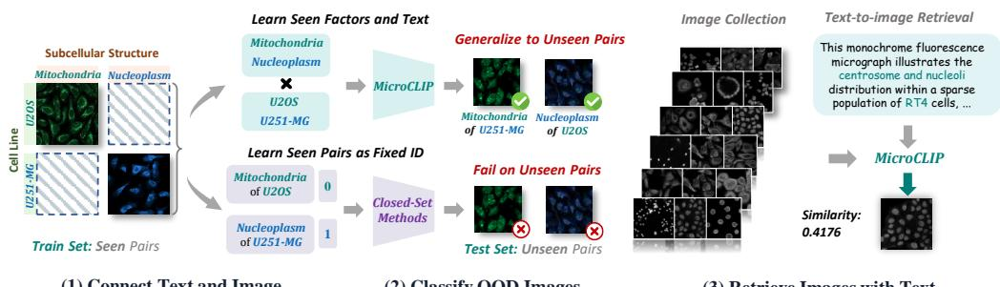  
(1) Connect Text and Image  
(2) Classify OOD Images  
(3) Retrieve Images with Text

Figure 1: (1) We connect fluorescence microscopy images with text, so that subcellular structures and cell lines can both be represented in a shared semantic space rather than as isolated class IDs. (2) Building on this shared semantic space, MicroCLIP generalizes to unseen structure–cell-line pairs, whereas conventional closed-set methods are restricted to seen pairs. (3) Beyond recognition, this shared representation further enables language-based retrieval, allowing users to search microscopy images through natural language descriptions.

## ABSTRACT

Understanding fluorescence microscopy images is fundamental to automating biological research. However, existing methods typically learn predefined concepts from closed-set data, limiting transfer across tasks and biological contexts. In this work, we introduce MicroCLIP, a vision–language model that learns generalizable cellular and subcellular representations from natural language supervision for open-set image classification and retrieval. To pretrain MicroCLIP, we construct MicroPool-2M, a dataset of approximately 2.5 million fluorescence microscopy image–text pairs spanning diverse cellular structures, cell lines, and imaging conditions. Aligning microscopy images with biological concepts in natural language is challenging because most images lack descriptive captions and biological knowledge annotations. We therefore progressively establish image–text associations at three levels to provide MicroCLIP with richer semantic supervision: (1) category-level alignment links images to standardized labels defined by subcellular structure–cell-line combinations; (2) knowledge-level alignment incorporates biological priors derived from these labels to capture relationships across species and cell types; and (3) detail-level alignment uses a multimodal large language model to recaption and verify image–text pairs at scale, emphasizing finegrained visual characteristics. Extensive experiments demonstrate that Micro-CLIP achieves leading performance in zero-shot classification and text–image retrieval on microscopy images. It retrieves images with specific cellular characteristics from thousands of candidates and generalizes to unseen biological concepts without additional supervision. These results highlight MicroCLIP’s potential as a foundation model for fluorescence microscopy. Models, training code, and datasets are available at https://github.com/Y2R-mv1p/MicroCLIP.

## 1 INTRODUCTION

Large-scale fluorescence microscopy generates massive amounts of biological imaging data, creating a growing need for automated image analysis (Ouyang et al., 2019; Caicedo et al., 2017). A fundamental requirement for such automation is the reliable recognition of biological content in microscopy images. In protein-localization microscopy, images reveal the spatial distribution of proteins across subcellular structures (Thul et al., 2017). The fluorescence pattern associated with a given subcellular structure can vary across cell lines, making both subcellular structure and cell line relevant factors for recognition (Zhang et al., 2025). Yet available datasets cover only a subset of their possible combinations, leaving many biological contexts unobserved during training. Models intended for broad use must therefore generalize beyond the structures, cell lines, and structure–cellline combinations observed during training. This is difficult for conventional closed-set classifiers, whose predictions are restricted to a predefined label space (Bendale & Boult, 2016).

Language provides a natural interface for moving beyond this fixed label space, allowing recognition targets to be specified through text rather than tied to class IDs alone (Radford et al., 2021). For fluorescence microscopy, however, realizing this potential requires grounding biological semantics in image content. On the semantic side, category annotations identify subcellular structures and cell lines, while biological knowledge describes their properties and functions. On the visual side, microscopy images exhibit instance-specific fluorescence patterns and cellular morphology. Establishing a reliable correspondence between these semantics and visual patterns remains challenging. As illustrated in Section 3, a model can describe relevant biological knowledge and image appearance yet fail to identify the correct biological category. This gap between biological semantics and microscopy images limits reliable language-guided recognition.

Existing approaches use visual information and biological semantics in different ways, but remain limited for language-guided microscopy recognition. Image-only methods such as cytoself (Kobayashi et al., 2022) and Cell-DINO (Moutakanni et al., 2025) learn microscopy representations without language supervision. General-purpose vision–language models such as CLIP (Radford et al., 2021) and SigLIP 2 (Tschannen et al., 2025) align images and text broadly, but lack microscopy-specific biological supervision. Domain-specific multimodal methods move closer, yet target specialized tasks: FluoCLIP (Park et al., 2026) uses stain semantics for focus quality assessment, while CellCLIP (Lu et al., 2025) relates cellular phenotypes to perturbation descriptions.

To capture the correspondence between microscopy images and biological semantics, we curate MicroPool-2M, the largest fluorescence microscopy image–text dataset to date, comprising 2.5 million single-channel images paired with textual descriptions. For each image, MicroPool-2M provides natural language descriptions at three levels: category-level captions specify the subcellular structure and cell line, knowledge-level captions describe their biological properties, and detail-level captions capture the fluorescence patterns visible in the image. Together, these image–text pairs cover diverse cell types and subcellular structures, as well as a broad range of biological knowledge.

Building on MicroPool-2M, we introduce MicroCLIP, a vision–language model for fluorescence microscopy. Through contrastive learning, MicroCLIP aligns microscopy images with natural language descriptions at three levels, learning representations that generalize to unseen combinations of cell lines and subcellular structures. It enables biological researchers to use natural language to search large-scale microscopy image collections for cellular morphologies and subcellular structures of interest, without task-specific fine-tuning. As shown in Table 1, MicroCLIP outperforms the evaluated general-purpose vision–language models in zero-shot classification and bidirectional image–text retrieval. On unseen structure–cell-line combinations, it achieves 67.70% classification accuracy, compared with 5.12% for the strongest general-purpose baseline.

Our contributions are threefold:

• We identify a biological grounding gap in fluorescence microscopy, highlighting the need to explicitly connect microscopy appearance with biological semantics for language-guided image understanding.

• We introduce MicroPool-2M, a large-scale multi-source fluorescence image–text dataset that grounds biological semantics in microscopy images through category-level, knowledge-level, and detail-level captions.

• We develop MicroCLIP, which learns a shared microscopy image–text representation from this multi-level supervision, substantially improving zero-shot generalization while naturally extending fluorescence microscopy analysis to bidirectional language-based retrieval.

## 2 RELATED WORK

Representation Learning for Cellular Microscopy. Self-supervised methods such as cytoself (Kobayashi et al., 2022) and Cell-DINO (Moutakanni et al., 2025) learn microscopy representations for protein localization and cellular characterization without language supervision. PUPS (Zhang et al., 2025) incorporates protein sequences and cellular landmarks to predict localization in unseen proteins and cell lines. Cross-modal methods connect cellular images to other biological information: CLOOME (Sanchez-Fernandez et al., 2023) aligns images with chemical structures, while CellCLIP (Lu et al., 2025) aligns Cell Painting phenotypes with textual descriptions of perturbations. For brain histology, Sutton et al. (2026) combine label-linked literature with image-specific properties to supervise cytoarchitectural description generation. These approaches establish complementary links between microscopy and biological information. MicroCLIP focuses on language-guided recognition and retrieval of subcellular structures across cell lines through a shared fluorescence image–text representation.

Vision–Language Pretraining and Supervision Construction. CLIP (Radford et al., 2021) establishes image–text pretraining as a framework for zero-shot recognition and retrieval. SigLIP (Zhai et al., 2023), SigLIP 2 (Tschannen et al., 2025), and PE-Core (Bolya et al., 2025) advance generalpurpose representations through improved objectives and training recipes. Data construction is another central direction: MetaCLIP (Xu et al., 2024) balances metadata distributions, and DFN (Fang et al., 2024) learns to filter image–text data. On the text side, LaCLIP (Fan et al., 2023) samples original captions and language rewrites, while VeCLIP (Lai et al., 2024) enriches captions with visual information and mixes them with original text. These studies motivate attention to both supervi sion content and sampling. MicroCLIP applies this perspective to fluorescence microscopy, pairing images with complementary category identities, biological knowledge, and instance-specific visual descriptions while retaining the standard contrastive objective.

Microscopy Resources and Generalization Evaluation. The Human Protein Atlas (Thul et al., 2017) and OpenCell (Cho et al., 2022) provide annotated protein-localization images, while RxRx1 (Sypetkowski et al., 2023) and Cell Painting resources (Chandrasekaran et al., 2024) capture variation across experimental batches and biological perturbations. MicroPool-2M integrates multiple microscopy sources into a common annotation vocabulary and augments images with three levels of text supervision. Its evaluation distinguishes unseen structures, unseen cell lines, and unseen pairings, complemented by an external source-shift benchmark. The unseen-pair setting relates to compositional zero-shot learning, which evaluates novel combinations of familiar concepts (Nagarajan & Grauman, 2018; Nayak et al., 2023); unseen-factor evaluation is also studied in open-vocabulary compositional learning (Saini et al., 2024). We use these distinctions to assess the transfer of microscopy image–text representations alongside language-based retrieval.

## 3 OBSERVATION: THE BIOLOGICAL GROUNDING GAP

Figure 2 illustrates the biological grounding gap using GPT-6. In response to text queries, the model describes the biological properties of cytosol and SiHa cells. Given a microscopy image, it describes diffuse, granular fluorescence and cellular morphology. Yet when asked to identify the subcellular structure and cell line, it predicts nucleoplasm in U-2 OS cells rather than the annotated cytosol in SiHa cells. This example shows that the ability to describe biological knowledge and visual patterns does not guarantee correct biological identification. We refer to this difficulty in reliably associating microscopy images with their biological semantics as the biological grounding gap.

To examine this difficulty beyond a single example, we select 10 categories from each of the IID and Compositional Shift subsets, with three images per category. Each image is classified among the 10 structure–cell-line candidates selected for its split. As shown in Figure 2(d), GPT-6 achieves joint category accuracies of 40.00% (12/30) on IID and 33.33% (10/30) on Compositional Shift, whereas MicroCLIP achieves 100.00% (30/30) and 90.00% (27/30), respectively. These results show that GPT-6’s biological identification remains unreliable in this diagnostic even when candidate identities are supplied, while MicroCLIP achieves higher accuracy on the same subsets. This small evaluation does not establish the cause of the errors or imply that every cell-line identity is uniquely recoverable from a single fluorescence image. Sampling, prompts, and full comparison results are provided in Appendix D. These observations motivate learning a more reliable correspondence between microscopy images and biological semantics.

(a) Knowledge-level Biological Context  
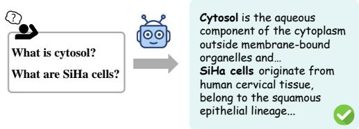

(b) Detail-level Visual Description  
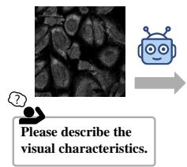  
A grayscale fluorescence microscopy image showing densely packed, irregularly shaped cells. The intracellular signal is diffuse and finely granular, with some brighter central regions and darker internal spots. Cell boundaries are fairly distinct…

(c) Category-level Biological Identification  
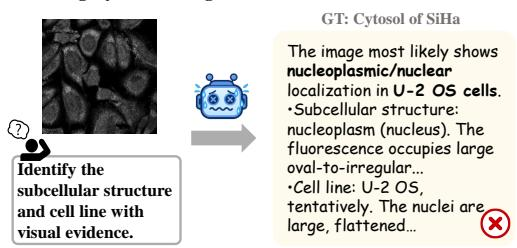

(d) Recognition Across Distribution Shifts  
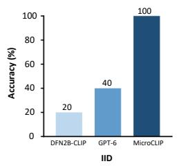

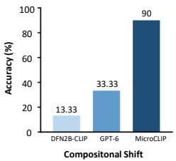  
Figure 2: Illustration of the biological grounding gap. (a–c) GPT-6 responses to biological knowledge, visual description, and biological identification queries, respectively. The predicted identity in (c) differs from the reference annotation. (d) Joint structure–cell-line classification accuracy of DFN2B-CLIP, GPT-6, and MicroCLIP on diagnostic subsets of IID and Compositional Shift, with 10 candidate categories and 30 images per split.

## 4 MICROPOOL-2M: A LARGE-SCALE MICROSCOPY IMAGE–TEXT DATASET

Motivated by the biological grounding gap identified in Section 3, we construct MicroPool-2M to provide explicit supervision linking microscopy images to biological semantics. Each fluorescence microscopy image is paired with three complementary levels of text: category-level captions specify its annotated biological identity, knowledge-level captions provide associated biological context, and detail-level captions describe its visible appearance. Together, these captions provide the supervision used to train MicroCLIP to associate biological meaning with microscopy appearance.

Image collection and annotation harmonization. Covering diverse biological contexts requires varied image sources and consistent category definitions. We aggregate single-channel fluorescence images from the Human Protein Atlas (Thul et al., 2017), Image Data Resource (Williams et al., 2017), RxRx (Sypetkowski et al., 2023), Broad Bioimage Benchmark Collection (Ljosa et al., 2012), and curated literature. Source-specific aliases are mapped to a common vocabulary, assigning each image $x _ { i }$ a structure label $s _ { i }$ and cell-line identity $c _ { i } .$ . A structure label can denote a single structure or marker, or a combination of them. Each category is represented as $e _ { i } = ( s _ { i } , c _ { i } )$ . We remove content-identical images before constructing training and evaluation sets.

Three-level text supervision. Category labels identify biological entities but do not describe their biological context or the visual appearance of individual images. We therefore pair each image $x _ { i }$ with category-level, knowledge-level, and detail-level text:

$$
t _ { i } ^ { \mathrm { c a t } } = \mathcal { T } ( s _ { i } , c _ { i } ) , \quad t _ { i } ^ { \mathrm { k n o w } } = \mathrm { C o n c a t } ( \mathcal { K } _ { s } ( s _ { i } ) , \mathcal { K } _ { c } ( c _ { i } ) ) , \quad t _ { i } ^ { \mathrm { d e t } } = \mathcal { D } ( x _ { i } , e _ { i } ) .\tag{1}
$$

Here, T applies the category template: a microscopy photo of {structure} of {cell}. The mappings $\kappa _ { s }$ and $\kappa _ { c }$ retrieve all available biological descriptions generated by GPT-5.6 Sol for the associated structures or markers and cell line, respectively; composite structure labels include descriptions of all constituent structures. For ${ \mathcal { D } } ,$ , we prompt Qwen3.5-397B-A17B with the image and the normalized category name corresponding to $e _ { i }$ to describe fluorescence distribution, morphology, signal intensity, and background. Appendix B provides prompts and caption examples.

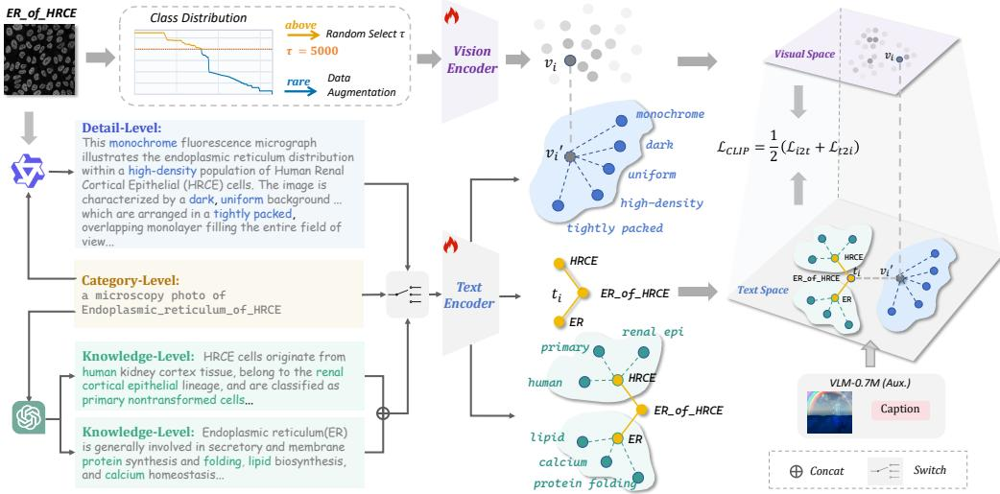  
Figure 3: MicroCLIP learns a shared image–text representation from category-level, knowledgelevel and detail-level supervision. Each microscopy image is paired with one sampled caption for CLIP training. Composition balancing and rare-class augmentation adjust training exposure, while general-domain image–text pairs provide auxiliary supervision.

Dataset coverage. MicroPool-2M contains 3,301,672 images and 3,391 observed structure–cellline pairs. After data cleaning and split construction, the training split contains 2,505,017 images spanning 2,032 structure–cell-line categories. The resulting annotations, knowledge tables, and image descriptions define the supervision used by MicroCLIP; the evaluation subsets and protocols are specified in Section 6.1.

## 5 MICROCLIP: GROUNDING BIOLOGICAL SEMANTICS IN MICROSCOPY

Building on MicroPool-2M, MicroCLIP learns to associate microscopy appearance with biological semantics in a shared image–text space. The three caption levels connect each image to its categorical identity, associated biological knowledge, and instance-specific visual traits. We use the CLIP dual-encoder architecture and symmetric contrastive objective, sampling one caption level for each image occurrence during training so that repeated observations expose the model to complementary textual descriptions. Composition-aware sampling balances training exposure across structure–cellline pairs, while auxiliary general-domain image–text data provide broader visual and linguistic supervision. Figure 3 summarizes the framework.

## 5.1 LEARNING FROM THREE-LEVEL TEXT SUPERVISION

Complementary supervision. The three caption levels link microscopy appearance to biological semantics at complementary levels of specificity. Category captions name the annotated structure– cell-line composition, providing a common identity anchor for images in the same category. Knowledge captions describe the biological properties of the annotated entities, providing shared semantic context across compositions that contain the same structure or cell line. Detail captions describe image-specific fluorescence patterns, morphology, signal intensity, and background, capturing visual variation within a category. Together, these text views allow images to be associated with both shared biological meaning and instance-specific appearance.

Text-view sampling. Each time a microscopy image $x _ { i }$ is selected for training, we sample one caption to form the positive image–text pair $( x _ { i } , t _ { i } )$ :

$$
t _ { i } = \left\{ \begin{array} { l l } { t _ { i } ^ { \mathrm { c a t } } , } & { \mathrm { w i t h ~ p r o b a b i l i t y ~ 0 . 5 0 , } } \\ { t _ { i } ^ { \mathrm { k n o w } } , } & { \mathrm { w i t h ~ p r o b a b i l i t y ~ 0 . 2 5 , } } \\ { t _ { i } ^ { \mathrm { d e t } } , } & { \mathrm { w i t h ~ p r o b a b i l i t y ~ 0 . 2 5 . } } \end{array} \right.\tag{2}
$$

The higher sampling probability for category captions maintains frequent supervision of target identity, while knowledge and detail captions provide complementary context and visual descriptions.

Captions are resampled on each occurrence throughout training, allowing the same image to receive different text views across repeated observations.

Contrastive learning. Let $\mathbf { v } _ { i }$ and $\mathbf { u } _ { i }$ be the $\ell _ { 2 }$ -normalized outputs of the image encoder $f _ { \boldsymbol { \theta } } ( \boldsymbol { x } _ { i } )$ and text encoder $g _ { \phi } ( t _ { i } )$ . For a batch of B pairs, the similarity logits are

$$
\ell _ { i j } = \alpha \mathbf { v } _ { i } ^ { \top } \mathbf { u } _ { j } ,\tag{3}
$$

where $\alpha > 0$ is a learned logit scale. We optimize the standard symmetric CLIP loss (Radford et al., 2021):

$$
\mathcal { L } _ { \mathrm { C L I P } } = - \frac { 1 } { 2 B } \sum _ { i = 1 } ^ { B } \left[ \log \frac { \exp ( \ell _ { i i } ) } { \sum _ { j = 1 } ^ { B } \exp ( \ell _ { i j } ) } + \log \frac { \exp ( \ell _ { i i } ) } { \sum _ { j = 1 } ^ { B } \exp ( \ell _ { j i } ) } \right] .\tag{4}
$$

All text views share the same encoder and objective, bringing the three forms of supervision into a common image–text space.

## 5.2 COMPOSITION-AWARE SAMPLING

Figure 7 shows that the microscopy training set follows a long-tailed distribution over structure– cell-line compositions. To reduce the dominance of frequent compositions, we follow the metadatabalancing strategy of MetaCLIP (Xu et al., 2024). Each candidate occurrence associated with composition e is retained with probability

$$
p _ { \mathrm { k e e p } } ( e ) = \operatorname* { m i n } \left( 1 , \frac { \tau _ { a } } { n ( e ) } \right) ,\tag{5}
$$

where $n ( e )$ is the number of candidate records for composition $e ,$ and $\tau _ { a } = 5 . 0 0 0$ controls the effective exposure of frequent compositions. It retains all candidates from compositions below the threshold while progressively reducing the contribution of those with larger image counts.

We additionally apply standard rotation and reflection augmentation to sparsely represented compositions before constructing the training stream. The resulting augmented records are included in $n ( e )$ , and the augmentation criterion and allocation procedure are provided in Appendix C.2. Retention is applied before text-view sampling, so the exposure of subcellular structure–cell-line compositions and the selection of text levels are controlled independently.

## 5.3 AUXILIARY GENERAL-DOMAIN IMAGE–TEXT DATA

MicroPool-2M provides domain-specific microscopy supervision, but its image and text distributions are narrower than those of general-domain vision–language corpora. We therefore mix in VLM-0.7M, a subset of 609,740 image–text records drawn from the VLM-150M dataset released by HQ-CLIP (Wei et al., 2025), to provide broader visual and linguistic exposure during training.

Each auxiliary image is paired with its tag string or VLM-generated description with equal probability. These records are mixed with MicroPool-2M under the same contrastive objective, providing broader visual and linguistic supervision.

## 6 EXPERIMENTS

## 6.1 EXPERIMENTAL SETTINGS

Evaluation data and protocols. We evaluate classification on four MicroPool-2M subsets defined relative to its microscopy training set and summarized in Table 6. IID contains new images of observed structure–cell-line pairs. Compositional Shift holds out pairs while retaining both constituent labels in training. Cell-Line Shift holds out cell lines while retaining the structure labels, and Organelle-Set Shift holds out complete structure labels while retaining the cell lines. The latter concerns structure labels, which can themselves be composite. Each internal evaluation category contains 100 images. We additionally evaluate Source Shift using 1,158 images from 13 categories drawn from the external Light My Cells dataset (S-BIAD1047) (Kauffmann et al., 2026). Figure 4 shows representative images from these evaluation settings.

For retrieval, we use a held-out pool of 1,000 MicroPool image–text pairs, with each image paired with its detail-level caption. We additionally evaluate zero-shot transfer to projected 3D cell images from the Allen WTC-11 collection in Appendix F.

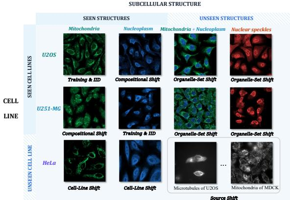  
(a) Evaluation examples.

<table><tr><td>Subset Classes</td><td>Images</td></tr><tr><td>IID 59 5,900</td></tr><tr><td>Compositional Shift 64 6,400</td></tr><tr><td>Cell-Line Shift 59 5,900</td></tr><tr><td>Organelle-Set Shift 54 5,400</td></tr><tr><td>Source Shift (external) 13 1,158</td></tr><tr><td>Training 2,032 2,505,017</td></tr></table>

(b) Evaluation statistics.  
Figure 4: Classification evaluation subsets: (a) representative images displayed using pseudocolor; (b) category and image counts for the four internal splits, the external Source Shift benchmark, and the training set.

Evaluation metrics. For classification, image–text models rank all candidate categories within each evaluated subset using the category template in Section 4. We report Top-1 accuracy without adaptation to the evaluation subsets. For retrieval, we report Recall@1 for image-to-text (I2T) and text-to-image (T2I), ranking the full corresponding pool for each query.

Baselines. The fully supervised classifier is trained on the full microscopy training set and evaluated on the 59-category IID subset. For Cell-DINO (Moutakanni et al., 2025), we self-supervise the backbone on the same 2.5M microscopy training images and fit separate linear probes for structure and cell-line recognition; their predictions are combined for IID and Compositional Shift evaluation. CLIP (Radford et al., 2021), SigLIP (Zhai et al., 2023), SigLIP 2 (Tschannen et al., 2025), PE-Core (Bolya et al., 2025), and DFN2B-CLIP (Fang et al., 2024) use released weights and native configurations, without microscopy adaptation or prompt ensembling. These comparisons measure direct transfer from general-purpose pretraining.

Implementation details. MicroCLIP initializes both encoders from DFN2B-CLIP ViT-B/16 and fine-tunes all parameters with 224 × 224 image inputs and a 256-token text context. The training stream combines 2,505,017 microscopy images, 609,740 natural-image records, and 175,516 transformed copies of rare-class microscopy images. We train for 12,000 updates using AdamW, a global batch size of 8,192, a peak learning rate of $\tilde { 4 } \times 1 0 ^ { - 5 }$ , 2,500 warmup steps, cosine decay, and weight decay 0.2. Training uses bf16 mixed precision on eight NVIDIA RTX PRO 5000 GPUs with 72 GB of memory each and takes approximately 55 hours.

## 6.2 CLASSIFICATION AND CROSS-MODAL RETRIEVAL

Table 1 shows that MicroCLIP generalizes to unseen structure–cell-line pairings while maintaining high IID accuracy. It achieves 67.70% on Compositional Shift, compared with 5.12% for the strongest general-purpose VLM and 0.98% for Cell-DINO under factor-wise linear probing. On IID images, it reaches 98.46%, compared with 97.74% for the fully supervised classifier.

Transfer also extends to held-out cell lines, structure labels, and an external source. MicroCLIP achieves 34.07% on Cell-Line Shift and 46.13% on Organelle-Set Shift, versus 7.63% and 2.54% for the strongest general-purpose baselines. Organelle-Set Shift concerns unseen complete labels, which may be composite, rather than necessarily unseen atomic structures. On Light My Cells (Kauffmann et al., 2026), MicroCLIP reaches 36.53%, versus 22.54% for PE-Core, although accuracy under distribution shift remains well below IID performance.

The same representation supports retrieval with image-specific descriptions. On 1,000 held-out image–caption pairs with detail-level captions, MicroCLIP achieves 61.5% I2T and 63.3% T2I Recall@1, compared with at most 0.7% and 0.3% for the evaluated general-purpose VLMs.

Table 1: Comparison of classification and cross-modal retrieval performance. Classification results are Top-1 accuracy (%), retrieval results are Recall@1 (%). Best and second-best results are shown in bold and underlined, respectively.
<table><tr><td rowspan="2">Method</td><td rowspan="2">Params.</td><td>In-domain classification</td><td colspan="4">Out-of-domain classification</td><td colspan="2">Retrieval</td></tr><tr><td>IID</td><td>Compositional Shift</td><td>Cell-Line Shift</td><td>Organelle-Set Shift</td><td>Source Shift</td><td>I2T</td><td>T2I</td></tr><tr><td>Closed-set methods</td><td></td><td></td><td></td><td></td><td></td><td></td><td></td><td></td></tr><tr><td>Fully Supervised Classifier</td><td></td><td>97.74</td><td></td><td>一</td><td>I</td><td></td><td>一</td><td></td></tr><tr><td>Cell-DINO</td><td>304M</td><td>36.06</td><td>0.98</td><td>一</td><td>一</td><td>一</td><td>一</td><td></td></tr><tr><td>Open-set methods</td><td></td><td></td><td></td><td></td><td></td><td></td><td></td><td></td></tr><tr><td>CLIP (OpenAI)</td><td>150M</td><td>2.97</td><td>5.12</td><td>1.80</td><td>2.54</td><td>8.38</td><td>0.7</td><td>0.2</td></tr><tr><td>SigLIP</td><td>203M</td><td>3.05</td><td>1.88</td><td>1.07</td><td>1.26</td><td>9.33</td><td>0.2</td><td>0.2</td></tr><tr><td>SigLIP 2</td><td>375M</td><td>3.08</td><td>2.28</td><td>3.59</td><td>1.11</td><td>10.79</td><td>0.2</td><td>0.3</td></tr><tr><td>PE-Core</td><td>448M</td><td>3.34</td><td>3.78</td><td>7.63</td><td>2.19</td><td>22.54</td><td>0.4</td><td>0.0</td></tr><tr><td>DFN2B-CLIP</td><td>150M</td><td>1.44</td><td>1.41</td><td>4.32</td><td>0.81</td><td>16.49</td><td>0.5</td><td>0.1</td></tr><tr><td>MicroCLIP (Ours)</td><td>150M</td><td>98.46</td><td>67.70</td><td>34.07</td><td>46.13</td><td>36.53</td><td>61.5 63.3</td><td></td></tr></table>

Table 2: MicroCLIP component ablations. Cat./Det./Know.: category/detail/knowledge captions. Bal.: composition balancing. Aux.: general-domain image–text pairs from VLM-0.7M.
<table><tr><td rowspan="2">Method</td><td rowspan="2">Cat.</td><td rowspan="2">Det.</td><td rowspan="2">Know.</td><td rowspan="2">Bal.</td><td rowspan="2">Aux.</td><td rowspan="2">In-domain classification</td><td colspan="4">Out-of-domain classification</td><td rowspan="2"></td><td colspan="2">Retrieval</td></tr><tr><td>IID</td><td>Compositional Shift</td><td>Cell-Line Shift Organelle-Set Shift</td><td>Source Shift</td><td>I2T</td><td>T2I</td></tr><tr><td>Category-level only</td><td>√</td><td></td><td></td><td></td><td></td><td></td><td>97.37</td><td>56.47</td><td>23.25</td><td>40.74</td><td>37.31</td><td>15.8</td><td>12.6</td></tr><tr><td>+ Detail-level captions</td><td>√</td><td>√</td><td></td><td></td><td></td><td></td><td>98.90</td><td>63.94</td><td>28.69</td><td>41.63</td><td>40.59</td><td>28.4</td><td>27.8</td></tr><tr><td>+ Knowledge-level captions</td><td>√</td><td>√</td><td>√</td><td></td><td></td><td></td><td>98.86</td><td>66.36</td><td>25.41</td><td>48.31</td><td>36.36</td><td>37.1</td><td>37.4</td></tr><tr><td>+ Data Balancing</td><td>√</td><td>V</td><td>√</td><td>√</td><td>√</td><td></td><td>98.24</td><td>64.95</td><td>31.53</td><td>49.91</td><td>36.44</td><td>39.4</td><td>41.5</td></tr><tr><td>+ VLM-0.7M</td><td>√</td><td>√</td><td>√</td><td>√</td><td></td><td></td><td>98.46</td><td>67.70</td><td>34.07</td><td>46.13</td><td>36.53</td><td>61.5</td><td>63.3</td></tr></table>

## 6.3 ABLATION STUDIES

Ablation on Main Components. Table 2 compares components using the same DFN2Binitialized ViT-B/16 backbone and contrastive objective. Category-level supervision supports compositional recognition but provides limited alignment with image-specific descriptions. Adding detail captions raises retrieval to 28.4%/27.8%, and adding knowledge captions further raises it to 37.1%/37.4%. Compositional Shift accuracy increases from 56.47% to 66.36%.

Composition balancing then improves Cell-Line Shift accuracy from 25.41% to 31.53%. With the auxiliary general-domain image–text pairs from VLM-0.7M, the full recipe reaches 61.5%/63.3% retrieval and the highest Compositional and Cell-Line Shift accuracy in this ablation. Gains vary across shifts: the balanced microscopy-only variant performs best on Organelle-Set Shift, while category-plus-detail supervision performs best on Source Shift.

Composition-balancing threshold. As shown in Table 3, lowering $\tau _ { a }$ reduces the sampling dominance of frequent structure–cell-line pairs. Our default, $\tau _ { a } = 5 , 0 0 0$ , improves Cell-Line Shift accuracy from 26.61% without balancing to 34.07% and gives the best Compositional Shift and bidi rectional retrieval results among the tested thresholds, with little change in IID accuracy. The gains are not monotonic: Organelle-Set Shift favors $\tau _ { a } = 2 0 , 0 0 0$ , while Source Shift favors $\tau _ { a } = 5 0 { , } 0 0 0$

Table 3: Effect of the composition-balancing threshold $\tau _ { a }$ (Equation 5). Retained (%) denotes the online sample acceptance fraction. Metrics and highlighting follow Table 1.
<table><tr><td rowspan="2">Balancing threshold  $\tau _ { a }$ </td><td rowspan="2">Retained (%)</td><td>In-domain classification</td><td colspan="4">Out-of-domain classification</td><td rowspan="2">Retrieval</td></tr><tr><td>IID</td><td>Compositional Shift</td><td>Cell-Line Shift Organelle-Set Shift</td><td>Source Shift</td><td>I2T T2I</td></tr><tr><td>off (no balancing)</td><td>100.0</td><td>98.76</td><td>66.64</td><td>26.61</td><td>46.78</td><td>30.05</td><td>32.4 35.7</td></tr><tr><td>50,000</td><td>49.8</td><td>98.83</td><td>64.73</td><td>28.44</td><td>47.35</td><td>39.29</td><td>47.0 47.6</td></tr><tr><td>20,000</td><td>30.7</td><td>98.24</td><td>65.52</td><td>27.88</td><td>47.80</td><td>34.54</td><td>44.5 45.5</td></tr><tr><td>5,000</td><td>10.5</td><td>98.46</td><td>67.70</td><td>34.07</td><td>46.13</td><td>36.53</td><td>61.5 63.3</td></tr></table>

Training-data size. Table 4 shows that increasing microscopy data from 25% to 100% under an equal-epoch protocol improves Compositional Shift accuracy from 60.39% to 66.97% and strengthens retrieval, but reduces Cell-Line and Source Shift accuracy. Thus, more data benefits composi tional recognition and retrieval without uniformly improving transfer. The final row reports the full recipe with VLM-0.7M (Wei et al., 2025); it also changes balancing and rare-class augmentation, so it does not isolate the effect of additional data.

Table 4: Training-data scale and the full recipe. Samples (M) counts images before augmentation and balancing. Metrics and highlighting follow Table 1.
<table><tr><td rowspan="2">Training data</td><td rowspan="2">Samples (M)</td><td>In-domain classification</td><td colspan="4">Out-of-domain classification</td><td colspan="2">Retrieval</td></tr><tr><td>IID</td><td></td><td>Compositional Shift Cell-Line Shift Organelle-Set Shift</td><td></td><td>Source Shift</td><td>I2T T2I</td><td></td></tr><tr><td>25%</td><td>0.63</td><td>98.76</td><td>60.39</td><td>33.05</td><td>44.56</td><td>40.93</td><td>32.1 32.0</td><td></td></tr><tr><td>50%</td><td>1.25</td><td>98.49</td><td>65.05</td><td>30.44</td><td>45.19</td><td>39.81</td><td>32.4 30.8</td><td></td></tr><tr><td>100%</td><td>2.51</td><td>98.54</td><td>66.97</td><td>30.05</td><td>45.54</td><td>37.31</td><td>60.1 60.7</td><td></td></tr><tr><td>100% + VLM-0.7M</td><td>3.11</td><td>98.46</td><td>67.70</td><td>34.07</td><td>46.13</td><td>36.53</td><td>61.5 63.3</td><td></td></tr></table>

## 6.4 QUALITATIVE VISUALIZATION

Retrieval. To illustrate cross-modal retrieval, Figure 5 presents both retrieval directions. Micro-CLIP retrieves descriptions and images matching the queried structure–cell-line identities, whereas DFN2B-CLIP and CLIP return mismatched annotations in these examples.

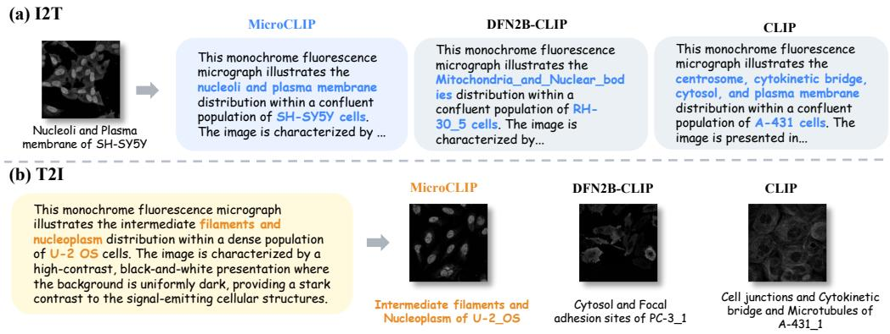  
Figure 5: Qualitative comparison of (a) image-to-text and (b) text-to-image retrieval.

Joint image–text embedding space. Figure 6 shows that DFN2B-CLIP’s category-text embeddings are separated from image embeddings, whereas MicroCLIP exhibits more distinct image clusters and greater overlap between modalities. This projection qualitatively illustrates the learned representation, while classification and retrieval results quantify alignment.

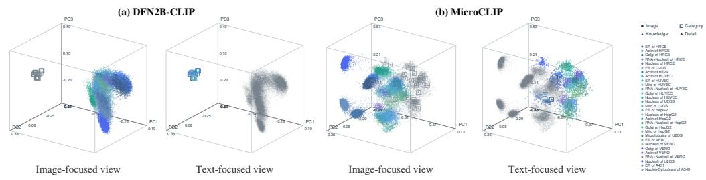  
Figure 6: Joint image–text embeddings visualized with 3D PCA. (a) DFN2B-CLIP and (b) MicroCLIP. Each pair of views uses the same projection, highlighting images or text by category and showing the other modality in gray. Colors identify categories consistently across panels; marker shapes identify images and text levels. DFN2B-CLIP shows category text only, while MicroCLIP includes all three text levels.

## 7 LIMITATIONS AND CONCLUSION

MicroPool-2M provides three-level text supervision for MicroCLIP to connect fluorescence microscopy images with biological semantics. MicroCLIP outperforms the evaluated general-purpose vision–language models in zero-shot structure–cell-line recognition and bidirectional retrieval, supporting language-guided analysis beyond training categories. Our evaluation is limited to these tasks in fluorescence microscopy, while broader biological targets and research tasks remain outside the scope of this study. Extending language-guided microscopy analysis to these settings is a promising direction toward a more general-purpose microscopy research assistant.

## AI USE STATEMENT

In this work, we used generative AI to generate synthetic text annotations for MicroPool-2M. We also evaluated GPT-6 as a subject of study in the qualitative examples and classification diagnostic presented in Section 3 and Appendix D. We take full responsibility for the content of this work.

## ETHICS STATEMENT

MicroPool-2M is constructed from existing microscopy resources and published data. We do not collect new human-subject data or personally identifiable information. Data provenance, preprocessing, and source-specific usage information are documented in the appendix and dataset documentation.

## REPRODUCIBILITY STATEMENT

To support reproducibility, we describe the construction and evaluation splits of MicroPool-2M, as well as the MicroCLIP architecture, training configurations, and evaluation protocols, in the main text and appendix. We will publicly release MicroPool-2M, the MicroCLIP model weights, and training code to facilitate reproduction of the reported results.

## REFERENCES

Eva Bartov´ a, Gabriela´ Sustˇ a´ckovˇ a, Lenka Stixov´ a, Stanislav Kozubek, So´ na Legartovˇ a, and´ Veronika Foltankova. Recruitment of oct4 protein to uv-damaged chromatin in embryonic stem cells. PLoS One, 6(12):e27281, 2011.

Soufiane Belharbi, Mara KM Whitford, Phuong Hoang, Shakeeb Murtaza, Luke McCaffrey, and Eric Granger. SR-CACO-2: A dataset for confocal fluorescence microscopy image superresolution. In Advances in Neural Information Processing Systems, volume 37, pp. 59948–59983, 2024. doi: 10.52202/079017-1914.

Abhijit Bendale and Terrance E. Boult. Towards open set deep networks. In Proceedings of the IEEE Conference on Computer Vision and Pattern Recognition, pp. 1563–1572, 2016. doi: 10. 1109/CVPR.2016.173.

Daniel Bolya, Po-Yao Huang, Peize Sun, Jang Hyun Cho, Andrea Madotto, Chen Wei, Tengyu Ma, Jiale Zhi, Jathushan Rajasegaran, Hanoona Bangalath, Junke Wang, Marco Monteiro, Hu Xu, Shiyu Dong, Nikhila Ravi, Shang-Wen Li, Piotr Dollar, and Christoph Feichtenhofer. Perception encoder: The best visual embeddings are not at the output of the network. In Advances in Neural Information Processing Systems, volume 38, 2025. doi: 10.52202/ 085713-2036. URL https://papers.neurips.cc/paper\_files/paper/2025/ hash/57bc0a850255e2041341bf74c7e2b9fa-Abstract-Conference.html.

Michal Breker, Melissa Gymrek, and Maya Schuldiner. A novel single-cell screening platform reveals proteome plasticity during yeast stress responses. Journal of Cell Biology, 200(6):839– 850, 2013.

Juan C. Caicedo, Sam Cooper, Florian Heigwer, Scott Warchal, Peng Qiu, Csaba Molnar, Aliaksei S. Vasilevich, Joseph D. Barry, Harmanjit Singh Bansal, Oren Kraus, Mathias Wawer, Lassi Paavolainen, Markus D. Herrmann, Mohammad Rohban, Jane Hung, Holger Hennig, John Concannon, Ian Smith, Paul A. Clemons, Shantanu Singh, Paul Rees, Peter Horvath, Roger G. Linington, and Anne E. Carpenter. Data-analysis strategies for image-based cell profiling. Nature Methods, 14(9):849–863, 2017. doi: 10.1038/nmeth.4397.

Peter D Caie, Rebecca E Walls, Alexandra Ingleston-Orme, Sandeep Daya, Tom Houslay, Rob Eagle, Mark E Roberts, and Neil O Carragher. High-content phenotypic profiling of drug response signatures across distinct cancer cells. Molecular Cancer Therapeutics, 9(6):1913–1926, 2010.

Srinivas Niranj Chandrasekaran, Beth A. Cimini, Amy Goodale, Lisa Miller, Maria Kost-Alimova, Nasim Jamali, John G. Doench, et al. Three million images and morphological profiles of cells treated with matched chemical and genetic perturbations. Nature Methods, 21:1114–1121, 2024. doi: 10.1038/s41592-024-02241-6.

Nathan H. Cho, Keith C. Cheveralls, Andreas-David Brunner, Kibeom Kim, Andre C. Michaelis,´ Preethi Raghavan, et al. OpenCell: Endogenous tagging for the cartography of human cellular organization. Science, 375(6585):eabi6983, 2022. doi: 10.1126/science.abi6983.

Michael J Cox, Steffen Jaensch, Jelle Van de Waeter, Laure Cougnaud, Daan Seynaeve, Soulaiman Benalla, Seong Joo Koo, Ilse Van Den Wyngaert, Jean-Marc Neefs, Dmitry Malkov, et al. Tales of 1,008 small molecules: phenomic profiling through live-cell imaging in a panel of reporter cell lines. Scientific Reports, 10(1):13262, 2020.

Jayme L. Dahlin, Bruce K. Hua, Beth E. Zucconi, Jr. Nelson, Shawn D., Shantanu Singh, Anne E. Carpenter, Jonathan H. Shrimp, Evelyne Lima-Fernandes, Mathias J. Wawer, Lawrence P. W. Chung, et al. Reference compounds for characterizing cellular injury in high-content cellular morphology assays. Nature Communications, 14(1):1364, 2023.

Lijie Fan, Dilip Krishnan, Phillip Isola, Dina Katabi, and Yonglong Tian. Improving CLIP training with language rewrites. In Advances in Neural Information Processing Systems, volume 36, 2023. URL https://proceedings.neurips.cc/paper\_files/paper/2023/ hash/6fa4d985e7c434002fb6289ab9b2d654-Abstract-Conference.html.

Alex Fang, Albin Madappally Jose, Amit Jain, Ludwig Schmidt, Alexander Toshev, and Vaishaal Shankar. Data filtering networks. In The Twelfth International Conference on Learning Representations, 2024. URL https://proceedings.iclr.cc/paper\_files/paper/2024/ hash/9bf0810a4a1597a36d27ceea58667d92-Abstract-Conference.html.

Sigrun M Gustafsdottir, Vebjorn Ljosa, Katherine L Sokolnicki, J Anthony Wilson, Deepika Walpita, Melissa M Kemp, Kathleen Petri Seiler, Hyman A Carrel, Todd R Golub, Stuart L Schreiber, et al. Multiplex cytological profiling assay to measure diverse cellular states. PloS one, 8(12):e80999, 2013.

Katie Heiser, Peter F. McLean, Chadwick T. Davis, Ben Fogelson, Hannah B. Gordon, Pamela Jacobson, Brett Hurst, Ben Miller, Ronald W. Alfa, Berton A. Earnshaw, et al. Identification of potential treatments for covid-19 through artificial intelligence-enabled phenomic analysis of human cells infected with sars-cov-2. bioRxiv, 2020. doi: 10.1101/2020.04.21.054387.

Ivaylo I Ivanov and Kenya Honda. Intestinal commensal microbes as immune modulators. Cell Host & Microbe, 12(4):496–508, 2012.

Dorian Kauffmann, Guillaume Gay, Julio Mateos-Langerak, et al. 2d multimodal image collection for fluorescence prediction from transmitted light microscopy. Scientific Data, 13:743, 2026. doi: 10.1038/s41597-026-07004-w.

Hirofumi Kobayashi, Keith C Cheveralls, Manuel D Leonetti, and Loic A Royer. Self-supervised deep learning encodes high-resolution features of protein subcellular localization. Nature methods, 19(8):995–1003, 2022. doi: 10.1038/s41592-022-01541-z.

Zhengfeng Lai, Haotian Zhang, Bowen Zhang, Wentao Wu, Haoping Bai, Aleksei Timofeev, Xianzhi Du, Zhe Gan, Jiulong Shan, Chen-Nee Chuah, Yinfei Yang, and Meng Cao. VeCLIP: Improving CLIP training via visual-enriched captions. In Proceedings of the European Conference on Computer Vision, 2024. URL https://www.ecva.net/papers/eccv\_2024/ papers\_ECCV/html/5836\_ECCV\_2024\_paper.php.

Vebjorn Ljosa, Katherine L. Sokolnicki, and Anne E. Carpenter. Annotated high-throughput microscopy image sets for validation. Nature Methods, 9(7):637, 2012. doi: 10.1038/nmeth.2083.

David J Logan, Jing Shan, Sangeeta N Bhatia, and Anne E Carpenter. Quantifying co-cultured cell phenotypes in high-throughput using pixel-based classification. Methods, 96:6–11, 2016.

MingYu Lu, Ethan Weinberger, Chanwoo Kim, and Su-In Lee. CellCLIP – learning perturbation effects in cell painting via text-guided contrastive learning. In Advances in Neural Information Processing Systems, volume 38, 2025.

Jason Moffat, Dorre A Grueneberg, Xiaoping Yang, So Young Kim, Angela M Kloepfer, Gregory Hinkle, Bruno Piqani, Thomas M Eisenhaure, Biao Luo, Jennifer K Grenier, et al. A lentiviral rnai library for human and mouse genes applied to an arrayed viral high-content screen. Cell, 124 (6):1283–1298, 2006.

Theo Moutakanni, Camille Couprie, Seungeun Yi, Michael Doron, Zitong S Chen, Nikita Moshkov,´ Elouan Gardes, Mathilde Caron, Hugo Touvron, Armand Joulin, et al. Cell-DINO: Selfsupervised image-based embeddings for cell fluorescent microscopy. PLOS Computational Biol ogy, 21(12):e1013828, 2025. doi: 10.1371/journal.pcbi.1013828.

Micha Muller, Merve Avar, Daniel Heinzer, Marc Emmenegger, Adriano Aguzzi, Lucas Pelkmans,¨ and Scott Berry. High content genome-wide sirna screen to investigate the coordination of cell size and rna production. Scientific Data, 8(1):162, 2021.

Robert F Murphy, Michael V Boland, and Meel Velliste. Towards a systematics for protein subcellular location: quantitative description of protein localization patterns and automated analysis of fluorescence microscope images. In ISMB, volume 8, pp. 251–259, 2000.

Tushar Nagarajan and Kristen Grauman. Attributes as operators: Factorizing unseen attribute-object compositions. In Computer Vision – ECCV 2018, pp. 172–190. Springer International Publishing, 2018. doi: 10.1007/978-3-030-01246-5 11.

Nihal V. Nayak, Peilin Yu, and Stephen H. Bach. Learning to compose soft prompts for compositional zero-shot learning. In International Conference on Learning Representations, 2023.

Beate Neumann, Thomas Walter, Jean-Karim Herich´ e, Jutta Bulkescher, Holger Erfle, Christian´ Conrad, Phill Rogers, Ina Poser, Michael Held, Urban Liebel, et al. Phenotypic profiling of the human genome by time-lapse microscopy reveals cell division genes. Nature, 464(7289):721– 727, 2010.

Wei Ouyang, Casper F Winsnes, Martin Hjelmare, Anthony J Cesnik, Lovisa Akesson, Hao˚ Xu, Devin P Sullivan, Shubin Dai, Jun Lan, Park Jinmo, et al. Analysis of the human protein atlas image classification competition. Nature methods, 16(12):1254–1261, 2019. doi: 10.1038/s41592-019-0658-6.

Hyejin Park, Jiwon Yoon, Sumin Park, Suree Kim, Sinae Jang, Eunsoo Lee, Dongmin Kang, and Dongbo Min. FluoCLIP: Stain-aware focus quality assessment in fluorescence microscopy. In Proceedings of the IEEE/CVF Conference on Computer Vision and Pattern Recognition (CVPR), pp. 28288–28297, June 2026. URL https://openaccess.thecvf.com/ content/CVPR2026/html/Park\_FluoCLIP\_Stain-Aware\_Focus\_Quality\_ Assessment\_in\_Fluorescence\_Microscopy\_CVPR\_2026\_paper.html.

Chang Qiao, Di Li, Yuting Guo, Chong Liu, Tao Jiang, Qionghai Dai, and Dong Li. Evaluation and development of deep neural networks for image super-resolution in optical microscopy. Nature Methods, 18(2):194–202, 2021.

Alec Radford, Jong Wook Kim, Chris Hallacy, Aditya Ramesh, Gabriel Goh, Sandhini Agarwal, Girish Sastry, Amanda Askell, Pamela Mishkin, Jack Clark, Gretchen Krueger, and Ilya Sutskever. Learning transferable visual models from natural language supervision. In Proceedings of the 38th International Conference on Machine Learning, volume 139 of Proceedings of Machine Learning Research, pp. 8748–8763. PMLR, 2021. URL https://proceedings. mlr.press/v139/radford21a.html.

Nirat Saini, Khoi Pham, and Abhinav Shrivastava. Beyond seen primitive concepts and attributeobject compositional learning. In Proceedings of the IEEE/CVF Conference on Computer Vision and Pattern Recognition, pp. 14466–14476, 2024.

Ana Sanchez-Fernandez, Elisabeth Rumetshofer, Sepp Hochreiter, and Gunter Klambauer.¨ CLOOME: Contrastive learning unlocks bioimaging databases for queries with chemical structures. Nature Communications, 14:7339, 2023. doi: 10.1038/s41467-023-42328-w.

Morgan Sarah Schwartz, Erick Moen, Geneva Miller, Tom Dougherty, Enrico Borba, Rachel Ding, William Graf, Edward Pao, and David Van Valen. Caliban: Accurate cell tracking and lineage construction in live-cell imaging experiments with deep learning. bioRxiv, 2024. doi: 10.1101/803205. URL https://www.biorxiv.org/content/early/2024/08/07/ 803205.

Christoph Spahn, Estibaliz Gomez-de Mariscal, Romain F Laine, Pedro M Pereira, Lucas von´ Chamier, Mia Conduit, Mariana G Pinho, Guillaume Jacquemet, Seamus Holden, Mike Heile-´ mann, et al. Deepbacs for multi-task bacterial image analysis using open-source deep learning approaches. Communications Biology, 5(1):688, 2022.

Ronald Springer, Alexander Zielinski, Catharina Pleschka, Bernd Hoffmann, and Rudolf Merkel. Unbiased pattern analysis reveals highly diverse responses of cytoskeletal systems to cyclic straining. PLoS One, 14(3):e0210570, 2019.

Matthew Sutton, Katrin Amunts, Timo Dickscheid, and Christian Schiffer. Cytoarchitecture in words: Weakly supervised vision-language modeling for human brain microscopy. arXiv preprint arXiv:2602.23088, 2026. doi: 10.48550/arXiv.2602.23088. URL https://arxiv.org/ abs/2602.23088.

David Svoboda and Vladimir Ulman. Mitogen: a framework for generating 3d synthetic timelapse sequences of cell populations in fluorescence microscopy. IEEE Transactions on Medical Imaging, 36(1):310–321, 2017.

Maciej Sypetkowski, Morteza Rezanejad, Saber Saberian, Oren Kraus, John Urbanik, James Taylor, Ben Mabey, Mason Victors, Jason Yosinski, Alborz Rezazadeh Sereshkeh, Imran Haque, and Berton Earnshaw. Rxrx1: A dataset for evaluating experimental batch correction methods. In Proceedings of the IEEE/CVF Conference on Computer Vision and Pattern Recognition (CVPR) Workshops, pp. 4285–4294, 2023. doi: 10.1109/CVPRW59228.2023.00451.

Peter J. Thul, Lovisa Akesson, Mikaela Wiking, Diana Mahdessian, Aikaterini Geladaki, et al. A˚ subcellular map of the human proteome. Science, 356(6340):eaal3321, 2017. doi: 10.1126/ science.aal3321.

Michael Tschannen, Alexey Gritsenko, Xiao Wang, Muhammad Ferjad Naeem, Ibrahim Alabdulmohsin, Nikhil Parthasarathy, Talfan Evans, Lucas Beyer, Ye Xia, Basil Mustafa, Olivier Henaff,´ Jeremiah Harmsen, Andreas Steiner, and Xiaohua Zhai. SigLIP 2: Multilingual vision-language encoders with improved semantic understanding, localization, and dense features. arXiv preprint arXiv:2502.14786, 2025. doi: 10.48550/arXiv.2502.14786. URL https://arxiv.org/ abs/2502.14786.

Matheus P. Viana, Jianxu Chen, Theo A. Knijnenburg, Ritvik Vasan, Calysta Yan, Joy E. Arakaki, Matte Bailey, Ben Berry, Antoine Borensztejn, Eva M. Brown, et al. Integrated intracellular organization and its variations in human iPS cells. Nature, 613(7943):345–354, 2023. doi: 10. 1038/s41586-022-05563-7.

Alessandra Vigilante, Anna Laddach, Nathalie Moens, Ruta Meleckyte, Andreas Leha, Arsham Ghahramani, Oliver J Culley, Annie Kathuria, Chloe Hurling, Alice Vickers, et al. Identifying extrinsic versus intrinsic drivers of variation in cell behavior in human ipsc lines from healthy donors. Cell Reports, 26(8):2078–2087.e3, 2019.

Zhixiang Wei, Guangting Wang, Xiaoxiao Ma, Ke Mei, Huaian Chen, Yi Jin, and Fengyun Rao. Hqclip: Leveraging large vision-language models to create high-quality image-text datasets and clip models. In Proceedings of the IEEE/CVF International Conference on Computer Vision (ICCV), pp. 22447–22456, October 2025.

Jens Wenzel, Christian Held, Ralf Palmisano, Stefan Teufel, Jean-Pierre David, Thomas Wittenberg, and Roland Lang. Measurement of tlr-induced macrophage spreading by automated image analysis: differential role of myd88 and mapk in early and late responses. Frontiers in Physiology, 2: 71, 2011.

Eleanor Williams, Josh Moore, Simon W. Li, Gabriella Rustici, Aleksandra Tarkowska, Anatole Chessel, Simone Leo, Balint Antal, Richard K. Ferguson, Ugis Sarkans, Alvis Brazma, Rafael E.´ Carazo Salas, and Jason R. Swedlow. Image Data Resource: a bioimage data integration and publication platform. Nature Methods, 14(8):775–781, 2017. doi: 10.1038/nmeth.4326.

Hu Xu, Saining Xie, Xiaoqing Ellen Tan, Po-Yao Huang, Russell Howes, Vasu Sharma, Shang-Wen Li, Gargi Ghosh, Luke Zettlemoyer, and Christoph Feichtenhofer. Demystifying CLIP data. In The Twelfth International Conference on Learning Representations, 2024. URL https: //openreview.net/forum?id=5BCFlnfE1g.

Xiaohua Zhai, Basil Mustafa, Alexander Kolesnikov, and Lucas Beyer. Sigmoid loss for language image pre-training. In Proceedings of the IEEE/CVF International Conference on Computer Vision (ICCV), pp. 11975–11986, October 2023. URL https: //openaccess.thecvf.com/content/ICCV2023/html/Zhai\_Sigmoid\_Loss\_ for\_Language\_Image\_Pre-Training\_ICCV\_2023\_paper.html.

Chi Zhang, Hao Jiang, Weihuang Liu, Junyi Li, Shiming Tang, Mario Juhas, and Yang Zhang. Correction of out-of-focus microscopic images by deep learning. Computational and Structural Biotechnology Journal, 20:1957–1966, 2022.

Xinyi Zhang, Yitong Tseo, Yunhao Bai, Fei Chen, and Caroline Uhler. Prediction of protein subcellular localization in single cells. Nature Methods, 22:1265–1275, 2025. doi: 10.1038/ s41592-025-02696-1.

Yide Zhang, Yinhao Zhu, Evan Nichols, Qingfei Wang, Siyuan Zhang, Cody Smith, and Scott Howard. A poisson-gaussian denoising dataset with real fluorescence microscopy images. In Proceedings of the IEEE/CVF Conference on Computer Vision and Pattern Recognition, pp. 11710– 11718, 2019.

## APPENDIX CONTENTS

A Additional Details of MicroPool-2M 16   
A.1 Data Sources and Label Harmonization 16   
A.2 Training Category Distribution 19   
B Caption Construction 19   
B.1 Generation Procedure and Prompts . 20   
B.2 Examples of Three-Level Captions 21   
C Additional Training Details 21   
C.1 Text Length and Tokenization 21   
C.2 Rare-Class Augmentation . 22   
D Biological Grounding Diagnostic 23   
E Additional Quantitative Results 23   
E.1 Model Scaling . 23   
E.2 Caption Sampling Ratios 23   
F Downstream Transfer Evaluation 24   
G Visualizations and Downstream Results 24   
G.1 Classification Examples . 24   
G.2 Cross-Modal Retrieval 24

## A ADDITIONAL DETAILS OF MICROPOOL-2M

## A.1 DATA SOURCES AND LABEL HARMONIZATION

MicroPool-2M draws its candidate microscopy images from public microscopy datasets, including the Human Protein Atlas (HPA) (Thul et al., 2017), the Image Data Resource (IDR) (Williams et al., 2017), RxRx (Sypetkowski et al., 2023), the Broad Bioimage Benchmark Collection (BBBC) (Ljosa et al., 2012), and additional public microscopy datasets. Table 5 summarizes the source datasets and their record counts. These counts describe records in the source collection before MicroPool-specific single-channel extraction, filtering, label harmonization, deduplication, and split construction; they therefore should not be summed to recover the final MicroPool-2M dataset size.

Table 5: Source datasets for MicroPool-2M. The table lists each dataset, source publication, biological target, cell line or specimen, image dimensions, and record count. Values describe the collected source data before MicroPool-specific extraction, filtering, harmonization, and deduplication. For datasets summarized in a single row, the data number is the sum over the listed structure–cell-line entries.
<table><tr><td colspan="1" rowspan="1">Dataset</td><td colspan="1" rowspan="1">Publication</td><td colspan="1" rowspan="1">SubcellularStructure</td><td colspan="1" rowspan="1">Cell Line</td><td colspan="1" rowspan="1">Image Size</td><td colspan="3" rowspan="1">DataNumber</td></tr><tr><td colspan="1" rowspan="1">BBBC026</td><td colspan="1" rowspan="1">Logan etal. Logan et al.(2016)</td><td colspan="1" rowspan="1">DNA</td><td colspan="1" rowspan="1">Human Hepatocyteand MurineFibroblast cells</td><td colspan="1" rowspan="1">1040×1392</td><td colspan="3" rowspan="1">864</td></tr><tr><td colspan="1" rowspan="3">BBBC001</td><td colspan="1" rowspan="3">Moffat etal. Moffatet al. (2006)</td><td colspan="1" rowspan="1">DNA</td><td colspan="1" rowspan="1">HT-29</td><td colspan="1" rowspan="1">512×512</td><td colspan="3" rowspan="1">64512</td></tr><tr><td colspan="1" rowspan="1">Actin</td><td colspan="1" rowspan="1">HT-29</td><td colspan="1" rowspan="1">512×512</td><td colspan="3" rowspan="1">64512</td></tr><tr><td colspan="1" rowspan="1">pH3</td><td colspan="1" rowspan="1">HT-29</td><td colspan="1" rowspan="1">512×512</td><td colspan="3" rowspan="1">64512</td></tr><tr><td colspan="1" rowspan="2">BBBC020</td><td colspan="1" rowspan="2">Wenzel etal. Wenzelet al. (2011)</td><td colspan="1" rowspan="1">CD11b</td><td colspan="1" rowspan="1">BoneMarrow-DerivedMacrophages fromC57BL/6 mice</td><td colspan="1" rowspan="1">1388×3×1040</td><td colspan="3" rowspan="1">25</td></tr><tr><td colspan="1" rowspan="1">Nuclei</td><td colspan="1" rowspan="1">BoneMarrow-DerivedMacrophages fromC57BL/6 mice</td><td colspan="1" rowspan="1">1388×3×1040</td><td colspan="3" rowspan="1">25</td></tr><tr><td colspan="1" rowspan="3">BPAEC</td><td colspan="1" rowspan="3">Zhang etal. Zhanget al. (2022)</td><td colspan="1" rowspan="1">F-actin</td><td colspan="1" rowspan="1">BPAE</td><td colspan="1" rowspan="1">1024×1024</td><td colspan="3" rowspan="1">317</td></tr><tr><td colspan="1" rowspan="1">Mitochondria</td><td colspan="1" rowspan="1">BPAE</td><td colspan="1" rowspan="1">1024×1024</td><td colspan="3" rowspan="1">250</td></tr><tr><td colspan="1" rowspan="1">Nucleus</td><td colspan="1" rowspan="1">BPAE</td><td colspan="1" rowspan="1">1024×1024</td><td colspan="3" rowspan="1">111</td></tr><tr><td colspan="1" rowspan="4">BioSR</td><td colspan="1" rowspan="4">Qiao etal. Qiao et al.(2021)</td><td colspan="1" rowspan="1">CCPs</td><td colspan="1" rowspan="1">COS-7</td><td colspan="1" rowspan="1">1004×1004</td><td colspan="3" rowspan="1">54</td></tr><tr><td colspan="1" rowspan="1">ER</td><td colspan="1" rowspan="1">COS-7</td><td colspan="1" rowspan="1">1004×1004</td><td colspan="3" rowspan="1">68</td></tr><tr><td colspan="1" rowspan="1">F-actin</td><td colspan="1" rowspan="1">COS-7</td><td colspan="1" rowspan="1">1004×1004</td><td colspan="3" rowspan="1">51</td></tr><tr><td colspan="1" rowspan="1">Microtubules</td><td colspan="1" rowspan="1">COS-7</td><td colspan="1" rowspan="1">1004×1004</td><td colspan="3" rowspan="1">55</td></tr><tr><td colspan="1" rowspan="5">CPJUMP1</td><td colspan="1" rowspan="5">Chandrasekaranet al. Chan-drasekaranet al. (2024)</td><td colspan="1" rowspan="1">AGP</td><td colspan="1" rowspan="1">U2OS</td><td colspan="1" rowspan="1">1080×1080</td><td colspan="3" rowspan="1">8896</td></tr><tr><td colspan="1" rowspan="1">DNA</td><td colspan="1" rowspan="1">U2OS</td><td colspan="1" rowspan="1">1080×1080</td><td colspan="3" rowspan="1">8896</td></tr><tr><td colspan="1" rowspan="1">ER</td><td colspan="1" rowspan="1">U2OS</td><td colspan="1" rowspan="1">1080×1080</td><td colspan="3" rowspan="1">8896</td></tr><tr><td colspan="1" rowspan="1">Mitochondria</td><td colspan="1" rowspan="1">U2OS</td><td colspan="1" rowspan="1">1080×1080</td><td colspan="3" rowspan="1">8898</td></tr><tr><td colspan="1" rowspan="1">RNA</td><td colspan="1" rowspan="1">U2OS</td><td colspan="1" rowspan="1">1080×1080</td><td colspan="3" rowspan="1">8897</td></tr><tr><td colspan="1" rowspan="2">DeepBacs</td><td colspan="1" rowspan="2">Spahn etal. Spahn</td><td colspan="1" rowspan="1">H-NS-mScarlet-I</td><td colspan="1" rowspan="1">E.coli</td><td colspan="1" rowspan="1">512×512</td><td colspan="3" rowspan="1">28</td></tr><tr><td colspan="1" rowspan="1">MreB</td><td colspan="1" rowspan="1">E.coli</td><td colspan="1" rowspan="1">512×512</td><td colspan="3" rowspan="1">30</td></tr><tr><td colspan="1" rowspan="6">DynamicNuclearNetSegmentation</td><td colspan="1" rowspan="6">et al. (2022)Schwartz etal. Schwartzet al. (2024)</td><td colspan="1" rowspan="1">Nuclei</td><td colspan="1" rowspan="1">3T3</td><td colspan="1" rowspan="1">512×512</td><td colspan="3" rowspan="1">639</td></tr><tr><td colspan="1" rowspan="1">Nuclei</td><td colspan="1" rowspan="1">HEK293</td><td colspan="1" rowspan="1">512×512</td><td colspan="3" rowspan="1">426</td></tr><tr><td colspan="1" rowspan="1">Nuclei</td><td colspan="1" rowspan="1">PC-3</td><td colspan="1" rowspan="1">512×512</td><td colspan="3" rowspan="1">250</td></tr><tr><td colspan="1" rowspan="1">Nuclei</td><td colspan="1" rowspan="1">RAW264</td><td colspan="1" rowspan="1">512×512</td><td colspan="3" rowspan="1">1755</td></tr><tr><td colspan="1" rowspan="1">Nuclei</td><td colspan="1" rowspan="1">RPE</td><td colspan="1" rowspan="1">512×512</td><td colspan="3" rowspan="1">200</td></tr><tr><td colspan="1" rowspan="1">Nuclei</td><td colspan="1" rowspan="1">HeLa</td><td colspan="1" rowspan="1">512×512</td><td colspan="3" rowspan="1">1680</td></tr><tr><td colspan="1" rowspan="5">DynamicNuclearNetTracking</td><td colspan="1" rowspan="5">Schwartz etal. Schwartzet al. (2024)</td><td colspan="1" rowspan="1">Nuclei</td><td colspan="1" rowspan="1">3T3</td><td colspan="1" rowspan="1">584×600</td><td colspan="3" rowspan="1">639</td></tr><tr><td colspan="1" rowspan="1">Nuclei</td><td colspan="1" rowspan="1">HEK293</td><td colspan="1" rowspan="1">584×600</td><td colspan="3" rowspan="1">426</td></tr><tr><td colspan="1" rowspan="1">Nuclei</td><td colspan="1" rowspan="1">PC-3</td><td colspan="1" rowspan="1">584×600</td><td colspan="3" rowspan="1">250</td></tr><tr><td colspan="1" rowspan="1">Nuclei</td><td colspan="1" rowspan="1">RAW264</td><td colspan="1" rowspan="1">584×600</td><td colspan="3" rowspan="1">1755</td></tr><tr><td colspan="1" rowspan="1">Nuclei</td><td colspan="1" rowspan="1">HeLa</td><td colspan="1" rowspan="1">584×600</td><td colspan="3" rowspan="1">1680</td></tr><tr><td colspan="1" rowspan="3">FMD</td><td colspan="1" rowspan="3">Zhang etal. Zhanget al. (2019)</td><td colspan="1" rowspan="1">F-actin</td><td colspan="1" rowspan="1">BPAE</td><td colspan="1" rowspan="1">512×512</td><td colspan="3" rowspan="1">48</td></tr><tr><td colspan="1" rowspan="1">Mitochondria</td><td colspan="1" rowspan="1">BPAE</td><td colspan="1" rowspan="1">512×512</td><td colspan="3" rowspan="1">48</td></tr><tr><td colspan="1" rowspan="1">Nucleus</td><td colspan="1" rowspan="1">BPAE</td><td colspan="1" rowspan="1">512×512</td><td colspan="3" rowspan="1">48</td></tr><tr><td colspan="1" rowspan="4">CellTrackingChallenge</td><td colspan="2" rowspan="1">Bártová etal. Bártová et al.(2011)</td><td colspan="1" rowspan="1">GOWT1</td><td colspan="1" rowspan="1">Mouse stem cells</td><td colspan="1" rowspan="1">1024×1024</td><td colspan="1" rowspan="1">184</td></tr><tr><td colspan="2" rowspan="1">Ulman etal. Svoboda &amp;Ulman (2017)</td><td colspan="1" rowspan="1">DNA</td><td colspan="1" rowspan="1">HL60 cells</td><td colspan="1" rowspan="1">700×1100</td><td colspan="1" rowspan="1">184</td></tr><tr><td colspan="2" rowspan="1">Neumann etal. Neumannet al. (2010)</td><td colspan="1" rowspan="1">H2B</td><td colspan="1" rowspan="1">HeLa cells</td><td colspan="1" rowspan="1">690×628</td><td colspan="1" rowspan="1">215</td></tr><tr><td colspan="2" rowspan="1">Ivanov etal. Ivanov &amp;Honda (2012)</td><td colspan="1" rowspan="1">tia-1</td><td colspan="1" rowspan="1">HumanHepatocarcinoma-derived Cells</td><td colspan="1" rowspan="1">1024×1024</td><td colspan="1" rowspan="1">60</td></tr><tr><td colspan="1" rowspan="10">2D HeLa</td><td colspan="2" rowspan="10">Murphy etal. Murphyet al. (2000)</td><td colspan="1" rowspan="1">Actin</td><td colspan="1" rowspan="1">HeLa</td><td colspan="1" rowspan="1">382×512</td><td colspan="1" rowspan="1">98</td></tr><tr><td colspan="1" rowspan="1">DNA</td><td colspan="1" rowspan="1">HeLa</td><td colspan="1" rowspan="1">382×512</td><td colspan="1" rowspan="1">862</td></tr><tr><td colspan="1" rowspan="1">Endosomes</td><td colspan="1" rowspan="1">HeLa</td><td colspan="1" rowspan="1">382×512</td><td colspan="1" rowspan="1">91</td></tr><tr><td colspan="1" rowspan="1">ER</td><td colspan="1" rowspan="1">HeLa</td><td colspan="1" rowspan="1">382×512</td><td colspan="1" rowspan="1">86</td></tr><tr><td colspan="1" rowspan="1">Golgi</td><td colspan="1" rowspan="1">HeLa, Giant</td><td colspan="1" rowspan="1">382×512</td><td colspan="1" rowspan="1">87</td></tr><tr><td colspan="1" rowspan="1">Golgi</td><td colspan="1" rowspan="1">HeLa, GPP130</td><td colspan="1" rowspan="1">382×512</td><td colspan="1" rowspan="1">85</td></tr><tr><td colspan="1" rowspan="1">Lysosomes</td><td colspan="1" rowspan="1">HeLa</td><td colspan="1" rowspan="1">382×512</td><td colspan="1" rowspan="1">84</td></tr><tr><td colspan="1" rowspan="1">Microtubules</td><td colspan="1" rowspan="1">HeLa</td><td colspan="1" rowspan="1">382×512</td><td colspan="1" rowspan="1">91</td></tr><tr><td colspan="1" rowspan="1">Mitochondria</td><td colspan="1" rowspan="1">HeLa</td><td colspan="1" rowspan="1">382×512</td><td colspan="1" rowspan="1">73</td></tr><tr><td colspan="1" rowspan="1">Nucleolus</td><td colspan="1" rowspan="1">HeLa</td><td colspan="1" rowspan="1">382×512</td><td colspan="1" rowspan="1">80</td></tr><tr><td colspan="1" rowspan="3">Caco-2</td><td colspan="2" rowspan="3">Belharbi Bel-harbi et al.(2024)</td><td colspan="1" rowspan="1">GFP-tubulin orE-cadherin</td><td colspan="1" rowspan="1">Caco-2</td><td colspan="1" rowspan="1">512×512</td><td colspan="1" rowspan="1">9937</td></tr><tr><td colspan="1" rowspan="1">Survivin</td><td colspan="1" rowspan="1">Caco-2</td><td colspan="1" rowspan="1">512×512</td><td colspan="1" rowspan="1">9937</td></tr><tr><td colspan="1" rowspan="1">mCherry-HistoneH2B</td><td colspan="1" rowspan="1">Caco-2</td><td colspan="1" rowspan="1">512×512</td><td colspan="1" rowspan="1">9937</td></tr><tr><td colspan="1" rowspan="2">idr003</td><td colspan="2" rowspan="2">Breker etal. Breker</td><td colspan="1" rowspan="1">GFP</td><td colspan="1" rowspan="1">Y6545</td><td colspan="1" rowspan="1">512×672</td><td colspan="1" rowspan="1">83376</td></tr><tr><td colspan="1" rowspan="1">H2B-mCherry</td><td colspan="1" rowspan="1">Y6545</td><td colspan="1" rowspan="1">512×672</td><td colspan="1" rowspan="1">83376</td></tr><tr><td colspan="1" rowspan="3">idr035</td><td colspan="2" rowspan="3">etale(2013)et al. (2010)</td><td colspan="1" rowspan="1">Actin</td><td colspan="1" rowspan="1">MCF-7</td><td colspan="1" rowspan="1">1024×1280</td><td colspan="1" rowspan="1">13200</td></tr><tr><td colspan="1" rowspan="1">Tubulin</td><td colspan="1" rowspan="1">MCF-7</td><td colspan="1" rowspan="1">1024×1280</td><td colspan="1" rowspan="1">13200</td></tr><tr><td colspan="1" rowspan="1">DNA</td><td colspan="1" rowspan="1">MCF-7</td><td colspan="1" rowspan="1">1024×1280</td><td colspan="1" rowspan="1">13200</td></tr><tr><td colspan="1" rowspan="5">idr036</td><td colspan="2" rowspan="5">Gustafsdottiret al. Gustafs-dottir et al.(2013)</td><td colspan="1" rowspan="1">DNA</td><td colspan="1" rowspan="1">U2OS</td><td colspan="1" rowspan="1">520×696</td><td colspan="1" rowspan="1">17270</td></tr><tr><td colspan="1" rowspan="1">ER</td><td colspan="1" rowspan="1">U2OS</td><td colspan="1" rowspan="1">520×696</td><td colspan="1" rowspan="1">17272</td></tr><tr><td colspan="1" rowspan="1">Golgi and Actin</td><td colspan="1" rowspan="1">U2OS</td><td colspan="1" rowspan="1">520×696</td><td colspan="1" rowspan="1">13822</td></tr><tr><td colspan="1" rowspan="1">Nucleoli</td><td colspan="1" rowspan="1">U2OS</td><td colspan="1" rowspan="1">520×696</td><td colspan="1" rowspan="1">17272</td></tr><tr><td colspan="1" rowspan="1">Mitochondria</td><td colspan="1" rowspan="1">U2OS</td><td colspan="1" rowspan="1">520×696</td><td colspan="1" rowspan="1">13992</td></tr><tr><td colspan="1" rowspan="3">idr050</td><td colspan="2" rowspan="3">Springer etal. Springeret al. (2019)</td><td colspan="1" rowspan="1">Actin</td><td colspan="1" rowspan="1">HUVEC</td><td colspan="1" rowspan="1">1488×1488</td><td colspan="1" rowspan="1">3118</td></tr><tr><td colspan="1" rowspan="1"></td><td colspan="1" rowspan="1">Microtubules</td><td colspan="1" rowspan="1">HUVEC</td><td colspan="1" rowspan="1">1488×1488</td><td colspan="1" rowspan="1">4310</td></tr><tr><td colspan="1" rowspan="1">Vimentin</td><td colspan="1" rowspan="1">HUVEC</td><td colspan="1" rowspan="1">2048×2048</td><td colspan="1" rowspan="1">1394</td></tr><tr><td colspan="1" rowspan="1">idr088</td><td colspan="2" rowspan="1">Cox et al. Coxet al. (2020)</td><td colspan="1" rowspan="1">ACTB, CANX,CLTA, COX4I1,GM130, Nu-clei/Cytoplasm,RAB5A, RELA.SQSTM1,TP53BP1,TUBA1B</td><td colspan="1" rowspan="1">A549, HepG2,WPMY-1</td><td colspan="1" rowspan="1">1050×1250</td><td colspan="1" rowspan="1">102870</td></tr><tr><td colspan="1" rowspan="4">idr093</td><td colspan="2" rowspan="4">Muller Mülleret al. (2021)</td><td colspan="1" rowspan="1">DNA</td><td colspan="1" rowspan="1">HeLa Kyoto</td><td colspan="1" rowspan="1">2160×2560</td><td colspan="1" rowspan="1">2973</td></tr><tr><td colspan="1" rowspan="1">Nascent RNA</td><td colspan="1" rowspan="1">HeLa Kyoto</td><td colspan="1" rowspan="1">2160×2560</td><td colspan="1" rowspan="1">2973</td></tr><tr><td colspan="1" rowspan="1">PCNA</td><td colspan="1" rowspan="1">HeLa Kyoto</td><td colspan="1" rowspan="1">2160×2560</td><td colspan="1" rowspan="1">2974</td></tr><tr><td colspan="1" rowspan="1">SuccinimidylEster</td><td colspan="1" rowspan="1">HeLa Kyoto</td><td colspan="1" rowspan="1">2160×2560</td><td colspan="1" rowspan="1">2973</td></tr><tr><td colspan="1" rowspan="5">idr133</td><td colspan="2" rowspan="5">Dahlin Dahlinet al. (2023)</td><td colspan="1" rowspan="1">DNA</td><td colspan="1" rowspan="1">U2OS</td><td colspan="1" rowspan="1">2160×2160</td><td colspan="1" rowspan="1">648</td></tr><tr><td colspan="1" rowspan="1">ER</td><td colspan="1" rowspan="1">U2OS</td><td colspan="1" rowspan="1">2160×2160</td><td colspan="1" rowspan="1">759</td></tr><tr><td colspan="1" rowspan="1">F-actin andPlasmaMembrane</td><td colspan="1" rowspan="1">U2OS</td><td colspan="1" rowspan="1">2160×2160</td><td colspan="1" rowspan="1">1250</td></tr><tr><td colspan="1" rowspan="1">RNA</td><td colspan="1" rowspan="1">U2OS</td><td colspan="1" rowspan="1">2160×2160</td><td colspan="1" rowspan="1">1092</td></tr><tr><td colspan="1" rowspan="1">Mitochondria</td><td colspan="1" rowspan="1">U2OS</td><td colspan="1" rowspan="1">2160×2160</td><td colspan="1" rowspan="1">940</td></tr><tr><td colspan="1" rowspan="1">RxRx1</td><td colspan="1" rowspan="1">Sypetkowski etal. Sypetkowskiet al. (2023)</td><td colspan="1" rowspan="1">Actin, ER, Golgi,Mitochondria,Nuclei, Nucleoliand CytoplasmicRNA</td><td colspan="1" rowspan="1">HepG2, HUVEC,RPE</td><td colspan="1" rowspan="1">512×512</td><td colspan="3" rowspan="1">753060</td></tr><tr><td colspan="1" rowspan="1">RxRx19a</td><td colspan="1" rowspan="1">Heiser Heiseret al. (2020)</td><td colspan="1" rowspan="1">Actin, ER, Golgi,Nuclei, Nucleoliand CytoplasmicRNA</td><td colspan="1" rowspan="1">HRCE, Vero</td><td colspan="1" rowspan="1">1024×1024</td><td colspan="3" rowspan="1">1527600</td></tr><tr><td colspan="1" rowspan="2">HPA</td><td colspan="1" rowspan="2">Ouyang etal. Ouyang et al.(2019)</td><td colspan="1" rowspan="1">Nucleus,Microtubules,Nucleoplasm,ER, Cytosol,Mitochondria,PlasmaMembrane,Nuclear Speckles,Golgi Apparatus,IntermediateFilaments,CytokineticBridge, Nucleoli,Lipid Droplets,NuclearMembrane, ActinFilaments,MicrotubuleOrganizingCenter, CellJunctions,Centrosome,Nucleoli Fibrillar</td><td colspan="1" rowspan="2">AF22, MCF7, U-251MG, U2OS,CACO-2, A-431,HeLa, SH-SY5Y,RH-30, RT4, HEK293, BJ, NIH 3T3,A549, PC-3,SK-MEL-30,HaCaT, SiHa, HepG2, HUVECTERT2, RPTECTERT1, NB-4, REH,ASC TERT1,LHCN-M2, hTCEpi,HEL</td><td colspan="4" rowspan="2">1728×1728   279081</td></tr><tr><td colspan="3" rowspan="1">Center, NuclearBodies,Microtubules,EndoplasmicReticulum, Rods&amp; Rings, MitoticSpindle,Aggresome,Focal AdhesionSites,Endosomes,Lysosomes,Peroxisomes,Cytoplasmicbodies,Microtubule Ends</td></tr><tr><td colspan="1" rowspan="1">idr037</td><td colspan="1" rowspan="1">Vigilante etal. Vigilanteet al. (2019)</td><td colspan="1" rowspan="1">EdU, DNA,plasma</td><td colspan="1" rowspan="1">62 inducedpluripotent stem-celllines and controls</td><td colspan="1" rowspan="1">1360×1024</td><td colspan="3" rowspan="1">46052</td></tr></table>

Source-specific names are normalized before defining a MicroPool category. Aliases for the same cell line or structure are mapped to a canonical name, and each retained image is assigned a complete structure label and a cell-line identity. A complete structure label may contain one structure, one marker, or a composition of several entries. Composite knowledge captions concatenate the available constituent descriptions in canonical order.

The final benchmark contains 2,505,017 training images and 23,600 internal evaluation images. Each internal evaluation category contains 100 images. Source Shift uses a separate external set of 1,158 images. Table 6 summarizes the category, structure, cell-line, and image counts for each evaluation subset. Splits are constructed from canonical structure–cell-line labels. Cell-Line Shift holds out 8 cell lines, and Organelle-Set Shift holds out 29 complete structure labels, while retaining the other factor in training. Compositional Shift selects 64 held-out pairs in ascending order of class size, subject to each constituent structure and cell line remaining represented in training. IID samples images from 59 categories that remain in training. Rare-class augmentation is applied only to the training set.

Table 6: Classification evaluation data. Structure counts refer to complete structure labels, including composite labels. Each internal evaluation category contains 100 images. Source Shift is an external benchmark and is not balanced to 100 images per category.
<table><tr><td>Subset</td><td>Classes</td><td>Struct.</td><td>Cells</td><td>Images</td><td>Shift</td></tr><tr><td>IID</td><td>59</td><td>21</td><td>12</td><td>5,900</td><td>none</td></tr><tr><td>Compositional Shift</td><td>64</td><td>16</td><td>16</td><td>6,400</td><td>pair</td></tr><tr><td>Cell-Line Shift</td><td>59</td><td>22</td><td>8</td><td>5,900</td><td>cell line</td></tr><tr><td>Organelle-Set Shift</td><td>54</td><td>29</td><td>6</td><td>5,400</td><td>structure label</td></tr><tr><td>Source Shift (external)</td><td>13</td><td>3</td><td>5</td><td>1,158</td><td>source</td></tr></table>

## A.2 TRAINING CATEGORY DISTRIBUTION

Figure 7 shows the long-tailed frequency distribution of the 2,032 training categories, each defined by a complete structure–cell-line composition. Categories are ranked by decreasing image count, with both axes shown on logarithmic scales. Under uniform image sampling, frequent compositions receive more training exposure than sparsely represented ones. This imbalance motivates the composition-aware sampling in Section 5.2, which reduces the retention probability of compositions with candidate counts above $\tau _ { a } = 5 , 0 0 0$ . The reference line marks this retention threshold; details of the training stream and supplementary rare-class augmentation are provided in Appendix C.2.

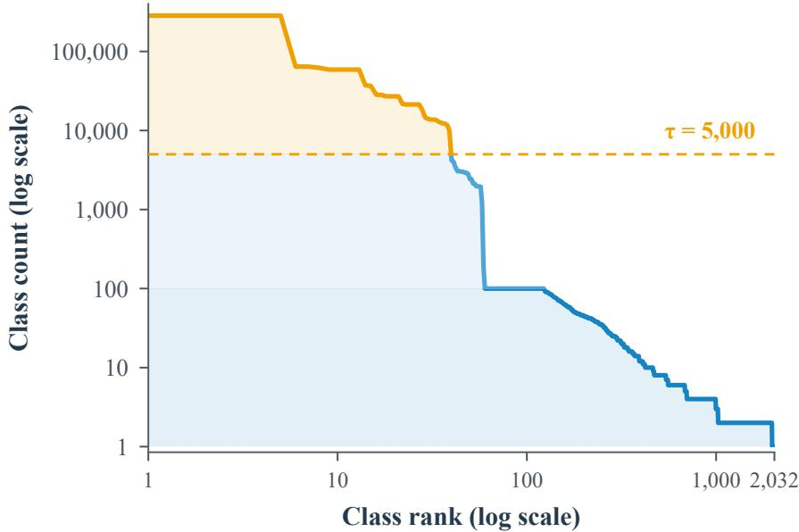  
Figure 7: Training category frequencies, ranked by image count. Dashed lines mark the augmentation and retention thresholds.

## B CAPTION CONSTRUCTION

This section documents how the three text views are constructed and provides the prompts used to generate the knowledge-level and detail-level captions. It then shows representative image–caption examples to illustrate the information contributed by each view.

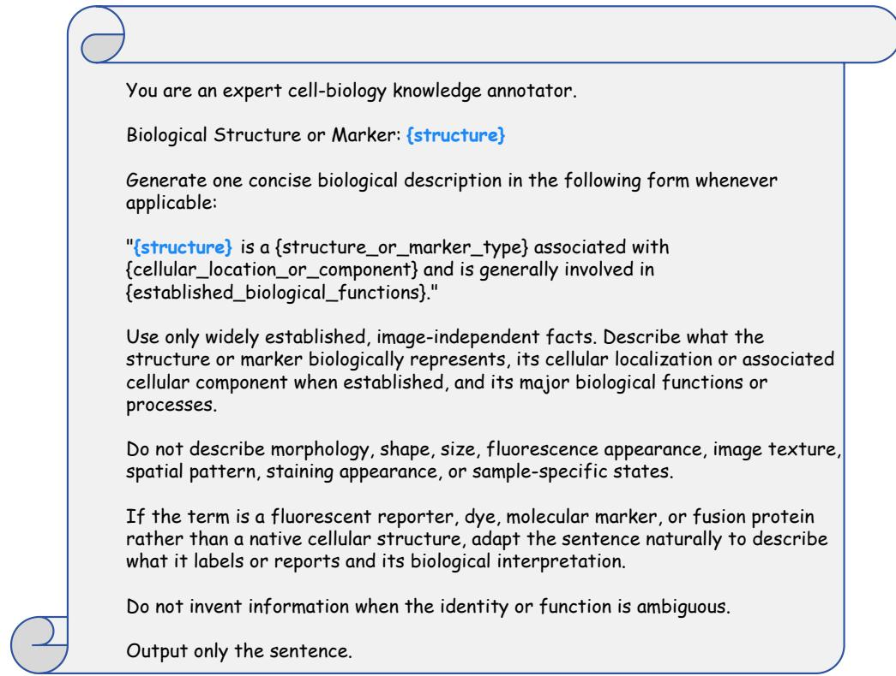

Figure 8: Prompt for generating image-independent biological knowledge about subcellular structures and markers with GPT.  
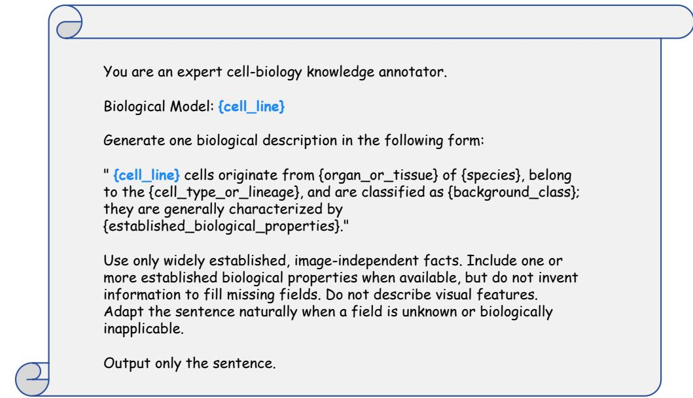  
Figure 9: Prompt for generating image-independent biological knowledge about cell lines with GPT.

## B.1 GENERATION PROCEDURE AND PROMPTS

The category caption uses the deterministic template in Section 4. Knowledge captions are con-You are an expert cell-biology knowledge annotator.structed from separate structure and cell-line descriptions generated with GPT-5.6 Sol. Detail cap- tions are generated with Qwen3.5-397B-A17B conditioned on the image and its normalized category Biological Structure or Marker: {structure}name. Figures 8 and 9 provide the knowledge prompts, and Figure 10 provides the detail prompt. The three resulting text views are illustrated in Figure 11.

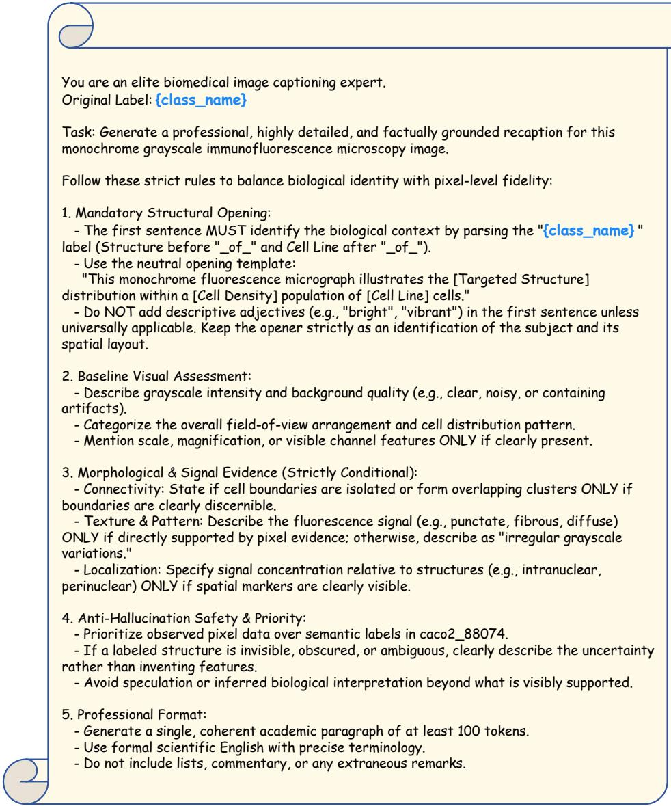  
Figure 10: Prompt for generating detail-level captions with Qwen from a microscopy image and it category annotation.

## B.2 EXAMPLES OF THREE-LEVEL CAPTIONS

Figure 11 illustrates how the three caption levels complement one another for the same image. Category and knowledge captions provide a shared semantic reference for images with the same annotation, whereas detail captions describe image-specific appearance. Together, these views connect category identity and biological context with the visual variation within a category.

## C ADDITIONAL TRAINING DETAILS

## C.1 TEXT LENGTH AND TOKENIZATION

Table 7 summarizes the token lengths of the three caption levels. Knowledge-level lengths are measured after concatenating the descriptions of all constituent structures and the cell line. We use the checkpoint’s byte-level BPE tokenizer and count tokens before truncation, excluding the two special tokens.

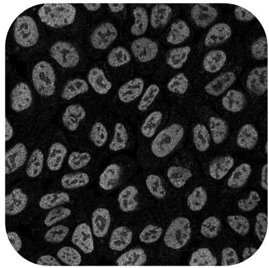  
Label: Endoplasmic\_reticulum\_of\_HRCE

Category-Level: a microscopy photo of Endoplasmic\_reticulum\_of\_HRCE

Knowledge-Level: Endoplasmic reticulum is a membrane-bound organelle continuous with the nuclear envelope and is generally involved in secretory and membrane protein synthesis and folding, lipid biosynthesis, and calcium homeostasis. HRCE cells originate from human kidney cortex tissue, belong to the renal cortical epithelial lineage, and are classified as primary nontransformed cells; they are generally characterized by epithelial marker expression and retention of renal transport and metabolic functions over a finite culture lifespan.

Detail-Level: This monochrome fluorescence micrograph illustrates the endoplasmic reticulum distribution within a high-density population of Human Renal Cortical Epithelial (HRCE) cells. The image is characterized by a dark, uniform background that provides contrast for the cellular structures, which are arranged in a tightly packed, overlapping monolayer filling the entire field of view. The cells exhibit a characteristic spindle-shaped to elongated morphology, oriented in varying directions to form a complex, interwoven texture. The fluorescence signal presents as a diffuse, reticular network extending throughout the cytoplasm, appearing as irregular grayscale variations that delineate the cell bodies. Dark, non-fluorescent circular regions are visible centrally within the cells, corresponding to nuclei that exclude the cytoplasmic marker. The intensity of the signal varies across the population, with some cells displaying brighter, more distinct cytoplasmic staining while others appear dimmer, highlighting the heterogeneity of the protein expression or staining efficiency within the confluent culture.

Figure 11: Three-level supervision for one fluorescence microscopy image. The category caption identifies the annotated structure and cell line; the knowledge caption describes image-independent biological properties of these entities; the detail caption describes the individual image.  
Table 7: Token-length statistics for the three caption levels.
<table><tr><td>Caption level</td><td>Median</td><td>P95</td><td>Truncated at 77 (%)</td><td>Truncated at 256 (%)</td></tr><tr><td>Category</td><td>15</td><td>19</td><td>0.00</td><td>0.00</td></tr><tr><td>Detail</td><td>225</td><td>270</td><td>99.83</td><td>12.97</td></tr><tr><td>Knowledge</td><td>109</td><td>147</td><td>100.00</td><td>&lt; 0.01</td></tr></table>

Because the tokenizer adds start-of-text and end-of-text tokens, a context of N tokens accommodates up to N − 2 caption tokens. At the standard 77-token context, all knowledge-level captions and 99.83% of detail-level captions would be truncated. We therefore use a 256-token text context, which accommodates 87.03% of detail-level captions without truncation. For knowledge-level captions, only 36 samples exceed this limit and are truncated. Longer captions are truncated during tokenization.

## C.2 RARE-CLASS AUGMENTATION

To expose the model more often to rare categories during training, we augment categories with fewer than 100 images using rotations and reflections. Each category corresponds to a canonical structure–cell-line composition. Let $c _ { e }$ denote the number of original training images in category e. The number of additional copies is

$$
a _ { e } = \left\{ \begin{array} { l l } { 1 0 0 - c _ { e } , } & { c _ { e } < 1 0 0 , } \\ { 0 , } & { c _ { e } \geq 1 0 0 . } \end{array} \right.\tag{6}
$$

This brings each rare category to 100 training records and leaves the other categories unchanged. In total, we add 175,516 records to 1,909 rare categories containing 15,384 original images.

Within each rare category, we distribute the additional copies evenly across the original images, with copy counts differing by at most one. Any remainder is assigned in source record order. For each image, we cycle through seven transformations: rotations by 90◦, 180◦, and 270◦, and reflections across the horizontal, vertical, and two diagonal axes. The cycle repeats when more than seven copies are needed. Each source image therefore contributes at most seven distinct transformed views, and the 100 records per category may include repeated views.

Each augmented record retains the captions and metadata of the source image. We combine the original and augmented records before training and include both in n(e) in Equation 5. Both follow the same retention and text-view sampling procedures.

## D BIOLOGICAL GROUNDING DIAGNOSTIC

Sampling and task. We complement the qualitative observation in Section 3 with a 60-image classification diagnostic on selected subsets of IID and Compositional Shift. Each subset contains 10 structure–cell-line categories with three images per category. Classification uses a fixed set of 10 candidate categories for each split, yielding a chance accuracy of 10%. The split definitions refer to MicroPool’s training set.

Inputs and prediction. GPT-6 receives each image together with the candidate category labels and is instructed to select the most likely structure–cell-line combination, even when uncertain, and return only its candidate ID. MicroCLIP and DFN2B-CLIP are evaluated in the same 10-way classification setting. A prediction is correct only when both the structure and cell line match the reference annotation.

Results and scope. Table 8 reports joint structure–cell-line accuracy. GPT-6 correctly identifies 22 of the 60 images (36.67%), compared with 10 (16.67%) for DFN2B-CLIP and 57 (95.00%) for MicroCLIP. These results support the qualitative observation in Figure 2. This small diagnostic complements the full benchmark evaluations but does not isolate the causes of the grounding gap.

Table 8: Sampled biological grounding diagnostic. Each split contains 10 categories with three images per category. Entries give correct predictions / images and joint Top-1 accuracy. MicroCLIP is evaluated after 15 training epochs.
<table><tr><td>Model</td><td>IID</td><td>Compositional Shift</td><td>Overall</td></tr><tr><td>GPT-6</td><td>12/30 (40.00%)</td><td>10/30 (33.33%)</td><td>22/60 (36.67%)</td></tr><tr><td>DFN2B-CLIP</td><td>6/30 (20.00%)</td><td>4/30 (13.33%)</td><td>10/60 (16.67%)</td></tr><tr><td>MicroCLIP</td><td>30/30 (100.00%)</td><td>27/30 (90.00%)</td><td>57/60 (95.00%)</td></tr></table>

## E ADDITIONAL QUANTITATIVE RESULTS

## E.1 MODEL SCALING

Among the PE-Core variants in Table 9, PE-Core-G achieves the highest accuracy on all classification evaluations, with the largest gains over PE-Core-B on Compositional Shift and Organelle-Set Shift. Retrieval instead peaks at PE-Core-L and declines with PE-Core-G, indicating that scaling benefits classification more than retrieval in this comparison.

## E.2 CAPTION SAMPLING RATIOS

Table 10 examines how the choice and sampling proportions of category-level (Cat.), detail-level (Det.), and knowledge-level (Know.) captions relate to classification and retrieval performance. All runs use a 256-token text context. Classification is measured by Top-1 accuracy, with Source Shift evaluated on Light-My-Cells. Retrieval is measured by bidirectional Recall@1 on 1,000 heldout MicroPool image–text pairs with detail-level captions. The detail-only, knowledge-only, and category-plus-knowledge runs share the same training setup apart from their caption sampling ratios. The category-only and category-plus-detail runs use an earlier pipeline, while the three-level mix uses the full MicroCLIP training recipe.

The single-level results reveal different performance profiles. Detail-only supervision reaches 48.10% I2T and 48.50% T2I Recall@1, but achieves only 56.53% IID and 26.53% Compositional Shift accuracy. Knowledge-only supervision also yields low classification accuracy and performs poorly on retrieval with detail-level captions. Mixing category and knowledge captions raises IID accuracy from 39.95% to 97.47% and Compositional Shift accuracy from 12.08% to 63.17% relative to knowledge-only training. This comparison supports retaining direct category supervision for recognition. Classification uses category-name prototypes, so the single-level models trained without category captions also face a mismatch between training descriptions and evaluation text.

The full MicroCLIP configuration samples category, detail, and knowledge captions with probabilities of 0.50, 0.25, and 0.25, respectively. It achieves the highest Compositional Shift accuracy, Cell-Line Shift accuracy, and retrieval Recall@1 among the reported configurations. It does not lead on every classification subset. Category-plus-detail supervision gives the highest IID and Source Shift accuracy, while category-plus-knowledge supervision performs best on Organelle-Set Shift. These results show that the full configuration combines strong recognition and retrieval performance, but the differences in training pipelines mean that its gains cannot be attributed to the sampling ratio alone.

Table 9: MicroCLIP performance across backbone architectures and model sizes. Classification is zero-shot Top-1 accuracy (%), and retrieval is Recall@1 (%) for image-to-text (I2T) and text-toimage (T2I) retrieval. Best and second-best results are shown in bold and underline, respectively.
<table><tr><td rowspan="2">Backbone</td><td rowspan="2">Params.</td><td>In-domain classification</td><td colspan="4">Out-of-domain classification</td><td rowspan="2">Retrieval</td></tr><tr><td>IID</td><td>Compositional Shift</td><td>Cell-Line Shift</td><td>t Organelle-Set Shift Source Shift</td><td>I2T T2I</td></tr><tr><td>PE-Core-B/16</td><td>448M</td><td>98.80</td><td>40.94</td><td>24.27</td><td>25.24</td><td>21.68</td><td>59.9 61.5</td></tr><tr><td>PE-Core-L/14-336</td><td>671M</td><td>99.07</td><td>49.44</td><td>17.17</td><td>32.22</td><td>21.93</td><td>60.5 61.8</td></tr><tr><td>PE-Core-G/14-448</td><td>2419M</td><td>99.20</td><td>74.34</td><td>29.86</td><td>54.70</td><td>35.06</td><td>54.7 54.5</td></tr></table>

Table 10: Effect of caption sampling ratios. We compare single-level and mixed supervision on classification and cross-modal retrieval.
<table><tr><td rowspan="2">Method</td><td colspan="3">Sampling ratio</td><td>In-domain classification</td><td colspan="4">Out-of-domain classification</td><td colspan="2">Retrieval</td></tr><tr><td>Cat.</td><td>Det.</td><td>Know.</td><td>IID</td><td>Compositional Shift</td><td>Cell-Line Shift</td><td>Organelle-Set Shift Source Shift</td><td></td><td>I2T</td><td>T2I</td></tr><tr><td>Category-level only</td><td></td><td>1.000.00</td><td>0.00</td><td>97.37</td><td>56.47</td><td>23.25</td><td>40.74</td><td>37.31</td><td>15.80</td><td>12.60</td></tr><tr><td>Detail-level only</td><td>0.00</td><td>1.00</td><td>0.00</td><td>56.53</td><td>26.53</td><td>10.56</td><td>26.72</td><td>10.28</td><td>48.10</td><td>48.50</td></tr><tr><td>Knowledge-level only</td><td>0.00</td><td>0.00</td><td>1.00</td><td>39.95</td><td>12.08</td><td>14.88</td><td>12.00</td><td>30.31</td><td>1.30</td><td>0.10</td></tr><tr><td>Category + Detail</td><td>0.75</td><td>0.25</td><td>0.00</td><td>98.90</td><td>63.94</td><td>28.69</td><td>41.63</td><td>40.59</td><td>28.40</td><td>27.80</td></tr><tr><td>Category + Knowledge</td><td>0.75</td><td>0.00</td><td>0.25</td><td>97.47</td><td>63.17</td><td>29.31</td><td>46.78</td><td>27.72</td><td>14.90</td><td>9.90</td></tr><tr><td>Category + Detail + Knowledge</td><td>0.500.25</td><td></td><td>0.25</td><td>98.46</td><td>67.70</td><td>34.07</td><td>46.13</td><td>36.53</td><td>61.50</td><td>63.30</td></tr></table>

## F DOWNSTREAM TRANSFER EVALUATION

3D cell classification. We evaluate zero-shot subcellular-structure classification on 160 Allen WTC-11 hiPSC volumes (Viana et al., 2023), with 32 volumes per class across actin filaments, endoplasmic reticulum, Golgi apparatus, microtubules, and mitochondria. Each volume comes from a distinct field of view. After per-volume percentile normalization (p0.1–p99.9), we obtain a 2D maximum-intensity projection (MIP):

$$
I _ { \mathrm { M I P } } ( x , y ) = \operatorname* { m a x } _ { z } I ( z , x , y ) ,\tag{7}
$$

where I is the normalized volume and z indexes axial depth. All models classify the same projections by image–text similarity to the five class names, without task-specific training.

Table 11 reports results under this MIP protocol. MicroCLIP achieves 88.12% accuracy, exceeding the strongest baseline, PE-Core, by 46.25 percentage points. This demonstrates transfer to projected 3D cell images using the pretrained 2D encoder. Figure 12 shows predictions for each class, including a microtubule example misclassified by all models.

## G VISUALIZATIONS AND DOWNSTREAM RESULTS

## G.1 CLASSIFICATION EXAMPLES

Figures 13–17 compare MicroCLIP predictions with ground-truth labels and general-purpose baselines under IID and four distribution shifts. The examples illustrate recognition of subcellular structures and cell lines.

## G.2 CROSS-MODAL RETRIEVAL

Figures 18 and 19 illustrate image-to-text and text-to-image retrieval, respectively. Given a microscopy image, image-to-text retrieval ranks candidate descriptions by image–text similarity; in the reverse direction, a textual description serves as the query for ranking candidate images. These examples complement the Recall@1 results by showing the visual and semantic correspondence between queries and retrieved candidates.

Table 11: Zero-shot classification of five subcellular structures on 160 Allen WTC-11 volumes using maximum-intensity projections. All models receive the same 2D projections; chance accuracy is 20%.
<table><tr><td>Model Top-1 accuracy (%)</td></tr><tr><td>CLIP (OpenAI) ViT-B/16 12.50</td></tr><tr><td>SigLIP ViT-B/16 22.50</td></tr><tr><td>SigLIP2 ViT-B/16 18.75</td></tr><tr><td>DFN2B-CLIP ViT-B/16 17.50</td></tr><tr><td>PE-Core B/16 41.88</td></tr><tr><td>MicroCLIP (Ours) 88.12</td></tr></table>

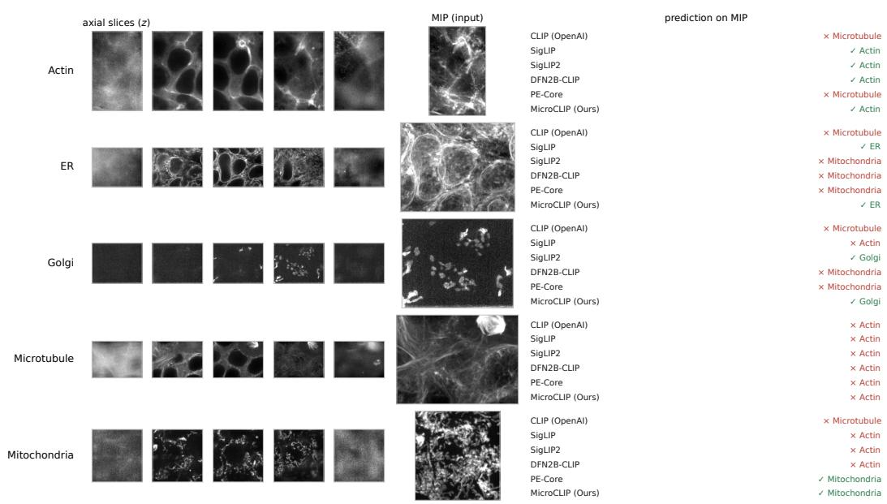

Figure 12: 3D cell classification examples. Each row shows five axial slices, the maximum-intensity projection used as model input, and predictions from six models. Green and red indicate correct and incorrect predictions, respectively. All models misclassify the displayed microtubule example as actin.
<table><tr><td>GT</td><td>MicroCLIP(Ours)</td><td>CLIP(OpenAI)</td><td>SigLIP</td><td>SigLIP2</td><td>PE-Core</td><td>DFN2B-CLIP</td></tr><tr><td>Nucleus of U2OS</td><td>Nucleus of U2OS</td><td>Nuclei Cytoplasm of A549</td><td>Mitochondria of HUVEC</td><td>Mitochondria of U2OS</td><td>Nuclei Cytoplasm of A549</td><td>Nucleoli of U2OS</td></tr><tr><td>Microtubules of A431</td><td>Microtubules of A431</td><td>Microtubules of A431</td><td>Endoplasmic reticulum of U2OS</td><td>Microtubules of HUVEC</td><td>Microtubules of HUVEC</td><td>Cytosol of U2OS</td></tr><tr><td>Endoplasmic reticulum of U251MG</td><td>Endoplasmic reticulum of U251MG</td><td>Nuclei Cytoplasm of A549</td><td>Mitochondria of HUVEC</td><td>Mitochondria of U2OS</td><td>Golgi apparatus of HepG2</td><td>Cytosol of U2OS</td></tr><tr><td>Nucleoplasm of U2OS</td><td>Nucleoplasm of U2OS</td><td>Nuclei Cytoplasm of A549</td><td>Mitochondria of HUVEC</td><td>Mitochondria of U2OS</td><td>Nuclei Cytoplasm of A549</td><td>Mitochondria of BPAE</td></tr><tr><td>Nucleus of RH30</td><td>Nucleus of RH30</td><td>ACTB of HepG2</td><td>Nucleoli of U251MG</td><td>Nucleus of BJ</td><td>Nucleoplasm of SiHa</td><td>Nucleoli of U251MG</td></tr><tr><td>Microtubules of SH SY5Y</td><td>Microtubules of RT4</td><td>Microtubules of A549</td><td>Endoplasmic reticulum of SiHa</td><td>Endoplasmic reticulum of BJ</td><td>Microtubules of SH SY5Y</td><td>Cytosol of A549</td></tr><tr><td>Endoplasmic reticulum of A549</td><td>Endoplasmic reticulum of A549</td><td>Cytosol and Nucleoplasm of A431</td><td>Endoplasmic reticulum of SiHa</td><td>Nucleoplasm of A549</td><td>Nucleoplasm of A549</td><td>Cytosol of RH30</td></tr><tr><td>Cytosol of A431</td><td>Cytosol of A431</td><td>Cytosol and Nucleoplasm of A431</td><td>Endoplasmic reticulum of SiHa</td><td>Golgi apparatus of U251MG</td><td>Nucleoli of A431</td><td>Cytosol of SH SY5Y</td></tr></table>

Figure 13: IID classification examples comparing MicroCLIP and baseline predictions with groundtruth labels on new images of structure–cell-line pairs observed during training.

Figure 14: Compositional Shift examples comparing model predictions on held-out structure–cellline pairs whose individual constituents are represented in training.

<table><tr><td>GT</td><td>MicroCLIP(Ours)</td><td>CLIP(OpenAI)</td><td>SigLIP</td><td>SigLIP2</td><td>PE-Core</td><td>DFN2B-CLIP</td></tr><tr><td>Nucleus of PC3</td><td>Nucleus of MCF7</td><td>Nuclei Cytoplasm of WPMY1</td><td>Nucleus of Caco2</td><td>Nucleoli of NIH3T3</td><td>Nucleoli of HeLa</td><td>Nucleoli of HeLa</td></tr><tr><td>Microtubules of PC3</td><td>Microtubules of PC3</td><td>Microtubules of NIH3T3</td><td>Nucleoli of HeLa</td><td>Actin filaments of MCF7</td><td>Actin filaments of HeLa</td><td>Actin filaments of HeLa</td></tr><tr><td>Endoplasmic reticulum of NIH3T3</td><td>Endoplasmic reticulum of PC3</td><td>Endoplasmic reticulum of NIH3T3</td><td>Golgi apparatus of RPE</td><td>Endoplasmic reticulum of HeLa</td><td>Nucleoli of HeLa</td><td>Cytosol of HeLa</td></tr><tr><td>Nucleoplasm of HEK293</td><td>Nucleus of RPE</td><td>TP53BP1 of WPMY1</td><td>Nucleus of Caco2</td><td>Nucleoplasm of PC3</td><td>Nucleoplasm of HeLa</td><td>Nucleoli of HeLa</td></tr></table>

Figure 15: Cell-Line Shift examples comparing model predictions on cell lines absent from training, with structure labels represented in training.

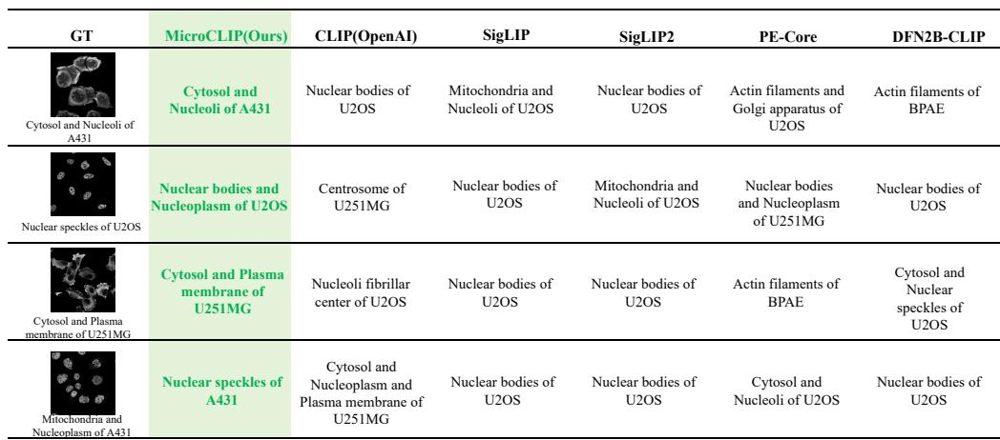  
Figure 16: Organelle-Set Shift examples comparing model predictions on complete structure labels absent from training, with cell lines represented in training.

<table><tr><td>GT</td><td>MicroCLIP(Ours)</td><td>CLIP(OpenAI)</td><td>SigLIP</td><td>SigLIP2</td><td>PE-Core</td><td>DFN2B-CLIP</td></tr><tr><td>D Microtubules of HeLa</td><td>Microtubules of HeLa</td><td>Nucleus of MDCK</td><td>Nucleus of MDCK</td><td>Nucleus of T24</td><td>Nucleus of U2OS</td><td>Nucleus of U2OS</td></tr><tr><td>Nucleus of U2OS</td><td>Nucleus of U2OS</td><td>Microtubules of U2OS</td><td>Nucleus of MDCK</td><td>Mitochondria of U2OS</td><td>Nucleus of HeLa</td><td>Mitochondria of HeLa</td></tr><tr><td>Mitochondria of HeLa</td><td>Mitochondria of HeLa</td><td>Microtubules of U2OS</td><td>Nucleus of MDCK</td><td>Nucleus of HeLa</td><td>Microtubules of HeLa</td><td>Microtubules of MDCK</td></tr><tr><td>Nucleus of HEP3B</td><td>Nucleus of HEP3B</td><td>Microtubules of U2OS</td><td>Nucleus of MDCK</td><td>Mitochondria of U2OS</td><td>Nucleus of HeLa</td><td>Mitochondria of HeLa</td></tr></table>

Figure 17: Source Shift examples comparing MicroCLIP and baseline predictions with ground-truth labels on images from the external Light My Cells dataset.

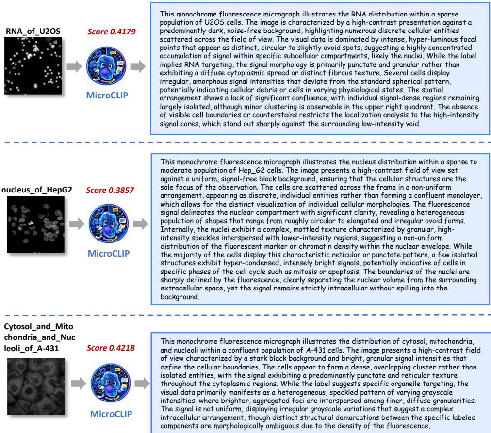  
Figure 18: Image-to-text retrieval examples: microscopy image queries and retrieved descriptions.

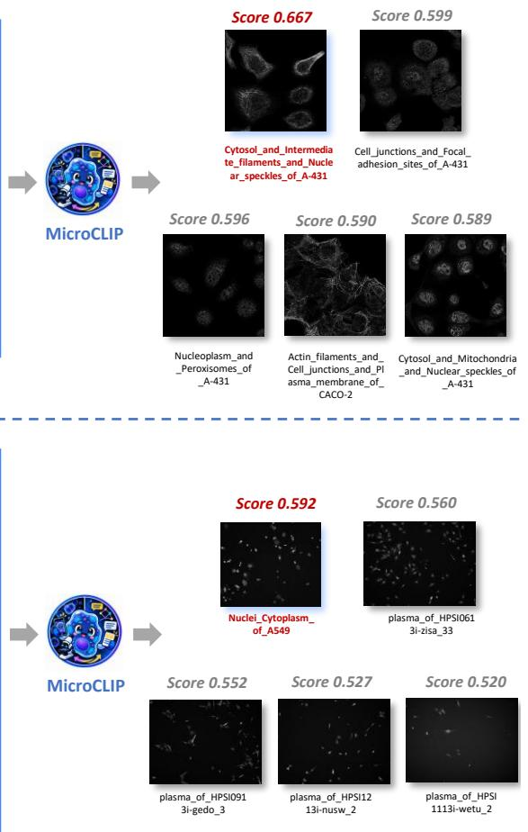

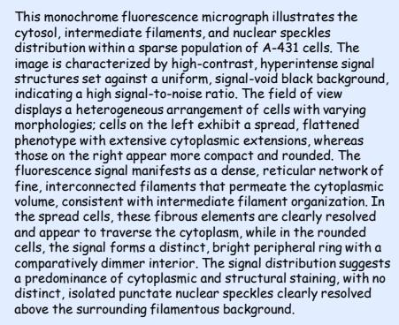

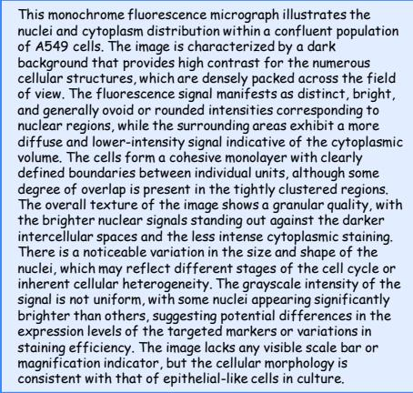  
Figure 19: Text-to-image retrieval examples: textual queries and retrieved microscopy images.