# Morphology-aware deep learning predicts colorectal cancer survival from whole-slide images

Hikmat Khan1\*, Metin N. Gurcan2, Anil Parwani¹, Wendy L. Frankel1, Wei Chen1, Muhammad Khalid Khan Niazi1

1Department of Pathology, The Ohio State University Wexner Medical Center, Columbus, OH, USA.

2Center for Artificial Intelligence Research, Wake Forest University School of Medicine, Winston-Salem, NC, USA.

\*Corresponding author(s). E-mail(s): Hikmat.khan@osumc.edu;

## Abstract

Background: Five-year survival prediction from hematoxylin-and-eosin wholeslide images could support risk stratification, but the task is weakly supervised, and the tissue morphologies carrying prognostic information remain incompletely characterized.

Methods: We conducted a retrospective secondary analysis using TCGA-COAD/READ (n=562) for morphology-specific analysis, Alliance/ CALGB 89803 (n=424) for model development, and SurGen (n=218) for external evaluation. We propose MorphContrast, a morphology-aware contrastive multiple-instance learning framework that uses tissue labels as structural supervision for five-year survival prediction. MorphContrast combines gated-attention pooling with three auxiliary objectives: patch-level morphology labels define within-patient contrasts, outcome concordance or discordance defines cross-patient contrasts within matched morphologies, and diversity regularization discourages representational collapse. Morphology-matched patches from patients with discordant outcomes serve as hard negatives, encouraging prognostic discrimination within comparable histologic contexts.

Results: Morphology-specific models show weak but distributed prognostic discrimination: adipose tissue achieves an area under the receiver operating characteristic curve (AUC) of 0.622, stroma achieves 0.604, and both perform comparably to tumor epithelium (0.601–0.605). On Alliance/CALGB 89803, the single model achieves an AUC of 0.642, while the post hoc ensemble reaches a pooled out-of-fold AUC of 0.70 and a risk-group hazard ratio of 3.79 (95% confidence interval: 2.55–5.63). On the external SurGen colon cancer cohort

(n=218), the single model and ensemble achieve AUCs of 0.669 and 0.678, respectively.

Conclusions: These findings support tissue morphology as structural supervision for outcome-aware representation learning in colorectal cancer prognosis.

Keywords: Colorectal cancer, Survival prediction, Computational pathology, Multiple-instance learning, Contrastive learning, Tissue morphology

## Plain language summary

Pathologists routinely examine stained tissue sections from colorectal cancers, and many hospitals now store these sections as digital whole-slide images. We developed MorphContrast, a computational method that learns from both the tissue patterns in these images and patients' five-year outcomes. Different tissue patterns each carried modest prognostic information, suggesting that useful signals were distributed across the slide rather than confined to tumor cells. In an archival tissue cohort originating from a clinical trial, the method distinguished patients with different five-year outcomes, and it showed similar discrimination in an independent external cohort. The results support the use of tissue-pattern labels to guide the development of imagebased prognostic models, but further prospective and independent validation is needed before clinical use.

## 1 Introduction

Colorectal cancer (CRC) is the third most common malignancy and the second leading cause of cancer-related death worldwide. Its annual burden is projected to reach 2.2 million new cases and 1.1 million deaths by 2030 [1], and approximately 154,000 new diagnoses were anticipated in the United States in 2025 [2]. Hematoxylin-and-eosin (H&E) slides are routinely generated during histopathologic assessment of surgical resections. Although only an estimated 15%-20% of US pathology laboratories have adopted digital pathology, this share is steadily increasing [3–6], and whole-slide images (WSIs) are already captured wherever slides are digitized. Predicting five-year survival directly from these WSIs is therefore an opportunistic use of existing data, offering additional risk stratification at minimal additional cost.

Two properties make the task difficult. First, supervision is weak: a gigapixel slide containing thousands of patches carries a single patient-level outcome, so a model must locate prognostically relevant regions without patch-level annotation and aggregate them into one prediction [7]. Second, it remains unclear where prognostic information resides. Several established prognostic features extend beyond malignant epithelium of the main tumor bulk: tumor budding at the invasive front is associated with poor outcome [8], the tumor-stroma ratio carries prognostic information [9], and a deep-learning-derived stroma score remains prognostic after adjustment for standard clinicopathologic variables [10]—yet their relative prognostic value is insufficiently characterized. The distinction bears directly on model design: signal concentrated in one morphology would justify tissue-restricted analysis, whereas weak evidence spread across many morphologies would require aggregation over the complete tissue mixture with unequal weighting.

Existing approaches do not resolve this question. Attention- and transformerbased methods for multiple-instance learning (MIL) [11–15] learn unequal weights over patch representations but derive patch relevance primarily from the patient outcome. Pathology foundation models provide frozen features from large-scale, organ-agnostic pretraining [16, 17], and morphology-aware CRC models incorporate tissue information either as an input feature, as an intermediate representation, or as an auxiliary annotation [10, 18, 19]. However, the approaches considered here do not jointly organize patch representations by tissue morphology and patient outcome. In particular, they do not explicitly compare matched morphologies across patients with concordant and discordant outcomes and therefore do not directly target prognostic variation within a morphology class.

We therefore begin with an empirical question: how much prognostic information does each tissue morphology carry in isolation? The MorphDistill encoder [18] distills morphology-specific knowledge from several pathology foundation models and assigns CRC morphology labels to image patches. Using assignments for 17 tissue morphologies, we train a separate attention-based MIL survival model for each morphology in The Cancer Genome Atlas colon and rectal adenocarcinoma cohorts (TCGA-COAD/READ). Across these morphology-specific models, the prognostic signal is weak and graded rather than concentrated in any single tissue class: several non-tumor morphologies perform comparably to tumor epithelium, yet no individual morphology is strongly predictive(Fig. 1, Table 1).

We do not interpret this as a direct biological effect, since spatial context and correlated clinicopathologic factors are uncontrolled. The purpose is methodological: prognostic evidence is weak, graded, and spread across tumor and non-tumor morphologies, which motivates using tissue morphology annotations as auxiliary supervision for patient-level survival prediction rather than only as a means of distinguishing morphology classes.

This observation motivates the design of MorphContrast, the central contribution of this work. Because prognostic information is distributed across morphologies, including non-tumor tissue, MorphContrast processes the complete tissue mixture rather than restricting analysis to tumor patches. Gated attention learns the relative contribution of each patch to the patient-level prediction. An intra-patient contrastive objective $( \mathcal { L } _ { \mathrm { { i n t r a } } } )$ organizes patch representations by morphology within each patient, whereas an inter-patient objective $( \mathcal { L } _ { \mathrm { { i n t e r } } } )$ incorporates outcome information: morphology-matched patches from patients with concordant outcomes form positive pairs, and those from patients with discordant outcomes form hard negatives. A diversity regularizer $( { \mathcal { L } } _ { \mathrm { d i v } } )$ discourages projected patch representations from collapsing toward a common direction. These objectives are optimized jointly with the survival loss, while the MorphDistill patch encoder remains frozen.

Together, these objectives distinguish MorphContrast from conventional attentionbased MIL, which learns patch importance primarily from patient-level outcomes, and from morphology-aware pipelines in which tissue labels enter as static features or intermediate predictions [19]. MorphContrast instead uses morphology and outcome jointly to define contrastive relationships that target outcome-associated variation within matched histologic contexts.

We evaluate MorphContrast on Alliance/CALGB 89803 as the primary cohort and on SurGen [20] as an external cohort. On Alliance/CALGB 89803, the single model reaches an AUC of 0.642, and an internally selected post hoc ensemble reaches a pooled OOF AUC of 0.70. On SurGen (n=218), the single model and ensemble achieve AUCs of 0.669 and 0.678, respectively; the ensemble result is similar to that of FR-MIL, the strongest evaluated baseline (0.6766). These results support morphologyinformed representation learning within the evaluated cohorts but do not establish a clear external performance advantage.

Our contributions can be summarized as follows:

1. A motivating morphology-specific analysis that estimates morphologyspecific prognostic discrimination for 17 CRC tissue morphologies using one survival model per class, characterizing the evidence as weak, graded, and distributed across tumor and non-tumor tissue. It is offered as methodological motivation rather than as a biological finding.

2. MorphContrast, a morphology-aware contrastive MIL framework in which tissue morphology labels supervise the structure of prognostic representations rather than serve only as post hoc annotations. The contrastive form follows supervised contrastive learning [21]; the contribution lies in jointly optimizing morphology-aware contrastive objectives with the five-year survival objective.

3. Morphology-conditioned outcome contrast, which aligns morphologymatched patches from patients with concordant outcomes and treats morphologymatched patches from patients with discordant outcomes as hard negatives, thereby targeting prognostic variation within comparable histologic contexts.

4. Evaluation on a randomized trial cohort with independent external assessment, using Alliance/CALGB 89803 as the primary cohort and SurGen [20] as the external cohort. The single model reaches an AUC of 0.642, with sensitivity of 63.53% and specificity of 55.37%, on Alliance/CALGB 89803, while the post hoc ensemble reaches an AUC of 0.70, with sensitivity and specificity of 68.0% each. On SurGen (n=218), the single model and ensemble reach AUCs of 0.669 and 0.678 sensitivities of 57.58% and 65.15%, and specificities of 70.39% and 66.45%, respectively; the ensemble AUC is similar to that of FR-MIL, the strongest evaluated baseline (0.676).

## 2 Related work

MIL represents a WSI as a bag of patches and assigns a single label to the bag [11] Gated attention, CLAM, DSMIL, TransMIL, RRT-MIL, FR-MIL, and PANTHER improve aggregation through learned weighting, instance clustering, critical-instance selection, self-attention, regional re-embedding, feature recalibration, and prototype modeling, respectively [11–13, 15, 22–24]. Prognostic models such as those of

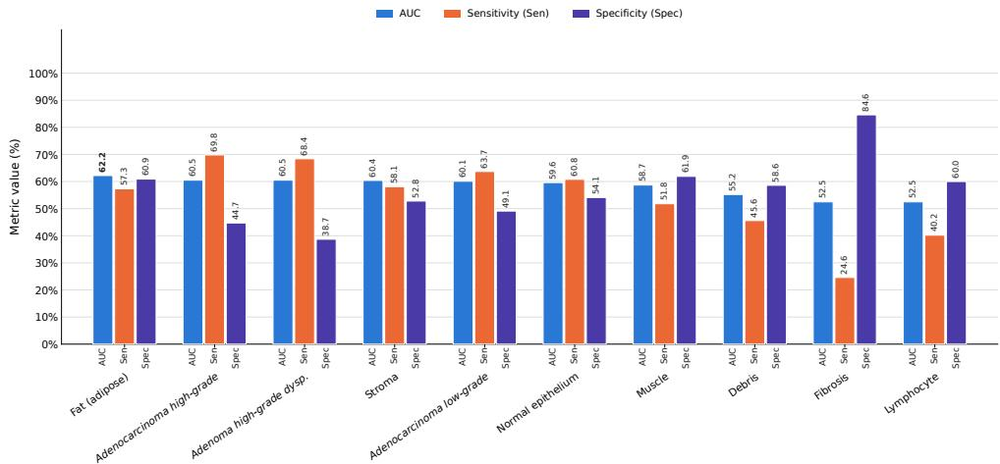  
Fig. 1 Top-performing CRC tissue morphologies show modest prognostic discrimination. Each bar gives the five-fold cross-validated AUC of an attention-based multiple-instance learning (ABMIL) survival model trained on patches of a single morphology class in the TCGA-COAD/READ cohort (n=562; Table 1); the dashed line marks chance (0.50). Only the top-performing morphologies with AUC values above 0.50 are displayed. Non-tumor morphologies—adipose tissue, stroma, normal epithelium, and muscle—score comparably to tumor-epithelial classes, while the displayed morphology-specific models remain modest predictors. Because patch abundance, spatial context, and clinicopathologic correlates are uncontrolled, this analysis motivates the design of MorphContrast rather than supporting a biological interpretation.

Nakanishi et al. [25] and PROGPATH [26] apply related weakly supervised principles to recurrence and survival prediction, respectively. These methods can identify predictive patches but do not use explicit morphology labels to structure the prognostic representation [25, 26]. MorphContrast retains gated-attention pooling and adds morphology- and outcome-aware auxiliary contrastive objectives together with diversity regularization.

ACMIL reduces excessive attention concentration, whereas MHIM-MIL masks highly salient instances so that a student learns from harder instances [27, 28]. Both use attention-derived salience to determine which instances are masked during training. MorphContrast instead defines a hard negative as a patch with the same morphology as the anchor but from a patient with an outcome discordant with that of the anchor, so it changes what the representation encodes rather than which instances the aggregator receives.

Contrastive learning attracts positive pairs and repels negatives defined by augmentation or class labels [21, 29, 30]. Large pathology foundation models use related objectives to produce transferable frozen features [16, 17, 31–37]. Because these pretraining objectives do not explicitly use CRC morphology labels or patient outcomes, they do not constrain the resulting features to organize tissue identity and patient outcome jointly. MorphContrast adopts the supervised-contrastive formulation [21] but constructs its pairs from morphology and outcome and optimizes the corresponding objectives jointly with survival prediction.

CRC studies have shown that non-tumor morphology can carry prognostic information [10]. MorphDistill [18] provides a patch embedding together with an 18-class morphology label, and PRISM [19] fuses morphology-informed and foundation-model features through cross-feature interaction and gated attention. These methods use morphology as an input, an intermediate representation, or auxiliary supervision. MorphContrast likewise starts from the patch embeddings and labels provided by the frozen MorphDistill encoder but uses morphology and outcome jointly to define representation-learning relationships, targeting prognostic variation within matched histologic contexts.

Together, the analyses show that morphology labels can provide structural supervision for outcome-aware representations. The externally assessed discrimination is comparable to the strongest evaluated baseline, although prospective validation is required before clinical use.

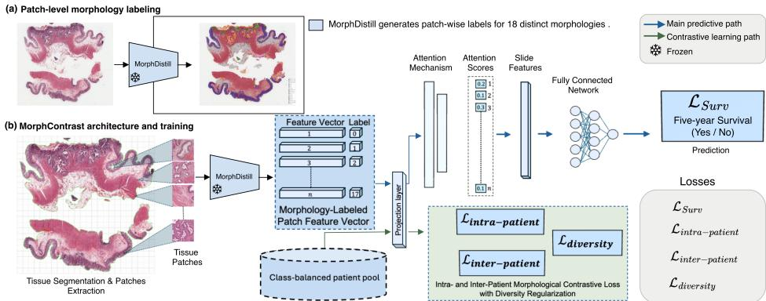  
Fig. 2 Overview of MorphContrast. (a) A frozen MorphDistill encoder [18] assigns every patch one of 18 CRC morphology classes, shown as a color overlay on a whole-slide image; this step is not trained here. (b) Tissue is segmented and tiled, and the same frozen encoder yields a feature vector and a morphology label $m _ { b i } \in \{ 0 , \ldots , 1 7 \}$ for each patch. A shared feature encoder then supplies two pathways. Along the predictive path (blue arrows), gated attention weights the patches and a fully connected network maps the pooled representation $\bar { h } _ { b }$ (labeled"Slide Features") to the five-year survival prediction under ${ \mathcal { L } } _ { \mathrm { s u r v } }$ . Along the contrastive path (green arrows), a projection head is trained with intra-patient morphology contrast $( { \mathcal { L } } _ { \mathrm { { i n t r a } } } )$ , outcome-aware inter-patient contrast $( { \mathcal { L } } _ { \mathrm { { i n t e r } } } )$ , and diversity regularization $( { \mathcal { L } } _ { \mathrm { d i v } } ) ;$ the figure writes these as $\mathcal { L } _ { i n t r a - p a t i e n t }$ , Linter-patient, and $\mathcal { L } _ { d i v e r s i t y }$ Contrastive pairs are drawn from the class-balanced patient pool (Section 3.3), from which one outcome-concordant and one outcome-discordant patient bag are sampled per anchor; losses from both pathways are accumulated across the three bags before a single backward pass. Snowflakes mark frozen components. Only the feature encoder, attention pooler, and survival classifier are retained at inference.

## 3 Methods

## 3.1 Overview

Figure 2 summarizes MorphContrast. A frozen MorphDistill encoder [18] provides a 768-dimensional feature vector and a morphology label for each retained patch. A shared feature encoder adapts these features for two pathways: gated-attention MIL produces a patient-level five-year survival prediction, while a projection head supports morphology- and outcome-aware contrastive learning. For each anchor patient, the training procedure samples one different patient with the same outcome and one with an outcome discordant with that of the anchor from a class-balanced pool constructed exclusively from the training partition of the current data split. Patches from the anchor and sampled patients define intra-patient morphology pairs, inter-patient outcome-aware pairs, and a diversity penalty. All losses are accumulated before a single backward pass. At inference, the patient pool and projection head are removed.

## 3.2 Architecture

Let patient b be represented by $N _ { b }$ patches with precomputed MorphDistill features given by $X _ { b } ~ = ~ \{ x _ { b i } \} _ { i = 1 } ^ { N _ { b } }$ , where $x _ { b i } \in \mathbb { R } ^ { 7 6 8 }$ , with corresponding morphology labels $m _ { b i } \in \{ 0 , \ldots , 1 7 \}$ and a patient-level outcome $y _ { b } \in \{ 0 , 1 \}$ , where $y _ { b } = 1$ denotes death within five years and $y _ { b } = 0$ denotes survival for at least five years. The MorphDistill encoder remains frozen throughout training.

Shared feature encoder. A two-layer task-adaptation network maps each frozen patch feature to an encoded representation of the same dimensionality:

$$
h _ { b i } = g _ { \theta } ( x _ { b i } ) \in \mathbb { R } ^ { 7 6 8 } .\tag{1}
$$

The encoded patches $h _ { b i }$ are shared by the survival and contrastive pathways, allowing losses from both pathways to shape the representations used for patient-level prediction (Fig. 2).

Projection head. During training, each encoded patch is mapped to a lowerdimensional contrastive space:

$$
z _ { b i } = \frac { f _ { \phi } ( h _ { b i } ) } { \| f _ { \phi } ( h _ { b i } ) \| _ { 2 } } , \qquad z _ { b i } \in \mathbb { R } ^ { d _ { p } } , \qquad \| z _ { b i } \| _ { 2 } = 1 , \qquad d _ { p } \in \{ 1 2 8 , 2 5 6 \} .\tag{2}
$$

The projection head $f _ { \phi }$ contains two linear layers separated by a ReLU activation. For the pairwise objectives below, patches are indexed across the sampled patients by i, with $z _ { i } , b _ { i } .$ and $m _ { i }$ denoting the projected representation, patient identity, and morphology label, respectively. Because each projected representation has unit $L _ { 2 }$ norm, the inner product of two projected patches equals their cosine similarity. We define the temperature-scaled similarity as

$$
s _ { i j } = \frac { z _ { i } ^ { \top } z _ { j } } { \tau } .\tag{3}
$$

Here, $\tau > 0$ controls the concentration of the contrastive distribution. We restrict $\tau \in ( 0 , 1 ]$ and set $\tau = 0 . 1$ in all experiments. The projection head is used only during training and is removed at inference.

Gated-attention aggregation. The survival pathway applies gated attention to the encoded patches. Following ABMIL [11], the attention weight assigned to patch i is

$$
a _ { b i } = \mathrm { s o f t m a x } _ { i } \left( \boldsymbol { w } ^ { \top } \left[ \operatorname { t a n h } ( W _ { v } h _ { b i } ) \odot \sigma ( W _ { u } h _ { b i } ) \right] \right) .\tag{4}
$$

Here, $W _ { v } , W _ { u } \in \mathbb { R } ^ { d _ { a } \times { 7 6 8 } }$ and $w \in \mathbb { R } ^ { d _ { a } }$ are trainable parameters, $d _ { a }$ is the attention hidden dimension,  denotes elementwise multiplication, and σ is the logistic sigmoid. The softmax is computed over the $N _ { b }$ patches of patient $b ,$ such that $\sum _ { i = 1 } ^ { \infty } a _ { b i } = 1$ The resulting patient-level representation is

$$
\bar { h } _ { b } = \sum _ { i = 1 } ^ { N _ { b } } a _ { b i } h _ { b i } .\tag{5}
$$

This aggregation allows individual patches and tissue morphologies to contribute unequally to the patient representation.

Survival classifier. A classifier maps the patient representation $\bar { h } _ { b }$ to a scalar survival logit:

$$
\eta _ { b } = q _ { \psi } ( \bar { h } _ { b } ) , \qquad \hat { p } _ { b } = \sigma ( \eta _ { b } ) ,\tag{6}
$$

where $\hat { p } _ { b }$ is the predicted probability of death within five years.

## 3.3 Class-Balanced Patient Pool

Inter-patient contrast requires patients from both outcome groups. For each data split, inter-patient contrast uses a class-balanced patient pool constructed exclusively from the training partition, preventing patient-level information leakage. The training pool contains equal numbers of patients who survived for at least five years and patients who died within five years. For each anchor patient, one different outcome-concordant patient and one outcome-discordant patient are sampled from this training-only pool and processed by the shared feature encoder. Up to 512 morphology-balanced patches are retained per patient to limit memory use and reduce dominance by highly abundant tissue compartments. Each retained patch is associated with its projected representation, patient identity, morphology label, and patient outcome:

$$
( z _ { i } , b _ { i } , m _ { i } , y _ { b _ { i } } ) .\tag{7}
$$

These attributes define the patch-level positive and negative sets used by the contrastive objectives.

## 3.4 Patch-Level Contrastive Objectives

For an anchor patch i with positive set $P ( i )$ and negative set $N ( i )$ , we use the sumover-positives supervised contrastive objective

$$
\ell ( i ; P , N ) = - \log \frac { \displaystyle \sum _ { p \in P ( i ) } \exp ( z _ { i } ^ { \top } z _ { p } / \tau ) } { \displaystyle \sum _ { k \in P ( i ) \cup N ( i ) } \exp ( z _ { i } ^ { \top } z _ { k } / \tau ) } .\tag{8}
$$

The anchor itself is excluded from both sets. Anchors without at least one valid positive and one valid negative are omitted from the corresponding loss.

Intra-patient morphology contrast. The intra-patient objective is designed to organize patch representations by tissue morphology within each patient. For anchor patch i, positives are patches from the same patient with the same morphology, $P _ { a } ( i ) =$ $\left\{ j \neq i : b _ { j } = b _ { i } , m _ { j } = m _ { i } \right\}$ , whereas negatives are patches from the same patient with a different morphology, $N _ { a } ( i ) = \{ j : b _ { j } = b _ { i } , \ m _ { j } \neq m _ { i } \}$ . The intra-patient loss is

$$
\mathcal { L } _ { \mathrm { { i n t r a } } } = \frac { 1 } { \left| \mathcal { A } _ { a } \right| } \sum _ { i \in \mathcal { A } _ { a } } \ell ( i ; P _ { a } , N _ { a } ) ,\tag{9}
$$

where $\mathcal { A } _ { a }$ contains anchors with at least one same-morphology positive and one different-morphology negative.

Inter-patient outcome-aware contrast. The inter-patient objective uses patient outcome to define contrastive relationships within each morphology class. For anchor patch i, positives are morphology-matched patches from a different patient with the same outcome, $P _ { e } ( i ) = \{ j : b _ { j } \neq b _ { i } , m _ { j } = m _ { i } , y _ { b _ { j } } = y _ { b _ { i } } \}$ . Morphology-matched patches from patients with an outcome discordant with that of the anchor patient form hard negatives, $N _ { e } ^ { \mathrm { h a r d } } ( i ) = \{ j : b _ { j } \neq b _ { i } , m _ { j } = m _ { i } , y _ { b _ { j } } \neq y _ { b _ { i } } \}$ . Patches belonging to different morphologies provide standard negatives, $N _ { e } ^ { \mathrm { s i d } } ( i ) = \{ j \neq i : m _ { j } \neq m _ { i } \}$ The complete negative set is $N _ { e } ( i ) = N _ { e } ^ { \mathrm { h a r d } } ( i ) \cup N _ { e } ^ { \mathrm { s t d } } ( i )$ , and the inter-patient loss is

$$
\mathcal { L } _ { \mathrm { i n t e r } } = \frac { 1 } { \left| \mathcal { A } _ { e } \right| } \sum _ { i \in \mathcal { A } _ { e } } \ell ( i ; P _ { e } , N _ { e } ) ,\tag{10}
$$

where $A _ { e }$ denotes the set of valid inter-patient anchors. Same-patient, samemorphology patches are excluded from this objective. The morphology-matched hard negatives encourage the representation to capture outcome-associated variation within comparable histologic contexts rather than tissue identity alone.

Diversity regularization. A diversity term discourages the projected patches of a patient from collapsing toward a common direction [38]. For patient b with $K _ { b }$ sampled patches,

$$
\ell _ { b } ^ { \mathrm { d i v } } = \frac { 1 } { K _ { b } ( K _ { b } - 1 ) } \sum _ { i \neq j } z _ { i } ^ { \top } z _ { j } , \qquad \mathcal { L } _ { \mathrm { d i v } } = \frac { 1 } { B } \sum _ { b = 1 } ^ { B } \ell _ { b } ^ { \mathrm { d i v } } .\tag{11}
$$

Here, the inner sum is over ordered pairs of distinct patches from patient b, and B is the number of patients contributing to the diversity term. Minimizing this term encourages dispersion of a patient's projected patch representations rather than enforcing exact pairwise orthogonality.

## 3.5 Survival Objective and Joint Optimization

The patient-level survival loss is computed after gated-attention pooling. For binary cross-entropy,

$$
\mathcal { L } _ { \mathrm { s u r v } } = - \frac { 1 } { B } \sum _ { b = 1 } ^ { B } \left[ y _ { b } \log \hat { p } _ { b } + ( 1 - y _ { b } ) \log ( 1 - \hat { p } _ { b } ) \right] .\tag{12}
$$

Weighted cross-entropy and focal-loss variants are additionally considered during the ensemble search. The complete training objective is

$$
\begin{array} { r } { \mathcal { L } = \lambda _ { s } \mathcal { L } _ { \mathrm { s u r v } } + \lambda _ { a } \mathcal { L } _ { \mathrm { i n t r a } } + \lambda _ { e } \mathcal { L } _ { \mathrm { i n t e r } } + \lambda _ { d } \mathcal { L } _ { \mathrm { d i v } } . } \end{array}\tag{13}
$$

The survival-loss weight is fixed at $\lambda _ { s } ~ = ~ 1 . 0$ The auxiliary-loss weights satisfy $\lambda _ { a } , \lambda _ { e } , \lambda _ { d } \in \ [ 0 , 1 ]$ . For the model configuration, we use $\lambda _ { a } = 0 . 2 5 , \lambda _ { e } = 0 . 1$ , and $\lambda _ { d } = 0 . 2 5$ . For each update, $\mathcal { L } _ { \mathrm { s u r v } }$ is computed from the anchor prediction, while the auxiliary losses use patches from the anchor and the two sampled patients. A single backward pass updates the shared feature encoder through all four loss terms; $\mathcal { L } _ { \mathrm { s u r v } }$ also updates the attention network and classifier, whereas the auxiliary losses update the projection head. Thus, patch-level contrastive supervision reshapes the features later pooled for survival prediction. At inference, only the precomputed MorphDistill features, shared feature encoder, gated-attention pooler, and survival classifier are used.

## 3.6 Study design and cohorts

This study is a retrospective secondary analysis of digitized archival histology and preexisting outcome data. The three cohorts serve distinct roles. TCGA-COAD/READ is used for the morphology-specific analysis that empirically characterizes differences in prognostic value across tissue morphologies and motivates the proposed method (Section 4.1); Alliance/CALGB 89803 serves as the primary development cohort and provides the basis for the main comparisons in Sections 4.3–4.4; and SurGen serves as the independent external cohort. All cohorts use nominal 224 × 224 patches at 20×, with patches containing less than 25% tissue discarded. Tissue regions are segmented using TRIDENT, and patches are extracted without overlap. The following paragraphs briefly describe each cohort and its role in the study.

## 3.6.1 Primary cohort and trial design

The primary cohort derives from Alliance/CALGB 89803, a randomized phase III trial comparing adjuvant weekly bolus irinotecan with fluorouracil and leucovorin (IFL) and fluorouracil and leucovorin (FL) alone in 1,264 patients with completely resected stage III colon cancer [39, 40]. CALGB subsequently became part of the

Alliance for Clinical Trials in Oncology; we therefore refer to the cohort throughout as Alliance/CALGB 89803. Eligible patients had received no prior chemotherapy or radiotherapy, had performance status 0–2, and began treatment within 21–56 days of resection, with randomization stratified by nodal involvement (1–3 versus ≥ 4 nodes), histological grade, and preoperative carcinoembryonic antigen.

## 3.6.2 Digitization and quality assurance

Slides were digitized at 40× (0.25 µm per pixel) on an Aperio scanner (Leica Biosystems, Nussloch, Germany) at the participating academic medical center under an approved institutional review board protocol [19]. A trained pathologist, blinded to clinical information and outcome, reviewed each slide to confirm the presence of tumor; more than 98% of cases contributed a single representative tumor slide. Quality control assessed tissue detection and coverage, color fidelity, focus, and scanning artifacts, and slides with inadequate staining were removed. This study was reviewed and approved by an institutional review board.

## 3.6.3 Cohort construction and endpoint

Cases were excluded for absence of tumor, lymph-node-only specimens, non-diseaserelated death within five years, and loss to follow-up before five years. Patients censored before five years were excluded rather than censored, because the endpoint of interest is cancer-specific rather than all-cause mortality—a distinction that carries weight in a disease with a median age at diagnosis of 66 years and substantial competing comorbidity [41|. This exclusion produces a complete-case binary endpoint and restricts the analysis to patients with known five-year outcomes. Mucinous adenocarcinomas were also excluded, as in prior analyses of this cohort [19], because their architecture precludes reliable assessment of tumor budding; following the World Health Organization definition of mucinous carcinoma as a tumor in which extracellular mucin constitutes at least 50% of tumor volume, 50 such cases were removed. The resulting cohort comprises 424 patients and 424 WSIs; among the patients, 103 died within five years and 321 survived for at least five years. All tumors arose in the cecum, ascending colon, hepatic flexure, transverse colon, splenic flexure, descending colon, or sigmoid colon. Supplementary Table 1 summarizes the clinicopathologic characteristics.

## 3.6.4 Discovery cohort: TCGA-COAD/READ

The colon and rectal adenocarcinoma collections of The Cancer Genome Atlas [42, 43] provide 562 patients with diagnostic formalin-fixed, paraffin-embedded (FFPE) slides and follow-up and are used exclusively for the morphology-specific empirical analysis described in Section 4.1. The morphology-specific models are evaluated using fivefold cross-validation with patient-level splits. The TCGA cohort differs from Alliance in scanning protocol and scanner vendor, patient population, and stage distribution; unlike the Alliance cohort, mucinous cases were retained. Slides are tiled using the shared protocol of 224 × 224 patches at 20×. Because the TCGA slides were scanned at a base resolution close to that of Alliance (≈ 0.24 µm per pixel versus 0.25), the resulting patches cover a comparable physical field.

## 3.6.5 External cohort: SurGen

SurGen [20] is a public colorectal digital pathology resource comprising 1,020 H&E WSIs from 843 cases collected through NHS Lothian. We use the survival-annotated SR386 subset, which contains 427 primary colorectal cases with five-year outcomes available for 426; the external evaluation is restricted to 218 colon cancer cases from this subset to align the disease site with that of the colon-only Alliance cohort. The source subset includes both colon and rectal cancers across a broader stage distribution than Alliance. All slides were digitized on a ZEISS Axio Scan.Z1 at 40× and 0.1112 µm per pixel, which differs substantially from the Alliance acquisition protocol. These differences in scanner resolution and case mix introduce potential distribution shift between the development and external cohorts.

## 3.7 Comparison Methods

For the Alliance cohort, we compare MorphContrast with four groups of methods: (i) Attention- and transformer-based MIL: ABMIL [11], CLAM [12], TransMIL [13], and RRT-MIL [15]. (ii) Task-specific CRC prognosis: the CRC recurrence-prediction model of Nakanishi et al. [25]. (iii) Morphology-aware CRC prognosis: MorphDistill with its standard survival head [18] and PRISM [19]. (iv) Frozen pathology foundation encoders: UNI v1/v2 [16], Virchow2 [32], GigaPath [17], CONCH v1.5 [31], CTransPath [33], H-Optimus-0 [34], Phikon v2 [37], Kaiko ViT-B/8 [35], and Lunit ViT-S/8 [36]. Each frozen encoder is coupled with the same gated-attention survival head to hold the aggregation architecture constant when comparing patch representations. Methods in groups (i)-(iii) use their published configurations and default decision thresholds.

On the external SurGen cohort, we compare MorphContrast with three MIL baselines: TransMIL [13] , FR-MIL [23], and MHIM-MIL [28]. These methods represent transformer aggregation, feature recalibration, and masked hard-instance mining, respectively. All models reported for SurGen are trained on Alliance/CALGB 89803 and applied in evaluation mode without additional training; preprocessing parameters, ensemble membership, and decision thresholds are fixed before external evaluation. Because the baseline suites differ between Alliance and SurGen, comparisons are made only within each cohort.

## 3.8 Statistical analyses

We evaluate discrimination using the area under the receiver operating characteristic curve (AUC) and Harrell's concordance index (C-index) [44]. We additionally report balanced accuracy, sensitivity, and specificity at each model's operating threshold, with death within five years defined as the positive class. Sensitivity, specificity, and balanced accuracy are computed from true positives (TP), true negatives (TN), false positives (FP), and false negatives (FN) as

$$
{ \begin{array} { r l } & { \mathrm { S e n } = { \cfrac { T P } { T P + F N } } , } \\ & { \mathrm { S p e c } = { \cfrac { T N } { T N + F P } } , } \\ & { \mathrm { B a l A c c } = { \cfrac { 1 } { 2 } } \left( \mathrm { S e n } + \mathrm { S p e c } \right) . } \end{array} }\tag{14}
$$

Risk stratification is assessed using the log-rank test and a univariate Cox proportional-hazards model, with hazard ratios and 95% confidence intervals [19]. For Alliance, baselines and the single MorphContrast model are reported as mean ± standard deviation across folds, whereas the ensemble uses pooled out-of-fold predictions with 1,000-sample bootstrap 95% confidence intervals. For SurGen, all methods are reported as point estimates with bootstrap 95% confidence intervals for the independent cohort of 218 cases.

## 3.9 Implementation and Training Details

Alliance model development uses five-fold cross-validation with patient-level splits. For each evaluation split, patients are allocated in proportions of 70%, 15%, and 15% to the training, validation, and test sets, respectively. The validation split is used for hyperparameter selection and early stopping, and the corresponding held-out test split is used only to report performance. Models are trained using the AdamW optimizer [45] for up to 150 epochs with early stopping when the validation loss does not improve for 15 consecutive epochs. The learning rate follows a cosine annealing schedule [46]. The MorphDistill patch encoder remains frozen throughout training; only the task-specific feature encoder, projection head, gated-attention module, and survival classifier are optimized. Supplementary Table 2 summarizes the hyperparameter search space and fixed training settings. The initial search over the contrastive-loss weights selected $\lambda _ { a } = 0 . 2 5$ and $\lambda _ { e } = 0 . 1$ , which are fixed in subsequent experiments. The MorphContrast uses binary cross-entropy with $\lambda _ { s } = 1 . 0$ and the default objective weights described in Section 3.5. Weighted cross-entropy and focal loss are additionally evaluated among candidate configurations considered for the post hoc ensemble.

## 3.10 Post Hoc Ensemble Selection from Out-of-Fold Predictions

Each hyperparameter configuration generates one out-of-fold (OOF) risk score per patient under five-fold cross-validation. Candidate configurations are retained only if they achieve $\mathrm { A U C } \geq 0 . 5 0$ , sensitivity $\geq 0 . 3 0$ , and specificity $\geq 0 . 3 0$ . Ensemble selection varies the number of members $k \in \{ 3 , 5 , 7 , 1 0 \}$ , survival-loss variant, member-selection strategy, score-aggregation method, and decision threshold, yielding 50 candidate ensembles (Supplementary Table 2). Candidates are ranked using

$$
\mathcal { T } _ { \mathrm { e n s } } = \mathrm { A U C } + \mathrm { B a l A c c } - \frac { 1 } { 2 } \left| \mathrm { S e n } - \mathrm { S p e c } \right| ,\tag{15}
$$

which favors discrimination and balanced classification while penalizing large differences between sensitivity and specificity. The selected ensemble contains three Pareto-selected members. Their OOF risk scores are converted to percentile ranks and aggregated to obtain a single patient-level ensemble score, with a final decision threshold of $t ^ { \star } = 0 . 5 7 3$ . We refer to the single model as the MorphContrast model and to the ensemble as the post hoc MorphContrast ensemble.

## 4 Results

## 4.1 Prognostic Discrimination Across Individual Tissue Morphologies

To quantify the prognostic discrimination associated with individual tissue morphologies, we trained a separate ABMIL survival model for each morphology class in TCGA-COAD/READ. Among the 17 non-background classes, four (low-grade adenoma dysplasia, mucus, necrosis, and sessile serrated lesion) produced constant predictions, while inflammation and hyperplastic polyp yielded AUCs of 0.50. Of the remaining 11 morphologies, ten achieved AUCs above 0.50 and eight exceeded 0.55; the vessels class was the only class below chance (AUC 0.466) (Table 1, Fig. 1). Adipose tissue achieved the highest AUC (0.622), followed by high-grade adenocarcinoma (0.605), high-grade adenoma dysplasia (0.605), stroma (0.604), low-grade adenocarcinoma (0.601), and normal epithelium (0.596). The highest-ranking classes therefore included both tumor-associated and non-tumor compartments, and no individual morphology exceeded an AUC of 0.622.

## 4.2 Single-Model and Ensemble Performance

The MorphContrast model achieved an AUC of 0.642, balanced accuracy of 0.594, sensitivity of 0.635, and specificity of 0.554 (Table 2). The post hoc ensemble achieved a pooled OOF AUC of 0.70 (95% CI: 0.65–0.76), with balanced accuracy, sensitivity and specificity of 0.68, 0.68, and 0.68, respectively.

## 4.3 Comparison with MIL and Morphology-Aware Baselines

Among the conventional MIL methods, TransMIL achieved the highest AUC (0.67 ± 0.05), followed by CLAM $( 0 . 6 6 \pm 0 . 0 6 ) $ and ABMIL $( 0 . 6 3 \pm 0 . 0 6 ) $ (Table 3). TransMIL yielded 5.25% sensitivity and 99.74% specificity, while CLAM yielded 25.61% sensitivity and 84.68% specificity. The task-specific model of Nakanishi et al. achieved an AUC of $0 . 6 1 \pm 0 . 0 6$ , and RRT-MIL achieved $0 . 5 9 \pm 0 . 0 5$

The morphology-aware baselines achieved AUCs of $0 . 6 8 \pm 0 . 0 8$ for MorphDistill and $0 . 7 0 { \scriptstyle \pm 0 . 0 4 }$ for PRISM. The MorphContrast model achieved $0 . 6 4 2 { \pm } 0 . 0 5$ , while the post hoc ensemble achieved a pooled OOF AUC of 0.70. For C-index, PRISM achieved 0.672, followed by the MorphContrast ensemble (0.665), MorphDistill (0.661), and TransMIL (0.647).

Table 1 Morphology-specific five-year survival prediction. Five-fold cross-validated ABMIL models trained independently using patches from a single morphology class in TCGA-COAD/READ.
<table><tr><td>Morphology</td><td>AUC</td><td>Sen</td><td>Spec</td></tr><tr><td>Fat (adipose)</td><td>0.622</td><td>0.573</td><td>0.609</td></tr><tr><td>Adenocarcinoma high-grade</td><td>0.605</td><td>0.698</td><td>0.447</td></tr><tr><td>Adenoma high-grade dysp.</td><td>0.605</td><td>0.684</td><td>0.387</td></tr><tr><td>Stroma</td><td>0.604</td><td>0.581</td><td>0.528</td></tr><tr><td>Adenocarcinoma low-grade</td><td>0.601</td><td>0.637</td><td>0.491</td></tr><tr><td>Normal epithelium</td><td>0.596</td><td>0.608</td><td>0.541</td></tr><tr><td>Muscle</td><td>0.587</td><td>0.518</td><td>0.619</td></tr><tr><td>Debris</td><td>0.552</td><td>0.456</td><td>0.586</td></tr><tr><td>Fibrosis</td><td>0.525</td><td>0.246</td><td>0.846</td></tr><tr><td>Lymphocyte</td><td>0.525</td><td>0.402</td><td>0.600</td></tr><tr><td>Inflammation</td><td>0.500</td><td>0.720</td><td>0.280</td></tr><tr><td>Hyperplastic polyp</td><td>0.500</td><td>0.160</td><td>0.848</td></tr><tr><td>Adenoma low-grade dysp.</td><td>0.500</td><td>0.000</td><td>1.000</td></tr><tr><td>Mucus</td><td>0.500</td><td>0.000</td><td>1.000</td></tr><tr><td>Necrosis</td><td>0.500</td><td>0.000</td><td>1.000</td></tr><tr><td>Sessile serrated lesion</td><td>0.500</td><td>0.000</td><td>1.000</td></tr><tr><td>Vessels</td><td>0.466</td><td>0.370</td><td>0.599</td></tr></table>

Table 2 Performance of the MorphContrast model and post hoc ensemble.

Single-model values are five-fold cross-validation means ± standard deviations. Ensemble values are computed from pooled OOF predictions, with 1,000-sample bootstrap 95% confidence intervals.
<table><tr><td>Model</td><td>AUC↑</td><td> $_ { \mathrm { B a l - A c c } } \uparrow$ </td><td> $\operatorname { S e n } \uparrow$ </td><td> ${ \mathrm { S p e c ~ } } \uparrow$ </td></tr><tr><td>MorphContrast</td><td> $\underline { { 0 . 6 4 2 } } \pm 0 . 0 5$ </td><td> $0 . 5 9 4 \pm 0 . 0 3 6$ </td><td> $0 . 6 3 5 \pm 0 . 0 9 2$ </td><td> $0 . 5 5 4 \pm 0 . 0 7 6$ </td></tr><tr><td>MorphContrast (ensemble)</td><td> $\mathbf { 0 . 7 0 \ ( 0 . 6 5 , 0 . 7 6 ) }$ </td><td> $0 . 6 8 \ ( 0 . 6 3 , 0 . 7 3 )$ </td><td> $0 . 6 8 \ ( 0 . 5 9 , 0 . 7 3 )$ </td><td> $0 . 6 8 \ ( 0 . 6 2 , 0 . 7 3 )$ </td></tr></table>

Table 3 Comparison with MIL, morphology-aware, and task-specific CRC prognosis baselines. Baselines and the single MorphContrast model report mean ± standard deviation over folds; the ensemble reports pooled OOF performance.
<table><tr><td>Model</td><td> $\mathrm { A U C } \uparrow$ </td><td> $\mathrm { B a l - A c c } ~ ( \% ) ~ \uparrow$ </td><td> $\mathrm { S e n ~ } \left( \% \right) \uparrow$ </td><td> $\mathrm { S p e c \ ( \% ) \uparrow }$ </td><td>C-index ↑</td></tr><tr><td>ABMIL [11]</td><td> $0 . 6 3 \pm 0 . 0 6$ </td><td> $5 8 . 5 4 \pm 4 . 5 0$ </td><td> $5 1 . 1 8 \pm 9 . 8 3$ </td><td> $6 5 . 8 9 \pm 4 . 5 0$ </td><td>0.607</td></tr><tr><td>CLAM [12]</td><td> $0 . 6 6 \pm 0 . 0 6$ </td><td> $5 5 . 1 5 \pm 3 . 3 7$ </td><td> $2 5 . 6 1 \pm 8 . 1 8$ </td><td> $8 4 . 6 8 \pm 8 . 8 9$ </td><td>0.603</td></tr><tr><td>TransMIL [13]</td><td> $0 . 6 7 \pm 0 . 0 5$ </td><td> $5 2 . 5 0 \pm 4 . 6 4$ </td><td> $5 . 2 5 \pm 9 . 1 1$ </td><td> $9 9 . 7 4 \pm 0 . 0 5$ </td><td>0.647</td></tr><tr><td>Nakanishi [25]</td><td> $0 . 6 1 \pm 0 . 0 6$ </td><td> $5 8 . 3 1 \pm 5 . 7 7$ </td><td> $5 3 . 4 9 \pm 1 1 . 1 1$ </td><td> $6 3 . 1 3 \pm 2 . 7 5$ </td><td>0.604</td></tr><tr><td>RRT-MIL [15]</td><td> $0 . 5 9 \pm 0 . 0 5$ </td><td> $5 6 . 7 6 \pm 4 . 4 6$ </td><td> $4 8 . 5 8 \pm 2 3 . 9 2$ </td><td> $6 4 . 9 4 \pm 2 2 . 1 9$ </td><td>0.575</td></tr><tr><td>MorphDistill [18]</td><td> $\underline { { 0 . 6 8 } } \pm 0 . 0 8$ </td><td> $6 3 . 4 1 \pm 4 . 7 0$ </td><td> $6 0 . 2 4 \pm 5 . 3 8$ </td><td> $6 6 . 5 7 \pm 8 . 8 1$ </td><td>0.661</td></tr><tr><td>PRISM [19]</td><td> ${ \bf 0 . 7 0 \pm 0 . 0 4 }$ </td><td> $6 8 . 0 0 \pm 1 . 7 9$ </td><td> $6 7 . 1 4 \pm 8 . 2 6$ </td><td> $6 8 . 8 6 \pm 8 . 6 2$ </td><td>0.672</td></tr><tr><td>MorphContrast</td><td> $0 . 6 4 2 \pm 0 . 0 5$ </td><td> $5 9 . 4 5 \pm 3 . 5 6$ </td><td> $6 3 . 5 3 \pm 9 . 2 3$ </td><td> $5 5 . 3 7 \pm 7 . 5 9$ </td><td>0.616</td></tr><tr><td>MorphContrast (ensemble)</td><td></td><td></td><td></td><td>0.70 (0.65, 0.76) 0.68 (0.63, 0.73) 0.68 (0.59, 0.73) 0.68 (0.62, 0.73)</td><td>0.665</td></tr></table>

## 4.4 Comparison with Frozen Pathology Foundation Encoders

Using the same gated-attention survival head, AUCs for the ten frozen pathology foundation encoders ranged from 0.51 to 0.63 (Table 4). UNI v2 achieved the highest AUC $( 0 . 6 3 \pm 0 . 0 3 )$ , followed by UNI v1 $( 0 . 6 2 \pm 0 . 0 5 )$ , H-Optimus-0 $( 0 . 6 1 \pm 0 . 0 4 ) $ , and Giga-Path $( 0 . 6 0 \pm 0 . 0 4 ) $ . CONCH v1.5 achieved an AUC of $0 . 5 1 \pm 0 . 0 7$ . The MorphContrast model achieved $0 . 6 4 2 \pm 0 . 0 5$ under the same survival-head design. MorphDistill and PRISM, included as morphology-aware reference models, achieved AUCs of $0 . 6 8 \pm 0 . 0 8$ and $0 . 7 0 \pm 0 . 0 4$ , respectively; the MorphContrast ensemble achieved a pooled OOF AUC of 0.70 (95% CI: 0.65–0.76).

Table 4 Frozen pathology foundation encoders under an identical survival head. Each encoder's patch features are aggregated using the same gated-attention survival head. Values are mean ± standard deviation over five folds; the ensemble reports pooled OOF performance.
<table><tr><td>Encoder</td><td>AUC ↑</td><td>Bal-Acc (%)↑</td><td>Sen (%) ↑</td><td>Spec (%) ↑</td></tr><tr><td>CONCH v1.5 [31]</td><td> $0 . 5 1 \pm 0 . 0 7$ </td><td> $5 0 . 8 1 \pm 3 . 8 3$ </td><td> $4 1 . 8 0 \pm 1 5 . 7 6$ </td><td> $5 9 . 8 1 \pm 1 6 . 6 6$ </td></tr><tr><td>CTransPath [33]</td><td> $0 . 5 8 \pm 0 . 0 2$ </td><td> $5 0 . 6 3 \pm 1 . 9 7$ </td><td> $2 1 . 9 0 \pm 3 9 . 2 2$ </td><td> $7 9 . 3 6 \pm 3 7 . 3 8$ </td></tr><tr><td>Lunit ViT-S/8 [36]</td><td> $0 . 5 8 \pm 0 . 0 4$ </td><td> $5 3 . 2 2 \pm 3 . 1 4$ </td><td> $5 4 . 2 4 \pm 1 5 . 5 2$ </td><td> $5 2 . 2 1 \pm 1 2 . 6 9$ </td></tr><tr><td>Phikon v2 [37]</td><td> $0 . 5 8 \pm 0 . 0 4$ </td><td> $5 8 . 0 5 \pm 5 . 6 7$ </td><td> $5 9 . 5 0 \pm 1 5 . 3 8$ </td><td> $5 6 . 6 1 \pm 1 1 . 4 2$ </td></tr><tr><td>Virchow2 [32]</td><td> $0 . 5 8 \pm 0 . 0 2$ </td><td> $5 5 . 7 3 \pm 3 . 8 4$ </td><td> $5 2 . 7 1 \pm 1 2 . 9 7$ </td><td> $5 8 . 7 5 \pm 1 9 . 8 5$ </td></tr><tr><td>Kaiko ViT-B/8 [35]</td><td> $0 . 5 9 \pm 0 . 1 1$ </td><td> $5 8 . 3 8 \pm 8 . 9 1$ </td><td> $4 6 . 4 5 \pm 3 0 . 0 2$ </td><td> $7 0 . 3 1 \pm 1 3 . 8 5$ </td></tr><tr><td>GigaPath [17]</td><td> $0 . 6 0 \pm 0 . 0 4$ </td><td> $5 6 . 3 7 \pm 2 . 2 0$ </td><td> $3 5 . 8 6 \pm 6 . 1 0$ </td><td> $7 6 . 8 9 \pm 4 . 6 9$ </td></tr><tr><td>H-Optimus-0 [34]</td><td> $0 . 6 1 \pm 0 . 0 4$ </td><td> $5 6 . 5 9 \pm 4 . 1 3$ </td><td> $3 6 . 7 1 \pm 1 9 . 2 2$ </td><td> $7 6 . 4 6 \pm 1 8 . 3 8$ </td></tr><tr><td>UNI v1 [16]</td><td> $0 . 6 2 \pm 0 . 0 5$ </td><td> $5 3 . 5 8 \pm 2 . 4 4$ </td><td> $3 8 . 1 4 \pm 2 0 . 9 7$ </td><td> $6 9 . 0 2 \pm 2 1 . 7 9$ </td></tr><tr><td>UNI v2 [16]</td><td> $0 . 6 3 \pm 0 . 0 3$ </td><td> $6 0 . 5 8 \pm 3 . 4 8$ </td><td> $4 4 . 6 2 \pm 8 . 8 1$ </td><td> $7 6 . 5 3 \pm 3 . 8 8$ </td></tr><tr><td>MorphDistill [18]</td><td> $0 . 6 8 \pm 0 . 0 8$ </td><td> $6 3 . 4 1 \pm 4 . 7 0$ </td><td> $6 0 . 2 4 \pm 5 . 3 8$ </td><td> $6 6 . 5 7 \pm 8 . 8 1$ </td></tr><tr><td>PRISM [19]</td><td> ${ \bf 0 . 7 0 \pm 0 . 0 4 }$ </td><td> $6 8 . 0 0 \pm 1 . 7 9$ </td><td> $6 7 . 1 4 \pm 8 . 2 6$ </td><td> $6 8 . 8 6 \pm 8 . 6 2$ </td></tr><tr><td>MorphContrast</td><td> $0 . 6 4 \pm 0 . 0 5$ </td><td> $5 9 . 4 5 \pm 3 . 5 6$ </td><td> $6 3 . 5 3 \pm 9 . 2 3$ </td><td> $5 5 . 3 7 \pm 7 . 5 9$ </td></tr><tr><td>MorphContrast (ensemble)</td><td>0.70 (0.65,0.76)</td><td>0.68 (0.63, 0.73)</td><td>0.68 (0.59,0.73)</td><td>0.68 (0.62, 0.73)</td></tr></table>

## 4.5 Comparison with Clinical Variables

Using the same five patient-disjoint folds (n = 424; 103 events), we compared MorphContrast with l2-regularized clinical logistic-regression models (Supplementary Table 3). Models using all fourteen variables or nodal burden, T category, and grade only achieved pooled AUCs of 0.541 and 0.550, respectively (Table 5). The single MorphContrast model achieved a mean fold AUC of 0.642 ± 0.05, and the ensemble achieved a pooled OOF AUC of 0.70.

## 4.6 Risk-Group Stratification

The MorphContrast ensemble stratified the Alliance cohort into low- and high-risk groups, with an HR of 3.79 (95% CI: 2.55–5.63, $p < 0 . 0 0 0 1 )$ (Figs. 3 and 4). PRISM and MorphDistill yielded HR estimates of 3.34 (95% CI: 2.28–4.90) and 2.52 (95% CI:

Table 5 Clinical-variable models and MorphContrast on Alliance/CALGB 89803 $( n = 4 2 4 ;$ 103 events). Fold AUC reports the mean ± standard deviation across five test folds. Pooled AUC uses out-of-fold predictions, with DeLong 95% CIs for the clinical models and a 1,000-sample bootstrap 95% CI for the ensemble. Variable coding and imputation are detailed in Supplementary Table 3.
<table><tr><td>Model</td><td>Fold AUC ↑</td><td>Pooled AUC [95% CI] ↑ C-index ↑</td><td></td></tr><tr><td>All fourteen variables</td><td> $0 . 5 4 8 \pm 0 . 0 6 6$ </td><td>0.541 (0.474, 0.608)</td><td>0.556</td></tr><tr><td>Nodal burden, T category, grade</td><td> $0 . 5 5 4 \pm 0 . 0 5 2$ </td><td>0.550 (0.487, 0.613)</td><td>0.553</td></tr><tr><td>MorphContrast</td><td> $0 . 6 4 2 \pm 0 . 0 5 0$ </td><td></td><td>0.616</td></tr><tr><td>MorphContrast (ensemble)</td><td></td><td>0.70 (0.65, 0.76)</td><td>0.665</td></tr></table>

1.73–3.65), respectively. TransMIL yielded an HR of 6.30 (95% CI: 3.05–13.03) with nine patients assigned to the high-risk group; its corresponding operating point was 5.25% sensitivity and 99.74% specificity.

Among the evaluated frozen foundation encoders, UNI v2 yielded the largest hazard-ratio point estimate (HR 2.08, 95% CI: 1.43–3.02, $p \ < \ 0 . 0 0 0 1 )$ , followed by Phikon $\mathrm { v 2 }$ (HR 1.94, 95% CI: 1.30–2.91) and GigaPath (HR 1.80, 95% CI: 1.23–2.64) (Supplementary Fig. 1).

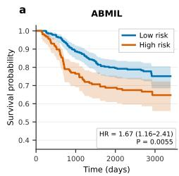

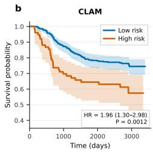

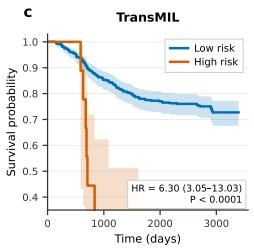

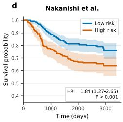

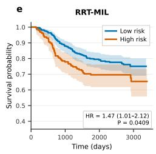

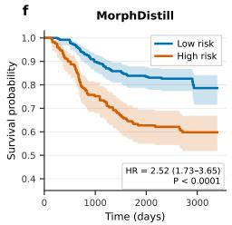

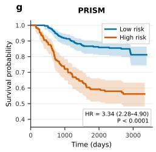

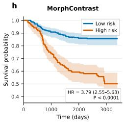  
Fig. 3 Kaplan-Meier risk stratification for MorphContrast and comparison models. Patients are assigned to low- and high-risk groups at each model's operating threshold; group sizes are shown in each panel. Hazard ratios and 95% CIs are obtained from univariate Cox models, and p-values from log-rank tests.

## 4.7 External Evaluation on the SurGen Cohort

We trained all models reported for the SurGen colon cancer cohort exclusively on the Alliance/CALGB 89803 cohort and evaluated them on SurGen in inference mode, without any fine-tuning or adaptation to the external data. This inference-only evaluation stringently tests generalizability under realistic multi-site distribution shift, spanning differences in scanner vendor, resolution, staining, and case-mix composition. On this cohort, FR-MIL achieved the highest baseline AUC (0.6766, 95% CI: 0.597–0.754) and yielded 83.33% sensitivity and 40.27% specificity (Table 6). Trans-MIL and MHIM-MIL achieved AUCs of 0.5580 (95% CI: 0.472–0.638) and 0.5585 (95% CI: 0.480–0.645), respectively. The MorphContrast model achieved an AUC of 0.669 (95% CI: 0.58–0.75), with a balanced accuracy of 63.98%, sensitivity of 57.58%, and specificity of 70.39%, while the MorphContrast post hoc ensemble achieved an AUC of 0.678 (95% CI: 0.60–0.76), with a balanced accuracy of 65.80%, sensitivity of 65.15%, and specificity of 66.45%.

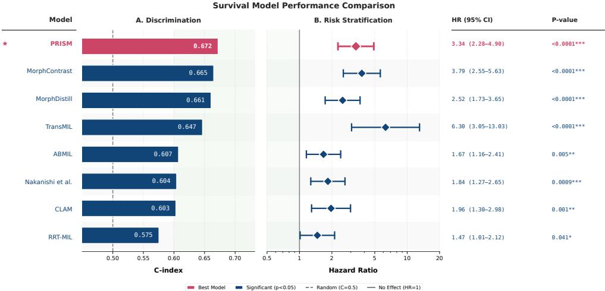  
Fig. 4 Discrimination and risk-group separation across MIL and morphology-aware models. Left: C-index. Right: univariate Cox hazard ratios with 95% CIs for high- versus low-risk groups.

Table 6 External validation performance for five-year overall survival prediction in the SurGen colon cancer cohort. Models were trained using the Alliance cohort and externally evaluated on the independent SurGen cohort. The best AUC point estimate is shown in bold, and the second-best AUC point estimate is underlined.
<table><tr><td>Model</td><td>AUC ↑</td><td>Bal-Acc (%) ↑</td><td>Sen. (%) ↑</td><td>Spec. (%) ↑</td></tr><tr><td>TransMIL [13]</td><td>0.558 (0.47, 0.64)</td><td>55.06 (45.1, 57.7)</td><td>65.15 (52.2, 76.4)</td><td>44.97 (37.6, 53.0)</td></tr><tr><td>FR-MIL [23]</td><td>0.676 (0.59, 0.75)</td><td>58.80 (46.5, 60.0)</td><td>83.33 (73.3, 92.0)</td><td>40.27 (32.6, 48.6)</td></tr><tr><td>MHIM-MIL [28]</td><td>0.558 (0.48,0.64)</td><td>53.61 (47.4, 61.4)</td><td>51.52 (40.0, 63.2)</td><td>55.70 (47.9, 64.5)</td></tr><tr><td>MorphContrast</td><td>0.669 (0.58, 0.75)</td><td>63.98 (60.1, 72.3)</td><td>57.58 (30.3, 85.1)</td><td>70.39 (44.0, 96.2)</td></tr><tr><td>MorphContrast (ensemble)</td><td>0.678 (0.60, 0.76)</td><td>65.80 (60.7, 73.4)</td><td>65.15 (43.9, 85.5)</td><td>66.45 (45.4, 87.4)</td></tr></table>

## 4.8 Ablation of the Contrastive Objectives

To assess the individual and joint contributions of the contrastive objectives to fiveyear survival prediction, we retrained MorphContrast using the same five-fold splits with $\mathcal { L } _ { \mathrm { { i n t r a } } }$ and $\mathcal { L } _ { \mathrm { { i n t e r } } }$ enabled individually and jointly, while holding $\mathcal { L } _ { \mathrm { s u r v } }$ and ${ \mathcal { L } } _ { \mathrm { d i v } }$ fixed (Table 7). The configuration without either contrastive objective reached an AUC of $0 . 6 0 \pm 0 . 0 7$ but favored predictions of death within five years, with a sensitivity of $( 8 2 . 1 2 \pm 7 . 0 6 ) \%$ and a specificity of $( 2 2 . 7 1 \pm 7 . 0 1 ) \%$ . Either term alone yielded only modest increases in AUC $( 0 . 6 2 \pm 0 . 0 9$ for $\mathcal { L } _ { \mathrm { i n t r a } }$ and $0 . 6 1 \pm 0 . 0 8$ for $\mathcal { L } _ { \mathrm { { i n t e r } } } )$ . The full objective achieved the highest mean AUC $( 0 . 6 4 \pm 0 . 0 5 ) $ and the most balanced operating point among the ablation configurations, with a sensitivity of $( 6 3 . 5 2 { \pm } 9 . 2 3 ) \%$ and a specificity of (55.40±7.63)%. The sensitivity-specificity gap narrowed from 59.41 to 8.12 percentage points. The performance gain thus emerges when both contrastive objectives are combined, rather than when either is used alone, and is driven primarily by improved specificity.

Table 7 Ablation of the intra- and inter-patient contrastive losses (Alliance/CALGB 89803). Each configuration adds the indicated contrastive term to the shared survival $( \dot { \mathcal { L } } _ { \mathrm { s u r v } } )$ and diversity $\left( { \mathcal { L } } _ { \mathrm { d i v } } \right)$ objectives under identical five-fold splits; $\checkmark / \pmb { x }$ mark inclusion. "Survival $\mathrm { { o n l y } ^ { \dag } }$ omits both contrastive terms; "Full" is complete MorphContrast. Weights are fixed at the established values $( \lambda _ { \mathrm { s u r v } } { = } 1 . 0 $ $\lambda _ { \mathrm { d i v } } { = } 0 .$ 1; $\lambda _ { \mathrm { i n t r a } } { = } 0 . 2 5 .$ $\lambda _ { \mathrm { i n t e r } } { = } 0 .$ 1 when enabled). Values are mean ± standard deviation across folds; in the $\mathrm { A U C }$ column the best value is shown in bold, and the second-best is underlined. AUC is highest for the full objective, whereas either contrastive term alone is within noise of the survival-only baseline.
<table><tr><td rowspan="2">Configuration</td><td colspan="2">Loss terms</td><td colspan="4">Five-year survival classification</td></tr><tr><td> $\mathcal { L } _ { \mathrm { { i n t r a } } }$ </td><td> $\mathcal { L } _ { \mathrm { { i n t e r } } }$ </td><td>AUC</td><td>Bal. Acc. (%) Sens. (%)</td><td></td><td>Spec. (%)</td></tr><tr><td>Survival only</td><td>x</td><td>x</td><td> $0 . 6 0 \pm 0 . 0 7$ </td><td> $5 2 . 4 3 \pm 1 . 3 2$ </td><td> $8 2 . 1 2 \pm 7 . 0 6$ </td><td> $2 2 . 7 1 \pm 7 . 0 1$ </td></tr><tr><td> $+ \mathcal { L } _ { \mathrm { { i n t r a } } }$ </td><td>√</td><td>x</td><td> $\underline { { 0 . 6 2 } } \pm 0 . 0 9$ </td><td> $5 3 . 6 2 \pm 2 . 4 2$ </td><td> $7 2 . 0 1 \pm 1 . 7 5$ </td><td> $3 5 . 0 4 \pm 1 . 0 9$ </td></tr><tr><td> $+ \mathcal { L } _ { \mathrm { { i n t e r } } }$ </td><td>x</td><td>√</td><td> $0 . 6 1 \pm 0 . 0 8$ </td><td> $5 6 . 6 2 \pm 5 . 2 0$ </td><td> $8 0 . 5 3 \pm 1 8 . 4 1$ </td><td> $3 2 . 7 0 \pm 1 9 . 0 2$ </td></tr><tr><td>Full</td><td>√</td><td>√</td><td> ${ \bf 0 . 6 4 \pm 0 . 0 5 }$ </td><td> $5 9 . 4 3 \pm 3 . 6 1$ </td><td> $6 3 . 5 2 \pm 9 . 2 3$ </td><td> $5 5 . 4 0 \pm 7 . 6 3$ </td></tr></table>

## 5 Discussion

This study provides three main observations. First, morphology-restricted models showed modest but distributed prognostic discrimination across tumor and non-tumor tissue compartments, indicating that prognostic discrimination was not confined to malignant epithelium. Adipose tissue and stroma achieved AUCs of 0.622 and 0.604, respectively, compared with 0.601-0.605 for adenocarcinoma compartments. These results are consistent with established roles for the invasive front, stromal composition, tumor budding, and the broader tumor microenvironment in CRC outcome [8-10]. However, these morphology-specific AUCs should not be interpreted as direct measures of biological importance. Patch abundance, spatial context, slide sampling, and correlated clinicopathologic factors were not controlled. The analysis therefore supports distributed prognostic discrimination across histologic compartments, not a causal ranking of tissue types.

Second, MorphContrast structures frozen patch features through two contrastive objectives. Within patients, same-morphology patches form positive pairs and different-morphology patches form negative pairs. In the outcome-aware objective, morphology-matched patches from different patients with concordant outcomes form positive pairs, those with discordant outcomes form hard negatives, and patches with different morphologies form standard negatives. On Alliance/CALGB 89803, the model achieved an AUC of 0.642, whereas the post hoc ensemble achieved a pooled OOF AUC of 0.70 and a risk-group HR of 3.79.

The MorphContrast model achieved a higher mean AUC than all ten frozen pathology foundation encoders evaluated with the same gated-attention survival head (range, 0.51–0.63), but a lower mean AUC than MorphDistill (0.68) and PRISM (0.70); however, the post hoc ensemble achieved a pooled OOF AUC of 0.70, exceeding MorphDistill and matching PRISM.

Third, evaluation on SurGen assessed external performance in a cohort that differed from Alliance in scanner resolution. Both the MorphContrast model and the post hoc ensemble had higher AUC point estimates than TransMIL and MHIM-MIL. The 95% confidence interval for the post hoc ensemble overlapped the interval for FR-MIL, the strongest evaluated baseline. These external results support cross-cohort generalizability, with discrimination comparable to the strongest evaluated baseline.

Despite the favorable performance of our method, several limitations warrant consideration. First, morphology labels are provided by a frozen encoder, so label noise may propagate directly into the contrastive pairs; ensuring consistently high-quality positive and negative sets may require further methodological refinement. Second, the endpoint is a complete-case binary label: patients censored before five years were excluded rather than censored, which discards time-to-event information and may introduce selection bias. Finally, the framework is unimodal; integrating genomic and transcriptomic data, including microsatellite instability status and consensus molecular subtypes, is a natural extension [47]. We intend to address these limitations in future work.

Overall, MorphContrast organizes frozen patch features through within-patient contrasts defined by morphology and cross-patient contrasts defined jointly by morphology matching and outcome concordance or discordance. The prognostic performance observed on Alliance and independently assessed on SurGen supports the use of morphology labels as structural supervision for five-year survival prediction from WSIs.

## 6 Conclusion

MorphContrast uses tissue morphology as structural supervision for five-year survival prediction from CRC H&E WSIs. The TCGA-COAD/READ analysis showed modest but distributed prognostic discrimination across tumor and non-tumor morphologies, motivating morphology- and outcome-aware contrastive learning. On Alliance/ CALGB 89803, the model achieved an AUC of 0.642, while the internally selected post hoc ensemble reached a pooled out-of-fold AUC of 0.70. On the external Sur-Gen colon cancer cohort, the single model and ensemble achieved AUCs of 0.669 and 0.678, respectively, compared with 0.6766 for FR-MIL, the strongest evaluated external baseline. The methodological contribution of MorphContrast is to use same-patient morphology matches and mismatches as positive and negative pairs, respectively, and cross-patient, morphology-matched patches with concordant and discordant outcomes as positive pairs and hard negatives, respectively. This design converts morphology labels into outcome-aware supervision for learning prognostic representations from the complete mixture of tumor and non-tumor tissue.

## Statements and Declarations

## Competing interests

All authors declare no financial or non-financial competing interests.

## Ethics approval and consent to participate

This study was reviewed and approved by the Institutional Review Board of The Ohio State University (IRB #2018C0098). All procedures involving human data were conducted in accordance with the ethical standards of the institutional research committee, applicable national regulations, and the 1964 Declaration of Helsinki and its later amendments. Given the retrospective nature of the study and because data were archival and de-identified, the requirement for informed consent to participate was formally waived by the Institutional Review Board.

## Funding

The project described was supported in part by R01 CA276301 (PIs: Niazi and Chen) from the National Cancer Institute. The project was also supported in part by Pelotonia under IRP CC13702 (PIs: Niazi, Vilgelm, and Roy), The Ohio State University Department of Pathology and Comprehensive Cancer Center. The content is solely the responsibility of the authors and does not necessarily represent the official views of the National Cancer Institute, National Institutes of Health, or The Ohio State University.

## Author contributions

H.K. performed data preprocessing, experimental design, validation, and manuscript writing and editing. M.N.G., A.P., W.L.F., W.C., and M.K.K.N. assisted with manuscript review and editing.

## Acknowledgements

The authors thank Dr. Fang-Shu Ou and the Alliance Statistics and Data Management Center for data acquisition, curation, and management. The authors also gratefully acknowledge the Ohio Supercomputer Center for providing high-performance computing resources under its contract with The Ohio State University College of Medicine.

We thank the Department of Pathology and the Comprehensive Cancer Center at The Ohio State University for their valuable support. The authors also thank Usama Sajjad, a Ph.D. student at The Ohio State University Wexner Medical Center, for providing the baseline results for the Alliance and SurGen cohorts.

## Trial registration

NCT00003835 (CALGB 89803); Registry: CTRP (Clinical Trial Reporting Program);   
Registry Identifier: NCI-2012-01844.

## Disclaimer

The data from CALGB 89803 were obtained directly from the Alliance for Clinical Trials in Oncology, a National Clinical Trials Network cooperative group; however, all analyses and conclusions in this manuscript are the sole responsibility of the authors and do not necessarily reflect the opinions or views of the clinical trial investigators, the NCTN, the NCORP, or the NCI.

## Data availability

The Alliance/CALGB 89803 whole-slide images and associated clinical outcomes are available to qualified investigators through the Alliance for Clinical Trials in Oncology via Datasharing@alliancenctn.org upon reasonable request. The remaining cohorts are publicly available: the TCGA-COAD and TCGA-READ data can be accessed through the GDC Data Portal (https://portal.gdc.cancer.gov/), and the SurGen data through the BioStudies repository (https://www.ebi.ac.uk/biostudies/ bioimages/studies/S-BIAD1285).

## Code availability

The source code will be publicly available upon acceptance. Code access may also be requested by emailing the corresponding author at Hikmat.khan@osumc.edu.

## References

[1] Rawla P, Sunkara T, Barsouk A (2019) Epidemiology of colorectal cancer: incidence, mortality, survival, and risk factors. Gastroenterology Review 14(2):89–103

[2] Siegel RL, Kratzer TB, Giaquinto AN, et al (2025) Cancer statistics, 2025. CA: A Cancer Journal for Clinicians 75(1):10–45

[3] Kather JN, Hanna MG, Garcia C, et al (2026) The cost of accessibility: Considerations for adopting microscope camera-derived images for digital and computational pathology. Mayo Clinic Proceedings: Digital Health 4(3):100379. https://doi.org/10.1016/j.mcpdig.2026.100379

[4] Khan H, Chen W, Niazi MKK (2026) Weakly supervised teacher-student framework with progressive pseudo-mask refinement for gland segmentation. Journal of clinical and translational pathology 6(1):1

[5] Datwani S, Khan H, Niazi MKK, et al (2025) Artificial intelligence in breast pathology: Overview and recent updates. Human pathology p 105819

[6] Akbar AR, Wales-McGrath S, Levya A, et al (2026) Pathoscribe: Transforming pathology data into a living library with a unified llm-driven framework for semantic retrieval and clinical integration. arXiv preprint arXiv:260308935

[7] Akbar AR, Sajjad U, Su Z, et al (2026) A spatially aware deep learning framework for multiscale cellular ecology profiling to predict 5-year recurrence in invasive lung adenocarcinoma. npj Digital Medicine

[8] Lugli A, Kirsch R, Ajioka Y, et al (2017) Recommendations for reporting tumor budding in colorectal cancer based on the international tumor budding consensus conference (ITBCC) 2016. Modern Pathology 30(9):1299–1311

[9] Gao J, Wang L, Xu J, et al (2021) Impact of tumor-stroma ratio on the prognosis of colorectal cancer: a systematic review. Frontiers in Oncology 11:738080

[10] Kather JN, Krisam J, Charoentong P, et al (2019) Predicting survival from colorectal cancer histology slides using deep learning: A retrospective multicenter study. PLoS Medicine 16(1):e1002730. https://doi.org/10.1371/journal.pmed. 1002730

[11] Ilse M, Tomczak JM, Welling M (2018) Attention-based deep multiple instance learning. In: International Conference on Machine Learning (ICML), pp 2127- 2136

[12] Lu MY, Williamson DFK, Chen TY, et al (2021) Data-efficient and weakly supervised computational pathology on whole-slide images. Nature Biomedical Engineering 5(6):555–570

[13] Shao Z, Bian H, Chen Y, et al (2021) TransMIL: Transformer based correlated multiple instance learning for whole slide image classification. In: Advances in Neural Information Processing Systems (NeurIPS), pp 2136–2147

[14] Khan H, Su Z, Zhang H, et al (2025) Predicting neoadjuvant chemotherapy response in triple-negative breast cancer using pre-treatment histopathologic images. Cancers 17(15):2423

[15] Tang W, Zhou F, Huang S, et al (2024) Feature re-embedding: Towards foundation model-level performance in computational pathology. In: IEEE/CVF Conference on Computer Vision and Pattern Recognition (CVPR), pp 11343- 11352

[16] Chen RJ, Ding T, Lu MY, et al (2024) Towards a general-purpose foundation model for computational pathology. Nature Medicine 30(3):850–862

[17] Xu H, Usuyama N, Bagga J, et al (2024) A whole-slide foundation model for digital pathology from real-world data. Nature 630(8015):181-188

[18] Khan H, Sajjad U, Gurcan MN, et al (2026) MorphDistill: Distilling unified morphological knowledge from pathology foundation models for colorectal cancer survival prediction, manuscript, 2026

[19] Sajjad U, Akbar AR, Su Z, et al (2026) Morphology-aware prognostic model for five-year survival prediction in colorectal cancer from H&E whole-slide images: A study using a multi-center clinical trial cohort. Cancers 18(7):1150. https://doi. org/10.3390/cancers18071150

[20] Myles C, Um IH, Marshall C, et al (2025) SurGen: 1020 H&E-stained whole-slide images with survival and genetic markers. GigaScience 14:1–16. https://doi.org/ 10.1093/gigascience/giaf086, dataset: https://doi.org/10.6019/S-BIAD1285

[21] Khosla P, Teterwak P, Wang C, et al (2020) Supervised contrastive learning. In: Advances in Neural Information Processing Systems (NeurIPS)

[22] Li B, Li Y, Eliceiri KW (2021) Dual-stream multiple instance learning network for whole slide image classification with self-supervised contrastive learning. In: Proceedings of the IEEE/CVF Conference on Computer Vision and Pattern Recognition, pp 14318–14328

[23] Chikontwe P, Nam SJ, Go H, et al (2022) Feature re-calibration based multiple instance learning for whole slide image classification. In: Medical Image Computing and Computer-Assisted Intervention (MICCAI), Springer, pp 420–430, https://doi.org/10.1007/978-3-031-16434-7\_41

[24] Song AH, Chen RJ, Ding T, et al (2024) Morphological prototyping for unsupervised slide representation learning in computational pathology. In: Proceedings of the IEEE/CVF Conference on Computer Vision and Pattern Recognition, pp 11566-11578

[25] Nakanishi R, Morooka K, Omori K, et al (2023) Artificial intelligence-based prediction of recurrence after curative resection for colorectal cancer from digital pathological images. Annals of Surgical Oncology 30(6):3506–3514

[26] Yuan W, Chen Y, Zhu B, et al (2025) Pancancer outcome prediction via a unified weakly supervised deep learning model. Signal Transduction and Targeted Therapy 10(1):285

[27] Zhang Y, Li H, Sun Y, et al (2024) Attention-challenging multiple instance learning for whole slide image classification. In: European Conference on Computer

[28] Tang W, Huang S, Zhang X, et al (2023) Multiple instance learning framework with masked hard instance mining for whole slide image classification. In: IEEE/CVF International Conference on Computer Vision (ICCV), IEEE, pp 4055-4064

[29] Chen T, Kornblith S, Norouzi M, et al (2020) A simple framework for contrastive learning of visual representations. In: International Conference on Machine Learning (ICML)

[30] Khan H, Zaidi SFA, Shah PM, et al (2025) MorphGen: Morphology-guided representation learning for robust single-domain generalization in histopathological cancer classification. arXiv preprint https://doi.org/10.48550/arXiv.2509.00311, arXiv:2509.00311

[31] Lu MY, Chen B, Williamson DFK, et al (2024) A visual-language foundation model for computational pathology. Nature Medicine 30(3):863–874

[32] Zimmermann E, Vorontsov E, Viret J, et al (2024) Virchow2: Scaling self-supervised mixed magnification models in pathology. arXiv preprint arXiv:240800738

[33] Wang X, Yang S, Zhang J, et al (2022) Transformer-based unsupervised contrastive learning for histopathological image classification. Medical Image Analysis 81:102559

[34] Saillard C, Jenatton R, Llinares-López F, et al (2024) H-optimus-0. https: //github.com/bioptimus/releases/tree/main/models/h-optimus/v0

[35] kaiko.ai, Aben N, de Jong ED, et al (2024) Towards large-scale training of pathology foundation models. arXiv preprint arXiv:240415217

[36] Kang M, Song H, Park S, et al (2023) Benchmarking self-supervised learning on diverse pathology datasets. In: IEEE/CVF Conference on Computer Vision and Pattern Recognition (CVPR), pp 3344–3354

[37] Filiot A, Jacob P, Mac Kain A, et al (2024) Phikon-v2, a large and public feature extractor for biomarker prediction. arXiv preprint arXiv:240909173

[38] Belagali V, Kapse S, Marza P, et al (2026) Ticon: A slide-level tile contextualizer for histopathology representation learning. In: Proceedings of the IEEE/CVF Conference on Computer Vision and Pattern Recognition, pp 5440–5451

[39] Saltz LB, Niedzwiecki D, Hollis D, et al (2007) Irinotecan fluorouracil plus leucovorin is not superior to fluorouracil plus leucovorin alone as adjuvant treatment for stage iii colon cancer: results of calgb 89803. Journal of Clinical Oncology

[40] National Cancer Institute (2004) Combination chemotherapy in treating patients with stage III colon cancer. URL https://clinicaltrials.gov/study/NCT00003835, clinicalTrials.gov identifier: NCT00003835; last updated October 8, 2013

[41] Rogers JE, Johnson B (2021) The reality of early-onset colorectal cancer: Highlighting the needs in a unique but emerging population. Digestive Medicine Research 4:63. https://doi.org/10.21037/dmr-21-77

[42] The Cancer Genome Atlas Network (2012) Comprehensive molecular characterization of human colon and rectal cancer. Nature 487(7407):330–337. https: //doi.org/10.1038/nature11252

[43] National Cancer Institute (2026) Genomic Data Commons Data Portal. https: //portal.gdc.cancer.gov/, accessed: 2026-08-03

[44] Harrell JFrank E., Lee KL, Mark DB (1996) Multivariable prognostic models: Issues in developing models, evaluating assumptions and adequacy, and measuring and reducing errors. Statistics in Medicine 15(4):361–387. https://doi.org/10. 1002/(SICI)1097-0258(19960229)15:4(361::AID-SIM168)3.0.CO;2-4

[45] Loshchilov I, Hutter F (2019) Decoupled weight decay regularization. In: International Conference on Learning Representations

[46] Loshchilov I, Hutter F (2017) Sgdr: Stochastic gradient descent with warm restarts. In: International Conference on Learning Representations

[47] Akbar A, Sajjad U, Leyva A, et al (2026) Genoglyph: Pan-cancer genomic mutation inference and risk stratification from diagnostic histopathology slides. Research Square pp rs-3

# Supplementary Material

Morphology-aware deep learning predicts colorectal cancer survival from whole-slide images

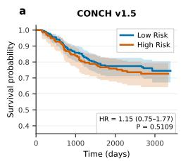

b  
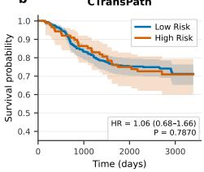

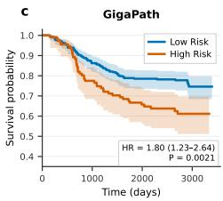

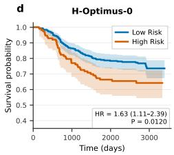

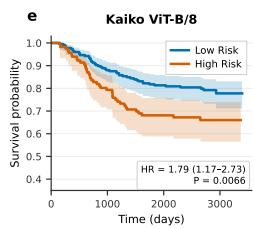

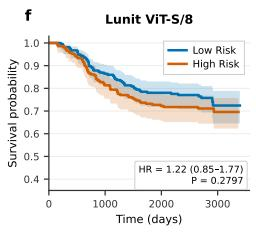

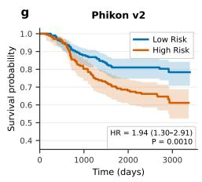

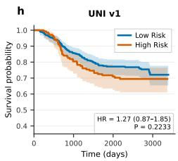

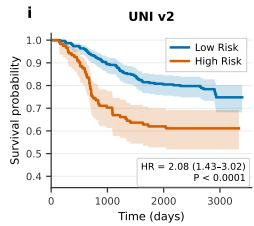

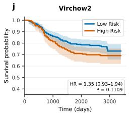

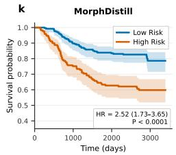

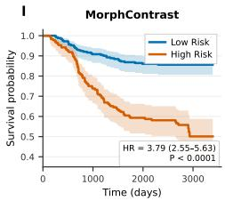  
Supplementary Fig. 1 Kaplan-Meier risk stratification using frozen pathology foundation encoders and MorphContrast. Each panel reports low- and high-risk group sizes, the hazard ratio with 95% CI, and the log-rank p-value. The foundation-model features are aggregated using the same gated-attention survival head.

Supplementary Table 1 Clinicopathologic characteristics of the Alliance/CALGB 89803 cohort.
<table><tr><td rowspan=1 colspan=5>Alliance cohort characteristics</td></tr><tr><td rowspan=1 colspan=5>Characteristic                         Category                                       Value</td></tr><tr><td rowspan=2 colspan=5>Number of slides                                                                               424Number of patients                                                                            424Mean age (years)                                                                             60.47Mean household income median                                                        43,194.59(USD)White                                              391RaceBlack                                                33Male                                                238SexFemale                                              1865FU/LV                                            212TreatmentCPT-11/5FU/LV                                  2120                                                    324</td></tr><tr><td rowspan=1 colspan=1></td></tr><tr><td rowspan=1 colspan=5>Zubrod performance scale              1                                                     98</td></tr><tr><td rowspan=1 colspan=5>2                                                      2</td></tr><tr><td rowspan=1 colspan=1></td><td rowspan=1 colspan=4>Cecum                                              101</td></tr><tr><td rowspan=1 colspan=1></td><td rowspan=1 colspan=4>Ascending colon                                     64</td></tr><tr><td rowspan=1 colspan=1></td><td rowspan=1 colspan=4>Hepatic flexure                                      28</td></tr><tr><td rowspan=1 colspan=1>Tumor location</td><td rowspan=1 colspan=3>Transverse colon</td><td rowspan=1 colspan=1>46</td></tr><tr><td rowspan=1 colspan=1></td><td rowspan=1 colspan=3>Splenic flexure</td><td rowspan=1 colspan=1>19</td></tr><tr><td rowspan=1 colspan=1></td><td rowspan=1 colspan=3>Descending colon</td><td rowspan=1 colspan=1>19</td></tr><tr><td rowspan=1 colspan=1></td><td rowspan=1 colspan=3>Sigmoid colon</td><td rowspan=1 colspan=1>147</td></tr><tr><td rowspan=1 colspan=1></td><td rowspan=1 colspan=3>I</td><td rowspan=1 colspan=1>20</td></tr><tr><td rowspan=2 colspan=1>Grade</td><td rowspan=1 colspan=3>II</td><td rowspan=1 colspan=1>296</td></tr><tr><td rowspan=1 colspan=3>III</td><td rowspan=1 colspan=1>108</td></tr><tr><td rowspan=1 colspan=1></td><td rowspan=1 colspan=3>IV</td><td rowspan=1 colspan=1>0</td></tr><tr><td rowspan=1 colspan=1>Stage</td><td rowspan=1 colspan=3>III</td><td rowspan=1 colspan=1>424</td></tr><tr><td rowspan=1 colspan=1>Small blood/lymphatic vessel</td><td rowspan=1 colspan=3>No</td><td rowspan=1 colspan=1>286</td></tr><tr><td rowspan=1 colspan=1>invasion</td><td rowspan=1 colspan=4>Yes                                                  138</td></tr><tr><td rowspan=2 colspan=1>Extramural vascular invasion</td><td rowspan=1 colspan=4>No                                                  395</td></tr><tr><td rowspan=1 colspan=4>Yes                                                   29</td></tr><tr><td rowspan=3 colspan=1>Infiltrating borderFive-year outcome (analysis</td><td rowspan=1 colspan=4>No                                                  283</td></tr><tr><td rowspan=1 colspan=3>Yes</td><td rowspan=1 colspan=1>141</td></tr><tr><td rowspan=1 colspan=4>Died within 5 years                                103</td></tr><tr><td rowspan=1 colspan=5>endpoint)                                 Survived ≥ 5 years                                321</td></tr></table>

Supplementary Table 2 Hyperparameter search space and fixed training settings for MorphContrast. Parameters with multiple candidate values were varied during hyperparameter search; single-valued parameters were fixed.
<table><tr><td>Parameter</td><td>Value(s)</td><td>Setting</td></tr><tr><td>Hyperparameter search space</td><td></td><td></td></tr><tr><td>Feature-encoder hidden dimension</td><td>{768, 1024}</td><td>Searched</td></tr><tr><td>Projection dimension</td><td>{128, 256}</td><td>Searched</td></tr><tr><td>Attention hidden dimension</td><td> $\{ 5 1 2 , 1 0 2 4 , 1 5 3 6 \}$ </td><td>Searched</td></tr><tr><td>Initial learning rate</td><td> $\lbrace 1 0 ^ { - 4 } , 1 0 ^ { - 5 } \rbrace$ </td><td>Searched</td></tr><tr><td>Decision threshold</td><td> $\{ 0 . 4 , 0 . 5 \}$ </td><td>Searched</td></tr><tr><td>Intra-patient loss weight  $\lambda _ { a }$ </td><td>{0.1, 0.25}</td><td>Initial search</td></tr><tr><td>Inter-patient loss weight  $\lambda _ { e }$ </td><td>{0.1,0.25}</td><td>Initial search</td></tr><tr><td>Diversity loss weight  $\lambda _ { d }$ </td><td>{0.1, 0.25}</td><td>Searched</td></tr><tr><td>Survival loss</td><td>Weighted CE, focal loss</td><td>Searched</td></tr><tr><td>Fixed training settings</td><td></td><td></td></tr><tr><td>Optimizer</td><td>AdamW</td><td>Fixed</td></tr><tr><td>Learning-rate schedule</td><td>Cosine annealing</td><td>Fixed</td></tr><tr><td>Weight decay</td><td> $1 0 ^ { - 5 }$ </td><td>Fixed</td></tr><tr><td>Batch size</td><td>4</td><td>Fixed</td></tr><tr><td>Dropout</td><td>0.1</td><td>Fixed</td></tr><tr><td>Survival loss weight  $\lambda _ { s }$ </td><td>1.0</td><td>Fixed</td></tr><tr><td>Temperature τ</td><td>0.1</td><td>Fixed</td></tr><tr><td>Maximum contrastive patches</td><td>512</td><td></td></tr><tr><td>Maximum epochs</td><td>150</td><td>Fixed</td></tr><tr><td>Early-stopping patience</td><td>15 epochs</td><td>Fixed Fixed</td></tr></table>

Supplementary Table 3 Clinicopathological variables used in the clinical models. The fourteen variables were obtained from Alliance/CALGB 89803 trial case-report forms (n = 424; 103 events). Both full and reduced baselines use l2-regularized logistic regression to predict death within five years, evaluated using the same five patient-disjoint folds as MorphContrast. Missing values were imputed with medians estimated from the training patients in each fold. The reduced model includes positive lymph-node count, T category, and grade only. T category combines trial depth-of-invasion codes 4 and 5 as T4. FL denotes fluorouracil and leucovorin; IFL additionally includes irinotecan. No molecular markers were included.
<table><tr><td>Variable</td><td>Model coding</td></tr><tr><td>Age at enrolment</td><td>years, continuous</td></tr><tr><td>Sex</td><td>male vs female</td></tr><tr><td>Histological grade</td><td>III (poorly differentiated) vs I-II</td></tr><tr><td>T category (depth of invasion)</td><td>T4 vs T1–T3</td></tr><tr><td>Positive lymph nodes</td><td>number, continuous</td></tr><tr><td>Small blood/lymphatic vessel invasion</td><td>present vs absent</td></tr><tr><td>Extramural vascular invasion</td><td>present vs absent</td></tr><tr><td>Perineural invasion</td><td>present vs absent</td></tr><tr><td>Infiltrating border</td><td>present vs absent</td></tr><tr><td>Lymphocytic response</td><td>present vs absent</td></tr><tr><td>Obstruction</td><td>present vs absent</td></tr><tr><td>Perforation</td><td>present vs absent</td></tr><tr><td>Zubrod performance status</td><td>≥ 1 vs 0</td></tr><tr><td>Treatment arm</td><td>IFL vs FL</td></tr></table>