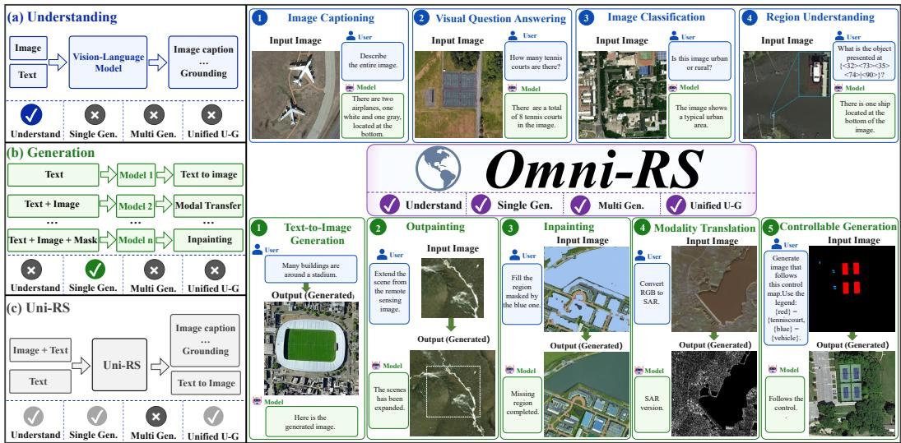
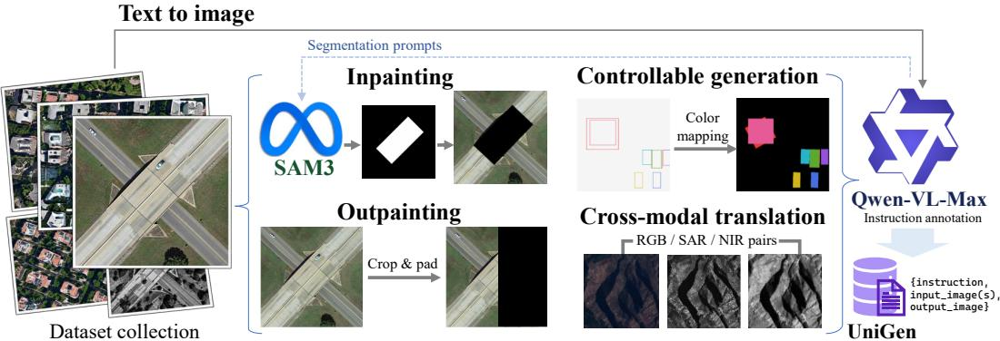
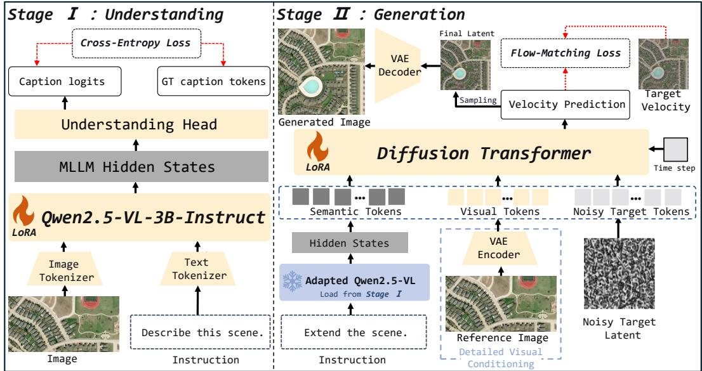
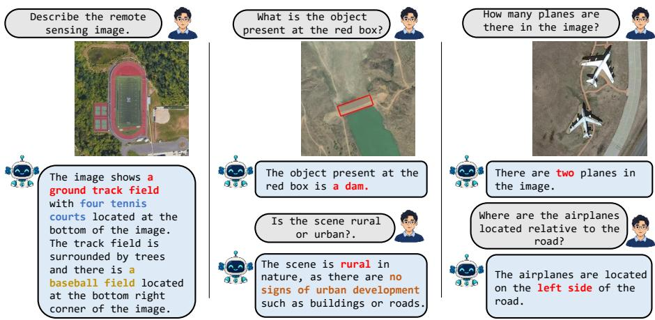
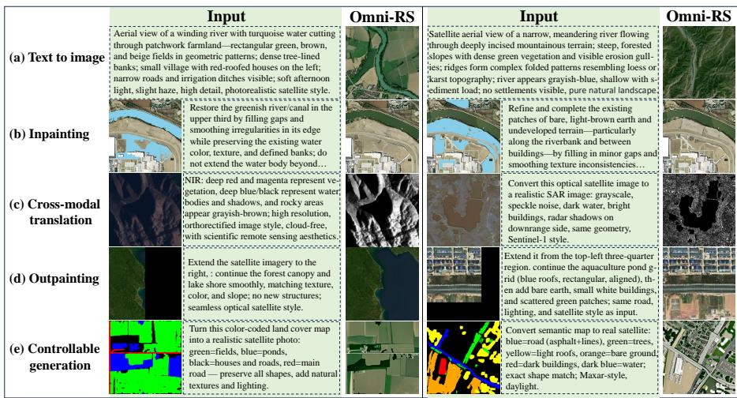
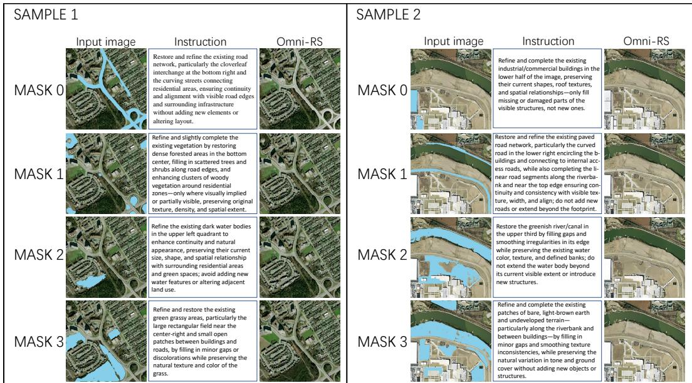
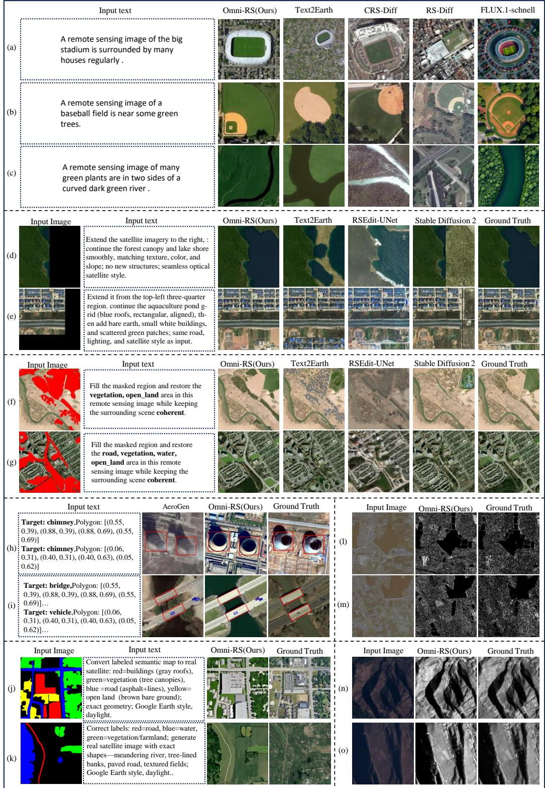
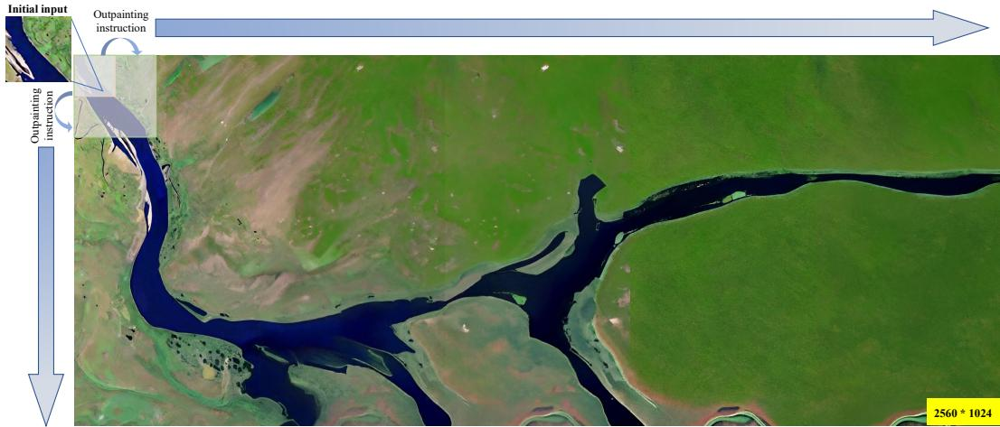

# OMNI-RS: UNIFYING MULTI-TASK UNDERSTANDING AND GENERATION IN REMOTE SENSING

Pan Yin∗, Shuai Yang∗, Yuanhao Liu, Datao Tang, Jialin Li, Hao Wang, Pei Liu, Kaiyu Li, Cong Zhao, Xiangyong Cao†

Xi’an Jiaotong University

caoxiangyong@mail.xjtu.edu.cn

## ABSTRACT

Practical remote sensing applications often require both understanding and generation capabilities for the same geographic scene. However, most existing methods address either understanding or generation in isolation, while existing unified remote sensing models’ generative ability is limited to text-to-image. To bridge this gap, we propose Omni-RS, a unified framework supporting four remote sensing understanding tasks and five generation tasks. Specifically, we introduce the “Scene-Guided Two-Stage Training” strategy, which first adapts a multimodal large language model to remote sensing understanding and then uses its hidden states to guide a diffusion transformer for image generation. To enable joint learning across diverse generation tasks, we construct UniGen, a unified multi-task generation dataset, by organizing heterogeneous remote sensing data into a unified format. Furthermore, we introduce “Detailed Visual Conditioning”, which uses visual conditions encoded by a VAE to guide the generation process, thereby supporting additional generation tasks that require reference images. Extensive experiments demonstrate that Omni-RS performs exceptionally well in understanding tasks and has achieved outstanding results in a variety of generative tasks.

## 1 INTRODUCTION

Remote sensing (RS) imagery serves as a foundational pillar for Earth observation, powering critical downstream applications such as disaster response, environmental monitoring, and urban planning (Van Westen, 2013; Li et al., 2020; Wellmann et al., 2020). Powered by recent advances in deep learning, the field has witnessed remarkable progress across two distinct fronts: visual understanding has evolved from basic classification to complex visual question answering, while generative modeling has expanded from simple text-to-image synthesis to practical tasks like inpainting and cross-modal translation (Maxwell et al., 2018; Lobry et al., 2020; Chen et al., 2026). However, these abilities have largely developed in their own isolated domains. In reality, real-world geospatial applications often require joint understanding and generation for a single scene, such as assessing damaged structures and inpainting missing imagery during disaster response. Consequently, developing a unified architecture that harmonizes multi-task RS understanding and generation is essential to addressing these intrinsically complementary needs.

As illustrated on the left of Fig. 1, existing remote sensing models generally fall into three categories: understanding-based, generation-based, and unified understanding-generation approaches. Understanding-based methods, such as GeoChat (Kuckreja et al., 2024) and SkySenseGPT (Luo et al., 2024), leverage instruction tuning or scene graph reasoning to enable region-level grounding and spatial analysis. While effective for visual comprehension, these models lack generative capabilities. Conversely, generation-based methods focus on image synthesis; for instance, CRS-Diff (Tang et al., 2024) integrates multi-modal conditions for controllable synthesis, and RSEdit (Chen et al., 2026) adapts diffusion models for image editing. Nevertheless, these generative architectures cannot perform understanding tasks. Additionally, varying conditioning inputs across different generation tasks hinder joint training, leaving most methods tailored to a single task. Recently, Uni-RS (Zhang et al., 2026) connected a multimodal large language model (MLLM) to a diffusion generator via learnable queries, achieving text-to-image synthesis alongside visual understanding. However, its generative capability is still restricted to text-to-image synthesis, failing to support tasks that require additional reference images, such as inpainting and layout controllable generation.

  
Figure 1: Comparison of task capabilities across different remote sensing model paradigms. (a) Understanding-based methods lack image generation capabilities. (b) Generation-based meth ods support individual generation tasks but lack understanding and multi-task generation. (c) Uni-RS bridges understanding and generation, but remains restricted to text-to-image synthesis. Right: Omni-RS supports four understanding tasks and five generation tasks within a unified framework.

Despite these advances, unifying diverse remote sensing understanding and generation tasks within a single model still presents three key challenges. First, understanding and generation impose fundamentally different optimization requirements. Although both tasks rely on shared scene semantics, understanding aims to interpret visual content into sparse textual tokens, whereas generation focuses on synthesizing spatially consistent visual pixels. Jointly optimizing these heterogeneous objectives often leads to task interference during training, hindering the model from mastering both capabili ties simultaneously. Second, existing generation datasets remain highly fragmented. For example, Git-10M (Liu et al., 2025) provides image-text pairs tailored for text-to-image synthesis, while TerraGen (Tang et al., 2026) couples images with spatial conditions for layout controllable generation. The disparity in conditioning inputs and supervision formats across datasets complicates their di rect integration into a unified multi-task training framework. Third, existing unified models (e.g., Uni-RS) rely primarily on semantic guidance to steer generation. While such semantic representations effectively capture textual instructions, these representations ignore pixel-level spatial details, which limits the models’ ability to support generation tasks that require preserving the structure of the reference image, such as image inpainting and cross-modal transformation.

To address these challenges, we propose Omni-RS, a unified framework for multi-task remote sensing understanding and generation. As illustrated in Fig. 1, Omni-RS harmonizes four understanding and five generation tasks within a single architecture. First, to mitigate cross-task interference caused by conflicting optimization objectives, we propose a “Scene-Guided Two-Stage Training” strategy. Motivated by the insight that both understanding and generation rely on a prior comprehension of geospatial scenes, this strategy decouples semantic understanding from visual synthesis into two stages. In the first stage, the MLLM is trained on remote sensing understanding tasks to construct a robust domain-specific scene representation. In the second stage, the learned hidden representations from the MLLM are projected into conditional embeddings for the diffusion generator, effectively leveraging the model’s acquired scene awareness to guide image synthesis while mitigating crosstask interference. Second, to resolve dataset fragmentation, we construct UniGen, a unified remote sensing generation dataset that reorganizes heterogeneous data sources into a unified format. Uni-Gen enables joint learning of multiple generation tasks across text-to-image synthesis, inpainting, outpainting, layout controllable generation, and cross-modal translation. Third, to overcome the loss of pixel-level spatial details in semantically guided generation, we introduce “Detailed Visual

Conditioning”, which injects VAE latent features from reference images into the diffusion generator.   
This mechanism supplies more visual cues, enabling the model to better preserve visible content.

In summary, our main contributions are as follows:

• We propose Omni-RS, a unified remote sensing framework that harmonizes four understanding tasks and five generation tasks within a single architecture. Driven by a “Scene-Guided Two-Stage Training” strategy, Omni-RS leverages domain-specific scene understanding from an MLLM to effectively guide image generation.

• We construct UniGen, a unified remote sensing generation dataset that reorganizes different data sources into a unified format, enabling joint multi-task learning across text-toimage synthesis, inpainting, outpainting, layout control, and cross-modal translation.

• We introduce Detailed Visual Conditioning, a mechanism that injects VAE latents of reference images into the diffusion generator, effectively mitigating visual detail loss and ensuring high-fidelity structural preservation.

## 2 RELATED WORK

## 2.1 REMOTE SENSING MULTIMODAL UNDERSTANDING

Early remote sensing understanding methods primarily relied on convolutional neural networks (CNNs) for task-specific visual interpretation, such as image classification and pixel-level segmentation (Li et al., 2018; Chauhan et al., 2018; Wang et al., 2020). These approaches map remote sensing imagery to predefined categories or masks, providing effective solutions for individual perception tasks but offering limited support for flexible semantic interaction. With the development of large language models and vision-language learning, recent studies (Zhang et al., 2023; Li et al., 2025) have begun to integrate remote sensing imagery with language models, enabling users to interact with remote sensing scenes through natural-language instructions. For example, Sun et al. (2025) enable models to describe changes in a scene using natural language, while Zi et al. (2025) require models to perform semantic, counting, and spatial reasoning in response to user queries.

## 2.2 REMOTE SENSING IMAGE GENERATION

Early studies mainly employed generative adversarial networks (GANs) to synthesize remote sensing images (Zhou et al., 2022; Tao et al., 2023). With the development of diffusion models, recent methods have substantially improved the fidelity and diversity of generated remote sensing images. For example, Sebaq & ElHelw (2024) synthesize remote sensing scenes from natural-language de scriptions, while Tang et al. (2025) further incorporate layouts as spatial conditions to constrain scene structures. In addition, image-conditioned generation has also been explored for tasks. For example, Sun et al. (2023) reconstruct missing regions conditioned on visible image content, while Li et al. (2022a) transform imagery between different remote sensing modalities.

## 2.3 DATASETS FOR REMOTE SENSING UNDERSTANDING AND GENERATION

The development of remote sensing multimodal understanding has benefited from increasingly mature data resources. Early datasets, such as RSICD, RSITMD, and RSVQA (Lu et al., 2017; Yuan et al., 2022b; Lobry et al., 2020), primarily support individual tasks such as image captioning and visual question answering. More recently, datasets such as VRSBench and GeoChat (Li et al., 2024a; Kuckreja et al., 2024) have further integrated various understanding tasks into a unified format, laying the foundation for multimodal remote sensing understanding.

In contrast, existing remote sensing generation datasets are still primarily constructed for specific generation tasks. For example, Git-10M (Liu et al., 2025) provides image and text pairs for text-toimage generation, while RSEdit (Chen et al., 2026) pairs source images with editing instructions for image editing. TerraGen (Tang et al., 2026) further associates remote sensing images with layoutbased spatial conditions to support controllable generation. However, these datasets differ substantially in their conditioning inputs and supervision formats, making them difficult to directly integrate for joint training across multiple generation tasks.

## 2.4 UNIFIED UNDERSTANDING AND GENERATION MODELS

Recent studies have increasingly explored integrating multimodal understanding and generation within a single model. For example, Wang et al. (2024) represent both images and text as discrete tokens and model them autoregressively within a shared sequence. Zhou et al. (2025) unify autoregressive language modeling and diffusion-based image generation within a single Transformer, jointly modeling discrete text tokens and continuous visual representations. Pan et al. (2025) and Wu et al. (2026) combine MLLMs with diffusion models, leveraging the semantic reasoning capability of the MLLM to provide conditions for high-fidelity image generation. More recently, Zhang et al. (2026) extend unified understanding and generation to remote sensing images. However, its generation capability remains limited to text-to-image generation and does not support more complex and practical image-conditioned tasks, such as image inpainting and modality translation. This limitation leaves the unified modeling of diverse remote sensing generation tasks largely unexplored.

## 3 DATASET PIPELINE

Existing remote sensing generation datasets are typically tailored for isolated tasks and seldom provide multiple generation tasks for the same geospatial scene. For instance, text-to-image datasets pair imagery with textual descriptions but they lack the reference images or task-specific instructions required for image inpainting. Likewise, datasets with spatial annotations or paired cross-modal observations provide disparate conditions that are not aligned across different tasks. To bridge this gap, we construct UniGen, a unified remote sensing dataset encompassing text-to-image, image inpainting, outpainting, controllable generation, and cross-modal translation. As illustrated in Figure 2, UniGen pairs task-specific reference images with tailored instruction annotations, standardizing heterogeneous data sources into a unified triplet format {instruction, reference image, output image}.

  
Figure 2: Overview of UniGen’s construction pipeline. Heterogeneous remote sensing data are reorganized into five generation tasks, with Qwen-VL-Max providing captions and task instructions. The dashed arrow indicates the additional segmentation prompts supplied to SAM3 for inpainting.

To build a comprehensive benchmark, we aggregate complementary data sources including Git-10M (Liu et al., 2025), DIOR-R (Cheng et al., 2022), and WHU-OPT-SAR (Li et al., 2022b). Specifically, Git-10M offers over 10 million globally distributed image–text pairs, providing diverse visual content and rich textual descriptions. DIOR-R contributes high-quality oriented bounding boxes and rotated object annotations, serving as a solid foundation for constructing precise spatial control conditions. Meanwhile, WHU-OPT-SAR supplies aligned RGB, NIR, and SAR observations at a 5 m spatial resolution across varied terrain, supporting cross-modal supervision for identical geographic regions. Leveraging these data sources, we derive task-specific instructions and reference image conditions around shared geospatial scenes to enable multi-task generation.

The construction pipeline of the UniGen dataset is illustrated in Figure 2. For text-to-image generation, we pair scene captions refined by Qwen-VL-Max (Bai et al., 2023) with their corresponding images. For inpainting, Qwen-VL-Max generates subject-specific restoration instructions and segmentation prompts, which steer SAM3 (Carion et al., 2026) to extract region masks; after filtering invalid masks, selected regions are removed to produce masked inputs while preserving original images as completion targets. For outpainting, we crop and pad images to construct partially observed canvases, pairing them with extension instructions and ground truth images. For controllable generation, to unify layout conditions with image conditions, we convert discrete annotations into rasterized color control maps. These control maps are generated by rendering DIOR-R’s bounding boxes or by coloring category masks from the inpainting task. The task instructions are then generated by Qwen-VL-Max. For cross-modal translation, RGB inputs are paired with corresponding NIR or SAR targets under modality-specific instructions. For all tasks, Qwen-VL-Max generates multi-task instructions with a consistent style based on the target image, control conditions, and task category. Detailed source statistics are provided in Appendix A.1.

## 4 METHOD

  
Figure 3: Overview of Omni-RS. Stage I adapts the MLLM to remote sensing understanding through LoRA tuning with a cross-entropy loss. Stage II freezes the adapted MLLM and trains the diffusion transformer through LoRA tuning with a flow-matching loss. Semantic tokens from the MLLM and visual tokens from “Detailed Visual Conditioning” jointly guide image generation.

## 4.1 OVERVIEW

As illustrated in Figure 3, Omni-RS bridges a multimodal large language model (MLLM) with a diffusion transformer (DiT) via hidden states, harmonizing remote sensing visual understanding and multi-task image generation within a unified architecture. Built upon Qwen2.5-VL-3B-Instruct (Bai et al., 2025), the MLLM interprets visual-textual inputs for understanding tasks while simultaneously serving as a semantic encoder for downstream generation. Formally, we represent a unified data sample as a tuple $( u , r , y )$ , where u denotes the text instruction, r represents an optional reference image, and y is the target output. For visual understanding, the MLLM processes the input image alongside instruction u to autoregressively generate textual outputs. For generative tasks, the instruction u and optional reference image r are translated into unified semantic and visual tokens, respectively, which directly condition the DiT backbone to synthesize the target image y.

## 4.2 SCENE-GUIDED TWO-STAGE TRAINING

We observe that both remote sensing visual understanding and image generation rely on prior geographic scene modeling to capture high-level semantics and spatial topology before performing their respective tasks. Based on this key insight, we propose a novel “Scene-Guided Two-Stage Training” strategy. Specifically, this approach first adapts the MLLM to acquire domain-specific remote sensing knowledge, and subsequently leverages its frozen hidden states as conditional guidance to steer the DiT for multi-task image generation.

Stage I: Understanding Adaptation. We initialize the MLLM backbone with Qwen2.5-VL-3B-Instruct and fine-tune it on remote sensing understanding benchmarks. Given an input image $I ,$ an instruction prompt q, and a target textual sequence $a = ( a _ { 1 } , \ldots , a _ { L } )$ , the model is optimized via an autoregressive cross-entropy loss:

$$
\mathcal { L } _ { \mathrm { u n d e r } } = - \mathbb { E } _ { ( I , q , a ) } \left[ \sum _ { j = 1 } ^ { L } \log p _ { \phi } ( a _ { j } \mid I , q , a _ { < j } ) \right] ,\tag{1}
$$

where $\phi$ denotes the trainable Low-Rank Adaptation (LoRA) parameters. During this stage, the base MLLM backbone and the Diffusion Transformer remain frozen. Through supervision on dense scene descriptions, object categorizations, and spatial reasoning, the MLLM effectively aligns its semantic embedding space with remote sensing domain characteristics.

Stage II: Generation Training. In the second stage, we freeze the MLLM in Stage I and optimize the DiT, which is initialized from the pretrained OmniGen2 (Wu et al., 2026), using parameterefficient LoRA adapters on the proposed UniGen dataset. Given a text instruction $u ,$ the adapted MLLM extracts multi-layer hidden states, which are mapped into semantic condition tokens S. Crucially, these tokens not only accurately convey the intent of the instruction u, but also inject the geospatial prior knowledge acquired in Stage I into the DiT. For tasks requiring reference images, S is augmented with visual tokens V derived via the Detailed Visual Conditioning module.

We train the generative backbone using a flow matching objective. Let $z = E ( y )$ denote the target latent code extracted by a pretrained VAE encoder $E ,$ and let $\epsilon \sim \mathcal { N } ( \mathbf { 0 } , \mathbf { I } )$ represent standard Gaussian noise. At timestep $t \in [ 0 , 1 ]$ , the interpolated noisy latent is defined as $z _ { t } = ( 1 - t ) \epsilon + t z .$ with the target velocity given by $v ^ { * } = z - \epsilon$ . Conditioned on semantic tokens $S$ and optional visual tokens V, the parameter-updated DiT $v _ { \theta }$ is trained by minimizing the velocity regression loss:

$$
\mathcal { L } _ { \mathrm { g e n } } = \mathbb { E } _ { ( u , r , y ) , t , \epsilon } \left[ \left\| v _ { \theta } ( z _ { t } , t ; S , V ) - v ^ { * } \right\| _ { 2 } ^ { 2 } \right] ,\tag{2}
$$

where $\theta$ represents the trainable parameters of the DiT. This unified objective is applied across all five generative tasks in UniGen, with visual tokens $V$ set to empty (∅) for pure text-to-image synthesis. During inference, the predicted velocity guides the sampling trajectory from pure Gaussian noise, and the final latent is projected back to image space via the VAE decoder. By decoupling semantic knowledge acquisition from visual generation, this two-stage paradigm enables the DiT to focus on high-fidelity visual synthesis conditioned on a robust, domain-adapted semantic foundation.

## 4.3 DETAILED VISUAL CONDITIONING

While semantic tokens capture high-level task intent, they inherently struggle to preserve the finegrained visual details of reference images. Generative tasks in remote sensing, such as image inpainting and modality translation, require strict adherence to the visual context and structural constraints provided by a source image. To address this limitation, we propose Detailed Visual Conditioning to explicitly inject reference visual priors into the generative backbone.

Given a reference image r, a pretrained VAE encoder extracts its dense latent representation, which is subsequently tokenized and projected into visual tokens:

$$
V = P _ { v } ( V A E ( r ) ) ,\tag{3}
$$

where $P _ { v }$ denotes the visual tokenization and linear projection layer. This pathway bypasses lossy textual compression, directly supplying spatially organized visual tokens alongside instructionderived semantic tokens $S .$

To integrate these multimodal signals, we construct a unified 1D token sequence by concatenating semantic tokens $S _ { \ i }$ , visual tokens ${ \bf { \bar { \rho } } } _ { V }$ , and noisy target tokens $Z _ { t }$ along the sequence dimension:

$$
X = [ S ; V ; Z _ { t } ] \in \mathbb { R } ^ { ( L _ { s } + L _ { v } + L _ { z } ) \times D } ,\tag{4}
$$

where [· ; ·] denotes sequence concatenation, $L _ { ( \cdot ) }$ represents the corresponding sequence length, and D is the embedding dimension. Fed with X and timestep t, the DiT blocks model all cross-token interactions via full self-attention to predict the target velocity $v _ { \theta } ( X , t )$

This conditioning pathway accommodates diverse visual inputs across tasks in a unified interface. Specifically, the reference image r defined in Section 4.1 adapts to specific task requirements. For image inpainting and outpainting, r provides the unmasked context; for controllable generation, r introduces color maps for spatial layout positions; for cross-modal translation, r supplies structural configurations from the source modality to ensure geometric consistency in the target output.

## 5 EXPERIMENTS

## 5.1 DATASETS

For training, we use GeoChat (Kuckreja et al., 2024) to adapt the MLLM for remote sensing understanding in Stage I and UniGen to train the generation branch in Stage II. Furthermore, we evaluate visual understanding on RSVQA-LR (Lobry et al., 2020), VRSBench-VQA (Li et al., 2024a), and the GeoChat region understanding benchmark (Kuckreja et al., 2024). For image generation, text-toimage generation is evaluated on RSICD (Lu et al., 2017), layout-controllable generation on DIOR-R (Cheng et al., 2022), and image completion (inpainting, outpainting) along with cross-modal translation (RGB→NIR, RGB→SAR) on the test split of our proposed UniGen dataset. Detailed descriptions and formulations of all evaluation metrics are provided in Appendix A.4.

## 5.2 IMPLEMENTATION DETAILS

Following Section 4.2, we fine-tune the MLLM with rank-16 LoRA for 152K steps at a learning rate of $1 \times 1 0 ^ { - 4 }$ in Stage I. In Stage II, we freeze the MLLM adapted in Stage I and train the diffusion transformer with rank-128 LoRA for 100K steps, using learning rates of $\mathrm { \bar { 1 } \times 1 0 ^ { - 4 } }$ for the first 55K steps and $5 \times 1 0 ^ { - 5 }$ thereafter. Both stages are trained on two NVIDIA A100 GPUs.

## 5.3 COMPARISON WITH EXISTING METHODS

## 5.3.1 REMOTE SENSING MULTIMODAL UNDERSTANDING

  
Figure 4: Qualitative results of Omni-RS on remote sensing understanding tasks.

Qualitative Visual Comprehension. Figure 4 showcases the visual comprehension of Omni-RS across varying ground scales and semantic granularities. In image captioning (left column), our model not only generates holistic scene narratives but also captures the spatial topology, such as the central runway surrounded by trees. In region-level perception (middle column), Omni-RS focuses strictly on the prompt-specified bounding box, accurately identifying the narrow infrastructure as a dam and classifying the overarching scene as rural. Moreover, the right column highlights its capacity for fine-grained object enumeration (two aircraft) and relative spatial reasoning (localizing the planes to the left side of the road). These results verify that our Stage I adaptation successfully injects robust spatial awareness and geospatial priors into the MLLM backbone.

Table 1: Comparison of Omni-RS with other methods on the RSVQA-LR dataset. The best results are shown in bold, and the second-best result is underlined. † denotes zero-shot evaluation.
<table><tr><td>Method</td><td>Presence ↑</td><td>Comparison ↑</td><td>Rural/Urban ↑</td><td>Ave. ↑</td></tr><tr><td>RSVQA (Lobry et al., 2020)</td><td>87.46</td><td>81.50</td><td>90.00</td><td>84.64</td></tr><tr><td>EasyToHard (Yuan et al., 2022a)</td><td>90.66</td><td>87.49</td><td>91.67</td><td>88.89</td></tr><tr><td>VMGN (Liu et al., 2026a)</td><td>91.30</td><td>92.52</td><td>94.00</td><td>92.03</td></tr><tr><td>RSUniVLM (Liu &amp; Lian, 2026)</td><td>91.51</td><td>92.65</td><td>92.00</td><td>92.16</td></tr><tr><td>ScoreRS† (Muhtar et al., 2026)</td><td>89.79</td><td>89.68</td><td>91.36</td><td>89.75</td></tr><tr><td>UniRS† (Li et al., 2024b)</td><td>91.64</td><td>92.68</td><td>90.00</td><td>92.21</td></tr><tr><td>Ours†</td><td>91.54</td><td>93.25</td><td>92.00</td><td>92.52</td></tr></table>

Table 2: VQA results on VRSBench.
<table><tr><td>Method</td><td>Accuracy ↑</td></tr><tr><td>ZoomEarth (Liu et al., 2026b) SkySenseGPT (Luo et al., 2024)</td><td>37.50</td></tr><tr><td rowspan="3">GeoChat-7B (Kuckreja et al., 2024) InternVL-2.5 (Chen et al., 2024)</td><td>39.80</td></tr><tr><td>46.54</td></tr><tr><td>47.20 48.90</td></tr><tr><td>GeoLLaVA-8K (Wang et al., 2026) Ours</td><td>49.89</td></tr></table>

Table 3: Text-to-image results on RSICD.
<table><tr><td>Method</td><td>FID↓ CLIP↑</td></tr><tr><td>DF-GAN (Tao et al., 2022) Txt2Img-MHN (Xu et al., 2023)</td><td>109.41 19.76</td></tr><tr><td>CRS-Diff (Tang et al., 2024) 50.72</td><td>102.44 20.27</td></tr><tr><td>LAFITE (Zhou et al., 2022)</td><td>20.33 74.11 22.52</td></tr><tr><td>Uni-RS (Zhang et al., 2026)</td><td>22.11 25.68</td></tr><tr><td>Ours</td><td>21.90 24.85</td></tr></table>

Quantitative Evaluation. Tables 1, 2, and 4 quantitatively evaluate the visual understanding capabilities of Omni-RS across diverse benchmarks. Under zero-shot evaluation on RSVQA-LR (Table 1), Omni-RS achieves a state-of-the-art average accuracy of 92.52%, consistently outperforming existing specialized remote sensing methods and multimodal baselines. On VRSBench (Table 2), our 3B-parameter model obtains 49.89% accuracy, noticeably surpassing substantially larger models such as GeoChat-7B (+3.35%) and GeoLLaVA-8K (+0.99%), demonstrating competitive parameter efficiency and effective domain adaptation. In the fine-grained region understanding benchmark (Table 4), although Omni-RS slightly trails the in-domain supervised GeoChat-7B, it substantially outperforms general-domain baselines like MiniGPT-v2 by a wide margin (e.g., 85.3 vs. 32.1 in ROUGE-1), confirming its solid region-level localization and comprehension capabilities.

Table 4: Region understanding on GeoChat.
<table><tr><td>Method R-1 ↑ R-L ↑ MR ↑</td></tr><tr><td>MiniGPT-v2 (Chen et al., 2023) 32.1 31.2 10.0 GeoChat (Kuckreja et al., 2024) 87.3 87.2 83.9</td></tr><tr><td>Ours 85.3 85.3 80.6</td></tr></table>

Table 5: Controllable generation on DIOR-R.
<table><tr><td>Method</td><td>YOLO Score ↑ CAS ↑</td></tr><tr><td>GLIGEN (Li et al., 2023) AeroGen (Tang et al., 2025)</td><td>24.6/41.6/25.1 58.89 29.6/57.6/32.0 74.13</td></tr><tr><td>Ours</td><td>31.4/47.8/32.1 78.77</td></tr></table>

## 5.3.2 MULTI-TASK REMOTE SENSING GENERATION

Qualitative Generation Fidelity. Figure 5 visually illustrates the multi-task generative capabilities of Omni-RS across diverse scenarios within a single unified architecture. Beyond text-to-image synthesis, for inpainting and outpainting, Omni-RS enables continuous landscape features, such as waterways and road grids, to extend naturally across mask boundaries. Furthermore, in cross-modal translation and controllable generation, the model reliably preserves structural topologies while simultaneously accommodating sensor-specific physical properties and categorical spatial constraints. Additional comparisons and large-scale outpainting results are detailed in Appendix A.2 and A.3.

Quantitative Evaluation across Generative Tasks. The quantitative results in Tables 3, 5, 6, and 7 validate the effectiveness and structural fidelity of Omni-RS across varied synthesis tasks. In textto-image generation (Table 3), Omni-RS attains the lowest FID of 21.90 alongside a competitive CLIP score (24.85) on RSICD. These results demonstrate that incorporating reference-conditioned generation tasks via Detailed Visual Conditioning does not compromise the text-to-image synthesis capability. In layout-controllable generation (Table 5) and cross-modal translation (Table 6),

Table 6: Comparison of cross-modal remote sensing image translation methods.
<table><tr><td colspan="3"></td><td rowspan="2">RGB → SAR MAE↓ RMSE↓ PSNR ↑</td></tr><tr><td>Method</td><td>RGB → NIR MAE↓ SSIM ↑ PSNR ↑</td><td></td></tr><tr><td>pix2pix (Isola et al., 2017)</td><td>0.64</td><td>0.126 5.27</td><td>0.52 0.67 3.47</td></tr><tr><td>Text2Earth (Liu et al., 2025)</td><td>0.19 0.166</td><td>12.96</td><td>0.28 0.31 10.23</td></tr><tr><td>RSEdit (Chen et al., 2026)</td><td>0.30 0.097</td><td>9.24</td><td>0.29 0.36 8.99</td></tr><tr><td>Ours</td><td>0.09 0.655</td><td>18.68</td><td>0.17 0.23 12.89</td></tr></table>

  
Figure 5: Qualitative results of Omni-RS on remote sensing generation tasks.

Omni-RS excels at maintaining spatial layouts and geometric structures. Specifically, the leading Classification Accuracy Score (78.77 CAS) on DIOR-R verifies strict adherence to spatial bounding constraints, while the superior PSNR in RGB to NIR/SAR translation confirms that our visual conditioning pathway robustly preserves macroscopic ground geometry across distinct sensor domains. Furthermore, for inpainting and outpainting (Table 7), our framework achieves significant performance gains in both inpainting (reducing LPIPS by 0.12 compared to the second-best baseline) and outpainting (35.33 FID), confirming that our injection of VAE latent tokens allows for the preservation of unmasked regions and ensures seamless continuity at the boundaries.

Table 7: Comparison of image inpainting and outpainting methods.
<table><tr><td rowspan="2">Method</td><td colspan="3">Inpainting</td><td colspan="3">Outpainting</td></tr><tr><td>FID↓</td><td>KID↓</td><td>LPIPS↓</td><td>FID↓</td><td>KID↓</td><td>LPIPS↓</td></tr><tr><td>PowerPaint (Zhuang et al., 2024)</td><td>129.98</td><td>0.0614</td><td>0.46</td><td>67.84</td><td>0.0236</td><td>0.24</td></tr><tr><td>SD2 (Rombach et al., 2022)</td><td>47.98</td><td>0.0092</td><td>0.24</td><td>70.33</td><td>0.0224</td><td>0.32</td></tr><tr><td>RSEdit (Chen et al., 2026)</td><td>87.75</td><td>0.0304</td><td>0.53</td><td>81.22</td><td>0.0310</td><td>0.60</td></tr><tr><td>Text2Earth (Liu et al., 2025)</td><td>63.67</td><td>0.0192</td><td>0.25</td><td>66.65</td><td>0.0180</td><td>0.27</td></tr><tr><td>Ours</td><td>31.23</td><td>0.0025</td><td>0.12</td><td>35.33</td><td>0.0018</td><td>0.22</td></tr></table>

## 6 CONCLUSION AND FUTURE WORK

In this paper, we presented Omni-RS, a unified multimodal framework that seamlessly bridges remote sensing visual understanding and multi-task image generation within a single architecture. By harnessing an MLLM as the universal task planner and conditioning engine alongside a DiT backbone, Omni-RS effectively eliminates the barrier between perception and synthesis in Earth observation. Furthermore, our proposed two-stage training paradigm, complemented by the newly curated UniGen benchmark, establishes a strong baseline for complex tasks such as layout-controllable generation, high-fidelity inpainting/outpainting, and cross-modal RGB-to-SAR/NIR translation. Extensive quantitative and qualitative evaluations demonstrate that Omni-RS achieves state-of-the-art or competitive performance across different benchmark tasks.

Limitations and Future Work. Although Omni-RS unifies multiple tasks in remote sensing understanding and generation, the model’s understanding task output is currently limited to discrete text sequences and lacks pixel-level visual understanding capabilities, such as image segmentation. In future research, we plan to leverage the powerful open-domain reasoning capabilities of MLLMs to extend the understanding task to open-vocabulary segmentation and reference segmentation. This will further advance the development of a comprehensive remote sensing model that unifies text, masks, and pixels within a single framework.

## REFERENCES

Jinze Bai, Shuai Bai, Yunfei Chu, Zeyu Cui, Kai Dang, Xiaodong Deng, Yang Fan, Wenbin Ge, Yu Han, Fei Huang, et al. Qwen technical report. arXiv preprint arXiv:2309.16609, 2023.

Shuai Bai, Keqin Chen, Xuejing Liu, Jialin Wang, Wenbin Ge, Sibo Song, Kai Dang, Peng Wang, Shijie Wang, Jun Tang, Humen Zhong, Yuanzhi Zhu, Mingkun Yang, Zhaohai Li, Jianqiang Wan, Pengfei Wang, Wei Ding, Zheren Fu, Yiheng Xu, Jiabo Ye, Xi Zhang, Tianbao Xie, Zesen Cheng, Hang Zhang, Zhibo Yang, Haiyang Xu, and Junyang Lin. Qwen2.5-vl technical report, 2025. URL https://arxiv.org/abs/2502.13923.

Satanjeev Banerjee and Alon Lavie. Meteor: An automatic metric for mt evaluation with improved correlation with human judgments. In Proceedings ofthe acl workshop on intrinsic and extrinsic evaluation measuresfor machine translation and/or summarization, pp. 65–72, 2005.

Mikołaj Binkowski, Danica J Sutherland, Michael Arbel, and Arthur Gretton. Demystifying mmd ´ gans. arXiv preprint arXiv:1801.01401, 2018.

Nicolas Carion, Laura Gustafson, Yuan-Ting Hu, Shoubhik Debnath, Ronghang Hu, Didac Suris Coll-Vinent, Chaitanya Ryali, Kalyan Vasudev Alwala, Haitham Khedr, Andrew Huang, et al. Sam 3: Segment anything with concepts. In International conference on learning representations, volume 2026, pp. 138846–138923, 2026.

Rahul Chauhan, Kamal Kumar Ghanshala, and Ramesh Chandra Joshi. Convolutional neural network (cnn) for image detection and recognition. In 2018 first international conference on secure cyber computing and communication (ICSCCC), pp. 278–282. IEEE, 2018.

Jun Chen, Deyao Zhu, Xiaoqian Shen, Xiang Li, Zechun Liu, Pengchuan Zhang, Raghuraman Krishnamoorthi, Vikas Chandra, Yunyang Xiong, and Mohamed Elhoseiny. Minigpt-v2: large language model as a unified interface for vision-language multi-task learning. arXiv preprint arXiv:2310.09478, 2023.

Zhe Chen, Weiyun Wang, Yue Cao, Yangzhou Liu, Zhangwei Gao, Erfei Cui, Jinguo Zhu, Shenglong Ye, Hao Tian, Zhaoyang Liu, et al. Expanding performance boundaries of open-source multimodal models with model, data, and test-time scaling. arXiv preprint arXiv:2412.05271, 2024.

Zhenyuan Chen, Zechuan Zhang, and Feng Zhang. Rsedit: Text-guided image editing for remote sensing. IEEE Geoscience and Remote Sensing Letters, 2026.

Gong Cheng, Jiabao Wang, Ke Li, Xingxing Xie, Chunbo Lang, Yanqing Yao, and Junwei Han. Anchor-free oriented proposal generator for object detection. IEEE Transactions on Geoscience and Remote Sensing, 60:1–11, 2022.

Martin Heusel, Hubert Ramsauer, Thomas Unterthiner, Bernhard Nessler, and Sepp Hochreiter. Gans trained by a two time-scale update rule converge to a local nash equilibrium. Advances in neural information processing systems, 30, 2017.

Phillip Isola, Jun-Yan Zhu, Tinghui Zhou, and Alexei A Efros. Image-to-image translation with conditional adversarial networks. In 2017 IEEE conference on computer vision and pattern recognition (CVPR), pp. 5967–5976. Ieee, 2017.

Kartik Kuckreja, Muhammad Sohail Danish, Muzammal Naseer, Abhijit Das, Salman Khan, and Fahad Shahbaz Khan. Geochat: Grounded large vision-language model for remote sensing. In 2024 IEEE/CVF Conference on Computer Vision and Pattern Recognition (CVPR), pp. 27831– 27840. IEEE, 2024.

Huihui Li, Cang Gu, Dongqing Wu, Gong Cheng, Lei Guo, and Hang Liu. Multiscale generative adversarial network based on wavelet feature learning for sar-to-optical image translation. IEEE Transactions on Geoscience and Remote Sensing, 60:1–15, 2022a.

Jun Li, Yanqiu Pei, Shaohua Zhao, Rulin Xiao, Xiao Sang, and Chengye Zhang. A review of remote sensing for environmental monitoring in china. Remote Sensing, 12(7):1130, 2020.

Kaiyu Li, Ruixun Liu, Xiangyong Cao, Xueru Bai, Feng Zhou, Deyu Meng, and Zhi Wang. Segearth-ov: Towards training-free open-vocabulary segmentation for remote sensing images. In 2025 IEEE/CVF Conference on Computer Vision and Pattern Recognition (CVPR), pp. 10545– 10556. IEEE, 2025.

Xiang Li, Jian Ding, and Mohamed Elhoseiny. Vrsbench: A versatile vision-language benchmark dataset for remote sensing image understanding. Advances in Neural Information Processing Systems, 37:3229–3242, 2024a.

Xue Li, Guo Zhang, Hao Cui, Shasha Hou, Shunyao Wang, Xin Li, Yujia Chen, Zhijiang Li, and Li Zhang. Mcanet: A joint semantic segmentation framework of optical and sar images for land use classification. International Journal of Applied Earth Observation and Geoinformation, 106: 102638, 2022b.

Ying Li, Haokui Zhang, Xizhe Xue, Yenan Jiang, and Qiang Shen. Deep learning for remote sensing image classification: A survey. Wiley Interdisciplinary Reviews: Data Mining and Knowledge Discovery, 8(6):e1264, 2018.

Yuheng Li, Haotian Liu, Qingyang Wu, Fangzhou Mu, Jianwei Yang, Jianfeng Gao, Chunyuan Li, and Yong Jae Lee. Gligen: Open-set grounded text-to-image generation. In 2023 IEEE/CVF Conference on Computer Vision and Pattern Recognition (CVPR), pp. 22511–22521. IEEE, 2023.

Yujie Li, Wenjia Xu, Guangzuo Li, Zijian Yu, Zhiwei Wei, Jiuniu Wang, and Mugen Peng. Unirs: Unifying multi-temporal remote sensing tasks through vision language models. arXiv preprint arXiv:2412.20742, 2024b.

Zejian Li, Jingyu Wu, Immanuel Koh, Yongchuan Tang, and Lingyun Sun. Image synthesis from layout with locality-aware mask adaption. In 2021 IEEE/CVF International Conference on Computer Vision (ICCV), pp. 13799–13808. IEEE, 2021.

Chin-Yew Lin. Rouge: A package for automatic evaluation of summaries. In Text summarization branches out, pp. 74–81, 2004.

Chenyang Liu, Keyan Chen, Rui Zhao, Zhengxia Zou, and Zhenwei Shi. Text2earth: Unlocking text-driven remote sensing image generation with a global-scale dataset and a foundation model. IEEE Geoscience and Remote Sensing Magazine, 13(3):238–259, 2025.

Haolin Liu, Lei Chen, Xinchao Lu, Hao Wang, Lu Bai, Maoli Wang, and Peng Ren. A visualtextual mutual guidance fusion network for remote sensing visual question answering. Pattern Recognition, 176:113258, 2026a.

Ruixun Liu, Bowen Fu, Jiayi Song, Kaiyu Li, Wanchen Li, Lanxuan Xue, Hui Qiao, Weizhan Zhang, Deyu Meng, and Xiangyong Cao. Zoomearth: Active perception for ultra-high-resolution geospatial vision-language tasks. In Proceedings of the IEEE/CVF Conference on Computer Vision and Pattern Recognition, pp. 34877–34888, 2026b.

Xu Liu and Zhouhui Lian. Rsunivlm: A unified vision-language model for remote sensing via granularity-oriented moe. Pattern Recognition, pp. 113717, 2026.

Sylvain Lobry, Diego Marcos, Jesse Murray, and Devis Tuia. Rsvqa: Visual question answering for remote sensing data. IEEE Transactions on Geoscience and Remote Sensing, 58(12):8555–8566, 2020.

Xiaoqiang Lu, Binqiang Wang, Xiangtao Zheng, and Xuelong Li. Exploring models and data for remote sensing image caption generation. IEEE Transactions on Geoscience and Remote Sensing, 56(4):2183–2195, 2017.

Junwei Luo, Zhen Pang, Yongjun Zhang, Tingzhu Wang, Linlin Wang, Bo Dang, Jiangwei Lao, Jian Wang, Jingdong Chen, Yihua Tan, et al. Skysensegpt: A fine-grained instruction tuning dataset and model for remote sensing vision-language understanding. arXiv preprint arXiv:2406.10100, 2024.

Aaron E Maxwell, Timothy A Warner, and Fang Fang. Implementation of machine-learning classification in remote sensing: An applied review. International journal of remote sensing, 39(9): 2784–2817, 2018.

Dilxat Muhtar, Enzhuo Zhang, Zhenshi Li, Feng Gu, Yanglangxing He, Pengfeng Xiao, and Xueliang Zhang. Quality-driven curation of remote sensing vision-language data via learned scoring models. Advances in Neural Information Processing Systems, 38:171088–171133, 2026.

Xichen Pan, Satya Narayan Shukla, Aashu Singh, Zhuokai Zhao, Shlok Kumar Mishra, Jialiang Wang, Zhiyang Xu, Jiuhai Chen, Kunpeng Li, Felix Juefei-Xu, et al. Transfer between modalities with metaqueries. arXiv preprint arXiv:2504.06256, 2025.

Alec Radford, Jong Wook Kim, Chris Hallacy, Aditya Ramesh, Gabriel Goh, Sandhini Agarwal, Girish Sastry, Amanda Askell, Pamela Mishkin, Jack Clark, et al. Learning transferable visual models from natural language supervision. In International conference on machine learning, pp. 8748–8763. PmLR, 2021.

Suman Ravuri and Oriol Vinyals. Classification accuracy score for conditional generative models. Advances in neural information processing systems, 32, 2019.

Robin Rombach, Andreas Blattmann, Dominik Lorenz, Patrick Esser, and Bjorn Ommer. High-¨ resolution image synthesis with latent diffusion models. In 2022 IEEE/CVF conference on computer vision and pattern recognition (CVPR), pp. 10674–10685. ieee, 2022.

Ahmad Sebaq and Mohamed ElHelw. Rsdiff: Remote sensing image generation from text using diffusion model. Neural Computing and Applications, 36(36):23103–23111, 2024.

Dongwei Sun, Jing Yao, Wu Xue, Changsheng Zhou, Pedram Ghamisi, and Xiangyong Cao. Mask approximation net: A novel diffusion model approach for remote sensing change captioning. IEEE transactions on geoscience and remote sensing, 63:1–11, 2025.

Huiming Sun, Jin Ma, Qing Guo, Qin Zou, Shaoyue Song, Yuewei Lin, and Hongkai Yu. Coarseto-fine task-driven inpainting for geoscience images. IEEE Transactions on Circuits and Systems for Video Technology, 33(12):7170–7182, 2023.

Datao Tang, Xiangyong Cao, Xingsong Hou, Zhongyuan Jiang, Junmin Liu, and Deyu Meng. Crsdiff: Controllable remote sensing image generation with diffusion model. IEEE Transactions on Geoscience and Remote Sensing, 62:1–14, 2024.

Datao Tang, Xiangyong Cao, Xuan Wu, Jialin Li, Jing Yao, Xueru Bai, Dongsheng Jiang, Yin Li, and Deyu Meng. Aerogen: Enhancing remote sensing object detection with diffusion-driven data generation. In 2025 IEEE/CVF Conference on Computer Vision and Pattern Recognition (CVPR), pp. 3614–3624. IEEE, 2025.

Datao Tang, Hao Wang, Yudeng Xin, Hui Qiao, Dongsheng Jiang, Yin Li, Zhiheng Yu, and Xiangyong Cao. Terragen: A unified multi-task layout generation framework for remote sensing data augmentation. IEEE Transactions on Geoscience and Remote Sensing, 2026.

Ming Tao, Hao Tang, Fei Wu, Xiao-Yuan Jing, Bing-Kun Bao, and Changsheng Xu. Df-gan: A simple and effective baseline for text-to-image synthesis. In Proceedings ofthe IEEE/CVF conference on computer vision and pattern recognition, pp. 16515–16525, 2022.

Ming Tao, Bing-Kun Bao, Hao Tang, and Changsheng Xu. Galip: Generative adversarial clips for text-to-image synthesis. In 2023 IEEE/CVF Conference on Computer Vision and Pattern Recognition (CVPR), pp. 14214–14223. IEEE, 2023.

Cees J Van Westen. Remote sensing and gis for natural hazards assessment and disaster risk management. Treatise on geomorphology, 3(15):259–298, 2013.

Fengxiang Wang, Mingshuo Chen, Yueying Li, Di Wang, Haotian Wang, Zonghao Guo, Zefan Wang, Shan Boqi, Long Lan, Yulin Wang, et al. Geollava-8k: Scaling remote-sensing multimodal large language models to 8k resolution. Advances in Neural Information Processing Systems, 38: 159185–159218, 2026.

Xinlong Wang, Xiaosong Zhang, Zhengxiong Luo, Quan Sun, Yufeng Cui, Jinsheng Wang, Fan Zhang, Yueze Wang, Zhen Li, Qiying Yu, et al. Emu3: Next-token prediction is all you need. arXiv preprint arXiv:2409.18869, 2024.

Yongzhi Wang, Hua Lv, Rui Deng, and Shengbing Zhuang. A comprehensive survey of optical remote sensing image segmentation methods. Canadian Journal of Remote Sensing, 46(5):501– 531, 2020.

Zhou Wang, Alan C Bovik, Hamid R Sheikh, and Eero P Simoncelli. Image quality assessment: from error visibility to structural similarity. IEEE transactions on image processing, 13(4):600– 612, 2004.

Thilo Wellmann, Angela Lausch, Erik Andersson, Sonja Knapp, Chiara Cortinovis, Jessica Jache, Sebastian Scheuer, Peleg Kremer, Andre Mascarenhas, Roland Kraemer, et al. Remote sensing´ in urban planning: Contributions towards ecologically sound policies? Landscape and urban planning, 204:103921, 2020.

Chenyuan Wu, Jiahao Wang, Pengfei Zheng, Ruiran Yan, Shitao Xiao, Xin Luo, Yueze Wang, Wanli Li, Xiyan Jiang, Yexin Liu, et al. Omnigen2: Towards instruction-aligned multimodal generation. In Proceedings of the IEEE/CVF Conference on Computer Vision and Pattern Recognition, pp. 21964–21975, 2026.

Yonghao Xu, Weikang Yu, Pedram Ghamisi, Michael Kopp, and Sepp Hochreiter. Txt2img-mhn: Remote sensing image generation from text using modern hopfield networks. IEEE Transactions on Image Processing, 32:5737–5750, 2023.

Zhenghang Yuan, Lichao Mou, Qi Wang, and Xiao Xiang Zhu. From easy to hard: Learning language-guided curriculum for visual question answering on remote sensing data. IEEE transactions on geoscience and remote sensing, 60:1–11, 2022a.

Zhiqiang Yuan, Wenkai Zhang, Kun Fu, Xuan Li, Chubo Deng, Hongqi Wang, and Xian Sun. Exploring a fine-grained multiscale method for cross-modal remote sensing image retrieval. arXiv preprint arXiv:2204.09868, 2022b.

Richard Zhang, Phillip Isola, Alexei A Efros, Eli Shechtman, and Oliver Wang. The unreasonable effectiveness of deep features as a perceptual metric. In 2018 IEEE/CVF conference on computer vision and pattern recognition, pp. 586–595. IEEE, 2018.

Weiyu Zhang, Yuan Hu, Yong Li, and Yu Liu. Uni-rs: A spatially faithful unified understanding and generation model for remote sensing. arXiv preprint arXiv:2601.17673, 2026.

Zixiao Zhang, Licheng Jiao, Lingling Li, Xu Liu, Puhua Chen, Fang Liu, Yuxuan Li, and Zhicheng Guo. A spatial hierarchical reasoning network for remote sensing visual question answering. IEEE Transactions on Geoscience and Remote Sensing, 61:1–15, 2023.

Chunting Zhou, Lili Yu, Arun Babu, Kushal Tirumala, Michihiro Yasunaga, Leonid Shamis, Jacob Kahn, Xuezhe Ma, Luke Zettlemoyer, and Omer Levy. Transfusion: Predict the next token and diffuse images with one multi-modal model. In International Conference on Learning Representations, volume 2025, pp. 6446–6469, 2025.

Yufan Zhou, Ruiyi Zhang, Changyou Chen, Chunyuan Li, Chris Tensmeyer, Tong Yu, Jiuxiang Gu, Jinhui Xu, and Tong Sun. Towards language-free training for text-to-image generation. In 2022 IEEE/CVF Conference on Computer Vision and Pattern Recognition (CVPR), pp. 17886–17896. IEEE, 2022.

Junhao Zhuang, Yanhong Zeng, Wenran Liu, Chun Yuan, and Kai Chen. A task is worth one word: Learning with task prompts for high-quality versatile image inpainting. In European Conference on Computer Vision, pp. 195–211. Springer, 2024.

Xing Zi, Jinghao Xiao, Yunxiao Shi, Xian Tao, Jun Li, Ali Braytee, and Mukesh Prasad. Rsvlm-qa: A benchmark dataset for remote sensing vision language model-based question answering. In Proceedings ofthe 33rd ACM International Conference on Multimedia, pp. 12905–12911, 2025.

## A APPENDIX

## A.1 UNIGEN DATASET CONSTRUCTION

UniGen integrates Git-10M, DIOR-R, and WHU-OPT-SAR to support text-to-image generation, inpainting, outpainting, controllable generation, and cross-modal translation. Table 8 summarizes the source data used for each task. The counts refer to source images or aligned image pairs. In particular, tasks grouped in the same row are constructed from the same set of source images, rather than from separate sets of the stated size.

Table 8: Composition of UniGen by source data.
<table><tr><td>Generation task</td><td>Source dataset</td><td>Images / pairs</td><td>Train</td><td>Test</td></tr><tr><td>Text-to-image</td><td>Git-10M</td><td>2,669,400</td><td>2,668,400</td><td>1,000</td></tr><tr><td>Outpainting</td><td>Git-10M</td><td>2,669,400</td><td>2,668,400</td><td>1,000</td></tr><tr><td>Inpainting</td><td>Git-10M</td><td>199,794</td><td>198,795</td><td>999</td></tr><tr><td>Controllable generation</td><td>Git-10M, DIOR-R</td><td>223,257</td><td>210,520</td><td>12,737</td></tr><tr><td>RGB-to-NIR</td><td>WHU-OPT-SAR</td><td>144,528</td><td>144,028</td><td>500</td></tr><tr><td>RGB-to-SAR</td><td>WHU-OPT-SAR</td><td>127,600</td><td>127,100</td><td>500</td></tr></table>

For text-to-image generation and outpainting, we use a shared subset of 2,669,400 images from Git-10M. For inpainting and controllable generation, we use another shared subset of 199,794 Git-10M images. Controllable generation further uses the 23,463 images in the DIOR-R dataset and their oriented bounding-box annotations to construct spatial control conditions. For cross-modal translation, we use 144,028 aligned RGB–NIR pairs and 127,100 aligned RGB–SAR pairs from WHU-OPT-SAR. We convert these heterogeneous sources into task-specific instructions, visual conditions, and target images, following the common format {instruction, reference image, output image}.

Notably, the inpainting masks in UniGen are generated in a decoupled, category-specific manner, where distinct geographical entities within the same scene are disentangled and preserved as separate masks. As demonstrated in Figure 6, Omni-RS accurately restores missing regions under diverse mask contexts and targeted instructions while preserving overarching scene consistency across identical geographic footprints. Crucially, leveraging these disentangled masks, we further construct fine-grained controllable generation pairs via semantic color mapping, achieving synergistic multi task data construction and synthesis over the exact same geospatial scene.

## A.2 ADDITIONAL QUALITATIVE COMPARISONS ACROSS GENERATIVE TASKS.

As illustrated in Figure 7, we present additional qualitative results across all five remote sensing generation tasks, with baseline comparisons where applicable:

• Text-to-Image Generation (Rows a–c): Omni-RS accurately captures fine-grained spatial configurations specified in the prompts, such as the regular layout of houses surrounding the stadium and the smooth meandering geometry of the dark green river. In contrast, general-domain baselines like FLUX.1-schnell and specialized models like CRS-Diff often yield distorted spatial structures or non-realistic ground textures.

• Outpainting and Inpainting (Rows d–g): Omni-RS exhibits seamless spatial continuity along mask boundaries. In outpainting (Rows d–e), it naturally extends complex geospatial topologies, such as dense forest shorelines and structured aquaculture pond grids, strictly adhering to the prompt description while matching the input style. In inpainting (Rows f– g), thanks to Detailed Visual Conditioning, our model seamlessly reconstructs masked road grids and open terrain without border artifacts or blurriness, noticeably surpassing Stable Diffusion 2 and RSEdit.

  
Figure 6: Inpainting results of Omni-RS. For each sample, distinct land-cover categories in the same geographic scene are independently masked and paired with specialized instructions.

• Controllable Generation (Rows h–k): For bounding-box-guided synthesis (Rows h–i), Omni-RS strictly follows oriented polygon constraints to place facilities (e.g., chimneys, bridges), outperforming AeroGen in spatial alignment. For semantic color map control (Rows j–k), Omni-RS faithfully adheres to the legend prompts (e.g., distinguishing roads, vegetation, and buildings), synthesizing high-fidelity remote sensing scenes with precise semantic boundaries.

• Cross-Modal Translation (Rows l–o): In both RGB→SAR and RGB→NIR translations, Omni-RS faithfully preserves macro-scale terrain topographies and ground geometry from the input optical rasters, while realistically rendering sensor-specific physical properties (e.g., radar backscattering patterns and near-infrared reflectance variations), closely matching the ground truth.

## A.3 CONTINUOUS OUTPAINTING FOR LARGE-SCALE GEOSPATIAL LANDSCAPES.

In practical Earth observation scenarios, downstream applications frequently require extrapolating wide-area, continuous geographical landscapes beyond a single sensor footprint. To evaluate the structural stability and long-range coherence of Omni-RS, we conduct multi-step continuous out painting starting from a localized input patch (256 × 256), as illustrated in Figure 8.

Remarkably, Omni-RS progressively expands the initial crop into an ultra-wide panoramic remote sensing scene with a final canvas size of 2560 × 1024. Throughout this iterative generation process, the complex meandering geometry and branch topologies of the central river system remain globally coherent and physically plausible. Furthermore, the surrounding wetland vegetation, sediment textures, and subtle radiometric transitions extend naturally across multiple expansion steps without introducing noticeable stitching boundaries, blurriness, or catastrophic structural collapse. This qualitative demonstration underscores the model’s robust spatial generalization and its remarkable ability to preserve long-range contextual continuity in megapixel-scale remote sensing synthesis.

  
Figure 7: Additional qualitative results of Omni-RS across five remote sensing generation tasks. We compare Omni-RS with the applicable baseline methods for text-to-image generation, outpainting, inpainting, and controllable generation. The input and ground-truth image are provided where applicable. Rows (l)–(o) present cross-modal translation results alongside their ground-truth targets.

  
Figure 8: Qualitative results of continuous large-scale outpainting by Omni-RS. Starting from an initial local satellite patch (top-left), the model iteratively expands the geographic canvas along both horizontal and vertical axes guided by outpainting instructions. Omni-RS seamlessly synthesizes an ultra-wide panoramic satellite image (2560 × 1024).

## A.4 EVALUATION METRICS

For understanding, we report VQA accuracy and ROUGE-1 (R-1), ROUGE-L (R-L) (Lin, 2004), and METEOR (MR) (Banerjee & Lavie, 2005) for region understanding. Text-to-image generation is evaluated using Frechet Inception Distance (FID) (Heusel et al., 2017) and CLIP similarity (Rad-´ ford et al., 2021). Inpainting and outpainting are evaluated using FID, Kernel Inception Distance (KID) (Binkowski et al., 2018), and Learned Perceptual Image Patch Similarity (LPIPS) (Zhang´ et al., 2018). For controllable generation, we report YOLO Score (Li et al., 2021) and Classification Accuracy Score (CAS) (Ravuri & Vinyals, 2019). Cross-modal translation is evaluated using MAE, Structural Similarity Index (SSIM) (Wang et al., 2004), and Peak Signal-to-Noise Ratio (PSNR) for RGB-to-NIR, and MAE, RMSE, and PSNR for RGB-to-SAR.