# Observation Quality in DSM-Assisted Aerial Localization: A Benchmark and Base-Anchored Uncertainty Calibration

Pengyu Yin, Junxiang Tan, Jie Pan, Mengqi Fu, Kun Cheng, and Yifan Liu

Abstract—Aerial map matching provides position observations for navigation, but a position error alone does not determine how an observation should be weighted. We define five benchmark tasks: position availability and agreement, grouped error structure, predictive uncertainty, controlled updates, and temporal accumulation. We use digital-surface-model-assisted localization to test whether base-anchored uncertainty calibration improves the weighting of unchanged position estimates. The method combines propagated image and map sensitivities with the second moment of a compact configuration subset relative to the reported position. The reported position remains unchanged, and scale is fitted using separate position references without local surfaceheight ground truth. Thirteen covariance models are evaluated on two held-out query sets from locations represented in the calibration data. Relative to a constant full-matrix baseline, the method reduces equal-location normalized position-update risk by 7.70% on 728 conditions and 5.46% on a separate 142 conditions under an independent prior, with all localization failures included. On the primary set, equal-location negative log likelihood improves by 2.571 nat. These results show improved reference-based weighting at seen locations. Exploratory basequality and conditional-addition controls leave the incremental update benefit of configuration disagreement unresolved. Navigation benefit and real temporal accumulation remain untested.

Index Terms—Aerial localization, digital surface model, uncertainty calibration, benchmark, observation quality.

## I. INTRODUCTION

A position estimated by aerial image-to-map matching can correct navigation drift. Assigning too much weight to an unreliable observation can degrade the estimate, whereas assigning too little weight to an accurate observation reduces the benefit of the correction. A digital surface model (DSM) supplies localization geometry, with uncertainty in both matching and the map. Average position error alone misses availability, persistent errors and whether reported uncertainty leads to useful updates.

In our development experiments, a geometry-andconfiguration model improved predictive likelihood relative to a constant full-matrix baseline but increased controlled update risk under an independent prior. In some cases, it reduced the weight of an already accurate base estimate. This mismatch illustrates why uncertainty should be evaluated through the updates it induces, not only through its predictive density.

Uncertainty-aware pose estimation incorporates image and three-dimensional feature uncertainty [1]. Post-hoc regression calibration adjusts predictive uncertainty without changing the predicted mean [2], [3]. We ask whether geometric sensitivities and calibrated uncertainty estimates improve the weighting of an unchanged position. The choice of features matters: dispersed configurations may indicate one unstable variant rather than an unreliable base.

We define a benchmark with five tasks: availability and position agreement, grouped error structure, predictive uncertainty, controlled position updates, and temporal accumulation. Each task specifies the intended use, metric, evaluation sample and interpretation. Controlled counterexamples show what a single error score misses. The benchmark applies independently of the calibration method below.

The case study evaluates base-anchored calibration, which combines propagated matching and map sensitivities with the displacement of a compact configuration subset from the reported position, retaining internal spread and base offset. Reference positions from a separate calibration set determine the scale without local DSM-height ground truth. Figure 1 connects the benchmark tasks to this fixed-position uncertainty pipeline and separates fitting from inference.

Thirteen covariance models use the same positions and failures on 728 validation and 142 inPlace conditions, isolating the effect of uncertainty estimation. Component comparisons examine the gain over the constant full-matrix baseline, F-C; a subsequent base-quality model tests whether the extra configuration runs add useful information. The experiments use paired local map crops and previously represented locations. They assess controlled updates rather than global retrieval or navigation over a flight sequence.

Section III defines the benchmark; Section IV describes the fixed-position method. Sections V and VI present the experimental protocol and results, followed by base-only and conditional-addition comparisons in Section VII and a discussion of their limitations.

## II. RELATED WORK

Learned matchers such as SuperPoint–LightGlue, RoMa, and GIM-trained models estimate image correspondences [4], [5], [6], [7]. Our study addresses the subsequent estimation of horizontal position uncertainty while holding a SIFT–DSM–PnP localizer fixed. This design isolates uncertainty estimation rather than comparing matching systems. OrthoLoC’s paired UAV–orthographic setting separates localization from retrieval [8], whereas AnyVisLoc examines a broader retrieval–matching–DSM–pose pipeline [9]. We use the paired setting, so the results concern localization within a supplied map region.

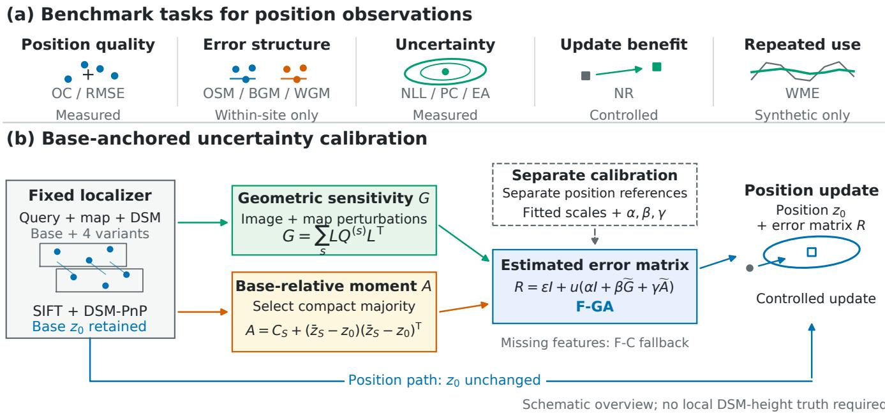  
Fig. 1. Benchmark and method overview; all small plots are schematic. (a) Five tasks characterize position observations and their use. (b) Geometric sensitivit G and base-relative moment A predict error matrix R while preserving position z0. Solid arrows carry inference data; the dashed arrow supplies parameters estimated from separate calibration data and fixed during evaluation. Task labels indicate which tasks are evaluated on real data. F-C is the constant full-matrix baseline; F-GA combines geometry and anchoring. Real-data evaluation excludes temporal accumulation and cross-frame group moments.

Uncertainty-aware pose estimation incorporates image and three-dimensional feature uncertainty into residual covariances used for pose estimation and refinement [1]. Local leastsquares covariance estimates depend on the measurement model and Jacobian rank [10]. We construct geometric sensitivities whose scales are calibrated from position references. Post-hoc regression calibration includes fixed-mean scale adjustment [2] and multivariate covariance calibration [3]. Building on these methods, we test whether geometry and configuration features improve on constant isotropic and full-matrix baselines, and whether those gains improve position updates.

RIC-Loc combines reference-induced pose dispersion with propagated geometric covariance for failure ranking and uses robust consensus to estimate position [11]. We instead estimate the error moment of an unchanged base observation. Robust location and scatter estimation [12], including Minimum-Diameter Averaging’s fixed-size subset selection [13], provide established tools for summarizing hypotheses. We use that selection objective to construct a base-relative feature; its gradient-aggregation guarantees do not extend to this localization setting.

The benchmark organizes RMSE, moment and coverage diagnostics, together with logarithmic scoring [14], around observation availability and downstream use. Availability accounts for failures; coverage, area and direction assess the reported density; update and temporal tasks reveal consequences hidden by aggregate position error. Together these tasks distinguish uncertainty calibration, position accuracy and navigation performance.

## III. BENCHMARK DEFINITION

The benchmark evaluates position observations through five questions: availability and accuracy, error structure across groups, uncertainty calibration, the effect of a controlled update, and error accumulation over time. Controlled counterexamples in Fig. 2 illustrate why these properties can differ despite identical aggregate position error. Tasks and metrics are specified before comparing methods; Table I lists the abbreviations. The evaluation set contains N predefined query conditions, termed opportunities. Each completed attempt is classified as successful, failed or rejected; unknown outcomes and unexecuted cases are recorded separately. A successful output is a finite position. Each comparison specifies the grouping, calibration/evaluation split, method versions, computational budget, reference positions and covariance source (native, post-hoc or synthetic). Calibration and evaluation sets are disjoint at the query level, with related observations of each query assigned to the same set. Observations used during method development are identified separately. Comparisons of uncertainty models hold the position estimator and its computational budget fixed.

## A. Availability and Position Agreement

Availability complements position accuracy: small errors on successful queries alone do not describe performance on difficult queries that fail. A prediction $z _ { i }$ and reference $p _ { i } ^ { \mathrm { r e f } }$ represent the same physical point in compatible metric coordinates, distinguishing camera centers from ground query centers. Dataset-local horizontal X, Y axes retain their local designation unless a transformation to east/north or ENU is verified. Define

$$
d _ { i } = z _ { i } - p _ { i } ^ { \mathrm { r e f } } , \qquad a _ { i } = \lVert d _ { i } \rVert .\tag{1}
$$

Disjoint windows; WME in $m ^ { 2 } .$

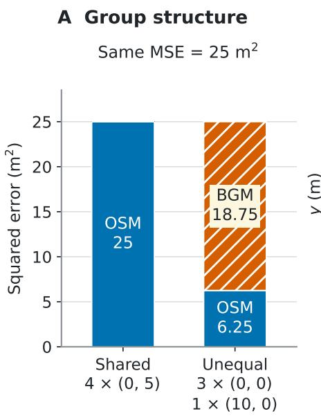

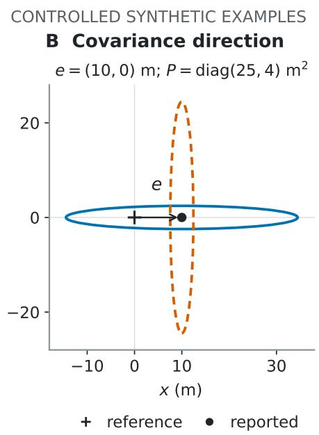

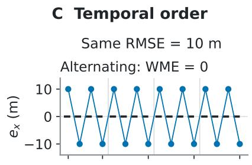

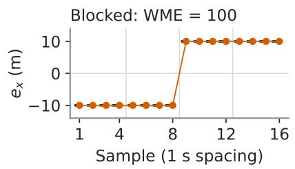

$$
m ^ { 2 } .
$$

Fig. 2. Synthetic counterexamples with known reference positions. (a) Equal sample count and MSE, different group structure; each observation is a group. (b) Fixed residual, prior and ellipse area, different update error after rotating the ellipse. (c) Reordering the same errors preserves single-frame RMSE but changes window-mean error.  
TABLE I  
METRIC GLOSSARY. UNITS REFER TO PER-OBSERVATION VALUES OR THE STATED AGGREGATE. MV AND SM ARE VECTOR AND MATRIX DIAGNOSTICS, NOT SCALAR RANKINGS. THE FIVE BENCHMARK TASKS SPECIFY EVALUATION SAMPLES, FAILURE TREATMENT AND AGGREGATION.
<table><tr><td>Labels</td><td>Meaning</td><td>Unit</td></tr><tr><td>EC, OC, CA</td><td>Execution coverage, output coverage, conditional availability</td><td>1</td></tr><tr><td>MD, MedD, P95</td><td>Mean, median, and 95th-percentile distance</td><td>m</td></tr><tr><td>TRt, A5, L1000</td><td>Tail rate, 5 m reference-agreement rate, capped mean loss</td><td>1, 1, m</td></tr><tr><td>MSE, RMSE</td><td>Mean squared error and its square root</td><td> ${ \mathrm { m } } ^ { 2 } ,$  m</td></tr><tr><td>OSM, BGM, WGM</td><td>Overall squared mean, between-group and within-group moments</td><td> $\mathrm { m ^ { 2 } }$ </td></tr><tr><td>RMSEµ, RMSEmac</td><td>Micro and macro RMSE</td><td>m</td></tr><tr><td>MV, SM</td><td>Mean residual vector, residual second-moment matrix</td><td> $\mathrm { m } , \mathrm { m } ^ { 2 }$ </td></tr><tr><td>Q, NLL</td><td>Squared normalized residual, negative log-likelihood</td><td>1, nat</td></tr><tr><td> $\mathrm { P C } _ { \alpha } , \mathrm { E A } _ { \alpha } , \mathrm { D R } _ { v }$ </td><td>Predictive coverage, ellipse area, directional ratio</td><td> $1 , \mathrm { m } ^ { 2 } , 1$ </td></tr><tr><td> $\mathrm { U R } ( P ) , \mathrm { N R } ( P )$ </td><td>Update risk and normalized update risk</td><td> $\mathrm { m } ^ { 2 } ,$  1</td></tr><tr><td> $\mathrm { W M E } ( T ) , \mathrm { E L } _ { t } , \mathrm { E C n t } _ { t }$ </td><td>Window-mean squared error, error-event length and count</td><td> ${ \mathrm { m } } ^ { 2 } ,$  sample, count</td></tr></table>

If reference error is $u _ { i } = p _ { i } ^ { \mathrm { r e f } } - p _ { i } ^ { \mathrm { t r u e } }$ , then $d _ { i } = e _ { i } - u _ { i }$ , where $e _ { i }$ is true position error. Thus reference agreement does not certify accuracy relative to the true position, particularly when reference uncertainty is unquantified.

For $N _ { \mathrm { e x e c } }$ terminal entries and $N _ { \mathrm { o u t } }$ outputs, $\begin{array} { r l } { \operatorname { E C } } & { { } = } \end{array}$ $N _ { \mathrm { e x e c } } / N , \mathrm { O C } = N _ { \mathrm { o u t } } / N$ , and $\mathrm { C A } = N _ { \mathrm { o u t } } / N _ { \mathrm { e x e c } } .$ Distance summaries use only the compatible finite-output set V, of size n: MD, MedD, P95, RMSE, and $\begin{array} { r } { \mathrm { T R } _ { t } = n ^ { - 1 } \sum _ { \nu } { \bf 1 } \{ a _ { i } > t \} } \end{array}$ The fixed opportunity-level scores retain missing-output penalties:

$$
A _ { 5 } = \frac { \sum _ { i } { \bf 1 } \{ i \in \mathcal { V } , \ a _ { i } \leq 5 \mathrm { m } \} } { N } , \qquad L _ { 1 0 0 0 } = \frac { 1 } { N } \sum _ { i } \ell _ { i } ,\tag{2}
$$

where $\ell _ { i } = \operatorname* { m i n } ( a _ { i } , 1 0 0 0 \mathrm { m } )$ for an output and 1000 m for an explicit failure or rejection. These scores require complete execution and compatible references, not an assumption that unknown entries failed. A fully executed all-failure method therefore has $A _ { 5 } = 0$ and $L _ { 1 0 0 0 } = 1 0 0 0 \mathrm { m } .$ , while its conditional distance summaries are undefined, as are summaries on any empty evaluation subset. The thresholds are descriptive conventions, not safety limits.

## B. Grouped Error Structure

A repeatable offset requires different treatment from scattered errors of the same average size. Groups, such as flights or map conditions, are specified before scoring. For each nonempty group, let $b _ { g }$ be its mean residual, $S _ { g } \ = \ $

$$
\underbrace { \frac { n _ { g } ^ { - 1 } \sum _ { i \in g } ( d _ { i } - b _ { g } ) ( d _ { i } - b _ { g } ) ^ { \top } } { \mathrm { T h e n } } } _ { \mathrm { M S E } } , \ \overbrace { { \mathrm { o s y } } } ^ { = \lfloor d _ { i } - b _ { g } ) ( d _ { i } - b _ { g } ) ^ { \top } , \ w _ { g } = n _ { g } / n , \mathrm { a n d } \ b = \sum _ { g } w _ { g } b _ { g } } .
$$

Opposite offsets can cancel in the mean vector, but not in squared error. The main pooled summaries are microweighted: $\begin{array} { r } { \mathrm { R M S E } _ { \mu } = \sqrt { \sum _ { g } w _ { g } \mathrm { M S E } _ { g } } } \end{array}$ . The companion macro summary is $\begin{array} { r } { \mathrm { R M S E } _ { \mathrm { m a c } } = \sqrt { G ^ { - 1 } \sum _ { g } \mathrm { M S E } _ { g } } } \end{array}$ over G nonempty groups, not the mean of group RMSEs. Empty groups are reported separately. MV is b and SM is $n ^ { - 1 } \dot { \sum _ { \nu } { d _ { i } d _ { i } ^ { \dagger } } }$ . This exact decomposition describes statistical structure, not its physical cause. Combining mean vectors across local frames requires a verified common orientation. Otherwise, moments are reported separately for each frame, and only rotationinvariant scalar quantities are aggregated.

## C. Predictive Uncertainty

An uncertainty region should balance coverage and size. This task evaluates a symmetric positive-definite $2 \times 2$ Gaussian error matrix $\widehat { R } _ { i }$ around the reported position, rather than a scalar matching score. It is the covariance parameter of the reported zero-mean Gaussian error density, not necessarily the centered covariance of the actual errors. Fixed-center likelihood fitting targets an error second moment (Section IV); it does not by itself imply nominal chi-square coverage. We evaluate coverage empirically on reference residuals. For the $n _ { R }$ outputs with valid covariance estimates, define

$$
\begin{array} { r } { q _ { i } = d _ { i } ^ { \mathsf { T } } \widehat { R } _ { i } ^ { - 1 } d _ { i } , \quad \mathrm { N L L } _ { i } = \frac { 1 } { 2 } \left[ q _ { i } + \log \operatorname* { d e t } \widehat { R } _ { i } + 2 \log ( 2 \pi ) \right] . } \end{array}\tag{4}
$$

NLL evaluates the stated Gaussian density, including both scale and orientation relative to the residual. With $c _ { \alpha } = \chi _ { 2 } ^ { 2 } ( \alpha )$

$$
\begin{array} { r l } & { \mathrm { P C } _ { \alpha } = n _ { R } ^ { - 1 } \displaystyle \sum _ { i } \mathbf { 1 } \{ q _ { i } \leq c _ { \alpha } \} , } \\ & { \mathrm { E A } _ { \alpha , i } = \pi c _ { \alpha } \sqrt { \operatorname* { d e t } \widehat { R } _ { i } } , \quad \mathrm { D R } _ { v , i } = \frac { ( v ^ { \mathsf { T } } d _ { i } ) ^ { 2 } } { v ^ { \mathsf { T } } \widehat { R } _ { i } v } . } \end{array}\tag{5}
$$

Here v is a predeclared unit direction. Coverage is checked at $\alpha \in \{ 0 . 5 0 , 0 . 9 0 , 0 . 9 5 \}$ against its nominal probability, not against one. Ellipse areas quantify region size; directional ratios help identify anisotropic mismatch. Nominal Gaussian interpretation requires a suitable centered error model and reference. Unless otherwise stated, Q, NLL, EA and DR are arithmetic means over outputs for which the metric is defined; their sample counts accompany the availability scores.

## D. Controlled Position Update

The same position can help or harm an update depending on the weight it is given. The prior covariance P is fixed before evaluation. An artificial prior error ξ has zero mean and covariance $P ,$ independently of the observation error and its reported covariance. For $K _ { i } = P ( P + \widehat { R } _ { i } ) ^ { - 1 }$ , the updated error is $( I - K _ { i } ) \xi + K _ { i } e _ { i } .$ , giving

$$
\begin{array} { l } { { \displaystyle U _ { i } ( P ) = \mathrm { t r } [ ( I - K _ { i } ) P ( I - K _ { i } ) ^ { \mathsf { T } } ] + \| K _ { i } e _ { i } \| ^ { 2 } , } } \\ { { \displaystyle \mathrm { U R } ( P ) = N ^ { - 1 } \sum _ { i } U _ { i } ( P ) , \qquad \mathrm { N R } ( P ) = \frac { \mathrm { U R } ( P ) } { \mathrm { t r } P } . } } \end{array}\tag{6}
$$

An explicit failure or rejection sets $K _ { i } ~ = ~ 0$ , so rejecting every opportunity gives ${ \mathrm { N R } } = \ 1$ . NR below one indicates lower expected squared error in this controlled update, not a validated navigation benefit. Substituting $d _ { i }$ for $e _ { i }$ yields a reference-based proxy. The overall score requires a defined risk for every evaluation case: unknown states, incompatible references, or invalid covariances on successful outputs make it unavailable. Rejections remain distinct from these unscorable cases. All comparisons use the same prior and coordinate convention; success-only risk is reported as conditional.

For location g with $N _ { g }$ qualified opportunities, define $\begin{array} { r } { \mathrm { U R } _ { g } \ : = \ : N _ { g } ^ { - 1 } \sum _ { i \in g } U _ { i } } \end{array}$ and $\mathrm { N R } _ { g } = \mathrm { U R } _ { g } / \mathrm { t r } P$ . The equallocation score is

$$
\mathrm { N R } _ { \mathrm { m a c } } ( P ) = \frac { 1 } { G _ { \mathrm { l o c } } } \sum _ { g } \mathrm { N R } _ { g } ( P ) .\tag{7}
$$

Here $G _ { \mathrm { l o c } }$ counts locations; each retains failures with risk one. This average weights each represented location equally, regardless of query frequency. It describes the sampled locations rather than a broader geographic population. Equation (6) instead weights by $N _ { g } / N$ . For an output-only score si (NLL, coverage indicator, or area), its macro summary is $\begin{array} { r } { G _ { \mathrm { l o c } } ^ { - 1 } \sum _ { g } n _ { g } ^ { - 1 } \sum _ { i \in \mathcal { V } _ { q } } ^ { - } s _ { i } . } \end{array}$ , where $n _ { g } = | \nu _ { g } |$ . A location without outputs makes this summary unavailable. The results and comparison criteria use these equal-location averages. Unless otherwise stated, NR, NLL, PC and EA denote the macro quantities.

## E. Temporal Accumulation

Repeated independent errors can average down; a persistent offset may not. For observations with verified temporal order and equal spacing, we define nonoverlapping within-flight windows W of m samples and duration $T = m \Delta t { : }$

$$
\operatorname { W M E } ( T ) = \operatorname* { m e a n } _ { W } \left\| \frac { 1 } { m } \sum _ { i \in W } e _ { i } \right\| ^ { 2 } .\tag{8}
$$

WME distinguishes alternating from persistent errors even when their marginal distance distributions coincide. $\mathrm { E L } _ { t }$ records each maximal above-threshold run length, and $\mathrm { E C n t } _ { t }$ counts those runs. Thresholds and windows are fixed in advance. Runs stop at gaps and flight boundaries. Incomplete windows are counted but excluded from the metric, without interpolation or concatenation. Reference residuals yield a proxy for the corresponding true-error metric. The empirical study uses unordered local localization tests, which support neither temporal evaluation nor global map retrieval.

## IV. BASE-ANCHORED UNCERTAINTY CALIBRATION

## A. Estimation Target

The method estimates horizontal position uncertainty while keeping the correspondences, DSM, position estimates and output availability unchanged. Its effect is on observation weighting rather than localization accuracy.

Geometric sensitivity is computed from image and map perturbations, and reference positions in the calibration set determine its scale without local DSM-height ground truth. Uncertainty around the fixed reported position must account for both dispersion and persistent bias. We therefore target the error second moment rather than only the centered covariance. For a fixed reported position, the Gaussian NLL optimum is the conditional second moment when that moment is positive definite:

$$
R _ { * } ( x ) = \mathbb { E } [ e e ^ { \mathsf { T } } \mid x ] = { \mathrm { C o v } } ( e \mid x ) + b ( x ) b ( x ) ^ { \mathsf { T } } .\tag{9}
$$

Here x denotes available uncertainty features and $b ( x ) \ =$ $\mathbb { E } [ e \mid x ]$ . This second moment includes persistent bias, whereas the centered covariance describes dispersion around the mean error. They coincide when $b ( x ) = 0 .$ . We approximate the second moment with a nonnegative model fitted by equallocation-weighted likelihood; this restricted model need not attain the unrestricted optimum. Thus, the predicted Gaussian error matrix differs in general from the centered covariance $\operatorname { C o v } ( e ~ \mid ~ x )$ . Calibration and evaluation use the reference residual $d _ { i }$ in place of unavailable true error $_ { e _ { i } ; }$ coefficients are not physical DSM variances. The configuration moment $A$ serves as a predictor feature for the fitted error matrix.

In the model names, F denotes calibration on separate reference data; G denotes geometry, D all-member centered scatter, S selected-subset centered scatter, and A the baseanchored moment. Iso denotes an isotropic variant; F-C is the constant full-matrix baseline.

## B. Label-Free Geometric Sensitivity

For each successful pose, we stack the projection Jacobians of its RANSAC inliers into J, with camera-center increments in metres followed by three rotation increments in radians. With horizontal selector $H = \left[ I _ { 2 } \mathrm { ~ } 0 \right]$ , the first-order sensitivity is $L = H J ^ { \dagger }$ . Jacobian columns are normalized for the rank test over all six pose dimensions; physical units are then restored in the pseudoinverse.

Three independent, per-point unit perturbations define residual covariance shapes $Q ^ { ( s ) } { \mathrm { ; } }$ : one query-pixel squared per image axis, one map-pixel squared per map axis, and one metre squared in height. The map-pixel lift follows the local surface, including horizontal–height cross terms. Their horizontal position sensitivity matrix is

$$
G = \sum _ { s \in \{ \mathrm { q u e r y } , \mathrm { m a p } , \mathrm { h e i g h t } \} } L Q ^ { ( s ) } L ^ { \mathsf { T } } .\tag{10}
$$

The unit amplitudes fix the relative contribution of these three sensitivities; one fitted coefficient does not identify their separate physical scales. DSM finite differences describe a continuous local surface approximation, not the exact derivative of the integer-pixel sampling operation. This linearization excludes selection uncertainty, cross-point map correlation and distant alternative poses. Nonfinite surface slopes or unresolved rank prevent this calculation, in which case the model uses the fallback below.

## C. Configuration Disagreement

The base localizer uses SIFT with at most 8192 features, a 0.80 ratio test, and DSM-backed SQPnP RANSAC (4 pixels, 200 iterations, confidence 0.999). At least 12 finite correspondences and eight inliers are required; rejected or failed solves are included as cases without a position estimate. Four further configurations independently change the ratio to 0.75 or 0.85, halve the feature budget, or inset the map by 10%. All use the same inputs. For $m _ { i } \geq 3$ successful configurations, including the base, their centered scatter is

$$
D _ { i } = m _ { i } ^ { - 1 } \sum _ { j } ( z _ { i j } - \bar { z } _ { i } ) ( z _ { i j } - \bar { z } _ { i } ) ^ { \mathsf { T } } .\tag{11}
$$

This is sensitivity to selected configurations, not an ensemble of independent measurements, since all configurations may share an error. Computing this feature requires four additional localizer runs, unlike the constant baselines.

## D. A Moment Anchored to the Reported Position

Configuration spread need not reflect the error of the reported position. A single inconsistent variant can make $D _ { i }$ large while the base is accurate. Conversely, removing that variant without accounting for the base can obscure its displacement from the consistent group.

We therefore retain the base $z _ { i 0 }$ and use a base-relative moment feature. For $m _ { i } \geq 3$ successful configurations, we set $k _ { i } = \lfloor m _ { i } / 2 \rfloor + 1$ and select the $k _ { i }$ -member subset $S _ { i }$ with minimum maximum pairwise Euclidean distance. Exact ties are resolved lexicographically by configuration name. This selection objective is the same as in Minimum-Diameter Averaging [13]. We use the selected members to form a moment around the unchanged base:

$$
\begin{array} { r } { A _ { i } = k _ { i } ^ { - 1 } \displaystyle \sum _ { j \in S _ { i } } ( z _ { i j } - z _ { i 0 } ) ( z _ { i j } - z _ { i 0 } ) ^ { \mathsf { T } } } \\ { = C _ { S _ { i } } + ( \bar { z } _ { S _ { i } } - z _ { i 0 } ) ( \bar { z } _ { S _ { i } } - z _ { i 0 } ) ^ { \mathsf { T } } , } \end{array}\tag{12}
$$

where $C _ { S _ { i } }$ is the subset’s centered scatter with divisor $k _ { i } .$ The second term preserves disagreement with an isolated base. The resulting $A _ { i }$ describes configuration displacements; the subsequent calibration maps this feature to a predicted base error moment within a restricted model family.

The base-anchored model, F-GA, replaces $D _ { i }$ by $A _ { i }$ in Eq. (14), retaining the same $G _ { i } ,$ base, inputs and solver budget. F-A omits geometry. F-GS uses $C _ { S _ { i } }$ , and F-GA-all instead uses the all-member moment around the base; each is fitted independently on the same calibration samples. These comparisons separate subset selection from anchoring. F-GA-Iso preserves the trace of F-GA without refitting.

A majority of successful configurations may still be inaccurate. Such a majority can downweight an accurate base; a common displacement of all members leaves every relative feature unchanged. Zero scatter can therefore coexist with nonzero error. Although the common term and geometry supply additional information, these failure modes remain possible. When fewer than three configurations succeed, the method uses the F-C fallback. Equivariance tests cover similarity-coordinate transformations; general affine equivariance remains unverified.

Figure 3 illustrates the three configuration statistics on synthetic positions with common metre-scale axes: inconsistent variants, an isolated base and a displacement shared by all configurations. The matrices describe raw configuration dispersion rather than calibrated error covariances.

## E. Calibration Models and Baselines

Let w give every nonempty fitting location equal total weight, with $\textstyle \sum _ { i } w _ { i } = 1$ . The floor-regularized isotropic (F-I) and full-matrix (F-C) controls are

$$
R _ { \mathrm { I } } = \epsilon I _ { 2 } + \frac { 1 } { 2 } \sum _ { i } w _ { i } \| d _ { i } \| ^ { 2 } I _ { 2 } , \quad R _ { \mathrm { C } } = \epsilon I _ { 2 } + \sum _ { i } w _ { i } d _ { i } d _ { i } ^ { \mathsf { T } } .\tag{13}
$$

For a configuration feature $V _ { i } ,$ , the combined model predicts

$$
R _ { i } = \epsilon I _ { 2 } + u ( \alpha I _ { 2 } + \beta \widetilde { G } _ { i } + \gamma \widetilde { V } _ { i } ) , \qquad \alpha , \beta , \gamma \geq 0 ,\tag{14}
$$

where $\epsilon ~ = ~ 1 0 ^ { - 6 } ~ \mathrm { m ^ { 2 } }$ is the regularization floor and u is half the mean squared reference error in the calibration set, bounded below by that floor. Each feature matrix is normalized by half its mean trace on the same set; these normalization factors remain fixed during evaluation. Coefficients minimize group-weighted Gaussian NLL using deterministic multi-start L-BFGS-B, at most 500 iterations per start. F-GA uses $V = A ;$ F-GD uses $V = D$ . F-G, F-D and F-A each have two coefficients and three starts; joint models have three coefficients and four starts. This is a fixed per-start budget, not equal total fitting cost. F-C also has three fitted matrix entries. Section IV-F gives the fitted parameters and convergence results. All parameters are estimated on the calibration set.

F-I and F-C use all 262 successful calibration samples; Config and Config-T use the 260 with valid disagreement. All component and joint models use exactly the same 248 calibration samples with complete features. Iso controls replace a valid joint matrix by half its trace times $I _ { 2 } ,$ , without refitting; this tests overall directional shape, not off-diagonal correlation alone. Missing required shapes invoke the same fixed F-C fallback, including for the isotropic variants. The results include fallback counts. Because F-C and the feature models use different calibration samples, their contrast compares complete calibration procedures, not an isolated feature ablation. Component comparisons on the same 248 samples and the H-Q control address the narrower question of feature contribution.

Two additional baselines calibrate configuration scatter directly. Config fits $a + b { \sqrt { \operatorname { t r } D _ { i } } }$ to error radius by weighted least squares and squares the predicted radius, floored at $\bar { 1 } 0 ^ { - 3 }$ m, to obtain isotropic variance. Config-T multiplies that matrix by the Gaussian-likelihood temperature $\begin{array} { r } { t = \sum _ { i } w _ { i } d _ { i } ^ { \top } R _ { i } ^ { - 1 } d _ { i } / 2 } \end{array}$ estimated on the calibration set. This temperature rescales the covariance while preserving the position and matrix shape. The formulation draws on uncertainty-aware geometric estimation [1], multivariate covariance recalibration [3], and fixedmean scalar recalibration [2]. The nonnegative additive feature combination in Eq. (14) is the restricted model family used in this study. Its distinctive element is the base-relative feature and its combination with matching/map sensitivity, evaluated through both predictive quality and controlled position updates.

## F. Fitted Parameters

Table II reports the parameters used in evaluation. All seven feature-based models use the same 248 samples with complete features at 24 equally weighted locations. In Eq. (14), the common constants are $\epsilon \ : = \ : 1 0 ^ { - 6 } \mathrm { m } ^ { 2 } , u \ : = \ : 1 . 1 \bar { 4 } 8 2 2 8 2 7 \mathrm { m } ^ { 2 }$ and $s _ { G } = 2 . 0 6 9 5 0 1 7 6 \mathrm { m } ^ { 2 }$ . Other mean-half-trace divisors are $s _ { D } = 4 . 1 2 2 9 8 3 4 0 , s _ { A } = 0 . 8 9 3 0 8 5 3 0 3$ , $s _ { S } = 0 . 3 1 4 1 3 6 1 2 5$ and $s _ { A _ { \mathrm { a l l } } } = 4 . 5 9 8 8 4 8 6 7$ , all in $\mathrm { m } ^ { 2 } ; S$ denotes the selectedsubset centered scatter. Coefficients are dimensionless.

The two constant baselines use all 262 successful calibration samples, giving

$$
\begin{array} { r l } { R _ { \mathrm { I } } = 1 . 1 5 0 8 7 1 9 3 7 I _ { 2 } , } \\ { R _ { \mathrm { C } } = \left[ { \begin{array} { c c } { 1 . 5 9 2 2 1 6 5 5 0 } & { - 0 . 2 8 2 2 4 4 9 4 0 } \\ { - 0 . 2 8 2 2 4 4 9 4 0 } & { 0 . 7 0 9 5 2 7 3 2 4 } \end{array} } \right] } & { { } ( \mathrm { m } ^ { 2 } ) . } \end{array}\tag{15}
$$

These matrices already include the floor. Config uses 260 disagreement-valid records and the radius map $0 . 2 3 2 0 3 8 4 2 0 \mathrm { m } + 0 . 4 4 9 1 7 0 1 3 8 \sqrt { \mathrm { t r } D } ;$ Config-T multiplies its squared-radius matrix by 0.651679894. All fallbacks use the same $R _ { \mathrm { C } } ,$ , including the isotropic variants. Numerical convergence alone guarantees neither a global optimum nor generalization.

## V. EXPERIMENTAL PROTOCOL

Table III distinguishes method development, the main eval uation and subsequent exploratory analyses. OOF denotes outof-fold predictions. The base-anchored model and its primary comparisons were specified before the evaluation labels were accessed. Subsequent analyses reuse these data and are therefore exploratory.

## A. Data and References

The experiment uses the OrthoLoC release’s R conditions, whose maps derive from acquisition-image reconstruction [8]. Inference reads only the query image, paired map image, DSM XYZ raster, metric pixel scale and intrinsics. It excludes reference extrinsics, pose-derived point maps and meshes. The released world-to-camera transform defines a reference camera center $- R ^ { \mathsf { T } } t ;$ its horizontal coordinates are dataset-local metric XY, not geodetic ENU. Unknown reference uncertainty limits physical accuracy claims.

Figure 4 shows actual inputs and reported regions: their centers stay fixed, while uncertainty changes.

Calibration uses 300 development queries from 24 locations in the official training split, including reruns of queries that had previously failed. An initial evaluation uses all 258 R conditions at validation locations L27–L49, which are absent from the calibration set. Its outcome motivates the anchored feature, so these 258 conditions are development evidence for that feature, not its confirmation set.

The main evaluation uses the same calibration set and two predefined query sets: all remaining official validation R conditions, and all official test inPlace R conditions. Required inputs are available for 728 of 772 validation conditions at 24 locations. The remaining 44 L06 records lack metric scale and are excluded before localization rather than counted as localization failures. All 142 inPlace conditions at L01, L02 and L15 have the required inputs. Every included location is represented in the calibration set. Validation and inPlace results are reported separately; they are query-held-out, not unseenlocation tests. Exact hashes of query arrays across all 8614 R records identified no duplicate queries within the evaluation sets or between these sets and previously used queries. Nearduplicate views and shared maps remain possible. Predictions from all 13 models were fixed for both sets before their reference labels were accessed.

Synthetic illustration; not measured  
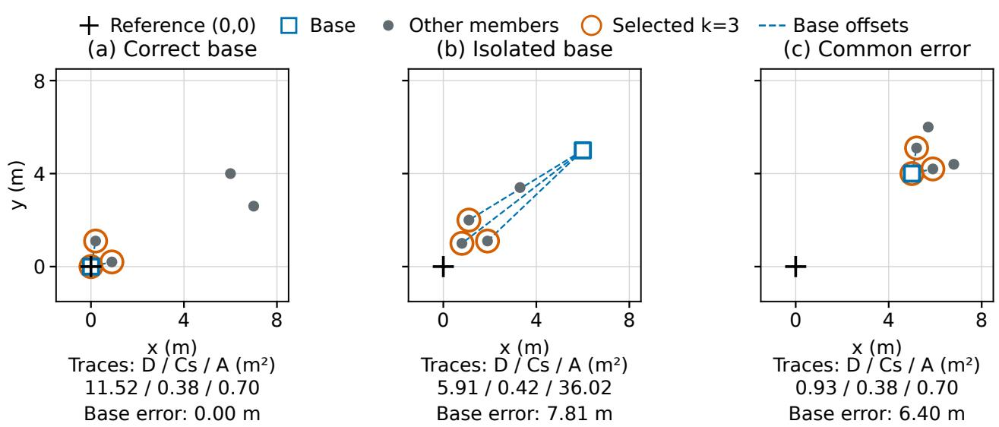  
Fig. 3. Synthetic operator examples on identical metre-scale axes. Cross: reference (0, 0); square: fixed base; rings: minimum-diameter subset (k = 3); dashed segments: base-relative offsets. Traces of all-member scatter D, subset scatter C (Cs), and anchored moment A are computed from the displayed configurations. (a) Deviating variants inflate D. (b) A retains an isolated base’s offset from a compact subset. (c) Shared displacement remains invisible. Matrices describe raw configuration dispersion rather than calibrated error covariances. The reference is shown for interpretation and is excluded from subset selection and scatter calculations.

TABLE II  
FITTED MODEL COEFFICIENTS AND CONVERGENCE. ALL 25 STARTS CONVERGED WITHIN THE 500-ITERATION LIMIT; THE SOLUTION WITH THE LOWEST CALIBRATION OBJECTIVE WAS RETAINED. VALUES ARE ROUNDED FOR DISPLAY.
<table><tr><td>Model</td><td>V</td><td>α</td><td>β</td><td>γ</td><td>Converged/starts</td><td>Iteration range</td></tr><tr><td>F-G</td><td></td><td>0</td><td>2.252799</td><td></td><td>3/3</td><td>7-11</td></tr><tr><td>F-D</td><td>D</td><td>0.018637</td><td></td><td>11.790664</td><td>3/3</td><td>15-20</td></tr><tr><td>F-A</td><td>A</td><td>0.025794</td><td></td><td>3.250298</td><td>3/3</td><td>14-17</td></tr><tr><td>F-GD</td><td>D</td><td>0.008367</td><td>0.289716</td><td>5.900141</td><td>4/4</td><td>22-33</td></tr><tr><td>F-GA</td><td>A</td><td>0.013870</td><td>0.203725</td><td>2.403562</td><td>4/4</td><td>21-26</td></tr><tr><td>F-GS</td><td>S</td><td>0.006267</td><td>0.442200</td><td>2.484152</td><td>4/4</td><td>19-26</td></tr><tr><td>F-GA-all</td><td> $A _ { \mathrm { a l l } }$ </td><td>0.008668</td><td>0.237032</td><td>4.566602</td><td>4/4</td><td>22-25</td></tr></table>

TABLE III

EXPERIMENT STAGES AND EVALUATION DATA. COUNTS DENOTE OPPORTUNITIES UNLESS EXPLICITLY MARKED AS OUTPUTS. LATER EXPLORATORY STUDIES REUSE THE EARLIER DATA.
<table><tr><td>Study</td><td>Calibration data</td><td>Evaluation data</td><td>Interpretation</td></tr><tr><td>Ranking diagnostic</td><td>246 outputs, 3 locations</td><td>247 outputs, same 3 locations</td><td>Within-location development analysis; overall update risk unavailable</td></tr><tr><td>Method development</td><td>300 opportunities, 24 locations</td><td>258 opportunities, disjoint lo- cations</td><td>F-GD failure analysis motivating an- choring</td></tr><tr><td>Main comparison</td><td>Original 300; 248 complete- feature outputs</td><td>728 validation and 142 inPlace; 24 and 3 represented locations</td><td>Held-out queries; thirteen models fixed before reference labels were ac-</td></tr><tr><td>Base-quality control</td><td>Original 248 complete-feature</td><td>Same 728/142, previously eval-</td><td>cessed Exploratory H-Q comparison with no</td></tr><tr><td>Conditional addition</td><td>outputs Nested location holdout over orig- inal 300; calibration-only fitting</td><td>uated 300 source OOF plus previ- ously evaluated 728/142</td><td>extra localizer runs Exploratory H-QA/H-QI comparison within the same domain</td></tr></table>

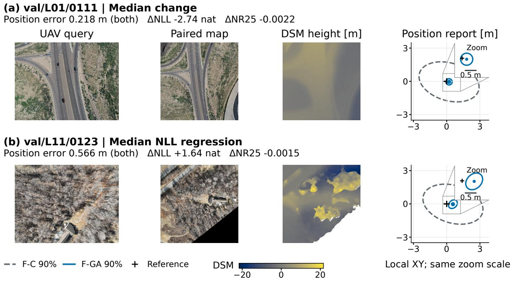  
Fig. 4. Real inputs and the uncertainty attached to an unchanged position. Rows show the cases with median F-GA-minus-F-C NLL change among all 629 validation outputs and among the 33 cases with increased NLL, respectively; ties are resolved by query ID. Query images, paired maps and DSM heights are from OrthoLoC. Heights share a color scale and represent the surface, not DSM error; blank map areas are retained. The right column shows dataset-local XY coordinates relative to the reference position. The dot is the shared prediction; both 90% regions share this center. Linked insets share limits and a 0.5 m scale bar. Tighter regions contain the reference in (a) but miss it in (b), despite lower NR25 in both. The examples illustrate individual outcomes alongside the complete-cohort results.

All experiments use paired local map crops from one mapproduction domain. The related xDOP/xDOPDSM conditions use external maps[8] and are excluded from both evaluation and auxiliary inputs. The shared reconstruction of query imagery and maps in R may simplify localization. Robustness to arbitrary DSM bias remains untested.

All experiments use the raster’s stored metric XYZ coordinates and per-file XY offset.

## B. Comparison Criteria

All covariance models use identical positions, inliers, success/failure states and random seeds. The code and runtime environment are fixed. Each worker uses one OpenCV thread with OpenCL disabled, and each query uses the same random seed in serial and parallel execution. Coefficients, fallbacks and models use only calibration data.

The prespecified criteria combine an equal-location NLL improvement of at least 0.05 nat over F-C with no increase in overall NR at $P = 2 5 I _ { 2 } \ \mathrm { m } ^ { 2 }$ , and lower NLL than both singlecomponent models on queries with complete features for all compared models. For F-GA, two additional comparisons require NR25 no greater than F-GD or F-GA-all on the validation set. F-GS isolates anchoring; the Iso control tests directional information separately. F-GA was specified before evaluation, and the baselines were reused without refitting. Secondary priors and ablations assess how the results vary beyond the primary comparisons.

We report each location and equal-location aggregates, retaining explicit failures with prior-only update risk. The covariance models share identical position statistics. PC is checked at 50%, 90% and 95%; update priors are $4 I _ { 2 } , 2 5 I _ { 2 }$ and 100I2 m2. We use NR25 as shorthand for $\mathrm { N R } _ { \mathrm { m a c } } ( 2 5 I _ { 2 } \mathrm { m } ^ { 2 } )$ , and analogously NR4/NR100. A paired bootstrap resamples each evaluation set’s locations 10,000 times with seed 20260930. These intervals describe variation across the sampled locations, not geographic generalization; this distinction is particularly important for the three-location inPlace set. Data splits, metrics and coefficients were held fixed for each evaluation.

## C. Numerical Verification

Figure 2 isolates group offsets, covariance and temporal ordering. The exact moment identity and independent-prior update are tested, the latter with 200,000 fixed-seed samples and 2% tolerance. The numerical checks include noncommuting matrices and all-rejection risk, as well as invalid covariances, missing references, duplicate identities and unknown states. They verify the evaluator’s calculations and handling of invalid inputs.

## VI. RESULTS

## A. Availability and Position Error

All 870 conditions with the required inputs were evaluated. Validation produces 629 positions and 99 failures; inPlace

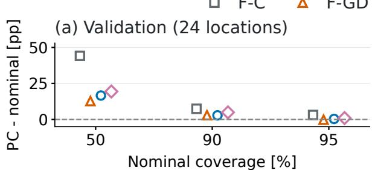

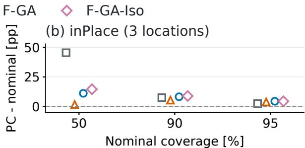

Main comparison: 13 covariance models relative to F-C  
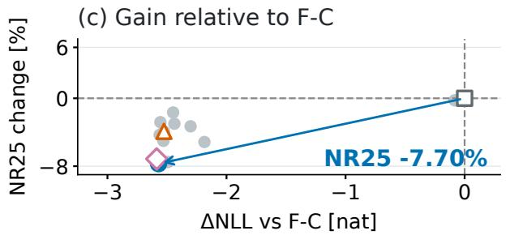

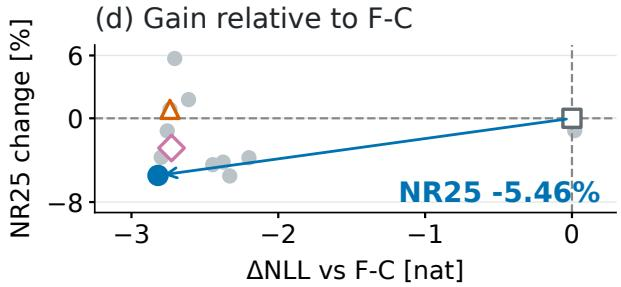

Exploratory comparison: F-GA minus H-Q  
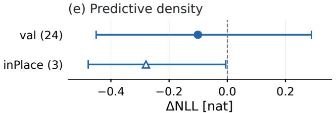

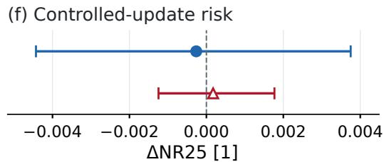  
Panels (e,f): mean + descriptive 95% paired-location interval; negative favors $\mathsf { F } \mathrm { - } \mathsf { G A }$  
Fig. 5. Calibration, controlled updates and comparison with base-only quality. (a,b) Coverage minus nominal level; zero is ideal. Markers are offset horizontally for legibility. (c,d) Thirteen covariance models relative to F-C: NLL difference and percentage NR25 change. Arrows connect F-C to F-GA; negative values on both axes indicate improvement in both metrics. (e,f) Exploratory comparisons with H-Q on the same evaluation sets: F-GA minus H-Q, with descriptive 95% paired-location bootstrap intervals (10,000 resamples, seed 20261009). Negative favors F-GA; both validation intervals cross zero and inPlace NR25 slightly favors H-Q. All panels use equal-location means: 24 validation and three inPlace locations. PC/NLL include 629/136 outputs with fallbacks; NR25 includes all 728/142 eligible queries with no-output risk one, under $P = 2 5 I _ { 2 } \ \mathrm { m ^ { 2 } }$ . Positions and states are unchanged. The intervals describe these locations rather than a broader geographic population.  
TABLE IV

EQUAL-LOCATION AVERAGES OF POSITION-ERROR MOMENTS $( \mathbf { M } ^ { 2 } )$   
AMONG SUCCESSFUL OUTPUTS. $b _ { g }$ IS THE LOCATION’S MEAN RESIDUAL AND $W _ { g } = \mathrm { m e a n } _ { i \in g } \| d _ { i } - b _ { g } \| ^ { 2 } .$ MEAN $\| b _ { g } \| ^ { 2 }$ SUMMARIZES LOCAL   
OFFSETS, NOT GLOBAL OSM. GLOBAL BGM ALSO REQUIRES A VERIFIED   
COMMON ORIENTATION ACROSS LOCATIONS. ALL THIRTEEN MODELS USE THE SAME POSITIONS.

<table><tr><td>Cohort</td><td> $\mathrm { M S E _ { m a c } }$ </td><td>Mean  $\| b _ { g } \| ^ { 2 }$ </td><td>Mean  $W _ { g }$ </td></tr><tr><td>Val</td><td>1.5649</td><td>0.0430</td><td>1.5218</td></tr><tr><td>InPlace</td><td>0.3809</td><td>0.0284</td><td>0.3525</td></tr></table>

produces 136 positions and six failures. All 13 models use these same positions and failure states. Among successful outputs, the median distances are 0.189 and 0.163 m, with micro RMSE 1.410 and 0.445 m, respectively. The maximum validation error is 24.771 m.

Table IV shows that within-location dispersion dominates the squared location mean. The data support evaluation of availability, position agreement, within-location error structure, predictive uncertainty and controlled updates. Global OSM/BGM require a verified common orientation across locations, and temporal accumulation requires ordered observations; neither is available here.

Validation failures comprise 87 cases with no PnP consensus, 11 with fewer than eight inliers, and one explicit solver exception. InPlace has three no-consensus and three insufficient-inlier failures. Each failure contributes prior-only risk to the overall score. F-GA has 585 validation outputs with complete features and 44 F-C fallbacks: 31 cases with nonfinite DSM slopes and 13 insufficient-member cases. InPlace has 132 complete outputs and four fallbacks, split three and one.

## B. Predictive Density and Region Calibration

F-GA improves validation likelihood relative to F-C, but its uncertainty regions remain imperfectly calibrated. Figure 5 shows coverage at three probability levels and changes in NLL and update risk relative to the baseline. F-C uses 262 calibration samples, whereas F-GA uses 248; this comparison therefore measures the complete calibration procedures rather than the feature effect alone. On validation, the F-GA minus F-C NLL difference is −2.5708 nat, with descriptive pairedlocation interval [−3.3259, −2.0126]; 23 locations improve and L04 regresses. Table V shows smaller 90% regions and coverage closer to nominal. At nominal 50/95%, F-GA covers 66.60/95.33%; calibration remains imperfect.

TABLE V  
COMPARISON OF THIRTEEN COVARIANCE MODELS USING EQUAL-LOCATION MEANS, IDENTICAL POSITION ESTIMATES AND IDENTICAL FAILURE STATES. NLL, PC90 AND EA90 USE SUCCESSFUL OUTPUTS; NR25 INCLUDES EVERY ELIGIBLE QUERY, WITH RISK ONE FOR MISSING OUTPUTS. BOLD CELLS MARK MINIMUM NLL/NR25 OR PC90 CLOSEST TO 0.90, BASED ON UNROUNDED VALUES. EA90 DESCRIBES REGION SIZE AND IS INTERPRETED ALONGSIDE COVERAGE. † DENOTES AN NR25 TIE AFTER ROUNDING ONLY.
<table><tr><td rowspan="2">Method</td><td colspan="4">Validation</td><td colspan="4">inPlace</td></tr><tr><td>NLL↓ (nat)</td><td>PC90 target 0.90</td><td>EA90 (m2)</td><td>NR25↓</td><td>NLL ↓ (nat)</td><td>PC90 target 0.90</td><td>EA90 (m2)</td><td>NR25↓</td></tr><tr><td colspan="9">Constant and configuration-only baselines</td></tr><tr><td>F-I</td><td>2.6583</td><td>0.9763</td><td>16.6503</td><td>0.1549</td><td>2.1439</td><td>0.9744</td><td>16.6503</td><td>0.0410</td></tr><tr><td>F-C</td><td>2.7420</td><td>0.9739</td><td>14.8253</td><td>0.1552</td><td>2.1251</td><td>0.9744</td><td>14.8253</td><td>0.0415</td></tr><tr><td>Config</td><td>0.4404</td><td>0.9549</td><td>29.8456</td><td>0.1501</td><td>-0.0748</td><td>0.9744</td><td>3.1150</td><td>0.0399</td></tr><tr><td>Config-T</td><td>0.3041</td><td>0.9131</td><td>19.5825</td><td>0.1506</td><td>-0.2508</td><td>0.9548</td><td>2.0607</td><td>0.0398</td></tr><tr><td colspan="9">Geometry and centered-disagreement controls</td></tr><tr><td>F-G</td><td>0.5566</td><td>0.9602</td><td>7.7931</td><td>0.1473</td><td>-0.2057</td><td>0.9744</td><td>2.7347</td><td>0.0392†</td></tr><tr><td>F-D</td><td>0.1866</td><td>0.9279</td><td>13.5486</td><td>0.1509</td><td>-0.5802</td><td>0.9513</td><td>1.4922</td><td>0.0439</td></tr><tr><td>F-GD</td><td>0.2167</td><td>0.9292</td><td>9.6063</td><td>0.1492</td><td>-0.6125</td><td>0.9537</td><td>2.0613</td><td>0.0418</td></tr><tr><td>F-GD-Iso</td><td>0.2938</td><td>0.9385</td><td>112.1950</td><td>0.1527</td><td>-0.4861</td><td>0.9341</td><td>7.1488</td><td>0.0422</td></tr><tr><td colspan="9">Base-anchored model and component comparisons</td></tr><tr><td>F-A</td><td>0.2504</td><td>0.9177</td><td>6.0468</td><td>0.1436</td><td>-0.6723</td><td>0.9685</td><td>1.5978</td><td>0.0399</td></tr><tr><td>F-GA (proposed)</td><td>0.1712</td><td>0.9284</td><td>7.1256</td><td>0.1433</td><td>-0.6941</td><td>0.9821</td><td>1.8579</td><td>0.0392†</td></tr><tr><td>F-GS</td><td>0.2119</td><td>0.9352</td><td>6.4426</td><td>0.1475</td><td>-0.3216</td><td>0.9453</td><td>1.1919</td><td>0.0397</td></tr><tr><td>F-GA-all</td><td>0.1807</td><td>0.9311</td><td>10.5228</td><td>0.1486</td><td>-0.6311</td><td>0.9537</td><td>2.0427</td><td>0.0410</td></tr><tr><td>F-GA-Iso</td><td>0.1557</td><td>0.9491</td><td>28.7510</td><td>0.1442</td><td>-0.6021</td><td>0.9888</td><td>8.3313</td><td>0.0403</td></tr></table>

On inPlace, F-GA also lowers NLL and reduces region area, but 90% coverage changes from 97.44% to 98.21%, farther from nominal. Density and calibration are not interchangeable. PC measures coverage of reference residuals rather than errors relative to the unknown true camera center.

## C. Component and Mechanism Comparisons

On validation queries with complete features for all compared models, F-GA has NLL −0.1329, versus 0.0895 for F-A and 0.4195 for F-G, meeting both component criteria. On all outputs, including F-C fallbacks, gains are more modest against F-A: the paired NLL difference is −0.0792 nat, with interval [−0.2547, 0.0540]. The result suggests that geometry helps on the complete-feature subset, while its contribution is less certain when fallback cases are included.

The corresponding centered-subset F-GS and all-member anchored F-GA-all scores are −0.0878 and −0.1256 on the same queries. Both controls are fitted independently with the same budget and have higher NLL point estimates. The alloutput NLL differences against F-GS, F-GA-all and F-GD have descriptive intervals that include zero. Figure 6 shows F-C and F-GD contrasts by location, alongside descriptive intervals for each evaluation set.

F-GA-Iso has lower validation NLL than F-GA (0.1557 versus 0.1712), although its mean 90% area is much larger (28.751 m2). The anisotropic model therefore offers a more compact region, but not a directional NLL advantage on the validation set. The opposite NLL ordering on inPlace indicates that this trade-off depends on the evaluation conditions.

## D. Controlled Update Performance

F-GA reduces NR25 relative to F-C by 7.70% on validation and 5.46% on inPlace, including failures. Both evaluation sets meet all six prespecified comparisons with the constant baseline, individual components and alternative configuration models; the absolute scores are shown in Table V. These controlled updates assume an independent prior; real prior– observation correlation would introduce an additional cross term.

On validation, paired-location NR25 intervals are [−0.03240, −0.00097] against F-C and [−0.01004, −0.00226] against F-GD. F-GA improves 21 of 24 locations against F-C, but L03 supplies about 81% of the net aggregate gain. Against F-GS, the interval [−0.01164, 0.00013] includes zero, leaving the incremental benefit of anchoring uncertain. InPlace intervals against F-GD, F-GS and F-GA-all also include zero. Thus, meeting the point-estimate criteria does not remove the uncertainty in several pairwise comparisons.

The relative performance also varies with the prior and location. InPlace F-G is slightly better at NR25 (0.03920), and F-GA’s NR100 (0.03437) is slightly worse than F-C’s (0.03426). On validation at $P = 4 I _ { 2 }$ , F-A and F-G are also below F-GA. Figure 7 compares all three prior settings using the same fitted models. At query level, validation L26/0068 has NR25 0.23527 under F-GA versus 0.12091 under F-GD; for L03/0056, NLL rises from 3.10 to 43.46.

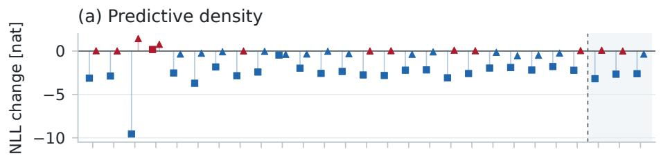

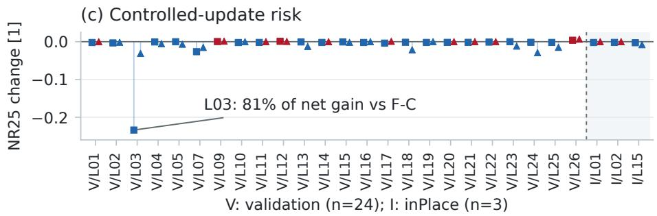

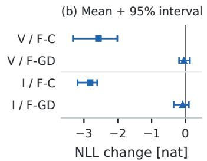

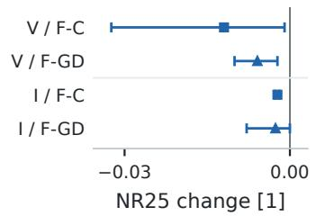  
Fig. 6. Paired location differences, F-GA minus F-C (squares) or F-GD (triangles). Blue negative values indicate improvement; red positive values indicate regression. The 27 cohort–location entries share a fixed order; dashed lines separate validation (V) and inPlace (I). Right: means and descriptive 95% pairedlocation bootstrap intervals for each cohort and comparator. Resampling is by location rather than query; inPlace has only three locations. The right panels use different x-axis limits from the left panels; scales are shared within each panel. NLL uses outputs with valid covariance estimates; NR25 uses all eligible queries (risk 1 for cases without an output). Position predictions are unchanged.

Among successful queries, the median runtimes for the base solve and the four additional variants are 1.867/6.351 s on validation and 2.162/7.228 s on inPlace, respectively. Measurements used a shared CPU environment with eight concurrent single-threaded workers for validation and two for inPlace. These offline timings do not establish real-time performance; configuration-based models incur computation that the constant baselines avoid.

## VII. EXPLORATORY CONTROL STUDIES

We compare F-GA with H-Q, a calibration model that uses base-solve cues without additional localizer runs. We also test the incremental value of the anchored feature within the H-Q model family through a conditional addition. Both studies assess whether extra configurations provide information beyond the base solve, with every position and failure state unchanged. We designed these exploratory studies after inspecting the earlier results.

## A. Base-Only Quality Calibration

H-Q uses the same 248 calibration samples with complete features at 24 locations, without running additional localizer configurations. Given the fitted F-G error matrix $R _ { G }$ , it predicts

$$
R _ { H } = \exp [ \mathrm { c l i p } ( w ^ { \mathsf { T } } \phi , - 2 0 , 2 0 ) ] R _ { G } + 1 0 ^ { - 6 } I _ { 2 } .\tag{16}
$$

The four raw cues are log $n _ { \mathrm { { i n l i e r } } } .$ , log max $( \mathrm { R M S } _ { \mathrm { r e p r o j } } , 1 0 ^ { - 6 } )$ log $\operatorname* { m a x } ( \sqrt { \operatorname* { d e t } C _ { q } } , 1 0 ^ { - 1 2 } )$ , and $\log ( s _ { \mathrm { m a x } } / s _ { \mathrm { m i n } } )$ . Here $C _ { q }$ is the population covariance of inlier coordinates transformed by $K _ { \mathrm { { c a m } } } ^ { - 1 }$ , where $K _ { \mathrm { { c a m } } }$ is the camera-intrinsic matrix, and s are the singular values of the column-normalized pose Jacobian used for geometric sensitivity. The cues describe the number of correspondences, reprojection error, spatial extent and geometric conditioning. They predict error scale empirically rather than specify a physical noise model.

The location-weighted cue means in the calibration set are (5.125256, −0.059649, −2.766093, 3.081946) and standard deviations are (0.865389, 0.160479, 0.391677, 0.366263). The feature vector ϕ contains an intercept, four standardized cues clipped to [−5, 5], and four missingvalue indicators. Missing cues are replaced by their calibration means rather than excluded. All calibration cues are observed, so the four missing-value coefficients are zero. The intercept and cue coefficients are $( - 0 . 5 8 2 9 2 5 , - 0 . 1 0 8 8 1 0 , 0 . 4 7 1 4 1 5 , - 0 . 0 0 2 8 3 2 , 0 . 0 8 5 3 2 8 )$ Performance when cues are missing has not been validated.

The objective is equal-location Gaussian NLL plus $\lambda \| w _ { \mathrm { n o n i n t e r c e p t } } \| ^ { 2 } / 2$ . Leave-one-location-out validation within the calibration set selects λ = 1 from {0, 0.01, 0.1, 1, 10}; respective mean validation NLL values are 0.704390, 0.700115, 0.673471, 0.632617 and 0.934455. Each fold refits F-G and cue statistics on its remaining locations. The final H-Q model uses F-G fitted on the full calibration set. When geometry is unavailable, it uses F-C: 31 of 629 validation outputs and 3 of 136 inPlace outputs. The localization failures remain 99 and 6, and the original thirteen covariance models are unchanged.

Table VI and Fig. 5(e,f) compare F-GA with H-Q. F-GA minus H-Q validation NR25 is −0.000264, with descriptive paired-location interval [−0.004429, 0.003751]. Excluding L03 reverses its sign to +0.001230; the main result includes that location. On inPlace, F-GA’s NR25 is slightly higher, with difference +0.000175 and interval [−0.001244, 0.001769]. H-Q’s PC90 is 93.14/88.76%, versus F-GA’s 92.84/98.21%, illustrating that likelihood, coverage and update risk capture different aspects of uncertainty quality. The intervals leave the incremental update benefit over this less expensive model uncertain; they do not establish equivalence.

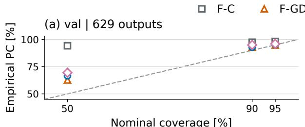  
(c) val | 728 opportunities

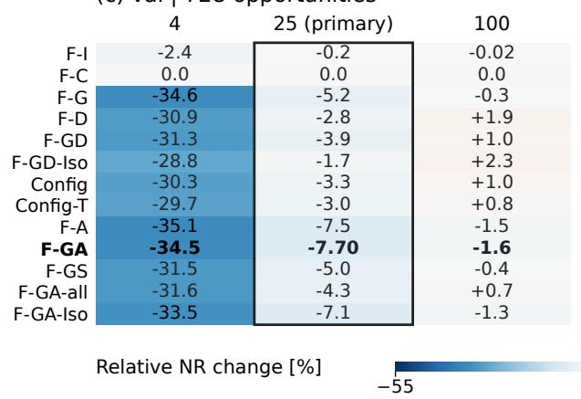

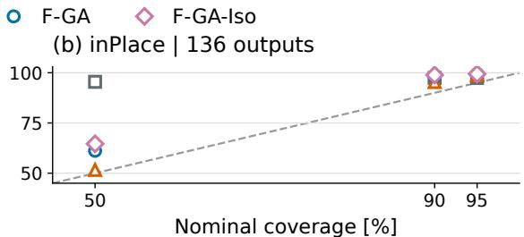  
(d) inPlace | 142 opportunities

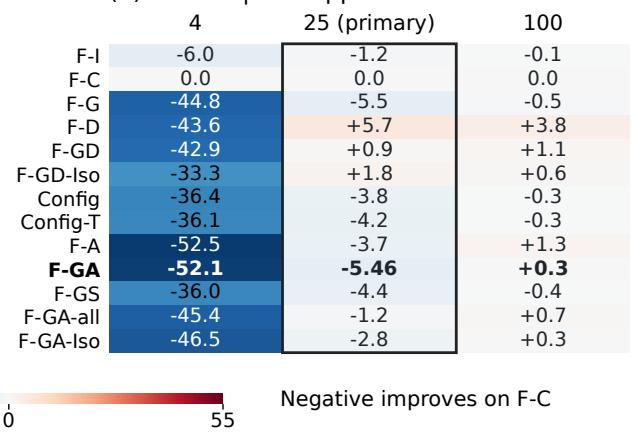  
Fig. 7. Coverage and update risk across prior settings. (a,b) Coverage at nominal 50%, 90%, and 95%; diagonals denote ideal coverage. (c,d) All thirteen models under $\breve { P } = p I _ { 2 } ; p \in \{ 4 , 2 5 , 1 0 \bar { 0 } \} \mathrm { m } ^ { 2 }$ (outlined: primary $p = 2 5 )$ . Cells show $1 0 0 [ \mathrm { N R } _ { m } ( p ) / \mathrm { N R } _ { \mathrm { F - C } } ^ { - } ( p ) - 1 ] \% ;$ negative values indicate lower risk. Heatmaps share a symmetric scale. Equal-location means use 24 validation and three inPlace locations. Coverage uses 629/136 successful outputs; NR includes all 728/142 eligible cases, with no-output risk one. Performance ordering varies with the prior.

TABLE VI  
EXPLORATORY COMPARISON WITH BASE-ONLY CALIBRATION ON THE SAME EVALUATION SETS. EQUAL-LOCATION PC90 AND EA90 USE ALL OUTPUTS INCLUDING FALLBACKS; NR25 RETAINS ALL ELIGIBLE QUERIES. RESULTS ARE REPORTED SEPARATELY FOR VALIDATION AND INPLACE; THE LATTER CONTAINS ONLY THREE LOCATIONS.
<table><tr><td>Cohort</td><td>Model</td><td>NLL (nat)</td><td>PC90 (%)</td><td>EA90  $( \mathrm { m } ^ { 2 } )$ </td><td>NR25</td></tr><tr><td>Val</td><td>F-C</td><td>2.7420</td><td>97.39</td><td>14.825</td><td>0.155248</td></tr><tr><td>Val</td><td>H-Q</td><td>0.2722</td><td>93.14</td><td>6.996</td><td>0.143556</td></tr><tr><td>Val</td><td>F-GA</td><td>0.1712</td><td>92.84</td><td>7.126</td><td>0.143292</td></tr><tr><td>InPlace</td><td>F-C</td><td>2.1251</td><td>97.44</td><td>14.825</td><td>0.041488</td></tr><tr><td>InPlace</td><td>H-Q</td><td>-0.4146</td><td>88.76</td><td>2.776</td><td>0.039049</td></tr><tr><td>InPlace</td><td>F-GA</td><td>-0.6941</td><td>98.21</td><td>1.858</td><td>0.039224</td></tr></table>

Intervals use 10,000 paired-location bootstrap resamples with seed 20261009. They describe the sampled locations and do not account for variation across independent mapproduction domains. Reuse of the evaluation data also limits this comparison to an exploratory analysis.

## B. Adding the Anchored Feature to Base-Only Calibration

The conditional-addition study tests whether the anchored feature adds information to H-Q through an additive error term. Its design was specified before the new fits and scores, but the calibration and evaluation observations had already been evaluated. Given the H-Q error matrix $R _ { H }$ , we compare two additive models:

$$
\begin{array} { c c } { { R _ { H A } = R _ { H } + c _ { A } u A / s _ { A } , } } & { { c _ { A } \geq 0 , } } \\ { { } } & { { R _ { H I } = R _ { H } + c _ { I } u I _ { 2 } , } } & { { c _ { I } \geq 0 . } } \end{array}\tag{17}
$$

H-QI adds a constant isotropic term. Each model introduces one coefficient, fitted by equal-location Gaussian NLL from initial values 0, 0.1, 1. The zero-coefficient model is also evaluated explicitly. Optimization uses L-BFGS-B with at most 500 iterations per start and requires at least one converged solution. Here u is the training-weighted mean squared residual divided by two, floored at $\mathrm { i 0 ^ { - 6 } \bar { m } ^ { 2 } } .$ , and $s _ { A }$ is the training-weighted half trace of A. Zero coefficient preserves H-Q exactly, without another floor. This comparison tests the additional value of the anchored term within this model family. More flexible functions of the four base cues could give different results.

Even a gain over H-QI would not distinguish contributions from the observation-dependent magnitude and direction of A.

An outer leave-one-location-out evaluation covers all 300 calibration queries at 24 locations: 262 positions and 38 failures. Each fold excludes its location from all fitting, normalization and inner regularization selection. H-Q, H-QA, H-QI and F-GA use the remaining samples from the common calibration subset (248 in total). The F-C fallback uses all successful outer-training samples. Each fold refits F-G, performs H-Q’s inner leave-one-location-out selection, and refits F-GA and both additions. Missing G uses F-C; missing A in H-QA uses H-Q; H-QI adds its term only when G is available. F-GA uses F-C when either G or A is unavailable. Positions and failure states are unchanged.

For validation and inPlace, H-Q remains fixed at its fullcalibration fit, and only the additive coefficients are fitted on the same 248 samples. The coefficients are $c _ { A } = 0 . 7 8 8 7 4 6$ and $c _ { I } = 0 . 0 0 2 8 6 1$ . Models and predictions were fixed before either evaluation score was computed. The earlier models remained unchanged. NLL, coverage and area use successful outputs; NR25 includes every eligible query and assigns failures risk one.

Descriptive intervals use 10,000 paired-location bootstrap resamples with seed 20261009. They condition on fitted predictions and do not rerun model selection, so they do not quantify uncertainty of the full development procedure. For source OOF predictions, H-QA minus H-Q has NLL difference −0.6392 with interval $[ - 1 . 8 6 2 1 , 0 . 0 1 8 2 ]$ and NR25 difference −0.002696 with $[ - 0 . 0 0 8 0 6 4 , 0 . 0 0 0 0 5 7 ]$ . Classifying differences by their exact sign, source NR25 improves/ties/regresses at 3/0/21 locations; all 24 anchor coefficients are positive. Excluding L12 changes NR25/NLL differences $\mathrm { t o - 0 . 0 0 0 0 7 7 9 6 / - 0 . 0 6 8 9 8 \colon }$ gains are concentrated, while the median positive NR25 regression is $1 . 4 9 \times 1 0 ^ { - 6 }$ The main summaries include every location. Validation NR25 difference is −0.002370 with $[ - 0 . 0 0 6 8 9 4 , 0 . 0 0 0 0 6 3 ]$ , with 5/0/19 improved/tied/regressed locations (median positive regression $1 . 7 0 \times 1 0 ^ { - 5 } )$ . H-QA minus H-QI source/validation NR25 intervals also cross zero. Restricting the comparison to successful outputs with both G and A (248/585/132) again yields source/validation intervals that cross zero. Thus, the incremental benefit remains uncertain on the common complete-feature subset. InPlace H-QA minus H-Q NR25 is −0.000688, with interval [−0.002064, 0.000000043] and only three locations; against H-QI the interval ends just below zero $( - 1 . 6 \times 1 0 ^ { - 8 } )$ . This near-zero interval bound across only three previously evaluated locations does not establish geographic generalization. H-QI has lower NLL than H-QA in both evaluation sets. Larger H-QA regions and increased validation overcoverage accompany the mean-risk gain. These comparisons do not establish equivalence between models.

## VIII. DISCUSSION AND CONCLUSION

## A. Motivation for Base Anchoring

The initial development evaluation produces 256 positions from 258 queries at locations absent from the calibration set.

F-GD improves NLL from 2.0173 to −0.2596 relative to F-C, yet NR25 increases from 0.01379 to 0.01495, so improved predictive density did not translate into lower update risk. Of twelve successful queries with increased risk, six have base errors of only 0.065–0.669 m and account for 97.17% of the summed positive risk increments, rather than the net change. In these cases, increased uncertainty reduces the weight of accurate observations, leaving more prior error. Other regressions instead increase the observation-error contribution. This analysis motivated F-GA, which was then evaluated on separate held-out queries.

Anchoring algebraically retains base offset as well as subset spread, but the paired intervals do not establish a robust incremental advantage for anchoring or selection alone.

## B. Ranking and Calibration

An earlier within-location development analysis illustrates the distinction between ranking and calibration. It uses the 496-record test\_outPlace set at three locations and a different model, F-GD-Config, calibrated by a single shared affine map of the configuration disagreement. Its calibration and evaluation frames come from the same three locations. Two evaluator defects were repaired after the labels had been inspected, so the results are treated as a within-location development diagnostic. Of 496 attempts, 493 produce positions. The split comprises 246 successful calibration and 247 successful evaluation records, assigned by sorted query identity within location rather than a random half. Three failures were not assigned to either uncertainty subset; availability is 493/496, while the following uncertainty metrics use the fixed 247 evaluation outputs. An update-risk score that includes every query is therefore unavailable for this cohort.

Mean absolute sparsification error (MASE) is computed from ranking and a label-derived radius. At each $p = k / 1 0 0 .$ $k = 1 , \ldots , 1 0 0 .$ we retain the max(1, round(pn)) smallest scores within a location. The diagnostic radius is the largest residual norm in that subset, and q(p) is the fraction of all n evaluation errors within that radius. MASE averages $\mathbb { E } _ { \mathrm { t i e s } } | q ( p ) - p |$ over the 100 levels, averaging uniform tie orderings before summing absolute deviations. Labels construct this diagnostic circle rather than a predictive region. MASE summarizes the discrete grid, with no general discretizationerror bound.

F-GD-Config improves MASE at all three locations, lowering the equal-location mean from 0.4200 to 0.3207, while coverage deteriorates. Here the coverage error is $G ^ { - 1 } \sum _ { q } | \mathrm { P C } _ { 0 . 9 0 , g } - 0 . 9 0 |$ , not the absolute error of the macro coverage. At nominal 0.90 the full-matrix control covers 0.8530 and F-GD-Config covers 0.8256, so the coverage error rises from 0.0946 to 0.1506, the largest of the three Gaussian models. At the smallest location, with sixteen evaluation frames, F-GD-Config improves MASE from 0.3833 to 0.3431 while worsening NLL from 11.0695 to 11.5352 and coverage from 0.6875 to 0.5625. Thus, better ranking coexists with worse probabilistic calibration in the same model and cohort.

The fitted scale map offers a possible explanation for this divergence without further parameter fitting. The shared map is $\sigma = 3 . 3 0 2 + 3 . 6 8 7 r _ { D }$ , with $r _ { D } = \sqrt { \mathrm { t r } D }$ , under one equallocation-weighted fit. Within-location rank correlation between disagreement and error is +0.408, +0.809 and +0.376, while the median predicted scale is 3.61, 3.86 and 4.06 m against median errors of 0.18, 0.41 and 9.88 m. The ratio of median error to median scale is therefore 0.05, 0.11 and 2.43 across the three locations, spanning a factor of 49. Positive rank correlations coexist with a substantial mismatch between the shared predicted scale and the error magnitude at each location. This mismatch offers a plausible, though not independently verified, explanation for the coverage results. The finding concerns this fitted scale map; other mappings could extract different magnitude information from configuration disagreement.

TABLE VII  
ADDITIVE-MODEL COMPARISON USING EQUAL-LOCATION MEANS. SOURCE OOF USES NESTED LOCATION HOLDOUT WITHIN THE CALIBRATION DATA; VALIDATION AND INPLACE REUSE THE EARLIER EVALUATION SETS. ALL COHORTS BELONG TO THE SAME DOMAIN.
<table><tr><td>Cohort</td><td>Model</td><td>NLL (nat)</td><td>PC90 (%)</td><td>EA90  $( \mathrm { m } ^ { 2 } )$ </td><td>NR25</td></tr><tr><td>Source OOF</td><td>H-Q</td><td>0.8936</td><td>90.22</td><td>8.775</td><td>0.138470</td></tr><tr><td>Source OOF</td><td>H-QA</td><td>0.2544</td><td>94.20</td><td>13.735</td><td>0.135774</td></tr><tr><td>Source OOF</td><td>H-QI</td><td>0.8603</td><td>91.21</td><td>8.825</td><td>0.138469</td></tr><tr><td>Source OOF</td><td>F-GA</td><td>0.1427</td><td>90.76</td><td>17.020</td><td>0.135331</td></tr><tr><td>Val</td><td>H-Q</td><td>0.2722</td><td>93.14</td><td>6.996</td><td>0.143556</td></tr><tr><td>Val</td><td>H-QA</td><td>0.2166</td><td>95.33</td><td>10.431</td><td>0.141186</td></tr><tr><td>Val</td><td>H-QI</td><td>0.1898</td><td>94.53</td><td>7.046</td><td>0.143556</td></tr><tr><td>Val</td><td>F-GA</td><td>0.1712</td><td>92.84</td><td>7.126</td><td>0.143292</td></tr><tr><td>InPlace</td><td>H-Q</td><td>-0.4146</td><td>88.76</td><td>2.776</td><td>0.039049</td></tr><tr><td>InPlace</td><td>H-QA</td><td>-0.4522</td><td>91.47</td><td>3.432</td><td>0.038361</td></tr><tr><td>InPlace</td><td>H-QI</td><td>-0.5616</td><td>95.63</td><td>2.825</td><td>0.039049</td></tr><tr><td>InPlace</td><td>F-GA</td><td>-0.6941</td><td>98.21</td><td>1.858</td><td>0.039224</td></tr></table>

This divergence motivates evaluating predictive quality alongside update risk at fixed positions. Its magnitude varies across the three locations: 81.8% of the MASE gain comes from one location contributing 21 of 247 evaluation frames. A preceding development analysis of the same signal gave a median within-location rank correlation of +0.003 over 24 locations, and the two analyses are inconsistent in a way the available evidence does not resolve. The label-derived MASE diagnostic alone is therefore insufficient to assess scale or directional calibration.

## C. Limitations and Generalization

All experiments share a reconstruction process. The main validation and inPlace comparisons include only locations represented in calibration; the location-held-out analyses remain part of method development. Reference precision is unknown, map errors may be correlated, and most configurations can agree on an incorrect position. These factors limit generalization, and fitted scales should not be interpreted as physical DSM-noise estimates. Because the positions are unchanged and updates use an artificial independent prior, the results establish neither improved localization accuracy nor navigation performance. Global retrieval, temporal behavior and transfer require retrieval inputs, ordered flight sequences and independently produced maps. The incremental value beyond H-Q also needs evaluation at locations not used during method development.

## D. Conclusion

The benchmark links availability, error structure and predictive uncertainty to the consequences of weighting position observations. In the case study, base-anchored calibration improves predictive density and reduces the prespecified equallocation update risk by 7.70% and 5.46% on two sets of heldout queries at represented locations under a controlled independent prior. These gains concern reference-based weighting of unchanged positions. Exploratory H-Q and conditionaladdition comparisons leave the incremental update-risk benefit of configuration disagreement unresolved. Independentlocation evaluation and ordered flight sequences are needed to assess transfer and navigation use.

## REFERENCES

[1] A. Vakhitov, L. Ferraz, A. Agudo, and F. Moreno-Noguer, “Uncertainty-aware camera pose estimation from points and lines,” in Proceedings of the IEEE/CVF Conference on Computer Vision and Pattern Recognition, 2021, pp. 4659–4668. [Online]. Available: https://openaccess.thecvf.com/content/CVPR2021/papers/ Vakhitov Uncertainty-Aware Camera Pose Estimation From Points and Lines CVPR 2021 paper.pdf

[2] D. Levi, L. Gispan, N. Giladi, and E. Fetaya, “Evaluating and calibrating uncertainty prediction in regression tasks,” 2020, version 3. [Online]. Available: https://arxiv.org/abs/1905.11659v3

[3] F. Kuppers, J. Schneider, and A. Haselhoff, “Parametric and¨ multivariate uncertainty calibration for regression and object detection,” 2022, version 2; SAIAD workshop at ECCV. [Online]. Available: https://arxiv.org/abs/2207.01242v2

[4] D. DeTone, T. Malisiewicz, and A. Rabinovich, “SuperPoint: Self-supervised interest point detection and description,” in Proceedings of the IEEE Conference on Computer Vision and Pattern Recognition Workshops, 2018, pp. 224–236. [Online]. Available: https://openaccess.thecvf.com/content cvpr 2018 workshops/w9/html/ DeTone SuperPoint Self-Supervised Interest CVPR 2018 paper.html

[5] P. Lindenberger, P.-E. Sarlin, and M. Pollefeys, “LightGlue: Local feature matching at light speed,” in Proceedings of the IEEE/CVF International Conference on Computer Vision, 2023, pp. 17 627–17 638. [Online]. Available: https://openaccess.thecvf. com/content/ICCV2023/html/Lindenberger LightGlue Local Feature Matching at Light Speed ICCV 2023 paper.html

[6] J. Edstedt, Q. Sun, G. Bokman, M. Wadenb¨ ack, and¨ M. Felsberg, “RoMa: Robust dense feature matching,” in Proceedings of the IEEE/CVF Conference on Computer Vision and Pattern Recognition, 2024. [Online]. Available: https://openaccess.thecvf.com/content/CVPR2024/papers/Edstedt RoMa Robust Dense Feature Matching CVPR 2024 paper.pdf

[7] X. Shen, Z. Cai, W. Yin, M. Muller, Z. Li, K. Wang,¨ X. Chen, and C. Wang, “GIM: Learning generalizable image matcher from internet videos,” in The Twelfth International Conference on Learning Representations, 2024. [Online]. Available: https://proceedings.iclr.cc/paper files/paper/2024/ hash/38830ee2c33d56682385a00c8e7e9b85-Abstract-Conference.html

[8] O. Dhaouadi, R. Marin, J. M. Meier, J. Kaiser, and D. Cremers, “OrthoLoC: UAV 6-DoF localization and calibration using orthographic geodata,” in The Thirty-ninth Annual Conference on Neural Information Processing Systems Datasets and Benchmarks Track, 2025. [Online]. Available: https://deepscenario.github.io/OrthoLoC/

[9] Y. Ye, X. Teng, S. Chen, L. Liu, K. Wang, X. Song, and Z. Li, “Exploring the best way for UAV visual localization under low-altitude multi-view observation condition: A benchmark,” 2026, version 2. [Online]. Available: https://arxiv.org/abs/2503.10692v2

[10] Ceres Solver Developers, “Covariance estimation,” Ceres Solver documentation, accessed September 26, 2026. [Online]. Available: https://ceres-solver.readthedocs.io/latest/nnls covariance.html

[11] W. Kang, J. Kim, J. Lee, and T.-W. Kim, “Reference-induced consensus for selective posed-reference visual localization,” 2026, version 1. [Online]. Available: https://arxiv.org/abs/2607.04722v1

[12] M. Hubert, M. Debruyne, and P. J. Rousseeuw, “Minimum covariance determinant and extensions,” WIREs Computational Statistics, vol. 10, no. 3, p. e1421, 2018. [Online]. Available: https://doi.org/10.1002/wics. 1421

[13] E.-M. El-Mhamdi, R. Guerraoui, A. Guirguis, L. N. Hoang, and S. Rouault, “Genuinely distributed byzantine machine learning,” in Proceedings of the 39th Symposium on Principles of Distributed Computing, 2020, pp. 355–364. [Online]. Available: https://doi.org/10. 1145/3382734.3405695

[14] T. Gneiting and A. E. Raftery, “Strictly proper scoring rules, prediction, and estimation,” Journal of the American Statistical Association, vol. 102, no. 477, pp. 359–378, 2007. [Online]. Available: https://sites.stat. washington.edu/people/raftery/Research/PDF/Gneiting2007jasa.pdf