POLYU VCLAB •PREPRINT 2026

# OmniCompass: A Holistic Benchmark for Omni-Modal Video Grounding and Understanding

Xuyang Liu<sup>1,2</sup> Shihao Wang<sup>1</sup> Xinyu Wei<sup>1,2</sup> Minghan Li<sup>3</sup> Zeqing Wang<sup>1,2</sup> Zuhao Yang<sup>4</sup> Zichen Wen<sup>5</sup> Lei Zhang<sup>1,2</sup>4 5 1,2

<sup>1</sup> The Hong Kong Polytechnic University <sup>2</sup> OPPO Research Institute <sup>3</sup> Colorado School of Mines1 2 3   
<sup>4</sup> Nanyang Technological University <sup>5</sup> Shanghai Jiao Tong University4 5

Homepage GitHub Hugging Face

Abstract. With the rapid development of multimodal large language models (MLLMs), evaluating their video understanding capabilities has become increasingly important. Existing video understanding benchmarks cover only part of the evaluation dimensions, limiting systematic diagnosis of omnimodal video understanding. We introduce OmniCompass, a holistic benchmark for omni-modal video grounding and understanding. OmniCompass defines two evaluation tracks: OmniCompass-VL assesses vision-language models on tasks requiring visual evidence, while OmniCompass-AV assesses omni-modal models on tasks requiring joint audio-visual evidence. Each track includes three complementary tasks: temporal grounding (TG), spatial grounding (SG), and question answering (QA), assessing when a referenced target appears, where it is, and what happens. QA covers five(QA), assessing when a referenced target appears, where it is, and what happens. QA covers five perception and three reasoning categories in OmniCompass-VL, and three perception and two reasoning categories in OmniCompass-AV. OmniCompass-VL contains 820 videos and 2,460 instances across domains and three duration types: short, medium, and long. A narrative- and audio-rich subset forms OmniCompass-AV with 240 videos and 720 instances. Each instance is evaluated under two paired settings: text-only and text+image, specifying the same target through text and visual-languagepaired settings: text-only and text+image, specifying the same target through text and visual-language guidance. All instances are manually annotated with multi-round quality verification. Evaluationsguidance. All instances are manually annotated with multi-round quality verification. Evaluations of 50 MLLMs show that open-source models still lag behind proprietary counterparts, particularlyof 50 MLLMs show that open-source models still lag behind proprietary counterparts, particularly in audio-visual understanding. Precise temporal and spatial grounding remains challenging even forin audio-visual understanding. Precise temporal and spatial grounding remains challenging even for leading models, and their predictions still exhibit inconsistencies across the paired target specifications.leading models, and their predictions still exhibit inconsistencies across the paired target specifications.

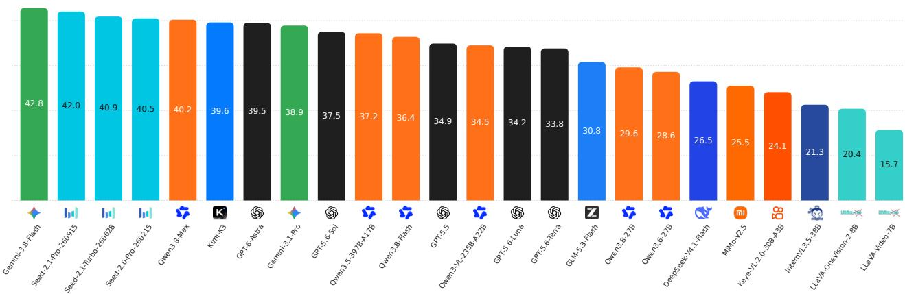  
Figure 1. Overall model performance on OmniCompass-VL. Gemini-3.8-Flash and Kimi-K3 achieve the highestFigure 1. Overal model performance on Om e highest scores among proprietary and open-source models, respectively, at 42.8% and 39.6%.scores among proprietary and open-source mod

Table 1. Comparison of existing video understanding benchmarks. Target Specification indicates whether the target is specified using text alone (i.e., Text) or text with an image (i.e., Text+Image); Video Evidence indicates whether correct outputs depend on visual or native audio content. TG/SG/QA denote temporal grounding, spatial grounding, and question answering. Short/Med./Long denote video length of < 90s, [90, 300)s, and ≥ 300s. #Vid./#Inst. are video/instance counts; M/A/H denote manual/automatic/hybrid annotation; Len. is the average video length in seconds.
<table><tr><td rowspan="2">Benchmarks</td><td colspan="2">Target Specification</td><td colspan="2">Video Evidence</td><td colspan="2">Task Coverage</td><td colspan="2">Video Duration</td><td colspan="2"></td><td rowspan="2"></td><td rowspan="2"></td><td rowspan="2">#Vid. #Inst. Anno. Len.(s)</td></tr><tr><td>Text</td><td>Text+Image</td><td>Visual</td><td>Audio</td><td>TG</td><td>SG</td><td>QA</td><td>Short Med.</td><td>Long</td><td></td></tr><tr><td colspan="10">Video Benchmarks</td><td></td><td></td><td></td><td></td></tr><tr><td>Charades-STA (Gao et al., 2017)</td><td></td><td>X</td><td></td><td>X</td><td>X</td><td>X</td><td></td><td>X</td><td>X</td><td>1,334</td><td>3,720</td><td>M</td><td>30.0</td></tr><tr><td>TVQA (Lei et al., 2018)</td><td></td><td>X</td><td></td><td>X</td><td>X X</td><td></td><td></td><td>X</td><td>X</td><td>2,179</td><td>15,253</td><td>M</td><td>11.2</td></tr><tr><td>TVQA+ (Lei et al., 2020)</td><td></td><td>X</td><td></td><td>x</td><td></td><td></td><td></td><td>X</td><td>X</td><td>403</td><td>2,821</td><td>M</td><td>61.5</td></tr><tr><td>VidSTG (Zhang et al., 2020)</td><td></td><td>X</td><td></td><td>X</td><td></td><td></td><td></td><td>x</td><td>X</td><td>732</td><td>10,303</td><td>M</td><td>28.0</td></tr><tr><td>NExT-QA (Xiao et al., 2021)</td><td></td><td>X</td><td></td><td>X</td><td>X</td><td></td><td></td><td>X</td><td>X</td><td>1,000</td><td>8,564</td><td>A</td><td>44.0</td></tr><tr><td>HC-STVG (Tang et al., 2021)</td><td></td><td>X</td><td></td><td>x</td><td></td><td></td><td></td><td>X</td><td>X</td><td>1,160</td><td>1,160</td><td>M</td><td>20.0</td></tr><tr><td>QVHighlights (Lei et al., 2021)</td><td></td><td>X</td><td></td><td>X</td><td></td><td></td><td></td><td></td><td>X</td><td>1,529</td><td>1,542</td><td>M</td><td>149.6</td></tr><tr><td>EgoSchema (Mangalam et al., 2023)</td><td></td><td>X</td><td></td><td>X</td><td>X</td><td>X</td><td></td><td></td><td>X</td><td>5,063</td><td>5,063</td><td>H</td><td>180.0</td></tr><tr><td>TempCompass (Liu et al., 2024b)</td><td></td><td>X</td><td></td><td>x</td><td>X</td><td></td><td></td><td>X</td><td>X</td><td>410</td><td>7,540</td><td>H</td><td>11.4</td></tr><tr><td>MVBench (Li et al., 2024b)</td><td></td><td>X</td><td></td><td>x</td><td></td><td></td><td></td><td></td><td>X</td><td>3,641</td><td>4,000</td><td>A</td><td>16.0</td></tr><tr><td>MLVU (Zhou et al., 2025a)</td><td></td><td>X</td><td></td><td>X</td><td>X</td><td></td><td></td><td></td><td></td><td>1,334</td><td>2,593</td><td>H</td><td>720.0</td></tr><tr><td>Video-MME (Fu et al., 2025a)</td><td></td><td>X</td><td></td><td>x</td><td>X</td><td>X</td><td></td><td></td><td></td><td>900</td><td>2,700</td><td>M</td><td>1017.9</td></tr><tr><td>LongVideoBench (Wu et al., 2024)</td><td></td><td>X</td><td></td><td>X</td><td>X</td><td></td><td></td><td></td><td></td><td>3,763</td><td>6,678</td><td>M</td><td>473.0</td></tr><tr><td>CG-Bench (Chen et al., 2025a)</td><td></td><td>X</td><td></td><td>X</td><td>X</td><td></td><td></td><td></td><td></td><td>1,219</td><td>12,129</td><td>M</td><td>1624.4</td></tr><tr><td>V-STaR (Cheng et al., 2026)</td><td></td><td>X</td><td></td><td>x</td><td></td><td></td><td></td><td></td><td></td><td>1,000</td><td>2,094</td><td>H</td><td>110.2</td></tr><tr><td>IV-Bench (Ma et al., 2026)</td><td>X</td><td></td><td></td><td>x</td><td>x</td><td>X</td><td>X</td><td></td><td></td><td>967</td><td>2,585</td><td>M</td><td>537.0</td></tr><tr><td>OmniCompass-VL (Ours)</td><td></td><td></td><td></td><td>X</td><td></td><td></td><td></td><td></td><td></td><td>820</td><td>2,460</td><td>M</td><td>354.0</td></tr><tr><td colspan="10">Audio-Visual Benchmarks</td><td></td><td></td><td></td><td></td><td></td></tr><tr><td>AVUT (Yang et al., 2025)</td><td></td><td>X</td><td></td><td></td><td>X</td><td>X</td><td></td><td></td><td>X X</td><td>2,662</td><td>11,609</td><td>H</td><td>67.8</td><td></td></tr><tr><td>Daily-Omni (Zhou et al., 2025b)</td><td></td><td>X</td><td></td><td></td><td></td><td></td><td></td><td></td><td>X</td><td>X</td><td>684</td><td>1,197</td><td>H</td><td>42.8</td></tr><tr><td>OmniVideoBench (Li et al., 2026)</td><td></td><td>X</td><td></td><td></td><td>X</td><td></td><td></td><td></td><td></td><td></td><td>628</td><td>1,000</td><td>H</td><td>384.2</td></tr><tr><td>WorldSense (Hong et al., 2026)</td><td></td><td>X</td><td></td><td></td><td>X</td><td></td><td></td><td></td><td></td><td></td><td>1,662</td><td>3,172</td><td>M</td><td>141.1</td></tr><tr><td>JointAVBench (Chao et al., 2026)</td><td></td><td>X</td><td></td><td></td><td>X</td><td>X</td><td></td><td></td><td></td><td></td><td>1,046</td><td>2,853</td><td>H</td><td>97.2</td></tr><tr><td>Video-MME-v2 (Fu et al., 2026)</td><td></td><td>X</td><td></td><td></td><td>X</td><td>X</td><td></td><td></td><td></td><td></td><td>800</td><td>3,200</td><td>M</td><td>624.0</td></tr><tr><td>OmniCompass-AV (Ours)</td><td></td><td></td><td></td><td></td><td></td><td></td><td></td><td></td><td></td><td></td><td>240</td><td>720</td><td>M</td><td>427.5</td></tr></table>

## 1 Introduction

Human perception uses linguistic or visual cues to identify targets, attend to visual and auditory evidence across space and time, and form goal-directed judgments. Multimodal large language models (MLLMs) jointly process images, videos, audio, and text, supporting multimodal understanding and reasoning (Bai et al., 2025; Xu et al., 2025b; Google, 2025). Recent MLLMs can revisit relevant temporal clips (Yang et al., 2026a; Zeng et al., 2026b), inspect task-relevant spatial evidence (Wang et al., 2026c; Meng et al., 2026), and selectively acquire audio-visual evidence during reasoning (Xing et al., 2026; Chen et al., 2026). These advances motivate evaluating omni-modal video grounding and understanding. This requires identifying targets from textual or visual cues, grounding them spatiotemporally, and integrating audio-visual evidence to understand events.

With the rapid development of MLLMs, how to comprehensively evaluate their performance in complex video understanding tasks has become an important problem. Table 1 compares existing benchmarks across four dimensions. (i) Target Specification defines how targets are presented: through only textual queries (Fu et al., 2025a) or with reference images (Ma et al., 2026). (ii) Video Evidence distinguishes tasks resolved from video frames (Chen et al., 2025a) from those requiring synchronized audio-visual content (Hong et al., 2026). (iii) Task Coverage specifies the output: temporal grounding (TG) and spatial grounding (SG) predict target-specific intervals and regions (Lei et al., 2021; Cheng et al., 2026), while question answering (QA) predicts answers (Fu et al., 2026). (iv) Video Duration determines the temporal scope: short-video benchmarks emphasize fine-grained motion and local dynamics (Li et al., 2024b), whereas long-video benchmarks test long-range dependencies and information integration across temporally distant events (Zhou et al., 2025a).

Despite this progress, existing benchmarks have three limitations in systematically diagnosing omni-modal video grounding and understanding. (i) Limited video-evidence coverage. Benchmarks typically assess either visual information (Chen et al., 2025a) or synchronized audio-visual content (Hong et al., 2026). In news broadcasts, some queries concern visible scenes; others require aligning spoken reports with people or events. Both settings are needed to assess visual perception and audio-visual integration. (ii) Inflexible target-specification settings. Most benchmarks use only text (Fu et al., 2026), while IV-Bench combines reference images with text (Ma et al., 2026). Practical targets may be specified verbally or with an image, yet these benchmarks do not evaluate the same target under both settings. (iii) Fragmented task coverage. Most benchmarks focus on QA (Li et al., 2024b) or grounding (Gao et al., 2026); audio-visual benchmarks rarely cover the latter (Li et al., 2026; Zhou et al., 2025b). In basketball games, users may ask when a referenced player scores, where the player is on the court, and what happens. Joint evaluation distinguishes failures in temporal retrieval, spatial localization, and semantic understanding.

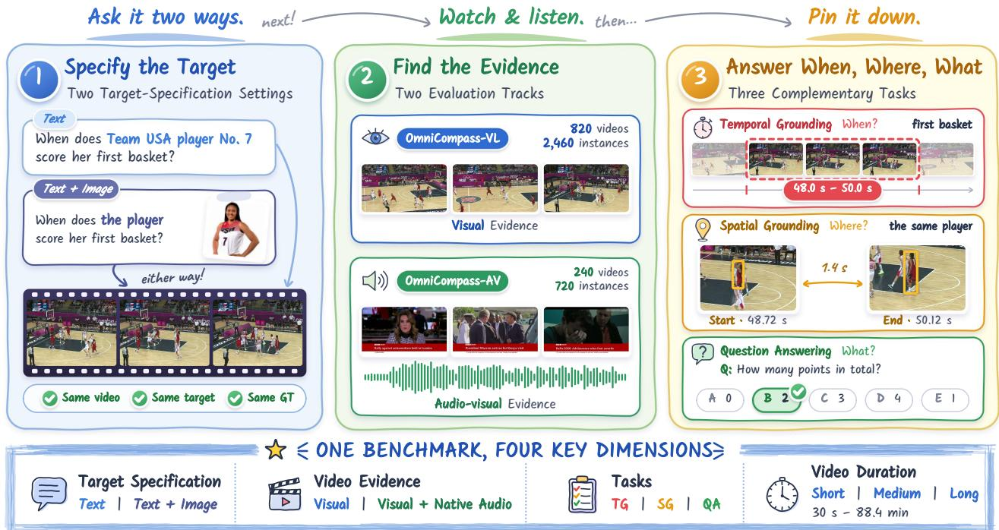  
Figure 2. Overview of OmniCompass. The benchmark spans four dimensions: target specification, video evidence, task coverage, and video duration. Paired Text/Text+Image specifications are evaluated on the same targets. OmniCompass-VL contains 820 videos and 2,460 instances, while the 240-video OmniCompass-AV subset contains 720 instances with native audio. Both tracks cover temporal grounding, spatial grounding, and question answering.

To address these gaps, we introduce OmniCompass, a holistic benchmark for omni-modal video grounding and understanding. As shown in Figure 2, OmniCompass has four key features: (i) Complementary Video Evidence. OmniCompass-VL evaluates understanding from visual content, while OmniCompass-AV additionally requires audio. (ii) Flexible Target Specification. Each instance pairs Text and Text+Image settings, specifying the same target through language alone or with a reference image. The video, task semantics, and ground truth are the same. We introduce Cross-Specification Consistency Scores (CS) to jointly measure task accuracy and prediction consistency across these settings. (iii) Unified Task Coverage. Both tracks provide TG, SG, and QA tasks per video. The VL track covers five perception and three reasoning categories, whereas the AV track covers three perception and two reasoning categories. (iv) Diverse Durations and Content. OmniCompass-VL contains 820 videos and 2,460 instances across short, medium, and long durations. It combines public sports, trafic, surveillance, and documentary videos with 240 self-collected movie, TV, variety, and news videos. This subset forms OmniCompass-AV with 720 instances.

We evaluate 50 MLLMs, including proprietary and open-source models. The best proprietary model exceeds the best open-source model by 3.2% in CS<sup>Avg</sup> on VL track and 32.8% on AV track. Strong QA performance coexists with weak grounding and cross-reference inconsistency, even when aggregate accuracies are similar across settings. Visual target specifications do not consistently help: Text+Image improves the single-setting average for only 11 of 36 models. Further analyses show that timestamps substantially improve model performance across tasks and tracks, while audio consistently improves QA and TG performance on AV track. Future MLLMs therefore need stronger cross-modal alignment and more reliable audio-aware grounding. Our contributions are as follows:

1. A Holistic Evaluation Framework. OmniCompass unifies target-guided omni-modal video grounding and understanding across four dimensions: paired Text and Text+Image specifications, VL/AV evidence tracks, TG/SG/QA tasks, and short-to-long videos. We introduce CS to jointly assess task correctness and consistency across paired target specifications.

2. A Diverse, Rigorously Verified Benchmark. OmniCompass spans 820 videos, 80.6 hours, seven domains, and 52 subcategories, with 240 videos shared between VL and AV tracks. Construction required about 1,800 human-hours for annotator training, calibration, annotation, expert adjudication, and revision. All instances undergo multi-round quality verification.

3. A Diagnostic Evaluation of MLLMs. We evaluate 50 diferent MLLMs, revealing an overall advantage for proprietary models, especially in audio-visual understanding. Strong QA performance coexists with weak grounding and cross-specification inconsistency. Further analyses examine the efects of target specifications, video duration, timestamps, and input modalities.

## 2 Related Work

## 2.1 Multimodal Large Language Models for Video Understanding

MLLMs connect language models with multimodal encoders for perception and reasoning (Liu et al., 2024a; Chen et al., 2024; Xu et al., 2025a; Google, 2025; Lin et al., 2025a,b; An et al., 2026; Wang et al., 2026b). LLaVA-OneVision (Li et al., 2024a) and LLaVA-Video (Zhang et al., 2024) unify image-video modeling. The latter uses synthetic captions and question-answering data for video instruction tuning. LLaVA-OneVision-2 (An et al., 2026) further adopts OneVision-Encoder (Tang et al., 2026) for native-resolution visual encoding and eficient long-video processing through codec-aware token compression. VideoLLaMA3 (Zhang et al., 2025) and InternVL3.5 (Wang et al., 2025b) strengthen video training and reasoning. Qwen3-VL (Bai et al., 2025) improves long-context video understanding through temporal alignment, while Qwen3-Omni (Xu et al., 2025b) jointly processes vision, audio, and language. Keye-VL-2.0 (Team et al., 2026) adapts DSA for eficient longcontext processing and consolidates task-specific capabilities through cross-modal MOPD. TimeLens (Zhang et al., 2026) improves temporal grounding with interleaved timestamps and thinking-free reinforcement learning, and TimeLens2 (Zhu et al., 2026) further broadens task coverage through verified multi-interval supervision and temporal Wasserstein rewards. Agentic extensions also explore tool-assisted video reasoning to selectively acquire task-relevant visual and audio evidence (Wang et al., 2026a; Yang et al., 2026a,b; Meng et al., 2026; Xing et al., 2026). In brief, modern omni-modal video understanding identifies referenced targets and grounds evidence in time and space by integrating visual and audio information.

## 2.2 Video Understanding Benchmarks

Table 1 compares existing benchmarks across four design dimensions. (i) Target Specification defines how the target is presented. Most benchmarks use textual questions or instructions (Fu et al., 2025a; Cheng et al., 2026), while IV-Bench (Ma et al., 2026) pairs text with a reference image for visual specification. (ii) Video Evidence distinguishes visual and audio-visual requirements. Vision-language benchmarks assess appearance, motion, and temporal relations. TempCompass (Liu et al., 2024b) evaluates temporal perception, while MotionBench (Hong et al., 2025) targets fine-grained motion. WorldSense (Hong et al., 2026) and JointAVBench (Chao et al., 2026) require synchronized visual and native-audio evidence. (iii) Task Coverage defines the expected output. Question-answering benchmarks (Fu et al., 2025a; Li et al., 2026) produce semantic responses, while grounding benchmarks require explicit evidence localization. OmniGround evaluates temporal intervals and spatial regions (Gao et al., 2026), and V-STaR (Cheng et al., 2026) jointly assesses TG, SG, and QA. (iv) Video Duration sets the temporal scope for evidence integration. MVBench emphasizes local actions and temporal dynamics (Li et al., 2024b), whereas LongVideoBench (Wu et al., 2024), MLVU (Zhou et al., 2025a), and LVBench (Wang et al., 2025a) stress long-context management across distant moments. LongVideoBench also evaluates referring reasoning over interleaved video frames and subtitles. Existing benchmarks cover selected dimensions or fixed combinations, limiting diagnosis of target identification, grounding, and omni-moda reasoning across diferent target and evidence settings.

OmniCompass unifies these dimensions through paired target-specification settings, complementary evidence tracks, and TG, SG, and QA across video durations. It supports diagnosis of target identification, spatio-temporal grounding, and event understanding under paired reference settings.

## 3 The OmniCompass Benchmark

OmniCompass evaluates omni-modal video grounding and understanding along the dimensions in Table 1. Figure 2 summarizes the evaluation workflow. Each instance uses paired Text and Text+Image specifications of the same target. OmniCompass-VL evaluates vision-language models on visually resolvable tasks, while OmniCompass-AV evaluates omni-modal models using joint visual and native-audio evidence. Both tracks cover TG, SG, and QA across short $( 3 0 \mathrm { s } \le t < 9 0 \mathrm { s } )$ , medium $( 9 0 \mathrm { s } \leq t < 3 0 0 \mathrm { s } )$ , and long (� ≥ 300s) videos.

## 3.1 Evaluation Formulation and Metrics

Two Target-Specification Settings. OmniCompass uses paired Text and Text+Image settings to test whether models consistently localize and understand targets across reference modalities. Targets include entities, actions, attributes, and scenes. In Text, a textual description $\mathbf { r } ^ { \mathrm { t e x t } }$ alone specifies the target, such as “When does the USA player wearing No. 33 complete the dunk?”. In Text+Image, a textual expression $\mathbf { r } ^ { \mathrm { t e x t } ^ { \prime } }$ and a reference image r<sup>image</sup> jointly specify the target. For example, “When does the player complete the dunk?” requires the image to resolve which player is referenced. Thus, $\mathbf { r } = \mathbf { r } ^ { \mathrm { t e x t } } \operatorname { o r } \mathbf { r } = \left( \mathbf { r } ^ { \mathrm { t e x t ^ { \prime } } } , \mathbf { r } ^ { \mathrm { i m a g e } } \right)$ . Each pair shares the same video, target, task semantics, and ground truth, allowing direct comparison across target specifications.

Two Evaluation Tracks. The two tracks share the same target-specification and task contracts but difer in the video evidence available to the model. Let $\mathcal { F } _ { K } ( \mathcal { V } )$ denote � uniformly sampled video frames paired with their timestamps, and let ${ \mathcal { A } } ( { \mathcal { V } } )$ denote the synchronized audio track. Given a target specification $\mathbf { r } ~ \in ~ \{ \mathbf { r } ^ { \mathrm { t e x t } } , ( \mathbf { r } ^ { \mathrm { t e x t } ^ { \prime } } , \mathbf { r } ^ { \mathrm { i m a g e } } ) \}$ , OmniCompass-VL receives $\mathbf { x } _ { \mathrm { V L } } = ( \mathcal { F } _ { K } ( \mathcal { V } ) , \mathbf { r } )$ , whereas OmniCompass-AV receives $\mathbf { x } _ { \mathrm { A V } } = ( { \mathcal { F } } _ { K } ( { \mathcal { V } } ) , { \mathcal { A } } ( { \mathcal { V } } ) , \mathbf { r } )$ . VL queries are answerable from visual evidence, while AV queries require information from the synchronized audio.

Cross-Specification Consistency Scores (CS). Paired Text and Text+Image settings allow us to assess whether a model correctly identifies the same target across referential modalities. We introduce CS to jointly measure task correctness and consistency between paired predictions, so agreement alone does not guarantee a high score. For each task $q \in \{ \mathrm { T G } , \mathrm { S G } , \mathrm { Q A } \}$ , let $N _ { q }$ denote the number of evaluated pairs, with superscripts T and TI denoting the Text and Text+Image settings. For TG, let $g _ { i } ^ { \operatorname { T } }$ and $g _ { i } ^ { \operatorname { T I } }$ be the tIoUs of the predicted intervals with the ground-truth interval, and $a _ { i }$ the tIoU between the two predictions. We define $\begin{array} { r } { \mathrm { \hat { C } S _ { T G } } = \frac { 1 } { N _ { \mathrm { T G } } } \sum _ { i = 1 } ^ { N _ { \mathrm { T G } } } } \end{array}$ min $\{ g _ { i } ^ { \mathrm { T } } , g _ { i } ^ { \mathrm { T I } } , a _ { i } \}$ . For SG, let $g _ { i , k } ^ { \mathrm { T } }$ and $g _ { i , k } ^ { \mathrm { T I } }$ be the IoUs between predicted and ground-truth boxes at the start and end boundaries $k \in \{ s , e \}$ . Let $a _ { i , k }$ denote the IoU between the paired predictions at boundary �. We define $\begin{array} { r } { \mathrm { C S } _ { \mathrm { S G } } = \frac { 1 } { 2 N _ { \mathrm { S G } } } \sum _ { i = 1 } ^ { N _ { \mathrm { S G } } } \sum _ { k \in \{ s , e \} } } \end{array}$ min $\{ g _ { i , k } ^ { \mathrm { T } } , g _ { i , k } ^ { \mathrm { T I } } , a _ { i , k } \}$ . For QA, with predicted answers $\hat { y } _ { i } ^ { \mathrm { T } }$ and $\hat { y } _ { i } ^ { \mathrm { T I } }$ and ground-truth answer $y _ { i }$ , we define $\begin{array} { r } { \mathbf { C S } _ { \mathrm { Q A } } = \frac { 1 } { N _ { \mathrm { O A } } } \sum _ { i = 1 } ^ { N _ { \mathrm { Q A } } } \mathbf { 1 } \{ \hat { y } _ { i } ^ { \mathrm { T } } = \hat { y } _ { i } ^ { \mathrm { T I } } = y _ { i } \} } \end{array}$

## 3.2 Benchmark Construction

Constructing OmniCompass requires approximately 1,800 human-hours for paired annotation, targeted revision, and multi-round quality verification, following the pipeline in Figure 3.

Stage 1: Video Collection and Curation. We construct a pool of 8,489 candidate videos from nine public datasets and supplement it with 240 self-collected videos from films, TV series, variety shows, and news programs. The resulting pool covers seven high-level domains. Appendix Table C1 details the selection scope, characteristics, usage terms, and contributions of the public datasets to the final benchmark.

We use Qwen3-VL-8B-Instruct to profile each public candidate with structured entity, action, attribute, and scene cues. Excluding videos shorter than 30 seconds or missing any of the four referential cue types leaves $\mathbf { 6 , 9 4 6 }$ eligible videos. We rank them by four predefined criteria: reference necessity, grounding suitability, temporal-spatial utility, and evidence diversity (Appendix Table C2). Shortlisting follows domain, duration, source, and subcategory constraints. Manual review retains 580 high-quality videos; with 240 self-collected videos, OmniCompass-VL contains 820 videos. The same 240 videos form OmniCompass-AV, with additional audio-visual task annotations. Appendix C details profiling, filtering, and scoring.

Stage 2: Task Annotation and Construction. A lead expert provides two days of task-specific training to four professional annotators before full-scale annotation. The team follows four principles to ensure consistent target specification and evidence across TG, SG, and QA under paired Text and Text+Image settings.

(i) Same-Target Pairing. Each Text and Text+Image pair shares the same video, target, task semantics, and ground truth. In Text+Image, the textual expression requires the reference image to identify the target. (ii) Diverse Reference Types and Sources. References cover entity, action, attribute, and scene cues using video crops or semantically matched external images. Each image identifies the target without revealing the annotated event or answer evidence. For video-internal references, annotators favor a separate view outside the target interval or QA clue interval whenever available. (iii) Precise TG/SG Labels. TG intervals tightly cover complete target-related events, while SG boxes localize the same target at both interval boundaries. (iv) Evidence-Grounded QA Design. Following CG-Bench (Chen et al., 2025a), annotators pair a clue interval with five mutually exclusive options: one correct answer and four plausible distractors.

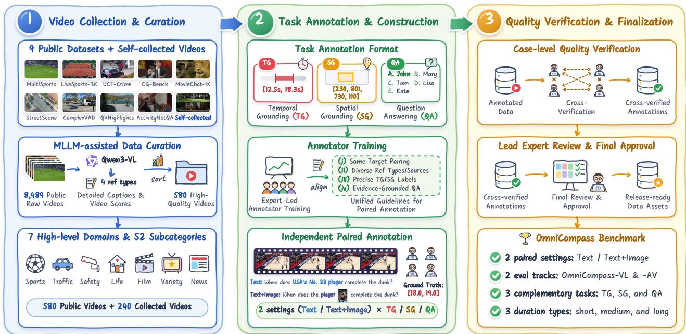  
Figure 3. Data construction pipeline. OmniCompass requires about 1,800 human-hours for rigorous annotation, verification, and revision. Stage 1: We screen 8,489 videos from nine public datasets, retain 6,946 after duration and referential-cue filtering, and select 580 to complement 240 self-collected videos. Stage 2: Four trained annotators independently construct paired Text and Text+Image TG, SG, and QA instances. AV cases include native audio. Stage 3: Annotators cross-verify and revise cases before final acceptance and correction by the lead expert, yielding 820 videos across seven domains, paired settings, two tracks, three tasks, and three duration groups.

The annotators first conduct a pilot annotation on 30 VL and 30 AV videos spanning all seven domains and three duration types. Each video receives one TG, one SG, and one QA instance under paired Text and Text+Image settings, yielding 180 task instances. The pilot exposes inconsistencies in target pairing, temporal boundaries, spatial target consistency, and QA evidence. The lead expert reviews these cases with the team, resolves ambiguities, and refines the guidelines. The annotators then independently construct the remaining instances under the calibrated protocol. Guideline training, pilot calibration, and initial task construction across both tracks and all three tasks account for approximately 960 annotator-hours.

Stage 3: Quality Verification and Finalization. All annotated cases undergo case-level quality verification before release. Four annotators independently cross-check annotations from their peers against the Stage 2 principles: same-target pairing, reference diversity and non-leakage, precise TG/SG labels, and evidencegrounded QA design. They inspect temporal-event completeness, boundary-frame box alignment, and the uniqueness and evidential support of QA answers. For AV cases, they also verify native-audio dependence and audio-visual alignment. They correct clear annotation errors, recheck the revised cases, and submit the confirmed cases to the lead expert. The expert resolves remaining inconsistencies, makes necessary corrections, performs final acceptance, and audits the release-ready data. These steps require approximately 320 annotator-hours and 500 lead-expert-hours. Appendix D details the process. Tables D1 and D2 report video-level verification results and typical issues; Table D3 details human efort by stage and role.

## 3.3 Benchmark Statistics

Video Diversity and Temporal Scale. OmniCompass contains 820 videos across 7 domains and 52 subcategories, with 10–43 videos per subcategory and a mean of 15.8. The videos total 80.6 hours, ranging from 30 seconds to 88.4 minutes, with a mean duration of 354.0 seconds. Figure 4(a,b) shows 162 short, 309 medium, and 349 long videos across 15 duration bins, including 580 VL-only videos and 240 videos shared by both tracks for matched-video evaluation.

Evaluation Breadth and Annotation Granularity. Unified TG, SG, and QA annotations yield 2,460 VL and

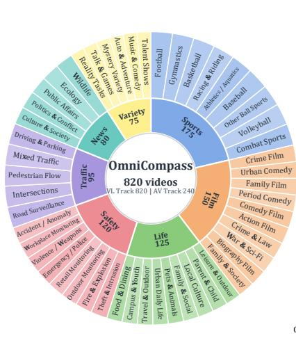

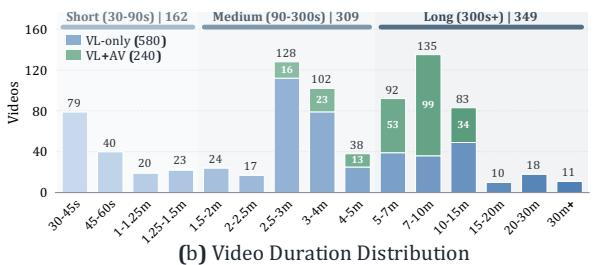  
(a) Video Domains: 7 Domains & 52 Subcategories

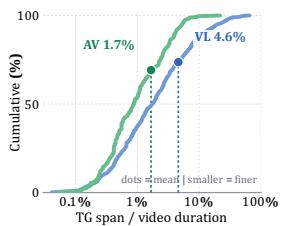  
(d) TG Selectivity

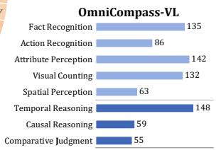  
Perception 68.0% | Reasoning 32.0%

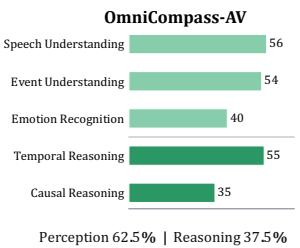  
(c) QA Types: Perception and Reasoning Tasks

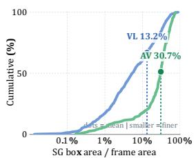  
(e) SG Granularity  
Figure 4. Dataset statistics of OmniCompass. (a) 820 videos span 7 domains and 52 subcategories, each with at least ten videos. (b) Fifteen duration bins span short (30–90 s), medium (90–300 s), and long (≥ 300 s) ranges. Stacked colors distinguish 580 VL-only and 240 shared VL–AV videos. (c) Bars report counts for eight OmniCompass-VL and five OmniCompass-AV QA types. Lighter and darker shades distinguish Perception and Reasoning. (d) Cumulative TG-span ratios show temporal selectivity. (e) Cumulative SG-area ratios show spatial granularity. Dots mark track means.

720 AV task instances. Each video contributes one instance to each task, giving 820 instances per task in VL and 240 in AV. Figure 4(c) shows eight VL and five AV QA types. Perception accounts for 68.0% and 62.5%, while reasoning accounts for 32.0% and 37.5%, respectively. The 820 videos span seven domains and 52 subcategories, with 10–43 videos per subcategory. QA counts range from 55 to 148 across VL types and from 35 to 56 across AV types, providing broad coverage without concentrating on a single question category. Figure 4(d,e) summarizes grounding granularity: TG intervals average 4.6% of VL and 1.7% of AV video duration, while SG boxes average 13.2% and 30.7% of frame area, respectively. Paired Text and Text+Image settings test target identification, while the shared AV subset supports matched-video comparisons. Appendix Figure C4 reports reference types and image sources across domains.

## 4 Experiments

## 4.1 Experimental Setting

Evaluated Models. We evaluate 50 models across tracks. OmniCompass-VL evaluates vision-language models including proprietary models Gemini series (Google, 2025), GPT series (OpenAI, 2026a,b,c), Seed series (Seed, 2026), and the Qwen close-source series (Qwen Team, 2026a). The open-source models cover Kimi-K3 (Kimi Team et al., 2026), GLM-5.3-Flash (Zeng et al., 2026a), DeepSeek-V4.1-Flash (DeepSeek-AI, 2026), MiMo-V2.5 (MiMo-V2.5), the Qwen open-source series (Qwen Team, 2026b; Team, 2026a; Bai et al., 2025), InternVL3.5-38B (Wang et al., 2025b), Keye-VL-2.0-30B-A3B (Team et al., 2026), TimeLens series (Zhang et al., 2026; Zhu et al., 2026), and the LLaVA series (An et al., 2026; Zhang et al., 2024). OmniCompass-AV evaluates omni-modal models with native audio support, including the Gemini series, Qwen-Omni series (Team, 2026b; Qwen Team, Alibaba, 2025), and Seed-2.0-Lite/Mini (Seed, 2026), as well as MiMo-V2.5 (MiMo-V2.5), video-SALMONN 2+ (Tang et al., 2025), MiniCPM-o-4.5-8B (Cui et al., 2026), Ola-7B (Liu et al., 2025), VideoLLaMA2-7B (Cheng et al., 2024), and VITA-1.5-7B (Fu et al., 2025b).

Implementation Details. (i) Frame sampling: We uniformly sample 64 frames for proprietary models and open-source models with over 100B total parameters, and 32 for smaller models. GPT-series models use 49 frames to accommodate the Text+Image reference within the 50-image limit. VITA-1.5-7B follows its oficial 16-frame limit. Following TimeLens (Zhang et al., 2026), each frame is immediately preceded by its timestamp in seconds. (ii) Input modalities: OmniCompass-VL excludes audio, while OmniCompass-AV adds the native audio following WorldSense (Hong et al., 2026) and Video-MME-v2 (Fu et al., 2026). In Text+Image, the reference image follows these inputs and immediately precedes the task prompt. Appendix E details the experimental setup, input serialization, and task-specific prompts and response formats.

Table 2. Results on OmniCompass-VL. We evaluate TG, SG, and QA without audio using uniformly sampled, timestamped frames. Performance is reported as Text/Text+Image, while CS requires paired predictions to be correct and consistent. Average is the mean of TG $\scriptstyle \mathrm { ~ { \mathrm { m } } _ { t I o U } } .$ , SG $\mathrm { m } _ { \mathrm { s l o U } }$ , and QA Accuracy per specification, while $\mathrm { C S ^ { A v g } }$ averages the three CS scores. Within each group, the best and second-best results are bold and underlined, respectively.
<table><tr><td rowspan=2 colspan=2>Models                        Frames</td><td rowspan=1 colspan=3>Temporal Grounding</td><td rowspan=1 colspan=3>Spatial Grounding</td><td rowspan=1 colspan=2>Question Answering</td><td rowspan=1 colspan=2>Overall</td></tr><tr><td rowspan=1 colspan=6>R.@0.5  MtIoU   $\mathbf { C S ^ { T G } }$ AP@0.5 msIoU   $\mathbf { C S } ^ { \mathbf { S G } }$ </td><td rowspan=1 colspan=2>Accuracy   $\mathbf { C S ^ { Q A } }$ </td><td rowspan=1 colspan=2>Average $\mathbf { C S ^ { A v g } }$ </td></tr><tr><td rowspan=1 colspan=12>Proprietary MLLMs</td></tr><tr><td rowspan=1 colspan=2>Gemini-3.8-Flash               64</td><td rowspan=1 colspan=1>33.8/32.73</td><td rowspan=1 colspan=1>2.6/33.5</td><td rowspan=1 colspan=1>27.1</td><td rowspan=1 colspan=2>37.5/41.637.7/41.8</td><td rowspan=1 colspan=1>32.3</td><td rowspan=1 colspan=2>73.3/76.6  69.1</td><td rowspan=1 colspan=1>47.9/50.6</td><td rowspan=1 colspan=1>42.8</td></tr><tr><td rowspan=1 colspan=2>Gemini-3.1-Pro                 64</td><td rowspan=1 colspan=1>24.9/24.9</td><td rowspan=1 colspan=1>25.6/26.6</td><td rowspan=1 colspan=1>19.3</td><td rowspan=1 colspan=2>34.9/35.236.5/37.3</td><td rowspan=1 colspan=1>31.8</td><td rowspan=1 colspan=2>71.4/73.6  65.7</td><td rowspan=1 colspan=1>44.5/45.9</td><td rowspan=1 colspan=1>38.9</td></tr><tr><td rowspan=1 colspan=2>Seed-2.1-Pro-260915            64</td><td rowspan=1 colspan=1>27.9/29.8</td><td rowspan=1 colspan=1>29.3/29.9</td><td rowspan=1 colspan=1>23.7</td><td rowspan=1 colspan=2>40.9/38.940.6/39.6</td><td rowspan=1 colspan=1>34.9</td><td rowspan=1 colspan=2>73.4/74.3  67.4</td><td rowspan=1 colspan=1>47.8/47.9</td><td rowspan=1 colspan=1>42.0</td></tr><tr><td rowspan=1 colspan=2>Seed-2.1-Turbo-260628          64</td><td rowspan=1 colspan=1>29.9/29.4</td><td rowspan=1 colspan=1>30.5/30.2</td><td rowspan=1 colspan=1>25.0</td><td rowspan=1 colspan=1>35.4/35.4</td><td rowspan=1 colspan=1>36.3/36.3</td><td rowspan=1 colspan=1>30.0</td><td rowspan=1 colspan=1>74.1/74.1</td><td rowspan=1 colspan=1>67.7</td><td rowspan=1 colspan=1>47.0/46.9</td><td rowspan=1 colspan=1>40.9</td></tr><tr><td rowspan=1 colspan=2>Seed-2.0-Pro-260215            64</td><td rowspan=1 colspan=1>30.7/31.0</td><td rowspan=1 colspan=1>30.6/30.9</td><td rowspan=1 colspan=1>24.9</td><td rowspan=1 colspan=1>30.6/31.7</td><td rowspan=1 colspan=1>34.9/35.3</td><td rowspan=1 colspan=1>29.4</td><td rowspan=1 colspan=1>74.5/73.0</td><td rowspan=1 colspan=1>67.3</td><td rowspan=1 colspan=1>46.6/46.4</td><td rowspan=1 colspan=1>40.5</td></tr><tr><td rowspan=1 colspan=2>Qwen3.8-Max                  64</td><td rowspan=1 colspan=1>29.3/30.3</td><td rowspan=1 colspan=1>30.7/32.2</td><td rowspan=1 colspan=1>26.7</td><td rowspan=1 colspan=2>30.1/32.133.9/34.0</td><td rowspan=1 colspan=1>26.7</td><td rowspan=1 colspan=1>72.4/72.5</td><td rowspan=1 colspan=1>67.2</td><td rowspan=1 colspan=1>45.7/46.2</td><td rowspan=1 colspan=1>40.2</td></tr><tr><td rowspan=1 colspan=2>Qwen3.8-Flash                  64</td><td rowspan=1 colspan=1>28.5/30.1</td><td rowspan=1 colspan=1>29.5/30.6</td><td rowspan=1 colspan=1>24.1</td><td rowspan=1 colspan=2>22.6/24.428.8/29.3</td><td rowspan=1 colspan=1>22.6</td><td rowspan=1 colspan=1>69.2/71.0</td><td rowspan=1 colspan=1>62.4</td><td rowspan=1 colspan=1>42.5/43.6</td><td rowspan=1 colspan=1>36.4</td></tr><tr><td rowspan=1 colspan=2>GPT-6-Astra                    49</td><td rowspan=1 colspan=1>30.0/30.3</td><td rowspan=1 colspan=1>30.9/31.7</td><td rowspan=1 colspan=1>26.3</td><td rowspan=1 colspan=2>34.6/35.937.8/38.3</td><td rowspan=1 colspan=1>32.7</td><td rowspan=1 colspan=1>69.4/65.6</td><td rowspan=1 colspan=1>59.4</td><td rowspan=1 colspan=1>46.0/45.2</td><td rowspan=1 colspan=1>39.5</td></tr><tr><td rowspan=1 colspan=2>GPT-5.6-Sol                    49</td><td rowspan=1 colspan=1>25.2/28.7</td><td rowspan=1 colspan=1>27.2/30.5</td><td rowspan=1 colspan=1>22.2</td><td rowspan=1 colspan=1>31.7/29.8</td><td rowspan=1 colspan=1>34.8/33.8</td><td rowspan=1 colspan=1>28.0</td><td rowspan=1 colspan=1>69.5/69.1</td><td rowspan=1 colspan=1>62.4</td><td rowspan=1 colspan=1>43.8/44.5</td><td rowspan=1 colspan=1>37.5</td></tr><tr><td rowspan=1 colspan=2>GPT-5.6-Terra                  49</td><td rowspan=1 colspan=1>20.1/23.7</td><td rowspan=1 colspan=1>24.1/26.3</td><td rowspan=1 colspan=1>19.3</td><td rowspan=1 colspan=1>19.4/20.9</td><td rowspan=1 colspan=1>26.3/26.6</td><td rowspan=1 colspan=1>20.1</td><td rowspan=1 colspan=1>68.4/69.5</td><td rowspan=1 colspan=1>62.0</td><td rowspan=1 colspan=1>39.6/40.8</td><td rowspan=1 colspan=1>33.8</td></tr><tr><td rowspan=1 colspan=2>GPT-5.6-Luna                  49</td><td rowspan=1 colspan=1>21.0/21.3</td><td rowspan=1 colspan=1>24.7/24.8</td><td rowspan=1 colspan=1>19.2</td><td rowspan=1 colspan=1>27.3/28.9</td><td rowspan=1 colspan=1>32.2/33.1</td><td rowspan=1 colspan=1>26.8</td><td rowspan=1 colspan=1>65.5/64.6</td><td rowspan=1 colspan=1>56.7</td><td rowspan=1 colspan=1>40.8/40.8</td><td rowspan=1 colspan=1>34.2</td></tr><tr><td rowspan=1 colspan=2>GPT-5.5                       49</td><td rowspan=1 colspan=1>23.3/24.5</td><td rowspan=1 colspan=1>26.0/27.5</td><td rowspan=1 colspan=1>21.3</td><td rowspan=1 colspan=1>20.6/20.5</td><td rowspan=1 colspan=1>26.4/26.3</td><td rowspan=1 colspan=1>20.7</td><td rowspan=1 colspan=2>67.9/70.2  62.7</td><td rowspan=1 colspan=1>40.1/41.3</td><td rowspan=1 colspan=1>34.9</td></tr><tr><td rowspan=1 colspan=12>Open-Source MLLMs</td></tr><tr><td rowspan=1 colspan=2>Kimi-K3                       64</td><td rowspan=1 colspan=1>23.5/24.62</td><td rowspan=1 colspan=1>7.1/27.7</td><td rowspan=1 colspan=1>22.6</td><td rowspan=1 colspan=1>30.0/31.6</td><td rowspan=1 colspan=1>33.3/35.2</td><td rowspan=1 colspan=1>28.4</td><td rowspan=1 colspan=1>73.0/72.9</td><td rowspan=1 colspan=1>67.6</td><td rowspan=1 colspan=1>44.5/45.3</td><td rowspan=1 colspan=1>39.6</td></tr><tr><td rowspan=1 colspan=2>Qwen3.5-397B-A17B            64</td><td rowspan=1 colspan=1>28.9/28.5</td><td rowspan=1 colspan=1>28.6/28.7</td><td rowspan=1 colspan=1>23.1</td><td rowspan=1 colspan=1>28.2/29.6</td><td rowspan=1 colspan=1>33.4/33.7</td><td rowspan=1 colspan=1>28.0</td><td rowspan=1 colspan=1>67.7/69.6</td><td rowspan=1 colspan=1>60.6</td><td rowspan=1 colspan=1>43.3/44.0</td><td rowspan=1 colspan=1>37.2</td></tr><tr><td rowspan=1 colspan=2>Qwen3.5-122B-A10B            64</td><td rowspan=1 colspan=1>27.2/27.2</td><td rowspan=1 colspan=1>29.7/29.1</td><td rowspan=1 colspan=1>24.3</td><td rowspan=1 colspan=1>20.0/19.4</td><td rowspan=1 colspan=1>25.2/25.2</td><td rowspan=1 colspan=1>20.8</td><td rowspan=1 colspan=1>62.6/62.5</td><td rowspan=1 colspan=1>55.4</td><td rowspan=1 colspan=1>39.2/38.9</td><td rowspan=1 colspan=1>33.5</td></tr><tr><td rowspan=1 colspan=2>Qwen3-VL-235B-A22B-Instruct  64</td><td rowspan=1 colspan=1>27.0/25.4</td><td rowspan=1 colspan=1>28.5/26.0</td><td rowspan=1 colspan=1>21.6</td><td rowspan=1 colspan=1>18.6/18.8</td><td rowspan=1 colspan=1>26.0/25.0</td><td rowspan=1 colspan=1>20.9</td><td rowspan=1 colspan=1>68.4/65.3</td><td rowspan=1 colspan=1>61.0</td><td rowspan=1 colspan=1>41.0/38.8</td><td rowspan=1 colspan=1>34.5</td></tr><tr><td rowspan=1 colspan=2>ZGLM-5.3-Flash                 64</td><td rowspan=1 colspan=1>24.4/23.0</td><td rowspan=1 colspan=1>25.5/24.4</td><td rowspan=1 colspan=1>18.3</td><td rowspan=1 colspan=1>15.7/14.6</td><td rowspan=1 colspan=1>22.9/23.5</td><td rowspan=1 colspan=1>14.6</td><td rowspan=1 colspan=1>68.3/68.7</td><td rowspan=1 colspan=1>59.4</td><td rowspan=1 colspan=1>38.9/38.9</td><td rowspan=1 colspan=1>30.8</td></tr><tr><td rowspan=1 colspan=1> DeepSeek-V4.1-Flash</td><td rowspan=1 colspan=1>64</td><td rowspan=1 colspan=1>15.7/17.4</td><td rowspan=1 colspan=1>19.1/19.4</td><td rowspan=1 colspan=1>12.4</td><td rowspan=1 colspan=1>11.5/11.6</td><td rowspan=1 colspan=1>18.1/17.9</td><td rowspan=1 colspan=1>10.5</td><td rowspan=1 colspan=1>66.2/64.6</td><td rowspan=1 colspan=1>56.6</td><td rowspan=1 colspan=1>34.5/34.0</td><td rowspan=1 colspan=1>26.5</td></tr><tr><td rowspan=1 colspan=1>MiMo-V2.5</td><td rowspan=1 colspan=1>64</td><td rowspan=1 colspan=1>17.8/18.6</td><td rowspan=1 colspan=1>21.6/20.8</td><td rowspan=1 colspan=1>13.8</td><td rowspan=1 colspan=1>14.2/15.3</td><td rowspan=1 colspan=1>21.9/22.3</td><td rowspan=1 colspan=1>13.6</td><td rowspan=1 colspan=1>62.0/60.8</td><td rowspan=1 colspan=1>49.0</td><td rowspan=1 colspan=1>35.2/34.7</td><td rowspan=1 colspan=1>25.5</td></tr><tr><td rowspan=1 colspan=1>Qwen3.8-27B</td><td rowspan=1 colspan=1>32</td><td rowspan=1 colspan=1>17.5/19.1</td><td rowspan=1 colspan=1>20.3/22.2</td><td rowspan=1 colspan=1>16.0</td><td rowspan=1 colspan=1>16.2/19.0</td><td rowspan=1 colspan=1>23.9/25.4</td><td rowspan=1 colspan=1>17.2</td><td rowspan=1 colspan=1>64.8/62.6</td><td rowspan=1 colspan=1>55.7</td><td rowspan=1 colspan=1>36.3/36.7</td><td rowspan=1 colspan=1>29.6</td></tr><tr><td rowspan=1 colspan=1>Qwen3.6-35B-A3B</td><td rowspan=1 colspan=1>32</td><td rowspan=1 colspan=1>18.7/18.8</td><td rowspan=1 colspan=1>19.8/19.7</td><td rowspan=1 colspan=1>14.4</td><td rowspan=1 colspan=1>20.9/19.1</td><td rowspan=1 colspan=1>26.8/26.4</td><td rowspan=1 colspan=1>20.9</td><td rowspan=1 colspan=1>59.5/59.9</td><td rowspan=1 colspan=1>50.2</td><td rowspan=1 colspan=1>35.4/35.3</td><td rowspan=1 colspan=1>28.5</td></tr><tr><td rowspan=1 colspan=1>Qwen3.6-27B</td><td rowspan=1 colspan=1>32</td><td rowspan=1 colspan=1>20.5/18.8</td><td rowspan=1 colspan=1>21.5/20.4</td><td rowspan=1 colspan=1>15.7</td><td rowspan=1 colspan=1>14.4/15.8</td><td rowspan=1 colspan=1>20.7/22.2</td><td rowspan=1 colspan=1>15.3</td><td rowspan=1 colspan=1>62.5/61.2</td><td rowspan=1 colspan=1>54.8</td><td rowspan=1 colspan=1>34.9/34.6</td><td rowspan=1 colspan=1>28.6</td></tr><tr><td rowspan=1 colspan=1>Qwen3.5-35B-A3B</td><td rowspan=1 colspan=1>32</td><td rowspan=1 colspan=1>17.3/16.4</td><td rowspan=1 colspan=1>19.5/18.7</td><td rowspan=1 colspan=1>13.7</td><td rowspan=1 colspan=1>13.3/13.4</td><td rowspan=1 colspan=1>21.2/21.9</td><td rowspan=1 colspan=1>15.8</td><td rowspan=1 colspan=1>61.3/60.9</td><td rowspan=1 colspan=1>51.9</td><td rowspan=1 colspan=1>34.0/33.8</td><td rowspan=1 colspan=1>27.1</td></tr><tr><td rowspan=1 colspan=1>Qwen3.5-27B</td><td rowspan=1 colspan=1>32</td><td rowspan=1 colspan=1>19.4/18.0</td><td rowspan=1 colspan=1>22.0/21.1</td><td rowspan=1 colspan=1>17.4</td><td rowspan=1 colspan=1>11.3/11.5</td><td rowspan=1 colspan=1>18.6/19.1</td><td rowspan=1 colspan=1>15.3</td><td rowspan=1 colspan=1>61.5/58.4</td><td rowspan=1 colspan=1>53.9</td><td rowspan=1 colspan=1>34.0/32.9</td><td rowspan=1 colspan=1>28.9</td></tr><tr><td rowspan=1 colspan=1>Qwen3.5-9B</td><td rowspan=1 colspan=1>32</td><td rowspan=1 colspan=1>17.4/14.4</td><td rowspan=1 colspan=1>20.2/16.6</td><td rowspan=1 colspan=1>13.3</td><td rowspan=1 colspan=1>16.8/16.8</td><td rowspan=1 colspan=1>22.3/22.3</td><td rowspan=1 colspan=1>17.7</td><td rowspan=1 colspan=1>58.5/55.2</td><td rowspan=1 colspan=1>50.1</td><td rowspan=1 colspan=1>33.7/31.4</td><td rowspan=1 colspan=1>27.0</td></tr><tr><td rowspan=1 colspan=1>Qwen3.5-4B</td><td rowspan=1 colspan=1>32</td><td rowspan=1 colspan=1>16.6/12.4</td><td rowspan=1 colspan=1>19.5/15.3</td><td rowspan=1 colspan=1>12.6</td><td rowspan=1 colspan=1>13.0/11.6</td><td rowspan=1 colspan=1>18.9/17.1</td><td rowspan=1 colspan=1>13.8</td><td rowspan=1 colspan=1>55.7/54.0</td><td rowspan=1 colspan=1>46.6</td><td rowspan=1 colspan=1>31.4/28.8</td><td rowspan=1 colspan=1>24.3</td></tr><tr><td rowspan=1 colspan=1>Qwen3-VL-30B-A3B-Instruct</td><td rowspan=1 colspan=1>32</td><td rowspan=1 colspan=1>16.8/12.4</td><td rowspan=1 colspan=1>19.5/14.9</td><td rowspan=1 colspan=1>11.7</td><td rowspan=1 colspan=1>15.2/12.9</td><td rowspan=1 colspan=1>22.1/19.6</td><td rowspan=1 colspan=1>15.6</td><td rowspan=1 colspan=1>54.1/49.6</td><td rowspan=1 colspan=1>43.4</td><td rowspan=1 colspan=1>31.9/28.0</td><td rowspan=1 colspan=1>23.6</td></tr><tr><td rowspan=1 colspan=1>Qwen3-VL-8B-Instruct</td><td rowspan=1 colspan=1>32</td><td rowspan=1 colspan=1>13.2/11.1</td><td rowspan=1 colspan=1>16.3/13.9</td><td rowspan=1 colspan=1>11.3</td><td rowspan=1 colspan=1>13.8/12.4</td><td rowspan=1 colspan=1>20.4/19.3</td><td rowspan=1 colspan=1>15.9</td><td rowspan=1 colspan=1>59.9/56.7</td><td rowspan=1 colspan=1>51.2</td><td rowspan=1 colspan=1>32.2/29.9</td><td rowspan=1 colspan=1>26.1</td></tr><tr><td rowspan=1 colspan=1>Qwen3-VL-4B-Instruct</td><td rowspan=1 colspan=1>32</td><td rowspan=1 colspan=1>13.8/10.5</td><td rowspan=1 colspan=1>16.8/13.0</td><td rowspan=1 colspan=1>10.3</td><td rowspan=1 colspan=1>6.6/5.6</td><td rowspan=1 colspan=1>13.4/12.2</td><td rowspan=1 colspan=1>9.3</td><td rowspan=1 colspan=1>57.3/56.0</td><td rowspan=1 colspan=1>50.2</td><td rowspan=1 colspan=1>29.2/27.1</td><td rowspan=1 colspan=1>23.3</td></tr><tr><td rowspan=1 colspan=1>InternVL3.5-38B</td><td rowspan=1 colspan=1>32</td><td rowspan=1 colspan=1>13.0/10.5</td><td rowspan=1 colspan=1>16.3/13.6</td><td rowspan=1 colspan=1>10.1</td><td rowspan=1 colspan=1>0.2/0.1</td><td rowspan=1 colspan=1>2.5/2.5</td><td rowspan=1 colspan=1>1.4</td><td rowspan=1 colspan=1>61.3/58.4</td><td rowspan=1 colspan=1>52.4</td><td rowspan=1 colspan=1>26.7/24.8</td><td rowspan=1 colspan=1>21.3</td></tr><tr><td rowspan=1 colspan=1> Keye-VL-2.0-30B-A3B</td><td rowspan=1 colspan=1>32</td><td rowspan=1 colspan=1>13.4/11.5</td><td rowspan=1 colspan=1>15.8/13.7</td><td rowspan=1 colspan=1>11.2</td><td rowspan=1 colspan=1>2.7/3.3</td><td rowspan=1 colspan=1>11.5/12.2</td><td rowspan=1 colspan=1>8.2</td><td rowspan=1 colspan=1>60.2/61.8</td><td rowspan=1 colspan=1>53.0</td><td rowspan=1 colspan=1>29.2/29.2</td><td rowspan=1 colspan=1>24.1</td></tr><tr><td rowspan=1 colspan=1>吉TimeLens2-8B</td><td rowspan=1 colspan=1>32</td><td rowspan=1 colspan=1>20.7/18.2</td><td rowspan=1 colspan=1>20.8/18.5</td><td rowspan=1 colspan=1>15.3</td><td rowspan=1 colspan=1>2.4/2.6</td><td rowspan=1 colspan=1>9.1/8.0</td><td rowspan=1 colspan=1>6.3</td><td rowspan=1 colspan=1>59.5/57.0</td><td rowspan=1 colspan=1>51.0</td><td rowspan=1 colspan=1>29.8/27.8</td><td rowspan=1 colspan=1>24.2</td></tr><tr><td rowspan=1 colspan=1>吉TimeLens-8B</td><td rowspan=1 colspan=1>32</td><td rowspan=1 colspan=1>22.4/18.5</td><td rowspan=1 colspan=1>21.4/18.1</td><td rowspan=1 colspan=1>15.5</td><td rowspan=1 colspan=1>2.4/2.8</td><td rowspan=1 colspan=1>8.2/8.7</td><td rowspan=1 colspan=1>5.9</td><td rowspan=1 colspan=1>57.7/55.5</td><td rowspan=1 colspan=1>49.5</td><td rowspan=1 colspan=1>29.1/27.4</td><td rowspan=1 colspan=1>23.6</td></tr><tr><td rowspan=1 colspan=1>LLaVA-OneVision-2-8B</td><td rowspan=1 colspan=1>32</td><td rowspan=1 colspan=1>15.4/10.7</td><td rowspan=1 colspan=1>15.8/11.2</td><td rowspan=1 colspan=1>8.4</td><td rowspan=1 colspan=1>0.9/1.1</td><td rowspan=1 colspan=1>7.1/6.7</td><td rowspan=1 colspan=1>4.6</td><td rowspan=1 colspan=1>57.9/52.4</td><td rowspan=1 colspan=1>48.0</td><td rowspan=1 colspan=1>27.0/23.4</td><td rowspan=1 colspan=1>20.4</td></tr><tr><td rowspan=1 colspan=1>LaVA-Video-7B</td><td rowspan=1 colspan=1>32</td><td rowspan=1 colspan=1>1.6/2.1</td><td rowspan=1 colspan=1>4.3/3.1</td><td rowspan=1 colspan=1>1.5</td><td rowspan=1 colspan=1>0.0/0.0</td><td rowspan=1 colspan=1>0.5/0.5</td><td rowspan=1 colspan=1>0.1</td><td rowspan=1 colspan=1>55.0/50.7</td><td rowspan=1 colspan=1>45.6</td><td rowspan=1 colspan=1>19.9/18.1</td><td rowspan=1 colspan=1>15.7</td></tr><tr><td rowspan=1 colspan=1>LLaVA-OneVision-7B</td><td rowspan=1 colspan=1>32</td><td rowspan=1 colspan=1>2.6/1.7</td><td rowspan=1 colspan=1>4.6/2.4</td><td rowspan=1 colspan=1>1.4</td><td rowspan=1 colspan=1>0.0/0.0</td><td rowspan=1 colspan=1>2.0/1.6</td><td rowspan=1 colspan=1>0.8</td><td rowspan=1 colspan=1>50.7/47.9</td><td rowspan=1 colspan=1>42.3</td><td rowspan=1 colspan=1>19.1/17.3</td><td rowspan=1 colspan=1>14.8</td></tr></table>

## 4.2 Main Results

Tables 2 and 3 report TG, SG, and QA evaluations under Text and Text+Image. Figure 5 provides category-wise QA comparisons across selected models in both tracks. Appendix A provides additional results across video duration, domain, and target granularity.

OmniCompass-VL. Table 2 presents that Gemini-3.8-Flash achieves the highest $\mathrm { C S ^ { A v g } }$ score of 42.8%, while Kimi-K3 leads the open-source models with a score of 39.6%. Experimental results reveal the following insights. (i) Grounding and Fine-Grained Perception Lag Behind Reasoning. 29 of 36 models exceed 50% in $\mathrm { C S ^ { Q A } }$ , peaking at 69.1%. The best $\mathrm { C S ^ { T G } }$ and $\mathrm { C \bar { S } ^ { \bar { S } G } }$ are only 27.1% and 34.9%. Figure 5(a) shows that Visual Counting ranks last in $\mathrm { C S ^ { Q A } }$ for all eight plotted models, at 26.4%–48.1%. Spatial Perception averages 61.0%, below 69.8% for Causal Reasoning. (ii) Visual References Benefit Proprietary Models and Grounding. Text+Image improves average performance for 11 of the 36 models: 8 of 12 proprietary models and 3 of 24 open-source models. Among the open-source models with fewer than 100B parameters, only Qwen3.8-27B improves. It gains 1.9% and 1.5% in TG $\scriptstyle \mathrm { ~ \operatorname* { m } _ { t I o U } }$ and SG $\scriptstyle \mathrm { { m } _ { s I o U } }$ but loses 2.2% in QA accuracy. Visual cues may aid target matching while omitting useful textual detail. (iii) Larger Models Do Not Lead Every Task. Within Qwen3.5, 397B exceeds 122B in $\mathrm { C S ^ { A v g } }$ , 37.2% versus 33.5%, but trails in $\mathrm { C S } ^ { \mathrm { T G } }$ , 23.1% versus 24.3%. Likewise, 27B trails 9B in $\mathrm { C S } ^ { \mathrm { S G } }$ , 15.3% versus 17.7%. (iv) Cross-Reference Consistency Remains Limited. Across 36 models, $\mathrm { C S } ^ { \mathrm { T G } }$ , CS<sup>SG</sup>, and $\mathrm { C S ^ { Q A } }$ average 4.3%, 4.6%, and 6.4% below the lower corresponding single-setting score. Strong single-setting results do not ensure correctness across settings.

Table 3. Results on the OmniCompass-AV. Models are evaluated on TG, SG, and QA using uniformly sampled, timestamped frames with synchronized audio.
<table><tr><td rowspan="2">Models</td><td rowspan="2">Frames</td><td colspan="3">Temporal Grounding</td><td colspan="3">Spatial Grounding</td><td colspan="2">Question Answering</td><td colspan="2">Overall</td></tr><tr><td>R.@0.5</td><td> $\mathbf { m _ { t I o U } }$ </td><td> $\mathbf { C S ^ { T G } }$ </td><td>AP@0.5</td><td> $\mathbf { m _ { S I o U } }$ </td><td> $\mathbf { C S } ^ { \mathbf { S G } }$ </td><td>| Accuracy</td><td> $\mathbf { C S ^ { Q A } }$ </td><td>Average</td><td> $\mathbf { C S ^ { A v g } }$ </td></tr><tr><td>Proprietary Omni-modal MLLMs</td><td></td><td></td><td></td><td></td><td></td><td></td><td></td><td></td><td></td><td></td><td></td></tr><tr><td>Gemini-3.8-Flash </td><td>64</td><td></td><td>46.9/48.1 46.4/45.9</td><td>40.6</td><td>62.8/63.2 59.8/59.3</td><td></td><td>53.5</td><td>80.3/80.8</td><td>78.2</td><td>62.2/62.0</td><td>57.4</td></tr><tr><td>Gemini-3.1-Pro</td><td>64</td><td>15.1/17.6</td><td>16.6/17.7</td><td>9.0</td><td>54.8/56.1</td><td>52.0/52.1</td><td>45.8</td><td>72.4/71.1</td><td>64.9</td><td>47.0/47.0</td><td>39.9</td></tr><tr><td>Qwen3.8-Omni-Flash</td><td>64</td><td>26.3/28.5</td><td>29.2/30.9</td><td>21.8</td><td>60.1/59.5</td><td>56.8/56.0</td><td>50.9</td><td>75.9/78.9</td><td>73.2</td><td>54.0/55.3</td><td>48.6</td></tr><tr><td>Qwen3.5-Omni-Plus</td><td>64</td><td>18.0/14.9</td><td>21.0/21.1</td><td>14.0</td><td>61.8/60.8</td><td>55.5/55.6</td><td>50.5</td><td>71.1/73.2</td><td>68.4</td><td>49.2/50.0</td><td>44.3</td></tr><tr><td>Qwen3.5-Omni-Flash</td><td>64</td><td>6.7/7.9</td><td>10.6/10.1</td><td>5.7</td><td>49.2/51.3</td><td>44.2/47.0</td><td>34.7</td><td>63.6/64.0</td><td>58.0</td><td>39.5/40.4</td><td>32.8</td></tr><tr><td>Seed-2.0-Lite-260428</td><td>64</td><td>13.3/8.3</td><td>16.9/13.2</td><td>10.6</td><td>56.3/52.9</td><td>53.3/51.8</td><td>45.5</td><td>71.3/69.2</td><td>63.8</td><td>47.1/44.7</td><td>39.9</td></tr><tr><td>Seed-2.0-Mini-260428</td><td>64</td><td>4.2/3.3</td><td>6.4/3.8</td><td>2.1</td><td>27.1/25.4</td><td>28.6/28.8</td><td>16.5</td><td>63.8/60.0</td><td>53.3</td><td>32.9/30.8</td><td>24.0</td></tr><tr><td colspan="10">Open-Source Omni-modal MLLMs</td><td></td></tr><tr><td>MiMo-V2.5 MI</td><td>64</td><td>6.3/8.6</td><td>9.4/8.7</td><td>3.1</td><td>29.2/33.2</td><td>34.9/36.0</td><td>23.4</td><td>59.2/58.7</td><td>47.3</td><td>34.5/34.5</td><td>24.6</td></tr><tr><td>Qwen3-Omni-30B-A3B</td><td>32</td><td>3.8/3.3</td><td>5.5/5.0</td><td>3.5</td><td>24.2/24.6</td><td>27.4/29.8</td><td>17.3</td><td>53.3/55.0</td><td>47.9</td><td>28.7/30.0</td><td>22.9</td></tr><tr><td>Qwen2.5-Omni-7B</td><td>32</td><td>1.7/0.0</td><td>1.3/0.6</td><td>0.2</td><td>2.1/12.1</td><td>11.7/22.4</td><td>7.0</td><td>47.5/50.0</td><td>43.8</td><td>20.1/24.3</td><td>17.0</td></tr><tr><td>六 Qwen2.5-Omni-3B</td><td>32</td><td>1.3/2.1</td><td>1.4/2.5</td><td>0.8</td><td>0.4/2.5</td><td>1.9/7.6</td><td>0.7</td><td>48.8/50.0</td><td>45.0</td><td>17.4/20.0</td><td>15.5</td></tr><tr><td>三MiniCPM-o-4.5-8B</td><td>32</td><td>0.0/0.0</td><td>1.9/1.4</td><td>0.4</td><td>1.3/1.7</td><td>10.4/9.0</td><td>5.0</td><td>52.1/52.9</td><td>47.1</td><td>21.5/21.1</td><td>17.5</td></tr><tr><td>ld video-SALMONN 2+ 72B</td><td>32</td><td>3.8/1.3</td><td>5.4/2.3</td><td>1.6</td><td>0.0/0.0</td><td>1.9/2.3</td><td>1.0</td><td>56.3/54.2</td><td>50.8</td><td>21.2/19.6</td><td>17.8</td></tr><tr><td>video-SALMONN 2+ 7B</td><td>32</td><td>2.9/2.1</td><td>3.1/1.8</td><td>1.0</td><td>0.0/0.0</td><td>0.9/0.1</td><td>0.1</td><td>47.1/51.3</td><td>42.9</td><td>17.0/17.7</td><td>14.7</td></tr><tr><td>Ola-7B</td><td>32</td><td>1.7/0.8</td><td>2.2/1.3</td><td>0.0</td><td>1.7/3.3</td><td>6.4/10.3</td><td>2.7</td><td>42.1/42.5</td><td>37.5</td><td>16.9/18.0</td><td>13.4</td></tr><tr><td>院VideoLLaMA2.1-7B-AV</td><td>32</td><td>1.3/0.0</td><td>1.9/0.7</td><td>0.4</td><td>3.3/4.6</td><td>15.1/16.1</td><td>8.6</td><td>27.1/29.2</td><td>23.3</td><td>14.7/15.3</td><td>10.8</td></tr><tr><td>VITA-1.5-7B</td><td>16</td><td>0.0/0.8</td><td>0.5/1.2</td><td>0.2</td><td>0.0/0.0</td><td>1.1/1.3</td><td>0.5</td><td>34.2/34.6</td><td>27.5</td><td>11.9/12.4</td><td>9.4</td></tr></table>

OmniCompass-AV. Table 3 presents that Gemini-3.8-Flash leads in $\mathrm { C S ^ { A v g } }$ at 57.4%, versus 24.6% for open-source leader MiMo-V2.5. The results reflect the following insights. (i) Temporal Grounding and Reasoning Remain Challenging. Qwen3.8-Omni-Flash reaches 73.2% in $\mathrm { C S ^ { Q A } }$ but only 21.8% in $\mathrm { C S } ^ { \mathrm { T G } }$ ; all ten open-source models score at most $3 . 5 \%$ in $\mathrm { C S ^ { T G } }$ In Figure 5(b), Temporal Reasoning ranks lowest for five of six models, whereas Causal Reasoning leads all six at 74.3%–94.3%. Qwen3-Omni-30B-A3B scores lowest on Event Un-

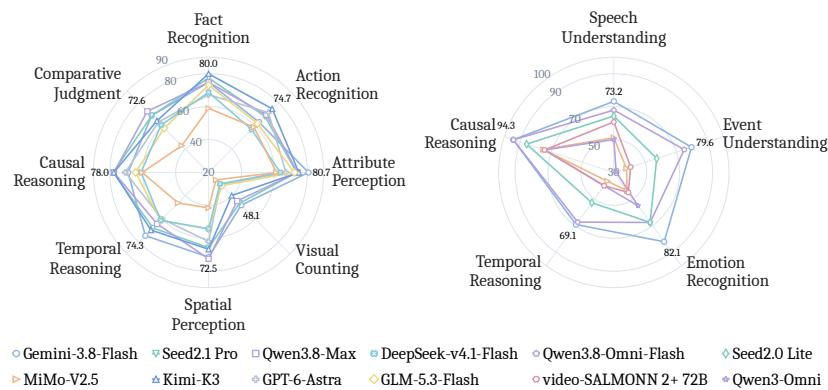  
(a) Performance on OmniCompass-VL (b) Performance on OmniCompass-AV  
Figure 5. Fine-grained QA performance across tracks. We report category-wise $\mathrm { C S } ^ { \mathrm { \check { Q } A } }$ scores in percent.

derstanding at 31.5%. (ii) Open-Source Models Lag Most in Audio-Visual Event Binding. In Figure 5(b), the best proprietary and open-source $\mathrm { C S ^ { Q A } }$ scores difer by 12.5% on Speech Understanding. The gap reaches 38.9% on Event Understanding, which requires linking audio cues to visible entities, actions, or scene context. (iii) Reference Efects and Consistency Gaps Persist with Audio. Text+Image improves SG $\mathrm { m } _ { \mathrm { s I o U } }$ and QA accuracy for 12 of 17 models each, but TG $\scriptstyle \mathrm { ~ \operatorname { m } _ { t I o U } ~ }$ for only five. MiMo-V2.5 achieves 59.2% and 58.7% QA accuracy under Text and Text+Image, respectively, but only 47.3% in $\mathrm { C S ^ { Q A } }$ . Similar aggregate accuracy therefore does not ensure correct answers on the same eligible pairs across settings.

Across both tracks, open-source models trail proprietary models, especially in audio-visual understanding. Cross-reference consistency, fine-grained perception, and audio-visual event binding remain challenging. Future models therefore need stronger multimodal alignment and audio-aware grounding.

## 4.3 Analysis Experiments

Impact of Frame-Level Timestamps. Figure 6 shows that timestamps improve $\mathrm { C S ^ { A v g } }$ in all five modeltrack configurations, with gains in 14 of 15 task-level comparisons. On the VL track, Gemini-3.8-Flash, Qwen3.5-397B-A17B, and Qwen3.8-27B gain 7.0%, 10.4%, and 2.3%, averaging 6.5%. On the AV track, Gemini-3.8-Flash and Qwen3.8-Omni-Flash gain 3.6% and 6.2%, averaging 4.9%. VL gains concentrate in TG: Gemini-3.8-Flash and Qwen3.5-397B-A17B gain 18.3% and 18.2%. In AV, Qwen3.8-Omni-Flash gains 16.0% in SG, while TG changes by -0.2% to +0.8% across both models. QA improves in every comparison by 0.7%–5.9%. These results suggest that timestamps help align sampled frames with temporal positions.

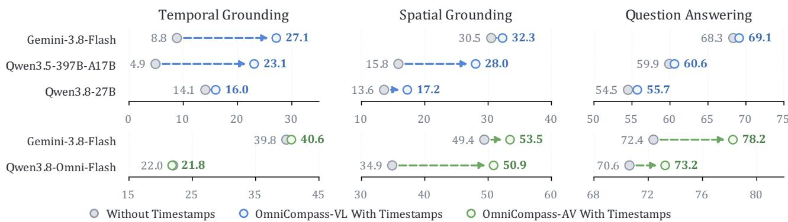  
Figure 6. Impact of frame-level timestamps. Columns report $\mathrm { C S ^ { T G } , C S ^ { S G } }$ , and $\mathrm { C S ^ { Q A } }$ in percent. Dashed links connect scores without and with timestamps. Axis ranges vary by panel.

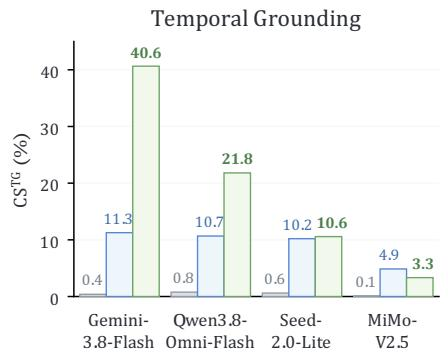

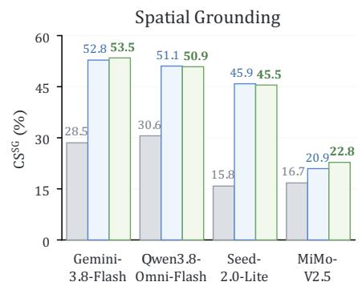

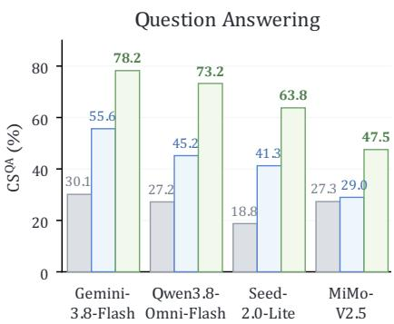  
Figure 7. Impact of input modalities on OmniCompass-AV. Bars report CS in percent for Text-only, Vision, and Vision+Audio on matched eligible pairs within each model and task.

Impact of Input Modalities. Figure 7 compares task-level CS across Text-only, Vision, and Vision+Audio for four OmniCompass-AV models. All comparisons use matched eligible pairs within each model and task. Text-only retains both question wordings but removes all media, including reference images. Its $\mathrm { C S ^ { T G } }$ is only 0.1–0.8%, versus 18.8%–30.1% in $\mathrm { C S } ^ { \mathrm { Q A } }$ . Vision improves all 12 model-task comparisons. Adding audio raises $\mathrm { C S ^ { Q A } }$ by 18.6%–28.1%, averaging 22.9%. Gemini-3.8-Flash and Qwen3.8-Omni-Flash gain 29.4% and 11.1% in $\mathrm { C S ^ { T G } }$ , respectively, whereas MiMo-V2.5 loses 1.5%. $\mathrm { C S } ^ { \mathrm { S G } }$ changes range from -0.4% to +1.8%. Thus, adding audio consistently improves $\mathrm { C S ^ { Q A } }$ across all four tested models, whereas TG gains vary by model and SG gains remain limited. Additional analyses are provided in Appendix B.

## 5 Conclusion

In this paper, we introduce OmniCompass, a holistic benchmark for omni-modal video grounding and understanding. It unifies TG, SG, and QA across VL and AV tracks with paired Text and Text+Image specifications for the same video, target, task semantics, and ground truth. The benchmark covers 820 manually annotated videos across seven domains, including a 240-video AV subset with native audio. The paired settings and CS metric assess both prediction correctness and consistency under changes in target specification. Leading proprietary models outperform open-source models, especially in audio-visual understanding, while precise grounding, fine-grained perception, and audio-visual event binding remain challenging. Reference images yield task-dependent efects, while timestamps improve model performance in both tracks. These findings motivate stronger multimodal alignment and audio-aware grounding to connect target specifications with the relevant events and evidence. OmniCompass supports joint evaluation of QA, precise grounding, and cross-reference consistency across tasks and modalities, providing a basis for diagnosing model limitations and measuring progress toward reliable omni-modal video understanding.

## References

Xiang An, Yin Xie, Feilong Tang, Yunyao Yan, Huajie Tan, Didi Zhu, Changrui Chen, Xiuwei Zhao, Bin Qin, Kaicheng Yang, et al. Llava-onevision-2: Towards next-generation perceptual intelligence. arXiv preprint arXiv:2605.25979, 2026.

Shuai Bai, Yuxuan Cai, Ruizhe Chen, Keqin Chen, Xionghui Chen, Zesen Cheng, Lianghao Deng, Wei Ding, Chang Gao, Chunjiang Ge, et al. Qwen3-vl technical report. arXiv preprint arXiv:2511.21631, 2025.

Jianghan Chao, Jianzhang Gao, Wenhui Tan, Yuchong Sun, Ruihua Song, and Liyun Ru. Jointavbench: A benchmark for joint audio-visual reasoning evaluation. In Proceedings of the International Conference on Learning Representations, 2026.

Guo Chen, Yicheng Liu, Yifei Huang, Baoqi Pei, Jilan Xu, Yuping He, Tong Lu, Yali Wang, and Limin Wang. Cg-bench: Clue-grounded question answering benchmark for long video understanding. In Proceedings of the International Conference on Learning Representations, 2025a.

Joya Chen, Ziyun Zeng, Yiqi Lin, Wei Li, Zejun Ma, and Mike Zheng Shou. Livecc: Learning video llm with streaming speech transcription at scale. In Proceedings of the Computer Vision and Pattern Recognition Conference, pp. 29083–29095, 2025b.

Yu Chen, Caorui Li, Ziyu Xiong, Yidong Wang, Mingqi Gao, Shuman Liu, Biao Liu, Chunfeng Yang, Anxiang Zeng, Haibo Zhang, et al. Omnireasoner: Thinking with long audio-video via native tool use. arXiv preprint arXiv:2607.19339, 2026.

Zhe Chen, Weiyun Wang, Hao Tian, Shenglong Ye, Zhangwei Gao, Erfei Cui, Wenwen Tong, Kongzhi Hu, Jiapeng Luo, Zheng Ma, Ji Ma, Jiaqi Wang, Xiaoyi Dong, Hang Yan, Hewei Guo, Conghui He, Botian Shi, Zhenjiang Jin, Chao Xu, Bin Wang, Xingjian Wei, Wei Li, Wenjian Zhang, Bo Zhang, Pinlong Cai, Licheng Wen, Xiangchao Yan, Min Dou, Lewei Lu, Xizhou Zhu, Tong Lu, Dahua Lin, Yu Qiao, Jifeng Dai, and Wenhai Wang. How far are we to gpt-4v? closing the gap to commercial multimodal models with open-source suites. arXiv preprint arXiv:2404.16821, 2024.

Zesen Cheng, Sicong Leng, Hang Zhang, Yifei Xin, Xin Li, Guanzheng Chen, Yongxin Zhu, Wenqi Zhang, Ziyang Luo, Deli Zhao, et al. Videollama 2: Advancing spatial-temporal modeling and audio understanding in video-llms. arXiv preprint arXiv:2406.07476, 2024.

Zixu Cheng, Jian Hu, Ziquan Liu, Chenyang Si, Wei Li, and Shaogang Gong. V-star: Benchmarking video-llms on video spatio-temporal reasoning. In Proceedings ofthe IEEE/CVF Conference on Computer Vision and Pattern Recognition, pp. 9155–9164, 2026.

Junbo Cui, Bokai Xu, Chongyi Wang, Tianyu Yu, Weiyue Sun, Yingjing Xu, Tianran Wang, Zhihui He, Wenshuo Ma, Tianchi Cai, et al. Minicpm-o 4.5: Towards real-time full-duplex omni-modal interaction. arXiv preprint arXiv:2604.27393, 2026.

DeepSeek-AI. Deepseek-v4.1-flash: Pushing the limits of kv cache compression, 2026.

Chaoyou Fu, Yuhan Dai, Yongdong Luo, Lei Li, Shuhuai Ren, Renrui Zhang, Zihan Wang, Chenyu Zhou, Yunhang Shen, Mengdan Zhang, et al. Video-mme: The first-ever comprehensive evaluation benchmark of multi-modal llms in video analysis. In Proceedings ofthe IEEE/CVF Conference on Computer Vision and Pattern Recognition, pp. 24108–24118, 2025a.

Chaoyou Fu, Haojia Lin, Xiong Wang, Yunhang Shen, Xiaoyu Liu, Haoyu Cao, Zuwei Long, Heting Gao, Ke Li, Long MA, et al. Vita-1.5: Towards gpt-4o level real-time vision and speech interaction. In Proceedings of the Advances in Neural Information Processing Systems, volume 38, pp. 75300–75320, 2025b.

Chaoyou Fu, Haozhi Yuan, Yuhao Dong, Yi-Fan Zhang, Yunhang Shen, Xiaoxing Hu, Xueying Li, Jinsen Su, Chengwu Long, Xiaoyao Xie, et al. Video-mme-v2: Towards the next stage in benchmarks for comprehensive video understanding. arXiv preprint arXiv:2604.05015, 2026.

Hong Gao, Jingyu Wu, Xiangkai Xu, Kangni Xie, Yunchen Zhang, Bin Zhong, Xurui Gao, and Min-Ling Zhang. Omniground: A comprehensive spatio-temporal grounding benchmark for real-world complex scenarios. In Proceedings ofthe IEEE/CVF Conference on Computer Vision and Pattern Recognition, pp. 17588–17597, 2026.

Jiyang Gao, Chen Sun, Zhenheng Yang, and Ram Nevatia. Tall: Temporal activity localization via language query. In Proceedings ofthe IEEE/CVF International Conference on Computer Vision, pp. 5267–5275, 2017.

Google. A new era of intelligence with Gemini 3, 2025. URL https://blog.google/products/gemini/gemini-3/.

Jack Hong, Shilin Yan, Jiayin Cai, Xiaolong Jiang, Yao Hu, and Weidi Xie. Worldsense: Evaluating real-world omnimodal understanding for multimodal llms. In Proceedings of the International Conference on Learning Representations, 2026.

Wenyi Hong, Yean Cheng, Zhuoyi Yang, Weihan Wang, Lefan Wang, Xiaotao Gu, Shiyu Huang, Yuxiao Dong, and Jie Tang. Motionbench: Benchmarking and improving fine-grained video motion understanding for vision language models. In Proceedings of the IEEE/CVF Conference on Computer Vision and Pattern Recognition, pp. 8450–8460, 2025.

Kimi Team, Tongtong Bai, Yifan Bai, Yiping Bao, M. C., Jianfeng Cai, Xinyuan Cai, Peizhou Cao, Yuxuan Cao, Ziwei Chai, et al. Kimi K3: Open frontier intelligence. arXiv preprint arXiv:2607.24653, 2026.

Jie Lei, Licheng Yu, Mohit Bansal, and Tamara Berg. Tvqa: Localized, compositional video question answering. In Proceedings of the Conference on Empirical Methods in Natural Language Processing, pp. 1369–1379, 2018.

Jie Lei, Licheng Yu, Tamara Berg, and Mohit Bansal. Tvqa+: Spatio-temporal grounding for video question answering. In Proceedings of the Annual Meeting of the Association for Computational Linguistics, pp. 8211–8225, 2020.

Jie Lei, Tamara L Berg, and Mohit Bansal. Detecting moments and highlights in videos via natural language queries. In Proceedings of the Advances in Neural Information Processing Systems, volume 34, pp. 11846–11858, 2021.

Bo Li, Yuanhan Zhang, Dong Guo, Renrui Zhang, Feng Li, Hao Zhang, Kaichen Zhang, Yanwei Li, Ziwei Liu, and Chunyuan Li. Llava-onevision: Easy visual task transfer. arXiv preprint arXiv:2408.03326, 2024a.

Caorui Li, Yu Chen, Yiyan Ji, Jin Xu, Zhenyu Cui, Shihao Li, Yuanxing Zhang, Jiafu Tang, Zhenghao Song, Dingling Zhang, et al. Omnivideobench: Towards audio-visual understanding evaluation for omni mllms. In Proceedings ofthe International Conference on Learning Representations, 2026.

Kunchang Li, Yali Wang, Yinan He, Yizhuo Li, Yi Wang, Yi Liu, Zun Wang, Jilan Xu, Guo Chen, Ping Luo, et al. Mvbench: A comprehensive multi-modal video understanding benchmark. In Proceedings of the IEEE/CVF Conference on Computer Vision and Pattern Recognition, pp. 22195–22206, 2024b.

Yixuan Li, Lei Chen, Runyu He, Zhenzhi Wang, Gangshan Wu, and Limin Wang. Multisports: A multi-person video dataset of spatio-temporally localized sports actions. In Proceedings of the IEEE/CVF International Conference on Computer Vision, pp. 13536–13545, 2021.

Weifeng Lin, Xinyu Wei, Ruichuan An, Gao Peng, Bocheng Zou, Yulin Luo, Siyuan Huang, Shanghang Zhang, and Hongsheng Li. Draw-and-understand: Leveraging visual prompts to enable mllms to comprehend what you want. In Proceedings ofthe International Conference on Learning Representations, 2025a.

Weifeng Lin, Xinyu Wei, Ruichuan An, Tianhe Ren, Tingwei Chen, Renrui Zhang, Ziyu Guo, Wentao Zhang, Lei Zhang, and Hongsheng Li. Perceive anything: Recognize, explain, caption, and segment anything in images and videos. In Proceedings ofthe Advances in Neural Information Processing Systems, volume 38, 2025b.

Haotian Liu, Chunyuan Li, Yuheng Li, and Yong Jae Lee. Improved baselines with visual instruction tuning. In Proceedings of the IEEE/CVF Conference on Computer Vision and Pattern Recognition, pp. 26286–26296, 2024a.

Yuanxin Liu, Shicheng Li, Yi Liu, Yuxiang Wang, Shuhuai Ren, Lei Li, Sishuo Chen, Xu Sun, and Lu Hou. Tempcompass: Do video llms really understand videos? In Findings ofthe Associationfor Computational Linguistics: ACL 2024, pp. 8731–8772, 2024b.

Zuyan Liu, Yuhao Dong, Jiahui Wang, Ziwei Liu, Winston Hu, Jiwen Lu, and Yongming Rao. Ola: Pushing the frontiers of omni-modal language model with progressive modality alignment. arXiv preprin arXiv:2502.04328, 2025.

David Ma, Yuanxing Zhang, Jincheng Ren, Jarvis Guo, Yifan Yao, Zhenlin Wei, Zhenzhu Yang, Zhongyuan Peng, Boyu Feng, Jun Ma, Xiao Gu, Zhoufutu Wen, King Zhu, Yancheng He, Meng Cao, Shiwen Ni, Jiaheng Liu, Wenhao Huang, Ge Zhang, and Xiaojie Jin. Iv-bench: A benchmark for image-grounded video perception and reasoning in multimodal llms. In Proceedings ofthe International Conference on Learning Representations, 2026.

Karttikeya Mangalam, Raiymbek Akshulakov, and Jitendra Malik. Egoschema: A diagnostic benchmark for very long-form video language understanding. In Proceedings ofthe Advances in Neural Information Processing Systems, volume 36, pp. 46212–46244, 2023.

Jiahao Meng, Xiangtai Li, Haochen Wang, Yue Tan, Tao Zhang, Lingdong Kong, Yunhai Tong, Anran Wang, Zhiyang Teng, Yujing Wang, et al. Open-o3-video: Grounded video reasoning with explicit spatio-temporal evidence. In Proceedings ofthe International Conference on Machine Learning, 2026.

MiMo-V2.5. Mimo-v2.5. https://huggingface.co/collections/XiaomiMiMo/mimo-v25, 2026.

Furkan Mumcu, Michael Jones, Yasin Yilmaz, and Anoop Cherian. Complexvad: Detecting interaction anomalies in video. In Proceedings of the Winter Conference on Applications of Computer Vision, pp. 1093–1102, 2025.

OpenAI. GPT-5.5 System Card, 2026a. URL https://openai.com/index/gpt-5-5-system-card/.

OpenAI. GPT-5.6: Frontier Intelligence that Scales with Your Ambition, 2026b. URL https://openai.com/ index/gpt-5-6/.

OpenAI. GPT-6 Astra: A New Generation of Intelligence, 2026c. URL https://openai.com/index/gpt-6-astra/.

Qwen Team. Qwen3.8-max: A new bar for coding and cowork, August 2026a. URL https://qwen.ai/blog?id= qwen3.8.

Qwen Team. Qwen3.6-35B-A3B: Agentic coding power, now open to all, April 2026b. URL https://qwen.ai/ blog?id=qwen3.6-35b-a3b.

Qwen Team, Alibaba. Qwen3-Omni-Flash-2025-12-01: Hear You. See You. Follow Smarter!, 2025. URL https://qwen.ai/blog?id=qwen3-omni-20251201.

Bharathkumar Ramachandra and Michael Jones. Street scene: A new dataset and evaluation protocol for video anomaly detection. In Proceedings of the IEEE/CVF Winter Conference on Applications of Computer Vision, pp. 2569–2578, 2020.

Bytedance Seed. Seed2. 0 model card: Towards intelligence frontier for real-world complexity. arXiv preprint arXiv:2607.00248, 2026.

Enxin Song, Wenhao Chai, Guanhong Wang, Yucheng Zhang, Haoyang Zhou, Feiyang Wu, Haozhe Chi, Xun Guo, Tian Ye, Yanting Zhang, et al. Moviechat: From dense token to sparse memory for long video understanding. In Proceedings ofthe IEEE/CVF Conference on Computer Vision and Pattern Recognition, pp. 18221–18232, 2024.

Waqas Sultani, Chen Chen, and Mubarak Shah. Real-world anomaly detection in surveillance videos. In Proceedings of the IEEE/CVF Conference on Computer Vision and Pattern Recognition, pp. 6479–6488, 2018.

Changli Tang, Yixuan Li, Yudong Yang, Jimin Zhuang, Guangzhi Sun, Wei Li, Zejun Ma, and Chao Zhang. video-SALMONN 2: Captioning-Enhanced Audio-Visual Large Language Models. arXiv preprint arXiv:2506.15220, 2025.

Feilong Tang, Xiang An, Yunyao Yan, Yin Xie, Bin Qin, Kaicheng Yang, Yifei Shen, Yuanhan Zhang, Chunyuan Li, Shikun Feng, et al. Onevision-encoder: Codec-aligned sparsity as a foundational principle for multimodal intelligence. arXiv preprint arXiv:2602.08683, 2026.

Zongheng Tang, Yue Liao, Si Liu, Guanbin Li, Xiaojie Jin, Hongxu Jiang, Qian Yu, and Dong Xu. Humancentric spatio-temporal video grounding with visual transformers. IEEE Transactions on Circuits and Systems for Video Technology, 32(12):8238–8249, 2021.

Kwai Keye Team, Bin Wen, Changyi Liu, Chengru Song, Chongling Rao, Guowang Zhang, Han Li, Haonan Fan, Hengrui Ju, Jiankang Chen, et al. Kwai keye-vl-2.0 technical report. arXiv preprint arXiv:2606.10651, 2026.

Qwen Team. Qwen3.5: Towards native multimodal agents, February 2026a. URL https://qwen.ai/blog?id= qwen3.5.

Qwen Team. Qwen3. 5-omni technical report. arXiv preprint arXiv:2604.15804, 2026b.

Shihao Wang, Guo Chen, De-an Huang, Zhiqi Li, Minghan Li, Guilin Liu, Jan Kautz, Jose M Alvarez, Lei Zhang, and Zhiding Yu. Videoitg: Multimodal video understanding with instructed temporal grounding. In Proceedings ofthe IEEE/CVF Conference on Computer Vision and Pattern Recognition, pp. 24640–24650, 2026a.

Shihao Wang, Shilong Liu, Yuanguo Kuang, Xinyu Wei, Yangzhou Liu, Zhiqi Li, Yunze Man, Guo Chen, Andrew Tao, Guilin Liu, et al. Locateanything: Fast and high-quality vision-language grounding with parallel box decoding. In European Conference on Computer Vision, pp. 336–357. Springer, 2026b.

Weihan Wang, Zehai He, Wenyi Hong, Yean Cheng, Xiaohan Zhang, Ji Qi, Ming Ding, Xiaotao Gu, Shiyu Huang, Bin Xu, et al. Lvbench: An extreme long video understanding benchmark. In Proceedings ofthe IEEE/CVF International Conference on Computer Vision, pp. 22958–22967, 2025a.

Weiyun Wang, Zhangwei Gao, Lixin Gu, Hengjun Pu, Long Cui, Xingguang Wei, Zhaoyang Liu, Linglin Jing, Shenglong Ye, Jie Shao, et al. Internvl3. 5: Advancing open-source multimodal models in versatility, reasoning, and eficiency. arXiv preprint arXiv:2508.18265, 2025b.

Weizhi Wang, Zili Wang, Yuqi Huo, Yuanting Chen, Xuezheng Xu, Jinguo Zhu, Wangbo Zhao, Wei Li, and Weijie Su. Vtool-r1: Vlms learn to think with images via reinforcement learning. In ICLR, 2026c.

Haoning Wu, Dongxu Li, Bei Chen, and Junnan Li. Longvideobench: A benchmark for long-context interleaved video-language understanding. In Proceedings of the Advances in Neural Information Processing Systems, volume 37, pp. 28828–28857, 2024.

Junbin Xiao, Xindi Shang, Angela Yao, and Tat-Seng Chua. Next-qa: Next phase of question-answering to explaining temporal actions. In Proceedings of the IEEE/CVF Conference on Computer Vision and Pattern Recognition, pp. 9777–9786, 2021.

Zhenghao Xing, Ruiyang Xu, Yuxuan Wang, Jinzheng He, Ziyang Ma, Qize Yang, Yunfei Chu, Jin Xu, Junyang Lin, Chi-Wing Fu, and Pheng-Ann Heng. Native active perception as reasoning for omni-modal understanding. In ICML, 2026.

Jin Xu, Zhifang Guo, Jinzheng He, Hangrui Hu, Ting He, Shuai Bai, Keqin Chen, Jialin Wang, Yang Fan, Kai Dang, et al. Qwen2. 5-omni technical report. arXiv preprint arXiv:2503.20215, 2025a.

Jin Xu, Zhifang Guo, Hangrui Hu, Yunfei Chu, Xiong Wang, Jinzheng He, Yuxuan Wang, Xian Shi, Ting He, Xinfa Zhu, Yuanjun Lv, Yongqi Wang, Dake Guo, He Wang, Linhan Ma, Pei Zhang, Xinyu Zhang, Hongkun Hao, Zishan Guo, Baosong Yang, Bin Zhang, Ziyang Ma, Xipin Wei, Shuai Bai, Keqin Chen, Xuejing Liu, Peng Wang, Mingkun Yang, Dayiheng Liu, Xingzhang Ren, Bo Zheng, Rui Men, Fan Zhou, Bowen Yu, Jianxin Yang, Le Yu, Jingren Zhou, and Junyang Lin. Qwen3-omni technical report. arXiv preprint arXiv:2509.17765, 2025b.

Yudong Yang, Jimin Zhuang, Changli Tang, Guangzhi Sun, Yixuan Li, Peihan Li, Yifan Jiang, Wei Li, Zejun Ma, and Chao Zhang. Audio-centric video understanding benchmark without text shortcut. In Proceedings ofthe Conference on Empirical Methods in Natural Language Processing, 2025.

Zuhao Yang, Sudong Wang, Kaichen Zhang, Keming Wu, Sicong Leng, Yifan Zhang, Chengwei Qin, Shijian Lu, Xingxuan Li, and Lidong Bing. Longvt: Incentivizing thinking with long videos via native tool calling. In Proceedings ofthe IEEE/CVF Conference on Computer Vision and Pattern Recognition, 2026a.

Zuhao Yang, Kaichen Zhang, Sudong Wang, Keming Wu, Zhongyu Yang, Bo Li, Xiaojuan Qi, Shijian Lu, Xingxuan Li, and Lidong Bing. Paravt: Taming the tool prior paradox for parallel tool use in agentic video reinforcement learning. arXiv preprint arXiv:2605.20342, 2026b.

Zhou Yu, Dejing Xu, Jun Yu, Ting Yu, Zhou Zhao, Yueting Zhuang, and Dacheng Tao. Activitynet-qa: A dataset for understanding complex web videos via question answering. In Proceedings ofthe AAAI Conference on Artificial Intelligence, volume 33, pp. 9127–9134, 2019.

Aohan Zeng, Xin Lv, Zhenyu Hou, Zhengxiao Du, Qinkai Zheng, Bin Chen, Da Yin, Chendi Ge, Chenghua Huang, Chengxing Xie, et al. Glm-5: from vibe coding to agentic engineering. arXiv preprint arXiv:2602.15763, 2026a.

Xiangyu Zeng, Zhiqiu Zhang, Yuhan Zhu, Xinhao Li, Zikang Wang, Changlian Ma, Qingyu Zhang, Zizheng Huang, Kun Ouyang, Tianxiang Jiang, Ziang Yan, Yi Wang, Hongjie Zhang, Yali Wang, and Limin Wang. Video-o3: Native interleaved clue seeking for long video multi-hop reasoning. In Proceedings of the International Conference on Machine Learning, 2026b.

Boqiang Zhang, Kehan Li, Zesen Cheng, Zhiqiang Hu, Yuqian Yuan, Guanzheng Chen, Sicong Leng, Yuming Jiang, Hang Zhang, Xin Li, et al. Videollama 3: Frontier multimodal foundation models for image and video understanding. arXiv preprint arXiv:2501.13106, 2025.

Jun Zhang, Teng Wang, Yuying Ge, Yixiao Ge, Xinhao Li, and Limin Wang. Timelens: Rethinking video temporal grounding with multimodal llms. In Proceedings ofthe IEEE/CVF Conference on Computer Vision and Pattern Recognition, pp. 10419–10429, 2026.

Yuanhan Zhang, Jinming Wu, Wei Li, Bo Li, Zejun Ma, Ziwei Liu, and Chunyuan Li. Video instruction tuning with synthetic data. arXiv preprint arXiv:2410.02713, 2024.

Zhu Zhang, Zhou Zhao, Yang Zhao, Qi Wang, Huasheng Liu, and Lianli Gao. Where does it exist: Spatiotemporal video grounding for multi-form sentences. In Proceedings of the IEEE/CVF Conference on Computer Vision and Pattern Recognition, pp. 10668–10677, 2020.

Junjie Zhou, Yan Shu, Bo Zhao, Boya Wu, Zhengyang Liang, Shitao Xiao, Minghao Qin, Xi Yang, Yongping Xiong, Bo Zhang, et al. Mlvu: Benchmarking multi-task long video understanding. In Proceedings ofthe IEEE/CVF Conference on Computer Vision and Pattern Recognition, pp. 13691–13701, 2025a.

Ziwei Zhou, Rui Wang, and Zuxuan Wu. Daily-omni: Towards audio-visual reasoning with temporal alignment across modalities. arXiv preprint arXiv:2505.17862, 2025b.

Yuhan Zhu, Changlian Ma, Xiangyu Zeng, Xinhao Li, Zhiqiu Zhang, Songze Li, Jun Zhang, Tianxiang Jiang, Yuandong Yang, Ziang Yan, et al. Timelens2: Generalist video temporal grounding with multimodal llms. arXiv preprint arXiv:2607.17423, 2026.

## Appendix

A Additional Results 16   
A.1 Performance across Video Durations 16   
A.2 Grounding across Target Granularity 17   
A.3 Performance across Video Domains 17   
B Additional Analyses 17   
B.1 Impact of Frame Scaling 17   
B.2 Impact of Reference Specification 17   
B.3 Cross-Specification Consistency 18   
B.4 Qualitative Analysis . 19   
C Benchmark Construction 21   
C.1 Video Sources and Selection 21   
C.2 Task-Oriented Candidate Scoring 22   
C.3 Question-Answering Taxonomy 22   
C.4 Reference Design and Provenance 23   
D Annotation Quality and Verification 23   
D.1 Review Criteria and Repair Records 24   
D.2 Human Efort 24   
E Evaluation Protocols and Prompts 29   
E.1 Inputs and Paired Settings . 29   
E.2 Prompt Examples 29

## A Additional Results

## A.1 Performance across Video Durations

Figure A1 compares ten models across short, medium, and long videos in OmniCompass-VL. All ten score lower on long than short videos in TG. Seed-2.1-Pro-260915 shows the largest decline, from 33.4% to 15.1%, while Gemini-3.8-Flash falls from 33.8% to 21.0%. Only five models decline in SG and six in QA. Thus, the direction of the duration association is more consistent for temporal localization than for the other tasks. These groups also difer in content and target granularity, so the comparison does not isolate video duration as the cause of lower scores.

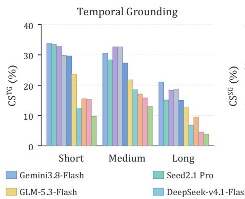

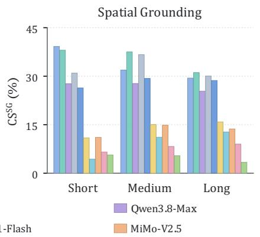

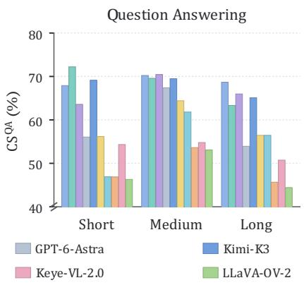  
Figure A1. Performance across video durations in OmniCompass-VL. Bars show task-specific CS in percent for short videos below 90 seconds, medium videos from 90 to below 300 seconds, and long videos of at least 300 seconds. Each model uses its own eligible pairs.

## A.2 Grounding across Target Granularity

Figure A2 compares ten VL models and six AV models across relative target-duration and box-area groups. All ten VL models improve monotonically in TG as the relative target duration increases. All six AV models also peak in the highest duration-ratio quartile. Gemini-3.8-Flash rises from 7.9% to 43.1% on VL and from 27.1% to 56.2% on AV between the extreme groups. Spatial trends difer: every VL model peaks in the largest-box group, whereas every AV model peaks in the third quartile. Gemini-3.8-Flash scores 65.5% in the third AV quartile and 53.6% in the fourth.

Quartile boundaries are computed from all videos separately for each track; scores use the common eligible pairs within each task. The resulting groups are not equal in size, and their boundaries difer between VL and AV. IoU also depends on target extent, so these curves describe associations rather than an isolated granularity efect. This contrast does not isolate audio efects: tasks, target distributions, and model rosters difer.

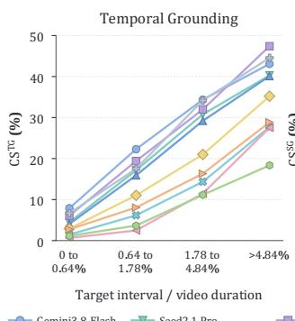

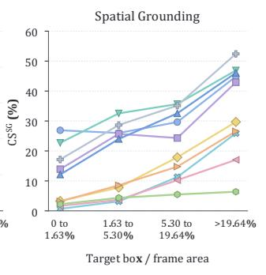  
(a) Grounding Performance on OmniCompass-VL

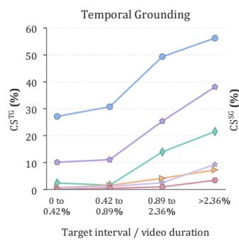

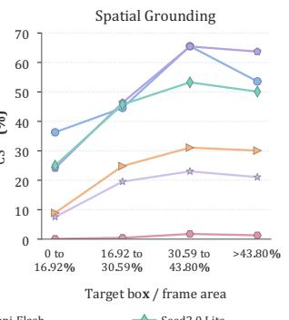  
(b) Grounding Performance on OmniCompass-AV  
Figure A2. Grounding across target granularity. Curves report $\mathrm { C S ^ { T G } }$ and $\mathrm { C S } ^ { \mathrm { S G } }$ in percent across quartiles of target-to-video duration and mean endpoint box-to-frame area. Quartiles are track-specific; models share eligible pairs within each track and task.

## A.3 Performance across Video Domains

Figure A3 compares the ten VL models across seven domains. All ten obtain their lowest SG and QA scores in Trafic, with equal-weight model means of 7.8% and 37.3%. Variety has the lowest mean TG score at 8.1%, but the highest mean SG score at 26.6%. Strong spatial grounding can therefore coexist with weak temporal localization within the same domain. These rankings apply to the shared eligible subsets, not necessarily every video in each domain. Domain comparisons also reflect diferences in duration, target size, and QA content.

## B Additional Analyses

## B.1 Impact of Frame Scaling

Increasing the frame budget improves performance in most settings, but the efect depends on the track and task. On OmniCompass-VL, all three tasks improve significantly for both models from 8 to 128 frames. TG CS increases by 22.2% and 19.6% for Gemini-3.8-Flash and Qwen3.5-397B-A17B, respectively; SG increases by 22.8% and 16.9%, while QA increases by 20.0% and 18.6%. The gains are smaller and more task-dependent on OmniCompass-AV. SG improves by 18.3% for Gemini-3.8-Flash and 22.3% for Qwen3.8-Omni-Flash, while QA improves by 9.9% and 13.4% from 8 to 128 frames. In contrast, TG remains nearly unchanged. We suppose that audio already provides useful temporal cues for AV TG (see Figure 7), leaving denser visual sampling with limited additional temporal evidence, whereas SG and QA can benefit from finer spatial details and richer visual context. Besides, more frames also increase visual input and inference cost, so the preferred budget depends on the task and track rather than always favoring the largest setting.

## B.2 Impact of Reference Specification

Figure B2 compares Text and Text+Image across reference types. For action-conditioned questions, Text+Image improves TG for seven of ten models and SG for nine, but lowers QA accuracy for eight. Gemini-3.8-Flash gains 10.4% in action-conditioned SG, whereas Qwen3.8-Max loses 7.6%. The paired settings change the target description as well as image availability, so these diferences are not a pure image-addition efect. They measure whether performance changes when a visual cue replaces part of the textual target description unde matched evidence and semantics.

Temporal Grounding  
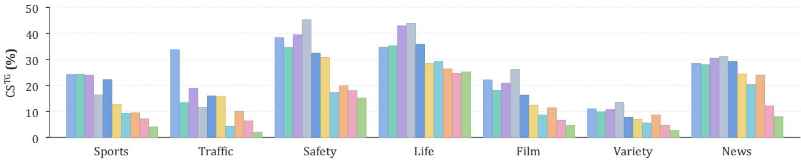

Spatial Grounding  
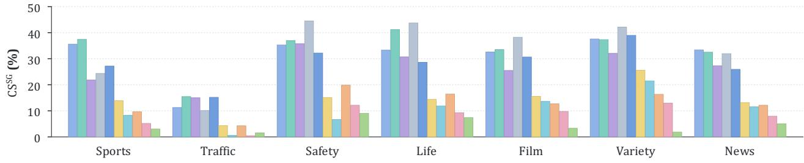

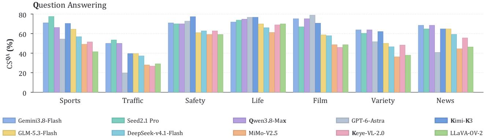  
Figure A3. Performance across video domains in OmniCompass-VL. Bars report task-specific CS in percent for ten models. The shared eligible subsets contain 592 TG, 673 SG, and 689 QA pairs across the seven domains; comparisons use the same instances within each task.

Each task uses the same eligible subset across all ten models. Action-conditioned TG, SG, and QA contain 50, 54, and 31 pairs, respectively. Scene-conditioned TG contains only eight pairs, so its cell values provide limited evidence for a general trend. The heatmap reports mean diferences, not significance; subgroup sizes matter when interpreting their direction.

## B.3 Cross-Specification Consistency

Figure B3 compares paired CS with setting-specific performance. Across the ten models, TG and SG CS average 5.0% and 5.7% below the lower single-setting mean. This gap includes both the cost of requiring overlap with ground truth under both settings and the additional prediction-to-prediction overlap constraint. The latter contributes only 0.3%–1.8% across the model–task combinations. The full gap does not measure prediction disagreement alone.

For QA, 10.5–25.1% of eligible pairs are answered correctly under exactly one setting. Kimi-K3 reaches nearly identical accuracies of 73.0% and 72.9%, yet answers only 67.6% correctly under both. Its 808 pairs comprise 546 correct under both settings, 44 only under Text, 43 only under Text+Image, and 175 under neither. Similar aggregate accuracy can therefore mask diferent instance-level outcomes. Neither-correct pairs may still contain two diferent wrong answers.

(a) OmniCompass-VL  
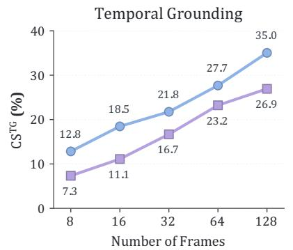

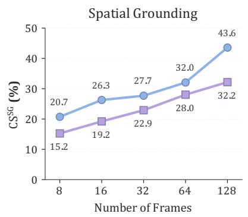

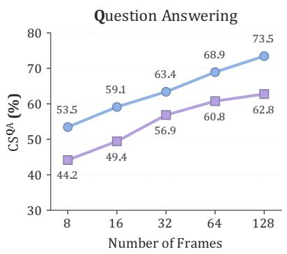

(b) OmniCompass-AV  
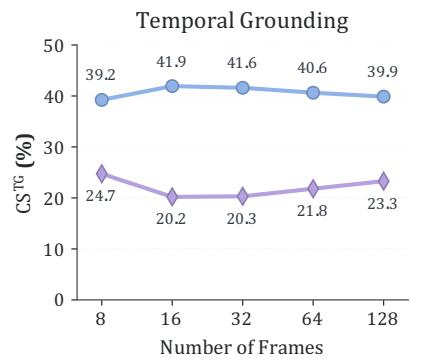

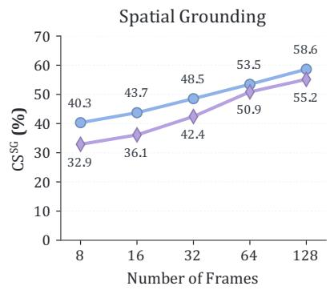

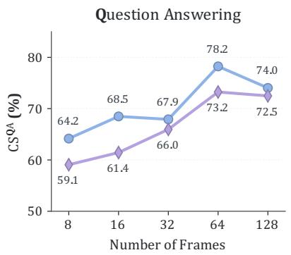

Figure B1. Impact of frame scaling. Each panel reports task-level paired CS (%) under 8, 16, 32, 64, and 128 uniformly sampled frames. Rows correspond to the VL and AV tracks, columns correspond to TG, SG, and QA, and curves distinguish the evaluated models.  
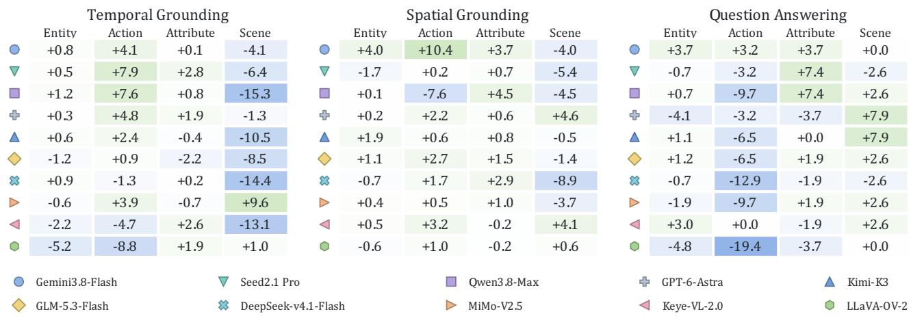  
Figure B2. Efects of reference specification in OmniCompass-VL. Cells show Text+Image minus Text in percent for TG $\scriptstyle \mathrm { ~ \operatorname { m } _ { t I o U } ~ }$ , SG $\mathrm { m } _ { \mathrm { s l o U } }$ , and QA accuracy on shared per-task subsets. Green denotes increases and blue denotes decreases; color does not encode significance.

## B.4 Qualitative Analysis

Figure B4 shows qualitative examples of OmniCompass-VL and OmniCompass-AV across QA, SG, and TG. In the first OmniCompass-VL case, the older man drinks twice, corresponding to option C. Seed-2.1-Pro predicts C under both Text and Text+Image. Switching from Text to Text+Image changes Kimi-K3’s prediction from A to C and GPT-6-Astra’s from A to B. In the second OmniCompass-VL case, the gymnastics team ends with three members kneeling on one knee and three standing, corresponding to option C. Seed-2.1-Pro and Gemini-3.8-Flash select C, whereas GPT-6-Astra selects A.

For OmniCompass-AV, the upper-right QA example asks why the man is sent to prison. He is mistaken for the leader of a communist demonstration, corresponding to option B. Qwen3-Omni-30B-A3B changes from C under Text to B under Text+Image, while Gemini-3.8-Flash and video-SALMONN-2+-72B select B in both settings. The lower-right SG example illustrates the dificulty of SG: Gemini-3.8-Flash obtains the highest score among the three models at only 0.181. Qwen3-Omni-30B-A3B and video-SALMONN-2+-72B score

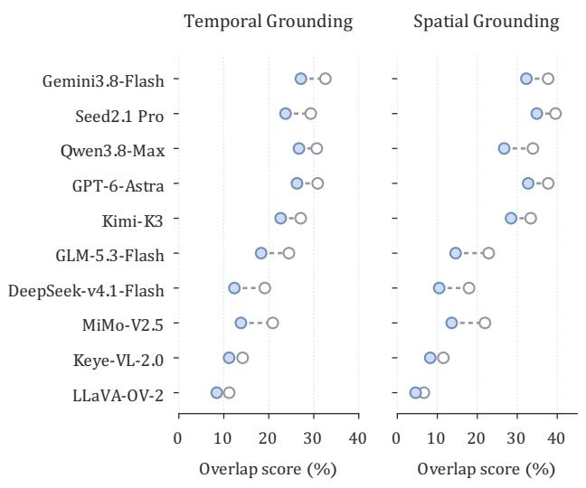

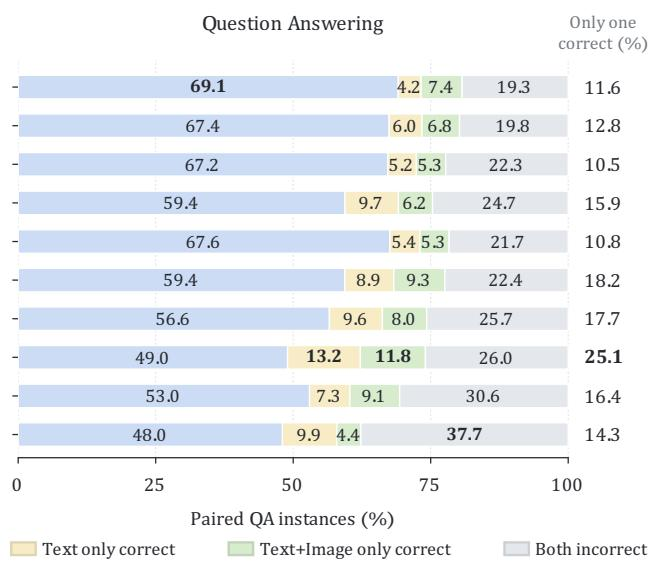

Figure B3. Consistency under paired reference specifications. Grounding compares CS with the lower setting-specific mean on identical eligible pairs. QA bars partition pairs by correctness in the two settings; blue denotes CS<sup>QA</sup>. The right column reports correctness under exactly one setting. Bold indicates category maxima, not uniformly better performance.
<table><tr><td colspan="5">OmniCompass-VL / QA Count the drinks</td></tr><tr><td colspan="3">227.0 s</td><td>275.0 s</td><td>276.0 s</td></tr><tr><td colspan="5">224.5 s 225.5 s Text 273.5 s In the video, how many times in total does the older man in a black suit with short hair drink?</td></tr><tr><td colspan="5">Text + Image In the video, how many times in total does the person in the reference image drink? →</td></tr><tr><td colspan="5">GT: C — 2 times</td></tr><tr><td colspan="2">MODEL TEXT C 2 times [1]</td><td colspan="4">TEXT + IMAGE</td></tr><tr><td colspan="2">Seed-2.1-Pro</td><td colspan="4">C 2 times [1]</td></tr><tr><td colspan="2">GPT-6-Astra A 3 times [0]</td><td colspan="4">B4 times [0]</td></tr><tr><td colspan="2">Gemini-3.8-Flash E 1 time [0]</td><td colspan="4">E 1 time [0]</td></tr><tr><td colspan="2">Kimi-K3 A 3 times [0]</td><td colspan="4">C 2 times [1]</td></tr><tr><td colspan="2"></td><td colspan="4"></td></tr></table>

<table><tr><td>MODEL</td><td>TEXT</td><td>TEXT + IMAGE</td></tr><tr><td>Gemini-3.8-Flash</td><td>B He is mistaken for the leader of a communist demonstration [1]</td><td>B He is mistaken for the leader of a communist demonstration [1]</td></tr><tr><td>Qwen3-Omni-30B-A3B</td><td>C He is mistaken for a smuggler carrying contraband [0]</td><td>B He is mistaken for the leader of a communist demonstration [1]</td></tr><tr><td>video-SALMONN-2+-72B</td><td>B He is mistaken for the leader of a communist demonstration [1]</td><td>B He is mistaken for the leader of a communist demonstration [1]</td></tr></table>

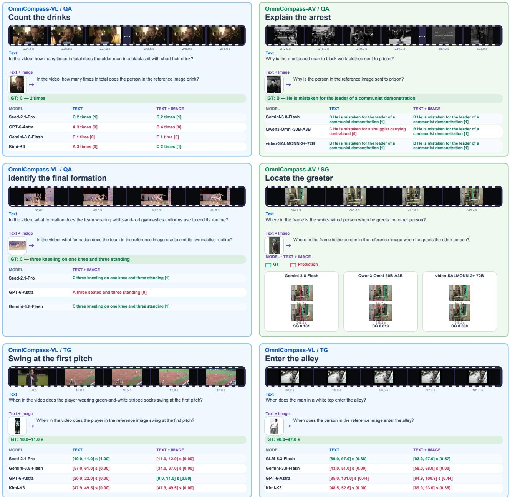

<table><tr><td colspan="4">OmniCompass-VL / QA Identify the final formation</td></tr><tr><td>38.8 s</td><td>39.5 s</td><td>40.2 s</td><td>40.8 s</td></tr><tr><td colspan="4">Text In the video, what formation does the team wearing white-and-red gymnastics uniforms use to end its routine?</td></tr><tr><td colspan="4">Text + Image In the video, what formation does the team in the reference image use to end its gymnastics routine? →</td></tr><tr><td colspan="4">GT: C — three kneeling on one knee and three standing</td></tr><tr><td colspan="4">MODEL TEXT + IMAGE</td></tr><tr><td colspan="2">Seed-2.1-Pro</td><td colspan="2">C three kneeling on one knee and three standing [1]</td></tr><tr><td colspan="2">GPT-6-Astra</td><td colspan="2">A three seated and three standing [0]</td></tr><tr><td colspan="2">Gemini-3.8-Flash</td><td colspan="2">C three kneeling on one knee and three standing [1]</td></tr><tr><td colspan="4"></td></tr><tr><td colspan="4"></td></tr></table>

Figure B4. Qualitative Analysis on our OmniCompass-VL and OmniCompass-AV. Diferent models predictions on six cases in our two evaluation tracks.

0.019 and 0.000, respectively.

## C Benchmark Construction

## C.1 Video Sources and Selection

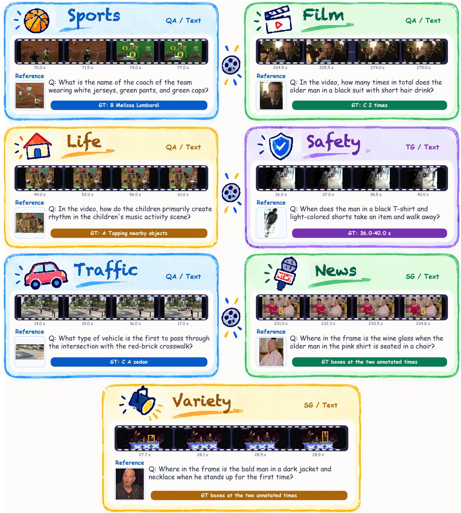  
Real scenes. Diverse questions.Figure C1. Seven high-level domains of videos in OmniCompass.

OmniCompass-VL contains 580 selected public-source videos and 240 self-collected clips. The public component draws from nine dataset families; Table C1 reports the contribution of each source to the 820-video set. The self-collected component comprises 70 movie clips, 70 TV-series clips, 50 variety-show clips, and 50 news clips. These same 240 videos also support OmniCompass-AV, with separate audio-visual task annotations. The two tracks share videos, but their TG, SG, and QA annotations may select diferent events and targets from that shared video content. Figure C1 summarizes the seven high-level video categories in OmniCompass.

Table C1. Nine public source datasets contributing to OmniCompass. Counts refer to selected videos, not complete source releases. Domains follow the final OmniCompass taxonomy; News includes documentary, nature, and knowledge content. Links point to downloads
<table><tr><td>Source</td><td>Videos Selected</td><td>domains</td><td>License / Terms</td><td>Link</td></tr><tr><td>MultiSports (Li et al., 2021)</td><td>83 Sports</td><td></td><td>CC BY-NC 4.0</td><td>https://huggingface.co/datasets/MCG-NJU/ SportsAction</td></tr><tr><td>LiveSports-3K (Chen et al., 2025b)</td><td></td><td>92 Sports</td><td>Not specified</td><td>https://huggingface.co/datasets/stdKonjac/ LiveSports-3K</td></tr><tr><td>UCF-Crime (Sultani et al., 2018)</td><td>111 Safety</td><td></td><td>CC0-1.0 on mirror</td><td>https: //huggingface.co/datasets/AllenXeon/ucf_crime</td></tr><tr><td>CG-Bench (Chen et al., 2025a)</td><td></td><td>58 Film, Variety, News, Life, Safety, Traffic</td><td>MIT; videos for academic research only</td><td>https: //huggingface.co/datasets/CG-Bench/CG-Bench</td></tr><tr><td>MovieChat-1K-test (Song et al., 2024)</td><td>20 News</td><td></td><td>Not specified</td><td>https://huggingface.co/datasets/Enxin/ MovieChat-1K-test</td></tr><tr><td>ActivityNetQA (Yu et al., 2019)</td><td>37 Life</td><td></td><td>MIT; non-commercial use</td><td>https://huggingface.co/datasets/lmms-lab/ ActivityNetQA</td></tr><tr><td>QVHighlights (Lei et al., 2021)</td><td></td><td>88 Life, News</td><td>annotations</td><td>CC BY-NC-SA 4.0 for https://huggingface.co/datasets/yeliudev/ VideoMind-Dataset/tree/main/qvhighlights</td></tr><tr><td>StreetScene (Ramachandra &amp; Jones, 2020)</td><td>32 Traffic</td><td></td><td>CC BY-SA 4.0</td><td>https://zenodo.org/records/10870472</td></tr><tr><td>ComplexVAD (Mumcu et al., 2025)</td><td>59 Traffic</td><td></td><td>CC BY-SA 4.0</td><td>https://zenodo.org/records/15707073</td></tr></table>

Table C1 documents provenance rather than a blanket license for the underlying media. Our annotations and the source videos are distinct assets; reuse of a dataset repository does not itself establish permission to redistribute its videos. The self-collected clips are used for academic evaluation, with rights to the original programs retained by their owners. Access and redistribution must respect the applicable source terms, including any restrictions on the videos and reference images.

We use Qwen3-VL-8B-Instruct (Bai et al., 2025) to profile 8,489 domain-aligned public candidates. The outputs describe entities, actions, attributes, and scenes, together with a video description and corresponding counts. The archived records use identity for entity information. Figure C2 presents the profiling template with this field displayed as entity for consistency with the paper’s terminology. These automatic descriptions guide candidate selection; annotators construct questions, localize the required evidence, and verify answers.

Deterministic filtering removes 1,454 candidates shorter than 30 seconds, leaving 7,035 videos. A further 89 lack at least one of the four cue types, yielding 6,946 eligible public candidates. The filtering criteria require positive entity, action, attribute, and scene counts alongside the metadata used by the selection pipeline. These counts describe the candidate pool before manual task construction, not validated benchmark questions.

## C.2 Task-Oriented Candidate Scoring

Candidate ranking combines reference necessity �, grounding suitability �, temporal-spatial utility �, and evidence diversity � as $S = 0 . 3 5 R + 0 . 2 5 G + 0 . 2 5 T + 0 . 1 5 E$ . These heuristic components use structured profiling statistics, not model evaluation scores. Table C2 defines the recorded component calculations on a zero-to-ten scale. Scores inform shortlisting together with domain, duration, source, and subcategory coverage; human curation determines the retained public set.

## C.3 Question-Answering Taxonomy

QA types are grouped by the dominant operation needed to answer each question. Perception covers direct recognition and judgments from the available evidence, while reasoning covers temporal, causal, or comparative relations. Both tracks use five answer options, but their type sets difer because AV questions are designed to draw on speech, sound, or joint audio-visual evidence. The shared format standardizes scoring without equating dificulty across tracks.

OmniCompass-VL contains eight QA types, listed in Table C3 and shown in Figure C3. Fact Recognition, Action Recognition, Attribute Perception, Visual Counting, and Spatial Perception form the perception group.

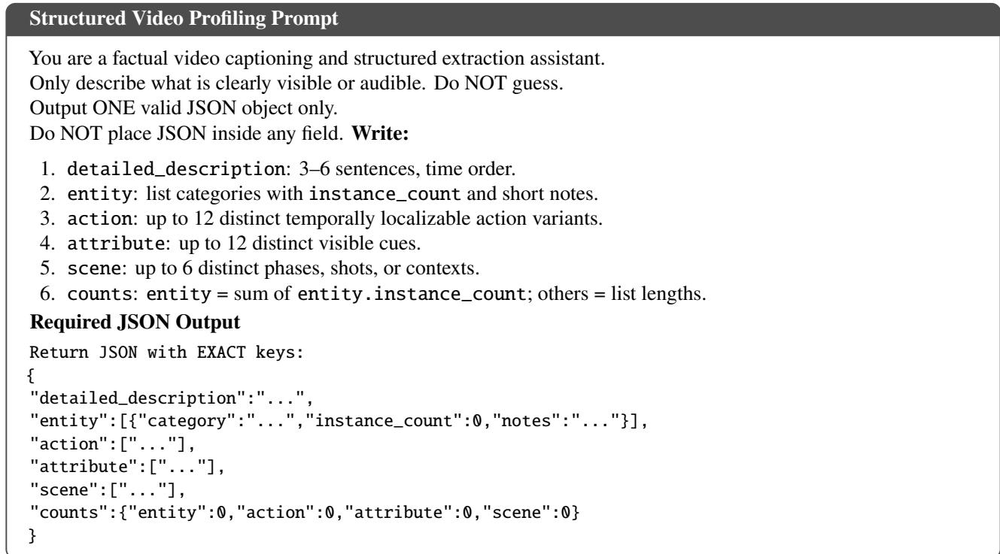  
Figure C2. Structured video profiling prompt used with Qwen3-VL-8B-Instruct.

Temporal Reasoning, Causal Reasoning, and Comparative Judgment form the reasoning group. Labels follow the answering operation, not individual words in the question.

OmniCompass-AV contains five QA types, listed in Table C4 and shown in Figure C3. Speech Understanding, Event Understanding, and Emotion Recognition form the perception group; Temporal Reasoning and Causal Reasoning form the reasoning group. Event Understanding links audible cues to visible participants, actions, states, or context. These labels describe intended evidence requirements, rather than a measured guarantee that every item fails when audio is removed.

## C.4 Reference Design and Provenance

Reference images identify a target through entity, action, attribute, or scene information, as defined in Table C5. The unit of analysis is a task-specific reference, not a unique image file or video. Each of the 820 VL videos contributes one reference for TG, SG, and QA, yielding 2,460 task instances. Tasks can select diferent targets; their cue types and sources are counted separately.

Entity cues account for 1,960 of the 2,460 references, or 79.7%. The remaining references comprise 171 action cues, 200 attribute cues, and 129 scene cues. The examples include recognizable actions in Sports and appearance-based vehicle distinctions in Trafic. Figure C4 reports domain-wise frequencies; the cue types are not equally represented in this set.

The reference set contains 1,933 video-internal images and 527 Internet images. Video-internal crops preserve the identity of targets specific to a recording, while external exemplars can specify recognizable people, objects, or actions. Source selection follows the identification needs of each annotation rather than a fixed per-domain quota. This variation is part of the benchmark’s reference conditions and is not an independently controlled source-modality experiment.

For video-internal references, annotation guidelines favor a separate view outside the target interval or QA clue interval whenever one is available. Reviewers also inspect whether the image reveals the answer event, since temporal separation alone does not rule out semantic leakage. Crops retain target-identifying content while limiting irrelevant context and direct answer evidence. These checks aim to separate target specification from the evidence needed to solve the task.

## D Annotation Quality and Verification

Table C2. Mapping from structured video profiling outputs to task-oriented scoring signals. We summarize how the structured video profiling outputs produced by Qwen3-VL-8B-Instruct are converted into intermediate statistics and then used to compute the four score components.
<table><tr><td>Component</td><td>Derived profiling fields Computation</td><td></td><td>Intuition</td></tr><tr><td>Reference cessity (R)</td><td>Ne- entity_count, action_count, attribute_count, scene_count, repeated ation, and potential attribute confusion. actions</td><td>date entities, repeated actions, scene vari- uniquely specify the target. Richness increases with broader cover- age over entity, action, attribute, and scene signals. We then combine them as  $R = 1 0 \cdot ( 0 . 6 0 A + 0 . 2 0 B + 0 . 2 0 A B )$  where A and B are the normalized ambi-</td><td>We first compute ambiguity and richness. Measures whether external ref- Ambiguity increases with multiple candi- erential cues are needed to</td></tr><tr><td>Grounding Suitability (G) action_count,</td><td>entity_count, attribute_count, scene_count</td><td>guity and richness scores. tial grounding potential from entity and and VideoQA instances. attribute counts, and question answer- ing potential from action and scene- related complexity. The final score is</td><td>We estimate temporal grounding poten- Measures whether the video can tial from action and scene counts, spa- support constructing TG, SG,</td></tr><tr><td>Temporal- Spatial Utility entity_count, (T)</td><td>video action_count, scene_count</td><td> $G = 1 0 \cdot \mathrm { a v g } ( P _ { \mathrm { T G } } , P _ { \mathrm { S G } } , P _ { \mathrm { Q A } } )$  duration, We combine a duration term and a vari- Measures whether the video pro- ation term:  $T = 1 0 \cdot ( 0 . 6 0 D + 0 . 4 0 V )$  score and V is the average of normalized localization.</td><td>vides sufficient temporal span where D is a log-normalized duration and visual variation for evidence</td></tr><tr><td>Evidence Diver- entity_count, sity (E)</td><td>action_count, attribute_count,</td><td>action, scene, and entity variation. We compute normalized entropy over Measures whether referential ev- the four evidence counts:  $E ~ = ~ 1 0$   $H _ { \mathrm { n o r m } } ( c _ { \mathrm { e n t } } , c _ { \mathrm { a c t } } , c _ { \mathrm { a t t } } , c _ { \mathrm { s c n } } )$ </td><td>idence is distributed across mul- tiple cue types rather than con-</td></tr><tr><td>Final Score (S) R, G, T, E</td><td>scene_count</td><td> $S = 0 . 3 5 R + 0 . 2 5 G + 0 . 2 5 T + 0 . 1 5 E$ </td><td>centrated in a single source. Encourages videos that require diverse referential cues, support TG/SG/VideoQA construction, and provide diverse evidence for annotation.</td></tr></table>

## D.1 Review Criteria and Repair Records

Quality control combines semantic review with structural validation. Reviewers check paired-setting target identity, temporal-event completeness, endpoint box alignment, QA answer uniqueness, and evidence suficiency. AV review additionally examines speech or sound dependence and audio-visual correspondence. Returned corrections undergo task-level re-verification and lead-expert acceptance. Tables D1 and D2 summarize verification stages and representative issues.

## D.2 Human Efort

The construction and verification records yield a retrospective estimate of 1,784 human-hours, or 223 eight-hour person-days. This comprises 1,280 annotator-hours and 504 lead-expert-hours, as detailed in Table D3. The estimate covers training, task construction, cross-verification, correction, adjudication, and final auditing. It is reconstructed from project records rather than continuous time logs and excludes automated processing, model inference, and waiting periods.

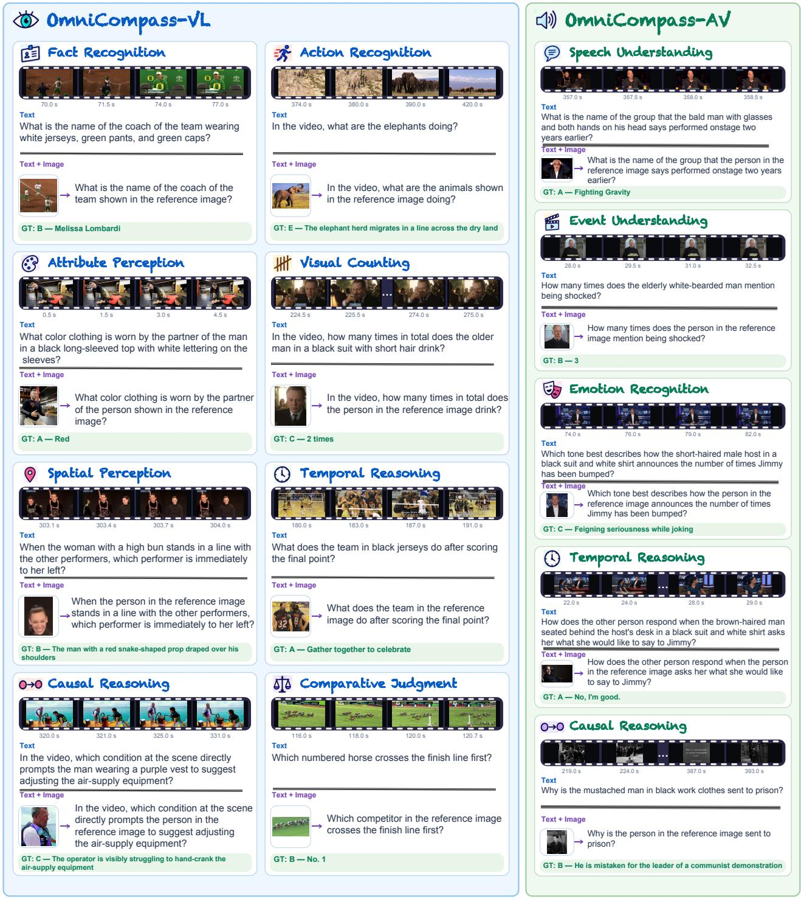  
Figure C3. QA taxonomy in our OmniCompass-VL and OmniCompass-AV.

Table C3. QA taxonomy and examples in OmniCompass-VL. We group the eight QA types into Perception and Reasoning. Examples show only the question text from the Text target-specification setting; answer options are omitted.
<table><tr><td>Category Perception</td><td>QA Task</td><td>Task Definition</td><td>Example</td></tr><tr><td rowspan="5"></td><td>Fact Recognition</td><td>Identify entities or explicit facts associated with the referenced target. sitting on the left side of the table is talking</td><td>In the video, when the man in a black suit to two other people, what is the drink in</td></tr><tr><td>Action Recognition</td><td>Identify an action performed by the referenced target.</td><td>front of the woman? In the video, what farewell gesture did the young man in the pink hoodie make to each of the two women inside the house before</td></tr><tr><td>Attribute Perception</td><td>Identify the target&#x27;s appearance, attributes, or observable state.</td><td>leaving? In the video, when a lady wearing a red-brimmed straw hat dances with a group of people in yellow clothes, what is the color of the oil-paper umbrella held by the lady</td></tr><tr><td>Visual Counting</td><td>Count referenced entities, actions, or In the video, how many rotations did the event occurrences.</td><td>behind her? athlete complete while raising one hand and</td></tr><tr><td>Spatial Perception</td><td>Determine scene context, locations, or spatial relations involving the referenced target.</td><td>high-fiving a partner? In the video, where is the kettle relative to the man in a gray hat and light blue short-sleeved shirt, based on the direction he is facing while making tea?</td></tr><tr><td rowspan="3">Reasoning</td><td>Temporal Reasoning</td><td>Identify events or states before, during, or after a specific referenced event.</td><td>Before the man in a blue shirt enters the first elevator, what type of passenger is among the previous group entering the same elevator?</td></tr><tr><td>Causal Reasoning</td><td>Infer causes, effects, or motives that connect observed events.</td><td>In the video, why does the boy with short blond hair repeatedly throw away the eggs in secret rather than return or refuse them</td></tr><tr><td>Comparative Judgment</td><td>Compare targets, events, states, or outcomes to determine differences, rankings, or changes.</td><td>directly? In the video, when several people on stage take turns answering the question asked by the female host wearing a colorful patterned sleeveless top, what is the relationship among their answering durations?</td></tr></table>

Table C4. QA taxonomy and examples in OmniCompass-AV. We group the five QA types into Perception and Reasoning. Examples show only the question text from the Text target-specification setting; answer options are omitted.
<table><tr><td>Category</td><td>QA Task</td><td>Task Definition</td><td>Example</td></tr><tr><td>Perception</td><td>Speech Understanding</td><td>Understand explicit speech content, including facts, quantities, descriptions, and opinions.</td><td>How does the gray-haired man in a black leather jacket and white top summarize what the Nike swoosh represented to young people at the time?</td></tr><tr><td></td><td>Event Understanding</td><td>Identify participants, objects, actions, When the woman with tied-up hair, a blue states, or counts in audio-visual events.</td><td>off-the-shoulder top, and brown overalls introduces Sean&#x27;s recently deceased father, which pair of objects appears beside the</td></tr><tr><td></td><td>Emotion Recognition</td><td>Recognize emotion, tone, attitude, or In the video, after repeated corrections from affective reactions from audio-visual the man in red, how does the woman with evidence.</td><td>relevant framed photograph? shoulder-length auburn hair sound when asking whether he wants to tell the story?</td></tr><tr><td>Reasoning</td><td>Temporal Reasoning</td><td>Determine the order or temporal relations of utterances, events, and states.</td><td>In the video, before the blonde woman calls the grey bearded man arrogant, what is he</td></tr><tr><td></td><td>Causal Reasoning</td><td>Infer causes, motives, or consequences from audio-visual context.</td><td>doing? Why could the lie told by the woman in a red choker and black top to avoid awkwardness</td></tr></table>

Table C5. Functional taxonomy of reference information in OmniCompass-VL. Each type states what the reference image contributes to target identification and gives representative examples.
<table><tr><td>Reference Type</td><td>Role in Target Identification and Typical Examples</td></tr><tr><td>Entity</td><td>Shows a particular person or object that the model must match across views, such as an athlete, actor, vehicle, or bag.</td></tr><tr><td>Action</td><td>Shows a recognizable motion or event pattern that defines the target behavior, such as a dunk, basketball shot, header, or tackle.</td></tr><tr><td>Attribute</td><td>Distinguishes the target through a visible property, appearance, or state, such as clothing color, vehicle type, shape, or pose.</td></tr><tr><td>Scene</td><td>Shows a place or surrounding visual context to match with a video segment, such as a street, room, stage, or stadium.</td></tr></table>

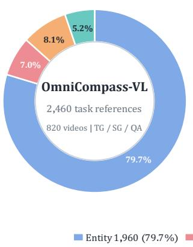  
(a) Overall Reference Types

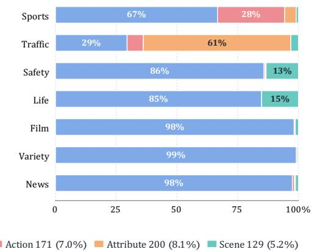  
(b) Reference Types by Domain

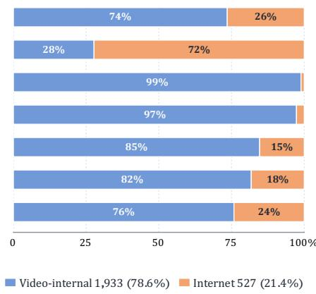  
(c) Image Sources by Domain  
Figure C4. Reference composition across 2,460 VL task instances. Panel (a) shows overall cue-type frequencies, (b) shows their proportions by domain, and (c) compares video-internal and Internet sources. Counts are reported per task instance, so an image reused across tasks is counted more than once.

Table D1. Multi-stage quality verification for OmniCompass-VL. All counts use the final 820-video release set. A video passes only when its paired Text and Text+Image specifications and its TG, SG, and QA annotations satisfy the verification criteria. Representative findings are non-exclusive.
<table><tr><td>Verification stage</td><td>Videos</td><td>Stage outcome</td><td>Representative findings</td><td>Cumulative pass</td></tr><tr><td>Annotator verification</td><td>cross- 820</td><td>466 require no revision; Cross-setting target mismatch; a 466/820 (56.8%) 354 are returned for revi- Text+Image pointer identifiable sion.</td><td>without its image; imprecise TG boundaries; incorrect or incom- plete SG targets; insufficient QA</td><td></td></tr><tr><td>Annotator revision and 354 lead-expert acceptance</td><td></td><td>All revised cases pass after Typical repairs address overly 820/820 (100%) annotator recheck and lead- small or partial SG targets, TG in- expert acceptance.</td><td>tervals that omit part of the event, and inconsistencies among QA questions, answers, types, and ev-</td><td></td></tr><tr><td>Final release audit</td><td>820</td><td>All VL cases are included Same target and ground truth 820/820 (100%) only after lead-expert ac- across settings; complete TG ceptance.</td><td>events; valid boundary-frame boxes; one evidence-supported QA answer with plausible distrac- tors.</td><td></td></tr></table>

Table D2. Multi-stage quality verification for OmniCompass-AV. All counts use the 240-video AV subset of the final release. In addition to the shared VL criteria, annotators check native-audio dependence and audio-visual alignment, and the lead expert includes these criteria in final acceptance and audit. Representative findings are non-exclusive.
<table><tr><td>Verification stage</td><td>Videos</td><td>Stage outcome</td><td>Representative findings</td><td>Cumulative pass</td></tr><tr><td>Annotator verification (AV-specific checks)</td><td>cross- 240</td><td>pair; 89 entered repair for clue intervals omitting required 105 task-level issues.</td><td>151 required no targeted re- Insufficient audio dependence; 151/240 (62.9%) speech or sound; audio-visual tar- get mismatch; SG boxes following the wrong person; unsupported QA answers.</td><td></td></tr><tr><td>Annotator revision and 89 lead-expert acceptance</td><td></td><td>annotations corrected; all references, questions, and boxes 89 videos accepted.</td><td>24 TG, 70 SG, and 11 QA TG intervals starting too early; SG 240/240 (100%) identifying different targets; QA type or evidence mismatch; imbal- anced distractors.</td><td></td></tr><tr><td>Final release audit</td><td>240</td><td>only after lead-expert ac- aligned audio-visual clues; the ceptance and audit.</td><td>All AV cases are included Required native-audio evidence; 240/240 (100%) same target and answer across set- tings; valid TG, SG, and QA an- notations.</td><td></td></tr></table>

Table D3. Estimated human efort for OmniCompass construction and quality assurance. Hours are reconstructed from dated project records using an eight-hour workday. Automated processing, inference, and waiting time are excluded.
<table><tr><td>Stage</td><td>Personnel</td><td>Scope</td><td>Person-days</td><td>Hours</td></tr><tr><td>Guideline training</td><td>4 annotators</td><td>Two-day guideline training and pilot-protocol calibration. 8</td><td></td><td>64</td></tr><tr><td>Initial task construc- 4 annotators tion</td><td></td><td>Paired Text and Text+Image TG, SG, and QA instances for 112 820 VL videos, including the 240-video AV subset.</td><td></td><td>896</td></tr><tr><td>Mutual verification and</td><td>cross- 4 annotators</td><td>Mutual cross-verification and corrections within the 354 40 flagged VL cases and track-specific AV repairs identified</td><td></td><td>320</td></tr><tr><td>targeted revision Final acceptance and Lead expert correction</td><td></td><td>during verification. Final acceptance of annotator-confirmed cases, with re- 31 maining corrections for target pairing, reference necessity,</td><td></td><td>248</td></tr><tr><td>Repair adjudicationLead expert</td><td></td><td>TG/SG validity, QA evidence, and AV dependence. Repair-package review, disputed-case resolution, and re- 16</td><td></td><td>128</td></tr><tr><td>Lead-expert final re- Lead expert lease audit</td><td></td><td>verification of corrected annotations. Paired-setting consistency, dashboard readback, residual- 16</td><td></td><td>128</td></tr><tr><td>Total</td><td>lead expert</td><td>error checks, and final release validation. 4 annotators + 1 End-to-end human construction and quality assurance. 223</td><td></td><td>1,784</td></tr></table>

## E Evaluation Protocols and Prompts

## E.1 Inputs and Paired Settings

Frames are sampled uniformly across full videos. The standard budget is 64 for proprietary models and open-source models above 100B total parameters, and 32 otherwise. GPT-series runs use 49 frames to reserve a reference slot within the evaluated 50-image input limit; VITA-1.5-7B uses 16. Budgets remain fixed within a model across tasks and reference settings. Cross-model results therefore reflect the stated input budgets, not a strictly equal-compute comparison.

For the 52-second VL clip in Figure E1, the 64-frame inputs are:

Text: Timestamp: 0 seconds. <frame 0> → Timestamp: 0.84 seconds. <frame 1> → Timestamp: 51.96 seconds. <frame 63> → [Prompt]

Text+Image: Timestamp: 0 seconds. <frame 0> → Timestamp: 0.84 seconds. <frame 1> → Timestamp: 51.96 seconds. <frame 63> → <ref image> → [Prompt]

For the 270-second AV clip in Figure E4, audio follows the sampled frames:

Text: Timestamp: 0 seconds. <frame 0> → Timestamp: 4.3 seconds. <frame 1> → Timestamp: 269.967 seconds. <frame 63> → <audio> → [Prompt]

Text+Image: Timestamp: 0 seconds. <frame 0> → Timestamp: 4.3 seconds. <frame 1> → Timestamp: 269.967 seconds. <frame 63> → <audio> → <ref image> → [Prompt]

Each timestamp is literal text in seconds from the start of the video, placed immediately before its corresponding frame, following the design of TimeLens (Zhang et al., 2026). The frame numbers index sampled frames from zero: <frame 0> is the first, and <frame 63> is the last in these 64-frame examples. Angle-bracketed items denote media content, not literal text tokens. <audio> is the video’s audio track, and <ref image> is the task-specific reference image. The arrows indicate input order, and ... omits intermediate timestamp–frame pairs; neither is sent to the model. [Prompt] stands for the task prompt, which includes the full video duration. The timestamps shown are specific to these clips, not fixed for other videos or frame budgets. Within each pair, the video evidence, task semantics, and ground truth are shared; only the target specification changes.

TG returns temporal boundaries, and QA selects one of five answer options. Following V-STaR (Cheng et al., 2026), SG receives the relevant interval and returns one bounding box at each endpoint. It therefore evaluates target localization at supplied times, not temporal search or dense tracking throughout the interval. Figures E1–E6 illustrate response formats with annotated ground truth. The output panels are never supplied to the models in either setting.

## E.2 Prompt Examples

Figures E1–E3 and E4–E6 show OmniCompass-VL and OmniCompass-AV prompts, respectively.

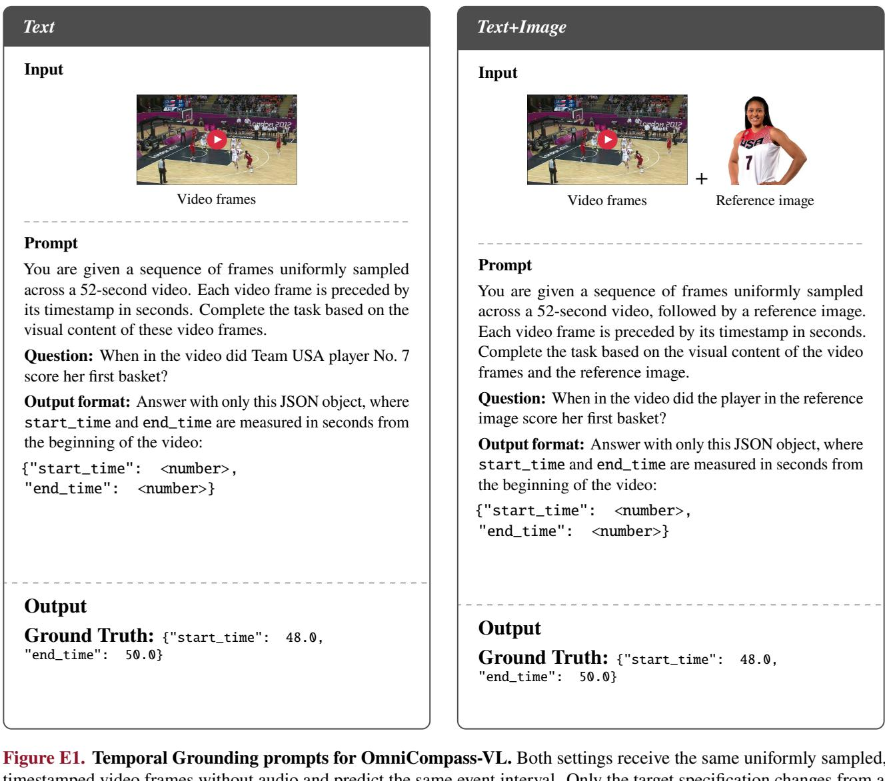  
Figure E1. Temporal Grounding prompts for OmniCompass-VL. Both settings receive the same uniformly sampled, timestamped video frames without audio and predict the same event interval. Only the target specification changes from a textual description to a reference image.

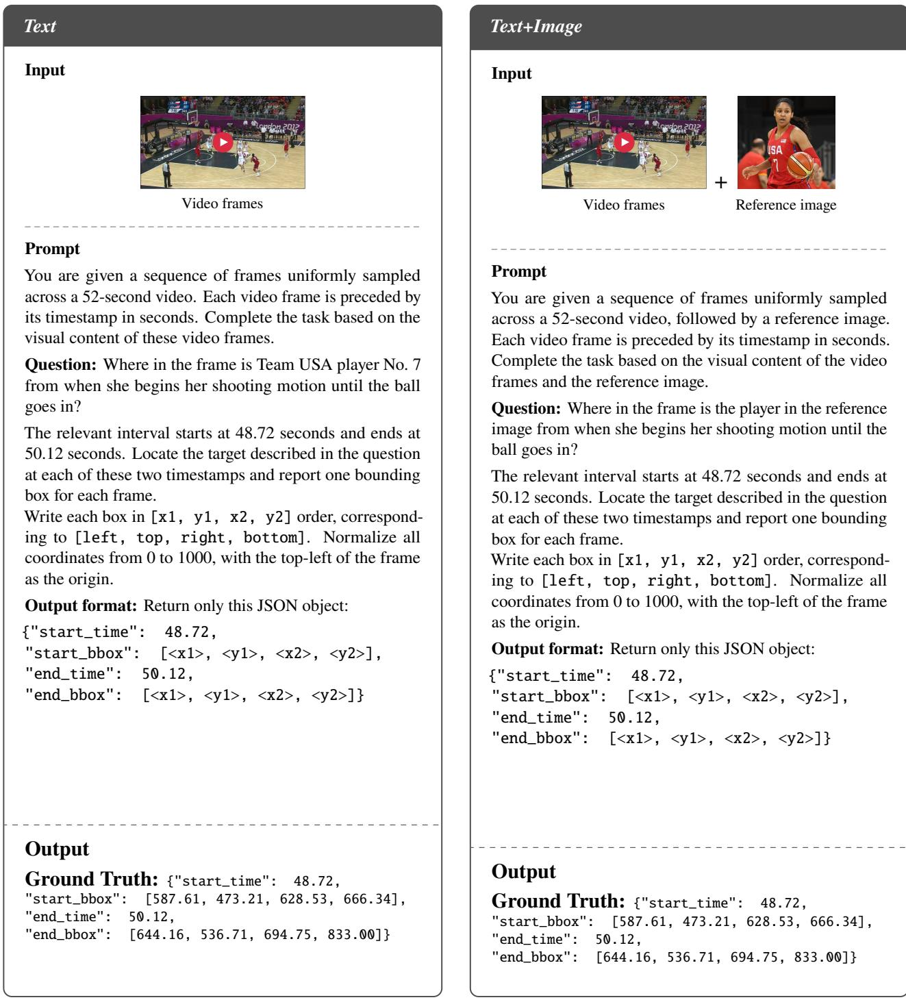  
Figure E2. Spatial Grounding prompts for OmniCompass-VL. Both settings receive the same uniformly sampled, timestamped video frames and the same temporal interval. They localize the same target at the two interval endpoints; only the target specification changes.

Video frames

## Text

## Input

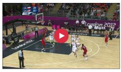  
Video frames

## Prompt

You are given a sequence of frames uniformly sampled across a 52-second video. Each video frame is preceded by its timestamp in seconds. Complete the task based on the visual content of these video frames.

Question: How many points does Team USA player No. 7 score in total in the video?

A. 0 points

B. 2 points

C. 3 points

D. 4 points

E. 1 point

You must choose the most appropriate answer from the five options (A, B, C, D, or E). If uncertain, make your best choice based on the provided inputs. Output only the option letter.

## Output

Ground Truth: B

## Text+Image

## Input

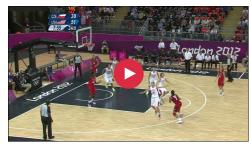

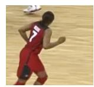

## Prompt

You are given a sequence of frames uniformly sampled across a 52-second video, followed by a reference image. Each video frame is preceded by its timestamp in seconds. Complete the task based on the visual content of the video frames and the reference image.

Question: How many points does the player in the reference image score in total in the video?

A. 0 points

B. 2 points

C. 3 points

D. 4 points

E. 1 point

You must choose the most appropriate answer from the five options (A, B, C, D, or E). If uncertain, make your best choice based on the provided inputs. Output only the option letter.

## Output

Ground Truth: B

Figure E3. Question Answering prompts for OmniCompass-VL. Both settings receive the same uniformly sampled, timestamped video frames and retain the same answer choices and ground truth. Only the target specification changes.

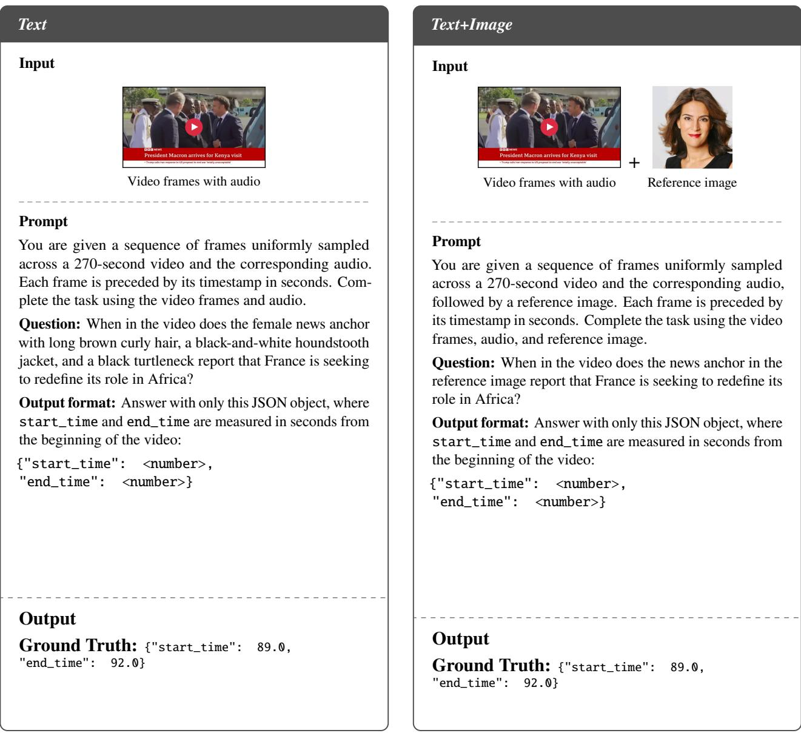  
Figure E4. Temporal Grounding prompts for OmniCompass-AV. Both settings receive the same timestamped video frames and corresponding audio, and predict the same audio-visual event interval. Only the target specification changes.

## Text

## Input

  
Video frames with audio

## Prompt

You are given a sequence of frames uniformly sampled across a 270-second video and the corresponding audio. Each frame is preceded by its timestamp in seconds. Complete the task using the video frames and audio.

Question: Where in the frame is the female news anchor with long brown curly hair, a black-and-white houndstooth jacket, and a black turtleneck when she reports that French President Emmanuel Macron has arrived in Nairobi, Kenya?

The relevant interval starts at 85.03 seconds and ends at 87.87 seconds. Locate the target described in the question at each of these two timestamps and report one bounding box for each frame.

Write each box in [x1, y1, x2, y2] order, corresponding to [left, top, right, bottom]. Normalize all coordinates from 0 to 1000, with the top-left of the frame as the origin.

## Output format: Return only this JSON object:

```json
{"start_time": 85.03,
"start_bbox": [<x1>, <y1>, <x2>, <y2>],
"end_time": 87.87,
"end_bbox": [<x1>, <y1>, <x2>, <y2>]}
```

## Output

Ground Truth: {"start\_time": 85.03, "start\_bbox": [278.96, 63.39, 749.11, 755.36], "end\_time": 87.87, "end\_bbox": [276.17, 68.35, 735.16, 760.32]}

## Text+Image

## Input

  
Video frames with audio  
Reference image

## Prompt

You are given a sequence of frames uniformly sampled across a 270-second video and the corresponding audio, followed by a reference image. Each frame is preceded by its timestamp in seconds. Complete the task using the video frames, audio, and reference image.

Question: Where in the frame is the news anchor in the reference image when she reports that French President Emmanuel Macron has arrived in Nairobi, Kenya?

The relevant interval starts at 85.03 seconds and ends at 87.87 seconds. Locate the target described in the question at each of these two timestamps and report one bounding box for each frame.

Write each box in [x1, y1, x2, y2] order, corresponding to [left, top, right, bottom]. Normalize all coordinates from 0 to 1000, with the top-left of the frame as the origin.

Output format: Return only this JSON object:

```json
{"start_time": 85.03,
"start_bbox": [<x1>, <y1>, <x2>, <y2>],
"end_time": 87.87,
"end_bbox": [<x1>, <y1>, <x2>, <y2>]}
```

## Output

```json
Ground Truth: {"start_time": 85.03,
"start_bbox": [278.96, 63.39, 749.11, 755.36],
"end_time": 87.87,
"end_bbox": [276.17, 68.35, 735.16, 760.32]}
```  
Figure E5. Spatial Grounding prompts for OmniCompass-AV. Both settings receive the same timestamped video frames, corresponding audio, and temporal interval. They localize the same target at the two interval endpoints; only the target specification changes.

## Text

## Input

  
Video frames with audio

## Prompt

You are given a sequence of frames uniformly sampled across a 270-second video and the corresponding audio. Each frame is preceded by its timestamp in seconds. Complete the task using the video frames and audio.

Question: What happens at the end of the preceding report, just before the female news anchor with curly brown hair and a black-and-white patterned jacket reports that thousands of fans have gathered in Vienna?

A. Passengers disembark at a quay

B. A white-haired woman is embraced at an awards ceremony

C. Flag-waving fans crowd Vienna’s streets

D. Two studio presenters discuss a political crisis

E. An evacuation plane waits on the apron

You must choose the most appropriate answer from the five options (A, B, C, D, or E). If uncertain, make your best choice based on the provided inputs. Output only the option letter.

## Text+Image

## Input

  
Video frames with audio

  
Reference image

## Prompt

You are given a sequence of frames uniformly sampled across a 270-second video and the corresponding audio, followed by a reference image. Each frame is preceded by its timestamp in seconds. Complete the task using the video frames, audio, and reference image.

Question: What happens at the end of the preceding report, just before the news anchor in the reference image reports that thousands of fans have gathered in Vienna?

A. Passengers disembark at a quay

B. A white-haired woman is embraced at an awards ceremony

C. Flag-waving fans crowd Vienna’s streets

D. Two studio presenters discuss a political crisis

E. An evacuation plane waits on the apron

You must choose the most appropriate answer from the five options (A, B, C, D, or E). If uncertain, make your best choice based on the provided inputs. Output only the option letter.

## Output

Ground Truth: B

## Output

Ground Truth: B

Figure E6. Question Answering prompts for OmniCompass-AV. Both settings receive the same timestamped video frames, corresponding audio, and answer candidates. The correct answer is unchanged across target specifications.