# Orientation Estimation of Cryo-EM Images for Molecules with Arbitrary Symmetry by Semidefinite Programming

Yunpeng Shi∗, Amit Singer†, Jinxin Wang‡, Ruiyi Yang§

## Abstract

This paper extends the non-unique games framework introduced in Bandeira et al. (2020) to address symmetric structures. Precisely, we consider the problem

$$
\operatorname* { m i n } _ { g _ { 1 } , \ldots , g _ { n } \in \mathcal { G } } \frac { 1 } { | S | } \sum _ { i , j = 1 } ^ { n } \sum _ { s \in S } f _ { i j } ( g _ { i } s g _ { j } ^ { - 1 } ) ,\tag{1}
$$

where G is a compact group, $S \subset { \mathcal { G } }$ is a finite subgroup of symmetry elements, and $f _ { i j } : { \mathcal { G } } \to$ R is a loss function. A notable example is common lines based orientation estimation of cryo-EM images for molecules with point group symmetry S, where G is the rotation group SO(3). With a semidefinite programming relaxation, we turn the problem into a convex program that is solved with the alternating direction method of multipliers. Unlike existing approaches which are tailored to specific symmetry groups, ours provides a unified computational framework for addressing all point group symmetries. We demonstrate the applicability of the proposed algorithm on the cryo-EM orientation estimation problem on both simulated and experimental datasets. In particular, our algorithm is efective in generating high-quality ab initio models from only a few class averages computed from experimental images.

## 1 Introduction

Cryogenic electron microscopy (cryo-EM) has emerged as a powerful technique for determining the threedimensional structures of macromolecules at near atomic resolution (Wang and Sigworth, 2006, Frank, 2006, Nakane et al., 2020, Yip et al., 2020). Symmetry, a fundamental feature of nature, is pervasive in the structural organization of protein molecules. However, incorporating symmetry in cryo-EM data analysis poses significant mathematical and computational challenges, especially in the orientation estimation problem for 3-D ab initio modeling. In particular, existing common-lines methods do not extend naturally to the symmetric case because the pairwise relative orientations are estimated up to arbitrary symmetry group elements, which in turn compromise the subsequent steps.

In this paper, we tackle this problem by extending the non-unique games (NUG) framework (Bandeira et al., 2020) to handle symmetric structures. Our proposed computational framework provides a unified treatment for all symmetry groups rather than a case-by-case design as done in existing works. More broadly, our framework addresses optimization problems over general compact groups from information about group ofsets, covering many other important applications that include group synchronization and multi-reference alignment when the underlying signal has an intrinsic symmetric structure.

## 1.1 The NUG Framework

Suppose $\phi : \mathbb { R } ^ { 3 }  \mathbb { R }$ represents the electrostatic potential of a molecule with a non-trivial point group symmetry S (a discrete subgroup of SO(3) with |S| elements). That is, $s \circ \phi = \phi$ for all $s \in S$ , where the group action is defined as usual s $\circ \phi ( x ) = \phi ( s ^ { - 1 } x )$ . Consider the usual cryo-EM image formation model

$$
I _ { i } = h _ { i } * P ( g _ { i } \circ \phi ) + \epsilon _ { i } , \qquad i = 1 , \dots , n ,\tag{2}
$$

where $g _ { i }$ is the unknown rotation of the molecule corresponding to the i-th image, $P$ is the tomographic projection operator in the z-direction defined for a generic potential $\phi$ by

$$
P ( \phi ) ( x , y ) = \int _ { \mathbb { R } } \phi ( x , y , z ) d z ,
$$

and $h _ { i }$ is the inverse Fourier transform of the contrast transfer function (CTF) of the i-th image and assumed to be known, with ∗ denoting convolution. For simplicity, we are ignoring the efect of imperfect centering so that shifts are not included in the model (2).

The study of the orientation estimation problem dates back to the angular reconstitution method for non-symmetric molecules proposed by Vainshtein and Goncharov (1986), Van Heel (1987). The crucial observation is that common lines between three images uniquely determine their relative orientations up to handedness. The method proceeds in a sequential manner by estimating the relative orientation of a new image with respect to already estimated ones based on the common lines information. Later, Farrow and Ottensmeyer (1992) proposed obtaining the relative orientation of a new image in a least squares fashion. A major issue with these sequential methods are their reliance on correct detection of common lines, which is challenging in low signal-to-noise regimes, and the accumulation of the estimation error. Penczek et al. (1996) tried to circumvent this issue by estimating the orientations for all images simultaneously by minimizing a global energy functional. However, this method is not very practical due to its overly large search space. Mallick et al. (2006) introduced a Bayesian approach where the common lines between a pair of images are determined from their common lines with diferent image triplets. An issue of this approach is the requirement of correct identification of at least seven common lines simultaneously, rendering it not suitable when the detection rate of correct common lines is low. An improved Bayesian approach was proposed by Singer et al. (2010) based on voting, which lowered the requirement to two common lines. Further advancements were introduced in Singer and Shkolnisky (2011), Shkolnisky and Singer (2012) based on semidefinite programming and synchronization approaches, leading to algorithms that are much more robust to noise.

The common-lines methods have made significant progress in solving the orientation estimation problem and demonstrated their empirical success on experimental datasets. Nevertheless, there is still further room for improvement in that these methods do not fully exploit all the information contained in the images. In particular, the methods mentioned above all take a two-step procedure by first computing the common lines (or a couple of top ones) and then estimating orientations that are most consistent with them. This means that all information other than those contained in the detected common lines are discarded when estimating the orientations. At low signal-to-noise ratios, the true common lines may not appear among the top ones detected, making them no longer available in the second step.

Motivated by this observation, Bandeira et al. (2020) proposed the NUG framework that estimates the orientations without explicit detection of common lines. Precisely, the authors consider the following optimization problem

$$
\operatorname* { m i n } _ { g _ { 1 } , \dots , g _ { n } \in \mathcal { G } } \ \sum _ { i , j = 1 } ^ { n } f _ { i j } ( g _ { i } g _ { j } ^ { - 1 } ) ,\tag{3}
$$

where $\mathcal { G } = \mathrm { S O } ( 3 )$ and $f _ { i j } : \mathcal { G }  \mathbb { R }$ is a measure of the agreement between the common lines in images $I _ { i }$ and $I _ { j }$ if their relative orientation was $g _ { i } g _ { j } ^ { - 1 }$ (see Section 4.1 for its precise form). On a high level, the $\mathrm { N U G }$ framework searches for the orientations that maximize all pairwise agreement of common lines that would be implied by these orientations. The algorithm only exploits the common lines implicitly and leverages full information contained in all images. Bandeira et al. (2020) exploits representation theory to first turn (3) into a matrix optimization problem with a linear objective

$$
\operatorname* { m i n } _ { \substack { \mathrm { c o n s t r a i n t s ~ o n ~ } X } } \left. C , X \right.\tag{4}
$$

for some matrix $C$ and $X = X ( g _ { 1 } , \dots , g _ { n } )$ , followed by a semidefinite programming (SDP) relaxation on the constraints. The authors further demonstrated that the resulting algorithm is able to tolerate higher noise levels than other common-lines methods.

It is worth mentioning that (3) provides a general framework for optimization over compact groups $\mathcal { G }$ from information about group ofsets. The terminology non-unique games is motivated by the unique games problem in theoretical computer science (Khot, 2002, 2010), which aims to solve a linear system over $\mathbb { Z } _ { L }$ consisting of equations of the form $x _ { i } - x _ { j } \equiv b _ { i j }$ with ≡ denoting equality modulo $L ,$ for a set of pairs $( i , j ) \in T$ . Once $x _ { i }$ is fixed, so is $x _ { j }$ for any j such that $( i , j ) \in T$ , hence the name unique games.

This problem can be formulated as in (3) by setting $\mathcal { G } = \mathbb { Z } _ { L }$ and $f _ { i j } ( g ) = - \delta _ { g \equiv b _ { i j } }$ as a Dirac delta function for $( i , j ) \in T$ and $f _ { i j } = 0$ otherwise. For more general $\vec { \mathcal { G } } \mathrm { : }$ and $f _ { i j } \mathrm { ' s } ,$ the original uniqueness property does not necessarily hold, leading to the non-unique games framework. Other important problems that can be cast in the form of (3) include the semidefinite relaxation for the Max-Cut problem over $\mathbb { Z } _ { 2 }$ (Goemans and Williamson, 1995), angular synchronization over SO(2) (Singer, 2011), multi-reference alignment over SO(2) and SO(3) (Bandeira et al., 2014, 2020), the little Grothendieck problem over the orthogonal group O(d) (Bandeira et al., 2016, Naor et al., 2013), and many more.

## 1.2 NUG with Symmetry

A major issue with the original NUG framework is that when symmetry is present, all |S| rotations along the orbit $\{ g _ { i } s \} _ { s \in S }$ result in the same image $I _ { i } ,$ and hence the optimization problem (4) has multiple global minima. Linearity of (4) then implies that any convex combination of the solutions is again a solution, so that it is hopeless to recover the orientations $g _ { i } \mathrm { \dot { s } }$ from such an arbitrary solution X to (4). For this reason, it is imperative to extend the NUG framework to address symmetric structures.

To derive the appropriate objective function for optimization, we notice that each pair of images now share |S| lines in common due to symmetry. Therefore, we can regard the i-th image as |S| slices, and the j-th image as |S| slices, so each pair $( i , j )$ contributes $| S | ^ { 2 }$ terms to the objective function of the form

$$
\sum _ { s , s ^ { \prime } \in S } f _ { i j } \big ( ( g _ { i } s ) ( g _ { j } s ^ { \prime } ) ^ { - 1 } \big ) = \sum _ { s , s ^ { \prime } \in S } f _ { i j } \big ( g _ { i } ( s s ^ { \prime ^ { - 1 } } ) g _ { j } ^ { - 1 } \big ) = | S | \sum _ { s \in S } f _ { i j } ( g _ { i } s g _ { j } ^ { - 1 } ) ,
$$

where we used that $S$ is a subgroup. This then leads after a normalization to our NUG problem with symmetry

$$
\operatorname* { m i n } _ { g _ { 1 } , \ldots , g _ { n } \in \mathcal { G } } \frac { 1 } { | S | } \sum _ { i , j = 1 } ^ { n } \sum _ { s \in S } f _ { i j } ( g _ { i } s g _ { j } ^ { - 1 } ) ,\tag{5}
$$

with $\mathcal { G } = \mathrm { S O } ( 3 )$ . It can be seen that the objective function (5) is constant along orbits and we can only hope to recover orbits, not individual rotations. We remark that the formulation is indeed invariant to a global rotation and reflection (see Section B), which may not be obvious at first glance. Again, the formulation (5) extends beyond SO(3) to general compact groups ${ \mathcal { G } } .$

## 1.3 Contributions

In this paper we introduce an SDP solution to (5) for general compact groups $\mathcal { G }$ by extending the framework proposed in Bandeira et al. (2020). The new SDP relaxation is able to give a better computational complexity than the original one as symmetry can annihilate certain degrees in the irreducible representations of the group elements, leading to an SDP of smaller size. We focus on the orientation estimation problem for symmetric molecules in cryo-EM, although our framework also covers other applications such as multi-reference alignment with symmetry. The resulting algorithm returns accurate estimates of the orientations when moderate noise is present, and is shown to be efective in generating high-quality ab initio models from only a few class averages computed from experimental images of symmetric molecules.

## 1.4 Related Works

Few papers in the literature rigorously address the orientation estimation problem in the presence of symmetry. Here we mention the line of works Pragier and Shkolnisky (2019), Rosen and Shkolnisky (2020), Geva and Shkolnisky (2023) which perform case-by-case studies to diferent symmetry groups covering cyclic, dihedral, octahedral and tetrahedral, and are inspired by Singer et al. (2010, 2011), Singer and Shkolnisky (2011), Shkolnisky and Singer (2012) in the non-symmetric case. Our work presents a unified mathematical framework that simultaneously covers all the discrete symmetries in SO(3).

The rest of the paper is organized as follows. In Section 2, we introduce a semidefinite programming solution to (6). In Section 3, we discuss how to recover the Euler angles from the SDP solution. Section 4 discusses practical considerations for implementation, followed by numerical experiments on both simulated and real datasets in Section 5.

## 2 An SDP Formulation

In this section we shall introduce an SDP framework for approximating the solution to (5), repeated below in a more formal way for general compact groups. Let G be a compact group and $S \subset { \mathcal { G } }$ a finite subgroup of symmetry elements. Consider the optimization problem

$$
\operatorname* { m i n } _ { g _ { 1 } , \ldots , g _ { n } \in \mathcal { G } } \frac { 1 } { | S | } \sum _ { i , j = 1 } ^ { n } \sum _ { s \in S } f _ { i j } ( g _ { i } s g _ { j } ^ { - 1 } ) ,\tag{6}
$$

where $f _ { i j } : \mathcal { G }  \mathbb { R }$ is a loss function. The road map is to exploit representation theory to first turn (6) into a matrix optimization, followed by an SDP relaxation that yields a convex program summarized in (18).

## 2.1 Linearization via Fourier Expansion

To start with, we shall first linearize the objective function via Fourier expansion over the compact group ${ \mathcal { G } } .$ Let $\{ \rho _ { k } \} _ { k = 1 } ^ { \infty }$ be unitary irreducible representations of $\mathcal { G }$ whose dimensions are $d _ { k } \mathrm { { ' s } }$ (Fulton and Harris, 2013), i.e., each $\rho _ { k } : \mathcal { G }  U ( d _ { k } )$ is a homomorphism into the space of unitary matrices of dimension $d _ { k }$ We can expand each $f _ { i j }$ in terms of a Fourier series

$$
\begin{array} { l } { \displaystyle \frac { 1 } { | S | } \sum _ { s \in S } f _ { i j } ( g _ { i } s g _ { j } ^ { - 1 } ) = \displaystyle \frac { 1 } { | S | } \sum _ { s \in S } \sum _ { k = 0 } ^ { \infty } d _ { k } \operatorname { T r } \big [ \widehat { f } _ { i j } ( k ) \rho _ { k } ( g _ { i } s g _ { j } ^ { - 1 } ) \big ] } \\ { \displaystyle \qquad = \frac { 1 } { | S | } \sum _ { s \in S } \sum _ { k = 0 } ^ { \infty } d _ { k } \operatorname { T r } \big [ \widehat { f } _ { i j } ( k ) \rho _ { k } ( g _ { i } ) \rho _ { k } ( s ) \rho _ { k } ( g _ { j } ) ^ { \ast } \big ] } \\ { \displaystyle \qquad = \sum _ { k = 0 } ^ { \infty } \operatorname { T r } \Big ( d _ { k } \widehat { f } _ { i j } ( k ) \rho _ { k } ( g _ { i } ) \Big [ \frac { 1 } { | S | } \sum _ { s \in S } \rho _ { k } ( s ) \Big ] \rho _ { k } ( g _ { j } ) ^ { \ast } \Big ) , } \end{array}\tag{7}
$$

where

$$
\widehat { f } _ { i j } ( k ) = \int _ { \mathcal { G } } f _ { i j } ( g ) \rho _ { k } ( g ) ^ { * } d g
$$

is the Fourier coeficient on $\mathcal { G }$ with $d g$ the Haar measure on ${ \mathcal { G } } .$ . We note that the matrix

$$
A _ { k } : = \frac { 1 } { | S | } \sum _ { s \in S } \rho _ { k } ( s )\tag{8}
$$

plays a crucial role in our proposed methodology and enjoys some nice properties as shown in the next result that will lead to our SDP framework.

Lemma 2.1. The matrix $A _ { k }$ is a projection matrix, i.e., $A _ { k } ^ { * } = A _ { k }$ and $A _ { k } ^ { 2 } = A _ { k }$

Proof. Note that

$$
A _ { k } ^ { * } = \frac { 1 } { | S | } \sum _ { s \in S } \rho _ { k } ( s ) ^ { * } = \frac { 1 } { | S | } \sum _ { s \in S } \rho _ { k } ( s ^ { - 1 } ) = \frac { 1 } { | S | } \sum _ { s \in S } \rho _ { k } ( s ) = A _ { k } ,
$$

and

$$
A _ { k } ^ { 2 } = { \frac { 1 } { | S | ^ { 2 } } } \sum _ { s \in S } \sum _ { t \in S } \rho _ { k } ( s ) \rho _ { k } ( t ) = { \frac { 1 } { | S | ^ { 2 } } } \sum _ { s \in S } \sum _ { t \in S } \rho _ { k } ( s t ) = { \frac { 1 } { | S | } } \sum _ { s \in S } \rho _ { k } ( s ) = A _ { k } .
$$

In the non-symmetric case where $S = \{ e \}$ is the trivial group, we see that $A _ { k }$ equals the identity matrix. However, for a nontrivial symmetry group S, the $A _ { k } { } ^ { \prime } \mathrm { s }$ are in general rank deficient. This constitutes as the major technical hurdle in formulating an SDP relaxation to the linearized objective (7), which through the definition of $A _ { k }$ can be recast to

$$
\frac { 1 } { | S | } \sum _ { s \in S } f _ { i j } ( g _ { i } s g _ { j } ^ { - 1 } ) = \sum _ { k = 0 } ^ { \infty } \mathrm { T r } \Bigl ( d _ { k } \widehat { f } _ { i j } ( k ) \bigl [ \rho _ { k } ( g _ { i } ) A _ { k } \bigr ] \bigl [ A _ { k } ^ { * } \rho _ { k } ( g _ { j } ) ^ { * } \bigr ] \Bigr ) .
$$

By introducing the variables

$$
C ^ { ( k ) } = d _ { k } \left[ \begin{array} { c c c c } { \widehat f _ { 1 1 } ( k ) } & { \widehat f _ { 2 1 } ( k ) } & { \cdots } & { \widehat f _ { n 1 } ( k ) } \\ { \widehat f _ { 1 2 } ( k ) } & { \widehat f _ { 2 2 } ( k ) } & { \cdots } & { \widehat f _ { n 2 } ( k ) } \\ { \vdots } & { \vdots } & { \ddots } & { \vdots } \\ { \widehat f _ { 1 n } ( k ) } & { \widehat f _ { 2 n } ( k ) } & { \cdots } & { \widehat f _ { n n } ( k ) } \end{array} \right] , \qquad X ^ { ( k ) } = \left[ \begin{array} { c c c c } { \rho _ { k } ( g _ { 1 } ) A _ { k } } \\ { \vdots } \\ { \rho _ { k } ( g _ { n } ) A _ { k } } \end{array} \right] \left[ \begin{array} { c } { \rho _ { k } ( g _ { 1 } ) A _ { k } } \\ { \vdots } \\ { \rho _ { k } ( g _ { n } ) A _ { k } } \end{array} \right] ^ { * } ,\tag{9}
$$

we can write the objective function in (6) as

$$
\begin{array} { r l } & { \displaystyle \frac { 1 } { | S | } \sum _ { i , j = 1 } ^ { n } \sum _ { s \in S } f _ { i j } \big ( g _ { i } s g _ { j } ^ { - 1 } \big ) = \sum _ { k = 0 } ^ { \infty } \sum _ { i , j = 1 } ^ { n } \operatorname { T r } \big [ d _ { k } \widehat { f } _ { i j } \big ( k \big ) X _ { i j } ^ { ( k ) } \big ] } \\ & { \qquad \quad = \displaystyle \sum _ { k = 0 } ^ { \infty } \operatorname { T r } \Big [ \sum _ { i , j = 1 } ^ { n } d _ { k } \widehat { f } _ { i j } \big ( k \big ) X _ { i j } ^ { ( k ) } \Big ] = \sum _ { k = 0 } ^ { \infty } \operatorname { T r } \Big ( \sum _ { i = 1 } ^ { n } [ C ^ { ( k ) } X ^ { ( k ) } ] _ { i i } \Big ) , } \end{array}\tag{10}
$$

where $[ C ^ { ( k ) } X ^ { ( k ) } ] _ { i i }$ is the ii-th block of $C ^ { ( k ) } X ^ { ( k ) }$ . Now using the fact that the trace of a block matrix is the sum of traces of its diagonal blocks, we can further write

$$
{ \frac { 1 } { | S | } } \sum _ { i , j = 1 } ^ { n } \sum _ { s \in S } f _ { i j } { \big ( } g _ { i } s g _ { j } ^ { - 1 } { \big ) } = \sum _ { k = 0 } ^ { \infty } \sum _ { i = 1 } ^ { n } \operatorname { T r } \left( [ C ^ { ( k ) } X ^ { ( k ) } ] _ { i i } \right) = \sum _ { k = 0 } ^ { \infty } \operatorname { T r } \left( C ^ { ( k ) } X ^ { ( k ) } \right) .
$$

Thus, we arrive at the following optimization problem

$$
\begin{array} { r l } { \underset { X ^ { ( k ) } } { \mathrm { m i n } } } & { { } \displaystyle \sum _ { k = 0 } ^ { \infty } \mathrm { T r } \left( C ^ { ( k ) } X ^ { ( k ) } \right) } \\ { \mathrm { s u b j e c t ~ t o } } & { { } X _ { i j } ^ { ( k ) } = \rho _ { k } ( g _ { i } ) A _ { k } \rho _ { k } ( g _ { j } ) ^ { * } . } \end{array}\tag{11}
$$

## 2.2 Convex Relaxation

The optimization problem (11) now has a linear objective function, but the constraints are still highly nonlinear and nonconvex. In this subsection, we shall consider convex relaxations of (11).

## 2.2.1 Constraints on Diagonal Blocks

Notice that for the diagonal blocks, we have $X _ { i i } ^ { ( k ) } = \rho _ { k } ( g _ { i } ) A _ { k } \rho _ { k } ( g _ { i } ) ^ { * }$ so that each $X _ { i i } ^ { ( k ) }$ is unitarily equivalent to $A _ { k }$ . Since $A _ { k }$ is a projection matrix by Lemma 2.1, we shall impose the following constraints

$$
\begin{array} { c } { { 0 \preceq X _ { i i } ^ { ( k ) } \preceq I _ { d _ { k } } } } \\ { { \mathrm { T r } [ X _ { i i } ^ { ( k ) } ] = \mathrm { T r } [ A _ { k } ] = \mathrm { r a n k } ( A _ { k } ) = : r _ { k } . } } \end{array}\tag{12}
$$

We mention that this defines the so-called rank $r _ { k }$ Fantope (Dattorro, 2005), namely the convex hull of all rank- $\mathbf { \nabla } \cdot r _ { k }$ orthogonal projectors, which is closely related to classical spectral relaxations.

## 2.2.2 Constraints Coupling Diferent Degrees

To couple the matrices for diferent $k { \mathrm { } s } ,$ , we shall exploit the Dirac delta function on the identity element of ${ \mathcal { G } } ,$ denoted by δ. More precisely, we have the following Fourier series expansion

$$
\delta ( g ) = \sum _ { k = 0 } ^ { \infty } d _ { k } \mathrm { T r } \left[ \widehat { \delta } ( k ) \rho _ { k } ( g ) \right] = \sum _ { k = 0 } ^ { \infty } d _ { k } \mathrm { T r } \left[ \Big ( \int _ { \mathcal { G } } \delta ( h ) \rho _ { k } ( h ) ^ { * } d h \Big ) \rho _ { k } ( g ) \right] = \sum _ { k = 0 } ^ { \infty } d _ { k } \mathrm { T r } \left[ \rho _ { k } ( g ) \right] .\tag{13}
$$

Replacing g by $g ^ { - 1 } ( g _ { i } s g _ { j } ^ { - 1 } )$ and averaging over $S ,$ we obtain

$$
\begin{array} { l } { \displaystyle \frac { 1 } { | S | } \sum _ { s \in S } \delta ( g ^ { - 1 } g _ { i } s g _ { j } ^ { - 1 } ) = \displaystyle \frac { 1 } { | S | } \sum _ { s \in S } \sum _ { k = 0 } ^ { \infty } d _ { k } \operatorname { T r } \big [ \rho _ { k } ( g ) ^ { * } \rho _ { k } ( g _ { i } ) \rho _ { k } ( s ) \rho _ { k } ( g _ { j } ) ^ { * } \big ] } \\ { \displaystyle \qquad = \sum _ { k = 0 } ^ { \infty } d _ { k } \operatorname { T r } \big [ \rho _ { k } ( g ) ^ { * } \rho _ { k } ( g _ { i } ) A _ { k } \rho _ { k } ( g _ { j } ) ^ { * } \big ] \stackrel { ( 9 ) } { = } \sum _ { k = 0 } ^ { \infty } d _ { k } \operatorname { T r } \big [ \rho _ { k } ( g ) ^ { * } X _ { i j } ^ { ( k ) } \big ] , \quad \forall g \in \mathcal { G } . } \end{array}\tag{14}
$$

Therefore, a natural convex relaxation for the above equation is that

$$
\begin{array} { l } { { \displaystyle \sum _ { k = 0 } ^ { \infty } d _ { k } \operatorname { T r } \left[ \rho _ { k } ( g ) ^ { * } X _ { i j } ^ { ( k ) } \right] \geq 0 , \forall g \in \mathcal { G } , } } \\ { { \displaystyle \quad \int _ { \mathcal { G } } \Big ( \sum _ { k = 0 } ^ { \infty } d _ { k } \operatorname { T r } \left[ \rho _ { k } ( g ) ^ { * } X _ { i j } ^ { ( k ) } \right] \Big ) d g = 1 . } } \end{array}
$$

Noticing that $\begin{array} { r } { \int _ { \mathcal { G } } \rho _ { k } ( g ) d g = 0 } \end{array}$ for any nontrivial irreducible representation, implying that

$$
\int _ { \mathcal { G } } \mathrm { T r } \left[ \rho _ { k } ( g ) ^ { * } X _ { i j } ^ { ( k ) } \right] d g = \mathrm { T r } \left[ \Big ( \int _ { \mathcal { G } } \rho _ { k } ( g ) d g \Big ) ^ { * } X _ { i j } ^ { ( k ) } \right] = 0 , \quad \forall k \ne 0 .
$$

Therefore the second constraint above can be simplified as (by noting $d _ { 0 } = 1 )$

$$
X _ { i j } ^ { ( 0 ) } = 1 , \quad \forall i , j\tag{15}
$$

so that we arrive at the relaxation

$$
1 + \sum _ { k = 1 } ^ { \infty } d _ { k } \operatorname { T r } \left[ \rho _ { k } ( g ) ^ { * } X _ { i j } ^ { ( k ) } \right] \geq 0 , \quad \forall g \in \mathcal { G } .\tag{16}
$$

## 2.2.3 Constraints on $X ^ { ( 1 ) }$

When the group $\mathcal { G } = \mathrm { S O } ( 3 )$ , which is the major interest in $\mathrm { c r y o - E M } .$ there is an additional structure of $X ^ { ( 1 ) }$ that we can further exploit. Note that for $g \in \mathrm { S O } ( 3 )$ represented in terms of ZYZ-Euler angles $( \alpha , \beta , \gamma )$ , we have $\rho _ { 1 } ( g ) = W ^ { ( 1 ) } ( \alpha , \beta , \gamma )$ and the following identity relating Wigner-D matrices of order 1 and rotation matrices:

$$
M ^ { * } U ^ { * } W ^ { ( 1 ) } ( \alpha , \beta , \gamma ) U M = R ,
$$

where

$$
M = \left[ { \begin{array} { c c c } { 0 } & { - 1 } & { 0 } \\ { 0 } & { 0 } & { 1 } \\ { 1 } & { 0 } & { 0 } \end{array} } \right] , \qquad U = \left[ { \begin{array} { c c c } { - { \frac { \mathrm { i } } { \sqrt { 2 } } } } & { 0 } & { { \frac { 1 } { \sqrt { 2 } } } } \\ { 0 } & { 1 } & { 0 } \\ { - { \frac { \mathrm { i } } { \sqrt { 2 } } } } & { 0 } & { - { \frac { 1 } { \sqrt { 2 } } } } \end{array} } \right] ,
$$

and $R$ is the rotation matrix corresponding to the ZYZ-Euler angles $( \alpha , \beta , \gamma )$ . Therefore, we have

$$
M ^ { * } U ^ { * } X _ { i j } ^ { ( 1 ) } U M = M ^ { * } U ^ { * } \left[ \rho _ { 1 } ( g _ { i } ) A _ { 1 } \rho _ { 1 } ( g _ { j } ) \right] U M = \frac { 1 } { | S | } \sum _ { s \in S } M ^ { * } U ^ { * } \rho _ { 1 } ( g _ { i } s g _ { j } ) U M \in \mathrm { c o n v } ( \mathrm { S O } ( 3 ) ) ,
$$

the convex hull of $\mathrm { S O ( 3 ) }$ . Theorem 1.3 of Saunderson et al. (2015) suggests relaxing $R \in \mathrm { c o n v } ( \mathrm { S O } ( 3 ) )$ by the PSD condition

$$
\begin{array} { r } { Q ( R ) : = \left[ \begin{array} { c c c c } { 1 - R _ { 1 1 } - R _ { 2 2 } + R _ { 3 3 } } & { R _ { 1 3 } + R _ { 3 1 } } & { R _ { 1 2 } - R _ { 2 1 } } & { R _ { 2 3 } + R _ { 3 2 } } \\ { R _ { 1 3 } + R _ { 3 1 } } & { 1 + R _ { 1 1 } - R _ { 2 2 } - R _ { 3 3 } } & { R _ { 2 3 } - R _ { 3 2 } } & { R _ { 1 2 } + R _ { 2 1 } } \\ { R _ { 1 2 } - R _ { 2 1 } } & { R _ { 2 3 } - R _ { 3 2 } } & { 1 + R _ { 1 1 } + R _ { 2 2 } + R _ { 3 3 } } & { R _ { 3 1 } - R _ { 1 3 } } \\ { R _ { 2 3 } + R _ { 3 2 } } & { R _ { 1 2 } + R _ { 2 1 } } & { R _ { 3 1 } - R _ { 1 3 } } & { 1 - R _ { 1 1 } + R _ { 2 2 } - R _ { 3 3 } } \end{array} \right] \succeq 0 , } \end{array}
$$

leading to the relaxation

$$
Q \left( M ^ { * } U ^ { * } X _ { i j } ^ { ( 1 ) } U M \right) \succeq 0 , \qquad \forall i , j = 1 , \dots , n .\tag{17}
$$

Combining (12), (16), and (17), we arrive at our SDP relaxation of (11):

$$
\begin{array} { r l } { \underset { X ^ { ( k ) } } { \operatorname* { m i n } } } & { \displaystyle \sum _ { k = 1 } ^ { \infty } \mathrm { T r } \left( C ^ { ( k ) } X ^ { ( k ) } \right) } \\ { \mathrm { s u b j e c t ~ t o } } & { X ^ { ( k ) } \succeq 0 , \quad \forall k } \\ & { 0 \preceq X _ { i i } ^ { ( k ) } \preceq I _ { d _ { k } } , \quad \forall i , k } \\ & { \mathrm { T r } [ X _ { i i } ^ { ( k ) } ] = \mathrm { T r } [ A _ { k } ] = \mathrm { r a n k } ( A _ { k } ) , \quad \forall i , k } \\ & { 1 + \displaystyle \sum _ { k = 1 } ^ { \infty } d _ { k } \mathrm { T r } \left[ \rho _ { k } ( g ) ^ { \times } X _ { i j } ^ { ( k ) } \right] \geq 0 , \quad \forall g \in \mathcal { G } , \quad \forall i , j } \\ & { Q \left( M ^ { \ast } T ^ { \ast } X _ { i j } ^ { ( 1 ) } T M \right) \succeq 0 , \quad \forall i , j . } \end{array}\tag{18}
$$

## 2.2.4 Constraints from J-Ambiguity

For cryo-EM applications, there is an additional degree of freedom coming from the handedness ambiguity (a.k.a J-ambiguity). Precisely, an image with orientation R from a molecule $\phi$ is indistinguishable from the image of orientation $J R J ^ { * }$ from the reflected molecule $J \phi$ , where J is reflection across the z-axis, i.e.,

$$
J = \left[ { \begin{array} { r r r } { 1 } & { 0 } & { 0 } \\ { 0 } & { 1 } & { 0 } \\ { 0 } & { 0 } & { - 1 } \end{array} } \right]\tag{19}
$$

Notice that the symmetry group of the reflected molecule is now $J S J ^ { * }$ . This suggests that there is an additional solution to the SDP (11) that takes the form

$$
\begin{array} { l } { { X _ { i j } ^ { J , ( k ) } = \rho _ { k } ( J g _ { i } J ^ { \ast } ) \left[ \displaystyle \frac { 1 } { | S | } \sum _ { s \in J S J ^ { \ast } } \rho _ { k } ( s ) \right] \rho _ { k } ( J g _ { j } J ^ { \ast } ) ^ { \ast } } } \\ { { \qquad = J _ { k } \rho _ { k } ( g _ { i } ) \left[ \displaystyle \frac { 1 } { | S | } \sum _ { s \in S } \rho _ { k } ( s ) \right] \rho _ { k } ( g _ { j } ) ^ { \ast } J _ { k } = J _ { k } \rho _ { k } ( g _ { i } ) A _ { k } \rho _ { k } ( g _ { j } ) ^ { \ast } J _ { k } , } } \end{array}
$$

where

$$
J _ { k } = \left[ \begin{array} { l l l l l l } { \cdot } & { \ } & { \ } & { \ } & { \ } \\ { \cdot } & { \ } & { \ } & { \ } & { \ } \\ { \ } & { \ - 1 } & { \ } & { \ } & { \ } \\ { \ } & { \ } & { \ } & { 1 } & { \ } \\ { \ } & { \ } & { \ } & { \ } & { - 1 } & { \ } \\ { \ } & { \ } & { \ } & { \ } & { \ } & { \cdot } \\ { \ } & { \ } & { \ } & { \ } & { \ } & { \ } \end{array} \right] \in \mathbb { R } ^ { d _ { k } \times d _ { k } }
$$

is a diagonal matrix with alternating ±1 (with the center entry being 1) and we have used the fact that $\rho _ { k } ( J g J ^ { * } ) = J _ { k } \rho _ { k } ( g ) J _ { k }$ for $g \in \mathrm { S O } ( 3 )$ . Moreover, any weighted linear combination

$$
X _ { i j } ^ { ( k ) } ( t ) = t \rho _ { k } ( g _ { i } ) A _ { k } \rho _ { k } ( g _ { j } ) ^ { * } + ( 1 - t ) J _ { k } \rho _ { k } ( g _ { i } ) A _ { k } \rho _ { k } ( g _ { j } ) ^ { * } J _ { k } , \qquad t \in [ 0 , 1 ]\tag{20}
$$

is a solution to (11), We shall then aim for the solution with $\begin{array} { r } { t = \frac { 1 } { 2 } } \end{array}$ thanks to the zero patterns in $X _ { i j } ^ { ( k ) } ( \textstyle { \frac { 1 } { 2 } } )$ For instance, the matrices for $k = 1$ and $k = 2$ take the form

$$
X _ { i j } ^ { ( 1 ) } ( \frac { 1 } { 2 } ) = \left[ \begin{array} { l l l } { * } & { 0 } & { * } \\ { 0 } & { * } & { 0 } \\ { * } & { 0 } & { * } \end{array} \right] , \qquad X _ { i j } ^ { ( 2 ) } ( \frac { 1 } { 2 } ) = \left[ \begin{array} { l l l l } { * } & { 0 } & { * } & { 0 } & { * } \\ { 0 } & { * } & { 0 } & { * } & { 0 } \\ { * } & { 0 } & { * } & { 0 } & { * } \\ { 0 } & { * } & { 0 } & { * } & { 0 } \\ { * } & { 0 } & { * } & { 0 } & { * } \end{array} \right] .
$$

On a high level, such zero pattern can be imposed by the condition $Z ( X ) = 0$ , where $Z$ is the operator that evaluates the corresponding entries of X. As in (Bandeira et al., 2020, Section 5.3.1), such an equality constraint needs not to be imposed explicitly. It can be achieved by optimizing in (18) a permuted version of X instead, where the PSD constraints on the new $X ^ { ( k ) } \mathrm { s }$ enforce such zero pattern.

## 2.3 Proximal Refinement

Observe that feasible points $X ^ { ( k ) }$ (and thus optimal solutions) of (11) are of low rank due to the expression $X ^ { ( k ) }$ in (9) and the fact that $A _ { k }$ can be quite low-rank in practical applications. However, solving the convex relaxation problem in (18) does not necessarily yield low-rank $\bar { X } ^ { ( k ) }$ . Inspired by the idea of incorporating nonconvex constraint from (Diamond et al., 2016, Section 6.5), we enhance the low-rank property of $\bar { X } ^ { ( k ) }$ according to the following procedure.

First, we shall solve the SDP in (18) to obtain a solution $\overline { { X } } _ { 1 }$ containing the blocks $\overline { { X } } _ { 1 } ^ { ( k ) }$ , which are then projected to the set of low-rank matrices (say by requiring rank $\cdot ( \overline { { X } } _ { 1 } ^ { ( k ) } ) = 2 \times \mathrm { r a n k } ( A _ { k } ) )$ . The resulting low rank-projected solution is denoted as $\widehat { X } _ { 1 }$ and consider solving

$$
\operatorname* { m i n } _ { X ^ { ( k ) } } { \langle C , X \rangle } + \frac { \eta } { 2 } \| X - \widehat { X } _ { 1 } \| _ { F } ^ { 2 }
$$

with the same set of constraints (18) on $X ^ { ( k ) }$ . Intuitively, such a new optimization formulation would make the resulting solution $X ^ { ( k ) }$ closer to the low-rank matrices ${ \widehat X } _ { 1 } ^ { ( k ) }$ . To facilitate the computation using the SDP framework, we simply discard the quadratic term $\frac { \eta } { 2 } \lVert X \rVert _ { F } ^ { 2 }$ following Diamond et al. (2016). Therefore, we shall optimize the new SDP with objective function $\langle C , X \rangle - \eta \langle X , \widehat { X } _ { 1 } \rangle$ to obtain a solution $\overline { { X } } _ { 2 }$ . Such a procedure can be repeated with projection ranks decreasing for several times, which we call proximal refinement due to its similarity to proximal algorithms. Instead of assigning a uniform penalty $\eta$ for each degree k in X, we can further impose a degree-dependent penalty such as $\textstyle \sum _ { k = 1 } ^ { \infty } \eta _ { k } \langle X ^ { ( k ) } , { \widehat { X } } _ { 1 } ^ { ( k ) } \rangle$ with diferent $\eta _ { k } \mathrm { ^ { * } s } .$

Remark 2.2. We remark that one can also perform a local gradient descent search on the objective function $\begin{array} { r } { \sum _ { k = 1 } ^ { \infty } \operatorname { T r } \left( C ^ { ( k ) } X ^ { ( k ) } \right) = : f ( g _ { 1 } , \dots , g _ { n } ) } \end{array}$ by treating it as a function defined over ${ \mathrm { S O } } ( 3 ) ^ { n }$ . However, we observe empirically that such a refinement does not improve over the proximal refinement so we shall not pursue it further.

## 3 Euler Angle Recovery

In this section we discuss how to recover the Euler angles $\{ ( \alpha _ { i } , \beta _ { i } , \gamma _ { i } ) \} _ { i = 1 } ^ { n }$ from the X matrix obtained by solving the $\mathrm { S D P \left( 1 8 \right) }$ . One possible approach is by least squares, where one searches for the best pairs of Euler angles that would generate an X that is closest to the SDP solution. However, this approach is sensitive to the errors in the SDP solution and here we present a robust approach for the case of cyclic and dihedral symmetries by exploiting the special structures of the $A _ { k } { } ^ { \prime } \mathrm { s }$

## 3.1 Cyclic $C _ { m }$ Symmetry

In the case of cyclic $C _ { m }$ symmetry, we can choose an axis of symmetry (the z-axis) so that $A _ { k }$ is always a diagonal matrix with entries 0 and 1. Here are two observations that we will need.

Observation 3.1. For all $m \geq 2 , A _ { 1 } \in \mathbb { R } ^ { 3 \times 3 }$ takes the form

$$
\left[ { \begin{array} { c c c } { 0 } & { 0 } & { 0 } \\ { 0 } & { 1 } & { 0 } \\ { 0 } & { 0 } & { 0 } \end{array} } \right] .
$$

Observation 3.2. For all $m \geq 2 , A _ { m } \in \mathbb { R } ^ { ( 2 m + 1 ) \times ( 2 m + 1 ) }$ takes the form

$$
A _ { m } = \left[ \begin{array} { c c c c } { 1 } & & & & { 0 } \\ & { \mathbf { 0 } } & & \\ & & { 1 } & \\ & & & { \mathbf { 0 } } & \\ { \mathbf { 0 } } & & & & { 1 } \end{array} \right] ,
$$

i.e., the top $l e f t ,$ the center, and the bottom right entries of $A _ { m }$ equal to 1 and all the other entries are zero.

Based on these two observations, we shall recover all the $\alpha _ { i }$ ’s and $\beta _ { i } \mathrm { { ^ { * } s } }$ using $X ^ { ( 1 ) }$ and recover the $\gamma _ { i }$ s using $X ^ { ( m ) }$ . In this case, $X _ { i j } ^ { ( 1 ) }$ defined in (20) takes the form

$$
X _ { i j } ^ { ( 1 ) } = \left[ \begin{array} { c c c } { \frac { 1 } { 2 } e ^ { \mathrm { i } \alpha _ { i } - \mathrm { i } \alpha _ { j } } \sin \beta _ { i } \sin \beta _ { j } } & { 0 } & { - \frac { 1 } { 2 } e ^ { \mathrm { i } \alpha _ { i } + \mathrm { i } \alpha _ { j } } \sin \beta _ { i } \sin \beta _ { j } } \\ { 0 } & { \cos \beta _ { i } \cos \beta _ { j } } & { 0 } \\ { - \frac { 1 } { 2 } e ^ { - \mathrm { i } \alpha _ { i } - \mathrm { i } \alpha _ { j } } \sin \beta _ { i } \sin \beta _ { j } } & { 0 } & { \frac { 1 } { 2 } e ^ { - \mathrm { i } \alpha _ { i } + \mathrm { i } \alpha _ { j } } \sin \beta _ { i } \sin \beta _ { j } } \end{array} \right] .
$$

Recovering $\beta _ { i } \mathrm { ^ { * } }$ s: Since $\beta _ { i } \in [ 0 , \pi ]$ , we have sin $\beta _ { i } \geq 0$ so that we can extract sin $\beta _ { i }$ sin $\beta _ { j } = 2 | [ X _ { i j } ^ { ( 1 ) } ] _ { 1 1 } |$ Together with cos $\beta _ { i }$ cos $\beta _ { j } = [ X _ { i j } ^ { ( 1 ) } ] _ { 2 2 }$ , we can form two matrices

$$
[ B _ { 1 } ] _ { i j } = \sin \beta _ { i } \sin \beta _ { j } \qquad [ B _ { 2 } ] _ { i j } = \cos \beta _ { i } \cos \beta _ { j } .
$$

Both $B _ { 1 }$ and $B _ { 2 }$ have rank 1 and we can recover (up to a global ± sign)

$$
b _ { 1 } = [ \sin \beta _ { 1 } \ldots , \sin \beta _ { n } ] ^ { T } , \qquad b _ { 2 } = [ \cos \beta _ { 1 } \ldots , \cos \beta _ { n } ] ^ { T }
$$

by computing the leading eigenvectors of $B _ { 1 }$ and $B _ { 2 }$ . Then each $\beta _ { i }$ can be recovered via

$$
\beta _ { i } = \arctan \left( \frac { [ b _ { 1 } ] _ { i } } { [ b _ { 2 } ] _ { i } } \right) .
$$

Due to the global sign ambiguity, either $\{ \beta _ { i } \} _ { i = 1 } ^ { n } \ \mathrm { o r } \ \{ \pi - \beta _ { i } \} _ { i = 1 } ^ { n }$ recovers the true $\beta _ { i } { ' } \mathrm { s }$ .

Recovering $\begin{array} { r l } { \alpha _ { i } \mathbf { ' s : } } & { { } \mathrm { B y } } \end{array}$ extracting $e ^ { \mathbf { i } \alpha _ { i } - \mathbf { i } \alpha _ { j } }$ from $[ X _ { i j } ^ { ( 1 ) } ] _ { 1 1 }$ , we can form the matrix

$$
A _ { i j } = e ^ { \mathbf { i } \alpha _ { i } - \mathbf { i } \alpha _ { j } } ,
$$

where the standard angular synchronization approach (Singer, 2011) returns estimates $\{ e ^ { \mathbf { i } ( \alpha _ { i } + \mu ) } \} _ { i = 1 } ^ { n } = :$ $\{ e ^ { \mathbf { i } \widetilde { \alpha } _ { i } } \} _ { i = 1 } ^ { n }$ for a global shift $\mu .$ To estimate $\mu ,$ we form by extracting from $[ X _ { i j } ^ { ( 1 ) } ] _ { 1 3 }$ another matrix

$$
\begin{array} { r } { \widetilde { A } _ { i j } = e ^ { { \mathbf { i } } \alpha _ { i } + { \mathbf { i } } \alpha _ { j } } . } \end{array}
$$

In particular, we should have

$$
e ^ { - 2 \mathbf { i } \mu } \left[ \stackrel { e ^ { \mathbf { i } \widetilde { \alpha } _ { 1 } } } { \underset { i \widetilde { \alpha } _ { n } } { \vdots } } \right] \left[ \stackrel { e ^ { \mathbf { i } \widetilde { \alpha } _ { 1 } } } { \underset { i \widetilde { \alpha } _ { n } } { \vdots } } \right] ^ { * } = \widetilde { A } .
$$

$\mathrm { B y }$ solving this equation in the least squares sense

$$
\operatorname* { m i n } _ { { \boldsymbol { c } } \in \mathbb { C } } \left\| { \boldsymbol { c } } \left[ { \boldsymbol { \overset { . } { \underset { . } { \vdots } { \boldsymbol { \cdot } } } } } _ { n } \right] \left[ { \boldsymbol { \overset { . } { \underset { . } { \boldsymbol { \cdot } } } } } _ { n } \right] ^ { * } - { \boldsymbol { \widetilde { A } } } \right\| _ { F }
$$

(see Appendix C.1 for the analytic solution), we can recover the $\alpha _ { i } { } ^ { \ ' } \mathrm { s }$ from $\sqrt { c } \{ e ^ { \mathbf { i } \widetilde { \alpha } _ { i } } \} _ { i = 1 } ^ { n }$ . Note that here we take any one of the two possible values for $\sqrt { c }$ because c is complex, so we can only recover the $\alpha _ { i } ^ { \cdot } \mathrm { s }$ up to $\pi , \mathrm { i . e . }$ , we eventually obtain $\{ \alpha _ { i } \} _ { i = 1 } ^ { n } \ \mathrm { o r } \ \{ \alpha _ { i } + \pi \} _ { i = 1 } ^ { n }$

Recovering $\gamma _ { i } \mathbf { \dot { s } } \mathbf { : }$ We shall exploit the structure of $X _ { i j } ^ { ( m ) }$ to recover the $\gamma _ { i } \mathrm { ^ s }$ because they do not show up until in $X ^ { ( m ) }$ . Recall that for a rotation $g ~ \in ~ \mathrm { S O } ( 3 )$ corresponding to Euler angles $( \alpha , \beta , \gamma )$ , its representation is given by the Wigner-D matrices (Varshalovich et al., 1988) that can be decomposed as

$$
\rho _ { k } ( g ) = D ^ { ( k ) } ( \alpha ) w ^ { ( k ) } ( \beta ) D ^ { ( k ) } ( \gamma ) , \qquad D ^ { ( k ) } ( \theta ) = \left[ \begin{array} { l l l } { e ^ { \mathrm { i } k \theta } } & & \\ & { \ddots } & \\ & & { e ^ { - \mathrm { i } k \theta } } \end{array} \right] ,
$$

where $w ^ { ( k ) } ( \beta )$ is the Wigner small d-matrix (see Appendix A for more details). Now for $\begin{array} { r } { t = \frac { 1 } { 2 } } \end{array}$ in (20), we can write the SDP solution as

$$
\begin{array} { r l } { X _ { i j } ^ { ( m ) } = \cfrac { 1 } { 2 } \rho _ { m } ( g _ { i } ) { \lambda } _ { m } \rho _ { m } ( g _ { j } ) ^ { * } + \cfrac { 1 } { 2 } \int _ { \gamma _ { m } } \rho _ { m } ( g _ { i } ) { \lambda } _ { m } \rho _ { m } ( g _ { j } ) ^ { * } J _ { m } } \\ & { = \cfrac { 1 } { 2 } [ D ^ { ( m ) } ( { \alpha } _ { i } ) w ^ { ( m ) } ( \beta _ { i } ) D ^ { ( m ) } ( \gamma _ { i } ) ] { \lambda } _ { m } [ D ^ { ( m ) } ( { \alpha } _ { j } ) w ^ { ( m ) } ( \beta _ { j } ) D ^ { ( m ) } ( \gamma _ { i } ) ] ^ { * } } \\ & { \phantom { = } + \cfrac { 1 } { 2 } { J } _ { m } [ D ^ { ( m ) } ( { \alpha } _ { i } ) w ^ { ( m ) } ( \beta _ { i } ) D ^ { ( m ) } ( \gamma _ { i } ) ] { \lambda } _ { m } [ D ^ { ( m ) } ( \alpha _ { j } ) w ^ { ( m ) } ( \alpha _ { j } ) w ^ { ( m ) } ( \beta _ { j } ) D ^ { ( m ) } ( \gamma _ { j } ) ] ^ { * } J _ { m } } \\ & { = \cfrac { 1 } { 2 } D ^ { ( m ) } ( { \alpha } _ { i } ) w ^ { ( m ) } ( \beta _ { i } ) [ D ^ { ( m ) } ( \gamma _ { i } ) { \lambda } _ { m } D ^ { ( m ) } ( \gamma _ { j } ) ] { \lambda } _ { m } ^ { * } \langle w ^ { ( m ) } ( \beta _ { j } ) ^ { * } \rangle ^ { * } D ^ { ( m ) } ( \alpha _ { j } ) ^ { * } } \\ &  \phantom { = } + \cfrac { 1 } { 2 } { J } _ { m } D ^ { ( m ) } ( \alpha _ { i } ) w ^ { ( m ) } ( \beta _ { i } ) [ D ^ { ( m ) } ( \gamma _ { i } ) { A } _ { m } D ^ { ( m ) } ( \gamma _ { j } ) ] ^ { * } w \end{array}
$$

where in the last step we have used the fact that $D ^ { ( m ) } ( \alpha )$ commutes with $J _ { m }$ since both are diagonal matrices. Therefore we have

$$
\begin{array} { l } { { D ^ { ( m ) } ( \alpha _ { i } ) ^ { \ast } X _ { i j } ^ { ( m ) } D ^ { ( m ) } ( \alpha _ { j } ) = \displaystyle { \frac { 1 } { 2 } } w ^ { ( m ) } ( \beta _ { i } ) [ D ^ { ( m ) } ( \gamma _ { i } ) { \cal A } _ { m } D ^ { ( m ) } ( \gamma _ { j } ) ^ { \ast } ] w ^ { ( m ) } ( \beta _ { j } ) ^ { \ast } } } \\ { { \displaystyle ~ + \frac { 1 } { 2 } J _ { m } w ^ { ( m ) } ( \beta _ { i } ) [ D ^ { ( m ) } ( \gamma _ { i } ) { \cal A } _ { m } D ^ { ( m ) } ( \gamma _ { j } ) ^ { \ast } ] w ^ { ( m ) } ( \beta _ { j } ) ^ { \ast } J _ { m } , } } \end{array}\tag{21}
$$

where

$$
D ^ { ( m ) } ( \gamma _ { i } ) A _ { m } D ^ { ( m ) } ( \gamma _ { j } ) ^ { * } = \left[ \begin{array} { c c c c c } { e ^ { \mathrm { i } m ( \gamma _ { i } - \gamma _ { j } ) } } & & & & \\ & { \ddots } & & & \\ & & { 1 } & & \\ & & & { \ddots } & \\ & & & & { e ^ { - \mathrm { i } m ( \gamma _ { i } - \gamma _ { j } ) } } \end{array} \right]
$$

is a matrix with only three nonzero entries. If we denote $( w _ { i } ) _ { - m } , ~ ( w _ { i } ) _ { 0 } , ~ ( w _ { i } ) _ { m }$ as the 1st, $( m + 1 ) \mathrm { t h }$ and $( 2 m + 1 )$ th column of $w ^ { ( m ) } ( \beta _ { i } )$ , then we can further write

$$
\begin{array} { r l } & { \quad D ^ { ( m ) } ( \alpha _ { i } ) ^ { * } X _ { i j } ^ { ( m ) } D ^ { ( m ) } ( \alpha _ { j } ) } \\ & { = \cfrac { 1 } { 2 } e ^ { \mathrm { i } m ( \gamma _ { i } - \gamma _ { j } ) } \left[ ( w _ { i } ) _ { - m } ( w _ { j } ) _ { - m } ^ { * } + J _ { m } ( w _ { i } ) _ { - m } ( w _ { j } ) _ { - m } ^ { * } J _ { m } \right] + \cfrac { 1 } { 2 } \left[ ( w _ { i } ) _ { 0 } ( w _ { j } ) _ { 0 } ^ { * } + J _ { m } ( w _ { i } ) _ { 0 } ( w _ { j } ) _ { 0 } ^ { * } J _ { m } \right] } \\ & { \quad + \cfrac { 1 } { 2 } e ^ { - \mathrm { i } m ( \gamma _ { i } - \gamma _ { j } ) } \left[ ( w _ { i } ) _ { m } ( w _ { j } ) _ { m } ^ { * } + J _ { m } ( w _ { i } ) _ { m } ( w _ { j } ) _ { m } ^ { * } J _ { m } \right] } \\ & { = : e ^ { \mathrm { i } m ( \gamma _ { i } - \gamma _ { j } ) } W _ { - m } + W _ { 0 } + e ^ { - \mathrm { i } m ( \gamma _ { i } - \gamma _ { j } ) } W _ { m } , } \end{array}
$$

where $D ^ { ( m ) } ( \alpha _ { i } ) ^ { * } X _ { i j } ^ { ( m ) } D ^ { ( m ) } ( \alpha _ { j } ) , W _ { - m } , W _ { 0 } , W _ { m }$ are all known matrices. We then estimate $e ^ { \mathbf { i } m \left( \gamma _ { i } - \gamma _ { j } \right) }$ for each pair of $i , j$ from the least squares problem (see Appendix C.2 for details on the analytic solution)

$$
\operatorname* { m i n } _ { c \in \mathbb { C } } \| c W _ { - m } + W _ { 0 } + \bar { c } W _ { m } - D ^ { ( m ) } ( \alpha _ { i } ) ^ { * } X _ { i j } ^ { ( m ) } D ^ { ( m ) } ( \alpha _ { j } ) \| _ { F } .
$$

to obtain the matrix $G _ { i j } = e ^ { \mathbf { i } m \left( \gamma _ { i } - \gamma _ { j } \right) }$ . Applying synchronization, we obtain $\{ e ^ { \mathbf { i } ( m \gamma _ { i } + \gamma ) } \} _ { i = 1 } ^ { n }$ or equivalently $\begin{array} { r } { \{ \gamma _ { i } + \frac { \gamma } { m } + \frac { 2 k _ { i } \pi } { m } \} _ { i = 1 } ^ { n } } \end{array}$ for a global shift $\gamma$ and unknown $\{ k _ { i } \} _ { i = 1 } ^ { n }$ arising from symmetry.

## 3.2 Dihedral $D _ { m }$ Symmetry $m \geq 3$

Similarly as in the cyclic case, we have the following two observations

Observation 3.3. For all m $\geq 3 , A _ { 2 } \in \mathbb { R } ^ { 5 \times 5 }$ takes the form

$$
\left[ { \begin{array} { l l l l l } { 0 } & { 0 } & { 0 } & { 0 } & { 0 } \\ { 0 } & { 0 } & { 0 } & { 0 } & { 0 } \\ { 0 } & { 0 } & { 1 } & { 0 } & { 0 } \\ { 0 } & { 0 } & { 0 } & { 0 } & { 0 } \\ { 0 } & { 0 } & { 0 } & { 0 } & { 0 } \end{array} } \right] .
$$

Observation 3.4. For all m ≥ 3, $A _ { m } \in \mathbb { R } ^ { ( 2 m + 1 ) \times ( 2 m + 1 ) }$ takes the form

$$
\begin{array} { r } { \left[ \begin{array} { c c c c c } { \frac { 1 } { 2 } } & { { \bf 0 } } & { { \bf \epsilon } } & { \frac { 1 } { 2 } } \\ { { \bf 0 } } & { { \bf 0 } } & { { \bf 0 } } & { { \bf 0 } } \\ { { \bf 0 } } & { { \bf 0 } } & { { \bf 0 } } & { { \bf 0 } } \\ { { \bf 0 } } & { { \bf 0 } } & { { \bf 0 } } & { { \bf \epsilon } } \\ { \frac { 1 } { 2 } } & { { \bf 0 } } & { { \bf 0 } } & { \frac { 1 } { 2 } } \end{array} \right] \quad \quad w h e n \ m \ i s \ o d d , \ o r \quad \begin{array} { r c c c c } { \left[ \frac { 1 } { 2 } \right]} & { { \bf 0 } } & { { \bf 0 } } & { \frac { 1 } { 2 } } \\ { { \bf 0 } } & { { \bf 0 } } & { { \bf 0 } } & { { \bf 0 } } \\ { { \bf 0 } } & { { \bf 1 } } & { { \bf 0 } } & { { \bf 0 } } \\ { { \bf 0 } } & { { \bf 0 } } & { { \bf 0 } } & { { \bf \frac { 1 } { 2 } } } \end{array}  \ : w h e n \ m \ i s \ e v e n , } \end{array}
$$

i.e., all entries are zero except the four corner entries being $\frac { 1 } { 2 }$ and the middle entry being 1 when m is even.

Based on these two observations, we shall recover all the $\alpha _ { i } { ' } { : }$ s and $\beta _ { i }$ ’s using $X ^ { ( 2 ) }$ and recover the $\gamma _ { i } \ '$ s using $X ^ { ( m ) }$ . Notice that $X _ { i j } ^ { ( 2 ) }$ takes the form

$$
X _ { i j } ^ { ( 2 ) } = [ \begin{array} { c c c c c } { \frac { 3 } { 8 } S _ { i } ^ { 2 } S _ { j } ^ { 2 } A _ { i } ^ { 2 } \bar { A } _ { j } ^ { 2 } } & { 0 } & { \frac { 7 6 } { 8 } S _ { i } ^ { 2 } ( 3 C _ { j } ^ { 2 } - 1 ) A _ { i } ^ { 2 } } & { \frac { 3 } { 8 } S _ { i } ^ { 2 } S _ { j } ^ { 2 } A _ { i } ^ { 2 } A _ { j } ^ { 2 } } \\ { 0 } & { \frac { 3 } { 2 } S _ { i } C _ { i } S _ { j } C _ { j } A _ { i } \bar { A } _ { j } } & { 0 } & { - \frac { 3 } { 2 } S _ { i } C _ { i } S _ { j } C _ { j } A _ { i } A _ { j } } & { \frac { 9 } { 8 } S _ { i } ^ { 2 } S _ { j } A _ { i } A _ { j } } \\ { \frac { 7 6 } { 8 } ( 3 C _ { i } ^ { 2 } - 1 ) S _ { i } \bar { A } _ { j } } & { 0 } & { \frac { 1 } { 4 } ( 3 C _ { i } ^ { 2 } - 1 ) ( 3 C _ { j } ^ { 2 } - 1 ) } & { 0 } & { \frac { 7 6 } { 8 } ( 3 C _ { i } ^ { 2 } - 1 ) S _ { j } ^ { 2 } A _ { j } } \\ { 0 } & { - \frac { 3 } { 2 } S _ { i } C _ { i } S _ { j } C _ { j } \bar { A } _ { i } \bar { A } _ { j } } & { 0 } & { \frac { 3 } { 2 } S _ { i } C _ { i } S _ { j } C _ { j } \bar { A } _ { i } A _ { j } } & { 0 } \\ { \frac { 3 } { 8 } S _ { i } ^ { 2 } S _ { j } ^ { 2 } \bar { A } _ { i } ^ { 2 } \bar { A } _ { j } ^ { 2 } } & { 0 } & { \frac { 7 6 } { 8 } S _ { i } ^ { 2 } ( 3 C _ { j } ^ { 2 } - 1 ) \bar { A } _ { i } ^ { 2 } } &  0  \end{array}
$$

where $S _ { i } = \sin \beta _ { i } , C _ { i } = \cos \beta _ { i }$ , and $A _ { i } = e ^ { \mathbf { i } \alpha _ { i } }$

Recovering $\beta _ { i } \mathbf { \ ' } \mathbf { s } { \mathbf { : } }$ : To recover the $\beta _ { i } \mathrm { { ^ { s } } }$ , we shall exploit the entries

$$
\left[ X _ { i j } ^ { ( 2 ) } \right] _ { 1 1 } = \frac { 3 } { 8 } \sin ^ { 2 } { \beta _ { i } } \sin ^ { 2 } { \beta _ { j } } e ^ { 2 \mathrm { i } ( \alpha _ { i } - \alpha _ { j } ) } , \quad \left[ X _ { i j } ^ { ( 2 ) } \right] _ { 3 3 } = \frac { 1 } { 4 } ( 3 \cos ^ { 2 } { \beta _ { i } } - 1 ) ( 3 \cos ^ { 2 } { \beta _ { j } } - 1 ) .
$$

In particular we have the following identity

$$
\begin{array} { c } { { \cos ^ { 2 } \beta _ { i } \cos ^ { 2 } \beta _ { j } = \displaystyle \frac { 2 } { 3 } \left[ \frac { 1 } { 4 } ( 3 \cos ^ { 2 } \beta _ { i } - 1 ) ( 3 \cos ^ { 2 } \beta _ { j } - 1 ) - \frac { 3 } { 4 } \sin ^ { 2 } \beta _ { i } \sin ^ { 2 } \beta _ { j } + \frac { 1 } { 2 } \right] } } \\ { { = \displaystyle \frac { 2 } { 3 } \left[ \left[ X _ { i j } ^ { ( 2 ) } \right] _ { 3 3 } - 2 \left| \left[ X _ { i j } ^ { ( 2 ) } \right] _ { 1 1 } \right| + \frac { 1 } { 2 } \right] . } } \end{array}
$$

Forming the matrix

$$
[ B ] _ { i j } = \cos ^ { 2 } \beta _ { i } \cos ^ { 2 } \beta _ { j } ,
$$

we can recover $[ \cos ^ { 2 } \beta _ { 1 } , \ldots , \cos ^ { 2 } \beta _ { n } ] ^ { T }$ as $\sqrt { \lambda _ { 1 } } v _ { 1 }$ , where $( \lambda _ { 1 } , v _ { 1 } )$ is the leading eigenpair of $B .$ . Note that there is no sign ambiguity in this step since $\ [ \cos ^ { 2 } \beta _ { 1 } , \ldots , \cos ^ { 2 } \beta _ { n } ] ^ { T }$ is supposed to be nonnegative. This then allows us to recover each $\pm \cos \beta _ { i }$ and hence $\beta _ { i }$ or $\pi - \beta _ { i }$

Remark 3.5. Unlike in the cyclic case where we can recover all $\{ \beta _ { i } \} _ { i = 1 } ^ { n } \mathrm { o r } \{ \pi - \beta _ { i } \} _ { i = 1 } ^ { n } .$ , here we can only recover for each i either $\beta _ { i }$ or $\pi - \beta _ { i }$ . This is the additional inherent ambiguity in dihedral symmetry.

Recovering $\alpha _ { i } \mathbf { \ ' } \mathbf { s } \mathbf { \colon } \mathbf { A }$ fter obtaining the estimate of $\beta _ { i } \mathrm { { ^ { * } s } }$ , we shall exploit the entries

$$
\begin{array} { r l r } & { } & { \left[ X _ { i j } ^ { ( 2 ) } \right] _ { 1 1 } = \frac { 3 } { 2 } \sin \beta _ { i } \cos \beta _ { i } \sin \beta _ { j } \cos \beta _ { j } e ^ { \mathrm { i } ( \alpha _ { i } + \alpha _ { j } ) } = \frac { 3 } { 8 } \sin ( 2 \beta _ { i } ) \sin ( 2 \beta _ { j } ) e ^ { \mathrm { i } ( \alpha _ { i } - \alpha _ { j } ) } , } \\ & { } & { \left[ X _ { i j } ^ { ( 2 ) } \right] _ { 1 3 } = - \frac { 3 } { 2 } \sin \beta _ { i } \cos \beta _ { i } \sin \beta _ { j } \cos \beta _ { j } e ^ { \mathrm { i } ( \alpha _ { i } + \alpha _ { j } ) } = - \frac { 3 } { 8 } \sin ( 2 \beta _ { i } ) \sin ( 2 \beta _ { j } ) e ^ { \mathrm { i } ( \alpha _ { i } + \alpha _ { j } ) } . } \end{array}
$$

In particular, we have

$$
\frac { 8 } { 3 } \cdot \frac { \left[ X _ { i j } ^ { ( 2 ) } \right] _ { 1 1 } } { \sin ( 2 \beta _ { i } ) \sin ( 2 \beta _ { j } ) } = e ^ { \mathrm { i } ( \alpha _ { i } - \alpha _ { j } ) } , \quad - \frac { 8 } { 3 } \cdot \frac { \left[ X _ { i j } ^ { ( 2 ) } \right] _ { 1 3 } } { \sin ( 2 \beta _ { i } ) \sin ( 2 \beta _ { j } ) } = e ^ { \mathrm { i } ( \alpha _ { i } + \alpha _ { j } ) } .
$$

The rest follows as in the cyclic case.

Recovering γi’s: As in (21), we have

$$
\begin{array} { l } { { D ^ { ( m ) } ( \alpha _ { i } ) ^ { \ast } X _ { i j } ^ { ( m ) } D ^ { ( m ) } ( \alpha _ { j } ) = \displaystyle { \frac { 1 } { 2 } } w ^ { ( m ) } ( \beta _ { i } ) [ D ^ { ( m ) } ( \gamma _ { i } ) { \cal A } _ { m } D ^ { ( m ) } ( \gamma _ { j } ) ^ { \ast } ] w ^ { ( m ) } ( \beta _ { j } ) ^ { \ast } } } \\ { { \displaystyle ~ + \frac { 1 } { 2 } J _ { m } w ^ { ( m ) } ( \beta _ { i } ) [ D ^ { ( m ) } ( \gamma _ { i } ) { \cal A } _ { m } D ^ { ( m ) } ( \gamma _ { j } ) ^ { \ast } ] w ^ { ( m ) } ( \beta _ { j } ) ^ { \ast } J _ { m } , } } \end{array}
$$

where using Observation 3.4

$$
\begin{array} { r l } { J ^ { ( m ) } ( \gamma _ { \gamma } ) A _ { m } D ^ { ( m ) } ( \gamma _ { \gamma } ) ^ { s } = \left[ \begin{array} { l l l l l } { \frac { 1 } { 2 } \epsilon ^ { \mathrm { i } m ( \gamma _ { \gamma } - \gamma _ { \gamma } ) } } & & & & { \frac { 1 } { 2 } \epsilon ^ { \mathrm { i } m ( \gamma _ { \gamma } + \gamma _ { \gamma } ) } } \\ & & { \ddots } & & \\ & & & { 0 \mathrm { o r ~ 1 } } \end{array} \right] } & \\ { \frac { 1 } { 2 } \epsilon ^ { - \mathrm { i } m ( \gamma _ { \gamma } + \gamma _ { \gamma } ) } } & & { \ddots } & { \frac { 1 } { 2 } \epsilon ^ { - \mathrm { i } m ( \gamma _ { \gamma } - \gamma _ { \gamma } ) } } \\ & { = : \left[ \begin{array} { l l l l l } { \frac { 1 } { 2 } G _ { \gamma _ { \gamma } } ^ { - } } & & & & { \frac { 1 } { 2 } G _ { \gamma _ { \gamma } } ^ { + + } } \\ & & { \ddots } & & \\ & & & { G _ { 0 } } & \\ & & & { \ddots } & \\ & & & & { \frac { 1 } { 2 } G _ { \gamma _ { \gamma } } ^ { - } } \end{array} \right] . } \end{array}
$$

If we denote $( w _ { i } ) _ { - m } , ( w _ { i } ) _ { 0 } , ( w _ { i } ) _ { m }$ as the 1st, $( m + 1 ) \mathrm { t h }$ , and (2m + 1)th column of $w ^ { ( m ) } ( \beta _ { i } )$ , then we can further write

$$
\begin{array} { r l } & { \quad D ^ { ( m ) } ( \alpha _ { i } ) ^ { \ast } X _ { i j } ^ { ( m ) } D ^ { ( m ) } ( \alpha _ { j } ) } \\ & { = \cfrac { 1 } { 4 } G _ { i j } ^ { - } \left[ ( w _ { i } ) _ { - m } ( w _ { j } ) _ { - m } ^ { \ast } + J _ { m } ( w _ { i } ) _ { - m } ( w _ { j } ) _ { - m } ^ { \ast } J _ { m } \right] + \cfrac { 1 } { 4 } \overline { { G _ { i j } ^ { + } } } \left[ ( w _ { i } ) _ { m } ( w _ { j } ) _ { - m } ^ { \ast } + J _ { m } ( w _ { i } ) _ { m } ( w _ { j } ) _ { - m } ^ { \ast } J _ { m } \right] } \\ & { \quad + \cfrac { 1 } { 4 } c _ { 0 } \left[ ( w _ { i } ) _ { 0 } ( w _ { j } ) _ { 0 } ^ { \ast } + J _ { m } ( w _ { i } ) _ { 0 } ( w _ { j } ) _ { 0 } ^ { \ast } J _ { m } \right] + \cfrac { 1 } { 4 } G _ { i j } ^ { + } \left[ ( w _ { i } ) _ { - m } ( w _ { j } ) _ { m } ^ { \ast } + J _ { m } ( w _ { i } ) _ { - m } ( w _ { j } ) _ { m } ^ { \ast } J _ { m } \right] } \\ & { \quad + \cfrac { 1 } { 4 } \overline { { G _ { i j } ^ { - } } } \left[ ( w _ { i } ) _ { m } ( w _ { j } ) _ { m } ^ { \ast } + J _ { m } ( w _ { i } ) _ { m } ( w _ { j } ) _ { m } ^ { \ast } J _ { m } \right] } \\ & { = : G _ { i j } ^ { - } W _ { - m , - m } + \overline { { G _ { i j } ^ { + } } } W _ { m , - m } + W _ { 0 } + G _ { i j } ^ { + } W _ { - m , m } + \overline { { G _ { i j } ^ { - } } } W _ { m , m } , } \end{array}
$$

where $D ^ { ( m ) } ( \alpha _ { i } ) ^ { * } X _ { i j } ^ { ( m ) } D ^ { ( m ) } ( \alpha _ { j } ) , W _ { - m , - m } , W _ { m , - m } , W _ { 0 } , W _ { - m , m } , W _ { m , m } ,$ are all known matrices. We then estimate $G _ { i j } ^ { - } , G _ { i j } ^ { + }$ for each pair of $i , j$ from the least squares problem (see Appendix C.3 for details on the analytic solution)

$$
\operatorname* { m i n } _ { G _ { i j } ^ { - } , G _ { i j } ^ { + } \in \mathbb C } \left\| \mathscr { G } _ { i j } ^ { - } W _ { - m , - m } + \overline { { G _ { i j } ^ { + } } } W _ { m , - m } + W _ { 0 } + G _ { i j } ^ { + } W _ { - m , m } + \overline { { G _ { i j } ^ { - } } } W _ { m , m } - D ^ { ( m ) } ( \alpha _ { i } ) ^ { * } X _ { i j } ^ { ( m ) } D ^ { ( m ) } ( \alpha _ { j } ) \right\| _ { F } .
$$

to obtain the matrix $G _ { i j } ^ { - } = e ^ { \mathbf { i } m ( \gamma _ { i } - \gamma _ { j } ) }$ . Applying synchronization, we obtain $\{ e ^ { \mathbf { i } ( m \gamma _ { i } + \gamma ) } \} _ { i = 1 } ^ { n }$ or equivalently $\begin{array} { r } { \{ \gamma _ { i } + \frac { \gamma } { m } + \frac { 2 k _ { i } \pi } { m } \} _ { i = 1 } ^ { n } } \end{array}$ for a global shift $\gamma$ and unknown $\{ k _ { i } \} _ { i = 1 } ^ { n }$ arising from symmetry.

## 4 Practical Implementation

In this section, we shall present details for practical implementation regarding several ingredients of our proposed approach.

## 4.1 Precise Form of $f _ { i j }$ for Orientation Estimation

For the orientation estimation problem in $\mathrm { c r y o - E M } , f _ { i j }$ is defined as follows. Let $\widehat { I } _ { i } ( r , \theta )$ and $\widehat { I } _ { i } ( r , \theta )$ be the Fourier transforms of the images $I _ { i }$ and $I _ { j }$ represented in polar coordinates. If the orientations for $I _ { i }$ and $I _ { j }$ are $g _ { i }$ and $g _ { j }$ respectively, then the polar angles $\alpha _ { i j }$ and $\alpha _ { j i }$ within $\widehat { I } _ { i } ( r , \theta )$ and $\widehat { I } _ { i } ( r , \theta )$ that correspond to the common line satisfy (Singer et al., 2011)

$$
g _ { i } ^ { - 1 } ( \cos \alpha _ { i j } , \sin \alpha _ { i j } , 0 ) ^ { T } = g _ { j } ^ { - 1 } ( \cos \alpha _ { j i } , \sin \alpha _ { j i } , 0 ) ^ { T } = \frac { ( g _ { i } ^ { - 1 } e _ { 3 } ) \times ( g _ { j } ^ { - 1 } e _ { 3 } ) } { | ( g _ { i } ^ { - 1 } e _ { 3 } ) \times ( g _ { j } ^ { - 1 } e _ { 3 } ) | } ,
$$

where $e _ { 3 }$ is the standard basis $( 0 , 0 , 1 ) ^ { T } , \ g _ { i } ^ { - 1 } e _ { 3 }$ denotes the third column of $g _ { i } ^ { - 1 }$ , and $| \cdot |$ denotes the Euclidean norm. Using the fact that $R ( a \times { \dot { b } } ) = R a \times R b$ for $R \in \mathrm { S O ( 3 ) }$ , we have

$$
( \cos \alpha _ { i j } , \sin \alpha _ { i j } , 0 ) ^ { T } = \frac { e _ { 3 } \times g _ { i } g _ { j } ^ { - 1 } e _ { 3 } } { | e _ { 3 } \times g _ { i } g _ { j } ^ { - 1 } e _ { 3 } | }
$$

$$
( \cos \alpha _ { j i } , \sin \alpha _ { j i } , 0 ) ^ { T } = \frac { ( g _ { i } g _ { j } ^ { - 1 } ) ^ { - 1 } e _ { 3 } \times e _ { 3 } } { | ( g _ { i } g _ { j } ^ { - 1 } ) ^ { - 1 } e _ { 3 } \times e _ { 3 } | } ,
$$

so that both $\alpha _ { i j }$ and $\alpha _ { j i }$ are only functions of the relative orientation $g _ { i } g _ { j } ^ { - 1 }$ . The objective function $f _ { i j }$ is then defined as

$$
f _ { i j } ( g _ { i } g _ { j } ^ { - 1 } ) = \| \widehat { I _ { i } } ( \cdot , \alpha _ { i j } ( g _ { i } g _ { j } ^ { - 1 } ) ) - \widehat { I _ { j } } ( \cdot , \alpha _ { j i } ( g _ { i } g _ { j } ^ { - 1 } ) ) \| _ { 1 } ,\tag{22}
$$

where $\| \cdot \| _ { 1 }$ denotes the $L ^ { 1 }$ norm1. We remark that when $i = j$ , the term $\textstyle \sum _ { s \in S } f _ { i i } ( g _ { i } s g _ { i } ^ { - 1 } )$ in the loss function is not necessarily a constant as in the non-symmetric case, and captures the information contained in self common lines.

The Fourier coeficients ${ \widehat { f } } _ { i j } ( k )$ needed in forming the $C ^ { ( k ) }$ matrices can be computed by its definition

$$
\widehat { f } _ { i j } ( k ) = \int _ { \mathrm { S O ( 3 ) } } f _ { i j } ( g ) \rho _ { k } ( g ) ^ { * } d g ,
$$

approximated by a quadrature formula on SO(3) (Kostelec and Rockmore, 2008). Precisely, let each $g \in \mathrm { S O } ( 3 )$ be represented in terms of the ZYZ-Euler angles $( \alpha , \beta , \gamma ) \in [ 0 , 2 \pi ] \times [ 0 , \pi ] \times [ 0 , 2 \pi ]$ , discretized by the nodes

$$
\alpha _ { p } = \frac { 2 \pi p } { 2 T } , \quad \beta _ { \ell } = \frac { \pi ( 2 \ell + 1 ) } { 4 T } , \quad \gamma _ { q } = \frac { 2 \pi q } { 2 T } , \quad 0 \le p , q , \ell \le 2 T - 1
$$

for some integer T. Then $\widehat { f } _ { i j } ( k )$ can be approximated by

$$
\widehat { f } _ { i j } ( k ) \approx \frac { 1 } { ( 2 T ) ^ { 2 } } \sum _ { p = 0 } ^ { 2 T - 1 } \sum _ { q = 0 } ^ { 2 T - 1 } \sum _ { \ell = 0 } ^ { 2 T - 1 } b _ { T } ( \ell ) f _ { i j } ( \alpha _ { p } , \beta _ { \ell } , \gamma _ { q } ) \rho _ { k } ^ { * } ( \alpha _ { p } , \beta _ { \ell } , \gamma _ { q } ) ,\tag{23}
$$

where

$$
b _ { T } ( \ell ) = \frac { 2 } { T } \sin \left[ \frac { \pi ( 2 \ell + 1 ) } { 4 T } \right] \sum _ { m = 0 } ^ { T - 1 } \frac { 1 } { 2 m + 1 } \sin \left[ \frac { \pi ( 2 \ell + 1 ) ( 2 m + 1 ) } { 4 T } \right] .
$$

It can be further shown that $f _ { i j }$ as in (22) depends only on α and $\gamma$ (Bandeira et al., 2020). Using the fact $[ \rho _ { k } ^ { * } ( \alpha , \beta , \gamma ) ] _ { m ^ { \prime } , m } = e ^ { - { \bf i } m ^ { \prime } \alpha } d _ { m ^ { \prime } , m } ^ { ( k ) } ( \beta ) e ^ { - { \bf i } m \gamma }$ , with $d _ { m ^ { \prime } , m } ^ { ( k ) }$ being the Wigner-d matrix, we can simplify (23) as

$$
\begin{array} { l } { { [ \widehat { f } _ { i j } ( k ) ] _ { m ^ { \prime } , m } \approx \displaystyle \frac { 1 } { ( 2 T ) ^ { 2 } } \sum _ { p = 0 } ^ { 2 T - 1 } \sum _ { q = 0 } ^ { 2 T - 1 } \sum _ { \ell = 0 } ^ { 2 T - 1 } b _ { T } ( \ell ) f _ { i j } ( \alpha _ { p } , \gamma _ { q } ) e ^ { \mathbf { i } m ^ { \prime } \alpha _ { p } } d _ { m ^ { \prime } , m } ^ { ( k ) } ( \beta _ { \ell } ) e ^ { \mathbf { i } m \gamma _ { q } } } } \\ { { \displaystyle \qquad = \frac { 1 } { ( 2 T ) ^ { 2 } } \left[ \sum _ { \ell = 0 } ^ { 2 T - 1 } b _ { T } ( \ell ) d _ { m ^ { \prime } , m } ^ { ( k ) } ( \beta _ { \ell } ) \right] \left[ \sum _ { p = 0 } ^ { 2 T - 1 } \sum _ { q = 0 } ^ { 2 T - 1 } e ^ { \mathbf { i } m ^ { \prime } \alpha _ { p } } f _ { i j } ( \alpha _ { p } , \gamma _ { q } ) e ^ { \mathbf { i } m \gamma _ { q } } \right] , } } \end{array}
$$

which can be computed in $O ( T ^ { 3 } )$ steps.

## 4.2 Truncation of Objective and Inequality Constraints via Fej´er Kernel

We notice that both the SDP objective in (18) and the inequality constraints (16) involve an infinite series that needs to be truncated for implementation. We shall simply truncate the objective function by $\textstyle \sum _ { k = 1 } ^ { K } \operatorname { T r } [ C ^ { ( k ) } X ^ { ( k ) } ]$ for a suitable chosen K.

The situation for the inequality constraint, however, requires more careful treatment since the truncated series does not necessarily need to be nonnegative, leaving the validity of such empirical constraint questionable. To resolve this issue, we follow Bandeira et al. (2020) by considering instead a Fej´er kernel approximation to the Dirac delta function in (14) that shows up in the original form of the constraint. Precisely, the Fej´er kernel over $\mathrm { S O ( 3 ) }$ is defined for a truncation level K as

$$
F _ { K } ( g ) = F _ { K } ( \alpha , \beta , \gamma ) : = \frac { 1 } { 2 } \sum _ { k = 0 } ^ { K } ( K - k + 2 ) ( K - k + 1 ) ( k + \frac { 1 } { 2 } ) \frac { \sin \left[ ( 2 k + 1 ) \theta _ { g } / 2 \right] } { \sin ( \theta _ { g } / 2 ) } , \quad g \in \mathrm { S O ( 3 ) } ,\tag{24}
$$

where $\theta _ { g } = 2$ arccos $\textstyle { \left[ \cos ( { \frac { \beta } { 2 } } ) \cos ( { \frac { \alpha + \gamma } { 2 } } ) \right] }$ . It arises as the second-order Ces\`aro sum of the Dirichlet kernel $\begin{array} { r } { D _ { k } ( \theta _ { g } ) = \sum _ { m = - k } ^ { k } e ^ { \mathbf { i } m \theta _ { g } } } \end{array}$ and is guaranteed to be nonnegative. The connection of (24) with the original expansion (13) of the Dirac delta function is the following chain of identities

$$
\mathrm { T r } [ \rho _ { k } ( g ) ] = D _ { k } ( \theta _ { g } ) = \frac { \sin { [ ( 2 k + 1 ) \theta _ { g } / 2 ] } } { \sin ( \theta _ { g } / 2 ) }
$$

so that we have

$$
0 \leq \frac { 1 } { 2 } \sum _ { k = 0 } ^ { K } ( K - k + 2 ) ( K - k + 1 ) ( k + \frac { 1 } { 2 } ) \operatorname { T r } [ \rho _ { k } ( g ) ] , \quad \forall g \in \mathrm { S O } ( 3 ) .
$$

Now replacing g by $g ^ { - 1 } ( g _ { i } s g _ { j } ^ { - 1 } )$ and averaging over $S ,$ we arrive at the constraint

$$
\begin{array} { r l } & { 0 \leq \displaystyle \frac { 1 } { | S | } \sum _ { s \in S } F _ { K } ( g ^ { - 1 } ( g _ { i } s g _ { j } ^ { - 1 } ) ) } \\ & { = \displaystyle \frac { 1 } { 2 } \sum _ { k = 0 } ^ { K } ( K - k + 2 ) ( K - k + 1 ) ( k + \frac { 1 } { 2 } ) \operatorname { T r } [ \rho _ { k } ( g ) ^ { * } X _ { i j } ^ { ( k ) } ] \quad \forall g \in \mathrm { S O } ( 3 ) . } \end{array}\tag{25}
$$

The final step is then relaxing (25) to be satisfied only over a discrete approximation $\mathcal { G } _ { K }$ of $\mathrm { S O ( 3 ) }$ based on the Hopf fibration (Yershova et al., 2010).

## 4.3 ADMM

For the actual computation of the SDP (18), we shall adopt the alternating direction method of multipliers (ADMM) algorithm (Wen et al., 2010). In this subsection, we shall first review its general structure and then apply it to our specific setting. For a general SDP problem

$$
{ \begin{array} { r l } { \operatorname { m i n i m i z e } } & { \langle C , X \rangle } \\ { { \mathrm { s u b j e c t ~ t o } } } & { X \succeq 0 } \\ & { { \boldsymbol { \mathcal { A } } } _ { E } ( X ) = b _ { E } } \\ & { { \boldsymbol { \mathcal { A } } } _ { I } ( X ) \geq b _ { I } , } \end{array} }
$$

where $A _ { E } ( X )$ and $A _ { I } ( X )$ involve inner products between certain symmetric matrices and X. By introducing several Lagrangian multipliers associated with constraints,

$$
\begin{array} { r l } { - X \preceq 0 } & { { } \longleftrightarrow \quad S \succeq 0 } \\ { b _ { E } - A _ { E } ( X ) = 0 } & { { } \longleftrightarrow \quad y _ { E } } \\ { b _ { I } - A _ { I } ( X ) \leq 0 } & { { } \longleftrightarrow \quad y _ { I } \geq 0 , } \end{array}
$$

the Lagrangian for this problem has the form

$$
\begin{array} { r l } & { \mathcal { L } ( X ; S , y _ { E } , y _ { I } ) = \langle C , X \rangle + \langle S , - X \rangle + \langle y _ { E } , b _ { E } - A _ { E } ( X ) \rangle + \langle y _ { I } , b _ { I } - A _ { I } ( X ) \rangle } \\ & { \qquad = \langle y _ { E } , b _ { E } \rangle + \langle y _ { I } , b _ { I } \rangle + \langle X , C - S - A _ { E } ^ { * } ( y _ { E } ) - A _ { I } ^ { * } ( y _ { I } ) \rangle . } \end{array}
$$

Moreover, the dual function takes the form

$$
g ( S , y _ { E } , y _ { I } ) = \operatorname* { i n f } _ { X } \mathcal { L } ( X ; S , y _ { E } , y _ { I } ) = \left\{ \begin{array} { l l } { \langle y _ { E } , b _ { E } \rangle + \langle y _ { I } , b _ { I } \rangle } & { \mathrm { ~ i f ~ } C - S - A _ { E } ^ { * } ( y _ { E } ) - A _ { I } ^ { * } ( y _ { I } ) = 0 } \\ { - \infty } & { \mathrm { ~ o t h e r w i s e } } \end{array} \right. ,
$$

leading to the dual problem

$$
\begin{array} { r l } & { \underset { S \succeq 0 , y _ { E } , y _ { I } \geq 0 } { \mathrm { m a x i m i z e ~ } } g ( S , y _ { E } , y _ { I } ) } \\ { \Leftrightarrow } & { \underset { S \succeq 0 , y _ { E } , y _ { I } \geq 0 } { \mathrm { m a x i m i z e ~ } } \langle y _ { E } , b _ { E } \rangle + \langle y _ { I } , b _ { I } \rangle } \\ & { \mathrm { s . t . } \quad S + \mathcal { A } _ { E } ^ { * } ( y _ { E } ) + \mathcal { A } _ { I } ^ { * } ( y _ { I } ) = C . } \end{array}
$$

The augmented Lagrangian takes the form

$$
\begin{array} { r } { \mathcal { L } _ { \rho } ( S , y _ { E } , y _ { I } ; X ) = - \langle y _ { E } , b _ { E } \rangle - \langle y _ { I } , b _ { I } \rangle + \langle X , S + A _ { E } ^ { * } ( y _ { E } ) + A _ { I } ^ { * } ( y _ { I } ) - C \rangle } \\ { + \displaystyle { \frac { \rho } { 2 } \| S + A _ { E } ^ { * } ( y _ { E } ) + A _ { I } ^ { * } ( y _ { I } ) - C \| _ { F } ^ { 2 } } } \end{array}
$$

and we shall minimize it (over $S \succeq 0 , y _ { E } , y _ { I } \geq 0$ sequentially). The ADMM scheme then takes the following steps:

• Update S. We perform a projection onto the PSD cone, that is

$$
S ^ { ( k + 1 ) } = \left[ C - \mathcal { A } _ { E } ^ { \ast } ( y _ { E } ^ { ( k ) } ) - \mathcal { A } _ { I } ^ { \ast } ( y _ { I } ^ { ( k ) } ) - X ^ { ( k ) } / \rho \right] _ { \succeq 0 } .
$$

• Update $y _ { E }$ . We set the gradient $\nabla _ { y _ { E } } \mathcal { L } _ { \rho }$ to be 0 and solve for $y _ { E } ^ { ( k + 1 ) }$ , which gives

$$
\begin{array} { r l } & { \nabla _ { y z } \mathcal { L } _ { \rho } = \mathcal { A } _ { E } ( X ) - b _ { E } + \rho \Big [ \mathcal { A } _ { E } \mathcal { A } _ { E } ^ { * } ( y _ { E } ) + \mathcal { A } _ { E } \Big ( S - C + \mathcal { A } _ { I } ^ { * } ( y _ { I } ) \Big ) \Big ] = 0 } \\ { \Rightarrow } & { y _ { E } ^ { ( k + 1 ) } = ( \mathcal { A } _ { E } \mathcal { A } _ { E } ^ { * } ) ^ { - 1 } \left[ \frac { b _ { E } - \mathcal { A } _ { E } ( X ^ { ( k ) } ) } { \rho } + \mathcal { A } _ { E } \Big ( C - S ^ { ( k + 1 ) } - \mathcal { A } _ { I } ^ { * } ( y _ { I } ^ { ( k ) } ) \Big ) \right] } \\ & { \qquad = ( \mathcal { A } _ { E } \mathcal { A } _ { E } ^ { * } ) ^ { - 1 } \left[ \frac { b _ { E } } { \rho } + \mathcal { A } _ { E } \left( - \frac { X ^ { ( k ) } } { \rho } + C - S ^ { ( k + 1 ) } - \mathcal { A } _ { I } ^ { * } ( y _ { I } ^ { ( k ) } ) \right) \right] . } \end{array}
$$

In the non-symmetric NUG case, $A _ { E } A _ { E } ^ { * }$ is simply the identity.

• Update $y _ { I }$ . If we directly solve $0 = \nabla _ { y _ { I } } \mathcal { L } _ { \rho }$ , then we would need to compute $( A _ { I } \mathcal { A } _ { I } ^ { \ast } ) ^ { - 1 }$ , which is computationally quite expensive. Instead, we consider $\begin{array} { r } { \mathcal { L } _ { \rho } + \frac { \rho } { 2 } \| y _ { I } - y _ { I } ^ { ( k ) } \| _ { \lambda \mathcal { T } - A _ { I } \mathcal { A } _ { I } ^ { * } } ^ { 2 } } \end{array}$ , where λ is the (approximately) largest eigenvalue of $\boldsymbol { \mathcal { A } _ { I } \mathcal { A } } _ { I } ^ { * }$

$$
\begin{array} { l } { { \displaystyle \mathcal { L } _ { \rho } + \frac { \rho } { 2 } \| y _ { I } - y _ { I } ^ { ( k ) } \| _ { \mathcal { X } ^ { \bot } - A _ { I } A _ { I } ^ { k } } ^ { 2 } } } \\ { { \displaystyle = - \langle b _ { I } , y _ { I } \rangle + \langle A _ { I } ( X ) , y _ { I } \rangle + \rho \left. y _ { I } , A _ { I } \Big ( S - C + A _ { E } ^ { \star } ( y _ { E } ) + A _ { I } ^ { \ast } ( y _ { I } ^ { ( k ) } ) \Big ) \right. } } \\ { { \displaystyle ~ + \frac { \lambda \rho } { 2 } \langle y _ { I } , y _ { I } \rangle - \lambda \rho \langle y _ { I } , y _ { I } ^ { ( k ) } \rangle + \mathrm { ~ a ~ t e r m ~ i n d e p e n d e n t ~ o f ~ } y _ { I } } } \\ { { \displaystyle ~ \nabla _ { y _ { I } } \left[ C _ { \rho } + \frac { \rho } { 2 } \| y _ { I } - y _ { I } ^ { ( k ) } \| _ { \mathcal { X } ^ { \bot } - A _ { I } A _ { T } ^ { \bot } } ^ { 2 } \right] } } \\ { { \displaystyle = \lambda \rho y _ { I } - \lambda \rho y _ { I } ^ { ( k ) } - b _ { I } + A _ { I } ( X ) + \rho \left[ A _ { I } \Big ( S - C + A _ { E } ^ { \ast } ( y _ { E } ) + A _ { I } ^ { \ast } ( y _ { I } ^ { ( k ) } ) \Big ) \right] } } \\ { { \displaystyle y _ { I } ^ { ( k + 1 ) } = \left[ \frac { b _ { I } - A _ { I } \big ( X ^ { ( k ) } \big ) } { \lambda \rho } + y _ { I } ^ { ( k ) } + \frac { 1 } { \lambda } A _ { I } \Big ( C - S ^ { ( k + 1 ) } - A _ { E } ^ { \ast } ( y _ { E } ^ { ( k + 1 ) } ) - A _ { T } ^ { \ast } ( y _ { I } ^ { ( k ) } ) \Big ) \right] _ { \geqslant 0 } } . } \end{array}
$$

We can perform multiple updates for $y _ { I }$ to improve the performance.

• Update the multiplier X.

$$
X ^ { ( k + 1 ) } = X ^ { ( k ) } + \rho \Bigl \lceil S ^ { ( k + 1 ) } + \mathcal { A } _ { E } ^ { \ast } ( y _ { E } ^ { ( k + 1 ) } ) + \mathcal { A } _ { I } ^ { \ast } ( y _ { I } ^ { ( k + 1 ) } ) - C \Bigr \rceil .
$$

We use the randomly permutated order to update the primal variables to ensure convergence in practice;   
see Sun et al. (2020).

Application to our setting: Consider

$$
\mathbb { X } = \left[ \begin{array} { l l l } { X } & & \\ & { X _ { d } } & \\ & & { X _ { q } } \end{array} \right] ,
$$

where X is the block diagonal matrix containing all $X ^ { ( k ) }$ $X _ { d }$ lists all diagonal blocks of $I _ { d _ { k } } - X _ { i i } ^ { ( k ) }$ , and $X _ { q }$ contains all transformations $Q ( X _ { i j } ^ { ( 1 ) } )$ (cf. Section 2.2.3). This then leads to the following sets of more explicit constraints.

$$
\begin{array} { c } { { \mathrm { T r } [ X _ { i i } ^ { ( k ) } ] = \mathrm { r a n k } ( A _ { k } ) \qquad \forall k , i , } } \\ { { X _ { i i } ^ { ( k ) } + [ X _ { d } ] _ { i } ^ { ( k ) } = I _ { d _ { k } } \qquad \forall k , i , } } \\ { { Q ( X _ { i j } ^ { ( 1 ) } ) - [ X _ { q } ] _ { i j } = 0 \qquad \forall i , j . } } \end{array}
$$

(Equality constraints)

$$
\begin{array} { c c } { { X ^ { ( k ) } \succeq 0 , \quad [ X _ { d } ] _ { i } ^ { ( k ) } \succeq 0 , \quad [ X _ { q } ] _ { i j } \succeq 0 } } & { { \mathrm { ( P S D ~ c o n s t r a i n t s ) } } } \\ { { { \frac { 1 } { 2 } } ( K - 2 ) ( K - 1 ) + \displaystyle { \sum _ { k = 1 } ^ { K } ( K - k + 2 ) ( K - k + 1 ) ( k + \frac { 1 } { 2 } ) \mathrm { T r } [ W ^ { ( k ) } ( \alpha , \beta , \gamma ) ^ { * } X _ { i j } ^ { ( k ) } ] \geq 0 , } } } & { { \forall ( \alpha , \beta , \gamma ) \in { \mathcal G } _ { K } \quad \forall i , j . } } \end{array}
$$

(Inequality constraints)

Collecting these constraints altogether leads to the actual SDP that we shall solve for computation.

## 5 Numerical Experiments

In this section, we shall demonstrate the efectiveness of our symmetry NUG framework to the cryo-EM problem on both simulated and real datasets. The code and data will be made publicly available upon publication through the ASPIRE open-source package (Wright et al., 2023).

## 5.1 Simulation Studies

To start with, we consider simulated datasets generated from the base molecule EMD-2660 taken from the EMDB database (Lawson et al., 2016). The original EMD-2660 molecule $\phi$ does not have any symmetry, so we shall generate its symmetric versions by averaging itself with its symmetric transformations. Precisely, for a symmetry group $S ,$ generate

$$
\phi _ { S } = \frac { 1 } { | S | } \sum _ { s \in S } s \circ \phi ,
$$

which then has $S$ as its symmetry group.

Now given a molecule $\phi _ { S } : \mathbb { R } ^ { 3 }  \mathbb { R }$ , we shall generate projection images by first sampling random rotation matrices $\{ R _ { i } \} _ { i = 1 } ^ { N } \subset \mathrm { S O } ( 3 )$ , and then define

$$
I _ { i } = P ( R _ { i } \circ \phi _ { S } ) + \epsilon _ { i } ,
$$

where we recall that $P$ is the tomographic projection operator and $\epsilon _ { i }$ is entry-wise Gaussian noise with variance $\sigma ^ { 2 }$ . In particular, we are assuming perfectly centered images and ignoring the CTF efects here. In this section, we shall use the ASPIRE-Python package (Wright et al., 2023) for generating the projection images $I _ { i } \in \mathbb { R } ^ { L \times L }$ , whose size is fixed to be $L = 1 2 8$

We shall test the performance of the NUG algorithm on recovering $\{ R _ { i } \} _ { i = 1 } ^ { N }$ for diferent symmetry groups and signal-to-noise ratios (SNR), defined as

$$
\mathrm { S N R } \ = \frac { \mathrm { V a r } ( \mathrm { S i g n a l } ) } { \mathrm { V a r } ( \mathrm { N o i s e } ) } .
$$

Figure 1 shows visualization of images with diferent SNRs generated by the original non-symmetric molecule EMD-2660. The truncation level as discussed in Section 4.2 is set to be $K = 1 2$ throughout, with $\mathcal { G } _ { K }$ containing 16317 elements that approximately form a uniform grid over SO(3). We remark that a larger truncation level leads to better approximation of the objective function, but at the cost of a larger SDP that is more costly and prone to numerical error. The choice $K = 1 2$ is tuned empirically to achieve such a balance, beyond which no improvement is attained, and is observed to work well for all the considered cyclic and dihedral examples.

We perform proximal refinement as in Section 2.3 with 4 iterations, by projecting the solutions to be of rank $2 \cdot \operatorname { r a n k } ( A _ { k } ) + 3 , 2 \cdot \operatorname { r a n k } ( A _ { k } ) + 2 , 2 \cdot \operatorname { r a n k } ( A _ { k } ) + 1 , 2 \cdot \operatorname { r a n k } ( A _ { k } )$ respectively. The penalty $\eta _ { k }$ is set to be $\frac { 1 } { k }$ . Denoting the estimated rotations as $\{ \widehat { R } _ { i } \} _ { i = 1 } ^ { N }$ , we shall quantify the performance via the mean squared error (MSE) of estimating all pairwise rotations

$$
\begin{array} { r l } { \mathrm { M S E } } & { = \operatorname* { m i n } \left\{ \displaystyle \frac { 1 } { N ^ { 2 } } \sum _ { i , j = 1 } ^ { N } \displaystyle \operatorname* { m i n } _ { s \in \mathcal { S } } \| R _ { i } ^ { - 1 } R _ { j } - \widehat { R } _ { i } ^ { - 1 } s \widehat { R } _ { j } \| _ { F } ^ { 2 } , \displaystyle \frac { 1 } { N ^ { 2 } } \sum _ { i , j = 1 } ^ { N } \displaystyle \operatorname* { m i n } _ { s \in J S J ^ { \prime } } \| R _ { i } ^ { - 1 } R _ { j } - ( J \widehat { R } _ { i } J ^ { * } ) ^ { - 1 } s ( J \widehat { R } _ { j } J ^ { * } ) \| _ { F } ^ { 2 } \right\} } \\ & { = \operatorname* { m i n } \left\{ \displaystyle \frac { 1 } { N ^ { 2 } } \sum _ { i , j = 1 } ^ { N } \displaystyle \operatorname* { m i n } _ { s \in \mathcal { S } } \| R _ { i } ^ { - 1 } R _ { j } - \widehat { R } _ { i } ^ { - 1 } s \widehat { R } _ { j } \| _ { F } ^ { 2 } , \displaystyle \frac { 1 } { N ^ { 2 } } \sum _ { i , j = 1 } ^ { N } \displaystyle \operatorname* { m i n } _ { s \in S } \| R _ { i } ^ { - 1 } R _ { j } - J \widehat { R } _ { i } ^ { - 1 } s \widehat { R } _ { j } J ^ { * } \| _ { F } ^ { 2 } \right\} } \end{array}\tag{26}
$$

where we recall that J is the reflection matrix (19).

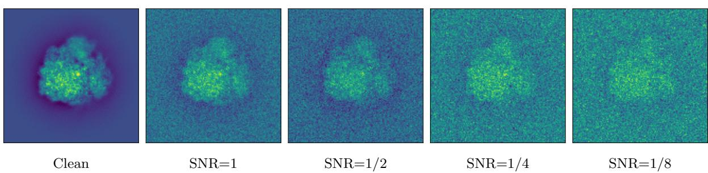  
Figure 1: Simulated projection images of EMD-2660 at diferent SNR values.

Remark 5.1. Since we can only recover the rotations up to symmetry and a global rotation, $\widehat { R } _ { i }$ is only an estimate of $R J ^ { \delta } s _ { i } R _ { i } J ^ { \delta }$ , where $s _ { i } \in S$ can be diferent for each i, $R \in \mathrm { S O ( 3 ) }$ is the global rotation, and $\delta \in \{ 0 , 1 \}$ represents the J-ambiguity. Ideally, we should quantify the error as

$$
\operatorname* { m i n } \left\{ \operatorname* { m i n } _ { R \in { \bf S } \mathrm { O } ( 3 ) } \frac { 1 } { N } \sum _ { i = 1 } ^ { N } \operatorname* { m i n } _ { s \in { \cal S } } \Vert R _ { i } - s R \widehat { R } _ { i } \Vert _ { F } ^ { 2 } , \operatorname* { m i n } _ { R \in { \bf S } \mathrm { O } ( 3 ) } \frac { 1 } { N } \sum _ { i = 1 } ^ { N } \operatorname* { m i n } _ { s \in { \cal S } } \Vert R _ { i } - s J R \widehat { R } _ { i } J \Vert _ { F } ^ { 2 } \right\}
$$

However, it is not obvious that there is an eficient way of calculating such error, so we resort to the MSE of estimating relative rotations defined in (26) that sidesteps the determination of the global rotation R. □

<table><tr><td rowspan=1 colspan=1>SNR</td><td rowspan=1 colspan=1>Clean</td><td rowspan=1 colspan=1>1</td><td rowspan=1 colspan=1>1/2</td><td rowspan=1 colspan=1>1/4</td><td rowspan=1 colspan=1>1/8</td></tr><tr><td rowspan=1 colspan=1> $\overline { { C _ { 1 } } }$ (without PR)</td><td rowspan=1 colspan=1>0.030 (18.10)</td><td rowspan=1 colspan=1>0.041(30.53)</td><td rowspan=1 colspan=1>0.034 (33.50)</td><td rowspan=1 colspan=1>0.088 (44.10)</td><td rowspan=1 colspan=1>0.570 (62.08)</td></tr><tr><td rowspan=1 colspan=1>Synchronization</td><td rowspan=1 colspan=1>0.000 (7.58)</td><td rowspan=1 colspan=1>0.005(23.25)</td><td rowspan=1 colspan=1>0.046(33.27)</td><td rowspan=1 colspan=1>&gt; 1</td><td rowspan=1 colspan=1>&gt; 1</td></tr><tr><td rowspan=1 colspan=1> $\overline { { C _ { 2 } } }$ (without PR)</td><td rowspan=1 colspan=1>0.032 (16.60)</td><td rowspan=1 colspan=1>0.026(25.61)</td><td rowspan=1 colspan=1>0.047(32.12)</td><td rowspan=1 colspan=1>0.195 (49.83)</td><td rowspan=1 colspan=1>&gt; 1</td></tr><tr><td rowspan=1 colspan=1> $\overline { { C _ { 2 } } }$ (with PR)</td><td rowspan=1 colspan=1>0.017 (12.73)</td><td rowspan=1 colspan=1>0.017 (23.67)</td><td rowspan=1 colspan=1>0.027 (29.58)</td><td rowspan=1 colspan=1>0.043 (37.89)</td><td rowspan=1 colspan=1>&gt; 1</td></tr><tr><td rowspan=1 colspan=1>Synchronization</td><td rowspan=1 colspan=1>0.521 (8.29)</td><td rowspan=1 colspan=1>0.684 (40.00)</td><td rowspan=1 colspan=1>&gt; 1</td><td rowspan=1 colspan=1>&gt; 1</td><td rowspan=1 colspan=1>&gt; 1</td></tr><tr><td rowspan=1 colspan=1> $\overline { { C _ { 3 } } }$ (without PR)</td><td rowspan=1 colspan=1>0.026 (14.53)</td><td rowspan=1 colspan=1>0.033 (24.38)</td><td rowspan=1 colspan=1>0.096 (38.16)</td><td rowspan=1 colspan=1>0.852 (60.91)</td><td rowspan=1 colspan=1>&gt; 1</td></tr><tr><td rowspan=1 colspan=1>C3 (with PR)</td><td rowspan=1 colspan=1>0.017 (11.58)</td><td rowspan=1 colspan=1>0.018 (22.17)</td><td rowspan=1 colspan=1>0.037 (30.71)</td><td rowspan=1 colspan=1>0.054 (38.56)</td><td rowspan=1 colspan=1>&gt; 1</td></tr><tr><td rowspan=1 colspan=1>Synchronization</td><td rowspan=1 colspan=1>0.004 (7.54)</td><td rowspan=1 colspan=1>&gt; 1</td><td rowspan=1 colspan=1>&gt; 1</td><td rowspan=1 colspan=1>&gt; 1</td><td rowspan=1 colspan=1>&gt; 1</td></tr><tr><td rowspan=1 colspan=1> $\overline { { C _ { 4 } } }$ (without PR)</td><td rowspan=1 colspan=1>0.153 (35.84)</td><td rowspan=1 colspan=1>0.370 (60.91)</td><td rowspan=1 colspan=1>0.804 (64.75)</td><td rowspan=1 colspan=1>&gt; 1</td><td rowspan=1 colspan=1>&gt; 1</td></tr><tr><td rowspan=1 colspan=1> $\overline { { C _ { 4 } } }$ (with PR)</td><td rowspan=1 colspan=1>0.050 (20.47)</td><td rowspan=1 colspan=1>0.046 (27.19)</td><td rowspan=1 colspan=1>0.457 (35.47)</td><td rowspan=1 colspan=1>&gt; 1</td><td rowspan=1 colspan=1>&gt; 1</td></tr><tr><td rowspan=1 colspan=1>Synchronization</td><td rowspan=1 colspan=1>0.005 (7.54)</td><td rowspan=1 colspan=1>&gt; 1</td><td rowspan=1 colspan=1>&gt; 1</td><td rowspan=1 colspan=1>&gt; 1</td><td rowspan=1 colspan=1>&gt; 1</td></tr><tr><td rowspan=1 colspan=1> $\overline { { C _ { 5 } } }$ (without PR)</td><td rowspan=1 colspan=1>0.190 (39.41)</td><td rowspan=1 colspan=1>0.189 (41.66)</td><td rowspan=1 colspan=1>0.724 (65.54)</td><td rowspan=1 colspan=1>&gt; 1</td><td rowspan=1 colspan=1>&gt; 1</td></tr><tr><td rowspan=1 colspan=1> $C _ { 5 }$ (with PR)</td><td rowspan=1 colspan=1>0.060(20.20)</td><td rowspan=1 colspan=1>0.065 (27.88)</td><td rowspan=1 colspan=1>0.338 (48.10)</td><td rowspan=1 colspan=1>&gt; 1</td><td rowspan=1 colspan=1>&gt; 1</td></tr><tr><td rowspan=1 colspan=1>Synchronization</td><td rowspan=1 colspan=1>0.006 (7.54)</td><td rowspan=1 colspan=1>0.063 (27.41)</td><td rowspan=1 colspan=1>&gt; 1</td><td rowspan=1 colspan=1>&gt; 1</td><td rowspan=1 colspan=1>&gt; 1</td></tr><tr><td rowspan=1 colspan=1> $\overline { { C _ { 6 } } }$ (without PR)</td><td rowspan=1 colspan=1>0.442 (50.99)</td><td rowspan=1 colspan=1>0.908 (65.63)</td><td rowspan=1 colspan=1>&gt; 1</td><td rowspan=1 colspan=1>&gt; 1</td><td rowspan=1 colspan=1>&gt; 1</td></tr><tr><td rowspan=1 colspan=1> $C _ { 6 }$ (with PR)</td><td rowspan=1 colspan=1>0.105 (29.47)</td><td rowspan=1 colspan=1>0.100 (65.19)</td><td rowspan=1 colspan=1>0.622 (66.08)</td><td rowspan=1 colspan=1>&gt; 1</td><td rowspan=1 colspan=1>&gt; 1</td></tr><tr><td rowspan=1 colspan=1>Synchronization</td><td rowspan=1 colspan=1>0.006 (7.54)</td><td rowspan=1 colspan=1>&gt; 1</td><td rowspan=1 colspan=1>&gt; 1</td><td rowspan=1 colspan=1>&gt; 1</td><td rowspan=1 colspan=1>&gt; 1</td></tr></table>

Table 1: MSE (26) with N = 40 images of size $L = 1 2 8$ for diferent symmetry groups and SNRs. FSCs of the reconstructed volumes are reported in the parenthesis in angstrom. Here PR refers to the proximal refinement step as in Section 2.3.

Tables 1 and 2 compare the performance of our proposed approach with the synchronization based approach proposed in Pragier and Shkolnisky (2019). The comparisons run across cyclic symmetries from $C _ { 1 }$ up to $C _ { 6 }$ with $N = 4 0$ and $N = 1 0 0$ , in terms of both the MSE (26) and the resolution as determined by the Fourier Shell Correlation (FSC) of the resulting reconstructed volumes. We see that our algorithm returns fairly accurate viewing direction estimations for moderate noise levels and symmetry orders, and is more robust to noise. The synchronization method outperforms ours in the clean case as expected in that synchronization exploits exact common lines geometry that becomes more accurate in the noiseless setting than the truncation-relaxation-rounding approximation in $\operatorname { S D P }$ approaches. If instead the original NUG algorithm (Bandeira et al., 2020) is applied to these symmetric molecules, we have observed that large MSEs are incurred even for clean images and the reconstructed molecule look visually very diferent from the ground truth.

<table><tr><td rowspan=1 colspan=1>SNR</td><td rowspan=1 colspan=1>Clean</td><td rowspan=1 colspan=1>1</td><td rowspan=1 colspan=1> $\overline { { 1 / 2 } }$ </td><td rowspan=1 colspan=1> $\overline { { 1 / 4 } }$ </td><td rowspan=1 colspan=1> $\overline { { 1 / 8 } }$ </td></tr><tr><td rowspan=1 colspan=1> $\overline { { C _ { 1 } } }$ (without PR)</td><td rowspan=1 colspan=1>0.022 (14.28)</td><td rowspan=1 colspan=1>0.028(21.76)</td><td rowspan=1 colspan=1>0.039 (26.59)</td><td rowspan=1 colspan=1>0.076 (34.91)</td><td rowspan=1 colspan=1>0.398 (46.79)</td></tr><tr><td rowspan=1 colspan=1>Synchronization</td><td rowspan=1 colspan=1>0.000 (7.54)</td><td rowspan=1 colspan=1>0.003(18.53)</td><td rowspan=1 colspan=1>0.021(24.55)</td><td rowspan=1 colspan=1>0.150(39.25)</td><td rowspan=1 colspan=1>&gt; 1</td></tr><tr><td rowspan=1 colspan=1> $\overline { { C _ { 2 } } }$ (without PR)</td><td rowspan=1 colspan=1>0.019 (11.06)</td><td rowspan=1 colspan=1>0.021(20.58)</td><td rowspan=1 colspan=1>0.043(25.22)</td><td rowspan=1 colspan=1>0.102(35.73)</td><td rowspan=1 colspan=1>&gt; 1</td></tr><tr><td rowspan=1 colspan=1> $\overline { { C _ { 2 } } }$ (with PR)</td><td rowspan=1 colspan=1>0.013 (8.92)</td><td rowspan=1 colspan=1>0.017 (20.25)</td><td rowspan=1 colspan=1>0.027 (22.75)</td><td rowspan=1 colspan=1>0.035 (27.04)</td><td rowspan=1 colspan=1>&gt; 1</td></tr><tr><td rowspan=1 colspan=1>Synchronization</td><td rowspan=1 colspan=1>0.003 (7.54)</td><td rowspan=1 colspan=1>0.248(24.35)</td><td rowspan=1 colspan=1>0.661 (42.46)</td><td rowspan=1 colspan=1>&gt; 1</td><td rowspan=1 colspan=1>&gt; 1</td></tr><tr><td rowspan=1 colspan=1> $C _ { 3 }$ (without PR)</td><td rowspan=1 colspan=1>0.036 (14.64)</td><td rowspan=1 colspan=1>0.032(20.82)</td><td rowspan=1 colspan=1>0.138 (33.92)</td><td rowspan=1 colspan=1>0.568 (50.78)</td><td rowspan=1 colspan=1>&gt;1</td></tr><tr><td rowspan=1 colspan=1> $C _ { 3 }$ (with PR)</td><td rowspan=1 colspan=1>0.025 (10.13)</td><td rowspan=1 colspan=1>0.019 (19.40)</td><td rowspan=1 colspan=1>0.023 (22.19)</td><td rowspan=1 colspan=1>0.039 (27.68)</td><td rowspan=1 colspan=1>&gt;1</td></tr><tr><td rowspan=1 colspan=1>Synchronization</td><td rowspan=1 colspan=1>0.004 (7.54)</td><td rowspan=1 colspan=1>&gt;1</td><td rowspan=1 colspan=1>&gt; 1</td><td rowspan=1 colspan=1>&gt; 1</td><td rowspan=1 colspan=1>&gt; 1</td></tr><tr><td rowspan=1 colspan=1> $\overline { { C _ { 4 } } }$ (without PR)</td><td rowspan=1 colspan=1>0.082 (16.27)</td><td rowspan=1 colspan=1>0.242 (38.26)</td><td rowspan=1 colspan=1>0.598 (60.07)</td><td rowspan=1 colspan=1>&gt; 1</td><td rowspan=1 colspan=1>&gt; 1</td></tr><tr><td rowspan=1 colspan=1> $C _ { 4 }$  (with PR)</td><td rowspan=1 colspan=1>0.037 (11.92)</td><td rowspan=1 colspan=1>0.051 (21.44)</td><td rowspan=1 colspan=1>0.045 (24.14)</td><td rowspan=1 colspan=1>&gt; 1</td><td rowspan=1 colspan=1>&gt; 1</td></tr><tr><td rowspan=1 colspan=1>Synchronization</td><td rowspan=1 colspan=1>0.001 (7.54)</td><td rowspan=1 colspan=1>&gt;1</td><td rowspan=1 colspan=1>&gt; 1</td><td rowspan=1 colspan=1>&gt; 1</td><td rowspan=1 colspan=1>&gt; 1</td></tr><tr><td rowspan=1 colspan=1> $\overline { { C _ { 5 } } }$  (without PR)</td><td rowspan=1 colspan=1>0.094 (17.85)</td><td rowspan=1 colspan=1>0.273 (41.37)</td><td rowspan=1 colspan=1>&gt; 1</td><td rowspan=1 colspan=1>&gt; 1</td><td rowspan=1 colspan=1>&gt; 1</td></tr><tr><td rowspan=1 colspan=1> $C _ { 5 }$ (with PR)</td><td rowspan=1 colspan=1>0.050 (10.46)</td><td rowspan=1 colspan=1>0.069(21.50)</td><td rowspan=1 colspan=1>&gt; 1</td><td rowspan=1 colspan=1>&gt; 1</td><td rowspan=1 colspan=1>&gt;1</td></tr><tr><td rowspan=1 colspan=1>Synchronization</td><td rowspan=1 colspan=1>0.007 (7.54)</td><td rowspan=1 colspan=1>0.049 (20.28)</td><td rowspan=1 colspan=1>&gt; 1</td><td rowspan=1 colspan=1>&gt; 1</td><td rowspan=1 colspan=1>&gt; 1</td></tr><tr><td rowspan=1 colspan=1> $\overline { { C _ { 6 } } }$ (without PR)</td><td rowspan=1 colspan=1>0.238 (29.61)</td><td rowspan=1 colspan=1>0.737 (61.37)</td><td rowspan=1 colspan=1>&gt; 1</td><td rowspan=1 colspan=1>&gt; 1</td><td rowspan=1 colspan=1>&gt; 1</td></tr><tr><td rowspan=1 colspan=1> $C _ { 6 }$ (with PR)</td><td rowspan=1 colspan=1>0.093 (14.82)</td><td rowspan=1 colspan=1>0.174 (47.39)</td><td rowspan=1 colspan=1>0.487 (66.63)</td><td rowspan=1 colspan=1>&gt; 1</td><td rowspan=1 colspan=1>&gt; 1</td></tr><tr><td rowspan=1 colspan=1>Synchronization</td><td rowspan=1 colspan=1>0.010 (7.54)</td><td rowspan=1 colspan=1>&gt; 1</td><td rowspan=1 colspan=1>&gt; 1</td><td rowspan=1 colspan=1>&gt; 1</td><td rowspan=1 colspan=1>&gt; 1</td></tr></table>

Table 2: MSE (26) with $N = 1 0 0$ images of size $L = 1 2 8$ for diferent symmetry groups and SNRs. FSCs of the reconstructed volumes are reported in the parenthesis in angstrom. Here PR refers to the proximal refinement step as in Section 2.3.

We also note that the proximal refinement step is indeed able to improve the accuracy of the initial estimates, even by a significant amount in certain cases. The performance starts to degrade as noise level becomes high and symmetry order is large. We believe this is due to the fact that our SDP relaxation becomes less tight in such cases since we are dropping many low rank constraints that should be imposed on the diagonal blocks, which is exacerbated by high noise levels. Nevertheless, we shall demonstrate on real datasets in the next subsection that when working with class averages which have much smaller noise level, our NUG framework is able to produce good ab initio models for symmetric molecules. Tables 3 and 4 record the performance of our NUG approach for dihedral symmetries, where similar observations are made. We note that Rosen and Shkolnisky (2020) considers orientation estimation for molecules with $D _ { 2 }$ symmetry and, to the best of our knowledge, is the only prior work addressing dihedral symmetry in this context. Our algorithm therefore provides a useful complementary approach.

<table><tr><td rowspan=1 colspan=1>SNR</td><td rowspan=1 colspan=1>Clean</td><td rowspan=1 colspan=1>1</td><td rowspan=1 colspan=1> $\overline { { 1 / 2 } }$ </td><td rowspan=1 colspan=1> $\overline { { 1 / 4 } }$ </td><td rowspan=1 colspan=1> $\overline { { 1 / 8 } }$ </td></tr><tr><td rowspan=1 colspan=1> $D _ { 3 }$  (without PR)</td><td rowspan=1 colspan=1>0.049 (35.52)</td><td rowspan=1 colspan=1>0.035 (52.32)</td><td rowspan=1 colspan=1>0.204 (61.37)</td><td rowspan=1 colspan=1>0.684 (64.93)</td><td rowspan=1 colspan=1>&gt; 1</td></tr><tr><td rowspan=1 colspan=1> $\overline { { D _ { 3 } } }$ (with PR)</td><td rowspan=1 colspan=1>0.040 (17.86)</td><td rowspan=1 colspan=1>0.027 (51.54)</td><td rowspan=1 colspan=1>0.123 (60.68)</td><td rowspan=1 colspan=1>0.448 (60.07)</td><td rowspan=1 colspan=1>&gt; 1</td></tr><tr><td rowspan=1 colspan=1> $\overline { { D _ { 4 } } }$ (without PR)</td><td rowspan=1 colspan=1>0.158 (60.60)</td><td rowspan=1 colspan=1>0.220 (61.69)</td><td rowspan=1 colspan=1>0.576 (43.23)</td><td rowspan=1 colspan=1>&gt;1</td><td rowspan=1 colspan=1>&gt;1</td></tr><tr><td rowspan=1 colspan=1> $D _ { 4 }$ (with PR)</td><td rowspan=1 colspan=1>0.082 (19.43)</td><td rowspan=1 colspan=1>0.097 (50.67)</td><td rowspan=1 colspan=1>0.511 (38.68)</td><td rowspan=1 colspan=1>&gt;1</td><td rowspan=1 colspan=1>&gt;1</td></tr><tr><td rowspan=1 colspan=1> $D _ { 5 }$  (without PR)</td><td rowspan=1 colspan=1>0.101 (12.52)</td><td rowspan=1 colspan=1>0.180 (61.69)</td><td rowspan=1 colspan=1>&gt;1</td><td rowspan=1 colspan=1>&gt;1</td><td rowspan=1 colspan=1>&gt;1</td></tr><tr><td rowspan=1 colspan=1> $D _ { 5 }$ (with PR)</td><td rowspan=1 colspan=1>0.088 (12.15)</td><td rowspan=1 colspan=1>0.167 (49.68)</td><td rowspan=1 colspan=1>&gt;1</td><td rowspan=1 colspan=1>&gt;1</td><td rowspan=1 colspan=1>&gt;1</td></tr><tr><td rowspan=1 colspan=1> $D _ { 6 }$ (without PR)</td><td rowspan=1 colspan=1>0.089 (16.57)</td><td rowspan=1 colspan=1>&gt;1</td><td rowspan=1 colspan=1>&gt;1</td><td rowspan=1 colspan=1>&gt;1</td><td rowspan=1 colspan=1>&gt;1</td></tr><tr><td rowspan=1 colspan=1> $D _ { 6 }$  (with PR)</td><td rowspan=1 colspan=1>0.391 (47.06)</td><td rowspan=1 colspan=1>&gt; 1</td><td rowspan=1 colspan=1>&gt; 1</td><td rowspan=1 colspan=1>&gt; 1</td><td rowspan=1 colspan=1>&gt;1</td></tr></table>

Table 3: MSE (26) with $N = 4 0$ images of size $L = 1 2 8$ for diferent symmetry groups and SNRs. FSCs of the reconstructed volumes are reported in the parenthesis in angstrom. Here PR refers to the proximal refinement step as in Section 2.3.

To close this section, we remark that one could also exclude the efects of self common lines by removing the diagonal losses $f _ { i i } { } ^ { \mathrm { ~ } } \mathrm { ^ s }$ (cf. (22)) from the objective function. Our experiments suggest that whether the self common lines are excluded or not have small efects on the algorithmic performance. Lastly, we present in Table 5 the computational time for solving the SDP (18) for diferent number of images, where the experiments are run on one A100 GPU with 80G memory. The reported runtime corresponds to the $C _ { 2 }$ molecule, with comparable runtimes observed for the other symmetries tested.

<table><tr><td rowspan=1 colspan=1>SNR</td><td rowspan=1 colspan=1>Clean</td><td rowspan=1 colspan=1>1</td><td rowspan=1 colspan=1> $\overline { { 1 / 2 } }$ </td><td rowspan=1 colspan=1> $\overline { { 1 / 4 } }$ </td><td rowspan=1 colspan=1>1/8</td></tr><tr><td rowspan=1 colspan=1> $D _ { 3 }$ (without PR)</td><td rowspan=1 colspan=1>0.085 (12.72)</td><td rowspan=1 colspan=1>0.064 (44.71)</td><td rowspan=1 colspan=1>0.118 (52.61)</td><td rowspan=1 colspan=1>0.903 (50.78)</td><td rowspan=1 colspan=1>&gt;1</td></tr><tr><td rowspan=1 colspan=1> $D _ { 3 }$ (with PR)</td><td rowspan=1 colspan=1>0.082 (16.51)</td><td rowspan=1 colspan=1>0.072 (28.61)</td><td rowspan=1 colspan=1>0.096 (47.53)</td><td rowspan=1 colspan=1>0.646 (58.90)</td><td rowspan=1 colspan=1>&gt;1</td></tr><tr><td rowspan=1 colspan=1> $\overline { { D _ { 4 } } }$ (without PR)</td><td rowspan=1 colspan=1>0.029 (14.66)</td><td rowspan=1 colspan=1>0.160 (27.36)</td><td rowspan=1 colspan=1>0.455 (62.33)</td><td rowspan=1 colspan=1>&gt; 1</td><td rowspan=1 colspan=1>&gt;1</td></tr><tr><td rowspan=1 colspan=1> $\overline { { D _ { 4 } } }$ (with PR)</td><td rowspan=1 colspan=1>0.024 (16.71)</td><td rowspan=1 colspan=1>0.184 (26.25)</td><td rowspan=1 colspan=1>0.456 (62.08)</td><td rowspan=1 colspan=1>&gt;1</td><td rowspan=1 colspan=1>&gt;1</td></tr><tr><td rowspan=1 colspan=1> $\overline { { D _ { 5 } } }$ (without PR)</td><td rowspan=1 colspan=1>0.110 (12.65)</td><td rowspan=1 colspan=1>0.185 (45.86)</td><td rowspan=1 colspan=1>0.808 (53.78)</td><td rowspan=1 colspan=1>&gt; 1</td><td rowspan=1 colspan=1>&gt;1</td></tr><tr><td rowspan=1 colspan=1> $D _ { 5 }$ (with PR)</td><td rowspan=1 colspan=1>0.109 (16.95)</td><td rowspan=1 colspan=1>0.125 (44.83)</td><td rowspan=1 colspan=1>0.771 (42.61)</td><td rowspan=1 colspan=1>&gt;1</td><td rowspan=1 colspan=1>&gt;1</td></tr><tr><td rowspan=1 colspan=1> $D _ { 6 }$ (without PR)</td><td rowspan=1 colspan=1>0.319 (19.80)</td><td rowspan=1 colspan=1>&gt;1</td><td rowspan=1 colspan=1>&gt;1</td><td rowspan=1 colspan=1>&gt;1</td><td rowspan=1 colspan=1>&gt;1</td></tr><tr><td rowspan=1 colspan=1> $D _ { 6 }$ (with PR)</td><td rowspan=1 colspan=1>0.566 (26.99)</td><td rowspan=1 colspan=1>&gt;1</td><td rowspan=1 colspan=1>&gt;1</td><td rowspan=1 colspan=1>&gt;1</td><td rowspan=1 colspan=1>&gt;1</td></tr></table>

Table 4: MSE (26) with $N = 1 0 0$ images of size $L = 1 2 8$ for diferent symmetry groups and SNRs. FSCs of the reconstructed volumes are reported in the parenthesis in angstrom. Here PR refers to the proximal refinement step as in Section 2.3.

In particular, the reported runtimes exclude proximal refinement. The total runtime should therefore be multiplied by five, since the refinement step requires four additional $\mathrm { S D P }$ solves. We can see that the computational time scales roughly quadratically with the number of images. The running times for the synchronization based algorithm depend on the noise level as well as the symmetry order due to specialized algorithms for $C _ { 2 } , C _ { 3 } , C _ { 4 }$ symmetries. On a 2.8 GHz Intel $\mathrm { C P U }$ , they can vary between 10∼100 minutes for $N = 1 0 0$ images and 110∼1100 minutes for $N = 3 0 0$ images.

<table><tr><td rowspan=1 colspan=1>N</td><td rowspan=1 colspan=1>20</td><td rowspan=1 colspan=1>50</td><td rowspan=1 colspan=1>100</td><td rowspan=1 colspan=1>200</td><td rowspan=1 colspan=1>300</td></tr><tr><td rowspan=1 colspan=1>Time (minutes)</td><td rowspan=1 colspan=1>2.0</td><td rowspan=1 colspan=1>6.8</td><td rowspan=1 colspan=1>21.3</td><td rowspan=1 colspan=1>78.7</td><td rowspan=1 colspan=1>176.2</td></tr></table>

Table 5: Computation time of solving the SDP (18) for diferent number of images with truncation level $K = 1 2$

## 5.2 Experimental Datasets

## 5.2.1 EMPIAR-10081

In this section, we shall apply our NUG framework on a real dataset with $C _ { 4 }$ symmetry taken from the EMPIAR-10081 entry from the EMPIAR image database (Iudin et al., 2016) that contains 55870 raw images. We use RELION (Scheres, 2012) for generating 50 class averages from the original dataset. Figure 2 shows several raw images from EMPIAR and the computed class averages. Out of the 50 class

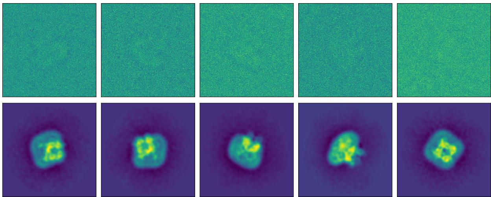  
Figure 2: Raw images from EMPIAR 10081 (top) and class averages computed (bottom).

averages, we manually pick 17 of them that look visually meaningful, which are of size 256 by 256.

We apply our NUG algorithm to obtain the orientation estimations for these 17 class averages, with truncation level K = 12 and 10 iterations of proximal refinement where in each iteration the projection rank is set to be rank $\left( A _ { k } \right)$ and the penalty is set to be $\begin{array} { r } { \eta _ { k } = \frac { 1 } { k } } \end{array}$ . The total computational time is about 20 minutes on an A100 GPU with 80G memory. We then use the estimated orientations to build an ab initio model as displayed in Figure 3a. We can see that even with only 17 images, our algorithm is able to yield a reasonably good reconstruction with a Fourier shell correlation (FSC) 15.45A˚ with respect to the reference model (which we take as the reconstructed volume reported under the EMPIAR-10081 entry) as is shown in Figure 4a.

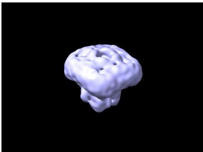  
(a) Ab initio model

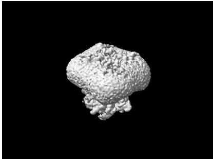  
(b) Refined model

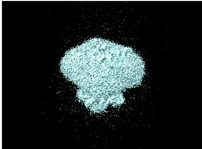  
(c) Reference model

Figure 3: Visualizations of the ab initio model, the refined model, and the reference model.  
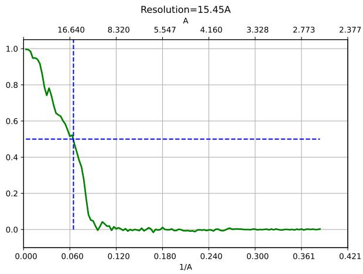  
(a) Ab initio model

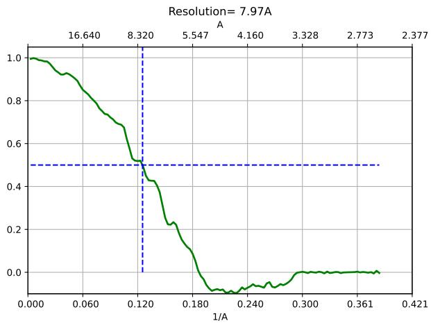  
(b) Refined model  
Figure 4: Fourier shell correlations for the ab initio model and the refined model.

We then feed this ab initio model into CryoSPARC (Punjani et al., 2017) for refinement using all the raw images and arrive at the model shown in Figure 3b with an FSC of 7.97A˚, suggesting our ab initio reconstruction is reasonably accurate for iterative refinement to work.

## 5.3 EMPIAR-12036

Next we shall apply our NUG algorithm to another experimental dataset with $D _ { 3 }$ symmetry taken from the EMPIAR-12036 entry from the EMPIAR image database containing 1565602 raw images. We again apply RELION to generate 93 class averages of size 128 by 128 as visualized in Figure 5 after discarding those that are visually uninterpretable.

We apply our NUG algorithm to obtain the orientation estimations for these 93 class averages, with truncation level K = 12 and 5 iterations of proximal refinement where in each iteration the projection rank is set to be rank $\left( A _ { k } \right)$ and the penalty is set to be $\begin{array} { r } { \eta _ { k } = \frac { 1 } { k } } \end{array}$ . The total running time is about 2 hours on an A100 GPU with 80G memory. The estimated orientations are used to build an ab initio model as displayed in Figure 6a, yielding a reconstruction with a Fourier shell correlation (FSC) 26.60A˚ with respect to the volume reported under the 12036 entry as is shown in Figure $\mathrm { 7 a } .$ . This ab initio model is then imported into CryoSPARC (Punjani et al., 2017) for refinement using all the raw images and we obtain the refined model as shown in Figure 6b with an FSC of 10.72A˚. The experiment as well as that in the previous subsection suggests the applicability of our approach to experimental datasets.

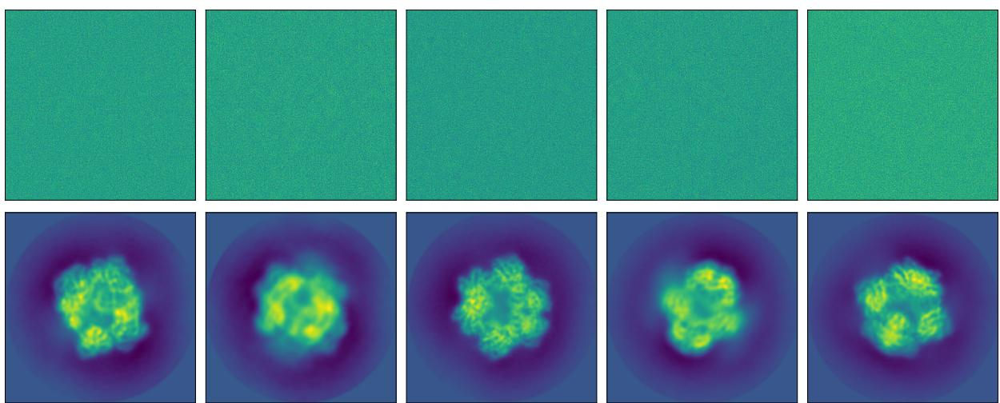  
Figure 5: Raw images from EMPIAR 12036 (top) and class averages computed (bottom).

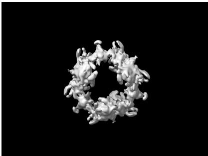  
(a) Ab initio model

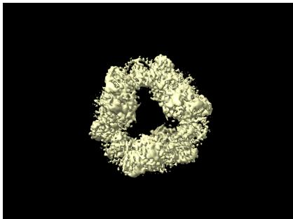  
(b) Refined model

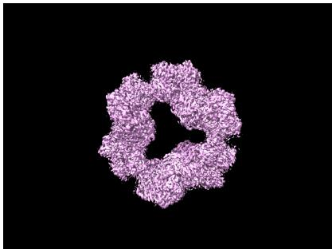  
(c) Reference model

Figure 6: Visualizations of the ab initio model, the refined model, and the reference model.  
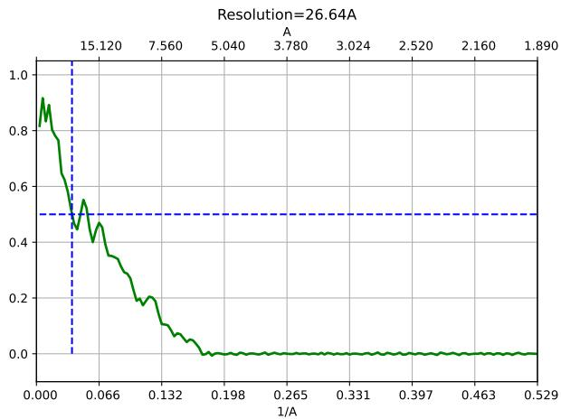  
(a) Ab initio model

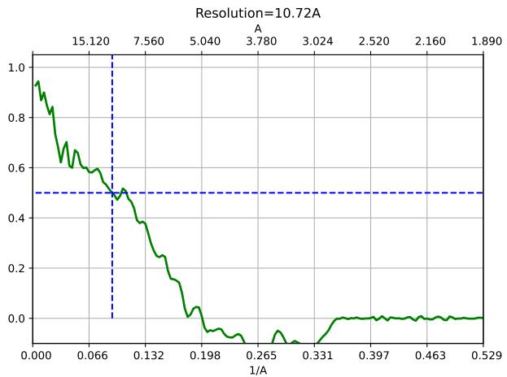  
(b) Refined model  
Figure 7: Fourier shell correlations for the ab initio model and the refined model.

## Acknowledgments

A.S. and R.Y. were supported in part by AFOSR FA9550-23-1-0249, the Simons Foundation Math+X Investigator Award, NSF DMS2009753, NSF DMS2510039, and NIH/NIGMS R01GM13678001. Y.S. was supported by NSF DMS2514152. The authors would like to thank Yoel Shkolnisky for help with generating class averages and Josh Carmichael for insights on the MSE and FSC metrics.

## A Wigner D Matrices

Let $\alpha , \beta , \gamma$ be the Euler angles in the ZYZ-convention. Then the Wigner D-matrix takes the form (Varshalovich et al., 1988)

$$
W ^ { ( j ) } ( \alpha , \beta , \gamma ) = D ^ { ( j ) } ( \alpha ) w ^ { ( j ) } ( \beta ) D ^ { ( j ) } ( \gamma ) , \qquad D ^ { ( j ) } ( \theta ) = \left[ \begin{array} { l l l } { e ^ { \mathbf { i } j \theta } } & & \\ & { \ddots } & \\ & & { e ^ { - \mathbf { i } j \theta } } \end{array} \right] ,\tag{27}
$$

where $w ^ { ( j ) } ( \beta )$ is the Wigner small d-matrix taking the form

$$
[ w ^ { ( j ) } ( \beta ) ] _ { m ^ { \prime } m }
$$

$$
= [ ( j + m ^ { \prime } ) ! ( j - m ^ { \prime } ) ! ( j + m ) ! ( j - m ) ! ] ^ { \frac { 1 } { 2 } } \sum _ { s = s _ { \mathrm { m i n } } } ^ { s _ { \mathrm { m a x } } } \left[ { \frac { ( - 1 ) ^ { m ^ { \prime } - m + s } \left( \cos { \frac { \beta } { 2 } } \right) ^ { 2 j + m - m ^ { \prime } - 2 s } \left( \sin { \frac { \beta } { 2 } } \right) ^ { m ^ { \prime } - m + 2 s } } { ( j + m - s ) ! s ! ( m ^ { \prime } - m + s ) ! ( j - m ^ { \prime } - s ) ! } } \right] ,
$$

where $s _ { \mathbf { m i n } } = \operatorname* { m a x } ( 0 , m - m ^ { \prime } )$ and $s _ { \mathbf { m } \mathbf { a } \mathbf { x } } = \operatorname* { m i n } ( j + m , j - m ^ { \prime } )$ . For $j = 1$ , we have

$$
\begin{array} { r l } & { w ^ { ( 1 ) } ( \beta ) = \left[ \begin{array} { l l l } { \frac { 1 } { 2 } ( 1 + \cos \beta ) } & { \frac { \sqrt { 2 } } { 2 } \sin \beta } & { \frac { 1 } { 2 } ( 1 - \cos \beta ) } \\ { - \frac { \sqrt { 2 } } { 2 } \sin \beta } & { \cos \beta } & { \frac { \sqrt { 2 } } { 2 } \sin \beta } \\ { \frac { 1 } { 2 } ( 1 - \cos \beta ) } & { - \frac { \sqrt { 2 } } { 2 } \sin \beta } & { \frac { 1 } { 2 } ( 1 + \cos \beta ) } \end{array} \right] } \\ & { W ^ { ( 1 ) } ( \alpha , \beta , \gamma ) = \left[ \begin{array} { l l l } { \frac { 1 } { 2 } e ^ { \mathrm { i } \alpha } e ^ { \mathrm { i } \gamma } ( 1 + \cos \beta ) } & { \frac { \sqrt { 2 } } { 2 } e ^ { \mathrm { i } \alpha } \sin \beta } & { \frac { 1 } { 2 } e ^ { \mathrm { i } \alpha } e ^ { - \mathrm { i } \gamma } ( 1 - \cos \beta ) } \\ { - \frac { \sqrt { 2 } } { 2 } e ^ { \mathrm { i } \gamma } \sin \beta } & { \cos \beta } & { \frac { \sqrt { 2 } } { 2 } e ^ { - \mathrm { i } \gamma } \sin \beta } \\ { \frac { 1 } { 2 } e ^ { - \mathrm { i } \alpha } e ^ { \mathrm { i } \gamma } ( 1 - \cos \beta ) } & { - \frac { \sqrt { 2 } } { 2 } e ^ { - \mathrm { i } \alpha } \sin \beta } & { \frac { 1 } { 2 } e ^ { - \mathrm { i } \alpha } e ^ { - \mathrm { i } \gamma } ( 1 + \cos \beta ) } \end{array} \right] } \end{array}
$$

Relation between Wigner-D and rotation matrices: Let

$$
T = \left[ { \begin{array} { c c c } { - { \frac { \mathbf { i } } { \sqrt { 2 } } } } & { 0 } & { { \frac { 1 } { \sqrt { 2 } } } } \\ { 0 } & { 1 } & { 0 } \\ { - { \frac { \mathbf { i } } { \sqrt { 2 } } } } & { 0 } & { - { \frac { 1 } { \sqrt { 2 } } } } \end{array} } \right] .
$$

Then we have

$$
T ^ { * } W ^ { ( 1 ) } ( \alpha , \beta , \gamma ) T = \left[ { \begin{array} { c c c } { c _ { \alpha } c _ { \gamma } - s _ { \alpha } c _ { \beta } s _ { \gamma } } & { - s _ { \alpha } s _ { \beta } } & { - c _ { \alpha } s _ { \gamma } - s _ { \alpha } c _ { \beta } c _ { \gamma } } \\ { - s _ { \beta } s _ { \gamma } } & { c _ { \beta } } & { - s _ { \beta } c _ { \gamma } } \\ { c _ { \alpha } c _ { \beta } s _ { \gamma } + s _ { \alpha } c _ { \gamma } } & { c _ { \alpha } s _ { \beta } } & { c _ { \alpha } c _ { \beta } c _ { \gamma } - s _ { \alpha } s _ { \gamma } } \end{array} } \right] = \left[ { \begin{array} { c c c } { R _ { 2 2 } } & { - R _ { 2 3 } } & { - R _ { 2 1 } } \\ { - R _ { 3 2 } } & { R _ { 3 3 } } & { R _ { 3 1 } } \\ { - R _ { 1 2 } } & { R _ { 1 3 } } & { R _ { 1 1 } } \end{array} } \right] ,
$$

where R is the rotation matrix corresponding to the ZYZ-Euler angles $( \alpha , \beta , \gamma )$

## B Invariance with respect to Global Rotation

To formalize the set up, let $\phi : \mathbb { R } ^ { 3 }  \mathbb { R }$ be the electric potential of the molecule and define the group action $g \circ \phi = \phi ( g ^ { - 1 } x )$ . The symmetry assumption translates to $s \circ \phi = \phi$ for all $s \in S$ . We want to show that for a global orthogonal transformation $g \in \mathrm { O ( 3 ) }$ , the set $\{ g _ { i } g ^ { - 1 } \} _ { i = 1 } ^ { n }$ gives the same $X _ { i j } ^ { ( k ) }$ ’s as $\{ g _ { i } \} _ { i = 1 } ^ { n }$ , which is not immediately obvious from its definition. The idea is that when there is a global shift, the symmetry group also changes.

Let $\phi = g \circ \phi$ be the transformed molecule. We have

$$
( g s g ^ { - 1 } ) \circ { \widetilde { \phi } } { \stackrel { \mathrm { d e f n . ~ o f ~ } } { = } } { \widetilde { \phi } } ( g s ) \circ \phi { \overset { \mathrm { s y m m e t r y ~ o f ~ } \phi } { = } } g \circ \phi = { \widetilde { \phi } } ,
$$

so that the symmetry group for $\widetilde { \phi }$ is $g S g ^ { - 1 }$ . Now since $g _ { i } \circ \phi = ( g _ { i } g ^ { - 1 } ) \circ \widetilde { \phi } .$ , the associated rotations for $\phi$ are $\{ g _ { i } g ^ { - 1 } \} _ { i = 1 } ^ { n }$ and we have

$$
\begin{array} { l } { { \displaystyle \widetilde { X } _ { i j } ^ { ( k ) } = \frac { 1 } { | S | } \sum _ { \widetilde { s } \in \widetilde { S } } \rho _ { k } ( g _ { i } g ^ { - 1 } ) \rho _ { k } ( \widetilde { s } ) \rho _ { k } ( g _ { j } g ^ { - 1 } ) ^ { * } } \ ~ } \\ { { \displaystyle \qquad = \frac { 1 } { | S | } \sum _ { s \in S } \rho _ { k } ( g _ { i } g ^ { - 1 } ) \rho _ { k } ( g s g ^ { - 1 } ) \rho _ { k } ( g g _ { j } ^ { - 1 } ) = \frac { 1 } { | S | } \sum _ { s \in S } \rho _ { k } ( g _ { i } ) \rho _ { k } ( s ) \rho _ { k } ( g _ { j } ^ { - 1 } ) = X _ { i j } ^ { ( k ) } . } } \end{array}
$$

An implication of this observation is that when recovering the $g _ { i } { \mathrm { ' s } } .$ , we can pick $\mathrm { a \ ^ { 6 } n i c e ^ { 5 } }$ coordinate system over which the $A _ { k } { } ^ { \prime } \mathrm { s }$ have nice structures, and recover the $g _ { i }$ ’s as the rotation with respect to such a coordinate system.

## C Details of Least Squares in Section 3

## C.1 Type I

Suppose we want to solve the problem

$$
\operatorname* { m i n } _ { c \in C } \| c A - B \| _ { F } ,
$$

where A, $\ b { B } \in \mathbb { C } ^ { p \times p }$ . Writing $c = c _ { r } + \mathbf { i } c _ { i } , A = A _ { r } + \mathbf { i } A _ { \mathbf { i } }$ and $B = B _ { r } + \mathbf { i } B _ { i }$ in terms of real and imaginary parts, we have

$$
f ( c _ { r } , c _ { i } ) : = \| c A - B \| _ { F } ^ { 2 } = \| c _ { r } A _ { r } - c _ { i } A _ { i } - B _ { r } \| _ { F } ^ { 2 } + \| c _ { i } A _ { r } + c _ { r } A _ { i } - B _ { i } \| _ { F } ^ { 2 } .
$$

Setting partial derivatives to be zero, we obtain

$$
0 = { \frac { \partial f } { \partial c _ { r } } } = 2 { \big ( } { \big \langle } A _ { r } , A _ { r } { \big \rangle } + { \big \langle } A _ { i } , A _ { i } { \big \rangle } { \big ) } c _ { r } - 2 { \big \langle } A _ { r } , B _ { r } { \big \rangle } - 2 { \big \langle } A _ { i } , B _ { i } { \big \rangle } \quad \Longrightarrow \quad c _ { r } = { \frac { { \big \langle } A _ { r } , B _ { r } { \big \rangle } + { \big \langle } A _ { i } , B _ { i } { \big \rangle } } { \langle A _ { r } , A _ { r } \rangle + { \big \langle } A _ { i } , A _ { i } { \big \rangle } } } ,
$$

$$
0 = { \frac { \partial f } { \partial c _ { i } } } = 2 { \big ( } \langle A _ { r } , A _ { r } \rangle + \langle A _ { i } , A _ { i } \rangle { \big ) } c _ { i } + 2 \langle A _ { i } , B _ { r } \rangle - 2 \langle A _ { r } , B _ { i } \rangle \quad \Longrightarrow \quad c _ { i } = { \frac { \langle A _ { r } , B _ { i } \rangle - \langle A _ { i } , B _ { r } \rangle } { \langle A _ { r } , A _ { r } \rangle + \langle A _ { i } , A _ { i } \rangle } } .
$$

## C.2 Type II

Suppose we want to solve for the problem

$$
\operatorname* { m i n } _ { c \in \mathbb { C } } \| c A + \bar { c } B - C \| _ { F } ,
$$

where A, $\boldsymbol { B } \in \mathbb { R } ^ { p \times p }$ and $C \in \mathbb { C } ^ { p \times p }$ . Writing $c = c _ { r } + \mathbf { i } c _ { i }$ and $C = C _ { r } + \mathbf { i } C _ { i }$ in terms of real and imaginary parts, we have

$$
f ( c _ { r } , c _ { i } ) : = \| c A + \bar { c } B - C \| _ { F } ^ { 2 } = \| c _ { r } A + c _ { r } B - C _ { r } \| _ { F } ^ { 2 } + \| c _ { i } A - c _ { i } B - C _ { i } \| _ { F } ^ { 2 } .
$$

Setting partial derivatives to be zero, we obtain

$$
0 = \frac { \partial f } { \partial c _ { r } } = 2 \langle A + B , A + B \rangle c _ { r } - 2 \langle A + B , C _ { r } \rangle \quad \Longrightarrow \quad c _ { r } = \frac { \langle A + B , C _ { r } \rangle } { \langle A + B , A + B \rangle } ,
$$

$$
0 = { \frac { \partial f } { \partial c _ { i } } } = 2 \langle A - B , A - B \rangle c _ { i } - 2 \langle A - B , C _ { i } \rangle \quad \Longrightarrow \quad c _ { i } = { \frac { \langle A - B , C _ { i } \rangle } { \langle A - B , A - B \rangle } } .
$$

## C.3 Type III

Suppose we want to solve for the problem

$$
\operatorname* { m i n } _ { c , d \in \mathbb { C } } \| c A _ { 1 } + \overline { c } A _ { 2 } + d B _ { 1 } + \overline { d } B _ { 2 } - C \| _ { F } ,
$$

where $A _ { i } , B _ { i } \in \mathbb { R } ^ { p \times p }$ and $C \in \mathbb { C } ^ { p \times p }$ . Writing $c = c _ { r } + \mathbf { i } c _ { i } , d = d _ { r } + \mathbf { i } d _ { i } , C = C _ { r } + \mathbf { i } C _ { i }$ in terms of real and imaginary parts, we have

$$
\begin{array} { r l } & { f ( c _ { r } , c _ { i } , d _ { r } , d _ { i } ) : = \| c A _ { 1 } + \bar { c } A _ { 2 } + d B _ { 1 } + \overline { { d } } B _ { 2 } - C \| _ { F } ^ { 2 } } \\ & { \phantom { f ( c _ { r } , c _ { i } , d _ { r } , d _ { i } ) : = } = \| c _ { r } ( A _ { 1 } + A _ { 2 } ) + d _ { r } ( B _ { 1 } + B _ { 2 } ) - C _ { r } \| _ { F } ^ { 2 } + \| c _ { i } ( A _ { 1 } - A _ { 2 } ) + d _ { i } ( B _ { 1 } - B _ { 2 } ) - C _ { i } \| _ { F } ^ { 2 } . } \end{array}
$$

Setting partial derivatives equal to zero, we obtain the $2 \times 2$ systems

$$
\left[ \langle A _ { 1 } + A _ { 2 } , A _ { 1 } + A _ { 2 } \rangle \quad \langle A _ { 1 } + A _ { 2 } , B _ { 1 } + B _ { 2 } \rangle \right] \left[ { c _ { r } } \right] = \left[ \langle A _ { 1 } + A _ { 2 } , C _ { r } \rangle \right] ,
$$

$$
\left[ \langle A _ { 1 } - A _ { 2 } , A _ { 1 } - A _ { 2 } \rangle \quad \langle A _ { 1 } - A _ { 2 } , B _ { 1 } - B _ { 2 } \rangle \right] \left[ { c } _ { i } \right] = \left[ \langle A _ { 1 } - A _ { 2 } , { C } _ { r } \rangle \right]
$$

so that $( c _ { r } , c _ { i } , d _ { r } , d _ { i } )$ can be solved with least squares.

## References

A. S. Bandeira, M. Charikar, A. Singer, and A. Zhu. Multireference alignment using semidefinite programming. In Proceedings of the 5th conference on Innovations in theoretical computer science, pages 459–470, 2014.

A. S. Bandeira, C. Kennedy, and A. Singer. Approximating the little Grothendieck problem over the orthogonal and unitary groups. Mathematical Programming, 160(1):433–475, 2016.

A. S. Bandeira, Y. Chen, R. R. Lederman, and A. Singer. Non-unique games over compact groups and orientation estimation in cryo-EM. Inverse Problems, 36(6):064002, 2020.

J. Dattorro. Convex optimization & Euclidean distance geometry, volume 105. Meboo Publishing USA, 2005.

S. Diamond, R. Takapoui, and S. Boyd. A general system for heuristic solution of convex problems over nonconvex sets. arXiv:1601.07277, 2016.

N. A. Farrow and E. P. Ottensmeyer. A posteriori determination of relative projection directions of arbitrarily oriented macromolecules. Journal of the Optical Society of America A, 9(10):1749–1760, 1992.

J. Frank. Three-dimensional electron microscopy of macromolecular assemblies: visualization of biological molecules in their native state. Oxford university press, 2006.

W. Fulton and J. Harris. Representation theory: a first course, volume 129. Springer Science & Business Media, 2013.

A. S. Geva and Y. Shkolnisky. A common lines approach for ab initio modeling of molecules with tetrahedral and octahedral symmetry. SIAM Journal on Imaging Sciences, 16(4):1978–2014, 2023.

M. X. Goemans and D. P. Williamson. Improved approximation algorithms for maximum cut and satisfiability problems using semidefinite programming. Journal of the ACM (JACM), 42(6):1115– 1145, 1995.

A. Iudin, P. K. Korir, J. Salavert-Torres, G. J. Kleywegt, and A. Patwardhan. EMPIAR: a public archive for raw electron microscopy image data. Nature Methods, 13(5):387–388, 2016.

S. Khot. On the power of unique 2-prover 1-round games. In Proceedings of the thiry-fourth annual ACM symposium on Theory of computing, pages 767–775, 2002.

S. Khot. On the unique games conjecture (invited survey). In 2010 IEEE 25th annual conference on computational complexity, pages 99–121. IEEE Computer Society, 2010.

P. J. Kostelec and D. N. Rockmore. FFTs on the rotation group. Journal of Fourier Analysis and Applications, 14(2):145–179, 2008.

C. L. Lawson, A. Patwardhan, M. L. Baker, C. Hryc, E. S. Garcia, B. P. Hudson, I. Lagerstedt, S. J. Ludtke, G. Pintilie, R. Sala, et al. EMDataBank unified data resource for 3DEM. Nucleic Acids Research, 44(D1):D396–D403, 2016.

S. P. Mallick, S. Agarwal, D. J. Kriegman, S. J. Belongie, B. Carragher, and C. S. Potter. Structure and view estimation for tomographic reconstruction: A Bayesian approach. In 2006 IEEE Computer Society Conference on Computer Vision and Pattern Recognition (CVPR’06), volume 2, pages 2253– 2260. IEEE, 2006.

T. Nakane, A. Kotecha, A. Sente, G. McMullan, S. Masiulis, P. M. Brown, I. T. Grigoras, L. Malinauskaite, T. Malinauskas, J. Miehling, et al. Single-particle cryo-EM at atomic resolution. Nature, 587 (7832):152–156, 2020.

A. Naor, O. Regev, and T. Vidick. Eficient rounding for the noncommutative Grothendieck inequality. In Proceedings of the forty-fifth annual ACM symposium on Theory of computing, pages 71–80, 2013.

P. A. Penczek, J. Zhu, and J. Frank. A common-lines based method for determining orientations for n > 3 particle projections simultaneously. Ultramicroscopy, 63(3-4):205–218, 1996.

G. Pragier and Y. Shkolnisky. A common lines approach for ab initio modeling of cyclically symmetric molecules. Inverse Problems, 35(12):124005, 2019.

A. Punjani, J. L. Rubinstein, D. J. Fleet, and M. A. Brubaker. cryoSPARC: algorithms for rapid unsupervised cryo-EM structure determination. Nature Methods, 14(3):290–296, 2017.

E. Rosen and Y. Shkolnisky. Common lines ab initio reconstruction of D2-symmetric molecules in cryoelectron microscopy. SIAM Journal on Imaging Sciences, 13(4):1898–1944, 2020.

J. Saunderson, P. A. Parrilo, and A. S. Willsky. Semidefinite descriptions of the convex hull of rotation matrices. SIAM Journal on Optimization, 25(3):1314–1343, 2015.

S. H. Scheres. RELION: implementation of a Bayesian approach to cryo-EM structure determination. Journal of Structural Biology, 180(3):519–530, 2012.

Y. Shkolnisky and A. Singer. Viewing direction estimation in cryo-EM using synchronization. SIAM Journal on Imaging Sciences, 5(3):1088–1110, 2012.

A. Singer. Angular synchronization by eigenvectors and semidefinite programming. Applied and Computational Harmonic Analysis, 30(1):20–36, 2011.

A. Singer and Y. Shkolnisky. Three-dimensional structure determination from common lines in cryo-EM by eigenvectors and semidefinite programming. SIAM Journal on Imaging Sciences, 4(2):543–572, 2011.

A. Singer, R. R. Coifman, F. J. Sigworth, D. W. Chester, and Y. Shkolnisky. Detecting consistent common lines in cryo-EM by voting. Journal of Structural Biology, 169(3):312–322, 2010.

A. Singer, Z. Zhao, Y. Shkolnisky, and R. Hadani. Viewing angle classification of cryo-electron microscopy images using eigenvectors. SIAM Journal on Imaging Sciences, 4(2):723–759, 2011.

R. Sun, Z.-Q. Luo, and Y. Ye. On the eficiency of random permutation for ADMM and coordinate descent. Mathematics of Operations Research, 45(1):233–271, 2020.

B. K. Vainshtein and A. B. Goncharov. Determination of the spatial orientation of arbitrarily arranged identical particles of unknown structure from their projections. In Soviet Physics Doklady, volume 31, page 278, 1986.

M. Van Heel. Angular reconstitution: a posteriori assignment of projection directions for 3D reconstruction. Ultramicroscopy, 21(2):111–123, 1987.

D. A. Varshalovich, A. N. Moskalev, and V. K. Khersonskii. Quantum Theory of Angular Momentum. World Scientific, Singapore, 1988. doi: 10.1142/0270.

L. Wang and F. J. Sigworth. Cryo-EM and single particles. Physiology, 21(1):13–18, 2006.

Z. Wen, D. Goldfarb, and W. Yin. Alternating direction augmented Lagrangian methods for semidefinite programming. Mathematical Programming Computation, 2(3):203–230, 2010.

G. Wright, J. And´en, V. Bansal, J. Xia, C. Langfield, J. Carmichael, K. Sowattanangkul, R. Brook, Y. Shi, A. Heimowitz, G. Pragier, I. Sason, A. Moscovich, Y. Shkolnisky, and A. Singer. Computationalcryoem/aspire-python: v0.12.0, Sept. 2023. URL https://doi.org/10.5281/zenodo. 8321443.

A. Yershova, S. Jain, S. M. Lavalle, and J. C. Mitchell. Generating uniform incremental grids on SO(3) using the Hopf fibration. The International Journal of Robotics Research, 29(7):801–812, 2010.

K. M. Yip, N. Fischer, E. Paknia, A. Chari, and H. Stark. Atomic-resolution protein structure determination by cryo-EM. Nature, 587(7832):157–161, 2020.