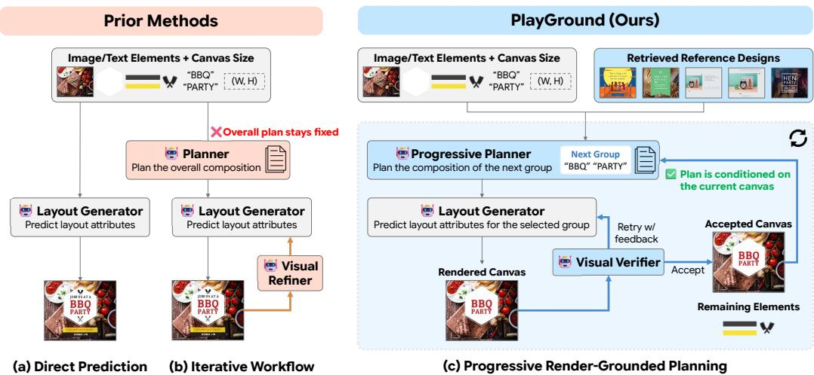  
Figure 1: Prior methods (Cheng et al., 2025; Liu et al., 2026) either (a) generate layout in a single forward pass, or (b) refine results iteratively while overall design plan stays fixed outside the feedback loop. In contrast, (c) PlayGround decomposes planning into steps and places them inside the iterative loop. As PlayGround plans and fills the canvas progressively based on the current canvas state, PlayGround is robust to intermediate design errors and produces more coherent final designs.

# PLAYGROUND: PROGRESSIVE LAYOUTGENERATION WITH RENDER-GROUNDED PLANNING

Jaeho Lee Junhwan Heo Junghyun Park WonJun Moon Eunju Yang   
Seungho Jang Seongchan Kim Seungryong Kim<sup>†</sup>   
KAIST AI

https://cvlab-kaist.github.io/PlayGround/

## ABSTRACT

Generating editable graphic designs requires arranging visual and textual elements into a coherent composition while preserving their content and editability. Although recent MLLM-based approaches employ iterative generation and visual refinement to reflect the real-world design workflows, their high-level plans are predetermined prior to execution, limiting their adaptability as the design evolves. To address this limitation, we propose PlayGround, a progressive layout generation framework that dynamically adapts to the current rendered canvas. PlayGround establishes a progressive design loop comprising a Progressive Planner, a Layout Generator, and a Visual Verifier, guided by a Structure-Aware Retriever. Given an initial set of unordered elements, the Structure-Aware Retriever initially infers a coarse layout structure to retrieve structurally similar reference designs. Subsequently, at each turn, the Progressive Planner examines the current rendered canvas alongside the remaining elements, forms the next functional group, and plans its composition. The Layout Generator then predicts editable layout attributes, while the Visual Verifier evaluates rendered candidates and provides feedback when refinement is necessary. To train the Progressive Planner with step-wise supervision, we construct a two-stage data generation pipeline that extracts functional groups and turn-level planning trajectories from completed designs. Experiments on Crello and LICA demonstrate the effectiveness of PlayGround over existing methods. Our code and weights will be publicly released.

## 1 INTRODUCTION

Graphic design is a key medium for effectively communicating visual and textual information across domains such as advertising, e-commerce, and presentation authoring, yet its production requires substantial time and expertise. To automate this process, AI-based approaches have been extensively studied along two main directions. One directly synthesizes the final design as a pixel-level image using diffusion-based generative models (Li et al., 2023; Gao et al., 2025; Wang et al., 2025), while the other predicts layouts of given image and text elements to produce an editable document (Inoue et al., 2023; 2024). Although text-to-image generative models achieve high visual quality, they still struggle with accurate text rendering and faithful preservation of input elements, and their raster outputs limit element-level editing. In contrast, layout generation models represent designs in structured formats such as JSON or HTML/CSS, supporting content fidelity and editability.

Recently, Multimodal Large Language Models (MLLMs) have been adopted for editable layout generation due to their strong multimodal understanding and reasoning capabilities. While pioneer ing works (Cheng et al., 2025; Lin et al., 2025; Patnaik et al., 2025) exploited MLLMs to directly predict layout attributes such as position, size, and ordering from multimodal elements (Fig. 1 (a)), recent works aim to reflect the iterative nature of real-world design workflows. PosterCopilot (Wei et al., 2026) enabled iterative editing and rearrangement of generated designs, while VFLM (Guo et al., 2026) progressively refines text layouts using visual feedback from rendered results. Other works introduced an explicit planning stage into the design workflow. DesignAsCode (Liu et al., 2026) combines semantic planning, HTML/CSS generation, and visual refinement, while PSDesigner (Shuai et al., 2026) integrates element collection and grouping with sequential placement and refinement. Although these works have successfully enhanced the overall design quality, their workflows rely heavily on initial planning and element grouping decisions that cannot be revised using intermediate visual feedback (Fig. 1 (b)).

Therefore, we propose PlayGround (Progressive Layout Generation with Render-Grounded Planning), a framework that adaptively adjusts the design workflow based on the current rendered layout, as illustrated in Fig. 1 (c). Initially, given the canvas size and a set of visual and text elements, a Structure-Aware Retriever first infers a coarse layout structure from unordered elements and retrieves reference designs based on structural similarity. Conditioned on the retrieved references, PlayGround then completes the design through an iterative workflow of a Progressive Planner, a Layout Generator, and a Visual Verifier.

To enable dynamic planning, the Progressive Planner observes the current canvas and the remaining elements at each turn and determines which elements to place together. However, leaving the Planner to form arbitrary groups provides no clear criterion for deciding which elements should be grouped, potentially leading to ambiguous grouping decisions. We therefore predefine the unit of each turn as a functional group, a set of elements that share the same role (e.g., background, title) in the design, and train the Planner to identify such groups. Consequently, at each turn, the Progressive Planner selects a functional group and plans its composition in the context of the current canvas.

Subsequently, the Layout Generator realizes the plan by predicting the layout attributes of the elements in the group, and the Visual Verifier inspects the rendered result, returning feedback for the Layout Generator to revise its predictions when necessary. The accepted canvas is then passed back to the Planner, so that later grouping and planning decisions adapt to the actual partial design rather than to an assumed one. By decomposing the design process into a progressive procedure, our experimental results validate that PlayGround produces high-quality and consistent final designs.

Such progressive planning, however, requires step-wise supervision which does not exist in conventional layout datasets. Therefore, we additionally develop a two-stage data construction pipeline, which decomposes the layout designs into functional groups and generates supervision for groupwise turn-level planning. Together with the original layout attributes, these annotations supervise the Structure-Aware Retriever, Progressive Planner, and Layout Generator.

Our contributions are summarized as follows:

• We propose PlayGround, a progressive layout generation framework that integrates dynamic planning and functional grouping to reflect the real-world design workflow.

• We introduce a Progressive Planner that decomposes the complex design process into sequential steps and progressively plans each step based on the current rendered canvas.

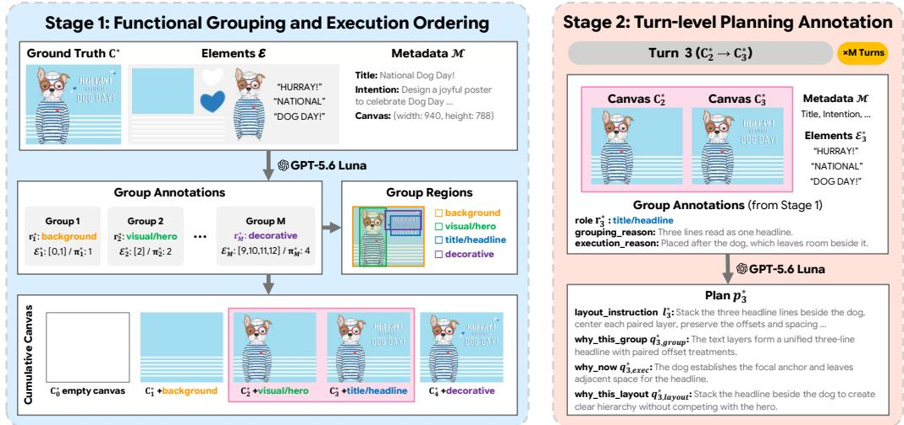  
Figure 2: Data Construction Pipeline. Stage 1 constructs functional groups, execution order, coarse group regions, and cumulative canvas states from completed designs. Stage 2 uses these outputs to derive turn-level planning annotations for each functional group.

• We define functional groups as the planning unit, providing a principled grouping criterion by organizing elements that share the same role in the design.

• We develop a two-stage data construction pipeline that derives group-wise, turn-level supervision from completed designs.

• Experiments on Crello and LICA demonstrate improved design quality and zero-shot generalization, with ablations validating the effectiveness of our key components.

## 2 RELATED WORK

Graphic design composition methods either arrange supplied visual and textual elements (Inoue et al., 2023; Lin et al., 2025) or additionally generate and retrieve elements during the design process (Jia et al., 2024; Inoue et al., 2024); our work focuses on the former task. Moving beyond direct composition, iterative graphic design systems incorporate visual feedback to refine generated results. PosterCopilot (Wei et al., 2026) combines layout reasoning with layer-controllable iterative editing, while VFLM (Guo et al., 2026) progressively refines text layouts through a generation– rendering–reflection–refinement cycle. DesignAsCode (Liu et al., 2026) constructs a semantic plan, implements it as HTML/CSS, and subsequently refines the rendered design, while PSDesigner (Shuai et al., 2026) combines element collection and planning with sequential placement and refinement. Despite these iterative mechanisms, their initial planning or grouping decisions remain fixed throughout generation. In contrast, PlayGround dynamically updates both decisions at each turn based on the current rendered canvas. Additional related works are discussed in Appendix A.

## 3 DATA CONSTRUCTION

To construct turn-level annotations for functional grouping and layout planning required by PlayGround, we build a two-stage data construction pipeline on Crello (Yamaguchi, 2021) dataset using GPT-5.6 Luna (OpenAI, 2026) as an MLLM annotator. For each design, we use the title from the Crello metadata and the intention annotation provided by OpenCOLE (Inoue et al., 2024) as additional semantic context, together with the complete element inventory and rendered design.

Stage 1: Functional grouping and execution ordering. We first decompose each design into functional groups and determine their execution order, as illustrated in Fig. 2 (left). A functional group is a set of elements that jointly serve a common design function and are intended to be planned and positioned together. Each group is categorized into one of six roles: background, visual/hero, title/headline, content, support, or decorative. A group may contain image elements, text elements, or both, and multiple groups may share the same role when they should be planned and placed independently. Finally, groups that provide visual references for other groups are placed earlier in the execution order to serve as visual anchors.

Let $C ^ { * 1 }$ denote the final ground-truth design, $\mathcal { E } = \{ e _ { i } \} _ { i = 1 } ^ { N }$ the complete element inventory, and M the document metadata including the canvas size, title, and intention. Given these inputs and the Stage 1 annotation prompt $\mathcal { P } _ { \mathrm { S 1 } }$ , the annotator assigns every element to a group, assigns each group a functional role, and determines a dependency-aware execution order:

$$
\begin{array} { r } { ( \mathcal { G } ^ { * } , \pi ^ { * } ) = f _ { \mathrm { a n n o t } } ( \mathcal { P } _ { \mathrm { S 1 } } , C ^ { * } , \mathcal { E } , \mathcal { M } ) . } \end{array}\tag{1}
$$

Here, $\mathcal { G } ^ { * } = \{ G _ { j } ^ { * } \} _ { j = 1 } ^ { M }$ denotes the M annotated functional groups, with each group defined as $G _ { j } ^ { * } = ( \mathcal { E } _ { j } ^ { * } , r _ { j } ^ { * } )$ , where $\mathcal { E } _ { j } ^ { \ast } \subseteq \mathcal { E }$ is the set of elements assigned to the j-th group and $r _ { j } ^ { \ast }$ is its functional role. The execution order is represented by $\pi ^ { * } = ( \pi _ { 1 } ^ { * } , \ldots , \pi _ { M } ^ { * } )$ . The annotator also provides auxiliary explanations for grouping and execution order, which are used as context in Stage 2.

From the Stage 1 outputs, we further derive group regions and cumulative canvas states for downstream supervision. First, we compute a spatial region for each group, as visualized in the center of Fig. 2. Let $b _ { i } ^ { * }$ denote the ground-truth bounding box of element $e _ { i } .$ . For each group $G _ { j } ^ { * }$ , we define its region as B<sup>∗</sup> = BBox $\left( \{ b _ { i } ^ { * } \mid e _ { i } \in \mathcal { E } _ { j } ^ { * } \} \right)$ , where $\operatorname { B B o x } ( { \boldsymbol { \cdot } } )$ denotes the smallest bounding box covering all elements in the group. Second, we construct cumulative canvas states following the annotated execution order, which defines the sequence of planning turns used in Stage 2. To this end, we reorder the functional groups by the annotated execution order $\pi ^ { * }$ . We denote the resulting execution-ordered sequence as $\widetilde { \mathcal { G } } ^ { * } = ( \widetilde { G } _ { 1 } ^ { * } , \dots , \widetilde { G } _ { M } ^ { * } )$ , where $\widetilde { G } _ { t } ^ { * } = G _ { \pi _ { t } ^ { * } } ^ { * }$ . We then progressively render this ordered sequence to obtain the intermediate canvas states, $C _ { t } ^ { * } = \mathcal { R } \left( \widetilde { G } _ { 1 } ^ { * } , \ldots , \widetilde { G } _ { t } ^ { * } \right)$ , where R denotes the document renderer (Inoue et al., 2024). Each state uses the ground-truth attributes of the included elements while preserving their original stacking order. Together with the initial empty canvas $C _ { 0 } ^ { * }$ , this yields the cumulative canvas state sequence $\{ C _ { t } ^ { * } \} _ { t = 0 } ^ { M }$ shown at the bottom left of Fig. 2, which is used in Stage 2 to construct turn-level planning annotations.

Stage 2: Turn-level Planning Annotation. Using the execution-ordered functional groups and cumulative canvas states constructed above, Stage 2 derives a turn-level plan for each functional group, where each group $\widetilde { G } _ { t } ^ { * }$ corresponds to one planning turn, as illustrated in Fig. 2 (right). For turn t, let $\widetilde { \mathcal { G } } _ { \leq t } ^ { * } = ( \widetilde { G } _ { 1 } ^ { * } , \cdot \cdot , \widetilde { G } _ { t } ^ { * } )$ denote the execution-ordered groups up to the current turn. The annotator is conditioned on $\widetilde { \mathcal { G } } _ { < t } ^ { * }$ , document metadata $\mathcal { M } ,$ , the rendered states $C _ { t - 1 } ^ { * }$ and $C _ { t } ^ { * }$ before and after adding the current group, and the final design $C ^ { * }$ . The state pair provides visual evidence for the group’s placement and spatial relationships, while $C ^ { * }$ provides global composition context. With the Stage 2 prompt $\mathcal { P } _ { \mathrm { S } 2 }$ , we write:

$$
p _ { t } ^ { * } = f _ { \mathrm { a n n o t } } \left( \mathcal { P } _ { \mathrm { S 2 } } , \widetilde { \mathcal { G } } _ { \leq t } ^ { * } , C _ { t - 1 } ^ { * } , C _ { t } ^ { * } , C ^ { * } , \mathcal { M } \right) ,\tag{2}
$$

where $p _ { t } ^ { * } = ( q _ { t , \mathrm { g r o u p } } ^ { * } , q _ { t , \mathrm { e x e c } } ^ { * } , q _ { t , \mathrm { l a y o u t } } ^ { * } , \ell _ { t } ^ { * } )$ denotes the resulting turn-level plan. Here, $q _ { t , \mathrm { g r o u p } } ^ { * } , q _ { t , \mathrm { e x e c } } ^ { * } ,$ and $q _ { t , \mathrm { l a y o u t } } ^ { * }$ provide rationales for the selected grouping, its execution at the current turn, and the resulting arrangement on the current canvas, respectively. The layout instruction $\ell _ { t } ^ { * }$ qualitatively describes how the current group should be placed on the canvas, including its target region and relevant spatial relations such as scale, alignment, spacing, overlap, containment, and stacking.

Overall, the two-stage pipeline produces group regions, cumulative canvas states, and group-wise turn-level plans, which are used to train the Structure-Aware Retriever, Progressive Planner, and Layout Generator. More details of the data construction process are provided in Appendix B.

## 4 METHOD

## 4.1 PROBLEM FORMULATION AND OVERVIEW

Given a set of image and text elements, our goal is to arrange them into an editable graphic design. Following LaDeCo (Lin et al., 2025), we predict the bounding box and text-specific attributes of each element, while additionally predicting the stacking order within each functional group.

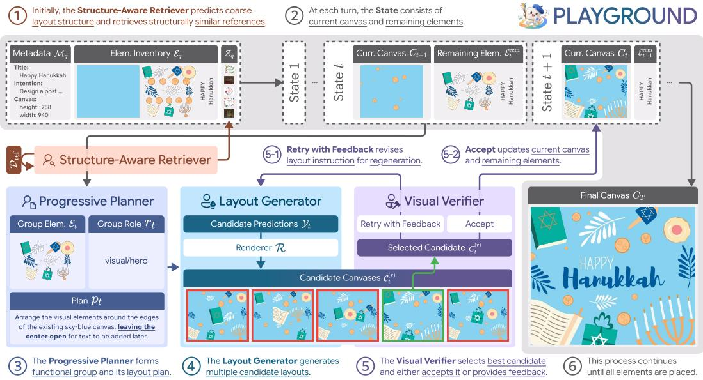  
Figure 3: Overview of PlayGround.

Figure 3 illustrates the workflow of PlayGround. Initially, the Structure-Aware Retriever (Sec. 4.2) predicts a coarse layout structure and retrieves five structurally similar references as global composition priors. Then, at each turn, the Progressive Planner (Sec. 4.3) observes the current canvas, i.e., the canvas accepted from the preceding turn, together with the remaining elements, and forms a functional group and its layout plan. Conditioned on this plan, the Layout Generator (Sec. 4.4) predicts the layout attributes of the elements in the group and generates multiple candidate layouts. Lastly, the Visual Verifier (Sec. 4.5) selects the best candidate by evaluating their rendered results and either accepts it or provides feedback to the Layout Generator for regeneration. Once accepted, the selected canvas becomes the current canvas for the next turn, and the placed elements are removed from the remaining element set. This continues until all elements are placed.

## 4.2 STRUCTURE-AWARE RETRIEVER

The Structure-Aware Retriever retrieves reference designs that share a similar global layout structure with the input elements. Because no target layout is available at inference time, the Retriever must first infer a candidate layout structure to serve as a proxy for computing structural similarity. However, predicting precise bounding boxes for all elements at this stage would negate the benefits of progressive generation by effectively predicting the entire layout upfront. To avoid this, we represent the coarse layout structure using functional group role–region pairs; we train the Retriever to predict the group roles and regions constructed in Stage 1 of Sec. 3. Given the input design query q, retrieval prompt $\mathcal { P } _ { \mathrm { r e t } } .$ , document metadata $\mathcal { M } _ { q } .$ , and element inventory $\mathcal { E } _ { q } ,$ the Retriever predicts the attributes of functional groups as:

$$
\Phi _ { q } = f _ { \theta _ { \mathrm { r e t } } } \left( \mathcal { P } _ { \mathrm { r e t } } , \mathcal { M } _ { q } , \mathcal { E } _ { q } \right) = \{ ( r _ { q , j } , B _ { q , j } ) \} _ { j = 1 } ^ { J _ { q } } ,\tag{3}
$$

where $J _ { q }$ is the predicted number of functional groups, and $r _ { q , j }$ and $B _ { q , j }$ are the functional role and spatial region of the j-th group, respectively.

Then, given the reference pool ${ \mathcal { D } } _ { \mathrm { r e f } }$ where each reference candidate is also decomposed into functional groups, we compare the predicted structure $\Phi _ { q }$ with each candidate $c \in \mathcal { D } _ { \mathrm { r e f } }$ as:

$$
\sin ( q , c ) = \lambda _ { \mathrm { r o l e - I o U } } S _ { \mathrm { r o l e - I o U } } ( q , c ) + \lambda _ { \mathrm { c a u v a s } } S _ { \mathrm { c a u v a s } } ( q , c ) + \lambda _ { \mathrm { w o r d i m a g e } } S _ { \mathrm { w o r d i m a g e } } ( q , c ) .\tag{4}
$$

Here, $S _ { \mathrm { r o l e - I o U } }$ measures spatial similarity between role-matched group regions, $S _ { \mathrm { c a n v a s } }$ measures similarity in canvas aspect ratio, and $S _ { \mathrm { w o r d / i m a g e } }$ compares the amount of textual and visual content. Together, these terms capture similarity in layout structure, canvas geometry, and text–image composition. We rank the reference designs by $\sin ( q , c )$ and retrieve the top five as $\mathcal { Z } _ { q }$

## 4.3 PROGRESSIVE PLANNER

Given the retrieved references, the Progressive Planner forms a functional group and plans its composition at each turn based on the remaining elements and current canvas. At turn t, let $\mathcal { E } _ { t } ^ { \mathrm { r e m } }$ denote the remaining elements and $C _ { t - 1 }$ the current rendered canvas, $i . e .$ , the canvas accepted at turn $t - 1$ . Given the planning prompt $\mathcal { P } _ { \mathrm { p l a n } }$ , document metadata ${ \mathcal { M } } .$ , retrieved references $\mathcal { Z } , C _ { t - 1 } ,$ and $\mathcal { E } _ { t } ^ { \mathrm { r e m } }$ , the Planner jointly predicts the current functional group $G _ { t }$ and its turn-level plan $p _ { t } \colon$

$$
\begin{array} { r } { \left( G _ { t } , p _ { t } \right) = f _ { \theta _ { \mathrm { p l a n } } } \left( \mathcal { P } _ { \mathrm { p l a n } } , \mathcal { M } , \mathcal { Z } , C _ { t - 1 } , \mathcal { E } _ { t } ^ { \mathrm { r e m } } \right) , \quad \quad G _ { t } = ( \mathcal { E } _ { t } , r _ { t } ) , } \end{array}\tag{5}
$$

where $\mathcal { E } _ { t } \subseteq \mathcal { E } _ { t } ^ { \mathrm { r e m } }$ denotes the elements selected for the current group and $r _ { t }$ its functional role. The plan $p _ { t }$ follows the turn-level representation defined in Sec. 3. The Planner is supervised with the corresponding oracle group $\widetilde { G } _ { t } ^ { * }$ and turn-level plan $p _ { t } ^ { * }$ constructed in Sec. 3, using $C _ { t - 1 } ^ { * }$ as visual context. By conditioning both group formation and layout planning on the current rendered canvas, the Planner progressively updates composition decisions as the design evolves.

## 4.4 LAYOUT GENERATOR

The Layout Generator translates the Progressive Planner’s group-level plan into element-level layout attributes. It takes the prediction prompt $\mathcal { P } _ { \mathrm { p r e d } }$ , document metadata $\mathcal { M } .$ , retrieved references $\mathcal { Z }$ current rendered canvas $C _ { t - 1 }$ , functional group $G _ { t }$ , and plan $p _ { t } .$ , and predicts:

$$
\mathcal { V } _ { t } = f _ { \theta _ { \mathrm { p r e d } } } \left( \mathcal { P } _ { \mathrm { p r e d } } , \mathcal { M } , \mathcal { Z } , C _ { t - 1 } , G _ { t } , p _ { t } \right) = \left\{ y _ { i } = \left( b _ { i } , z _ { i } , \tau _ { i } \right) \vert e _ { i } \in \mathcal { E } _ { t } \right\} .\tag{6}
$$

Here, $b _ { i }$ denotes the bounding box, $z _ { i }$ the group-local stacking order, and $\tau _ { i }$ the text-specific attributes when applicable. Only the attributes of the current group are predicted, while elements placed in previous turns remain unchanged. The Layout Generator is trained with the ground-truth element-level layout annotations of $\widetilde { G } _ { t } ^ { * }$ , conditioned on the oracle plan $p _ { t } ^ { * }$ and canvas $C _ { t - 1 } ^ { * }$

Since a group-level plan leaves element-level attributes underconstrained, a single layout prediction may yield suboptimal arrangements or spatial conflicts. We therefore generate $K$ candidate layouts for each group and select the optimal one, rather than relying on a single prediction.

## 4.5 VISUAL VERIFIER

Finally, the Visual Verifier evaluates the K rendered candidates and determines the canvas for the next planning turn. At verification round $r ,$ let $\mathcal { C } _ { t } ^ { ( r ) } = \{ C _ { t } ^ { ( r , k ) } \} _ { k = 1 } ^ { K }$ denote the candidate canvases generated using layout instruction $\ell _ { t } ^ { ( r ) }$ , with $\ell _ { t } ^ { ( 1 ) } = \ell _ { t }$ . Given the verification prompt $\mathcal { P } _ { \mathrm { v e r } }$ , current rendered canvas $C _ { t - 1 }$ , group $G _ { t } ,$ current layout instruction $\ell _ { t } ^ { ( r ) }$ , and candidate set $\mathcal { C } _ { t } ^ { ( r ) }$ , the Verifier first selects the candidate that best follows the current layout instruction while maintaining high visual quality, then decides whether to accept it or retry with feedback:

$$
\begin{array} { r } { \left( \hat { C } _ { t } ^ { ( r ) } , d _ { t } ^ { ( r ) } \right) = f _ { \mathrm { v e r } } \left( \mathcal { P } _ { \mathrm { v e r } } , G _ { t } , \ell _ { t } ^ { ( r ) } , C _ { t - 1 } , \mathcal { C } _ { t } ^ { ( r ) } \right) , } \end{array}\tag{7}
$$

where $\bar { C } _ { t } ^ { ( r ) } \in \mathcal { C } _ { t } ^ { ( r ) }$ is the selected candidate and $d _ { t } ^ { ( r ) } \in \{ \mathsf { a c c e p t } , \mathtt { r e t r y \_ w i t h \_ f e e d b a c k } \}$ is the verification decision. If accepted, $\bar { C } _ { t } ^ { ( r ) }$ becomes $C _ { t }$ and is passed to the Planner for the next turn. Otherwise, the Verifier returns a revised layout instruction, $\ell _ { t } ^ { ( r + 1 ) }$ , and the Layout Generator generates K new candidates for the same group. We allow up to three verification rounds; if none is accepted, the Verifier makes a final selection among the best candidates from all rounds.

## 4.6 TRAINING OBJECTIVE

The Structure-Aware Retriever, Progressive Planner, and Layout Generator are separately fine-tuned with autoregressive supervision on their respective targets. For module $m \in \{ { \mathrm { r e t } } , { \mathrm { p l a n } } , { \mathrm { p r e d } } \}$ ,

$$
\begin{array} { r } { \mathcal { L } _ { m } = - \log p _ { \theta _ { m } } \left( o _ { m } ^ { * } \mid x _ { m } ^ { * } \right) , } \end{array}\tag{8}
$$

where $x _ { m } ^ { * }$ and $o _ { m } ^ { * }$ denote the module-specific input context and oracle target, respectively. The Visual Verifier is implemented with GPT-5.6 Luna (OpenAI, 2026) and is used without additional training. Further algorithmic and implementation details are provided in Appendix C.

Table 1: Quantitative Results on the Crello and LICA datasets. We report six VLM-based metrics (mean ± standard deviation) and two rule-based metrics, T.Occ. and Rea. Bold and underline mark the best and th second best within each dataset, excluding GT.
<table><tr><td rowspan="2">Dataset</td><td rowspan="2">Method</td><td colspan="6">VLM-based metrics ↑</td><td colspan="2">Rule-based metrics ↓</td></tr><tr><td>(i)</td><td>(ii)</td><td>(iii)</td><td>(iv)</td><td>(v)</td><td>(vi)</td><td>T.Occ.</td><td>Rea.</td></tr><tr><td rowspan="6">Crello dataset</td><td>FlexDM</td><td>2.670 ±0.690</td><td>2.156 ±0.656</td><td>3.133 ±0.705</td><td>3.637 ±0.581</td><td>3.200 ±0.740</td><td>3.021 ±0.992</td><td>0.1519</td><td>0.0583</td></tr><tr><td>LaDeCo</td><td>3.103 ±0.722</td><td>2.615 ±0.809</td><td>3.451 ±0.721</td><td>3.979 ±0.574</td><td>3.592 ±0.743</td><td>3.528 ±1.029</td><td>0.0570</td><td>0.0432</td></tr><tr><td>PosterCopilot</td><td>2.980 ±0.729</td><td>2.623 ±0.810</td><td>3.263 ±0.776</td><td>3.809 ±0.653</td><td>3.467 ±0.784</td><td>3.435 ±1.073</td><td>0.0319</td><td>0.0374</td></tr><tr><td>VFLM</td><td>3.335 ±0.564</td><td>2.718±0.645</td><td>3.714 ±0.576</td><td>3.969 ±0.565</td><td>3.759 ±0.642</td><td>3.693 ±0.947</td><td>0.0002</td><td>0.0360</td></tr><tr><td>PlayGround</td><td>3.794 ±0.583</td><td>3.503 ±0.660</td><td>3.899 ±0.587</td><td>4.381 ±0.542</td><td>4.183 ±0.635</td><td>4.248 ±0.919</td><td>0.0041</td><td>0.0345</td></tr><tr><td>GT</td><td>4.120 ±0.509</td><td>3.830 ±0.490</td><td>4.077 ±0.635</td><td>4.575 ±0.522</td><td>4.452 ±0.555</td><td>4.414 ±0.880</td><td>0.0025</td><td>0.0235</td></tr><tr><td rowspan="7">LICA dataset</td><td>FlexDM</td><td>2.186 ±0.529</td><td>1.790 ±0.581</td><td>2.711 ±0.811</td><td>3.373 ±0.625</td><td>2.742 ±0.730</td><td>1.889 ±0.830</td><td>0.3212</td><td>0.0574</td></tr><tr><td>LaDeCo</td><td>2.889 ±0.760</td><td>2.444 ±0.810</td><td>3.294 ±0.798</td><td>3.965 ±0.634</td><td>3.501 ±0.799</td><td>3.171 ±1.101</td><td>0.0715</td><td>0.0393</td></tr><tr><td>PosterCopilot</td><td>2.929 ±0.787</td><td>2.731 ±0.983</td><td>3.395 ±0.856</td><td>3.961 ±0.679</td><td>3.581 ±0.827</td><td>3.097 ±1.244</td><td>0.1372</td><td>0.0281</td></tr><tr><td>VFLM</td><td>3.427 ±0.657</td><td>2.933 ±0.718</td><td>3.977 ±0.653</td><td>4.157 ±0.586</td><td>4.022 ±0.662</td><td>3.647 ±1.007</td><td>0.0001</td><td>0.0216</td></tr><tr><td>PlayGround</td><td>3.698 ±0.710</td><td>3.480 ±0.731</td><td>3.970 ±0.722</td><td>4.378 ±0.545</td><td>4.217 ±0.693</td><td>4.224 ±0.906</td><td>0.0482</td><td>0.0199</td></tr><tr><td>GT</td><td>4.376 ±0.541</td><td>4.150 ±0.459</td><td>4.512 ±0.531</td><td>4.699 ±0.463</td><td>4.749 ±0.454</td><td>4.884 ±0.358</td><td>0.0040</td><td>0.0162</td></tr><tr><td></td><td></td><td></td><td></td><td></td><td></td><td></td><td></td><td></td></tr></table>

## 5 EXPERIMENTS

## 5.1 EXPERIMENTAL SETUP

Implementation Details. We initialize our Retriever, Planner, and Layout Generator with Qwen3- VL-8B-Instruct (Bai et al., 2025) and fine-tune them using LoRA (Hu et al., 2022), while GPT-5.6 Luna (OpenAI, 2026) is used as the Visual Verifier. All experiments are conducted on four NVIDIA RTX 5880 GPUs. Detailed training configurations are provided in Appendix C.3.

Baselines and Datasets. We evaluate on the Crello-v4 (Yamaguchi, 2021) and LICA (Hirsch et al., 2026) datasets, training all learnable components on Crello and evaluating LICA in a zero-shot setting. We compare PlayGround against open-source graphic design composition baselines, including FlexDM (Inoue et al., 2023), LaDeCo (Lin et al., 2025), PosterCopilot (Wei et al., 2026), and VFLM (Guo et al., 2026), in the setting of arranging given visual and textual elements into a final design. Detailed settings of baselines are provided in Appendix D.1.

Evaluation Metrics. Following prior works (Jia et al., 2024; Lin et al., 2025; Hong et al., 2026; Wei et al., 2026; Liu et al., 2026), we evaluate both perceptual design quality and structural validity. We use GPT-5 (OpenAI, 2025) as a VLM judge to independently score six criteria from 1 to 5: (i) layout composition rationality, (ii) typography legibility and hierarchy, (iii) visible element presentation, (iv) color harmony and contrast, (v) visual style coherence, and (vi) design intention alignment. We additionally report two rule-based metrics, text occlusion (T.Occ.) and text unreadability (Rea.), which measure text covered by foreground elements and background complexity beneath text, respectively. Further evaluation details and a complementary user study are provided in Appendix D.2.

## 5.2 COMPARISON WITH STATE-OF-THE-ART METHODS

Table 1 shows that PlayGround leads the baselines on all six VLM metrics on Crello and five of six on LICA, indicating strong overall graphic design quality. Its performance on LICA without additional fine-tuning further supports strong zero-shot generalization. The low standard deviations also indicate consistent design quality. We attribute this consistency in part to our Progressive Planner, which forms each plan from the actual canvas state, aligning composition decisions with the evolving design. While VFLM also exhibits lower variation on some metrics, we attribute this behavior to its constrained setting of rendering only text on a fixed ground-truth background. For the rule-based metrics, PlayGround achieves lower T.Occ. and Rea. than FlexDM, LaDeCo, and PosterCopilot, indicating fewer text occlusions and less complex backgrounds beneath text. Note that VFLM’s lower T.Occ. is an expected artifact of its text-only rendering constraint.

Figure 4 compares the rendered designs of each method with the corresponding ground truth. PlayGround consistently produces coherent image–text compositions by capturing spatial and semantic relationships among input elements. It places text in appropriate free regions without obscuring salient visuals and effectively uses supporting elements to strengthen typography, as shown in the second and fourth examples. Compared with VFLM, which places text on a ground-truth vi sual background, PlayGround achieves competitive or better typography and hierarchy while jointly composing visual and textual elements. The third to fifth examples further show that PlayGround can produce plausible alternatives to the ground truth with strong balance and hierarchy. In contrast, several baselines exhibit fragmented compositions, out-of-canvas placement, or undesirable occlusions. These results highlight the benefit of PlayGround, which composes related elements as functional groups and adapts placement and stacking decisions to the evolving canvas.

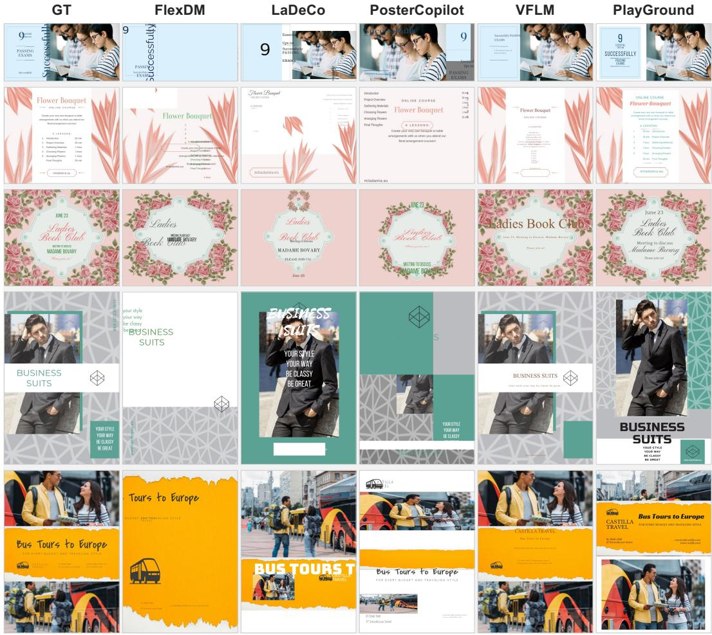  
Figure 4: Qualitative results on Crello dataset.

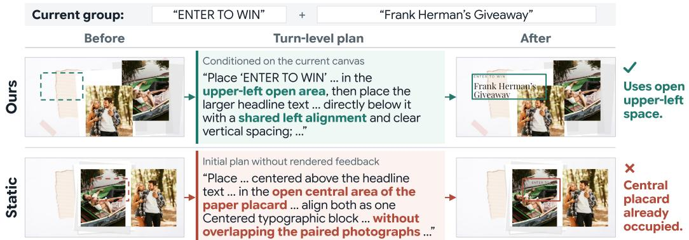  
Figure 5: Effect of our Progressive Planner. Our Progressive Planner adapts to the rendered canvas and uses available space, while the Static Planner follows an outdated initial plan.

## 5.3 ANALYSIS

Ablation Studies. Table 2 analyzes the contribution of each component. Comparing (I) and (II), retrieval improves performance, showing that reference designs provide useful guidance. More importantly, (III), which uses the lowest-ranked references under our metric, performs even worse than using no references, indicating that mismatched references can harm generation and supporting the effectiveness of our metric in retrieving structurally similar designs.

Table 2: Ablation on pipeline components. VLM denotes the mean of six VLM scores on a Crello subset. △ denotes a Static Planner.
<table><tr><td>#</td><td>Retriever</td><td>Planner</td><td>K</td><td>Verifier</td><td>VLM↑</td></tr><tr><td>(I)</td><td>Top-5</td><td>√</td><td>5</td><td>√</td><td>3.958</td></tr><tr><td>(II)</td><td>x</td><td>√</td><td>5</td><td>√</td><td>3.901</td></tr><tr><td>(III)</td><td>Lowest-5</td><td>√</td><td>5</td><td>√</td><td>3.867</td></tr><tr><td>(IV)</td><td>Top-5</td><td>√</td><td>3</td><td>√</td><td>3.923</td></tr><tr><td>(V)</td><td>Top-5</td><td>√</td><td>1</td><td>√</td><td>3.891</td></tr><tr><td>(VI)</td><td>Top-5</td><td>√</td><td>5</td><td>x</td><td>3.698</td></tr><tr><td>(VII)</td><td>Top-5</td><td>△</td><td>5</td><td>√</td><td>3.894</td></tr></table>

We next examine candidate generation and verification. Comparing (I), (IV), and (V), performance consistently improves as the number of candidates K increases, showing the benefit of generating multiple layout candidates. Comparing (I) and (VI), removing the visual verifier and randomly selecting a candidate causes a clear drop, demonstrating the importance of evaluating rendered candidates, selecting the best one, and providing feedback for regeneration. Finally, (VII) uses a separately trained Qwen3-VL-based (Bai et al., 2025) Static Planner that generates the entire plan once at the beginning. Its lower performance than (I) demonstrates the benefit of progressive planning from intermediate renders rather than relying on a fixed initial plan. Fig. 5 further illustrates this difference: our Planner uses the available upper-left space for text, whereas the static plan targets a central placard region already occupied by photographs. Further ablation settings are in Appendix D.3.

Effect of Per-Turn Granularity and Grouping. We study per-turn granularity and grouping using GPT-5.6 Luna in a zero-shot setting with only the Planner–Layout Generator loop to isolate these factors. We compare (I) element-wise generation, (II) full-layout generation that places all elements at once, (III) LaDeCo-style semantic-layer grouping, and (IV) our functional grouping.

Table 3: Ablation on per-turn granularity and grouping. VLM denotes the mean of six VLM scores on a Crello subset.
<table><tr><td>Grouping scheme</td><td>Per-turn Unit</td><td>VLM↑</td></tr><tr><td>(I) None</td><td>Element-wise</td><td>3.464</td></tr><tr><td>(II) None</td><td>Full-layout</td><td>3.351</td></tr><tr><td>(III) LaDeCo-style</td><td>Semantic layer</td><td>3.532</td></tr><tr><td>(IV) Ours</td><td>Functional Group</td><td>3.578</td></tr></table>

Without grouping, (I) element-wise generation outperforms (II) full-layout generation, suggesting that decomposing layout generation into sequential decisions is beneficial. However, both groupbased variants (III, IV) further improve performance, showing that jointly planning and placing functionally related elements provides a more effective unit for iterative composition. Compared with (III) LaDeCo-style grouping (Lin et al., 2025), which uses five predefined semantic layers and a fixed placement order, PlayGround forms groups from six functional roles without fixing the number of groups. The higher VLM score of (IV) supports the benefit of this more flexible grouping strategy for our iterative generation pipeline.

Extension to Intention-to-Design. To address settings where design elements are not provided in advance, we further extend PlayGround to the intention-to-design task, where a design intention is directly converted into a final design. We prepend an element-generation stage using GPT-5.6 Luna (OpenAI, 2026) and Qwen-Image-2.1 (Qwen Team, 2026b) before applying PlayGround. Qualitative results and experimental details are provided in Appendix F.

## 6 CONCLUSION

We propose PlayGround, a progressive layout generation framework that adapts composition decisions to the evolving rendered canvas. At each turn, the Progressive Planner forms a functional group from the remaining elements and plans its composition based on the current canvas. A Structure-Aware Retriever provides global composition guidance by predicting a coarse layout structure and retrieving structurally similar references. To enable such progressive planning, we further introduce a two-stage data construction pipeline that constructs functional groups and derives supervision for group-wise turn-level planning from completed designs. Experiments on Crello and LICA demonstrate improved design quality and zero-shot generalization over existing composition methods, while ablations validate the effectiveness of our key components.

## AI USE STATEMENT

We used generative AI tools in several parts of this work. GPT-5.6 Luna was used to construct annotations for our two-stage data construction pipeline and as the Visual Verifier during inference. GPT-5 was used for VLM-based evaluation. Generative AI tools were also used for auxiliary data processing and experiments, including document title generation for LICA and the intention-todesign extension. We additionally used generative AI tools for language polishing of the manuscript. We reviewed all AI-assisted outputs and take full responsibility for the final text, claims, experimental results, and artifacts presented in this work.

## REFERENCES

Shuai Bai, Yuxuan Cai, Ruizhe Chen, Keqin Chen, Xionghui Chen, Zesen Cheng, Lianghao Deng, Wei Ding, Chang Gao, Chunjiang Ge, Wenbin Ge, Zhifang Guo, Qidong Huang, Jie Huang, Fei Huang, Binyuan Hui, Shutong Jiang, Zhaohai Li, Mingsheng Li, Mei Li, Kaixin Li, Zicheng Lin, Junyang Lin, Xuejing Liu, Jiawei Liu, Chenglong Liu, Yang Liu, Dayiheng Liu, Shixuan Liu, Dunjie Lu, Ruilin Luo, Chenxu Lv, Rui Men, Lingchen Meng, Xuancheng Ren, Xingzhang Ren, Sibo Song, Yuchong Sun, Jun Tang, Jianhong Tu, Jianqiang Wan, Peng Wang, Pengfei Wang, Qiuyue Wang, Yuxuan Wang, Tianbao Xie, Yiheng Xu, Haiyang Xu, Jin Xu, Zhibo Yang, Mingkun Yang, Jianxin Yang, An Yang, Bowen Yu, Fei Zhang, Hang Zhang, Xi Zhang, Bo Zheng, Humen Zhong, Jingren Zhou, Fan Zhou, Jing Zhou, Yuanzhi Zhu, and Ke Zhu. Qwen3-VL Technical Report, 2025. URL https://arxiv.org/abs/2511.21631.

Yutao Cheng, Zhao Zhang, Maoke Yang, Hui Nie, Chunyuan Li, Xinglong Wu, and Jie Shao. Graphic design with large multimodal model, 2025.

Adrienne Deganutti, Elad Hirsch, Haonan Zhu, Jaejung Seol, and Purvanshi Mehta. Graphic-Design-Bench: A Comprehensive Benchmark for Evaluating AI on Graphic Design Tasks, 2026. URL https://arxiv.org/abs/2604.04192.

Yifan Gao, Zihang Lin, Chuanbin Liu, Min Zhou, Tiezheng Ge, Bo Zheng, and Hongtao Xie. Poster-Maker: Towards High-Quality Product Poster Generation with Accurate Text Rendering. In 2025 IEEE/CVF Conference on Computer Vision and Pattern Recognition (CVPR), pp. 8083–8093. IEEE, 2025.

Junrong Guo, Shancheng Fang, Yadong Qu, and Hongtao Xie. Seeing is Improving: Visual Feedback for Iterative Text Layout Refinement. In Proceedings ofthe IEEE/CVF Conference on Computer Vision and Pattern Recognition (CVPR), pp. 25893–25903, June 2026.

Elad Hirsch, Shubham Yadav, Mohit Garg, and Purvanshi Mehta. LICA: Layered Image Composition Annotations for Graphic Design Research, 2026. URL https://arxiv.org/abs/ 2603.16098.

Dexiang Hong, Zhao Zhang, Weidong Chen, Yutao Cheng, Maoke Yang, Gonglei Shi, Hui Zhang, and Zhendong Mao. CreatiPoster: Towards Editable and Controllable Multi-Layer Graphic Design Generation, 2026. URL https://arxiv.org/abs/2506.10890.

Daichi Horita, Naoto Inoue, Kotaro Kikuchi, Kota Yamaguchi, and Kiyoharu Aizawa. Retrieval-Augmented Layout Transformer for Content-Aware Layout Generation. In Proceedings of the IEEE/CVF Conference on Computer Vision and Pattern Recognition (CVPR), pp. 67–76, June 2024.

Hsiao Yuan Hsu, Xiangteng He, Yuxin Peng, Hao Kong, and Qing Zhang. PosterLayout: A New Benchmark and Approach for Content-Aware Visual-Textual Presentation Layout. In Proceedings of the IEEE/CVF Conference on Computer Vision and Pattern Recognition (CVPR), pp. 6018– 6026, June 2023.

HsiaoYuan Hsu and Yuxin Peng. PosterO: Structuring Layout Trees to Enable Language Models in Generalized Content-Aware Layout Generation. In 2025 IEEE/CVF Conference on Computer Vision and Pattern Recognition (CVPR), pp. 8117–8127. IEEE, 2025.

Edward J Hu, Yelong Shen, Phillip Wallis, Zeyuan Allen-Zhu, Yuanzhi Li, Shean Wang, Lu Wang, and Weizhu Chen. LoRA: Low-Rank Adaptation of Large Language Models. In International Conference on Learning Representations, 2022. URL https://openreview.net/forum? id=nZeVKeeFYf9.

Naoto Inoue, Kotaro Kikuchi, Edgar Simo-Serra, Mayu Otani, and Kota Yamaguchi. Towards Flexible Multi-modal Document Models. In Proceedings of the IEEE/CVF Conference on Computer Vision and Pattern Recognition (CVPR), pp. 14287–14296, 2023.

Naoto Inoue, Kento Masui, Wataru Shimoda, and Kota Yamaguchi. OpenCOLE: Towards Reproducible Automatic Graphic Design Generation. In Proceedings of the IEEE/CVF Conference on Computer Vision and Pattern Recognition (CVPR) Workshops, pp. 8131–8135, June 2024.

Peidong Jia, Chenxuan Li, Yuhui Yuan, Zeyu Liu, Yichao Shen, Bohan Chen, Xingru Chen, Yinglin Zheng, Dong Chen, Ji Li, Xiaodong Xie, Shanghang Zhang, and Baining Guo. COLE: A Hierarchical Generation Framework for Multi-Layered and Editable Graphic Design, 2024. URL https://arxiv.org/abs/2311.16974.

Jianan Li, Jimei Yang, Jianming Zhang, Chang Liu, Christina Wang, and Tingfa Xu. Attributeconditioned layout gan for automatic graphic design, 2020. URL https://arxiv.org/ abs/2009.05284.

Zhaochen Li, Fengheng Li, Wei Feng, Honghe Zhu, Yaoyu Li, Zheng Zhang, Jingjing Lv, Junjie Shen, Zhangang Lin, Jingping Shao, et al. Planning and Rendering: Towards Product Poster Generation with Diffusion Models. arXiv preprint arXiv:2312.08822, 2023.

Jiawei Lin, Shizhao Sun, Danqing Huang, Ting Liu, Ji Li, and Jiang Bian. From Elements to Design: A Layered Approach for Automatic Graphic Design Composition. In Proceedings of the IEEE/CVF Conference on Computer Vision and Pattern Recognition (CVPR), pp. 8128–8137, June 2025.

Ziyuan Liu, Shizhao Sun, Danqing Huang, Yingdong Shi, Meisheng Zhang, Ji Li, Jingsong Yu, and Jiang Bian. DesignAsCode: Bridging Structural Editability and Visual Fidelity in Graphic Design Generation. arXiv preprint arXiv:2602.17690, 2026. URL https://arxiv.org/ abs/2602.17690.

OpenAI. GPT-4o System Card, August 2024. URL https://openai.com/index/ gpt-4o-system-card/.

OpenAI. Introducing GPT-5, August 2025. URL https://openai.com/index/ introducing-gpt-5/.

OpenAI. GPT-5.6: Frontier Intelligence That Scales with Your Ambition, July 2026. URL https: //openai.com/index/gpt-5-6/.

Sohan Patnaik, Rishabh Jain, Balaji Krishnamurthy, and Mausoom Sarkar. AesthetiQ: Enhancing Graphic Layout Design via Aesthetic-Aware Preference Alignment of Multi-modal Large Lan guage Models. In Proceedings of the IEEE/CVF Conference on Computer Vision and Pattern Recognition (CVPR), pp. 23701–23711, June 2025.

Yadong Qu, Shancheng Fang, Yuxin Wang, Xiaorui Wang, Zhineng Chen, Hongtao Xie, and Yongdong Zhang. IGD: Instructional Graphic Design with Multimodal Layer Generation. In Proceedings of the IEEE/CVF International Conference on Computer Vision (ICCV), pp. 18218–18228, October 2025.

Qwen Team. Qwen3.5: Towards native multimodal agents, February 2026a. URL https:// qwen.ai/blog?id=qwen3.5.

Qwen Team. Qwen-Image-2.1: Compact, Efficient, and Unified Image Creation, 2026b. URL https://qwen.ai/blog?id=qwen-image-2.1.

Jaejung Seol, Seojun Kim, and Jaejun Yoo. PosterLlama: Bridging Design Ability of Language Model to Content-Aware Layout Generation. In Proceedings of the European Conference on Computer Vision (ECCV), pp. 451–468, 2024.

Hengyu Shi, Junhao Su, Tianyang Han, Junfeng Luo, and Jialin Gao. LayoutCoT: Unleashing the Deep Reasoning Potential of Large Language Models for Layout Generation, 2026. URL https://arxiv.org/abs/2504.10829.

Xincheng Shuai, Song Tang, Yutong Huang, Henghui Ding, and Dacheng Tao. PSDesigner: Automated Graphic Design with a Human-Like Creative Workflow. In Proceedings ofthe IEEE/CVF Conference on Computer Vision and Pattern Recognition (CVPR), pp. 10165–10175, June 2026.

Zhendong Wang, Jianmin Bao, Shuyang Gu, Dong Chen, Wengang Zhou, and Houqiang Li. DesignDiffusion: High-Quality Text-to-Design Image Generation with Diffusion Models. In 2025 IEEE/CVF Conference on Computer Vision and Pattern Recognition (CVPR), pp. 20906–20915. IEEE, 2025.

Jiazhe Wei, Ken Li, Tianyu Lao, Haofan Wang, Liang Wang, Caifeng Shan, and Chenyang Si. PosterCopilot: Toward Layout Reasoning and Controllable Editing for Professional Graphic Design. In Proceedings of the European Conference on Computer Vision (ECCV), 2026.

Kota Yamaguchi. CanvasVAE: Learning To Generate Vector Graphic Documents. In Proceedings of the IEEE/CVF International Conference on Computer Vision (ICCV), pp. 5481–5489, October 2021.

Tao Yang, Yingmin Luo, Zhongang Qi, Yang Wu, Ying Shan, and Chang Wen Chen. Poster-LLaVa: Constructing a Unified Multi-modal Layout Generator with LLM, 2024. URL https: //arxiv.org/abs/2406.02884.

Huanjin Yao, Ruifei Zhang, Jiaxing Huang, Jingyi Zhang, Yibo Wang, Bo Fang, Ruolin Zhu, Yongcheng Jing, Shunyu Liu, Guanbin Li, and Dacheng Tao. A Survey on Agentic Multimodal Large Language Models, 2025. URL https://arxiv.org/abs/2510.10991.

Jiahao Zhang, Ryota Yoshihashi, Shunsuke Kitada, Atsuki Osanai, and Yuta Nakashima. VAS-CAR: Content-Aware Layout Generation via Visual-Aware Self-Correction. arXiv preprint arXiv:2412.04237, 2024.

Zhaohui Zheng, Ping Wang, Wei Liu, Jinze Li, Rongguang Ye, and Dongwei Ren. Distance-IoU loss: Faster and better learning for bounding box regression. In Proceedings of the AAAI conference on artificial intelligence, volume 34, pp. 12993–13000, 2020.

## APPENDIX

## A ADDITIONAL RELATED WORK

This section provides additional discussion of MLLMs and broader graphic design layout generation beyond the iterative graphic design systems discussed in Sec. 2.

Multimodal Large Language Models. MLLMs have rapidly advanced in visual perception, language understanding, and reasoning, enabling their application to a wide range of multimodal tasks (Bai et al., 2025; OpenAI, 2024; 2025; 2026). Recently, their use has expanded beyond standalone task models to multi-stage systems in which multiple MLLMs collaborate within a unified pipeline (Yao et al., 2025). In graphic design and layout generation, MLLMs are also increasingly used for data generation (Guo et al., 2026) and evaluating generated outputs (Deganutti et al., 2026).

Graphic Design Layout Generation. Beyond the iterative graphic design systems discussed in Sec. 2, we review two broader lines of work: (1) content-aware layout generation and (2) graphic design composition.

Content-aware layout generation. Content-aware layout generation arranges predefined elements such as text, logos, and underlays on a given background canvas (Hsu et al., 2023; Zhang et al., 2024; Hsu & Peng, 2025). Building on this setting, PosterLlama (Seol et al., 2024) and Poster-LLaVA (Yang et al., 2024) leverage LLMs and MLLMs to support more flexible layout conditions. Retrieval-augmented approaches, such as RALF (Horita et al., 2024) and LayoutCoT (Shi et al., 2026), retrieve reference layouts using background information or available layout constraints. In these settings, the background content or layout conditions provide spatial cues for plausible element placement. In contrast, our setting starts from a blank canvas and requires determining the positions and scales of all supplied elements without such observable spatial cues. We therefore infer coarse layout structure from the input elements themselves and retrieve structurally similar references.

Graphic design composition. Another line of work composes complete editable documents from multimodal elements. FlexDM (Inoue et al., 2023), Graphist (Cheng et al., 2025), LaDeCo (Lin et al., 2025), and AesthetiQ (Patnaik et al., 2025) predict structured layouts for supplied visual and textual elements. Other works, including COLE (Jia et al., 2024), OpenCOLE (Inoue et al., 2024), CreatiPoster (Hong et al., 2026), and IGD (Qu et al., 2025), additionally generate or retrieve visual elements as part of the design process. Our work specifically focuses on composing a fixed inventory of supplied elements, without generating or retrieving additional elements. While effective at generating editable documents, existing graphic design composition methods do not fully capture the iterative workflow of real-world design, as they provide limited support for revising composition decisions based on visual feedback from rendered results.

## B DATA CONSTRUCTION DETAILS

## B.1 DEFINITION OF FUNCTIONAL GROUP ROLES

We define a closed set of six functional roles to characterize the semantic and compositional functions of each group. As described in Sec. 3, elements are first grouped according to their compositional relationships, and a role is then assigned to each resulting group according to the definitions below.

Background. A background group establishes the canvas-wide base layer of a design and remains behind the main foreground content. Its defining characteristics are broad canvas coverage, placement beneath the main content in the stacking order, and a primarily foundational rather than independently semantic role. A background may consist of a single element or multiple adjacent, tiled, split, or overlapping elements that together form a continuous backdrop. Plain solid-color fields or visually indistinguishable elements are included when they satisfy these criteria, whereas foreground panels, cards, overlays, or independently meaningful visual elements are excluded even if they occupy a large portion of the canvas. When no supplied element or combination of element forms such a base layer, the canvas itself is treated as the implicit background.

Visual/hero. A visual/hero serves as a semantic visual object or anchor in the composition, regardless of whether it is the primary or a secondary focal element. Its defining characteristic is that it carries meaningful visual content rather than functioning purely as background or decoration. Typical examples include photographs, products, people, scenes, illustrations, diagrams, and message-bearing visual containers such as signs, badges, placards, quote cards, emblems, and typographic-poster frames. When such a visual also contains independently planned title/headline, content, support, or decorative elements, those elements remain in their own functional groups rather than being absorbed into the visual/hero. Multiple com ponents are treated as a single visual/hero only when they function as one inseparable visual object rather than as independently editable semantic layers.

Title/headline. A title/headline is an attention-leading typographic unit that establishes a distinct semantic and visual anchor in the design. It typically includes titles, headlines, slogans, taglines, or tightly coupled subtitles, including those placed within a visual/hero container. Small visual elements such as underlines, highlights, ornaments, or simple backings are included in the same group when they are structurally attached to and primarily serve the headline. Text whose main purpose is informational, functional, or supportive rather than attention-leading is assigned to another role.

Content. A content group conveys information whose primary purpose is to be read or understood. It includes body text, supporting copy, quotes, captions, descriptions, dates, times, venues, schedules, factual information, and non-promotional pricing. Text belongs to content when it neither functions as the dominant headline nor primarily serves branding, contact, action, or other utility purposes.

Support. A support group provides identity, action, attribution, or other functional information that supports delivery of the main message. Typical examples include logos, brand identifiers, sponsor marks, websites, contact information, social handles, addresses, QR codes, calls-to-action, buttons, promotional offers, discounts, legal notices, credits, and footer material. Its defining characteristic is functional utility rather than visual prominence, so a support group may still occupy a visually salient position in the composition.

Decorative. A decorative group provides non-semantic visual embellishment that contributes to the overall composition without primarily carrying content, identity, or action. It includes independently composed ornaments, accent systems, atmospheric overlays, and standalone decorative motifs that span the design or have no clear semantic host. Decorative elements that specifically support another functional group—such as a border, divider, frame, highlight, accent shape, pattern, or ornamental icon attached to a title/headline, visual/hero, content, or support— are instead included in that group. Multiple ornaments that jointly form one coherent decorative system are grouped together rather than treated as separate decorative groups.

## B.2 DETAILED DATA CONSTRUCTION PIPELINE

Fig. 6 provides a detailed example of our two-stage data construction pipeline. In Stage 1, the input elements are organized into functional groups with their roles and execution order. In Stage 2, each execution-ordered group is converted into a turn-level plan containing the grouping, execution, and layout rationales together with a layout instruction. The resulting sequence provides group-wise supervision for progressively constructing the complete design.

## B.3 GROUP AND EXECUTION STATISTICS

We analyze the functional groups and execution orders constructed by our annotation pipeline to characterize the supervision used for group-wise layout generation. As shown in Fig. 7a, designs are typically decomposed into multiple functional groups, with four to six groups accounting for the majority of the data. Fig. 7b further shows that all six predefined functional roles are represented, with no single role dominating the resulting groups. Together, these statistics show that the constructed supervision decomposes complete layouts into multiple functionally diverse group-level decisions rather than treating all elements as a single prediction target.

Stage1 — Functional Grouping & Execution Order GT design Input elements

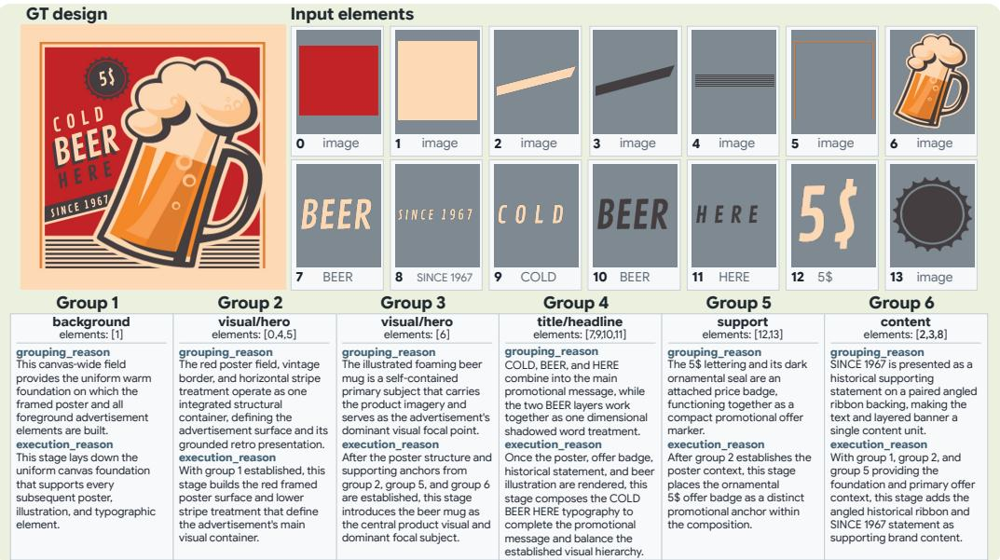

## Stage2 — Turn-wise Annotation

## Turn 1 · Group 1 background elements: [1]

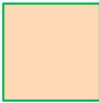

why\_this\_group The warm background image (element 1) functions as one coherent canvas-wide foundation, providing a uniform visual field for al subsequent poster elements.

why\_now This foundation belongs at the opening stage because the composition has no established visua content yet and later framing, il ustration, and typography depend on a consistent underlying field. why\_this\_layout The background image is fi"ed edge-to edge across the ful canvas so it provides uninterrupted coverage, establishes the warm nostalgic pale"e, and remains behind al future design layers.

layout\_instruction Place the warm background image (element 1) as a ful -canvas foundation, fi"ed to cover the entire canvas without cropping or empty margins, and keep it as the bo"ommost layer for al subsequent content.

## Turn 3 · Group 5 support elements: [12, 13]

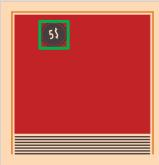

why\_this\_group The 5\$ le"ering (element 12) and dark ornamental seal (element 13) form one compact price badge, with the le"ering structural y and semantical y a"ached to the seal as a unified promotional marker. why\_now The badge is added a\$er the framed pane (element 0), border (element 5), and lower stripe treatment (element 4) establish the poster field, giving this ofer marker a defined contrasting surface and visual context.

why\_this\_layout The badge occupies the open upper-le\$ area inside the framed panel, where its dark seal contrasts strongly with the red field while remaining separated from the lower stripes and preserving space for the main hero imagery.

layout\_instruction Place the ornamental seal (element 13) in the open upper-le\$ region inside the framed panel (element 0), ful y contained and level within the poster field; center the 5\$ le"ering (element 12) inside the seal with generous surrounding spacing, keeping it visibly above the seal’s dark interior and ensuring neither current-group element is cropped or overlaps the lower stripe treatment (element 4).

Turn 5 · Group 3 visual/hero elements: [6]  


why\_this\_group The il ustrated foaming beer mug is a self contained primary subject that carries the product imagery and serves as the advertisement's dominant visual foca point.

why\_now The framed poster panel (element 0), lower stripe treatment (element 4), price badge (element 13), and historical ribbon (element 2) are established, providing the structural and promotional context for introducing the primary beer visual.

why\_this\_layout A large right-weighted placement makes the mug the focal point while preserving the price badge and historical statement, with its overlap across the ribbon and lower stripes creating depth and integrating the product into the framed composition.

layout\_instruction Place the foaming beer mug il ustration (element 6) as a large dominant hero image toward the center-right of the framed poster panel (element 0) tilted to echo the vintage composition; fit it ful y within the poster area while al owing it to overlap and visual y cover portions of the historical ribbon (elements 2 and 3) and lower stripe treatment (element 4), keeping clear separation from the price badge (element 13)

## Turn 2 · Group 2 visual/hero elements: [0, 4, 5]

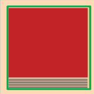

why\_this\_group The red poster field (element 0), lower stripe treatment (element 4), and vintage border (element 5) form one integrated advertisement surface with shared framing, containment, and retro visual function. why\_now With the warm canvas background (element 1) established, this group can now create the central framed poster surface and its grounded lower treatment. why\_this\_layout A centered, contained poster structure establishes a strong visual anchor, while the red field, enclosing border, and lower stripes create clear hierarchy, balanced margins, and a stable base for later foreground content.

layout\_instruction Place the vintage border (element 5) as a large centered frame on the warm canvas background (element 1), fit ful y within the canvas with an even surrounding margin; contain the red poster field (element 0) inside the frame as the dominant central surface, and position the horizontal stripe treatment (element 4) across the lower interior edge beneath the red field, with clean alignment, tight structural a"achment, and no cropping.

## Turn 4 · Group 6 content elements: [2, 3, 8]

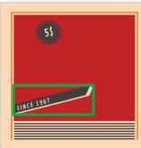

why\_this\_group The cream backing ribbon (element 2), dark inner ribbon (element 3), and SINCE 1967 text (element 8) form one a"ached historical banner, with layered   
structure and shared supporting-brand function.   
why\_now With the red poster field (element 0), framed border (element 5), lower stripe treatment (element 4), and ofer badge (element 13) established, this stage adds the supporting historical statement within the remaining poste space.   
why\_this\_layout The angled banner occupies the lower-le\$ red field above the stripe treatment, creating a grounded counterweight to the ofer badge while keeping the   
historical message legible and visual y connected to the poster frame.

layout\_instruction Place the cream backing ribbon (element 2) across the lower-le\$ portion of the red poster field (element 0), angled upward toward the center and contained within the framed border (element 5) above the lower stripe treatment (element 4). Layer the dark inner ribbon (element 3) over the cream backing so a slim cream edge remains visible, fit both ribbons cleanly without cropping, and place the SINCE 1967 text (element 8) along the dark ribbon with matching angle, clear spacing, and strong contrast.

## Turn 6 · Group 4 title/headline elements: [7, 9, 10, 11]


why\_this\_group COLD, BEER, and HERE form one unified promotional headline, with the two BEER layers jointly   
creating a dimensional shadowed word treatment for shared visual manipulation   
why\_now The framed panel (element 0), ofer badge   
(element 13 with element 12), historical ribbon (element 2 with element 8), and beer mug (element 6) are established, leaving the headline to complete the advertisement's   
readable promotional message.   
why\_this\_layout The stacked headline occupies the open le\$ portion of the red panel beneath the ofer badge and beside the beer mug, using strong contrast and compact spacing to balance the dominant il ustration while preserving the historical ribbon below.

layout\_instruction Place COLD text (element 9), the layered BEER headline with BEER shadow text (element 10) behind BEER headline text (element 7), and HERE text (element 11) as a vertical y stacked block in the open le\$ side of the framed panel (element 0), beneath the ofer badge (element 13) and to the le\$ of the beer mug (element 6). Keep COLD above BEER, HERE below BEER and above the historical ribbon (element 2), maintain tight readable spacing, let the BEER shadow remain visibly ofset behind its face, and fit the typography within the red field without cropping.

Figure 6: Detailed Data Construction Pipeline. Stage 1 constructs functional groups and their execution order, and Stage 2 derives a turn-level plan for each group.

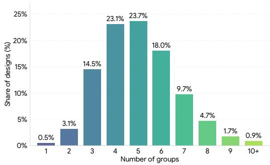  
(a) Number of functional groups per design.

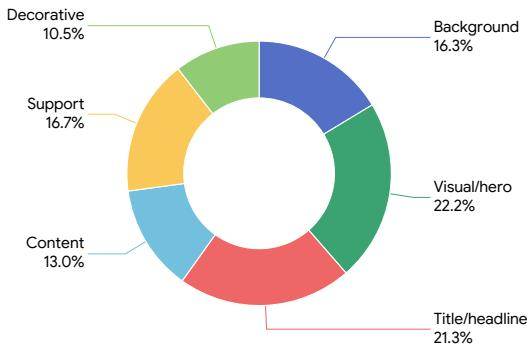  
(b) Distribution of functional group roles.  
Figure 7: Statistics of the constructed functional groups.

The constructed groups also vary substantially in their internal composition. As shown in Fig. 8a, the average number of elements per group differs across functional roles: background and visual/hero groups are typically compact, whereas decorative, title/headline, and content groups tend to contain more elements.

Fig. 8b further shows that our grouping is not constrained by modality. While background, visual/hero, and decorative groups are almost exclusively image-only, substantial portions of title/headline (38.9%), content (34.4%), and support (42.6%) groups contain both text and image elements. This indicates that functionally associated text and visual elements can form a common compositional unit and be planned together.

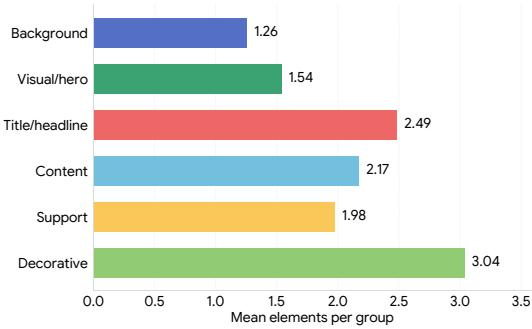  
(a) Mean group size by functional role.

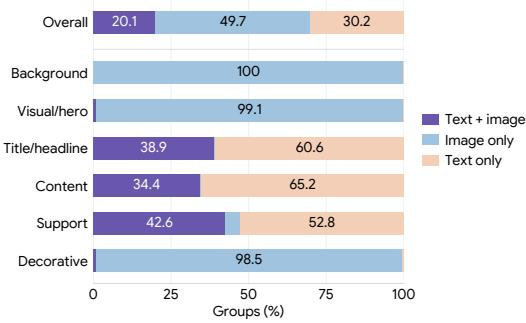  
(b) Modality composition by functional role.  
Figure 8: Group size and modality composition by functional role.

The execution annotations also exhibit a clear role-dependent structure. As shown in Fig. 9, background groups are overwhelmingly placed at the beginning of the trajectory, and visual/hero groups are concentrated in early turns. In contrast, content and support groups are distributed more heavily toward the middle and later stages, while decorative groups span a broader range of turns. These patterns indicate that the annotated execution order is closely associated with the functional role of each group, yielding structured construction trajectories in which foundational visual components are generally established before subsequent content and supporting elements.

## B.4 PROMPTS USED FOR DATA CONSTRUCTION

Stage 1 prompt. An abbreviated Stage 1 prompt is provided below. {GT IMAGE}, {CANVAS}, {DOCUMENT TITLE}, {DOCUMENT INTENTION}, and {ALL ELEMENTS} denote samplespecific inputs substituted at runtime. Image elements are provided as interleaved image blocks within the element inventory. Ellipses mark content omitted for brevity and are not part of the actual prompt.

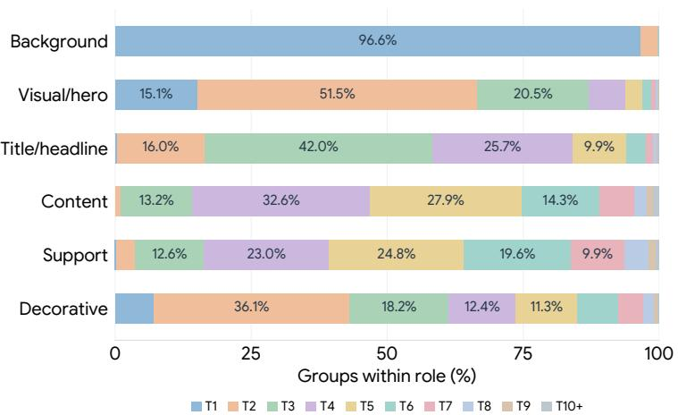  
Figure 9: Execution-turn distribution by functional role. Each row shows the distribution of execution turns for the corresponding functional role. T1, T2, . . . denote the first, second, . . . groupwise planning turns, and T10+ denotes turn 10 or later.

Prompt Used for Stage 1   
You are an expert graphic designer specializing in visual layout analysis and document   
composition.   
Your primary task is to semantically group every supplied element into coherent visual design   
blocks from a designer’s perspective, then determine their dependency-aware execution order for a   
future multi-turn layout planner.   
Treat grouping as a design understanding problem rather than a geometric clustering problem.   
Elements should be grouped into the coarsest dependency-consistent layout blocks that a   
professional designer would plan and render in one turn. Avoid both element-level fragmentation   
and module-level over-merging.   
[GT RENDERED DESIGN]   
{GT IMAGE}   
Treat the GT rendered design as the primary oracle evidence for semantic grouping, functional   
roles, structural attachment, common manipulation, visual hierarchy, and planning dependency.   
Do not restate the observed final layout or mention exact coordinates, bboxes, dimensions, or   
pixel-level placement.   
[CANVAS]   
{CANVAS}   
[... background identification rules omitted ...]   
[DOCUMENT TITLE]   
{DOCUMENT TITLE}   
[DOCUMENT INTENTION]   
{DOCUMENT INTENTION}   
[ALL ELEMENTS]   
{ALL ELEMENTS}   
Use element bboxes as structural evidence for canvas coverage, containment, and background   
identification. Geometry and source-list order should otherwise remain secondary evidence.   
The order field indicates the ground-truth global stacking order. Use it primarily for   
front-to-back relationships and internal stacking, not as the default grouping or execution   
order.   
[...]   
[TASK]   
1. Partition all supplied element IDs into semantic/layout groups, assigning every element to   
exactly one group.   
2. Assign contiguous integer group id values starting at 0.   
3. Assign exactly one closed-set functional role to every group.   
4. Determine a dependency-aware execution order for the future multi-turn planner.   
5. Explain why each set of elements forms one coherent semantic/layout group.   
6. Explain why each group should be planned at its selected execution stage.   
[GROUP GRANULARITY REQUIREMENTS]   
Form the coarsest block that remains semantically and executionally homogeneous.   
Merge elements only when they are normally positioned and revised as one unit and share the same   
planning dependency. A shared panel, bounded region, alignment system, reading flow, or local   
composition is supporting evidence, but is not sufficient by itself.   
A single panel, card, badge, placard, or bounded module may contain multiple groups. Separate a   
visual or structural anchor from content that can be planned independently relative to it.

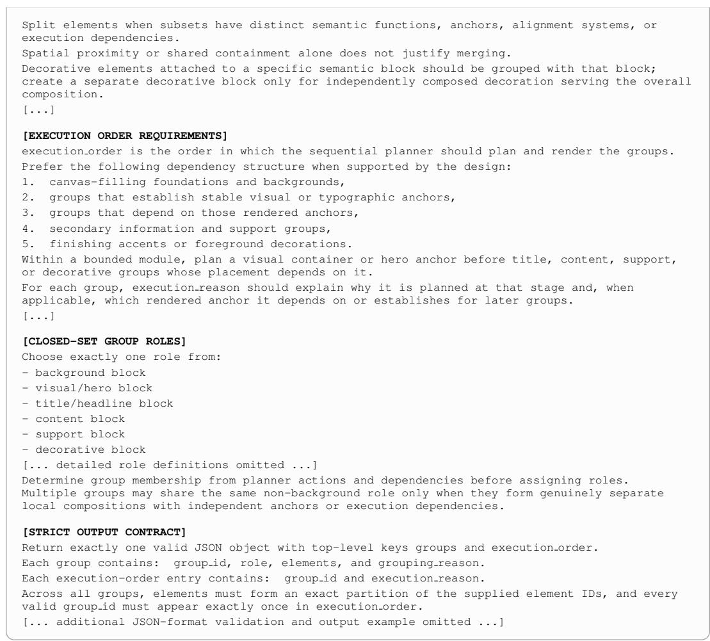

Stage 2 prompt. An abbreviated Stage 2 prompt is provided below. {GT IMAGE}, {CURRENT RENDER IMAGE}, and {NEXT STATE RENDER IMAGE} denote the final, current, and oracle next-state renders. The remaining placeholders provide sample-specific document context, previous-group state, and current-turn group information. Image elements are supplied as interleaved image blocks within the element inventories.  
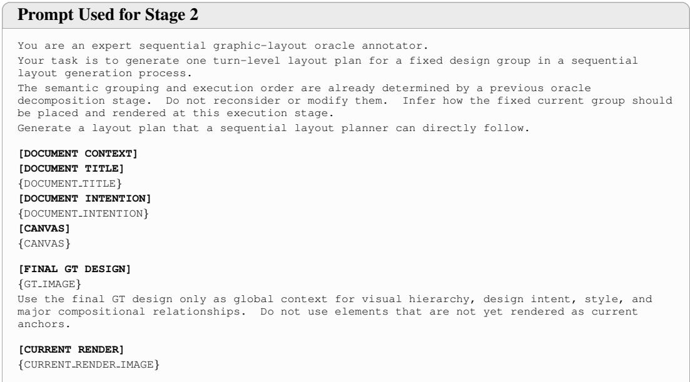

CURRENT RENDER represents the sequential design state before adding the current group. Use it to identify existing anchors, available space, hierarchy, and current spatial relationships.

## [PREVIOUSLY EXECUTED GROUPS]

{PREVIOUS GROUPS}

[PREVIOUSLY RENDERED ELEMENTS]

{PREVIOUS ELEMENT LINES}

These groups and elements are already present in CURRENT RENDER and provide the existing visual context for the current turn.

## [ORACLE NEXT-STATE RENDER]

{NEXT STATE RENDER IMAGE}

ORACLE NEXT-STATE RENDER shows the result after adding only the fixed current group to CURRENT RENDER.

Use the visual difference between CURRENT RENDER and ORACLE NEXT-STATE RENDER as the primary evidence for the current group’s target region, anchor relationship, relative scale, spacing, alignment, overlap, containment, crop or fit behavior, and intra-group stacking.

## [FIXED CURRENT GROUP]

{CURRENT GROUP}

[FIXED EXECUTION REASON]

{CURRENT EXECUTION REASON}

The current group, its role, element membership, grouping rationale, and execution logic are fixed and must not be changed.

## [CURRENT GROUP ELEMENTS]

{CURRENT ELEMENT LINES}

These are the only elements added in this turn.

## [EVIDENCE USE]

Use: - the fixed group and execution reason for grouping and execution semantics,

\- CURRENT RENDER and previously rendered elements for existing anchors,

\- the CURRENT-to-NEXT render difference for current-group placement,

\- FINAL GT DESIGN only for global composition and design-intent context.

## [TASK]

Generate exactly one turn-local layout plan for the fixed current group.

Plan and add only the current-group elements. Use qualitative and relational layout language; do not output coordinates, bounding boxes, percentages, dimensions, pixel distances, or other raw geometric measurements.

Do not mention GT, oracle evidence, annotation, or internal metadata in the output.

## [RATIONALE REQUIREMENTS]

The rationale must contain exactly:

\- why this group: why the fixed elements form one coherent planning unit,

\- why now: why the group belongs at this execution stage given the already established composition,

\- why this layout: why the recovered placement and arrangement are appropriate for the current canvas.

Keep these three functions distinct. Ground explanations in semantic relationships, visual anchors, hierarchy, readability, spacing, alignment, containment, overlap, balance, or whitespace as appropriate.

Preserve the original grouping and execution decisions and do not propose alternative groups, stages, or layouts.

Each rationale should normally be one sentence and must not exceed two sentences.

## [LAYOUT INSTRUCTION REQUIREMENTS]

layout instruction must be an imperative instruction describing how to add only the current group.

Describe, when relevant:

1. target region and primary anchor,

2. intra-group arrangement,

3. relative scale, alignment, and spacing,

4. overlap, containment, stacking, and crop or fit behavior.

Describe what the planner should do rather than why it is appropriate. Mention every current-group element at least once using descriptive references, e.g., headline text (element 7).

When referring to an existing anchor, identify a concrete previously rendered element. Do not reference nonexistent elements.

[...]

## [STRICT OUTPUT CONTRACT]

Return exactly one valid JSON object with top-level key turn plan.

turn plan must contain exactly:

\- group id

\- role

\- elements

- rationale   
- layout instruction   
rationale must contain exactly:   
- why this group   
- why now   
- why this layout   
The group id, role, and elements must exactly match the fixed current group.   
Return concise English and valid JSON only.   
[... additional validation rules and output example omitted ...]

## C MAIN PIPELINE DETAILS

## C.1 OVERALL GENERATION ALGORITHM

## C.1.1 OVERALL ALGORITHM

Algorithm 1 PlayGround Inference   
Require: Element inventory $\mathcal { E } ,$ document metadata $\mathcal { M } ,$ reference pool $\mathcal { D } _ { \mathrm { r e f } } ,$ renderer R   
Require: Prompts $\mathcal { P } _ { \mathrm { r e t } } , \mathcal { P } _ { \mathrm { p l a n } } , \mathcal { P } _ { \mathrm { p r e d } } , \mathcal { P } _ { \mathrm { v e r } } ;$ trained modules $f _ { \theta _ { \mathrm { r e t } } } , f _ { \theta _ { \mathrm { p l a n } } } , f _ { \theta _ { \mathrm { p r e d } } } ;$ verifier $f _ { \mathrm { v e r } } ;$ number of   
candidates $\scriptstyle { \dot { K } } ;$ maximum verification rounds $R _ { \mathrm { m a x } } = 3$   
Ensure: Selected layout predictions $\{ \mathcal { V } _ { t } \} _ { t = 1 } ^ { T }$ and final canvas $C _ { T }$   
1: $\Phi  f _ { \theta _ { \mathrm { r e t } } } ( \mathcal { P } _ { \mathrm { r e t } } , \mathcal { M } , \mathcal { E } )$ ▷ 1. Structure prediction   
2: $\mathcal { Z } $ top-5 designs from ${ \mathcal { D } } _ { \mathrm { r e f } }$ ranked by Eq. 4 ▷ 2. Reference retrieval   
3: $C _ { 0 } \gets$ empty canvas, $\mathcal { E } _ { 1 } ^ { \mathrm { r e m } }  \mathcal { E } , \quad t  1$   
4: while $\mathcal { E } _ { t } ^ { \mathrm { r e m } } \breve { \neq } \emptyset$ do   
5: $( G _ { t } , p _ { t } ) \gets f _ { \theta _ { \mathrm { p l a n } } } \left( \mathcal { P } _ { \mathrm { p l a n } } , \mathcal { M } , \mathcal { Z } , C _ { t - 1 } , \mathcal { E } _ { t } ^ { \mathrm { r e m } } \right)$ ▷ 3. Planning → form and plan next group   
6: Let $\ell _ { t }$ denote the layout instruction in $p _ { t }$ and set $\ell _ { t } ^ { ( 1 ) } \gets \ell _ { t }$   
7: for $r = 1 , \ldots , R _ { \mathrm { m a x } }$ do   
8: Set the layout instruction in $p _ { t }$ to $\ell _ { t } ^ { ( r ) }$   
9: $\{ \boldsymbol { \mathcal { V } } _ { t } ^ { ( r , k ) } \} _ { k = 1 } ^ { K }  \{ f _ { \theta _ { \mathrm { p r e d } } } ( \mathcal { P } _ { \mathrm { p r e d } } , \boldsymbol { \mathcal { M } } , \mathcal { Z } , C _ { t - 1 } , G _ { t } , p _ { t } ) \} _ { k = 1 } ^ { K }$   
▷ 4. Layout generation → K candidates   
10: $\mathcal { C } _ { t } ^ { ( r ) } \gets \left\{ \mathcal { R } \left( C _ { t - 1 } , y _ { t } ^ { ( r , k ) } \right) \right\} _ { k = 1 } ^ { K }$ ▷ Render candidate layouts   
11: $\left( \bar { C } _ { t } ^ { ( r ) } , \dot { d } _ { t } ^ { ( r ) } \right) \gets f _ { \mathrm { v e r } } \left( \mathcal { P } _ { \mathrm { v e r } } , G _ { t } , \ell _ { t } ^ { ( r ) } , C _ { t - 1 } , \mathcal { C } _ { t } ^ { ( r ) } \right)$ ▷ 5. Verification → round r   
12: if $d _ { t } ^ { ( r ) } = \bar { \mathfrak { c } }$ accept then   
13: $\bar { C } _ { t } \gets \bar { C } _ { t } ^ { ( r ) }$   
14: Y ← prediction corresponding to $\bar { C } _ { t } ^ { ( r ) }$   
15: break   
16: else if $r < R _ { \mathrm { m a x } }$ then   
17: $\ell _ { t } ^ { ( r + 1 ) }$ ← revised instruction returned by $f _ { \mathrm { v e r } }$ ▷ Retry the same group   
18: end if   
19: end for   
20: if $d _ { t } ^ { ( r ) } \neq$ accept for all $r = 1 , \ldots , R _ { \mathrm { m a x } }$ then   
21: Visual Verifier selects $C _ { t }$ from $\{ \bar { C } _ { t _ { \ldots } } ^ { ( 1 ) } , \ldots , \bar { C } _ { t } ^ { ( R _ { \operatorname* { m a x } } ) } \}$   
22: $\mathcal { V } _ { t }$ ← prediction corresponding to $\scriptstyle \sum _ { t }$ ▷ Final selection across rounds   
23: end if   
24: $\mathcal { E } _ { t + 1 } ^ { \mathrm { r e m } }  \mathcal { E } _ { t } ^ { \mathrm { r e m } } \setminus \mathcal { E } _ { t }$ ▷ 6. State update → remove placed group   
25: $t \gets t + 1$ ▷ $C _ { t }$ becomes the previous canvas for the next turn   
26: end while   
27: $T \gets t - 1$   
28: return $\{ \mathcal { V } _ { t } \} _ { t = 1 } ^ { T } , C _ { T }$ ▷ 7. Final editable design

Algorithm 1 summarizes the complete inference procedure of PlayGround. The Structure-Aware Retriever first retrieves five reference designs, which remain fixed throughout generation. At each turn, the Planner forms the next functional group and its plan from the current canvas and remaining elements, after which the Layout Generator produces $\bar { K }$ candidate layouts for the selected group. The Visual Verifier then either accepts the best rendered candidate or revises the layout instruction for regeneration, for up to $R _ { \mathrm { m a x } } = 3$ rounds. The accepted canvas and updated remaining elements define the next state, and this process repeats until all input elements are placed.

## C.1.2 VISUALIZATION OF OVERALL PROCESS

Fig. 10 visualizes a complete generation trajectory of PlayGround. The retrieved references are fixed before generation, and each turn shows the selected functional group and layout instruction, the $K$ candidate layouts produced by the Layout Generator, the Visual Verifier decision, and the resulting updated canvas. As generation progresses from turn 1 to turn 5, the accepted canvas is repeatedly carried forward as the visual state for the next planning turn.

The example also illustrates the feedback loop within a turn. At turn 4, the verifier rejects the initially selected candidate because the newly placed text overlaps the existing robot and crowds the lower-right composition. It therefore revises the layout instruction and regenerates the same group; the second-round candidate is then accepted after placing the text in a clearer region. This example highlights how progressive planning and turn-level verification jointly construct the design while adapting to the evolving canvas.

## C.2 STRUCTURE-AWARE RETRIEVER

## C.2.1 RETRIEVAL SCORE

Role-aware group IoU. For the query, we use the predicted role–region structure $\Phi _ { q }$ from Eq. 3. For each candidate $c \in \mathcal { D } _ { \mathrm { r e f } }$ , we use its Stage 1 role–region structure $\Phi _ { c } = \{ ( r _ { c , j } , B _ { c , j } ) \} _ { i = 1 } ^ { J _ { c } }$ . Before comparison, each group region is clipped to the corresponding canvas bounds and normalized by the canvas size:

$$
\bar { B } _ { d , j } = \left( \frac { x _ { d , j } } { w _ { d } } , \frac { y _ { d , j } } { h _ { d } } , \frac { \Delta x _ { d , j } } { w _ { d } } , \frac { \Delta y _ { d , j } } { h _ { d } } \right) , \qquad d \in \{ q , c \} ,\tag{9}
$$

where $w _ { d }$ and $h _ { d }$ denote the canvas width and height, respectively, and $( x _ { d , j } , y _ { d , j } , \Delta x _ { d , j } , \Delta y _ { d , j } )$ denotes the clipped group region in $( x , y ,$ width, height) form.

For $J _ { q }$ query groups and $J _ { c }$ candidate groups, we define the role-aware pairwise overlap as

$$
M _ { i j } = { \bf 1 } [ r _ { q , i } = r _ { c , j } ] \mathrm { I o U } ( \bar { B } _ { q , i } , \bar { B } _ { c , j } ) .\tag{10}
$$

Let $\Pi _ { q , c }$ denote the set of one-to-one matchings between query and candidate groups, allowing groups to remain unmatched. Since multiple groups may share the same functional role, we use Hungarian matching to find the one-to-one correspondence between role-compatible groups that maximizes the total region IoU. Normalizing by max ${ ( J _ { q } , J _ { c } ) }$ penalizes unmatched groups rather than averaging only over the matched subset:

$$
S _ { \mathrm { r o l e - I o U } } ( q , c ) = \frac { 1 } { \operatorname* { m a x } ( J _ { q } , J _ { c } ) } \operatorname* { m a x } _ { \pi \in \Pi _ { q , c } } \sum _ { ( i , j ) \in \pi } M _ { i j } .\tag{11}
$$

Canvas aspect ratio. Let $a _ { d } = w _ { d } / h _ { d }$ denote the aspect ratio of design d. This term preserves canvas-geometry information that is removed when group regions are normalized independently by canvas size. We define

$$
S _ { \mathrm { c a n v a s } } ( q , c ) = \frac { \operatorname* { m i n } ( a _ { q } , a _ { c } ) } { \operatorname* { m a x } ( a _ { q } , a _ { c } ) } .\tag{12}
$$

Word and image count similarity. Let $W _ { d }$ denote the total number of words across all text elements and $I _ { d }$ the number of image elements. This term compares the amount of textual and visual content between the query and candidate:

$$
S _ { \mathrm { w o r d / i m a g e } } ( q , c ) = \frac { \operatorname* { m i n } ( W _ { q } , W _ { c } ) + \operatorname* { m i n } ( I _ { q } , I _ { c } ) } { \operatorname* { m a x } ( W _ { q } + I _ { q } , W _ { c } + I _ { c } ) } .\tag{13}
$$

When $W _ { q } + I _ { q } = W _ { c } + I _ { c } = 0$ , we define $S _ { \mathrm { w o r d / i m a g e } } ( q , c ) = 0 $

## Canvas size : 1080×1080

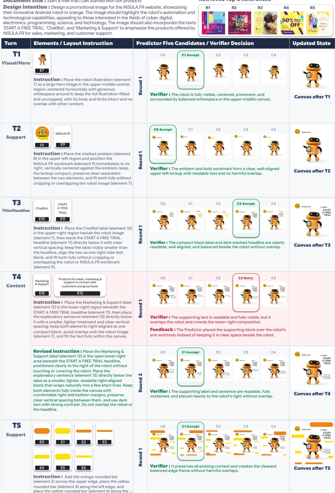  
Figure 10: Detailed example of Progressive Design Generation.

Weights and reference selection. The weights in Eq. 4 are fixed to $( \lambda _ { \mathrm { r o l e - I o U } } , \lambda _ { \mathrm { c a n v a s } } , \lambda _ { \mathrm { w o r d / i m a g e } } ) =$ (0.10, 0.45, 0.45) and are used consistently across all experiments. Thus, the retrieval similarity is

$$
\sin ( q , c ) = 0 . 1 0 S _ { \mathrm { r o l e - I o U } } ( q , c ) + 0 . 4 5 S _ { \mathrm { c a n v a s } } ( q , c ) + 0 . 4 5 S _ { \mathrm { w o r d / i m a g e } } ( q , c ) .\tag{14}
$$

To obtain the Top-5 references used in Sec. 4.2, we first rank candidates by $\mathrm { s i m } ( q , c )$ . Since Crello contains visually and textually similar designs across its train and test splits, we apply a lexical deduplication filter to avoid retrieving near-duplicate references that could provide an overly direct template for the query. This ensures that the retrieved examples serve as structural priors rather than near-identical design matches. For two designs d and $d ^ { \prime } ,$ , we define their lexical overlap as

$$
D ( d , d ^ { \prime } ) = \frac { \sum _ { t } \operatorname* { m i n } ( m _ { d } ( t ) , m _ { d ^ { \prime } } ( t ) ) } { \operatorname* { m a x } ( W _ { d } , W _ { d ^ { \prime } } ) } ,\tag{15}
$$

where $m _ { d } ( t )$ denotes the number of occurrences of word t across all text elements in design d. Repeated occurrences are counted, while word order and text-element boundaries are ignored. We define $D ( d , d ^ { \prime } ) = 0$ when $W _ { d } = W _ { d ^ { \prime } } = 0$

A candidate c is excluded if $D ( q , c ) \geq 0 . 7$ or if $D ( z , c ) \geq 0 . 7$ for any previously selected reference $z \in \mathcal { Z } _ { q }$ . The first five remaining candidates form $\mathcal { Z } _ { q }$

## C.2.2 RETRIEVER BEHAVIOR ANALYSIS

We analyze how often individual references are reused across test queries to examine whether retrieval collapses to a small set of frequently selected designs. For each reference appearing in the Top-5 retrieval results, we count the number of test queries for which it is selected. As shown in Fig. 11, most references are selected for only one or a few queries, and the number of references decreases rapidly as the selection frequency increases. This indicates that the Retriever produces diverse reference choices across queries rather than repeatedly relying on a small set of references.

Only a few references are selected frequently. The most frequently selected reference appears in 48 queries, which mainly correspond to designs containing a single image spanning the canvas. Since these queries share nearly identical coarse layout structures, repeatedly retrieving the same reference is expected. Overall, the distribution shows that the Retriever maintains diverse reference selection while consistently reusing similar references for structurally similar queries.

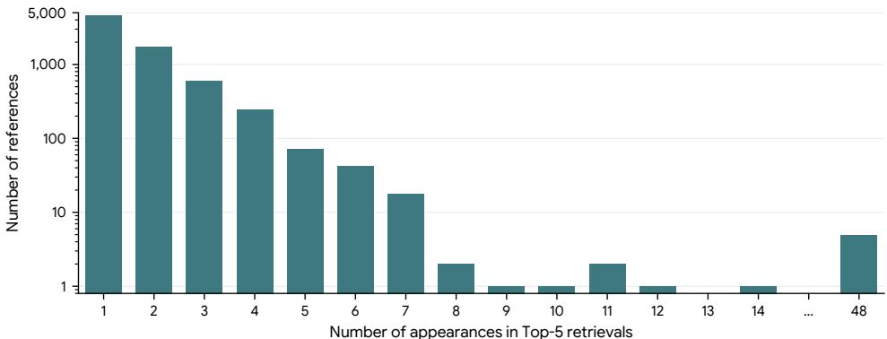  
Figure 11: Distribution of reference reuse across test queries. For each reference appearing in the Top-5 retrieval results, we count how many times it is selected across all test queries. The histogram shows the distribution of these selection frequencies across references, with the vertical axis shown on a logarithmic scale.

## C.2.3 QUALITATIVE RETRIEVAL RESULTS

We visualize representative retrieval results in Fig. 12. Across diverse queries, the retrieved references show similar coarse layout structures to the query, despite differences in visual content and style. Their canvas aspect ratios also closely match those of the corresponding queries, consistent with the canvas-similarity term in our retrieval score. These examples illustrate the structural references provided to the subsequent planning stage.

  
Figure 12: Qualitative examples of retrieved references. For each query, we show the five highestranked references retrieved from the reference pool. The retrieved designs exhibit similar coarse layout structures and canvas geometry.

We further examine how retrieval ranking affects downstream generation in Fig. 13. Consistent with the quantitative ablation in Table 2, where Top-5 references outperform low-ranked references, the qualitative results show that reference quality also changes the resulting planning behavior and final composition. For visualization, we select the Bottom-5 as the lowest-ranked references among candidates with the same canvas size as the query, so that the comparison is not dominated by differences in canvas geometry. Top-ranked references provide structural cues that better match the inferred query structure, leading to more suitable layout instructions and final layouts, whereas lowranked references provide less relevant guidance and result in noticeably different compositions.

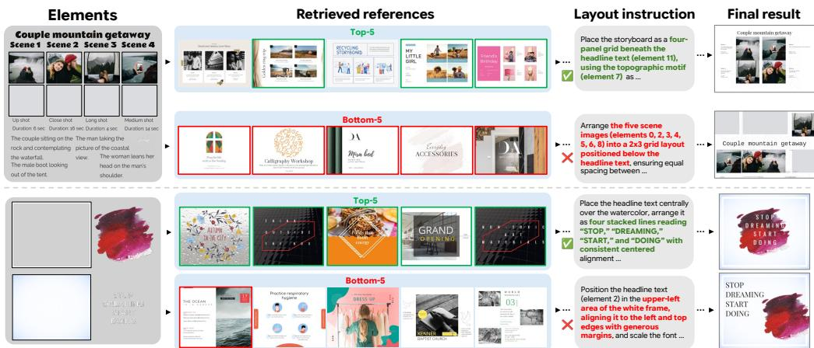  
Figure 13: Qualitative comparison of retrieval ranking. For the same input elements, we compare the Top-5 references with the lowest-ranked five references among candidates sharing the query canvas size, together with the resulting layout instructions and final layouts.

## C.3 TRAINING CONFIGURATIONS

Table 4: Training configurations. Configurations used to fine-tune the Structure-Aware Retriever, Planner, and Layout Generator.
<table><tr><td>Configuration</td><td>Structure-Aware Retriever</td><td>Progressive Planner</td><td>Layout Generator</td></tr><tr><td colspan="4">Model and adaptation</td></tr><tr><td>Base model</td><td>Qwen3-VL-8B-Instruct</td><td>Qwen3-VL-8B-Instruct</td><td>Qwen3-VL-8B-Instruct</td></tr><tr><td>LoRA rank / α / dropout</td><td>32 / 64 / 0.05</td><td>32 / 64 / 0.05</td><td>32 / 64 / 0.05</td></tr><tr><td>LoRA target</td><td>LLM</td><td>LLM</td><td>LLM</td></tr><tr><td>Trainable non-LoRA module</td><td>Merger</td><td>Merger</td><td>Merger</td></tr><tr><td colspan="4">Optimization</td></tr><tr><td>Epochs</td><td>5</td><td>6</td><td>10</td></tr><tr><td>Global batch size</td><td>32</td><td>64</td><td>64</td></tr><tr><td>Per-device batch size</td><td>1</td><td>1</td><td>1</td></tr><tr><td>Gradient accumulation</td><td>8</td><td>16</td><td>16</td></tr><tr><td>LoRA learning rate</td><td> $1 \times 1 0 ^ { - 4 }$ </td><td> $1 \times 1 0 ^ { - 4 }$ </td><td> $1 \times 1 0 ^ { - 4 }$ </td></tr><tr><td>Merger learning rate</td><td> $1 \times 1 0 ^ { - 5 }$ </td><td> $1 \times 1 0 ^ { - 5 }$ </td><td> $1 \times 1 0 ^ { - 5 }$ </td></tr><tr><td>Weight decay</td><td>0.1</td><td>0.1</td><td>0.1</td></tr><tr><td>Warmup ratio</td><td>0.03</td><td>0.03</td><td>0.03</td></tr><tr><td>LR scheduler</td><td>Cosine</td><td>Cosine</td><td>Cosine</td></tr><tr><td colspan="4">Visual input resolution</td></tr><tr><td>Element image min. pixels</td><td> $1 9 2 \times 3 2 \times 3 2$ </td><td> $1 6 \times 3 2 \times 3 2$ </td><td> $1 6 \times 3 2 \times 3 2$ </td></tr><tr><td>Element image max. pixels</td><td> $3 8 4 \times 3 2 \times 3 2$ </td><td> $7 8 4 \times 3 2 \times 3 2$ </td><td> $7 8 4 \times 3 2 \times 3 2$ </td></tr><tr><td>Canvas max. pixels</td><td></td><td> $1 5 3 6 \times 3 2 \times 3 2$ </td><td> $1 5 3 6 \times 3 2 \times 3 2$ </td></tr><tr><td>Reference max. pixels</td><td></td><td> $5 1 2 \times 3 2 \times 3 2$ </td><td> $5 1 2 \times 3 2 \times 3 2$ </td></tr><tr><td colspan="4">Training system</td></tr><tr><td>Distributed training</td><td>DDP</td><td>DeepSpeed ZeRO-3</td><td>DeepSpeed ZeRO-3</td></tr><tr><td>Precision</td><td>BF16 + TF32</td><td>BF16 + TF32</td><td>BF16 + TF32</td></tr><tr><td>Gradient checkpointing</td><td>Yes</td><td>Yes</td><td>Yes</td></tr><tr><td>FlashAttention-2 / Liger</td><td>Yes / Yes</td><td>Yes / Yes</td><td>Yes / Yes</td></tr></table>

We report the detailed training configurations for the Structure-Aware Retriever, Progressive Planner, and Layout Generator in Table 4. All three modules are initialized from Qwen3-VL-8B-Instruct and fine-tuned with LoRA, with module-specific optimization and visual input settings.

## C.4 PROMPTS FOR EACH MODULE

Prompt Used for Structure-Aware Retriever   
You are the coarse-layout Retrieval Agent for a graphic-design generation pipeline.   
[DESIGN REQUEST]   
Title: {title}   
Intention: {intention}   
[CANVAS]   
Width: {canvas width px}   
Height: {canvas height px}   
[SUPPLIED ELEMENTS] {element lines}   
[TASK]   
Infer the small set of functional groups that the supplied elements are likely to form in the   
complete design, and estimate one coarse canvas region for each group. This is not the final   
design plan. The output is used only to retrieve structurally similar training examples.   
Use the request, every supplied element, image content, text content, and canvas aspect ratio.   
Think globally about likely background, focal visual, headline, information, CTA, branding,   
footer, structural container, and decoration regions. Regions may overlap when intended desig   
layers overlap, and a canvas-filling background may use the full canvas.   
[CLOSED-SET GROUP ROLES]   
Choose each group role from:   
- background block   
- visual/hero block

[COMPLETE IMMUTABLE ELEMENT INVENTORY]   
Every element has an immutable integer ID. Image elements are represented by multimodal asset   
slots.   
{element lines}   
Assign every listed element exactly once across the conversation. Never omit, duplicate, invent,   
merge, or silently repair an element. Asset images are semantic inputs, not completed-layout   
evidence.

- title/headline block   
- content block   
- support block   
- decorative block   
[... detailed role definitions omitted ...]   
[NON-NEGOTIABLE RETRIEVAL CONTRACT]   
- Predict structure from the supplied raw inputs only.   
- Select each group’s primary design function. Roles may repeat and not all roles must appear.   
- Explain the semantic or structural reason for each grouping in one non-empty grouping reason.   
- Return exactly one syntactically valid JSON object and nothing else.   
- Before responding, verify that group IDs are contiguous, all four region values are numeric   
pixel values, and every region stays inside the canvas.   
[... additional validation details omitted ...]   
[OUTPUT SCHEMA]   
{   
‘‘groups’’: [   
{   
‘‘group id’’: 0,   
‘‘role’’: ‘‘role label’’,   
‘‘grouping reason’’: ‘‘why these elements form one functional group’’,   
‘‘group canvas region’’: {   
‘‘left’’: 0, ‘‘top’’: 0, ‘‘width’’: 0, ‘‘height’’: 0

## Prompt Used for Progressive Planner

```objectivec
[DOCUMENT TITLE]
{title}
[DOCUMENT INTENTION]
{intention}
[CANVAS]
width: {canvas width}
height: {canvas height}
```

## [REFERENCE DESIGNS]

The five images above are ordered by deterministic visual-structure similarity. Use them only as broad composition priors. Do not describe or identify them, copy hidden annotations, or output reference metadata.

## [TASK]

Infer and return exactly one next dependency-ready group, not a plan for the complete design. The element inventory is the only source of target group membership and role; the title, intention, canvas, and reference designs provide context but do not reveal the target grouping. Choose the coarsest dependency-consistent unassigned group that forms one coherent unit and can be planned and rendered in one turn. Avoid both element-level fragmentation and over-merging across independently planned units.

Conversation order is the predicted inter-group execution and rendering order. Follow a dependency-aware human design workflow: place a supplied canvas-wide foundation first when present, then stable visual, container, or typographic anchors before groups positioned relative to them. Among dependency-ready groups, prefer the group whose placement is most stable and least likely to cause downstream rework or unnecessary overlap or occlusion. [... additional grouping and execution constraints omitted ...]

## [RATIONALE GUIDANCE]

\- why this group: explain why the selected elements form one coherent, jointly placeable semantic unit.

\- why now: explain why this group should be rendered next based on its dependencies, available rendered anchors, anchoring value, placement stability, and reduced downstream rework or unnecessary occlusion.

\- why this layout: justify the qualitative layout from the selected elements, canvas, current conversation state, and broad reference priors, relating it to hierarchy, reading flow, readability, contrast, balance, whitespace, or occlusion avoidance where relevant. Each rationale field should normally be one sentence and must not exceed two sentences. Do not offer alternatives or describe the selected group as already rendered.

## [LAYOUT INSTRUCTION]

layout instruction must specify one decisive, executable action that adds only the selected group’s newly assigned elements. Earlier elements may be referenced as fixed alignment, containment, spacing, contrast, depth, or overlap anchors, but must not be reassigned or modified.

Where relevant, describe qualitative region, alignment, anchoring, reading order, relative scale, spacing, whitespace, overlap, containment, crop or fit behavior, depth, typography, color, and

contrast-sensitive placement. Never output bounding boxes, exact coordinates, normalized coordinates, pixel measurements, or position tokens.   
Mention every selected element at least once using a descriptive reference such as headline text (element 7). Every referenced element ID must belong either to the selected group or to a group from an earlier assistant response.   
[...]

## [CLOSED-SET GROUP ROLES]

Choose exactly one role from:

\- background block

\- visual/hero block

\- title/headline block

\- content block

\- support block

\- decorative block

[... detailed role definitions omitted ...]

## [STRICT OUTPUT CONTRACT]

Return exactly one valid JSON object and nothing else. The top-level object must contain exactly turn plan. turn plan must contain exactly group id, role, elements, rationale, and layout instruction. rationale must contain exactly why this group, why now, and why this layout. [... additional output-format checks omitted ...]

## [SUBSEQUENT TURNS]

Continue the same sequential planning conversation. All prior assistant turn plans are validated and immutable.

## [CURRENT CANVAS AFTER PREVIOUS TURNS]

{current canvas image}

The image above is the cumulative rendered state after all prior turn plans. Treat all existing placements as fixed and plan only the next group relative to them.

## [REMAINING IMMUTABLE ELEMENT INVENTORY]

Select exactly one dependency-ready group using only remaining elements. Do not reuse, modify, or reassign any previously planned element, and do not expose any later group. Return exactly one valid JSON object following the same turn plan schema established in the initial instruction.

## Prompt Used for Layout Generator

You are the group-wise layout Predict Agent for a complete graphic design.

## [CANVAS]

Width: {canvas width px}

Height: {canvas height px}

## [ALL SUPPLIED ELEMENTS]

{all element lines}

## [RETRIEVED REFERENCE IMAGES]

The following accepted Top-5 reference images are provided in retrieval ranking order. Use their visual composition and layout as references.

{retrieved examples}

## [TASK]

Lay out ONLY the elements listed in the current group’s target elements. Treat the supplied current group as the only available Planner decision. Follow its role and layout instruction, and infer the current elements’ exact placement from the canvas size, complete element inventory, supplied assets, and retrieved reference images. Do not place or predict any non-current element

## [CURRENT GROUP]

{current group}

Now predict the current group elements: {target group elements}

## [SUBSEQUENT TURNS]

current canvas state: {current canvas state}

current group:

{current group}

Now predict the current group elements: {target group elements}

## Prompt Used for Visual Verifier

You are a strict graphic-layout referee.   
One layout group has just been placed on a design canvas. You will see several candidate canvases that differ only in how the current group was predicted.   
Your task is to (1) select the best rendered candidate, (2) diagnose any remaining problem usin prediction metadata, and (3) choose whether to accept or retry with a better plan.   
[ITERATION STATE]   
Current judge call: {current iteration of max iterations}   
Actions returned by earlier judge calls:   
{tool history}   
Judge the candidates actually shown; do not assume a prior correction succeeded.   
Number of candidates in this call: {n candidates}   
[CANVAS]   
width: {canvas width}   
height: {canvas height}

[CURRENT GROUP]   
{current group json}   
[ELEMENTS BEFORE THIS GROUP]   
{previous element lines}   
[ELEMENTS IN THIS GROUP]   
{current group element lines}   
[CANVAS BEFORE THIS TURN]   
<image>   
[CANDIDATES]   
[CANDIDATE 0]   
<image>   
[PREDICTION --- CANDIDATE 0]   
{candidate 0 prediction}   
[... candidates 1--3 omitted ...]   
[CANDIDATE 4]   
<image>   
[PREDICTION --- CANDIDATE 4]   
{candidate 4 prediction}   
[STEP 1 --- SELECT THE BEST CANDIDATE]   
Rank candidates only by their rendered images, not prediction metadata. Choose one using this   
priority: (1) preserve readable text, important subjects, and the existing canvas’s meaning; (2)   
follow the current layout instruction; (3) achieve strong readability and composition.   
Penalize overlap only when it hides important content or breaks an element’s role. Allow   
intentional layering of backgrounds, decoration, framing, and depth. If tied, choose the safer   
candidate, then the lower index. Give one short reason.   
[STEP 2 --- DIAGNOSE THE SELECTED CANDIDATE]   
After selecting, use its prediction metadata and the current plan only to diagnose visible   
problems. Distinguish harmful occlusion from intentional layering. Earlier-group elements are   
fixed; resolve conflicts by revising current-group placement, scale, style, or internal stacking.   
[STEP 3 --- CHOOSE ONE ACTION]   
Choose exactly one:   
accept   
- retry with feedback   
Use accept when the selected candidate is already good enough to commit.   
Use retry with feedback when the selected candidate can be improved by giving the Predictor a   
revised layout instruction. Return only a rewritten layout instruction; group ID, role,   
elements, and rationale are reused. The Predictor regenerates only the current group.   
Use relational visual language, not coordinates, bbox values, x/y positions, or exact numeric   
dimensions. Do not ask the Predictor to reorder elements placed in earlier groups.   
[... additional retry guidance omitted ...]   
[OUTPUT]   
For accept:   
{   
‘‘choice’’: <candidate index>,   
‘‘reason’’: ‘‘<one short sentence>’’,   
‘‘action’’: ‘‘accept’’   
For retry with feedback:   
‘‘choice’’: <candidate index>,   
‘‘reason’’: ‘‘<one short sentence>’’,   
‘‘action’’: ‘‘retry with feedback’’,   
‘‘retry reason’’: ‘‘<what the Predictor failed to execute>’’,   
‘‘layout instruction’’: ‘‘<the revised natural-language plan for a better result>’’   
}   
[FINAL SELECTION AFTER MAXIMUM ROUNDS]   
If no verification round is accepted, make the final selection from the per-round finalists.   
[CANVAS]   
width: {canvas width}   
height: {canvas height}   
{previous canvas block}   
[CURRENT GROUP]   
{current group json}   
[ELEMENTS IN THE CURRENT GROUP]   
{target group elements}   
[FINAL CANDIDATES]   
{candidate block}   
Choose the single best final candidate. Select the candidate that follows the current group’s   
layout instruction most faithfully while producing the best overall visual result. Judge only   
the candidates shown; you must choose one candidate.   
Return exactly one valid JSON object:   
{   
‘‘choice’’: <candidate index from 0 to {max candidate}>,   
‘‘reason’’: ‘‘<one short sentence>’’,   
‘‘action’’: ‘‘accept’’   
}

## D EXPERIMENTAL DETAILS

## D.1 EVALUATION SETUP

Input configuration. We adapt each baseline to its native input formulation while keeping the underlying Crello elements consistent whenever possible. FlexDM, LaDeCo, and PlayGround receive the original image and text elements as separate editable inputs. PosterCopilot represents all elements as images; therefore, we first render each text element using its ground-truth text attributes and provide the resulting text renders as image elements together with the original visual elements. VFLM is specialized for text placement on a fixed background, so we render all ground-truth nontext elements to construct the background canvas and provide only the text elements for layout prediction. These settings follow the input assumptions of each method while using the same source design content.

Dataset-specific preprocessing. LICA (Hirsch et al., 2026) does not provide document titles, which are required as metadata inputs to our pipeline. We therefore generate a title for each LICA sample using Qwen3.5-27B (Qwen Team, 2026a). We use the ground-truth rendered image together with the available LICA metadata, including the description, aesthetics, tags, and user intent, to generate a short document title. The generated title is used only as auxiliary metadata during LICA inference.

## D.2 EVALUATION METRICS

Our quantitative evaluation uses both VLM-based and rule-based metrics. The VLM-based metrics assess perceptual design quality and alignment with the design intention from completed renders, while the rule-based metrics measure structural and spatial properties of the generated layouts.

## D.2.1 VLM-BASED METRICS

Judge and evaluation setup. We use GPT-5 (OpenAI, 2025) (gpt-5-2025-08-07) as the VLM judge. For each design, the judge receives the final rendered image and the corresponding design intention, without access to source elements, ground-truth layouts, intermediate renders, or method identity. For Crello-v4, we use the intention annotations provided by OpenCOLE (Inoue et al., 2024), while LICA uses its original user intent annotations. The judge independently assigns an integer score from 1 to 5 to each of the six criteria using the fixed evaluation prompt and structured output format.

Evaluation criteria. Each criterion defines anchors for integer scores from 1 to 5, and the judge scores the six criteria independently. Criteria (i) through (v) focus on the perceptual quality of the visible design, while criterion (vi) additionally evaluates consistency with the provided design intention. We define the six evaluation criteria as follows:

• (i) Layout composition rationality covers balance, alignment, grouping, spacing, whitespace, visual flow, and density at the level of the full design. Overlap and alignment enter this score only when they affect the visible composition.

• (ii) Typography legibility and hierarchy covers readability at the presented scale, typographic choices, contrast between text and the background, spacing, line breaks, reading order, hierarchy, clipping, overlap, and broken glyphs. It does not check exact wording or spelling.

• (iii) Visible element presentation covers framing, cropping, scale, clarity, visibility, and compositing of non-text imagery, graphics, icons, shapes, and decorations. It does not assess the artistic merit of an element or its fidelity to an unseen source.

• (iv) Color harmony and contrast covers palette relationships, color balance, and separation between foreground and background. If insufficient contrast makes text difficult to read, the resulting loss of legibility is counted under typography and is not counted again here.

• (v) Visual style coherence checks whether typography, imagery, decorations, backgrounds, and effects form a consistent visual language. It excludes color harmony, thematic relevance, originality, and personal preference.

Evaluate the visible presentation of non-text imagery, graphics, illustrations, icons, shapes,   
and decorations: framing, harmful crop, off-canvas placement, relative scale, distortion, blur

• (vi) Design intention alignment compares the intention with evidence visible in the render. It assesses whether the design realizes the stated purpose, message, format, and salient content or style cues, while excluding source preservation, requirements that cannot be observed in the render, similarity to the ground truth, general visual polish, and characterlevel text transcription.

Coverage and aggregation. VFLM (Guo et al., 2026) performs inference only on designs containing text; therefore, text-free samples are excluded from all VFLM aggregates. For the typography criterion, we exclude samples without text for all methods, while retaining those samples for the other five criteria when applicable. Whether a sample contains text is determined from the sourcelayout metadata, regardless of text visibility in the generated render. For each criterion, we report the arithmetic mean and sample standard deviation across evaluated designs.

Full evaluation prompt. The exact prompt used for VLM evaluation is provided below. {FINAL RENDER IMAGE} marks the position of the final render image, while {DESIGN INTENTION} is replaced by the design intention for each sample. The structured-output schema is specified separately through the API and is therefore not included in the prompt below.

## Prompt Used for VLM Evaluation Prompt Used for VLM Evaluation

You are a rigorous evaluator of completed poster and graphic-layout renders.   
Evaluate the final render using the six criteria below. For criteria 1--5, judge the image as if   
the design intention were unavailable. Do not reward, penalize, or reinterpret visible execution   
based on whether it matches the intention. Use the design intention only for   
design intention alignment.   
Score the six criteria independently with integers from 1 to 5, using only their   
criterion-specific anchors. Do not let one overall impression determine every score. Count the   
same visible defect under multiple criteria only when it causes a distinct failure under each   
criterion’s definition.   
General rules:   
- Judge at the presented viewing scale. Do not assume content becomes legible or clean when   
zoomed in.   
- Do not penalize deliberate whitespace, overlap, asymmetry, cropping, or stylistic contrast   
unless it visibly harms function or coherence.   
- Do not equate visual complexity, decoration, or realism with quality.   
- Score every criterion. Never return null, N/A, not evaluable, or an omitted field.

## SCORING CRITERIA

1. layout composition rationality   
Evaluate macro-level spatial organization: balance, alignment, grouping, spacing, whitespace,   
distribution of visual weight, regional flow, and density or crowding. Do not score text   
legibility, color harmony, style coherence, or pixel-level artifacts here. Judge overlap and   
alignment by their visible compositional impact, not as raw counts.   
- 5: Spatial organization is deliberate and balanced, with clear grouping and flow and no   
meaningful awkward gap or crowding.   
- 4: Organization is sound, with only minor local imbalance, spacing, alignment, or grouping   
issues.   
- 3: The layout remains functional, but noticeable imbalance, awkward gaps, weak grouping, or   
crowding requires revision.   
- 2: Major imbalance, fragmentation, or crowding disrupts navigation and substantially weakens   
the layout.   
- 1: Spatial organization is chaotic or effectively absent, with no usable grouping or flow.

## 2. typography legibility and hierarchy

Evaluate visible typography as a communication system: legibility at the presented scale, apparent font size and choice, text-background contrast, line breaking, letter and line spacing, reading order, hierarchy, clipping, overlap, and visibly broken or blurred glyphs. Judge apparent typographic execution, not exact wording or spelling.

\- 5: All visually important text is readily legible, and typographic levels create an immediate, effective reading order.

\- 4: Text and hierarchy are clear overall, with only minor issues in secondary text, spacing, contrast, or emphasis.

\- 3: The main text remains usable, but noticeable legibility, line-break, spacing, contrast, or hierarchy issues require revision.

## 3. visible element presentation

or pixelation, occlusion, focal-subject visibility, collisions, seams, halos, transparency, and compositing integration. Judge visible presentation and integration, not subject matter or intrinsic artistic merit. Text-specific defects belong to typography legibility and hierarchy.

\- 5: Visible non-text elements are cleanly framed, identifiable, appropriately scaled, and integrated, with no meaningful presentation or compositing problem.

\- 4: Element presentation is strong, with only minor localized framing, scale, clarity, or integration issues.

\- 3: Most visible elements remain usable, but noticeable crop, occlusion, distortion, collision, clarity, or integration problems require revision.

\- 2: Major presentation problems substantially obstruct or weaken one or more visually prominent elements.

\- 1: Prominent visual elements are severely cropped, obscured, distorted, degraded, off-canvas, or colliding to the point of functional failure.

## 4. color harmony and contrast

Evaluate the visible color system: palette harmony, hue, saturation and brightness relationships, foreground-background separation, distribution and balance of color, and unwanted clashes. Judge color as an internally functioning system, not theme appropriateness or personal taste. When contrast specifically makes text hard to read, score that functional consequence under typography legibility and hierarchy rather than duplicating the penalty here.

\- 5: The palette is harmonious and controlled, with effective visual separation and no meaningful clash or imbalance.

\- 4: Color relationships are strong, with only minor localized imbalance, dullness, excess intensity, or weak separation.

\- 3: The palette remains usable, but noticeable clashes, muddy relationships, uneven distribution, or weak contrast require revision.

\- 2: Major color conflicts or contrast failures substantially weaken visual organization and coherence.

\- 1: The color system is severely dysfunctional, with pervasive clashes, muddiness, or loss of visual separation.

## 5. visual style coherence

Evaluate whether the visible typeface personality, imagery treatment, illustration or icon language, decorations, background, and effects form a deliberate, mutually consistent visual system. Judge cross-element consistency and integration, not personal taste, theme appropriateness, originality, color harmony itself, or the intrinsic beauty of individual ass

\- 5: All visible treatments form a polished, coherent visual language with no meaningful stylistic conflict.

\- 4: The visual language is strong, with only minor localized inconsistency or unresolved styling.

\- 3: Styling is workable, but noticeable conflicts or inconsistencies make the design feel partly unresolved.

\- 2: Major treatment conflicts substantially weaken stylistic coherence.

\- 1: The design lacks a usable visual language or contains severe stylistic conflicts that make it feel visibly broken.

## 6. design intention alignment

Evaluate how well the final render visibly realizes the supplied design intention: its main purpose or topic, intended message, format or use, and salient explicit theme, mood, style, or content cues. Judge alignment jointly from the intention and visible render. Do not assess source-asset preservation, unseen requirements, exact ground-truth similarity, general visual polish, or character-perfect text transcription here.

\- 5: The main purpose and message are immediately recognizable; all salient explicit cues are visibly fulfilled with no meaningful contradiction.

\- 4: The intention is clearly realized and most salient cues are fulfilled, with only a minor omission or weakness.

\- 3: The broad topic or purpose is recognizable, but important cues are only partially realized or remain ambiguous.

\- 2: The render has only a limited connection to the intention; major cues are absent or contradicted and the intended message is hard to recover.

\- 1: The render is unrelated to or strongly contradicts the intention; the intended purpose is not recognizable.

For each criterion, provide one integer score and one English evidence sentence of no more than 30 words. State only the most decisive evidence; do not restate the criterion, anchor, or score.

For criteria 1--5, evidence must cite only visible image properties and must not mention or rely on the design intention. For criterion 6, evidence must connect a salient intention cue to its visible fulfillment or failure.

Return only the schema-constrained result. Do not provide a total, average, overall score, failure tag, or additional commentary.

{FINAL RENDER IMAGE}

DESIGN INTENTION | USE ONLY FOR CRITERION 6

{DESIGN INTENTION}

## D.2.2 RULE-BASED METRICS

Following prior element-to-design works (Cheng et al., 2025; Lin et al., 2025; Wei et al., 2026), we report eight rule-based metrics covering structural properties (Val, Ove, and Ali), agreement with the reference layout (IoU, IOPR, and ARD), and text–background interactions (T.Occ. and Rea.). Let $\mathcal { E } = \{ e _ { i } \} _ { i = 1 } ^ { N }$ denote the element inventory on a canvas of size $W \times H$ , and let $b _ { i } = \left( x _ { i } , y _ { i } , w _ { i } , h _ { i } \right)$ denote the predicted bounding box of element $e _ { i } .$ An asterisk denotes the corresponding reference quantity.

Table 1 reports T.Occ. and Rea. alongside the VLM-based metrics, while Table 5 reports the remaining six metrics. We do not report these six metrics for VFLM because it places text on a fixed ground-truth background rather than predicting the layout of the complete element inventory. IOPR is omitted for FlexDM and LaDeCo because their stacking orders are not explicitly predicted. Layout IoU and ARD are reported only on Crello, as reliable image-element reference-box correspondence is unavailable in our LICA evaluation setup.

Quantitative comparison. Table 5 shows that PlayGround achieves the highest layout IoU and lowest ARD on Crello among the compared methods, indicating closer agreement with the reference layouts in element geometry. It also achieves the lowest IOPR on both datasets among methods that predict stacking order. Since rule-based metrics measure specific structural properties rather than overall design quality, we report them as complementary diagnostics alongside the VLM-based evaluation.

Table 5: Rule-based Quantitative Comparison. We report the mean of six rule-based metrics, Val, Ove, Ali, IoU, IOPR, and ARD. A dash marks a metric that we do not report. Bold and underline mark the best and the second best within each dataset, excluding GT.
<table><tr><td rowspan="2">Dataset</td><td rowspan="2">Method</td><td colspan="6">Rule-based metrics</td></tr><tr><td>Val ↑</td><td> $_ \mathrm { O v e \downarrow }$ </td><td>Ali↓</td><td>IoU ↑</td><td>IOPR↓</td><td>ARD↓</td></tr><tr><td rowspan="6">Crello dataset</td><td>FlexDM</td><td>0.8602</td><td>0.4699</td><td>0.0012</td><td>0.2059</td><td>一</td><td>0.1245</td></tr><tr><td>LaDeCo</td><td>0.9227</td><td>0.2026</td><td>0.0012</td><td>0.1297</td><td></td><td>0.1749</td></tr><tr><td>PosterCopilot</td><td>0.9755</td><td>0.3323</td><td>0.0007</td><td>0.1759</td><td>0.0871</td><td>0.0191</td></tr><tr><td>VFLM</td><td></td><td></td><td></td><td></td><td></td><td></td></tr><tr><td>PlayGround</td><td>0.9309</td><td>0.2164</td><td>0.0011</td><td>0.2253</td><td>0.0446</td><td>0.0097</td></tr><tr><td>GT</td><td>0.9046</td><td>0.2107</td><td>0.0011</td><td>1.0000</td><td>0.0000</td><td>0.0000</td></tr><tr><td rowspan="6">LICA dataset</td><td>FlexDM</td><td>0.9299</td><td>1.8654</td><td>0.0006</td><td>一</td><td>一</td><td>一</td></tr><tr><td>LaDeCo</td><td>0.8652</td><td>0.2471</td><td>0.0008</td><td>一</td><td></td><td></td></tr><tr><td>PosterCopilot</td><td>0.9729</td><td>0.4514</td><td>0.0004</td><td>一</td><td>0.0926</td><td></td></tr><tr><td>VFLM</td><td></td><td></td><td></td><td>一</td><td></td><td>一</td></tr><tr><td>PlayGround</td><td>0.8036</td><td>0.3715</td><td>0.0008</td><td>-</td><td>0.0343</td><td>一</td></tr><tr><td>GT</td><td>0.8815</td><td>0.2406</td><td>0.0006</td><td>一</td><td>0.0000</td><td>一</td></tr></table>

Validity (Val ↑). Validity measures the proportion of elements whose predicted area is at least a minimum fraction of the canvas area (Hsu et al., 2023):

$$
\mathrm { V a l } = \frac { | \mathcal { E } _ { \mathrm { v a l } } | } { N } , \qquad \mathcal { E } _ { \mathrm { v a l } } = \left\{ e _ { i } \mid w _ { i } h _ { i } \geq \tau W H \right\} ,\tag{16}
$$

where $\tau = 1 0 ^ { - 3 }$

Overlap (Ove ↓). Overlap measures the total pairwise bounding-box IoU among valid elements, normalized by the total number of elements (Hsu et al., 2023):

$$
\mathrm { O v e } = \frac { 1 } { N } \sum _ { \stackrel { i < j } { e _ { i } , e _ { j } \in \mathcal { E } _ { \mathrm { v a l } } } } \mathrm { I o U } ( b _ { i } , b _ { j } ) .\tag{17}
$$

This geometric metric does not distinguish intentional layering from harmful occlusion.

Alignment (Ali ↓). Alignment measures the consistency of element edges and centers. We consider six canvas-normalized coordinates per element: left, horizontal center, right, top, vertical center, and bottom. Let $c _ { i } ^ { a }$ denote coordinate a of element $e _ { i } { \mathrm { . } }$ , and let $\begin{array} { r } { \Delta _ { i } ^ { a } = \operatorname* { m i n } _ { j \neq i } | c _ { i } ^ { a } - c _ { j } ^ { a } | } \end{array}$ denote its

distance to the closest corresponding coordinate of another element. Following Li et al. (2020), we compute

$$
{ \mathrm { A l i } } = { \frac { 1 } { N } } \sum _ { i = 1 } ^ { N } g \Bigl ( \operatorname* { m i n } _ { a } \Delta _ { i } ^ { a } \Bigr ) , \qquad g ( \Delta ) = - \log _ { 1 0 } ( 1 - \Delta ) .\tag{18}
$$

Lower scores indicate closer alignment along at least one of the six coordinates.

Layout IoU (IoU ↑). Layout IoU measures bounding-box agreement between corresponding predicted and reference elements (Wei et al., 2026). Let $\bar { \mathcal { E } } _ { \mathrm { m a t c h } }$ denote the elements with an available predicted–reference correspondence. We compute

$$
\mathrm { I o U } = \frac { 1 } { | \mathcal { E } _ { \mathrm { m a t c h } } | } \sum _ { e _ { i } \in \mathcal { E } _ { \mathrm { m a t c h } } } \mathrm { I o U } ( b _ { i } , b _ { i } ^ { * } ) .\tag{19}
$$

The same matched subset is used for ARD.

Inverse Order Pair Ratio (IOPR ↓). IOPR measures ordering inversions between overlapping elements relative to the reference design (Cheng et al., 2025; Wei et al., 2026). Here, $\zeta _ { i }$ denotes the final global stacking order, including inter-group ordering, with larger values rendered in front. We count pairs that overlap in the predicted layout and have opposite stacking orders in the prediction and reference, normalizing by the total number of element pairs:

$$
\mathrm { I O P R } = \frac { 2 } { N ( N - 1 ) } \sum _ { i < j } \mathbf { 1 } \left[ \mathrm { I o U } ( b _ { i } , b _ { j } ) > 0 \land ( \zeta _ { i } - \zeta _ { j } ) ( \zeta _ { i } ^ { * } - \zeta _ { j } ^ { * } ) < 0 \right] .\tag{20}
$$

Aspect Ratio Difference (ARD ↓). ARD measures the discrepancy between predicted and reference aspect ratios independently of element position. Following Wei et al. (2026), we use an angular aspect-ratio difference based on CIoU (Zheng et al., 2020):

$$
\mathrm { A R D } = \frac { 1 } { \left| \mathcal { E } _ { \mathrm { m a t c h } } \right| } \sum _ { e _ { i } \in \mathcal { E } _ { \mathrm { m a t c h } } } \left( \arctan \frac { w _ { i } ^ { * } } { h _ { i } ^ { * } } - \arctan \frac { w _ { i } } { h _ { i } } \right) ^ { 2 } .\tag{21}
$$

Text Occlusion (T.Occ. ↓). Text occlusion measures the fraction of rendered glyph pixels hidden by foreground elements. Let $\tau \subseteq \varepsilon$ denote the text elements. For each $e _ { i } \in { \mathcal { T } } .$ , let $A _ { i }$ denote its glyph pixels rendered using the predicted box and typographic attributes, before foreground occlusion. Let $O _ { i } \subseteq A _ { i }$ denote the pixels opaquely covered by elements with a larger global stacking order. We compute

$$
\mathrm { T . O c c . } = \frac { 1 } { | T | } \sum _ { e _ { i } \in T } \frac { | O _ { i } | } { | A _ { i } | } .\tag{22}
$$

Text Unreadability (Rea ↓). Rea measures background complexity beneath text (Hsu et al., 2023). We first render all non-text elements in their predicted stacking order to obtain a text-free background image I. Let G denote the Sobel gradient magnitude of its 8-bit grayscale representation, and let R denote the set of canvas pixels covered by the union of predicted text boxes. We compute

$$
\mathrm { R e a } = \frac { 1 } { | R | } \sum _ { p \in R } \frac { G ( p ) } { \operatorname* { m a x } _ { q } G ( q ) } .\tag{23}
$$

Lower scores indicate smoother background regions beneath text.

## D.2.3 USER STUDY

We conducted a user study comparing PlayGround against four baselines: FlexDM (Inoue et al., 2023), LaDeCo (Lin et al., 2025), PosterCopilot (Wei et al., 2026), and VFLM (Guo et al., 2026). The study involved 32 participants and 25 randomly selected samples from the Crello-v4 test split. For each evaluated sample, participants ranked the five methods’ outputs from 1 (best) to 5 (worst) independently for each criterion. We used the six criteria defined for our VLM-based evaluation in Sec. D.2.1: (i) layout composition rationality, (ii) typography legibility and hierarchy, (iii) visible element presentation, (iv) color harmony and contrast, (v) visual style coherence, and (vi) design intention alignment.

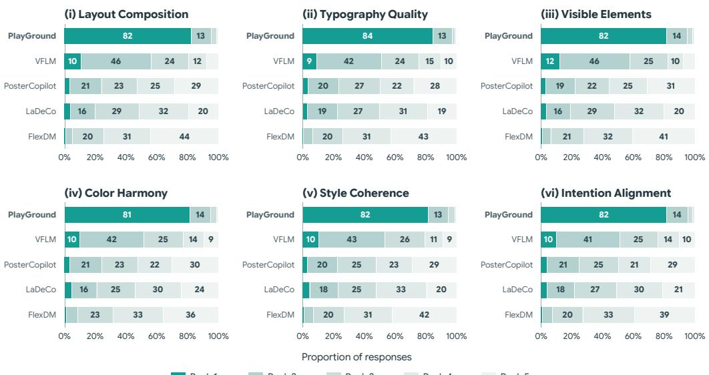  
Figure 14: User Study Results. Human ranking distributions across six evaluation criteria.

The user study results are presented in Fig. 14. PlayGround ranks first in approximately 81–84% of responses and among the top two in approximately 95–97% across all six criteria. Notably, PlayGround jointly arranges both visual and textual elements yet outperforms VFLM, which places only text on a fixed ground-truth background. We attribute this advantage in part to progressive planning from the current rendered canvas, which allows text placement to adapt to available space and previously placed elements. The human evaluation results are also consistent with the VLMbased results reported in Table 1.

## D.3 ABLATION SETTINGS

Evaluation subset. We conduct the ablation studies on a balanced subset of 600 samples from the Crello-v4 test split. The dataset is divided into six design categories, and we sample 100 designs from each category. Each selected sample contains at least eight elements.

Single-candidate verification. For experiments with K = 1, candidate comparison is no longer applicable. We therefore use a dedicated Visual Verifier prompt that directly evaluates the single rendered candidate and decides between accept and retry with feedback. This preserves the verifier’s feedback-and-regeneration behavior while removing its multi-candidate selection role.

## E ADDITIONAL QUALITATIVE RESULTS

We present additional qualitative comparisons on Crello-v4 and LICA datasets between PlayGround and other baselines in Fig. 15–17.

## F EXTENSION TO INTENTION-TO-DESIGN TASK

Our main setting assumes that the visual and textual elements to be composed are provided in ad vance. In practice, however, users may specify only a design intention without having the corresponding elements. To examine whether PlayGround can operate in this setting, we extend it to intention-to-design generation, where the required elements are first generated from the intention and then composed into a final editable design.

To do so, we prepend an element-generation stage to PlayGround. Given a design intention, GPT-5.6 Luna (OpenAI, 2026) first derives the required textual elements and descriptions of the visual elements. Qwen-Image-2.1 (Qwen Team, 2026b) then generates the corresponding visual elements from these descriptions. The resulting visual and textual elements are then provided directly to PlayGround, which performs its standard functional grouping and progressive layout generation without modifying the core composition pipeline.

We apply this extension to Crello, with qualitative examples shown in Fig. 18. These results demonstrate the modular extensibility of PlayGround, showing that the same composition model can be reused as a downstream design module when the required elements are produced by an external generation stage.

GT  
FlexDM  
LaDeCo  
PosterCopilot  
VFLM  
PlayGround  
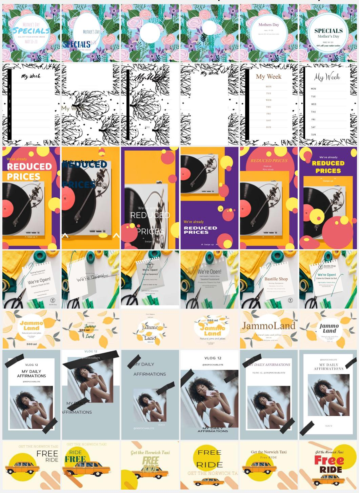  
Figure 15: More qualitative results on Crello dataset.

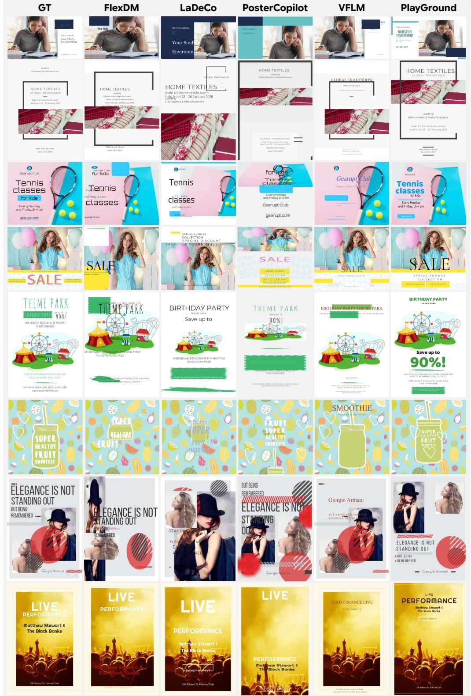  
Figure 16: More qualitative results on Crello dataset.

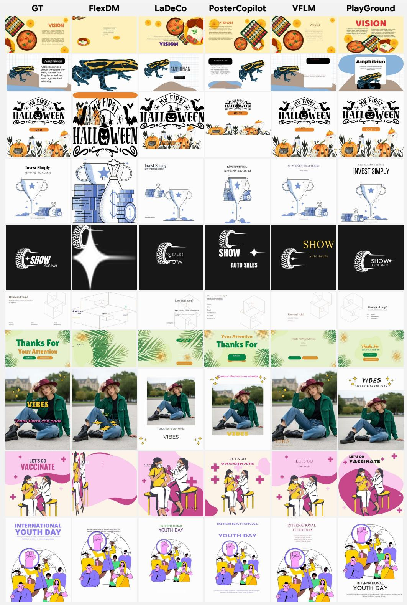  
Figure 17: More qualitative results on LICA dataset.

  
Figure 18: Qualitative results of PlayGround on the intention-to-design task.