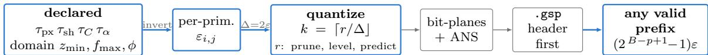
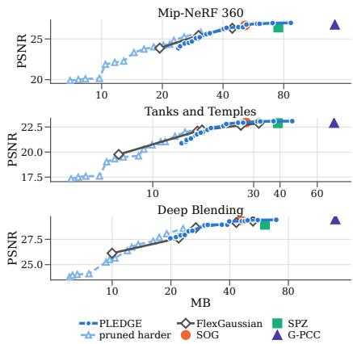
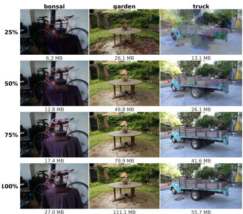
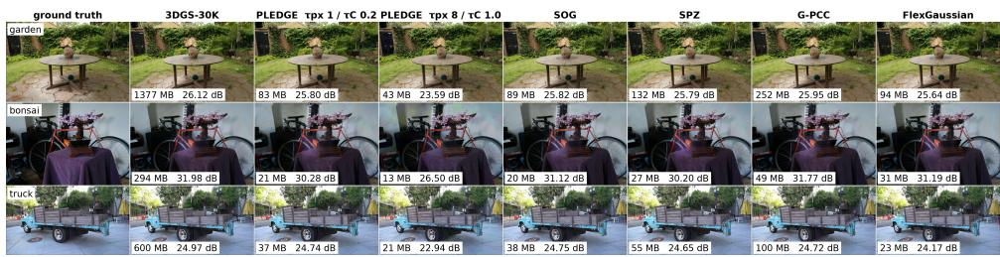

# PLEDGE: Progressive Lossy Error-Bounded Compression of 3D Gaussian Splatting

Mingze Xia \*, Yuxiao Li †, Baixi Sun ‡, Wenbo Li \*, Pu Jiao §, Sheng Di ‡, Franck Cappello ‡, Hanqi Guo †, Xin Liang \*

\*Oregon State University †The Ohio State University ‡Argonne National Laboratory §The University of Texas Rio Grande Valley

{xiami,liwenb,lianxin}@oregonstate.edu {li.14025,guo.2154}@osu.edu {bsun,sdi1,cappello}@anl.gov pu.jiao@utrgv.edu

Abstract

Existing 3D Gaussian Splatting (3DGS) codecs report reconstruction quality after compression, and give users little control over the distortion of individual primitives. We present PLEDGE, a training-free, progressive, error-bounded codec that translates four user-declared tolerances into per-primitive quantization bounds: screen-space position, footprint deformation due to rotation and scale, view-dependent color, and opacity. The bounds apply throughout a declared camera domain, including previously unseen viewpoints. Position and opacity are bounded directly; footprint deformation is bounded under the rasterizer’s afine projection model, and color is bounded over all viewing directions. PLEDGE organizes quantized residuals into a progressive bitstream with explicit error bounds for every valid prefix. Experiments across thirteen scenes verify all declared per-mechanism bounds and demonstrate competitive rate–distortion performance. The four tolerances incur substantially diferent rate costs, so users can spend rate where their application needs it.

## 1. Introduction

A trained 3D Gaussian Splatting (3DGS) model [1] consists of anisotropic Gaussian primitives, each represented by a position, a covariance factored into scale and rotation, an opacity, and spherical-harmonic (SH) color coeficients. A benchmark scene typically occupies several hundred megabytes, and the codecs built to shrink it [2] optimize and report aggregate reconstruction quality.

Attribute-level control matters when a scene is consumed for more than viewing: an occlusion mask for AR needs primitives to stay within a pixel of where they were trained, a measurement or navigation task needs geometry more than color, and a streaming preview needs the opposite. The rate costs of these attributes are also asymmetric: at a tight color tolerance, degree 1–3 SH coeficients account for 48% of our bitstream, compared with 14% for position. Error-bounded scientific compression [3] controls numerical distortion, but applying it to 3DGS requires connecting parameter errors to image-space efects. A one-pixel footprint displacement is directly interpretable, whereas a quaternion error of $1 0 ^ { - 3 }$ is not. Image-space distortion depends on camera parameters and must account for viewpoints beyond those available during encoding.

Clients should also be able to reconstruct a scene at diferent download budgets with predictable error bounds. Existing progressive codecs [4] ofer no such guarantee for intermediate reconstructions.

  
Figure 1: PLEDGE overview. Four user-declared tolerances and a camera domain give per-primitive quantization steps $\Delta = 2 \varepsilon ;$ by Proposition 1, everything after quantization afects rate but not the guarantee.

Contributions. PLEDGE (Progressive Lossy Error-bounded Declared-tolerance Gaussian-Splatting Encoder) needs only a trained 3DGS model and its camera calibration. It inverts the four tolerances into per-primitive quantization bounds over a declared camera domain (Figure 1), then codes the residuals with a hierarchical predictor and progressive bit planes, so every valid prefix of the bitstream carries its own bound (Proposition 6).

## 2. Related work

3DGS codecs split by whether they need the training images. Retraining methods — vector-quantized or entropy-regularized representations [5], anchor-based models [6], their context models [7] and the progressive member of that family [4] — reach the best rates but need the dataset. Training-free methods post-process a trained model: LightGaussian [8] prunes, Self-Organizing Gaussians [9] sort attributes into 2D grids, SPZ [10] is a compact format, FlexGaussian [11] quantizes to a quality target, and geometry can go to a point-cloud coder [12]. PLEDGE is training-free; to our knowledge none bounds error. FlexGaussian comes closest with a 1 dB target, but a scene average says nothing about an individual primitive or an unseen viewpoint.

PLEDGE adapts the error-bounded discipline of scientific compression, whose bounds we must map from image to parameter space, to embedded coding [13, 14], and bounds every valid stream prefix rather than only the complete file.

## 3. Declared bounds and their inversion

Table 1: Notation. The four τ are the declared errors; the ε are what Section 3 inverts them into.
<table><tr><td rowspan=1 colspan=1>Symbol</td><td rowspan=1 colspan=1>Meaning</td><td rowspan=1 colspan=1>Symbol</td><td rowspan=1 colspan=1>Meaning</td></tr><tr><td rowspan=1 colspan=1> $\underline { { \tau _ { \mathrm { p x } } } }$ </td><td rowspan=1 colspan=1>Center shift, per axis, px.</td><td rowspan=1 colspan=1> $\underline { { \varepsilon } } _ { \mu }$ </td><td rowspan=1 colspan=1>Position, from $\underline { { \tau _ { \mathrm { p x } } } }$ (§3.2).</td></tr><tr><td rowspan=1 colspan=1> $\underline { { \tau _ { \mathrm { s h } } } }$ </td><td rowspan=1 colspan=1>Footprint deformation, per mech., px.</td><td rowspan=1 colspan=1>θ</td><td rowspan=1 colspan=1>Rotation angle, from $\overline { { \tau _ { \mathrm { s h } } \ ( \ S 3 . 3 ) } } ,$ </td></tr><tr><td rowspan=1 colspan=1> $\underline { { \tau _ { C } } }$ </td><td rowspan=1 colspan=1>Color change, on a 0–1 scale.</td><td rowspan=1 colspan=1> ${ \underline { { \varepsilon _ { \omega } } } }$ </td><td rowspan=1 colspan=1>Tangent-space $\overline { { \omega , = \theta / 2 \sqrt { 3 } } }$ (§3.3, §4.3).</td></tr><tr><td rowspan=1 colspan=1> $\underline { { \tau _ { \alpha } } }$ </td><td rowspan=1 colspan=1>Opacity change, on a 0–1 scale</td><td rowspan=1 colspan=1> ${ \underline { { \varepsilon _ { s } } } }$ </td><td rowspan=1 colspan=1>Log-scale, from $\overline { { { \tau _ { \mathrm { s h } } } \left( \ S 3 . 3 \right) } } ,$ </td></tr><tr><td rowspan=1 colspan=1> $\overline { { \mathcal { D } ( { z _ { \operatorname* { m i n } } } , { f _ { \operatorname* { m a x } } } , \phi ) } }$ </td><td rowspan=1 colspan=1>Camera domain: near plane, focal, angle.</td><td rowspan=1 colspan=1> $\underline { { \varepsilon _ { k } } }$ </td><td rowspan=1 colspan=1>SH coefficient k, from $\tau _ { C }$ (§3.4).</td></tr><tr><td rowspan=1 colspan=1> $\underline { { \delta _ { x , y , z } } }$ </td><td rowspan=1 colspan=1>Center displacement, camera axes.</td><td rowspan=1 colspan=1> ${ \underline { { \varepsilon } } } \alpha$ </td><td rowspan=1 colspan=1> $\overline { { \mathrm { O p a c i t y } , = \tau _ { \alpha } ~ ( \ S 3 . 4 ) } } .$ </td></tr><tr><td rowspan=1 colspan=1> $\delta _ { u , v }$ </td><td rowspan=1 colspan=1>Its projection, px.</td><td rowspan=1 colspan=1> $\underline { { \varepsilon _ { i , j } } }$ </td><td rowspan=1 colspan=1>Half-step actually used; $\overline { { \Delta = 2 \varepsilon } } .$ </td></tr><tr><td rowspan=1 colspan=1> $d _ { H }$ </td><td rowspan=1 colspan=1>Footprint shift, Hausdorff, px.</td><td rowspan=1 colspan=1></td><td rowspan=1 colspan=1></td></tr></table>

The four tolerances do not reach equally far into the rendered image. $\tau _ { \mathrm { p x } }$ and $\tau _ { \mathrm { s h } }$ bound how far drawn elements move, in pixels, at every camera in $\mathcal { D } ;$ neither bounds a pixel value. $\tau _ { C }$ bounds each primitive’s radiance in every direction, and reaches the pixel itself only with the geometry and the alphas held fixed (§3.4). $\tau _ { \alpha }$ is a parameter bound with no image-space consequence.

## 3.1 The contract

Write $x _ { i , j }$ for channel j of primitive i and $P _ { i , j }$ for the decoder’s prediction of it. Channels are coded as stored for centers and SH, in the log domain for scales, as the tangent-space residual of §4.3 for rotation, and as α after the sigmoid for opacity, which is why $\varepsilon _ { \alpha } = \tau _ { \alpha } ; \ \ S 5 . 3$ measures each error in the same domain. Sections 3.2– 3.4 turn the four declared targets into per-primitive, per-channel half-steps $\varepsilon _ { i , j }$ . The encoder transmits one integer per channel,

$$
k _ { i , j } = \Big \lceil \frac { r _ { i , j } } { \Delta _ { i , j } } \Big \rceil , \qquad r _ { i , j } = x _ { i , j } - P _ { i , j } , \qquad \Delta _ { i , j } = 2 \varepsilon _ { i , j } ,\tag{1}
$$

and the decoder reconstructs $\hat { x } _ { i , j } = P _ { i , j } + k _ { i , j } \Delta _ { i , j }$

Proposition 1 (predictor independence). $| \hat { x } _ { i , j } - x _ { i , j } | \leq \varepsilon _ { i , j }$ for all $i , j$ and any prediction $P _ { i , j }$

Proof. Rounding gives $| \hat { x } - x | = | k \Delta - r | \le \Delta / 2 = \varepsilon$ , for any P.

The ε are derived against a declared camera domain $\mathcal { D } \colon$ the cameras for which the guarantee holds, fixed by a near plane $z _ { \mathrm { m i n } }$ , a largest focal length $f _ { \mathrm { m a x } }$ and a half-angle $\phi - \mathrm { a }$ constraint on imaging parameters, not on where the camera center lies. Every bound below is a worst case over $\mathcal { D } _ { \mathrm { : } }$ , and covers cameras never supplied to the encoder.

Per attribute the per-primitive bounds are quantized into a transmitted eightentry table, log-spaced above a floor at the minimum and always rounded down, so that no primitive receives a step larger than its own bound.

## 3.2 Position $( \tau _ { \mathrm { p x } } )$

A primitive sits at camera-space $( x , y , z ) , z > 0$ , under focal length $f ,$ and projects to $u = f x / z$

Proposition 2 (position). If every world coordinate of the center is held to at most $\varepsilon _ { \mu } = \tau _ { \mathrm { p x } } z _ { \mathrm { m i n } } / [ \sqrt { 3 } \left( f _ { \mathrm { m a x } } \sec \phi + \tau _ { \mathrm { p x } } \right) ]$ , then $| \delta _ { u } | \leq \tau _ { \mathrm { p x } }$ and $| \delta _ { v } | \leq \tau _ { \mathrm { p x } }$ at every camera in $\mathcal { D } _ { ; }$ , for every primitive whose center projects inside its frustum.

Proof. Take $f _ { \mathrm { m a x } }$ and $\phi$ over both image axes; WLOG we bound $\left| \delta _ { u } \right|$ . A bound of $\varepsilon _ { \mu }$ on each world coordinate puts the displacement in a cube, so $\| \delta \| _ { 2 } \le \rho$ with $\rho = \sqrt { 3 } \varepsilon _ { \mu } = \tau _ { \mathrm { p x } } z _ { \mathrm { m i n } } / ( f _ { \mathrm { m a x } } \sec \phi + \tau _ { \mathrm { p x } } )$ , so $\rho < z _ { \mathrm { m i n } }$ because $f _ { \mathrm { m a x } } \sec \phi > 0 ;$ rotation into camera axes preserves the norm, so $\| ( \delta _ { x } , \delta _ { z } ) \| _ { 2 } \leq \rho$ and $| \delta _ { z } | \leq \rho$ there as well. With $u = f x / z$ the projected displacement is exact,

$$
\begin{array} { r } { | \delta _ { u } | ~ = ~ \frac { f | z \delta _ { x } - x \delta _ { z } | } { z | z + \delta _ { z } | } \overset { \mathrm { ( i ) } } { \leq } \frac { f \sqrt { z ^ { 2 } + x ^ { 2 } } \| ( \delta _ { x } , \delta _ { z } ) \| _ { 2 } } { z | z + \delta _ { z } | } \overset { \mathrm { ( i i ) } } { \leq } \frac { \rho f \sqrt { z ^ { 2 } + x ^ { 2 } } } { z ( z - \rho ) } \overset { \mathrm { ( i i i ) } } { \leq } \frac { \rho f \sec { \phi } } { z - \rho } \overset { \mathrm { ( i v ) } } { \leq } \frac { \rho f _ { \operatorname* { m a x } } \sec { \phi } } { z _ { \operatorname* { m i n } } - \rho } \leq \tau _ { \operatorname { p x } } . } \end{array}
$$

$\rho f _ { \mathrm { m a x } }$ sec $\phi \leq \tau _ { \mathrm { p x } } ( z _ { \mathrm { m i n } } - \rho ) \Leftrightarrow \sqrt { 3 } \varepsilon _ { \mu } ( f _ { \mathrm { m a x } }$ sec $\phi { + } { \tau _ { \mathrm { p x } } } ) \le \tau _ { \mathrm { p x } } z _ { \mathrm { m i n } }$ ⇔ $\begin{array} { r } { \varepsilon _ { \mu } \leq \frac { \tau _ { \mathrm { p x } } z _ { \mathrm { m i n } } } { \sqrt { 3 } ( f _ { \mathrm { m a x } } \sec \phi + \tau _ { \mathrm { p x } } ) } } \end{array}$ Here (i) is Cauchy–Schwarz on $( z , - x ) { \cdot } ( \delta _ { x } , \delta _ { z } )$ ; (ii) uses $\| ( \delta _ { x } , \delta _ { z } ) \| _ { 2 } \leq \rho$ and $| z + \delta _ { z } | \geq$ $z - \rho ;$ (iii) is $| x | \leq z \tan \phi .$ , so ${ \sqrt { z ^ { 2 } + x ^ { 2 } } } \leq z \sec \phi ;$ and (iv) takes the extremes of a quantity increasing in f and decreasing in z. □

One number therefore serves every primitive. A per-primitive bound minimized over the reference poses alone would be tighter, but it is violated on held-out cameras in all four scenes we tried. Since step (iii) assumes $| x | \le z$ tan $\phi ,$ , the center guarantee applies to primitives whose center projects inside the frustum; the footprint bound of §3.3 has no such restriction because the rasterizer clamps $x / z ,$ , though §5.3 measures both on the in-frustum set.

## 3.3 Footprint: rotation and scale $( \tau _ { \mathrm { s h } } )$

A 3DGS rasterizer draws an EWA footprint, the 1σ ellipse of the projected covariance $\Sigma ^ { \prime } = J \Sigma J ^ { \top }$ , where J is the projection Jacobian evaluated at the primitive center and the of-axis ratios are clamped to m tan ϕ before J is formed $( m = 1 . 3$ in the INRIA rasterizer and gsplat). Write $\Sigma = M M ^ { \top } , M = R \mathrm { d i a g } ( s ) , s _ { \mathrm { m a x } } = \mathrm { m a x } _ { j } s _ { j }$ , and let $d _ { H }$ be the Hausdorf distance between the reference footprint and the decoded one.

Proposition 3 (footprint). Let $\ell _ { x } , \ell _ { y }$ be the clamped of-axis limits, sec $\begin{array} { r l } { \phi _ { J } } & { { } = } \end{array}$ $\sqrt { 1 + \ell _ { x } ^ { 2 } + \ell _ { y } ^ { 2 } }$ , and $r _ { i } = f _ { \operatorname* { m a x } } \sec \phi _ { J } s _ { \operatorname* { m a x } , i } / z _ { \operatorname* { m i n } }$ . If primitive i is rotated by a geodesic angle of at most $\theta _ { i }$ , or its log-scales change per axis by at most $\varepsilon _ { s , i }$ , where $\theta _ { i } = \tau _ { \mathrm { s h } } / r _ { i }$ and $\varepsilon _ { s , i } = \log ( 1 + \tau _ { \mathrm { s h } } / r _ { i } )$ , then its footprint moves by at most $\tau _ { \mathrm { s h } }$ in Hausdorf distance, at a fixed center and at every camera in D.

Proof. The footprint is convex with support function $h ( n ) \ : = \ : \| M ^ { \top } J ^ { \top } n \|$ , so $d _ { H } =$ $\mathrm { m a x } _ { \| n \| = 1 } | h ^ { \prime } ( n ) - h ( n ) |$ , and

$$
\begin{array} { r } { d _ { H } \overset { \mathrm { ( i ) } } { \leq } \| ( M ^ { \prime } - M ) ^ { \top } J ^ { \top } n \| \overset { \mathrm { ( i i ) } } { \leq } \| J \| _ { 2 } \| M ^ { \prime } - M \| _ { 2 } \overset { \mathrm { ( i i ) } } { \leq } \frac { f _ { \operatorname* { m a x } } \sec \phi _ { J } } { z _ { \operatorname* { m i n } } } \| M ^ { \prime } - M \| _ { 2 } = r _ { i } \frac { \| M ^ { \prime } - M \| _ { 2 } } { s _ { \operatorname* { m a x } , i } } . } \end{array}
$$

Here (i) is the reverse triangle inequality and (ii) submultiplicativity, both exact; (iii) replaces $\| J \| _ { 2 }$ by its supremum over D. The singular values of $\begin{array} { r } { J = \frac { f } { z } \left[ { 1 0 - x / z } \right] } \end{array}$ are $f / z$ and $( f / z ) \sqrt { 1 + ( x ^ { 2 } + y ^ { 2 } ) / z ^ { 2 } }$ , so $\| J \| _ { 2 }$ carries an of-axis factor, amplification along both image axes; the clamp bounds $| x | / z \le \ell _ { x }$ and $| y | / z \le \ell _ { y } ,$ , and $z \geq z _ { \mathrm { m i n } }$ , so $\mathrm { s u p } _ { \mathcal { D } } \| J \| _ { 2 } = f _ { \mathrm { m a x } } \sec { \phi _ { J } } / z _ { \mathrm { m i n } } -$ finite for every of-axis position because of the clamp.

Each mechanism now bounds $\| M ^ { \prime } - M \| _ { 2 } / s _ { \mathrm { m a x } , i }$ . A rotation by $\theta _ { i }$ has $\| M ^ { \prime } - M \| _ { 2 } \leq$ $\| R ^ { \prime } - R \| _ { 2 } s _ { \operatorname* { m a x } , i } = 2 s _ { \operatorname* { m a x } , i } \sin ( \theta _ { i } / 2 ) \leq s _ { \operatorname* { m a x } , i } \theta _ { i }$ , since $R ^ { \prime } R ^ { \top }$ is normal with eigenvalues $1 , e ^ { \pm i \theta _ { i } }$ ; a log-scale change gives exactly maxj $s _ { j } | e ^ { \lambda _ { j } } - 1 | \le s _ { \operatorname* { m a x } , i } ( e ^ { \varepsilon _ { s , i } } - 1 )$ . Hence

$$
\theta _ { i } r _ { i } \leq \tau _ { \mathrm { s h } } \Leftrightarrow \theta _ { i } \leq \frac { \tau _ { \mathrm { s h } } } { r _ { i } } , \qquad ( e ^ { \varepsilon _ { s , i } } - 1 ) r _ { i } \leq \tau _ { \mathrm { s h } } \Leftrightarrow \varepsilon _ { s , i } \leq \log \Bigl ( 1 + \frac { \tau _ { \mathrm { s h } } } { r _ { i } } \Bigr ) .
$$

These two are what the quantizer receives, and unlike $\varepsilon _ { \mu }$ they stay primitivedependent through $s _ { \mathrm { m a x } , i \cdot } ~ \varepsilon _ { s , i }$ is already a half-step; $\theta _ { i }$ is an angle, and §4.3 codes it as $\varepsilon _ { \omega , i } = \theta _ { i } / 2 \sqrt { 3 }$ on the tangent-space residual.

Rotation and scale together therefore displace the footprint by at most $2 \tau _ { \mathrm { s h } }$ at a fixed center. When the center also moves, its displacement contributes an additional term and changes the projection Jacobian. With the center included, h gains the term $\langle n ,$ , projected center⟩, whose change is $\| ( \delta _ { u } , \delta _ { v } ) \| _ { 2 } \leq \sqrt { 2 } \tau _ { \mathrm { p x } } .$ , since Proposition 2 bounds each axis; writing $A = J M$ , the decomposition $A ^ { \prime } - \dot { A } = J ^ { \prime } ( M ^ { \prime } - M ) + ( J ^ { \prime } - J ) M$ gives $\| A ^ { \prime } - A \| _ { 2 } \leq \| J ^ { \prime } \| _ { 2 } \| M ^ { \prime } - M \| _ { 2 } + \| J ^ { \prime } - J \| _ { 2 } s _ { \operatorname* { m a x } }$ , the first term at most $2 \tau _ { \mathrm { s h } }$ by the two mechanisms above. Together,

$$
d _ { H } ~ \le ~ \underbrace { \sqrt { 2 } ~ \tau _ { \mathrm { p x } } } _ { \mathrm { c e n t e r } } + \underbrace { 2 \tau _ { \mathrm { s h } } } _ { \mathrm { s h a p e } } + \underbrace { s _ { \mathrm { m a x } } \Vert J ^ { \prime } - J \Vert _ { 2 } } _ { \delta _ { J } } , \qquad \delta _ { J } \le \underbrace { \Lambda } _ { \mathrm { s e c } \phi } \underbrace { s _ { \mathrm { m a x } } } _ { z _ { \mathrm { m i n } } } \tau _ { \mathrm { p x } } ,\tag{2}
$$

where $\Lambda = \sqrt { 2 + ( 1 + 2 \ell _ { x } ) ^ { 2 } + ( 1 + 2 \ell _ { y } ) ^ { 2 } }$ . The measured displacement in §5.3 stays well within $\sqrt { 2 } \tau _ { \mathrm { p x } } + 2 \tau _ { \mathrm { s h } }$ , so $\delta _ { J }$ is negligible in practice. Finally, h is homogeneous in $M$ , so the shape displacement of a cσ contour scales exactly by c.

3.4 Color and opacity $\left( \tau _ { C } , \tau _ { \alpha } \right)$

For viewing direction $d ,$ the SH radiance is $\textstyle \sum _ { k } c _ { k } Y _ { k } ( d )$ , so an error in coeficient k moves the color by a direction-dependent amount and $\tau _ { C }$ must be inverted over the whole sphere. Opacity is direct, $\varepsilon _ { \alpha } = \tau _ { \alpha }$

Proposition 4 (color). Let $\begin{array} { r } { g ( d ) = \sum _ { k } \varepsilon _ { k } | Y _ { k } ( d ) | } \end{array}$ be the largest radiance error that percoeficient bounds $\varepsilon _ { k }$ permit at d. $I f$ max $z _ { S ^ { 2 } } g \le \tau _ { C }$ , then every primitive’s radiance stays within $\tau _ { C }$ in every viewing direction.

$$
\begin{array} { r } { P r o o f . \ | \hat { c } ( d ) - c ( d ) | = \left| \sum _ { k } ( \hat { c } _ { k } - c _ { k } ) Y _ { k } ( d ) \right| \leq \sum _ { k } \varepsilon _ { k } | Y _ { k } ( d ) | = g ( d ) . } \end{array}
$$

Decoupling the coeficients — bounding each term by its own maximum, $\varepsilon _ { k } =$ $\tau _ { C } / ( 1 6 \mathrm { s u p } | Y _ { k } | ) \textrm { -- }$ is loose, because the peaks of diferent $Y _ { k }$ fall in diferent directions: the binding quantity is the maximum of the sum, not the sum of individual maxima. Solving maxS2 $g ~ \leq ~ \tau _ { C }$ as it stands admits 2.3× larger $\varepsilon _ { k }$ , 1.2 bits per coeficient.

Subject to that constraint, we seek large quantization bounds by maximizing $\textstyle \sum _ { k } n _ { k } \log \varepsilon _ { k } $ , with $n _ { k } = 3$ channels per coeficient. Rather than solving this exactly, the encoder alternates between a worst-direction search and water-filling; correctness depends only on the feasibility of the returned bounds, not on the optimality of this search.

To extend a check at sampled directions to the whole sphere, we reserve a Lipschitz safety margin. $g$ is Lipschitz with $\begin{array} { r } { L = \sum _ { k } \varepsilon _ { k } \mathrm { L i p } ( Y _ { k } ) } \end{array}$ , from Bernstein’s inequality $\mathrm { L i p } ( Y _ { \ell } ) \leq \sqrt { \ell ( \ell + 1 ) } \operatorname* { s u p } | Y _ { \ell } |$ and the addition theorem sup $| Y _ { \ell } ^ { m } | \le \sqrt { ( 2 \ell + 1 ) / 4 \pi } ;$ a net of covering radius $\eta$ then satisfies maxS2 $g \leq \operatorname* { m a x } _ { \mathrm { n e t } } g + L \eta$ , and we allocate against this corrected maximum. We choose a Fibonacci net of $M = 2 ^ { 2 0 }$ points and take $\eta \leq 1 . 0 5 \cdot 2 \sqrt { \pi / M }$ . This $\eta$ is asserted and confirmed by sampling, not computed exactly: it is the one numerical assumption in the color bound, where the rest of $\ S 3$ is analytic.1

Proposition 5 (composited color). Fix the geometry, so a pixel composites primitives $1 , \ldots , n$ in depth order with unchanged alphas $a _ { i } \in [ 0 , 1 ]$ . If every primitive satisfies the color contract then $| \hat { C } - C | \le \tau _ { C }$ for that pixel, in every viewing direction.

Proof. $\begin{array} { r } { C = \sum _ { i } w _ { i } c _ { i } } \end{array}$ with $\begin{array} { r } { w _ { i } = a _ { i } \prod _ { j < i } ( 1 - a _ { j } ) \geq 0 } \end{array}$ and $\begin{array} { r } { \sum _ { i \leq n } w _ { i } = 1 - \prod _ { i } ( 1 - a _ { i } ) \leq 1 } \end{array}$ 2 so $\begin{array} { r } { | \hat { C } - C | \le \tau _ { C } \sum _ { i } w _ { i } \le \tau _ { C } ; } \end{array}$ the final clamp is 1-Lipschitz. □

Alpha compositing is a sub-convex combination, so $\tau _ { C } = 0 . 1$ declares that no pixel moves by more than a tenth of the color range, at any depth complexity. Geometry admits no comparable bound on the rendered image: a high-contrast edge crossing a pixel changes it by O(1) $O ( 1 )$ under an arbitrarily small displacement. That is why $\tau _ { \mathrm { p x } }$ and $\tau _ { \mathrm { s h } }$ are declared in pixels of displacement rather than in color.

## 4. The codec

## 4.1 Pruning

Before coding, we retain by default the top 60% of primitives, ranked by $s _ { i } =$ $\begin{array} { r } { \alpha _ { i } \sum _ { v \in \gamma } r _ { i , v } ^ { 2 } } \end{array}$ , an image-free variant of LightGaussian’s global significance [8]: it uses camera poses and intrinsics but no pixels, and no fine-tuning follows. Pruning lies outside the guarantee, so every declared tolerance is relative to the pruned model; at 60% keep it costs 0.082 dB on Mip-NeRF 360.

## 4.2 Hierarchy and ordering

We Morton-order the retained primitives, then split them into five hierarchy levels. Four grids with resolutions 32, 128, 512, and 2048 are processed in order; each occupied cell contributes its highest-scoring primitive not already selected, and the remainder form the fifth level, so early levels carry both spatial coverage and highimportance primitives.

Each primitive in level $\ell > 0$ takes its nearest neighbor in earlier levels as its parent, and we stably sort the level by parent index so that each parent’s children are contiguous. The predictor then addresses neighboring children by array ofset instead of explicit indices; the decoder rebuilds the ordering from child counts, escape-coded into the first payload blobs.

## 4.3 Prediction and quantization

Level 0 is predicted from the transmitted global mean; later levels predict each primitive from its parent $p ( i )$ and that parent’s $S - 1$ array successors $( S \ = \ 8 )$ $\begin{array} { r } { P _ { i } = \sum _ { j \in \mathcal { N } ( i ) } w _ { i j } \hat { X } _ { j } ^ { \mathrm { b } } / \sum _ { j } w _ { i j } } \end{array}$ with $w _ { i j } = ( \| \hat { \mu } _ { p ( i ) } ^ { \mathrm { b } } - \hat { \mu } _ { j } ^ { \mathrm { b } } \| + d _ { 0 } ) ^ { - 2 }$ and a per-level floor $d _ { 0 }$ in the header.

The predictor reads only the base-precision reconstruction $\hat { X } ^ { \mathrm { b } }$ , the top $B - 5$ planes, an anchor 32× coarser than the final value, so a decoder that stops there computes the encoder’s prediction exactly.

Rotation is coded in the tangent space of its parent, $\omega = \log ( q _ { p ( i ) } ^ { * } q _ { i } )$ . Proposition 1 bounds each component of $\omega$ by $\varepsilon _ { \omega }$ , hence the geodesic angle between $q$ and $\hat { q }$ by $2 \sqrt { 3 } \varepsilon _ { \omega }$ . Quantization is then (1): prediction shapes the entropy of k but cannot move the error past ε.

## 4.4 Bit-plane coding

Integer residuals are encoded MSB-first over B planes, B the bit length of the largest $| k |$ in the model: each plane emits one bit per coeficient and sends the sign when a coeficient first becomes significant. Bits within a plane are ordered by attribute — position, log-scale, rotation, opacity, degree-0 SH, degree-1–3 SH — and, within each attribute, significance bits precede refinement bits, then the whole plane goes to the entropy coder as one stream. Grouping bits of similar statistics improves adaptation without separate contexts, and coding the plane as one stream leaves no per-plane length metadata to send.

## 4.5 Progression order and the container

We group G consecutive bit-planes into one blob coded with a batched ANS coder [15], giving $N _ { U } = \lceil B / G \rceil$ blobs per level. Ordering is three-stage: (1) levels $\ell \leq c$ complete, (2) all levels to base precision, (3) refinement blobs across levels. With $c = 1$ , Stage 2 adds primitives, Stage 3 precision.

  
(a) rate–distortion

  
(b) a partial download  
Figure 2: (a) Rate–distortion. Solid: 60% keep; dashed: a front over keep fractions 45% down to 12%, whose bounds are relative to smaller models. (b) Progressive decoding at $2 5 / 5 0 / 7 5 / 1 0 0 \%$ of the byte budget; every valid prefix satisfies Proposition 6. Test-split PSNR for the full sweep is reported in §5.4.

The default $G \geq B$ puts a whole level in one blob, so a prefix lands only on a level boundary, progressive in primitive count alone. Opening the precision axis fully costs 18% more rate, since one blob per plane discards cross-plane probability adaptation; $G = 3$ gives usable rungs at 9%. All measurements use the default except Section 5.4.

Header, ordering table, and blob index precede the payload: the header stores the four declared tolerances, the camera domain $z _ { \operatorname* { m i n } } , f _ { \operatorname* { m a x } } , \phi$ , and the quantization-bound tables, so a decoder or verifier recovers the declared contract from any prefix alone.

## 4.6 The truncation ladder

Proposition 6 (the ladder). In a prefix where every delivered level has reached base precision, let level ℓ hold $p _ { \ell }$ of B planes and write $m = B - p _ { \ell }$ . Then $| \hat { x } _ { i , j } - x _ { i , j } | \leq$ $( 2 ^ { m + 1 } - 1 ) \varepsilon _ { i , j }$ for every primitive of that level, and the constant cannot be improved; levels not yet delivered are absent, not wrong.

Proof. At base precision the anchor, hence $P$ and $k ,$ , is the encoder’s (§4.3), so $| P +$ $k \Delta - x | \leq \varepsilon$ (Proposition 1). From the top $p _ { \ell }$ bits the decoder takes the midpoint of the interval they leave, or 0 when they are all zero and $| k | \leq 2 ^ { m } - 1$ ; either way $| \hat { k } - k | \leq 2 ^ { m } - 1$ and $| \hat { x } - x | \leq ( 2 ^ { m } - 1 ) 2 \varepsilon + \varepsilon$ . It is tight at $r / \Delta \uparrow 2 ^ { m } - \frac { 1 } { 2 }$ , the largest magnitude those planes code as zero: $\hat { k } = 0$ and $| \hat { x } - x |  ( 2 ^ { m + 1 } - 1 ) \varepsilon$ □

Measurements on three scenes reach it to four decimals at every rung. Below base precision the anchors difer and no bound is claimed, so every level reaches base precision before refinement.

## 5. Experiments

## 5.1 Protocol

We use the oficial INRIA 3DGS-30K models for nine Mip-NeRF 360 scenes [16], two Tanks and Temples [17] and two Deep Blending [18], under the survey protocol [2]. All methods, FlexGaussian included, are re-rendered with gsplat [19] under one metric implementation. Unless stated otherwise, $\tau _ { \alpha } = 0 . 0 0 5$ and $z _ { \mathrm { m i n } } = 0 . 2$ . Nothing is trained: over the nine Mip-NeRF 360 scenes, bound inversion and the residual loop together take 0.4–1.2 seconds per scene on one A100; model loading and entropy coding take the rest of the wall clock.

<table><tr><td>µ S q α C</td></tr><tr><td>fraction of bound 1.000 1.000 0.996 1.000 0.906</td></tr><tr><td>declared τ 1 2 4 8 16</td></tr><tr><td>center 0.672 0.765 0.626 0.681</td></tr><tr><td>footprint 0.291 0.349 0.321 0.341 0.271 +center 0.397 0.366 0.402 0.357 0.269</td></tr></table>

<table><tr><td>method</td><td>MB</td><td>ratio PSNR</td><td>SSIM LPIPS</td></tr><tr><td>3DGS-30K (input)</td><td>722.18</td><td>1.0×</td><td>26.83 0.8252 0.2591</td></tr><tr><td>PLEDGE (A)</td><td>24.50</td><td>29.5×</td><td>24.49 0.7694 0.3269</td></tr><tr><td>PLEDGE (B)</td><td>37.00</td><td>19.5×</td><td>26.21 0.8073 0.2852</td></tr><tr><td>PLEDGE (C)</td><td>46.56</td><td>15.5×</td><td>26.56 0.8153 0.2730</td></tr><tr><td>FlexGaussian</td><td>37.55</td><td>19.2×</td><td>26.04 0.7964 0.2910</td></tr><tr><td>SPZ</td><td>67.41</td><td>10.7×</td><td>26.25 0.8126 0.2796</td></tr><tr><td>SOG</td><td>46.94</td><td>15.4×</td><td>26.51 0.8156 0.2763</td></tr><tr><td>G-PCC</td><td>131.83</td><td>5.5×</td><td>26.57 0.8134 0.2698</td></tr></table>

(b) thirteen-scene mean

Table 2: (a) Worst error over thirteen scenes at nine $( \tau _ { \mathrm { p x } } , \tau _ { \mathrm { s h } } , \tau _ { C } )$ settings, each entry divided by its own bound. Upper block by attribute; lower block by declared $\tau$ in image space, against $\tau _ { \mathrm { p x } } , 2 \tau _ { \mathrm { s h } }$ and $\sqrt { 2 } \tau _ { \mathrm { p x } } { + } 2 \tau _ { \mathrm { s h } }$ — the bound (2) with the loose $\delta _ { J }$ term dropped. Footprint rows are Hausdorf distances between the rasterizer’s $\Sigma ^ { \prime }$ for the reference and the decoded model, computed independently of the bounds in §3.3. (b) Thirteen-scene mean at three PLEDGE operating points, $\tau _ { C } = 0 . 8 , 0 . 2$ and 0.1 for (A), (B) and (C), all at $( \tau _ { \mathrm { p x } } , \tau _ { \mathrm { s h } } , \tau _ { \alpha } ) = ( 8 , 1 6 , 0 . 0 0 5 )$ ; (C) matches SOG in size.  
  
Figure 3: Representative held-out views, each codec at its own operating point.

## 5.2 Rate–distortion

Table 2(b) and Figure $2 ( \mathrm { a } )$ compare rate–distortion performance, and Figure 3 shows representative reconstructions. Across the thirteen scenes, PLEDGE achieves compression ratios of 15–30×. We sweep the four tolerances and report Pareto-optimal configurations.

Over four scenes, relaxing $\tau _ { \mathrm { s h } }$ reduces file size by 21% with less than 0.05 dB PSNR loss, while relaxing $\tau _ { \mathrm { p x } }$ reduces it by 13% and $\tau _ { \alpha }$ by only 5%. Bit allocation moves with the tolerances: degree 1–3 SH takes 48% of the file at $\tau _ { C } = 0 . 0 5$ but 11% at $\tau _ { C } = 0 . 4$ , where position grows from 14% to 26%.

At matched quality, PLEDGE produces smaller files at 11 of 19 comparable training-free baseline operating points. At the lowest rates, the fixed 60% keep fraction becomes the bottleneck: PLEDGE requires 1.24× FlexGaussian’s size at its loosest point. Reducing the keep fraction to 12% removes that deficit on Mip-NeRF 360 and extends our curve 3.4× further toward low rates, at the cost of 1.2 dB lower maximum PSNR.

## 5.3 Verifying the declared bounds

We evaluate nine settings on all thirteen scenes. Six take $\tau _ { \mathrm { s h } } = \tau _ { \mathrm { p x } } \mathrm { . }$ three at $\tau _ { \mathrm { p x } } =$ 1 with $\tau _ { C } = 0 . 1 , 0 . 2$ and 0.5, then $( \tau _ { \mathrm { p x } } , \tau _ { C } ) = ( 2 , 0 . 2 ) , ( 4 , 0 . 5 )$ and $( 8 , 1 . 0 )$ The other three are the operating points of Table 2(b), at $\tau _ { \mathrm { p x } } = 8$ and $\tau _ { \mathrm { s h } } = 1 6$ with $\tau _ { C } ~ = ~ 0 . 1$ , 0.2 and 0.8. Throughout, $\tau _ { \alpha } ~ = ~ 0 . 0 0 5$ . For each file, we recover the declared tolerances from its header and compare them with the decoded attribute errors. All 585 parameter-space checks satisfy their bounds within numerical precision (Table 2(a), top row).

We independently validate the image-space bounds of Propositions 2 and 3 by reconstructing the rasterizer’s projected covariances, $\Sigma ^ { \prime } = J \Sigma J ^ { \top }$ , for both the reference and decoded primitives, and measuring the Hausdorf distance between their footprints through their support functions. Center displacement, footprint deformation at fixed center, and their combination reach at most $0 . 7 7 \tau _ { \mathrm { p x } } , \ 0 . 3 5 \cdot 2 \tau _ { \mathrm { s h } }$ and 0.41 $( \sqrt { 2 } \tau _ { \mathrm { p x } } + 2 \tau _ { \mathrm { s h } } )$ , respectively (Table 2(a), lower block). At $\tau _ { \mathrm { p x } } = 1$ and $\tau _ { C } = 0 . 1$ ， measured displacements range from 0.072 pixels on garden to 0.582 on train.

The of-axis factor sec ϕJ ranges from 1.13 (bonsai) to 1.61 (train); omitting it violates the footprint bound on of-axis primitives, and including it costs 1.7% of the rate on average.

## 5.4 Progressive decoding

Figure 2(b) decodes byte-budgeted prefixes, the client given nothing but the prefix. Over the nine Mip-NeRF 360 scenes test-split PSNR rises monotonically on every scene at the ten budgets we sample, from 14.7 dB at 10% to 26.9 at the full stream; the last primitive arrives at 40% on average, and at 50% of the file the mean gap to the full decode is 2.0 dB, the worst 3.9. The sweep opens the precision axis fully, giving the finest rungs the format allows, while the figure uses $G = 3$

## 6. Limitations and conclusion

The guarantee is stated relative to the pruned model and within the declared camera domain, covers the rasterized footprint rather than the exact perspective silhouette, and bounds composited color only at fixed geometry and opacity. Within this scope, PLEDGE provides interpretable, per-primitive bounds across a camera domain and throughout valid progressive decoding. Because the bounds are independent of prediction and entropy coding, improved residual coders can be incorporated without changing their derivation.

## References

[1] Bernhard Kerbl, Georgios Kopanas, Thomas Leimk¨uhler, and George Drettakis, “3D Gaussian Splatting for Real-Time Radiance Field Rendering,” ACM Trans. Graph., vol. 42, no. 4, pp. 139:1–139:14, 2023.

[2] Milena T. Bagdasarian, Paul Knoll, Yi-Hsin Li, Florian Barthel, Anna Hilsmann, Peter Eisert, and Wieland Morgenstern, “3DGS.zip: A Survey on 3D Gaussian Splatting Compression Methods,” Computer Graphics Forum, p. e70078, 2025, https: $/ / { \mu } { - } { \mu }$ github.io/3dgs-compression-survey/.

[3] Sheng Di and Franck Cappello, “Fast error-bounded lossy HPC data compression with SZ,” in IPDPS, 2016, pp. 730–739.

[4] Yihang Chen, Mengyao Li, Qianyi Wu, Weiyao Lin, Mehrtash Harandi, and Jianfei Cai, “PCGS: Progressive compression of 3D Gaussian splatting,” in AAAI, 2026, arXiv:2503.08511.

[5] Simon Niedermayr, Josef Stumpfegger, and R¨udiger Westermann, “Compressed 3D Gaussian splatting for accelerated novel view synthesis,” in CVPR, 2024, pp. 10349– 10358.

[6] Tao Lu, Mulin Yu, Linning Xu, Yuanbo Xiangli, Limin Wang, Dahua Lin, and Bo Dai, “Scafold-GS: Structured 3D Gaussians for view-adaptive rendering,” in CVPR, 2024, pp. 20654–20664.

[7] Yihang Chen, Qianyi Wu, Weiyao Lin, Mehrtash Harandi, and Jianfei Cai, “HAC: Hash-grid assisted context for 3D Gaussian splatting compression,” in ECCV. 2024, Lecture Notes in Computer Science, pp. 422–438, Springer.

[8] Zhiwen Fan, Kevin Wang, Kairun Wen, Zehao Zhu, Dejia Xu, and Zhangyang Wang, “LightGaussian: Unbounded 3D Gaussian compression with 15x reduction and 200+ FPS,” in NeurIPS, 2024, vol. 37.

[9] Wieland Morgenstern, Florian Barthel, Anna Hilsmann, and Peter Eisert, “Compact 3D scene representation via self-organizing Gaussian grids,” in ECCV. 2024, Lecture Notes in Computer Science, pp. 18–34, Springer.

[10] Niantic Labs, “SPZ: A file format for compressed 3D Gaussian splats,” https: //github.com/nianticlabs/spz, 2024, Open-source software (MIT license); no associated publication.

[11] Boyuan Tian, Qizhe Gao, Siran Xianyu, Xiaotong Cui, and Minjia Zhang, “FlexGaussian: Flexible and cost-efective training-free compression for 3D Gaussian splatting,” in ACM MM. 2025, pp. 7287–7296, ACM.

[12] MPEG Group, “mpeg-pcc-tmc13: Geometry-based point cloud compression (G-PCC) test model,” https://github.com/MPEGGroup/mpeg-pcc-tmc13, 2023, Reference software for ISO/IEC 23090-9; builds the tmc3 encoder/decoder.

[13] Jerome M. Shapiro, “Embedded image coding using zerotrees of wavelet coeficients,” IEEE Trans. Signal Process., vol. 41, no. 12, pp. 3445–3462, 1993.

[14] David S. Taubman and Michael W. Marcellin, JPEG2000: Image Compression Fundamentals, Standards and Practice, vol. 642 of The Kluwer International Series in Engineering and Computer Science, Kluwer Academic Publishers, Boston, MA, USA, 2002.

[15] Jarek Duda, “Asymmetric numeral systems: entropy coding combining speed of Hufman coding with compression rate of arithmetic coding,” arXiv preprint arXiv:1311.2540 [cs.IT], 2013.

[16] Jonathan T. Barron, Ben Mildenhall, Dor Verbin, Pratul P. Srinivasan, and Peter Hedman, “Mip-NeRF 360: Unbounded Anti-Aliased Neural Radiance Fields,” in CVPR, 2022, pp. 5460–5469.

[17] Arno Knapitsch, Jaesik Park, Qian-Yi Zhou, and Vladlen Koltun, “Tanks and Temples: Benchmarking Large-Scale Scene Reconstruction,” ACM Trans. Graph., vol. 36, no. 4, pp. 78:1–78:13, 2017.

[18] Peter Hedman, Julien Philip, True Price, Jan-Michael Frahm, George Drettakis, and Gabriel Brostow, “Deep Blending for Free-Viewpoint Image-Based Rendering,” ACM Trans. Graph., vol. 37, no. 6, pp. 257:1–257:15, 2018.

[19] Vickie Ye, Ruilong Li, Justin Kerr, Matias Turkulainen, Brent Yi, Zhuoyang Pan, Otto Seiskari, Jianbo Ye, Jefrey Hu, Matthew Tancik, and Angjoo Kanazawa, “gsplat: An Open-Source Library for Gaussian Splatting,” J. Mach. Learn. Res., vol. 26, no. 34, pp. 1–17, 2025.