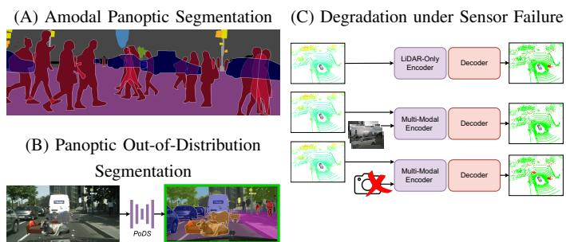

# Perception Beyond the Visible: Incompleteness-Aware Scene Understanding for Robot Autonomy

Rohit Mohan

## I. INTRODUCTION

Robots do not perceive the world directly but they infer it from partial, noisy measurements [47]. Reliable robot autonomy requires converting these measurements into a scene belief that is (i) complete enough to support safe action and (ii) calibrated enough to expose when it may be wrong [13, 21]. Yet much of today’s perception reliability is achieved by engineering away uncertainty: operating in bounded environments, with fixed ontologies, and with clean, well-calibrated sensors [45, 23]. In everyday operation, three forms of incompleteness break these assumptions: incomplete evidence from occlusion and unobserved future states, incomplete knowledge in open worlds (novel objects and limited labels) [1], and incomplete reliability when sensors degrade or disagree [10]. Under these conditions, models often produce not only errors but overconfident hypotheses [13, 40] that propagate into brittle downstream behavior, leading to planning failures under perceptual uncertainty [20, 6].

My research program, Perception Beyond the Visible, asks: how can robots build scene representations over semantics, geometry, and motion that remain calibrated under incompleteness and actionable for planning and interaction. I pursue this through a tight loop of (1) tasks and benchmarks [11, 31, 43, 25, 34, 37, 38] that make incompleteness measurable, and (2) learning methods that explicitly model occlusion structure [31, 32, 43, 29] forecast future states [30], separate known from unknown [34, 37], learn from limited labels [15, 18, 36], and estimate modality reliability for selective fusion [38, 35]. Across 2D and 3D, these contributions shift perception from what is seen to what is present, widening the operational envelope in cluttered, dynamic settings.

## II. CURRENT RESEARCH

Foundational Contributions. To facilitate robust autonomy, I establish methodological foundations that make progress measurable and support rapid development. First, we developed a large-scale multimodal benchmark and instance-centric metrics for LiDAR panoptic tracking [11]. With over 13× more instances than SemanticKITTI, its scale and urban diversity expose failure modes in dense, dynamic scenes and underpin my subsequent work [15, 37, 38]. Second, complementing classification-centric NAS surveys [9], we systematized NAS for dense prediction [33], distilling pixel-level constraints and architectural insights I leverage to design efficient networks across my core research [30, 38]. Together, these contributions enable my overarching vision.

  
Fig. 1. Illustrations of incompleteness-aware perception: (A) occlusion, (B) unknowns, and (C) sensor failure.

## A. Incomplete Evidence: Perceiving the Invisible

Amodal Perception. Most robotic perception remains visibleonly (modal) [22, 8], treating occlusion as missing evidence rather than an inferable scene state [16, 48]. I formalize amodal perception so robots can represent what is present, not just what is seen, supporting object permanence for interaction [42]. I introduced amodal panoptic segmentation (APS) and benchmark [31], unifying background semantics with instance masks that include occluded regions (cf. Fig. 1 (A)) and extending earlier amodal instance/semantic formulations [24, 54] for a holistic scene interpretation. My initial APS approach explicitly predicts visible/occluding/occluded regions to capture occluder-occludee structure [31]. To address severe occlusion, I proposed a proposal-free layered formulation that predicts non-overlapping masks ordered by occlusion, together with an explicit-memory refiner that completes occluded regions via experience-based shape embeddings [32]. This improves occluded-object segmentation by ∼5 pp and transfers to amodal instance segmentation with comparable gains. Since annotating invisible regions is subjective and costly, we curated AmodalSynthDrive [43], a large synthetic dataset with amodal ground truth, and introduced amodal depth estimation to infer occluded geometry. We further extended amodal reasoning to dynamics with amodal optical flow [29], predicting motion through occlusions rather than failing at occlusion boundaries. These resources have since been adopted for occlusion-aware adaptation and amodal depth pretraining [2,

3, 26]. Coupling APS with amodal flow improves panoptic tracking and reduces ID switches during crossings.

Forecasting. Autonomy also faces incomplete evidence in time: a robot must act before the future is observed. Building on my work on reactive panoptic tracking [18], I introduced an end-to-end framework for vision-based semantic occupancy forecasting [30]. In contrast to two-stage pipelines that first estimate an intermediate occupancy grid and then forecasts [27, 12], my approach forecasts future geometry and semantics directly in the multi-view feature space. This yields a ∼10× speedup while matching or slightly improving accuracy at a 3 s horizon. The resulting representation is directly queryable by planners, supporting safer interaction in dynamic environments.

## B. Incomplete Knowledge: Learning Beyond the Known

Open-world unknowns. Robots cannot rely on fixed ontologies: objects absent from training can appear at deployment. To address this holistically, I introduced panoptic out-ofdistribution (OOD) segmentation [34], augmenting panoptic parsing with an explicit unknown category (cf. Fig. 1 (B). In contrast to open-set panoptic settings that may expose unknown regions during training via void labels [51, 19], my formulation evaluates unknown instances that are fully held out during training. I proposed a discrepancy-driven framework that separates unknown representations from a frozen closedworld reference, improving unknown handling while preserving in-distribution performance (mitigating a common tradeoff). I extended this to 3D via an uncertainty-guided LiDAR open-set panoptic framework [37]. By deriving unknowns to emerge from evidential learning [44] and uncertainty-gated grouping, rather than feature-space clustering [50] or fixed proxies [5], this approach yields state-of-the-art unknown segmentation quality.

Limited Supervision. While foundation models [4, 39] thrive on large image corpora, comparable resources are scarce for LiDAR and hyperspectral imagery. We develop adapter-style transfer from frozen vision backbones to labelscarce modalities [15, 17]. For LiDAR-only segmentation, we introduce a 2D-3D cross-attention adapter that injects Bird’s-Eye-View geometry into range-view features obtained from a frozen backbone. Unlike camera-LiDAR distillation methods [28, 52], this requires no synchronized RGB. With limited labels, it improves mIoU by +5.2/+3.0 pp over the strongest vision-distillation baselines across benchmarks [28, 7]. For hyperspectral segmentation [17], an adapter preserves full spectra and aligns them with frozen vision tokens, yielding up to +14.6 pp mIoU over prior works [46, 14, 49]. To support privacy-constrained domains, I curated a synthetic multimodal dataset [36] with dense ground truth and showed that pairing domain-specific synthetic data with strong vision models yields accurate, domain-aligned perception with minimal real data.

## C. Incomplete Reliability: Robust Multi-Modal Perception

I move beyond LiDAR-camera fusion pipelines that implicitly assume clean inputs toward models that explicitly reason about modality reliability. In 3D panoptic segmentation, I identify a recurring failure mode: fusing a corrupted modality can affect performance relative to using a single robust sensor(cf Fig. 1 (C)). Such corruptions arise from sensor failures and calibration drift, and can induce large drops (e.g., 5-16 pp) in PQ [22] for state-of-the-art approaches [41, 53]. To address this, I propose a reliability-aware fusion mechanism [38]. By estimating aleatoric uncertainty via representational divergence, the model decides when to trust each modality and down-weights unreliable visual features to avoid contaminating geometric reasoning. Under ideal conditions, it remains comparable to strong fusion baseline [41] while being 6× faster. More importantly, under sensor failures, sensor failures, it drops by only 1.2 pp (vs. ∼5 pp for the IAL baseline [41]) and remains 4.5-12.6 pp ahead under rotationinduced calibration drift [41, 53]. Complementarily, to handle severe sensor dropout in 3D object detection, I develop a progressive fusion framework with masked cross-modal pretraining, enabling the model to reconstruct missing features from remaining modalities [35]. Together, these contributions make multi-modal perception robust by design rather than only accurate in ideal conditions.

## III. FUTURE RESEARCH DIRECTIONS

To advance closed-loop autonomy, the next phase of my research focuses on incompleteness-aware scene belief estimation. I plan to explore two primary themes:

Belief-centric 4D scene representations. Instead of treating perception outputs as point estimates, I will develop methods that learn representations for jointly modeling 3D geometry, semantics, and motion alongside uncertainty (occlusion, unknowns, sensor reliability). A key direction is coupling layered amodal reasoning with semantic occupancy forecasting. As occupancy is inherently amodal, this naturally unifies object permanence and future state into a single scene belief. Evaluation will focus on calibration, robustness, and downstream planning in dynamic clutter.

Closing the Loop: Active Sensing and Safe Adaptation. Once a robot can quantify incompleteness, it must act to resolve it behaviorally and algorithmically. First, I will study active perception policies that adapt viewpoints, sensing modalities, and motion plans to maximize expected information gain, for instance, preferring geometric sensing when visual inputs degrade. This requires uncertainty estimates that are decision, relevant and stable under shift. Algorithmically, I will explore continual learning pipelines that safely incorporate newly discovered unknowns over time. By efficiently acquiring supervision for novel object hypotheses without catastrophic forgetting, the robot will expand its open-world coverage while maintaining conservative behavior when knowledge is incomplete. Evaluation will pair controlled incompleteness suites (occlusion, corruption, novel encounters) with embodied tasks where the robot explicitly trades time and energy for uncertainty reduction.

Together, these directions operationalize Perception Beyond the Visible for reliable robot autonomy.

[1] Abhijit Bendale and Terrance Boult. “Towards Open Set Deep Networks”. In: CVPR. 2016.

[2] Yihong Cao et al. “Occlusion-Aware Seamless Segmentation”. In: European Conference on Computer Vision (ECCV). 2024.

[3] Yihong Cao et al. “Unlocking Constraints: Source-Free Occlusion-Aware Seamless Segmentation”. In: Proceedings of the IEEE/CVF International Conference on Computer Vision (ICCV). Oct. 2025, pp. 8961–8972.

[4] Mathilde Caron et al. “Emerging properties in selfsupervised vision transformers”. In: Proceedings of the IEEE/CVF international conference on computer vision. 2021, pp. 9650–9660.

[5] Anirudh S Chakravarthy et al. “Lidar panoptic segmentation in an open world”. In: International Journal of Computer Vision 133.3 (2025), pp. 1153–1174.

[6] Chao Chen et al. “Planning Under Uncertainty for Autonomous Driving”. In: ICCV. 2015.

[7] Runnan Chen et al. “Clip2scene: Towards label-efficient 3d scene understanding by clip”. In: Proceedings of the IEEE/CVF Conference on Computer Vision and Pattern Recognition. 2023, pp. 7020–7030.

[8] Bowen Cheng et al. “Panoptic-deeplab: A simple, strong, and fast baseline for bottom-up panoptic segmentation”. In: Proceedings of the IEEE/CVF conference on computer vision and pattern recognition. 2020, pp. 12475–12485.

[9] Thomas Elsken, Jan Hendrik Metzen, and Frank Hutter. “Neural architecture search: A survey”. In: Journal of Machine Learning Research 20.55 (2019), pp. 1–21.

[10] Di Feng, Christian Haase-Schutz, et al. “Deep Multi-Modal Object Detection and Semantic Segmentation for Autonomous Driving: Datasets, Methods, and Challenges”. In: IEEE Transactions on Intelligent Transportation Systems. 2020.

[11] Whye Kit Fong et al. “Panoptic nuscenes: A largescale benchmark for lidar panoptic segmentation and tracking”. In: IEEE Robotics and Automation Letters 7.2 (2022), pp. 3795–3802.

[12] Songen Gu et al. “Dome: Taming diffusion model into high-fidelity controllable occupancy world model”. In: arXiv preprint arXiv:2410.10429 (2024).

[13] Chuan Guo et al. “On Calibration of Modern Neural Networks”. In: ICML. 2017.

[14] Jon Gutierrez-Zaballa et al. “Hsi-drive v2. 0: More´ data for new challenges in scene understanding for autonomous driving”. In: 2023 IEEE Symposium Series on Computational Intelligence (SSCI). IEEE. 2023, pp. 207–214.

[15] Julia Hindel et al. “Label-efficient lidar semantic segmentation with 2d-3d vision transformer adapters”. In: 2025 IEEE/RSJ International Conference on Intelligent Robots and Systems (IROS). IEEE. 2025, pp. 4115– 4122.

[16] Derek Hoiem et al. “Recovering Occlusion Boundaries from a Single Image”. In: Proceedings of the IEEE International Conference on Computer Vision (ICCV). Oct. 2007.

[17] Juana Valeria Hurtado, Rohit Mohan, and Abhinav Valada. “Hyperspectral adapter for semantic segmentation with vision foundation models”. In: IEEE Robotics and Automation Letters (2026).

[18] Juana Valeria Hurtado et al. “Learning Appearance and Motion Cues for Panoptic Tracking”. In: 2025 IEEE/RSJ International Conference on Intelligent Robots and Systems (IROS). IEEE. 2025, pp. 4315– 4322.

[19] Jaedong Hwang et al. “Exemplar-based open-set panoptic segmentation network”. In: Proceedings of the IEEE/CVF Conference on Computer Vision and Pattern Recognition. 2021, pp. 1175–1184.

[20] Nidhi Kalra and Susan M. Paddock. “Driving to Safety: How Many Miles of Driving Would It Take to Demonstrate Autonomous Vehicle Reliability?” In: Transportation Research Part A (2016).

[21] Alex Kendall and Yarin Gal. “What Uncertainties Do We Need in Bayesian Deep Learning for Computer Vision?” In: NeurIPS. 2017.

[22] Alexander Kirillov et al. “Panoptic Segmentation”. In: Proceedings of the IEEE/CVF Conference on Computer Vision and Pattern Recognition (CVPR). June 2019, pp. 9404–9413.

[23] Philip Koopman and Michael Wagner. “Challenges in autonomous vehicle testing and validation”. In: SAE International Journal of Transportation Safety 4.1 (2016), pp. 15–24.

[24] Ke Li and Jitendra Malik. “Amodal instance segmentation”. In: European Conference on Computer Vision. Springer. 2016, pp. 677–693.

[25] Zhenyu Li et al. “Amodal Depth Anything: Amodal Depth Estimation in the Wild”. In: Proceedings of the IEEE/CVF International Conference on Computer Vision (ICCV). 2025.

[26] Zhenyu Li et al. “Amodal Depth Anything: Amodal Depth Estimation in the Wild”. In: Proceedings of the IEEE/CVF International Conference on Computer Vision (ICCV). Oct. 2025, pp. 9673–9682.

[27] Zhimin Liao et al. “I2-world: Intra-inter tokenization for efficient dynamic 4d scene forecasting”. In: Proceedings of the IEEE/CVF International Conference on Computer Vision. 2025, pp. 25810–25819.

[28] Youquan Liu et al. “Segment any point cloud sequences by distilling vision foundation models”. In: Advances in Neural Information Processing Systems 36 (2023), pp. 37193–37229.

[29] Maximilian Luz et al. “Amodal optical flow”. In: 2024 IEEE International Conference on Robotics and Automation (ICRA). IEEE. 2024, pp. 14677–14684.

[30] Riya Mohan et al. “ForecastOcc: Vision-based Semantic Occupancy Forecasting”. In: arXiv preprint arXiv:2602.08006 (2026).

[31] Rohit Mohan and Abhinav Valada. “Amodal panoptic segmentation”. In: Proceedings of the IEEE/CVF Conference on Computer Vision and Pattern Recognition. 2022, pp. 21023–21032.

[32] Rohit Mohan and Abhinav Valada. “Perceiving the invisible: Proposal-free amodal panoptic segmentation”. In: IEEE Robotics and Automation Letters 7.4 (2022), pp. 9302–9309.

[33] Rohit Mohan et al. “Neural architecture search for dense prediction tasks in computer vision”. In: International Journal of Computer Vision 131.7 (2023), pp. 1784– 1807.

[34] Rohit Mohan et al. “Panoptic out-of-distribution segmentation”. In: IEEE Robotics and Automation Letters 9.5 (2024), pp. 4075–4082.

[35] Rohit Mohan et al. “Progressive multi-modal fusion for robust 3d object detection”. In: 8th Annual Conference on Robot Learning. 2024.

[36] Rohit Mohan et al. “Syn-mediverse: a multimodal synthetic dataset for intelligent scene understanding of healthcare facilities”. In: IEEE Robotics and Automation Letters 9.8 (2024), pp. 7094–7101.

[37] Rohit Mohan et al. “Open-Set LiDAR Panoptic Segmentation Guided by Uncertainty-Aware Learning”. In: 2025 IEEE/RSJ International Conference on Intelligent Robots and Systems (IROS). IEEE. 2025, pp. 2224– 2231.

[38] Rohit Mohan et al. “UP-Fuse: Uncertainty-guided LiDAR-Camera Fusion for 3D Panoptic Segmentation”. In: arXiv preprint arXiv:2602.19349 (2026).

[39] Maxime Oquab et al. “Dinov2: Learning robust visual features without supervision”. In: Transactions on Machine Learning Research (2024).

[40] Yaniv Ovadia et al. “Confidence Estimation via Auxiliary Models”. In: NeurIPS. 2019.

[41] Yining Pan et al. “How do images align and complement lidar? towards a harmonized multi-modal 3d panoptic segmentation”. In: International Conference on Machine Learning (2025).

[42] Shaoting Peng et al. “Object Permanence Filter for Robust Tracking with Interactive Robots”. In: Proceedings of the IEEE International Conference on Robotics and Automation (ICRA). 2024, pp. 4909–4915.

[43] Ahmed Rida Sekkat et al. “Amodalsynthdrive: A synthetic amodal perception dataset for autonomous driving”. In: IEEE Robotics and Automation Letters 9.11 (2024), pp. 9597–9604.

[44] Murat Sensoy, Lance Kaplan, and Melih Kandemir. “Evidential deep learning to quantify classification uncertainty”. In: Advances in neural information processing systems 31 (2018).

[45] Bruno Siciliano and Oussama Khatib, eds. Springer Handbook of Robotics. 2nd ed. Springer, 2016.

[46] Nick Theisen et al. “Hs3-bench: A benchmark and strong baseline for hyperspectral semantic segmentation in driving scenarios”. In: 2024 IEEE/RSJ International Conference on Intelligent Robots and Systems (IROS). IEEE. 2024, pp. 5895–5901.

[47] Sebastian Thrun, Wolfram Burgard, and Dieter Fox. Probabilistic Robotics. MIT Press, 2005.

[48] Joseph Tighe, Marc Niethammer, and Svetlana Lazebnik. “Scene Parsing with Object Instances and Occlusion Ordering”. In: Proceedings ofthe IEEE Conference on Computer Vision and Pattern Recognition (CVPR). June 2014, pp. 3748–3755.

[49] Christian Winkens et al. “Hyko: A spectral dataset for scene understanding”. In: Proceedings of the IEEE International Conference on Computer Vision Workshops. 2017, pp. 254–261.

[50] Kelvin Wong et al. “Identifying unknown instances for autonomous driving”. In: Conference on Robot Learning. PMLR. 2020, pp. 384–393.

[51] Hai-Ming Xu et al. “Dual decision improves openset panoptic segmentation”. In: arXiv preprint arXiv:2207.02504 (2022).

[52] Xiang Xu et al. “4D contrastive superflows are dense 3D representation learners”. In: European Conference on Computer Vision. Springer. 2024, pp. 58–80.

[53] Zhiwei Zhang et al. “Lidar-camera panoptic segmentation via geometry-consistent and semantic-aware alignment”. In: Proceedings of the IEEE/CVF international conference on computer vision. 2023, pp. 3662–3671.

[54] Yan Zhu et al. “Semantic amodal segmentation”. In: Proceedings of the IEEE conference on computer vision and pattern recognition. 2017, pp. 1464–1472.