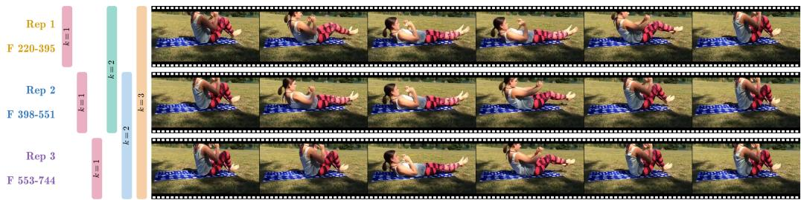
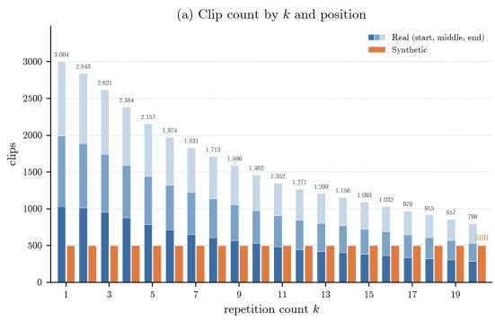
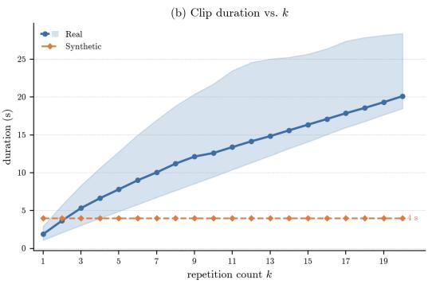
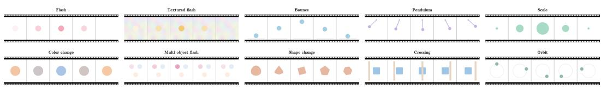
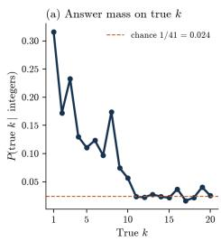
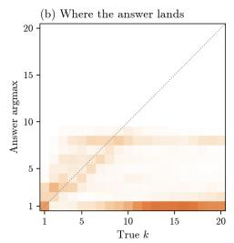
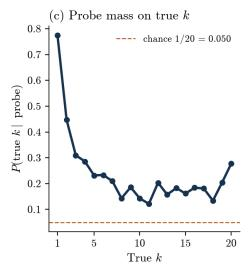
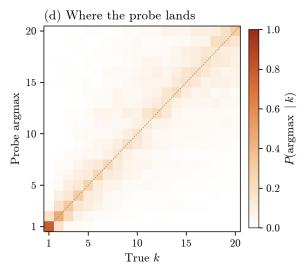

# REPPROBE: CAN VIDEO LANGUAGE MODELS COUNT REPEATED ACTIONS? A DIAGNOSTIC BENCHMARK

Mahsa Khoshnoodi, Sarah Adel Bargal Department of Computer Science, Georgetown University

## ABSTRACT

Repetition counting requires identifying and enumerating action cycles over time. While state-of-the-art video language models describe actions fluently, they fail to reliably count how many times an action repeats. To investigate this limitation, we introduce RepProbe, a benchmark of 42K real and synthetic video clips containing exactly k ∈ [1, 20] complete repetitions, with controls for clip position, temporal coverage, and duration. These controls allow us to study the counting failure directly and locate where in the model it arises. Counting accuracy collapses at high counts across the video language models we evaluate, and controlled experiments show this collapse is not explained by frame sampling alone. We compare model outputs with linear probes trained on the final-layer representations used to generate those outputs. We find a consistent representation-to-output dissociation: substantial count information remains linearly decodable even when models fail to report the correct count. Further analysis shows this failure arises primarily at the output stage, where answers concentrate on a small set of preferred numbers rather than the available count information. The dissociation holds on both real and synthetic videos and is not explained by clip duration, position, or scene content. These results indicate that models encode repetition structure but do not reliably report it in their outputs.

## 1 INTRODUCTION

Counting how many times an action repeats is a basic temporal skill. It requires identifying discrete action instances, recognizing the cycles of a periodic action, and accumulating these repetitions as they unfold over time. Unlike static counting, these repetitions are distributed across a sequence, so no single moment contains the answer. Human cognition treats this capacity as distinct: the number of sequential events is represented separately from other temporal properties such as duration (White, 1963), and parietal populations encode how many times an action is repeated independently of the action’s identity (Sawamura et al., 2020). Counting therefore differs from recognizing an action. Recognition, even when it requires temporal information, is a categorical judgment about presence or identity; counting tracks each occurrence and accumulates them into an exact quantity. This makes repetition counting a precise test of whether a model tracks temporal structure, and it is also required in practice, for instance in exercise and rehabilitation monitoring, where approximate counts are of limited use (Dwibedi et al., 2020; Hu et al., 2022).

Video Language Models (VLMs) handle this task poorly. They describe repetitive actions fluently yet misreport how many times the actions occur, and their error grows with the number of repetitions (Yao et al., 2025; Li et al., 2026). The difficulty does not lie in the task itself: specialist counters trained for this purpose remain accurate at high counts, whereas general-purpose video language models, despite their scale and broad video training, degrade as repetitions accumulate. Existing evaluations of counting and related temporal skills (Liu et al., 2024; Cores et al., 2024; Patraucean et al., 2023), however, measure only the final answer, and they do not separate repetition count from factors that vary with it, such as clip duration, temporal coverage, and source video. An incorrect answer does not imply that the underlying information is absent: probing studies show that model can encode information they do not express (Alain & Bengio, 2016; Burns et al., 2022; Azaria & Mitchell, 2023). The source of the failure therefore remains open: do these models fail to represent the count, or represent it but fail to report it? The answer matters, because a failure of representation and a failure of readout call for different remedies.

To address this question, we introduce RepProbe, a diagnostic benchmark in which every clip contains an exact, known number of complete repetitions. In RepCount (Hu et al., 2022), each video carries a single count entangled with its duration and source. RepProbe-Real instead cuts clips with exactly k repetitions from each RepCount source video, controlling clip position and source-level splits while auditing duration and temporal coverage. RepProbe-Synthetic is a controlled set, balanced across counts, in which only a single attribute changes periodically. We evaluate seven open video language models and two specialist counters on RepProbe. To test whether the count is absent from the model or present but not reported, we then compare two readouts of the count from the same final-layer state of the strongest generalists: the model’s generated answer, and a linear probe on the representation consumed by the language head. Finally, we test whether the decodable count reflects the repetitions themselves, using duration and clip-position controls on real video and controlled synthetic stimuli.

Our results show that the count is represented within the model but not faithfully reported. Generalist video language models count reasonably well at low counts but collapse at high counts, where a specialist counter remains accurate, and this collapse is not explained by frame sampling. Yet the count remains linearly decodable from the final-layer state that the language head reads, even when the model’s answer is wrong. This dissociation also holds on synthetic stimuli, and it is not explained by duration or clip position. The generated answers instead concentrate on a small set of preferred numbers, largely independent of the true count. These findings indicate that the high-count failure of video language models arises in the readout of the representation rather than in the representation itself. Our analysis complements prior work showing that probes can recover temporal information from vision-side features (Li et al., 2025): we localize the gap to the final representation consumed by the language head, and show that it widens as the count grows.

## Our contributions are summarized as follows:

• RepProbe, a controlled benchmark for repetition counting. RepProbe pairs RepProbe-Real, 32K clips constructed from the 1K source videos of RepCount (Hu et al., 2022), with RepProbe-Synthetic, 10K procedurally generated clips in which a single attribute changes periodically, making 42K clips in total, all with exact counts from 1 to 20.

• A systematic evaluation revealing a high-count collapse. Across seven generalist open video language models and two specialist counters, generalist models fall to at most 22.2% OBO at high counts while specialist counters remain accurate. This failure is obscured by overall accuracy and persists when the number of frames per repetition is held fixed.

• Evidence that count is better represented than reported. A linear probe on the finallayer state recovers the count substantially more accurately than the model’s own answer, on both real and synthetic video, while the answers concentrate on a small set of preferred numbers. This locates the failure in the output pathway and identifies readout, rather than perception, as the target for improving counting in video language models.

## 2 RELATED WORK

Repetitive action counting. Repetitive action counting has been studied as a dedicated video understanding problem. Early approaches estimate repetition periods from temporal self-similarity (RepNet; Dwibedi et al. 2020), while later methods address unknown and varying cycle lengths through context-aware, scale-insensitive estimation (Zhang et al., 2020). Datasets progressed from Countix (Dwibedi et al., 2020) and UCFRep (Zhang et al., 2020) to RepCount, which introduces variable-length videos and fine-grained cycle annotations, together with density-map supervision for repetition-period estimation (Hu et al., 2022). Recent specialist counters include Every Shot Counts (ESCounts), which uses exemplar-based visual correspondence across repetitions (Sinha et al., 2024), PAMS, a self-supervised method based on period-adaptive multi-scale consistency (Gao et al., 2026), and multimodal methods that combine appearance and pose to model repetitive motion under background variation (Wang et al., 2026). These methods are trained for counting and optimize counting accuracy. Together, they establish repetition counting as a well-defined video understanding target with a measurable ground-truth quantity, making it a controlled setting for testing whether general-purpose video language models encode the information needed for counting.

Counting and temporal reasoning in vision-language models. Counting remains challenging for vision-language models even on static images (Acharya et al., 2018; Paiss et al., 2023), and recent perception benchmarks continue to identify failures on basic visual counting and spatial tasks (Rahmanzadehgervi et al., 2024; Fu et al., 2024). In video, counting becomes temporal, since events must be accumulated across frames. Video benchmarks such as MVBench include temporal actionunderstanding tasks (Li et al., 2024b), while CountLLM (Yao et al., 2025) and the exercise-counting benchmark PushupBench (Li et al., 2026) report substantial difficulties for general-purpose video language models on repetition counting. More broadly, benchmarks evaluate fine-grained tempo ral (Li et al., 2024b; Liu et al., 2024), long-form (Wu et al., 2024), and visual-temporal reasoning (Shangguan et al., 2025), but existing evaluations can still admit solutions based on a few frames or without preserving temporal order. RepProbe makes repetition count the controlled temporal variable and audits alternative cues such as temporal position, sampling, duration, and source. Whereas these benchmarks primarily measure failure at the output, RepProbe localizes it by testing whether count information is absent from the representation or present but not surfaced by the model’s native output.

Representation probing. Linear probing provides a standard way to measure whether taskrelevant information is recoverable from frozen representations (Alain & Bengio, 2016; Belinkov, 2022), and has shown that LLMs linearly encode structured quantities such as space, time, truth, and numeric value (Gurnee & Tegmark, 2024; Marks & Tegmark, 2023; Heinzerling & Inui, 2024; Zhu et al., 2025). Prior work has also shown that probes can recover information that is not reliably expressed in model outputs (Burns et al., 2022; Azaria & Mitchell, 2023; Orgad et al., 2025), with related work finding similar gaps in vision-language models (Zhao et al., 2024). Interpretability studies of video LLMs further examine where visual and temporal information is integrated across layers (Kim et al., 2026; Shi et al., 2025). However, decodability does not imply that the model uses the information (Ravichander et al., 2021; Elazar et al., 2021). We therefore do not treat probe accuracy as evidence of capability: the probe tests whether count information is decodable from a representation, which we compare directly with the information surfaced by the model’s native language head. This distinction is particularly relevant to recent work showing that temporal information can be decoded from video representations even when Video LLMs perform poorly on corresponding temporal reasoning tasks (Li et al., 2025). Whereas that work probes an earlier vision-side representation, we examine the final-layer vector directly consumed by the language head.

## 3 THE REPPROBE BENCHMARK

Existing repetition-counting benchmarks such as RepCount (Hu et al., 2022) were designed to train and evaluate specialist counters, and they are not suited to diagnosing why a model miscounts. Each RepCount video carries a single count determined by its full length, so the count cannot be varied independently of the video itself: comparing different counts means comparing different videos, which also differ in duration, action, and speed. A model’s error on such a benchmark therefore cannot be attributed to the count rather than to these correlated factors. The distribution of counts across videos is also uneven, so some counts are represented by few videos. Diagnosing counting failures requires varying the count while holding other factors fixed, which motivates the construction of RepProbe.

RepProbe addresses these limitations by cutting clips with an exact, known number of repetitions, so that the count can vary while the source video and action stay fixed. It contains 42,233 clips in two complementary parts that share the same task, count range (k = 1–20), and metrics. RepProbe-Real (32,233 clips) is built from RepCount videos and retains their natural visual variability, while giving precise control over the number of repetitions in each clip and where the clip is taken from its source. RepProbe-Synthetic (10,000 clips) is procedurally generated in a controlled setting where a single attribute changes periodically, so that counting can be tested when periodicity is the only available signal. In both parts, each clip contains exactly k complete periods, so counting difficulty can be evaluated systematically as a function of k.

  
Figure 1: RepProbe-Real construction. Rest-pose timestamps bound half-open repetition intervals. A clip consists of k consecutive complete repetitions from one source. Left bars mark example windows: k=1 (pink, Rep 1), two overlapping k=2 placements (teal, Reps 1–2; blue, Reps 2–3), and k=3 (orange, all three). Start, middle, and end placements vary clip position while the target count stays fixed.

## 3.1 REPPROBE-REAL

Construction. We build RepProbe-Real from exercise videos offering a controlled setting for studying temporal counting, not because exercise counting is uniquely difficult. Exercise repetitions are well defined: each repetition is a complete cycle of a single action, typically beginning and ending in a rest pose, so repetition boundaries are unambiguous and can be annotated precisely. Rep-Count (Hu et al., 2022) provides repetition-boundary annotations that allow us to segment videos into clips containing exactly a specified number of complete repetitions. The synthetic set (Section 3.2) complements this choice by testing whether our findings extend beyond exercise content.

In each source video, a repetition begins when the action leaves a rest pose and ends when it returns to one, so consecutive rest-pose timestamps define each repetition as a half-open interval [start, end). We discard zero-length and non-monotonic intervals and concatenate $k \in \{ 1 , \ldots , 2 0 \}$ consecutive repetitions into a clip (Figure 1). Because adjacent repetitions share a rest-pose boundary, every clip contains only complete repetitions and ends at a rest pose. To vary clip position while holding the action and source fixed, we extract windows from the start, middle, and end of the source when it contains enough repetitions; redundant middle windows are omitted for short sources. For a given source and k, these clips contain the same number of repetitions at different positions in the source; their durations can differ because action speed varies within a source.

Statistics. RepProbe-Real contains 32,233 clips from 1,038 RepCount source videos. All splits are made at the source-video level, so clips from the same source never cross a split boundary. Because fewer source videos contain many annotated repetitions, the eligible pool shrinks as k grows, and the full set is skewed toward smaller counts (Figure 2). We use the full set for the main evaluation and construct nested k-balanced subsets, stratified by clip position, for controlled analyses: a 2,000-clip subset (100 per count) and a 10,000-clip subset (500 per count). Unless otherwise stated, controlled analyses on real video use the balanced 10K subset.

## 3.2 REPPROBE-SYNTHETIC

Real clips confound the periodic signal with object semantics, scene appearance, and camera variation such as viewpoint and lighting, so a model or probe could count by exploiting content cues rather than periodicity itself. To isolate periodicity, RepProbe-Synthetic contains 10,000 procedurally generated clips in a controlled setting: the set is balanced across counts (500 clips for each $k = 1 { - } 2 0 )$ , and in every clip a single attribute changes periodically and completes exactly k periods, while everything else stays fixed.

Construction. Each clip shows simple geometric elements on a plain background (except for the Textured flash stress condition), and exactly one attribute changes periodically. The count is therefore defined only by how many periods the attribute completes: no single frame reveals it, and there is no object category or action that could evoke a typical count. Every clip lasts 4 s regardless of k (Figure 2b), so, unlike in real video, clip duration carries no information about the count.

  
Figure 2: RepProbe statistics. (a) Clips per repetition count k. RepProbe-Real (blue, stacked by clip position: start, middle, end) is skewed toward small counts because fewer source videos contain many repetitions; RepProbe-Synthetic (orange) is balanced at 500 clips per count. (b) Clip duration versus k. Real clip duration grows with k (line: median; shaded band: spread across clips), whereas every synthetic clip lasts 4 s regardless of k.

The ten families vary what changes periodically (Figure 3) and fall into three groups. Appearance changes alter an element in place: a disc appears and disappears (Flash), pulses in size (Scale), cycles in hue (Color change), or morphs through polygons (Shape change). Motion changes move an element along a path: a bob hops vertically (Bounce), swings on a pivot (Pendulum), or travel around a ring (Orbit), and a bar sweeps across a square (Crossing). Stress conditions make the periodic signal harder to isolate: Textured flash places the same flash on a cluttered, scene-like background, and Multi object flash distributes the flashes across several objects that take turns, so that every flash must be counted regardless of where it occurs. Together, the families test whether a model tracks periodic change in general or only specific kinds of change, such as motion.

  
Figure 3: RepProbe-Synthetic families. Each panel shows five frames spanning one period of one of the ten families. In each family, a single attribute (visibility, size, hue, position, angle, geometry, or occlusion) changes periodically and completes k periods per clip, while everything else stays fixed. Textured flash and Multi object flash add stress conditions: a cluttered background, and flashes distributed across several objects that take turns.

## 3.3 TASK, METRICS, AND EVALUATION CONTROLS

Task and metrics. Each model is queried with the instruction “Count the number of repetitions in this video. Return only an integer.” A shared, model-agnostic parser extracts the predicted count ˆk from each response (App. A.4). Responses from which no integer can be extracted are treated as parse failures and scored as a prediction of 0, so a model cannot improve its score by failing to answer. For the main comparison across models, predictions are clipped to [0, 40] so that rare extreme outputs do not dominate mean errors. We report mean absolute error (MAE), which is directly interpretable in repetitions, and normalized MAE $( { \mathrm { M A E } _ { n } } )$ , which we use when comparing

across count ranges:

$$
\mathrm { M A E } = \frac { 1 } { N } \sum _ { i } | \hat { k } _ { i } - k _ { i } | , \qquad \mathrm { M A E } _ { n } = \frac { 1 } { N } \sum _ { i } \frac { | \hat { k } _ { i } - k _ { i } | } { k _ { i } } .
$$

We also report exact-match accuracy and off-by-one accuracy (OBO), the percentage of predictions with $| \hat { k } - k | \le 1$ . OBO is standard in repetition counting (Dwibedi et al., 2020; Hu et al., 2022); it tolerates ambiguity at repetition boundaries while still penalizing genuine miscounts. Results are further broken down by count band: Few (k = 1–6), Mid (k = 7–13), and Many (k = 14–20).

Evaluation controls. Unless otherwise stated, each model receives 16 frames per clip, sampled uniformly regardless of duration. Cosmos-Reason2 is the exception: it uses its native 4 fps setting, giving a median of 57 frames per RepProbe-Real clip. Cross-model differences in the main comparison therefore partly reflect frame budget. Our central comparison, between each model’s answer and a probe on its own representation (Section 4.2), uses the same input for both readouts and is unaffected. RepProbe-Real also admits potential shortcuts: clip duration is correlated with $k ,$ and fewer source videos are eligible at high counts. Source-level splits prevent leakage, and clip position sampling balances clips from the start, middle, and end of each source video. Remaining effects of duration, clip position, and temporal coverage are analyzed in Appendices A.1 and A.5.

## 4 EXPERIMENTS

We organize our experiments around three questions. (1) How well do video language models count repetitions, and does performance hold as the number of repetitions grows? (Section 4.1) (2) When counting fails, is the count absent from the model’s internal state, or present but not expressed in the generated answer? (Section 4.2) (3) Does the decodable count capture the actual repetitions, or does it rely on simpler cues such as video duration or scene content? (Section 4.3)

Evaluated Models. We evaluate two specialized repetition-counting models, ESCounts (Sinha et al., 2024) and RepNet (Dwibedi et al., 2020), and seven general-purpose video language models spanning multiple families and architectures: Cosmos-Reason2-8B (Azzolini et al., 2025), Qwen3- VL-8B (Bai et al., 2025), Video-R1-7B (Feng et al., 2026), VideoChat-R1.5-7B (Yan et al., 2026), InternVL3.5-8B (Wang et al., 2025), LongVILA-R1-7B (Chen et al., 2026), and LLaVA-OneVision-7B (Li et al., 2024a). The specialists are trained for repetition counting; the generalists are evaluated zero-shot.

## 4.1 BEHAVIORAL ACCURACY: A COLLAPSE AT HIGH COUNTS

We evaluate specialist repetition-counting models and generalist video language models on the full RepProbe-Real set (∼32K clips), which spans k = 1 to 20 and is weighted toward smaller counts because fewer source videos contain enough repetitions to support large k; the controlled analyses that follow use count-balanced subsets. The specialist ESCounts remains accurate across the full range: it reaches $\mathrm { M A E } _ { n } = 0 . 1 9$ and 41.9% exact accuracy, and retains 65.6% OBO even in the Many band. In contrast, every generalist falls to at most 22.2% OBO in the Many band (Table 1). The two strongest generalists, Cosmos-Reason2-8B and Qwen3-VL-8B, count reasonably well at low counts (62.1% and 62.9% OBO in the Few band) but reach only 22.2% and 4.9% OBO in the Many band, and the remaining generalists stay below 8% Many-band OBO.

The collapse is not caused by sparse frame sampling. Under a fixed frame budget, larger k leaves fewer sampled frames per repetition. We therefore fix the number of frames per cycle (FPC) and vary k independently. High counts remain harder even at the densest setting we test: at $\mathrm { F P C } = 8 .$ the MAE of Qwen3-VL-8B rises from 2.93 at k = 5 to 7.86 at $k = 2 0$ , and that of Cosmos-Reason2-8B from 2.47 to 4.57. Coverage does matter at fixed k: for Cosmos-Reason2-8B at k = 20, increasing coverage from one to eight frames per cycle reduces MAE from 14.00 to 4.57. Coverage and count therefore have separable effects, and the effect of count remains at every coverage level we test. Temporal coverage affects accuracy but does not account for the collapse.

Table 1: Repetition counting on RepProbe-Real and RepProbe-Synthetic (generalists only), $k = 1 -$ 20. Predictions are clipped to [0, 40]. Bands: Few $k { = } 1 { - } 6 .$ , Mid $k { = } 7 { - } 1 3$ , Many $k { = } 1 4 { - } 2 0$ . Bold: best generalist in each column. The shaded Many band highlights the high-count collapse on RepProbe-Real.
<table><tr><td></td><td colspan="4">Overall</td><td colspan="3">OBO (%) by band ↑</td></tr><tr><td>Method</td><td> $\mathrm { M A E } _ { n } \downarrow$ </td><td>MAE↓</td><td>Exact↑</td><td>OBO↑</td><td>Few</td><td>Mid</td><td>Many</td></tr><tr><td>RepProbe-Real Špecialist</td><td></td><td></td><td></td><td></td><td></td><td></td><td></td></tr><tr><td>ESCounts</td><td>0.19</td><td>1.07</td><td>41.9</td><td>77.5</td><td></td><td>87.5 71.0</td><td>65.6</td></tr><tr><td>RepNet</td><td>0.32</td><td>2.20</td><td>21.7</td><td>53.0</td><td>79.1</td><td>36.4</td><td>21.3</td></tr><tr><td>Generalist</td><td></td><td></td><td></td><td></td><td></td><td></td><td></td></tr><tr><td>Cosmos-Reason2-8B</td><td>0.43</td><td>2.89</td><td>17.5</td><td>47.5</td><td></td><td>62.1 43.1</td><td>22.2</td></tr><tr><td>Qwen3-VL-8B</td><td>0.68</td><td>5.02</td><td>12.9</td><td>35.0</td><td>62.9</td><td>14.6</td><td>4.9</td></tr><tr><td>Video-R1-7B</td><td>1.35</td><td>6.24</td><td>7.2</td><td>19.3</td><td>24.8</td><td>21.4</td><td>4.2</td></tr><tr><td>VideoChat-R1.5-7B LongVILA-R1-7B</td><td>1.40 1.47</td><td>6.41</td><td>7.0</td><td>19.4</td><td>25.7</td><td>21.0</td><td>3.2</td></tr><tr><td>InternVL3.5-8B</td><td>1.51</td><td>7.70</td><td>6.5</td><td>18.4</td><td>33.1</td><td>9.3</td><td>2.2</td></tr><tr><td>LLaVA-OneVision-7B</td><td></td><td>5.98</td><td>7.3</td><td>18.7</td><td>21.0</td><td>23.0</td><td>7.3</td></tr><tr><td></td><td>2.19</td><td>6.80</td><td>4.8</td><td>12.8</td><td>2.1</td><td>33.0</td><td>5.3</td></tr><tr><td>RepProbe-Synthetic</td><td></td><td></td><td></td><td></td><td></td><td></td><td></td></tr><tr><td>Cosmos-Reason2-8B</td><td>0.71</td><td>7.75</td><td>5.6</td><td>16.1</td><td>53.7</td><td>0.0</td><td>0.0</td></tr><tr><td>Qwen3-VL-8B</td><td>0.69</td><td>7.77</td><td>6.3</td><td>17.5</td><td>58.3</td><td>0.0</td><td>0.0</td></tr><tr><td>Video-R1-7B</td><td>0.73</td><td>8.37</td><td>4.7</td><td>15.3</td><td>50.9</td><td>0.0</td><td>0.0</td></tr><tr><td>VideoChat-R1.5-7B</td><td>0.72</td><td>7.96</td><td>5.2</td><td>14.8</td><td>49.1</td><td>0.0</td><td>0.0</td></tr><tr><td>LongVILA-R1-7B</td><td>0.77</td><td>8.43</td><td>4.4</td><td>13.6</td><td>44.3</td><td>0.8</td><td>0.0</td></tr><tr><td>InternVL3.5-8B</td><td>0.70</td><td>6.50</td><td>5.1</td><td>16.3</td><td>44.9</td><td>8.0</td><td>0.0</td></tr><tr><td>LLaVA-OneVision-7B</td><td>0.87</td><td>7.13</td><td>5.6</td><td>13.5</td><td>29.5</td><td>13.3</td><td>0.0</td></tr></table>

The weakness is not specific to exercise video. On RepProbe-Synthetic, in which only a single attribute changes periodically, generalists struggle even at low counts, reaching only 29.5% to 58.3% OBO in the Few band. We evaluate only the generalists here, since the specialists are trained on real exercise video and these stimuli fall outside their training domain. On RepProbe-Synthetic, the relevant comparison is instead between each generalist’s answer and a linear probe on its own internal state (Section 4.2).

These results establish a behavioral failure but not its source: the count may be poorly represented inside the model, or represented but not converted into the numerical answer. The full FPC grid is given in Appendix A.1.

## 4.2 REPRESENTATION VS. OUTPUT: DECODABLE BUT POORLY REPORTED

The behavioral results show that the model produces the wrong count, but not whether the count is missing from its representation or present but lost on the way to the answer. To separate these, we read the count in two ways from the same final-layer state, the one the language head consumes to produce its answer. The first readout is the model’s answer: the number it generates when asked. The second is a count probe. We extract the residual-stream activation after the final transformer block at the last prompt token, the position from which the language head produces the first answer token, and train a linear classifier over the 20 count classes $( k = \bar { 1 } , \ldots , 2 \bar { 0 } )$ on 1,000 labeled clips. The probe’s prediction is the most probable class. On RepProbe-Real, training and evaluation clips are split at the source-video level, so the probe is always evaluated on source videos it has not seen during training; full details are given in Appendix A.2. Because the probe is linear, it cannot perform nonlinear computation on the state; it can only recover information that is already linearly present. The language head is itself a linear map applied to this same state (after normalization), so the probe has no more capacity than the model’s own readout: any count the probe recovers is available to the language head in the form it consumes. A gap between the two readouts therefore locates the failure in the output pathway rather than in the representation. Both readouts are computed from the same forward pass on the same frames, so the comparison is not confounded by differences in input. We study Cosmos-Reason2-8B and Qwen3-VL-8B, the two strongest generalists (Table 1).

Table 2: Two ways of reading the count from the same final-layer representation, on the balanced 10K subset of RepProbe-Real and on RepProbe-Synthetic. The linear count probe (trained on 1k clips) is more accurate than the model’s own answer on both; on RepProbe-Real, the gap is largest at high k.
<table><tr><td rowspan="2">Model</td><td rowspan="2"></td><td colspan="2">All</td><td colspan="2">Few</td><td colspan="2">Mid</td><td colspan="2">Many</td></tr><tr><td>Readout MAE↓ OBO↑ MAE↓ OBO↑ MAE↓ OBO↑ MAE↓ OBO↑</td><td></td><td></td><td></td><td></td><td></td><td></td><td></td></tr><tr><td colspan="9">RepProbe-Real</td></tr><tr><td rowspan="3">Cosmos-8B</td><td>Model</td><td>3.91</td><td>37.9</td><td>1.91</td><td>56.0</td><td>3.20</td><td>40.7</td><td>6.35</td><td>19.4</td></tr><tr><td>Probe</td><td>2.49</td><td>50.3</td><td>1.62</td><td>68.0</td><td>2.99</td><td>39.7</td><td>2.75</td><td>45.6</td></tr><tr><td>Qwen3-VL-8B Model Probe</td><td>7.88</td><td>24.2</td><td>2.45</td><td>58.9</td><td>6.97</td><td>14.0</td><td>13.43</td><td>4.7</td></tr><tr><td colspan="2">RepProbe-Synthetic</td><td>3.05</td><td>44.7</td><td>2.27</td><td>58.9</td><td>3.23</td><td>37.9</td><td>3.54</td><td>39.4</td></tr><tr><td colspan="10">Cosmos-8B</td></tr><tr><td rowspan="2"></td><td>Model</td><td>7.75</td><td>16.1</td><td>1.51</td><td>53.8</td><td>6.90</td><td>0.0</td><td>13.95</td><td>0.0</td></tr><tr><td>Probe</td><td>0.62</td><td>91.4</td><td>0.59</td><td>92.3</td><td>0.62</td><td>90.7</td><td>0.65</td><td>91.3</td></tr><tr><td rowspan="2">Qwen3-VL-8B Model</td><td></td><td>7.77</td><td>17.5</td><td>1.50</td><td>58.4</td><td>6.99</td><td>0.0</td><td>13.91</td><td>0.0</td></tr><tr><td>Probe</td><td>0.59</td><td>92.5</td><td>0.50</td><td>93.9</td><td>0.66</td><td>90.5</td><td>0.58</td><td>93.5</td></tr></table>

Because the probe is trained with supervision, we also test in Section 4.3 whether it reads the count itself or correlates of it, such as duration, clip position, or scene content.

The probe recovers the count far more accurately than the model’s answer (Table 2, Figure 4). On RepProbe-Real, the probe lowers MAE from 3.91 to 2.49 for Cosmos-Reason2 and from 7.88 to 3.05 for Qwen3-VL. As a control, a Cosmos-Reason2 probe trained on the same clips with shuffled labels performs no better than random guessing (MAE 6.57). The gap concentrates at high k: in the Many band, the probe reaches MAE 2.75 against 6.35 for Cosmos-Reason2 and 3.54 against 13.43 for Qwen3-VL. Across paired clips, the probe improves on the Cosmos-Reason2 answer by 1.42 MAE on average (95% CI [1.29, 1.54]). The dissociation also holds on RepProbe-Synthetic: in the Few band, the probe reaches 92.3% and 93.9% OBO for Cosmos-Reason2 and Qwen3-VL, while their answers reach 53.8% and 58.4%. In both settings, the count is read far more accurately from the representation than from the model’s own answer.

The count is decodable before the final layer. Probes trained at earlier layers show that the count is already linearly decodable at intermediate depth and remains available at the final block. At block 18, probe MAE is 2.97 for Qwen3-VL and 2.51 for Cosmos-Reason2, compared with 3.05 and 2.49 at the final block (App. A.2). The count is therefore not lost as information propagates toward the output; it is available at the point where the language head reads the state.

The output follows a number prior. The model’s answers concentrate on a small set of numbers regardless of the true count (Figure 4b). Because two-digit numbers span several digit tokens, we also compare the single-token number words “one” through “twenty” (a length-fair readout). Under this readout, the output settles on a single preferred word (“fifteen” for Qwen3-VL, “eighteen” for Cosmos-Reason2), and across answers, how often each number is produced tracks its lexical frequency in text (Pearson r = 0.41). The count is therefore not absent: it is linearly available in the final internal state, and the failure lies in converting it into an answer, which instead follows a small set of preferred numbers.

## 4.3 CONTROLS: THE DECODABLE COUNT INDEED REFLECTS THE REPETITIONS

Section 4.2 shows that the count is linearly decodable from the final-layer representation of RepProbe-Real clips even at high k, where the model’s own answer collapses. Decodability alone, however, does not show what the probe relies on: it could exploit correlates of the count rather than the count itself. We test two such alternatives.

Duration and clip position. Count and duration correlate over RepProbe-Real (r = 0.62) but only weakly at high k (r = 0.12), and the probe’s advantage over the answer survives controlling for duration: for Cosmos-Reason2, a duration-only predictor reaches normalized MAE 0.57 against

  
Figure 4: The count is recoverable by a probe but not by the model’s answer (Cosmos-Reason2, RepProbe-Real). (a) The answer’s probability on the true k falls to chance by k ≈11; (b) its argmax collapses onto a few small numbers. (c) The probe keeps far more mass on the true k; (d) its argmax tracks k across the full range.

0.30 for the probe, and after partialling out duration, the probe’s predictions correlate with the true count at 0.71 against 0.33 for the answer. On RepProbe-Synthetic, every clip lasts 4 s, so duration carries no information about the count at all. A separate probe for the clip’s position within its source video (start, middle, or end) reaches only 38.7% accuracy against 33.3% chance, and this accuracy stays flat across k (Appendix A.5). Position is therefore only weakly encoded and cannot account for a count signal that varies with k.

Scene content. The probe could also read a scene-level correlate of the count in exercise video. RepProbe-Synthetic rules this out: its clips contain only a single periodically changing attribute, across ten families that vary what changes, clutter, and background. The count is defined only by how many periods the attribute completes and cannot be read from any single frame. On these stimuli, the probe still recovers the count far more accurately than the model’s answer (Section 4.2), so the dissociation holds when the periodic change is the only available signal. The decodable count therefore reflects repetition structure rather than duration, clip position, or scene content. Together with Section 4.2, this characterizes the high-count failure as a representation-to-output gap: the count is linearly available in the final representation, but the output pathway does not express it, instead favoring a small set of preferred numbers.

## 5 CONCLUSION

We introduced RepProbe, a controlled benchmark for studying repetition counting in video language models, comprising 42K real and synthetic clips with exact repetition counts and controlled clip properties. Using RepProbe, we uncovered a systematic high-count collapse in general-purpose video language models that persists even when temporal coverage is controlled, while specialist counting models remain accurate. Most importantly, we showed that in the models we probe, the repetition count is often more accurately recoverable from the final representation than from the generated answer, and that this dissociation is not explained by duration, clip position, or scene content. Together, these findings suggest that repetition-counting failures arise primarily from the output pathway rather than from an inability to perceive or encode repetitions. More broadly, our results highlight the importance of distinguishing representation from readout when evaluating temporal reasoning in video language models, and suggest that improving output mechanisms may be as important as improving visual perception for reliable counting.

Limitations. We focus our probing analysis on the two strongest generalists, Cosmos-Reason2 and Qwen3-VL, and on repetition counting, a task that allows exact control of the target quantity; extending the analysis to more models and to other temporal quantities is a natural next step. RepProbe-Synthetic isolates periodicity by design, and broadening the real-video component beyond exercise footage would further test generality. Finally, we characterize the output-side failure through the answers’ concentration on preferred numbers; identifying the mechanism that produces these preferences is future work.

## REFERENCES

Manoj Acharya, Kushal Kafle, and Christopher Kanan. Tallyqa: Answering complex counting questions, 2018. URL https://arxiv.org/abs/1810.12440.

Guillaume Alain and Yoshua Bengio. Understanding intermediate layers using linear classifier probes. arXiv preprint arXiv:1610.01644, 2016.

Amos Azaria and Tom Mitchell. The internal state of an llm knows when it’s lying. In Findings of the Associationfor Computational Linguistics: EMNLP 2023, pp. 967–976, 2023.

Alisson Azzolini, Junjie Bai, Hannah Brandon, Jiaxin Cao, Prithvijit Chattopadhyay, Huayu Chen, Jinju Chu, Yin Cui, Jenna Diamond, Yifan Ding, et al. Cosmos-reason1: From physical common sense to embodied reasoning. arXiv preprint arXiv:2503.15558, 2025.

Shuai Bai, Yuxuan Cai, Ruizhe Chen, Keqin Chen, Xionghui Chen, Zesen Cheng, Lianghao Deng, Wei Ding, Chang Gao, Chunjiang Ge, et al. Qwen3-vl technical report. arXiv preprint arXiv:2511.21631, 2025.

Yonatan Belinkov. Probing classifiers: Promises, shortcomings, and advances. Computational Linguistics, 48(1):207–219, 2022.

Collin Burns, Haotian Ye, Dan Klein, and Jacob Steinhardt. Discovering latent knowledge in language models without supervision. arXiv preprint arXiv:2212.03827, 2022.

Yukang Chen, Wei Huang, Baifeng Shi, Qinghao Hu, Hanrong Ye, Ligeng Zhu, Zhijian Liu, Pavlo Molchanov, Jan Kautz, Xiaojuan Qi, et al. Scaling rl to long videos. Advances in Neural Information Processing Systems, 38:172842–172870, 2026.

Daniel Cores, Michael Dorkenwald, Manuel Mucientes, Cees GM Snoek, and Yuki M Asano. Lost in time: A new temporal benchmark for videollms. arXiv preprint arXiv:2410.07752, 2024.

Debidatta Dwibedi, Yusuf Aytar, Jonathan Tompson, Pierre Sermanet, and Andrew Zisserman. Counting out time: Class agnostic video repetition counting in the wild. In 2020 IEEE/CVF Conference on Computer Vision and Pattern Recognition (CVPR), pp. 10384–10393. IEEE, 2020.

Yanai Elazar, Shauli Ravfogel, Alon Jacovi, and Yoav Goldberg. Amnesic probing: Behavioral explanation with amnesic counterfactuals. Transactions of the Association for Computational Linguistics, 9:160–175, 2021.

Kaituo Feng, Kaixiong Gong, Bohao Li, Zonghao Guo, Yibing Wang, Tianshuo Peng, Junfei Wu, Xiaoying Zhang, Benyou Wang, and Xiangyu Yue. Video-r1: Reinforcing video reasoning in mllms. Advances in Neural Information Processing Systems, 38:99114–99137, 2026.

Xingyu Fu, Yushi Hu, Bangzheng Li, Yu Feng, Haoyu Wang, Xudong Lin, Dan Roth, Noah A Smith, Wei-Chiu Ma, and Ranjay Krishna. Blink: Multimodal large language models can see but not perceive. In European Conference on Computer Vision, pp. 148–166. Springer, 2024.

Shizhao Gao, Jun Li, and Qiming Li. Count what repeats: Period-adaptive multi-scale consistency for self-supervised repetitive action counting. In Proceedings of the IEEE/CVF Conference on Computer Vision and Pattern Recognition (CVPR) Findings, pp. 8143–8152, June 2026.

Wes Gurnee and Max Tegmark. Language models represent space and time. In International Conference on Learning Representations, volume 2024, pp. 2483–2503, 2024.

Benjamin Heinzerling and Kentaro Inui. Monotonic representation of numeric attributes in language models. In Lun-Wei Ku, Andre Martins, and Vivek Srikumar (eds.), Proceedings ofthe 62nd Annual Meeting of the Association for Computational Linguistics (Volume 2: Short Papers), pp. 175– 195, Bangkok, Thailand, August 2024. Association for Computational Linguistics. doi: 10.18653/ v1/2024.acl-short.18. URL https://aclanthology.org/2024.acl-short.18/.

Huazhang Hu, Sixun Dong, Yiqun Zhao, Dongze Lian, Zhengxin Li, and Shenghua Gao. Transrac: Encoding multi-scale temporal correlation with transformers for repetitive action counting. In 2022 IEEE/CVF Conference on Computer Vision and Pattern Recognition (CVPR), pp. 18991– 19000. IEEE, 2022.

Minji Kim, Taekyung Kim, and Bohyung Han. Map the flow: Revealing hidden pathways of information in videollms. In International Conference on Learning Representations, volume 2026, pp. 50839–50870, 2026.

Bo Li, Yuanhan Zhang, Dong Guo, Renrui Zhang, Feng Li, Hao Zhang, Kaichen Zhang, Peiyuan Zhang, Yanwei Li, Ziwei Liu, et al. Llava-onevision: Easy visual task transfer. arXiv preprint arXiv:2408.03326, 2024a.

Kunchang Li, Yali Wang, Yinan He, Yizhuo Li, Yi Wang, Yi Liu, Zun Wang, Jilan Xu, Guo Chen, Ping Luo, et al. Mvbench: A comprehensive multi-modal video understanding benchmark. In Proceedings ofthe IEEE/CVF conference on computer vision andpattern recognition, pp. 22195– 22206, 2024b.

Lei Li, Yuanxin Liu, Linli Yao, Peiyuan Zhang, Chenxin An, Lean Wang, Xu Sun, Lingpeng Kong, and Qi Liu. Temporal reasoning transfer from text to video. In International Conference on Learning Representations, volume 2025, pp. 74070–74102, 2025.

Shengzhi Li, Jiarun Chen, Karun Sharma, Jiaqi Su, and Shichao Pei. Pushupbench: Your vlm is not good at counting pushups. arXiv preprint arXiv:2604.23407, 2026.

Yuanxin Liu, Shicheng Li, Yi Liu, Yuxiang Wang, Shuhuai Ren, Lei Li, Sishuo Chen, Xu Sun, and Lu Hou. Tempcompass: Do video llms really understand videos? In Findings of the Association for Computational Linguistics: ACL 2024, pp. 8731–8772, 2024.

Samuel Marks and Max Tegmark. The geometry of truth: Emergent linear structure in large language model representations of true/false datasets. arXiv preprint arXiv:2310.06824, 2023.

Hadas Orgad, Michael Toker, Zorik Gekhman, Roi Reichart, Idan Szpektor, Hadas Kotek, and Yonatan Belinkov. Llms know more than they show: On the intrinsic representation of llm hallucinations. In International Conference on Learning Representations, volume 2025, pp. 66880– 66913, 2025.

Roni Paiss, Ariel Ephrat, Omer Tov, Shiran Zada, Inbar Mosseri, Michal Irani, and Tali Dekel. Teaching clip to count to ten. In 2023 IEEE/CVF International Conference on Computer Vision (ICCV), pp. 3147–3157. IEEE, 2023.

Viorica Patraucean, Lucas Smaira, Ankush Gupta, Adria Recasens, Larisa Markeeva, Dylan Banarse, Skanda Koppula, Mateusz Malinowski, Yi Yang, Carl Doersch, et al. Perception test: A diagnostic benchmark for multimodal video models. Advances in Neural Information Processing Systems, 36:42748–42761, 2023.

Pooyan Rahmanzadehgervi, Logan Bolton, Mohammad Reza Taesiri, and Anh Totti Nguyen. Vision language models are blind: Failing to translate detailed visual features into words. arXiv preprint arXiv:2407.06581, 2024.

Abhilasha Ravichander, Yonatan Belinkov, and Eduard Hovy. Probing the probing paradigm: Does probing accuracy entail task relevance? In Proceedings of the 16th Conference of the European Chapter ofthe Associationfor Computational Linguistics: Main Volume, pp. 3363–3377, 2021.

Hiromasa Sawamura, Burcu A. Urgen, Daniele Corbo, and Guy A. Orban. A parietal region processing numerosity of observed actions: An fmri study. European Journal of Neuroscience, 52 (12):4732–4750, 2020. doi: 10.1111/ejn.14930.

Ziyao Shangguan, Chuhan Li, Yuxuan Ding, Yanan Zheng, Yilun Zhao, Tesca Fitzgerald, and Arman Cohan. Tomato: Assessing visual temporal reasoning capabilities in multimodal foundation models. In International Conference on Learning Representations, volume 2025, pp. 7593–7734, 2025.

Yumeng Shi, Quanyu Long, Yin Wu, and Wenya Wang. Causality matters: How temporal information emerges in video language models, 2025. URL https://arxiv.org/abs/2508. 11576.

Saptarshi Sinha, Alexandros Stergiou, and Dima Damen. Every shot counts: Using exemplars for repetition counting in videos. In Asian Conference on Computer Vision, pp. 384–402. Springer, 2024.

Weiyun Wang, Zhangwei Gao, Lixin Gu, Hengjun Pu, Long Cui, Xingguang Wei, Zhaoyang Liu, Linglin Jing, Shenglong Ye, Jie Shao, et al. Internvl3. 5: Advancing open-source multimodal models in versatility, reasoning, and efficiency. arXiv preprint arXiv:2508.18265, 2025.

Xiaoai Wang, Hang Wang, Yan Liu, Huan Hu, and Bruce X.B. Yu. Dˆ2-stx: Decoupling spatialtemporal cross-attention for dual-branch repetitive action counting. In Proceedings of the IEEE/CVF Conference on Computer Vision and Pattern Recognition (CVPR) Findings, pp. 8205– 8214, June 2026.

C. T. White. Temporal numerosity and the psychological unit of duration. Psychological Monographs, 77(12):1–37, 1963. doi: 10.1037/h0093860.

Haoning Wu, Dongxu Li, Bei Chen, and Junnan Li. Longvideobench: A benchmark for long-context interleaved video-language understanding. Advances in Neural Information Processing Systems, 37:28828–28857, 2024.

Ziang Yan, Yinan He, Xinhao Li, Zhengrong Yue, Xiangyu Zeng, Yali Wang, Yu Qiao, Limin Wang, and Yi Wang. Videochat-r1. 5: Visual test-time scaling to reinforce multimodal reasoning by iterative perception. Advances in Neural Information Processing Systems, 38:119152–119184, 2026.

Ziyu Yao, Xuxin Cheng, Zhiqi Huang, and Lei Li. Countllm: Towards generalizable repetitive action counting via large language model, 2025. URL https://arxiv.org/abs/2503.17690.

Huaidong Zhang, Xuemiao Xu, Guoqiang Han, and Shengfeng He. Context-aware and scaleinsensitive temporal repetition counting. In 2020 IEEE/CVF Conference on Computer Vision and Pattern Recognition (CVPR), pp. 667–675. IEEE, 2020.

Qinyu Zhao, Ming Xu, Kartik Gupta, Akshay Asthana, Liang Zheng, and Stephen Gould. The first to know: How token distributions reveal hidden knowledge in large vision-language models? In European Conference on Computer Vision, pp. 127–142. Springer, 2024.

Fangwei Zhu, Damai Dai, and Zhifang Sui. Language models encode the value of numbers linearly. In Proceedings ofthe 31st International Conference on Computational Linguistics, pp. 693–709, 2025.

## A ADDITIONAL EXPERIMENTAL DETAILS AND ANALYSES

This appendix provides additional experimental details and robustness checks supporting the main results. We report the hold-k frames-per-cycle grid (App. A.1), additional probe details (App. A.2), the numerical-output analysis (App. A.3), statistical and parsing procedures (App. A.4), and the duration and clip-position audit (App. A.5).

## A.1 HOLD-k FRAMES-PER-CYCLE GRID

At a fixed input frame budget, the number of frames available per repetition decreases as k grows. To separate repetition count from temporal coverage on RepProbe-Real, we fix frames per cycle (FPC) and vary k independently on a 4 × 4 grid with 100 clips per cell (Table A.1). Reading down a column isolates the effect of coverage at fixed k; reading across a row isolates the effect of k at fixed coverage.

Error rises with k even at the densest coverage (FPC = 8): Cosmos-Reason2 increases from MAE 2.47 at k = 5 to 4.57 at k = 20, and Qwen3-VL from 2.93 to 7.86. At fixed k, additional coverage can substantially reduce error; for example, Cosmos-Reason2 at k = 20 improves from MAE 14.00 at FPC = 1 to 4.57 at FPC = 8. Count and coverage therefore have separable effects, and coverage alone does not remove the high-k degradation. With 100 clips per cell, individual cells are noisy, particularly for Qwen3-VL at high k; the conclusion rests on the overall trend rather than on any single cell.

Table A.1: Per-cell MAE on the hold-k × FPC grid (RepProbe-Real), 100 clips per cell.
<table><tr><td>Model</td><td>FPC</td><td>k=5</td><td>k=10</td><td>k=15</td><td>k=20</td></tr><tr><td rowspan="4">Qwen3-VL-8B</td><td>8</td><td>2.93</td><td>4.09</td><td>7.98</td><td>7.86</td></tr><tr><td>4</td><td>3.50</td><td>4.83</td><td>6.82</td><td>14.18</td></tr><tr><td>2</td><td>2.96</td><td>5.16</td><td>13.64</td><td>21.42</td></tr><tr><td>1</td><td>3.90</td><td>6.13</td><td>9.25</td><td>14.20</td></tr><tr><td rowspan="4">Cosmos-Reason2-8B</td><td>8</td><td>2.47</td><td>2.13</td><td>4.46</td><td>4.57</td></tr><tr><td>4</td><td>2.19</td><td>3.14</td><td>4.17</td><td>6.16</td></tr><tr><td>2</td><td>2.11</td><td>3.98</td><td>6.61</td><td>10.62</td></tr><tr><td>1</td><td>3.20</td><td>4.70</td><td>8.59</td><td>14.00</td></tr></table>

## A.2 ADDITIONAL PROBE DETAILS

Probe. For each clip, we run a single forward pass on the prompt and video and record the residual-stream activation after the final transformer block at the last prompt token, the position from which the language head produces the first answer token. The count probe is a multinomial logistic-regression classifier over the 20 count classes $( k = 1 , \ldots , 2 0 )$ , trained on these activations for 1,000 labeled clips; its prediction is the most probable class, and its class probabilities are those shown in Figure 4c. On RepProbe-Real, training and evaluation clips are split at the source-video level, so that no source video contributes clips to both. Probe activations and the model’s generated answer come from the same forward pass on the same input frames. To see how count decodability changes with depth, we also train probes at earlier layers. All layers are probed with the same training clips, evaluation clips, and classifier. At the outputs of blocks 0, 18, and 35, probe MAE is 2.91, 2.51, and 2.49 for Cosmos-Reason2, and 4.09, 2.97, and 3.05 for Qwen3-VL; the block-35 values match Table 2. These results indicate that repetition-count information becomes substantially more decodable in deeper layers, with most of the improvement occurring before the final block; however, the near-flat MAE for Cosmos-Reason2 and the slight degradation at the final layer for Qwen3-VL suggest that later layers do not necessarily make the count signal more linearly decodable.

Paired evaluation set. On RepProbe-Real, the probe and the generated answer are compared on the clips of the balanced 10K subset for which both readouts are available: 9,950 clips for Cosmos-Reason2 and 9,989 for Qwen3-VL.

## A.3 DETAILED NUMERICAL-OUTPUT ANALYSIS

Figure 4 shows the distributions underlying the numerical-output analysis in Section 4.2, computed on RepProbe-Real. Reading the count directly from digit tokens is biased, because single-digit integers are one token while two-digit integers span several tokens, and the first token of 10 through 19 coincides with the digit 1. We therefore use a length-fair word readout that compares the singletoken number words “one” through “twenty.” This readout can select two-digit values, yet predictions still concentrate on a preferred number: the mode is “fifteen” for Qwen3-VL and “eighteen” for Cosmos-Reason2 across the count range. The concentration is therefore not explained by tokenlength asymmetry.

Freely generated counts also correlate with lexical number-word frequency $( r = 0 . 4 1$ over the 1–20 count histogram), and salient numbers are overrepresented, including 10 at 13.7% and 12 at 7.6% of answers.

## A.4 STATISTICAL AND PARSING DETAILS

Paired bootstrap confidence intervals are computed by resampling evaluation clips with replacement and recomputing the paired difference in MAE for each of 2,000 replicates. Resampling is performed at the clip level because paired comparisons evaluate the same clips under different readouts.

Generated responses are parsed with a deterministic numerical parser. If an <answer>...</answer> span is present, we extract the last integer inside it. Otherwise, we scan upward from the final line and select the first line consisting solely of an integer after removing trailing punctuation. If neither rule succeeds, we use the final match $\operatorname { o f } - ? \backslash \operatorname { d } +$ in the response. No separate chain-of-thought stripping is applied. Responses without an interpretable count are treated as parse failures and scored as a prediction of 0. On the balanced 10K subset of RepProbe-Real, failure rates are at most 0.11% for Cosmos-Reason2, Qwen3-VL, InternVL3.5, Video-R1, and VideoChat-R1.5, 0.67% for LLaVA-OneVision, and 1.50% for LongVILA-R1. Responses that were not produced at all are excluded.

## A.5 DURATION AND CLIP-POSITION AUDIT

Clip duration is correlated with repetition count and therefore provides a potential shortcut for predicting k. We audit this on the full RepProbe-Real set and on its balanced 10,000-clip subset. The Pearson correlation between duration and count is $r = 0 . 6 2$ and 0.55, respectively, and the Spearman correlation is $\rho = 0 . 7 5$ and 0.64; the corresponding linear-regression $R ^ { 2 }$ values are 0.39 and 0.30. On RepProbe-Synthetic, every clip lasts 4 s, so duration carries no information about the count.

The association on RepProbe-Real weakens at larger counts: Pearson r decreases from 0.50 in the Few band to 0.21 in the Mid band and 0.12 in the Many band. Duration thus carries information about k, but much less in the high-count regime.

For Cosmos-Reason2, a duration-only isotonic predictor reaches normalized MAE 0.57, compared with 0.30 for the probe. After controlling for duration, the partial correlation between predicted and true count is 0.71 for the probe and 0.33 for the generated answer. Within 2-second duration bins, probe MAE remains lower than answer MAE (2.87 versus 4.59). Duration alone therefore does not account for the gap between the probe and the answer.

Clip position. A three-way linear classifier on the same last-block residual of Cosmos-Reason2 predicts whether a clip was cut from the start, middle, or end of its source video. It reaches 38.7% accuracy against 33.3% chance, and this rate stays approximately constant across k (34– 44%). Tab. A.2 scores counting itself on the same three windows (≈ 3,330 clips each). Exact and OBO move by at most a few points (InternVL $8 . 7  5 . 1$ Exact is the largest shift); specialists and LongVILA are flat. Clip position is therefore only weakly encoded and cannot account for the count signal read by the probe.

Table A.2: Counting accuracy by clip position on the balanced 10k RepProbe-Real set (≈ 3,330 clips in each window). Parse failures scored as 0, then clipped to [0, 40].
<table><tr><td rowspan="2">Method</td><td colspan="3">Exact↑</td><td colspan="3">OBO↑</td></tr><tr><td>start</td><td>middle</td><td>end</td><td>start</td><td>middle</td><td>end</td></tr><tr><td>ESCounts</td><td>37.6</td><td>36.9</td><td>37.0</td><td>72.5</td><td>72.3</td><td>70.7</td></tr><tr><td>RepNet</td><td>16.5</td><td>17.1</td><td>16.7</td><td>42.3</td><td>43.0</td><td>42.9</td></tr><tr><td>Cosmos probe (L35)</td><td>24.1</td><td>26.0</td><td>24.8</td><td>49.2</td><td>51.7</td><td>49.8</td></tr><tr><td>Qwen probe (L35)</td><td>21.4</td><td>23.5</td><td>21.3</td><td>43.7</td><td>46.5</td><td>44.2</td></tr><tr><td>Cosmos-Reason2-8B</td><td>14.2</td><td>12.3</td><td>12.4</td><td>38.1</td><td>38.1</td><td>37.3</td></tr><tr><td>Qwen3-VL-8B</td><td>9.8</td><td>8.6</td><td>8.9</td><td>24.8</td><td>23.7</td><td>24.2</td></tr><tr><td>InternVL3.5-8B</td><td>8.7</td><td>5.1</td><td>5.3</td><td>19.2</td><td>15.7</td><td>16.6</td></tr><tr><td>LLaVA-OneVision-7B</td><td>7.2</td><td>4.5</td><td>4.7</td><td>16.9</td><td>13.4</td><td>14.3</td></tr><tr><td>VideoChat-R1.5-7B</td><td>6.9</td><td>5.2</td><td>4.7</td><td>17.5</td><td>14.5</td><td>14.5</td></tr><tr><td>Video-R1-7B</td><td>6.5</td><td>4.8</td><td>5.0</td><td>17.5</td><td>13.4</td><td>14.6</td></tr><tr><td>LongVILA-R1-7B</td><td>4.6</td><td>4.6</td><td>4.6</td><td>13.1</td><td>13.1</td><td>13.4</td></tr></table>