# RSIgen: Reciprocal Self-Improvement for Agentic Visual Generation

Yidi Liu1, Haozhe Wang3,∗, Jie Xiao2, Kai Zhu2, Xueyang Fu1,∗, Zheng-Jun Zha1

1University of Science and Technology of China

2Wan Team, Alibaba Group

3The Hong Kong University of Science and Technology

∗Corresponding authors

Experience from agentic visual generation can improve the native understanding (agent) and generation roles of a unified multimodal backbone, but task success alone does not determine who should learn. Generator updates can also make action supervision stale. We introduce RSIgen, a task-centric reciprocal self-improvement framework linking learning allocation, supervision refresh, and recursive curriculum construction. Dynamic Responsibility Routing (DRR) uses matched interventions on evidence, inputs, and supported actions to select recipients and construct compatible training targets. After generator learning, RSIgen refreshes agent supervision by comparing tested actions’ relative utility with branch inputs fixed; retained roles construct the next curriculum. Across BAGEL, Qwen-Image, and Wan-Image-7B, RSIgen improves AgentGen-Bench Full Overall9 by 3.2–3.3 points over a three-cycle SearchGen adaptation with action costs. Wan controls support allocation gains at matched role-level training exposure, refresh gains at a matched adaptation budget, and benefits from updated curriculum sources while recipients continue learning. Blind evaluation on 200 real-user requests yields pooled tie-adjusted preferences of 70.0% for task completion and 64.9% for visual quality against the same baseline.

Date: October 12, 2026

## 1 Introduction

Agentic visual generation turns an image request into decisions about evidence acquisition, input construction, generation, and repair (Chen et al., 2026a; Zhang et al., 2026b). We study the native-role setting: the agent and generator are the understanding and generation roles of the same unified multimodal backbone. Task success depends on both the agent’s orchestration and the generator’s ability to realize the resulting inputs.

A useful action and a useful training target answer diferent questions. Consider an architecture poster that places buildings in the wrong chronological order. If correcting the layout instruction fixes the image while the evidence and generator stay unchanged, the correction can train the agent. A validated search-assisted image of the same buildings, paired with an evidence-free request, may instead teach stable historical knowledge to the generator. The final image alone does not identify the learning recipient or supply a compatible target.

Learning by either role reshapes its partner’s next learning problem. If Direct succeeds on reserved uses of newly learned knowledge while Search remains reliable, an earlier search-required label may become stale. Shared architecture does not automatically recalibrate the agent’s policy to the generator’s updated capabilities. This capability–policy calibration aims at appropriate evidence use: volatile facts and instance-specific references retain external dependencies. Better agent inputs and evidence, in turn, change the generator’s next learning opportunities (Figure 1).

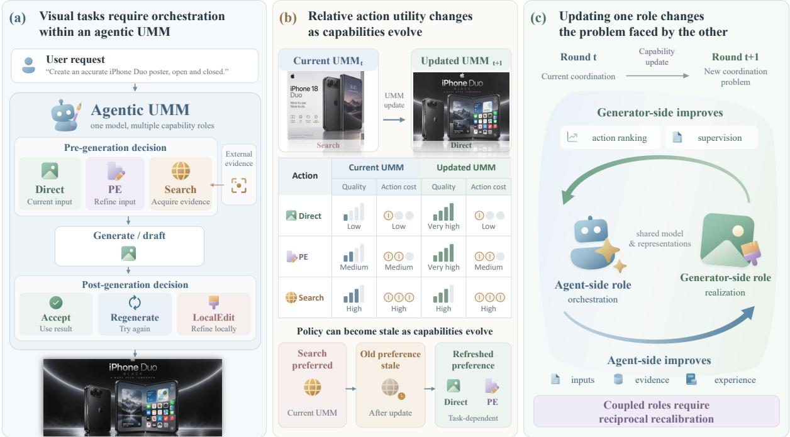  
Figure 1 Reciprocal learning in agentic visual generation. (a) Agent orchestration and generator realization are roles within a unified multimodal model (UMM); PE denotes prompt enhancement. (b) Generator learning changes action utility. (c) Agent learning changes inputs and evidence for later curricula. Images and quality levels are illustrative.

SearchGen already teaches the generator and then recalibrates its reasoner (Wang et al., 2026), while GenEvolve distills contrasting trajectory experience into an evolving agent (Chen et al., 2026b). Building on these advances, we study three linked decisions: Who should learn? Which actions remain useful after an update? What should the updated roles learn next?

We introduce RSIgen, a framework for reciprocal self-improvement. Dynamic Responsibility Routing (DRR) uses matched interventions on evidence, inputs, and supported actions to select learning recipients and skill subtypes and construct compatible targets.

After generator learning, RSIgen repeats afected action comparisons with the agent, branch inputs, evidence, evaluator, and image seeds fixed. These comparisons refresh supervision according to updated relative action utility across acquisition, input construction, stopping, and supported repair. The agent then learns with the updated generator fixed, and the retained roles construct the next curriculum.

Across BAGEL, Qwen-Image, and Wan-Image-7B, RSIgen improves AgentGen-Bench Full Overall9 by 3.2–3.3 points over SearchGen-3 + costs, our three-cycle SearchGen adaptation with action costs. Blind evaluation on 200 real-user requests yields pooled tie-adjusted preferences of 70.0% for task completion and 64.9% for visual quality against this baseline.

Our contributions, with mechanism studies on Wan, are:

• Diagnosis-guided allocation: distinguish execution choices from learning-recipient allocation and construct compatible targets, with gains at matched role-level training exposure.

• Supervision refresh: re-evaluate tested pre- and post-generation actions after generator learning, improving adaptation over current-generator on-policy learning at a shared total budget.

• Reciprocal curriculum analysis: establish the benefit of updated curriculum sources through controls that freeze those sources while keeping recipient learning active.

## 2 Related Work

Agentic visual generation. Retrieval-augmented generation addresses knowledge and reference requirements through external information. Re-Imagen conditions synthesis on retrieved image– text pairs, while retrieval-augmented difusion uses retrieved image embeddings (Chen et al., 2022; Rombach et al., 2022). Agentic systems decide how to acquire and use this information: Gen-Searcher learns search decisions with a frozen generator and image/text feedback; ToolArtist learns native multimodal tool use; Qwen-Image-Agent organizes planning, search, and memory; and Unify-Agent jointly supervises textual trajectories and image generation (Feng et al., 2026; Zhao et al., 2026; Zhang et al., 2026b; Chen et al., 2026a). RSIgen studies how experience from this process should train diferent capabilities and how action supervision should change when the generator also learns.

Experience reuse and generator-dependent adaptation. SearchGen trains the generator with Difusion-DPO and recalibrates the reasoner through positive-advantage rejection finetuning with the updated generator (Wang et al., 2026). Generator-dependent adaptation is therefore already part of its design. RSIgen adds matched diagnosis for recipient-specific targets and explicit re-evaluation of acquisition and repair supervision. SearchGen-3 + costs is our local three-cycle extension of the original single DPO–RFT pass, so both systems undergo repeated adaptation. GenEvolve extracts structured experience from contrasting same-request trajectories and supplies it to a privileged teacher for token-level distillation (Chen et al., 2026b). RSIgen instead asks which role should learn from a validated experience and when its action labels should be reconsidered.

Reciprocal multimodal self-improvement. HermesFlow aligns cross-task preferences; UniRL and UniCorn construct multimodal learning tasks from generated experience; SUDER introduces dual self-rewards; and Ask, Solve, Generate alternates role-specific updates (Yang et al., 2025; Mao et al., 2025; Han et al., 2026a; Hong et al., 2025; Thawkar et al., 2026). Internal Gap revisits previously underutilized samples as capabilities improve, while Dreaming in Flow combines flow-level feedback with visual replay grounding (Han et al., 2026b; Hao et al., 2026). RSIgen couples the roles through curriculum construction and action supervision: generator learning changes useful agent decisions, and agent learning changes the experience available for later generator training. Its construction-source controls evaluate the latter direction while recipients continue learning.

Optimization and feedback. Flow matching, DPO, Difusion-DPO, and GRPO provide the underlying optimization tools (Lipman et al., 2022; Rafailov et al., 2023; Wallace et al., 2023; Shao et al., 2024). Flow-GRPO, T2I-R1, UniGRPO, and UniRL-Zero apply outcome-driven optimization to generation or multimodal reasoning (Liu et al., 2025; Jiang et al., 2025; Liu et al., 2026; Wang et al., 2025a). Understanding-based rewards provide feedback for multimodal learning (Pan et al., 2026; Wang et al., 2025b; Jin et al., 2025). RSIgen uses completed-image rewards and trajectory costs for RL, with probes selecting curricula and validated trajectories providing action supervision. COMA assigns credit within policy optimization, whereas DRR assigns compatible learning targets before optimization (Foerster et al., 2018). SPIN and self rewarding models also use model-generated supervision (Chen et al., 2024; Yuan et al., 2024). RSIgen updates capability roles under a fixed outer protocol, rather than modifying agent implementations or improvement mechanisms (Zhang et al., 2025, 2026a).

Scope of the comparison. SRUM freezes its understanding evaluator while training generation, and Endogenous Reprompting freezes generation while learning evaluation and reprompting (Jin et al., 2025; Tang et al., 2026). GEMS and Mind-Brush broaden agentic generation through memory, skills, search, and reasoning (He et al., 2026b,a). DAgger addresses the distribution induced by a changing policy (Ross et al., 2011); RSIgen additionally considers changing action utility induced by generator learning.

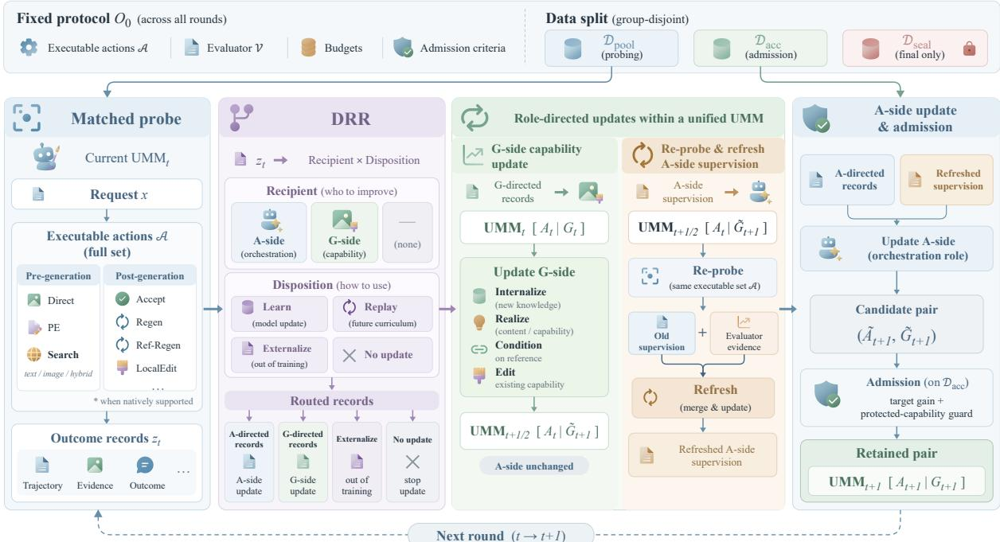  
Figure 2 RSIgen’s learning procedure. DRR compiles matched probes into typed curricula. Generator learning precedes re-probing and agent learning; retained roles construct the next curriculum. Pool, admission, and sealed evaluation data have separate roles. UMM denotes the unified model’s understanding/orchestration and generation roles. Evaluator feedback and capability memory support training.

## 3 Task-Centric Reciprocal Self-Improvement

RSIgen links learning-recipient allocation, supervision refresh, and recursive curriculum construction under a fixed outer protocol (Figure 2).

## 3.1 Task, capability roles, and outcome rewards

At round t, $S _ { t } = ( A _ { t } , G _ { t } , M _ { t } )$ comprises the native understanding/agent and generation roles of a unified multimodal backbone, plus outer-loop capability memory. Each update changes its recipient while holding the other role’s efective function fixed. Parameters follow the backbone; Wan uses full-parameter updates to the trained role. For request $x ,$

$$
x \xrightarrow { A _ { t } { : } \mathrm { T h i n k } } \mathrm { d e c i s i o n } \xrightarrow { A _ { t } { : } \mathrm { A c t i o n } } ( p , e ) \xrightarrow { G _ { t } } I \xrightarrow { \mathcal { E } _ { 0 } } y .\tag{1}
$$

The agent supplies prompt p and optional evidence/reference $e ;$ ${ \mathcal { E } } _ { 0 }$ scores the completed image. The agent observes images and tool results, but evaluator scores and $M _ { t }$ remain training-side resources.

Pre-generation actions are Direct, PromptEnhance, TextSearch, ImageSearch, and HybridSearch. Post-generation actions are accept, regenerate, reference-conditioned regenerate, and LocalEdit where natively supported. Conditioning and editing actions require native support.

Both RL stages use completed-image outcomes. With request-applicable checks $\mathcal { I } ( x )$ and normalized weights $w _ { j }$

$$
R _ { G } ( I , x , e ) = \sum _ { j \in \mathcal { I } ( x ) } w _ { j } v _ { j } ( I , x , e ) - \lambda _ { \mathrm { v i o l } } c _ { \mathrm { v i o l } } ( I , x , e ) ,\tag{2}
$$

$$
R _ { A } ( \tau , x ) = R _ { G } ( I _ { \mathrm { f i n a l } } , x , e _ { \mathrm { f i n a l } } ) - \lambda _ { s } C _ { s } ( \tau ) - \lambda _ { g } C _ { g } ( \tau ) - \lambda _ { l } C _ { l } ( \tau ) .\tag{3}
$$

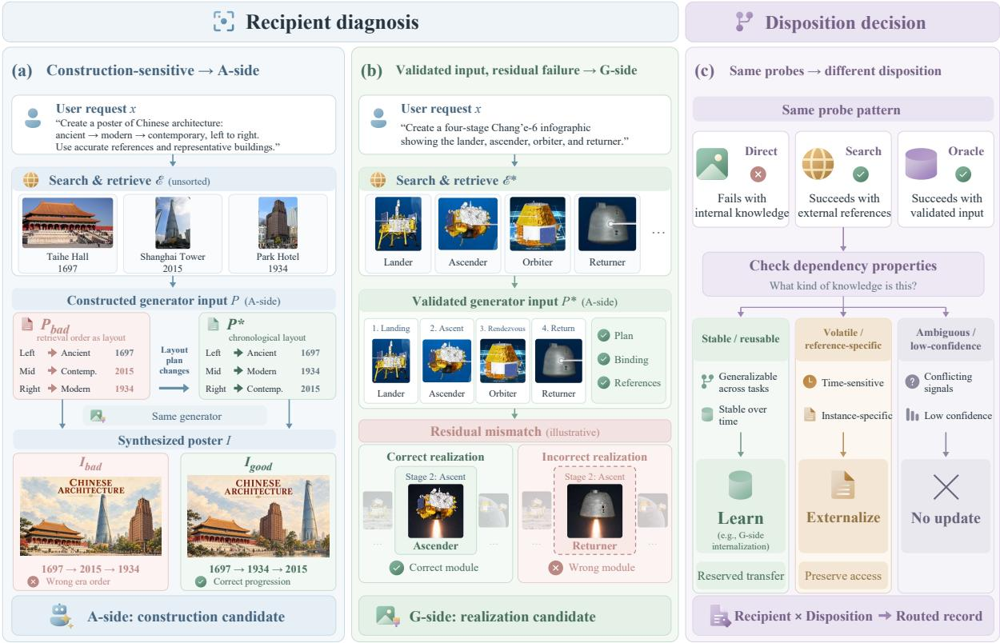  
Figure 3 Schematic routing decisions. (a) Holding evidence and generator fixed, a corrected layout repairs a chronology error and yields an agent-construction candidate. (b) A module mismatch under checked input yields a generator-realization candidate when a compatible target is available. (c) Learning, externalization, and deferral depend on the dependency’s properties and branch outcomes.

Checks $v _ { j }$ evaluate image requirements; $c _ { \mathrm { v i o l } }$ penalizes predefined violations. Factual/reference targets are anchored independently of agent-selected evidence. $C _ { s }$ counts searches, $C _ { g }$ generations/edits, and $C _ { l }$ horizon-normalized decisions. Probe scores construct curricula; reference/KL regularization belongs to optimization.

The objective is held-out quality $Q ( A , G )$ under training/inference budgets and a protectedcapability guard. Protocol $\Omega _ { 0 }$ fixes actions, compilation, update stages, rewards, and admission. Pool $\mathcal { D } _ { \mathrm { p o o l } }$ , admission $\mathcal { D } _ { \mathrm { a c c } } .$ and sealed evaluation $\mathcal { D } _ { \mathrm { s e a l } }$ remain source/request/artifact-group disjoint, including derived curricula and replay. Terminal reward alone cannot allocate learning; matched probes guide this decision.

## 3.2 Who should learn: diagnosis and curriculum compilation

Budgeted probes cover anchors, changed capability regions, uncertain comparisons, and undercovered requests. Matched interventions compare Direct, prompt enhancement, search modalities, Oracle evidence, and supported repairs:

$$
q _ { t } ( x , a ) = \frac { 1 } { K } \sum _ { k = 1 } ^ { K } s ( I _ { t } ^ { ( k ) } ( x , a ) , x ) ,\tag{4}
$$

where s scores the completed image. Comparisons fix the request, peer versions, evaluator, unafected inputs, and image seeds. Each branch’s retrieval artifacts are frozen for replay. Empty searches retain their outcomes and costs; unexecuted branches remain unmeasured.

Input checks validate request fidelity, evidence coverage, entity/reference binding, and interface compatibility. Oracle evidence is validated independently of image reward and serves diagnosis, not executable agent labels. Failed checks trigger reconstruction or no-update.

Dynamic Responsibility Routing (DRR) maps the versioned probe record $z _ { t }$ to a recipient, skill subtype, and disposition: learn, replay, externalize, or no-update (Figure 3; Table 1). Oracle repair of inadequate retrieval suggests agent acquisition; verified prompt corrections suggest agent construction. Residual failure under valid, requirement-complete inputs suggests generator realization. These are operational learning hypotheses, not unique causal identifications.

Successful search also ofers a learning use: Direct failure on stable reusable knowledge with validated Search success and no material Oracle gain suggests generator internalization. Volatile facts and instance-specific references retain external dependencies. Refresh tests whether learning supports no-search supervision.

For opportunity $o = \left( x , z _ { t } \right)$ , let $d _ { o , r }$ be a compatible input–target pair for recipient/subtype $r \in \mathcal { R } ( o )$ . DRR selects $\rho ( o ) \in \mathcal { R } ( o )$ or no-update and compiles $\mathcal { C } _ { r } = \{ d _ { o , r } : \rho ( o ) = r \}$ . Generator SFT requires a validated admissible image or successful generation target. Pool expansion independently validates each added example’s inputs, subtype, and target.

In the poster example, agent construction pairs the request, evidence, and original input with the executed correction. Internalization pairs an evidence-free student request with a validated assisted image:

$$
( p ^ { \mathrm { c t x } } , e ^ { * } ) \longrightarrow I ^ { * } , \qquad G : ( p ^ { \mathrm { D } } , \emptyset ) \longrightarrow I ^ { * } .\tag{5}
$$

The student preserves the request and entity identity but excludes retrieved facts and descriptions. Reference-following records retain their conditions. Generator curricula cover internalization, realization, reference following, and supported editing. Compatible flow generators use SFT/conditional flow matching and then Flow-GRPO for open-ended verifiable skills; internalization uses SFT only.

Routing precedence and admissible targets. DRR resolves upstream input failures before considering downstream realization. Regressions replay validated targets for their original recipient and subtype. Volatile dependencies remain external, while unresolved or mixed diagnoses are deferred. Table 1 summarizes the resulting routes.

Table 1 From probe outcomes to typed curricula. A route is admitted only when its inputs and training target are valid for the recipient. Oracle serves diagnosis and is excluded from executable agent labels.
<table><tr><td>Probe pattern</td><td>Recipient/subtype</td><td>Compiled training object</td></tr><tr><td>Oracle repairs inadequate retrieval</td><td>Agent: acquisition</td><td>Valid query and evidence-selection trajectory</td></tr><tr><td>Corrected input repairs the output</td><td>Agent: construction</td><td>Executed corrected prompt or condition</td></tr><tr><td>Search repairs a stable-knowledge failure</td><td>Generator: internalization</td><td>Evidence-free prompt and validated assisted image</td></tr><tr><td>Failure persists with sufficient valid input</td><td>Generator: realization</td><td>Compatible rendering, reference, or edit</td></tr><tr><td>Previously mastered capability regresses</td><td>Original recipient/replay</td><td>pair Validated prior target</td></tr><tr><td>Volatile dependency or unresolved diagnosis</td><td>Externalize or no-update</td><td>Retained access or further probes</td></tr></table>

## 3.3 Which actions remain useful: post-generator refresh

Post-generator probes cover afected regions, uncertain comparisons, and anchors with the agent, branch inputs, evidence, source images, continuation, evaluator, and seeds fixed. On common tested executable branches $\mathcal { A } _ { x } ^ { P }$ , empirical terminal values define a tolerance-aware preferred set:

$$
\begin{array} { r l } & { \widehat { V } _ { t } ( x , a ) = \displaystyle \frac { 1 } { K } \sum _ { k = 1 } ^ { K } R _ { A } ( \tau _ { t , k } ^ { a } , x ) , } \\ & { \widehat { B } _ { t } ^ { \epsilon } ( x ) = \left\{ a \in \mathcal { A } _ { x } ^ { P } : \widehat { V } _ { t } ( x , a ) \geq \displaystyle \operatorname* { m a x } _ { b \in \mathcal { A } _ { x } ^ { P } } \widehat { V } _ { t } ( x , b ) - \epsilon \right\} . } \end{array}\tag{6}
$$

Here $\tau _ { t , k } ^ { a }$ forces branch a with the common continuation. Replacing $G _ { t }$ with $\widetilde { G } _ { t + 1 }$ under matched conditions defines $\widehat { B } _ { t + 1 / 2 } ^ { \epsilon }$ . Old supervision is stale when its action becomes invalid or materially inferior under the updated generator. A preferred-set change need not invalidate a near-optimal old label; ambiguous comparisons can remain unlabeled. Rankings depend on diferential action improvement.

An internalization-based no-search target additionally requires evidence-free success on reserved new uses of the same knowledge unit, a small remaining Search–Direct gap, and preserved assisted success. Failure of both branches never licenses this target. Refreshed supervision covers search, query/reference selection, prompt construction, stopping, and supported repair. The agent learns from validated executed trajectories through SFT, then GRPO with the updated generator fixed.

The efect of a generator update on rankings depends on diferential gains. Define $\gamma _ { t } ( x , a ) =$ $\widehat { V } _ { t + 1 / 2 } ( x , a ) - \widehat { V } _ { t } ( x , a )$ . Then

$$
\begin{array} { r l } & { \widehat { V } _ { t + 1 / 2 } ( x , a ) - \widehat { V } _ { t + 1 / 2 } ( x , b ) = \widehat { V } _ { t } ( x , a ) - \widehat { V } _ { t } ( x , b ) } \\ & { \qquad + \gamma _ { t } ( x , a ) - \gamma _ { t } ( x , b ) . } \end{array}\tag{7}
$$

Equal gains preserve the pairwise diference. A preferred set can change while an old label remains competitive, distinguishing an action shift from label staleness. Task success is evaluated separately from the relative ranking of branches.

## 3.4 What the roles learn next: recursive construction and admission

Writing $z _ { t + 1 / 2 }$ for post-generator probes, an update attempt is

$$
\begin{array} { r l } & { \widetilde { G } _ { t + 1 } = \mathcal { U } _ { G } ( G _ { t } ; \mathcal { C } _ { A  G } ( z _ { t } , M _ { t } , \mathcal { D } _ { \mathrm { p o o l } } ) ) , } \\ & { \widetilde { A } _ { t + 1 } = \mathcal { U } _ { A } ( A _ { t } ; \mathcal { C } _ { G  A } ( z _ { t + 1 / 2 } , M _ { t } , \mathcal { D } _ { \mathrm { p o o l } } ) , \widetilde { G } _ { t + 1 } ) . } \end{array}\tag{8}
$$

Here $G  A$ denotes supervision compiled from generator behavior. Memory stores versioned outcomes for diagnosis, expansion, and replay. After admission, retained roles construct new experience through the fixed collector $\mathcal { P } _ { \Omega _ { 0 } }$

$$
z _ { t + 1 } = \mathcal { P } _ { \Omega _ { 0 } } ( A _ { t + 1 } , G _ { t + 1 } , M _ { t + 1 } ; \mathcal { D } _ { \mathrm { p o o l } } ) \longrightarrow { \mathcal C } _ { A  G } ^ { t + 1 } \longrightarrow \widetilde { G } _ { t + 2 } .\tag{9}
$$

These construction peers supply updated evidence, inputs, and outcomes for subsequent curricula. Source controls freeze them while recipient learning and current-partner RL remain active, testing their combined contribution to content, target validity/yield, and supervision freshness (Section 5.5).

Admission compares target quality and protected generation/understanding capabilities with the retained state on identical held-out subsets, separate from curricula and rewards. Rejected attempts retain the state and consume their budget. Final evaluation compares retained endpoints with initialization and matched controls.

Protected-capability admission. For each candidate $\widetilde { S } _ { t + 1 }$ , let ${ \mathcal { D } } _ { \mathrm { p r o t e c t } , } ^ { G }$ and $\mathcal { D } _ { \mathrm { p r o t e c t } , t } ^ { A }$ be held-out generation and understanding subsets. Candidate and retained components are evaluated on identical items and settings within the attempt. For protected capability c, the guard is

$$
\Delta _ { c , t } = Q _ { c , t } ( \widetilde { S } _ { t + 1 } ) - Q _ { c , t } ( S _ { t } ) \geq - \epsilon _ { c } , \qquad \mathrm { f o r ~ e v e r y ~ p r o t e c t e d } ~ c .\tag{10}
$$

Here $Q _ { c , t }$ evaluates the relevant component: generation checks keep raw prompts fixed without agent assistance, and understanding checks invoke the agent’s native understanding role without generation. Admission also requires the target-quality criterion. Protected items do not enter curriculum construction, training rewards, or the sealed final evaluation. The comparator is the current retained state $S _ { t } .$ , and rejection leaves that state unchanged.

The tolerance $\epsilon _ { c }$ applies locally to the protected subset at each admitted update, relative to the current retained state. Successive accepted steps can accumulate their permitted losses.

## 4 Experimental Setup

## 4.1 Backbones, benchmark, and comparison methods

We evaluate BAGEL, Qwen-Image, and Wan-Image-7B, with mechanism studies on Wan. Qwen-Image uses Qwen2.5-VL as its condition encoder (Wu et al., 2025); Wan uses full-parameter updates to the trained role. Within each backbone, trained comparisons share initialization, tools, resource allowances, corresponding seeds, and three update attempts. Direct and prompt enhancement provide untrained inference references.

Agentic initialization is the starting tool-using pair. Agent-only adaptation follows Gen-Searcher with a fixed generator and RSIgen’s completed-image outcome and trajectory-cost contract; the original Gen-Searcher also uses final-text feedback (Feng et al., 2026). SearchGen-3 + costs repeats Difusion-DPO and positive-advantage rejection finetuning for three cycles (Wang et al., 2026). Joint outcome RL trains both roles from terminal outcomes. Uniform reciprocal learning shares RSIgen’s role-specific optimization stages and refresh, while changing curriculum allocation. Uniform and failure-locus comparisons evaluate the curriculum package; one-sided updates test which roles need to learn.

Benchmark and metrics. AgentGen-Bench contains 751 requests. We follow its released Overall9 aggregation and evaluator (Wang et al., 2026); the original paper called it SearchGen-Bench. Overall9 averages Checklist, Rubric, Prompt Faithfulness, Image Quality, Text Rendering, AI Naturalness, Composition, Physical Plausibility, and Visual Reference, excluding Text Reference. NoSearch (NS) and Search-Intensive (SI) are the benchmark strata; Full is the global mean over each model’s scored coverage. Applicable metric denominators difer, so averaging displayed components or nominal-count weighting of rounded NS/SI scores need not reproduce Full. Public rows have model-dependent coverage: Nano Banana Pro reports 738/751 scored requests and GPT-Image-2 718/751, whereas the published BAGEL and Qwen-Image rows cover 751/751. For example, the former’s published Full 65.0 difers from 64.9 obtained by nominal-count weighting of its rounded stratum scores. Evaluation references are distinct from runtime retrieval inputs and training targets. Dataset and public-result definitions follow the benchmark release and project results.

## 4.2 Matched mechanism studies

The allocation study uses 4,000 opportunities and matches role-level exposure: 1,600 agent items with 3.2M SFT and 2.4M RL tokens, and 2,000 generator items with 4,000 SFT and 7,200 RL image presentations. This comparison is separate from the original curriculum-package ablation.

The action-refresh diagnostic uses 200 held-out Test-mini requests, separate from training, tuning, checkpoint selection, and the human-evaluation requests. It compares $( G _ { 0 } , G _ { 1 } ) , ( G _ { 1 } , G _ { 2 } )$ , and $( G _ { 2 } , G _ { 3 } )$ under fixed prompts, evidence, action packages, and paired image seeds, with 200 canonical post-states per stage. Action probing uses eight images per action/version. Stale-label and refresh continuation share agent initialization, training requests, the updated rollout generator, and realized token/training-compute budgets. A separate Stage-2 comparison additionally includes current-generator on-policy learning and matches preparation, rollout, and optimization within a common 100-unit budget: $c = 1 0 0 C / B _ { \mathrm { a d a p t } }$ , so one unit is 1% of the single-stage budget.

Construction-source controls keep recipient learning and current-partner RL active, while freezing the agent, generator, or both as curriculum sources. Every arm uses 1,800 agent and 2,200 generator records per attempt, totaling 5,400 and 6,600. Separate role evaluation uses 200 requests and four image seeds per request/state; agent evaluation fixes $G _ { 0 }$ , and generator evaluation distinguishes direct and assisted inputs.

## 4.3 Human judgments, statistical units, and resource accounting

Human evaluation compares RSIgen with SearchGen-3 + costs on the same 200 real-user requests across all three backbones. Three independent blind ratings per pair assess task completion and visual quality, giving 600 judgments per backbone and 1,800 pooled judgments per dimension. Preference credits a tie as half a win. Repeated ratings and reuse across backbones do not increase the number of distinct requests.

Main benchmark results aggregate multiple training seeds. The continuation diagnostic uses 10,000 paired request-cluster bootstrap replicates, retaining all stages, matched branches, and policy arms for each sampled request. Conditional metrics recompute their numerators and denominators in each resample before the equal-weight stage mean. The resulting percentile 95% intervals quantify request variation conditional on checkpoints and frozen evidence, separately from variation across training runs. Image seeds are generation replicates; sequential stages describe progression. Searches and generations/edits are counted per request, with diferent calls potentially having diferent compute and latency costs. Failed calls and rejected attempts consume their assigned budgets.

## 5 Results and Analysis

## 5.1 Benchmark quality and within-backbone comparisons

RSIgen reaches AgentGen-Bench Full scores of 39.9, 50.3, and 47.5 on BAGEL, Qwen-Image, and Wan-Image-7B (Table 2). Matched training comparisons in Table 3 show gains of 3.2, 3.2, and 3.3 points over SearchGen-3 + costs, and 3.7, 3.6, and 3.7 over uniform reciprocal learning. RSIgen also exceeds joint outcome RL on every backbone. Improvements over SearchGen-3 + costs in Table 3 are larger on SI (3.4–3.6 points) than NS (0.9–2.2).

Table 2 AgentGen-Bench overview (0–100). NS/SI: NoSearch/Search-Intensive; Full: Full-slice Overall9. Colors mark best and second-best within each group. Public rows have model-dependent coverage; matched training comparisons appear in Table 3.
<table><tr><td rowspan="2">Model</td><td colspan="2">Checklist</td><td colspan="2"></td><td colspan="2">Visual Ref. Image Quality</td><td colspan="3">Overall9</td></tr><tr><td>NS</td><td>SI</td><td>NS</td><td>SI</td><td>NS</td><td>SI</td><td>NS</td><td>SI Full</td><td></td></tr><tr><td colspan="10">Commercial Models</td></tr><tr><td>GPT-Image-2</td><td>84.8 74.4 70.9</td><td></td><td></td><td>70.4 73.4</td><td></td><td>77.4 78.9 75.5 76.0</td><td></td><td></td><td></td></tr><tr><td>Grok-Imagine-2.0-Low</td><td>83.073.168.7</td><td></td><td></td><td>68.3 72.5</td><td></td><td>76.976.974.975.2</td><td></td><td></td><td></td></tr><tr><td>Qwen-Image-3-Max</td><td>79.1 65.8 64.0</td><td></td><td></td><td>59.6 70.3</td><td></td><td>71.1 73.7 67.6 68.4</td><td></td><td></td><td></td></tr><tr><td>Nano Banana Pro</td><td>78.4 60.7</td><td></td><td>63.0</td><td>55.4 70.7</td><td></td><td>68.1</td><td>73.3</td><td></td><td>63.6 65.0</td></tr><tr><td>Qwen-Image-2</td><td>76.2 49.9</td><td></td><td>60.3</td><td>42.070.2</td><td></td><td>62.5</td><td>71.1</td><td>54.1</td><td>56.4</td></tr><tr><td colspan="10">Generation Only</td></tr><tr><td>Mage-Flow</td><td>64.2</td><td>23.0</td><td>47.1</td><td>16.2</td><td>64.7</td><td></td><td></td><td></td><td>38.7 61.2 28.4 32.8</td></tr><tr><td>Flux.2-Klein-9B</td><td>63.7</td><td>23.8</td><td>41.1</td><td>16.7</td><td>63.2</td><td>36.1 58.5 26.9 31.1</td><td></td><td></td><td></td></tr><tr><td>Flux.2-Klein-4B</td><td>55.8 20.1 35.3</td><td></td><td></td><td>12.7 59.7</td><td></td><td>33.0</td><td>52.3</td><td></td><td>23.927.7</td></tr><tr><td colspan="10">Unified MLLMs</td></tr><tr><td>SenseNova-U1</td><td>68.1 29.3 51.1</td><td></td><td></td><td>21.064.3</td><td></td><td>39.5 62.8 31.6 35.7</td><td></td><td></td><td></td></tr><tr><td>OmniGen2</td><td>49.1</td><td></td><td>16.4 30.6</td><td>9.556.4</td><td></td><td>29.2</td><td>47.4</td><td></td><td>20.4 24.0</td></tr><tr><td>Show-o2</td><td>32.7</td><td>8.1</td><td>19.9</td><td></td><td>3.4 47.2</td><td>30.2</td><td>34.4</td><td></td><td>17.5 19.8</td></tr><tr><td>BAGEL</td><td>51.5</td><td>18.7</td><td>32.1</td><td>14.2 56.2</td><td></td><td>30.4</td><td>49.1</td><td>22.2</td><td>25.8</td></tr><tr><td>BAGEL + RSIgen</td><td>63.4</td><td>36.4</td><td>45.6</td><td>27.4 61.4</td><td></td><td>43.3</td><td>60.4</td><td></td><td>36.8 39.9</td></tr><tr><td>Qwen-Image</td><td>74.9</td><td>25.0</td><td>60.1</td><td>17.7</td><td>69.2</td><td>37.9</td><td>70.0</td><td></td><td>28.634.1</td></tr><tr><td>Qwen-Image + RSlgen</td><td></td><td>77.2 47.3 63.4</td><td></td><td>37.4 70.7</td><td></td><td>52.3 73.2 46.8 50.3</td><td></td><td></td><td></td></tr><tr><td>Wan-Image-7B</td><td></td><td></td><td>65.3 22.3 49.3</td><td>16.3 65.1</td><td></td><td>37.2 62.3 27.4 32.1</td><td></td><td></td><td></td></tr><tr><td>Wan-Image-7B + RSIgen</td><td>70.4</td><td>44.3</td><td>55.4</td><td>35.4</td><td>67.2</td><td>50.2</td><td>67.3</td><td>44.4 47.5</td><td></td></tr></table>

Table 4 breaks down the three backbones and their RSIgen variants by capability. On SI, Checklist improves by 17.7–22.3 points and Text Rendering by 26.2–30.2, compared with 12.9–14.4 for Image

Table 3 Matched within-backbone comparisons on AgentGen-Bench. Trained methods share initialization and resource allowances within each backbone; scores aggregate multiple training seeds. NS/SI denote NoSearch/Search-Intensive, and Full is the global Overall9 mean. Direct and prompt enhancement are untrained Wan references; dashes indicate results not reported in this comparison.
<table><tr><td rowspan="3">Method</td><td colspan="2">BAGEL</td><td colspan="4">Qwen-Image</td><td colspan="4">Wan-Image-7B</td></tr><tr><td colspan="2">NS</td><td colspan="2">SI Full</td><td colspan="2">NS</td><td colspan="2">SI Full</td><td colspan="2">NS SI</td></tr><tr><td></td><td></td><td></td><td></td><td></td><td></td><td colspan="2">62.3</td><td>27.4</td><td>Full 32.1</td></tr><tr><td>Direct</td><td colspan="9"></td></tr><tr><td>Prompt enhancement</td><td colspan="9"></td><td>64.1 31.2 35.6</td></tr><tr><td>Agentic initialization</td><td colspan="9">54.2 25.4 29.3 70.6 35.3 40.0 64.3 33.4 37.5</td></tr><tr><td colspan="9">A-only / Gen-Searcher adapt. 56.3 29.4 33.0 71.2 39.4 43.6 65.2 36.3 58.2 33.4 36.7 72.3 43.2 47.1 6</td><td rowspan="2">40.2 66.2 40.8 44.2</td></tr><tr><td colspan="9">SearchGen-3 + costs</td></tr><tr><td colspan="9">Joint outcome RL</td></tr><tr><td colspan="9">Uniform reciprocal</td></tr><tr><td colspan="9">58.6 32.8 36.2 2 72.1 42.8 46.7 6 RSIgen</td></tr><tr><td colspan="9">60.4 36.8 39.9 73.2 46.8 50.3 67.3 44.4 47.5</td></tr></table>

Quality. Improvements therefore span task requirements and text rendering as well as visual quality. These before/after backbone comparisons complement the matched training controls in Table $^ { 3 ; }$ component scores use the benchmark’s applicable denominators.

Table 4 Component scores for the three backbones and their RSIgen variants. Ch: Checklist; Ru: Rubric; Pr: Prompt Faithfulness; IQ: Image Quality; Tx: Text Rendering; Nat: AI Naturalness; Co: Composition; Ph: Physical Plausibility; VR: Visual Reference. Overall9 appears in Table 2.
<table><tr><td>Model</td><td>Ch Ru</td><td>Pr</td><td>IQ</td><td>Tx</td><td>Nat</td><td>Co</td><td>Ph VR</td></tr><tr><td>A. NoSearch (NS)</td><td></td><td></td><td></td><td></td><td></td><td></td><td></td></tr><tr><td>BAGEL</td><td>51.5 49.2</td><td>37.7</td><td>56.2</td><td>16.1</td><td>48.8 62.8</td><td>58.5</td><td>32.1</td></tr><tr><td>BAGEL + RSIgen</td><td>63.4 62.1</td><td>58.3</td><td>61.4</td><td>50.6</td><td>60.2 68.4</td><td>73.2</td><td>45.6</td></tr><tr><td>Qwen-Image</td><td>74.9 72.0</td><td>65.5</td><td>69.2</td><td>61.1</td><td>61.7 77.0</td><td>78.6</td><td>60.1</td></tr><tr><td>Qwen-Image + RSlgen</td><td>77.2 76.1</td><td>72.4</td><td>70.7</td><td>68.4</td><td>69.2 80.1</td><td>81.3</td><td>63.4</td></tr><tr><td>Wan-Image-7B</td><td>65.3 63.2</td><td>57.4</td><td>65.1</td><td>54.3</td><td>57.2 73.4</td><td>75.1</td><td>49.3</td></tr><tr><td>Wan-Image-7B + RSlgen</td><td>70.4 69.2</td><td>65.3</td><td>67.2</td><td>60.4</td><td>63.2 76.1</td><td>75.4</td><td>55.4</td></tr><tr><td>B. Search-Intensive (SI)</td><td></td><td></td><td></td><td></td><td></td><td></td><td></td></tr><tr><td>BAGEL BAGEL + RSIgen</td><td>18.7 17.7</td><td>12.4</td><td>30.4</td><td>2.2</td><td>25.0 32.4</td><td></td><td>38.1 14.2</td></tr><tr><td>Qwen-Image</td><td>36.4 35.2 25.0 23.8</td><td>31.4 17.4</td><td>43.3 37.9</td><td>29.5</td><td>37.2 44.3</td><td>44.8</td><td>27.4</td></tr><tr><td>Qwen-Image + RSlgen</td><td></td><td>42.4</td><td>52.3</td><td>9.2 39.4</td><td>29.9 41.0</td><td></td><td>45.517.7</td></tr><tr><td></td><td>47.3 46.2</td><td></td><td>15.4 37.2</td><td></td><td>45.2 55.1</td><td></td><td>55.7 37.4</td></tr><tr><td>Wan-Image-7B</td><td>22.3 21.2</td><td></td><td></td><td>10.3</td><td>30.2 41.3</td><td></td><td>51.2 16.3</td></tr><tr><td>Wan-Image-7B + RSlgen</td><td>44.3</td><td>43.2 39.4 50.2</td><td></td><td>36.5</td><td>43.2</td><td>53.4 53.2 35.4</td><td></td></tr></table>

## 5.2 Human evaluation on real-user requests

RSIgen receives more wins than losses for both dimensions on every backbone (Table 5). Tieadjusted task-completion preference ranges from 68.5% to 71.4%, and visual-quality preference from 63.5% to 66.1%. The pooled scores are 70.0% and 64.9%, respectively.

The full counts distinguish raw wins from tie-adjusted preference: task completion gives 100(972 + $5 7 7 / 2 ) / 1 8 0 0 = 7 0 . 0 \%$ , versus a raw win proportion of 54.0%; visual quality gives 100(828 + $6 7 9 / 2 ) / 1 8 0 0 = 6 4 . 9 \%$ , versus 46.0% raw wins. Unknown judgments are zero throughout. Equal judgment counts make pooled preferences equal to the unrounded, equally weighted backbone averages. These are descriptive point estimates on 200 distinct requests, without request-cluster confidence intervals.

## 5.3 Diagnostic allocation and quality–tool-use tradeoffs

Table 6 tests the Wan curriculum package and updated roles. Agent-only and generator-only updates reach 40.2 and 41.7, compared with RSIgen’s 47.5. Uniform reciprocal and failurelocus-only routing reach 43.8 and 44.1. Removing post-generator re-probing lowers Full to 45.0; removing capability memory or pool expansion lowers it to 45.9 or 45.3. These comparisons evaluate the combined curriculum recipe, including which opportunities and compatible targets reach each role.

Table 5 Blind human evaluation against SearchGen-3 + costs on the same 200 real-user requests. Each backbone has 600 judgments per dimension (three ratings per pair); Overall pools 1,800 judgments on those same requests. W/T/L is from RSIgen’s perspective; preference is $1 0 0 ( W + 0 . 5 T ) / ( W + T + L )$ Unknown judgments are zero.
<table><tr><td></td><td colspan="2">Task completion</td><td colspan="2">Visual quality</td></tr><tr><td>Backbone</td><td>W T /L</td><td>Pref.</td><td>W T /L</td><td>Pref.</td></tr><tr><td>BAGEL</td><td>312 198 90</td><td>68.5%</td><td>264 234 102</td><td>63.5%</td></tr><tr><td>Qwen-Image</td><td>324 194 82</td><td>70.2%</td><td>276 228 96</td><td>65.0%</td></tr><tr><td>Wan-Image-7B</td><td>336 185 79</td><td>71.4%</td><td>288 217 95</td><td>66.1%</td></tr><tr><td>Overall</td><td>972 577/ 251</td><td>70.0%</td><td>828 679 293</td><td>64.9%</td></tr></table>

Table 6 Wan ablations on AgentGen-Bench. Full measures quality; S and G/E count inference searches and generations/edits per request.
<table><tr><td>Variant</td><td>Full ↑ S</td></tr><tr><td>Full RSIgen</td><td>47.5 1.16</td></tr><tr><td>A-only updates</td><td>1.30 40.2 1.59 1.45</td></tr><tr><td>G-only updates</td><td>41.7 1.76 1.51</td></tr><tr><td>Uniform reciprocal</td><td>43.8 1.41 1.42</td></tr><tr><td>Failure-locus-only routing</td><td>44.1 1.51 1.44</td></tr><tr><td>No post-G re-probe</td><td>45.0 1.53 1.39</td></tr><tr><td>No capability memory</td><td>45.9 1.31 1.36</td></tr><tr><td>No full-pool expansion</td><td>45.3 1.29 1.35</td></tr><tr><td>No trajectory costs</td><td>48.0 1.86 1.56</td></tr></table>

Allocation under matched role exposure. The separate allocation study holds agent and generator training volumes fixed (Section 4). In Table 7, DRR reaches Full 47.4, gaining 1.4 over compatible uniform (46.0) and 1.1 over failure-locus (46.3). Searches and generations/edits decrease from 1.29/1.37 to 1.21/1.32 relative to compatible-uniform. Thus the gain persists at matched role-level item, token, and image exposure.

Table 7 Wan allocation comparison with matched role-level training exposure. ∆ is relative to compatibleuniform. These results are separate from the curriculum-package ablations.
<table><tr><td>Strategy</td><td></td><td>Full ↑ ∆ Full Searches ↓ Gen./edits ↓</td><td></td></tr><tr><td>Compatible-uniform</td><td>46.0</td><td>0.0</td><td>1.29 1.37</td></tr><tr><td>Failure-locus</td><td>46.3</td><td>+0.3</td><td>1.27 1.36</td></tr><tr><td>DRR</td><td>47.4</td><td>+1.4</td><td>1.21 1.32</td></tr></table>

All arms use 4,000 opportunities. Agent: 1,600 training entries, 3.20M SFT tokens and 2.40M RL tokens. Generator: 2,000 entries, 4,000 SFT and 7,200 RL image presentations. Calls are per request.

Inference quality and tool use. The no-cost variant reaches Full 48.0 versus RSIgen’s 47.5, with searches rising from 1.16 to 1.86 and generations/edits from 1.30 to 1.56 per request: 60.3% and 20.0% increases from the displayed averages. Trajectory costs trade 0.5 quality points for fewer inference calls. RSIgen also achieves higher quality with slightly fewer calls than SearchGen-3 + costs across all three backbones (Table 8). Call counts measure tool use rather than wall-clock latency.

Table 8 Inference-call averages for SearchGen-3 + costs and RSIgen. Counts charge search and generation/edit calls; diferent calls can have diferent latency and compute costs.
<table><tr><td>Backbone</td><td>Method</td><td>Full Searches</td><td>Generations/edits</td></tr><tr><td>BAGEL</td><td>SearchGen-3 + costs</td><td>36.7</td><td>1.21 1.32</td></tr><tr><td>BAGEL</td><td>RSIgen</td><td>39.9 1.18</td><td>1.31</td></tr><tr><td>Qwen-Image</td><td>SearchGen-3 + costs</td><td>47.1 1.21</td><td>1.31</td></tr><tr><td>Qwen-Image</td><td>RSIgen</td><td>50.3 1.13</td><td>1.28</td></tr><tr><td>Wan-Image-7B</td><td>SearchGen-3 + costs</td><td>44.2 1.26</td><td>1.33</td></tr><tr><td>Wan-Image-7B</td><td>RSIgen</td><td>47.5 1.16</td><td>1.30</td></tr></table>

## 5.4 Action utility shifts and post-generator adaptation

Matched branches and evaluated populations. The diagnostic distinguishes changes in action utility from the policy’s response to new supervision. Old/new generator comparisons fix the agent, enhanced prompts, search evidence, references, source images, continuation, evaluator, and paired seeds. Search branches retain their artifacts and logical call costs, including when retrieval yields no usable evidence. A canonical post-state uses the same source image for both checkpoints and continuation arms. Accept returns that image; regeneration and reference-conditioned regeneration use the fixed input packages; LocalEdit is included only when the localized repair is identifiable and supported by both checkpoints. Edit ineligibility removes the action, while retaining the state in the other post-action metrics.

There are 200 evaluated pre-generation requests and 200 post-states per stage. Across 600 stage–request observations, text and image search yield no usable evidence in 162 (27.0%) and 204 (34.0%) cases, with zero infrastructure failures after retries. LocalEdit is eligible for 126, 121, and 116 states across the stages. Empty retrieval outcomes remain included in action values. End-to-end Mini O9 evaluates the separate complete policy workflow, including its chosen queries and induced state distribution.

Generator learning changes relative action utility. Table 9A reports preference shifts in 22.2% of pre-generation and 20.8% of post-generation decisions; old labels are stale in 17.0% and 15.7%. A shift changes the preferred action set, whereas staleness makes the old supervision action invalid or materially inferior. Pre-generation shift counts are 49, 44, and 40, and stale counts are 38, 34, and 30; post-generation shift counts are 45, 42, and 38, and stale counts are 34, 31, and 29. Headline rates average the stage proportions.

Search-to-Direct accounts for 69/133 = 51.9% of pre-generation shifts; Regenerate-to-LocalEdit accounts for 49/125 = 39.2% of post-generation shifts (Table 10). Accept’s image quality is checkpoint-invariant, so shifts involving Accept reflect changes in the relative benefit of intervention.

Measured branch examples. Two numerical cases, separate from the visual requests in Figure 7, illustrate diferential action gains. In one, Direct quality rises from 0.38 to 0.75 while Search remains at 0.82–0.83, narrowing the Search–Direct gap from 0.44 to 0.08. In a repair case, LocalEdit’s quality-minus-incremental-cost value rises from 0.54 to 0.77 and overtakes regeneration (0.62 to 0.64); Accept remains at 0.52 and reference-conditioned regeneration changes from 0.59 to 0.64.

Refreshed supervision improves continuation. Stale-label and refresh arms share initialization, requests, the updated rollout generator, and realized training compute. Refresh reduces pre/post regret from 5.37/4.60 to 3.30/3.00 and increases three-stage Mini O9 from 47.37 to 50.20. Table 9B also reports complementary alignment measures: Pre Track conditions on pre-generation shift cases, Post Agree uses all evaluated post-states, and LocalEdit precision/recall condition on eligible states. The direction is consistent across all three stages: refresh improves Mini O9 over stale continuation by 2.8, 2.9, and 2.8 points, and Pre Track by 25.9, 25.8, and 24.0 percentage points, respectively.

Table 9 Wan action refresh on Test-mini. A: branch changes over 200 requests and 200 canonical post-states per stage, with 95% intervals in brackets. B: matched continuation with the updated generator; the final column gives refresh-minus-stale 95% intervals. All estimates average three stages. Intervals use 10,000 paired request-cluster bootstrap replicates and condition on checkpoints and frozen evidence.
<table><tr><td colspan="4">A. Action changes after generator updates</td></tr><tr><td>Decision</td><td>Evaluated per stage</td><td>Preference shift (%)</td><td>Stale labels (%)</td></tr><tr><td>Pre-generation</td><td>200</td><td>22.2 [18.1, 26.5]</td><td>17.0 [13.4, 20.9]</td></tr><tr><td>Post-generation</td><td>200</td><td>20.8 [16.9, 25.1]</td><td>15.7 [12.3, 19.3]</td></tr></table>

<table><tr><td colspan="5">B. Policy adaptation and paired differences</td></tr><tr><td>Metric</td><td>Old  $A _ { j }$ </td><td>Stale labels</td><td>Refresh</td><td>∆: 95% CI</td></tr><tr><td>Pre regret ↓</td><td>7.63</td><td>5.37</td><td>3.30</td><td>[−2.60, -1.60]</td></tr><tr><td>Post regret ↓</td><td>6.10</td><td>4.60</td><td>3.00</td><td>[−2.00, −1.20]</td></tr><tr><td>Mini O9 ↑</td><td>44.77</td><td>47.37</td><td>50.20</td><td>[1.80, 3.90]</td></tr><tr><td>Pre Track  $( \% ) \uparrow$ </td><td>34.0</td><td>52.9</td><td>78.2</td><td>[18.00, 32.00]</td></tr><tr><td>Post Agree  $( \% ) \uparrow$ </td><td>67.3</td><td>75.1</td><td>83.4</td><td>[5.00, 12.00]</td></tr><tr><td>LocalEdit precision  $( \% ) \uparrow$ </td><td>62.6</td><td>72.7</td><td>83.8</td><td>[7.00, 16.00]</td></tr><tr><td>LocalEdit recall (%)↑</td><td>49.5</td><td>61.4</td><td>76.3</td><td>[10.00, 20.00]</td></tr></table>

Regret uses reward units; percentage-metric diferences use percentage points. Pre Track conditions on pregeneration shifts, Post Agree uses all post-states, and LocalEdit precision/recall use eligible states.

Table 10 Grouped action transitions pooled across stages. Shares divide by 133 pre-generation or 125 postgeneration shifts. SearchModeSwitch includes switches involving HybridSearch; Repair groups admissible repair actions.
<table><tr><td>Phase</td><td>Transition</td><td>Count Share (%)</td></tr><tr><td>Pre</td><td>Search→Direct</td><td>69 51.9</td></tr><tr><td>Pre</td><td>Direct→Search</td><td>15 11.3</td></tr><tr><td>Pre</td><td>SearchModeSwitch</td><td>24 18.0</td></tr><tr><td>Pre</td><td>Search→PromptEnhance</td><td>13 9.8</td></tr><tr><td>Pre</td><td>PromptEnhance→Search</td><td>12 9.0</td></tr><tr><td>Post</td><td>Regenerate→LocalEdit</td><td>49 39.2</td></tr><tr><td>Post</td><td>ReferenceRegenerate→LocalEdit</td><td>21 16.8</td></tr><tr><td>Post</td><td>LocalEdit→Regenerate</td><td>16 12.8</td></tr><tr><td>Post</td><td>Accept→Repair</td><td>18 14.4</td></tr><tr><td>Post</td><td>Repair→Accept</td><td>21 16.8</td></tr></table>

Regret averages the best finite-bank action value minus the selected action value in the reward units of Eq. (3). Pre Track and Post Agree measure preference membership under the updated generator. Empty conditional denominators are undefined. Finite-sample maximization can bias absolute regret upward; for refresh-minus-stale contrasts on the same action bank, the common maximum cancels, leaving the diference between their selected-action values. Table 9 gives paired request-cluster 95% intervals, including [1.8, 3.9] for the Mini O9 gain, conditional on the checkpoints and frozen evidence.

Comparison with current-generator on-policy learning. The separate Stage-2 comparison charges preparation as well as rollout and optimization within the common 100-unit budget (Table 11). Refresh reaches Mini O9 50.0, versus on-policy learning’s 49.1 and stale supervision’s 47.2. Pre/post regret decreases from 4.0/3.7 to 3.5/3.2 relative to on-policy learning. These Stage-2 values difer from the preceding three-stage continuation means and should be interpreted under their own matched-budget comparison.

Figure 4 Wan curriculum-source controls on AgentGen-Bench Full. Recipients keep learning with current-partner RL while the named construction sources are frozen.  
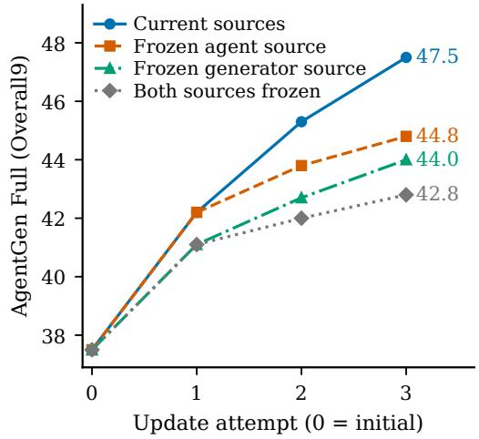

Table 11 Wan Stage-2 adaptation at a matched total budget of 100, including preparation, rollout, and optimization. On-policy uses the current generator; $\Delta$ O9 is relative to this arm. One cost unit is 1% of the common single-stage budget.
<table><tr><td>Metric</td><td>Current-G Stale on-policy Refresh</td><td></td></tr><tr><td>Quality and action selection</td><td></td><td></td></tr><tr><td>Mini O9 ↑</td><td>47.2 49.1 -1.9</td><td>50.0</td></tr><tr><td>Δ09</td><td>0.0</td><td>+0.9</td></tr><tr><td>Pre regret</td><td>5.40 4.00</td><td>3.50</td></tr><tr><td>Post regret</td><td>4.60 3.70</td><td>3.20</td></tr><tr><td>Adaptation cost</td><td></td><td></td></tr><tr><td>Preparation</td><td>5</td><td>0 20</td></tr><tr><td>Rollout</td><td>65</td><td>74 55</td></tr><tr><td>Optimization</td><td>30</td><td>26 25</td></tr><tr><td>Total</td><td>100</td><td>100 100</td></tr></table>

## 5.5 Updated construction sources and recursive curricula

Controls retain recipient learning. Freeze-A uses $A _ { 0 }$ to construct curriculum evidence and inputs; Freeze-G uses $G _ { 0 }$ for curriculum-side outcomes, including post-generator diagnosis. Freeze-both fixes both sources, while the full arm uses current sources. Trainable recipients continue learning in every arm, and agent RL uses its current updated generator. Source opportunities, retrieval snapshots, compiler, optimization stages, and resource caps define the matched comparison. Each arm derives its memory, targets, and scores from its designated sources. With common randomness, current and Freeze-A share the first attempt because both initially use $A _ { 0 }$

Current sources reach 47.5 on Wan, compared with 42.8 under dual freezing. Freezing only the agent gives 44.8; freezing only the generator gives 44.0. Successive quality gains with current sources diminish from 4.7 to 3.1 and 2.2 points across attempts (Figure 4). These controls measure the combined contribution of curriculum content, target validity/yield, and supervision freshness.

Usable curriculum yield at fixed training sizes. Each source arm considers 2,000 requests per phase, yielding 4,000 generator-target candidates before the generator update and 3,000 agent-target candidates afterward. Validity is the valid-to-candidate ratio. Cross-attempt construction totals count target entries, separately from selected training records and repeated optimization exposure. New, refreshed, and existing-use records partition the selected curriculum; existing use includes replay and first use of previously available targets.

Across three attempts, current sources yield 5,580/7,480 valid agent/generator targets, compared with 4,430/6,740 under dual freezing, with 1,950 versus zero refreshed agent targets. Every arm trains on 5,400/6,600 agent/generator items (Table 12). Quality therefore improves alongside validity and freshness at fixed selected training sizes, while content and construction yield change together.

## 5.6 Role trajectories and curriculum evolution

Performance under specified partners and inputs. Figure 5 evaluates four retained states on 200 requests with four image seeds per request/state. Agent evaluation fixes $G _ { 0 } ;$ generator scores distinguish direct and evidence-assisted inputs. These readouts are separate from system Full. Agent quality rises from 38.6 to 41.9 at $S _ { 2 }$ , then declines to 41.6; assisted/direct generator quality rises from 40.9/33.0 to 45.9/38.4. Generator improvement thus coexists with a nonmonotonic fixed-partner agent trajectory.

Table 12 Wan curriculum construction and supervision changes across the four source controls. Counts sum target entries across three attempts. Valid and new-valid counts describe construction; refreshed counts describe updated targets actually used for training.
<table><tr><td rowspan="2">Source</td><td colspan="3">Agent curricula</td><td colspan="3">Generator curricula</td></tr><tr><td>Valid</td><td>New valid Refreshed</td><td></td><td>Valid</td><td>New valid Refreshed</td><td></td></tr><tr><td>Current</td><td>5,580</td><td>2,660</td><td>1,950</td><td>7,480</td><td>4,140</td><td>970</td></tr><tr><td>Freeze-A</td><td>5,280</td><td>2,560</td><td>1,660</td><td>7,060</td><td>3,820</td><td>790</td></tr><tr><td>Freeze-G</td><td>4,690</td><td>2,270</td><td></td><td>4006,960</td><td>3,680</td><td>680</td></tr><tr><td>Freeze-both 4,430</td><td></td><td>2,120</td><td></td><td>06,740</td><td>3,540</td><td>570</td></tr></table>

Each arm uses 5,400 agent and 6,600 generator training entries over the three attempts. Repeated optimization of an entry contributes to exposure, not to these entry counts.

(a)  
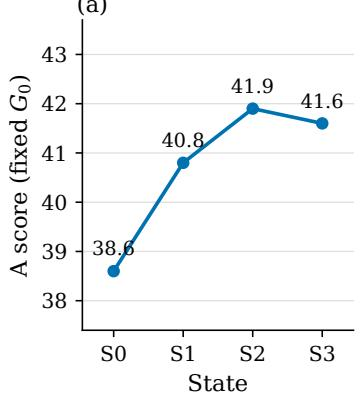

(b)  
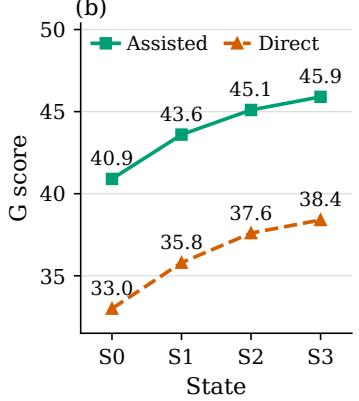

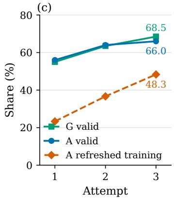  
Figure 5 Wan role performance and curriculum validity across retained states. Evaluation uses 200 requests and four image seeds per request/state; agent evaluation fixes $G _ { 0 }$ . Role scores and curriculum units are defined in Section 5.6.

(a)  
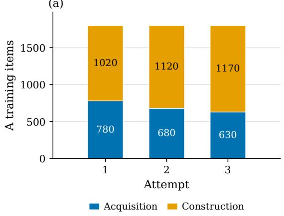

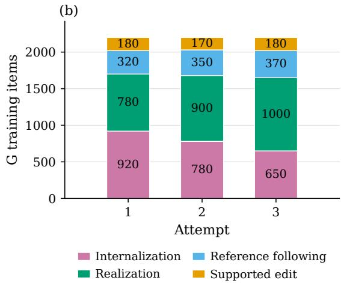  
Figure 6 Current-source training curricula across three Wan update attempts. Each bar counts selected items by recipient subtype, with totals of 1,800 agent and 2,200 generator items per attempt. Replay is included in its subtype; candidate counts and repeated optimization exposures use separate units.

Validity, freshness, and skill composition. For current sources, agent/generator construction validity rises from $5 6 . 0 \% / 5 5 . 0 \%$ to 66.0%/68.5%. Refreshed agent supervision grows from $4 2 0 / 1 8 0 0 = 2 3 . 3 \%$ to $8 7 0 / 1 8 0 0 = 4 8 . 3 \%$ , while newly valid generator/agent targets decline from 1,500/1,080 to 1,180/650. Validity and freshness improve within fixed training sizes even as fewer targets become newly valid.

Figure 6 shows the selected records by skill. Agent construction grows from 1,020 to 1,170 while acquisition falls from 780 to 630; generator realization grows from 780 to 1,000 while internalization falls from 920 to 650. Subtype and new/refreshed/existing-use categories are separate partitions of the same records, with fixed totals of 1,800 agent and 2,200 generator entries per attempt.

## 5.7 Qualitative results

生成一幅中国传统悬挂卷轴，展示宋代词人汪元量的《鹧鸪天·潋滟湖光绿正肥》全词。卷轴为竖式，宣纸材质，行楷书法，墨色浓淡有致，上下有深色木轴头，卷轴边缘微微泛黄。背景为素色书房墙面，左侧有印章。

Create a photorealistic annotated schematic diagram of the TLS 1.3 handshake protocol steps, showing client and server network nodes, encrypted message flows, and labeled stage markers.

Create a single wide landscape shot of two flagpoles in a courtyard. On the left, fly the Hong Kong city flag; on the right, fly the Qatar flag. Ensure the 11:28 ratio of the Qatar flag is clearly visible, making it look significantly longer than the other flag, centered in the frame.

A realistic space documentarystyle image of the SN 2023ixf Supernova appearing as a brilliant blue-white point of light within the spiral arm o the Pinwheel Galaxy (M101). Include the Earth as a small crescent in the far distance, making up about a 27% earth proportion of the frame.

Generate 4 variations of the same Steampunk brass orrery design showing different planetary alignments and mechanical complexity levels Present as one image in a four-quadrant (2x2) layout with one variation per quadrant.

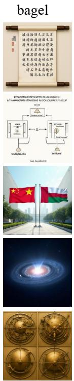

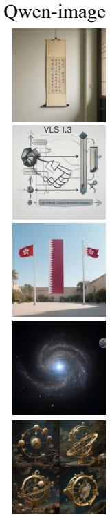

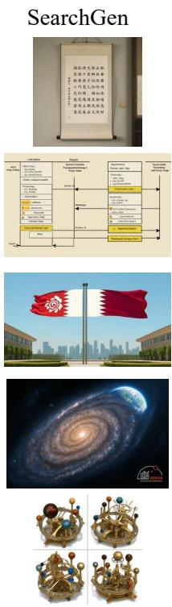

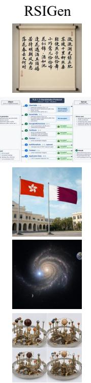  
Figure 7 Five-request comparison with complete prompts at left and BAGEL, Qwen-Image, Wan-Image, SearchGen, and RSIgen outputs in columns. Table 3 reports aggregate comparisons.

Figure 7 compares five requests with their complete evaluation prompts and 25 model outputs: calligraphy, TLS 1.3, flags, astronomy, and coordinated design variations. RSIgen separates client/server columns and labels protocol stages in the TLS example, and renders four orrery designs in a consistent grid. The other requests illustrate text, entity appearance, and scenecomposition requirements. These examples complement the aggregate benchmark and human judgments.

Figure 8 shows additional visual examples, including object depiction, sequential character scenes, product presentation, and stylized characters.

## 6 Discussion and Limitations

What the controls establish. The original uniform and failure-locus comparisons evaluate the diagnostic curriculum package. The matched-exposure allocation study isolates its benefit at equal role-level training volume; the matched-budget Stage-2 study compares refresh with ordinary current-generator adaptation. Construction-source freezes keep recipient learning active and measure the contribution of updated peers to curriculum content, validity/yield, and freshness. Their efects should be interpreted jointly rather than as a unique decomposition of causal responsibility.

For Wan, the descriptive diference-in-diferences of the final source-control endpoints is 47.5 − $4 4 . 8 - 4 4 . 0 + 4 2 . 8 = 1 . 5$ . This contrast summarizes combined content and target-yield efects; the primary result is the 4.7-point advantage of current over jointly frozen sources. Role trajectories also distinguish improving system quality from monotonic gains of every component under a fixed partner.

  
Figure 8 Additional RSIgen visual examples, including object depiction, sequential character scenes, product presentation, and stylized character designs.

Scope and uncertainty. Mechanism studies use Wan, whereas the benchmark improvements are evaluated across three backbones. Action comparisons use finite shared probe banks; their intervals measure request variation conditional on the trained checkpoints and frozen evidence. Human preferences are descriptive summaries of the evaluated real-user sample. Routing is an operational learning hypothesis rather than unique causal identification, and source controls change content and target yield together. The protected-capability tolerance is local to each accepted update; permitted losses can accumulate across successive steps.

Underlying generation capability. Current agentic visual generation systems, whether built from separate understanding and generation models or a unified model, often understand task requirements more reliably than they can realize them in generated images. RSIgen uses this capability asymmetry to improve collaboration between understanding and generation, translating stronger understanding into more efective supervision and better system-level performance. Nevertheless, the extent of further improvement remains constrained by the generative capabilities of the underlying models. Larger advances therefore also depend on improving these models’ ability to translate understood requirements into faithful visual outputs.

## 7 Conclusion

RSIgen connects diagnosis-guided learning allocation, supervision refresh, and reciprocal curriculum construction. It improves AgentGen-Bench quality across three backbones, with complementary human preferences on 200 real-user requests. Wan controls show allocation and refresh gains at matched exposure and adaptation budget, while source controls connect recursive improvement to target validity and supervision freshness at fixed curriculum sizes. The role trajectories highlight the importance of adapting coordination as capabilities change. Section 6 discusses the scope and limitations.

## References

Shuang Chen, Quanxin Shou, Hangting Chen, Yucheng Zhou, Kaituo Feng, Wenbo Hu, Yi-Fan Zhang, Yunlong Lin, Wenxuan Huang, Mingyang Song, Dasen Dai, Bolin Jiang, Manyuan Zhang, Shi-Xue Zhang, Zhengkai Jiang, Lucas Wang, Zhao Zhong, Yu Cheng, and Nanyun Peng. Unify-agent: A unified multimodal agent for world-grounded image synthesis, 2026a. https://arxiv.org/abs/2603.29620. arXiv:2603.29620; bibliographic record retrieved 2026-09-08.

Sixiang Chen, Zhaohu Xing, Tian Ye, Xinyu Geng, Yunlong Lin, Jianyu Lai, Xuanhua He, Fuxiang Zhai, Jialin Gao, and Lei Zhu. Genevolve: Self-evolving image generation agents via tool-orchestrated visual experience distillation, 2026b. https://arxiv.org/abs/2605.21605. Metadata verified against arXiv on 2026-09-19.

Wenhu Chen, Hexiang Hu, Chitwan Saharia, and William W. Cohen. Re-imagen: Retrieval-augmented text-to-image generator, 2022. https://arxiv.org/abs/2209.14491. arXiv:2209.14491; bibliographic record retrieved 2026-09-07.

Zixiang Chen, Yihe Deng, Huizhuo Yuan, Kaixuan Ji, and Quanquan Gu. Self-play fine-tuning converts weak language models to strong language models, 2024. https://arxiv.org/abs/2401.01335. arXiv:2401.01335; bibliographic record retrieved 2026-09-07.

Kaituo Feng, Manyuan Zhang, Shuang Chen, Yunlong Lin, Kaixuan Fan, Yilei Jiang, Hongyu Li, Dian Zheng, Chenyang Wang, and Xiangyu Yue. Gen-searcher: Reinforcing agentic search for image generation, 2026. https://arxiv.org/abs/2603.28767. arXiv:2603.28767; bibliographic record retrieved 2026-09-06.

Jakob Foerster, Gregory Farquhar, Triantafyllos Afouras, Nantas Nardelli, and Shimon Whiteson. Counterfactual multi-agent policy gradients. In Proceedings of the AAAI Conference on Artificial Intelligence, volume 32, 2018. doi: 10.1609/aaai.v32i1.11794. https://ojs.aaai.org/index.php/AAAI/article/ view/11794.

Ruiyan Han, Zhen Fang, XinYu Sun, Yuchen Ma, Ziheng Wang, Yu Zeng, Zehui Chen, Lin Chen, Wenxuan Huang, Wei-Jie Xu, Yi Cao, and Feng Zhao. Unicorn: Towards self-improving unified multimodal models

through self-generated supervision, 2026a. https://arxiv.org/abs/2601.03193. arXiv:2601.03193; bibliographic record retrieved 2026-09-06.

Yujin Han, Hao Chen, Andi Han, Zhiheng Wang, Xinyu Liu, Yingya Zhang, Shiwei Zhang, and Difan Zou. Turning internal gap into self-improvement: Promoting the generation-understanding unification in MLLMs. In International Conference on Learning Representations, 2026b. https://proceedings.iclr.cc/paper\_files/paper/2026/hash/ dceda5883d3223231bef121cc8da2d61-Abstract-Conference.html. Preprint arXiv:2507.16663.

Ke Hao, Yuanzhi Liang, Tingxi Chen, Rui Li, Haibin Huang, Chi Zhang, Yun Gu, and Xuelong Li. Dreaming in flow: Generative grounding feedback for self-evolving unified multimodal models, 2026. https://arxiv.org/abs/2609.08282.

Jun He, Junyan Ye, Zilong Huang, Dongzhi Jiang, Chenjue Zhang, Leqi Zhu, Renrui Zhang, Xiang Zhang, and Weijia Li. Mind-brush: Integrating agentic cognitive search and reasoning into image generation, 2026a. https://arxiv.org/abs/2602.01756. Metadata verified against arXiv on 2026-09-19.

Zefeng He, Siyuan Huang, Xiaoye Qu, Yafu Li, Tong Zhu, Yu Cheng, and Yang Yang. Gems: Agentnative multimodal generation with memory and skills, 2026b. https://arxiv.org/abs/2603.28088. Metadata verified against arXiv on 2026-09-19.

Jixiang Hong, Yiran Zhang, Guanzhong Wang, Yi Liu, Ji-Rong Wen, and Rui Yan. SUDER: Selfimproving unified large multimodal models for understanding and generation with dual self-rewards, 2025. https://arxiv.org/abs/2506.07963.

Dongzhi Jiang, Ziyu Guo, Renrui Zhang, Zhuofan Zong, Hao Li, Le Zhuo, Shilin Yan, Pheng-Ann Heng, and Hongsheng Li. T2i-r1: Reinforcing image generation with collaborative semantic-level and token-level cot, 2025. https://arxiv.org/abs/2505.00703. arXiv:2505.00703; bibliographic record retrieved 2026-09-06.

Weiyang Jin, Yuwei Niu, Jiaqi Liao, Chengqi Duan, Aoxue Li, Shenghua Gao, and Xihui Liu. SRUM: Finegrained self-rewarding for unified multimodal models, 2025. https://arxiv.org/abs/2510.12784.

Yaron Lipman, Ricky T. Q. Chen, Heli Ben-Hamu, Maximilian Nickel, and Matt Le. Flow matching for generative modeling, 2022. https://arxiv.org/abs/2210.02747. arXiv:2210.02747; bibliographic record retrieved 2026-09-07.

Jie Liu, Gongye Liu, Jiajun Liang, Yangguang Li, Jiaheng Liu, Xintao Wang, Pengfei Wan, Di Zhang, and Wanli Ouyang. Flow-grpo: Training flow matching models via online rl, 2025. https://arxiv. org/abs/2505.05470. arXiv:2505.05470; bibliographic record retrieved 2026-09-06.

Jie Liu, Zilyu Ye, Linxiao Yuan, Shenhan Zhu, Yu Gao, Jie Wu, Kunchang Li, Xionghui Wang, Xiaonan Nie, Weilin Huang, and Wanli Ouyang. Unigrpo: Unified policy optimization for reasoning-driven visual generation, 2026. https://arxiv.org/abs/2603.23500. arXiv:2603.23500; bibliographic record retrieved 2026-09-06.

Weijia Mao, Zhenheng Yang, and Mike Zheng Shou. Unirl: Self-improving unified multimodal models via supervised and reinforcement learning, 2025. https://arxiv.org/abs/2505.23380. arXiv:2505.23380; bibliographic record retrieved 2026-09-06.

Jiadong Pan, Liang Li, Yuxin Peng, Yu-Ming Tang, Shuohuan Wang, Yu Sun, Hua Wu, Qingming Huang, and Haifeng Wang. Learning to generate via understanding: Understanding-driven intrinsic rewarding for unified multimodal models, 2026. https://arxiv.org/abs/2603.06043. arXiv:2603.06043; bibliographic record retrieved 2026-09-06.

Rafael Rafailov, Archit Sharma, Eric Mitchell, Stefano Ermon, Christopher D. Manning, and Chelsea Finn. Direct preference optimization: Your language model is secretly a reward model, 2023. https: //arxiv.org/abs/2305.18290. arXiv:2305.18290; bibliographic record retrieved 2026-09-07.

Robin Rombach, Andreas Blattmann, and Björn Ommer. Text-guided synthesis of artistic images with retrieval-augmented difusion models, 2022. https://arxiv.org/abs/2207.13038. arXiv:2207.13038; bibliographic record retrieved 2026-09-07.

Stéphane Ross, Geofrey Gordon, and Drew Bagnell. A reduction of imitation learning and structured prediction to no-regret online learning. In Proceedings of the Fourteenth International Conference on Artificial Intelligence and Statistics, volume 15 of Proceedings of Machine Learning Research, pages 627–635. PMLR, 2011. https://proceedings.mlr.press/v15/ross11a.html.

Zhihong Shao, Peiyi Wang, Qihao Zhu, Runxin Xu, Junxiao Song, Xiao Bi, Haowei Zhang, Mingchuan Zhang, Y. K. Li, Y. Wu, and Daya Guo. Deepseekmath: Pushing the limits of mathematical reasoning

in open language models, 2024. https://arxiv.org/abs/2402.03300. arXiv:2402.03300; bibliographic record retrieved 2026-09-07.

Zhenchen Tang, Songlin Yang, Zichuan Wang, Bo Peng, Yang Li, Beibei Dong, and Jing Dong. Endogenous reprompting: Self-evolving cognitive alignment for unified multimodal models, 2026. https://arxiv. org/abs/2601.20305.

Ritesh Thawkar, Shravan Venkatraman, Omkar Thawakar, Abdelrahman Shaker, Fahad Khan, Hisham Cholakkal, Salman Khan, and Rao Muhammad Anwer. Ask, solve, generate: Self-evolving unified multimodal understanding and generation via self-consistency rewards, 2026. https://arxiv.org/ abs/2606.27376. arXiv:2606.27376; bibliographic record retrieved 2026-09-06.

Bram Wallace, Meihua Dang, Rafael Rafailov, Linqi Zhou, Aaron Lou, Senthil Purushwalkam, Stefano Ermon, Caiming Xiong, Shafiq Joty, and Nikhil Naik. Difusion model alignment using direct preference optimization, 2023. https://arxiv.org/abs/2311.12908. arXiv:2311.12908; bibliographic record retrieved 2026-09-07.

Fu-Yun Wang, Han Zhang, Michael Gharbi, Hongsheng Li, and Taesung Park. Unirl-zero: Reinforcement learning on unified models with joint language model and difusion model experts, 2025a. https: //arxiv.org/abs/2510.17937. arXiv:2510.17937; bibliographic record retrieved 2026-09-06.

Haozhe Wang, Weijia Feng, Jinpeng Yu, Che Liu, Ping Nie, Fangzhen Lin, Jiaming Liu, Ruihua Huang, Jimmy Lin, Wenhu Chen, and Cong Wei. Search beyond what can be taught: Evolving the knowledge boundary in agentic visual generation, 2026. https://arxiv.org/abs/2607.05382. arXiv:2607.05382; bibliographic record retrieved 2026-09-06.

Yibin Wang, Yuhang Zang, Hao Li, Cheng Jin, and Jiaqi Wang. Unified reward model for multimodal understanding and generation, 2025b. https://arxiv.org/abs/2503.05236. arXiv:2503.05236; bibliographic record retrieved 2026-09-06.

Chenfei Wu, Jiahao Li, Jingren Zhou, Junyang Lin, Kaiyuan Gao, Kun Yan, Sheng-ming Yin, Shuai Bai, Xiao Xu, Yilei Chen, Yuxiang Chen, Zecheng Tang, Zekai Zhang, Zhengyi Wang, An Yang, Bowen Yu, Chen Cheng, Dayiheng Liu, Deqing Li, Hang Zhang, Hao Meng, Hu Wei, Jingyuan Ni, Kai Chen, Kuan Cao, Liang Peng, Lin Qu, Minggang Wu, Peng Wang, Shuting Yu, Tingkun Wen, Wensen Feng, Xiaoxiao Xu, Yi Wang, Yichang Zhang, Yongqiang Zhu, Yujia Wu, Yuxuan Cai, and Zenan Liu. Qwen-image technical report, 2025. https://arxiv.org/abs/2508.02324. arXiv:2508.02324; bibliographic record retrieved 2026-09-08.

Ling Yang, Xinchen Zhang, Ye Tian, Shiyi Zhang, Chenming Shang, Minghao Xu, Wentao Zhang, and Bin Cui. HermesFlow: Seamlessly closing the gap in multimodal understanding and generation. In Advances in Neural Information Processing Systems, volume 38, 2025. doi: 10.52202/085713-2082. https://proceedings.neurips.cc/paper\_files/paper/2025/hash/ 59d4e18a60490b9ed9913f3be2b14839-Abstract-Conference.html.

Weizhe Yuan, Richard Yuanzhe Pang, Kyunghyun Cho, Xian Li, Sainbayar Sukhbaatar, Jing Xu, and Jason Weston. Self-rewarding language models, 2024. https://arxiv.org/abs/2401.10020. arXiv:2401.10020; bibliographic record retrieved 2026-09-07.

Jenny Zhang, Shengran Hu, Cong Lu, Robert Lange, and Jef Clune. Darwin godel machine: Open-ended evolution of self-improving agents, 2025. https://arxiv.org/abs/2505.22954. arXiv:2505.22954; bibliographic record retrieved 2026-09-06.

Jenny Zhang, Bingchen Zhao, Wannan Yang, Jakob Foerster, Jef Clune, Minqi Jiang, Sam Devlin, and Tatiana Shavrina. Hyperagents, 2026a. https://arxiv.org/abs/2603.19461. arXiv:2603.19461; bibliographic record retrieved 2026-09-06.

Zekai Zhang, Jiahao Li, Jie Zhang, Kaiyuan Gao, Kun Yan, Lihan Jiang, Ningyuan Tang, Shengming Yin, Tianhe Wu, Xiaoyue Chen, Xiao Xu, Yan Shu, Yanran Zhang, Yixian Xu, Yuxiang Chen, Zhendong Wang, Zihao Liu, Zikai Zhou, Huishuai Zhang, Dongyan Zhao, and Chenfei Wu. Qwen-image-agent: Bridging the context gap in real-world image generation, 2026b. https://arxiv.org/abs/2606.26907. arXiv:2606.26907; bibliographic record retrieved 2026-09-08.

Jiahao Zhao, Xiaomin Yu, Zhongxiang Sun, Fengwei Teng, Chengwei Qin, Xiaobin Hu, Jun Xu, and Shuicheng Yan. Toolartist: Tool-using unified multimodal models for agentic image generation, 2026. https://arxiv.org/abs/2608.04436. arXiv:2608.04436; bibliographic record retrieved 2026-09-06.