# Recasting DiT for Extreme Image Compression with Hierarchical Visual Priors

Yunuo Chen1 Jingnan Gao1 Bing He1 Jinjing Zhao2 Chuqin Zhou1 Xiaoyue Ling1 Li Song1 Guo Lu1\* Wenjun Zhang1 1Shanghai Jiao Tong University 2University of Sydney

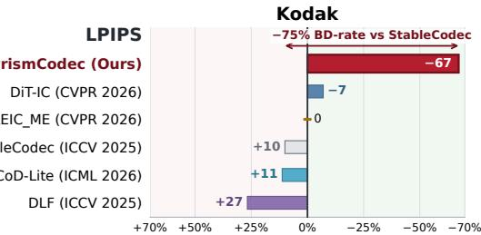

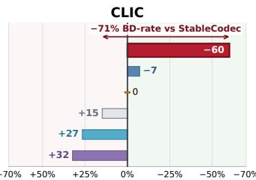

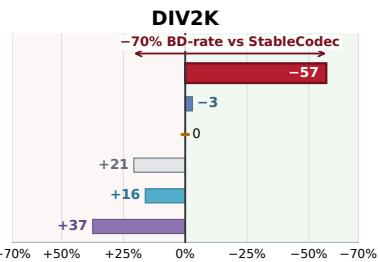

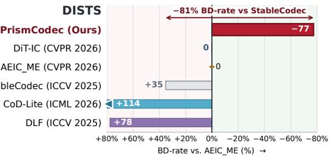

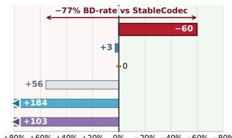

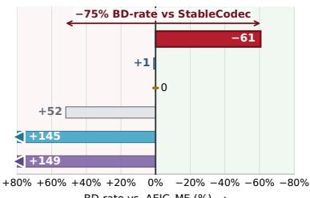  
Figure 1. Perceptual bitrate savings. LPIPS- and DISTS-based BD-rate comparisons on Kodak, CLIC, and DIV2K, with AEIC-ME as the bar reference (0%). Negative values indicate bitrate savings and extend to the right. Red arrows report PrismCodec’s direct BD-rate relative to StableCodec. Triangles mark bars clipped at the axis limit; labels retain the unclipped values, rounded to integers.

## Abstract

Pretrained diffusion models provide powerful generative priors for extreme image compression, but their stochastic, iterative generation processes are not designed to decode compressed representations directly. We present Prism-Codec, which recasts a pretrained Diffusion Transformer (DiT) as a bitstream-grounded one-step generative decoder. PrismCodec uses the decoded representation in two complementary roles: a projected codec state defines the starting state for generation, while hierarchical visual priors derived from the same decoded latent provide semantic and structural guidance. To bridge the gap between stochastic, iterative generation and deterministic one-step decoding, we develop a progressive adaptation strategy. We first learn codec-conditioned transportfrom a noisy neighborhood centered on the codec state, distill it into a one-step mapping, andfinally anneal the source perturbation to zero during end-

to-end optimization. The resulting decoder reconstructs deterministicallyfrom the received representation without additional conditioning bits. Across Kodak, CLIC, and DIV2K, PrismCodec consistently improves rate–perception performance over prior generative codecs, achieving BD-rate reductions of 70–75% in LPIPS and 75–81% in DISTS over StableCodec. Code will be released upon acceptance.

## 1. Introduction

At ultra-low bitrates, learned codecs built on optimized transforms and entropy models [4, 5, 76] can preserve only limited visual evidence of the source image. Generative compression therefore relies on image generation priors to synthesize details that are not explicitly transmitted. Yet compression differs fundamentally from unconstrained generation: plausible content is insufficient if it is inconsistent with the evidence retained in the bitstream. A central challenge is therefore to exploit powerful generative priors while grounding reconstruction in this limited transmitted evidence.

Pretrained diffusion and flow models offer powerful visual priors [28, 37, 83, 88], but their generative processes are not naturally aligned with compression decoding. Existing methods expose image-specific compressed evidence to the generative decoder through different interfaces. OneDC [112] and DiT-IC [93] derive semantic guidance directly from compressed representations, while AEIC [123] removes the text-conditioning pathway and reconstructs from codec latents. NeFIC [17] and StableCodec [122] retain fixed text conditions but also inject image-specific information through a decoded anchor and a codec latent, respectively. Together, these approaches show that effective generative decoding depends on how transmitted visual evidence is exposed to the generator. Two questions nevertheless remain: how should that evidence determine both the generative starting state and the visual guidance, and how can a pretrained model built for stochastic, iterative generation be adapted to deterministic one-step decoding?

We introduce PrismCodec, which recasts a pretrained DiT as a compression decoder whose starting state and visual guidance are both derived from the bitstream. These two roles are complementary: the codec-centered state anchors generation in the transmitted representation, while the visual priors specify semantic content and spatial structure that should be preserved during reconstruction. Inspired by recent image-generation studies [31, 94], we combine semantic and structural visual priors through a shared visual-evidence pathway. A lightweight decoder renders the decoded codec features as an internal evidence image, providing a common image-domain interface through which pretrained visual encoders can interpret the same bitstream-derived evidence. DINOv3 [95] supplies multi-depth dense semantic features, which are delivered to successive DiT block groups through depth-matched cross-attention rather than collapsed into a single condition. This preserves complementary levels of visual abstraction across the pretrained representation hierarchy. In parallel, the diffusion-native VAE supplies a spatially aligned structural prior through the latent-input pathway. Both priors are computed entirely at the decoder and therefore require no additional conditioning bits.

Visual conditioning alone, however, does not make a pretrained generator a practical compression decoder. Diffusion and flow models are typically trained to generate from stochastic sources through iterative transport, whereas practical compression typically favors deterministic reconstruction from a transmitted representation under a tight decoding budget. We therefore progressively reshape the generative process around the codec state. First, we learn conditional transport from a stochastic neighborhood centered on the codec representation to the clean generative latent, so that the learned trajectory is already grounded in transmitted evidence rather than generic noise. We then distill this codecconditioned transport into a direct one-step mapping. Finally, during end-to-end compression training, we gradually contract the stochastic source distribution onto the deterministic codec state. This annealing avoids an abrupt shift from the stochastic source used for flow learning and distillation to the deterministic input used at deployment, while allowing the codec and generative decoder to adapt jointly. Fig. 1 summarizes the resulting rate–perception performance. Across Kodak, CLIC, and DIV2K, PrismCodec achieves LPIPS and DISTS BD-rate reductions of approximately 70–75% and 75–81%, respectively, over StableCodec. Our main contributions are:

• We recast a pretrained DiT as a bitstream-grounded generative decoder, using the compressed representation to determine both its starting state and its visual guidance.

• We introduce hierarchical visual priors that combine multidepth dense semantic features with a diffusion-native structural prior through complementary DiT conditioning interfaces.

• We develop a progressive adaptation strategy that moves from codec-centered stochastic flow learning through one-step distillation to deterministic end-to-end decoding, bridging pretrained stochastic generation and practical extreme image compression.

## 2. Related Work

Generative Image Compression. Generative codecs use learned priors to recover plausible content at very low bitrates. Adversarial methods improve perceptual quality through distribution matching [74, 78], while conditional and residual diffusion reconstruct images from compressed representations [30, 113]. Recent work increasingly adapts pretrained generative priors, making bitstream grounding and efficient decoding central design concerns.

Bitstream Grounding and One-Step Adaptation. Pretrained-prior codecs expose transmitted evidence through different conditioning interfaces to guide reconstruction [17, 18, 122]. StableCodec combines a codec latent with structural correction under fixed text conditioning. OneDC [112] derives tokenizer-supervised semantic tokens from the hyperprior, DiT-IC [93] uses text-aligned compressed features, and AEIC [123] removes cross-attention. PrismCodec instead separates bitstream-derived evidence into two roles: a codec state determines the generative source, while an evidence image provides hierarchical semantic and diffusion-native structural guidance through complementary pretrained encoders and separate DiT conditioning interfaces.

Fast decoding is addressed through diffusion pretraining and distillation. CoD [44] pretrains diffusion for compression, CoD-Lite [43] introduces lightweight one-step decoding, OSCAR [33] supports one-step reconstruction across multiple bitrates, and FlowCodec [40] adapts a pretrained flow prior for near-terminal transport. More detailed comparisons with prior methods are provided in Appendix A.

STAGE I Conditional Flow Adaptation  
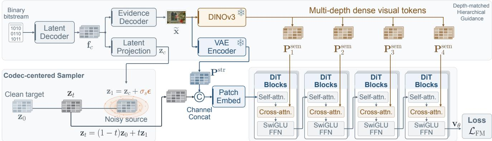  
Figure 2. Stage I: visual conditioning and codec-centered flow adaptation. The decoded feature $\mathbf { f } _ { c }$ yields a codec state zc and an evidence image x for two frozen encoders. DINOv3 supplies multi-depth dense semantic priors Psem to successive DiT groups through depth-matched cross-attention. The VAE encoder supplies a spatially aligned structural prior $\mathbf { P } ^ { \mathrm { s t r } }$ , channel-concatenated with $\mathbf { z } _ { t }$ . The codec-centered sampler interpolates between the clean latent and a noisy source centered on $\mathbf { z } _ { c }$

## 3. Method

## 3.1. Overview

PrismCodec recasts a pretrained DiT as a one-step generative decoder whose reconstruction is grounded in the received bitstream. Given a source image x encoded into a bitstream b, entropy decoding produces compressed features from which we derive two complementary forms of information: a codec state $\mathbf { z } _ { c }$ that determines the starting state for generation, and visual priors P that specify the semantic content and spatial structure to preserve during reconstruction. The decoder computes

$$
\begin{array} { r } { \widehat { \mathbf { z } } _ { 0 } = \mathcal { G } _ { \boldsymbol { \theta } } ( \mathbf { z } _ { c } ; \mathcal { P } ) , \qquad \widehat { \mathbf { x } } = \mathcal { D } _ { \boldsymbol { g } } ( \widehat { \mathbf { z } } _ { 0 } ) , } \end{array}\tag{1}
$$

where $\mathcal { G } _ { \theta }$ is a one-step latent mapping implemented by a DiT, and $\mathcal { D } _ { g }$ maps the predicted latent back to image space through the generative VAE decoder, kept frozen throughout all stages.

A pretrained diffusion model, however, is designed for stochastic, iterative generation rather than deterministic decoding from a transmitted representation. We therefore adapt the generative process progressively. Stage I learns conditional transport from a stochastic neighborhood centered on the codec state, grounding the generative trajectory in transmitted evidence. Stage II distills this codec-conditioned transport into a one-step map. Stage III then contracts the remaining source randomness while jointly optimizing the codec and generator, continuously aligning the training-time source with the deterministic codec state used at deployment. Fig. 2 illustrates the visual interface and Stage-I adaptation, while Fig. 3 summarizes Stages II and III. Appendix B summarizes the notation.

## 3.2. Bitstream-Derived Visual Evidence

The decoded bitstream provides the common source for both generation initialization and visual guidance. Entropy decoding and synthesis recover a feature $\mathbf { f } _ { c } ,$ from which Prism-Codec constructs the codec state $\mathbf { z } _ { c }$ and an internal evidence image xe. These two branches expose the same transmitted evidence through different interfaces: $\mathbf { z } _ { c }$ determines where the generative process starts, whereas xe provides an imagedomain view from which pretrained visual representations can be extracted.

Codec state. A learned projection $\mathcal { P } _ { c }$ maps the decoded feature to

$$
\begin{array} { r } { { \bf z } _ { c } = \mathcal { P } _ { c } ( { \bf f } _ { c } ) . } \end{array}\tag{2}
$$

The projection places $\mathbf { z } _ { c }$ in coordinates compatible with the generative VAE latent in spatial dimensions and numerical scale, without constraining it to a Gaussian distribution. In Stage I, $\mathbf { z } _ { c }$ centers the stochastic source; after Stage III, it becomes the deterministic input to the one-step decoder. We denote the estimated bits per pixel (bpp) by $\mathcal { R }$

Shared visual interface. In parallel, a lightweight evidence decoder $\mathcal { D } _ { e }$ renders the same decoded feature into an imagedomain representation,

$$
\widetilde { \mathbf { x } } = \mathcal { D } _ { e } ( \mathbf { f } _ { c } ) .\tag{3}
$$

Because $\widetilde { \mathbf { x } }$ is computed entirely from the received bitstream, it requires no additional transmission. More importantly, it provides a common image-domain interface through which the pretrained visual encoders interpret the same decoded evidence in the domain for which they were originally trained. We lightly supervise xe with an auxiliary objective $\mathcal { L } _ { \mathrm { e v } }$ so that it retains source layout, appearance, and semantic content. The objective combines pixel reconstruction with DINOv3 feature similarity. Together, $\mathbf { z } _ { c }$ and $\widetilde { \mathbf { x } }$ expose the same decoded representation through the two roles required by the generative decoder: source initialization and visual guidance.

## 3.3. Hierarchical Visual Priors

The evidence image is interpreted through two complementary pretrained representation spaces. Multi-depth DI-NOv3 features provide dense semantic guidance, while the diffusion-native VAE provides a reference in the generator’s native latent space [31, 94]. Both priors are derived from xe at the decoder and therefore introduce no additional conditioning bits.

Multi-depth dense semantic prior. We extract spatial patch tokens from L selected depths of a frozen DINOv3 transformer, excluding class and register tokens. After per-depth normalization and learned projection, they form

$$
\mathbf { P } ^ { \mathrm { s e m } } = \mathcal { H } ( \widetilde { \mathbf { x } } ) = \big ( \mathbf { P } _ { 1 } ^ { \mathrm { s e m } } , \mathbf { \ldots } , \mathbf { P } _ { L } ^ { \mathrm { s e m } } \big ) ,\tag{4}
$$

where each $\mathbf { P } _ { \ell } ^ { \mathrm { s e m } }$ is a dense spatial token sequence projected to the DiT hidden dimension. Rather than collapsing the selected DINOv3 depths into a single condition, we preserve their ordering and assign successive semantic levels to successive groups of DiT blocks through cross-attention. This depth-matched design exposes the generator to complementary levels of visual abstraction throughout the network.

Diffusion-native structural prior. The semantic branch does not directly provide a reference in the native latent coordinates used by the generator. We therefore encode the same evidence image with the frozen native VAE encoder. Let S denote the encoder with its fixed latent calibration. We define

$$
\mathbf { P } ^ { \mathrm { s t r } } = S ( \widetilde { \mathbf { x } } ) , \qquad \mathbf { z } _ { 0 } = S ( \mathbf { x } ) ,\tag{5}
$$

where $\mathbf { P } ^ { \mathrm { s t r } }$ is the structural prior and $\mathbf { z } _ { 0 }$ is the clean latent used as the training target. Because $\mathbf { P } ^ { \mathrm { s t r } }$ lies in the same latent coordinates as the generative state, it provides spatially aligned guidance complementary to the semantic tokens. Its role is distinct from that of $\mathbf { z } _ { c } { \mathrm { : } }$ the codec state defines the source from which transport begins, whereas $\mathbf { P } ^ { \mathrm { s t r } }$ acts as a structural reference throughout the generative mapping.

Complementary conditioning. The complete visual condition is $\mathcal { P } = ( { \bf P } ^ { \mathrm { s t r } } , { \bf P } ^ { \mathrm { s e m } } )$ . The two priors enter the DiT through distinct interfaces: $\mathbf { P } ^ { \mathrm { s t r } }$ is concatenated with the evolving latent before patch embedding, whereas the assigned semantic tokens are injected through cross-attention. We denote the resulting predictor by $\mathbf { u } _ { \theta } ( \mathbf { z } , t , r ; \mathcal { P } )$ , where t and r denote the current and destination flow times, respectively. Both conditioning paths remain active throughout adaptation and deployment.

## 3.4. Learning a One-Step Generative Decoder

The pretrained generator and the deployed codec differ along two coupled axes: the former starts from a stochastic source and follows iterative transport, whereas the latter must start from a bitstream-determined state and decode in one deterministic step. Rather than imposing both changes at once, we adapt the generative process progressively. Stage I recenters the source on the codec state while retaining stochasticity for flow learning; Stage II distills the resulting codecconditioned transport into a one-step map; and Stage III contracts the remaining source randomness while jointly adapting the complete compression system to its deployed deterministic input.

## 3.4.1. Stage I: Conditional Flow Adaptation

We first ground the generative source in the transmitted representation while retaining stochasticity to facilitate flow learning. Specifically, we define a codec-centered source

$$
{ \bf z } _ { 1 } = { \bf z } _ { c } + \sigma _ { s } \epsilon , \qquad \epsilon \sim \mathcal { N } ( { \bf 0 } , { \bf I } ) ,\tag{6}
$$

where $\sigma _ { s } > 0$ controls the source-noise scale. Generation therefore starts from a stochastic neighborhood around $\mathbf { z } _ { c } ,$ rather than from zero-centered noise. This follows the general intuition that an informative reconstruction can serve as the center of a generative source [79].

We pair this source with the clean latent $\mathbf { z } _ { 0 }$ through the linear interpolation

$$
{ \bf z } _ { t } = ( 1 - t ) { \bf z } _ { 0 } + t { \bf z } _ { 1 } , \qquad t \sim \mathcal { U } ( 0 , 1 ) ,\tag{7}
$$

and train the DiT velocity predictor $\mathbf { v } _ { \theta } ( \mathbf { z } _ { t } , t ; \mathcal { P } )$ with

$$
\begin{array} { r l } & { \mathcal { L } _ { \mathrm { F M } } = \mathbb { E } \bigg [ \big \| { \mathbf { v } } _ { \theta } \big ( { \mathbf { z } } _ { t } , t ; \mathcal { P } \big ) - \big ( { \mathbf { z } } _ { 1 } - { \mathbf { z } } _ { 0 } \big ) \big \| _ { 2 } ^ { 2 } \bigg ] , } \\ & { \quad \mathcal { L } _ { \mathrm { I } } = \mathcal { L } _ { \mathrm { F M } } + \lambda _ { \mathrm { r a t e } } ^ { \mathrm { I } } \mathcal { R } + \lambda _ { \mathrm { e v } } ^ { \mathrm { I } } \mathcal { L } _ { \mathrm { e v } } . } \end{array}\tag{8}
$$

We jointly optimize the codec, latent projection, evidence decoder, semantic projections, and DiT, while keeping the pretrained DINOv3 and VAE encoders frozen. The resulting model defines an iterative conditional transport from the codec-centered source to the clean latent and serves as the teacher for Stage II. Sampling uses the learned velocity directly without CFG.

## 3.4.2. Stage II: One-Step Flow-Map Distillation

Stage I grounds the generative trajectory in the codec state, but the learned transport remains iterative. We therefore distill it into a direct map from the same source distribution to the clean endpoint. Importantly, the student distills the codec-conditioned transport learned in Stage I, rather than the original pretrained generative trajectory. We adopt AYF’s Eulerian map distillation (AYF-EMD) [89]. For distillation, the student predictor $\mathbf { u } _ { \theta } ( \mathbf { z } , t , r ; \mathcal { P } )$ estimates the average velocity over the interval $[ r , t ]$ for $r < t . \mathrm { A t } r = t .$ , the same parameterization represents the instantaneous velocity used in Stage I:

$$
\mathbf { v } _ { \theta } ( \mathbf { z } , t ; \mathcal { P } ) \equiv \mathbf { u } _ { \theta } ( \mathbf { z } , t , t ; \mathcal { P } ) .
$$

The Stage-I model is frozen as the teacher ${ \bf v } _ { T }$ , while the student is initialized from its weights. The codec and all condition-producing modules are also frozen during this stage.

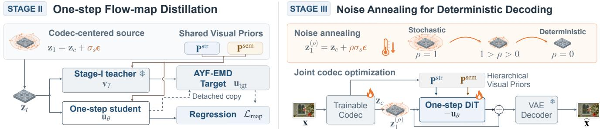  
Figure 3. Stages II and III: one-step distillation and deterministic source adaptation. $L e f t { \mathrm { : } }$ The frozen Stage-I teacher and student share paired interpolants $\mathbf { z } _ { t }$ and visual priors $\mathcal { P } ;$ separate conditioning arrows show the priors entering both models. The teacher and a detached copy of the current student form the AYF-EMD target $\mathbf { u } _ { \mathrm { t g t } }$ for regression ${ \mathcal { L } } _ { \mathrm { m a p } } ,$ with destination time $r = 0$ fixed throughout distillation. Right: End-to-end optimization anneals $\rho : 1  0 ,$ , contracting the stochastic source onto the deterministic codec state $\mathbf { z } _ { c } .$ . Flames mark the jointly trained codec and DiT; the VAE decoder remains frozen. The residual sum combines $\mathbf { z } _ { 1 } ^ { ( \rho ) }$ with the negative DiT prediction $- \mathbf { u } _ { \theta }$

Distillation reuses the codec-centered source and paired interpolation in Eqs. (6)–(7), with the same visual priors $\mathcal { P }$ shared by teacher and student. Following the averagevelocity parameterization [29], we fix the destination time to $r = 0$ and train the student to represent transport directly to the clean endpoint. $\mathrm { A t } \left( t , r \right) = \left( 1 , 0 \right)$ , the resulting one-step decoder is

$$
\mathcal { G } _ { \boldsymbol { \theta } } ( \mathbf { z } ; \mathcal { P } ) = \mathbf { z } - \mathbf { u } _ { \boldsymbol { \theta } } ( \mathbf { z } , 1 , 0 ; \mathcal { P } ) .\tag{9}
$$

The student is trained with the AYF-EMD regression objective

$$
\mathcal { L } _ { \mathrm { I I } } = \mathcal { L } _ { \mathrm { m a p } } = \mathbb { E } \Big [ w ( t , 0 ) \big | \big | { \bf u } _ { \theta } ( { \bf z } _ { t } , t , 0 ; \mathcal { P } ) - \mathrm { s g } ( { \bf u } _ { \mathrm { t g t } } ) \big | \big | _ { 2 } ^ { 2 } \Big ] ,\tag{10}
$$

where $w ( t , 0 ) \geq 0$ is the regression weight, $\mathbf { u } _ { \mathrm { t g t } }$ is the AYF-EMD target constructed from the frozen teacher and a detached copy of the current student, and sg denotes stopgradient. Only the student is updated in Stage II, so the codec state and visual conditions remain fixed throughout distillation.

## 3.4.3. Stage III: Noise Annealing for Deterministic Decoding

The distilled student already provides one-step decoding, but its source remains stochastic because Stage II is trained from $\mathbf { z } _ { c } + \sigma _ { s } \epsilon$ . Deployment, in contrast, should depend only on the received bitstream. We remove this train–deployment mismatch during end-to-end optimization by gradually annealing the source perturbation:

$$
\begin{array} { r } { \mathbf { z } _ { 1 } ^ { ( \rho ) } = \mathbf { z } _ { c } + \rho \sigma _ { s } \epsilon , \qquad \widehat { \mathbf { z } } _ { 0 } = \mathcal { G } _ { \theta } ( \mathbf { z } _ { 1 } ^ { ( \rho ) } ; \mathcal { P } ) , } \end{array}\tag{11}
$$

where $\rho$ decreases from 1 to 0 over training. $\mathbf { A t } \rho = 1$ , the starting distribution matches that used for flow adaptation and distillation; as $\rho  0 ,$ , it contracts to the codec state $\mathbf { z } _ { c } .$ This gradual transition avoids replacing the stochastic distilled source with the deterministic deployment input abruptly, while allowing the codec and one-step decoder to adapt jointly along the contraction. The final decoder therefore recovers Eq. (1) and requires no stochastic input at deployment.

During this stage, we jointly optimize the codec, evidence path, semantic projections, and one-step DiT; DINOv3 and both the VAE encoder and decoder remain frozen. The endto-end objective is

$$
{ \mathcal { L } } _ { \mathrm { I I I } } = \lambda _ { \mathrm { r a t e } } ^ { \mathrm { I I I } } { \mathcal { R } } + { \mathcal { L } } _ { \mathrm { i m g } } + \lambda _ { \mathrm { a d v } } { \mathcal { L } } _ { \mathrm { a d v } } ^ { \mathrm { D I N O } } + \lambda _ { \mathrm { e v } } ^ { \mathrm { I I I } } { \mathcal { L } } _ { \mathrm { e v } } .\tag{12}
$$

Here, ${ \mathcal { L } } _ { \mathrm { i m g } }$ combines MSE, MS-SSIM, LPIPS, and DISTS [21, 104, 121], while $\mathcal { L } _ { \mathrm { a d v } } ^ { \mathrm { D I N O } }$ uses lightweight discriminator heads on frozen multi-depth DINOv3 features [53]. The evidence objective continues to regularize xe as the codec representation evolves during joint optimization. Construction and training details, loss definitions, and supporting analyses are provided in Appendix C.

## 4. Experiments

## 4.1. Experimental Setup

## 4.1.1. Model and Training

Following Yao et al. [114], we pretrain a class-conditional LightningDiT on ImageNet-1K [20] for 100 epochs, and then add visual cross-attention layers for Stage I adaptation. Following DiT-IC [93], we train on high-quality images from CLIC 2020 Professional [99], MLIC-Train-100K [46], and LSDIR [60], retaining images whose height and width both exceed 512 pixels. We use aspect-ratio buckets centered on a nominal 768 × 768 resolution, spanning ratios from 1:2 to 2:1. Before Stage I, we pretrain the codec and evidence path for 20k updates using the evidence MSE and DINO losses to obtain a stable initialization, with the same weights as Stage I: $\lambda _ { \mathrm { e v } } ^ { \mathrm { I } } = 1$ and $\lambda _ { \mathrm { e v - s e m } } = 0 . 5$ . We run Stages I and II once at a high bitrate to obtain a one-step initialization.

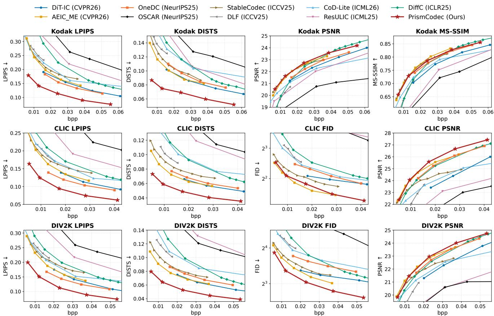  
Figure 4. Rate–distortion and rate–perception comparisons on Kodak, CLIC2020, and DIV2K.

Stage III first optimizes the highest-rate codec, followed by end-to-end fine-tuning toward lower rates with 50k updates per rate. All stages use AdamW on 16 A100 GPUs with a global batch size of 16. For the initial high-rate training, Stages I and III each run for 50k updates with learning rates of $1 0 ^ { - 4 }$ and $5 \times 1 0 ^ { - 5 }$ , respectively, while Stage II runs for 20k updates at $5 \times 1 0 ^ { - 5 }$ We train five models with $\lambda _ { \mathrm { r a t e } } ^ { \mathrm { I I I } } \in \{ 1 , 2 , 4 , 8 , 1 6 \}$ and set $\sigma _ { s } = 0 . 3$ . For Stage III, we use $\lambda _ { \mathrm { m s e } } = 1 . 0 , \lambda _ { \mathrm { l p i p s } } = 1 . 0 , \lambda _ { \mathrm { d i s t s } } = 0 . 5$ , and $\lambda _ { \mathrm { m s } } = 0 . 1$ for the final-image objective, with $\lambda _ { \mathrm { a d v } } = 0 . 5$ and $\lambda _ { \mathrm { e v } } ^ { \mathrm { I I I } } =$ 0.2 under $\lambda _ { \mathrm { e v - s e m } } = 0 . 5 .$ . For the initial Stage III run, $\rho$ follows a half-cosine decay from 1 to 0 over the first 10k updates and remains at 0 for the remaining 40k updates. We enable the adversarial loss after 30k Stage III updates. For inference, large images are decoded with overlapping latent tiles corresponding to 1024 × 1024 pixels, with a 256-pixel overlap. The evidence image is resized to $5 1 2 \times 5 1 2$ for DINOv3.

## 4.1.2. Datasets, Metrics, and Baselines

We evaluate on Kodak [24] (24 images), the CLIC2020 test set [99] (428 images), and the DIV2K validation set [1] (100 images). We report PSNR and MS-SSIM [104] for distortion, LPIPS [121] and DISTS [21] for perceptual fidelity, and FID [36] for distributional realism. The four paired metrics are computed on full-resolution RGB reconstructions and averaged over images; FID uses $2 5 6 \times 2 5 6$ patches on CLIC2020 and DIV2K, following Mentzer et al. [74]. We omit FID on Kodak given its small sample size. We compare with DiffC [102], ResULIC [49], DLF [111], OSCAR [33], StableCodec [122], OneDC [112], AEIC-ME [123], DiT-IC [93], and CoD-Lite [43]. We summarize bitrate efficiency with BD-rate [7], using StableCodec as the reference. Negative BD-rate indicates bitrate savings at equal quality.

## 4.2. Main Results

## 4.2.1. Quantitative Evaluation

The main comparison tests whether grounding both the generative source and visual guidance in the received bitstream translates into a better rate–perception tradeoff without systematically sacrificing source fidelity. Fig. 4 reports the rate–distortion and rate–perception curves in the ultra-lowbitrate regime, while Table 1 summarizes BD-rates relative to StableCodec.

Perceptual fidelity and realism. Across all three datasets, PrismCodec shifts the LPIPS and DISTS curves favorably relative to prior generative codecs. On CLIC2020, it reduces bitrate relative to StableCodec by 71.46% at matched LPIPS and 77.08% at matched DISTS; the corresponding savings on DIV2K are 69.54% and 74.64%. The same operating points also yield FID-based savings of 30.63% and 46.96% on CLIC2020 and DIV2K, respectively, indicating that the gains in paired perceptual fidelity are accompanied by improved distributional realism. Appendix D provides complementary KID comparisons.

Table 1. Detailed comparisons of BD-rate (%) relative to StableCodec. –: no overlapping range.
<table><tr><td rowspan="2">Method</td><td colspan="4">Kodak</td><td colspan="4">CLIC2020</td><td colspan="4">DIV2K</td></tr><tr><td>LPIPS</td><td>DISTS</td><td>PSNR</td><td>MS-SSIM</td><td>LPIPS</td><td>DISTS</td><td>FID</td><td>PSNR</td><td>LPIPS</td><td>DISTS</td><td>FID</td><td>PSNR</td></tr><tr><td>DiffC [102]</td><td>84.91</td><td>74.71</td><td>34.58</td><td>33.51</td><td>48.49</td><td>101.71</td><td>181.51</td><td>-7.28</td><td>40.40</td><td>101.89</td><td>117.75</td><td>4.03</td></tr><tr><td>ResULIC [49]</td><td>105.82</td><td>76.51</td><td>72.91</td><td>91.57</td><td>118.90</td><td>274.69</td><td>2117.98</td><td>153.66</td><td>113.46</td><td>376.60</td><td></td><td>208.08</td></tr><tr><td>StableCodec [122]</td><td>0.00</td><td>0.00</td><td>0.00</td><td>0.00</td><td>0.00</td><td>0.00</td><td>0.00</td><td>0.00</td><td>0.00</td><td>0.00</td><td>0.00</td><td>0.00</td></tr><tr><td>DLF [111]</td><td>21.21</td><td>29.35</td><td>108.54</td><td>57.23</td><td>18.32</td><td>42.11</td><td>151.63</td><td>75.98</td><td>21.38</td><td>70.13</td><td>125.20</td><td>81.32</td></tr><tr><td>OneDC [112]</td><td>-36.63</td><td>-5.46</td><td>23.88</td><td>10.74</td><td>-56.28</td><td>-28.94</td><td>87.88</td><td>-34.31</td><td>-52.46</td><td>-9.98</td><td>65.34</td><td>-17.47</td></tr><tr><td>OSCAR [33]</td><td>237.66</td><td>204.80</td><td>308.30</td><td>161.49</td><td>369.67</td><td>444.09</td><td>713.43</td><td>423.85</td><td>256.87</td><td>351.99</td><td>470.60</td><td>269.90</td></tr><tr><td>DiT-IC [93]</td><td>-27.79</td><td>-28.08</td><td>40.25</td><td>43.46</td><td>-39.39</td><td></td><td>46.73</td><td>51.02</td><td>-31.57</td><td>-32.62</td><td>-13.07</td><td>30.47</td></tr><tr><td>AEIC-ME [123]</td><td>-9.10</td><td>-26.03</td><td>1.37</td><td>-2.42</td><td>-12.92</td><td>-35.81</td><td>-36.78</td><td>-29.67</td><td>-17.22</td><td>-34.14</td><td>-20.26</td><td>-20.65</td></tr><tr><td>CoD-Lite [43]</td><td>0.97</td><td>62.40</td><td>55.68</td><td>28.09</td><td>10.35</td><td>98.48</td><td>107.12</td><td>36.73</td><td>-3.38</td><td>77.42</td><td>102.18</td><td>23.37</td></tr><tr><td>PrismCodec</td><td>-75.49</td><td>-81.33</td><td>-5.82</td><td>0.40</td><td>-71.46</td><td>-77.08</td><td>-30.63</td><td>-30.45</td><td>-69.54</td><td>-74.64</td><td>-46.96</td><td>-17.21</td></tr></table>

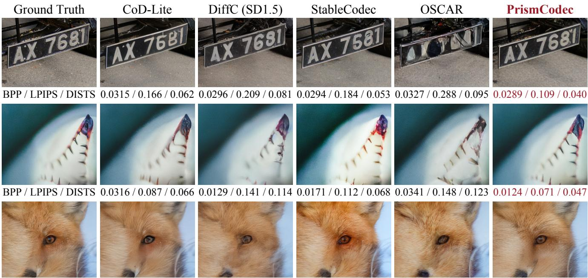  
BPP / LPIPS / DISTS 0.0315 / 0.096 / 0.078 0.0110 / 0.191 / 0.194 0.0137 / 0.130 / 0.077 0.0327 / 0.182 / 0.117 0.0106 / 0.082 / 0.055 Figure 5. Qualitative comparisons on DIV2K: 0847, 0857, and 0862 (top to bottom).

Source fidelity. The perceptual gains do not come with a systematic loss in distortion performance. PrismCodec achieves PSNR-based bitrate savings of 5.82%, 30.45%, and 17.21% on Kodak, CLIC2020, and DIV2K, respectively. MS-SSIM remains close to StableCodec, with a 0.40% bitrate increase on Kodak and reductions of 1.48% and 0.90% on CLIC2020 and DIV2K. Taken together, these results support the central premise of PrismCodec: bitstream-grounded generation can improve perceptual reconstruction while retaining source-dependent fidelity.

## 4.2.2. Qualitative Evaluation

Fig. 5 examines whether the quantitative gains correspond to source-specific visual details rather than only aggregate metric improvements. At lower bitrates than the compared baselines, PrismCodec better preserves plate lettering (DIV2K 0847), leaf-tip contours and serrations (DIV2K 0857), and the fox’s eye, nose, and fur patterns (DIV2K 0862), whereas several baselines smooth or alter these details. These examples are qualitatively consistent with the intended role of visual evidence in constraining generative reconstruction.

Table 2. Encoding and decoding efficiency at 2048 × 2048.
<table><tr><td rowspan="2">Method</td><td rowspan="2">Params (B)</td><td colspan="2">Latency (s)</td><td colspan="3">kMACs/pixel</td><td colspan="3">FLOPs (T)</td></tr><tr><td>Enc.</td><td>Dec.</td><td>Enc.</td><td>Dec.</td><td>Total</td><td>Enc.</td><td>Dec.</td><td>Total</td></tr><tr><td>StableCodec</td><td>1.07</td><td>4.65</td><td>9.74</td><td>2,965.0</td><td>10,343.7</td><td>13,308.7</td><td>24.87</td><td>86.77</td><td>111.64</td></tr><tr><td>AEIC-ME</td><td>0.93</td><td>0.08</td><td>5.16</td><td>204.0</td><td>5,959.2</td><td>6,163.2</td><td>1.71</td><td>49.99</td><td>51.70</td></tr><tr><td>DiT-IC</td><td>1.05</td><td>0.50</td><td>0.83</td><td>2,759.9</td><td>4,528.5</td><td>7,288.4</td><td>23.15</td><td>37.99</td><td>61.14</td></tr><tr><td>DLF</td><td>1.23</td><td>0.41</td><td>1.00</td><td>2,727.5</td><td>5,250.2</td><td>7,977.7</td><td>22.88</td><td>44.04</td><td>66.92</td></tr><tr><td>OneDC</td><td>1.40</td><td>0.65</td><td>1.51</td><td>2,888.1</td><td>10,292.4</td><td>13,180.5</td><td>24.23</td><td>86.34</td><td>110.57</td></tr><tr><td>OSCAR</td><td>1.05</td><td>0.89</td><td>3.22</td><td>3,150.1</td><td>10,890.4</td><td>14,040.5</td><td>26.42</td><td>91.36</td><td>117.78</td></tr><tr><td>PrismCodec</td><td>1.89</td><td>0.62</td><td>2.10</td><td>1,352.7</td><td>13,571.8</td><td>14,924.5</td><td>11.35</td><td>113.85</td><td>125.20</td></tr></table>

Table 3. Ablations of visual priors.
<table><tr><td>Variant</td><td>LPIPS (%) DISTS (%)</td></tr><tr><td>Single semantic depth</td><td>-59.64 -68.37</td></tr><tr><td>Structural only</td><td>-51.67 -58.32</td></tr><tr><td>Semantic only</td><td>-42.89 -47.24</td></tr><tr><td>Full PrismCodec</td><td>-69.54 -74.64</td></tr></table>

Appendix F provides additional comparisons.

## 4.3. Efficiency Evaluation

We report deployed parameters, encoding and decoding latency, and computation (kMACs/pixel and FLOPs) in Table 2. Measurements use synthetic RGB inputs at 2048 × 2048, batch size one, and an NVIDIA A100 GPU; after warm-up, latency is averaged over 30 CUDA-synchronized runs. PrismCodec decodes a 2K image in 2.10 s, compared with 9.74 s for StableCodec and 3.22 s for OSCAR, while remaining in the same order of total computation as these two generative baselines.

## 4.4. Ablation Studies

We organize the ablations around the three claims underlying PrismCodec: (i) semantic and structural visual priors provide complementary guidance, with multi-depth semantics contributing beyond a single representation level; (ii) transmitted evidence should determine the generative source as well as its conditions; and (iii) explicit one-step distillation and subsequent source contraction are both important for adapting stochastic generation to deterministic decoding. All results report LPIPS- and DISTS-based BD-rate (%) on DIV2K relative to StableCodec. Each variant trains its own high-rate model and uses matched fine-tuning schedules to obtain the five rate points in Sec. 4.1.

Hierarchical visual priors. Table 3 separates two aspects of the proposed conditioning design. First, Single semantic depth repeats the final selected DINOv3 layer across all four DiT groups, increasing LPIPS- and DISTS-based BD-rate by 9.90 and 6.27 percentage points relative to the full model. This isolates the benefit of preserving multiple representation depths rather than collapsing semantic guidance to one level. Second, Structural only removes semantic guidance and increases the two BD-rates by 17.87 and 16.32 points, while Semantic only removes structural input conditioning and increases them by 26.65 and 27.40 points. The degradation in both single-branch variants supports the complementary roles of dense semantic guidance and diffusion-native structural guidance.

Table 4. Ablations of source and training.
<table><tr><td>Variant</td><td>LPIPS (%) DISTS (%)</td><td></td></tr><tr><td>Zero-centered noise</td><td>-37.81</td><td>-46.80</td></tr><tr><td>w/o annealing</td><td>-55.02</td><td>-54.41</td></tr><tr><td>w/o distillation</td><td>-54.74</td><td>-58.04</td></tr><tr><td>Full PrismCodec</td><td>-69.54</td><td>-74.64</td></tr></table>

Bitstream-grounded source. With both priors retained, Zero-centered noise replaces the codec-centered source with a Gaussian-noise starting state and performs worse than both the stochastic codec-centered variant (w/o annealing) and the full model (Table 4). Thus, the gain from $\mathbf { z } _ { c }$ is not merely duplicated by the conditioning paths: exposing the bitstream through the generative source provides an additional and complementary form of grounding.

Progressive adaptation to deterministic decoding. Table 4 evaluates the two transitions from the Stage-I iterative flow to deterministic one-step decoding. w/o annealing keeps ρ = 1 through Stage III and inference, using ${ \bf z } _ { c } + 0 . 3 \epsilon$ as the source, and increases LPIPS- and DISTS-based BDrates by 14.52 and 20.23 points. This shows that the stochastic distilled source should be contracted to the deterministic codec state before deployment. w/o distillation skips Stage II and directly fine-tunes the Stage-I model with the full model’s annealing schedule, increasing the two BD-rates by 14.80 and 16.60 points. Together, these results support both flow-map distillation and source-noise annealing in the transition to deterministic one-step decoding.

## 5. Conclusion

We presented PrismCodec, which recasts a pretrained DiT as a bitstream-grounded one-step decoder for extreme image compression. The compressed representation determines both the generative starting state and hierarchical semantic and structural guidance. Through codec-centered flow adaptation, flow-map distillation, and source-noise annealing, PrismCodecprogressively transforms stochastic iterative generation into deterministic one-step decoding. The resulting model reconstructs directly from the received bitstream without additional conditioning bits, yielding an efficient and effective rate–perception tradeoff.

## References

[1] Eirikur Agustsson and Radu Timofte. Ntire 2017 challenge on single image super-resolution: Dataset and study. In Proceedings ofthe IEEE conference on computer vision and pattern recognition workshops, pages 126–135, 2017. 6

[2] Eirikur Agustsson, David Minnen, George Toderici, and Fabian Mentzer. Multi-realism image compression with a conditional generator. In Proceedings of the IEEE/CVF Conference on Computer Vision and Pattern Recognition, pages 22324–22333, 2023. 14

[3] Eirikur Agustsson et al. Generative adversarial networks for extreme learned image compression. In Proceedings ofthe IEEE/CVF International Conference on Computer Vision (ICCV), 2019. 14

[4] Johannes Ballé, Valero Laparra, and Eero P. Simoncelli. End-to-end optimized image compression. In International Conference on Learning Representations, 2017. 1

[5] Johannes Ballé, David Minnen, Saurabh Singh, Sung Jin Hwang, and Nick Johnston. Variational image compression with a scale hyperprior. In International Conference on Learning Representations, 2018. 1

[6] Mikołaj Binkowski, Danica J Sutherland, Michael Arbel,´ and Arthur Gretton. Demystifying mmd gans. arXiv preprint arXiv:1801.01401, 2018. 19

[7] Gisle Bjøntegaard. Calculation of average psnr differences between rd-curves. ITU SG16 Doc. VCEG-M33, 2001. 6

[8] Black Forest Labs. Flux. https://github.com/ black-forest-labs/flux, 2024. Accessed 29 June 2026. 14

[9] Hao Cao, Chengbin Liang, Wenqi Guo, Zhijin Qin, and Jungong Han. Progic: Progressive and lightweight generative image compression with residual vector quantization. arXiv preprint arXiv:2603.02897, 2026. 14

[10] Marlene Careil, Matthew J Muckley, Jakob Verbeek, and Stéphane Lathuilière. Towards image compression with perfect realism at ultra-low bitrates. In The Twelfth International Conference on Learning Representations, 2024. 14

[11] Jianhui Chang. Generative image coding with diffusion prior. arXiv preprint arXiv:2509.13768, 2025. 14

[12] Junyang Chen, Jinshan Pan, and Jiangxin Dong. Faithdiff: Unleashing diffusion priors for faithful image superresolution. In CVPR, 2025. 14

[13] Yunuo Chen, Qian Li, Bing He, Donghui Feng, Ronghua Wu, Qi Wang, Li Song, Guo Lu, and Wenjun Zhang. S2cformer: Reorienting learned image compression from spatial interaction to channel aggregation, 2025. 14

[14] Yunuo Chen, Zezheng Lyu, Bing He, Ning Cao, Gang Chen, Guo Lu, and Wenjun Zhang. Knowledge distillation for learned image compression. In Proceedings ofthe IEEE/CVF International Conference on Computer Vision, pages 4996–5006, 2025. 14

[15] Yunuo Chen, Bing He, Zezheng Lyu, Hongwei Hu, Qunshan Gu, Yuan Tian, and Guo Lu. Adaptive learned image compression with graph neural networks. arXiv preprint arXiv:2603.25316, 2026. 14

[16] Yunuo Chen, Zezheng Lyu, Bing He, Hongwei Hu, Qi Wang, Yuan Tian, Li Song, Wenjun Zhang, and Guo Lu. Contentaware mamba for learned image compression. In The Fourteenth International Conference on Learning Representations, 2026. 14

[17] Yunuo Chen, Chuqin Zhou, Jiangchuan Li, Xiaoyue Ling, Bing He, Jincheng Dai, Li Song, and Guo Lu. Next-frame decoding for ultra-low-bitrate image compression with video diffusion priors. arXiv preprint arXiv:2603.15129, 2026. 2, 14

[18] Zheng Chen, Mingde Zhou, Jinpei Guo, Jiale Yuan, Yifei Ji, and Yulun Zhang. Steering one-step diffusion model with fidelity-rich decoder for fast image compression. In Proceedings of the AAAI Conference on Artificial Intelligence, pages 3192–3200, 2026. 2, 15

[19] Zhengxue Cheng, Heming Sun, Masaru Takeuchi, and Jiro Katto. Learned image compression with discretized gaussian mixture likelihoods and attention modules. In Proceedings of the IEEE/CVF conference on computer vision and pattern recognition, pages 7939–7948, 2020. 14

[20] Jia Deng, Wei Dong, Richard Socher, Li-Jia Li, Kai Li, and Li Fei-Fei. Imagenet: A large-scale hierarchical image database. In 2009 IEEE conference on computer vision and pattern recognition, pages 248–255. Ieee, 2009. 5

[21] Keyan Ding, Kede Ma, Shiqi Wang, and Eero P. Simoncelli. Image quality assessment: Unifying structure and texture similarity. IEEE Transactions on Pattern Analysis and Machine Intelligence, 2022. 5, 6, 19

[22] Junhao Du, Chuqin Zhou, Ning Cao, Gang Chen, Yunuo Chen, Zhengxue Cheng, Li Song, Guo Lu, and Wenjun Zhang. Large language model for lossless image compression with visual prompts. arXiv preprint arXiv:2502.16163, 2025. 14

[23] Zhenyu Du, Yanbo Gao, Shuai Li, Yiyang Li, Hui Yuan, and Mao Ye. A noise constrained diffusion (nc-diffusion) framework for high-fidelity image compression. IEEE Transactions on Circuits and Systems for Video Technology, 2026. 14

[24] Eastman Kodak. Kodak lossless true color image suite (photocd pcd0992). http://r0k.us/graphics/kodak/, 1993. Accessed 29 June 2026. 6

[25] Alaaeldin El-Nouby, Matthew J Muckley, Karen Ullrich, Ivan Laptev, Jakob Verbeek, and Hervé Jégou. Image compression with product quantized masked image modeling. arXiv preprint arXiv:2212.07372, 2022. 14

[26] Noam Elata, Tomer Michaeli, and Michael Elad. Psc: Posterior sampling-based compression. arXiv preprint arXiv:2407.09896, 2024. 14

[27] Patrick Esser, Robin Rombach, and Bjorn Ommer. Taming transformers for high-resolution image synthesis. In Proceedings ofthe IEEE/CVF conference on computer vision and pattern recognition, pages 12873–12883, 2021. 14

[28] Patrick Esser, Sumith Kulal, Andreas Blattmann, Rahim Entezari, Jonas Müller, Harry Saini, Yam Levi, Dominik Lorenz, Axel Sauer, Frederic Boesel, et al. Scaling rectified flow transformers for high-resolution image synthesis. In Forty-first international conference on machine learning, 2024. 2

[29] Zhengyang Geng, Mingyang Deng, Xingjian Bai, J. Zico Kolter, and Kaiming He. Mean flows for one-step generative modeling. arXiv preprint arXiv:2505.13447, 2025. 5, 15

[30] Noor Fathima Ghouse, Jens Petersen, Auke Wiggers, Tianlin Xu, and Guillaume Sautiere. A residual diffusion model for high perceptual quality codec augmentation. arXiv preprint arXiv:2301.05489, 2023. 2, 14

[31] Kaixiong Gong, Xin Cai, Bin Lin, Hao Wang, Yunlong Lin, Mingzhe Zheng, Bohao Li, Jian-Wei Zhang, Miles Yang, Zhao Zhong, et al. Twins: Learn to predict unified representations with focal loss. arXiv preprint arXiv:2607.22531, 2026. 2, 4

[32] Ian Goodfellow, Jean Pouget-Abadie, Mehdi Mirza, Bing Xu, David Warde-Farley, Sherjil Ozair, Aaron Courville, and Yoshua Bengio. Generative adversarial networks. Communications ofthe ACM, 63(11):139–144, 2020. 14

[33] Jinpei Guo, Yifei Ji, Zheng Chen, Kai Liu, Min Liu, Wang Rao, Wenbo Li, Yong Guo, and Yulun Zhang. Oscar: Onestep diffusion codec across multiple bit-rates. arXiv preprint arXiv:2505.16091, 2025. 2, 6, 7, 14

[34] Dailan He, Yaoyan Zheng, Baocheng Sun, Yan Wang, and Hongwei Qin. Checkerboard context model for efficient learned image compression. In Proceedings of the IEEE/CVF Conference on Computer Vision and Pattern Recognition, pages 14771–14780, 2021. 14

[35] Dailan He, Ziming Yang, Weikun Peng, Rui Ma, Hongwei Qin, and Yan Wang. Elic: Efficient learned image compression with unevenly grouped space-channel contextual adaptive coding. In Proceedings ofthe IEEE/CVF Conference on Computer Vision and Pattern Recognition, pages 5718–5727, 2022. 14

[36] Martin Heusel, Hubert Ramsauer, Thomas Unterthiner, Bernhard Nessler, and Sepp Hochreiter. Gans trained by a two time-scale update rule converge to a local nash equilibrium. Advances in neural information processing systems, 30, 2017. 6

[37] Jonathan Ho, Ajay Jain, and Pieter Abbeel. Denoising diffusion probabilistic models. Advances in neural information processing systems, 33:6840–6851, 2020. 2

[38] Emiel Hoogeboom, Eirikur Agustsson, Fabian Mentzer, Luca Versari, George Toderici, and Lucas Theis. Highfidelity image compression with score-based generative models. arXiv preprint arXiv:2305.18231, 2023. 14

[39] Edward J Hu, Yelong Shen, Phillip Wallis, Zeyuan Allen-Zhu, Yuanzhi Li, Shean Wang, Lu Wang, and Weizhu Chen. LoRA: Low-rank adaptation of large language models. In International Conference on Learning Representations, 2022. 14

[40] Yinhuan Huang, Hao Cao, Pu Chen, Wenqi Guo, and Zhijin Qin. Flowcodec: One-step flow prior for generative image compression. arXiv preprint arXiv:2606.21030, 2026. 2, 14

[41] Shoma Iwai, Tomo Miyazaki, Yoshihiro Sugaya, and Shinichiro Omachi. Fidelity-controllable extreme image compression with generative adversarial networks. In 2020 25th International Conference on Pattern Recognition (ICPR), pages 8235–8242. IEEE, 2021. 14

[42] Zhaoyang Jia, Jiahao Li, Bin Li, Houqiang Li, and Yan Lu. Generative latent coding for ultra-low bitrate image

compression. In Proceedings ofthe IEEE/CVF Conference on Computer Vision and Pattern Recognition, pages 26088– 26098, 2024. 14

[43] Zhaoyang Jia, Naifu Xue, Zihan Zheng, Jiahao Li, Bin Li, Xiaoyi Zhang, Zongyu Guo, Yuan Zhang, Houqiang Li, and Yan Lu. Cod-lite: Real-time diffusion-based generative image compression. arXiv preprint arXiv:2604.12525, 2026. 2, 6, 7, 14

[44] Zhaoyang Jia, Zihan Zheng, Naifu Xue, Jiahao Li, Bin Li, Zongyu Guo, Xiaoyi Zhang, Houqiang Li, and Yan Lu. Cod: A diffusion foundation model for image compression. In Proceedings of the IEEE/CVF Conference on Computer Vision and Pattern Recognition, pages 38420–38429, 2026. 2, 14

[45] Shiyin Jiang, Wei Long, Minghao Han, Zhenghao Chen, Ce Zhu, and Shuhang Gu. Differentiable vector quantization for rate-distortion optimization of generative image compression. arXiv preprint arXiv:2604.10546, 2026. 14

[46] Wei Jiang and Ronggang Wang. MLIC++: Linear complexity multi-reference entropy modeling for learned image compression. In ICML 2023 Workshop Neural Compression: From Information Theory to Applications, 2023. 5, 14

[47] Wei Jiang, Jiayu Yang, Yongqi Zhai, Peirong Ning, Feng Gao, and Ronggang Wang. Mlic: Multi-reference entropy model for learned image compression. In Proceedings of the 31st ACM International Conference on Multimedia, pages 7618–7627, 2023. 14

[48] Luoxu Jin and Hiroshi Watanabe. Perceptual image compression via stable diffusion at low bitrate. In 2024 IEEE 7th International Conference on Multimedia Information Processing and Retrieval (MIPR), pages 626–629. IEEE, 2024. 14

[49] Anle Ke, Xu Zhang, Tong Chen, Ming Lu, Chao Zhou, Jiawen Gu, and Zhan Ma. Ultra lowrate image compression with semantic residual coding and compression-aware diffusion. arXiv preprint arXiv:2505.08281, 2025. 6, 7, 14

[50] Nikolai Körber, Eduard Kromer, Andreas Siebert, Sascha Hauke, Daniel Mueller-Gritschneder, and Björn Schuller. Egic: enhanced low-bit-rate generative image compression guided by semantic segmentation. In European Conference on Computer Vision, pages 202–220. Springer, 2024. 14

[51] Nikolai Körber, Eduard Kromer, Andreas Siebert, Sascha Hauke, Daniel Mueller-Gritschneder, and Björn Schuller. Perco (sd): Open perceptual compression. arXiv preprint arXiv:2409.20255, 2024. 14

[52] Nikolai Körber, Eduard Kromer, Andreas Siebert, Sascha Hauke, Daniel Mueller-Gritschneder, and Björn Schuller. Percov2: improved ultra-low bit-rate perceptual image compression with implicit hierarchical masked image modeling. arXiv preprint arXiv:2503.09368, 2025. 14

[53] Nupur Kumari, Richard Zhang, Eli Shechtman, and Jun-Yan Zhu. Ensembling off-the-shelf models for gan training. In Proceedings of the IEEE/CVF conference on computer vision and pattern recognition, pages 10651–10662, 2022. 5, 19

[54] Hagyeong Lee, Minkyu Kim, Jun-Hyuk Kim, Seungeon Kim, Dokwan Oh, and Jaeho Lee. Neural image compres-

sion with text-guided encoding for both pixel-level and perceptual fidelity. arXiv preprint arXiv:2403.02944, 2024. 14

[55] Eric Lei, Yigit Berkay Uslu, Hamed Hassani, and˘ Shirin Saeedi Bidokhti. Text+ sketch: Image compression at ultra low rates. arXiv preprint arXiv:2307.01944, 2023. 14

[56] Anqi Li, Feng Li, Yuxi Liu, Runmin Cong, Yao Zhao, and Huihui Bai. Once-for-all: Controllable generative image compression with dynamic granularity adaptation. arXiv preprint arXiv:2406.00758, 2024. 14

[57] Han Li, Shaohui Li, Wenrui Dai, Chenglin Li, Junni Zou, and Hongkai Xiong. Frequency-aware transformer for learned image compression. In The Twelfth International Conference on Learning Representations, 2024. 14

[58] Jiangchuan Li, Chuqin Zhou, Yunuo Chen, and Guo Lu. Differentiable vmaf: A trainable metric for optimizing video compression codec. In 2025 IEEE International Symposium on Circuits and Systems (ISCAS), pages 1–5. IEEE, 2025. 14

[59] Qian Li, Yunuo Chen, and Yuntian Chen. Inevitable encounters: Backdoor attacks involving lossy compression. arXiv preprint arXiv:2603.13864, 2026. 14

[60] Yawei Li, Kai Zhang, Jingyun Liang, Jiezhang Cao, Ce Liu, Rui Gong, Yulun Zhang, Hao Tang, Yun Liu, Denis Demandolx, et al. Lsdir: A large scale dataset for image restoration. In 2023 IEEE/CVF Conference on Computer Vision and Pattern Recognition Workshops (CVPRW), pages 1775–1787. IEEE, 2023. 5

[61] Yuqi Li, Haotian Zhang, Li Li, and Dong Liu. Learned image compression with hierarchical progressive context modeling. arXiv preprint arXiv:2507.19125, 2025. 14

[62] Yuqi Li, Haotian Zhang, Li Li, Dong Liu, and Feng Wu. Scaling learned image compression models up to 1 billion. arXiv preprint arXiv:2508.09075, 2025. 14

[63] Zhiyuan Li, Yanhui Zhou, Hao Wei, Chenyang Ge, and Jingwen Jiang. Towards extreme image compression with latent feature guidance and diffusion prior. IEEE Transactions on Circuits and Systemsfor Video Technology, 2024. 14

[64] Zhiyuan Li, Yanhui Zhou, Hao Wei, Chenyang Ge, and Ajmal Saeed Mian. Rdeic: Accelerating diffusion-based extreme image compression with relay residual diffusion. arXiv preprint arXiv:2410.02640, 2024. 14

[65] Huanxiong Liang, Yunuo Chen, Yicheng Pan, Sixian Wang, Jincheng Dai, Guo Lu, and Wenjun Zhang. Structure-guided allocation of 2d gaussians for image representation and compression. arXiv preprint arXiv:2512.24018, 2025. 14

[66] Xiaoyue Ling, Chuqin Zhou, Chunyi Li, Yunuo Chen, Yuan Tian, Guo Lu, and Wenjun Zhang. Free-gvc: Towards training-free extreme generative video compression with temporal coherence. arXiv preprint arXiv:2602.09868, 2026. 14

[67] Yaron Lipman, Ricky T. Q. Chen, Heli Ben-Hamu, Maximilian Nickel, and Matt Le. Flow matching for generative modeling. In International Conference on Learning Representations, 2023. 15, 18

[68] Jinming Liu, Heming Sun, and Jiro Katto. Learned image compression with mixed transformer-cnn architectures. In

Proceedings of the IEEE/CVF conference on computer vision and pattern recognition, pages 14388–14397, 2023. 14

[69] Xingchao Liu, Chengyue Gong, and Qiang Liu. Flow straight and fast: Learning to generate and transfer data with rectified flow. arXiv preprint arXiv:2209.03003, 2022. 15

[70] Jingbo Lu, Leheng Zhang, Xingyu Zhou, Mu Li, Wen Li, and Shuhang Gu. Learned image compression with dictionary-based entropy model. In Proceedings of the Computer Vision and Pattern Recognition Conference, pages 12850–12859, 2025. 14

[71] Lei Lu, Yanyue Xie, Wei Jiang, Wei Wang, Xue Lin, and Yanzhi Wang. Hybridflow: Infusing continuity into masked codebook for extreme low-bitrate image compression. In Proceedings of the 32nd ACM International Conference on Multimedia, pages 3010–3018, 2024. 14

[72] Yiyang Ma, Wenhan Yang, and Jiaying Liu. Correcting diffusion-based perceptual image compression with privileged end-to-end decoder. International conference on machine learning (ICML), 2024. 14

[73] Qi Mao, Tinghan Yang, Yinuo Zhang, Zijian Wang, Meng Wang, Shiqi Wang, Libiao Jin, and Siwei Ma. Extreme image compression using fine-tuned vqgans. In 2024 Data Compression Conference (DCC), pages 203–212. IEEE, 2024. 14

[74] Fabian Mentzer, George D Toderici, Michael Tschannen, and Eirikur Agustsson. High-fidelity generative image compression. Advances in neural information processing systems, 33:11913–11924, 2020. 2, 6, 14

[75] David Minnen and Saurabh Singh. Channel-wise autoregressive entropy models for learned image compression. In 2020 IEEE International Conference on Image Processing (ICIP), pages 3339–3343. IEEE, 2020. 14

[76] David Minnen, Johannes Ballé, and George D Toderici. Joint autoregressive and hierarchical priors for learned image compression. Advances in neural information processing systems, 31, 2018. 1

[77] Chong Mou, Xintao Wang, Liangbin Xie, Yanze Wu, Jian Zhang, Zhongang Qi, and Ying Shan. T2i-adapter: Learning adapters to dig out more controllable ability for text-toimage diffusion models. In Proceedings of the AAAI conference on artificial intelligence, pages 4296–4304, 2024. 14

[78] Matthew J Muckley, Alaaeldin El-Nouby, Karen Ullrich, Hervé Jégou, and Jakob Verbeek. Improving statistical fidelity for neural image compression with implicit local likelihood models. In International Conference on Machine Learning, pages 25426–25443. PMLR, 2023. 2, 14

[79] Guy Ohayon, Tomer Michaeli, and Michael Elad. Posteriormean rectified flow: Towards minimum MSE photo-realistic image restoration. arXiv preprint arXiv:2410.00418, 2024. 4, 15

[80] Guy Ohayon, Hila Manor, Tomer Michaeli, and Michael Elad. Compressed image generation with denoising diffusion codebook models. arXiv preprint arXiv:2502.01189, 2025. 14

[81] Zhihong Pan, Xin Zhou, and Hao Tian. Extreme generative image compression by learning text embedding from diffusion models. arXiv preprint arXiv:2211.07793, 2022. 14

[82] Chanung Park, Joo Chan Lee, and Jong Hwan Ko. Singlestep diffusion for image compression at ultra-low bitrates. In 2026 IEEE/CVF Winter Conference on Applications of Computer Vision (WACV), pages 6391–6400. IEEE, 2026. 14

[83] William Peebles and Saining Xie. Scalable diffusion models with transformers. In Proceedings of the IEEE/CVF international conference on computer vision, pages 4195–4205, 2023. 2

[84] Dustin Podell, Zion English, Kyle Lacey, Andreas Blattmann, Tim Dockhorn, Jonas Müller, Joe Penna, and Robin Rombach. Sdxl: Improving latent diffusion models for high-resolution image synthesis. arXiv preprint arXiv:2307.01952, 2023. 14

[85] Yichen Qian, Ming Lin, Xiuyu Sun, Zhiyu Tan, and Rong Jin. Entroformer: A transformer-based entropy model for learned image compression. In International Conference on Learning Representations, 2022. 14

[86] Lucas Relic, Roberto Azevedo, Markus Gross, and Christopher Schroers. Lossy image compression with foundation diffusion models. In European Conference on Computer Vision, pages 303–319. Springer, 2024. 14

[87] Lucas Relic, Roberto Azevedo, Yang Zhang, Markus Gross, and Christopher Schroers. Bridging the gap between gaussian diffusion models and universal quantization for image compression. In 2025 IEEE/CVF Conference on Computer Vision and Pattern Recognition (CVPR), pages 2449–2458. IEEE, 2025. 14

[88] Robin Rombach, Andreas Blattmann, Dominik Lorenz, Patrick Esser, and Björn Ommer. High-resolution image synthesis with latent diffusion models. In Proceedings of the IEEE/CVF conference on computer vision and pattern recognition, pages 10684–10695, 2022. 2

[89] Amirmojtaba Sabour, Sanja Fidler, and Karsten Kreis. Align your flow: Scaling continuous-time flow map distillation. arXiv preprint arXiv:2506.14603, 2025. 4, 15, 18

[90] Tim Salimans and Jonathan Ho. Progressive distillation for fast sampling of diffusion models. arXiv preprint arXiv:2202.00512, 2022. 14

[91] Axel Sauer, Dominik Lorenz, Andreas Blattmann, and Robin Rombach. Adversarial diffusion distillation. In European Conference on Computer Vision, pages 87–103. Springer, 2024. 14

[92] Xihua Sheng, Lingyu Zhu, Tianyu Zhang, Dong Liu, Shiqi Wang, and Jing Wang. Cadc: Content adaptive diffusionbased generative image compression. arXiv preprint arXiv:2602.21591, 2026. 14

[93] Junqi Shi, Ming Lu, Xingchen Li, Anle Ke, Ruiqi Zhang, and Zhan Ma. Dit-ic: Aligned diffusion transformer for efficient image compression. arXiv preprint arXiv:2603.13162, 2026. 2, 5, 6, 7, 14

[94] Minglei Shi, Haolin Wang, Wenzhao Zheng, Ziyang Yuan, Xiaoshi Wu, Xintao Wang, Pengfei Wan, Jie Zhou, and

Jiwen Lu. Latent diffusion model without variational autoencoder. In International Conference on Learning Representations, pages 154506–154537, 2026. 2, 4

[95] Oriane Siméoni, Huy V Vo, Maximilian Seitzer, Federico Baldassarre, Maxime Oquab, Cijo Jose, Vasil Khalidov, Marc Szafraniec, Seungeun Yi, Michaël Ramamonjisoa, et al. Dinov3. arXiv preprint arXiv:2508.10104, 2025. 2, 15

[96] Jiaming Song, Chenlin Meng, and Stefano Ermon. Denoising diffusion implicit models. arXiv preprint arXiv:2010.02502, 2020. 14

[97] Juan Song, Lijie Yang, and Mingtao Feng. Extremely lowbitrate image compression semantically disentangled by lmms from a human perception perspective. arXiv preprint arXiv:2503.00399, 2025. 14

[98] Lucas Theis, Tim Salimans, Matthew D Hoffman, and Fabian Mentzer. Lossy compression with gaussian diffusion. arXiv preprint arXiv:2206.08889, 2022. 14

[99] George Toderici, Wenzhe Shi, Radu Timofte, Lucas Theis, Johannes Ballé, Eirikur Agustsson, Nick Johnston, and Fabian Mentzer. Workshop and challenge on learned image compression (clic2020). In Proc. CVPR Workshops, 2020. 5, 6

[100] Amit Vaisman, Guy Ohayon, Hila Manor, Michael Elad, and Tomer Michaeli. Turbo-DDCM: Fast and flexible zero-shot diffusion-based image compression. In The Fourteenth International Conference on Learning Representations, 2026. 14

[101] Aaron Van Den Oord, Oriol Vinyals, et al. Neural discrete representation learning. Advances in neural information processing systems, 30, 2017. 14

[102] Jeremy Vonderfecht and Feng Liu. Lossy compression with pretrained diffusion models. International Conference on Learning Representations, 2025. 6, 7, 14

[103] Guo-Hua Wang, Jiahao Li, Bin Li, and Yan Lu. Evc: Towards real-time neural image compression with mask decay. arXiv preprint arXiv:2302.05071, 2023. 14

[104] Zhou Wang, Eero P. Simoncelli, and Alan C. Bovik. Multiscale structural similarity for image quality assessment. In The Thirty-Seventh Asilomar Conference on Signals, Systems & Computers, pages 1398–1402, 2003. 5, 6, 19

[105] Siqi Wu, Yinda Chen, Dong Liu, and Zhihai He. Conditional latent coding with learnable synthesized reference for deep image compression. In Proceedings ofthe AAAI Conference on Artificial Intelligence, pages 12863–12871, 2025. 14

[106] Zhuojie Wu, Heming Du, Shuyun Wang, Ming Lu, Haiyang Sun, Yandong Guo, and Xin Yu. Cmamba: Learned image compression with state space models. arXiv preprint arXiv:2502.04988, 2025. 14

[107] Yichong Xia, Yimin Zhou, Jinpeng Wang, Baoyi An, Haoqian Wang, Yaowei Wang, and Bin Chen. Diffpc: Diffusionbased high perceptual fidelity image compression with semantic refinement. In The Thirteenth International Conference on Learning Representations, 2025. 14

[108] Tongda Xu, Ziran Zhu, Dailan He, Yanghao Li, Lina Guo, Yuanyuan Wang, Zhe Wang, Hongwei Qin, Yan Wang,

Jingjing Liu, and Ya-Qin Zhang. Idempotence and perceptual image compression. In The Twelfth International Conference on Learning Representations, 2024. 14

[109] Tongda Xu, Jiahao Li, Bin Li, Yan Wang, Ya-Qin Zhang, and Yan Lu. Picd: Versatile perceptual image compression with diffusion rendering. In Proceedings of the Computer Vision and Pattern Recognition Conference, pages 28436–28445, 2025. 14

[110] Naifu Xue, Qi Mao, Zijian Wang, Yuan Zhang, and Siwei Ma. Unifying generation and compression: Ultra-low bitrate image coding via multi-stage transformer. In 2024 IEEE International Conference on Multimedia and Expo (ICME), pages 1–6. IEEE, 2024. 14

[111] Naifu Xue, Zhaoyang Jia, Jiahao Li, Bin Li, Yuan Zhang, and Yan Lu. Dlf: Extreme image compression with dualgenerative latent fusion. Proceedings of the IEEE/CVF International Conference on Computer Vision (ICCV), 2025. 6, 7, 14

[112] Naifu Xue, Zhaoyang Jia, Jiahao Li, Bin Li, Yuan Zhang, and Yan Lu. One-step diffusion-based image compression with semantic distillation. Advances in Neural Information Processing Systems, 2025. 2, 6, 7, 14

[113] Ruihan Yang and Stephan Mandt. Lossy image compression with conditional diffusion models. Advances in Neural Information Processing Systems, 36:64971–64995, 2023. 2, 14

[114] Jingfeng Yao, Bin Yang, and Xinggang Wang. Reconstruction vs. generation: Taming optimization dilemma in latent diffusion models. In Proceedings of the IEEE/CVF Conference on Computer Vision and Pattern Recognition, 2025. 5

[115] Tianwei Yin, Michaël Gharbi, Taesung Park, Richard Zhang, Eli Shechtman, Fredo Durand, and William T Freeman. Improved distribution matching distillation for fast image synthesis. Advances in neural information processing systems, 37:47455–47487, 2024. 14

[116] Tianwei Yin, Michaël Gharbi, Richard Zhang, Eli Shechtman, Fredo Durand, William T Freeman, and Taesung Park. One-step diffusion with distribution matching distillation. In 2024 IEEE/CVF Conference on Computer Vision and Pattern Recognition (CVPR), pages 6613–6623. IEEE, 2024. 14

[117] Sihyun Yu, Sangkyung Kwak, Huiwon Jang, Jongheon Jeong, Jonathan Huang, Jinwoo Shin, and Saining Xie. Representation alignment for generation: Training diffusion transformers is easier than you think. arXiv preprint arXiv:2410.06940, 2024. 14, 15

[118] Denis Zavadski, Johann-Friedrich Feiden, and Carsten Rother. Controlnet-xs: Rethinking the control of text-toimage diffusion models as feedback-control systems. In European Conference on Computer Vision, pages 343–362. Springer, 2024. 14

[119] Fanhu Zeng, Hao Tang, Yihua Shao, Siyu Chen, Ling Shao, and Yan Wang. Mambaic: State space models for highperformance learned image compression. arXiv preprint arXiv:2503.12461, 2025. 14

[120] Lvmin Zhang, Anyi Rao, and Maneesh Agrawala. Adding conditional control to text-to-image diffusion models. In

Proceedings of the IEEE/CVF international conference on computer vision, pages 3836–3847, 2023. 14

[121] Richard Zhang, Phillip Isola, Alexei A Efros, Eli Shechtman, and Oliver Wang. The unreasonable effectiveness of deep features as a perceptual metric. In Proceedings ofthe IEEE conference on computer vision and pattern recognition, pages 586–595, 2018. 5, 6, 19

[122] Tianyu Zhang, Xin Luo, Li Li, and Dong Liu. Stablecodec: Taming one-step diffusion for extreme image compression. arXiv preprint arXiv:2506.21977, 2025. 2, 6, 7, 14

[123] Tianyu Zhang, Dong Liu, and Chang Wen Chen. Ultra-low bitrate perceptual image compression with shallow encoder. In Proceedings ofthe IEEE/CVF Conference on Computer Vision and Pattern Recognition, pages 12118–12128, 2026. 2, 6, 7, 15

[124] Yiwei Zhang, Guo Lu, Yunuo Chen, Shen Wang, Yibo Shi, Jing Wang, and Li Song. Neural rate control for learned video compression. In The Twelfth International Conference on Learning Representations, 2024. 14

[125] Ziyuan Zhang, Yichong Xia, Bin Chen, Tianwei Zhang, Hao Wang, and Han Qiu. Autoregressive-based progressive coding for ultra-low bitrate image compression. In The Fourteenth International Conference on Learning Representations, 2026. 14

[126] Chuqin Zhou, Xiaoyue Ling, Yunuo Chen, Jincheng Dai, Guo Lu, and Wenjun Zhang. Dual-representation image compression at ultra-low bitrates via explicit semantics and implicit textures. arXiv preprint arXiv:2602.05213, 2026. 14

[127] MingSheng Zhou and MingMing Kong. Glic: General format learned image compression. In Proceedings ofthe AAAI Conference on Artificial Intelligence, pages 10815–10824, 2025. 14

## A. Extended Related Work

This appendix expands the positioning in Sec. 2. We first place PrismCodec within learned and generative image compression, and then compare the closest pretrained-prior codecs along the same two questions that motivate our method: how bitstream-derived evidence enters the generator and how stochastic generation is adapted to one-step reconstruction.

## A.1. Conventional Learned Compression

Learned codecs have advanced through stronger entropy models [19, 22, 34, 35, 46, 47, 75, 85], more expressive transforms [13, 15, 16, 57, 59, 68, 106, 119], and specialized, scalable, or distilled designs for efficiency [14, 58, 61, 62, 65, 70, 103, 105, 124, 127]. These approaches improve the coded representation itself; PrismCodec instead focuses on how a pretrained generative prior should decode the limited evidence that remains after extreme compression.

## A.2. Broader Generative Compression

Generative codecs introduce learned priors to recover visually plausible content at low rates. Existing families use adversarial priors [2, 3, 32, 41, 50, 74, 78], discrete representations [25, 27, 42, 73, 101, 110], or complementary representations [66, 71, 111, 126]; related work also studies bitrate control, progressive decoding, and rate–distortionoptimized quantization [9, 45, 56, 125].

Diffusion-based codecs reconstruct from compressed information through conditional denoising [38, 98, 113], residual generation [30, 64], or pretrained generative priors [8, 48, 84, 86]. Other methods learn latent guidance and reconstruction corrections [11, 49, 63, 72, 107, 109], or use frozen priors for zero-shot coding [26, 80, 100, 102, 108]; recent work further connects diffusion noise with quantization [23, 87]. CoD pretrains diffusion specifically for compression [44], and CoD-Lite combines this with a lightweight one-step convolutional decoder [43]. Accelerated sampling and distillation [90, 91, 96, 115, 116] also motivate one-step codecs [33, 82], while FlowCodec uses LoRA-adapted flow priors for near-terminal one-step latent transport with an empty prompt [39, 40].

A second line of work concerns the conditioning interface. Text-guided codecs transmit descriptions or learn languagealigned representations [10, 51, 52, 54, 55, 81, 97], and CADC derives text from reconstructions [92]. Image conditions are also widely used for controlled generation and restoration [12, 77, 118, 120], while REPA aligns diffusion hidden states with pretrained visual features during training [117].

For the closest compression methods, Table 5 summarizes how the transmitted representation determines the generator input and conditions, together with the mechanism used for one-step adaptation. The categories below concern the explicit conditioning pathway; all methods also receive image-specific information from their coded representations.

## A.3. Fixed Text Conditions

StableCodec [122] adapts SD-Turbo with a fixed prompt and a codec-produced latent input. Its auxiliary encoder supplies source features during compression, and an auxiliary decode predicts a structural residual that is added after denoising and before VAE decoding. The fixed prompt therefore coexists with substantial image-specific guidance. PrismCodec separates the same broad grounding problem into distinct roles: a codec-centered source determines where generation starts, while a frozen VAE latent and multi-depth visual tokens provide structural and semantic guidance through separate DiT interfaces. StableCodec also tightens the rate penalty during training; PrismCodec’s source contraction instead changes the generator’s input distribution as it approaches deterministic deployment.

NeFIC [17] also retains a fixed prompt, using a decoded anchor for conditioning and a codec-derived bypass latent as the input to its video-diffusion generator.

## A.4. Learned Semantic Surrogates: OneDC and DiT-IC

OneDC [112] decodes a semantic token sequence from the quantized hyperprior and uses it as cross-attention context. A pretrained generative tokenizer supplies training labels through an auxiliary prediction task; the tokenizer and predictor are unnecessary at inference. The resulting hyperprior tokens retain spatial locality. PrismCodec instead computes semantic conditions from an evidence image at decoding time, preserves patch-token sets from multiple pretrained depths, and assigns them to successive DiT block groups. This makes the semantic hierarchy an explicit inference-time condition. OneDC additionally uses diffusion distillation for perceptual refinement; its tokenizer supervision and refinement therefore address different roles from PrismCodec’s Stage-II flow-map distillation.

DiT-IC [93] projects compressed features into the text conditioning space and uses contrastive alignment with text embeddings during training; inference uses the latent condition alone. Its adaptation also includes a variance-derived spatial pseudo-timestep and self-distillation that aligns reconstructed latents with frozen encoder outputs. PrismCodec preserves multiple visual representation depths and adds a separate diffusion-native VAE structural condition. Its onestep adaptation also follows a different path: Stage I first learns continuous conditional transport around the codec state, and Stage II distills the resulting finite-time map. The source perturbation scale therefore defines a Gaussian neighborhood of the transmitted codec state, whereas DiT-IC’s pseudo-timestep controls spatially varying reconstruction strength.

Table 5. Comparison of bitstream grounding and one-step adaptation. The middle column summarizes how image-specific coded evidence enters the generator; the right column summarizes how each method obtains fast or one-step decoding. Fixed text conditions can coexist with image-specific latent or anchor guidance.
<table><tr><td>Method</td><td>Generator input and conditioning</td><td>One-step adaptation</td></tr><tr><td>StableCodec</td><td>Codec latent and structural residual branch; fixed text.</td><td>SD-Turbo adaptation with bitrate pruning.</td></tr><tr><td>NeFIC</td><td>Anchor tokens and a codec-decoded bypass latent.</td><td>Next-frame adaptation, then bypass training.</td></tr><tr><td>OneDC</td><td>Codec latent and tokenizer-supervised hyperprior tokens. One-step diffusion with semantic and perceptual</td><td>distillation.</td></tr><tr><td>DiT-IC</td><td>Compressed latent, text-aligned context, and variance-derived pseudo-timesteps.</td><td>Reconstruction flow and encoder-latent self-alignment.</td></tr><tr><td>AEIC</td><td>Codec latent and structural residual; cross-attention removed.</td><td>Pruned SD-Turbo decoder and feature distillation for shallow encoders.</td></tr><tr><td>SODEC</td><td>Transformed codec latent and ViT features of an auxiliary Fixed-timestep SD2.1 adaptation with rate annealing. image.</td><td></td></tr><tr><td>PrismCodec</td><td>Codec-centered source, multi-depth semantic tokens, and Conditional flow adaptation, flow-map distillation, and a VAE structural condition.</td><td>source contraction.</td></tr></table>

## A.5. Removing the Cross-Attention Pathway: AEIC

AEIC [123] simplifies the SD-Turbo denoiser by removing the text encoder, timestep embeddings, and cross-attention layers. Its codec synthesis transform produces both a denoising input and a structural residual, so reconstruction still depends on image-specific compressed information. Dual-side feature distillation transfers knowledge from a moderate-encoder model to shallow-encoder variants. This targets encoder efficiency and feature preservation. Prism-Codec retains explicit visual cross-attention and adapts a time-dependent conditional flow before distilling its map in Stage II. The two uses of distillation therefore solve different problems: AEIC targets encoder efficiency and feature transfer, whereas PrismCodec compresses an already bitstream-grounded generative transport into one step.

## A.6. Auxiliary Reconstruction Guidance: SODEC

SODEC [18] is closely related to our use of a decoded image as a visual interface. Its fidelity decoder reconstructs an auxiliary image from compressed latents; a frozen ViT and a learned projection produce a cross-attention condition. A separate transform supplies the input to an SD2.1 U-Net evaluated at a fixed timestep. Both methods therefore derive visual guidance and the generative input from the bitstream. PrismCodec further separates the conditioning role into two pretrained representation spaces: semantic features remain distinct across DINOv3 depths, while a diffusionnative VAE latent provides spatially aligned structural guidance. The shared evidence image gives both encoders a common image-domain view of the decoded evidence, and its auxiliary objective includes paired semantic supervision (Appendix C.2).

The adaptation mechanisms also differ. SODEC pretrains a high-bitrate codec, warms up the diffusion path, and then tightens the rate penalty during joint optimization. PrismCodec instead learns codec-centered conditional transport, distills that transport into a one-step map, and then contracts the stochastic source onto the deterministic codec state. SODEC’s rate annealing changes the coding constraint; PrismCodec’s source-noise annealing changes the generator’s input distribution.

## A.7. Visual Priors and Progressive Flow Adaptation

PrismCodec’s semantic branch uses dense DINOv3 features [95], while its structural branch uses the frozen VAE encoder. Both are explicit inference-time conditions derived from the same bitstream-dependent evidence image. This differs from representation-alignment methods such as REPA [117], which use pretrained visual features as training supervision for diffusion hidden states. More generally, using semantic features in an auxiliary loss or discriminator is not equivalent to supplying those features as decoder-side visual context.

The adaptation axis is likewise compositional. Stage I builds on flow matching and rectified flow [67, 69]; Stage II uses established AYF-EMD distillation with an intervalaverage velocity parameterization [29, 89]. PMRF [79] provides a related precedent for centering a stochastic flow source on an informative deterministic estimate. PrismCodec instead centers the source on an entropy-decoded codec state, without a posterior-mean assumption or inherited PMRF optimality guarantee, and couples that source with hierarchical visual conditions. Stage III then specializes the distilled map to the deterministic codec state used at deployment (Sections 3.4.1–3.4.3).

## B. Notation

Tables 6 and 7 collect the symbols that define the two central parts of PrismCodec: bitstream-derived visual grounding and progressive adaptation to deterministic one-step decoding. Bold symbols denote tensor-valued states, features, predictions, or ordered collections. Superscripts str and sem identify the two visual-prior types, while I–III denote training stages. Latent subscripts 0 and 1 denote flow endpoints. The Stage-III multiplier ${ } ^ { \cdot } \rho$ controls source contraction independently of the flow times.

## C. Additional Method Details

## C.1. Codec State and Rate Estimate

Entropy decoding and synthesis recover the shared feature $\mathbf { f } _ { c } ,$ from which PrismCodec exposes the transmitted evidence through two complementary paths. The latent projection $\mathcal { P } _ { c }$ produces $\mathbf { z } _ { c } = \mathcal { P } _ { c } ( \mathbf { f } _ { c } )$ , which determines the generative starting state, while the evidence decoder $\mathcal { D } _ { e }$ produces $\widetilde { \mathbf { x } } =$ $\mathcal { D } _ { e } ( \mathbf { f } _ { c } )$ , the shared image-domain interface used to construct the semantic and structural priors. Both paths are therefore derived from the same received bitstream.

Let $\widehat { \mathbf { y } }$ and hb denote the quantized main latent and hyperlatent. For an RGB image of height H and width $W$ , the expected rate estimate in bits per pixel (bpp) is

$$
\mathcal { R } = \mathbb { E } \left[ \frac { - \log _ { 2 } p ( \widehat { \mathbf { y } } \mid \widehat { \mathbf { h } } ) - \log _ { 2 } p ( \widehat { \mathbf { h } } ) } { H W } \right] .\tag{13}
$$

Here, p denotes discrete probability masses from the learned entropy models, including the context factorization of the main latent. The expectation averages training images and the codec’s training-time quantization, with each image’s estimated code length normalized by its own pixel count. Measured bpp uses the actual serialized stream length, including coding overhead and required metadata, divided by the original image’s pixel count before averaging over images.

## C.2. Evidence-Preservation Objective

Let $\mathbf { F } _ { \ell } ( \cdot )$ be the spatial patch-token matrix from the ℓ-th selected DINOv3 depth, with each token normalized to unit $\ell _ { 2 }$ norm. Write $N _ { \ell }$ for its token count and $\mathbf { F } _ { \ell , n }$ for token n. The stop-gradient operator sg preserves its argument’s value while blocking optimization gradients. For an image pair, the semantic term is

$$
\mathcal { L } _ { \mathrm { e v } } ^ { \mathrm { D I N O } } = \frac { 1 } { L } \sum _ { \ell = 1 } ^ { L } \frac { 1 } { N _ { \ell } } \sum _ { n = 1 } ^ { N _ { \ell } } \left[ 1 - \left. \mathbf { F } _ { \ell , n } ( \widetilde \mathbf { x } ) , \mathrm { s g } \big ( \mathbf { F } _ { \ell , n } ( \mathbf { x } ) \big ) \right. \right] .\tag{14}
$$

The inner product is cosine similarity because the token features are normalized. The source-image features are targets; their gradients are stopped. DINOv3 parameters are frozen on both branches, while gradients through its evidence-image input are retained to train $\mathcal { D } _ { e }$ and, when enabled, the upstream codec. The total evidence loss averages the paired terms:

$$
\mathcal { L } _ { \mathrm { e v } } = \mathbb { E } \big [ \mathrm { M S E } ( \widetilde { \mathbf { x } } , \mathbf { x } ) + \lambda _ { \mathrm { e v - s e m } } \mathcal { L } _ { \mathrm { e v } } ^ { \mathrm { D I N O } } \big ] .\tag{15}
$$

Here, MSE averages squared differences over all pixels and RGB channels, and $\lambda _ { \mathrm { e v - s e m } }$ balances paired pixel fidelity and semantic consistency. Stages I and III apply their respective evidence-loss weights, as specified in the corresponding objectives. Importantly, this objective supervises the interface from which the visual priors are extracted; it does not directly optimize the final generative reconstruction.

## C.3. Prior Construction and Injection

The semantic branch preserves the depth structure of the pretrained visual representation instead of collapsing it into one condition. Let $i _ { \ell }$ be the zero-based DINOv3 block index selected for semantic level $\ell \in \{ 1 , \ldots , L \}$ . The frozen feature extractor $\Phi _ { \mathrm { D I N O } } ^ { ( i _ { \ell } ) }$ includes image preprocessing and the applicable pretrained normalization; Patch retains only spatial tokens. The projected semantic tokens are

$$
\mathbf { P } _ { \ell } ^ { \mathrm { s e m } } = \mathcal { A } _ { \ell } \left( \mathrm { L N } _ { \ell } \left( \mathrm { P a t c h } \left( \Phi _ { \mathrm { D I N O } } ^ { ( i _ { \ell } ) } ( \widetilde { \mathbf { x } } ) \right) \right) \right) ,\tag{16}
$$

where $\mathrm { L N } _ { \ell }$ is a learned layer normalization and $\mathbf { \mathcal { A } } _ { \ell }$ is a learned MLP projection into the DiT hidden dimension. These operations preserve token order. The implementation uses indices (5, 11, 17, 23), corresponding to the 6th, 12th, 18th, and 24th transformer blocks. The last selected level uses DINOv3’s pretrained final normalization. Evidence crops are resized to $5 1 2 \times 5 1 2$ and normalized with the visual encoder’s input statistics; class and register tokens are excluded. These operations are collectively denoted by H in the main text.

The codec state $\mathbf { z } _ { c } ,$ structural prior $\mathbf { P } ^ { \mathrm { s t r } }$ , and clean target $\mathbf { z } _ { 0 }$ share the frozen generative VAE’s latent coordinates. The DiT concatenates the evolving state with $\mathbf { P } ^ { \mathrm { s t r } }$ along the channel dimension and predicts a latent update with the same shape as the evolving state.

For the structural mapping S, images in [0, 1] are converted to the VAE input range $[ - 1 , 1 ]$ . The encoder’s posterior mode is calibrated by subtracting the checkpoint’s per-channel latent mean and dividing by its per-channel standard deviation. $\mathcal { D } _ { g }$ reverses this calibration before VAE decoding and converts the decoded image back to [0, 1]. The fixed latent calibration is distinct from the source-noise scale $\sigma _ { s }$

For K DiT blocks divided into L equal consecutive groups, with K divisible by L, block $k \in \{ 1 , \ldots , K \}$ receives semantic level

$$
\gamma ( k ) = 1 + \left\lfloor { \frac { ( k - 1 ) L } { K } } \right\rfloor ,\tag{17}
$$

Table 6. Core notation used in the main text and pipeline figures.
<table><tr><td>Symbol</td><td>Meaning</td></tr><tr><td> $\mathbf { x } , \mathbf { b }$ </td><td>Source image and transmitted binary bitstream.</td></tr><tr><td> $\mathbf { f } _ { c } , \mathbf { z } _ { c }$ </td><td>Shared decoded feature and projected codec-centered latent state.</td></tr><tr><td> $\widetilde { \mathbf { x } }$ </td><td>Internal evidence image produced by the visual-evidence decoder.</td></tr><tr><td> $\mathbf { z } _ { 0 }$ </td><td>Clean target latent from the frozen VAE encoder.</td></tr><tr><td> $\mathbf { z } , \mathbf { z } _ { t }$ </td><td>Generic generative latent and paired training interpolant at time t.</td></tr><tr><td> $\mathbf { z } _ { 1 } , \mathbf { z } _ { 1 } ^ { ( \rho ) }$ </td><td>Perturbed codec states in Stages I/II and Stage III.</td></tr><tr><td> $\widehat { \mathbf { z } } _ { 0 } , \widehat { \mathbf { x } }$ </td><td>Predicted generative latent and final reconstruction.</td></tr><tr><td> $\mathcal { P } _ { c } , \mathcal { D } _ { e }$ </td><td>Latent projection and visual-evidence decoder acting on  $\mathbf { f } _ { c } .$ </td></tr><tr><td> ${ \mathcal { G } } _ { \theta } , { \mathcal { D } } _ { g }$ </td><td>One-step latent map and frozen, calibrated generative VAE decoder.</td></tr><tr><td> $s , \mathcal { H }$ </td><td>Structural mapping and hierarchical semantic mapping.</td></tr><tr><td> $\mathbf { P } ^ { \mathrm { s t r } }$ </td><td>Structural prior: a VAE latent with the same shape as z.</td></tr><tr><td> $\mathbf { P } _ { \ell } ^ { \mathrm { s e m } } , \mathbf { P } ^ { \mathrm { s e m } }$ </td><td>Semantic patch-token matrix at level l and the ordered hierarchy of all L levels.</td></tr><tr><td> $\mathcal { P }$ </td><td>Joint visual condition  $( { \bf P } ^ { \mathrm { s t r } } , { \bf P } ^ { \mathrm { s e m } } )$  , fixed along flow time.</td></tr><tr><td> $L , \ell$ </td><td>Number of semantic levels and level index  $1 \leq \ell \leq L .$ </td></tr><tr><td> $t , r$ </td><td>Current and destination flow times;  $r = t$  in Stage I and  $r = 0$  in Stages II/III.</td></tr><tr><td> $\mathbf { \epsilon } _ { \epsilon , \mathbf { 0 } , \mathbf { I } }$ </td><td>Standard Gaussian noise, zero vector, and identity of the latent dimension.</td></tr><tr><td> $\sigma _ { s }$ </td><td>Per-coordinate source perturbation standard deviation.</td></tr><tr><td> $\rho$ </td><td>Scheduled Stage-III perturbation multiplier, reduced from 1 to 0.</td></tr><tr><td> $\mathbf { v } _ { \boldsymbol { \theta } } , \mathbf { v } _ { T }$ </td><td>Trainable instantaneous velocity and frozen teacher velocity.</td></tr><tr><td> $\mathbf { u } _ { \theta } , \theta$ </td><td>DiT predictor and its parameters; other module parameters are implicit.</td></tr><tr><td> $\mathcal { R }$ </td><td>Expected entropy-model rate estimate, in bits per pixel (bpp).</td></tr><tr><td> $\mathcal { L } _ { \mathrm { F M } } , \mathcal { L } _ { \mathrm { m a p } }$ </td><td>Stage-I flow-matching loss and Stage-II regression loss.</td></tr><tr><td> $\mathcal { L } _ { \mathrm { { e v } } } , \mathcal { L } _ { \mathrm { { i m g } } }$ </td><td>Paired evidence loss and final-image reconstruction loss.</td></tr><tr><td> $\mathcal { L } _ { \mathrm { a d v } } ^ { \mathrm { D I N O } }$ </td><td>Generator-side adversarial loss on DINOv3 features.</td></tr><tr><td> $\mathcal { L } _ { \mathrm { I } } , \mathcal { L } _ { \mathrm { I I } } , \mathcal { L } _ { \mathrm { I I I } }$ </td><td>Total objectives of the three training stages.</td></tr><tr><td>λ with subscripts</td><td>Non-negative weights of the named loss terms; stage superscripts distinguish their settings.</td></tr></table>

where ⌊·⌋ is the floor operation. With $L \ = \ 4 ,$ , the four semantic levels guide four consecutive DiT groups, as shown in Fig. 2.

Let $\begin{array} { r } { \mathbf { H } _ { 0 } = \mathrm { P a t c h E m b e d } ( \mathbf { [ P ^ { \mathrm { s t r } } ; z ] } ) } \end{array}$ be the initial token sequence; $[ \cdot ; \cdot ]$ concatenates channels in the displayed order. $\mathbf { H } _ { k }$ is the output of block $k ,$ so block k receives $\mathbf { H } _ { k - 1 }$ . Let $\mathbf { e } _ { t , r }$ denote its time conditioning. Suppressing normalization and modulation details, the block has the form

$$
\overline { { \mathbf { H } } } _ { k } = \mathbf { H } _ { k - 1 } + \mathrm { S A } _ { k } ( \mathbf { H } _ { k - 1 } ; \mathbf { e } _ { t , r } ) ,\tag{18}
$$

$$
\widetilde { \mathbf { H } } _ { k } = \overline { { \mathbf { H } } } _ { k } + \mathrm { C A } _ { k } \left( \overline { { \mathbf { H } } } _ { k } , \mathbf { P } _ { \gamma \left( k \right) } ^ { \mathrm { s e m } } \right) ,\tag{19}
$$

$$
\mathbf { H } _ { k } = \widetilde { \mathbf { H } } _ { k } + \mathrm { F F N } _ { k } ( \widetilde { \mathbf { H } } _ { k } ; \mathbf { e } _ { t , r } ) .\tag{20}
$$

Here, SA, CA, and FFN denote self-attention, crossattention, and the feed-forward network. The barred and tilded token sequences are the intermediate outputs after selfand cross-attention, respectively. The destination-time embedding is multiplied by $t - r$ before combination with the current-time embedding; its contribution therefore vanishes when $r = t$ in Stage I. In Stage II, $r = 0$ is fixed and only t varies; Stage III and deployment use $\left( t , r \right) = \left( 1 , 0 \right)$ . The structural prior is therefore present from the generator input, whereas the semantic hierarchy supplies depth-dependent cross-attention context throughout the DiT. This realizes the complementary roles described in the main text without introducing any separately transmitted condition.

## C.4. Conditional Flow Targets

This subsection clarifies what Stage I learns when the source is centered on the codec state. Hold the codec and conditionproducing parameters fixed, and let the training construction induce a joint law of $( \mathbf { z } _ { 0 } , \mathbf { z } _ { 1 } , \mathcal { P } )$ . For a fixed t and $\mathbf { z } _ { t } ~ =$ $( 1 - t ) { \bf z } _ { 0 } + t { \bf z } _ { 1 }$ , least-squares regression has the population optimum

$$
\mathbf { v } _ { \mathrm { o p t } } ( \mathbf { z } , t ; \mathcal { P } ) = \mathbb { E } [ \mathbf { z } _ { 1 } - \mathbf { z } _ { 0 } \mid \mathbf { z } _ { t } = \mathbf { z } , \mathcal { P } ] .\tag{21}
$$

This follows by conditioning the squared error on $( \mathbf { z } _ { t } , \mathcal { P } )$ the cross term between its conditional mean and zero-mean residual vanishes. Under the regularity conditions for flow matching, this field generates the corresponding conditional marginal path [67]. Individual linear training interpolants need not be its ODE trajectories; the conditional expectation averages over different endpoint pairs.

Table 7. Additional notation for construction, distillation, and analysis.
<table><tr><td>Symbol</td><td>Meaning</td></tr><tr><td> $\widehat { \mathbf { y } } , \widehat { \mathbf { h } } , p$ </td><td>Quantized main/hyperlatents and learned discrete probability masses.</td></tr><tr><td> $\mathbb { E } , \mathcal { N } , \mathcal { U }$ </td><td>Expectation, Gaussian distribution (or its explicitly evaluated density), and uniform distribution.</td></tr><tr><td> $i _ { \ell } , \Phi _ { \mathrm { D I N O } } ^ { ( i _ { \ell } ) }$ </td><td>Zero-based DINOv3 block index and frozen feature extractor at that index.</td></tr><tr><td> $\mathrm { P a t c h } , \mathrm { L N } _ { \ell } , \mathcal { A } _ { \ell }$ </td><td>Spatial-token selection, learned layer normalization, and learned per-depth MLP projection.</td></tr><tr><td> $N _ { \ell } , n , \mathbf { F } _ { \ell , n }$ </td><td>Patch count, patch index, and unit-normalized token for paired semantic supervision.</td></tr><tr><td> $\mathcal { L } _ { \mathrm { e v } } ^ { \mathrm { D I N O } }$   $K , k , \gamma ( k )$ </td><td>Per-image paired DINOv3 feature term inside the expected evidence loss.</td></tr><tr><td> $\mathbf { H } _ { 0 } , \mathbf { H } _ { k }$ </td><td>DiT block count, one-based block index, and assigned semantic level. Patch-embedded input and output of DiT block k.</td></tr><tr><td> $\overline { { \mathbf { H } } } _ { k } , \widetilde { \mathbf { H } } _ { k } , \mathbf { e } _ { t , r }$ </td><td></td></tr><tr><td> $\mathrm { S A , C A , F F N }$ </td><td>Intermediate block token sequences and time conditioning.</td></tr><tr><td> $\mathrm { P a t c h E m b e d } , [ \cdot ; \cdot ]$ </td><td>Self-attention, cross-attention, and feed-forward network.</td></tr><tr><td> $\mathbf { v _ { \mathrm { o p t } } }$ </td><td>DiT patch embedding and ordered channel concatenation.</td></tr><tr><td> $w ( t , 0 )$ </td><td>Conditional-mean velocity minimizing the fixed-construction flow loss. Non-negative Stage-II regression weight for the interval [0, t].</td></tr><tr><td> $\mathbf { u } _ { \mathrm { t g t } } , \mathbf { s } \mathbf { g }$ </td><td></td></tr><tr><td> $q _ { 1 } , q _ { 1 , \rho } , \delta _ { \mathbf { z } _ { c } }$ </td><td>AYF-EMD regression target and stop-gradient operator.</td></tr><tr><td> $d , M , W _ { 2 }$ </td><td>Stage-I/II source density, Stage-III source law, and point mass at  $\mathbf { z } _ { c } .$ </td></tr><tr><td> $\mathcal { I } , j , | \mathcal { I } |$ </td><td>Latent coordinate count, fixed-decoder Lipschitz constant, and 2-Wasserstein distance.</td></tr><tr><td> $D _ { \omega , j } , \mathrm { H e a d } _ { \omega , j } , \omega$ </td><td>Discriminator feature-index set, one of its indices, and its size.</td></tr><tr><td> $\ell _ { D } ^ { + } , \ell _ { D } ^ { - } , \ell _ { G }$ </td><td>Feature-level discriminator, trainable head, and head parameters.</td></tr><tr><td> $\mathcal { L } _ { D } ^ { \mathrm { { D I N O } } }$ </td><td>Real-image, fake-image, and generator classification-loss functions.</td></tr></table>

The source in Eq. (6) has conditional density $q _ { 1 } ( \mathbf { z } \mid \mathbf { z } _ { c } ) =$ $\mathcal { N } ( \mathbf { z } ; \mathbf { z } _ { c } , \boldsymbol { \sigma } _ { s } ^ { 2 } \mathbf { I } )$ , where the right-hand side is the Gaussian density evaluated at $\mathbf { z } ,$ with mean $\mathbf { z } _ { c }$ and covariance $\boldsymbol { \sigma } _ { s } ^ { 2 } \mathbf { I } .$ . Its per-coordinate variance is $\sigma _ { s } ^ { 2 }$ . This conditioning differs from conditioning on the visual priors alone:

$$
\begin{array} { r } { q _ { 1 } ( \mathbf { z } \mid \mathcal { P } ) = \mathbb { E } _ { \mathbf { z } _ { c } \mid \mathcal { P } } \left[ \mathcal { N } ( \mathbf { z } ; \mathbf { z } _ { c } , \sigma _ { s } ^ { 2 } \mathbf { I } ) \right] . } \end{array}\tag{22}
$$

The distinction above formalizes why the codec-centered source is not redundant with the visual condition: $\mathcal { P }$ need not identify the complete bitstream or the exact codec state that centers the source. At the same time, the conditional-flow interpretation should not be overextended. It does not guarantee recovery of every paired clean latent or exact matching of the full image posterior conditioned on a bitstream, and the fixed-construction regression argument does not establish convergence when the codec and visual interface are optimized jointly.

## C.5. Codec-Conditioned AYF-EMD Distillation

We follow the AYF-EMD objective [89] to distill the Stage-I codec-conditioned flow into a one-step decoder, as summarized in Eq. (10). Teacher and student share the paired interpolants $\mathbf { z } _ { t }$ and visual priors $\mathcal { P }$ associated with the codeccentered source ${ \bf z } _ { 1 } = { \bf z } _ { c } + \sigma _ { s } \epsilon$ The source-noise scale remains fixed throughout Stage II; noise annealing starts in Stage III. We specialize the average-velocity parameterization by fixing the destination time to $r = 0 ,$ , so the student learns transport to the clean endpoint and yields the one-step map in Eq. (9) at $t = 1$ . The frozen Stage-I DiT serves as the teacher and provides the student’s initialization. The codec and all condition-producing modules, including the evidence decoder, remain frozen; only the student DiT is updated.

## C.6. Source Contraction and Its Scope

Stage III contracts the stochastic source used for flow learning and distillation onto the deterministic codec state used at deployment. The following fixed-parameter analysis makes this source transition explicit. Fix the codec, conditionproducing networks, and generative-decoder parameters, and let d be the number of coordinates in the starting latent. For $\rho > 0$ , the conditional source is $q _ { 1 , \rho } ( \cdot \mid \mathbf { z } _ { c } ) =$ $\mathcal { N } ( \mathbf { z } _ { c } , \rho ^ { 2 } \sigma _ { s } ^ { 2 } \mathbf { I } ) ;$ ; at $\rho = 0$ it is the point mass $\delta _ { \mathbf { z } _ { c } }$ , rather than a non-degenerate Gaussian density. Here, $q _ { 1 , \rho }$ denotes the conditional source law and $\delta _ { \mathbf { z } _ { c } }$ the point mass at $\mathbf { z } _ { c }$ . Its covariance is $\rho ^ { 2 } \sigma _ { s } ^ { 2 } \mathbf { I }$ . Writing $W _ { 2 }$ for the 2-Wasserstein distance, every coupling with this point mass has a constant

second component, hence

$$
W _ { 2 } ^ { 2 } ( q _ { 1 , \rho } ( \cdot \mid \mathbf { z } _ { c } ) , \delta _ { \mathbf { z } _ { c } } ) = \mathbb { E } \| \rho \sigma _ { s } \epsilon \| _ { 2 } ^ { 2 } = d \rho ^ { 2 } \sigma _ { s } ^ { 2 } .\tag{23}
$$

Thus, at a fixed parameter snapshot, the source distribution approaches the deployed codec state continuously in $W _ { 2 }$ as $\rho \to 0 .$ . This statement concerns the input distribution only; it neither requires nor implies convergence in total variation to the point mass.

For a fixed condition, suppose the complete map $\mathbf { z } \mapsto$ $\mathcal { D } _ { g } ( \mathcal { G } _ { \boldsymbol { \theta } } ( \mathbf { z } ; \mathcal { P } ) )$ is M-Lipschitz in its starting latent, meaning its output distance is at most M times its input distance. Then

$$
\begin{array} { r } { \mathbb { E } \| \mathcal { D } _ { g } ( \mathcal { G } _ { \theta } ( \mathbf { z } _ { c } + \rho \sigma _ { s } \epsilon ; \mathcal { P } ) ) - \mathcal { D } _ { g } ( \mathcal { G } _ { \theta } ( \mathbf { z } _ { c } ; \mathcal { P } ) ) \| _ { 2 } ^ { 2 } \leq M ^ { 2 } d \rho ^ { 2 } \sigma _ { s } ^ { 2 } . } \end{array}\tag{24}
$$

The bound compares perturbed and unperturbed outputs of the same fixed decoder and therefore formalizes only the continuity of the deployment transition; it is not a bound on reconstruction error to the source image. During end-toend training, both the source center and DiT parameters can change, so the fixed-snapshot statements do not establish optimizer convergence, monotonic distortion reduction, or preservation of the teacher’s output distribution. The deployed decoder is intentionally deterministic and returns one reconstruction per bitstream rather than sampling the complete conditional image posterior.

## C.7. Final-Image and Adversarial Objectives

Stage III jointly optimizes the codec and one-step decoder for the final rate–distortion–perception objective, both during source-noise annealing and after the source becomes deterministic. The final-image term combines complementary full-reference criteria:

$$
\begin{array} { r l } & { \mathcal { L } _ { \mathrm { i m g } } = \mathbb { E } \big [ \lambda _ { \mathrm { m s e } } \mathrm { M S E } ( \widehat { \mathbf { x } } , \mathbf { x } ) + \lambda _ { \mathrm { m s } } \big ( 1 - \mathrm { M S } \mathrm { - S S I M } ( \widehat { \mathbf { x } } , \mathbf { x } ) \big ) } \\ & { \qquad + \lambda _ { \mathrm { l p i p s } } \mathrm { L P I P S } ( \widehat { \mathbf { x } } , \mathbf { x } ) + \lambda _ { \mathrm { d i s t s } } \mathrm { D I S T S } ( \widehat { \mathbf { x } } , \mathbf { x } ) \big ] . } \end{array}\tag{25}
$$

The weights balance pixel accuracy with perceptual and structural similarity [21, 104, 121]. As in the evidence objective, MSE averages squared differences over all pixels and RGB channels. The expectation averages image pairs and the current Stage-III source perturbation. The rate term is the estimated bpp defined in Appendix C.1.

For adversarial supervision, we adapt the vision-aided discriminator formulation [53]. Let $\mathcal { I }$ be the selected set of DINOv3 block indices for the discriminator, and let $\mathrm { H e a d } _ { \omega , j }$ be its trainable head at index $j \in \mathcal I$ . These indices need not be the semantic-conditioning indices $i _ { \ell } .$ The discriminator at each level is

$$
D _ { \omega , j } ( \mathbf { x } ) = \mathrm { H e a d } _ { \omega , j } \Big ( \Phi _ { \mathrm { D I N O } } ^ { ( j ) } ( \mathbf { x } ) \Big ) ,\tag{26}
$$

where ω comprises the head parameters and the DINOv3 backbone remains frozen. Let $\ell _ { D } ^ { + } , \ell _ { D } ^ { - } ,$ and $\ell _ { G }$ denote the

real-image, fake-image, and generator classification losses, respectively. Then

$$
\mathcal { L } _ { D } ^ { \mathrm { D I N O } } = \mathbb { E } \left[ \frac { 1 } { | \mathcal { T } | } \sum _ { j \in \mathcal { T } } \left\{ { \ell } _ { D } ^ { + } \big ( D _ { \omega , j } ( \mathbf { x } ) \big ) \right. \right.\tag{27}
$$

$$
\mathcal { L } _ { \mathrm { a d v } } ^ { \mathrm { D I N O } } = \mathbb { E } \left[ \frac { 1 } { | \mathcal { T } | } \sum _ { j \in \mathcal { I } } \ell _ { G } \big ( D _ { \omega , j } ( \widehat { \mathbf { x } } ) \big ) \right] .\tag{28}
$$

Here, $| \mathcal { I } |$ is the number of discriminator feature levels. For the discriminator update, the reconstructed image is detached. For the generator update, discriminator parameters are held fixed while gradients through the discriminator and DINOv3 input reach the reconstructed image. These distributionlevel objectives differ from the paired evidence loss, which directly compares each intermediate evidence image with its source.

## C.8. Training and Gradient Paths

Table 8 makes explicit how the progressive adaptation stages differ in what they optimize. A frozen visual encoder can still transmit gradients to its input in Stages I and III. The generative VAE decoder remains frozen throughout, but Stage III image-loss gradients pass through $\mathcal { D } _ { g }$ to the upstream codec and DiT. Stage II isolates the flow-map distillation problem: the codec, state projection, evidence decoder, and semantic projections are frozen, and detaching $\mathbf { z } _ { c }$ together with the complete condition P confines map-loss gradients to the student. No evidence-loss update is applied in this stage.

## D. Additional KID Evaluation

The main experiments use FID as a distribution-level complement to paired fidelity metrics. We additionally report Kernel Inception Distance (KID) [6] on the DIV2K validation and CLIC2020 test sets to provide a second view of distributional realism. For PrismCodec, KID is computed from the same 256 × 256 patches used for FID in Sec. 4.1, so the comparison changes the distributional metric rather than the evaluation samples. Fig. 6 reports the measured rate–KID curves.

## E. Limitations and Future Work

PrismCodecprioritizes rate–perception performance and effective adaptation of a pretrained generative prior, rather than minimizing model size. As a result, the current decoder remains relatively large compared with lightweight compression models. Moreover, high-resolution images are decoded with overlapping latent tiles to keep memory consumption manageable. These computational costs accompany the substantial rate–perception gains obtained by the current design, but leave clear opportunities for improving deployment efficiency. Future work will explore more compact generative decoders and architectures capable of processing full-resolution images directly without tiled inference, while preserving the benefits of bitstream-grounded one-step decoding.

Table 8. Optimization roles across the three adaptation stages. Stage II isolates one-step flow-map distillation: only the student is updated, using the frozen Stage-I teacher and fixed bitstream-derived conditions.
<table><tr><td>Component</td><td>Stage I</td><td>Stage II</td><td>Stage III</td></tr><tr><td>Codec and state projection</td><td>Train</td><td>Freeze</td><td>Train</td></tr><tr><td>Visual-evidence decoder</td><td>Train</td><td>Freeze</td><td>Train</td></tr><tr><td>Semantic projections</td><td>Train</td><td>Freeze</td><td>Train</td></tr><tr><td>DiT / average-velocity student</td><td>Train</td><td>Train</td><td>Train</td></tr><tr><td>DINOv3 and VAE encoders</td><td>Freeze</td><td>Freeze</td><td>Freeze</td></tr><tr><td>Generative VAE decoder</td><td></td><td>Not used Not used</td><td>Freeze</td></tr><tr><td>DINOv3 discriminator heads</td><td></td><td>Not used Not used Train</td><td></td></tr></table>

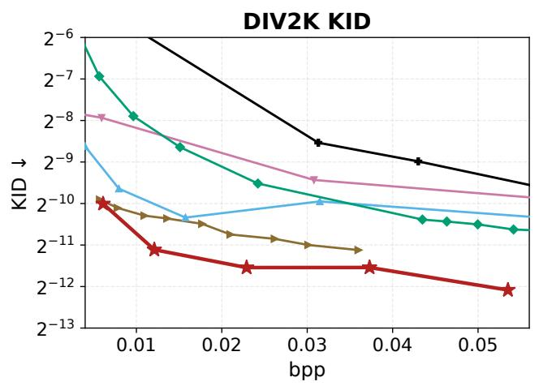

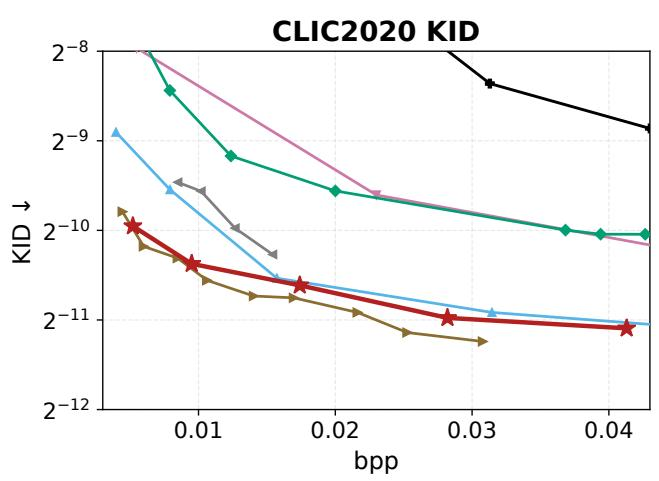  
Figure 6. Rate–KID comparisons on DIV2K and CLIC2020. Markers denote measured operating points; lower KID is better. The vertica axes use a base-2 logarithmic scale, and the bitrate windows match those used in the main rate–perception comparisons. PrismCodec is shown in red.

## F. Additional Qualitative Comparisons

Fig. 7 extends the main comparison with six additional DIV2K examples.

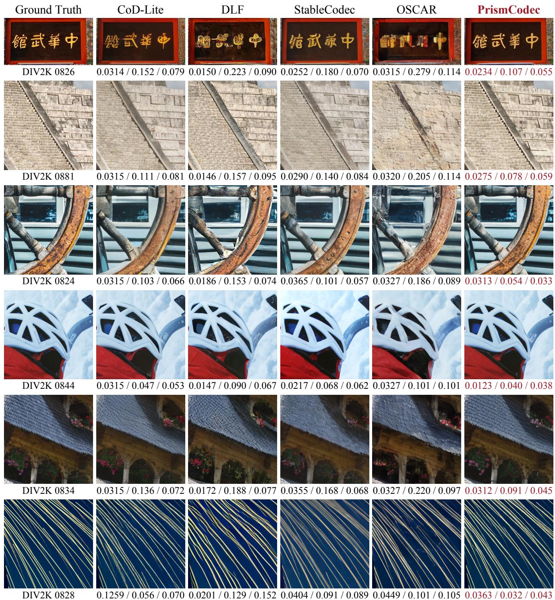  
Figure 7. Additional qualitative comparisons on DIV2K. Rows show 0826, 0881, 0824, 0844, 0834, and 0828. Each method uses the same native crop. Labels give full-image bpp / LPIPS / DISTS; lower values are better. These examples examine signage, stepped boundaries, wood grain and spoke geometry, small manufactured structures, architectural ornament, and thin light trails, respectively.