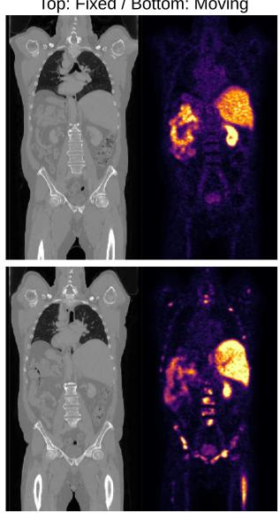
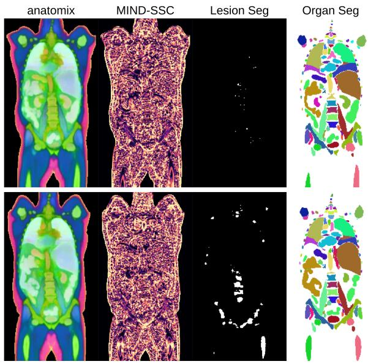
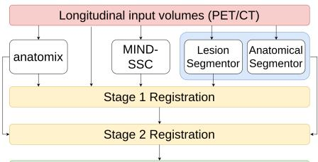
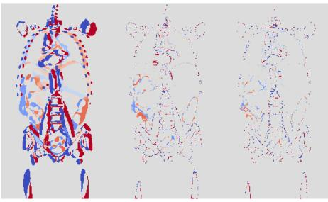
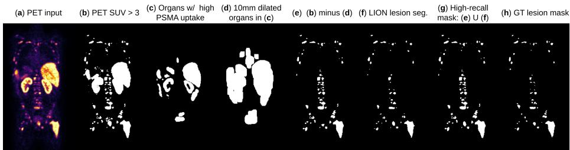
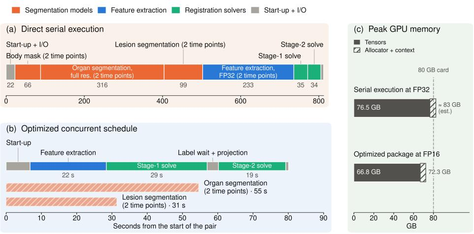
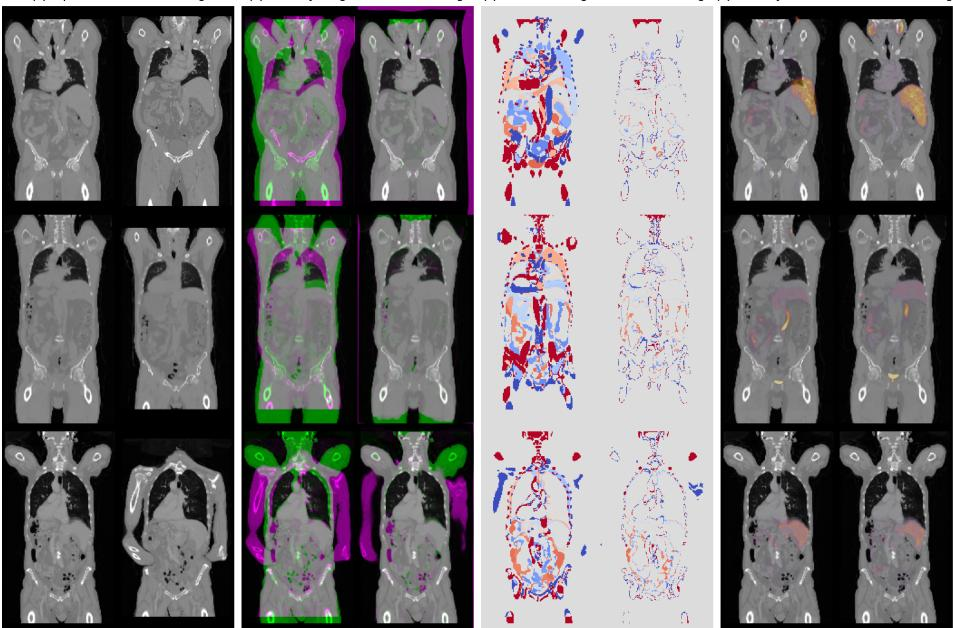

# Registration is a Representation Problem: Solving Whole-Body PET/CT Registration

Neel Dey and Adrian Dalca

A. A. Martinos Center for Biomedical Imaging, Massachusetts General Hospital Department of Radiology, Harvard Medical School Computer Science and AI Lab, Massachusetts Institute of Technology {ndey,adalca}@mgh.harvard.edu

Abstract. Raw image intensities are a poor surrogate for similarity across images in correspondence problems. Further, while auxiliary segmentation labels can provide semantic identification and improve matching, they can assign only coarse identities to fine-grained anatomy and often cover only a subset of structures, particularly in whole-body settings. We present an approach that instead establishes correspondence using complementary representations of anatomy and demonstrate its utility for longitudinal whole-body PET/CT registration in the Learn2Reg 2026 PSMAReg Challenge. Our 3D foundation model, anatomix, is used to derive fine-grained, per-voxel semantic representations that are consistent across volumes, and we further employ off-the-shelf segmentation models to obtain coarse anatomical identities. Together, these representations drive a GPUaccelerated iterative registration solver (FireANTs) in a hybrid multistage framework: the first stage estimates alignment from dense multi-channel features, after which a second refines the deformation using both anatomix- and segmentationbased losses. Lastly, because registration should not introduce non-biological tumor volume changes across time, we develop lesion-specific component-wise volume preservation schemes. Without any task-specific training, our system won first place in the PSMAReg Challenge leaderboard. Code and interactive visualizations are available at http://www.neeldey.com/reps-for-reg.

Keywords: Representation Learning · Medical Image Registration

## 1 Introduction

The medical image registration literature’s focus has largely shifted from optimization methods [2] toward learned models that directly predict deformation fields [4] quickly and accurately within domain. When trained on diverse data, these models can further act as generalist networks that operate across imaging contexts [9,23]. However, such generalists still underperform task-specific networks, necessitating training new models for every dataset, modality, or application for optimal performance. Fast registration solvers [10,12,20] are attractive in this regard because their transformation models, objectives, and regularizers can be adapted directly to the problem at hand without requiring task-specific training [11]. We show that these solvers are not intrinsically limited by their optimization methods, but by the representation used to establish correspondence.

We therefore approach registration as a representation problem. Instead of relying solely on image intensities or labels, we show that better registration can be achieved by matching features extracted from a generalist foundation model. We use anatomix [5], a 3D biomedical foundation model pretrained on abundant, highly variable synthetic data to extract semantically meaningful voxelwise representations across imaging modalities, anatomical regions, and downstream tasks. These features are approximately invariant to nuisance appearance variation while remaining equivariant to spatial transformations, making them naturally suited for establishing correspondence between volumes. Further, rather than relying on any single similarity signal, we combine complementary, domain-specific representations to improve longitudinal PSMA PET/CT registration for the PSMAReg challenge. We augment anatomix with MIND-SSC [8], a handcrafted descriptor based on local self-similarity, alongside anatomical and lesion segmentations to provide coarse semantic identities for individual structures. For PS-MAReg specifically, we further develop a region-based matching objective for poorly overlapping organs and lesion-aware volume-preserving constraints to prevent registration from altering quantitative PET biomarkers. This combination retains the flexibility of task-specific optimization with high-quality registration solvers (like FireANTs [10]) while obtaining its correspondence signal from general-purpose pretrained representations, all without any training or finetuning on the challenge’s training dataset. Our code is available at https://github.com/neel-dey/reps-for-reg/.

## 2 Methods

Our two-stage pipeline is visualized in Figure 1. Stage 1 uses the images and their nonlinear representations. Stage 2 further uses segmentation losses for the optimization. Each stage is followed by a PET biomarker preserving post-processing step.

Feature engineering. We extract a set of complementary representations from the input CT volumes that capture anatomy at different levels of granularity (Fig. 1b). We first use anatomix [5] (using the publicly available anatomix-dev-vit weights) to extract a nonlinear 32-dimensional feature vector at each voxel. For visualization in Fig. 1b, we project these features onto their top three principal components. For better performance, we complement these learned features with MIND-SSC [8], a hand-crafted descriptor based on local self-similarity that is likewise designed to be robust to cross-modal appearance variation. Finally, we obtain and use coarse semantic representations using pretrained segmentation networks: TotalSegmentator [25] provides anatomical labels from CT, while LION [19] provides PSMA lesion predictions from PET. Together, these learned, hand-crafted, and segmentation-derived representations provide complementary fine- and coarse-grained anatomical information for the registration stages below.

Multi-stage iterative optimization. Given the representations defined above for both moving and fixed volumes, we take a hybrid approach and use an off-the-shelf GPUaccelerated registration solver (FireANTs [10,12]) to optimize a deformation field. We take a two-stage registration approach. Stage 1 performs feature-based alignment to remove large deformations between volumes. It stacks the CT and PET volumes alongside the aforementioned anatomix and MIND-SSC features into a multi-channel feature volume for both fixed and moving volumes $( F _ { f }$ and $F _ { m }$ , respectively) and performs greedy deformable registration by optimizing $\phi _ { 1 } ^ { * } = \arg \operatorname* { m i n } _ { \phi _ { 1 } }$ $\mathcal { L } _ { \mathrm { L N C C } } ( F _ { f } , F _ { m } \circ \phi _ { 1 } ) +$ $\lambda _ { 1 } \mathcal { L } _ { \mathrm { v o l } } ( \phi _ { 1 } , M _ { \mathrm { l e s } } )$ , where $\mathcal { L } _ { \mathrm { L N C C } }$ is the body-masked squared local normalized cross correlation matching loss [3] applied independently to each channel, $\phi _ { 1 }$ is the stage-1 warp, ${ \mathcal L } _ { \mathrm { v o l } }$ is a lesion-volume preserving regularizer on $\phi$ defined on the moving image’s lesion mask $M _ { \mathrm { l e s } }$ (described further below), and $\lambda _ { 1 } = 1 0$ . We optimize this objective with the compositive deformation model in FireANTs and regularize the solution by Gaussian smoothing of the loss gradient and deformation field with standard deviations of 2.0 and 0.5 voxels, respectively, with a step size of 2.0 and a resolution pyramid of $6 \times 4 \times 2 \times 1$

(a) Input PET/CT volumes Top: Fixed / Bottom: Moving  

(b) Complementary Representations for Registration  
  
(c) Multi-stage Registration Pipeline

  
Output volumes (PET/CT) aligned by composed warp

(d) Seg Residuals: Input / Stage 1 / Stage 2  
  
Fig. 1. Given a pair of PET/CT volumes to register (a), we extract both fine-grained representations with the learned anatomix foundation model [5] and the hand-crafted MIND-SSC descriptor [8] and coarse-grained representations as in PSMA lesion and anatomical segmentation maps, obtained using LION [19] and TotalSegmentator [25], respectively (b). Using these complementary representations, we design a hybrid multi-stage registration framework that uses a fast registration solver (FireANTs) to align the representations (c). Most residual misalignment after stage-1 is in small abdominal organs and are rectified after stage-2 (d).

While the outputs of Stage 1 are well aligned visually, we find that there is substantial headroom left in organ alignment as small abdominal organs can be mistaken for each other when using highly shape-biased feature extractors. Therefore, Stage 2 performs segmentation-guided refinement to improve the alignment of individual organs and lesions after the large deformations have been removed. We first warp the moving organ segmentations with $\phi _ { 1 } ^ { * }$ and represent each structure in the fixed and moving volumes using a distance transform truncated at 20 mm and a soft boundary shell with a width of 2.0 voxels. We also add the LION lesion segmentation as a separate structure for both moving and fixed volumes, with a weight of 0.25. We then optimize a residual deformation $\phi _ { 2 }$ using FireANTs on the following objective:

$$
\begin{array} { r l } & { \phi _ { 2 } ^ { * } = \arg \operatorname* { m i n } _ { \phi _ { 2 } } 0 . 6 0 \widehat { \mathcal { L } } _ { \mathrm { G e n D i c e } } ( S _ { f } , S _ { m } \circ \phi _ { 1 } ^ { * } \circ \phi _ { 2 } ) + 0 . 1 5 \widehat { \mathcal { L } } _ { \mathrm { c h a m } } ( S _ { f } , S _ { m } \circ \phi _ { 1 } ^ { * } \circ \phi _ { 2 } ) } \\ & { \qquad + 0 . 2 5 \widehat { \mathcal { L } } _ { \mathrm { r e g i o n } } ( S _ { f } , S _ { m } , \phi _ { 1 } ^ { * } \circ \phi _ { 2 } ) + 0 . 5 \widehat { \mathcal { L } } _ { \mathrm { L N C C } } ( A _ { f } , A _ { m } \circ \phi _ { 1 } ^ { * } \circ \phi _ { 2 } ) } \\ & { \qquad + 1 0 \mathcal { L } _ { \mathrm { v o l } } ( \phi _ { 2 } , M _ { \mathrm { l e s } } \circ \phi _ { 1 } ^ { * } ) . } \end{array}
$$

Here, $S _ { m }$ and $S _ { f }$ are the moving and fixed multichannel segmentation maps, $A _ { f }$ and $A _ { m }$ are the anatomix features, and each hatted loss is normalized by its value before stage-2 optimization. To motivate each of the losses:

– The generalized Dice loss [22] $\mathcal { L } _ { \mathrm { G e n D i c e } }$ does label matching while accounting for imbalance in size between large and small organs, while the one-sided Chamfer loss $\mathcal { L } _ { \mathrm { c h a m } }$ is is the mean distance (capped at 20 mm), from each warped moving structure (with its soft shell) to the fixed structure.

– We add a region-based loss that measures whether tissue inside each fixed organ maps into the corresponding moving organ. For each organ, we sample up to 4,000 fixed-organ points and map them through the current deformation; each mapped point has zero error if it lies inside the moving organ and is otherwise penalized by its distance to the organ in millimetres (again, capped at 20 mm). This distance provides a useful direction for correction when the organs have little overlap and Dice gives a weak gradient.

– The anatomix term stabilizes regions that are not covered by the organ labels, and the volume term limits additional lesion-volume changes during refinement.

We optimize $\phi _ { 2 }$ with the compositive deformation model at one resolution level, using at most 35 iterations, a step size of 2.0, and Gaussian gradient and deformation smoothing with standard deviations of 1.0 and 0.5 voxels, respectively, before composing the final deformation as $\phi ^ { * } = \phi _ { 1 } ^ { * } \circ \phi _ { 2 } ^ { * }$ and postprocessing it as described below.

Volume preservation and PET biomarkers. Tumor burden may change biologically between the moving (follow-up) and fixed (baseline) scans, but the registration itself should not introduce additional changes in lesion volume. This is particularly important for PSMAReg, where the MTV (Metabolic Tumor Volume) and TLG (Total Lesion Glycolysis) biomarkers attain their ideal values when the deformation preserves the volume of ground-truth lesions. We therefore explicitly constrain local volume change within regions likely to contain tumor. Because these constraints can only preserve lesions included in their support, false-negative lesion predictions are particularly harmful to MTV and TLG, motivating a recall-biased lesion mask in the moving image.

  
Fig. 2. Constructing a recall-biased lesion mask. False negative PET lesion predictions would reduce PET biomarker preservation in our work and we therefore bias towards recall. Given the PET scan (a), we threshold it to find areas with high uptake (b) and subtract organs with nonpathological uptake (c and d) from this mask to arrive at a morphologically constructed mask (e). Finally, we add the segmentation prediction of a pretrained PSMA lesion segmentor (f) to the morphologically constructed mask to obtain the final recall-biased lesion mask (g).

While existing PSMA lesion segmentors such as LION [17,19] provide good lesion specificity, they may also miss lesions. To improve recall, we first threshold PET at $\mathrm { S U V } > 3$ . This thresholding also captures organs with high physiological tracer uptake, so we subtract masks for 16 such organs predicted from CT using TotalSegmentator, after dilating their union by 10 mm to account for within-timepoint PET/CT misalignment. Because SUV thresholding may still miss lesions with weaker uptake, we finally take the union of this region-constrained SUV mask with the moving-time-point LION prediction. The resulting mask M therefore combines organ-filtered SUV thresholding with trained lesion segmentations to improve recall and is visualized in Figure 2.

Given the lesion mask M, we encourage volume preservation during both registration stages using $\mathcal { L } _ { \mathrm { v o l } } = { \| M * ( \mathrm { d e t } ( \mathrm { J a c } ( \phi ) ) - 1 ) \| _ { 2 } ^ { 2 } } / { \| M \| } _ { 1 }$ as a regularizer [18,21], which penalizes local volume change under the deformation ϕ. To further drive down volume change after registration, we apply the volume-preserving post-processing of [7], which drives the deformation to locally preserve volume via a local correction applied to ϕ, obtained by solving a Poisson system with FFTs in < 0.5 s on a GPU. However, applying this correction to all of M can reduce anatomical alignment without improving biomarker preservation for regions of M where volume is already preserved. We therefore modify [7] to post-process M selectively, only when a lesion component is changing its volume above a threshold. For each connected component $C _ { i }$ of $M ,$ let $B _ { i } = | C _ { i } |$ be its original voxel count and $A _ { i } = | C _ { i } \circ \phi |$ its count after warping. Components under the $| \mathrm { { l o g } } ( ( A _ { i } + 1 ) / ( B _ { i } + 1 ) ) | \leq 0$ .03 threshold are considered adequately preserved by the warp and are not postprocessed. The rest receive up to four local volume correction passes, followed by eight component-wise passes that scale each lesion’s volume until its warped voxel count $A _ { i }$ approaches its original count $B _ { i }$

Background fold correction. Because the image-matching losses are evaluated only within the patient, the deformation is weakly constrained in the surrounding air outside the patient and can form anatomically meaningless folds in the displacement field. After stage 2, on the pairs from the training set that breach the %NDV threshold, 99.5 to 100% of folded voxels lie outside the body mask. We therefore repair folds (similar to [13]) in the background outside the fixed-image body mask dilated with a 5-mm safety margin. We do six passes of expanding the detected region by two voxels and replacing the deformation there with a feathered blend of the original and Gaussian-smoothed fields (σ = 2.0 voxels); the blending weight is zero within the protected body region.

  
Fig. 3. Parallelizing feature extraction and segmentation network passes. (a) Serially running all pretrained networks used in our framework at their default hyperparameters would exceed the 90 s limit. (b) We use an optimized schedule and vary the inference hyperparameters of each network to run networks in parallel and deliver segmentations before they are needed by Stage 2. (c) FP16 feature extraction and accumulation, plus the removal of a redundant segmentor, bring peak vRAM under the 80GB maximum defined by the challenge.

Maximizing throughput and utilization. The PSMAReg test phase requires each image pair to be registered in under ∼ 90 s on an 80 GB H100 GPU. Because our pipeline combines multiple feature extraction and segmentation models alongside registration solvers, a direct serial implementation would vastly exceed these constraints. We therefore optimize memory use, parallelize independent components, and selectively trade model resolution for speed, reducing the full pipeline from 83 GB and 812 s per pair to 72 GB and 79 s. In particular, we restrict computation to relevant image regions, run feature extraction and segmentation concurrently, use FP16 precision and gradient checkpointing where possible, remove overhead from library startup, file compression, and repeated CPU-to-GPU transfers and use faster, lower-quality segmentation models (e.g., TotalSegmentator’s 6-mm model) in stages where high-resolution predictions are unnecessary. The resulting execution schedule is shown in Figure 3.

(a) Inputs: Fixed and Moving

(b) Overlay: Img. Before / After Reg. (c) Residual: Seg. Before / After Reg. (d) Overlay: PET/CT Before / After Reg

  
Fig. 4. Qualitative results. On randomly selected input pairs (a), our framework increases visual, label, and cross-modal agreement (b, c, and d, respectively) across large deformations (rows 1 and 2), only failing in regions without topological correspondence (e.g., the arms in row 3).

Table 1. Performance of the top three methods on the test set of the challenge by rank, with rankings and evaluation provided by the challenge organizers. Standard deviations were not provided.
<table><tr><td>Team</td><td>CT Dice</td><td>CT HD95</td><td>PET Dice</td><td>PET HD95</td><td>MTV Error (%)</td><td>TLG Error (%)</td><td>NDV (%)</td><td>Rank</td></tr><tr><td>Ours</td><td>0.830</td><td>4.6</td><td>0.610</td><td>19.4</td><td>1.78</td><td>1.39</td><td>0.0008</td><td>1</td></tr><tr><td>heyufan1995</td><td>0.832</td><td>4.9</td><td>0.628</td><td>18.9</td><td>5.37</td><td>5.35</td><td>0.0032</td><td>2</td></tr><tr><td>tinymilky</td><td>0.832</td><td>4.6</td><td>0.598</td><td>20.0</td><td>3.41</td><td>3.24</td><td>0.0009</td><td>3</td></tr></table>

## 3 Experiments

Dataset. We participate in the 2026 Learn2Reg PSMAReg Challenge. The pairs are longitudinal whole-body PSMA PET/CT scans that are downsampled by the challenge organizers to 192×192×288 at 2.7344×2.7344×3.27 mm resolution. The training set contains 202 image pairs, with TotalSegmentator annotations provided for the CT volumes and manual lesion annotations for the PET volumes. We do not train or fine-tune any pretrained models on this dataset; it is used only for hyperparameter optimization.

Evaluation. The challenge scores CT alignment by the DSC and HD95 of TotalSegmentator labels, and lesion alignment by the DSC and HD95 of manual PET lesion masks. It scores biomarker preservation by the MTV and TLG errors [14], and regularity by %NDV [15]. The challenge ranks methods by a weighted geometric mean of Wilcoxon-based significance scores for registration accuracy (40%), PET biomarker preservation (40%) and field regularity (20%, with $\% \mathrm { N D V } \leq 0 . 0 0 5 \%$ counted as equal).

Table 2. Ablation study on 65 training set pairs (50 held-out subjects) with mean and std. error.
<table><tr><td>Configuration</td><td>CT DSC ↑</td><td>CT HD95↓</td><td>%NDV↓</td><td>|MTV%|↓</td><td>|TLG%| ↓</td><td>CT MAE↓</td></tr><tr><td>No registration</td><td>0.114(0.011)</td><td>41.72(2.98)</td><td></td><td></td><td></td><td>302.1(12.0)</td></tr><tr><td>Stage 1, CT+PET, default FireANTs</td><td>0.586(0.027)</td><td>20.07(3.43)</td><td>0.00025(0.00015)</td><td>15.49(2.15)</td><td>16.67(2.31)</td><td>118.1(14.5)</td></tr><tr><td>Stage 1, CT+PET, tuned FireANTs</td><td>0.686(0.012)</td><td>11.09(0.94)</td><td>0.00113(0.00086)</td><td>15.56(2.08)</td><td>18.47(2.39)</td><td>57.3(3.3)</td></tr><tr><td>+ anatomix + MIND-SSC</td><td>0.775(0.007)</td><td>6.54(0.37)</td><td>0.00125(0.00085)</td><td>6.31(1.68)</td><td>6.93(1.76)</td><td>58.6(3.8)</td></tr><tr><td>+ volume penalty</td><td>0.773(0.007)</td><td>6.57(0.36)</td><td>0.00145(0.00090)</td><td>4.95(1.28)</td><td>5.36(1.48)</td><td>60.0(3.8)</td></tr><tr><td>+ volume projection</td><td>0.772(0.007)</td><td>6.57(0.36)</td><td>0.00147(0.00092)</td><td>3.41(1.18)</td><td>4.14(1.49)</td><td>60.5(3.8)</td></tr><tr><td>Stage 2, labels only (no image term)</td><td>0.808(0.005)</td><td>5.40(0.28)</td><td>0.00304(0.00094)</td><td>5.09(1.07)</td><td>5.16(1.32)</td><td>78.3(3.5)</td></tr><tr><td>+ anatomix</td><td>0.809(0.005)</td><td>5.39(0.28)</td><td>0.00288(0.00094)</td><td>5.64(1.23)</td><td>5.88(1.60)</td><td>62.0(3.2)</td></tr><tr><td>+ volume projection + smoothing</td><td>0.812(0.006)</td><td>5.45(0.29)</td><td>0.00014(0.00006)</td><td>2.99(0.96)</td><td>3.85(1.44)</td><td>62.0(3.2)</td></tr><tr><td>Full pipeline w/o anatomix+MIND-SSC</td><td>0.797(0.007)</td><td>6.61(0.48)</td><td>0.00020(0.00008)</td><td>3.60(1.43)</td><td>4.57(2.18)</td><td>58.8(2.5)</td></tr></table>

Results. Our framework ranks first on the PSMAReg challenge test set leaderboard as reported by the challenge organizers (Table 1). Sample alignments are illustrated for three randomly chosen subjects from the training set in Figure 4.

Ablations. Table 2 validates the main components of our framework on 65 ground-truth pairs from 50 held-out training subjects. Tuning FireANTs substantially improves registration over its default hyperparameters, while adding anatomix and MIND-SSC features as input provides a large gain in anatomical accuracy and PET biomarker preservation. In all cases, volume regularization and projection progressively reduce MTV/TLG error with little loss in alignment accuracy. In Stage 2, segmentation-guidance improves organ alignment (particularly in the abdomen), while adding anatomix supervision back in prevents the degradation of unsupervised tissue alignment (as measured by increase in CT MAE) observed when optimizing with labels alone. We also find that running the entire pipeline without the anatomix and MIND-SSC features degrades performance.

## 4 Discussion

Limitations and future work. We use a single diffeomorphic model to represent several motion models across the body. As a result, this model is underconstrained when fitting articulated (e.g., limbs) motion across time points. The model is simultaneously also overconstrained as it requires topological correspondence which is not always guaranteed. For example, when the arms are crossed in the baseline and are above the head and outside the field-of-view in the follow-up, diffeomorphic warps cannot fit this motion without topology changes [16,24]. Future work could use bone-specific [6,26] polyrigid models [1] to fit limb articulation.

Conclusions. Generalist models trained on large aggregated collections already exist for medical image registration [23]. However, to our knowledge, they generally have not yet exceeded the performance of custom models trained on the specific tasks. We instead jointly leverage the inductive biases of high-performing registration solvers with high-dimensional representations of images extracted by foundation models pretrained entirely on synthetic anatomy, and achieves the best test-set result despite never having trained on the challenge’s training set. We believe that hybrid approaches such as ours that combine networks pretrained on large collections of wildly variable synthetic data with high-quality solvers provide a scalable path for practitioners to align their datasets without needing to train networks for each new task.

## Acknowledgments

This work was supported by NIH grants R01 EB033773 and S10 OD038222 and an MGB Neuroscience Institute Transformative Scholar Award. We thank Vivek Gopalakrishnan for useful discussions.

## References

1. Arsigny, V., Pennec, X., Ayache, N.: Polyrigid and polyaffine transformations: a novel geometrical tool to deal with non-rigid deformations–application to the registration of histolog ical slices. Medical image analysis 9(6), 507–523 (2005)

2. Avants, B.B., Epstein, C.L., Grossman, M., Gee, J.C.: Symmetric diffeomorphic image registration with cross-correlation: evaluating automated labeling of elderly and neurodegener ative brain. Medical image analysis 12(1), 26–41 (2008)

3. Avants, B.B., Tustison, N.J., Song, G., Cook, P.A., et al.: A reproducible evaluation of ants similarity metric performance in brain image registration. Neuroimage (2011)

4. Balakrishnan, G., Zhao, A., Sabuncu, M.R., Guttag, J., Dalca, A.V.: Voxelmorph: A learning framework for deformable medical image registration. IEEE Transactions on Medical Imag ing 38(8), 1788–1800 (2019). https://doi.org/10.1109/TMI.2019.2897538

5. Dey, N., Billot, B., Wong, H.E., Wang, C., Ren, M., Grant, E., Dalca, A.V., Golland, P.: Learning general-purpose biomedical volume representations using randomized synthesis. In: The Thirteenth International Conference on Learning Representations (2025), https: //openreview.net/forum?id=xOmC5LiVuN

6. Gopalakrishnan, V., Dey, N., Golland, P.: Polypose: Deformable 2d/3d registration via polyrigid transformations. Advances in Neural Information Processing Systems 38, 60633–60659 (2026)

7. Hameeteman, R., Veenland, J.F., Niessen, W.J.: Volume preserving image registration via a post-processing stage. In: Medical Imaging 2008: Image Processing. vol. 6914, pp. 313–322. SPIE (2008)

8. Heinrich, M.P., Jenkinson, M., Papiez, B.W., Brady, S.M., Schnabel, J.A.: Towards realtime˙ multimodal fusion for image-guided interventions using self-similarities. In: International conference on medical image computing and computer-assisted intervention. pp. 187–194. Springer (2013)

9. Hoffmann, M., Billot, B., Greve, D.N., Iglesias, J.E., Fischl, B., Dalca, A.V.: Synthmorph: learning contrast-invariant registration without acquired images. IEEE transactions on medical imaging 41(3), 543–558 (2021)

10. Jena, R., Chaudhari, P., Gee, J.C.: Fireants: Adaptive riemannian optimization for multi-scale diffeomorphic registration. Nature Communications (2024)

11. Jena, R., Sethi, D., Chaudhari, P., Gee, J.C.: Deep learning in medical image registration: Magic or mirage? Advances in Neural Information Processing Systems 37, 108331–108353 (2024)

12. Jena, R., Zope, V., Chaudhari, P., Gee, J.C.: A scalable distributed framework for multimodal gigavoxel image registration. In: The Fourteenth International Conference on Learning Representations (2026)

13. Karaçali, B., Davatzikos, C.: Estimating topology preserving and smooth displacement fields. IEEE Transactions on Medical Imaging 23(7), 868–880 (2004)

14. Larson, M.S.M., Erdi, P.Y., Akhurst, M.T., Mazumdar, P.M., Macapinlac, M.H.A., Finn, P.R.D., Casilla, C., Fazzari, M.M., Srivastava, N., Yeung, M.H.W., et al.: Tumor treatment response based on visual and quantitative changes in global tumor glycolysis using pet-fdg imaging: the visual response score and the change in total lesion glycolysis. Clinical Positron Imaging 2(3), 159–171 (1999)

15. Liu, Y., Chen, J., Wei, S., Carass, A., Prince, J.: On finite difference jacobian computation in deformable image registration. International Journal of Computer Vision pp. 1–11 (2024)

16. Niethammer, M., Hart, G.L., Pace, D.F., Vespa, P.M., Irimia, A., Van Horn, J.D., Aylward, S.R.: Geometric metamorphosis. In: International Conference on Medical Image Computing and Computer-Assisted Intervention. pp. 639–646. Springer (2011)

17. Pires, M., Gutschmayer, S., Bergalla, E., Chauvie, S., Amereller, D., Abenavoli, E., Lazarevic, A., Wegrzyn, N., Richter, P., Tibu, I., Miller, K., Kersting, D., Kim, M.S., Dexl, J., Ingrisch, M., Cyran, C.C., Heimer, M., Kazazi, M., Callahan, J., Hicks, R., Calderón, E., Benecke, J., Schmidt, F., Sciagra, R., Auriac, J., Seban, R.D., Orlhac, F., Buvat, I., Siegmund, S.C., Widjaja, L., Werner, R.A., Santo, G., Kronthaler, A., Virgolini, I.J., Abdelhafez, Y.G., Nalbant, H., Cheon, M., Badawi, R.D., Nardo, L., Li, A., Vehmanen, A., Kemppainen, J., Klén, R., Beyer, T., Shiyam Sundar, L.K.: Fully automated segmentation of [18f]fdg and [68ga]/[18f]psma pet/ct images via data-centric deep learning. Journal of Nuclear Medicine (2026). https://doi.org/10.2967/jnumed. 126.272852, https://jnm.snmjournals.org/content/early/2026/09/ 30/jnumed.126.272852

18. Rohlfing, T., Maurer, C.R., Bluemke, D.A., Jacobs, M.A.: Volume-preserving nonrigid registration of mr breast images using free-form deformation with an incompressibility constraint. IEEE transactions on medical imaging 22(6), 730–741 (2003)

19. Shiyam, L., Pires, M., Gutschmayer, S.: LalithShiyam/LION: lionz-v.0.9.1 (2024). https://doi.org/10.5281/zenodo.12626789, https://github.com/ ENHANCE-PET/LION

20. Siebert, H., Großbröhmer, C., Hansen, L., Heinrich, M.P.: Convexadam: Self-configuring dual-optimization-based 3d multitask medical image registration. IEEE Transactions on Medical Imaging 44(2), 738–748 (2024)

21. Staring, M., Klein, S., Pluim, J.P.: A rigidity penalty term for nonrigid registration. Medical physics 34(11), 4098–4108 (2007)

22. Sudre, C.H., Li, W., Vercauteren, T., Ourselin, S., Jorge Cardoso, M.: Generalised dice overlap as a deep learning loss function for highly unbalanced segmentations. In: International Workshop on Deep Learning in Medical Image Analysis. pp. 240–248. Springer (2017)

23. Tian, L., Greer, H., Kwitt, R., Vialard, F.X., San José Estépar, R., Bouix, S., Rushmore, R., Niethammer, M.: unigradicon: A foundation model for medical image registration. In: International Conference on Medical Image Computing and Computer-Assisted Intervention. pp. 749–760. Springer (2024)

24. Trouvé, A., Younes, L.: Metamorphoses through lie group action. Foundations of computational mathematics 5(2), 173–198 (2005)

25. Wasserthal, J., Breit, H.C., Meyer, M.T., Pradella, M., Hinck, D., Sauter, A.W., Heye, T., Boll, D.T., Cyriac, J., Yang, S., et al.: Totalsegmentator: robust segmentation of 104 anatomic structures in ct images. Radiology: Artificial Intelligence 5(5), e230024 (2023)

26. Yip, S., Perk, T., Jeraj, R.: Development and evaluation of an articulated registration algorithm for human skeleton registration. Physics in Medicine and Biology 59(6), 1485–1499 (2014)

## Appendix

Agent usage. We used AI agents (Claude Fable 5.0 and GPT 5.6 Sol) extensively for software engineering, hyperparameter tuning, and PET/PSMA-specific literature search. For example, they implemented the throughput and utilization improvements enabling the package container to meet the time and resource constraints defined by the challenge. Further, the volume projection method used here [7] was found and implemented on the GPU by prompting them to search for and implement relevant published methods for post-processing based volume preservation in registration. We also used them to compile the list of organs with high physiological PSMA uptake when constructing the high-recall lesion mask. As of August 2026, we did not yet find them suitable for suggesting specific technical directions in the registration methods themselves without considerable steering.

Implementation details. We clip the CT to [-1024, 1024] HU and the PET to [0, 15] SUV, and min-max normalize each. The body mask is the largest connected component of CT > -500 HU, with morphological hole filling and a closing. anatomix runs in 128³ windows with 25% overlap in FP16. Stage 1 uses at most 100, 100, 100 and 30 Adam iterations per level. Each level performs early stopping when the loss no longer decreases. LION [17] uses 6 of its 8 mirrored passes. TotalSegmentator [25] is used with its 6-mm, 3-mm and 1.5-mm models at a tile step of 0.8.