# REMEMBER, REVISIT, REVISE: SCAFFOLD MEMORY FOR LONG-HORIZON 3D GEOMETRY

Soumick Sarker1 Mengmi Zhang1†

1Deep NeuroCognition Lab, Nanyang Technological University, Singapore †Address correspondence to mengmi.zhang@ntu.edu.sg

## ABSTRACT

In 3D computer vision, geometry foundation models estimate camera poses and 3D scene structure from video sequences, but maintaining consistent reconstructions over long horizons remains challenging. Feed-forward models process long sequences as independent, fixed-length frame windows and subsequently align their predictions, causing pose and reconstruction errors to accumulate across windows. Streaming models retain information from previous frames to inform future predictions, but cannot revise earlier estimates when subsequent observations reveal errors. To address these limitations, we introduce Scaffold MemOry for Revision (SMORE), a framework that equips existing geometry foundation models with a revisable external memory for long-horizon inference. Inspired by hippocampal associative memory in biological brains, which links spatial context with sensory experience, SMORE associates where an observer is with what it observes, enabling past observations to be stored, retrieved, verified against new evidence, and revised when inconsistencies are detected. Crucially, SMORE integrates with existing geometry foundation models while keeping them frozen, requiring no additional training or fine-tuning. We evaluate SMORE with eight competitive geometry models on five datasets spanning camera pose estimation, multi-view depth estimation, 3D point-cloud reconstruction, simultaneous localization and mapping (SLAM), and novel view synthesis. Across all the evaluated geometry models, SMORE consistently improves long-sequence camera pose estimation, reduces multi-view depth error by up to 58%, reduces Chamfer distance for 3D point-cloud reconstruction by up to 43%, and achieves average trajectory error as low as 2.9 cm in long-horizon SLAM. By retaining corrected camera poses and observations, SMORE further improves the fidelity and spatial consistency of large-scale 3D scene reconstruction. These results establish revisable external memory as a flexible interface for extending pretrained geometry models beyond fixed-context prediction toward iterative, error-correcting inference over long visual sequences. Code, data, and models will be publicly available upon publication.

## 1 INTRODUCTION AND RELATED WORK

Recovering camera motion and 3D scene structure from visual observations is fundamental to 3D computer vision, underpinning robotic navigation, autonomous systems, augmented reality, and embodied AI Shen et al. (2026); Zhang et al. (2026c); Piriyajitakonkij et al. (2024); Zhang et al. (2018b;a); Khandelwal et al. (2023). Recent geometry foundation models have made substantial progress toward this goal. DUSt3R (Wang et al., 2024b) introduced point-map regression for unified geometric inference without known camera calibration or poses, followed by MASt3R (Leroy et al., 2024), Fast3R (Yang et al., 2025), VGGT (Wang et al., 2025a), VGGT-Ω (Wang et al., 2026a), and $\pi ^ { 3 }$ (Wang et al., 2026b). These models estimate camera poses, depth, correspondences, and 3D scene structure directly from images. Yet, a fundamental challenge remains: how can they maintain accurate, spatially consistent reconstructions over long horizons?

Existing geometry models largely approach long sequences in two ways, both with important limitations (Fig. 1). First, feed-forward models such as VGGT, VGGT-Ω, and $\pi ^ { 3 }$ (Wang et al., 2025a;

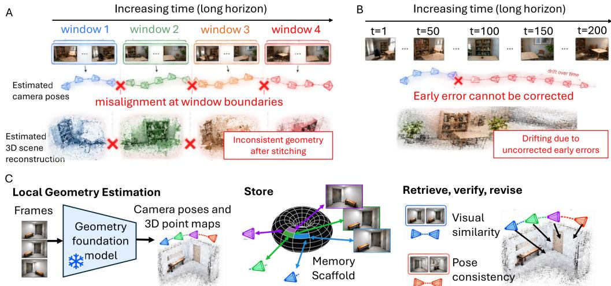  
Figure 1: Limitations of existing 3D geometry models for long horizon and overview of our SMORE. A Limitations. Feed-forward models process long sequences in separate windows and subsequently stitch their predictions, causing errors to accumulate at window boundaries and yielding inconsistent camera poses and 3D geometry. B Limitations. Video streaming models retain information across video frames to inform future predictions, but cannot revise earlier estimates when subsequent observations reveal errors, leading to persistent pose drift and distorted geometry over long sequences. C SMORE Overview. SMORE introduces four memory operations: Store retains frames, camera poses, and 3D point maps in the content bank, while the scaffold associates spatial and visual information. Retrieve uses the current frame’s visual descriptor to find candidate past frames. Verify jointly processes the current window and retrieved pairs to see whether their past poses support consistent window placement. Revise uses the accepted evidence to update the global placements of affected windows, moving their stored cameras and geometry together.

2026a;b) jointly infer geometry from groups of images. Long sequences are divided into fixed-length windows, reconstructed separately, and subsequently aligned into a common coordinate system. Small reconstruction or alignment errors can accumulate across windows, degrading camera poses and 3D geometry over long trajectories. TALO (Zhang et al., 2026a) and AMB3R (Wang & Agapito, 2026) address this through submap alignment and compact volumetric representations, respectively, while VGGSfM (Wang et al., 2024a) and GlueMap (Pan et al., 2026) combine learned geometry with structure-from-motion. Nevertheless, long-horizon reconstruction still requires maintaining geometric consistency across observations or submaps.

Second, streaming geometry models such as CUT3R (Wang et al., 2025b), StreamVGGT (Zhuo et al., 2026), and STream3R (Lan et al., 2026) maintain information across successive observations through persistent states or causal caches. Such memory allows previous observations to inform future predictions, but retaining past context and explicitly revising previously estimated camera poses and scene geometry are different capabilities. Relatedly, EAGLE (Cao et al., 2026) combines visual and geometric memory for visual-query localization in egocentric video, but does not target retrospective correction of long-horizon 3D reconstruction. Later observations may reveal that an earlier estimate was incorrect, yet existing streaming memory does not explicitly retrieve, verify, and revise that estimate. Thus, remembering the past is not equivalent to revising it.

The need for retrospective correction is well established in simultaneous localization and mapping (SLAM), where errors are corrected through loop closure and global optimization, as in graph-based SLAM (Grisetti et al., 2010; Strasdat et al., 2010), ElasticFusion (Whelan et al., 2015), and ORB-SLAM3 (Hu et al., 2022). Learned systems such as DROID-SLAM (Teed & Deng, 2021), NICER-SLAM (Zhu et al., 2024), and SLAMFormer (Yuan et al., 2026) exploit geometric constraints across observations to correct accumulated errors. More recent works, including MASt3R-SLAM (Murai et al., 2025), VGGT-SLAM (Maggio et al., 2025), VGGT-SLAM++ (Mandal et al., 2026), and ViSTA-SLAM (Zhang et al., 2026b), combine learned geometry with loop closure, while VGGT-SLAM 2.0 (Maggio & Carlone, 2026) uses model attention to verify retrieved images. However, these are dedicated SLAM systems built around specific representations and optimization pipelines. This motivates a general question: can existing geometry foundation models be equipped with a shared external memory to recall, verify, and revise past predictions while remaining frozen?

Beyond computer vision, recurrent neural fields and continuous attractor networks (CANs) in neuroscience provide biologically inspired mechanisms for maintaining and representing continuous variables through persistent neural activity (Amari, 1977; Burak & Fiete, 2009). Vector-HaSH (Chandra et al., 2025) further combines structured spatial representations with associative memory, linking spatial states with sensory observations. This principle suggests a natural way to organize long-horizon visual memory: associate where an observer is with what it observes, so that past observations can be retrieved when related spatial states are revisited.

Building on this principle, we introduce Scaffold MemOry for Revision (SMORE), a revisable external memory for extending existing geometry foundation models to long-horizon inference. SMORE goes beyond associative retrieval by supporting an explicit cycle of storage, retrieval, verification, and revision. As new observations arrive, SMORE retrieves relevant past observations, compares them with current geometric evidence, verifies their consistency, and revises previously estimated poses and geometry when inconsistencies are detected. Corrected observations are retained in memory and can subsequently provide improved geometric context for later inference.

Importantly, SMORE is external to the geometry backbone. It therefore does not require a new geometry model to be trained for long-horizon processing. Instead, existing geometry foundation models can be integrated with SMORE while their model weights remain frozen, requiring neither additional training nor fine-tuning. This design separates the problem of learning strong geometric priors from the problem of maintaining and correcting information over time: the foundation model provides geometric inference, while SMORE provides persistent and revisable memory. Consequently, the same memory framework can be applied across different geometry backbones and tasks.

We evaluate SMORE with eight competitive geometry models on five datasets spanning camera pose estimation, multi-view depth estimation, 3D point-cloud reconstruction, simultaneous localization and mapping (SLAM), and novel view synthesis. Across the evaluated geometry models, incorporating SMORE consistently improves long-sequence camera pose estimation. It reduces multi-view depth error by up to 58%, reduces Chamfer distance for 3D point-cloud reconstruction by up to 43%, and achieves average trajectory error as low as 2.9 cm in long-horizon SLAM. The corrected poses and observations retained by SMORE further improve the fidelity and spatial consistency of large-scale 3D scene reconstruction. Our contributions are threefold:

1. Revisable external memory for long-horizon 3D geometry. We introduce SMORE, an external memory that associates spatial context with visual observations and supports explicit storage, retrieval, geometric verification, and revision of previously estimated poses and scene structure.

2. Training-free integration with frozen geometry foundation models. SMORE provides a model-agnostic interface for augmenting existing geometry foundation models while keeping their weights frozen, enabling long-horizon error correction without additional training or fine-tuning.

3. Comprehensive evaluation across models and 3D tasks. We evaluate SMORE with eight geometry models on five datasets across camera pose estimation, multi-view depth estimation, 3D point-cloud reconstruction, SLAM, and novel view synthesis, demonstrating consistent improvements in long-horizon geometric accuracy and spatial consistency.

## 2 OUR PROPOSED SCAFFOLD MEMORY FOR REVISION (SMORE)

We introduce SMORE, a revisable external memory for extending pretrained geometry foundation models to long-horizon inference (Fig. 1). SMORE consists of a spatial scaffold and a content bank. The content bank stores past observations and their geometric predictions, while the scaffold associates where an observation was captured with what was observed through a shared memory representation. As new observations arrive, SMORE stores their spatial and visual representations and uses visual content to retrieve candidate revisits. Because associative retrieval alone cannot determine whether a candidate is a genuine revisit, retrieved observations are verified against their historical poses before being used for correction. A verified revisit provides a global spatial anchor for revising accumulated placement errors. The geometry foundation model remains frozen throughout; only the external memory is updated online. Before describing these memory operations, we first define the overlapping frame windows used for local reconstruction and the local and global coordinate systems used to place and revise these reconstructions.

Given RGB frames $I _ { 1 } , \ldots , I _ { N }$ , we process them in overlapping windows $\mathcal { W } _ { k }$ . By default, each window contains 32 frames, with 16 shared between consecutive windows. See Table S4(Group G) for the effect of window size and overlap. Because a frame can appear in two overlapping windows, it is stored only once, using the first window in which it appears. We call this its source window, denoted $\mathrm { s r c } ( i )$ for frame $I _ { i }$ . For each window, the geometry foundation model predicts camera poses and 3D point maps in a local coordinate system defined by the camera pose of the first frame in that window. We define the global coordinate system as that of the first window and let $T _ { k } \in \mathrm { S i m } ( 3 )$ denote the transformation that places $\mathcal { W } _ { k }$ in this global coordinate system. Consecutive windows are initially placed by aligning the predicted camera poses of their overlapping frames. Camera poses and point maps remain stored in their source window’s local coordinate system, while $T _ { k }$ determines their global placement. The robust similarity alignment and the effect of changing $T _ { k }$ on stored geometry are detailed in Appendices B and C.

## 2.1 ASSOCIATING SPATIAL AND VISUAL MEMORY

After processing each window, SMORE stores its new frames in the content bank together with their predicted camera poses and point maps. Rather than storing global poses in a lookup table indexed by frame identity, SMORE builds an associative memory: spatial states and visual observations are linked through a shared memory representation. This is important because, at retrieval time, the identity and location of a revisited frame are unknown. A new visual observation must therefore serve as a partial cue for recalling previously associated spatial information.

Spatial scaffold. Following Vector-HaSH (Chandra et al., 2025), we represent each frame’s global camera pose using a structured spatial scaffold. Camera position is encoded by three periodic spatial modules operating at different spatial scales, while yaw, pitch, and roll are represented by three continuous attractor rings. The periodic representation preserves the continuous structure of position and orientation, while combining multiple spatial scales reduces the ambiguity introduced by any single periodic representation. Their concatenation forms the scaffold state $\mathbf { g } _ { i }$

We map $\mathbf { g } _ { i }$ through a fixed random linear projection to a 1024-dimensional memory representation $\mathbf { h } _ { i } ,$ retaining only the 64 largest activations followed by normalization. This sparse intermediate representation is a deliberate design choice: activating only a small subset of memory units reduces interference among stored associations, thereby increasing effective memory capacity and making recall more robust to partial or noisy cues. We systematically vary the sparsity level and scaffold dimension and study their effects in Table S4(Groups B and D). A reverse mapping, learned using ridge regression, reconstructs the spatial scaffold state from $\mathbf { h } _ { i }$ . Thus, unlike a lookup table that can only return an entry given its explicit index, the scaffold supports associative reconstruction of spatial information from a shared memory state (see more analysis in Appendix J.1 and Table S4(Group A)). See Appendix D for details of scaffold encoding and projection.

Associating visual observations with the scaffold. To connect what is observed with where it was observed, we encode each frame $I _ { i }$ using a frozen DINOv2 ViT-S/14 encoder (Oquab et al., 2024), yielding a normalized 384-dimensional visual descriptor $\mathbf { s } _ { i } .$ . We learn bidirectional associations between $\mathbf { s } _ { i }$ and the shared memory representation $\mathbf { h } _ { i } { \mathrm { : } }$ visual content can cue its associated memory state, while the memory state can reconstruct its associated visual representation. Both mappings are updated incrementally using recursive least squares (RLS) whenever a new frame is stored.

Together, these associations connect the spatial scaffold state $\mathbf { g } _ { i }$ , shared memory representation $\mathbf { h } _ { i \cdot }$ , and visual descriptor $\mathbf { s } _ { i }$ . Consequently, a new visual observation can provide a partial cue for recalling memories associated with similar past observations, rather than requiring the identity or location of the corresponding frame to be known in advance. This associative recall is central to SMORE: it enables what is currently observed to cue where related observations were previously encountered. Because such recall alone cannot establish that two observations correspond to the same physical location, we use it only to propose candidate revisits, which are subsequently verified geometrically (Sec. 2.2). All memory updates are external to the pretrained models; the geometry foundation model and DINOv2 encoder remain frozen. Instead of DINOv2, we evaluate alternative visual features in Appendix J.2 and Table S4(Group C).

## 2.2 RETRIEVING AND VERIFYING REVISITS FOR WINDOW REVISION

Retrieving candidate revisits based on visual feature similarity. Given a current frame $I _ { q } ,$ we compute its visual descriptor ${ \bf s } _ { q }$ and use the learned visual association to obtain a query memory representation $\widetilde { \mathbf { h } } _ { q } .$ Retrieval uses only visual information; the current camera pose and e3D geometry are not used. We do not directly trust the spatial state recalled from $\widetilde { \mathbf { h } } _ { q } .$ , because a novel observation may still activate an existing memory. Instead, we compare $\widetilde { \mathbf { h } } _ { q }$ ewith all stored ememory representations and select the five most similar frames. We then remove candidates that are within 64 frames of the current observation, originate from the immediately preceding window, or have DINOv2 cosine similarity below 0.5. The remaining frames are treated as candidate revisits and are geometrically verified next. Full retrieval details are provided in Appendix D.

Verifying revisits by historical pose consistency. For each retrieved candidate, we select a second nearby frame (±3 frames) from the same source window to form a retrieved pair. We retain two pairs from different source windows, providing two independent historical references. If fewer than two valid pairs are available, no retrieval-based correction is applied. We use two pairs by default and study this choice in Table S4(Group E). When two pairs are available, the geometry foundation model jointly processes the 32 current-window frames and four retrieved frames, placing all 36 frames in a common local coordinate system. The current window retains this joint prediction unless it rotates the current frames by more than $5 ^ { \circ }$ relative to the prediction from the current window alone, in which case the current-window prediction is kept and the joint pass serves only to measure the revisit (Appendix M). Each retrieved pair connects this joint prediction to its previously placed source window and independently proposes a global placement for the current window, denoted $T _ { k } ^ { ( a ) }$ and $T _ { k } ^ { ( b ) }$ . We accept the revisit only if the two proposals are consistent in both rotation and translation: their rotational difference must be at most $1 0 ^ { \circ }$ , and their positional difference must be at most the spatial extent $E _ { k }$ of the current reconstruction (the median distance of its cameras from their centroid). Otherwise, the retrieval is rejected. Once verified, all four retrieved frames are jointly used to robustly estimate a single corrected global placement $T _ { k } ^ { \mathrm { c o r r } }$ . Importantly, $T _ { k } ^ { \mathrm { c o r r } }$ is fitted jointly from both historical references rather than obtained by averaging $T _ { k } ^ { ( a ) }$ and $T _ { k } ^ { ( b ) }$ . The alignment, verification, and corrected-placement formulations are provided in Appendix F.

Progressive placement revision along the trajectory. The difference between the original placement $T _ { k }$ and corrected placement $\bar { T } _ { k } ^ { \mathrm { c o r r } }$ represents the accumulated placement error revealed by the revisit. Rather than applying the correction abruptly to the current window, we progressively distribute it across the windows between the earlier historical reference and the current window. The historical reference remains fixed, intermediate windows receive increasingly larger corrections, and the current window receives the full correction. We interpolate these corrections in $\mathrm { S i m ( 3 ) }$ ; the full formulation is provided in Appendix G. See Appendix J.3 and Table S4(Group F) for an analysis of alternative placement revision strategies. Only the global placement of each affected window is revised. Its stored camera poses and point maps remain expressed in the local coordinate system of its source window and therefore move together under the updated global placement.

## 3 EXPERIMENTS

We evaluate all competitive baselines with and without SMORE across five downstream tasks: camera pose estimation, multi-view depth estimation, 3D point-cloud reconstruction, simultaneous localization and mapping (SLAM), and novel view synthesis. We perform three runs per experiment and aggregate results across runs. For each task, we describe the problem setting and datasets, followed by the compared methods, metrics, and results. Unless otherwise stated, all main-paper SMORE results use only online retrieval, verification, and revision, without offline global optimization. We focus on this more challenging and practical setting, where corrections are made as observations arrive without access to the complete sequence. Results with offline pose-graph optimization are provided in Appendix J.

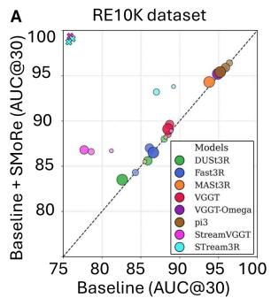

B  
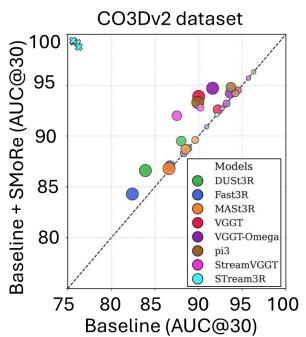

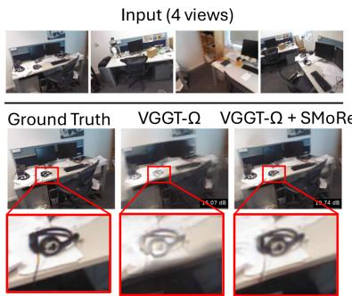  
Figure 2: Effectiveness of SMORE on camera pose estimation (A) and novel view synthesis (B). A. Camera pose accuracy across sequence lengths on RE10K (left) and CO3Dv2 (right). Each marker compares mean AUC@30 without (x-axis) and with SMORE (y-axis); colors denote geometry models and marker size denotes the number of input frames, $N \in \{ 1 0 , 5 0 , 1 0 0 , 2 0 0 \}$ Points above the diagonal indicate improvement with SMORE. Crosses indicate cases where the baseline runs out of memory (OOM), while the same model with SMORE successfully performs camera pose estimation. B. Novel view synthesis from a long camera trajectory in the office scene of the 7-Scenes dataset. VGGT-Ω processes the input keyframes along the trajectory, with four example input frames shown. A held-out target view is synthesized using either the reconstruction obtained by chaining consecutive windows (VGGT-Ω) or the reconstruction revised by SMORE (VGGT-Ω+SMORE). Red boxes highlight regions shown at higher magnification for visual comparison.

## 3.1 CAMERA POSE ESTIMATION

Problem setting and datasets. We evaluate long-horizon camera pose estimation on CO3Dv2 (Reizenstein et al., 2021) and RealEstate10K (RE10K) (Zhou et al., 2018). CO3Dv2 contains object-centric videos spanning 8–68 s, with 200 annotated frames per sequence. RE10K contains predominantly forward-moving real-estate videos; we use 100 clips spanning 6.7–9.3 s. For both datasets, we uniformly sample $N ~ \in ~ \{ 1 0 , 5 0 , 1 0 0 , 2 0 0 \}$ frames from each trajectory. Baselines. We evaluate six feed-forward geometry foundation models: DUSt3R (Wang et al., 2024b), Fast3R (Yang et al., 2025), MASt3R (Leroy et al., 2024), VGGT (Wang et al., 2025a), VGGT-Ω (Wang et al., 2026a), and $\pi ^ { 3 }$ (Wang et al., 2026b), together with two streaming models: StreamVGGT (Zhuo et al., 2026) and STream3R (Lan et al., 2026). For each model, we compare its original camera predictions with those obtained using SMORE on identical sampled frames. Feed-forward models use 32-frame windows with and without SMORE. Streaming baselines use their native causal inference, while their SMORE variants use the same 32-frame windowing policy. Metrics. We evaluate all pairs of sampled frames. For each pair, pose error is the larger of the rotation and translation-direction errors, so lower is better. AUC@30 instead measures the normalized area under the cumulative fraction of frame pairs whose pose error falls below thresholds up to 30◦; therefore, higher AUC@30 is better.

Results. As shown in the right panel of Fig. 2A, SMORE consistently improves camera pose estimation on CO3Dv2, with nearly all points lying above the diagonal. The gains become more pronounced for longer sequences, with larger markers generally farther above the diagonal. At $\mathbf { \bar { \boldsymbol { N } } } \mathbf { \boldsymbol { \Lambda } } = \mathbf { \bar { \boldsymbol { 2 0 0 } } } .$ , for example, VGGT improves from 90.0 to 93.9 AUC, VGGT-Ω from 91.6 to 94.7, and $\pi ^ { 3 }$ from 89.9 to 93.3. On RE10K (left), the gains are smaller but remain evident across sequence lengths, including shorter trajectories. This is consistent with its predominantly forward camera motion providing fewer opportunities to revisit previously observed regions. Notably, some streaming baselines run out of memory (OOM) on longer sequences in both datasets, whereas the same models equipped with SMORE successfully perform camera pose estimation through memory-efficient windowed processing (crosses in Fig. 2A).

## 3.2 MULTI-VIEW DEPTH ESTIMATION AND 3D POINT-CLOUD RECONSTRUCTION

Problem setting and datasets. We evaluate multi-view depth estimation on Replica (Straub et al., 2019) and 3D point-cloud reconstruction on ScanNet++ (Yeshwanth et al., 2023). Replica contains 18 photorealistic synthetic indoor environments with approximately 2,000 frames per scene, providing long camera trajectories and dense reference geometry for multi-view depth evaluation. ScanNet++ contains 1,006 high-fidelity real-world indoor scenes with high-resolution RGB observations and laser-scanned reference geometry, with long sequences spanning each indoor environment. For both datasets, we process the sequences using the 32-frame windowing strategy in Sec. 2. These long sequences require reconstruction across many successive windows, providing a challenging setting for evaluating whether SMORE can reduce accumulated geometric inconsistencies through revisited observations. Baselines. We use the same eight geometry models (Sec. 3.1), comparing each baseline with its SMORE counterpart. Metrics. We report reconstruction accuracy, completeness, and overall error in centimetres. Accuracy measures the distance from reconstructed to reference geometry, while completeness measures the reverse direction. Overall error is their mean; lower is better.

Table 1: Long-horizon multi-view depth estimation on Replica and 3D point-cloud reconstruction on ScanNet++ (All Frames). We report reconstruction accuracy (Acc.), completeness (Comp.), and overall error in centimetres. Lower is better (↓). Results are presented as mean ± standard deviation of baselines with and without SMORE, with the better results for each model shown in bold.
<table><tr><td rowspan="2">Model</td><td rowspan="2">Method</td><td colspan="3">Replica (centimetres)</td><td colspan="3">ScanNet++ (centimetres)</td></tr><tr><td>Acc.↓</td><td>Comp.↓</td><td>Overall ↓</td><td>Acc. ↓</td><td>Comp.↓</td><td>Overall↓</td></tr><tr><td rowspan="2">DUSt3R</td><td>Baseline</td><td>12.85±1.15</td><td>11.20±1.05</td><td> $1 2 . 0 2 { \pm } 1 . 1 0 $ </td><td>32.40±3.85</td><td>30.15±3.50</td><td>31.27±3.65</td></tr><tr><td>+SMoRE</td><td>3.85±0.22</td><td>3.24±0.19</td><td>3.55±0.20</td><td>8.51±0.72</td><td>7.88±0.65</td><td>8.20±0.68</td></tr><tr><td rowspan="2">Fast3R</td><td>Baseline</td><td>14.15±1.30</td><td>12.45±1.20</td><td>13.30±1.25</td><td>36.50±4.10</td><td>34.20±3.90</td><td>35.35±4.00</td></tr><tr><td>+SMoRE</td><td>4.21±0.25</td><td>3.55±0.28</td><td>3.88±0.26</td><td>9.22±0.85</td><td>8.45±0.80</td><td>8.84±0.82</td></tr><tr><td rowspan="2">Fer-ard MASt3R</td><td>Baseline</td><td>5.88±0.31</td><td>4.75±0.25</td><td>5.32±0.27</td><td>13.55±1.05</td><td>12.82±1.10</td><td>13.19±1.08</td></tr><tr><td>+SMORE</td><td>3.15±0.18</td><td>2.92±0.15</td><td>3.04±0.16</td><td>7.45±0.60</td><td>6.95±0.55</td><td>7.20±0.58</td></tr><tr><td rowspan="2">VGGT</td><td>Baseline</td><td>9.50±0.85</td><td>8.80±0.75</td><td>9.15±0.80</td><td>25.80±2.95</td><td>24.10±2.75</td><td>24.95±2.85</td></tr><tr><td>+SMORE</td><td>2.55±0.15</td><td>2.42±0.12</td><td>2.49±0.13</td><td>6.25±0.52</td><td>5.85±0.48</td><td>6.05±0.50</td></tr><tr><td rowspan="3">VGGT-Ω</td><td>Baseline</td><td>7.80±0.65</td><td>7.20±0.60</td><td>7.50±0.62</td><td>21.50±2.20</td><td>20.10±2.05</td><td>20.80±2.12</td></tr><tr><td>+SMoRE</td><td>2.05±0.11</td><td>1.94±0.10</td><td>2.00±0.10</td><td>5.15±0.41</td><td>4.75±0.38</td><td>4.95±0.39</td></tr><tr><td>Baseline</td><td>4.55±0.25</td><td>3.85±0.22</td><td>4.20±0.23</td><td>10.25±0.90</td><td>9.75±0.85</td><td>10.00±0.88</td></tr><tr><td rowspan="2"></td><td>+SMORE</td><td>2.25±0.14</td><td>2.12±0.12</td><td>2.19±0.13</td><td>5.55±0.45</td><td>5.25±0.42</td><td>5.40±0.43</td></tr><tr><td>StreamVGGT Baseline</td><td>6.90±0.55</td><td>6.40±0.50</td><td>6.65±0.52</td><td>18.40±1.85</td><td>17.20±1.70</td><td>17.80±1.75</td></tr><tr><td rowspan="2">Sireamng STream3R</td><td>+SMORE</td><td>1.92±0.09</td><td>1.75±0.08</td><td>1.84±0.08</td><td>4.65±0.35</td><td>4.35±0.32</td><td>4.50±0.33</td></tr><tr><td>Baseline</td><td>3.55±0.15</td><td>3.25±0.12</td><td>3.40±0.13</td><td>8.25±0.62</td><td>7.65±0.58</td><td>7.95±0.60</td></tr><tr><td rowspan="2"></td><td>+SMoRE</td><td>1.72±0.08</td><td>1.64±0.07</td><td>1.68±0.07</td><td>4.25±0.31</td><td>3.95±0.28</td><td>4.10±0.29</td></tr></table>

Results. Table 1 shows consistent improvements with SMORE across all eight geometry models on both datasets when evaluated over full trajectories. On Replica, SMORE reduces overall Chamfer error by approximately 58% across the evaluated models. For example, VGGT improves from 9.15 to 2.49 cm and VGGT-Ω from 7.50 to 2.00 cm. On ScanNet++, SMORE cuts baseline trajectory drift substantially: VGGT improves from 24.95 to 6.05 cm and VGGT-Ω from 20.80 to 4.95 cm. Streaming models also exhibit marked gains (e.g., StreamVGGT overall error drops from 6.65 to 1.84 cm on Replica and from 17.80 to 4.50 cm on ScanNet++). These results confirm that revising previously placed window reconstructions with SMORE successfully resolves accumulated drift over long sequences.

## 3.3 SIMULTANEOUS LOCALIZATION AND MAPPING

Problem setting and dataset. We evaluate SLAM on all seven indoor scenes of 7-Scenes (Shotton et al., 2013), where the objective is to estimate the camera trajectory while reconstructing the environment from an incoming video stream. Each sequence contains 17–33 s of continuous video, providing long trajectories for evaluating accumulated drift and revisit-driven correction. Baselines. We compare against published calibrated and uncalibrated SLAM methods: NICER-SLAM (Zhu et al., 2024), DROID-SLAM (Teed & Deng, 2021), MASt3R-SLAM (Murai et al., 2025), GLUEMAP (Pan et al., 2026), TALO (Zhang et al., 2026a), VGGT-SLAM++ (Mandal et al., 2026), ViSTA-SLAM (Zhang et al., 2026b), SLAM-Former (Yuan et al., 2026), CUT3R (Wang et al., 2025b), VGGT-SLAM (Maggio et al., 2025) with Sim(3) and L(4), VGGSfM (Wang et al., 2024a), and VGGT-Ω (Wang et al., 2026a). Published baselines retain their reported protocols.

A  
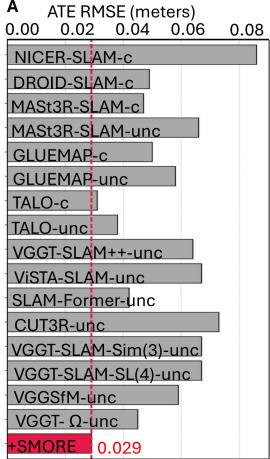

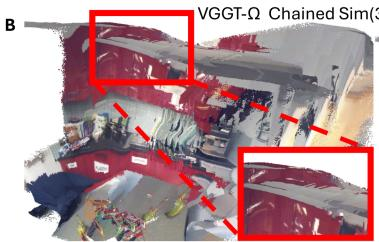

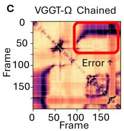

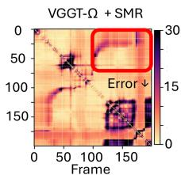

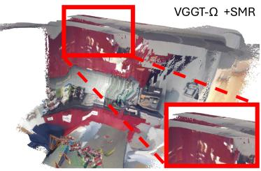

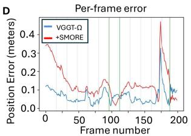  
Figure 3: Long-horizon SLAM on 7-Scenes. A. ATE RMSE (metres) compared with calibrated (c) and uncalibrated (unc) SLAM methods; lower is better. The red bar and dotted line indicate the ATE RMSE of uncalibrated VGGT-Ω+SMORE. B. Stitched 3D point-map reconstruction obtained using camera poses from chained VGGT-Ω versus VGGT-Ω+SMORE on an example 7-Scenes video sequence. Red boxes highlight a revisited region where SMORE improves spatial consistency and reconstruction detail. C. Pairwise positional errors between frames for VGGT-Ω and VGGT-Ω+SMORE; red boxes highlight temporally distant frame pairs where SMORE reduces accumulated error. D. Per-frame positional error (metres) over time. Green lines indicate verified revisits, after which SMORE corrects accumulated trajectory error.

Calibrated methods receive ground-truth camera intrinsics, whereas uncalibrated methods estimate them from the input frames. We compare the uncalibrated VGGT-Ω baseline with uncalibrated VGGT-Ω+SMORE. Metrics. We report absolute trajectory error (ATE) RMSE in metres after similarity alignment between the estimated and ground-truth camera trajectories. This alignment removes global scale differences, enabling fair comparison across methods; lower is better.

Results. As shown in Fig. 3A, SMORE reduces the average ATE RMSE of VGGT-Ω from 4.5 to 2.9 cm. Notably, this is lower than the best reported calibrated baseline using ground-truth camera intrinsics (3.1 cm) and the best reported uncalibrated baseline (3.8 cm). These results show that revisit-driven revision with SMORE improves long-horizon trajectory consistency without fine-tuning the geometry foundation model. Fig. 3B visualizes the resulting 3D reconstruction for an example 7-Scenes sequence. We transform the predicted local point maps into the global coordinate system using the estimated camera poses and stitch them into a single reconstruction. Chaining VGGT-Ω predictions accumulates placement errors, resulting in visible misalignment around the cabinet and countertop. In contrast, SMORE uses revisited observations to correct their global placement, producing a more spatially consistent reconstruction with finer geometric details. Fig. 3C shows the pairwise positional error between frames. SMORE reduces the average pairwise error from 8.1 to 6.5 cm. The improvement is particularly evident for temporally distant frame pairs (red boxes), where chained VGGT-Ω exhibits larger errors than its SMORE counterpart. This demonstrates that SMORE better preserves geometric consistency between observations separated by long temporal intervals. Finally, Fig. 3D shows the positional error over time. VGGT-Ω+SMORE generally maintains lower error than VGGT-Ω throughout the sequence, with particularly pronounced reductions following verified revisits (green lines). This illustrates how revisiting previously observed regions allows SMORE to correct accumulated trajectory errors as the sequence progresses.

## 3.4 NOVEL VIEW SYNTHESIS

Problem setting and datasets. We evaluate novel view synthesis on 7-Scenes (Shotton et al., 2013) and CO3Dv2 (Reizenstein et al., 2021), where input views from long sequences are used to render scenes from unseen viewpoints. Every eighth keyframe is held out for evaluation and excluded from geometry prediction. We evaluate 156 held-out views on 7-Scenes and 888 on CO3Dv2 (Appendix H.5). Baselines. We compare VGGT-Ω, VGGT, π3, STream3R, Fast3R, and StreamVGGT (Wang et al., 2026a; 2025a; 2026b; Lan et al., 2026; Yang et al., 2025; Zhuo et al., 2026). For each geometry model, we train separate 3D Gaussian decoders using geometry from chained consecutive windows (Baseline) and SMORE, respectively. For fair comparison, both decoders share the same architecture, training data, schedule, and random seed. Each decoder renders target views from eight nearby input keyframes, while the geometry models remain frozen. Decoders are trained on 7-Scenes sequences disjoint from test trajectories and transferred to CO3Dv2 without further fine-tuning (Appendix I). Metrics. We report PSNR (↑), SSIM (↑), and LPIPS (↓). To assess long-horizon consistency, we additionally analyze target views whose source keyframes span multiple visits to the same region (Appendix H.5).

Table 2: Novel view synthesis from long sequences on 7-Scenes (Shotton et al., 2013) and CO3Dv2 (Reizenstein et al., 2021). Baseline and +SMORE use separately trained Gaussian decoders under matched training conditions (Appendix I). Higher PSNR and SSIM and lower LPIPS indicate better performance. Values are mean ± standard error over held-out targets (156 on 7-Scenes, 888 on CO3Dv2). Within each model, the better value of each pair is in bold when the paired mean difference exceeds 0.01 dB (PSNR) or 0.001 (SSIM, LPIPS).
<table><tr><td></td><td></td><td colspan="3">7-Scenes</td><td colspan="3">CO3Dv2</td></tr><tr><td>Model</td><td>Method</td><td>PSNR↑</td><td>SSIM↑</td><td>LPIPS↓</td><td>PSNR↑</td><td>SSIM↑</td><td>LPIPS↓</td></tr><tr><td>VGGT-Ω</td><td>Baseline</td><td>18.59±0.14</td><td>0.588±0.007</td><td>0.362±0.005</td><td> $1 8 . 7 8 { \pm } 0 . 0 9$ </td><td>0.533±0.004</td><td>0.406±0.002</td></tr><tr><td></td><td>+SMORE</td><td>19.12±0.14</td><td> $\mathbf { 0 . 6 0 6 { \scriptstyle \pm 0 . 0 0 7 } }$ </td><td>0.350±0.005</td><td>19.41±0.08</td><td>0.549±0.004</td><td>0.380±0.002</td></tr><tr><td>VGGT</td><td>Baseline</td><td>17.70±0.15</td><td> $0 . 5 6 0 { \scriptstyle \pm 0 . 0 0 7 }$ </td><td> $0 . 4 1 5 { \scriptstyle \pm 0 . 0 0 4 }$ </td><td> $1 5 . 9 7 { \pm } 0 . 1 1 $ </td><td> $0 . 4 9 3 { \scriptstyle \pm 0 . 0 0 4 }$ </td><td>0.521±0.003</td></tr><tr><td></td><td>+SMORE</td><td>18.33±0.16</td><td> $\mathbf { 0 . 5 7 5 { \scriptstyle \pm 0 . 0 0 7 } }$ </td><td>0.396±0.005</td><td> ${ \bf 1 6 . 3 1 \pm 0 . 1 1 }$ </td><td>0.501±0.004</td><td>0.508±0.003</td></tr><tr><td> $\pi ^ { 3 }$ </td><td>Baseline</td><td>17.24±0.16</td><td> $0 . 5 5 1 { \scriptstyle \pm 0 . 0 0 7 }$ </td><td> $0 . 4 1 9 { \scriptstyle \pm 0 . 0 0 5 }$ </td><td> $1 7 . 4 2 { \pm } 0 . 0 9$ </td><td>0.527±0.004</td><td>0.448±0.002</td></tr><tr><td></td><td>+SMORE</td><td>17.73±0.15</td><td>0.555±0.007</td><td>0.404±0.005</td><td>18.06±0.09</td><td>0.541±0.004</td><td>0.422±0.002</td></tr><tr><td>STream3R</td><td>Baseline</td><td>15.92±0.16</td><td>0.522±0.007</td><td>0.498±0.004</td><td> $1 5 . 2 0 { \pm } 0 . 0 9$ </td><td>0.485±0.004</td><td>0.558±0.002</td></tr><tr><td></td><td>+SMoRE</td><td>16.63±0.15</td><td>0.537±0.007</td><td>0.472±0.005</td><td>15.21±0.09</td><td>0.489±0.004</td><td>0.556±0.002</td></tr><tr><td>StreamVGGT Baseline</td><td></td><td>15.59±0.19</td><td> $0 . 5 1 4 { \scriptstyle \pm 0 . 0 0 8 }$ </td><td> $0 . 5 1 1 { \scriptstyle \pm 0 . 0 0 5 }$ </td><td> $1 4 . 9 2 { \pm } 0 . 0 9$ </td><td>0.484±0.004</td><td>0.580±0.002</td></tr><tr><td></td><td>+SMORE</td><td>16.20±0.16</td><td> $\mathbf { 0 . 5 2 6 { \scriptstyle \pm 0 . 0 0 7 } }$ </td><td> $\mathbf { 0 . 4 8 8 { \pm 0 . 0 0 5 } }$ </td><td>15.52±0.10</td><td>0.490±0.004</td><td>0.553±0.002</td></tr><tr><td>Fast3R</td><td>Baseline</td><td>16.11±0.20</td><td> $0 . 5 2 5 { \scriptstyle \pm 0 . 0 0 7 }$ </td><td> $0 . 4 9 0 { \scriptstyle \pm 0 . 0 0 7 }$ </td><td>16.76±0.10</td><td>0.508±0.004</td><td>0.499±0.002</td></tr><tr><td></td><td>+SMoRE</td><td>16.42±0.20</td><td> $\mathbf { 0 . 5 3 0 { \scriptstyle \pm 0 . 0 0 7 } }$ </td><td> $\mathbf { 0 . 4 7 7 { \scriptstyle \pm 0 . 0 0 8 } }$ </td><td> $1 6 . 6 4 { \pm } 0 . 1 0$ </td><td>0.510±0.004</td><td>0.478±0.002</td></tr></table>

Results. As shown in Table 2, SMORE improves all three metrics across all six geometry models on 7-Scenes, with larger gains for revisited targets (Appendix I). On CO3Dv2, VGGT-Ω, VGGT, $\pi ^ { 3 }$ , and StreamVGGT achieve PSNR gains of 0.34–0.64 dB with SMORE, alongside improvements in SSIM and LPIPS. STream3R and Fast3R achieve comparable PSNR with and without SMORE, while improving SSIM and LPIPS with SMORE. These smaller gains may reflect residual errors in local geometric predictions that cannot be corrected through window placement revision alone. Qualitative examples are shown in Fig. 2B and Fig. S2. In Fig. 2B, for example, VGGT-Ω+SMORE better preserves the geometry and appearance of the headphone than VGGT-Ω alone. More generally, the improved geometry yields sharper object boundaries and better-preserved object structure in the synthesized views.

## 3.5 DESIGN CHOICES AND COMPUTATIONAL REQUIREMENTS

We analyze key design choices of SMORE on 7-Scenes SLAM (ATE RMSE, ↓) and CO3Dv2 camera pose estimation (AUC@30, ↑). We group the results by design factor in Table S4, with full results provided in Appendix J. From Table S4, we observe: Memory scaffold (Group A). Replacing our associative scaffold with a lookup table degrades performance, supporting associative memory as a more effective structure for memory storage, retrieval, and revision. Memory sparsity (Group B). Varying the sparsity of h reveals a trade-off between sparse coding and information preservation, with our default providing a good balance. Visual descriptors (Group C). We compare DINOv2 (Oquab et al., 2024) with alternative visual descriptors (Appendix J.2). DINOv2 performs best, highlighting the importance of strong visual representations for reliable candidate retrieval. Scaffold dimension (Group D). Performance is stable across the tested dimensions, with smaller dimensions slightly degrading performance and larger ones providing limited additional gains. Retrieval evidence (Group E). Too little retrieval evidence degrades performance, while additional pairs provide diminishing gains, motivating our default setting. Progressive placement revision (Group F). Progressive correction in SMORE outperforms uniformly distributing the correction along the trajectory, suggesting that larger corrections should be applied to more recent frames. Window size and overlap (Group G). Larger windows and greater overlap generally improve performance but increase computational and memory costs, motivating our default choice of 32-frame windows with 16 overlapping frames (50% overlap).

Computational requirements. We evaluate the GPU memory, CPU memory, RAM size, PFLOPs, and runtime of geometry foundation models with and without SMORE (Appendix K.1). In Table S5, as sequence length N increases, SMORE keeps the geometry model’s active GPU working set largely bounded because inference operates on fixed-size windows and retrieves only a small number of historical frames when needed. In contrast, feed-forward baselines must maintain intermediate predictions to chain consecutive windows, while streaming models retain growing causal states or caches and can eventually exceed GPU memory limits. Although the external memory of SMORE grows with the stored visual history, this growth occurs primarily outside the geometry model’s active GPU context, allowing long sequences to be processed with substantially better memory scalability. Reducing peak GPU memory does not make SMORE computationally free; instead, it trades a bounded GPU working set for additional memory management. Table S6 shows that computation in GPU remain dominated by the underlying geometry foundation model, while SMORE adds modest CPU, PFLOP, and runtime overhead. In return, SMORE enables substantially better memory scaling; for example, STream3R runs out of GPU memory at N = 100, whereas STream3R+SMORE can still process the full sequence using bounded-window inference.

## 4 CONCLUSION AND FUTURE WORK

We introduced SMORE, a revisable external memory that extends frozen geometry foundation models beyond fixed-context prediction through storage, retrieval, geometric verification, and revision. Across eight geometry models, five datasets, and five downstream tasks, our results show that SMORE complements both feed-forward and streaming models, using verified revisits to correct accumulated errors over long visual sequences without fine-tuning the underlying geometry models. Several directions remain for future work. Retrieval verification introduces additional computation, motivating more efficient mechanisms for recalling reliable spatial information from the memory scaffold. Moreover, SMORE currently focuses on revising global window placement; future work could extend revision to local geometric predictions when later observations provide stronger evidence.

## REFERENCES

Amar Ali-Bey, Brahim Chaib-Draa, and Philippe Giguere. Mixvpr: Feature mixing for visual place recognition. In 2023 IEEE/CVF Winter Conference on Applications of Computer Vision (WACV), pp. 2997–3006. IEEE, 2023.

Amar Ali-Bey, Brahim Chaib-Draa, and Philippe Giguere. Boq: A place is worth a bag of learnable queries. In 2024 IEEE/CVF Conference on Computer Vision and Pattern Recognition (CVPR), pp. 17794–17803. IEEE, 2024.

Shun-ichi Amari. Dynamics of pattern formation in lateral-inhibition type neural fields. Biological cybernetics, 27(2):77–87, 1977.

Relja Arandjelovic, Petr Gronat, Akihiko Torii, Tomas Pajdla, and Josef Sivic. Netvlad: Cnn architecture for weakly supervised place recognition. In Proceedings of the IEEE conference on computer vision and pattern recognition, pp. 5297–5307, 2016.

Gabriele Berton, Carlo Masone, and Barbara Caputo. Rethinking visual geo-localization for large-scale applications. In 2022 IEEE/CVF Conference on Computer Vision and Pattern Recognition (CVPR), pp. 4868–4878. IEEE, 2022.

Gabriele Berton, Gabriele Trivigno, Barbara Caputo, and Carlo Masone. Eigenplaces: Training viewpoint robust models for visual place recognition. In 2023 IEEE/CVF International Conference on Computer Vision (ICCV), pp. 11046–11056. IEEE, 2023.

Andrej Bicanski and Neil Burgess. Neuronal vector coding in spatial cognition. Nature Reviews Neuroscience, 21(9):453–470, 2020.

Yoram Burak and Ila R Fiete. Accurate path integration in continuous attractor network models of grid cells. PLoS computational biology, 5(2):e1000291, 2009.

Yifei Cao, Yu Liu, Guolong Wang, Zhu Liu, Kai Wang, Xianjie Zhang, Jizhe Yu, and Xun Tu. Eagle: Episodic appearance-and geometry-aware memory for unified 2d-3d visual query localization in egocentric vision. Proceedings of the AAAI Conference on Artificial Intelligence, 40(4): 2634–2642, 2026.

Sarthak Chandra, Sugandha Sharma, Rishidev Chaudhuri, and Ila Fiete. Episodic and associative memory from spatial scaffolds in the hippocampus. Nature, 638:739–751, 2025. doi: 10.1038/ s41586-024-08392-y.

Frank Dellaert. Factor graphs and gtsam: A hands-on introduction. Technical Report GT-RIM-CP&R-2012-002, Georgia Institute of Technology, 2012.

Giorgio Grisetti, Rainer Kümmerle, Cyrill Stachniss, and Wolfram Burgard. A tutorial on graph-based SLAM. IEEE Intelligent Transportation Systems Magazine, 2(4):31–43, 2010. doi: 10.1109/MITS.2010.939925.

Berthold K. P. Horn. Closed-form solution of absolute orientation using unit quaternions. Journal ofthe Optical Society ofAmerica A, 4(4):629–642, 1987. doi: 10.1364/JOSAA.4.000629.

Weiwei Hu, Qinglei Lin, Lihuan Shao, Jiaxu Lin, Keke Zhang, and Huibin Qin. A real-time map restoration algorithm based on orb-slam3. Applied Sciences, 12(15):7780, 2022.

Peter J. Huber. Robust estimation of a location parameter. The Annals of Mathematical Statistics, 35(1):73–101, 1964. doi: 10.1214/aoms/1177703732.

Sergio Izquierdo and Javier Civera. Optimal transport aggregation for visual place recognition. In 2024 IEEE/CVF Conference on Computer Vision and Pattern Recognition (CVPR), pp. 17658–17668. IEEE, 2024.

Bernhard Kerbl, Georgios Kopanas, Thomas Leimkühler, and George Drettakis. 3D gaussian splatting for real-time radiance field rendering. ACM Transactions on Graphics, 42(4), 2023. doi: 10.1145/3592433.

Naitik Khandelwal, Xiao Liu, and Mengmi Zhang. Adaptive visual scene understanding: incremental scene graph generation. arXiv preprint arXiv:2310.01636, 2023.

Rainer Kümmerle, Giorgio Grisetti, Hauke Strasdat, Kurt Konolige, and Wolfram Burgard. g 2 o: A general framework for graph optimization. In 2011 IEEE international conference on robotics and automation, pp. 3607–3613. IEEE, 2011.

Yushi Lan, Yihang Luo, Fangzhou Hong, Shangchen Zhou, Honghua Chen, Zhaoyang Lyu, Shuai Yang, Bo Dai, Chen Change Loy, and Xingang Pan. STream3R: Scalable sequential 3D reconstruction with causal transformer. In International Conference on Learning Representations (ICLR), 2026.

Vincent Leroy, Yohann Cabon, and Jérôme Revaud. Grounding image matching in 3d with MASt3R. In European Conference on Computer Vision (ECCV), pp. 71–91, 2024.

Dominic Maggio and Luca Carlone. Vggt-slam 2.0: Real-time dense feed-forward scene reconstruction. arXiv preprint arXiv:2601.19887, 2026.

Dominic Maggio, Hyungtae Lim, and Luca Carlone. VGGT-SLAM: Dense RGB SLAM optimized on the SL(4) manifold. In Advances in Neural Information Processing Systems (NeurIPS), volume 38, 2025.

Avilasha Mandal, Rajesh Kumar, Sudarshan Sunil Harithas, and Chetan Arora. VGGT-SLAM++. In Proceedings of the IEEE/CVF Conference on Computer Vision and Pattern Recognition (CVPR) Workshops, pp. 1008–1018, 2026.

Riku Murai, Eric Dexheimer, and Andrew J. Davison. MASt3R-SLAM: Real-time dense SLAM with 3D reconstruction priors. In Proceedings ofthe IEEE/CVF Conference on Computer Vision and Pattern Recognition (CVPR), pp. 16695–16705, 2025.

Maxime Oquab, Timothée Darcet, Théo Moutakanni, Huy V. Vo, Marc Szafraniec, Vasil Khalidov, Pierre Fernandez, Daniel Haziza, Francisco Massa, Alaaeldin El-Nouby, Mido Assran, Nicolas Ballas, Wojciech Galuba, Russell Howes, Po-Yao Huang, Shang-Wen Li, Ishan Misra, Michael Rabbat, Vasu Sharma, Gabriel Synnaeve, Hu Xu, Hervé Jégou, Julien Mairal, Patrick Labatut, Armand Joulin, and Piotr Bojanowski. DINOv2: Learning robust visual features without supervision. Transactions on Machine Learning Research, 2024.

Linfei Pan, Johannes Schönberger, and Marc Pollefeys. Global structure-from-motion meets feedforward reconstruction. arXiv preprint arXiv:2605.26103, 2026.

Maytus Piriyajitakonkij, Rishabh Dev Yadav, Mingfei Sun, Mengmi Zhang, and Wei Pan. Seeing through uncertainty: A free-energy approach for real-time perceptual adaptation in robust visual navigation. arXiv preprint arXiv:2403.01977, 2024.

Jeremy Reizenstein, Roman Shapovalov, Philipp Henzler, Luca Sbordone, Patrick Labatut, and David Novotny. Common objects in 3d: Large-scale learning and evaluation of real-life 3d category reconstruction. In 2021 IEEE/CVF International Conference on Computer Vision (ICCV), pp. 10881–10891. IEEE, 2021.

Yang Shen, Yusen Cai, Weronika Hryniewska-Guzik, Qing Lin, and Mengmi Zhang. Learning to perceive" where": Spatial pretext tasks for robust self-supervised learning. arXiv preprint arXiv:2605.09963, 2026.

Jamie Shotton, Ben Glocker, Christopher Zach, Shahram Izadi, Antonio Criminisi, and Andrew Fitzgibbon. Scene coordinate regression forests for camera relocalization in RGB-D images. In Proceedings of the IEEE Conference on Computer Vision and Pattern Recognition (CVPR), pp. 2930–2937, 2013.

Hauke Strasdat, J. M. M. Montiel, and Andrew J. Davison. Scale drift-aware large scale monocular SLAM. In Robotics: Science and Systems (RSS), 2010. doi: 10.15607/RSS.2010.VI.010.

Julian Straub, Thomas Whelan, Lingni Ma, Yufan Chen, Erik Wijmans, Simon Green, Jakob J Engel, Raul Mur-Artal, Carl Ren, Shobhit Verma, et al. The replica dataset: A digital replica of indoor spaces. arXiv preprint arXiv:1906.05797, 2019.

Zachary Teed and Jia Deng. DROID-SLAM: Deep visual SLAM for monocular, stereo, and RGB-D cameras. In Advances in Neural Information Processing Systems (NeurIPS), volume 34, 2021.

Shinji Umeyama. Least-squares estimation of transformation parameters between two point patterns. IEEE Transactions on Pattern Analysis and Machine Intelligence, 13(4):376–380, 1991. doi: 10.1109/34.88573.

Hengyi Wang and Lourdes Agapito. Amb3r: Accurate feed-forward metric-scale 3d reconstruction with backend. In Proceedings of the IEEE/CVF Conference on Computer Vision and Pattern Recognition, pp. 14612–14625, 2026.

Jianyuan Wang, Nikita Karaev, Christian Rupprecht, and David Novotny. Vggsfm: Visual geometry grounded deep structure from motion. In 2024 IEEE/CVF Conference on Computer Vision and Pattern Recognition (CVPR), pp. 21686–21697. IEEE, 2024a.

Jianyuan Wang, Minghao Chen, Nikita Karaev, Andrea Vedaldi, Christian Rupprecht, and David Novotny. VGGT: Visual geometry grounded transformer. In Proceedings of the IEEE/CVF Conference on Computer Vision and Pattern Recognition (CVPR), pp. 5294–5306, 2025a.

Jianyuan Wang, Minghao Chen, Shangzhan Zhang, Nikita Karaev, Johannes Schönberger, Patrick Labatut, Piotr Bojanowski, David Novotny, Andrea Vedaldi, and Christian Rupprecht. VGGT-Ω. In Proceedings of the IEEE/CVF Conference on Computer Vision and Pattern Recognition (CVPR), 2026a.

Qianqian Wang, Yifei Zhang, Aleksander Holynski, Alexei A. Efros, and Angjoo Kanazawa. Continuous 3d perception model with persistent state. In Proceedings of the IEEE/CVF Conference on Computer Vision and Pattern Recognition (CVPR), pp. 10510–10522, 2025b.

Shuzhe Wang, Vincent Leroy, Yohann Cabon, Boris Chidlovskii, and Jérôme Revaud. DUSt3R: Geometric 3d vision made easy. In Proceedings of the IEEE/CVF Conference on Computer Vision and Pattern Recognition (CVPR), pp. 20697–20709, 2024b.

Yifan Wang, Jianjun Zhou, Haoyi Zhu, Wenzheng Chang, Yang Zhou, Zizun Li, Junyi Chen, Jiangmiao Pang, Chunhua Shen, and Tong He. π3: Permutation-equivariant visual geometry learning. In International Conference on Learning Representations (ICLR), 2026b.

Thomas Whelan, Stefan Leutenegger, Renato F. Salas-Moreno, Ben Glocker, and Andrew J. Davison. ElasticFusion: Dense SLAM without a pose graph. In Robotics: Science and Systems (RSS), 2015. doi: 10.15607/RSS.2015.XI.001.

Jianing Yang, Alexander Sax, Kevin J. Liang, Mikael Henaff, Hao Tang, Ang Cao, Joyce Chai, Franziska Meier, and Matt Feiszli. Fast3R: Towards 3d reconstruction of 1000+ images in one forward pass. In Proceedings of the IEEE/CVF Conference on Computer Vision and Pattern Recognition (CVPR), pp. 21924–21935, 2025.

Vickie Ye, Ruilong Li, Justin Kerr, Matias Turkulainen, Brent Yi, Zhuoyang Pan, Otto Seiskari, Jianbo Ye, Jeffrey Hu, Matthew Tancik, et al. gsplat: An open-source library for gaussian splatting. Journal ofMachine Learning Research, 26(34):1–17, 2025.

Chandan Yeshwanth, Yueh-Cheng Liu, Matthias Nießner, and Angela Dai. Scannet++: A high-fidelity dataset of 3d indoor scenes. In 2023 IEEE/CVF International Conference on Computer Vision (ICCV), pp. 12–22. IEEE, 2023.

Yijun Yuan, Zhuoguang Chen, Kenan Li, Weibang Wang, Minghui Qin, Zhijian Fang, Weicheng Zheng, and Hang Zhao. SLAM-Former: Putting SLAM into one transformer. In European Conference on Computer Vision (ECCV), 2026.

Fengyi Zhang, Tianjun Zhang, Kasra Khosoussi, Zheng Zhang, Zi Huang, and Yadan Luo. Talo: Pushing 3d vision foundation models towards globally consistent online reconstruction. In Proceedings of the IEEE/CVF Conference on Computer Vision and Pattern Recognition, pp. 21870–21879, 2026a.

Ganlin Zhang, Shenhan Qian, Xi Wang, and Daniel Cremers. ViSTA-SLAM: Visual SLAM with symmetric two-view association. In International Conference on 3D Vision (3DV), pp. 396–406, 2026b.

Mengmi Zhang, Keng Teck Ma, Joo Hwee Lim, Qi Zhao, and Jiashi Feng. Anticipating where people will look using adversarial networks. IEEE transactions on pattern analysis and machine intelligence, 41(8):1783–1796, 2018a.

Mengmi Zhang, Keng Teck Ma, Shih-Cheng Yen, Joo Hwee Lim, Qi Zhao, and Jiashi Feng. Egocentric spatial memory. In 2018 IEEE/RSJ International Conference on Intelligent Robots and Systems (IROS), pp. 137–144. IEEE, 2018b.

Richard Zhang, Phillip Isola, Alexei A. Efros, Eli Shechtman, and Oliver Wang. The unreasonable effectiveness of deep features as a perceptual metric. In Proceedings of the IEEE Conference on Computer Vision and Pattern Recognition (CVPR), pp. 586–595, 2018c.

Zhengquan Zhang, Feng Xu, and Mengmi Zhang. Peering into the unknown: Active view selection with neural uncertainty maps for 3d reconstruction. In International Conference on Learning Representations, volume 2026, pp. 85781–85801, 2026c.

Tinghui Zhou, Richard Tucker, John Flynn, Graham Fyffe, and Noah Snavely. Stereo magnification: Learning view synthesis using multiplane images. arXiv preprint arXiv:1805.09817, 2018.

Zihan Zhu, Songyou Peng, Viktor Larsson, Zhaopeng Cui, Martin R. Oswald, Andreas Geiger, and Marc Pollefeys. NICER-SLAM: Neural implicit scene encoding for RGB SLAM. In International Conference on 3D Vision (3DV), pp. 42–52, 2024.

Dong Zhuo, Wenzhao Zheng, Jiahe Guo, Yuqi Wu, Jie Zhou, and Jiwen Lu. Streaming visual geometry transformer. In International Conference on Learning Representations (ICLR), 2026.

## A APPENDIX ROADMAP

The appendix provides the mathematical details, evaluation protocols, and diagnostics supporting the main paper. Appendices B–G describe the memory and geometry; Appendices H–I give the evaluation and rendering protocols; the remaining sections report ablations, resource costs, implementation settings, and failure analyses. The links below lead directly to each section.

<table><tr><td>Appendix</td><td>Contents</td><td>Page</td></tr><tr><td>B</td><td>Camera-pose alignment</td><td>14</td></tr><tr><td>C</td><td>Window ownership and geometric invariance</td><td>15</td></tr><tr><td>D</td><td>Scaffold construction, storage, and retrieval</td><td>16</td></tr><tr><td>E</td><td>Scaffold dynamics and controlled memory diagnostics</td><td>19</td></tr><tr><td>F</td><td>Geometric verification of retrieved revisits</td><td>21</td></tr><tr><td>G</td><td>Trajectory revision and global refinement</td><td>22</td></tr><tr><td>H</td><td>Datasets and evaluation protocols</td><td>24</td></tr><tr><td>I</td><td>Novel view synthesis protocol and decoder</td><td>28</td></tr><tr><td>J</td><td>Controlled ablations</td><td>30</td></tr><tr><td>K</td><td>Compute and memory measurements</td><td>33</td></tr><tr><td>L</td><td>Implementation settings and reproducibility</td><td>34</td></tr><tr><td>M</td><td>Local-prediction changes and trajectory revision</td><td>36</td></tr><tr><td>N</td><td>Memory growth and pruning</td><td>39</td></tr></table>

## B CAMERA-POSE ALIGNMENT

The main text uses camera-pose alignment in two places. First, in the opening of Sec. 2, consecutive windows are aligned using the camera poses of their shared frames to obtain their global placements $T _ { k }$ . Second, in Sec. 2.2, the newly predicted poses of a retrieved pair are aligned with the stored poses of the same frames in their source window to obtain the relative transformation $\widehat { Z } _ { o , k }$ . Both operations use the same similarity-alignment procedure described below.

Similarity transformation. Suppose the same frames have camera predictions in two coordinate systems, A and B. We seek the transformation that expresses the predictions from A in coordinate system B. We write this similarity transformation as

$$
S = ( s , R , t ) ,
$$

where $s > 0$ is scale, $R \in \mathrm { S O ( 3 ) }$ is rotation, and $t \in \mathbb { R } ^ { 3 }$ is translation. For a 3D point x,

$$
S \cdot x = s R x + t .
$$

For a camera pose $( R _ { j } , c _ { j } )$ , where $R _ { j }$ is its orientation and $c _ { j }$ its camera centre,

$$
S \cdot ( R _ { j } , c _ { j } ) = ( R R _ { j } , s R c _ { j } + t ) .
$$

Estimating the alignment. Because the two predictions correspond to the same frames, their camera centres provide known correspondences ${ \bf \Sigma } ^ { \bullet } c _ { j } ^ { A }  c _ { j } ^ { B }$ . We estimate the transformation from coordinate system A to B by

$$
\widehat { S } _ { A  B } = \underset { s > 0 , R \in \mathrm { S O } ( 3 ) , t } { \arg \operatorname* { m i n } } \sum _ { j } w _ { j } \| s R c _ { j } ^ { A } + t - c _ { j } ^ { B } \| _ { 2 } ^ { 2 } .\tag{1}
$$

Thus, no additional frame matching or nearest-neighbour search is needed. Scale, rotation, and translation are estimated jointly from the corresponding camera centres using standard similarity alignment (Umeyama, 1991; Horn, 1987).

This is the operation used in Sec. 2: for two consecutive windows, the corresponding cameras are those of their shared frames. The resulting relative transformation places the new window with

respect to the preceding window, and composing these transformations gives its global placement $T _ { k }$

The same operation is used in Sec. 2.2. For a retrieved pair from source window ${ \mathcal W } _ { o } .$ the two cameras predicted in the joint pass are aligned with the stored poses of the same two frames in $\mathcal { W } _ { o }$ This gives

$$
\widehat { Z } _ { o , k } = \widehat { S } _ { \mathrm { j o i n t }  o } ,
$$

b bwhich relates the current joint prediction to the source window. The source window already has global placement $T _ { o } .$ , so the corresponding proposal for the current window is

$$
T _ { k } ^ { ( a ) } = T _ { o } \widehat { Z } _ { o , k } .
$$

Making the alignment robust. Camera predictions can contain outliers, so we refine the similarity fit for five reweighting rounds. After each round, the centre residual is

$$
\begin{array} { r } { \boldsymbol { r } _ { j } =  \widehat { \boldsymbol { S } } _ { A  B } \cdot \boldsymbol { c } _ { j } ^ { A } - \boldsymbol { c } _ { j } ^ { B }  _ { 2 } , } \end{array}
$$

and the weight used in the next round is

$$
w _ { j } = \operatorname* { m i n } \left( 1 , \kappa \frac { \widetilde { r } } { r _ { j } } \right) , \qquad \kappa = 2 . 5 ,
$$

where $\widetilde { r }$ is the median residual. A zero-residual correspondence keeps unit weight. After fitting the camera centres, we also compare the transformed camera orientation $R R _ { j } ^ { A }$ with $R _ { j } ^ { B }$ and reject correspondences with excessive rotational disagreement.

Additional scale check for consecutive windows. For consecutive-window alignment, an incorrect scale would affect every later window in the trajectory. We therefore compare the fitted scale s with an estimate $s _ { \mathrm { p a i r } }$ obtained from the median ratio of pairwise camera-centre distances. We accept the alignment only if

$$
\frac { s } { s _ { \mathrm { p a i r } } } \in \left[ \frac { 1 } { \gamma _ { s } } , \gamma _ { s } \right] , \qquad \gamma _ { s } = 1 . 5 .
$$

This scale check is applied to the sequential window alignment described in Sec. 2.

Two-camera limitation. The shared-frame alignment between consecutive windows normally has multiple camera correspondences. A retrieved pair in Sec. 2.2, however, contains only two cameras. Two camera centres determine a baseline but do not by themselves uniquely constrain rotation about that baseline. The camera-orientation check provides additional consistency information, and SMORE further requires two retrieved pairs from different source windows to produce consistent global-placement proposals before accepting a revisit.

## C WINDOW OWNERSHIP AND GEOMETRIC INVARIANCE

In Sec. 2.1, each frame is stored once using its source window, and its camera pose and point map remain in that window’s local coordinate system. Later, Sec. 2.2 changes only the global placement $T _ { k }$ of a window. Here we make explicit what this means for the stored geometry and for relative camera poses.

Source-window storage. Because consecutive windows overlap, the same frame may be predicted in more than one window. We store it only once, using the first window in which it appears. For frame $I _ { i }$ , this window is $\mathcal { W } _ { \mathrm { s r c } ( i ) }$

Suppose $I _ { i }$ is stored in source window $\mathcal { W } _ { k }$ , with local camera pose $( R _ { i } , c _ { i } )$ and local 3D points xi. These quantities remain fixed in the coordinate system of $\mathcal { W } _ { k }$ . Their global values are obtained only when the window placement $T _ { k } = \left( a _ { k } , Q _ { k } , \mathbf { b } _ { k } \right)$ is applied:

$$
R _ { i } ^ { \mathrm { g l o b a l } } = Q _ { k } R _ { i } , \qquad c _ { i } ^ { \mathrm { g l o b a l } } = a _ { k } Q _ { k } c _ { i } + { \bf b } _ { k } ,
$$

and

$$
x _ { i } ^ { \mathrm { g l o b a l } } = a _ { k } Q _ { k } x _ { i } + { \bf b } _ { k } .
$$

Thus, the content bank stores local geometry, while $T _ { k }$ determines where that geometry currently lies in the global reconstruction.

What changes after a placement correction? When Sec. 2.2 replaces $T _ { k }$ by an updated global placement, the stored local camera poses and point maps are not recomputed. Instead, the new transformation is applied to the same local quantities. Consequently, all cameras and 3D points belonging to $\mathcal { W } _ { k }$ move together.

This separation is useful because a revisit can correct where a window is placed without modifying the geometric relationships already predicted inside that window.

Relative poses within one source window. Consider two frames $I _ { i }$ and $I _ { j }$ stored in the same source window $\mathcal { W } _ { k }$ . After applying $T _ { k }$ , their global rotations satisfy

$$
\left( R _ { j } ^ { \mathrm { g l o b a l } } \right) ^ { \top } R _ { i } ^ { \mathrm { g l o b a l } } = R _ { j } ^ { \top } R _ { i } .
$$

Their relative translation, expressed in frame $I _ { j }$ , becomes

$$
\left( R _ { j } ^ { \mathrm { g l o b a l } } \right) ^ { \top } \left( c _ { i } ^ { \mathrm { g l o b a l } } - c _ { j } ^ { \mathrm { g l o b a l } } \right) = a _ { k } R _ { j } ^ { \top } ( c _ { i } - c _ { j } ) .
$$

Therefore, changing $T _ { k }$ leaves their relative rotation and translation direction unchanged. Only the translation magnitude can change through the window scale $a _ { k }$

This is why a placement correction primarily changes relationships between windows rather than the relative camera geometry already stored within one source window. It also explains why the pairwise-pose metric, which uses rotation and translation-direction errors, is unchanged for two frames whose local predictions remain fixed in the same source window.

When this property does not apply. The argument above assumes that the stored local predictions $( R _ { i } , c _ { i } )$ themselves are unchanged. In Sec. 2.2, however, processing retrieved frames jointly with the current window can also produce new local camera poses and point maps. That is a separate effect from changing $T _ { k }$ . Appendix M isolates these two sources of change experimentally.

## D SCAFFOLD CONSTRUCTION, STORAGE, AND RETRIEVAL

Sections 2.1 and 2.2 introduce the two memory operations used by SMORE. When a frame is stored, its estimated global camera pose is converted into a compact memory address. Later, the visual content of a current frame is used to predict an address and retrieve previously stored frames. Here we explain how the pose representation, memory address, and visual descriptor are connected, why the scaffold uses multiple spatial scales and a sparse address, and which parts of this associative pathway are actually used during trajectory revision.

Representing the global camera pose. When frame $I _ { i }$ is first stored, its source window has a current global placement $T _ { \mathrm { s r c } ( i ) }$ . Applying this placement to the frame’s local camera pose gives the global camera pose used to construct its scaffold representation. As described in Sec. 2.1, we represent camera position and orientation separately and concatenate them into a single scaffold state $\mathbf { g } _ { i }$

Camera position is first expressed in normalized scene units, with median scene depth equal to one. We use three spatial modules with periods

$$
\lambda _ { 1 } = 2 . 4 , \qquad \lambda _ { 2 } = 3 . 2 , \qquad \lambda _ { 3 } = 4 . 0 .
$$

For module $m ,$ a position $\mathbf { p } _ { i } = \left( x _ { i } , y _ { i } , z _ { i } \right)$ is converted to periodic coordinates

$$
\phi _ { m , i } = \frac { 2 \pi } { \lambda _ { m } } ( x _ { i } , y _ { i } , z _ { i } ) \bmod 2 \pi .
$$

Thus, each individual module is periodic: positions separated by $\lambda _ { m }$ along an encoded axis produce the same phase in that module.

A single periodic module cannot distinguish locations separated by its period. The three modules reduce this ambiguity because their periods are different: a displacement that wraps one module generally does not wrap the other two at the same location. We use

$$
( 2 . 4 , 3 . 2 , 4 . 0 ) = 0 . 8 ( 3 , 4 , 5 ) ,
$$

so the complete three-module pattern repeats only after

$$
0 . 8 \mathrm { ~ l c m } ( 3 , 4 , 5 ) = 4 8
$$

normalized units along an encoded axis. The representation is therefore less ambiguous than any individual module, although it is still periodic rather than globally unique over an unbounded scene. These periods are fixed across the main experiments; we do not claim that they are an optimal set of spatial periods.

For each spatial module, the horizontal phase is represented on a $4 8 \times 4 8$ periodic grid and height on a 48-unit ring. These numbers specify the resolution with which a module represents its phase; they are distinct from the spatial period $\lambda _ { m }$ . We use $4 8 \times 4 8$ as the default horizontal resolution. The sensitivity study in Table S4 additionally evaluates $1 6 \times 1 6$ and 64 × 64 modules and shows that the method does not depend on using the finest tested resolution.

Representing camera orientation. Camera orientation is converted to yaw, pitch, and roll using the ZYX convention. Each angle is represented on a separate 256-unit periodic ring. A ring is natural for an angular variable because the beginning and end of the interval correspond to the same orientation after a full 360◦ rotation.

The three spatial modules and three orientation rings are concatenated, giving

$$
\begin{array} { r } { \mathbf { g } _ { i } \in \mathbb { R } ^ { N _ { g } } , \qquad N _ { g } = 3 ( 4 8 ^ { 2 } + 4 8 ) + 3 ( 2 5 6 ) = 7 , 8 2 4 . } \end{array}
$$

Thus, $\mathbf { g } _ { i }$ is the scaffold representation of where frame $I _ { i }$ was estimated to have been captured when it entered memory.

From the scaffold state to a compact memory address. Directly associating visual descriptors with the full 7,824-dimensional scaffold state would make the associative layer unnecessarily large. We therefore project the scaffold state into a smaller address space:

$$
\mathbf { z } _ { i } = W _ { g h } \mathbf { g } _ { i } , \qquad W _ { g h } \in \mathbb { R } ^ { 1 0 2 4 \times 7 8 2 4 } .
$$

The entries of $W _ { g h }$ are sampled independently from $\mathcal { N } ( 0 , 1 / 7 8 2 4 )$ and the matrix remains fixed throughout inference.

We then retain only the largest 64 entries:

$$
\mathbf { v } _ { i } = \sigma _ { 6 4 } ( \mathbf { z } _ { i } ) , \qquad \mathbf { h } _ { i } = { \frac { \mathbf { v } _ { i } } { \lVert \mathbf { v } _ { i } \rVert _ { 2 } } } ,
$$

where $\sigma _ { 6 4 }$ sets all but the 64 largest values to zero. The resulting

$$
\mathbf { h } _ { i } \in \mathbb { R } ^ { 1 0 2 4 }
$$

is the memory address of frame $I _ { i } .$

The purpose of the top-k operation is to make different addresses selective: unrelated scaffold states activate only a small subset of the 1024 address units, reducing overlap between stored representations. The main configuration retains $k = 6 4$ units, i.e., 6.25% of the address layer. We use this as a fixed sparsity setting throughout the main experiments. The address dimension is examined in Table S4: increasing it from the default $N _ { h } = \bar { 1 } 0 2 4$ to 8192 does not consistently improve the final results, while reducing it to 512 produces only a modest change. Thus, the reported gains do not rely on an exceptionally large address layer.

Normalizing hi also makes comparisons between addresses depend on their represented direction and overlap rather than on the absolute magnitude produced by the random projection.

The memory address does not contain the RGB frame or its dense geometry. Instead, $\mathbf { h } _ { i }$ is linked to the corresponding content-bank entry. That entry stores the RGB frame, its source window, and its camera pose and point map in the local coordinate system of that source window. Appendix C explains how the current global placement $T _ { \mathrm { s r c } ( i ) }$ is applied when this content is used. The address is assigned when the frame is first stored. Later placement corrections update $T _ { \mathrm { s r c } ( i ) }$ but do not recompute $\mathbf { h } _ { i } .$ . This separation allows the stored local geometry to move with its source window without rewriting the content bank or its memory index.

Recovering a scaffold state from an address. The mapping above provides the direction $\mathbf { g } \to \mathbf { h } .$ The scaffold additionally contains a return mapping

$$
W _ { h g } \in \mathbb { R } ^ { 7 8 2 4 \times 1 0 2 4 }
$$

for the reverse direction. Given an address,

$$
\widehat { \mathbf { g } } _ { i } = \psi ( W _ { h g } \mathbf { h } _ { i } ) ,
$$

where $\psi$ normalizes each spatial or orientation field independently.

Unlike $W _ { g h }$ , which is a fixed random projection, $W _ { h g }$ is fitted once before inference. We sample valid scaffold states $\{ \mathbf { g } _ { p } \}$ , construct their corresponding addresses $\{ \mathbf { h } _ { p } \}$ using the same $W _ { g h }$ and sparsification rule, and solve

$$
W _ { h g } = \mathop { \mathrm { a r g } \operatorname* { m i n } } _ { W } \sum _ { p } \| \mathbf { g } _ { p } - W \mathbf { h } _ { p } \| _ { 2 } ^ { 2 } + \lambda _ { \mathrm { r i d g e } } \| W \| _ { F } ^ { 2 } .
$$

The sampled scaffold states use a maximum phase spacing of $\lambda _ { \operatorname* { m i n } } / 6 = 0 . 4 .$ This fitting procedure uses no RGB frames, geometry-foundation-model outputs, or evaluation labels. It prepares the scaffold’s return mapping once and is separate from the online memory updates described below.

The spatial part of the associative memory can therefore be written as

$$
\mathbf { g } _ { i } \ \overset { W _ { g h } } { \underset { W _ { h g } } {  } } \ \mathbf { h } _ { i } .
$$

Associating visual content with the same address. The scaffold tells us where a stored frame was captured, but at test time we begin with what the current frame looks like. Therefore, each frame $I _ { i }$ is independently encoded using the frozen DINOv2 ViT-S/14 encoder (Oquab et al., 2024). We use its normalized 384-dimensional CLS representation

$$
\mathbf { s } _ { i } \in \mathbb { R } ^ { 3 8 4 }
$$

as the frame descriptor. DINOv2 is the default descriptor used in the main experiments; Table S4 compares it with several alternative place-recognition descriptors.

We maintain two mappings between the visual descriptor and the memory address:

such that

$$
\begin{array} { r l } { W _ { s h } \in \mathbb { R } ^ { 1 0 2 4 \times 3 8 4 } , \quad } & { W _ { h s } \in \mathbb { R } ^ { 3 8 4 \times 1 0 2 4 } , } \\ { \quad } & { } \\ { W _ { s h } \mathbf { s } _ { i } \approx \mathbf { h } _ { i } , \quad } & { W _ { h s } \mathbf { h } _ { i } \approx \mathbf { s } _ { i } . } \end{array}
$$

The first converts appearance into an address, while the second provides the reverse address-to-appearance association.

Why are these mappings learned online? Unlike the pose-to-address mapping, the association between a particular visual observation and its address is not known before that frame is encountered. New pairs $( \mathbf { s } _ { i } , \mathbf { h } _ { i } )$ therefore arrive throughout the sequence. We update both visual associations incrementally using recursive least squares (RLS), so that new observations can be added without retraining either the DINOv2 encoder or the geometry foundation model.

For a generic association $W \mathbf { x } _ { i } \approx \mathbf { y } _ { i } ,$ the RLS update is

$$
\begin{array} { r } { \mathbf { k } _ { i } = \frac { P _ { i - 1 } \mathbf { x } _ { i } } { 1 + \mathbf { x } _ { i } ^ { \top } P _ { i - 1 } \mathbf { x } _ { i } } , ~ } \\ { W ^ { ( i ) } = W ^ { ( i - 1 ) } + \left( \mathbf { y } _ { i } - W ^ { ( i - 1 ) } \mathbf { x } _ { i } \right) \mathbf { k } _ { i } ^ { \top } , ~ } \\ { P _ { i } = P _ { i - 1 } - \mathbf { k } _ { i } \mathbf { x } _ { i } ^ { \top } P _ { i - 1 } , ~ } \end{array}\tag{2}
$$

where $P _ { i }$ is the RLS covariance matrix and $\mathbf { k } _ { i }$ determines the contribution of the new association.

For $W _ { s h }$ we set

$$
\mathbf { x } _ { i } = \mathbf { s } _ { i } , \qquad \mathbf { y } _ { i } = \mathbf { h } _ { i } ,
$$

while for $W _ { h s }$ the two roles are exchanged. These updates modify only the external memory.

The complete associative pathway. The four mappings together form

$$
\boxed { \mathbf { g } _ { i } \frac { W _ { g h } } { W _ { h g } } \mathbf { h } _ { i } \frac { W _ { s h } } { W _ { h s } } \mathbf { s } _ { i } }
$$

and connect the spatial and visual information associated with a stored frame. Here, $\mathbf { g } _ { i }$ represents its global spatial state, $\mathbf { s } _ { i }$ represents its visual content, and $\mathbf { h } _ { i }$ is the shared sparse representation through which the two are associated.

The four matrices are obtained in different ways: $W _ { g h }$ is sampled once and remains fixed; $W _ { h g }$ is fitted once from sampled scaffold states; and $W _ { s h }$ and $W _ { h s }$ are updated online as frames are stored. None of these operations updates the geometry foundation model.

Retrieving a stored frame from a current observation. For a current frame $I _ { q } ,$ we compute its descriptor ${ \bf s } _ { q }$ and use only the appearance-to-address direction of the associative memory:

$$
\widetilde { \mathbf { h } } _ { q } = \frac { W _ { s h } \mathbf { s } _ { q } } { \| W _ { s h } \mathbf { s } _ { q } \| _ { 2 } + 1 0 ^ { - 1 2 } } .
$$

We then compare this predicted address with every stored address,

$$
\mathrm { s c o r e } ( q , j ) = \widetilde { \mathbf { h } } _ { q } ^ { \top } \mathbf { h } _ { j } .
$$

A larger score means that the appearance of the current frame predicts an address closer to the address stored for $I _ { j }$

We retain at most the five highest-scoring candidates and apply the eligibility conditions from Sec. 2.2:

$$
j < r _ { k } - \Delta , \qquad \mathrm { s r c } ( j ) \neq k - 1 , \qquad \mathbf { s } _ { q } ^ { \top } \mathbf { s } _ { j } \geq \tau _ { \mathrm { a p p } } .\tag{3}
$$

The first condition prevents a temporally nearby frame from being treated as a long-range revisit. The second removes the immediately preceding source window, which is already connected to the current window through their overlap. The third requires the retrieved frame to remain visually compatible with the query. The surviving frames are only candidates; their geometric consistency is checked in Sec. 2.2 and expanded in Appendix F.

Candidate retrieval follows

$$
{ \bf s } _ { q } \stackrel { W _ { s h } } { \longrightarrow } { \widetilde { \bf h } } _ { q } \longrightarrow { \bf h } _ { j } \longrightarrow I _ { j } , \mathrm { s r c } ( j ) .
$$

In particular, we do not decode $\widetilde { \mathbf { h } } _ { q }$ through $W _ { h g }$ and use the resulting state as the current frame’s eglobal pose. Once a frame is retrieved, its source window identifies its current global placement $T _ { \mathrm { s r c } ( j ) }$ , while new camera predictions from the geometry foundation model provide the relative transformation used to verify the revisit.

## E SCAFFOLD DYNAMICS AND CONTROLLED MEMORY DIAGNOSTICS

The previous section described the scaffold as the mapping g ↔ h ↔ s used to store and retrieve frames. Here we briefly describe the continuous attractor structure underlying g and report controlled tests of its behavior. These tests characterize the memory representation itself; they are separate from the end-to-end trajectory experiments.

Continuous attractor fields. Each spatial or orientation component of the scaffold is represented by a periodic neural field, following continuous-attractor models of spatial and directional coding (Burak & Fiete, 2009; Bicanski & Burgess, 2020). The field maintains a localized region of high activation, which we call an activity bump. The position of this bump around a ring or torus represents the encoded coordinate.

For example, an orientation ring represents one angular variable such as yaw. Moving the bump around the ring changes the represented angle, while a full revolution returns to the same state. The spatial modules use the same principle on periodic two-dimensional grids and height rings. Thus, the scaffold stores pose through the location of the activity pattern rather than through its overall magnitude.

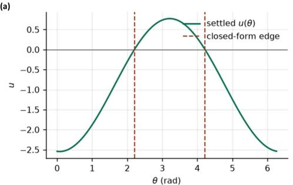

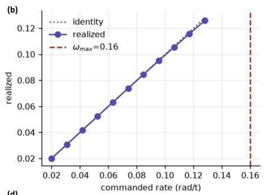

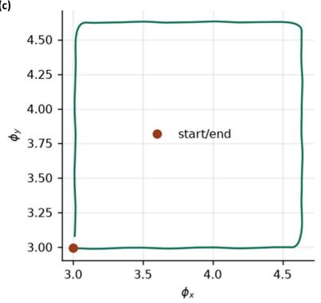

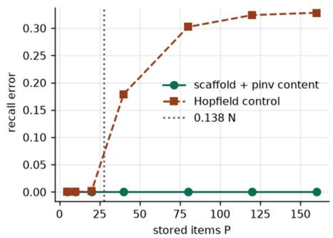  
Figure S1: Controlled diagnostics of the scaffold representation. (a) A stationary orientation ring maintains a localized activity bump; the bump centre represents the encoded angle, while the orange dashed lines show the predicted bump boundaries. (b) When angular motion is supplied, the measured bump velocity closely follows the commanded velocity over the tested range. (c) The spatial phases during a closed two-dimensional path return close to their starting point, illustrating path integration in the periodic scaffold coordinates. (d) Associative recall error as the number of stored states increases. The scaffold configuration with the fitted content return map maintains low error through the largest tested load $( P = \bar { 1 } 6 0 )$ ), whereas the Hopfield-style control accumulates larger error. These are controlled memory diagnostics and do not measure end-to-end reconstruction accuracy or establish an unrestricted memory-capacity limit.

Maintaining and moving the represented pose. Local excitation together with broader inhibition allows an activity bump to remain stable once formed (Amari, 1977). A motion input can translate the bump across the periodic field, so changes in camera position or orientation correspond to changes in its phase. Observed camera poses provide anchors for the represented state; the scaffold therefore does not rely only on accumulating motion over time.

The main SMORE pipeline does not use these dynamics as a replacement for the geometry foundation model’s camera predictions. Instead, the predicted global pose provides the state that is encoded when a frame is stored, as described in Sec. 2.1.

Returning from an address to a valid scaffold state. Appendix D introduced the return mapping $W _ { h g }$ from the sparse address h to the scaffold state g. For a state g, one complete scaffold return is

$$
\Phi ( \mathbf { g } ) = \psi ( W _ { h g } \sigma _ { 6 4 } ( W _ { g h } \mathbf { g } ) ) ,
$$

where ψ normalizes the individual spatial and orientation fields.

This return mapping is useful because an associative cue need not reproduce every component of the original scaffold state exactly. The return operation encourages the reconstructed representation to remain consistent with the learned scaffold structure. A perturbation that makes different modules mutually inconsistent can therefore be reduced by the return mapping. By contrast, a coherent displacement that moves all modules to another valid pose is itself a valid scaffold state; determining whether such a state corresponds to the correct physical location requires the geometric verification described in Sec. 2.2.

What these diagnostics establish. Fig. S1 checks three properties required by the memory design: a pose representation can remain stable, its phase can move continuously with motion, and a stored scaffold state can be recalled through the associative representation over the tested memory load. These experiments support the internal behavior of the scaffold, while the usefulness of scaffold retrieval for SMORE is evaluated separately by the end-to-end comparison with flat descriptor retrieval in Table S4.

## F GEOMETRIC VERIFICATION OF RETRIEVED REVISITS

Section 2.2 describes how SMORE verifies the frames returned by the scaffold before changing any window placement. Here we expand that procedure. The key idea is that a retrieved frame is not trusted from appearance alone: it must provide a geometric connection between the current window and a previously placed source window, and a second source window must support a compatible placement.

Forming a retrieved pair. For each retrieved frame $I _ { j }$ , we select a nearby stored frame $I _ { j - 3 }$ or $I _ { j + 3 } ,$ . The partner must belong to the same source window as $I _ { j }$ and satisfy the sequential eligibility rule from Sec. 2.2. If neither partner frame is valid, the retrieved frame is discarded.

The two frames form a retrieved pair. A pair is used instead of a single frame because two camera poses provide a geometric baseline for aligning the new prediction with the stored source window. We use an offset of three frames as a fixed design choice so that the second frame is nearby but distinct.

Why use two different source windows? We retain two retrieved pairs, denoted a and b. The two frames within each pair come from the same source window, but the two pairs must come from different source windows. Because every stored frame records its source window, we enforcesr $\mathfrak { z } ( j _ { a } ) \ne \mathrm { s r c } ( j _ { b } )$

This distinction is important. Each source window has its own global placement T. If both pairs came from the same source window, both placement proposals would depend on the same historical reference. Using two different source windows instead provides two separately placed references with which to check the current window.

We use two pairs by default. One pair provides no second historical placement with which to test agreement, while a third pair requires two additional frames. Table S4 compares one, two, and three pairs and shows that two retain most of the measured benefit of three with fewer additional inputs.

Joint prediction with the current window. If two valid pairs are available, the frozen geometry foundation model processes the 32 current-window frames together with the four retrieved frames, giving 36 input frames in total. The 32 current frames retain their sequential order, and the four retrieved frames are appended as the two pairs.

Because all 36 frames are processed together, their camera poses are predicted in one common local coordinate system. This joint prediction creates a direct geometric relationship between the current window and the retrieved historical frames; the existing chain of window placements is not used to create that relationship.

Obtaining a global-placement proposal. Consider retrieved pair a, whose source window is ${ \mathcal W } _ { o _ { a } }$ The two frames in this pair have camera poses from the new joint prediction and stored camera poses in the local coordinate system of ${ \mathcal W } _ { o _ { a } }$

Using the similarity-alignment procedure from Appendix B, we align these two sets of camera poses and obtain

$$
\widehat { Z } _ { o _ { a } , k } ,
$$

the measured transformation relating the current joint prediction to source window ${ \mathcal W } _ { o _ { a } }$

Since ${ \mathcal W } _ { o _ { a } }$ already has the global placement $T _ { o _ { a } }$ , pair a proposes the current window placement

$$
\begin{array} { r } { T _ { k } ^ { ( a ) } = T _ { o _ { a } } \widehat Z _ { o _ { a } , k } . } \end{array}
$$

Repeating exactly the same procedure for pair b gives

$$
T _ { k } ^ { ( b ) } = T _ { o _ { b } } \widehat { Z } _ { o _ { b } , k } .
$$

Thus, the two retrieved pairs independently of the retrieval score provide two geometric proposals for where the current window should lie in the global reconstruction. The scaffold is used to find the historical frames; the geometry foundation model and their stored source-window placements determine these proposals.

Checking whether the two proposals agree. We accept the revisit only if $T _ { k } ^ { ( a ) }$ and $T _ { k } ^ { ( b ) }$ place the current window sufficiently close to one another.

Let $E _ { k }$ denote the median distance of the current-window camera positions from their mean position after global placement. We use this quantity to scale the translation tolerance to the size of the current reconstruction. The two proposals must satisfy

$$
\angle \Big ( R ( T _ { k } ^ { ( a ) } ) , R ( T _ { k } ^ { ( b ) } ) \Big ) \leq 1 0 ^ { \circ } , \qquad \Big \| c ( T _ { k } ^ { ( a ) } ) - c ( T _ { k } ^ { ( b ) } ) \Big \| _ { 2 } \leq E _ { k } .\tag{4}
$$

The first condition checks rotational agreement, while the second checks translation relative to the scale of the scene.

If either condition fails, the retrieved frames are rejected and no retrieval-based placement correction is applied. If both conditions pass, the revisit is accepted and the resulting geometric constraint is used to revise the window placements, as described in Appendix G.

What verification does and does not guarantee. The two source windows provide two separate geometric checks, but this does not guarantee that every accepted revisit is correct. Repeated scene structure, inaccurate historical placements, or weak two-camera geometry can still produce compatible but incorrect proposals. The agreement test therefore acts as a practical consistency check rather than a proof of correspondence.

Jointly processing the retrieved frames can also change the current window’s local camera poses and point maps before the agreement decision is made. Rejecting a revisit prevents the global placement correction, but does not automatically restore the prediction obtained from the current window alone. We examine this separate effect in Appendix M. Our default configuration therefore retains the joint prediction only when it stays within $\mathrm { \bar { 5 } \mathrm { \bar { \Omega } } }$ of the prediction from the current window alone.

## G TRAJECTORY REVISION AND GLOBAL REFINEMENT

Section 2.2 describes the online correction applied after a revisit has been verified, while we also do the final refinement after the full sequence has been processed. Both operations modify the global window placements $T _ { k } ;$ ; the camera poses and point maps stored inside each source window remain in their local coordinate systems, as explained in Appendix C.

From a verified revisit to a placement correction. Before a revisit, the current window $\mathcal { W } _ { k }$ has global placement $T _ { k }$ . The two retrieved pairs first produce the proposals $T _ { k } ^ { ( a ) }$ and $T _ { k } ^ { ( b ) }$ described in Appendix F. These proposals are used only for the agreement test in $\mathrm { E q . 4 }$

If the two proposals agree, we combine the frames from both retrieved pairs and fit one similarity transformation using the same robust alignment as Eq. 1. Specifically,

$$
T _ { k } ^ { \mathrm { c o r r } } = \underset { S \in \mathrm { S i m } ( 3 ) } { \arg \operatorname* { m i n } } \left[ \sum _ { j \in a } w _ { j } \left\| S \cdot c _ { j } ^ { A } - T _ { o _ { a } } \cdot c _ { j } ^ { o _ { a } } \right\| _ { 2 } ^ { 2 } + \sum _ { j \in b } w _ { j } \left\| S \cdot c _ { j } ^ { A } - T _ { o _ { b } } \cdot c _ { j } ^ { o _ { b } } \right\| _ { 2 } ^ { 2 } \right] .\tag{5}
$$

Here, $S \in \ \mathrm { S i m } ( 3 )$ is a candidate similarity transformation, comprising scale, rotation, and translation, that maps the joint-pass coordinate system into the global coordinate system. The weight $w _ { j }$ is the robust weight assigned to retrieved frame j by the alignment procedure in Eq. 1, which downweights frames whose camera poses are inconsistent with the fitted transformation. Furthermore, $c _ { j } ^ { \dot { A } }$ is the camera centre of retrieved frame $j$ predicted in the joint pass ${ \mathcal { A } } ,$ while $c _ { j } ^ { o _ { a } }$ or $c _ { j } ^ { o _ { b } }$ is its stored camera centre in source window ${ \mathcal W } _ { o _ { a } }$ or $\mathcal { W } _ { o _ { b } }$ , respectively. Applying $T _ { o _ { a } }$ or $T _ { o _ { b } }$ places the corresponding stored camera centre in the global coordinate system. Thus, $T _ { k } ^ { \mathrm { c o r r } }$ is the single robust placement that jointly aligns the predictions of both retrieved pairs with their stored global poses; it is not an average of $T _ { k } ^ { ( a ) }$ and $T _ { k } ^ { \hat { ( { b } ) } }$

The transformation required to move the current placement to this corrected placement is

$$
C = T _ { k } ^ { \mathrm { c o r r } } T _ { k } ^ { - 1 } .\tag{6}
$$

Thus, $C$ represents the accumulated placement error revealed by the revisit.

Why distribute the correction across earlier windows? The error revealed at window k was generally accumulated over several previous window alignments. Applying the full correction only to $\mathcal { W } _ { k }$ would therefore create a discontinuous jump between neighboring windows. Instead, SMORE distributes the correction over the windows between the earlier reference window $\mathcal { W } _ { o }$ and the current window.

For a window $\mathcal { W } _ { \ell }$ with $o < \ell \leq k ,$ , we define

$$
\alpha _ { \ell } = \frac { \ell - o } { k - o } .
$$

The reference window has correction weight 0, while the current window has weight 1. Intermediate windows receive progressively larger fractions of the correction.

Applying a fraction of a similarity transformation. A similarity transformation contains rotation, translation, and scale, so it cannot be scaled directly by multiplying its transformation matrix by $\alpha _ { \ell } .$ . We instead use the logarithm and exponential maps:

$$
T _ { \ell } \gets \mathrm { E x p } ( \alpha _ { \ell } \log C ) T _ { \ell } , \qquad o < \ell \leq k .\tag{7}
$$

Here,

$$
\arg C = ( \omega , \nu , \sigma ) \in \mathbb { R } ^ { 7 }
$$

represents the correction using three rotation values, three translation-related values, and one log-scale value. Multiplying this vector by $\alpha _ { \ell }$ selects the desired fraction of the correction, and Exp converts it back into a valid similarity transformation.

Consequently,

$$
\alpha _ { \ell } = 0 \quad \Rightarrow \quad \mathrm { n o ~ c o r r e c t i o n , }
$$

while

$$
\alpha _ { \ell } = 1 \quad \Rightarrow \quad \mathrm { t h e ~ f u l l ~ c o r r e c t i o n ~ } C .
$$

The update therefore changes the trajectory smoothly between the historical reference and the current window rather than inserting a single abrupt correction.

What changes after the update? Only the global placements $T _ { \ell }$ are modified. The camera poses and point maps stored for frames in $\mathcal { W } _ { \ell }$ remain unchanged in their source-window coordinates. Applying the updated $T _ { \ell }$ therefore moves the cameras and their associated 3D geometry together. This is the same separation between local geometry and global placement described in Appendix C.

The online update is immediately available to later windows. Therefore, a correction made at one revisit can influence the global placements used when subsequent frames are stored and when later revisits are verified.

Recording constraints between windows. In addition to updating the running trajectory, SMORE retains the relative geometric measurements obtained while processing the sequence. There are two types of connections.

A sequential connection is obtained from the shared frames of two neighboring windows. A revisit connection is obtained from an accepted historical retrieval. For a connection ${ \boldsymbol { e } } \ = \ ( \ell , k )$ , let $Z _ { e }$ denote the measured relative transformation between windows $w _ { \ell }$ and $\mathcal { W } _ { k }$

The current global placements themselves imply the relative transformation

$$
T _ { \ell } ^ { - 1 } T _ { k } .
$$

If the reconstruction is perfectly consistent with the measurement $Z _ { e } ,$ , these two relative transformations should agree.

Table S1: Datasets and evaluation protocols. The table summarizes the data used for each downstream task. Detailed sampling and scoring procedures are given below.  
Task Dataset Evaluation subset   
Camera pose CO3Dv2 (Reizenstein et al., 37 validated trajectories; N ∈ {10, 50, 100, 200} sampled   
2021) frames   
Camera pose RE10K (Zhou et al., 2018) 1,653 clips at N = 10; 100 clips for the N ∈ {50, 100, 200}   
length study   
Multi-view depth Replica (Straub et al., 2019) 18 scenes; N = 2000 frames per scene   
3D point-cloud reconstruction ScanNet++ (Yeshwanth et al., 1, 006 scenes; $N = 6 0 0 - 8 ,$ , 000 frames per scene   
2023)   
SLAM 7-Scenes (Shotton et al., 2013) All seven indoor scenes   
Novel view synthesis 7-Scenes (Shotton et al., 2013) Seven seq-01 trajectories, 200 keyframes each; every eighth   
keyframe held out (156 targets); decoders trained on the other   
7-Scenes sequences   
Novel view synthesis CO3Dv2 (Reizenstein et al., 37 validated trajectories, 200 frames each; every eighth frame held   
2021) out (888 targets); test only, no adaptation

Final global refinement. Online corrections are applied one revisit at a time. After all windows have been processed, SMORE jointly refines the complete set of window placements using all retained sequential and accepted revisit connections.

We fix $T _ { 1 }$ to remove the global gauge freedom and optimize

$$
\operatorname* { m i n } _ { T _ { 2 } , \ldots , T _ { K } } \sum _ { e = \left( \ell , k \right) \in \mathcal { E } } \rho _ { H } \left( \left\| \mathrm { L o g } \left( Z _ { e } ^ { - 1 } T _ { \ell } ^ { - 1 } T _ { k } \right) \right\| _ { \Lambda _ { e } } ^ { 2 } \right) ,\tag{8}
$$

where $\mathcal { E }$ is the set of retained connections. The quantity

$$
Z _ { e } ^ { - 1 } T _ { \ell } ^ { - 1 } T _ { k }
$$

measures the disagreement between the relative placement predicted by the current trajectory and the relative transformation measured from the frames. Taking Log converts this disagreement into rotation, translation, and scale components that can be optimized together.

The diagonal matrix $\Lambda _ { e }$ controls the relative contribution of these components, while the Huber loss $\rho _ { H }$ (Huber, 1964) reduces the influence of unusually large residuals. This is a pose-graph optimization over window placements rather than bundle adjustment over individual 3D points (Grisetti et al., 2010; Kümmerle et al., 2011; Dellaert, 2012).

Handling inconsistent revisit constraints. An accepted revisit can still be incorrect, for example, because of repeated scene structure. We therefore perform the global solve robustly. After the first optimization, revisit connections with large residuals are rejected according to the configured residual criterion, and the remaining graph is optimized once more. Sequential connections are retained because they define the basic chain of the reconstruction.

Online revision versus final refinement. The two stages serve different purposes. The distributed update in Eq. 7 corrects the trajectory while the sequence is still being processed, so later observations benefit from the revised placements. The optimization in Eq. 8 instead considers all measurements together after the sequence is complete and removes remaining global inconsistencies. Both stages update only the window placements.

## H DATASETS AND EVALUATION PROTOCOLS

The main experiments in Sec. 3 evaluate SMORE on five downstream tasks using five datasets. Here we provide the exact evaluation subsets, frame-selection rules, and scoring procedures used for each task. Within every paired Baseline/+SMORE comparison, the same geometry foundation model and the same input frames are used. When computational constraints require a reduced subset for a particular model, its Baseline and +SMORE results are evaluated on the same subset.

## H.1 CAMERA POSE ESTIMATION

The camera-pose experiments in Sec. 3.1 evaluate how pose accuracy changes as more frames from the same video trajectory are processed. We use CO3Dv2 and RealEstate10K because they provide

different camera-motion patterns: CO3Dv2 contains object-centric trajectories with substantial viewpoint changes, whereas RE10K is dominated by forward camera motion and therefore contains fewer natural revisits.

CO3Dv2. We use 37 CO3Dv2 sequences with validated camera trajectories. The videos span approximately 8–68 s, with a median duration of 26 s. For each trajectory, we evaluate

$$
N \in \{ 1 0 , 5 0 , 1 0 0 , 2 0 0 \}
$$

input frames. Frames are sampled uniformly across the available trajectory rather than taking the first N frames. Thus, increasing N increases the temporal density with which the same underlying trajectory is observed.

The controlled pose ablations in Appendix J use a separate subset of twelve CO3Dv2 trajectories at N = 200 and should not be interpreted as the full 37-sequence evaluation.

RealEstate10K. RE10K contains real-estate videos with predominantly forward camera motion (Zhou et al., 2018). The 100 clips used for the length study span 6.7–9.3 s, with a median duration of 9.3 s. We uniformly sample $N \in \{ 5 0 , 1 0 0 , \hat { 2 } 0 0 \}$ frames from these clips. For the N = 10 evaluation, we use the larger set of 1,653 usable test clips.

The N = 10 and longer-sequence evaluations therefore use different numbers of clips and should not be interpreted as a nested set of the same sequences.

Pose metric. Following the relative-pose evaluation used in the main experiments, we evaluate every pair of sampled frames. For a pair (i, j), we compute its rotation error and translation-direction error and define the pairwise pose error as

$$
e _ { i j } = \mathrm { m a x } \left( e _ { i j } ^ { \mathrm { r o t } } , e _ { i j } ^ { \mathrm { t r a n s } } \right) .
$$

Translation magnitude is not scored because monocular geometry is defined only up to scale.

AUC@30 is the normalized area under the cumulative distribution of $e _ { i j }$ between 0◦ and 30◦. Higher AUC therefore means that a larger fraction of frame pairs have accurate relative camera poses. Table S2 reports the mean and standard deviation over the evaluated sequences or clips.

## H.2 MULTI-VIEW DEPTH ESTIMATION AND 3D POINT-CLOUD RECONSTRUCTION

The experiments in Sec. 3.2 evaluate multi-view depth estimation on Replica (Straub et al., 2019) and 3D point-cloud reconstruction on ScanNet++ (Yeshwanth et al., 2023). Both are evaluated in the same long-horizon setting using 32-frame windows with 16-frame overlap, as described in Sec. 2. Each window is first reconstructed locally by the frozen geometry foundation model and then placed in the shared global coordinate system using the overlapping frames. Baseline and +SMORE use exactly the same input frames, windowing strategy, and geometry foundation model. Baseline connects the windows sequentially without long-range memory, whereas +SMORE additionally retrieves earlier observations, verifies candidate revisits, and uses accepted geometric evidence to revise the global placements of the reconstructed windows.

Replica. Replica (Straub et al., 2019) provides photorealistic synthetic indoor environments together with accurate camera information and dense reference 3D geometry. It contains 18 such scenes with about 2000 frames per scene. Its controlled geometry allows us to measure how reconstruction errors accumulate as a scene is processed across many overlapping windows. For each evaluated trajectory, Baseline and +SMORE process the same frames in the same temporal order; the only difference is whether the external memory is used to retrieve and revise previously placed reconstruction windows.

ScanNet++. ScanNet++ (Yeshwanth et al., 2023) contains high-resolution observations of real indoor environments together with high-quality reference 3D geometry. It contains 1006 scenes with about 8000 frames per scene. Compared with Replica, it evaluates the same long-horizon reconstruction procedure under real image appearance, camera motion, and more complex scene geometry. We again use identical input frames and 32-frame windows for Baseline and +SMORE, so improvements measure the effect of memory-based revisit verification and trajectory revision rather than differences in the input data or geometry foundation model.

Table S2: Camera pose estimation accuracy on RE10K (Zhou et al., 2018) and CO3Dv2 (Reizenstein et al., 2021). We report AUC@30↑ for increasing numbers of input frames N. Values are mean ± standard deviation across evaluated sequences (CO3Dv2) or clips (RE10K). For each geometry foundation model, Baseline denotes its original inference procedure and +SMORE denotes the same model equipped with our framework. For StreamVGGT and STream3R, Baseline uses native causal inference, whereas +SMORE uses our windowed framework. OOM indicates that inference exceeded the tested 46 GB GPU memory budget. Within each model and sequence length, the higher mean is shown in bold; equal means are left unbolded.
<table><tr><td rowspan="2">Model</td><td rowspan="2">Method</td><td colspan="4">RE10K (N)</td><td colspan="4">CO3Dv2 (N)</td></tr><tr><td>10</td><td>50</td><td>100</td><td>200</td><td>10</td><td>50</td><td>100</td><td>200</td></tr><tr><td>DUSt3R</td><td>Baseline</td><td> $6 5 . 6 { \pm } 2 . 8 $ </td><td>88.0±0.7</td><td> ${ \bf 8 5 . 9 2 0 . 7 }$ </td><td> $8 2 . 6 { \pm } 0 . 9$ </td><td> $8 8 . 9 { \pm } 1 . 3 $ </td><td> $8 8 . 8 \pm 0 . 7$ </td><td> $8 8 . 0 { \pm } 0 . 6 $ </td><td>83.9±0.8</td></tr><tr><td></td><td>+SMORE</td><td>65.6±2.8</td><td>88.0±0.7</td><td> $8 5 . 6 { \pm } 0 . 8 $ </td><td>83.5±0.9</td><td> $8 8 . 9 { \pm } 1 . 3 $ </td><td> $8 8 . 8 \pm 0 . 7$ </td><td>89.5±0.5</td><td>86.6±0.7</td></tr><tr><td>Fast3R</td><td>Baseline</td><td>71.2±2.5</td><td>84.3±1.5</td><td> $8 6 . 1 { \pm } 1 . 3 $ </td><td> ${ \bf 8 6 . 6 \pm 1 . 3 }$ </td><td> $9 0 . 9 { \pm } 1 . 6 $ </td><td> $8 8 . 3 { \pm } 1 . 6 $ </td><td> $8 6 . 7 \pm 1 . 3$ </td><td> $8 2 . 4 \pm 1 . 3$ </td></tr><tr><td></td><td>+SMoRE</td><td>71.2±2.5</td><td>84.3±1.5</td><td> ${ \bf 8 7 . 0 \pm 1 . 4 }$ </td><td> $8 6 . 5 { \pm } 1 . 4 $ </td><td> $9 0 . 9 { \pm } 1 . 6 $ </td><td> $8 8 . 3 { \pm } 1 . 6 $ </td><td> ${ \bf 8 7 . 1 \pm 1 . 3 }$ </td><td> ${ \bf 8 4 . 3 \pm 1 . 3 }$ </td></tr><tr><td></td><td>Baseline</td><td>85.5±2.1</td><td> $9 5 . 3 { \pm } 0 . 2 $ </td><td> $9 5 . 2 { \pm } 0 . 3 $ </td><td> $9 3 . 8 { \pm } 0 . 3 $ </td><td> $9 3 . 0 { \pm } 1 . 3 $ </td><td> $8 9 . 6 \pm 1 . 5$ </td><td> $8 8 . 5 { \pm } 1 . 3 $ </td><td> $8 6 . 6 { \pm } 1 . 1$ </td></tr><tr><td></td><td>+SMoRE</td><td>85.5±2.1</td><td> $9 5 . 3 { \pm } 0 . 2 $ </td><td> ${ \bf 9 5 . 3 \pm 0 . 3 }$ </td><td>94.3±0.3</td><td> $9 3 . 0 { \pm } 1 . 3 $ </td><td> $8 9 . 6 \pm 1 . 5$ </td><td>88.7±1.3</td><td>86.8±1.2</td></tr><tr><td>VGGT</td><td>Baseline</td><td> $8 8 . 7 \pm 2 . 6 $ </td><td> $8 8 . 5 { \pm } 1 . 9 $ </td><td> $8 8 . 7 { \pm } 1 . 8 $ </td><td> $8 8 . 5 { \pm } 1 . 7 $ </td><td> $9 5 . 7 { \pm } 0 . 8 $ </td><td> $9 4 . 5 { \pm } 0 . 9 \ $ </td><td> $9 2 . 2 { \pm } 1 . 1 $ </td><td> $9 0 . 0 { \pm } 0 . 7 \ $ </td></tr><tr><td></td><td>+SMoRE</td><td> $8 8 . 7 \pm 2 . 6 $ </td><td> $8 8 . 5 { \pm } 1 . 9 $ </td><td> ${ \bf 8 9 . 6 \pm 1 . 8 }$ </td><td> ${ \bf 8 9 . 1 \pm 1 . 8 }$ </td><td> $9 5 . 7 { \pm } 0 . 8 $ </td><td> $9 4 . 5 { \pm } 0 . 9 \ $ </td><td>92.6±1.2</td><td> ${ \bf 9 3 . 9 2 0 . 6 }$ </td></tr><tr><td>VGGT-Ω</td><td>Baseline</td><td>88.9±2.0</td><td> $9 5 . 7 { \pm } 1 . 1 $ </td><td> $9 5 . 4 \pm 1 . 1$ </td><td> $9 4 . 9 { \pm } 1 . 1 $ </td><td> $9 5 . 7 { \pm } 0 . 9 $ </td><td> $9 3 . 2 \pm 1 . 3$ </td><td>93.6±0.6</td><td> $9 1 . 6 { \pm } 0 . 6 $ </td></tr><tr><td></td><td>+SMORE</td><td>88.9±2.0</td><td>95.7±1.1</td><td> ${ \bf 9 5 . 5 \pm 1 . 1 }$ </td><td> ${ \bf 9 5 . 2 \pm 1 . 1 }$ </td><td> $9 5 . 7 { \pm } 0 . 9 $ </td><td> $9 3 . 2 \pm 1 . 3$ </td><td>94.2±0.7</td><td>94.7±0.5</td></tr><tr><td> $\pi ^ { 3 }$ </td><td>Baseline</td><td>88.2±2.1</td><td>96.4±0.8</td><td> $9 5 . 9 2 1 . 0 $ </td><td> $9 5 . 2 { \pm } 1 . 1 $ </td><td> $9 6 . 3 { \pm } 0 . 7 \ $ </td><td> $9 4 . 2 \pm 1 . 3$ </td><td>93.7±0.6</td><td>89.9±0.7</td></tr><tr><td></td><td>+SMoRE</td><td>88.2±2.1</td><td>96.4±0.8</td><td> $9 5 . 9 2 1 . 0 $ </td><td>95.4±1.0</td><td>96.3±0.7</td><td> $9 4 . 2 \pm 1 . 3$ </td><td>94.8±0.6</td><td>93.3±0.7</td></tr><tr><td>0StreamVGGTBaseline</td><td></td><td>81.2±0.6</td><td>78.6±0.5</td><td>77.7±0.6</td><td>OOM</td><td> $9 2 . 7 \pm 1 . 2 $ </td><td>90.2±0.8</td><td>87.5±0.8</td><td>OOM</td></tr><tr><td>Srmn</td><td>+SMORE</td><td> ${ \bf 8 6 . 7 \pm 0 . 6 }$ </td><td> $\mathbf { 8 6 . 6 \pm 0 . 5 }$ </td><td>86.8±0.6</td><td>85.7±0.7</td><td> $9 2 . 7 \pm 1 . 2 $ </td><td>92.8±0.8</td><td>92.0±0.8</td><td>85.9±1.0</td></tr><tr><td>STream3R</td><td>Baseline</td><td> $8 9 . 2 \pm 0 . 2 $ </td><td> $8 7 . 0 { \pm } 0 . 2 \ $ </td><td>OOM</td><td>OOM</td><td> $9 2 . 1 { \pm } 1 . 0 $ </td><td>OOM</td><td>OOM</td><td>OOM</td></tr><tr><td></td><td>+SMoRE</td><td> ${ \bf 9 3 . 8 } { \pm } { \bf 0 . 2 }$ </td><td>93.2±0.2</td><td>92.7±0.4</td><td>89.3±0.6</td><td> $9 2 . 1 { \pm } 1 . 0 $ </td><td>89.0±0.9</td><td>87.6±1.1</td><td>87.6±0.8</td></tr></table>

Dense-geometry metrics. For both datasets, we report accuracy, completeness, and overall reconstruction error. Accuracy measures the distance from the reconstructed geometry to the reference geometry, while completeness measures the reverse distance from the reference geometry to the reconstruction. We define the overall error as the mean of accuracy and completeness. All distances are reported in centimetres, and lower values indicate better reconstruction. Table 1 reports the mean and standard deviation over the corresponding evaluation set.

## H.3 CAMERA POSE RESULTS ACROSS SEQUENCE LENGTHS

The full numerical results corresponding to Fig. 2 are reported in Table S2. The table evaluates the same Baseline/+SMORE pairs described in Appendix H.1 as the number of input frames increases from N = 10 to N = 200.

For the feed-forward geometry foundation models, the two methods are identical at the shortest sequence lengths whenever the sequence fits within the initial processing context. Differences become more apparent as the sequence grows and predictions must be connected across multiple windows. This pattern is strongest on CO3Dv2: at $\mathbf { \bar { \boldsymbol { N } } } = 2 0 0$ , for example, VGGT improves from 90.0 to 93.9 AUC@30, VGGT-Ω from 91.6 to 94.7, and $\pi ^ { 3 }$ from 89.9 to 93.3. The improvements on RE10K are generally smaller, consistent with its predominantly forward camera motion providing fewer opportunities to retrieve previously observed regions.

The streaming models expose a complementary effect. Their native causal inference becomes increasingly expensive with sequence length and exceeds the tested 46 GB memory budget for several longer inputs. The windowed SMORE configuration remains executable at these lengths while retaining access to earlier observations through the external memory. These comparisons use the same sampled frames whenever both variants can be evaluated.

## H.4 FULL 7-SCENES SLAM RESULTS

Table S3 reports the full per-scene SLAM results for 7-Scenes. These are the detailed numbers summarized in the main-text SLAM comparison. We report absolute trajectory error (ATE) RMSE in metres, after similarity alignment to the ground-truth trajectory, so lower is better.

Table S3: Full 7-Scenes SLAM results. We report per-scene and average ATE RMSE (m↓) on the seven 7-Scenes sequences: chess, fire, heads, office, pumpkin, kitchen, and stairs. Lower is better. We compare NICER-SLAM, DROID-SLAM, MASt3R-SLAM, GLUEMAP, TALO, VGGT-SLAM++, ViSTA-SLAM, SLAM-Former, CUT3R, VGGT-SLAM, and VGGSfM (Zhu et al., 2024; Teed & Deng, 2021; Murai et al., 2025; Pan et al., 2026; Zhang et al., 2026a; Mandal et al., 2026; Zhang et al., 2026b; Yuan et al., 2026; Wang et al., 2025b; Maggio et al., 2025; Wang et al., 2024a). Calibrated methods receive camera intrinsics, whereas uncalibrated methods do not. A superscript ∗ marks an uncalibrated version of a method that is also reported in a calibrated setting. Our results use frozen VGGT-Ω with 32-frame windows. Within each calibration block, the lowest value in each scene column is shown in bold.
<table><tr><td>Model</td><td>Method</td><td>chess</td><td>fre</td><td>heads</td><td>office</td><td>pumpkin</td><td>kitchen</td><td>stairs</td><td>avg</td></tr><tr><td colspan="10">Calibrated methods</td></tr><tr><td>NICER-SLAM</td><td></td><td>0.033</td><td>0.069</td><td>0.042</td><td>0.108</td><td>0.200</td><td>0.039</td><td>0.108</td><td>0.086</td></tr><tr><td>DROID-SLAM</td><td></td><td>0.036</td><td>0.027</td><td>0.025</td><td>0.066</td><td>0.127</td><td>0.040</td><td>0.026</td><td>0.049</td></tr><tr><td>MASt3R-SLAM</td><td></td><td>0.053</td><td>0.025</td><td>0.015</td><td>0.097</td><td>0.088</td><td>0.041</td><td>0.011</td><td>0.047</td></tr><tr><td>GLUEMAP</td><td></td><td>0.036</td><td>0.031</td><td>0.018</td><td>0.079</td><td>0.092</td><td>0.046</td><td>0.051</td><td>0.050</td></tr><tr><td>TALO</td><td></td><td>0.034</td><td>0.021</td><td>0.012</td><td>0.054</td><td>0.061</td><td>0.028</td><td>0.010</td><td>0.031</td></tr><tr><td colspan="10">Uncalibrated methods</td></tr><tr><td>VGGT-SLAM++</td><td></td><td>0.034</td><td>0.023</td><td>0.017</td><td>0.104</td><td>0.127</td><td>0.085</td><td>0.060</td><td>0.064</td></tr><tr><td>ViSTA-SLAM</td><td></td><td>0.036</td><td>0.033</td><td>0.019</td><td>0.103</td><td>0.133</td><td>0.058</td><td>0.093</td><td>0.067</td></tr><tr><td>SLAM-Former</td><td></td><td>0.039</td><td>0.033</td><td>0.018</td><td>0.070</td><td>0.065</td><td>0.035</td><td>0.033</td><td>0.042</td></tr><tr><td>CUT3R</td><td></td><td>0.046</td><td>0.043</td><td>0.055</td><td>0.120</td><td>0.096</td><td>0.061</td><td>0.086</td><td>0.073</td></tr><tr><td>MASt3R-SLAM*</td><td></td><td>0.063</td><td>0.046</td><td>0.029</td><td>0.103</td><td>0.114</td><td>0.074</td><td>0.032</td><td>0.066</td></tr><tr><td>VGGT-SLAM</td><td>Sim(3), w=32</td><td>0.037</td><td>0.026</td><td>0.018</td><td>0.104</td><td>0.133</td><td>0.061</td><td>0.093</td><td>0.067</td></tr><tr><td>VGGT-SLAM</td><td>SL(4), w=32</td><td>0.036</td><td>0.028</td><td>0.018</td><td>0.103</td><td>0.133</td><td>0.058</td><td>0.093</td><td>0.067</td></tr><tr><td>VGGSfM GLUEMAP*</td><td></td><td>0.052</td><td>0.038</td><td>0.021</td><td>0.076</td><td>0.104</td><td>0.059</td><td>0.061</td><td>0.059</td></tr><tr><td>TALO*</td><td>1</td><td>0.042</td><td>0.039</td><td>0.022</td><td>0.088</td><td>0.105</td><td>0.054</td><td>0.059</td><td>0.058</td></tr><tr><td></td><td>一</td><td>0.028</td><td>0.023</td><td>0.014</td><td>0.049</td><td>0.082</td><td>0.033</td><td>0.038</td><td>0.038</td></tr><tr><td colspan="10">VGGT-Ω (uncalibrated) VGGT-Ω</td></tr><tr><td>VGGT-Ω</td><td>Baseline</td><td>0.025</td><td>0.024</td><td>0.012</td><td>0.047</td><td>0.161</td><td>0.026</td><td>0.020</td><td>0.045</td></tr><tr><td></td><td>+SMORE</td><td>0.021</td><td>0.031</td><td>0.013</td><td>0.031</td><td>0.061</td><td>0.025</td><td>0.022</td><td>0.029</td></tr></table>

The table separates calibrated and uncalibrated methods because these settings are not directly comparable: calibrated methods receive camera intrinsics, whereas uncalibrated methods do not. Within the VGGT-Ω block, the SMORE rows show the effect of online revision and the final pose-graph refinement on the same frozen geometry foundation model.

## H.5 NOVEL VIEW SYNTHESIS

The novel view synthesis experiment in Sec. 3.4 asks whether the map maintained by SMORE yields better rendered views than the chained map of the same frozen geometry model. The test sequences are the seven 7-Scenes seq-01 trajectories of Sec. 3.3 (every fifth frame is a keyframe, 200 keyframes per trajectory) and the 37 validated CO3Dv2 trajectories of Sec. 3.1 (200 frames each). Every eighth keyframe is a held-out target that is never shown to the geometry model; the remaining keyframes are processed with the default configuration of Table S7 (32-frame windows with 16-frame overlap, retrieval, verification, and online revision; no final global refinement). The evaluated set contains 156 held-out targets on 7-Scenes and 888 on CO3Dv2 per geometry model. Baseline and +SMORE render the same targets from identical source keyframes using the matched decoder-training procedure in Appendix I. CO3Dv2 is a test-only collection: the decoders are trained on 7-Scenes sequences and applied to CO3Dv2 without adaptation. The complete rendering and decoder-training protocol is given in Appendix I. We report PSNR, SSIM, and LPIPS (Zhang et al., 2018c).

Qualitative results. Fig. S2 extends the comparison in Fig. 2B to additional scenes across datasets. We compare VGGT-Omega with and without SMORE on representative scenes from 7-Scenes (left) and Co3Dv2 (right). The enlarged regions highlight sharper object boundaries and better-preserved scene details with SMORE, particularly around the chess pieces (left) and computer mouse (right). These improvements suggest that revising window placements brings observations of the same surfaces into closer geometric alignment, consistent with the quantitative gains reported in Table 2.

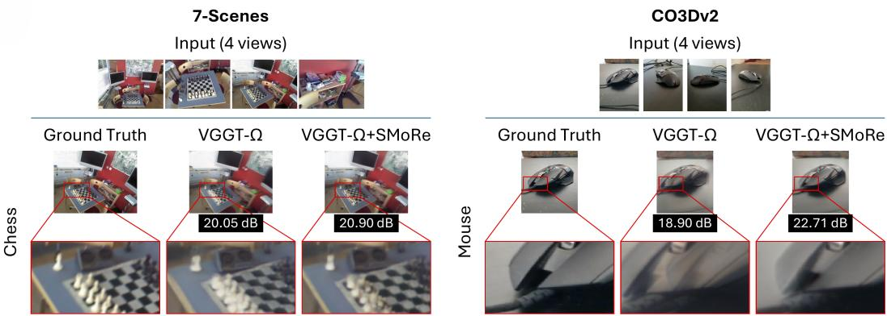  
Figure S2: Additional novel view synthesis results on 7-Scenes and CO3Dv2. On 7-Scenes chess (left), SMORE suppresses ghosting artifacts around the chess pieces, yielding sharper boundaries. On CO3Dv2 (right), the zoomed-in views of the computer mouse demonstrate that SMORE mitigates edge misalignment and better preserves object contours. Together, these examples highlight consistent improvements in boundary sharpness and geometric structure across diverse scenes. In both panels, columns from left to right display the ground truth, the baseline VGGT-Ω rendering, and our results with SMORE. Above each comparison group, we show four representative input keyframes out of the eight source views used to render each target. Red boxes indicate the cropped regions shown in the magnified insets.

## I NOVEL VIEW SYNTHESIS PROTOCOL AND DECODER

We evaluate whether revising stored geometry improves novel view synthesis from long sequences. We use the same frozen geometry models, windowing scheme, and memory configuration as in the camera pose experiments. A Gaussian decoder converts the stored geometry into rendered images. The datasets and evaluation splits are described in Appendix H.5.

## I.1 SOURCE VIEWS AND GEOMETRY

We render each held-out target from eight nearby input keyframes. Source views are selected using the sum of camera-centre distance and viewing-direction angle, computed from the ground-truth cameras. The target itself is excluded. Baseline and +SMORE use identical source views.

Each source keyframe retains the depth, confidence, and camera intrinsics predicted when it first enters a window. Its depth is unprojected into 3D points in that window’s local coordinate system (Appendix C). Baseline places these points in the global map using chained window transformations $T _ { k }$ . SMORE uses the window transformations obtained after online revision. We fit a similarity transformation between the estimated and ground-truth input cameras. We use this alignment to express the target camera in each map’s coordinate system.

Before decoding, we centre the source points at the centre of the source cameras and normalize their scale by the median source depth. We discard the lowest-confidence 30% of points in each frame. We also remove points at depth discontinuities, defined by a relative depth difference above 5% between neighbouring pixels. Both systems use the same filtering procedure. Images are rendered at 384 × 288 resolution with a 4:3 aspect ratio. Portrait CO3Dv2 sequences retain their original orientation.

## I.2 GAUSSIAN DECODER AND TRAINING

We use a Gaussian decoder to predict rendering parameters from the source images and their geometry. Each source pixel provides eleven input channels:

$$
\underbrace { \_ 3 } _ { \mathrm { R G B } } + \underbrace { \_ 3 } _ { \mathrm { m a p p o s i t i o n } } + \underbrace { \_ 1 } _ { \mathrm { d e p t h } } + \underbrace { \_ 1 } _ { \mathrm { l o g - c o n f i d e n c e } } + \underbrace { \_ 3 } _ { \mathrm { r a y d i r e c t i o n } } = 1 1 .
$$

A four-level U-Net with approximately 7M parameters predicts a position offset, log-scales, rotation, opacity, and colour residual for each valid pixel. The position offset is bounded by two pixel footprints, and the scales are predicted relative to the footprint. A pixel’s footprint is its depth multiplied by the pixel size and divided by the focal length. This parameterization scales the Gaussians according to the input geometry.

The Gaussians from all source views are rasterized into the target view using gsplat (Kerbl et al., 2023; Ye et al., 2025). An image-space U-Net with approximately 3M parameters then refines the rendering. It takes the rendered colour, alpha, and depth as input and predicts a bounded colour residual. The decoder is initialized to approximate splatting the coloured source points.

Training data. For each geometry model, we train one decoder on the chained geometry and another on the geometry maintained by SMORE. Both decoders use the same architecture, training data, schedule, and random seed. Training uses all 7-Scenes sequences except seq-01. These sequences are processed with the same windowing and memory configuration as the test sequences, and every keyframe is stored. Each training sample consists of one target keyframe and its eight nearest source keyframes. We exclude the target and its immediate neighbours from the source set, so the target image does not provide source pixels.

Optimization. We train the decoders with an image reconstruction loss:

$$
\mathcal { L } = \mathcal { L } _ { 1 } + 0 . 5 \mathcal { L } _ { \mathrm { L P I P S } } + 0 . 2 \left( 1 - \mathrm { S S I M } \right) .
$$

We use AdamW for 12K steps with a learning rate of $2 \times 1 0 ^ { - 4 }$ , 500 warm-up steps, and cosine decay. Gradients are accumulated over two samples. Training takes approximately one hour per decoder on an RTX 6000 Ada GPU. Neither the geometry foundation model nor SMORE is optimized by this loss. The comparison therefore evaluates each geometry representation with its own trained decoder under matched training conditions.

## I.3 EVALUATION AND ADDITIONAL RESULTS

We render each held-out target from the chained map with the Baseline decoder and from the revised map with the +SMORE decoder. We compute PSNR, SSIM, and LPIPS against the target image, following Appendix H.5. Gains are computed from paired differences between the two renderings of each target. Figure S3 reports the paired PSNR gains on 7-Scenes and their standard errors. Decoders trained on 7-Scenes are evaluated on CO3Dv2 without adaptation, testing transfer from indoor scenes to object-centric sequences.

Results on revisited regions. On 7-Scenes, the mean paired PSNR gains range from 0.31 to 0.71 dB across the six geometry models, with standard errors of 0.10 to 0.13 dB. All six 95% confidence intervals exclude zero. Revisited targets show larger gains. For example, VGGT-Ω and STream3R improve by 1.00 and 1.14 dB on revisited targets, compared with 0.53 and 0.71 dB over all targets. These results are consistent with the role of window revision in aligning repeated observations of the same surfaces. On CO3Dv2, STream3R accepts few revisits along the object-centric trajectories and shows little change in PSNR. Fast3R improves SSIM and LPIPS but decreases PSNR by 0.12 dB.

Reference window placement. We also evaluate a reference placement obtained by fitting each stored window’s local cameras to the ground-truth cameras with a similarity transformation. We render these windows with the +SMORE decoder. This reference is not an upper bound, since camera alignment does not ensure consistency between the local geometry of different windows. For π3 on 7-Scenes, the reference achieves 16.43 dB, below the Baseline result of 17.24 dB. For the other five models, it exceeds +SMORE by 0.2 to 1.0 dB on both datasets. Thus, the effect of window placement also depends on the consistency of the predicted local geometry.

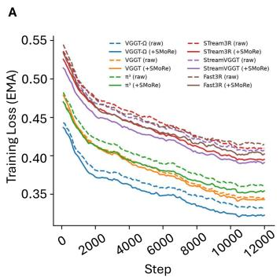

B  
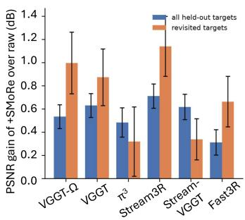

C  
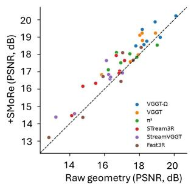  
Figure S3: Gaussian decoder training and novel view synthesis results. (A) Training loss, shown as an exponential moving average, for decoders trained on chained geometry (dashed) and geometry maintained by SMORE (solid), for all six geometry models. (B) Paired PSNR gains on 7-Scenes, reported as mean ± standard error over all held-out targets and over revisited targets. (C) Mean PSNR for each of the seven 7-Scenes trajectories, comparing Baseline with +SMORE. Points above the diagonal indicate improvement.

## J CONTROLLED ABLATIONS

We expand the model analysis of Sec. 3.5 in the same order as the main text. We first test whether the scaffold improves retrieval over direct descriptor matching, and then vary the visual descriptor used to query the scaffold. We next examine how much historical evidence is needed to verify a revisit and whether an accepted revisit must revise the trajectory online. Finally, we study sensitivity to the scaffold and window configurations. We report ATE (m) on 7-Scenes (Shotton et al., 2013) and AUC@30 on CO3Dv2 (Reizenstein et al., 2021) in these ablations.

Evaluation protocol. Unless stated otherwise, the pose ablations use seven 7-Scenes seq-01 trajectories with 200 frames and VGGT-Ω (Wang et al., 2026a), together with twelve 200-frame CO3Dv2 trajectories and VGGT (Wang et al., 2025a). Paired variants use the same input frames. The common raw references are 0.045 m ATE on 7-Scenes and 88.8 AUC@30 on CO3D. We use Online for the trajectory available during sequence processing and Final for the result after the final global refinement. Lower ATE is better, whereas higher AUC@30 is better.

## J.1 DOES THE SCAFFOLD IMPROVE RETRIEVAL?

The first comparison (Table S4, Group A) isolates how stored frames are ranked. The default scaffold maps the DINOv2 cue into the memory-address space and ranks stored addresses, whereas the flat baseline directly ranks the same stored DINOv2 descriptors by cosine similarity. The stored frames, top-five candidate budget, geometric verification, and subsequent trajectory revision are unchanged.

The scaffold improves both benchmarks under the same downstream revision procedure. On 7-Scenes, final ATE decreases from 0.034 to 0.029 m, while on CO3Dv2 final AUC@30 increases from 90.9 to 93.3. This comparison supports the scaffold as the retrieval index used by SMORE. It does not attribute the gain specifically to the internal continuous-attractor dynamics; those properties are tested separately in Appendix E.

Table S4: Ablation studies of SMORE. We vary one design factor at a time while keeping the remaining pipeline fixed. The groups follow the same order as the design analysis in Sec. 3.5. Except for the window-size study, the common raw references are 0.045 m ATE on 7-Scenes and 88.8 AUC@30 on CO3Dv2. Online denotes the running SMORE result, while Final includes the final global refinement in Appendix G. For Groups E and F, the value in parentheses after the 7-Scenes Final ATE is the mean number of accepted revisits per sequence. The default configuration uses the memory scaffold, 64 active units in the memory address h, DINOv2, two retrieved pairs, $N _ { h } = 1 0 2 4$ a $4 8 ^ { 2 }$ horizontal torus, and W = 32 with overlap ratio 0.5.
<table><tr><td rowspan="2">Configuration</td><td colspan="2">7-Scenes ATE (m)↓</td><td colspan="2">CO3Dv2 AUC@30↑</td></tr><tr><td>Online</td><td>Final</td><td>Online</td><td>Final</td></tr><tr><td>Group A. Memory scaffold</td><td></td><td></td><td></td><td></td></tr><tr><td>Scaffold address (default)</td><td>0.030</td><td>0.029</td><td>93.4</td><td>93.3</td></tr><tr><td>Direct DINOv2 cosine</td><td>0.035</td><td>0.034</td><td>91.3</td><td>90.9</td></tr><tr><td>Group B. Memory sparsity</td><td></td><td></td><td></td><td></td></tr><tr><td>σ = 64 (default)</td><td>0.030</td><td>0.029</td><td>93.4</td><td>93.3</td></tr><tr><td>σ = 16</td><td>0.038</td><td>0.041</td><td>82.7</td><td>85.3</td></tr><tr><td> $\sigma = 1 2 8$ </td><td>0.032</td><td>0.031</td><td>93.1</td><td>92.9</td></tr><tr><td>Group C. Visual descriptors</td><td></td><td></td><td></td><td></td></tr><tr><td>DINOv2 CLS (default) (Oquab et al., 2024)</td><td>0.030</td><td>0.029</td><td>93.4</td><td>93.3</td></tr><tr><td>NetVLAD (Arandjelovic et al., 2016)</td><td>0.050</td><td>0.051</td><td>92.2</td><td>91.9</td></tr><tr><td>EigenPlaces (Berton et al., 2023)</td><td>0.066</td><td>0.068</td><td>92.4</td><td>92.4</td></tr><tr><td>CosPlace (Berton et al., 2022)</td><td>0.263</td><td>0.265</td><td>92.6</td><td>92.4</td></tr><tr><td>MixVPR (Ali-Bey et al., 2023)</td><td>0.053</td><td>0.053</td><td>92.9</td><td>92.8</td></tr><tr><td>SALAD (Izquierdo &amp; Civera, 2024)</td><td>0.056</td><td>0.057</td><td>92.9</td><td>92.8</td></tr><tr><td>BoQ (Ali-Bey et al., 2024)</td><td>0.127</td><td>0.128</td><td>92.9</td><td>92.7</td></tr><tr><td>DINOv2 + EigenPlaces</td><td>0.048</td><td>0.049</td><td>93.3</td><td>93.2</td></tr><tr><td>DINOv2 + SALAD</td><td>0.133</td><td>0.134</td><td>92.9</td><td>92.7</td></tr><tr><td>Group D. Scaffold dimension</td><td></td><td></td><td></td><td></td></tr><tr><td>Nh = 1024, torus 482 (default)</td><td>0.030</td><td>0.029</td><td>93.4</td><td>93.3</td></tr><tr><td> $N _ { h } = 5 1 2$ </td><td>0.031</td><td>0.029</td><td>92.5</td><td>92.4</td></tr><tr><td> $N _ { h } = 8 1 9 2$ </td><td>0.030</td><td>0.028</td><td>93.5</td><td>93.2</td></tr><tr><td>Torus  $1 6 ^ { 2 }$ </td><td>0.030</td><td>0.026</td><td>93.6</td><td>93.2</td></tr><tr><td>Torus  $6 4 ^ { 2 }$ </td><td>0.033</td><td>0.029</td><td>92.9</td><td>92.9</td></tr><tr><td>Group E. Retrieval evidence</td><td></td><td></td><td></td><td></td></tr><tr><td>2 retrieved pairs (default)</td><td>0.0300.029 (L=4.1)</td><td></td><td>93.4</td><td>93.3</td></tr><tr><td>1 retrieved pair</td><td></td><td>0.053 0.053 (L=3.7)</td><td>93.2</td><td>93.1</td></tr><tr><td>3 retrieved pairs</td><td>0.029 0.029 (L=4.1)</td><td></td><td>93.4</td><td>93.3</td></tr><tr><td>Group F. Progressive placement revision</td><td></td><td></td><td></td><td></td></tr><tr><td>Linearly weighted correction (default)</td><td>0.030 0.029 (L=4.1)</td><td></td><td>93.4</td><td>93.3</td></tr><tr><td>Distributed correction (equally weighted)</td><td>0.030 0.030 (L=4.0)</td><td></td><td>93.3</td><td>93.2</td></tr><tr><td>Group G. Window size and overlap</td><td></td><td></td><td></td><td></td></tr><tr><td>W = 32, overlap ratio = 0.7</td><td>0.027</td><td>0.026</td><td>90.2</td><td>90.3</td></tr><tr><td>W = 32, overlap ratio = 0.5 (default)</td><td>0.030</td><td>0.029</td><td>93.4</td><td>93.3</td></tr><tr><td>W = 32, overlap ratio = 0.3</td><td>0.033</td><td>0.033</td><td>89.8</td><td>90.1</td></tr><tr><td>W = 16, overlap ratio = 0.7</td><td>0.027</td><td>0.026</td><td>90.8</td><td>91.2</td></tr><tr><td>W = 16, overlap ratio = 0.5</td><td>0.030</td><td>0.029</td><td>89.8</td><td>90.6</td></tr><tr><td>W = 16, overlap ratio = 0.3</td><td>0.034</td><td>0.033</td><td>88.2</td><td>88.4</td></tr><tr><td>W = 64, overlap ratio = 0.7</td><td>0.025</td><td>0.024</td><td>87.2</td><td>86.9</td></tr><tr><td>W = 64, overlap ratio = 0.5</td><td>0.030</td><td>0.029</td><td>91.2</td><td>91.9</td></tr><tr><td>W = 64, overlap ratio = 0.3</td><td>0.032</td><td>0.030</td><td>87.2</td><td>86.9</td></tr></table>

## J.2 WHICH VISUAL DESCRIPTOR SHOULD QUERY THE SCAFFOLD?

We next keep the scaffold and the downstream revision procedure fixed and change the visual descriptor used to retrieve stored frames (Table S4, Group C). We compare the default DINOv2 CLS descriptor (Oquab et al., 2024) with NetVLAD (Arandjelovic et al., 2016), EigenPlaces (Berton et al., 2023), CosPlace (Berton et al., 2022), MixVPR (Ali-Bey et al., 2023), SALAD (Izquierdo & Civera, 2024), and BoQ (Ali-Bey et al., 2024), together with two concatenated descriptors.

The production DINOv2 configuration uses its fixed 0.5 appearance gate. The alternative descriptors are evaluated without descriptor-specific gates so that a separate threshold is not tuned for each method. The top-five retrieval budget, geometric verification, online revision, and final refinement remain unchanged.

None of the tested alternatives improves over the production DINOv2 configuration on the final reconstruction. This result also shows that retrieving visually plausible frames is not sufficient by itself: the retrieved frames must provide useful geometric evidence for the subsequent verification and trajectory revision. Appendix M separately examines how changing the retrieved historical frames can affect the current window’s local prediction before verification.

## J.3 HOW MUCH HISTORICAL EVIDENCE IS NEEDED?

Section 2.2 uses two retrieved pairs from different source windows to verify a revisit. In Table S4(Group E), we first vary the number of retrieved pairs while keeping the rest of the pipeline unchanged. We then disable the online placement update to distinguish verifying a revisit from actually using it to revise the trajectory.

Using only one retrieved pair substantially degrades 7-Scenes ATE, whereas three pairs give similar online performance to two on both benchmarks. Three pairs keep the 7-Scenes ATE to 0.029. We therefore use two pairs as the default evidence.

The online placement update is also important. When revisits are proposed and verified but not applied online, 7-Scenes ATE increases from 0.030 to 0.042 m and CO3Dv2 AUC@30 decreases from 93.4 to 91.3. The final global refinement can recover part of this loss, but those corrections are unavailable while later windows are being processed. The no-update row remains different from the raw trajectory because the default configuration retains the joint-pass local predictions; this effect is isolated in Appendix M.

The additional rows test how accepted measurements are applied. The default online update re-solves the affected local pose graph using the accepted revisit measurement and the sequential constraints. The Distributed correction row instead applies the direct interpolation of the measured correction across the affected windows. Removing outlier rejection from the final global solve mainly reduces the final CO3Dv2 score, while separately re-measuring the historical frames change the reported accuracy only modestly.

## J.4 SENSITIVITY TO SCAFFOLD AND WINDOW SIZE

We next vary the dimensions of the scaffold representation and the window used by the geometry foundation model in Table S4(Group D). These experiments test sensitivity rather than removing a component: changing these quantities also changes the memory resolution or the input context available to the geometry foundation model.

Performance is relatively stable across the tested scaffold dimensions. Increasing the address dimension from 1024 to 8192 does not consistently improve the final result, and increasing the torus resolution to $6 4 ^ { 2 }$ can reduce accuracy. Therefore, it shows that the memory structure itself is good at recall, and increasing the dimensionality of the address does not necessarily show us gains. On the other hand (Group B), optimal sparsity σ = 64 is set so that sparse addresses are near orthogonal to each other with minimum overlap, while too much sparsity results in loss of information.

Window size has a stronger effect because it changes both the geometry predictions and the number of junctions between windows. We observe that the performance over both 7-scenes and CO3Dv2 improves with larger window size and moderate overlap ratio. As the overlap ratio increases, the number of windows increases, and so does the chaining error evident in Table S4. Also observe that a smaller window size increases the number of windows too, which is why we see degraded performance for $W = 1 6$ . Since the gains are so marginal, we select the best window size and overlap ratio with a simple grid search over these two parameters.

Summary. Together, these ablations support the main design choices used by SMORE: scaffold-based retrieval improves over direct descriptor matching, DINOv2 provides the strongest tested retrieval cue, two retrieved pairs provide an effective verification budget, and applying accepted revisit measurements online substantially improves the running trajectory. The scaffold dimensions, window size, and activation sparsity of the scaffold address were all tuned to maximize performance across all tasks.

## K COMPUTE AND MEMORY MEASUREMENTS

We examine how SMORE changes the computational and memory requirements of geometry foundation models as sequences become longer. For feed-forward models, long sequences are processed as overlapping windows whose local reconstructions must be connected across the trajectory, while streaming models retain causal context from earlier frames inside the model. In contrast, SMORE keeps geometry-model inference bounded to the current window and stores long-horizon information in its external memory. Earlier observations are brought back into the geometry foundation model only when they are retrieved for revisit verification.

All measurements use one RTX 6000 Ada GPU with a tested 46 GB GPU-memory budget, batch size one, and public model weights. We use the CO3Dv2 camera-pose experiment from Sec. 3.1. The default SMORE configuration uses 32-frame windows; during revisit verification, up to four retrieved historical frames can be processed together with the current window, giving at most 36 frames in one geometry-model invocation.

## K.1 PEAK GPU MEMORY WITH INCREASING SEQUENCE LENGTH

We first study peak GPU allocation as the number of input frames increases from N = 10 to N = 200. Table S5 shows how the bounded-window design of SMORE limits the GPU working set over longer sequences.

For feed-forward models, the sequence is reconstructed using overlapping windows and the resulting local predictions are chained through their shared frames. As the sequence grows, the baseline can retain increasing amounts of intermediate predictions and geometric information needed to connect these windows. With SMORE, the geometry foundation model still operates on a bounded current window, while earlier observations are stored in the external scaffold and content bank and are selectively reintroduced only when needed. For example, VGGT grows from 9.1 GB at N = 10 to 23.9 GB at N = 200 in the baseline, whereas SMORE remains between 8.5 and 9.6 GB. VGGT-Ω similarly grows from 5.7 to 19.5 GB in the baseline but remains near 7 GB with SMORE.

Streaming models exhibit a different source of GPU-memory growth. Their native causal inference retains internal states or cached tokens from previous frames so that earlier observations can influence later predictions. These GPU-resident states grow with the sequence. StreamVGGT therefore increases from 8.6 GB at N = 10 to 22.7 GB at N = 100 and exceeds the tested 46 GB budget at N = 200. STream3R exceeds the same budget from N = 50 onward. With SMORE, long-range information is instead maintained externally and the geometry model receives bounded windows plus only a small number of retrieved frames. StreamVGGT therefore uses 11.4 GB at N = 200, while STream3R remains feasible at 25.4 GB.

The total memory used by SMORE is not constant: the content bank grows as additional observations are stored. The important distinction is that this history does not remain part of the geometry foundation model’s active GPU context. Consequently, peak GPU allocation is governed mainly by the bounded model invocation rather than by the complete trajectory.

## K.2 COMPUTE AND RUNTIME AT N = 100

Reducing peak GPU memory does not make SMORE computationally free. Instead, SMORE trades a bounded GPU working set for additional operations required to maintain and verify its external memory. Table S6 measures this trade-off at N = 100 and reports accumulated CPU processing time, peak host RAM, peak GPU allocation, total floating-point computation, and end-to-end wall-clock runtime. CPU time is accumulated across host processing and can therefore differ from the wall-clock runtime, while RAM reports the peak resident host-memory footprint.

The additional computation comes from three main sources. First, incoming frames require visual-descriptor extraction, scaffold lookup, and content-bank operations. Second, when a candidate revisit is retrieved, the historical frames are processed jointly with the current window so that their geometric relationship can be re-estimated. Third, accepted revisits require similarity alignment and trajectory revision. These operations increase CPU processing and can add geometry-model forward passes, explaining the higher CPU time and PFLOP count for SMORE.

Table S5: Peak GPU allocation (GB) with increasing sequence length using the CO3Dv2 dataset during the camera pose estimation experiment in Sec. 3.1. Raw/Native uses each model’s chained inference mode and native inference for streaming models. OOM indicates that the tested 46 GB GPU budget was exceeded; n/f indicates that the run was not feasible under the host-memory or runtime budget.
<table><tr><td></td><td colspan="2">N = 10</td><td colspan="2">N = 50</td><td colspan="2">N = 100</td><td colspan="2">N = 200</td></tr><tr><td>Model</td><td>Raw/Native</td><td>+SMORE</td><td></td><td>Raw/Native +SMoRE</td><td>Raw/Native</td><td>+SMORE</td><td>Raw/Native +SMoRE</td><td></td></tr><tr><td>DUSt3R (Wang et al., 2024b)</td><td>4.9</td><td>4.4</td><td>OOM</td><td>25.8</td><td>n/f</td><td>28.8</td><td>n/f</td><td>32.1</td></tr><tr><td>Fast3R (Yang et al., 2025)</td><td>6.3</td><td>5.7</td><td>11.4</td><td>9.1</td><td>13.8</td><td>9.2</td><td>18.7</td><td>9.2</td></tr><tr><td>MASt3R (Leroy et al., 2024)</td><td>3.2</td><td>3.2</td><td>20.7</td><td>6.7</td><td>n/f</td><td>7.6</td><td>n/f</td><td>8.8</td></tr><tr><td>VGGT (Wang et al., 2025a)</td><td>9.1</td><td>8.5</td><td>11.1</td><td>9.5</td><td>15.1</td><td>9.6</td><td>23.9</td><td>9.6</td></tr><tr><td>VGGT-Ω (Wang et al., 2026a)</td><td>5.7</td><td>5.7</td><td>8.1</td><td>6.8</td><td>11.9</td><td>6.9</td><td>19.5</td><td>7.0</td></tr><tr><td>π3 (Wang et al., 2026b)</td><td>8.8</td><td>8.8</td><td>16.3</td><td>13.0</td><td>26.5</td><td>14.1</td><td>OOM</td><td>14.6</td></tr><tr><td>StreamVGGT (Zhuo et al., 2026)</td><td>8.6</td><td>8.1</td><td>14.8</td><td>11.0</td><td>22.7</td><td>11.1</td><td>OOM</td><td>11.4</td></tr><tr><td>STream3R (Lan et al., 2026)</td><td>10.9</td><td>10.0</td><td>OOM</td><td>21.1</td><td>OOM</td><td>25.4</td><td>OOM</td><td>25.4</td></tr></table>

The external memory also introduces a modest host-RAM cost. For most models, this increase is small at N = 100: VGGT changes from 10.77 to 10.78 GB, VGGT-Ω from 9.88 to 9.89 GB, π3 from 11.58 to 11.59 GB, DUSt3R from 16.94 to 17.02 GB, and MASt3R from 17.23 to 17.29 GB. StreamVGGT increases from 10.45 to 10.79 GB, while Fast3R shows the largest increase, from 7.42 to 8.60 GB. This reflects the intended resource trade-off: persistent observations and memory metadata are maintained outside the geometry model, allowing the GPU-resident working set to remain bounded.

Peak GPU allocation and total computation should therefore be interpreted separately. SMORE may execute more total operations while still using less peak GPU memory because additional verification passes are performed sequentially on bounded inputs. For example, VGGT increases from 2.20 to 2.44 PFLOP and from 0.33 to 0.54 min runtime, while its peak GPU allocation decreases from 15.1 to 9.6 GB. VGGT-Ω increases from 1.08 to 1.26 PFLOP while reducing GPU allocation from 11.9 to 6.9 GB, and $\pi ^ { 3 }$ reduces GPU allocation from 26.5 to 14.1 GB despite increasing from 1.52 to 1.82 PFLOP.

Finally, wall-clock runtime is dominated by the cost of the underlying geometry foundation model. The same SMORE memory operations are applied across models, yet +SMORE requires only 0.38 min for VGGT-Ω and 0.42 min for Fast3R, compared with 17.01 min for DUSt3R and 18.49 min for MASt3R. Thus, the absolute runtime cost is determined primarily by the geometry-model inference required during ordinary processing and revisit verification rather than by the scaffold itself.

## L IMPLEMENTATION SETTINGS AND REPRODUCIBILITY

This section summarizes the shared implementation settings used by SMORE. Task-specific dataset sampling and evaluation protocols are given in Appendix H, while the novel-view-synthesis training and rendering settings are given in Appendix I. Table S7 therefore focuses on the settings that determine the scaffold, retrieval, and geometric verification procedures.

Table S7: Shared implementation settings. These values define the default SMORE configuration used in the main experiments unless a task-specific exception is stated explicitly. Spatial quantities used by the scaffold are expressed in median-depth-normalized scene units.
<table><tr><td>Setting</td><td>Value</td><td>Defined in</td></tr><tr><td>Windowing and retrieval</td><td></td><td></td></tr><tr><td>Default window / overlap</td><td>32/16</td><td>Sec. 2</td></tr><tr><td>Appearance descriptor</td><td>DINOv2 ViT-S/14 CLS, 384-D</td><td>Sec. 2.2</td></tr><tr><td>Retrieval budget</td><td>top-5 stored frames</td><td>Sec. 2.2</td></tr><tr><td>Minimum revisit separation ∆</td><td>64 frames</td><td> $\mathrm { E q . } 3$ </td></tr><tr><td>Appearance threshold  $\tau _ { \mathrm { a p p } }$ </td><td>0.5</td><td>Eq.3</td></tr><tr><td>Retrieved pairs</td><td>2</td><td>Appendix F</td></tr><tr><td>Partner-frame offset</td><td>j ± 3</td><td>Appendix F</td></tr><tr><td>Pair-agreement threshold</td><td>10°, 1.0Ek</td><td>Eq.4</td></tr><tr><td>Local-geometry policy</td><td>joint-pass prediction, gated at τdist = Appendix M  $\mathrm { { \bar { 5 } } ^ { \circ } }$ </td><td></td></tr><tr><td>Similarity alignment</td><td></td><td></td></tr><tr><td>Robust reweighting rounds</td><td>5</td><td>Appendix B</td></tr><tr><td>Robust-fit constant κ</td><td>2.5</td><td>Appendix B</td></tr><tr><td>Sequential scale gate  $\gamma _ { s }$ </td><td>1.5</td><td>Appendix B</td></tr><tr><td>Scaffold representation</td><td></td><td></td></tr><tr><td>Spatial periods</td><td>2.4, 3.2, 4.0</td><td>Appendix D</td></tr><tr><td>Horizontal torus resolution</td><td>48 × 48</td><td>Appendix D</td></tr><tr><td>Height-ring resolution</td><td>48</td><td>Appendix D</td></tr><tr><td>Orientation-ring resolution</td><td>256 per angle</td><td>Appendix D</td></tr><tr><td>Scaffold-state dimension  $N _ { g }$ </td><td>7,824</td><td>Appendix D</td></tr><tr><td>Address dimension  $N _ { h }$ </td><td>1,024</td><td>Appendix D</td></tr><tr><td>Active address units</td><td>64</td><td>Appendix D</td></tr><tr><td>Pose-to-address projection</td><td> $\mathcal { N } ( 0 , 1 / 7 8 2 4 ) , \mathrm { f i x e d }$ </td><td>Appendix D</td></tr><tr><td>Maximum formation spacing</td><td> $\lambda _ { \operatorname* { m i n } } / 6 = 0 . 4$ </td><td>Appendix D</td></tr><tr><td>Sequence novel view synthesis</td><td></td><td></td></tr><tr><td>Held-out targets</td><td>every eighth keyframe</td><td>Appendix H.5</td></tr><tr><td>Source keyframes per target</td><td>8 nearest by camera</td><td>Appendix I</td></tr><tr><td>Decoder</td><td> $\mathrm { U - N e t } \left( \mathrm { 7 M } \right) + \mathrm { r e f i n e r } \left( \mathrm { 3 M } \right)$ </td><td>Appendix I</td></tr><tr><td>Decoder loss / steps</td><td> $\ell _ { 1 } + 0 . 5 \mathrm { L P I P S } + 0 . 2 ( 1 - \mathrm { S S I M } )$  12K</td><td>, Appendix I</td></tr></table>

Frozen and updated components. All geometry foundation models use their public pretrained weights and remain frozen throughout SMORE. The DINOv2 encoder used for retrieval is also frozen. The fixed projection $W _ { g h }$ is sampled once, while $W _ { h g }$ is fitted once before inference from sampled scaffold states. Only the appearance–address associations $W _ { s h }$ and $W _ { h s }$ are updated online as new frames are stored, using the RLS update in Eq. 2. Thus, trajectory improvement does not result from fine-tuning the geometry foundation model.

The novel-view-synthesis decoders are the only separately trained task-specific components. As described in Appendix I, two decoders of identical architecture, data, schedule, and seed are trained per geometry model, one on its chained geometry and one on the geometry maintained by SMORE; neither the geometry model nor SMORE is trained.

Task-specific protocol differences. The settings in Table S7 describe the default trajectory configuration rather than a requirement that every downstream task use the same window structure. The camera-pose and SLAM experiments use the windowing protocol specified in their respective evaluation sections. The compute study in Appendix K measures ordinary 32-frame passes and joint passes containing up to four additional retrieved frames. Replica and ScanNet++ use the default 32-frame windows with 16-frame overlap and online revisit-driven trajectory revision. Novel view synthesis uses the same windowing and online revision on 7-Scenes and CO3Dv2 trajectories with every eighth keyframe held out, without final global refinement.

Frame selection and dataset subsets. Window size should not be confused with the number of frames evaluated from a complete sequence. The exact dataset subsets and frame-selection rules are specified in Appendix H. In particular, paired Baseline+SMORE comparisons use the same selected frames and the same geometry foundation model. This ensures that changes in the reported metrics are attributable to the corresponding SMORE procedure rather than to different inputs.

Table S6: Compute and memory at N = 100 using the CO3Dv2 dataset during the camera pose estimation experiment in Sec. 3.1. Measurements use one RTX 6000 Ada GPU with a tested 46 GB GPU-memory budget and batch size one. We report accumulated CPU processing time, peak host RAM, peak GPU allocation, total floating-point computation, and end-to-end runtime. Baseline uses each model’s raw windowed baseline, while the streaming models use their native baseline. STream3R exceeds the GPU-memory budget under native inference and is marked OOM. +SMORE uses 32-frame windowed inference with online retrieval, verification, and trajectory revision, without final global refinement. For native STream3R, the reported RAM is the peak observed before GPU OOM.
<table><tr><td>Model</td><td>Method</td><td>CPU time (min)</td><td>RAM (GB)</td><td>GPU (GB)</td><td>Compute (PFLOP)</td><td>Runtime (min)</td></tr><tr><td rowspan="2">DUSt3R (Wang et al., 2024b)</td><td>Baseline (raw)</td><td>40.78</td><td>16.94</td><td>25.8</td><td>10.58</td><td>12.21</td></tr><tr><td>+SMORE</td><td>52.77</td><td>17.02</td><td>28.8</td><td>13.71</td><td>17.01</td></tr><tr><td rowspan="2">Fast3R (Yang et al., 2025)</td><td>Baseline (raw)</td><td>0.84</td><td>7.42</td><td>13.9</td><td>0.66</td><td>0.13</td></tr><tr><td>+SMORE</td><td>2.20</td><td>8.60</td><td>9.2</td><td>0.71</td><td>0.42</td></tr><tr><td rowspan="2">MASt3R (Leroy et al., 2024)</td><td>Baseline (raw)</td><td>36.35</td><td>17.23</td><td>7.1</td><td>9.32</td><td>17.79</td></tr><tr><td>+SMORE</td><td>37.90</td><td>17.29</td><td>7.6</td><td>11.89</td><td>18.49</td></tr><tr><td rowspan="2">VGGT (Wang et al., 2025a)</td><td>Baseline (raw)</td><td>0.55</td><td>10.77</td><td>15.1</td><td>2.20</td><td>0.33</td></tr><tr><td>+SMORE</td><td>1.10</td><td>10.78</td><td>9.6</td><td>2.44</td><td>0.54</td></tr><tr><td rowspan="2">VGGT-Ω (Wang et al., 2026a)</td><td>Baseline (raw)</td><td>0.40</td><td>9.88</td><td>11.9</td><td>1.08</td><td>0.19</td></tr><tr><td>+SMORE</td><td>0.87</td><td>9.89</td><td>6.9</td><td>1.26</td><td>0.38</td></tr><tr><td rowspan="2">π3 (Wang et al., 2026b)</td><td>Baseline (raw)</td><td>0.47</td><td>11.58</td><td>26.5</td><td>1.52</td><td>0.28</td></tr><tr><td>+SMORE</td><td>0.97</td><td>11.59</td><td>14.1</td><td>1.82</td><td>0.52</td></tr><tr><td rowspan="2">StreamVGGT (Zhuo et al., 2026) Baseline (native)</td><td></td><td>0.83</td><td>10.45</td><td>22.7</td><td>1.28</td><td>0.62</td></tr><tr><td>+SMORE</td><td>1.20</td><td>10.79</td><td>11.1</td><td>1.59</td><td>0.57</td></tr><tr><td rowspan="2">STream3R (Lan et al., 2026)</td><td>Baseline (native)</td><td>一</td><td>9.92</td><td></td><td>OOM (&gt; 46 GB GPU)</td><td></td></tr><tr><td>+SMORE</td><td>1.47</td><td>10.26</td><td>25.4</td><td>2.36</td><td>0.72</td></tr></table>

## M SEPARATING LOCAL-PREDICTION CHANGES FROM TRAJECTORY REVISION

The joint policy retains the current-window prediction produced by joint processing with the retrieved historical frames; it corresponds to the anchored configuration in the diagnostic logs. The ordinary policy retains the prediction of the current window alone. The gated policy, which our default configuration uses with $\tau _ { \mathrm { d i s t } } = 5 ^ { \circ }$ , switches between them according to the measured distortion.

This section separates these effects. We first define the ordinary and joint passes used by the diagnostic, then compare three policies for deciding which local prediction is retained. We finally test these policies under the default retrieval proposals and under several failure cases.

Evaluation setting. The diagnostics use seven 7-Scenes trajectories with VGGT-Ω and twelve CO3Dv2 trajectories with VGGT, reusing the cached predictions from the controlled pose study. The raw references are 0.045 m ATE on 7-Scenes and 88.8 AUC@30 on CO3D. Because the purpose of this analysis is to isolate what happens during sequence processing, the tables below report the online trajectory before the final global refinement. Lower ATE is better and higher AUC@30 is better.

The main pose experiments retain the current-window prediction produced by joint processing with the retrieved historical frames. We refer to this as the joint policy below; it corresponds to the anchored configuration used in the diagnostic logs. The ordinary and gated policies are diagnostic variants and do not replace the configuration used for the main results.

## M.1 WHY REJECTING A REVISIT DOES NOT RESTORE THE ORIGINAL PREDICTION

An ordinary pass processes the 32 frames of the current window alone. When two retrieved pairs are available, the joint pass instead processes those same 32 current frames together with the four retrieved historical frames. The purpose of the joint pass is to place the current and historical frames in one common local coordinate system so that the revisit can be verified.

Table S8: Local-prediction policies used in the diagnostic. All three policies can use the joint pass to measure the historical relationship. They differ only in which prediction is retained for the current window before sequential placement and possible trajectory revision.
<table><tr><td>Policy</td><td>Retained current-window prediction</td><td>Role of the joint pass</td></tr><tr><td>Joint (default)</td><td>Prediction from current + historical frames</td><td>Provides both the retained local prediction and the revisit measurement</td></tr><tr><td>Ordinary</td><td>Prediction from the current window alone</td><td>Used only to measure the historical relationship</td></tr><tr><td>Gated</td><td>Joint prediction if its distortion is small; otherwise Provides the revisit measurement and a candidate ordinary</td><td>local prediction</td></tr></table>

However, the joint pass also produces a new prediction for the current window itself. Under the default policy, this joint prediction becomes the current window’s retained local camera poses and point maps. The subsequent revisit test therefore controls only whether a retrieval-based global placement update is applied. If the revisit is rejected, its placement correction is discarded, but the retained joint-pass local prediction is not replaced by the prediction from the ordinary pass.

Consequently, a rejected historical proposal can still influence later windows through the sequential overlap alignment. This is why revisit verification and local-prediction stability must be analyzed separately.

Measuring the change in the local prediction. To measure how much the historical frames change the current-window prediction, we align the camera predictions of the current frames from the joint pass with those from the ordinary pass. After this alignment, the logged quantity $\epsilon _ { k } ^ { \mathrm { r o t } }$ measures the remaining rotational disagreement for window k, in degrees.

This quantity measures agreement between two model predictions; it is not an error against ground truth. A small $\epsilon _ { k } ^ { \mathrm { r o t } }$ means that the joint pass remains close to the ordinary prediction, while a large value indicates that adding the historical frames substantially changed the predicted local camera geometry.

For the 50 joint-pass windows in the default seed-0 7-Scenes diagnostic, the median residual is 0.117◦ and the maximum is 0.311◦. In a separate seed-1 run, however, one chess window reaches $4 6 . 1 ^ { \circ }$ . For that sequence, ATE increases from 0.025 to 0.459 m even though both tested revisit proposals are rejected. Thus, a large local-prediction change can affect the trajectory without an accepted false revisit.

## M.2 THREE WAYS TO RETAIN THE CURRENT-WINDOW PREDICTION

We compare three policies that differ only in which current-window local prediction is retained after the joint pass. The joint pass is still available for historical re-measurement in all three cases.

Joint policy. The current-window camera poses and point maps are taken directly from the joint pass. This allows the historical frames to influence the local prediction, which can be useful when the retrieved evidence is correct, but also exposes the current prediction to an incorrect proposal before verification.

Ordinary policy. The current window retains the prediction obtained from its ordinary pass. The joint pass is used only to measure the relationship between the historical frames and the current window. The historical predictions from the joint pass are transformed into the retained ordinary coordinate system before verification. Thus, rejecting the revisit leaves the current window with exactly the local prediction it would have had without the historical frames.

Table S9: Local-prediction selection with default retrieval proposals. DINOv2 and scaffold seed 0 are used for seven 7-Scenes trajectories and twelve CO3Dv2 trajectories. Joint always retains the joint-pass prediction, Ordinary always retains the ordinary-pass prediction, and Gated switches between them using Eq. 9. All metrics are measured online before final global refinement.
<table><tr><td>Local prediction</td><td>Tdist</td><td>7-Scenes ATE (m)↓</td><td>CO3Dv2 AUC@30↑</td></tr><tr><td>Joint (default)</td><td>一</td><td>0.030</td><td>93.4</td></tr><tr><td>Gated</td><td> $0 . 5 ^ { \circ }$ </td><td>0.030</td><td>92.5</td></tr><tr><td>Gated</td><td>1°</td><td>0.030</td><td>93.0</td></tr><tr><td>Gated</td><td>2°</td><td>0.030</td><td>93.2</td></tr><tr><td>Gated</td><td>5°</td><td>0.030</td><td>93.4</td></tr><tr><td>Ordinary</td><td>一</td><td>0.030</td><td>92.4</td></tr></table>

Gated policy. The gated policy selects between the two predictions according to their measured rotational disagreement:

$$
\mathcal { P } _ { k } ^ { \mathrm { s e l } } = \left\{ \mathcal { P } _ { k } ^ { \mathrm { j o i n t } } , \quad \epsilon _ { k } ^ { \mathrm { r o t } } \leq \tau _ { \mathrm { d i s t } } , \right.\tag{9}
$$

where $\mathcal { P } _ { k } ^ { \mathrm { j o i n t } }$ and $\mathcal { P } _ { k } ^ { \mathrm { o r d } }$ denote the current-window predictions from the joint and ordinary passes, respectively, and $\tau _ { \mathrm { d i s t } }$ is the angular threshold.

This gate is applied before the revisit decision. Passing the gate does not mean that the revisit has been accepted; geometric verification in Appendix F is still required. The gate controls which local prediction is retained, whereas revisit verification controls whether a global placement measurement is accepted.

## M.3 DOES THE LOCAL PREDICTION MATTER WITHOUT A PLACEMENT UPDATE?

A direct control is obtained by disabling the online placement update. With the ordinary policy and the update disabled, the resulting trajectory matches the raw trajectory on all seven tested 7-Scenes sequences. With the joint policy and the same update disabled, mean ATE changes from 0.0451 to 0.0423 m.

The only difference between these two controls is therefore whether the current window retains the ordinary or joint-pass local prediction. This confirms that joint processing can change the trajectory even when no accepted revisit is written back to the global placements.

The seed-1 chess failure above demonstrates the same mechanism in the opposite direction: a large joint-pass distortion can strongly degrade the trajectory even when both proposed revisits are rejected. Together, these controls show that local re-prediction and explicit trajectory revision are separate effects.

## M.4 HOW MUCH JOINT-PASS DISTORTION SHOULD BE RETAINED?

We first vary the distortion threshold using the default DINOv2 retrieval proposals and scaffold seed 0. Table S9 reports only the online trajectory so that the comparison isolates local-prediction selection from the final global refinement.

All tested thresholds give the same 7-Scenes ATE at the reported precision. This is consistent with the seed-0 diagnostic above: the largest measured distortion is only 0.311◦, so every tested gate with threshold at least $0 . 5 ^ { \circ }$ retains the joint prediction for those measured windows.

CO3Dv2 shows a clearer trade-off. Always retaining the ordinary prediction gives 92.4 AUC@30, compared with 93.4 for the default joint policy. As the gate becomes less restrictive, the score increases from 92.5 at $0 . 5 ^ { \circ }$ to 93.4 at $5 ^ { \circ }$ . Thus, suppressing every change introduced by historical frames is not necessarily desirable: some joint-pass changes are useful. The diagnostic instead asks whether large changes can be rejected without discarding all of the benefit of joint processing.

Table S10: Local-prediction isolation on selected 7-Scenes failure cases. Values are mean online ATE (m)↓ across the seven trajectories. Within each row, the same retrieval proposals are used for all three local-prediction policies. The DINOv2 row uses scaffold seed 1; the remaining rows use the indicated visual descriptor. All gated results use $\tau _ { \mathrm { d i s t } } = 1 ^ { \circ }$
<table><tr><td>Retrieval proposals</td><td>Joint</td><td>Gated, 1°</td><td>Ordinary</td></tr><tr><td>DINOv2, seed 1 (Oquab et al., 2024)</td><td>0.092</td><td>0.029</td><td>0.031</td></tr><tr><td>CosPlace (Berton et al., 2022)</td><td>0.263</td><td>0.048</td><td>0.048</td></tr><tr><td>BoQ (Ali-Bey et al., 2024)</td><td>0.127</td><td>0.052</td><td>0.051</td></tr><tr><td>DINOv2 + SALAD (Izquierdo &amp; Civera, 2024)</td><td>0.133</td><td>0.050</td><td>0.049</td></tr></table>

## M.5 STRESS TESTS ON FAILURE CASES

The previous experiment uses the default seed and retrieval proposals, for which the measured 7-Scenes distortions are small. We therefore separately examine settings in which the joint prediction becomes unstable. These are stress tests rather than additional main configurations.

Table S10 reports the seven-scene mean online ATE for the seed-1 DINOv2 failure and for three appearance-cue settings that produce large errors with the joint policy. In each row, the retrieval proposal setting is held fixed while only the retained local-prediction policy changes.

The large errors in the joint column are greatly reduced when the ordinary prediction is retained or when the 1◦ gate rejects large deviations. For example, the seed-1 mean ATE decreases from 0.092 m with joint predictions to 0.029 m with gating. The same pattern appears for CosPlace, BoQ, and DINOv2+SALAD.

These rows are intentionally selected failure cases and should not be interpreted as a comparison establishing a universally optimal 1◦ threshold. In the separate descriptor diagnostic, ordinary geometry gives online ATEs within approximately 0.048–0.053 m across the nine tested appearance cues, indicating substantially lower sensitivity to which historical frames were proposed.

## M.6 WHAT THESE DIAGNOSTICS ESTABLISH

These experiments separate two decisions that are coupled in the default pipeline. The first is which local prediction to retain after the current and historical frames are processed together. The second is whether the verified historical measurement should revise the global trajectory. Revisit verification addresses the second decision but does not, by itself, protect the first.

The joint policy used in the main experiments allows useful historical frames to improve the current prediction, as suggested by the CO3D comparison in Table S9. However, the failure-case experiments show that an incorrect historical proposal can occasionally distort the local prediction before verification. Retaining the ordinary prediction removes this direct dependence, while gating provides an intermediate option that accepts only sufficiently small changes.

The gate used here measures rotational disagreement only. It does not guarantee small translation, scale, or dense-point error. We adopt the gated policy with $\tau _ { \mathrm { d i s t } } = 5 ^ { \circ }$ as the default: on the default proposals it retains every joint prediction (Table S9, where the largest measured distortion is $0 . 3 ^ { \circ }$ and the $5 ^ { \circ }$ gate matches the joint policy on both benchmarks), while the distortions in the failure cases of Table S10 are tens of degrees and are rejected.

Finally, these results do not contradict the placement property in Appendix C. That property assumes that the local prediction has already been selected and then asks what happens when its global placement $T _ { k }$ changes. The present section instead studies the earlier question of whether joint processing changes the local prediction itself.

## N MEMORY GROWTH AND PRUNING

We additionally test retrieval as the memory bank grows using a separate retrieval-only diagnostic with up to 3,100 stored frames. A retrieved frame is considered a correct historical revisit when it comes from the same scene, lies within 10% of the scene’s spatial extent from the query camera, and differs in orientation by at most 30◦. Recall@1 is the fraction of eligible queries for which such a revisit is ranked first, while Recall@5 measures whether one appears among the five highest-ranked retrievals. At 3,100 stored frames, scaffold retrieval achieves 0.36 Recall@1 compared with 0.25 for direct DINOv2 cosine retrieval, while Recall@5 is comparable at 0.42 versus 0.43.

The stored bank also contains substantial redundancy. A simple pose-based insertion rule reduces the bank from 3,100 to 1,119 frames while preserving at least one valid historical revisit for 157 of the original 159 eligible queries. On these retained queries, scaffold Recall@5 increases from 0.42 to 0.54. This indicates that substantial redundancy can be removed without eliminating most useful historical observations, although we do not claim an optimal pruning strategy or unbounded memory capacity.