# REPRESENTATION CONDITIONING FOR GENERATION

Saeed Razavi<sup>1</sup>, Xingjian Leng<sup>1</sup>, Liang Zheng<sup>1</sup>

<sup>1</sup>Australian National University

{Seyedsaeed.Razavi,Xingjian.Leng,liang.zheng}@anu.edu.au

## ABSTRACT

Representation-alignment methods effectively accelerate the diffusion transformer training. REPA, for example, uses a pretrained vision encoder to supervise an intermediate layer through an MLP projection head which is discarded after training. It aims to import semantics from the vision encoder to the diffusion backbone. While this objective is achieved at early layers by back-propagating the alignment loss, there is no guarantee that later layers, supervised by the velocity prediction loss alone, can well access such semantics. We propose a simple solution, representation conditioning (RECON), to improve semantics in later layers. During training, we feed the pretrained vision encoder tokens into later layers; during inference, because we no longer have the clean image, we reuse the MLP head (as a proxy to the vision encoder) and project its output tokens to the later layers. Our method adds no parameters and leads to much faster convergence: RECON is 63× faster than SiT and 25× faster than REPA. Code is available at https://github.com/saeidrazavi/RECON.

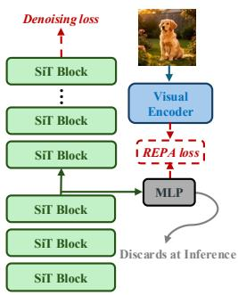  
<sub>SemaSem</sub>(a) REPA

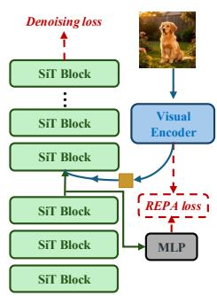  
(b) RECON training

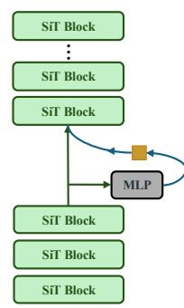  
(c) RECON inference

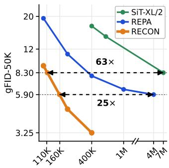  
(d) Training steps vs. gFID-50K Improved generation performance  
Figure 1: RECON conditions the later layers on the representation that REPA discards. (a) REPA trains a projection head $g _ { \phi }$ against a frozen vision encoder through the REPA loss, then discards it at inference. RECON inherits most of REPA, but (b) conditions later layers with the vision encoder tokens during training and (c) during inference retains $g _ { \phi }$ as a proxy to the vision encoder and does the same conditioning. (d) gFID-50K against training step on ImageNet 256×256 without guidance; RECON reaches the final quality of SiT-XL/2 and of REPA much earlier.

## 1 INTRODUCTION

An effective strategy for efficient diffusion transformer training is to align the diffusion features with an external vision encoder (Yu et al., 2025). Specifically, REPA (Yu et al., 2025) uses a lightweight projection head ${ g _ { \phi } } ^ { 1 }$ to map the intermediate features of diffusion backbone to be similar to those of the frozen vision encoder (Fig. 1a). Several follow-up works build on this idea, e.g., REG (Wu et al., 2025), DDT (Wang et al., 2026) and REPA-E (Leng et al., 2025).

By aligning the diffusion model with an external vision encoder, the assumption is that the diffusion backbone will effectively access and use the semantic features, so that generation will eventually improve. In this work, we examine the alignment between the vision encoder features and features of each layer of the diffusion transformer, and the feature from $g _ { \phi }$ . We find that the feature from $g _ { \phi }$ has the highest level of alignment with the vision encoder, as shown in Fig. 2b. This finding is not surprising, because $g _ { \phi }$ is physically closest to the vision encoder and is directly optimized to minimize alignment loss.

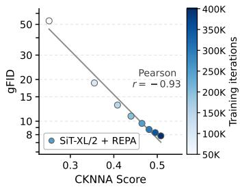  
(a) Strong correlation of gFID and CKNNA

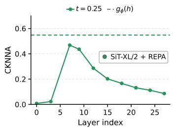  
(b) $g _ { \phi }$ output has more semantics than any layer

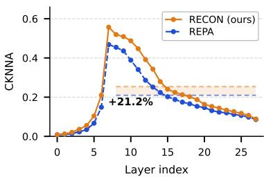  
(c) RECON improves CKNNA across layers  
Figure 2: Alignment with the vision encoder, measured by CKNNA against DINOv2-B. (a) gFID against CKNNA over training checkpoints. (b) CKNNA of backbone features at each layer. Dashed line is CKNNA between the projector output $g _ { \phi } ( h )$ and the vision encoder, which is stronger than any layer. (c) CKNNA of every layer for REPA and RECON at t = 0.25.

Surprisingly, despite its strong alignment with the vision encoder, existing methods typically discard the projection head $g _ { \phi }$ after training, as shown in Fig. 1a. We argue that the practice is a waste of model resources including learned weights and semantics: the full potential of representation alignment is not achieved.

We introduce a very simple fix, named REpresentation CONditioning (RECON). Our idea is that instead of removing $g _ { \phi }$ after training, we keep it and use it as a proxy of the vision encoder during inference, so that strong semantics from $g _ { \phi }$ can be explicitly used to benefit generation. Specifically, during inference, RECON pools the $g _ { \phi }$ output features into semantic tokens, concatenates them with the patch tokens, and lets the diffusion backbone attend to both types of tokens. Correspondingly, we have a small modification for training recipe: during training, the semantic tokens directly come from the vision encoder and serve as condition for the backbone.

Despite its simplicity, this fix effectively improves the semantics of the backbone features, as shown in Fig. 2c. Meanwhile, this method also improves generation quality: we report FID = 3.25 at 80 epochs using SD-VAE, which is competitive with the state-of-the-art methods. This is consistent with previous observation that better semantic alignment leads to better generation quality (Fig. 2a). Furthermore, our method is advantageous in that it adds no parameters<sup>2</sup> and needs fewer sampling steps to reach the same quality (Table 5). We summarize the main points of this paper below.

• We question the common practice of discarding $g _ { \phi }$ after training. Retaining it allows the semantics learned through representation alignment to guide generation.

• We introduce RECON that reuses $g _ { \phi }$ at inference to make the semantics more accessible (Fig. 1c).

• RECON converges 63× faster than SiT and 25× faster than REPA (Fig. 1d, Fig. 3) and is parameter efficient and sampling-step efficient.

## 2 RELATED WORK

Representation alignment. REPA (Yu et al., 2025) is a representative work. DDT (Wang et al., 2026) builds the separation into the architecture, dividing the transformer into a semantic encoder and a velocity decoder and applying the alignment loss to the encoder output. VA-VAE (Yao et al., 2025) moves the alignment out of the generator into the latent space. REPA-E (Leng et al., 2025) makes joint optimization of VAE and diffusion backbone possible. What is common in all these works is discarding the projection head after training, which, as we argue, is not optimal. Another line of works relies on the supervisory signal from the model itself rather than external vision encoder. SRA (Jiang et al., 2026) distills the representation of a later layer at low noise into an earlier layer at high noise. Self-Flow (Chefer et al., 2026) instead creates information asymmetry across tokens by assigning them different noise levels, so the model has to infer corrupted tokens from cleaner ones. We provide a more detailed related-work discussion in Appendix A.

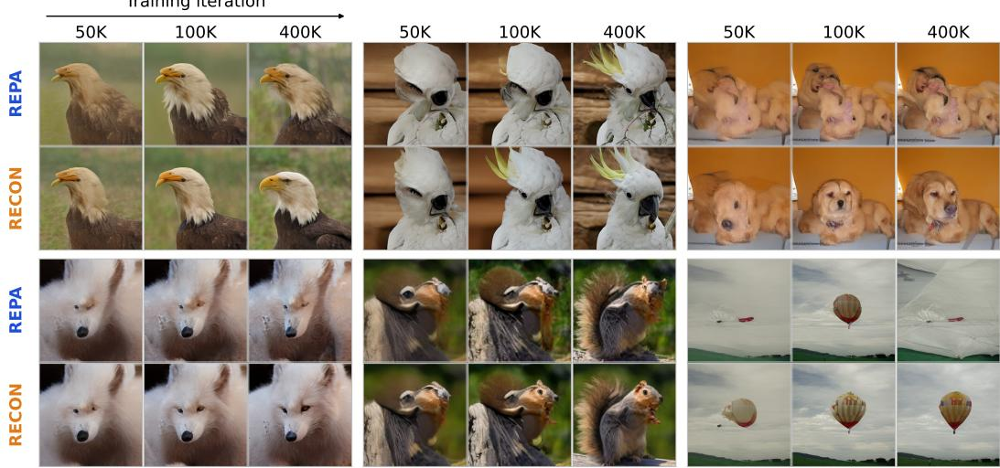  
Figure 3: Representation conditioning improves visual scaling. RECON produces higher-quality images at different steps compared with vanilla REPA. Results for both methods are sampled using the same seed, noise and class label. We use no classifier-free guidance.

Relation to REG. REG (Wu et al., 2025) adds a representation token and diffuses it jointly with the patch tokens, so the token is generated from noise alongside the image while the alignment projector is still discarded. REG performs best when aligning with the encoder class token. This is a limitation because not every vision encoder has the class token. In comparison, RECON does not have thi requirement and thus can work well with various vision encoders. Moreover, RECON does not add new variables to be diffused.

## 3 PRELIMINARIES

Flow matching. Let $x _ { 0 }$ be a clean image in RGB space. As in latent diffusion (Rombach et al., 2022), we work with its latent $z _ { 0 } = E _ { \mathrm { V A E } } ( x _ { 0 } )$ , where $E _ { \mathrm { V A E } }$ is a pretrained VAE encoder. We write z<sub>0</sub> as N patches of dimension $d _ { z }$ , so it lies in $\mathcal { Z } = \mathbb { R } ^ { N \times d _ { z } }$ . Flow matching (Lipman et al., 2023) trains a network to transport noise $z _ { 1 } \sim \mathcal { N } ( 0 , I )$ of the same shape to such latents. Following SiT (Ma et al., 2024), the two are connected by the linear interpolant of rectified flow (Liu et al., 2023),

$$
z _ { t } = ( 1 - t ) z _ { 0 } + t z _ { 1 } , \qquad t \in [ 0 , 1 ] ,\tag{1}
$$

where $t = 0$ is the clean latent and $t = 1$ is pure noise. The velocity along this path is d $z _ { t } / \mathrm { d } t =$ $z _ { 1 } - z _ { 0 }$ , and a network $v _ { \theta }$ learns to predict it from $z _ { t }$ and t alone:

$$
\begin{array} { r } { \mathcal { L } _ { \mathrm { F M } } ( \theta ) = \mathbb { E } _ { t , x _ { 0 } , z _ { 1 } } \Big [ | | v _ { \theta } ( z _ { t } , t ) - ( z _ { 1 } - z _ { 0 } ) | | ^ { 2 } \Big ] . } \end{array}\tag{2}
$$

SiT also derives from the same $v _ { \theta }$ an SDE with the same marginals, which we use in our experiments (Section 6.1). Diffusion models fit the same template with a different interpolant and prediction target, so, without loss of generality, we use flow-matching notation throughout.

Intermediate representations in diffusion transformers. We parameterize $v _ { \theta }$ with a diffusion transformer, as in SiT (Ma et al., 2024), which takes $z _ { t }$ as a sequence of N patch tokens of hidden dimension $C$ and processes it with a stack of $L$ transformer blocks. Writing $B _ { j }$ for block $j$ and $h ^ { ( j ) } \in \mathcal { H } = \mathbb { R } ^ { N \times C }$ for its output,

$$
h ^ { ( j ) } = B _ { j } \big ( h ^ { ( j - 1 ) } , t \big ) , \qquad j = 1 , \ldots , L ,\tag{3}
$$

where $h ^ { ( 0 ) }$ holds the patch tokens of $z _ { t }$ and we omit the class label for brevity.

Following REPA (Yu et al., 2025), one can view the diffusion model $v _ { \theta } ( z _ { t } , t )$ as a composition of two functions ${ \mathcal { D } } _ { \theta } \circ { \mathcal { E } } _ { \theta } \colon$ an encoder $\mathcal { E } _ { \theta } : \mathcal { Z }  \mathcal { H }$ with $\begin{array} { r } { \mathcal { E } _ { \theta } ( z _ { t } , t ) = h ^ { ( \ell ) } = h , } \end{array}$ made of the first ℓ blocks, and a decoder $\mathcal { D } _ { \theta } : \mathcal { H }  \mathcal { Z }$ with $\mathcal { D } _ { \theta } ( h , t ) = \hat { v }$ , made of the remaining $L - \ell$ blocks. We call these blocks the early and the later layers, respectively. The two are parts of a jointly trained transformer; the split marks where REPA supervises the backbone and where RECON inserts its semantic tokens (Fig. 1b,c).

Representation alignment. Trained with the flow-matching loss (Eq. 2) alone, the diffusion transformer learns semantic features slowly (Yu et al., 2025). REPA (Yu et al., 2025) speeds this up by supervising h with a frozen pretrained vision encoder $f _ { \mathrm { e x t } }$ , such as DINOv2 (Oquab et al., 2024). Let $y _ { 0 } = \mathbf { \bar { \mathcal { f } } } _ { \mathrm { e x t } } ( x _ { 0 } ) \in \mathbb { R } ^ { N \times D ^ { \mathbf { \bar { x } } } }$ . A small trainable MLP, $g _ { \phi } ,$ , maps each token of h into this feature space, shown in Fig. 1a. REPA then maximizes the similarity between $g _ { \phi } ( h )$ and $y _ { 0 }$ , patch by patch:

$$
\mathcal { L } _ { \mathrm { a l i g n } } ( \theta , \phi ) = - \mathbb { E } _ { t , x _ { 0 } , z _ { 1 } } \Big [ \frac { 1 } { N } \sum _ { n = 1 } ^ { N } \mathrm { s i m } \big ( y _ { 0 } ^ { [ n ] } , ~ g _ { \phi } ( h ^ { [ n ] } ) \big ) \Big ] ,\tag{4}
$$

where n indexes patches, and sim is the cosine similarity. This loss is added to Eq. 2 with a weight λ. We call ℓ the alignment depth $( \ell = 8$ for SiT-XL/2 in REPA). After training, $g _ { \phi }$ is discarded and only the diffusion transformer is used for sampling.

## 4 MOTIVATION

We are motivated by the following three considerations.

First, stronger alignment with external vision encoder positively correlates with better generation. For different REPA checkpoints, we plot their CKNNA and generation FID (gFID) in Fig. 2a. CKNNA compares the nearest-neighbor structure of two representations; a higher CKNNA score means higher alignment. The figure demonstrates that alignment and generation improve together.

Second, features of $g _ { \phi }$ have the highest similarity with features of the external vision encoder. This is plotted in Fig. 2b, where CKNNA of $g _ { \phi }$ is clearly higher than all the transformer layers. This is understandable because $g _ { \phi }$ is the mapping layer and stays closest to the vision encoder.

Third, existing practices discard $g _ { \phi }$ after training. As a result, the later layers only see $h ,$ which is less aligned with the vision encoder than the output of $g _ { \phi } ( \mathrm { F i g . }$ . 2b).

Based on the above, we argue that it is not reasonable to simply drop the projector $g _ { \phi }$ , the most semantic-rich module in the diffusion backbone; we keep $g _ { \phi }$ and give $\mathcal { D } _ { \theta }$ direct access to the bestaligned features, at no extra cost.

## 5 PROPOSED REPRESENTATION CONDITIONING (RECON)

Overview. The key is to retain $g _ { \phi } ( h )$ . At inference, we fuse the output of $g _ { \phi } ( h )$ with the diffusion patch tokens, which serves as in-context conditioning for the later diffusion layers. Before fusion, the $g _ { \phi } ( h )$ output is pooled into a few semantic tokens. During training, we directly use the vision encoder features and pool them into semantic tokens, called teacherforcing, because the projection layer is being trained and thus not stable. Using perception model features for training and projected features for inference creates a distribution gap. We mitigate this through a time-dependent scheduling for semantic token injection. Overall framework is depicted in Fig. 1b and 1c. We detail these components below.

## 5.1 TRAINING PIPELINE

Mapping vision encoder tokens to semantic tokens. Let $y _ { 0 } = f _ { \mathrm { e x t } } ( x _ { 0 } ) \in \mathbb { R } ^ { N \times D }$ be the vision encoder features of the clean image. We pool them into $k \ll N$ semantic tokens and map these tokens to the hidden dimension of the model:

$$
s = m \bigl ( \mathrm { P o o l } ( y _ { 0 } ) \bigr ) \in \mathbb { R } ^ { k \times C } ,\tag{5}
$$

  
Figure 4: Qualitative results on ImageNet $2 5 6 \times 2 5 6$ from SiT-XL/2 + RECON, using classifierfree guidance with $w = 4$

where $C$ is the working dimension of transformer blocks. Pool is parameter-free and will produce a square number of semantic tokens, $e . g . , k = 1 ^ { 2 } , 2 ^ { 2 }$ . We adopt $k = 1$ by default. m is a function that matches the dimensions. $m$ is the identity mapping when $D = C ;$ it is zero-padding if $D <$ $C ;$ otherwise it is a linear mapping. By default we use zero-padding, because the vision encoder dimension $D$ is usually lower than $C$ when the diffusion transformer is large enough, i.e., of size Base, Large, and Extra Large. Zero-padding adds no parameters. If we use a Small transformer, $D > C ,$ , then we use a linear mapping m, which adds very small number of parameters, $e . g .$ ., less than 1M parameters. We study the choice of k and m in Table 6.

In-context conditioning. The semantic tokens are concatenated with patch tokens h. They are then inserted in the later blocks $\mathcal { D } _ { \theta }$

$$
\begin{array} { r } { \tilde { h } = \left[ h \ ; \ s \right] \in \mathbb { R } ^ { ( N + k ) \times C } , \qquad \hat { v } = \mathcal { D } _ { \theta } ( \tilde { h } , t ) . } \end{array}\tag{6}
$$

In our method, every block of $\mathcal { D } _ { \theta }$ processes patch and semantic tokens together. The patch tokens attend to the semantic tokens at any depth. The semantic tokens are dropped before the final block.

Teacher forcing. During training, we build semantic tokens from the vision encoder features y<sub>0</sub> (Eq. 5), because we have access to the clean image. This is the same teacher forcing method as language models: the model is conditioned on the ground truth tokens rather than on its own predictions. We could also use $g _ { \phi }$ output to obtain semantic tokens. But we choose teacher forcing because $g _ { \phi }$ is being trained. Its output starts far from $y _ { 0 }$ and keeps changing as training proceeds. Therefore, conditioning on the $g _ { \phi }$ output would ask the later layers to rely on a signal that is neither accurate nor stable, whereas $y _ { 0 }$ is stable from the first training step. We compare teacher forcing with other training strategies in Table 7.

Time-dependent scheduling for semantic token injection. Teacher forcing at every timestep may introduce a train–inference gap. At inference the semantic tokens come from $g _ { \phi } ( h )$ , which matches $y _ { 0 }$ relatively well at low noise levels and poorly at high noise levels. Training with y<sub>0</sub> at high t (noisy steps) would therefore teach $\mathcal { D } _ { \theta }$ to rely on information that $g _ { \phi } ( h )$ cannot provide at generation time. We mitigate this by injecting semantic tokens at timesteps only below a threshold $t _ { \mathrm { m a x } } .$

$$
s = \left\{ \begin{array} { l l } { m \big ( \mathrm { P o o l } ( y _ { 0 } ) \big ) , } & { t < t _ { \mathrm { m a x } } } \\ { \varnothing , } & { t \ge t _ { \mathrm { m a x } } } \end{array} , \right.\tag{7}
$$

where $\mathcal { D }$ denotes that no semantic tokens are appended and $\mathcal { D } _ { \theta }$ runs on h alone.

Table 1: gFID Comparison without CFG on ImageNet 256 × 256. SD-VAE latents by default. †: VA-VAE latents.
<table><tr><td>Method</td><td>Iter.</td><td>gFID↓</td></tr><tr><td>No representation alignment</td><td></td><td></td></tr><tr><td>DiT-XL/2</td><td>7M</td><td>9.60</td></tr><tr><td>SiT-XL/2</td><td>7M</td><td>8.30</td></tr><tr><td>MDT (Gao et al., 2023)</td><td>6.5M</td><td>6.23</td></tr><tr><td>MaskDiT (Zheng et al., 2024)</td><td>8M</td><td>5.69</td></tr><tr><td>Alignment w/o external encoder</td><td></td><td></td></tr><tr><td>SRA</td><td>4M</td><td>7.27</td></tr><tr><td>LayerSync</td><td>4M</td><td>6.32</td></tr><tr><td>Self-Flow</td><td>4M</td><td>5.70</td></tr><tr><td>Alignment w/ external encoder</td><td></td><td></td></tr><tr><td>REPA</td><td>400K</td><td>7.90</td></tr><tr><td>REPA</td><td>4M</td><td>5.90</td></tr><tr><td>REG</td><td>400K</td><td>3.40</td></tr><tr><td>REG</td><td>1M</td><td>2.70</td></tr><tr><td>LightningDiT† (Yao et al., 2025) REPA-E</td><td>400K</td><td>4.29</td></tr><tr><td>RECON</td><td>400K</td><td>4.07</td></tr><tr><td>RECON</td><td>100K 200K</td><td>9.25 4.64</td></tr><tr><td>RECON</td><td></td><td></td></tr><tr><td></td><td>400K</td><td>3.25</td></tr><tr><td>RECON</td><td>1M</td><td>2.54</td></tr><tr><td>RECON</td><td>2.4M</td><td>2.21</td></tr></table>

Table 2: System-level comparison on ImageNet 256 × 256 with guidance. RECON: Autoguidance (Karras et al., 2024) (‡: improved, Appendix C); baselines: CFG (\*: scheduled).
<table><tr><td>Model</td><td>Epochs FID↓</td><td></td><td>IS↑</td><td></td><td>Pre.↑ Rec.↑</td></tr><tr><td colspan="6">Pixel diffusion</td></tr><tr><td>ADM-G + ADM-U (Dhariwal &amp; Nichol, 2021)</td><td>400</td><td>3.94</td><td>186.7</td><td>0.82</td><td>0.52</td></tr><tr><td>VDM++ (Kingma &amp; Gao, 2023)</td><td>560</td><td>2.40</td><td>225.3</td><td></td><td>一</td></tr><tr><td>Simple diffusion (Hoogeboom et al., 2023)</td><td>800</td><td>2.77</td><td>211.8</td><td>一</td><td>一</td></tr><tr><td>CDM (Ho et al., 2022)</td><td>2160</td><td>4.88</td><td>158.7</td><td>一</td><td>一</td></tr><tr><td colspan="6">Latent diffusion, U-Net</td></tr><tr><td>LDM-4 (Rombach et al., 2022)</td><td>200</td><td>3.60</td><td>247.7</td><td>0.87</td><td>0.48</td></tr><tr><td>Latent diffusion, Transformer + U-Net hybrid</td><td></td><td></td><td></td><td></td><td></td></tr><tr><td>U-ViT-H/2 (Bao et al., 2023)</td><td>240</td><td>2.29</td><td>263.9</td><td>0.82</td><td>0.57</td></tr><tr><td>DiffiT* (Hatamizadeh et al., 2024)</td><td></td><td>1.73</td><td>276.5</td><td>0.80</td><td>0.62</td></tr><tr><td>MDTv2-XL/2*</td><td>1080</td><td>1.58</td><td>314.7</td><td>0.79</td><td>0.65</td></tr><tr><td colspan="6">Latent diffusion, Transformer</td></tr><tr><td>MaskDiT</td><td>1600</td><td>2.28</td><td>276.6</td><td>0.80</td><td>0.61</td></tr><tr><td>SD-DiT (Zhu et al., 2024)</td><td>480</td><td>3.23</td><td></td><td></td><td></td></tr><tr><td>DiT-XL/2</td><td>1400</td><td>2.27</td><td>278.2</td><td>0.83</td><td>0.57</td></tr><tr><td>SiT-XL/2</td><td>1400</td><td>2.06</td><td>270.3</td><td>0.82</td><td>0.59</td></tr><tr><td>+ REPA</td><td>800</td><td>1.80</td><td>284.0</td><td>0.81</td><td>0.61</td></tr><tr><td>+ REPA*</td><td>800</td><td>1.42</td><td>305.7</td><td>0.80</td><td>0.65</td></tr><tr><td>+ REG</td><td>480</td><td>1.40</td><td>296.9</td><td>0.77</td><td>0.66</td></tr><tr><td>+ RECON</td><td>80</td><td>2.26</td><td>241.22</td><td>0.82</td><td>0.57</td></tr><tr><td>+ RECON‡</td><td>80</td><td>2.09</td><td>224.20</td><td>0.79</td><td>0.60</td></tr><tr><td>+ RECON</td><td>480</td><td>1.80</td><td>273.30</td><td>0.81</td><td>0.59</td></tr><tr><td>+ RECON‡</td><td>480</td><td>1.49</td><td>269.10</td><td>0.79</td><td>0.62</td></tr></table>

## 5.2 INFERENCE

In inference, we use the output of $g _ { \phi }$ in place of $y _ { 0 }$ to obtain semantic tokens:

$$
s = m \bigl ( \mathrm { P o o l } ( g _ { \phi } ( h ) ) \bigr ) .\tag{8}
$$

We use $g _ { \phi }$ because 1) $g _ { \phi }$ is trained to predict the vision-encoder features from h and thus is a good proxy of the vision encoder and 2) there is no clean image available during inference. In the same way as training, the semantic tokens are then concatenated to the patch tokens and serve as in-context conditioning for later layers. There is no time-dependent scheduling for inference, the benefit of which is shown in Table 8.

## 6 EXPERIMENTS

We evaluate RECON introduced in Section 5. Three questions organize the evaluation:

1. Does RECON improve generation quality and accelerate convergence, for both class-conditional and text-to-image generation? (Sections 6.2 and 6.3)

2. How much does RECON improve the semantics of intermediate diffusion features? What is its benefit apart from generation quality? (Section 6.4)

3. Does the improvement hold across model scales, latent spaces, and target encoders? (Section 6.5)

## 6.1 SETUP

Implementation details. We follow the setup of SiT (Ma et al., 2024) and REPA (Yu et al., 2025) unless stated otherwise. We use ImageNet (Deng et al., 2009) at 256 × 256 resolution and follow ADM (Dhariwal & Nichol, 2021) for data preprocessing. Each image is encoded into a $3 2 \times 3 2 \times 4$ latent by the SD-VAE (Rombach et al., 2022). We use the B/2, L/2 and XL/2 models of SiT, which have a patch size of 2, and a batch size of 256. RECON uses alignment depth 8, DINOv2-B (Oquab et al., 2024) as vision encoder target, $k = 1 , t _ { \mathrm { m a x } } = 0 . 5 .$ and zero-padding for dimension matching (Table 6). For text-to-image generation, we train MMDiT (Esser et al., 2024) on

MS-COCO (Lin et al., 2014) and NanoGen (Leng et al., 2026)<sup>3</sup> on BLIP3-o (Chen et al., 2025) (Appendix B.2). More details are in Appendix B.

Datasets and evaluation protocols. We report gFID, inception score, precision and recall over 50K samples, drawn with an SDE sampler at 250 steps for ImageNet. For text-to-image generation, we report FID and CLIP score on MS-COCO (83K images), and FID and IS on BLIP3o-256 (36M images). Samples are drawn with an ODE sampler at 50 steps.

## 6.2 CLASS-CONDITIONAL GENERATION

C2I: comparison with existing methods. Table 1 summarizes the comparisons using SD-VAE and without CFG. At 400K training steps, our method is stronger than state-of-the-art methods such as REG (3.40) and REPA-E (4.07). Longer training to 1M and 2.4M steps reduces gFID to 2.54 and 2.21, respectively. Fig. 4 shows samples from the final model. Fig. 1d shows the training speedup.

C2I: system-level comparisons. Following RAE (Zheng et al., 2026), we use Autoguidance (Karras et al., 2024) for the guided results (more details in Appendix B). Table 2 summarizes the comparisons. At 80 epochs, RECON reaches 2.09, better than MaskDiT (2.28) and DiT (2.27), which are trained for 1600 and 1400 epochs, respectively. At 480 epochs, RECON reaches 1.49, better than SiT (2.06) and on par with REPA with scheduled CFG (1.42), which are trained for 1400 and 800 epochs, respectively. Similar to RAE, our preliminary observation is that CFG helps RECON less than it helps standard diffusion transformers. Designing guidance for semantically rich diffusion backbones, such as RECON and RAE, is a promising future direction, which we discuss in Sec. 7.

## 6.3 TEXT-TO-IMAGE GENERATION

T2I: comparison with REPA. We compare our method with REPA in Table 3 and Table 4, where we report consistently lower FID, and higher CLIP score and IS. On two different datasets, the gFID of RECON is 8.26 and 3.90, while gFID of REPA is 9.85 and 5.41, respectively. The BLIP-3o results are more useful because the training set is much larger than MS-COCO. Qualitative results are shown in Fig. 5. These results indicate that RECON is effective for T2I training.

Table 3: Text-to-image on MS-COCO. MMDiT, ODE, 50 NFE, 150K iter.; w: guidance scale. RE-CON is superior to REPA.
<table><tr><td></td><td colspan="2">w=1</td><td colspan="2">w=2</td></tr><tr><td>Method</td><td>FID↓</td><td>CLIP↑</td><td>FID↓</td><td>CLIP↑</td></tr><tr><td>+ REPA</td><td>9.85</td><td>0.2273</td><td>4.73</td><td>0.2443</td></tr><tr><td>+ RECON (ours)</td><td>8.26</td><td>0.2313</td><td>4.55</td><td>0.2462</td></tr></table>

Table 4: Text-to-image on BLIP3-o (Chen et al., 2025). NanoGen (Leng et al., 2026); ODE, 50 NFE, 100K iter.
<table><tr><td rowspan="2">Method</td><td colspan="2">w=1</td><td colspan="2">w=8</td></tr><tr><td>FID↓</td><td>IS↑</td><td>FID↓</td><td>IS↑</td></tr><tr><td>+ REPA</td><td>5.41</td><td>22.40</td><td>5.30</td><td>27.61</td></tr><tr><td>+ RECON (ours)</td><td>3.90</td><td>24.31</td><td>5.04</td><td>27.91</td></tr></table>

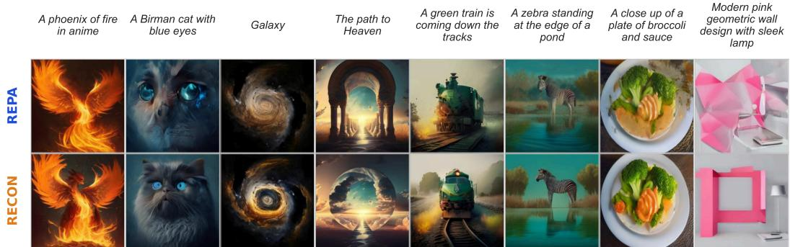  
Figure 5: Qualitative comparison on text-to-image generation (BLIP3-o). Curated qualitative samples from REPA and RECON trained for 100K iterations. Prompts are shown on top.

## 6.4 EFFECT ON REPRESENTATION DYNAMICS

Beyond generation quality, we examine how RECON changes the semantics of the intermediate features and how a sample forms during generation.

RECON improves semantics in each diffusion layer. Fig. 2c and Fig. 6 use CKNNA and linear probing accuracy to measure semantics in each layer<sup>4</sup>, comparing REPA and RECON. We clearly observe that under both measures, RE-CON brings more semantics to each layer. Specifically, in the later layers that receive semantic tokens, RECON raises mean CKNNA by 21.2% and mean linear probing accuracy by 4.9%.

Semantic structure emerges earlier in sampling. The richer intermediate features also change how a sample develops over generation. We visualize the semantic trajectory of a generated sample: at each step we measure the cosine similarity between the running estimate ${ \hat { x } } _ { 0 } ( t )$ and the final image, in the

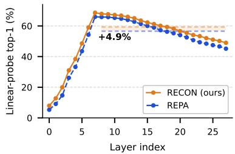  
Figure 6: Linear probing vs. layers. ImageNet-1K validation top-1, at $t = 0 . 2 5$

space of DINOv2. Fig. 7 presents how much of the image subject and layout is already decided at time t. Fig. 7a shows one sample, while Fig. 7b shows the statistics of 10K samples. We clearly observe that RECON allows such layout to appear earlier than REPA. A similar behavior is observed under perturbation: given a heavily corrupted image, RECON recovers the identity and overall composition better than REPA (Fig. 9).

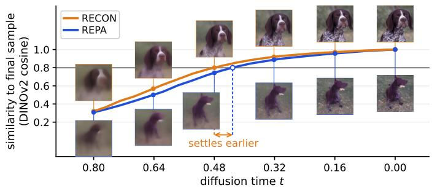  
(a) Semantic emergence over generation

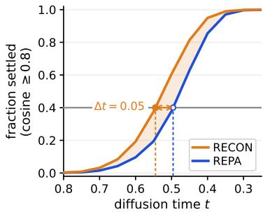  
(b) When does structure settle?  
Figure 7: RECON settles the structure of a sample earlier in generation. (a) measures how close the running estimate ${ \hat { x } } _ { 0 } ( t )$ is, in semantic space, to the image that the same run finally produces. It is measured for a single sample, where RECON is above REPA at every step (both methods start from the same noise). In (b), we generate 10K images. At each diffusion timestep, we measure the percentage of samples whose running estimate ${ \hat { x } } _ { 0 } ( t )$ similarity with the final image is greater than 0.8. RECON is above REPA.

RECON works with fewer sampling steps. Since the structure of samples emerges earlier, RECON needs fewer sampling steps for generation. In Table 5, we reduce NFE to 100 and 50 and keep everything else fixed. gFID of REPA degrades from 7.9 to 8.4 and 10.8, respectively. In comparison, RECON keeps gFID of 3.2 at 100 steps, and goes to 3.3 at 50 steps. This means 2.5× to 5× fewer network evaluations at inference, with almost no cost in generation.

Table 5: Sampling steps. gFID-50K; SiT-XL/2, 400K iter., no CFG.
<table><tr><td>NFE</td><td>50</td><td>100</td><td>250</td></tr><tr><td>REPA</td><td>10.8</td><td>8.4</td><td>7.9</td></tr><tr><td>RECON</td><td>3.3</td><td>3.2</td><td>3.2</td></tr></table>

## 6.5 GENERALIZATION AND SCALABILITY

Unless stated otherwise every run in this section uses SD-VAE latents, DINOv2-B as the target encoder and alignment depth 8, and is evaluated without classifier-free guidance. Every baseline is vanilla REPA trained under the same protocol. The full metrics are in Appendix H.

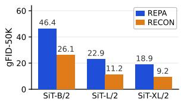  
(a) Variation in model scale

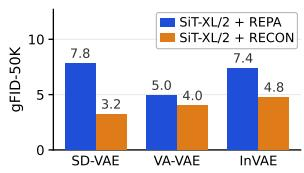  
(b) Variation in the tokenizers

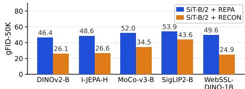  
(c) Variation in the target encoders  
Figure 8: RECON vs. REPA across model scale, tokenizer and target encoder. gFID-50K of REPA and RECON. (a) SiT-B/2, SiT-L/2 and SiT-XL/2 at 20 epochs. (b) Three tokenizers at 80 epochs. (c) Five target vision encoders, SiT-B/2 at 20 epochs.

Impact of model size. Fig. 8a compares SiT-B/2, SiT-L/2 and SiT-XL/2 at 20 epochs. RECON improves REPA significantly at every model scale. Interestingly, SiT-L/2 with RECON reaches $\mathrm { g F I D } = 1 1 . 2 4$ , which is better than 18.88 for SiT-XL/2 with REPA.

Effectiveness of RECON for different VAEs. We compare RECON and REPA on three VAEs: SD VAE (Rombach et al., 2022), VA-VAE (Yao et al., 2025) and InVAE (Leng et al., 2025). Results are in Fig. 8b. RECON yields consistent improvements over REPA for each tokenizer: gFID improves from 7.84 → 3.25 on SD-VAE, from 7.41 → 4.78 on InVAE, and from $4 . 9 5  4 . { \bar { 0 2 } }$ on VA-VAE. The improvement on VA-VAE is smaller because it is trained with an additional REPA loss, so a part of the semantics RECON tries to inject into the diffusion backbone is already available. For further discussions see Appendix G.

Table 6: Component-wise analysis on ImageNet $2 5 6 \times 2 5 6 .$ . All models are SiT-XL/2 with DINOv2-B as the target, trained for 400K iterations and measured without classifier-free guidance. Each block varies a single component, shaded, with all others held at the default.  
Table 7: Teacher forcing vs. other training strategies. ‘online’/‘EMA’: tokens from $g _ { \phi }$ or its moving average. gFID and IS after 100K iterations.
<table><tr><td>Depth</td><td>k</td><td> $t _ { \mathrm { m a x } }$ </td><td>DM mech.</td><td>FID↓</td><td>IS↑</td><td>Pre.↑</td><td>Rec.↑</td></tr><tr><td></td><td></td><td>Vanilla SiT-XL/2 (Ma et al., 2024)</td><td></td><td>17.20</td><td>76.52</td><td>0.65</td><td>0.63</td></tr><tr><td></td><td></td><td></td><td>SiT-XL/2 + REPA (Yu et al., 2025)</td><td>7.83</td><td>125.43</td><td>0.70</td><td>0.65</td></tr><tr><td>6 8</td><td>1</td><td>0.5 0.5</td><td>zero-pad</td><td>3.26 3.25</td><td>205.86 204.18</td><td>0.81 0.81</td><td>0.56</td></tr><tr><td>10</td><td>1 1</td><td>0.5</td><td>zero-pad zero-pad</td><td>3.38</td><td>202.34</td><td>0.81</td><td>0.56 0.55</td></tr><tr><td></td><td></td><td></td><td></td><td></td><td></td><td></td><td></td></tr><tr><td>8 8</td><td>14</td><td>0.5 0.5</td><td>zero-pad zero-pad</td><td>3.25 4.70</td><td>204.18 214.01</td><td>0.81 0.84</td><td>0.56</td></tr><tr><td></td><td></td><td></td><td></td><td></td><td></td><td></td><td>0.50</td></tr><tr><td>8 8</td><td>1</td><td>0.3</td><td>zero-pad</td><td>5.33</td><td>146.74</td><td>0.74</td><td>0.63</td></tr><tr><td>8</td><td>1</td><td>0.5 1.0</td><td>zero-pad zero-pad</td><td>3.25 4.70</td><td>204.18 236.82</td><td>0.81</td><td>0.56</td></tr><tr><td></td><td>1</td><td></td><td></td><td></td><td></td><td>0.84</td><td>0.44</td></tr><tr><td>8</td><td>1</td><td>0.5</td><td>zero-pad</td><td>3.25</td><td>204.18</td><td>0.81</td><td>0.55</td></tr><tr><td>8</td><td>1</td><td>0.5</td><td>linear</td><td>3.68</td><td>198.35</td><td>0.80</td><td>0.56</td></tr></table>

<table><tr><td>Tokens built from</td><td>gFID↓</td><td>IS↑</td></tr><tr><td> $f _ { \mathrm { e x t } } ( x _ { 0 } )$ </td><td>9.2</td><td>118.8</td></tr><tr><td> $g _ { \phi } ( h )$  , online  $g _ { \phi } ( h )$  , EMA</td><td>17.1 16.8</td><td>76.3 77.5</td></tr></table>

Table 8: Injection at inference. Semantic tokens only for $t \_ { } <$ $t _ { \mathrm { m a x } } ,$ as in training, or at every sampling step.
<table><tr><td>Injected at</td><td>gFID↓</td><td>IS↑</td></tr><tr><td> $t < t _ { \mathrm { m a x } } \mathrm { o n l y }$ </td><td>6.3</td><td>149.9</td></tr><tr><td>All timesteps</td><td>3.2</td><td>202.2</td></tr></table>

Effectiveness of RECON for different target vision encoders. We use five encoders: I-JEPA-H (Assran et al., 2023), DINOv2-B, MoCo-v3-B (Chen et al., 2021), SigLIP2-B (Tschannen et al., 2025), and WebSSL-DINO-1B (Fan et al., 2025) and summarize results in Fig. 8c. Across the encoders, RECON also gives consistent gFID improvement over REPA.

Ablations and variations on design components. Table 6 varies the components RECON introduces, one block at a time: the alignment depth, the number of semantic tokens, the injection threshold $t _ { \mathrm { m a x } } .$ , and the dimension-matching mechanism. For $\pmb { t } _ { \mathbf { m a x } }$ , we choose 0.5. Larger t<sub>max</sub> makes diffusion exposed to unseen semantics during inference; smaller $t _ { \mathrm { m a x } }$ makes it harder for diffusion blocks to understand how patch-tokens should interact with semantics. We choose k to be 1. If we increase k, errors in $g _ { \phi }$ prediction are amplified and can harm the generation quality. For the dimension-matching mechanism, we choose zero-padding to increase the dimensions of semantic tokens to be the same as patch tokens. This method is easier and appears to be more effective than linear mapping. Depth of alignment analysis suggests that for XL models, Layer 8 is a good choice for alignment. It is also worth mentioning that RECON performance is relatively stable within a reasonable range of this factor.

## 7 DISCUSSIONS

Why do later layers need more semantics? Later layers are only supervised by the flow-matching loss and only depend on h. In comparison, the gradient of REPA loss is back-propagated to early layers, so early layers are optimized towards higher semantics. By injecting semantics to late layers, the late layers, through training, can decide whether to use them or not, which is at least not detrimental and turns out to be beneficial.

Rethinking guidance for semantically rich diffusion models. CFG helps RECON less than it helps standard diffusion transformers. Our hunch is that with the semantic tokens, the backbone is already rich in semantics without the class label, so the unconditional prediction is close to the conditional one. RAE (Zheng et al., 2026) reports a similar observation, and like RAE, we use Autoguidance (Karras et al., 2024). We further improve Autoguidance with two simple changes at sampling time, Projected Autoguidance (Appendix C.1) and Semantic Token Extrapolation (Ap pendix C.2). They improve gFID from 2.26 → 2.09 at 80 epochs and from 1.80 → 1.49 at 480 epochs. We see these as first steps. One promising direction is Internal Guidance (Zhou et al., 2026), which uses an intermediate layer of the model as the weak model. Another is guidance tha acts directly on the semantic tokens, rather than on the velocity.

Limitations. RECON reuses a projection head that a REPA-style alignment loss has already trained, so it cannot be applied to a model trained without such a loss. What it removes is the waste in discarding that head, not the need for alignment in the first place. More in Appendix F.

## 8 CONCLUSION

This paper challenges the practice in representation alignment methods that the projection head $g _ { \phi }$ should be discarded after training. This is based on our observation that the output of $g _ { \phi }$ is very semantical: it aligns with the vision encoder more strongly than any of the diffusion transformer layers. Discarding it means we forfeit useful and also free cues. We propose representation conditioning (RECON), which supplies output of $g _ { \phi }$ to the later layers. With no added parameters and no change in training loss, RECON simply lets later layers decide how to use the conditioning semantics. We report good improvement over REPA in various settings. We hope that RECON was effective in conveying and bringing up the following message: what matters in representation alignment is not only acquiring a representation, but also keeping it accessible in generation.

## AI USE STATEMENT

In this work, we used Claude Code (Anthropic, 2026) to assist with implementing our methods, preparing experiment configurations, and running experiments. Additionally, we used Claude Code to draft the paper outline, check the grammar of the manuscript, and improve the clarity of the writing. We also used it to generate most of the figures and tables from our experiment logs and checkpoints, following the colour palette we provided. We have reviewed all AI-assisted work, including the code, experiment configurations, figures, tables, and text. We take responsibility for the final content of this work and the associated codebase, including all materials produced with AI assistance.

## REPRODUCIBILITY STATEMENT

To support reproducibility, we provide all implementation details and hyperparameters in $\mathsf { A p } \cdot$ pendix B.

## REFERENCES

Anthropic. Claude. https://claude.ai, 2026.

Mahmoud Assran, Quentin Duval, Ishan Misra, Piotr Bojanowski, Pascal Vincent, Michael Rabbat, Yann LeCun, and Nicolas Ballas. Self-supervised learning from images with a joint-embedding predictive architecture. In IEEE/CVF Conference on Computer Vision and Pattern Recognition (CVPR), pp. 15619–15629, 2023.

Fan Bao, Shen Nie, Kaiwen Xue, Yue Cao, Chongxuan Li, Hang Su, and Jun Zhu. All are worth words: A ViT backbone for diffusion models. In IEEE/CVF Conference on Computer Vision and Pattern Recognition (CVPR), 2023.

Hila Chefer, Patrick Esser, Dominik Lorenz, Dustin Podell, Vikash Raja, Vinh Tong, Antonio Torralba, and Robin Rombach. Self-supervised flow matching for scalable multi-modal synthesis. In International Conference on Machine Learning (ICML), 2026.

Jiuhai Chen, Zhiyang Xu, Xichen Pan, Yushi Hu, Can Qin, Tom Goldstein, Lifu Huang, Tianyi Zhou, Saining Xie, Silvio Savarese, Le Xue, Caiming Xiong, and Ran Xu. BLIP3-o: A family of fully open unified multimodal models – architecture, training and dataset. arXiv preprint arXiv:2505.09568, 2025.

Xinlei Chen, Saining Xie, and Kaiming He. An empirical study of training self-supervised vision transformers. In International Conference on Computer Vision (ICCV), 2021.

Jia Deng, Wei Dong, Richard Socher, Li-Jia Li, Kai Li, and Li Fei-Fei. ImageNet: A large-scale hierarchical image database. In IEEE Conference on Computer Vision and Pattern Recognition (CVPR), 2009.

Prafulla Dhariwal and Alexander Nichol. Diffusion models beat GANs on image synthesis. In Advances in Neural Information Processing Systems (NeurIPS), 2021.

Patrick Esser, Sumith Kulal, Andreas Blattmann, Rahim Entezari, Jonas Muller, Harry Saini, Yam¨ Levi, Dominik Lorenz, Axel Sauer, Frederic Boesel, Dustin Podell, Tim Dockhorn, Zion English, Kyle Lacey, Alex Goodwin, Yannik Marek, and Robin Rombach. Scaling rectified flow transformers for high-resolution image synthesis. In International Conference on Machine Learning (ICML), 2024.

David Fan, Shengbang Tong, Jiachen Zhu, Koustuv Sinha, Zhuang Liu, Xinlei Chen, Michael Rabbat, Nicolas Ballas, Yann LeCun, Amir Bar, and Saining Xie. Scaling language-free visual representation learning. In International Conference on Computer Vision (ICCV), 2025.

Shanghua Gao, Pan Zhou, Ming-Ming Cheng, and Shuicheng Yan. Masked diffusion transformer is a strong image synthesizer. In International Conference on Computer Vision (ICCV), 2023.

Yasaman Haghighi, Bastien van Delft, Mariam Hassan, and Alexandre Alahi. LayerSync: Selfaligning intermediate layers. In International Conference on Learning Representations (ICLR), 2026.

Ali Hatamizadeh, Jiaming Song, Guilin Liu, Jan Kautz, and Arash Vahdat. DiffiT: Diffusion vision transformers for image generation. In European Conference on Computer Vision (ECCV), 2024.

Kaiming He, Xinlei Chen, Saining Xie, Yanghao Li, Piotr Dollar, and Ross Girshick. Masked´ autoencoders are scalable vision learners. In Conference on Computer Vision and Pattern Recognition (CVPR), 2022.

Jack Hessel, Ari Holtzman, Maxwell Forbes, Ronan Le Bras, and Yejin Choi. CLIPScore: A reference-free evaluation metric for image captioning. In Conference on Empirical Methods in Natural Language Processing (EMNLP), 2021.

Martin Heusel, Hubert Ramsauer, Thomas Unterthiner, Bernhard Nessler, and Sepp Hochreiter. GANs trained by a two time-scale update rule converge to a local Nash equilibrium. In Advances in Neural Information Processing Systems (NeurIPS), 2017.

Jonathan Ho, Chitwan Saharia, William Chan, David J. Fleet, Mohammad Norouzi, and Tim Salimans. Cascaded diffusion models for high fidelity image generation. Journal of Machine Learning Research (JMLR), 2022.

Emiel Hoogeboom, Jonathan Heek, and Tim Salimans. simple diffusion: End-to-end diffusion for high resolution images. In International Conference on Machine Learning (ICML), 2023.

Xun Huang, Zhengqi Li, Guande He, Mingyuan Zhou, and Eli Shechtman. Self forcing: Bridging the train-test gap in autoregressive video diffusion. In Advances in Neural Information Processing Systems (NeurIPS), 2025.

Minyoung Huh, Brian Cheung, Tongzhou Wang, and Phillip Isola. Position: The platonic representation hypothesis. In International Conference on Machine Learning (ICML), 2024.

Dengyang Jiang, Mengmeng Wang, Liuzhuozheng Li, Lei Zhang, Haoyu Wang, Wei Wei, Guang Dai, Yanning Zhang, and Jingdong Wang. Representation alignment for diffusion transformers without external components. In International Conference on Learning Representations (ICLR), 2026.

Tero Karras, Miika Aittala, Tuomas Kynka¨anniemi, Jaakko Lehtinen, Timo Aila, and Samuli Laine.¨ Guiding a diffusion model with a bad version of itself. In Advances in Neural Information Processing Systems (NeurIPS), 2024.

Diederik P. Kingma and Ruiqi Gao. Understanding diffusion objectives as the ELBO with simple data augmentation. In Advances in Neural Information Processing Systems (NeurIPS), 2023.

Simon Kornblith, Mohammad Norouzi, Honglak Lee, and Geoffrey Hinton. Similarity of neural network representations revisited. In International Conference on Machine Learning (ICML), 2019.

Tuomas Kynka¨anniemi, Tero Karras, Samuli Laine, Jaakko Lehtinen, and Timo Aila. Improved¨ precision and recall metric for assessing generative models. In Advances in Neural Information Processing Systems (NeurIPS), 2019.

Tuomas Kynka¨anniemi, Miika Aittala, Tero Karras, Samuli Laine, Timo Aila, and Jaakko Lehtinen.¨ Applying guidance in a limited interval improves sample and distribution quality in diffusion models. In Advances in Neural Information Processing Systems (NeurIPS), 2024.

Xingjian Leng, Jaskirat Singh, Yunzhong Hou, Zhenchang Xing, Saining Xie, and Liang Zheng. REPA-E: Unlocking VAE for end-to-end tuning of latent diffusion transformers. In International Conference on Computer Vision (ICCV), 2025.

Xingjian Leng, Jaskirat Singh, Zhanhao Liang, Ethan Smith, Martin Bell, Aninda Saha, Yuhui Yuan, and Liang Zheng. DiffusionBench: On holistic evaluation of diffusion transformers. arXiv preprint arXiv:2606.24888, 2026.

Tsung-Yi Lin, Michael Maire, Serge Belongie, James Hays, Pietro Perona, Deva Ramanan, Piotr Dollar, and C. Lawrence Zitnick. Microsoft COCO: Common objects in context. In´ European Conference on Computer Vision (ECCV), 2014.

Yaron Lipman, Ricky T. Q. Chen, Heli Ben-Hamu, Maximilian Nickel, and Matt Le. Flow matching for generative modeling. In International Conference on Learning Representations (ICLR), 2023.

Xingchao Liu, Chengyue Gong, and Qiang Liu. Flow straight and fast: Learning to generate and transfer data with rectified flow. In International Conference on Learning Representations (ICLR), 2023.

Nanye Ma, Mark Goldstein, Michael S. Albergo, Nicholas M. Boffi, Eric Vanden-Eijnden, and Saining Xie. SiT: Exploring flow and diffusion-based generative models with scalable interpolant transformers. In European Conference on Computer Vision (ECCV), 2024.

Maxime Oquab, Timothee Darcet, Th´ eo Moutakanni, Huy Vo, Marc Szafraniec, Vasil Khalidov,´ Pierre Fernandez, Daniel Haziza, Francisco Massa, Alaaeldin El-Nouby, et al. DINOv2: Learning robust visual features without supervision. Transactions on Machine Learning Research (TMLR), 2024.

William Peebles and Saining Xie. Scalable diffusion models with transformers. In IEEE/CVF International Conference on Computer Vision (ICCV), 2023.

Alec Radford, Jong Wook Kim, Chris Hallacy, Aditya Ramesh, Gabriel Goh, Sandhini Agarwal, Girish Sastry, Amanda Askell, Pamela Mishkin, Jack Clark, Gretchen Krueger, and Ilya Sutskever. Learning transferable visual models from natural language supervision. In Interna-

tional Conference on Machine Learning (ICML), 2021.

Robin Rombach, Andreas Blattmann, Dominik Lorenz, Patrick Esser, and Bjorn Ommer. High-¨ resolution image synthesis with latent diffusion models. In IEEE/CVF Conference on Computer Vision and Pattern Recognition (CVPR), 2022.

Seyedmorteza Sadat, Otmar Hilliges, and Romann M. Weber. Eliminating oversaturation and artifacts of high guidance scales in diffusion models. In International Conference on Learning Representations (ICLR), 2025.

Tim Salimans, Ian Goodfellow, Wojciech Zaremba, Vicki Cheung, Alec Radford, and Xi Chen. Improved techniques for training GANs. In Advances in Neural Information Processing Systems (NeurIPS), 2016.

Le Song, Alex Smola, Arthur Gretton, Justin Bedo, and Karsten Borgwardt. Feature selection via dependence maximization. Journal ofMachine Learning Research (JMLR), 13:1393–1434, 2012.

Christian Szegedy, Vincent Vanhoucke, Sergey Ioffe, Jon Shlens, and Zbigniew Wojna. Rethinking the inception architecture for computer vision. In IEEE Conference on Computer Vision and Pattern Recognition (CVPR), 2016.

Michael Tschannen, Alexey Gritsenko, Xiao Wang, Muhammad Ferjad Naeem, Ibrahim Alabdulmohsin, Nikhil Parthasarathy, Talfan Evans, Lucas Beyer, Ye Xia, Basil Mustafa, Olivier Henaff,´ Jeremiah Harmsen, Andreas Steiner, and Xiaohua Zhai. SigLIP 2: Multilingual vision-language encoders with improved semantic understanding, localization, and dense features. arXiv preprint arXiv:2502.14786, 2025.

Shuai Wang, Zhi Tian, Weilin Huang, and Limin Wang. DDT: Decoupled diffusion transformer. In Conference on Computer Vision and Pattern Recognition (CVPR), 2026.

Ge Wu, Shen Zhang, Ruijing Shi, Shanghua Gao, Zhenyuan Chen, Lei Wang, Zhaowei Chen, Hongcheng Gao, Yao Tang, Jian Yang, Ming-Ming Cheng, and Xiang Li. Representation entanglement for generation: Training diffusion transformers is much easier than you think. In Advances in Neural Information Processing Systems (NeurIPS), 2025.

Jingfeng Yao, Bin Yang, and Xinggang Wang. Reconstruction vs. generation: Taming optimization dilemma in latent diffusion models. In Conference on Computer Vision and Pattern Recognition (CVPR), 2025.

Sihyun Yu, Sangkyung Kwak, Huiwon Jang, Jongheon Jeong, Jonathan Huang, Jinwoo Shin, and Saining Xie. Representation alignment for generation: Training diffusion transformers is easier than you think. In International Conference on Learning Representations (ICLR), 2025.

Boyang Zheng, Nanye Ma, Shengbang Tong, and Saining Xie. Diffusion transformers with representation autoencoders. In International Conference on Learning Representations (ICLR), 2026.

Hongkai Zheng, Weili Nie, Arash Vahdat, and Anima Anandkumar. Fast training of diffusion models with masked transformers. Transactions on Machine Learning Research (TMLR), 2024.

Xingyu Zhou, Qifan Li, Xiaobin Hu, Hai Chen, and Shuhang Gu. Guiding a diffusion transformer with the internal dynamics of itself. In IEEE/CVF Conference on Computer Vision and Pattern Recognition (CVPR), 2026.

Rui Zhu, Yingwei Pan, Yehao Li, Ting Yao, Zhenglong Sun, Tao Mei, and Chang Wen Chen. SD-DiT: Unleashing the power of self-supervised discrimination in diffusion transformer. In IEEE/CVF Conference on Computer Vision and Pattern Recognition (CVPR), 2024.

## A EXTENDED RELATED WORK

Section 2 covers representation alignment. Here we extend it with the diffusion backbones we compare against, other ways of bringing pretrained representations into diffusion models, and train– inference gaps.

Diffusion transformers. DiT (Peebles & Xie, 2023) replaced the U-Net of latent diffusion (Rombach et al., 2022) with a transformer and showed that generation quality improves with model compute. SiT (Ma et al., 2024) keeps the DiT architecture and trains it with the interpolant framework, which is the setting we follow. Other works change the architecture or add objectives during training: U-ViT (Bao et al., 2023) adds long skip connections between shallow and deep blocks, DiffiT (Hatamizadeh et al., 2024) makes self-attention time-dependent, and MDT (Gao et al., 2023), MaskDiT (Zheng et al., 2024) and SD-DiT (Zhu et al., 2024) add masking or self-supervised objectives. For text-to-image generation, MMDiT (Esser et al., 2024) keeps text and image tokens in separate streams that interact through joint attention.

Pretrained representations in the latent space. Instead of aligning the generator, some works build the semantics into the latent space itself. VA-VAE and REPA-E (Section 2) align or finetune the VAE. RAE (Zheng et al., 2026) goes further and replaces the VAE encoder with a frozen pretrained representation encoder such as DINOv2, training only a decoder and running diffusion in that representation space. These approaches are complementary to RECON: in our tokenizer experiments (Fig. 8b), RECON still improves generation on VA-VAE, although by a smaller margin than on SD-VAE.

Train–inference gaps and forcing strategies. Conditioning a model on information during training that is not available at inference is a well-known problem. In autoregressive video diffusion, teacher forcing conditions on context that the model must later produce itself, and Self Forcing (Huang et al., 2025) closes the resulting gap by rolling out the model during training. RECON has the same kind of gap: it uses teacher forcing, conditioning on vision encoder features during training and on the output of $g _ { \phi }$ at inference. We reduce this gap with time-dependent scheduling for semantic token injection (Section 5).

## B HYPERPARAMETER AND MORE IMPLEMENTATION DETAILS

Table 9: Hyperparameters, class-conditional. ImageNet 256 × 256.
<table><tr><td></td><td>SiT-B/2</td><td>SiT-L/2</td><td>SiT-XL/2</td></tr><tr><td>Architecture Input dim. Num. layers</td><td>12</td><td>32 × 32 × 4 24</td><td>28</td></tr><tr><td>Hidden dim. Num. heads Alignment (REPA)</td><td>768 12</td><td>1024 16</td><td>1152 16</td></tr><tr><td>λ Alignment depth Similarity Vision encoder</td><td>4</td><td>1.5 8 cos. sim. DINOv2-B</td><td>8</td></tr><tr><td>RECON Sem. tokens k tmax (training) Dim. matching</td><td>identity</td><td>1 0.5 zero-pad</td><td>zero-pad</td></tr><tr><td>Iterations Batch size Optimizer Learning rate (β1, β2)</td><td>100K</td><td>100K 256 AdamW 10-4 (0.9, 0.999)</td><td>400K-2.4M</td></tr><tr><td>Interpolant and sampling Objective Sampler Sampling steps Guidance Weak model Guidance scale w</td><td>SiT-XL/2 + RECON, 125K iter.</td><td>v-prediction Euler-Maruyama 250 Autoguidance</td><td></td></tr></table>

<sup>‡</sup>Only for the guided SiT-XL/2 results.

Table 10: Hyperparameters, text-to-image. Settings not listed are as in Table 9.
<table><tr><td></td><td>MS-COCO</td><td>BLIP3-0</td></tr><tr><td>Architecture Backbone Num. layers†</td><td>MMDiT 24</td><td>NanoGen 28 + 2</td></tr><tr><td>Num. heads Text conditioning Text encoder</td><td>24 CLIP ViT-L/14</td><td>16 Qwen3-0.6B</td></tr><tr><td>Max. text tokens Timestep tokens CFG dropout</td><td>77 0 (adaLN) 0.1</td><td>256 4 0.1</td></tr><tr><td>Alignment (REPA)</td><td></td><td></td></tr><tr><td></td><td></td><td></td></tr><tr><td></td><td></td><td></td></tr><tr><td>λ</td><td>1.5</td><td></td></tr><tr><td></td><td></td><td>1.5</td></tr><tr><td></td><td></td><td></td></tr><tr><td></td><td></td><td></td></tr><tr><td>Optimization</td><td></td><td></td></tr><tr><td>Iterations</td><td></td><td></td></tr><tr><td></td><td>150K</td><td>100K</td></tr><tr><td>Batch size</td><td></td><td></td></tr><tr><td></td><td>256</td><td>1024</td></tr><tr><td>Optimizer</td><td></td><td></td></tr><tr><td></td><td>AdamW</td><td>AdamW</td></tr><tr><td>Learning rate</td><td>10-4</td><td>2 × 10−4</td></tr><tr><td>(β1, β2)</td><td></td><td></td></tr><tr><td></td><td>(0.9, 0.999)</td><td>(0.9, 0.95)</td></tr><tr><td>EMA decay</td><td>0.9999</td><td>0.9995</td></tr><tr><td></td><td></td><td></td></tr><tr><td>Interpolant and sampling</td><td></td><td></td></tr><tr><td>Time sampling</td><td>uniform</td><td>logit-normal</td></tr><tr><td>Sampler</td><td></td><td>ODE (Euler)</td></tr><tr><td>Sampling steps</td><td>ODE (Heun)</td><td></td></tr><tr><td></td><td>50</td><td>50</td></tr><tr><td>Guidance scale w</td><td></td><td></td></tr><tr><td></td><td></td><td>1,8</td></tr><tr><td></td><td></td><td></td></tr><tr><td></td><td></td><td></td></tr><tr><td></td><td></td><td></td></tr><tr><td></td><td></td><td></td></tr><tr><td></td><td></td><td></td></tr><tr><td></td><td></td><td></td></tr><tr><td></td><td></td><td></td></tr><tr><td></td><td></td><td></td></tr><tr><td></td><td></td><td></td></tr><tr><td></td><td>1,2</td><td></td></tr><tr><td></td><td></td><td></td></tr><tr><td></td><td></td><td></td></tr><tr><td></td><td></td><td></td></tr><tr><td></td><td></td><td></td></tr><tr><td></td><td></td><td></td></tr><tr><td></td><td></td><td></td></tr><tr><td></td><td></td><td></td></tr><tr><td></td><td></td><td></td></tr><tr><td></td><td></td><td></td></tr><tr><td></td><td></td><td></td></tr><tr><td></td><td></td><td></td></tr><tr><td></td><td></td><td></td></tr><tr><td></td><td></td><td></td></tr><tr><td></td><td></td><td></td></tr><tr><td></td><td></td><td></td></tr><tr><td></td><td></td><td></td></tr><tr><td></td><td></td><td></td></tr><tr><td></td><td></td><td></td></tr><tr><td></td><td></td><td></td></tr><tr><td></td><td></td><td></td></tr><tr><td></td><td></td><td></td></tr><tr><td>Data</td><td></td><td></td></tr><tr><td></td><td></td><td></td></tr><tr><td></td><td></td><td></td></tr><tr><td></td><td></td><td></td></tr><tr><td></td><td></td><td></td></tr><tr><td></td><td></td><td></td></tr><tr><td></td><td></td><td></td></tr><tr><td></td><td></td><td></td></tr><tr><td></td><td></td><td></td></tr><tr><td></td><td></td><td></td></tr><tr><td></td><td></td><td></td></tr><tr><td></td><td></td><td></td></tr><tr><td></td><td></td><td></td></tr><tr><td></td><td></td><td></td></tr><tr><td></td><td></td><td></td></tr><tr><td></td><td></td><td></td></tr><tr><td></td><td></td><td></td></tr><tr><td></td><td></td><td></td></tr><tr><td></td><td></td><td></td></tr><tr><td></td><td></td><td></td></tr><tr><td></td><td></td><td></td></tr><tr><td></td><td></td><td></td></tr><tr><td></td><td></td><td></td></tr><tr><td>Training images</td><td>~83K</td><td></td></tr></table>

<sup>†</sup>NanoGen: encoder + decoder. (A text-to-image variant of DDT)

## B.1 CLASS-CONDITIONAL GENERATION

Further implementation details. We build on the official REPA implementation, which follows SiT (Ma et al., 2024). We use AdamW with a constant learning rate of $\bar { 1 0 } ^ { - 4 } , ( \beta _ { 1 } , \beta _ { 2 } ) = ( 0 . 9 , 0 . 9 9 9 )$ and no weight decay, and train with mixed precision (fp16) and gradient clipping. We pre-compute the SD-VAE latents and apply no data augmentation. As in REPA, the projection head $g _ { \phi }$ is a three-layer MLP with SiLU activations. Table 9 lists the full setup.

RECON settings. Pool in Eq. 5 is average pooling of the vision encoder tokens to k tokens. The semantic tokens are concatenated with the patch tokens after the alignment depth and dropped before the final block (Section 5). Let D be the feature dimension of the vision encoder and $\dot { C }$ the hidden dimension of the diffusion transformer. The dimension-matching function m is the identity when $D = C ,$ zero-padding when $D < C ,$ and a linear layer when $D > C ;$ for $\mathrm { D I N O v } 2 – \mathbf { B } \left( D = 7 6 8 \right)$ this gives the entries in Table 9. During training, the tokens come from the vision encoder and are injected only for $t < t _ { \mathrm { m a x } }$ . During inference, they come from $g _ { \phi } ( h )$ and are injected at every step (Table 8).

Patch size per tokenizer. For the tokenizer study (Table 11), we keep the XL backbone fixed and only change its patch size, so that every run processes the same number of tokens. SD-VAE (Rombach et al., 2022) downsamples the $2 5 6 \times 2 5 6$ image by 8 and gives a $3 2 \times 3 2 \times 4$ latent. We therefore use a patch size of 2 (SiT-XL/2). VA-VAE (Yao et al., 2025) and InVAE (Leng et al., 2025) downsample by 16 and give a $1 6 \times 1 6 \times 3 2$ latent. Following REPA-E, we use a patch size of 1 for them (SiT-XL/1). In both cases, the transformer processes $1 6 \times 1 6 = 2 5 6$ patch tokens, so the sequence length and compute per step are the same across the three tokenizers.

Pretrained encoders. DINOv2-B (Oquab et al., 2024) is the default target. For the encoder study (Fig. 8c), we also use I-JEPA-H (Assran et al., 2023), MoCo-v3-B (Chen et al., 2021), SigLIP2-B (Tschannen et al., 2025) and WebSSL-DINO-1B (Fan et al., 2025), all with their official checkpoints.

Epochs and iterations. ImageNet-1K has about 1.28M training images, so at a batch size of 256 one epoch is about 5K iterations. Hence, 100K, 200K, 400K, 1M and 2.4M iterations correspond to 20, 40, 80, 200 and 480 epochs, respectively. All checkpoints are evaluated with the protocol of Section 6.1.

Computing resources. All models are trained on 4 NVIDIA H100 GPUs. In our default setting (SiT-XL/2, batch size 256), training runs at about 4.10 iterations per second. A 400K-iteration run (80 epochs) therefore takes about 27 hours (about 110 GPU-hours), and the longest 2.4M-iteration run (480 epochs) about 6.8 days (about 650 GPU-hours). RECON adds only k = 1 semantic token to the 256 patch tokens of the later layers, so its training cost is almost the same as that of REPA.

## B.2 TEXT-TO-IMAGE GENERATION

Table 10 lists the settings.

MS-COCO. We follow the text-to-image setup of U-ViT (Bao et al., 2023). We train MMDiT (Esser et al., 2024) from scratch on the training split of MS-COCO (Lin et al., 2014) and evaluate on the validation split.

BLIP3-o. We use the NanoGen configuration of DiffusionBench (Leng et al., 2026) and train on BLIP3-o (Chen et al., 2025), about 36M image–text pairs at $2 5 6 \times 2 5 6$

## C IMPROVING GUIDED SAMPLING

Table 2 reports guided results of RECON with Autoguidance (Karras et al., 2024) and, marked ‡, with two changes to it, both at sampling time. Projected Autoguidance removes the part of the guidance update that only rescales the latent, which is what over-saturates samples at large guidance scales. Semantic Token Extrapolation is specific to RECON: it applies the idea of CFG to the predicted semantic token, with the token predicted at t = 1 in the role of the unconditional prediction. Neither change needs retraining. Algorithms 1 and 2 give the pseudocode.

Notation. As in Section 3, $z _ { t } = ( 1 - t ) z _ { 0 } + t z _ { 1 }$ , where $t = 0$ is the clean latent and $t = 1$ is pure noise, and the network predicts the velocity $v .$ A velocity prediction at $z _ { t }$ gives the clean-latent estimate

$$
{ \hat { z } } _ { 0 } = z _ { t } - t v .\tag{9}
$$

Autoguidance uses two models: the strong model, which we sample from, and a weak model, an early checkpoint of the same model (SiT-XL/2 + RECON at 125K iterations, Table 9). We write $v _ { \mathrm { s } }$ and $v _ { \mathrm { w } }$ for their predictions, and $\hat { z } _ { 0 } ^ { \mathrm { s } }$ and $\hat { z } _ { 0 } ^ { \mathrm { w } }$ for their clean estimates.

## C.1 PROJECTED AUTOGUIDANCE

Autoguidance. Autoguidance extrapolates from the weak model towards the strong one:

$$
v = v _ { \mathrm { w } } + w \left( v _ { \mathrm { s } } - v _ { \mathrm { w } } \right) = v _ { \mathrm { s } } + \left( w - 1 \right) d , \qquad d = v _ { \mathrm { s } } - v _ { \mathrm { w } } ,\tag{10}
$$

where $w$ is the guidance scale, and $w = 1$ samples from the strong model alone. Following Kynka¨anniemi et al. ¨ (2024), we apply guidance only in an interval of noise levels, $t \in ( 0 , t _ { \mathrm { h i } } )$ and use $v _ { \mathrm { s } }$ alone outside it.

Why large guidance scales over-saturate. With Autoguidance, samples become over-saturated once w is above about 2. To see why, we look at the update in terms of clean estimates. By Eq. 9, Eq. 10 is the same as

$$
\hat { z } _ { 0 } = \hat { z } _ { 0 } ^ { \mathrm { s } } + ( w - 1 ) \Delta , \qquad \Delta = \hat { z } _ { 0 } ^ { \mathrm { s } } - \hat { z } _ { 0 } ^ { \mathrm { w } } = - t d .\tag{11}
$$

At each spatial position, we split $\Delta$ into a part parallel to $\hat { z } _ { 0 } ^ { \mathrm { s } }$ and a part orthogonal to it. The parallel part does not change the direction of $\hat { z } _ { 0 } ^ { \mathrm { s } } ;$ it only makes it longer or shorter. Yet it is large: in our measurements, it makes up 50–60% of the norm of $\Delta .$ . As w grows, this rescaling grows with it, and the decoded image becomes over-saturated. APG (Sadat et al., 2025) makes the same observation for CFG.

Projection. We remove the parallel part and keep the rest. At every position,

$$
\Delta _ { \perp } = \Delta - \frac { \langle \Delta , \hat { z } _ { 0 } ^ { \mathrm { s } } \rangle } { \| \hat { z } _ { 0 } ^ { \mathrm { s } } \| ^ { 2 } } \hat { z } _ { 0 } ^ { \mathrm { s } } , \qquad \hat { z } _ { 0 } = \hat { z } _ { 0 } ^ { \mathrm { s } } + ( w - 1 ) \Delta _ { \perp } .\tag{12}
$$

Since $\Delta = - t d ,$ this is the same as projecting $d ,$ and in terms of velocity it reads

$$
v = v _ { \mathrm { s } } + \left( w - 1 \right) d _ { \perp } , \qquad d _ { \perp } = d - \frac { \langle d , \hat { z } _ { 0 } ^ { \mathrm { s } } \rangle } { \| \hat { z } _ { 0 } ^ { \mathrm { s } } \| ^ { 2 } } \hat { z } _ { 0 } ^ { \mathrm { s } } .\tag{13}
$$

Compared with Autoguidance (Eq. 10), the only change is $d \to d _ { \perp }$ (Algorithm 1). Projected Autoguidance works on the latent directly. It needs no VAE decoding and no extra forward pass, so it costs the same as Autoguidance. It also tolerates larger guidance scales: we can use w = 2.5–3 before samples over-saturate, instead of about 2.

Algorithm 1 Autoguidance vs. Projected Autoguidance

```python
# (a) Autoguidance # (b) Projected Autoguidance
# net_s, net_w: strong and weak models # dot: inner product over the latent
# z: current samples at time t # channels, at each spatial position
# w: guidance scale
v_s = net_s(z, t) v_s = net_s(z, t)
v_w = net_w(z, t) v_w = net_w(z, t)
d = v_s − v_w d = v_s − v_w
# clean estimate of the strong model
z0_s = z − t ∗ v_s
# drop the part of d parallel to z0_s
c = dot(d, z0_s) / dot(z0_s, z0_s)
d_perp = d − c ∗ z0_s
v = v_s + (w − 1) ∗ d v = v_s + (w − 1) ∗ d_perp
```

Relation to APG. The projection comes from APG (Sadat et al., 2025), which splits the CFG update into parts parallel and orthogonal to the conditional prediction. We differ from APG in three ways. First, we apply the projection to Autoguidance instead of CFG. Second, we project at each spatial position, while APG projects the whole latent at once; per-position projection gave a lower FID in our experiments. Third, we only drop the parallel part. APG also keeps a down-weighted parallel part and adds rescaling and momentum, which we do not use.

## C.2 SEMANTIC TOKEN EXTRAPOLATION

Predicted semantic tokens across noise levels. During training, the semantic token comes from the DINOv2 features of one real image (teacher forcing, Section 5.1). During sampling, it is predicted by the projection head $g _ { \phi }$ from the noisy input, and how specific this prediction is depends on the noise level. At low noise levels, the semantics of the image are easy to extract, so the predicted token is specific to the sample. At high noise levels, it is hard to tell what the final image will look like, so the predicted token is close to the average token of the class and is less specific to the sample. As a result, at high noise levels the predicted semantic token is more typical of its class than the token of the final generated image.

Extrapolating the token. We take advantage of this with the same idea as CFG, which extrapolates away from an unconditional prediction. Here, the token predicted at t = 1, uˆ , plays the role of the unconditional prediction: at t = 1 the input is pure noise, so $\hat { u } _ { 1 }$ is close to the class average (cosine similarity 0.97 with the mean token of the class). Let $\hat { u } _ { t }$ be the semantic token predicted at time t. In the strong model, we replace it with

$$
\boldsymbol { u } _ { t } ^ { \prime } = \hat { \boldsymbol { u } } _ { 1 } + \left( 1 + \lambda \right) \left( \hat { u } _ { t } - \hat { u } _ { 1 } \right) = \hat { \boldsymbol { u } } _ { t } + \lambda \left( \hat { u } _ { t } - \hat { u } _ { 1 } \right) ,\tag{14}
$$

with λ = 0.05 (Algorithm 2). Intuitively, $\hat { u } _ { t } - \hat { u } _ { 1 }$ is what the token has learned about this particular sample beyond the class average, and the extrapolation amplifies it. Since $\hat { u } _ { 1 }$ comes from the model itself, we do not need the class average from the training data. The weak model is unchanged. Computing $\hat { u } _ { 1 }$ needs only the first ℓ blocks and $g _ { \phi } .$ , once per sample, which costs about 0.3 of a forward pass.

```python
Algorithm 2 Semantic Token Extrapolation in the strong model
# (a) RECON # (b) RECON + Token Extrapolation
# early: the first ℓ blocks # z_1: initial noise of this sample
# later: the remaining blocks # lam: extrapolation strength (0.05)
# g: projection head
# pool, m: pooling, dim. matching # once per sample, first ℓ blocks only
u_1 = pool(g(early(z_1, 1)))
h = early(z, t) h = early(z, t)
u_t = pool(g(h)) u_t = pool(g(h))
u = u_t + lam ∗ (u_t − u_1)
v_s = later(h, m(u_t), t) v_s = later(h, m(u), t)
```

## D REPRESENTATION ANALYSIS

## D.1 CKNNA

Centered Kernel Nearest-Neighbor Alignment (CKNNA) (Huh et al., 2024) measures whether two representations give the same local geometry to the same set of images. It is the local counterpart of Centered Kernel Alignment (CKA) (Kornblith et al., 2019).

Let $\phi _ { i } ~ \in ~ \mathbb { R } ^ { d _ { \phi } }$ and $\psi _ { i } ~ \in ~ \mathbb { R } ^ { d _ { \psi } }$ be the two representations of image i, for $i = 1 , \ldots , n ,$ , and let $K _ { i j } = \langle \phi _ { i } , \phi _ { j } \rangle$ and ${ \cal L } _ { i j } = \langle \psi _ { i } , \psi _ { j } \rangle$ be their Gram matrices. CKA compares K and L over all image pairs with the Hilbert–Schmidt Independence Criterion (HSIC). CKNNA keeps only pairs that are neighbours in both spaces. If $\mathcal { N } _ { K } ^ { k } ( i )$ and $\mathcal { N } _ { L } ^ { k } ( i )$ are the k nearest neighbours of image i (excluding i) under K and $L ,$ define

$$
M _ { i j } ^ { K , L } = { \bf 1 } \big [ j \in \mathcal { N } _ { K } ^ { k } ( i ) \cap \mathcal { N } _ { L } ^ { k } ( i ) \big ] , \qquad A _ { k } ( K , L ) = \mathrm { H S I C } _ { u } \big ( M ^ { K , L } \odot K , ~ M ^ { K , L } \odot L \big ) ,\tag{15}
$$

where ⊙ is the element-wise product and $\mathrm { H S I C } _ { u }$ is the unbiased estimator of Song et al. (2012). For K,<sup>˜</sup> L<sup>˜</sup> with zero diagonals, as the masked kernels are,

$$
\mathrm { H S I C } _ { u } ( \tilde { K } , \tilde { L } ) = \frac { 1 } { n ( n - 3 ) } \left[ \mathrm { t r } ( \tilde { K } \tilde { L } ) + \frac { \mathbf { 1 } ^ { \top } \tilde { K } \mathbf { 1 } \mathbf { 1 } ^ { \top } \tilde { L } \mathbf { 1 } } { ( n - 1 ) ( n - 2 ) } - \frac { 2 } { n - 2 } \mathbf { 1 } ^ { \top } \tilde { K } \tilde { L } \mathbf { 1 } \right] .\tag{16}
$$

The normalized score is

$$
\mathrm { C K N N A } _ { k } ( K , L ) = \frac { A _ { k } ( K , L ) } { \sqrt { A _ { k } ( K , K ) A _ { k } ( L , L ) } } .\tag{17}
$$

Thus a high score means that images grouped together by one representation are also grouped together by the other, with similar affinities. Unlike a direct feature distance, CKNNA remains meaningful when $d _ { \phi } \ne d _ { \psi }$ , and it does not change if either representation is rescaled. With $k = n - 1$ every off-diagonal pair is kept and CKNNA reduces to CKA with the unbiased HSIC estimator, whereas a small k focuses the comparison on local semantic structure.

For every CKNNA result in this paper, we randomly sample $n = 1 0 { , } 0 0 0$ ImageNet validation images and use k = 10, following REPA. We spatially average the dense patch features to obtain one vector per image, discard RECON’s semantic tokens before pooling, and ℓ<sub>2</sub>-normalize the vectors before forming the linear kernels. The reference is the clean-image DINOv2-B representation; the layerwise results use the 400K-iteration EMA checkpoint at $t = 0 . 2 5$

## D.2 LINEAR PROBING

We follow the linear probing protocol of MAE (He et al., 2022). For each layer, we take the frozen features of the 400K-iteration EMA checkpoint at t = 0.25. We use the null class label, so that no label information leaks into the features. As for CKNNA, we average the patch tokens to get one vector per image, and discard RECON’s semantic tokens before pooling. The classifier is a BatchNorm layer without affine parameters, followed by a linear layer. We train it on the ImageNet-1K training set and report top-1 accuracy on the validation set. Unlike the original recipe, which trains for 90 epochs, we train the classifier for 20 epochs to reduce the cost of probing every layer. REPA and RECON use the same schedule, so the comparison between them is fair.

## E EVALUATION DETAILS

For ImageNet, we follow the evaluation setup of ADM (Dhariwal & Nichol, 2021) and use its reference batches. For text-to-image generation, we compute FID against MS-COCO validation split, and on 50,000 samples for BLIP3-o. The metrics are:

• FID (Heusel et al., 2017) measures the distance between the feature distributions of real and generated images. It uses the Inception-v3 network (Szegedy et al., 2016) and models both distributions as Gaussians.

• IS (Salimans et al., 2016) also uses Inception-v3. It is high when the class prediction for each generated image is confident and the predictions over all images are diverse.

• Precision and recall (Kynka¨anniemi et al.¨ , 2019) measure the fraction of generated images that fall on the real data manifold, and the fraction of the real data manifold that the generated images cover, respectively.

• CLIP score (Hessel et al., 2021) measures how well a generated image matches its text prompt, as the similarity of the two in the embedding space of CLIP (Radford et al., 2021).

• CKNNA and linear probing measure the semantics of the diffusion features (Appendix D).

## F LIMITATIONS

Fidelity–diversity balance. RECON strongly improves sample fidelity. At 80 epochs, it increases the precision of SiT-XL/2 (0.70 → 0.81) and IS $( \bar { 1 } 2 5 . 4 \to \bar { 2 0 } 4 . 2 )$ , while recall decreases (0.65 → 0.56) (Table 6). Our hunch is that strong semantic conditioning makes the model commit to clear class semantics early, which leaves less room for variation. RAE (Zheng et al., 2026), whose latent space is DINOv2 features, shows the same behavior (precision 0.82 and recall 0.59 at 80 epochs).

## G DISCUSSION AND FUTURE WORK

Combining with self-contained alignment. Nothing in RECON depends on where the target representation comes from, only on there being a trained map into a better-organized space. Pairing it with a method that derives its target internally (Jiang et al., 2026; Haghighi et al., 2026; Chefer et al., 2026) would remove the external encoder entirely while keeping the mechanism intact. We regard this as the most promising direction.

Is the gain bottlenecked by the tokenizer? RECON improves generation on all three tokenizers, but by different amounts (Table 11). FID goes from 7.84 → 3.25 on SD-VAE and 7.41 → 4.78 on InVAE, but only from 4.95 → 4.02 on VA-VAE. VA-VAE is the only tokenizer trained with an alignment loss, so its latent already contains part of the semantics that RECON adds. In other words, RECON helps most when the latent has no semantic structure of its own. We do not yet know why the remaining gain on VA-VAE is small. One possibility is that the tokenizer itself limits how much can be gained. Another is that our semantic token, a single pooled summary of the image, is not the right signal for a latent that is already semantically organized, and a signal with information that the latent does not contain could still help. Telling these two apart would show whether RECON is close to its limit on such tokenizers, or whether a different way of injecting semantics could give further gains.

Why no time-dependent scheduling during inference? During inference, for $t < t _ { \mathrm { m a x } } .$ , the decoder receives the same kind of input as in training. For $t \geq t _ { \operatorname* { m a x } } ,$ we still inject semantic tokens, although $\mathcal { D } _ { \theta }$ does not see the semantic tokens in training, and $g _ { \phi } ( h )$ is less accurate at these noise levels. In practice this improves gFID (Table 8), which suggests that $\mathcal { D } _ { \theta }$ applies what it learned at low noise levels across the whole trajectory.

## H ADDITIONAL RESULTS

## H.1 FULL METRICS

Fig. 8 reports only FID. Table 11 gives FID, IS, precision and recall for the same runs, varying the model scale, the tokenizer and the target encoder.

Table 11: Full metrics for Fig. 8. ImageNet $2 5 6 \times 2 5 6 ,$ no CFG.
<table><tr><td></td><td colspan="4">REPA</td><td colspan="4">RECON</td></tr><tr><td></td><td>FID↓</td><td>IS↑</td><td>Pre.↑</td><td>Rec.↑</td><td>FID↓</td><td>IS↑</td><td>Pre.↑</td><td>Rec.↑</td></tr><tr><td colspan="9">Model scale: 20 epochs, SD-VAE latents</td></tr><tr><td>SiT-B/2</td><td>46.35</td><td>30.53</td><td>0.477</td><td>0.608</td><td>26.08</td><td>54.63</td><td>0.620</td><td>0.577</td></tr><tr><td>SiT-L/2</td><td>22.95</td><td>59.17</td><td>0.618</td><td>0.610</td><td>11.24</td><td>104.44</td><td>0.742</td><td>0.550</td></tr><tr><td>SiT-XL/2</td><td>18.88</td><td>69.34</td><td>0.647</td><td>0.608</td><td>9.25</td><td>118.80</td><td>0.760</td><td>0.543</td></tr><tr><td colspan="9">Tokenizer: SiT-XL/2, 80 epochs</td></tr><tr><td>SD-VAE</td><td>7.84</td><td>125.43</td><td>0.700</td><td>0.654</td><td>3.25</td><td>204.18</td><td>0.817</td><td>0.565</td></tr><tr><td>VA-VAE</td><td>4.95</td><td>146.43</td><td>0.761</td><td>0.611</td><td>4.02</td><td>163.04</td><td>0.774</td><td>0.604</td></tr><tr><td>InVAE</td><td>7.41</td><td>125.25</td><td>0.712</td><td>0.655</td><td>4.78</td><td>151.10</td><td>0.755</td><td>0.627</td></tr><tr><td colspan="9">Target encoder: SiT-B/2, 20 epochs, SD-VAE latents</td></tr><tr><td>DINOv2-B</td><td>46.35</td><td>30.53</td><td>0.477</td><td>0.608</td><td>26.08</td><td>54.63</td><td>0.620</td><td>0.577</td></tr><tr><td>I-JEPA-H</td><td>48.56</td><td>28.41</td><td>0.465</td><td>0.596</td><td>26.56</td><td>54.36</td><td>0.592</td><td>0.574</td></tr><tr><td>MoCo-v3-B</td><td>51.98</td><td>26.60</td><td>0.449</td><td>0.597</td><td>34.45</td><td>41.88</td><td>0.584</td><td>0.547</td></tr><tr><td>SigLIP2-B</td><td>53.85</td><td>25.12</td><td>0.440</td><td>0.587</td><td>43.65</td><td>31.29</td><td>0.508</td><td>0.550</td></tr><tr><td>WebSSL-DINO-1B</td><td>49.61</td><td>28.52</td><td>0.459</td><td>0.596</td><td>24.92</td><td>55.74</td><td>0.656</td><td>0.527</td></tr></table>

## H.2 RECOVERING HEAVILY CORRUPTED IMAGES

In Section 6.4, we show that RECON decides the structure of a sample earlier in generation. Here we test a related question: can the model recover an image from heavy corruption? We take three clean images and corrupt each with heavy noise, moving it along the interpolant to $t = 0 . 8 .$ , so the input is 80% noise and 20% image. Then we let REPA and RECON (SiT-XL/2) denoise it. Both start from the same noisy latent and share the class label, the sampling noise and the sampler (Euler–Maruyama, 200 steps, without CFG), so any difference comes from the model. Fig. 9 shows the clean-image estimate ${ \hat { x } } _ { 0 } ( t )$ along the way. RECON commits to the subject within the first few steps and then refines it, while the estimates of REPA stay blurry for much longer. As a result, RECON recovers the identity and layout of the original image better. Since most of the input is noise, neither model reconstructs it exactly; the difference is in how fast and how well a plausible image is formed.

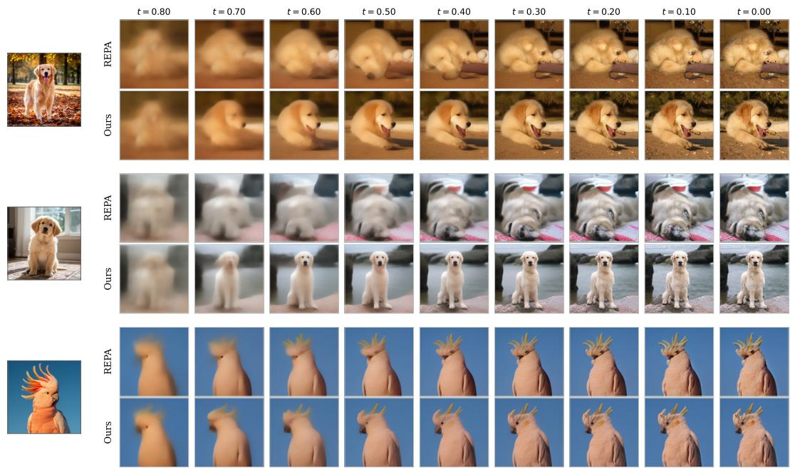  
Figure 9: Denoising heavily corrupted images. We take three clean images (left) and corrupt each with heavy noise (80% noise and 20% image). Then let REPA and RECON denoise them; each frame shows the clean-image estimate ${ \hat { x } } _ { 0 } ( t )$ . RECON recovers the identity and layout of the original image better than REPA, which shows its strength in retaining semantics under heavy noise.

## H.3 MORE QUALITATIVE RESULTS<sup>5</sup>

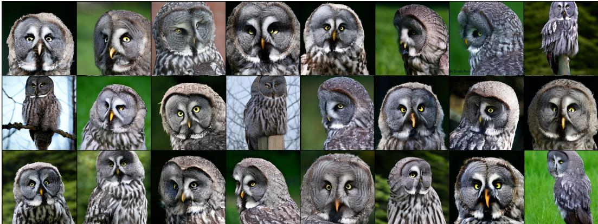  
(a) Class label = “great grey owl” (24)

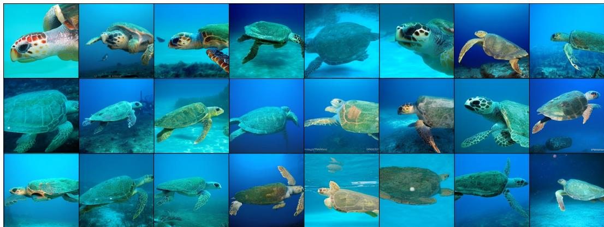  
(b) Class label = “loggerhead turtle” (33)

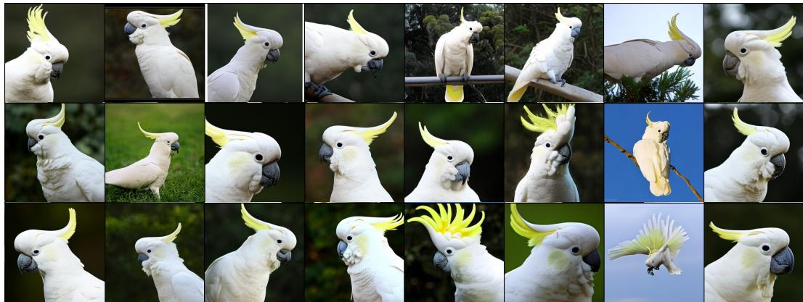  
(c) Class label = “sulphur-crested cockatoo” (89)  
Figure 10: Uncurated generation results of SiT-XL/2 + RECON. We use classifier-free guidance with $w = 4 . 0$

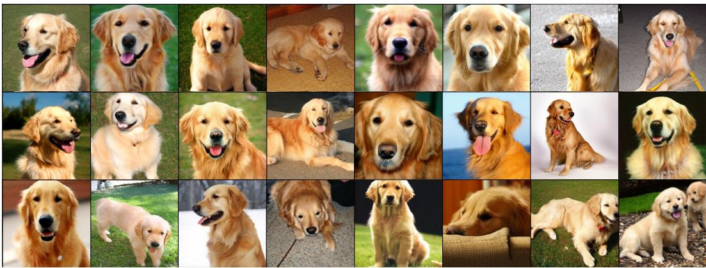  
(a) Class label = “golden retriever” (207)

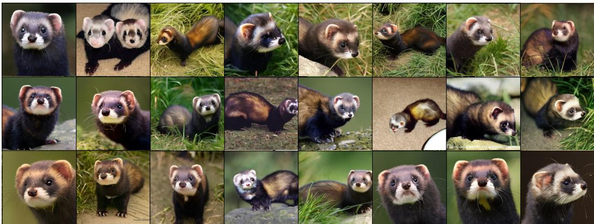  
(b) Class label = “polecat” (358)

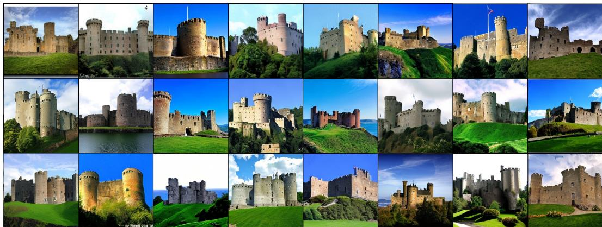  
(c) Class label = “castle” (483)  
Figure 11: Uncurated generation results of SiT-XL/2 + RECON. We use classifier-free guidance with w = 4.0.

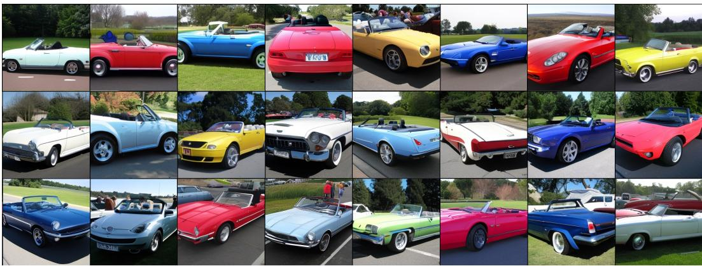  
(a) Class label = “convertible” (511)

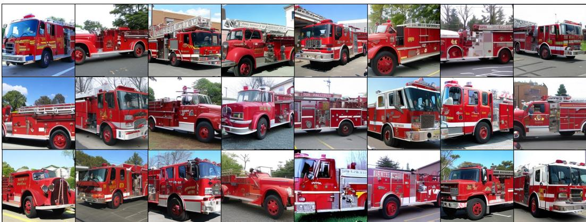  
(b) Class label = “fire engine” (555)

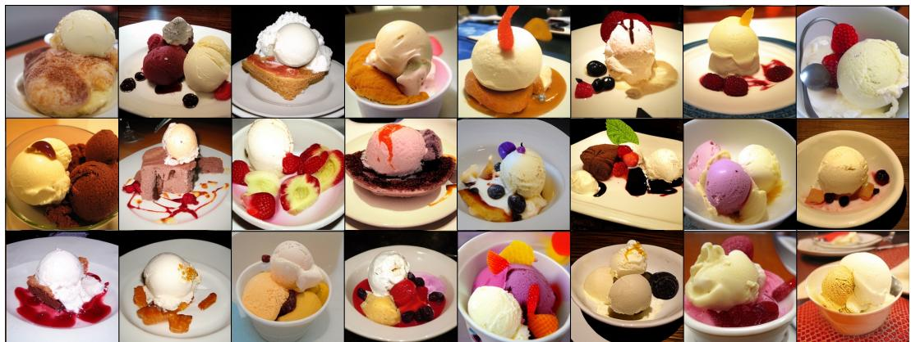  
(c) Class label = “ice cream” (928)  
Figure 12: Uncurated generation results of SiT-XL/2 + RECON. We use classifier-free guidance with w = 4.0.

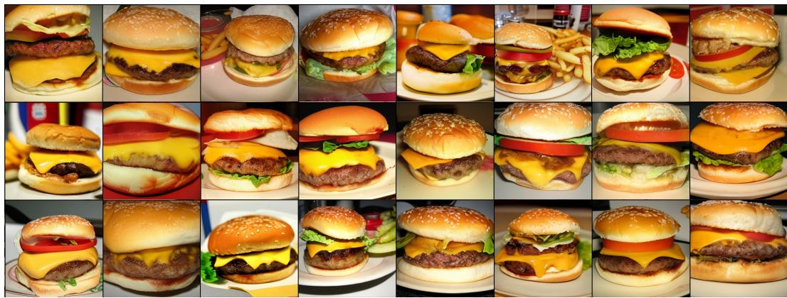  
(a) Class label = “cheeseburger” (933)

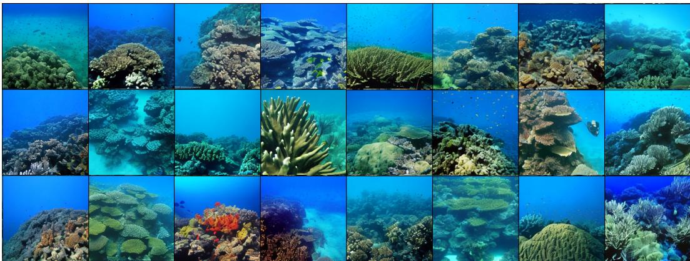  
(b) Class label = “coral reef” (973)

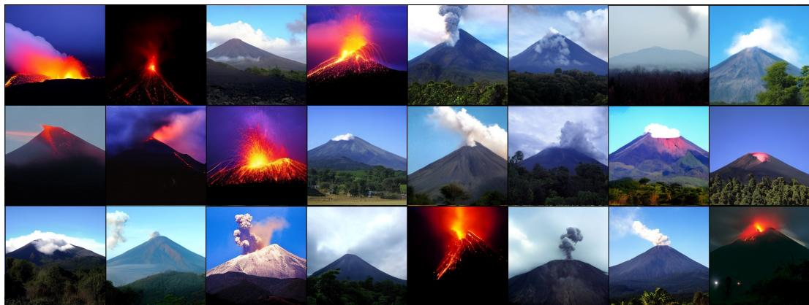  
(c) Class label = “volcano” (980)  
Figure 13: Uncurated generation results of SiT-XL/2 + RECON. We use classifier-free guidance with w = 4.0.