# Recognizing Dialogue Ambiguity via Candidate Set Visual Grounding

Shun Inadumi 1, Lee Sangmyeong 2,3, Koichiro Yoshino 1,2,3

1 The University of Osaka,

2 Guardian Robot Project, RIKEN, 3 Nara Institute of Science and Technology inadumi@sys.es.osaka-u.ac.jp ‡ https://github.com/OU-sigma-dis/candvg https://huggingface.co/datasets/SInadumi/CandVG

## Abstract

Interpreting an ambiguous utterance in realworld interactions often requires context beyond a single utterance. When the utterance refers to objects in a visual scene, it is necessary to maintain and update the set of plausible referents as context accumulates, without assuming that the available information identifies a unique object. However, prior work on interactive visual grounding, which localizes objects referred to by linguistic expressions, has focused on identifying a unique object once sufficient dialogue context becomes available. To address this gap, we propose Candidate Set Visual Grounding (CSVG), a task for estimating the set of objects consistent with the given dialogue context. We further introduce CandVG, a benchmark that evaluates how the candidate set changes across dialogue turns. Our evaluation of vision-language models shows that stronger visual grounding capability does not necessarily yield better CSVG performance. In particular, models have difficulty predicting the complete candidate set, owing to challenges in candidate generation and premature commitment to a small set of candidates in early turns. Nevertheless, we find that this limitation can be partially mitigated in the evaluated large-scale models using instructions designed for CSVG.

## 1 Introduction

In real-world interactions, interpreting an utterance often requires context that is not explicitly stated in the utterance itself (Clark, 1996; Piantadosi et al., 2012). For example, in Figure 1, the initial utterance “Can you pass me the drink?” cannot be uniquely interpreted from the utterance and visual scene alone, requiring additional context to identify the intended object. Appropriately handling such ambiguity depending on context is essential for developing intelligent systems that can collaborate with users in the real world (Tellex et al., 2011; Lemaignan et al., 2012).

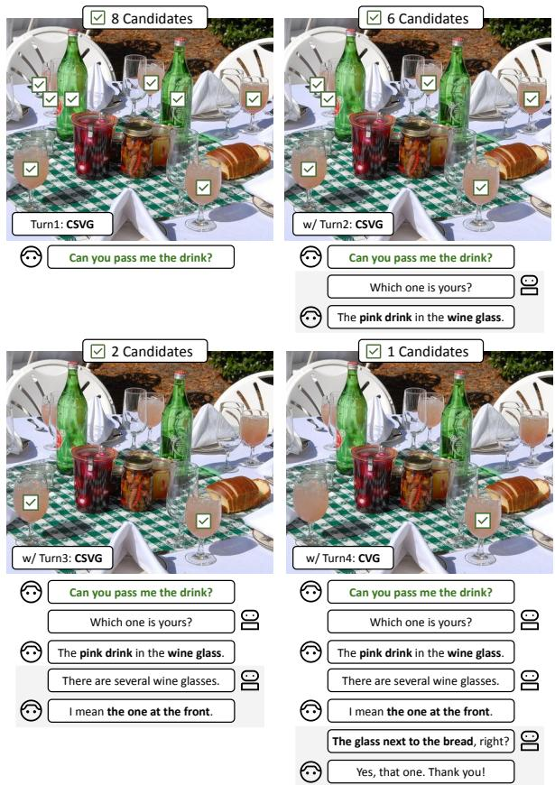  
Figure 1: Concept of CandVG: Checkboxes indicate objects that remain plausible referents of the initial ambiguous utterance under the given dialogue context. Each accumulated turn yields a separate evaluation sample.

When an utterance refers to objects in a visual scene, this problem is commonly formulated as visual grounding, the task of localizing the referred objects (Kazemzadeh et al., 2014). In user–system interactions, prior work has used dialogue context to resolve ambiguity about which object a user’s utterance refers to (de Vries et al., 2017; Alamri et al., 2019). We refer to this formulation in visual grounding as Context-Aware Visual Grounding (CVG). CVG assumes sufficient context to identify the targeted object; however, real-world interactions also include cases where the target cannot be narrowed down based solely on the given context.

These cases require systems to avoid prematurely committing to a single object and instead maintain hypotheses about the set of possible candidates, providing a basis for downstream actions such as asking clarifying questions (Kruijff et al., 2006; Shridhar and Hsu, 2018). Recent work has introduced problem formulations that allow systems to identify multiple candidates for ambiguous linguistic expressions without assuming a single interpretation (Chen et al., 2025; Zhu et al., 2026). However, it remains underexplored how to evaluate the candidate set itself, particularly whether systems can track how it changes as additional context becomes available.

To address this, we propose Candidate Set Visual Grounding (CSVG), a task for recognizing unresolved ambiguity by identifying all candidates that remain plausible under the given context. We further introduce CandVG, a benchmark that evaluates how the candidate set changes as dialogue context accumulates. As illustrated in Figure 1, CandVG captures how the candidate set narrows across dialogue turns, where the turn yielding a unique candidate corresponds to the CVG task. It consists of 1,249 dialogues and 4,833 evaluation samples. Each accumulated context is treated as a separate sample for identifying the set of candidates referred to by the initial ambiguous utterance.

We evaluate 18 vision-language models (VLMs) across six families, covering both open-weight and proprietary VLMs. They provide a strong baseline for assessing whether current systems can recognize unresolved ambiguity in dialogue, given their potential to use the context for visual grounding (You et al., 2024; Rasheed et al., 2024). We evaluate the models on CandVG and standard visual grounding benchmarks (Mao et al., 2016; Plummer et al., 2017; He et al., 2023) to examine how standard visual grounding ability relates to CVG and CSVG performance.

Our experiments show that larger VLMs generally achieve higher CVG performance, but increased model scale does not necessarily lead to better CSVG performance (§ 5.2). In particular, models tend to predict only part of the candidate set, while missing many others in CSVG (§ 5.2 and § 5.3). This limitation is attributed to two tendencies in the model. First, models have difficulty with candidate generation, with performance improving when ground-truth candidates are provided (§ 5.4). Second, some models exhibit premature commitment by narrowing the candidate set aggressively in early turns while the utterance remains ambiguous (§ 6.1). Building on these observations, we find that prompts designed for CSVG partially mitigate this limitation, although the effects remain limited and model-dependent (§ 6.2). These findings provide insights into how VLMs can recognize all plausible referents of an ambiguous utterance by tracking changes in dialogue context.

## 2 Related Work

Visual grounding is the task of localizing objects in an image referred to by a linguistic expression (Kazemzadeh et al., 2014; Xiao et al., 2025).1 This task supports a range of applications involving language understanding in visual scenes, including visual question answering (Antol et al., 2015; Zhu et al., 2016), vision–language navigation (Anderson et al., 2018; Liu et al., 2025), and user–system interactions (Shridhar and Hsu, 2018). From this perspective, we study utterance ambiguity in dialogue as a visual grounding problem, focusing on which objects an utterance may refer to.

In user–system interactions, interpreting an ambiguous utterance often requires context beyond the utterance itself. Prior work on interactive visual grounding has therefore used dialogue context to resolve ambiguity about which object the utterance refers to (de Vries et al., 2017; Kottur et al., 2021; Ueda et al., 2024; Zhang et al., 2024a). We also focus on dialogue context and call this task Context-Aware Visual Grounding (CVG).

Typical visual grounding approaches can be broadly categorized into object detector-based (Kamath et al., 2021; Li et al., 2022; Liu et al., 2024) and VLM-based (Chen et al., 2023a; Peng et al., 2024; Zhang et al., 2024b; Chen et al., 2024; Bai et al., 2025). Object detector-based approaches can offer fast inference (Fu et al., 2026), whereas VLM-based approaches can flexibly interpret diverse linguistic expressions (Lai et al., 2024) and incorporate additional textual context (Chen et al., 2023b; You et al., 2024; Rasheed et al., 2024). Accordingly, we focus on VLM-based approaches, as they are well suited to visual grounding tasks that require context, such as CVG.

Although CVG assumes that context is sufficient to identify a single object, multiple candidates may remain plausible under the available context. In practical interactive systems, interpreting ambiguous user utterances typically involves first identifying candidates and then asking clarification questions (Deits et al., 2013; Shridhar and Hsu, 2018; Hatori et al., 2018; Dogan et al.˘ , 2022; Mo et al., 2023). Recent work has begun to ground the interpretation of linguistic expressions in visual scenes, studying answerability in 3D question answering (Azuma et al., 2024) and unresolved ambiguity in both visual question answering (Chen et al., 2025) and 3D visual grounding (Zhu et al., 2026). Building on these lines of work, we propose Candidate Set Visual Grounding (CSVG) to evaluate whether systems can identify the set of candidates that remain plausible given the available context, and introduce CandVG as a benchmark that covers both CVG and CSVG.2

## 3 Problem Formulation

## 3.1 Task Setting

Given an RGB image I $\in \mathbb { R } ^ { H \times W \times 3 }$ and a dialogue context $\mathbf { T } _ { i } = \left( t _ { 1 } , \ldots , t _ { i } \right)$ available through the ith dialogue turn, our goal is to identify the objects that remain plausible referents of the utterance $t _ { 1 }$ under $\mathbf { T } _ { i } .$ . Here, H and W denote the image height and width, respectively.3 The output is a candidate set of bounding boxes (BBoxes) $\boldsymbol { B }$ corresponding to the identified objects.

We define two tasks according to the size of $B { \mathrm { : } }$

CVG: Context-Aware Visual Grounding. The context $\mathbf { T } _ { i }$ is sufficient to identify a single object, and the goal is to predict its BBox.

CSVG: Candidate Set Visual Grounding. Multiple objects remain plausible as referents of $t _ { 1 }$ under the context $\mathbf { T } _ { i } .$ , and the goal is to predict their BBoxes.

## 3.2 Evaluation Metrics

We evaluate CVG using Acc@0.5 (Acc), a standard metric for visual grounding (Xiao et al., 2025). A prediction is counted as correct if its Intersection over Union (IoU) with the ground-truth BBox is at least 0.5. When multiple BBoxes are returned, we consider only the first as the prediction.

CSVG evaluates the correspondence between the predicted and ground-truth sets of BBoxes. For each sample, we first compute the pairwise IoUs between predicted and ground-truth BBoxes and then perform one-to-one matching using the Hungarian algorithm to maximize the number of matched pairs with IoU at least 0.5. Precision (P), recall (R), and F1 score are computed from the resulting matches as follows:

$$
\mathrm { P } = \frac { \mathrm { T P } } { \mathrm { T P } + \mathrm { F P } } , \mathrm { R } = \frac { \mathrm { T P } } { \mathrm { T P } + \mathrm { F N } } , \mathrm { F 1 } = \frac { 2 \cdot \mathrm { P } \cdot \mathrm { R } } { \mathrm { P } + \mathrm { R } } ,
$$

where TP, FP, and FN denote matched pairs, unmatched predicted BBoxes, and unmatched groundtruth BBoxes, respectively. We compute these metrics for each sample and report their averages over all samples.

## 4 CandVG

We constructed CandVG, a benchmark covering both CVG and CSVG under a dialogue context. CandVG is built upon an existing CVG dataset containing natural human–human dialogues and BBox annotations (Zhang et al., 2024a). For each context $\mathbf { T } _ { i } ,$ annotators identified the plausible candidates using point-based annotations, which were then mapped to the corresponding BBoxes to construct a single ground-truth candidate set containing all plausible referents. This process yielded one evaluation sample per context, resulting in 1,249 dialogues and 4,833 evaluation samples.

## 4.1 Data Collection

Using dialogue and BBox annotations from an existing dataset, we annotate the candidate set for each dialogue context by placing points on all plausible objects. The annotation process consists of two stages, both performed by three annotators assigned equal portions of the dialogues:

Data Selection. We automatically sampled 1,620 dialogues to balance the distribution of candidate set sizes. We then manually screened these dialogues to ensure benchmark quality, excluding 303 dialogues with annotation errors or no ambiguity in the first utterance. This process retained 1,317 dialogues.

Candidate Set Collection. For each selected dialogue, we annotated the candidate set for each dialogue context. Annotators first placed one point on each plausible object and then updated the candidate set at subsequent turns by adding or removing points.

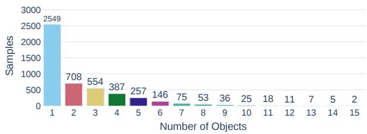

(a) Candidate set size across all samples  
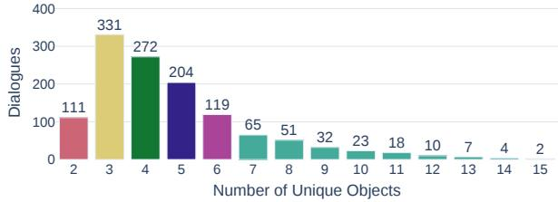  
(b) Unique candidates across each dialogue  
Figure 2: Distributions of candidate set size per sample and number of unique candidates across each dialogue

After annotation, we mapped each point to its corresponding BBox provided by the existing CVG dataset (Zhang et al., 2024a) and retained only dialogues with a complete one-to-one correspondence between points and BBoxes. The resulting CandVG benchmark comprises 1,249 dialogues. Appendix A describes the data collection criteria and procedures in detail.

## 4.2 Statistics and Analysis

Object Distribution. Figure 2 shows the distribution of candidate set sizes across all evaluation samples and the number of unique candidates across each dialogue. In particular, Figure 2 (b) reflects the number of potential distractor objects in CVG and CSVG. CVG comprises 2,549 samples with a single object under the available context, whereas the remaining 2,284 samples with multiple objects constitute CSVG. Additional statistics and analysis of CandVG are provided in Appendix B.

Data Verification. To verify annotation quality, we measure inter-annotator agreement using the CVG and CSVG metrics, as identifying candidate sets through point annotations involves human judgment. We sampled 30 dialogues from each of six bins (2, 3, 4, 5, 6, and 7+) to cover different numbers of unique candidates, as shown in Figure 2 (b). Two annotator pairs each independently annotated a separate set of 180 dialogues, totaling 360 dialogues. For each pair, we report the CVG and CSVG evaluation metrics separately. Table 1 shows high agreement for both annotator pairs across the CVG and CSVG metrics, supporting the reliability of the CandVG annotations.

<table><tr><td>Pair</td><td>Acc</td><td>P</td><td>R</td><td>F1</td></tr><tr><td>Pair1</td><td>0.962</td><td>0.959</td><td>0.944</td><td>0.943</td></tr><tr><td>Pair2</td><td>0.971</td><td>0.966</td><td>0.924</td><td>0.935</td></tr></table>

Table 1: Annotation agreement for two annotator pairs

## 5 Experiments

## 5.1 Settings

Compared Models. We evaluated open-weight and proprietary generalist VLMs that can directly generate BBoxes in a zero-shot setting. This setting allowed us to assess whether models can use dialogue context to identify the objects referred to by the first ambiguous utterance without task-specific fine-tuning. Specifically, we evaluated the openweight InternVL3.5 (Wang et al., 2025) (Intern3.5), Qwen3 VL (Bai et al., 2025), and Qwen3.5 (Qwen Team, 2026) families, together with the proprietary GPT-5.6 (OpenAI, 2026). To examine the effect of model scale, we included variants of the openweight models ranging from 2B to 38B parameters.

In addition to generalist VLMs, we evaluated embodied reasoning VLMs based on Qwen3 VL and post-trained for spatiotemporal and physical reasoning in embodied scenarios. For this comparison, we included the RynnBrain (Dang et al., 2026) and CosmosReason2 (NVIDIA, 2026) families to examine whether post-training for embodied reasoning improves performance on CVG and CSVG.

Evaluation Benchmarks. In addition to CandVG, we evaluated models on standard visual grounding benchmarks to separate general visual grounding ability from the ability to identify candidate sets using context. In the CVG setting, we used RefCOCOg (Mao et al., 2016) and Flickr30k Entities (F30k-Ent) (Plummer et al., 2017), both of which evaluate the localization of a single object. For each benchmark, we used the same number of evaluation samples as in the CandVG CVG evaluation set.5 The CSVG setting uses gRefCOCO (He et al., 2023), which evaluates the localization of multiple objects referred to by a referring expression.6 To make the evaluation set comparable to CandVG, we matched both the total number of samples and the distribution of candidate set sizes across bins 2, 3, 4, 5, 6, and 7+.

Candidate Set Generation and Selection. We considered the CSVG task in CandVG under two conditions to assess how the availability of groundtruth candidates affects the F1 score. In the without ground-truth candidates (w/o GT) condition, models predicted the candidate set directly from the image and context, whereas in the with ground-truth candidates (w/ GT) condition, the ground-truth candidate set was additionally provided as input. This setting enabled a direct evaluation of candidate set estimation under the given context while providing insight into the respective roles of candidate generation and candidate selection.

Prompt Design. To ensure a fair comparison across benchmarks, we used the same instruction for all models. We asked models to output BBoxes and limit the number of outputs to 15 to match the maximum candidate set size in CandVG:

## Base Prompt

Provide the bounding box coordinates of the text described between <ref> and </ref>. Return as box(es) as necessary, but include all plausible referents, up to a maximum of 15.

We kept the base prompt and adapted only the BBox output format for each model, since supported formats differ across models.7 We provide further implementation details in Appendix C.

## 5.2 Main Results

Table 2 reports CVG accuracy and CSVG F1 score. Figure 3 reports CSVG precision and recall for 4B and 27B–38B open-weight generalist VLMs and both GPT-5.6 variants.

Scaling Trends in CVG and CSVG. Table 2 shows a scaling trend for the CVG task on CandVG, with accuracy increasing consistently with model scale within each open-weight generalist VLM family. Among all evaluated models, Qwen3.5 27B achieves the highest accuracy. These results indicate that larger generalist VLMs make better use of dialogue context in the CVG task.

For the CSVG task on CandVG, Table 2 shows that larger open-weight generalist VLMs do not consistently achieve higher F1 scores. Across all evaluated model families, GPT-5.6 achieves the highest F1 score, while the best-performing openweight models come from the Qwen3 VL family. In contrast to CVG, increasing model scale alone does not consistently improve candidate set estimation on the CSVG task.

Precision–Recall Gap in CSVG. Figure 3 (a) shows a precision–recall gap for the CSVG task on CandVG, with recall consistently lower than precision. Specifically, precision increases with model scale, whereas recall does not improve for larger models. This pattern shows that models can identify precise subsets of the ground-truth candidate sets but fail to estimate all plausible candidates under the given context.

Generalist vs. Embodied Reasoning VLMs. Table 2 shows that embodied reasoning posttraining does not yield consistent gains across CandVG. Both 2B embodied reasoning models outperform Qwen3 VL 2B on the CVG and CSVG tasks. However, their 8B variants show opposite patterns relative to Qwen3 VL 8B: RynnBrain performs better on CVG but worse on CSVG, whereas CosmosReason2 shows the reverse.

## 5.3 Comparison with Standard Visual Grounding Benchmarks

Focusing on the CVG setting in Table 2, models with stronger visual grounding performance achieve higher accuracy on CandVG. Among the evaluated models, Qwen3.5 27B obtains the highest score across all benchmarks in the CVG setting. At the same time, all models score lower on CandVG than on RefCOCOg, and most also score lower than on F30k-Ent. This lower accuracy may be attributed to the need to account for dialogue context when interpreting an ambiguous utterance.

Table 2 shows that VLMs achieve higher F1 scores on gRefCOCO than on CandVG in the CSVG setting. Figure 3 further shows that, although both benchmarks exhibit a precision–recall gap, the gap is consistently larger on CandVG. Among the open-weight generalist VLMs, Qwen3

<table><tr><td>Models</td><td>CVG Setting (Acc) CandVG RefCOCOg F30k-Ent</td><td></td><td>CSVG Setting (F1) CandVG gRefCOCO</td></tr><tr><td colspan="6">Generalist VLMs</td></tr><tr><td>Intern3.5 2B</td><td>0.521</td><td>0.859</td><td>0.666 0.329</td><td></td><td>0.419</td></tr><tr><td>Intern3.5 4B</td><td>0.568</td><td>0.859</td><td>0.479</td><td>0.357</td><td>0.674</td></tr><tr><td>Intern3.5 8B</td><td>0.580</td><td>0.877</td><td>0.757</td><td>0.331</td><td>0.496</td></tr><tr><td>Intern3.5 38B</td><td>0.746</td><td>0.898</td><td>0.669</td><td>0.382</td><td>0.646</td></tr><tr><td>Qwen3 VL 2B</td><td>0.480</td><td>0.852</td><td>0.519</td><td>0.271</td><td>0.391</td></tr><tr><td>Qwen3 VL 4B</td><td>0.622</td><td>0.888</td><td>0.614</td><td>0.542</td><td>0.560</td></tr><tr><td>Qwen3 VL 8B</td><td>0.655</td><td>0.884</td><td>0.775</td><td>0.454</td><td>0.576</td></tr><tr><td>Qwen3 VL 32B</td><td>0.762</td><td>0.910</td><td>0.835</td><td>0.543</td><td>0.589</td></tr><tr><td>Qwen3.5 2B</td><td>0.606</td><td>0.856</td><td>0.504</td><td>0.410</td><td>0.507</td></tr><tr><td>Qwen3.5 4B</td><td>0.735</td><td>0.888</td><td>0.670</td><td>0.494</td><td>0.672</td></tr><tr><td>Qwen3.5 9B</td><td>0.790</td><td>0.899</td><td>0.794</td><td>0.427</td><td>0.510</td></tr><tr><td>Qwen3.5 27B</td><td>0.819</td><td>0.917</td><td>0.854</td><td>0.441</td><td>0.497</td></tr><tr><td>GPT-5.6 Luna</td><td>0.743</td><td>0.844</td><td>0.807</td><td>0.649</td><td>0.721</td></tr><tr><td>GPT-5.6 Terra</td><td>0.780</td><td>0.863</td><td>0.814</td><td>0.649</td><td>0.763</td></tr></table>

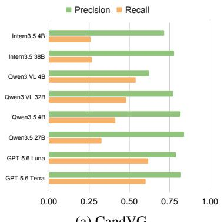  
(a) CandVG

<table><tr><td colspan="5">Embodied Reasoning VLMs based on Qwen3 VL</td></tr><tr><td>RynnBrain 2B</td><td>0.599</td><td>0.837</td><td>0.520</td><td>0.342 0.277</td></tr><tr><td>RynnBrain 8B</td><td>0.691</td><td>0.865</td><td>0.705</td><td>0.356 0.256</td></tr><tr><td>CosmosReason2 2B</td><td>0.537</td><td>0.836</td><td>0.548 0.326</td><td>0.494</td></tr><tr><td>CosmosReason2 8B</td><td>0.519</td><td>0.868</td><td>0.741 0.478</td><td>0.497</td></tr></table>

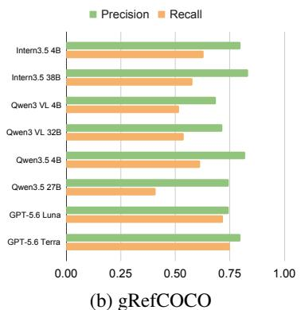  
Table 2: Overall results on CandVG and standard visual grounding benchmarks: Figure 3: Precision and recall in Colored and bold values denote the best results within each model family and CSVG setting across all models, respectively.

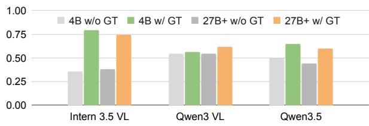  
Figure 4: F1 scores on CSVG with and without groundtruth candidate sets, where 27B+ denotes the 27B–38B variants.

VL 4B shows the smallest gap between the two benchmarks. This comparison highlights the challenge of CandVG beyond standard multi-object grounding, as models need to infer which candidates remain plausible using the context.

## 5.4 Effect of Ground-Truth Candidates

To examine whether the low recall in the CSVG task primarily arises from candidate generation, we provide ground-truth candidate sets to 4B and 27B– 38B open-weight generalist VLMs. As shown in Figure 4, all models achieve higher F1 scores in the w/ GT condition than in the w/o GT condition. In particular, the gains are large for Intern3.5 variants. At the same time, larger VLMs do not consistently achieve higher F1 scores even under the w/ GT condition. These results indicate that candidate generation is one bottleneck in the CSVG task, as providing ground-truth candidates substantially reduces this burden.

## 6 Analysis and Discussion

The experimental results revealed that current VLMs have a large precision–recall gap on the CSVG task in CandVG, primarily due to low recall. To understand the source of this gap, we analyze how candidate sets change as dialogue context accumulates and investigate whether VLMs can track these updates throughout a dialogue (§ 6.1). Building on this analysis, we next examine whether these limitations can be mitigated through task-aware instruction, namely, additional instructions tailored to the CSVG task (§ 6.2).

## 6.1 Tracking and Updating Candidate Sets

Setup. We analyzed three models: Qwen3 VL 4B, which achieved high recall among the openweight generalist VLMs; Qwen3.5 27B, which achieved the highest CVG accuracy; and GPT-5.6 Luna, which achieved the joint-highest CSVG F1 score. To ensure a consistent comparison across turns, we track the same 1,234 dialogues across the first three turns, including both CVG and CSVG samples. For each model, we report the average numbers of ground-truth, predicted, and correctly predicted BBoxes at each turn.

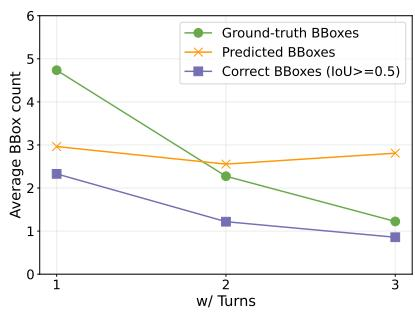  
(a) Qwen3 VL 4B

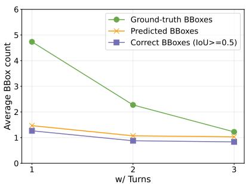  
(b) Qwen3.5 27B

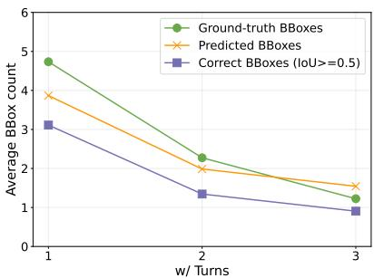  
(c) GPT-5.6 Luna  
Figure 5: Transitions of candidate sets across dialogue turns, showing the average numbers of ground-truth, predicted, and correctly predicted BBoxes. The analysis tracks the same 1,234 dialogues across the first three turns, covering both CSVG and CVG cases.

Results. As shown in Figure 5 (a) and (b), Qwen3.5 27B estimates fewer candidates than the ground-truth set from the first turn, contributing to its low recall. Qwen3 VL 4B initially estimates a candidate set closer in size to the ground-truth set and achieves higher recall; however, its predictions do not shrink with the ground-truth set and instead increase from Turn 2 to Turn 3. Taken together, Qwen3.5 27B tends to commit prematurely to a narrow candidate set, whereas Qwen3 VL 4Bfails to narrow it sufficiently as context accumulates.

Figure 5 (c) shows that GPT-5.6 Luna tends to narrow the candidate set prematurely, while potentially retaining extra candidates as ambiguity is resolved. In particular, it predicts fewer candidates than the ground-truth set in Turns 1 and 2, while its predictions exceed the ground-truth set at Turn 3. These findings highlight failure modes that need to be addressed to improve candidate set estimation.8

Qualitative Examples. Figure 6 presents qualitative examples of candidate set updates across dialogue turns. The examples include CSVG cases through Turn 2, where multiple objects remain plausible, and a CVG case at Turn 3, where the context identifies a single object.

As shown in Figure 6 (a) and (d), Qwen3.5 27B commits to a single object in the early turns, but reaches the correct CVG target once additional context becomes available in Figure 6 (c) and (f). In contrast, Qwen3 VL 4B initially retains multiple objects but fails to narrow the candidate set in the later turns. GPT-5.6 Luna follows the groundtruth candidate set updates more closely overall, although it also commits prematurely in Figure 6 (a). Collectively, these examples reveal distinct model behaviors in recognizing and resolving ambiguity, demonstrating that CandVG enables both behaviors to be analyzed within the same dialogue.

## 6.2 Effect of Task-Aware Instruction

Setup. The base prompt was designed to provide consistent task instructions across benchmarks. Here, we added CSVG-specific instructions intended to (i) provide a stepwise procedure (Wang et al., 2023) and (ii) discourage premature commitment. We then evaluated their effects on CSVG precision and recall in 4B and 27B–38B open-weight generalist VLMs.

## (i) Task-Aware Instruction 1 (TAI-1)

1. Identify what kind of object is described by the text.

2. Enumerate all plausible objects in the image.

3. If the dialogue context following the text is provided, remove objects that are contradicted by the context.

## (ii) Task-Aware Instruction 2 (TAI-2)

When the reference is ambiguous, retain every visually plausible referent unless it is clearly ruled out by the marked text or the dialogue context (if provided).

Results. Table 3 shows that both instructions improve recall for all 27B+ models, with TAI-1 yielding larger gains. In contrast, the effects on 4B models are inconsistent, as recall improves only for Qwen3 VL under TAI-1. These findings suggest that task-aware instructions, as a form of prompt engineering (Gu et al., 2023; Schulhoff et al., 2025), improve CSVG recall in larger VLMs; however, their effects remain model-dependent and do not consistently extend to precision.9

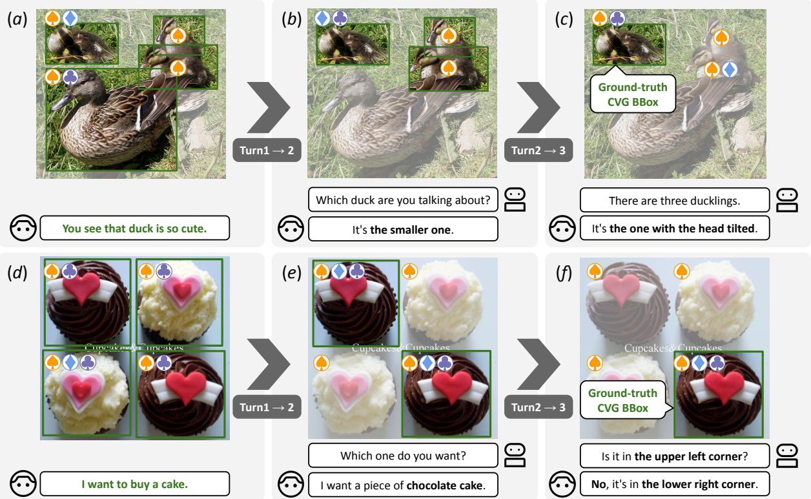  
Figure 6: Examples of candidate set updates across turns: Green BBoxes indicate ground-truth candidates across both CSVG and CVG cases. The symbols ♠, ♦, and ♣ denote objects predicted by Qwen3 VL 4B, Qwen3.5 27B, and GPT-5.6 Luna, respectively.

<table><tr><td rowspan="2">Model</td><td colspan="2">4B</td><td colspan="2">27B+</td></tr><tr><td>TAI-1</td><td>TAI-2</td><td>TAI-1</td><td>TAI-2</td></tr><tr><td>Intern3.5</td><td>-0.058</td><td>-0.021</td><td>+0.041</td><td>-0.022</td></tr><tr><td>Qwen3 VL</td><td>+0.055</td><td>+0.013</td><td>+0.015</td><td>+0.003</td></tr><tr><td>Qwen3.5</td><td>-0.043</td><td>-0.008</td><td>+0.011</td><td>-0.003</td></tr></table>

(a) Precision
<table><tr><td rowspan="2">Model</td><td colspan="2">4B</td><td colspan="2">27B+</td></tr><tr><td>TAI-1</td><td>TAI-2</td><td>TAI-1</td><td>TAI-2</td></tr><tr><td>Intern3.5</td><td>-0.014</td><td>-0.007</td><td>+0.036</td><td>+0.011</td></tr><tr><td>Qwen3 VL</td><td>+0.043</td><td>-0.006</td><td>+0.097</td><td>+0.042</td></tr><tr><td>Qwen3.5</td><td>-0.040</td><td>-0.046</td><td>+0.087</td><td>+0.057</td></tr></table>

(b) Recall  
Table 3: Improvements and degradations in CSVG precision and recall from the base prompt after adding Task-Aware Instructions (TAI). Colored values indicate improvements of at least 0.03 over the base prompt.

## 7 Conclusion

This paper proposed Candidate Set Visual Grounding to evaluate whether models can track how the candidate set changes as dialogue context becomes available. To support this evaluation, CandVG serves as a benchmark that pairs CSVG with CVG to capture candidate set updates across dialogue turns. This design enables ambiguity recognition and resolution to be analyzed within the same dialogue. Our evaluation of VLMs showed that model scale is associated with both stronger visual grounding performance and higher CVG accuracy, but not with consistently better CSVG F1 scores. In CSVG, models often predicted only a subset of the candidates, resulting in a substantial precision–recall gap. Our results showed that this gap is associated with difficulty in candidate generation and premature commitment, and that task-aware instructions improved recall for large-scale VLMs. However, models with higher recall may still retain extra candidates even as ambiguity is resolved, suggesting that improving candidate set estimation requires addressing different failure modes. Recognizing when an utterance remains ambiguous and which interpretations remain plausible is a prerequisite for systems that interact and collaborate naturally with users in the real world. We believe that evaluating and improving this capability will advance the development of such systems.

## Limitations

Benchmark. CandVG is constructed from the existing dataset, and its image domains, dialogue styles, and ambiguity patterns therefore reflect those of the source data. In most dialogues, candidate sets gradually shrink as additional context becomes available, often converging to a single object. Although a small number of dialogues involve sudden shifts in the intended object, resulting in candidate addition, such transition patterns are underrepresented in our benchmark. Future work should extend CandVG with more diverse dialogue structures and candidate set transitions.

Setting. We consider static images and represent candidate objects using BBoxes. This setting does not capture changes in the environment, viewpointdependent references, or non-verbal cues that may arise during real-world interaction. A single BBox may not precisely represent certain referents, such as object parts or regions. Extending our work to dynamic, embodied, and potentially real-world environments is therefore an important direction.

Model. Our evaluation covers a diverse set of recent VLMs, but the open-weight models are limited to at most 38B parameters because of available computational resources, while the proprietary evaluation excludes several major model families, including Gemini (Gemini Robotics Team, 2025). The observed scaling trends may therefore not generalize to larger open-weight models or future model families. Broader evaluation is needed to assess the generality of our findings across model architectures, sizes, and training objectives.

Limited Improvement Strategies. Our investigation of performance improvement is limited to task-aware instructions applied at inference time. We have not systematically evaluated more sophisticated prompting or decoding strategies, such as self-reflection (Shinn et al., 2023).

Although task-aware instructions improve recall for some large-scale VLMs, they do not yield consistent gains for compact VLMs. Such compact models are preferable for deployment in interactive systems because of their lower computational and latency requirements. Future work should therefore explore training and inference methods specifically designed to improve candidate set estimation in compact models and facilitate their deployment in real-world interactions.

## Ethical Consideration

CandVG builds on an existing CVG dataset (Zhang et al., 2024a) and is designed for research purposes. The underlying images come from the Open Images Dataset (Kuznetsova et al., 2020) and are provided under Creative Commons Attribution licenses; Open Images annotations are released under CC BY 4.0. We will release the newly collected CandVG annotations under CC BY 4.0. We note that some images contain people and that CandVG may inherit representational biases present in the source datasets. The annotators were proficient in English and able to understand the dialogues used for candidate set annotation. Annotation contributors were compensated at JPY 2,000 per hour.

## Acknowledgments

This work was supported by RIKEN Junior Research Associate Program and JST, PRESTO Grant Number JPMJPR24TC, Japan. A part of this research was supported by FRONTia, a Japanese national program led by the Ministry of Economy, Trade and Industry of Japan (METI) and the New Energy and Industrial Technology Development Organization (NEDO), aimed at developing a domestic multimodal foundation model for AI robots and physical AI.

## References

Huda Alamri, Vincent Cartillier, Abhishek Das, Jue Wang, Anoop Cherian, Irfan Essa, Dhruv Batra, Tim K. Marks, Chiori Hori, Peter Anderson, Stefan Lee, and Devi Parikh. 2019. Audio visual sceneaware dialog. In Proceedings ofthe IEEE/CVF Conference on Computer Vision and Pattern Recognition (CVPR), pages 7558–7567.

Peter Anderson, Qi Wu, Damien Teney, Jake Bruce, Mark Johnson, Niko Sünderhauf, Ian Reid, Stephen Gould, and Anton van den Hengel. 2018. Visionand-Language Navigation: Interpreting visuallygrounded navigation instructions in real environments. In Proceedings of the IEEE Conference on Computer Vision and Pattern Recognition (CVPR), pages 3674–3683.

Stanislaw Antol, Aishwarya Agrawal, Jiasen Lu, Margaret Mitchell, Dhruv Batra, C. Lawrence Zitnick, and Devi Parikh. 2015. VQA: Visual Question Answering. In Proceedings of the IEEE International Conference on Computer Vision (ICCV), pages 2425– 2433.

Daichi Azuma, Taiki Miyanishi, Shuhei Kurita, Koya Sakamoto, and Motoaki Kawanabe. 2024. Answer-

ability Fields: Answerable location estimation via diffusion models. In Proceedings ofthe 2024 IEEE/RSJ International Conference on Intelligent Robots and Systems (IROS), pages 12932–12938.

Shuai Bai, Yuxuan Cai, Ruizhe Chen, Keqin Chen, Xiong-Hui Chen, Zesen Cheng, Lianghao Deng, Wei Ding, Rongyao Fang, Chang Gao, Chunjiang Ge, Wenbin Ge, Zhifang Guo, Qidong Huang, Jie Huang, Fei Huang, Binyuan Hui, Shutong Jiang, Zhaohai Li, and 46 others. 2025. Qwen3-VL technical report. arXiv:2511.21631.

Chongyan Chen, Yu-Yun Tseng, Zhuoheng Li, Anush Venkatesh, and Danna Gurari. 2025. Acknowledging focus ambiguity in visual questions. In Proceedings of the IEEE/CVF International Conference on Computer Vision (ICCV), pages 1228–1238.

Jun Chen, Deyao Zhu, Xiaoqian Shen, Xiang Li, Zechun Liu, Pengchuan Zhang, Raghuraman Krishnamoorthi, Vikas Chandra, Yunyang Xiong, and Mohamed Elhoseiny. 2023a. MiniGPT-v2: Large language model as a unified interface for vision-language multi-task learning. arXiv:2310.09478.

Keqin Chen, Zhao Zhang, Weili Zeng, Richong Zhang, Feng Zhu, and Rui Zhao. 2023b. Shikra: Unleashing multimodal LLM’s referential dialogue magic. arXiv:2306.15195.

Zhe Chen, Jiannan Wu, Wenhai Wang, Weijie Su, Guo Chen, Sen Xing, Muyan Zhong, Qinglong Zhang, Xizhou Zhu, Lewei Lu, Bin Li, Ping Luo, Tong Lu, Yu Qiao, and Jifeng Dai. 2024. InternVL: Scaling up vision foundation models and aligning for generic visual-linguistic tasks. In Proceedings of the IEEE/CVF Conference on Computer Vision and Pattern Recognition (CVPR), pages 24185–24198.

Herbert H. Clark. 1996. Using Language. Cambridge University Press.

Ronghao Dang, Jiayan Guo, Bohan Hou, Sicong Leng, Kehan Li, Xin Li, Jiangpin Liu, Yunxuan Mao, Zhikai Wang, Yuqian Yuan, Minghao Zhu, Xiao Lin, Yang Bai, Qian Jiang, Yaxi Zhao, Minghua Zeng, Junlong Gao, Yuming Jiang, Jun Cen, and 7 others. 2026. RynnBrain: Open embodied foundation models. arXiv:2602.14979.

Harm de Vries, Florian Strub, Sarath Chandar, Olivier Pietquin, Hugo Larochelle, and Aaron Courville. 2017. GuessWhat?! visual object discovery through multi-modal dialogue. In Proceedings of the IEEE Conference on Computer Vision and Pattern Recognition (CVPR), pages 5503–5512.

Robin Deits, Stefanie Tellex, Pratiksha Thaker, Dimitar Simeonov, Thomas Kollar, and Nicholas Roy. 2013. Clarifying commands with information-theoretic human-robot dialog. Journal of Human-Robot Interaction, 2(2):58–79.

Fethiye Irmak Dogan, Ilaria Torre, and Iolanda Leite.˘ 2022. Asking follow-up clarifications to resolve ambiguities in human-robot conversation. In Proceedings of the 2022 ACM/IEEE International Conference on Human-Robot Interaction (HRI), pages 461–469.

Shenghao Fu, Yukun Su, Fengyun Rao, Jing LYU, Xiaohua Xie, and Wei-Shi Zheng. 2026. WeDetect: Fast open-vocabulary object detection as retrieval. In Proceedings ofthe IEEE/CVF Conference on Computer Vision and Pattern Recognition (CVPR), pages 20377–20387.

Gemini Robotics Team. 2025. Gemini Robotics: Bringing AI into the physical world. arXiv:2503.20020.

Jindong Gu, Zhen Han, Shuo Chen, Ahmad Beirami, Bailan He, Gengyuan Zhang, Ruotong Liao, Yao Qin, Volker Tresp, and Philip Torr. 2023. A systematic survey of prompt engineering on vision-language foundation models. arXiv:2307.12980.

Jun Hatori, Yuta Kikuchi, Sosuke Kobayashi, Kuniyuki Takahashi, Yuta Tsuboi, Yuya Unno, Wilson Ko, and Jethro Tan. 2018. Interactively picking real-world objects with unconstrained spoken language instructions. In Proceedings of 2018 IEEE International Conference on Robotics and Automation (ICRA), pages 3774–3781.

Shuting He, Henghui Ding, Chang Liu, and Xudong Jiang. 2023. GREC: Generalized referring expression comprehension. arXiv:2308.16182.

Aishwarya Kamath, Mannat Singh, Yann LeCun, Gabriel Synnaeve, Ishan Misra, and Nicolas Carion. 2021. MDETR - modulated detection for end-to-end multi-modal understanding. In Proceedings of the IEEE/CVF International Conference on Computer Vision (ICCV), pages 1780–1790.

Sahar Kazemzadeh, Vicente Ordonez, Mark Matten, and Tamara Berg. 2014. ReferItGame: Referring to objects in photographs of natural scenes. In Proceedings ofthe 2014 Conference on Empirical Methods in Natural Language Processing (EMNLP), pages 787–798.

Satwik Kottur, Seungwhan Moon, Alborz Geramifard, and Babak Damavandi. 2021. SIMMC 2.0: A taskoriented dialog dataset for immersive multimodal conversations. In Proceedings of the 2021 Conference on Empirical Methods in Natural Language Processing (EMNLP), pages 4903–4912.

Geert-Jan M. Kruijff, Hendrik Zender, Patric Jensfelt, and Henrik I. Christensen. 2006. Clarification dialogues in human-augmented mapping. In Proceedings ofthe 1st ACM SIGCHI/SIGART Conference on Human-Robot Interaction (HRI), pages 282–289.

Alina Kuznetsova, Hassan Rom, Neil Alldrin, Jasper Uijlings, Ivan Krasin, Jordi Pont-Tuset, Shahab Kamali, Stefan Popov, Matteo Malloci, Alexander Kolesnikov, Tom Duerig, and Vittorio Ferrari. 2020. The Open Images Dataset V4: Unified image classification,

object detection, and visual relationship detection at scale. International Journal of Computer Vision (IJCV), 128(7):1956–1981.

Xin Lai, Zhuotao Tian, Yukang Chen, Yanwei Li, Yuhui Yuan, Shu Liu, and Jiaya Jia. 2024. LISA: Reasoning segmentation via large language model. In Proceedings ofthe IEEE/CVF Conference on Computer Vision and Pattern Recognition (CVPR), pages 9579–9589.

Séverin Lemaignan, Raquel Ros, E. Akin Sisbot, Rachid Alami, and Michael Beetz. 2012. Grounding the interaction: Anchoring situated discourse in everyday human-robot interaction. International Journal of Social Robotics, 4(2):181–199.

Liunian Harold Li, Pengchuan Zhang, Haotian Zhang, Jianwei Yang, Chunyuan Li, Yiwu Zhong, Lijuan Wang, Lu Yuan, Lei Zhang, Jenq-Neng Hwang, Kai-Wei Chang, and Jianfeng Gao. 2022. Grounded language-image pre-training. In Proceedings of the IEEE/CVF Conference on Computer Vision and Pattern Recognition (CVPR), pages 10965–10975.

Qianyi Liu, Siqi Zhang, Yanyuan Qiao, Junyou Zhu, Xiang Li, Longteng Guo, Qunbo Wang, Xingjian He, Qi Wu, and Jing Liu. 2025. GroundingMate: Aiding object grounding for goal-oriented visionand-language navigation. In Proceedings ofthe Winter Conference on Applications of Computer Vision (WACV), pages 1775–1784.

Shilong Liu, Zhaoyang Zeng, Tianhe Ren, Feng Li, Hao Zhang, Jie Yang, Qing Jiang, Chunyuan Li, Jianwei Yang, Hang Su, Jun Zhu, and Lei Zhang. 2024. Grounding DINO: Marrying dino with grounded pretraining for open-set object detection. In Proceedings ofthe 18th European Conference on Computer Vision (ECCV), pages 38–55.

Junhua Mao, Jonathan Huang, Alexander Toshev, Oana Camburu, Alan L. Yuille, and Kevin Murphy. 2016. Generation and comprehension of unambiguous object descriptions. In Proceedings of the IEEE Conference on Computer Vision and Pattern Recognition (CVPR), pages 11–20.

Yuchen Mo, Hanbo Zhang, and Tao Kong. 2023. Towards open-world interactive disambiguation for robotic grasping. In Proceedings ofthe 2023 IEEE International Conference on Robotics and Automation (ICRA), pages 8061–8067.

NVIDIA. 2026. Cosmos-Reason2. https://github.com/nvidia-cosmos/cosmos-reason2.

OpenAI. 2026. GPT-5.6: Frontier intelligence that scales with your ambition. https://openai.com/index/gpt-5-6/.

Dim P. Papadopoulos, Jasper R. R. Uijlings, Frank Keller, and Vittorio Ferrari. 2017. Training object class detectors with click supervision. In Proceedings of the IEEE Conference on Computer Vision and Pattern Recognition (CVPR), pages 6374–6383.

Zhiliang Peng, Wenhui Wang, Li Dong, Yaru Hao, Shaohan Huang, Shuming Ma, Qixiang Ye, and Furu Wei. 2024. Grounding multimodal large language models to the world. In Proceedings ofthe 12th International Conference on Learning Representations (ICLR).

Steven T. Piantadosi, Harry Tily, and Edward Gibson. 2012. The communicative function of ambiguity in language. Cognition, 122(3):280–291.

Bryan A. Plummer, Liwei Wang, Christopher M. Cervantes, Juan C. Caicedo, Julia Hockenmaier, and Svetlana Lazebnik. 2017. Flickr30k entities: Collecting region-to-phrase correspondences for richer image-to-sentence models. International Journal of Computer Vision, 123(1):74–93.

Qwen Team. 2026. Qwen3.5: Towards native multimodal agents. https://qwen.ai/blog?id=qwen3.5.

Hanoona Rasheed, Muhammad Maaz, Sahal Shaji, Abdelrahman Shaker, Salman Khan, Hisham Cholakkal, Rao M. Anwer, Eric Xing, Ming-Hsuan Yang, and Fahad S. Khan. 2024. GLaMM: Pixel grounding large multimodal model. In Proceedings ofthe IEEE/CVF Conference on Computer Vision and Pattern Recognition (CVPR), pages 13009–13018.

Sander Schulhoff, Michael Ilie, Nishant Balepur, Konstantine Kahadze, Amanda Liu, Chenglei Si, Yinheng Li, Aayush Gupta, HyoJung Han, Sevien Schulhoff, Pranav Sandeep Dulepet, Saurav Vidyadhara, Dayeon Ki, Sweta Agrawal, Chau Pham, Gerson Kroiz, Feileen Li, Hudson Tao, Ashay Srivastava, and 12 others. 2025. The Prompt Report: A systematic survey of prompt engineering techniques. arXiv:2406.06608.

Noah Shinn, Federico Cassano, Ashwin Gopinath, Karthik Narasimhan, and Shunyu Yao. 2023. Reflexion: language agents with verbal reinforcement learning. In Proceedings of the 37th International Conference on Neural Information Processing Systems (NeurIPS), pages 8634–8652.

Mohit Shridhar and David Hsu. 2018. Interactive visual grounding of referring expressions for human-robot interaction. In Proceedings ofRobotics: Science and Systems (RSS).

Stefanie Tellex, Thomas Kollar, Steven Dickerson, Matthew Walter, Ashis Banerjee, Seth Teller, and Nicholas Roy. 2011. Understanding natural language commands for robotic navigation and mobile manipulation. Proceedings of the 25th AAAI Conference on Artificial Intelligence (AAAI), 25(1):1507–1514.

Nobuhiro Ueda, Hideko Habe, Akishige Yuguchi, Seiya Kawano, Yasutomo Kawanishi, Sadao Kurohashi, and Koichiro Yoshino. 2024. J-CRe3: A Japanese conversation dataset for real-world reference resolution. In Proceedings ofthe 2024 Joint International Conference on Computational Linguistics, Language Resources and Evaluation (LREC-COLING), pages 9489–9502.

Lei Wang, Wanyu Xu, Yihuai Lan, Zhiqiang Hu, Yunshi Lan, Roy Ka-Wei Lee, and Ee-Peng Lim. 2023. Planand-Solve Prompting: Improving zero-shot chainof-thought reasoning by large language models. In Proceedings ofthe 61st Annual Meeting ofthe Associationfor Computational Linguistics (ACL), volume 1, pages 2609–2634.

Weiyun Wang, Zhangwei Gao, Lixin Gu, Hengjun Pu, Long Cui, Xingguang Wei, Zhaoyang Liu, Linglin Jing, Shenglong Ye, Jie Shao, Zhaokai Wang, Zhe Chen, Hongjie Zhang, Ganlin Yang, Haomin Wang, Qi Wei, Jinhui Yin, Wenhao Li, Erfei Cui, and 56 others. 2025. InternVL3.5: Advancing open-source multimodal models in versatility, reasoning, and efficiency. arXiv:2508.18265.

Linhui Xiao, Xiaoshan Yang, Xiangyuan Lan, Yaowei Wang, and Changsheng Xu. 2025. Towards visual grounding: A survey. IEEE Transactions on Pattern Analysis and Machine Intelligence, 1(1):1–20.

Haoxuan You, Haotian Zhang, Zhe Gan, Xianzhi Du, Bowen Zhang, Zirui Wang, Liangliang Cao, Shih-Fu Chang, and Yinfei Yang. 2024. Ferret: Refer and ground anything anywhere at any granularity. In Proceedings ofthe 12th International Conference on Learning Representations (ICLR).

Xuehui Yu, Pengfei Chen, Di Wu, Najmul Hassan, Guorong Li, Junchi Yan, Humphrey Shi, Qixiang Ye, and Zhenjun Han. 2022. Object localization under single coarse point supervision. In Proceedings of the IEEE/CVF Conference on Computer Vision and Pattern Recognition (CVPR), pages 4868–4877.

Hanbo Zhang, Jie Xu, Yuchen Mo, and Tao Kong. 2024a. InViG: Benchmarking open-ended interactive visual grounding with 500k dialogues. In Proceedings of the IEEE/CVF Conference on Computer Vision and Pattern Recognition (CVPR) Workshops, pages 5508– 5518.

Hao Zhang, Hongyang Li, Feng Li, Tianhe Ren, Xueyan Zou, Shilong Liu, Shijia Huang, Jianfeng Gao, Leizhang, Chunyuan Li, and Jainwei Yang. 2024b. LLaVA-Grounding: Grounded visual chat with large multimodal models. In Proceedings ofthe 18th European Conference on Computer Vision (ECCV), pages 19–35.

Rongjiang Zhu, Wei Kang, Zeqi Liu, Chen junyu, Shuo Yang, and Xinxiao Wu. 2026. AmbiRefer3D: 3d visual grounding with referential ambiguity. In Proceedings of the 43rd International Conference on Machine Learning (ICML).

Yuke Zhu, Oliver Groth, Michael Bernstein, and Li Fei-Fei. 2016. Visual7W: Grounded question answering in images. In Proceedings of the IEEE Conference on Computer Vision and Pattern Recognition (CVPR), pages 4995–5004.

## A Data Collection Details

CandVG is built upon InViG 21K (Zhang et al., 2024a), which contains natural human–human dialogues and provides BBoxes corresponding to the first utterance of each dialogue as well as BBoxes for objects in each image. We use the former for preprocessing and data selection and as guidance during candidate set annotation, and the latter for mapping point annotations to BBoxes, as described below.

Preprocessing. We used all 2,998 dialogues from the validation and test splits of InViG 21K. Before annotation, we excluded dialogues where (i) fewer than two BBoxes corresponding to the first utterance were available, (ii) more than 15 such BBoxes were available, or (iii) the ratio between the largest and smallest BBox areas exceeded 20. We applied these criteria to ensure initial ambiguity, limit annotation cost, and reduce the influence of extremely large or small BBoxes in InViG, respectively, leaving 2,171 dialogues.

We then sampled 1,620 dialogues to balance the number of dialogues across bins defined by the number of unique BBoxes corresponding to the first utterance (2, 3, 4, 5, 6, and 7+).

Annotation Procedure. During the data selection stage described in § 4.1, we further excluded dialogues where (iv) the first utterance referred to objects absent from the image or did not refer to specific objects, (v) a single BBox covered a group of four or more objects, (vi) the BBoxes were invalid, or (vii) the referent of the first utterance was uniquely identifiable.

Figure 7 shows the annotation interface used to collect candidate sets. For annotation efficiency, annotators were shown the BBoxes corresponding to the first utterance provided by InViG, but their point annotations were not restricted to these BBoxes. At each turn, annotators placed points on all objects they considered plausible given the image and the dialogue context, typically placing each point at the center of the corresponding BBox.10 When multiple BBoxes were assigned to the same object, they selected one of them and placed the point at its center. When the BBox was difficult to identify visually, they instead placed the point at the center of the object itself. The interface allowed annotators to add or remove points as the dialogue context was updated.

<table><tr><td>Dialogues</td><td>1,249</td></tr><tr><td>Samples</td><td>4,833</td></tr><tr><td>Average of Turns</td><td>3.869</td></tr><tr><td>Average of Objects</td><td>2.355</td></tr><tr><td>Average of Unique Objects</td><td>4.796</td></tr><tr><td>Total Words</td><td>124,047</td></tr><tr><td>Unique Words</td><td>2,058</td></tr></table>

Table 4: Statistics on CandVG

After annotation, we used the BBoxes provided by InViG for each image to map the annotated points. Each point was mapped based on the center positions of these BBoxes. We retained only dialogues for which a complete one-to-one correspondence between annotated points and unique BBoxes could be established at every turn. This procedure resulted in the final 1,249 dialogues used in CandVG.

## B Additional Statistics and Analysis

Table 4 summarizes the basic statistics of CandVG.

Candidate Set Transition. Figure 8 illustrates transitions in candidate set size across dialogue turns. Candidate sets become smaller as dialogue context accumulates, with many samples converging to a single object by the third turn. This reflects the structure of the underlying InViG 21K, in which ambiguity in the first utterance is progressively resolved through subsequent dialogue context.11 After the third turn, subsequent utterances typically serve to confirm the identified object or provide non-referential acknowledgement.

Spatial Distribution of Point Annotations. Figure 9 shows heatmaps of point annotations across dialogue turns, illustrating the spatial distribution of annotated candidate objects. To generate the heatmaps, we normalized point coordinates by the image width and height, aggregated them into two-dimensional histograms, and applied Gaussian smoothing. The annotations are concentrated around the image center while still covering the entire image area. The lower densities in later turns reflect the progressive reduction in candidate set size.

<table><tr><td>Models</td><td>HuggingFace ID or API Name</td></tr><tr><td>Intern3.5 VL 2B</td><td>OpenGVLab/InternVL3_5-2B-HF</td></tr><tr><td>Intern3.5 VL 4B</td><td>OpenGVLab/InternVL3_5-4B-HF</td></tr><tr><td>Intern3.5 VL 8B</td><td>OpenGVLab/InternVL3_5-8B-HF</td></tr><tr><td>Intern3.5 VL 38B</td><td>OpenGVLab/InternVL3_5-38B-HF</td></tr><tr><td>Qwen3 VL 2B</td><td>Qwen/Qwen3-VL-2B-Instruct</td></tr><tr><td>Qwen3 VL 4B</td><td>Qwen/Qwen3-VL-4B-Instruct</td></tr><tr><td>Qwen3 VL 8B</td><td>Qwen/Qwen3-VL-8B-Instruct</td></tr><tr><td>Qwen3 VL 32B</td><td>Qwen/Qwen3-VL-32B-Instruct</td></tr><tr><td>Qwen3.5 2B</td><td>Qwen/Qwen3.5-2B</td></tr><tr><td>Qwen3.5 4B</td><td>Qwen/Qwen3.5-4B</td></tr><tr><td>Qwen3.5 9B</td><td>Qwen/Qwen3.5-9B</td></tr><tr><td>Qwen3.5 27B</td><td>Qwen/Qwen3.5-27B</td></tr><tr><td>GPT-5.6 Luna</td><td>gpt-5.6-luna</td></tr><tr><td>GPT-5.6 Terra</td><td>gpt-5.6-terra</td></tr><tr><td>RynnBrain 2B</td><td>Alibaba-DAMO-Academy/RynnBrain-2B</td></tr><tr><td>RynnBrain 8B</td><td>Alibaba-DAMO-Academy/RynnBrain-8B</td></tr><tr><td>CosmosReason2 2B</td><td>nvidia/Cosmos-Reason2-2B</td></tr><tr><td>CosmosReason2 8B</td><td>nvidia/Cosmos-Reason2-8B</td></tr></table>

Table 5: Details of the models for the experiments

## C Implementation Details

Table 5 lists the HuggingFace model checkpoints for the open-weight models and the OpenAI API model cards for the proprietary models used in our experiments. For the open-weight models, we used greedy decoding with a maximum generation length of 512 tokens.12 For GPT-5.6, we set the maximum generation length to 2,048 tokens and the reasoning effort to medium. We ran all experiments with the open-weight models on four NVIDIA RTX 3090 GPUs, and the longest inference run for a single model took about six hours.

Table 6 presents the base prompt and the modelspecific BBox output formats used in the experiments. For open-weight models, BBox coordinates are normalized to the range [0, 1000], whereas GPT-5.6 uses coordinates with respect to the original image width and height.

## D Additional Experiments

## D.1 Results on CVG

Failure to Narrow Candidate Sets. Acc@0.5, the primary metric for CVG, evaluates only the first predicted BBox and does not account for additional predictions (§ 3.2). To examine whether models retain extra candidates even when the object is uniquely identifiable, we additionally computed precision and recall using the same evaluation protocol as in the CSVG task. In this setting, precision penalizes extra predictions, while recall measures whether the ground-truth BBox is included among the predictions. We also computed the percentage of samples with two or more predicted BBoxes.13

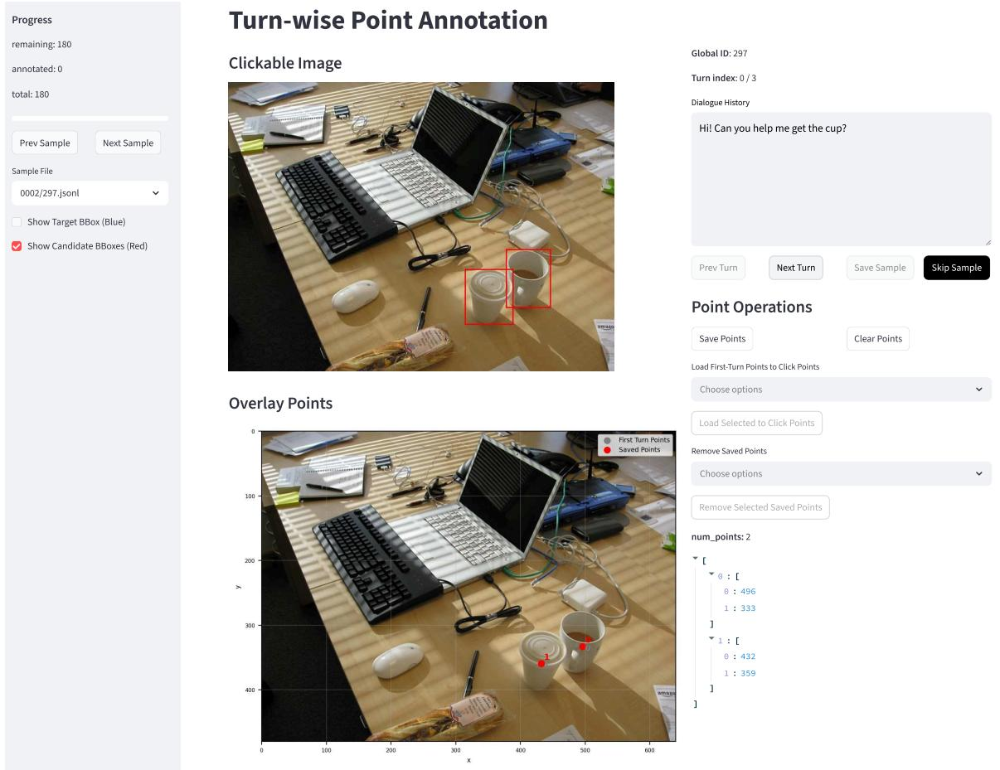  
Figure 7: Annotation interface used for candidate set collection

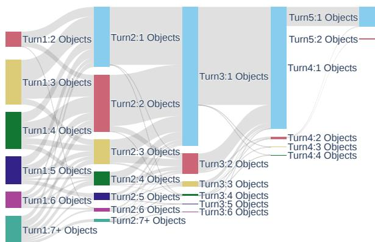  
Figure 8: Transition of candidate set sizes across turns

As shown in Table 7, Qwen3 VL 4B predicts multiple BBoxes for 74.2% of CVG samples, resulting in lower precision than recall. This is consistent with its tendency to predict extra candidates as dialogue context accumulates, as shown in Figure 5 (a).

Despite achieving comparable recall, GPT-5.6 models predict multiple BBoxes more frequently than Qwen3.5 27B, which may partly explain their lower CVG accuracy. In particular, GPT-5.6 Luna predicts multiple BBoxes more frequently than Terra, consistent with its tendency to retain extra candidates as ambiguity is resolved, as shown in Figure 5 (c).

Effect of Dialogue Context. We compared performance under three input conditions on the CVG task to verify that CandVG requires dialogue context beyond the first ambiguous utterance. The conditions were the first utterance only (Turn 1), the minimum context needed to uniquely identify the referred object (Necessary), and the full dialogue context (Full). We evaluated the open-weight models using Acc@0.5 (Acc) as the CVG metric, computed at the dialogue level.

As shown in Table 8, performance substantially improved from Turn 1 to Necessary across all models, confirming the importance of dialogue context for CVG in CandVG. Performance under Necessary and Full was generally comparable, while Full achieved slightly higher accuracy for most models. This suggests that later turns may provide additional descriptions that reinforce the referred object even after it becomes uniquely identifiable.

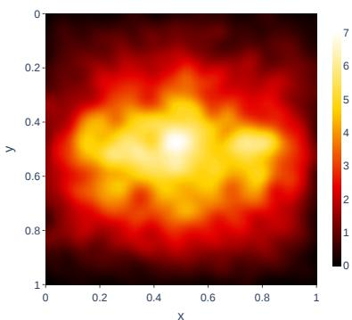  
(a) Turn 1

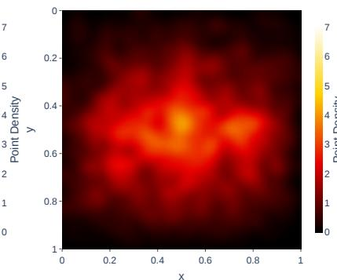  
(b) w/ Turn 2

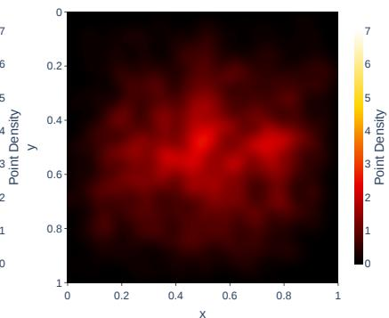  
(c) w/ Turn 3  
Figure 9: Heatmaps of point annotations across turns: Coordinates are normalized by image width and height.

## D.2 Results on CSVG

Detailed Results Table 9 provides detailed results for Table 2, Figure 3, and Figure 4, including precision, recall, and F1 scores in the CSVG setting. We do not report the w/ GT results for GPT-5.6 because its native BBox coordinate representation differs from that used by the open-weight models.

Results by Candidate Set Size. Table 10 reports F1 scores by candidate set size. For many openweight models, F1 scores tend to decrease as the candidate set size increases, likely because of lower recall. In contrast, GPT-5.6 shows stable performance across candidate set sizes.

## E Additional Transition Analysis

We quantitatively examine error patterns in tracking and updating candidate sets across dialogue turns. This analysis considers both CVG and CSVG cases. In particular, we focus on two types of candidate set transitions: retention, where a BBox remains plausible across consecutive turns, and removal, where a previously plausible BBox becomes implausible. We exclude cases where new BBoxes are added to the candidate set in the subsequent turn, as they occur in only 1.03% of consecutive turn pairs in CandVG.

Setup. Let $B _ { i } ^ { G T }$ and $B _ { i } ^ { P r e d }$ denote the groundtruth and predicted candidate sets at the i-th turn within a dialogue, respectively. We define the sets of retained $( \mathcal { R } _ { i } )$ and removed $( \mathcal { D } _ { i } )$ candidates between turns i and i + 1 as follows:

$$
\mathscr { R } _ { i } = \mathscr { B } _ { i } ^ { G T } \cap \mathscr { B } _ { i + 1 } ^ { G T } , \quad \mathscr { D } _ { i } = \mathscr { B } _ { i } ^ { G T } \setminus \mathscr { B } _ { i + 1 } ^ { G T } .\tag{1}
$$

As in the CSVG evaluation (§ 3.2), we match predicted BBoxes to ground-truth BBoxes using oneto-one matching with an IoU threshold of 0.5.

We consider two success rates: retention success and removal success. Throughout this analysis, $\textstyle \sum _ { i }$ denotes summation over all consecutive turn pairs across all dialogues. The retention success rate measures the proportion of ground-truth retained candidates correctly predicted at turns i and i + 1:

$$
\mathrm { R e t e n t i o n S u c c e s s } = \frac { \sum _ { i } | \mathcal { R } _ { i } \cap \mathcal { B } _ { i } ^ { P r e d } \cap \mathcal { B } _ { i + 1 } ^ { P r e d } | } { \sum _ { i } | \mathcal { R } _ { i } | } .\tag{2}
$$

The removal success rate measures the proportion of ground-truth removed candidates predicted at turn i but not at turn $i + 1$

$$
\mathrm { R e m o v a l S u c c e s s } = \frac { \sum _ { i } \left| ( \mathcal { D } _ { i } \cap \mathcal { B } _ { i } ^ { P r e d } ) \setminus \mathcal { B } _ { i + 1 } ^ { P r e d } \right| } { \sum _ { i } \left| \mathcal { D } _ { i } \right| } .\tag{3}
$$

A low removal success rate can result from either failing to remove a previously predicted candidate at turn $i + 1$ , or failing to predict it at turn i. To distinguish these cases, we additionally consider two failure rates as follows:

$$
\mathrm { N o t R e m o v e d } = \frac { \sum _ { i } | \mathcal { D } _ { i } \cap \mathcal { B } _ { i } ^ { P r e d } \cap \mathcal { B } _ { i + 1 } ^ { P r e d } | } { \sum _ { i } | \mathcal { D } _ { i } | } ,\tag{4}
$$

$$
\mathrm { N o t } \mathrm { P r e d i c t e d } = \frac { \sum _ { i } | \mathcal { D } _ { i }  \mathcal { B } _ { i } ^ { P r e d } | } { \sum _ { i } | \mathcal { D } _ { i } | } .\tag{5}
$$

Among ground-truth removed candidates, Not Removed measures the proportion incorrectly retained at turn i + 1, whereas Not Predicted measures the proportion not predicted at turn i. Removal Success and these two failure rates sum to 100% when expressed as percentages.

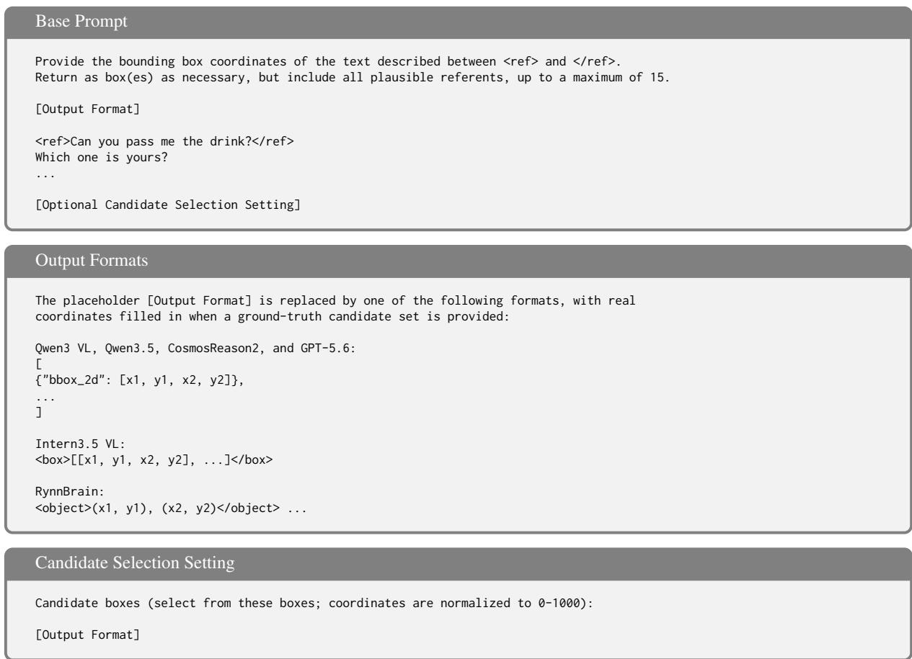  
Table 6: Prompts used in the experiments: All models share the same base prompt and differ only in output format. The selection setting optionally appends a ground-truth candidate set.

<table><tr><td rowspan=1 colspan=1>Models</td><td rowspan=1 colspan=9>Acc (↑) P(↑) R(↑) ≥ 2 (↓)</td></tr><tr><td rowspan=1 colspan=1>Intern3.5 VL 2B</td><td rowspan=1 colspan=9>0.521  0.519 0.533   2.9</td></tr><tr><td rowspan=1 colspan=1>Intern3.5 VL 4B</td><td rowspan=1 colspan=6>0.568  0.563 0.588</td><td rowspan=1 colspan=3>5.1</td></tr><tr><td rowspan=1 colspan=1>Intern3.5 VL 8B</td><td rowspan=1 colspan=3>0.580</td><td rowspan=1 colspan=3>0.575 0.616</td><td rowspan=1 colspan=3>11.0</td></tr><tr><td rowspan=1 colspan=1>Intern3.5 VL 38B</td><td rowspan=1 colspan=2>0.746</td><td rowspan=1 colspan=1></td><td rowspan=1 colspan=2>0.744</td><td rowspan=1 colspan=1>0.748</td><td rowspan=1 colspan=3>0.7</td></tr><tr><td rowspan=1 colspan=1>Qwen3 VL 2B</td><td rowspan=1 colspan=2>0.480</td><td rowspan=1 colspan=1></td><td rowspan=1 colspan=1>0.478</td><td></td><td rowspan=1 colspan=1>0.498</td><td rowspan=1 colspan=3>3.2</td></tr><tr><td rowspan=1 colspan=1>Qwen3 VL 4B</td><td rowspan=1 colspan=2>0.622</td><td rowspan=1 colspan=1></td><td rowspan=1 colspan=1>0.328</td><td></td><td rowspan=1 colspan=1>0.763</td><td rowspan=1 colspan=3>74.2</td></tr><tr><td rowspan=1 colspan=1>Qwen3 VL 8B</td><td></td><td rowspan=1 colspan=1>0.655</td><td rowspan=1 colspan=1></td><td rowspan=1 colspan=1>0.543</td><td></td><td rowspan=1 colspan=1>0.753</td><td rowspan=1 colspan=1></td><td rowspan=1 colspan=2>39.3</td></tr><tr><td rowspan=1 colspan=1>Qwen3 VL 32B</td><td></td><td rowspan=1 colspan=1>0.762</td><td rowspan=1 colspan=1></td><td rowspan=1 colspan=1>0.709</td><td></td><td rowspan=1 colspan=1>0.809</td><td rowspan=1 colspan=3>18.2</td></tr><tr><td rowspan=1 colspan=1>Qwen3.5 2B</td><td></td><td rowspan=1 colspan=1>0.606</td><td rowspan=1 colspan=1></td><td rowspan=1 colspan=1>0.599</td><td></td><td rowspan=1 colspan=1>0.626</td><td rowspan=1 colspan=2>5.1</td><td rowspan=1 colspan=1></td></tr><tr><td rowspan=1 colspan=1>Qwen3.5 4B</td><td></td><td rowspan=1 colspan=1>0.735</td><td rowspan=1 colspan=1></td><td rowspan=1 colspan=1>0.662</td><td></td><td rowspan=1 colspan=1>0.793</td><td rowspan=1 colspan=1></td><td rowspan=1 colspan=1>20.3</td><td rowspan=1 colspan=1></td></tr><tr><td rowspan=1 colspan=1>Qwen3.5 9B</td><td></td><td rowspan=1 colspan=1>0.790</td><td rowspan=1 colspan=1></td><td rowspan=1 colspan=1>0.765</td><td></td><td rowspan=1 colspan=1>0.797</td><td rowspan=1 colspan=1></td><td rowspan=1 colspan=1>5.0</td><td rowspan=1 colspan=1></td></tr><tr><td rowspan=1 colspan=1>Qwen3.5 27B</td><td></td><td rowspan=1 colspan=1>0.819</td><td rowspan=1 colspan=1></td><td rowspan=1 colspan=1>0.817</td><td></td><td rowspan=1 colspan=1>0.820</td><td rowspan=1 colspan=1></td><td rowspan=1 colspan=1>0.6</td><td rowspan=1 colspan=1></td></tr><tr><td rowspan=1 colspan=1>GPT-5.6 Luna</td><td></td><td rowspan=1 colspan=1>0.743</td><td rowspan=1 colspan=1></td><td rowspan=1 colspan=1>0.737</td><td></td><td rowspan=1 colspan=1>0.826</td><td rowspan=1 colspan=1></td><td rowspan=1 colspan=1>15.3</td><td rowspan=2 colspan=1></td></tr><tr><td rowspan=1 colspan=1>GPT-5.6 Terra</td><td></td><td rowspan=1 colspan=1>0.780</td><td rowspan=1 colspan=1></td><td rowspan=1 colspan=1>0.774</td><td></td><td rowspan=1 colspan=1>0.824</td><td rowspan=1 colspan=1></td><td rowspan=1 colspan=1>8.3</td></tr><tr><td rowspan=3 colspan=1>Embodied ReasoRynnBrain 2BRynnBrain 8B</td><td rowspan=5 colspan=9>ning VLMs based on Qwen3 VL0.599  0.599 0.599   0.00.691 0.691 0.691  0.00.537  0.530 0.586  10.50.519 0.402 0.718</td></tr><tr><td rowspan=1 colspan=1>0.599</td><td rowspan=1 colspan=1></td><td rowspan=1 colspan=2>0.599</td><td rowspan=1 colspan=1>0.599</td><td rowspan=1 colspan=1></td><td rowspan=1 colspan=1>0.0</td></tr><tr><td rowspan=1 colspan=1>0.691</td><td rowspan=1 colspan=1></td><td rowspan=1 colspan=1>0.691</td><td rowspan=1 colspan=1>0.691</td><td rowspan=1 colspan=1></td><td rowspan=1 colspan=1>0.0</td></tr><tr><td rowspan=1 colspan=1>CosmosReason2 2B</td><td rowspan=1 colspan=1>0.537</td><td rowspan=1 colspan=1></td><td rowspan=1 colspan=1>0.530</td><td rowspan=1 colspan=1>0.586</td><td rowspan=1 colspan=2>10.5</td></tr><tr><td rowspan=1 colspan=1>CosmosReason2 8B</td><td rowspan=1 colspan=3>0.519</td><td rowspan=1 colspan=2>0.402</td><td rowspan=1 colspan=1>0.718</td><td rowspan=1 colspan=3>0.71859.0</td></tr></table>

Table 7: Results on the CVG task using Acc@0.5 (Acc), precision (P), recall (R), and the percentage of samples with two or more predicted BBoxes (≥ 2 [%])

<table><tr><td>Models</td><td>Turn1</td><td>Necessary</td><td>Full</td></tr><tr><td>Intern3.5 VL 2B</td><td>0.265</td><td>0.519</td><td>0.510</td></tr><tr><td>Intern3.5 VL 4B</td><td>0.308</td><td>0.560</td><td>0.560</td></tr><tr><td>Intern3.5 VL 8B</td><td>0.277</td><td>0.581</td><td>0.561</td></tr><tr><td>Intern3.5 VL 38B</td><td>0.297</td><td>0.722</td><td>0.755</td></tr><tr><td>Qwen3 VL 2B</td><td>0.172</td><td>0.467</td><td>0.469</td></tr><tr><td>Qwen3 VL 4B</td><td>0.285</td><td>0.593</td><td>0.623</td></tr><tr><td>Qwen3 VL 8B</td><td>0.273</td><td>0.630</td><td>0.653</td></tr><tr><td>Qwen3 VL 32B</td><td>0.335</td><td>0.726</td><td>0.767</td></tr><tr><td>Qwen3.5 2B</td><td>0.299</td><td>0.584</td><td>0.606</td></tr><tr><td>Qwen3.5 4B</td><td>0.326</td><td>0.700</td><td>0.742</td></tr><tr><td>Qwen3.5 9B</td><td>0.323</td><td>0.762</td><td>0.803</td></tr><tr><td>Qwen3.5 27B</td><td>0.340</td><td>0.791</td><td>0.835</td></tr><tr><td colspan="4">Embodied Reasoning VLMs based on Qwen3 VL</td></tr><tr><td>RynnBrain 2B</td><td>0.282</td><td>0.577</td><td>0.598</td></tr><tr><td>RynnBrain 8B</td><td>0.315</td><td>0.662</td><td>0.701</td></tr><tr><td>CosmosReason2 2B</td><td>0.224</td><td>0.525</td><td>0.517</td></tr><tr><td>CosmosReason2 8B</td><td>0.251</td><td>0.518</td><td>0.509</td></tr></table>

Table 8: Results on the CVG task under different dialogue context conditions

<table><tr><td rowspan=1 colspan=1>Models</td><td rowspan=1 colspan=16>CandVG (w/o GT)          CandVG (w/ GT)             gRefCOCOP       R      F1      P       R      F1      P       R      F1Generalist VLMs</td></tr><tr><td rowspan=1 colspan=1>Intern3.5 2B</td><td rowspan=1 colspan=2>0.683</td><td rowspan=1 colspan=2>0.230</td><td rowspan=1 colspan=1>0.329</td><td rowspan=1 colspan=4>0.855  0.319</td><td rowspan=1 colspan=1>0.431</td><td rowspan=1 colspan=4>0.704  0.324</td><td rowspan=1 colspan=2>0.419</td></tr><tr><td rowspan=1 colspan=1>Intern3.5 4B</td><td rowspan=1 colspan=2>0.715</td><td rowspan=1 colspan=2>0.258</td><td rowspan=1 colspan=1>0.357</td><td rowspan=1 colspan=4>0.895  0.787</td><td rowspan=1 colspan=1>0.792</td><td rowspan=1 colspan=4>0.798  0.631</td><td rowspan=1 colspan=2>0.674</td></tr><tr><td rowspan=1 colspan=1>Intern3.5 8B</td><td rowspan=1 colspan=2>0.689</td><td rowspan=1 colspan=2>0.230</td><td rowspan=1 colspan=1>0.331</td><td rowspan=1 colspan=4>0.863  0.654</td><td rowspan=1 colspan=1>0.661</td><td rowspan=1 colspan=6>0.763  0.407  0.496</td></tr><tr><td rowspan=1 colspan=1>Intern3.5 38B</td><td rowspan=1 colspan=2>0.776</td><td rowspan=1 colspan=2>0.268</td><td rowspan=1 colspan=1>0.382</td><td rowspan=1 colspan=2>0.932</td><td rowspan=1 colspan=2>0.696</td><td rowspan=1 colspan=1>0.744</td><td rowspan=1 colspan=2>0.832</td><td rowspan=1 colspan=2>0.578</td><td rowspan=1 colspan=2>0.646</td></tr><tr><td rowspan=1 colspan=1>Qwen3 VL 2B</td><td rowspan=1 colspan=2>0.562</td><td rowspan=1 colspan=2>0.189</td><td rowspan=1 colspan=1>0.271</td><td rowspan=1 colspan=2>0.888</td><td rowspan=1 colspan=2>0.430</td><td rowspan=1 colspan=1>0.526</td><td rowspan=1 colspan=2>0.683</td><td rowspan=1 colspan=2>0.295</td><td rowspan=1 colspan=1>0.391</td><td rowspan=1 colspan=1></td></tr><tr><td rowspan=1 colspan=1>Qwen3 VL 4B</td><td rowspan=1 colspan=2>0.622</td><td rowspan=1 colspan=2>0.538</td><td rowspan=1 colspan=1>0.542</td><td rowspan=1 colspan=2>0.874</td><td rowspan=1 colspan=1>0.470</td><td rowspan=1 colspan=1></td><td rowspan=1 colspan=1>0.561</td><td rowspan=1 colspan=2>0.685</td><td rowspan=1 colspan=2>0.517</td><td rowspan=1 colspan=1>0.560</td><td rowspan=1 colspan=1></td></tr><tr><td rowspan=1 colspan=1>Qwen3 VL 8B</td><td rowspan=1 colspan=2>0.668</td><td rowspan=1 colspan=2>0.398</td><td rowspan=1 colspan=1>0.454</td><td rowspan=1 colspan=1>0.907</td><td rowspan=1 colspan=1></td><td rowspan=1 colspan=1>0.484</td><td rowspan=1 colspan=1></td><td rowspan=1 colspan=1>0.581</td><td rowspan=1 colspan=1>0.739</td><td rowspan=1 colspan=1></td><td rowspan=1 colspan=2>0.514</td><td rowspan=1 colspan=1>0.576</td><td rowspan=1 colspan=1></td></tr><tr><td rowspan=1 colspan=1>Qwen3 VL 32B</td><td rowspan=1 colspan=2>0.772</td><td rowspan=1 colspan=2>0.480</td><td rowspan=1 colspan=1>0.543</td><td rowspan=1 colspan=1>0.874</td><td rowspan=1 colspan=1></td><td rowspan=1 colspan=1>0.525</td><td rowspan=1 colspan=1></td><td rowspan=1 colspan=1>0.614</td><td rowspan=1 colspan=1>0.716</td><td rowspan=1 colspan=1></td><td rowspan=1 colspan=2>0.539</td><td rowspan=1 colspan=1>0.589</td><td rowspan=1 colspan=1></td></tr><tr><td rowspan=1 colspan=1>Qwen3.5 2B</td><td rowspan=1 colspan=2>0.728</td><td rowspan=1 colspan=2>0.325</td><td rowspan=1 colspan=1>0.410</td><td rowspan=1 colspan=1>0.905</td><td rowspan=1 colspan=1></td><td rowspan=1 colspan=1>0.320</td><td rowspan=1 colspan=1></td><td rowspan=1 colspan=1>0.445</td><td rowspan=1 colspan=1>0.773</td><td rowspan=1 colspan=3>0.422</td><td rowspan=1 colspan=1>0.507</td><td rowspan=1 colspan=1></td></tr><tr><td rowspan=1 colspan=1>Qwen3.5 4B</td><td rowspan=1 colspan=2>0.816</td><td rowspan=1 colspan=1>0.413</td><td rowspan=1 colspan=1></td><td rowspan=1 colspan=1>0.494</td><td rowspan=1 colspan=1>0.903</td><td rowspan=1 colspan=1></td><td rowspan=1 colspan=1>0.596</td><td rowspan=1 colspan=1></td><td rowspan=1 colspan=1>0.646</td><td rowspan=1 colspan=1>0.819</td><td rowspan=1 colspan=1></td><td rowspan=1 colspan=1>0.613</td><td rowspan=1 colspan=1></td><td rowspan=1 colspan=1>0.672</td><td rowspan=1 colspan=1></td></tr><tr><td rowspan=1 colspan=1>Qwen3.5 9B</td><td rowspan=1 colspan=2>0.799</td><td rowspan=1 colspan=1>0.325</td><td rowspan=1 colspan=1></td><td rowspan=1 colspan=1>0.427</td><td rowspan=1 colspan=1>0.940</td><td rowspan=1 colspan=1></td><td rowspan=1 colspan=1>0.533</td><td rowspan=1 colspan=1></td><td rowspan=1 colspan=1>0.623</td><td rowspan=1 colspan=1>0.818</td><td rowspan=1 colspan=1></td><td rowspan=1 colspan=1>0.409</td><td rowspan=1 colspan=1></td><td rowspan=1 colspan=1>0.510</td><td rowspan=1 colspan=1></td></tr><tr><td rowspan=1 colspan=1>Qwen3.5 27B</td><td rowspan=1 colspan=1>0.838</td><td rowspan=1 colspan=1></td><td rowspan=1 colspan=1>0.326</td><td rowspan=1 colspan=1></td><td rowspan=1 colspan=1>0.441</td><td rowspan=1 colspan=1>0.964</td><td rowspan=1 colspan=1></td><td rowspan=1 colspan=1>0.491</td><td rowspan=1 colspan=1></td><td rowspan=1 colspan=1>0.601</td><td rowspan=1 colspan=1>0.745</td><td rowspan=1 colspan=1></td><td rowspan=1 colspan=1>0.409</td><td rowspan=1 colspan=1></td><td rowspan=1 colspan=1>0.497</td><td rowspan=1 colspan=1></td></tr><tr><td rowspan=1 colspan=1>GPT-5.6 Luna</td><td rowspan=1 colspan=2>0.789</td><td rowspan=1 colspan=1>0.617</td><td rowspan=1 colspan=1></td><td rowspan=1 colspan=1>0.649</td><td rowspan=1 colspan=1></td><td rowspan=1 colspan=1></td><td rowspan=1 colspan=1></td><td rowspan=1 colspan=1></td><td rowspan=1 colspan=1></td><td rowspan=1 colspan=1>0.745</td><td rowspan=1 colspan=1></td><td rowspan=1 colspan=2>0.717</td><td rowspan=1 colspan=1>0.721</td><td rowspan=1 colspan=1></td></tr><tr><td rowspan=1 colspan=1>GPT-5.6 Terra</td><td rowspan=1 colspan=1>0.819</td><td rowspan=1 colspan=1></td><td rowspan=1 colspan=2>0.599</td><td rowspan=1 colspan=1>0.649</td><td rowspan=1 colspan=1></td><td rowspan=1 colspan=1></td><td rowspan=1 colspan=1></td><td rowspan=1 colspan=1></td><td rowspan=1 colspan=1></td><td rowspan=1 colspan=1>0.798</td><td rowspan=1 colspan=1></td><td rowspan=1 colspan=1>0.750</td><td rowspan=1 colspan=1></td><td rowspan=1 colspan=1>0.763</td><td rowspan=1 colspan=1></td></tr><tr><td rowspan=1 colspan=7>Embodied Reasoningg VLMs b</td><td rowspan=1 colspan=3>ased on Qw</td><td rowspan=1 colspan=6>en3 VL</td><td rowspan=1 colspan=1></td></tr><tr><td rowspan=1 colspan=1>RynnBrain 2B</td><td rowspan=1 colspan=2>0.727</td><td rowspan=1 colspan=1>0.233</td><td rowspan=1 colspan=1></td><td rowspan=1 colspan=1>0.342</td><td rowspan=1 colspan=1>0.786</td><td rowspan=1 colspan=1></td><td rowspan=1 colspan=1>0.238</td><td rowspan=1 colspan=1></td><td rowspan=1 colspan=1>0.354</td><td rowspan=1 colspan=1>0.511</td><td rowspan=1 colspan=1></td><td rowspan=1 colspan=1>0.196</td><td rowspan=1 colspan=1></td><td rowspan=1 colspan=1>0.277</td><td rowspan=1 colspan=1></td></tr><tr><td rowspan=1 colspan=1>RynnBrain 8B</td><td rowspan=1 colspan=1>0.753</td><td rowspan=1 colspan=1></td><td rowspan=1 colspan=1>0.243</td><td rowspan=1 colspan=1></td><td rowspan=1 colspan=1>0.356</td><td rowspan=1 colspan=1>0.919</td><td rowspan=1 colspan=1></td><td rowspan=1 colspan=1>0.298</td><td rowspan=1 colspan=1></td><td rowspan=1 colspan=1>0.433</td><td rowspan=1 colspan=1>0.473</td><td rowspan=1 colspan=1></td><td rowspan=1 colspan=1>0.181</td><td rowspan=1 colspan=1></td><td rowspan=1 colspan=1>0.256</td><td rowspan=1 colspan=1></td></tr><tr><td rowspan=1 colspan=1>CosmosReason2 2B</td><td rowspan=1 colspan=1>0.653</td><td rowspan=1 colspan=1></td><td rowspan=1 colspan=1>0.235</td><td rowspan=1 colspan=1></td><td rowspan=1 colspan=1>0.326</td><td rowspan=1 colspan=1>0.875</td><td rowspan=1 colspan=1></td><td rowspan=1 colspan=1>0.387</td><td rowspan=1 colspan=1></td><td rowspan=1 colspan=1>0.482</td><td rowspan=1 colspan=1>0.679</td><td rowspan=1 colspan=1></td><td rowspan=1 colspan=1>0.439</td><td rowspan=1 colspan=1></td><td rowspan=1 colspan=1>0.494</td><td rowspan=1 colspan=1></td></tr><tr><td rowspan=1 colspan=1>CosmosReason2 8B</td><td rowspan=1 colspan=2>0.647</td><td rowspan=1 colspan=1>0.455</td><td rowspan=1 colspan=1></td><td rowspan=1 colspan=1>0.478</td><td rowspan=1 colspan=1>0.900</td><td rowspan=1 colspan=1></td><td rowspan=1 colspan=1>0.729</td><td rowspan=1 colspan=1></td><td rowspan=1 colspan=1>0.742</td><td rowspan=1 colspan=2>0.642</td><td rowspan=1 colspan=1>0.453</td><td rowspan=1 colspan=1></td><td rowspan=1 colspan=1>0.497</td><td rowspan=1 colspan=1></td></tr></table>

Table 9: Detailed precision (P), recall (R), and F1 score on CSVG: w/o GT and w/ GT denote the settings without and with ground-truth candidate sets, respectively.

tent with its tendency to retain extra candidates as ambiguity is resolved (§ 6.1 and § D.1).

Results. Table 11 reports the candidate set retention and removal rates. Across all models, the “Not Predicted” rate is higher than the “Not Removed” rate, indicating that many candidates removed from the ground-truth candidate set at turn i + 1 were not predicted at turn i. This finding is consistent with the difficulty of candidate generation (§ 5.4).

As shown in § 5.3, most generalist VLMs achieve higher recall on gRefCOCO than on CandVG. This suggests that the high “Not Predicted” rates are not only attributable to limitations in multiobject visual grounding. These findings provide support for the premature commitment discussed in § 6.1, where models predict narrow candidate sets while the utterance remains ambiguous.

Failure patterns vary across models. For example, Qwen3 VL 4B achieves a high retention success rate among open-weight models but also has the highest “Not Removed” rate. Similarly, GPT-5.6 Luna achieves the highest retention success rate, while its “Not Removed” rate of 11.8% is consis-

<table><tr><td rowspan="2">Models</td><td colspan="7">CandVG (w/o GT)</td></tr><tr><td>2 (708)</td><td>3 (554)</td><td>4 (387)</td><td>5 (257)</td><td>6 (146)</td><td>7+ (232)</td><td>|All (,284)</td></tr><tr><td colspan="8">Generalist VLMs</td></tr><tr><td>Intern3.5 2B</td><td>0.445</td><td>0.345</td><td>0.293</td><td>0.249</td><td>0.202</td><td>0.161</td><td>0.329</td></tr><tr><td>Intern3.5 4B</td><td>0.451</td><td>0.378</td><td>0.330</td><td>0.292</td><td>0.250</td><td>0.201</td><td>0.357</td></tr><tr><td>Intern3.5 8B</td><td>0.461</td><td>0.350</td><td>0.288</td><td>0.240</td><td>0.192</td><td>0.148</td><td>0.331</td></tr><tr><td>Intern3.5 38B</td><td>0.533</td><td>0.405</td><td>0.330</td><td>0.263</td><td>0.234</td><td>0.174</td><td>0.382</td></tr><tr><td>Qwen3 VL 2B</td><td>0.356</td><td>0.317</td><td>0.248</td><td>0.200</td><td>0.140</td><td>0.103</td><td>0.271</td></tr><tr><td>Qwen3 VL 4B</td><td>0.555</td><td>0.595</td><td>0.552</td><td>0.522</td><td>0.412</td><td>0.465</td><td>0.542</td></tr><tr><td>Qwen3 VL 8B</td><td>0.546</td><td>0.487</td><td>0.432</td><td>0.376</td><td>0.326</td><td>0.299</td><td>0.454</td></tr><tr><td>Qwen3 VL 32B</td><td>0.599</td><td>0.568</td><td>0.533</td><td>0.508</td><td>0.454</td><td>0.420</td><td>0.543</td></tr><tr><td>Qwen3.5 2B</td><td>0.465</td><td>0.434</td><td>0.406</td><td>0.359</td><td>0.357</td><td>0.278</td><td>0.410</td></tr><tr><td>Qwen3.5 4B</td><td>0.561</td><td>0.510</td><td>0.484</td><td>0.453</td><td>0.416</td><td>0.362</td><td>0.494</td></tr><tr><td>Qwen3.5 9B</td><td>0.567</td><td>0.447</td><td>0.373</td><td>0.310</td><td>0.326</td><td>0.242</td><td>0.427</td></tr><tr><td>Qwen3.5 27B</td><td>0.565</td><td>0.471</td><td>0.398</td><td>0.354</td><td>0.305</td><td>0.249</td><td>0.441</td></tr><tr><td>GPT-5.6 Luna</td><td>0.632</td><td>0.663</td><td>0.656</td><td>0.657</td><td>0.644</td><td>0.648</td><td>0.649</td></tr><tr><td>GPT-5.6 Terra</td><td>0.646</td><td>0.643</td><td>0.657</td><td>0.644</td><td>0.667</td><td>0.658</td><td>0.649</td></tr></table>

<table><tr><td rowspan=2 colspan=12>Embodied ReasoningVLMs based on Qwen3 VLRynnBrain 2B                            0.301                       0.151</td></tr><tr><td rowspan=1 colspan=1>0.464</td><td rowspan=1 colspan=1></td><td rowspan=1 colspan=2>0.381</td><td rowspan=1 colspan=1>0.301</td><td rowspan=1 colspan=4>0.2410.199</td><td rowspan=1 colspan=1>0.151</td><td rowspan=1 colspan=1>0.342</td></tr><tr><td rowspan=1 colspan=1>RynnBrain 8B</td><td rowspan=1 colspan=1>0.498</td><td rowspan=1 colspan=1></td><td rowspan=1 colspan=1>0.384</td><td rowspan=1 colspan=1></td><td rowspan=1 colspan=1>0.299</td><td rowspan=1 colspan=2>0.256</td><td rowspan=1 colspan=1>0.205</td><td rowspan=1 colspan=1></td><td rowspan=1 colspan=1>0.159</td><td rowspan=1 colspan=1>0.356</td></tr><tr><td rowspan=2 colspan=1>CosmosReason2 2BCosmosReason2 8B</td><td rowspan=1 colspan=1>0.431</td><td rowspan=1 colspan=1></td><td rowspan=1 colspan=2>0.346</td><td rowspan=1 colspan=1>0.299</td><td rowspan=1 colspan=2>0.248</td><td rowspan=1 colspan=1>0.199</td><td rowspan=1 colspan=1></td><td rowspan=1 colspan=1>0.167</td><td rowspan=1 colspan=1>0.326</td></tr><tr><td rowspan=1 colspan=1>0.538</td><td rowspan=1 colspan=1></td><td rowspan=1 colspan=1>0.501</td><td rowspan=1 colspan=1></td><td rowspan=1 colspan=1>0.489</td><td rowspan=1 colspan=1></td><td rowspan=1 colspan=1>0.411</td><td rowspan=1 colspan=1>0.432</td><td rowspan=1 colspan=1></td><td rowspan=1 colspan=1>0.328</td><td rowspan=1 colspan=1>0.478</td></tr></table>

Table 10: Detailed F1 scores for the CSVG task by candidate set size: Numbers in parentheses indicate the number of samples in each bin.
<table><tr><td rowspan="2"></td><td rowspan="2">Retention [%] (5,424)</td><td colspan="3">Removal [%] (4,677)</td></tr><tr><td>Success</td><td>(↑) Not Rem. (↓) Not Pred. (↓)</td><td></td></tr><tr><td colspan="6">Generalist VLMs</td></tr><tr><td>Intern3.5 2B</td><td>24.8</td><td>9.2</td><td>5.5</td><td>85.4</td></tr><tr><td>Intern3.5 4B</td><td>27.3</td><td>12.0</td><td>4.9</td><td>83.1</td></tr><tr><td>Intern3.58B</td><td>27.2</td><td>9.6</td><td>4.4</td><td>86.1</td></tr><tr><td>Intern3.5 38B</td><td>33.8</td><td>12.8</td><td>3.4</td><td>83.8</td></tr><tr><td>Qwen3 VL 2B</td><td>20.1</td><td>7.7</td><td>5.5</td><td>86.9</td></tr><tr><td>Qwen3 VL 4B</td><td>49.8</td><td>19.8</td><td>26.4</td><td>53.9</td></tr><tr><td>Qwen3 VL 8B</td><td>41.7</td><td>18.2</td><td>11.4</td><td>70.3</td></tr><tr><td>Qwen3 VL 32B</td><td>48.0</td><td>31.1</td><td>9.6</td><td>59.2</td></tr><tr><td>Qwen3.5 2B</td><td>33.4</td><td>17.7</td><td>7.0</td><td>75.3</td></tr><tr><td>Qwen3.5 4B</td><td>43.6</td><td>22.6</td><td>9.8</td><td>67.7</td></tr><tr><td>Qwen3.5 9B</td><td>37.1</td><td>19.0</td><td>4.0</td><td>77.0</td></tr><tr><td>Qwen3.5 27B</td><td>39.0</td><td>19.5</td><td>2.8</td><td>77.7</td></tr><tr><td>GPT-5.6 Luna</td><td>58.6</td><td>44.8</td><td>11.8</td><td>43.4</td></tr><tr><td>GPT-5.6 Terra</td><td>55.9</td><td>46.6</td><td>8.7</td><td>44.6</td></tr><tr><td colspan="5">Embodied Reasoning VLMs based on Qwen3 VL</td></tr><tr><td>RynnBrain 2B</td><td>27.3</td><td>9.1</td><td>6.1</td><td>84.8</td></tr><tr><td>RynnBrain 8B</td><td>31.6</td><td>9.9</td><td>4.6</td><td>85.5</td></tr><tr><td>CosmosReason2 2B</td><td>25.8</td><td>10.2</td><td>6.0</td><td>83.8</td></tr><tr><td>CosmosReason2 8B</td><td>44.2</td><td>15.7</td><td>20.6</td><td>63.7</td></tr></table>

Table 11: Candidate set retention and removal rates [%] across consecutive dialogue turns: Removal rate outcomes are categorized as Success, Not Removed, and Not Predicted. Numbers in parentheses indicate the total counts of retained and removed candidates.