# ReferFlow: Beyond Final-Target Localization for Complex Referring Expressions

Tianyi Gao1,2,†, Han Fang2,†, Xin Wei2, Yaoyao Zhong3, Zhaoyan Pan2,4, Weijie Zhu2,5, Hongbo Sun2, Zhiyu Lin2, Kaicheng Yang2, Jinglin Xu6, Ye Yuan2, Hao Li7, Hao Sun2,∗, Jingmin Xin1,∗

1State Key Laboratory of Human-Machine Hybrid Augmented Intelligence, Institute of Artificial Intelligence and Robotics, Xi’an Jiaotong University, 2Xingchen AGI Lab, China Telecom Artificial Intelligence Technology (Beijing) Co., Ltd., 3Beijing Normal University, 4Zhejiang University, 5University of the Chinese Academy of Sciences, 6University of Science and Technology Beijing, 7Shanghai Jiao Tong University

Multimodal Large Language Models have made significant progress in referring expression comprehension (REC), yet most REC benchmarks still focus on final-target localization. Complex queries often involve intermediate visual references with diferent dependencies on prior grounding, but final-only evaluation leaves this process unexamined. To address this gap, we formulate trajectory-level REC, in which models receive an ordered sequence of grounding steps constructed from a single complex query and localize the target regions associated with each step. We instantiate this setting in ReferFlow-Bench, which characterizes structured region transitions through four trajectory types, namely Refinement, Shift, Reset, and Mixture. Experiments show that current models struggle to consistently ground intermediate visual references across successive steps. We further propose ReferFlow, which decouples interleaved text–latent trajectory generation from coordinate decoding. Specifically, Stateful Region Latent Reasoning represents each target region as an object-indexed state composed of continuous latents, with explicit visual and spatial supervision to preserve region information for subsequent grounding. Trajectory-Aware Parallel Decoding then recovers all coordinate blocks in parallel through four geometry-constrained refinement rounds, with each block conditioned on its corresponding trajectory prefix, thereby reducing within-box sequential dependencies and eliminating cross-box autoregression. We further apply Grounding-Aware GRPO to promote consistent grounding across steps and learn adaptive trajectory generation from complex REC queries. ReferFlow achieves leading performance on general REC benchmarks and ReferFlow-Bench.

Links: Project Page | GitHub Date: Oct 14, 2026

## 1 Introduction

Multimodal Large Language Models have made significant progress in referring expression comprehension (REC), with many early REC benchmarks becoming saturated (Kazemzadeh et al., 2014). Recent work has explored more complex visual grounding with more challenging queries, including detailed descriptions, hard distractors, fine-grained visual understanding, and compositional reasoning (Chen et al., 2025; Dong et al., 2026a; Li et al., 2026c; Gao et al., 2026). As shown in Fig. 1, such queries often specify a target through other objects and their relationships, bringing multiple visual references into the grounding process. Across successive grounding steps, some references build on previously localized regions, while others introduce independent targets. However, most REC benchmarks still focus on final-target localization, leaving the regions associated with these intermediate references unexamined. While recent multi-turn grounding methods extend evaluation beyond a single prediction, they mainly study how region references are propagated as new queries are introduced across dialogue turns (Sun et al., 2026). In contrast, localization under diferent cross-step region dependencies within a single query has not been systematically evaluated.

To address this gap, we formulate trajectory-level REC: given an image and an ordered sequence of grounding steps constructed from a single complex query, models localize the target regions associated with each step. We instantiate this setting in ReferFlow-Bench, which difers from existing benchmarks in three respects: (1)

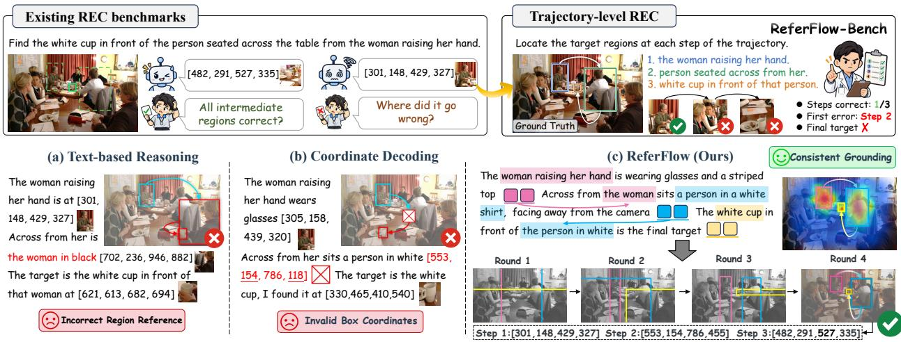  
Figure 1 ReferFlow-Bench evaluates grounding trajectories, exposing intermediate localization failures hidden by final-only REC evaluation. ReferFlow combines object-indexed region states with parallel geometry-constrained coordinate decoding to support consistent grounding across steps.

Intermediate grounding trajectory. ReferFlow-Bench organizes intermediate visual references into an ordered grounding trajectory, making their localization observable. (2) Structured region transitions. Four trajectory types characterize how target regions and their dependencies change across steps: Refinement, Shift, Reset, and Mixture. These trajectories require models to refine existing targets, use prior regions to locate related targets, and localize independent targets while avoiding interference from earlier grounding. (3) Trajectorylevel evaluation. Each grounding step is paired with target-region annotations, enabling evaluation of both individual steps and the entire trajectory. Evaluating more than 20 MLLMs reveals substantial dificulty in consistently grounding intermediate visual references throughout the trajectory.

These results highlight two limitations of existing MLLM-based grounding methods (Fig. 1). First, tracking intermediate regions and reasoning over their visual content and spatial information across grounding steps remains challenging. Chain-of-Thought reasons over complex conditions in language (Jiang et al., 2026a; Fan et al., 2025), while Thinking-with-Images accesses visual evidence through predicted coordinates (Zheng et al., 2026). These external references make it dificult to capture fine-grained visual and spatial cues for subsequent grounding. Second, most MLLMs autoregressively generate bounding boxes as coordinate tokens (Bai et al., 2025). Parallel Box Decoding jointly predicts coordinates within each box but retains autoregressive dependencies across boxes (Wang et al., 2026). Thus, coordinate-decoding depth grows with box count, while small coordinate-token errors can substantially shift predicted regions and mislead subsequent steps.

To address these issues, we propose ReferFlow, which decouples interleaved text-latent trajectory generation from coordinate decoding. Stateful Region Latent Reasoning (SRLR) represents each target with an objectindexed region state composed of continuous latents. An auxiliary decoder supervises each state with target-region features and boxes to retain fine-grained visual and spatial information, allowing the model to determine the relevance of prior regions to the current step. After trajectory generation, Trajectory-Aware Parallel Decoding (TAPD) decodes all target boxes in parallel over four geometry-constrained refinement rounds, making coordinate-decoding depth independent of the number of boxes. A trajectory-aware mask isolates coordinate blocks while conditioning each on its corresponding trajectory prefix. Within each block, TAPD treats multi-digit coordinates as atomic units and recovers the highest-confidence geometrically feasible coordinate at each round. We further apply Grounding-Aware GRPO to estimate intermediate-step values from the final localization outcomes of prefix rollouts. This promotes consistent grounding across steps and adaptive trajectory generation through task-relevant regions. Our main contributions are:

• We formulate trajectory-level REC and construct ReferFlow-Bench for structured evaluation of grounding under diferent dependencies on prior regions. Ordered grounding steps and target-region annotations enable step-level and trajectory-level evaluation.

• We propose ReferFlow, which maintains object-indexed region states under visual and spatial supervision and decodes all corresponding boxes in parallel through geometry-constrained refinement. We further apply Grounding-Aware GRPO to learn adaptive trajectories directly from complex queries.

• We evaluate more than 20 MLLMs, revealing dificulties in consistently grounding intermediate visual references. Extensive experiments show that ReferFlow achieves leading performance on general REC benchmarks and ReferFlow-Bench.

## 2 Related Work

## 2.1 Referring Expression Comprehension Benchmarks

RefCOCO, RefCOCO+ (Kazemzadeh et al., 2014), and RefCOCOg (Yu et al., 2016) have served as foundational REC benchmarks. Recent benchmarks introduce more challenging queries and visual conditions. Ref-L4 (Chen et al., 2025) uses long referring expressions, while Ref-Adv (Dong et al., 2026a) focuses on visually similar distractors. GroundingME (Li et al., 2026c), PR-Bench (Gao et al., 2026), and HumanRef (Jiang et al., 2025) examine fine-grained visual understanding and reasoning. Despite this increased complexity, most REC benchmarks still focus on final-target localization. RegionDial-Bench (Sun et al., 2026) and VRT-Bench (Yuan et al., 2025) extend evaluation beyond a single prediction through multi-turn reference grounding and textual reasoning with object grounding, respectively. However, they do not separately evaluate distinct types of cross-step region dependencies. ReferFlow-Bench instead provides ordered grounding steps with structured region transitions from a single complex query for step-level and trajectory-level evaluation.

## 2.2 MLLMs in Grounding Tasks

MLLM-based methods improve visual grounding through advances in reasoning and coordinate decoding. Rex-Thinker (Jiang et al., 2026a) uses chain-of-thought (CoT) to analyze candidate regions, while GRIT (Fan et al., 2025) interleaves textual reasoning with region coordinates. These references may not fully capture fine-grained visual and spatial information. DeepEyes (Zheng et al., 2026) accesses visual evidence through region crops but requires additional visual processing. For coordinate decoding, Rex-Omni (Jiang et al., 2026b) generates quantized coordinates via next-token prediction (NTP), while LocateAnything (Wang et al., 2026) uses multi-token prediction (MTP) for parallel within-box decoding, with NTP fallback to reduce spatial ambiguity. However, both still rely on autoregressive decoding across boxes. ReferFlow instead learns object-indexed region states with visual and spatial supervision for cross-step grounding. It decouples trajectory generation from coordinate decoding, recovering all boxes in parallel through geometry-constrained refinement.

## 3 ReferFlow-Bench

Problem Formulation. We formulate trajectory-level REC to evaluate whether models can consistently ground visual references under diferent cross-step region dependencies. Given an image I and an ordered sequence of T grounding steps $\boldsymbol { S } = ( s _ { 1 } , s _ { 2 } , \ldots , s _ { T } )$ constructed from a single complex query, the model predicts the target boxes associated with each step:

$$
( I , S ) \longrightarrow ( B _ { 1 } , B _ { 2 } , \ldots , B _ { T } ) ,\tag{1}
$$

where $B _ { t }$ denotes the set of target boxes for step $s _ { t }$ . As the trajectory progresses, models must refine existing targets, use prior regions to locate related targets, or localize independent targets. Based on this formulation, we construct ReferFlow-Bench covering diverse region transitions and providing target-region annotations for every step. The construction pipeline is provided in the Appendix B.1.

Types of Trajectories. As shown in Fig. 2, ReferFlow-Bench defines four trajectory types according to how target regions and their dependencies change across steps: Refinement, Shift, Reset, and Mixture. Each trajectory type is further divided into two subtypes, as detailed below:

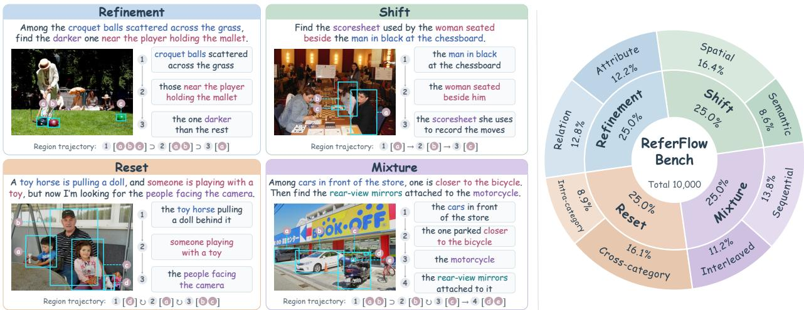  
(a) Examples of the four trajectory types in ReferFlow-Bench  
(b) Data statistics of ReferFlow-Bench  
Figure 2 Overview of ReferFlow-Bench. (a) Four examples illustrate the trajectory types with diferent cross-step region dependencies. (b) Distribution of the 10,000 constructed trajectories.

1. Refinement requires models to narrow an existing target set by accumulating constraints. Attribute refinement adds constraints on color and other visual properties, whereas relational refinement adds spatial, interaction, or contextual constraints involving other objects.

2. Shift requires models to use previously localized regions to identify related targets. Spatial shift is based on relative position or containment, whereas semantic shift is defined by interaction, ownership, part–whole, or other semantic relations.

3. Reset requires models to localize independently specified targets while avoiding interference from prior grounding. Cross-category reset switches to a diferent category, whereas intra-category reset switches to another instance of the same category.

4. Mixture combines diferent types of region transitions within a trajectory. In sequential mixture, each subsequent step builds on the target regions referenced in the immediately preceding step. Interleaved mixture includes at least one subsequent step that depends on regions from a non-adjacent earlier step or requires independent localization.

Evaluation Settings. We adopt Precision@ $( F _ { 1 } = 1 , \mathrm { { I o U } \geq 0 . 5 ) }$ as the grounding criterion. A step is correct only when the predicted and ground-truth box sets admit a one-to-one matching covering both sets, with $\mathrm { I o U } 2 0 . 5$ for every matched pair. ReferFlow-Bench reports three metrics. Query-level Accuracy (Q-Acc) averages the proportion of correctly grounded steps across trajectories. Trajectory-level Accuracy (T-Acc) measures the proportion of trajectories in which every step is correct. Final-step Accuracy (F-Acc) measures accuracy at the final step.

## 4 Method

## 4.1 Stateful Region Latent Reasoning

As illustrated in Fig. 3, SRLR represents each target with an object-indexed region state composed of continuous latents. Each state is explicitly supervised to preserve the target’s visual content and spatial information for subsequent grounding. Given an image I and grounding steps S, SRLR interleaves textual responses and region states into a structured text-latent trajectory $\mathcal { H } = [ a _ { 1 } , \mathcal { Z } _ { 1 } , \ldots , a _ { T } , \mathcal { Z } _ { T } ]$ , where $a _ { t }$ is the textual response at step t and $\mathcal { Z } _ { t }$ comprises the corresponding $N _ { t }$ region states:

$$
\begin{array} { r } { \mathcal { Z } _ { t } = \left( \mathbf { Z } _ { t , 1 } , \ldots , \mathbf { Z } _ { t , N _ { t } } \right) , \qquad \mathbf { Z } _ { t , n } = \left[ \mathbf { z } _ { t , n , 1 } , \ldots , \mathbf { z } _ { t , n , M } \right] \in \mathbb { R } ^ { M \times d } , } \end{array}\tag{2}
$$

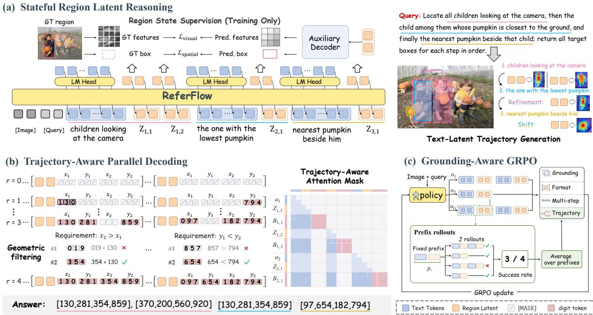  
Figure 3 Overview of ReferFlow. ReferFlow builds an interleaved text-latent grounding trajectory with Stateful Region Latent Reasoning, then uses Trajectory-Aware Parallel Decoding to decode all target boxes in parallel from their corresponding trajectory prefixes through geometry-constrained refinement. Grounding-Aware GRPO learns adaptive trajectories for complex REC.

where $\mathbf { Z } _ { t , n }$ is the region state of the n-th target and consists of M region latents with hidden dimension d. Each region state is delimited by <|latent\_start|> and <|latent\_end|>, and its m-th latent is generated in the hidden space as follows:

$$
\begin{array} { r } { \mathbf { z } _ { t , n , m } = f _ { \theta } ^ { \mathrm { h i d d e n } } \left( I , S , \mathcal { H } _ { < t } , a _ { t } , \mathcal { Z } _ { t , < n } , \mathbf { Z } _ { t , n , < m } \right) , } \end{array}\tag{3}
$$

where $\mathcal { H } _ { < t } , \mathcal { Z } _ { t , < n } ,$ , and $\mathbf { Z } _ { t , n , < m }$ denote the preceding text-latent trajectory, region states at step $t ,$ and latents within the current region state, respectively. Rather than externalizing intermediate region representations as discrete coordinate tokens, SRLR feeds the generated latents directly back as continuous input embeddings. These region states remain in H as context for subsequent grounding. To associate each state with the content and location of its target region, we jointly supervise it using target-region visual features and bounding boxes. An auxiliary decoder reconstructs the visual features $\hat { \mathbf { F } } _ { t , n }$ through cross-attention and predicts the bounding box $\hat { \mathbf { b } } _ { t , n }$ through an MLP:

$$
\hat { \mathbf { F } } _ { t , n } = \operatorname { A t t n } \left( \mathbf { P } , \mathbf { Z } _ { t , n } , \mathbf { Z } _ { t , n } \right) , \qquad \hat { \mathbf { b } } _ { t , n } = \operatorname { S i g m o i d } \left( \operatorname { M L P } _ { b } \left( \left[ \mathbf { z } _ { t , n , 1 } ; \ldots ; \mathbf { z } _ { t , n , M } \right] \right) \right) ,\tag{4}
$$

where P denotes positional query embeddings constructed using two-dimensional sine-cosine encoding. Feature reconstruction encourages each state to retain target-specific visual content, while box prediction constrains its spatial correspondence to the target region. These jointly supervised states provide context for subsequent grounding and parallel coordinate decoding in TAPD. The auxiliary decoder is used only during training and removed at inference time.

## 4.2 Trajectory-Aware Parallel Decoding

Given the text-latent trajectory generated by SRLR, TAPD instantiates a coordinate block for each region state and decodes all blocks in parallel. Each block uses its corresponding trajectory prefix as context without depending on the decoded coordinates of other boxes. We quantize each box coordinate to a value in {0, . . . , 999} and encode it using three decimal digit tokens, resulting in a fixed-length coordinate block $\boldsymbol { B } _ { t , n } = ( b _ { t , n , 1 } , \dots , b _ { t , n , L _ { b } } )$ with $L _ { b } = 1 2$ . Each coordinate block $\boldsymbol { B } _ { t , n }$ is inserted after its corresponding region state $\mathbf { Z } _ { t , n }$ to obtain the expanded trajectory:

$$
\widetilde { \mathcal { H } } = \left[ a _ { 1 } , ( \mathbf { Z } _ { 1 , n } , \boldsymbol { \mathcal { B } } _ { 1 , n } ) _ { n = 1 } ^ { N _ { 1 } } , \ldots , a _ { T } , ( \mathbf { Z } _ { T , n } , \boldsymbol { \mathcal { B } } _ { T , n } ) _ { n = 1 } ^ { N _ { T } } \right] .\tag{5}
$$

Coordinate blocks are initialized with [MASK] tokens and decoded over R rounds. The trajectory-aware mask preserves causal attention within the text-latent trajectory and excludes coordinate blocks from its context. Each block $B _ { t , n }$ attends to the text-latent prefix ending at its corresponding region state $\mathbf { Z } _ { t , n }$ , while remaining isolated from all other coordinate blocks. Within each block, bidirectional attention allows all masked digit tokens to be predicted in parallel. At round $r , \mathcal { M } _ { t , n } ^ { ( r ) }$ denotes the masked positions in $\boldsymbol { B } _ { t , n }$ . The masked-token distribution factorizes as:

$$
p _ { \theta } \left( \mathcal { B } _ { \mathrm { m a s k } } \mid \mathcal { \widetilde H } ^ { ( r ) } \right) = \prod _ { t = 1 } ^ { T } \prod _ { n = 1 } ^ { N _ { t } } \prod _ { i \in \mathcal { M } _ { t , n } ^ { ( r ) } } p _ { \theta } \left( b _ { t , n , i } \mid \mathcal { H } _ { \le ( t , n ) } , \mathcal { B } _ { t , n } ^ { ( r ) } \right) ,\tag{6}
$$

where $\widetilde { \mathcal { H } } ^ { \left( r \right) }$ and $B _ { t , n } ^ { ( r ) }$ denote the expanded trajectory and coordinate block at round $r , \mathcal { H } _ { \leq ( t , n ) }$ denotes the text-latent prefix ending at $\mathbf { Z } _ { t , n } .$ , and $B _ { \mathrm { m a s k } }$ denotes all masked coordinate tokens.

TAPD treats each coordinate as an atomic unit by jointly scoring its three digit tokens, avoiding a dedicated token for every quantized value. Within each block, we omit the indices $( t , n )$ and denote the unrecovered coordinates by $\mathcal { C } _ { r }$ . For each $c \in { \mathcal { C } } _ { r }$ , previously recovered coordinates determine a feasible interval $\mathcal { T } _ { r } ( c )$ consistent with box constraints $x _ { \mathrm { m i n } } ~ < ~ x _ { \mathrm { m a x } }$ and $y _ { \mathrm { m i n } } ~ < ~ y _ { \mathrm { m a x } } .$ The feasible candidate set is $\begin{array} { r } { \mathcal { V } _ { r } ( c ) = } \end{array}$ $\mathcal { T } _ { r } ( c ) \cap \{ 0 , \ldots , 9 9 9 \}$ . Let $p _ { r , c , j }$ denote the predicted digit distribution at the $j \mathrm { - t h }$ position of coordinate c. Each $v \in \mathcal { V } _ { r } ( c )$ is represented by the zero-padded digit sequence $( d _ { 1 } ( v ) , d _ { 2 } ( v ) , d _ { 3 } ( v ) )$ . We score all feasible candidates and select one coordinate as follows:

$$
S _ { r } ( c , v ) = \sum _ { j = 1 } ^ { 3 } \log p _ { r , c , j } ( d _ { j } ( v ) ) , \quad \hat { v } _ { r } ( c ) = \underset { v \in \mathcal { V } _ { r } ( c ) } { \arg \operatorname* { m a x } } S _ { r } ( c , v ) , \quad c _ { r } ^ { * } = \underset { c \in \mathcal { C } _ { r } } { \arg \operatorname* { m a x } } S _ { r } ( c , \hat { v } _ { r } ( c ) ) .\tag{7}
$$

The selected value $\hat { v } _ { r } ( c _ { r } ^ { * } )$ is recovered as a three-token unit, while the remaining coordinates stay masked with updated feasible intervals. Since each block recovers one coordinate per round, all boxes are decoded synchronously in $R = 4$ geometry-constrained rounds. TAPD thus eliminates cross-box autoregression and makes coordinate-decoding depth independent of the number of boxes.

## 4.3 Grounding-Aware Training Strategy

We adopt a two-stage training scheme with SFT followed by Grounding-Aware GRPO. During SFT, SRLR and TAPD are jointly trained on REC $( T = 1 )$ and trajectory-level REC data. We also pair original complex queries with annotated grounding trajectories to supervise trajectory generation. Supervised Fine-Tuning. We jointly optimize text generation, region-state learning, and coordinate decoding. For region-state learning, we combine visual-feature reconstruction and box supervision:

$$
\mathcal { L } _ { \mathrm { r e g i o n } } = \frac { 1 } { N _ { \mathrm { r e g i o n } } } \sum _ { t = 1 } ^ { T } \sum _ { n = 1 } ^ { N _ { t } } \left( \lambda _ { \mathrm { v i s u a l } } \mathcal { L } _ { \mathrm { v i s u a l } } ^ { t , n } + \lambda _ { \mathrm { s p a t i a l } } \mathcal { L } _ { \mathrm { s p a t i a l } } ^ { t , n } \right) ,\tag{8}
$$

where $\begin{array} { r } { N _ { \mathrm { r e g i o n } } = \sum _ { t = 1 } ^ { T } N _ { t } . \ C _ { \mathrm { v i s u a l } } ^ { t , n } } \end{array}$ combines cosine-similarity and MSE losses between $\hat { \mathbf { F } } _ { t , n }$ and the reference features $\mathbf { F } _ { t , n } ^ { * }$ extracted from the ground-truth region by the frozen vision encoder, while $\mathcal { L } _ { \mathrm { s p a t i a l } } ^ { t , n }$ combines $L _ { 1 }$ and GIoU losses for bounding-box supervision.

For TAPD, we randomly mask coordinates as three-token units in each ground-truth block and train the model to recover them from the trajectory prefix and the resulting block $\widetilde { B } _ { t , n } \colon$

$$
\begin{array} { r } { \mathcal { L } _ { \mathrm { b o x } } = - \mathbb { E } _ { \mathcal { M } _ { t , n } } \left[ \frac { 1 } { N _ { \mathrm { m a s k } } } \sum _ { t = 1 } ^ { T } \sum _ { n = 1 } ^ { N _ { t } } \sum _ { i \in \mathcal { M } _ { t , n } } \log p _ { \theta } \left( b _ { t , n , i } \mid \mathcal { H } _ { \le ( t , n ) } , \widetilde { \mathcal { B } } _ { t , n } \right) \right] , } \end{array}\tag{9}
$$

where $\mathcal { M } _ { t , n }$ denotes the masked positions, and $N _ { \mathrm { m a s k } }$ denotes the total number of masked positions across the trajectory. Combined with the text modeling loss $\mathcal { L } _ { \mathrm { t x t } }$ , the SFT objective is:

$$
\mathcal { L } _ { \mathrm { S F T } } = \lambda _ { \mathrm { t x t } } \mathcal { L } _ { \mathrm { t x t } } + \lambda _ { \mathrm { r e g i o n } } \mathcal { L } _ { \mathrm { r e g i o n } } + \lambda _ { \mathrm { b o x } } \mathcal { L } _ { \mathrm { b o x } } .\tag{10}
$$

Grounding-Aware GRPO. Given an image and either a referring expression or an ordered sequence of grounding steps, we sample G trajectories. At supervised step t of trajectory $o , \hat { \mathcal { P } }$ and ${ \mathcal { V } } ^ { * }$ denote predicted and ground-truth box sets. IoU-based Hungarian matching Π gives the step reward:

$$
R _ { \mathrm { g n d } } ^ { t } ( o ) = \sum _ { ( i , j ) \in \Pi } \mathrm { I o U } ( \hat { \bf b } _ { i } , { \bf b } _ { j } ^ { * } ) \Big / \operatorname* { m a x } ( | \hat { \mathcal { V } } | , | { \mathcal { V } } ^ { * } | , 1 ) .\tag{11}
$$

We set $R _ { \mathrm { g n d } } ( o )$ to the final-step $R _ { \mathrm { g n d } } ^ { t } ( o )$ for REC and its mean over provided steps for trajectory-level REC. The format reward $R _ { \mathrm { f m t } } ( o )$ is 1 for interleaved outputs with exactly M latents per state and 0 otherwise. For a K(o)-step trajectory $^ { O , }$ we estimate prefix values for the trajectory reward $R _ { \mathrm { T R } }$ using J completed rollouts $o _ { c } ^ { ( j ) }$ from each prefix $p _ { c } \colon$

$$
p _ { c } = [ a _ { 1 } , \mathcal { Z } _ { 1 } , \ldots , a _ { c } , \mathcal { Z } _ { c } ] , \qquad \widehat { V } ( p _ { c } ) = \frac { 1 } { J } \sum _ { j = 1 } ^ { J } S _ { \mathrm { f i n a l } } \left( o _ { c } ^ { ( j ) } \right) , \qquad 1 \leq c < K ( o ) ,\tag{12}
$$

where $S _ { \mathrm { f i n a l } } ( o ) = 1$ if the final grounding is correct and 0 otherwise. We define $R _ { \mathrm { T R } }$ as:

$$
R _ { \mathrm { T R } } ( o ) = \left\{ \begin{array} { l l } { \frac { 1 } { K ( o ) - 1 } \sum _ { c = 1 } ^ { K ( o ) - 1 } \widehat { V } ( p _ { c } ) , } & { \mathrm { i f ~ } K ( o ) \geq 2 , } \\ { 0 , } & { \mathrm { o t h e r w i s e } . } \end{array} \right.\tag{13}
$$

To encourage successful multi-step grounding, we define $R _ { \mathrm { m u l t i } } ( o ) = S _ { \mathrm { f i n a l } } ( o )$ when $K ( o ) \geq 2$ , and 0 otherwise. The overall reward is:

$$
R ( o ) = \lambda _ { \mathrm { f m t } } R _ { \mathrm { f m t } } ( o ) + \lambda _ { \mathrm { g n d } } R _ { \mathrm { g n d } } ( o ) + \lambda _ { \mathrm { T R } } R _ { \mathrm { T R } } ( o ) + \lambda _ { \mathrm { m u l t i } } R _ { \mathrm { m u l t i } } ( o ) .\tag{14}
$$

## 5 Experiments

## 5.1 Implementation Details

ReferFlow is built upon Qwen3-VL-2B (Bai et al., 2025). During SFT, we train on 1.6M samples for one epoch with a global batch size of 64 and a learning rate of $1 \times 1 0 ^ { - 5 }$ . The loss weights are set to $\lambda _ { \mathrm { t x t } } = 1 . 0$ $\lambda _ { \mathrm { r e g i o n } } = \lambda _ { \mathrm { b o x } } = 0 . 8 , \lambda _ { \mathrm { v i s u a l } } = 0 . 2$ , and $\lambda _ { \mathrm { s p a t i a l } } = 0 . 3$ . During Grounding-Aware GRPO, we train on 13K samples for one epoch with a global prompt batch size of 8 and a learning rate of $1 \times 1 0 ^ { - 6 }$ . We sample $G = 8$ trajectories per query at a temperature of 0.9 and J = 4 rollouts from each intermediate prefix to estimate prefix values. The reward weights are set to $\lambda _ { \mathrm { f m t } } = 0 . 1 , \lambda _ { \mathrm { g n d } } = 0 . 9 , \lambda _ { \mathrm { T R } } = 0 . 5$ , and $\lambda _ { \mathrm { m u l t i } } = 0 . 0 3$ . Each region state contains $M = 2$ region latents. The auxiliary decoder uses a 4 × 4 grid of positional queries and 8 attention heads, and TAPD performs $R = 4$ decoding rounds. Training uses 8 A800 80GB GPUs. More details are in Appendix C.1.

## 5.2 Main Results

Trajectory-Level REC. Table 1 compares MLLMs on ReferFlow-Bench. Existing models struggle to localize target regions consistently throughout the trajectory. For example, Qwen3.8-27B and GPT-5.6 Sol achieve only 11.4% and 12.7% T-Acc, respectively. In Refinement, additional constraints narrow the target set, but localizing multiple target regions at intermediate steps remains dificult. Even Rex-Omni, which leads the baselines on both Q-Acc and T-Acc for this type, reaches only 43.8% and 14.2%, respectively. In Shift, models show a basic ability to use previously localized regions as references for locating related targets. Reset instead requires localizing new targets independently while avoiding interference from prior grounding, with even the strongest baseline reaching only 12.1% T-Acc. Mixture combines multiple transition patterns and requires models to adapt to changing dependencies on prior grounding, with the strongest baseline reaching 16.6% T-Acc. In contrast, ReferFlow achieves 63.9% Q-Acc, 28.4% T-Acc, and 63.0% F-Acc, exceeding the strongest baseline for each metric by 12.7%, 15.0%, and 18.5% respectively.

General REC. ReferFlow achieves strong performance across REC benchmarks with varying query complexity. As shown in Tab. 2, ReferFlow achieves leading results on $\mathrm { R e f C O C O / + / g }$ and Ref-L4, covering queries from short phrases to detailed descriptions. Furthermore, ReferFlow adaptively decomposes complex queries involving multiple visual references into grounding steps, using intermediate regions to support target localization. On Ref-Adv, ReferFlow achieves 67.7%, showing discrimination of visually similar distractors. For tasks requiring fine-grained understanding and compositional reasoning, it surpasses LocateAnything by +20.0%, +15.1%, and +8.7% on GroundingME, HumanRef, and PR-Bench, respectively, despite its smaller model size.

Table 1 Performance of state-of-the-art models on ReferFlow-Bench across four trajectory types. Best results are shown in bold, and the second-best are underlined.
<table><tr><td rowspan="2">Model</td><td rowspan="2">Params.</td><td colspan="3">Overall</td><td colspan="3">Refinement</td><td colspan="3">Shift</td><td colspan="3">Reset</td><td colspan="3">Mixture</td></tr><tr><td></td><td></td><td></td><td></td><td></td><td></td><td></td><td></td><td></td><td></td><td></td><td></td><td></td><td>Q-Acc T-Acc F-Acc | Q-Acc T-Acc F-Acc | Q-Acc T-Acc F-Acc | Q-Acc T-Acc F-Acc | Q-Acc T-Acc F-Acc</td><td></td></tr><tr><td>Proprietary MLLMs</td><td></td><td></td><td></td><td></td><td></td><td></td><td></td><td></td><td></td><td></td><td></td><td></td><td></td><td></td><td></td><td></td></tr><tr><td>Gemini 3.1 Pro (Google DeepMind, 2026)</td><td></td><td>33.2</td><td>8.9</td><td>33.9</td><td>25.4</td><td>9.4</td><td>47.4</td><td>41.9</td><td>16.6</td><td>34.1</td><td>34.3</td><td>5.4</td><td>23.0</td><td>31.2</td><td>4.3</td><td>31.1</td></tr><tr><td>GPT-5.6 Sol (OpenAI, 2026)</td><td></td><td>44.9</td><td>12.7</td><td>41.5</td><td>33.4</td><td>10.9</td><td>50.6</td><td>51.8</td><td>24.0</td><td>37.8</td><td>47.0</td><td>8.4</td><td>32.6</td><td>47.5</td><td>7.4</td><td>45.1</td></tr><tr><td>Open-Source General MLLMs</td><td></td><td></td><td></td><td></td><td></td><td></td><td></td><td></td><td></td><td></td><td></td><td></td><td></td><td></td><td></td><td></td></tr><tr><td>Ovis2.5 (Lu et al., 2025)</td><td>2B</td><td>27.6</td><td>3.2</td><td>25.4</td><td>18.2</td><td>1.8</td><td>26.8</td><td>36.7</td><td>7.2</td><td>23.2</td><td>29.6</td><td>1.2</td><td>27.9</td><td>25.9</td><td>2.4</td><td>23.6</td></tr><tr><td>Qwen3-VL (Bai et al., 2025)</td><td>2B</td><td>35.6</td><td>6.3</td><td>29.6</td><td>21.4</td><td>2.7</td><td>29.9</td><td>44.3</td><td>12.3</td><td>28.3</td><td>39.9</td><td>5.8</td><td>30.9</td><td>36.9</td><td>4.3</td><td>29.2</td></tr><tr><td>Qwen3.5 (Qwen Team, 2026a)</td><td>4B</td><td>39.1</td><td>8.7</td><td>32.5</td><td>27.1</td><td>3.3</td><td>34.7</td><td>47.4</td><td>14.9</td><td>34.9</td><td>46.2</td><td>8.2</td><td>29.6</td><td>35.6</td><td>8.3</td><td>30.6</td></tr><tr><td>LLaVA-OneVision-1.5 (An et al., 2025)</td><td>4B</td><td>18.4</td><td>1.9</td><td>7.8</td><td>9.4</td><td>0.4</td><td>7.2</td><td>26.8</td><td>6.4</td><td>20.0</td><td>19.4</td><td>0.6</td><td>1.7</td><td>18.1</td><td>0.0</td><td>2.4</td></tr><tr><td>Youtu-VL (Wei et al., 2026)</td><td>4B</td><td>30.7</td><td>4.2</td><td>22.3</td><td>10.3</td><td>1.4</td><td>20.6</td><td>45.0</td><td>9.3</td><td>25.6</td><td>37.7</td><td>4.2</td><td>19.4</td><td>29.7</td><td>2.0</td><td>23.4</td></tr><tr><td>MiMo-VL-RL (Yue et al., 2025)</td><td>7B</td><td>29.2</td><td>3.3</td><td>22.0</td><td>18.5</td><td>1.5</td><td>20.6</td><td>38.2</td><td>7.5</td><td>27.4</td><td>30.9</td><td>2.5</td><td>20.7</td><td>29.2</td><td>1.5</td><td>19.1</td></tr><tr><td>Keye-VL-1.5 (Yang et al., 2025)</td><td>8B</td><td>28.1</td><td>1.9</td><td>15.5</td><td>15.1</td><td>0.8</td><td>13.2</td><td>37.2</td><td>4.5</td><td>18.0</td><td>31.3</td><td>1.5</td><td>12.7</td><td>28.7</td><td>0.9</td><td>17.9</td></tr><tr><td>InternVL3.5 (Wang et al., 2025)</td><td>8B</td><td>29.6</td><td>5.1</td><td>23.5</td><td>18.5</td><td>4.2</td><td>21.7</td><td>39.1</td><td>9.6</td><td>26.6</td><td>29.3</td><td>2.2</td><td>21.1</td><td>31.5</td><td>4.5</td><td>24.6</td></tr><tr><td>Qwen3.5 (Qwen Team, 2026a)</td><td>9B</td><td>41.0</td><td>9.4</td><td>35.7</td><td>28.2</td><td>3.1</td><td>35.9</td><td>51.4</td><td>15.8</td><td>36.9</td><td>48.5</td><td>8.9</td><td>31.8</td><td>35.7</td><td>9.7</td><td>38.2</td></tr><tr><td>GLM-4.6V-Flash (Team et al., 2025)</td><td>9B</td><td>42.7</td><td>11.0</td><td>38.2</td><td>26.2</td><td>5.4</td><td>42.0</td><td>52.7</td><td>20.0</td><td>36.8</td><td>46.9</td><td>8.4</td><td>31.3</td><td>45.0</td><td>10.2</td><td>42.7</td></tr><tr><td>Qwen3.5 (Qwen Team, 2026a)</td><td>27B</td><td>47.8</td><td>12.5</td><td>44.5</td><td>36.2</td><td>4.8</td><td>50.6</td><td>56.7</td><td>18.7</td><td>40.6</td><td>51.7</td><td>9.7</td><td>37.1</td><td>46.6</td><td>16.6</td><td>49.5</td></tr><tr><td>Qwen3.8 (Qwen Team, 2026b)</td><td>27B</td><td>48.1</td><td>11.4</td><td>44.1</td><td>37.1</td><td>4.7</td><td>51.5</td><td>54.3</td><td>18.4</td><td>38.1</td><td>52.6</td><td>10.5</td><td>38.0</td><td>48.5</td><td>12.1</td><td>48.8</td></tr><tr><td>Ovis2.6 (Lu et al., 2025)</td><td>30B-A3B</td><td>42.2</td><td>9.8</td><td>38.1</td><td>28.7</td><td>8.6</td><td>43.4</td><td>53.3</td><td>16.0</td><td>38.4</td><td>44.1</td><td>7.1</td><td>29.8</td><td>42.6</td><td>7.4</td><td>40.8</td></tr><tr><td>InternVL3.5 (Wang et al., 2025)</td><td>38B</td><td>40.2</td><td>11.9</td><td>38.1</td><td>24.5</td><td>8.3</td><td>38.7</td><td>50.0</td><td>22.8</td><td>38.4</td><td>42.8</td><td>8.2</td><td>26.8</td><td>43.3</td><td>8.1</td><td>48.4</td></tr><tr><td>GLM-4.6V (Team et al., 2025)</td><td>106B-A12B</td><td>46.4</td><td>9.6</td><td>39.5</td><td>32.3</td><td>6.0</td><td>41.1</td><td>55.6</td><td>17.2</td><td>38.0</td><td>50.1</td><td>9.5</td><td>32.7</td><td>47.6</td><td>5.5</td><td>46.0</td></tr><tr><td>Qwen3.5 (Qwen Team, 2026a)</td><td>122B-A10B</td><td>47.1</td><td>10.9</td><td>42.9</td><td>37.4</td><td>7.2</td><td>52.3</td><td>56.5</td><td>19.6</td><td>40.2</td><td>50.5</td><td>10.2</td><td>33.9</td><td>43.8</td><td>6.4</td><td>45.0</td></tr><tr><td>Step-3.7-Flash (StepFun, 2026)</td><td>198B-A11B</td><td>40.6</td><td>11.7</td><td>37.5</td><td>28.5</td><td>10.2</td><td>35.9</td><td>53.3</td><td>22.3</td><td>45.1</td><td>45.9</td><td>9.4</td><td>32.0</td><td>34.5</td><td>5.0</td><td>36.9</td></tr><tr><td>InternVL3.5 (Wang et al., 2025)</td><td>241B-A28B</td><td>42.7</td><td>11.6</td><td>38.5</td><td>23.5</td><td>6.8</td><td>35.0</td><td>52.5</td><td>20.8</td><td>40.7</td><td>49.3</td><td>10.3</td><td>34.3</td><td>45.5</td><td>8.6</td><td>44.1</td></tr><tr><td>Grounding-Specialized MLLMs</td><td></td><td></td><td></td><td></td><td></td><td></td><td></td><td></td><td></td><td></td><td></td><td></td><td></td><td></td><td></td><td></td></tr><tr><td>DeepEyes (Zheng et al., 2026) RegionReasoner (Sun et al., 2026)</td><td>7B</td><td>25.4 28.8</td><td>4.1 4.1</td><td>18.5 19.3</td><td>12.3 14.9</td><td>2.4</td><td>20.2 7.8</td><td>32.6 36.8</td><td>4.6 8.6</td><td>14.2 23.6</td><td>27.3</td><td>7.4</td></table>

Table 2 Comparisons on general referring expression comprehension benchmarks. Best results are shown in bold, and the second-best are underlined. “–” indicates unavailable or unreported results.
<table><tr><td>Model</td><td>Params.</td><td>RefCOCO</td><td>RefCOCO+</td><td>RefCOCOg</td><td>Ref-L4</td><td>Ref-Adv</td><td>GroundingME</td><td>HumanRef</td><td>PR-Bench</td></tr><tr><td>General MLLMs</td><td></td><td></td><td></td><td></td><td></td><td></td><td></td><td></td><td></td></tr><tr><td>Qwen3-VL (Bai et al., 2025)</td><td>2B</td><td>87.4</td><td>78.1</td><td>84.9</td><td>85.4</td><td>42.5</td><td>26.6</td><td>58.9</td><td>52.8</td></tr><tr><td>Qwen3.5 (Qwen Team, 2026a)</td><td>4B</td><td>90.1</td><td>83.5</td><td>88.4</td><td>88.7</td><td>59.3</td><td>39.6</td><td>69.0</td><td>62.4</td></tr><tr><td>Youtu-VL (Wei et al., 2026)</td><td>4B</td><td>93.2</td><td>89.8</td><td>92.6</td><td>83.3</td><td>48.5</td><td>14.1</td><td>55.3</td><td>53.2</td></tr><tr><td>InternVL3.5 (Wang et al., 2025)</td><td>8B</td><td>91.9</td><td>87.6</td><td>89.5</td><td>80.9</td><td>49.7</td><td>11.8</td><td>40.0</td><td>41.5</td></tr><tr><td>GLM-4.6V-Flash (Team et al., 2025)</td><td>9B</td><td>88.1</td><td>80.0</td><td>88.7</td><td>72.7</td><td>58.0</td><td>29.1</td><td>75.2</td><td>58.9</td></tr><tr><td>Qwen3.5 (Qwen Team, 2026a)</td><td>27B</td><td>92.5</td><td>89.6</td><td>90.6</td><td>90.2</td><td>66.7</td><td>42.2</td><td>71.5</td><td>65.3</td></tr><tr><td>InternVL3.5 (Wang et al., 2025)</td><td>38B</td><td>90.4</td><td>87.4</td><td>89.8</td><td>85.5</td><td>57.6</td><td>15.7</td><td>51.1</td><td>48.5</td></tr><tr><td>Grounding-Specialized MLLMs</td><td></td><td></td><td></td><td></td><td></td><td></td><td></td><td></td><td></td></tr><tr><td>Rex-Thinker (Jiang et al., 2026a)</td><td>7B</td><td>85.9</td><td>82.9</td><td>83.3</td><td>70.2</td><td>42.8</td><td>34.7</td><td>83.5</td><td>44.0</td></tr><tr><td>RegionReasoner (Sun et al., 2026)</td><td>7B</td><td>86.4</td><td>88.6</td><td>88.4</td><td>66.8</td><td>50.6</td><td>36.1</td><td>71.6</td><td>48.8</td></tr><tr><td>DeepEyes (Zheng et al., 2026)</td><td>7B</td><td>89.8</td><td>83.6</td><td>86.7</td><td>85.2</td><td>45.3</td><td>13.2</td><td>50.3</td><td>45.7</td></tr><tr><td>VGent (Kang et al., 2026)</td><td>7B</td><td>92.3</td><td>87.9</td><td>90.3</td><td></td><td></td><td></td><td></td><td></td></tr><tr><td>Rex-Omni (Jiang et al., 2026b)</td><td>3B</td><td>86.3</td><td>78.6</td><td>86.7</td><td>78.0</td><td>45.1</td><td>28.8</td><td>74.9</td><td>53.7</td></tr><tr><td>WeDetect-Ref (Fu et al., 2026)</td><td>2B</td><td>94.2</td><td>88.1</td><td>92.1</td><td>93.9</td><td>52.5</td><td>29.3</td><td>79.8</td><td>55.7</td></tr><tr><td>LocateAnything (Wang et al., 2026)</td><td>3B</td><td>92.2</td><td>86.1</td><td>88.9</td><td>87.9</td><td>54.1</td><td>23.0</td><td>68.8</td><td>57.4</td></tr><tr><td>ReferFlow</td><td>2B</td><td>94.6</td><td>90.6</td><td>92.9</td><td>94.3</td><td>67.7</td><td>43.0</td><td>83.9</td><td>66.1</td></tr></table>

## 5.3 Analysis and Ablations

Effects of Grounding-Step Order. We compare T-Acc before and after shufling grounding steps while preserving each step’s target-region annotations (Fig. 4). For Shift, T-Acc drops to nearly zero for most models, consistent with its reliance on region references established in earlier steps. Performance on Reset remains largely unchanged, as its targets are specified independently of prior grounding. For Refinement, performance declines when shufling disrupts the progression from broader to narrower target sets. Mixture similarly degrades as shufling disrupts dependencies across its combined transition types. These results highlight type-specific

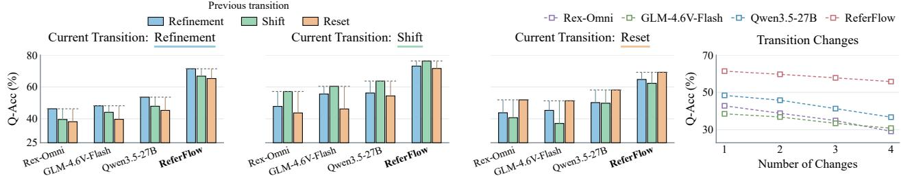

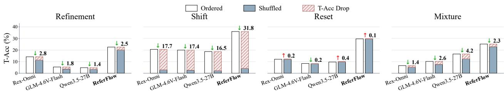  
Figure 4 Comparison of T-Acc between ordered and shufled grounding steps.

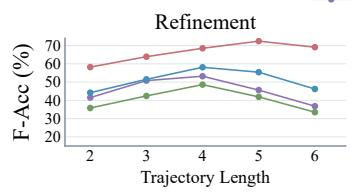

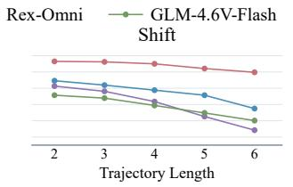

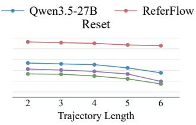

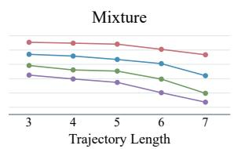  
Figure 5 Comparison of F-Acc across diferent trajectory lengths.  
Figure 6 Comparison of Q-Acc across diferent types and numbers of transition changes.

cross-step dependencies.

Effects of Trajectory Length. Fig. 5 reports F-Acc by trajectory length. (1) For Refinement, F-Acc initially increases as constraints narrow the target set, but declines on longer trajectories, suggesting dificulty integrating more constraints. ReferFlow peaks at longer trajectory lengths than the baselines, indicating that it benefits from additional refinement steps. (2) For Reset, F-Acc declines more sharply on longer trajectories, consistent with increasing interference from prior grounding during independent target localization. (3) F-Acc on Shift and Mixture decreases substantially with length, suggesting dificulty handling repeated target transitions and changing cross-step dependencies.

Effects of Transition Changes. We evaluate fixed-length Mixture trajectories with diferent transition patterns and numbers of type changes in Fig. 6. Q-Acc consistently decreases when transition types change, indicating dificulty in switching between grounding behaviors. Switches between Shift and Reset are particularly challenging, as models must alternate between using prior regions as references and localizing new targets independently. Q-Acc declines further with more frequent type changes, suggesting that repeated switching hinders consistent grounding.

Effects of SRLR. Tab. 3 evaluates the region-state representation and its visual and spatial supervision. Region latents without explicit supervision yield only marginal gains and underperform text-only reasoning on trajectories of lengths 5 and 6+. Spatial supervision provides consistent gains across lengths and performs better on shorter trajectories, whereas visual supervision yields larger gains on longer trajectories. These gains increase with trajectory length, highlighting the importance of retaining target-specific visual content across grounding steps. Combining both supervision achieves the best performance across all metrics, demonstrating their complementary roles.

Effects of TAPD. Tab. 4(a) compares decoding strategies based on the same SRLR setting. Across-box parallel decoding improves both NTP and MTP, with larger gains on ReferFlow-Bench. However, one-shot within-box MTP underperforms NTP across all metrics and sharply reduces box validity, indicating dificulty maintaining coordinate consistency in a single pass. Iterative token-wise recovery addresses this limitation by conditioning each round on previously recovered high-confidence digits, outperforming NTP with across-box parallel decoding. Coordinate-wise recovery yields further gains by recovering each three-digit coordinate as an atomic unit. Geometry-constrained recovery restricts candidates to feasible intervals, yielding the best overall performance.

Table 3 Ablation studies of SRLR under diferent spatial and visual supervision settings.
<table><tr><td rowspan="2">Setting</td><td colspan="2">Supervision</td><td rowspan="2">RefCOCOg</td><td rowspan="2">GroundingME</td><td colspan="3">ReferFlow-Bench</td><td colspan="5">ReferFlow-Bench Q-Acc by Trajectory Length</td></tr><tr><td>Spatial</td><td>Visual</td><td>Q-Acc</td><td>T-Acc</td><td>F-Acc</td><td>2</td><td>3</td><td>4</td><td>5</td><td>6+</td></tr><tr><td>Text</td><td></td><td></td><td>87.9</td><td>32.4</td><td>52.6</td><td>17.9</td><td>48.2</td><td>58.8</td><td>54.7</td><td>50.1</td><td>44.0</td><td>41.2</td></tr><tr><td>Region Latent</td><td>× &gt;</td><td>X</td><td>88.5</td><td>32.8</td><td>53.0</td><td>18.1</td><td>48.7</td><td>59.6</td><td>55.4</td><td>49.8</td><td>43.9</td><td>40.8</td></tr><tr><td>Region Latent</td><td></td><td>×</td><td>89.7</td><td>34.2</td><td>54.4</td><td>19.3</td><td>50.4</td><td>60.8</td><td>56.6</td><td>52.0</td><td>45.3</td><td>42.0</td></tr><tr><td>Region Latent</td><td></td><td>√</td><td>89.1</td><td>35.8</td><td>55.4</td><td>20.0</td><td>52.1</td><td>60.3</td><td>56.5</td><td>53.6</td><td>49.1</td><td>46.4</td></tr><tr><td>SRLR</td><td>× &gt;</td><td>L</td><td>90.5</td><td>37.4</td><td>56.9</td><td>21.3</td><td>53.9</td><td>61.8</td><td>57.8</td><td>55.0</td><td>51.0</td><td>48.9</td></tr></table>

Table 4 Ablations of (a) TAPD parallelization and coordinate recovery and (b) grounding modes under SFT and trajectory-level reward components. In (a), Intra-Box and Inter-Box denote parallel decoding within and across boxes, respectively. Grouping recovers each three-digit coordinate as an atomic unit, while Geom. enforces geometric constraints.

(a) TAPD Design
<table><tr><td rowspan="2">Setting</td><td rowspan="2"></td><td rowspan="2"></td><td rowspan="2"></td><td rowspan="2">RefCOCOg GroundingME</td><td colspan="2">ReferFlow-Bench</td><td rowspan="2">Valid Box Rate</td></tr><tr><td>Q-Acc</td><td>T-Acc</td></tr><tr><td>Parallel Decoding Intra-Box Inter-Box</td><td></td><td></td><td></td><td></td><td></td><td></td><td></td></tr><tr><td>NTP</td><td>×</td><td>×</td><td>90.5</td><td>37.4</td><td>56.9</td><td>21.3</td><td>95.7</td></tr><tr><td>NTP</td><td>X</td><td>√</td><td>90.8</td><td>37.9</td><td>58.1</td><td>22.5</td><td>96.3</td></tr><tr><td>MTP</td><td>√</td><td>X</td><td>87.9</td><td>33.4</td><td>50.3</td><td>15.0</td><td>88.3</td></tr><tr><td>MTP</td><td>√</td><td>√</td><td>88.6</td><td>34.9</td><td>53.8</td><td>18.2</td><td>90.4</td></tr><tr><td>Recovery Design</td><td>Grouping</td><td>Geom.</td><td></td><td></td><td></td><td></td><td></td></tr><tr><td>Token-wise</td><td>X</td><td>X</td><td>91.1</td><td>38.2</td><td>58.3</td><td>22.7</td><td>96.8</td></tr><tr><td>Coordinate-wise</td><td>√</td><td>X</td><td>91.6</td><td>38.6</td><td>59.7</td><td>24.3</td><td>98.2</td></tr><tr><td>TAPD</td><td>√</td><td>√</td><td>92.0</td><td>39.1</td><td>60.8</td><td>25.6</td><td>100.0</td></tr></table>

(b) Adaptive Trajectory Generation
<table><tr><td rowspan="2" colspan="2">Setting</td><td rowspan="2">RefCOCOg GroundingME</td><td rowspan="2"></td><td colspan="2">ReferFlow-Bench</td></tr><tr><td>Q-Acc</td><td>T-Acc</td></tr><tr><td colspan="2">Grounding Modes Direct Grounding</td><td></td><td></td><td></td><td></td></tr><tr><td colspan="2"></td><td>91.1</td><td>35.2</td><td></td><td></td></tr><tr><td colspan="2">Trajectory Only</td><td>88.7</td><td>37.9</td><td>60.3</td><td>25.0</td></tr><tr><td colspan="2">Adaptive Trajectory</td><td>92.0</td><td>39.1</td><td>60.8</td><td>25.6</td></tr><tr><td colspan="2">Reward Design</td><td></td><td></td><td></td><td></td></tr><tr><td>RTR</td><td>Rmulti</td><td></td><td></td><td></td><td></td></tr><tr><td>×</td><td>×</td><td>92.7</td><td>40.6</td><td>61.8</td><td>26.2</td></tr><tr><td>√</td><td>×</td><td>92.8</td><td>42.1</td><td>63.4</td><td>28.1</td></tr><tr><td>√</td><td>√</td><td>92.9</td><td>43.0</td><td>63.9</td><td>28.4</td></tr></table>

Effects of Adaptive Trajectory Generation. Tab. 4(b) compares grounding modes and rewards. Trajectory Only outperforms Direct Grounding on complex queries but slightly reduces RefCOCOg accuracy. Adaptive trajectory generation allows the model to directly localize targets or generate intermediate grounding steps as needed, maintaining strong performance on both simple and complex queries. Regarding reward design, the trajectory reward $R _ { \mathrm { T R } }$ encourages intermediate prefixes that support final localization, while the multi-step reward $R _ { \mathrm { m u l t i } }$ encourages successful multi-step grounding. Consequently, the full reward formulation achieves the best overall performance.

## 6 Conclusion

We formulate trajectory-level REC and build ReferFlow-Bench for evaluation. Evaluating over 20 MLLMs reveals dificulty in consistently grounding intermediate visual references. ReferFlow combines SRLR for objectindexed region states with TAPD for parallel geometry-constrained box decoding. Grounding-Aware GRPO promotes consistent grounding and adaptive trajectory generation. ReferFlow achieves leading performance on general REC benchmarks and ReferFlow-Bench.

## References

Xiang An, Yin Xie, Kaicheng Yang, Wenkang Zhang, Xiuwei Zhao, Zheng Cheng, Yirui Wang, Songcen Xu, Changrui Chen, Didi Zhu, et al. Llava-onevision-1.5: Fully open framework for democratized multimodal training. arXiv preprint arXiv:2509.23661, 2025.

Shuai Bai, Yuxuan Cai, Ruizhe Chen, Keqin Chen, Xionghui Chen, Zesen Cheng, Lianghao Deng, Wei Ding, Chang Gao, Chunjiang Ge, et al. Qwen3-vl technical report. arXiv preprint arXiv:2511.21631, 2025.

Tom Brown, Benjamin Mann, Nick Ryder, Melanie Subbiah, Jared D Kaplan, Prafulla Dhariwal, Arvind Neelakantan, Pranav Shyam, Girish Sastry, Amanda Askell, et al. Language models are few-shot learners. Advances in neural information processing systems, 33:1877–1901, 2020.

Nicolas Carion, Francisco Massa, Gabriel Synnaeve, Nicolas Usunier, Alexander Kirillov, and Sergey Zagoruyko. End-to-end object detection with transformers. In European conference on computer vision, pages 213–229. Springer, 2020.

Jierun Chen, Fangyun Wei, Jinjing Zhao, Sizhe Song, Bohuai Wu, Zhuoxuan Peng, S-H Gary Chan, and Hongyang Zhang. Revisiting referring expression comprehension evaluation in the era of large multimodal models. In 2025 IEEE/CVF Conference on Computer Vision and Pattern Recognition Workshops (CVPRW), pages 513–524. IEEE, 2025.

Shuang Cheng, Yihan Bian, Dawei Liu, Yuhua Jiang, Yihao Liu, Linfeng Zhang, Qian Yao, Zhongbo Tian, Wenha Wang, Qipeng Guo, et al. Sdar: A synergistic difusion-autoregression paradigm for scalable sequence generation. In Findings of the Association for Computational Linguistics: ACL 2026, pages 22058–22075, 2026.

Qihua Dong, Kuo Yang, Lin Ju, Handong Zhao, Yitian Zhang, Yizhou Wang, Huimin Zeng, Jianglin Lu, and Yun Fu. Ref-adv: Exploring mllm visual reasoning in referring expression tasks. arXiv preprint arXiv:2602.23898, 2026a.

Shuai Dong, Siyuan Wang, Xingyu Liu, Chenglin Li, Haowen Hou, and Zhongyu Wei. Interleaved latent visual reasoning with selective perceptual modeling. In Proceedings of the 64th Annual Meeting of the Association for Computational Linguistics (Volume 1: Long Papers), pages 29316–29335, 2026b.

Yue Fan, Xuehai He, Diji Yang, Kaizhi Zheng, Ching-Chen Kuo, Yuting Zheng, Xinze Guan, and Xin Wang. GRIT: teaching mllms to think with images. In Danielle Belgrave, Cheng Zhang, Laura N. Montoya, Hsuan-Tien Lin, Razvan Pascanu, Piotr Koniusz, Marzyeh Ghassemi, Nancy Chen, Iván Vladimir Meza Ruíz, and Arturo Loaiza-Bonilla, editors, Advances in Neural Information Processing Systems 38: Annual Conference on Neural Information Processing Systems 2025, NeurIPS 2025, San Diego, CA, USA, December 2-7, 2025 / Mexico City, Mexico, November 30 - December 5, 2025, 2025. URL http://papers.nips.cc/paper\_files/paper/2025/hash/ a92ee7e49a25412add0883454da6bed9-Abstract-Conference.html.

Shenghao Fu, Yukun Su, Fengyun Rao, Jing Lyu, Xiaohua Xie, and Wei-Shi Zheng. Wedetect: Fast open-vocabulary object detection as retrieval. In Proceedings of the IEEE/CVF Conference on Computer Vision and Pattern Recognition, pages 20377–20387, 2026.

Tianyi Gao, Han Fang, Tianyi Ding, Hao Li, Xin Wei, Hongbo Sun, Xiaodong Dong, Ye Yuan, Jinglin Xu, Kongming Liang, et al. Mixture-of-thought-tokens: Unifying perception and reasoning for free-form multimodal grounding. arXiv preprint arXiv:2607.24407, 2026.

Google DeepMind. Gemini 3.1 Pro model card, 2026. URL https://deepmind.google/models/model-cards/ gemini-3-1-pro/.

Shibo Hao, Sainbayar Sukhbaatar, DiJia Su, Xian Li, Zhiting Hu, Jason Weston, and Yuandong Tian. Training large language models to reason in a continuous latent space. arXiv preprint arXiv:2412.06769, 2024.

Qing Jiang, Gen luo, Yuqin Yang, Yuda Xiong, Yihao Chen, Zhaoyang Zeng, Tianhe Ren, and Lei Zhang. Chatrex: Taming multimodal llm for joint perception and understanding, 2024. URL https://arxiv.org/abs/2411.18363.

Qing Jiang, Lin Wu, Zhaoyang Zeng, Tianhe Ren, Yuda Xiong, Yihao Chen, Liu Qin, and Lei Zhang. Referring to any person. In 2025 IEEE/CVF International Conference on Computer Vision (ICCV), pages 21667–21678. IEEE, 2025.

Qing Jiang, Xingyu Chen, Zhaoyang Zeng, Junzhi Yu, and Lei Zhang. Rex-thinker: Grounded object referring via chain-of-thought reasoning. In International Conference on Learning Representations, volume 2026, pages 151913–151957, 2026a.

Qing Jiang, Junan Huo, Xingyu Chen, Yuda Xiong, Zhaoyang Zeng, Yihao Chen, Tianhe Ren, Junzhi Yu, and Lei Zhang. Detect anything via next point prediction. In Proceedings of the IEEE/CVF Conference on Computer Vision and Pattern Recognition, pages 25472–25483, 2026b.

Tianxiang Jiang, Linquan Wu, Sheng Xia, Songze Li, Ziang Yan, Haoyu Yang, Yu Qiao, and Yi Wang. Imagine before you predict: Interleaved latent visual reasoning for video event prediction. arXiv preprint arXiv:2606.05769, 2026c.

Weitai Kang, Jason Kuen, Mengwei Ren, Zijun Wei, Yan Yan, and Kangning Liu. Vgent: Visual grounding via modular design for disentangling reasoning and prediction. In Proceedings of the IEEE/CVF Conference on Computer Vision and Pattern Recognition, pages 41160–41170, 2026.

Sahar Kazemzadeh, Vicente Ordonez, Mark Matten, and Tamara Berg. Referitgame: Referring to objects in photographs of natural scenes. In Proceedings of the 2014 conference on empirical methods in natural language processing (EMNLP), pages 787–798, 2014.

Ranjay Krishna, Yuke Zhu, Oliver Groth, Justin Johnson, Kenji Hata, Joshua Kravitz, Stephanie Chen, Yannis Kalantidis, Li-Jia Li, David A Shamma, et al. Visual genome: Connecting language and vision using crowdsourced dense image annotations. International journal of computer vision, 123(1):32–73, 2017.

Alina Kuznetsova, Hassan Rom, Neil Alldrin, Jasper R. R. Uijlings, Ivan Krasin, Jordi Pont-Tuset, Shahab Kamali, Stefan Popov, Matteo Malloci, Alexander Kolesnikov, Tom Duerig, and Vittorio Ferrari. The open images dataset v4: Unified image classification, object detection, and visual relationship detection at scale. Int. J. Comput. Vis., 128(7):1956–1981, 2020. doi: 10.1007/S11263-020-01316-Z. URL https://doi.org/10.1007/s11263-020-01316-z

Bangzheng Li, Ximeng Sun, Jiang Liu, Ze Wang, Jialian Wu, Xiaodong Yu, Emad Barsoum, Muhao Chen, and Zicheng Liu. Latent visual reasoning. In International Conference on Learning Representations, volume 2026, pages 148076–148090, 2026a.

Peiming Li, Yifan Wang, Xiaotian Zhang, Zhiyuan Hu, Shiyu Li, Zheng Wei, and Yang Tang. Prolavit: Learning progressive latent visual thoughts in structured latent space. In European Conference on Computer Vision, pages 355–372. Springer, 2026b.

Rang Li, Lei Li, Shuhuai Ren, Hao Tian, Shuhao Gu, Shicheng Li, Zihao Yue, Yudong Wang, Wenhan Ma, Zhe Yang, et al. Groundingme: Exposing the visual grounding gap in mllms through multi-dimensional evaluation. In Proceedings of the IEEE/CVF Conference on Computer Vision and Pattern Recognition, pages 2412–2422, 2026c.

Shilong Liu, Zhaoyang Zeng, Tianhe Ren, Feng Li, Hao Zhang, Jie Yang, Qing Jiang, Chunyuan Li, Jianwei Yang, Hang Su, et al. Grounding dino: Marrying dino with grounded pre-training for open-set object detection. In European conference on computer vision, pages 38–55. Springer, 2024.

Shiyin Lu, Yang Li, Yu Xia, Yuwei Hu, Shanshan Zhao, Yanqing Ma, Zhichao Wei, Yinglun Li, Lunhao Duan, Jianshan Zhao, Yuxuan Han, Haijun Li, Wanying Chen, Junke Tang, Chengkun Hou, Zhixing Du, Tianli Zhou, Wenjie Zhang, Huping Ding, Jiahe Li, Wen Li, Gui Hu, Yiliang Gu, Siran Yang, Jiamang Wang, Hailong Sun, Yibo Wang, Hui Sun, Jinlong Huang, Yuping He, Shengze Shi, Weihong Zhang, Guodong Zheng, Junpeng Jiang, Sensen Gao, Yi-Feng Wu, Sijia Chen, Yuhui Chen, Qing-Guo Chen, Zhao Xu, Weihua Luo, and Kaifu Zhang. Ovis2.5 technical report. arXiv:2508.11737, 2025.

Shen Nie, Fengqi Zhu, Zebin You, Xiaolu Zhang, Jingyang Ou, Jun Hu, Jun Zhou, Yankai Lin, Ji-Rong Wen, and Chongxuan Li. Large language difusion models. In Danielle Belgrave, Cheng Zhang, Laura N. Montoya, Hsuan-Tien Lin, Razvan Pascanu, Piotr Koniusz, Marzyeh Ghassemi, Nancy Chen, Iván Vladimir Meza Ruíz, and Arturo Loaiza-Bonilla, editors, Advances in Neural Information Processing Systems 38: Annual Conference on Neural Information Processing Systems 2025, NeurIPS 2025, San Diego, CA, USA, December 2-7, 2025 / Mexico City, Mexico, November 30 - December 5, 2025, 2025. URL http://papers.nips.cc/paper\_files/paper/2025/hash/ 48b383b24230e0e6e649d9c98dae4d8c-Abstract-Conference.html.

OpenAI. GPT-5.6 system card, 2026. URL https://deploymentsafety.openai.com/gpt-5-6.

Qwen Team. Qwen3.5: Towards native multimodal agents, February 2026a. URL https://qwen.ai/blog?id=qwen3.5.

Qwen Team. Qwen3.8-Max: A new bar for coding and cowork, August 2026b. URL https://qwen.ai/blog?id=qwen3. 8.

Zhihong Shao, Peiyi Wang, Qihao Zhu, Runxin Xu, Junxiao Song, Xiao Bi, Haowei Zhang, Mingchuan Zhang, YK Li, Yang Wu, et al. Deepseekmath: Pushing the limits of mathematical reasoning in open language models. arXiv preprint arXiv:2402.03300, 2024.

StepFun. Step 3.7 Flash. https://static.stepfun.com/blog/step-3.7-flash/, 2026.

Wenfang Sun, Hao Chen, Yingjun Du, Yefeng Zheng, and Cees G Snoek. Regionreasoner: Region-grounded multi-round visual reasoning. In International Conference on Learning Representations, volume 2026, pages 80583–80603, 2026.

V Team, Wenyi Hong, Wenmeng Yu, Xiaotao Gu, Guo Wang, Guobing Gan, Haomiao Tang, Jiale Cheng, Ji Qi, Junhui Ji, Lihang Pan, Shuaiqi Duan, Weihan Wang, Yan Wang, Yean Cheng, Zehai He, Zhe Su, Zhen Yang, Ziyang Pan, Aohan Zeng, Baoxu Wang, Bin Chen, Boyan Shi, Changyu Pang, Chenhui Zhang, Da Yin, Fan Yang, Guoqing Chen, Jiazheng Xu, Jiale Zhu, Jiali Chen, Jing Chen, Jinhao Chen, Jinghao Lin, Jinjiang Wang, Junjie Chen, Leqi Lei, Letian Gong, Leyi Pan, Mingdao Liu, Mingde Xu, Mingzhi Zhang, Qinkai Zheng, Sheng Yang, Shi Zhong, Shiyu Huang, Shuyuan Zhao, Siyan Xue, Shangqin Tu, Shengbiao Meng, Tianshu Zhang, Tianwei Luo, Tianxiang Hao, Tianyu Tong, Wenkai Li, Wei Jia, Xiao Liu, Xiaohan Zhang, Xin Lyu, Xinyue Fan, Xuancheng Huang, Yanling Wang, Yadong Xue, Yanfeng Wang, Yanzi Wang, Yifan An, Yifan Du, Yiming Shi, Yiheng Huang, Yilin Niu, Yuan Wang, Yuanchang Yue, Yuchen Li, Yutao Zhang, Yuting Wang, Yu Wang, Yuxuan Zhang, Zhao Xue, Zhenyu Hou, Zhengxiao Du, Zihan Wang, Peng Zhang, Debing Liu, Bin Xu, Juanzi Li, Minlie Huang, Yuxiao Dong, and Jie Tang. Glm-4.5v and glm-4.1v-thinking: Towards versatile multimodal reasoning with scalable reinforcement learning, 2025. URL https://arxiv.org/abs/2507.01006.

Shihao Wang, Shilong Liu, Yuanguo Kuang, Xinyu Wei, Yangzhou Liu, Zhiqi Li, Yunze Man, Guo Chen, Andrew Tao, Guilin Liu, et al. Locateanything: Fast and high-quality vision-language grounding with parallel box decoding. arXiv preprint arXiv:2605.27365, 2026.

Weiyun Wang, Zhangwei Gao, Lixin Gu, Hengjun Pu, Long Cui, Xingguang Wei, Zhaoyang Liu, Linglin Jing, Shenglong Ye, Jie Shao, et al. Internvl3. 5: Advancing open-source multimodal models in versatility, reasoning, and eficiency. arXiv preprint arXiv:2508.18265, 2025.

Zhixiang Wei, Yi Li, Zhehan Kan, Xinghua Jiang, Zuwei Long, Shifeng Liu, Hongze Shen, Wei Liu, Xiaoyu Tan, Haojia Lin, et al. Youtu-vl: Unleashing visual potential via unified vision-language supervision. arXiv preprint arXiv:2601.19798, 2026.

Biao Yang, Bin Wen, Boyang Ding, Changyi Liu, Chenglong Chu, Chengru Song, Chongling Rao, Chuan Yi, Da Li, Dunju Zang, et al. Kwai keye-vl 1.5 technical report. arXiv preprint arXiv:2509.01563, 2025.

Licheng Yu, Patrick Poirson, Shan Yang, Alexander C Berg, and Tamara L Berg. Modeling context in referring expressions. In European conference on computer vision, pages 69–85. Springer, 2016.

Haobo Yuan, Yueyi Sun, Yanwei Li, Tao Zhang, Xueqing Deng, Henghui Ding, Lu Qi, Anran Wang, Xiangtai Li, and Ming-Hsuan Yang. Visual reasoning tracer: Object-level grounded reasoning benchmark. arXiv preprint arXiv:2512.05091, 2025.

Zihao Yue, Zhenru Lin, Yifan Song, Weikun Wang, Shuhuai Ren, Shuhao Gu, Shicheng Li, Peidian Li, Liang Zhao, Lei Li, et al. Mimo-vl technical report. arXiv preprint arXiv:2506.03569, 2025.

Ziwei Zheng, Minghao Yang, Jack Hong, Chenxiao Zhao, Guohai Xu, Le Yang, Chao Shen, and XingYu. Deep eyes: Incentivizing "thinking with images" via reinforcement learning. In C. Vondrick, B. Hariharan, C. Raffel, L. Pinto, D. Yang, and A. Faust, editors, International Conference on Learning Representations, volume 2026, pages 126775–126798, 2026. URL https://proceedings.iclr.cc/paper\_files/paper/2026/file/ cdb347d7516d52a9280ea9d6708911f6-Paper-Conference.pdf.

## A Background and Preliminaries

## A.1 Latent Visual Reasoning

Latent Visual Reasoning. Inspired by methods such as Coconut (Hao et al., 2024), which feeds hidden states back as continuous input embeddings, recent work extends latent reasoning to MLLMs to overcome the limitations of text-only reasoning. LVR (Li et al., 2026a) aligns latent states with query-relevant visual embeddings to support visual question answering. ILVR (Dong et al., 2026b) interleaves textual reasoning with visual latents supervised by selectively distilled features from intermediate images. Future-L1 (Jiang et al., 2026c) extends interleaved latent reasoning to video event prediction, using future-frame embeddings to supervise intermediate visual states. ProLaViT (Li et al., 2026b) learns structured, progressive latent visual thoughts by reconstructing features of synthesized intermediate images. These methods employ continuous latent representations to preserve visual semantics and facilitate multimodal reasoning toward a final prediction. In contrast, ReferFlow targets trajectory-level REC by learning object-indexed region states. These states retain spatial information for localization and preserve fine-grained visual content as evidence across grounding steps. This method maintains visual evidence in a continuous form, avoiding the information loss inherent in reducing it to discrete textual descriptions. Furthermore, each region state corresponds to an explicit bounding box prediction, thereby integrating both intermediate and final localization directly into the task output.

## A.2 Coordinate Decoding

Given an image I and a textual query q, MLLM-based grounding methods typically discretize each bounding box ${ \bf b } = ( x _ { \operatorname* { m i n } } , y _ { \operatorname* { m i n } } , x _ { \operatorname* { m a x } } , y _ { \operatorname* { m a x } } )$ into a coordinate block $\boldsymbol { B } = ( b _ { 1 } , \dots , b _ { L _ { b } } )$ of $L _ { b }$ tokens, which is then integrated with textual outputs in a unified sequence ${ \bf x } = ( x _ { 1 } , \dots , x _ { L } )$

Next-Token Coordinate Decoding. Next-token prediction (NTP) (Brown et al., 2020) models the output sequence as:

$$
\log p _ { \theta } ( \mathbf { x } \mid I , q ) = \sum _ { \ell = 1 } ^ { L } \log p _ { \theta } \left( x _ { \ell } \mid I , q , \mathbf { x } _ { < \ell } \right) ,\tag{15}
$$

where $\mathbf x _ { < } \ell$ denotes the preceding tokens. Each coordinate token is conditioned on previously generated text and coordinates. Thus, coordinate decoding is sequential within and across boxes, requiring one decoding step per coordinate token.

Multi-Token Coordinate Decoding. Multi-token prediction (MTP) (Wang et al., 2026) organizes each bounding box into a fixed-length coordinate block and jointly predicts its coordinate tokens. For the k-th coordinate block $\mathcal { B } _ { k } = ( b _ { k , 1 } , \dots , b _ { k , L _ { b } } )$ , the conditional distribution is:

$$
p _ { \theta } { \big ( } { \mathcal { B } } _ { k } \mid C _ { k } { \big ) } = \prod _ { \ell = 1 } ^ { L _ { b } } p _ { \theta } \left( b _ { k , \ell } \mid C _ { k } \right) ,\tag{16}
$$

where $C _ { k }$ denotes the context of the k-th coordinate block. MTP removes autoregressive dependencies within each block. However, multiple blocks are still generated sequentially, resulting in cross-block dependencies, and each block is predicted in a single pass without iterative recovery.

Iterative Masked Decoding. Masked difusion models such as LLaDA (Nie et al., 2025) have shown efectiveness in general language generation, producing sequences by progressively recovering masked tokens. Let C denote the fixed conditioning context, $\mathbf { x } ^ { ( r ) }$ the partially masked sequence at round $r ,$ and $\mathcal { M } _ { \tau }$ its masked positions. In the greedy confidence-based variant, each masked position is assigned a prediction and confidence:

$$
\begin{array} { r l } & { \widehat { x } _ { \ell } ^ { ( r ) } = \underset { v \in \mathcal { V } } { \arg \operatorname* { m a x } } p _ { \theta } \left( x _ { \ell } = v \mid C , \mathbf { x } ^ { ( r ) } \right) , } \\ & { c _ { \ell } ^ { ( r ) } = p _ { \theta } \left( x _ { \ell } = \widehat { x } _ { \ell } ^ { ( r ) } \mid C , \mathbf { x } ^ { ( r ) } \right) , \qquad \ell \in \mathcal { M } _ { r } , } \end{array}\tag{17}
$$

where $\nu$ is the token vocabulary. Starting from a fully masked sequence, the model recovers a scheduled number of high-confidence tokens at each round while keeping previously recovered tokens fixed. Similarly,

SDAR (Cheng et al., 2026) adapts pretrained autoregressive language models to this paradigm through maskedtoken training, iteratively recovering tokens within each block while preserving autoregressive dependencies across blocks. However, extending masked decoding to general language generation requires extra training to align pretrained models with a diferent prediction objective and attention mechanism. Coordinate prediction is naturally suited for parallel decoding, as bounding boxes have a fixed structure and do not require a sequential, left-to-right generation order. For example, DETR (Carion et al., 2020) uses learned object queries to attend to image features and predict bounding boxes in parallel. However, this method does not explicitly generate intermediate grounding steps for complex queries. MLLMs can generate these steps autoregressively, leaving coordinate recovery to parallel decoding. Yet, standard token-wise masked decoding may recover the digits of a coordinate in diferent rounds without enforcing box geometry. To solve this, ReferFlow decouples text-latent trajectory generation from coordinate decoding and recovers all boxes in parallel through coordinate-wise, geometry-constrained refinement. This reduces within-box sequential dependencies and eliminates cross-box autoregression.

## B Details of ReferFlow-Bench

## B.1 Annotation Pipeline

We select object-dense images containing multiple distinguishable instances from Open Images v7 (Kuznetsova et al., 2020), without using its original annotations in dataset construction. As illustrated in Fig. 7, our annotation pipeline consists of three stages: (1) Complex Query Construction, (2) Trajectory Annotation, and (3) Trajectory Review. The first stage generates and verifies complex queries based on image content. The second constructs ordered grounding steps for each query and annotates their target regions. The third automatically verifies complete trajectories and splits them by source image into benchmark and training sets, with two rounds of manual review for the benchmark split. Qwen3.5-27B performs all MLLM-based generation and verification.

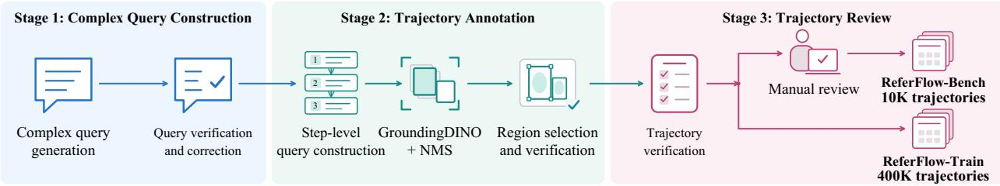  
Figure 7 Overview of the annotation pipeline for ReferFlow-Bench and ReferFlow-Train.

Complex Query Construction. For each selected image, we prompt the MLLM to generate a complex query based on visible objects, attributes, and relationships. Task-specific prompts prescribe the intended trajectory type (Refinement, Shift, Reset, or Mixture), the trajectory length, and the number of targets. The MLLM then checks each query for factual accuracy, verifying that the mentioned objects are present in the image and that their attributes and relationships are correctly described. Queries with factual errors are revised without changing their intended final targets.

Trajectory Annotation. For each verified complex query, we construct an ordered sequence of grounding steps, each formulated as a step-level query. For each step-level query, we use GroundingDINO (Liu et al., 2024) to generate candidate bounding boxes and apply non-maximum suppression (NMS) to remove redundant boxes. Given the full image and the regions from preceding steps, the MLLM checks whether the candidate regions correctly and completely identify the targets of the current step-level query. Trajectories containing steps that fail this check are discarded.

Trajectory Review. The MLLM reviews the complete trajectory to ensure that the ordered steps and their dependencies preserve the semantics of the original complex query and accurately locate the intended final targets. Trajectories with unresolved inconsistencies are discarded. We split the trajectories by source image into a benchmark set and a training set. For ReferFlow-Bench, three annotators conduct two rounds of manual review, accepting or rejecting each trajectory based on the accuracy of its query, bounding boxes, and grounding steps. They achieve an initial inter-annotator agreement of 92.8%, and 10K trajectories are retained after review. The training split constitutes ReferFlow-Train, which contains 400K automatically verified trajectories. An additional audit of 2,000 ReferFlow-Train trajectories finds that 89.1% satisfy the same criteria without modification.

## B.2 Statistics of ReferFlow-Bench

ReferFlow-Bench comprises 10,000 trajectories with an average image resolution of 990×769. The dataset features a mean target-region area ratio of 5.76% and an average step-level query length of 11 words. As illustrated in Fig. 8, 45.2% of the queries exhibit a mean relative bounding box area of at most 1%, while 72.1% have a mean relative area of at most 5%. Trajectory lengths range from 2 to 8 steps. Specifically, 83.4% consist of 2 to 4 steps, and 16.6% comprise five or more. In terms of query length, 61.3% of the queries contain 11 to 15 words, followed by 33.1% that contain 6 to 10 words. Regarding spatial complexity, single-region queries account for 77.3% of all step-level queries, whereas the remaining 22.7% require multiple regions, with 4.5% involving six or more.

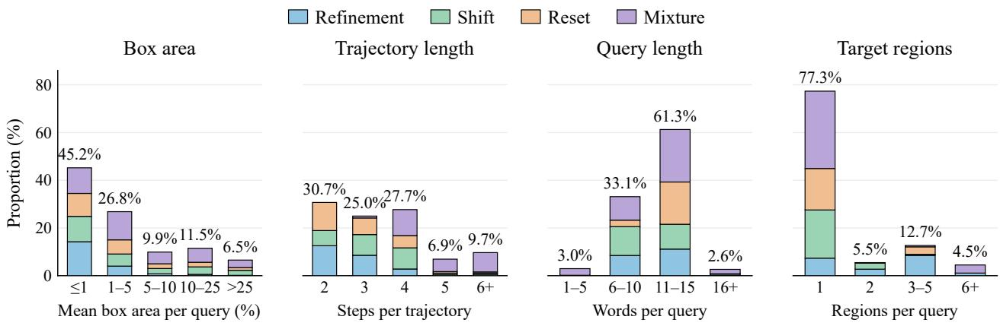  
Figure 8 Statistics of ReferFlow-Bench. Distributions of (a) mean box area per query, (b) trajectory length, (c) query length, and (d) the number of target regions per query. Query-level statistics are computed over step-level queries.

## B.3 Details of the Evaluation Protocol

ReferFlow-Bench employs a single-turn evaluation protocol. Each model receives an image and the complete ordered sequence of grounding steps derived from a single complex query. The model is required to output the target bounding boxes for each step in the specified order within a single response. Crucially, the ground-truth bounding boxes and the number of target objects at each step are not provided to the model. For example, in the Shift task shown in Fig. 2, the evaluation prompt is “Locate the man in black at the chessboard, then the woman seated beside him, and finally the scoresheet she uses to record the moves. Return all target boxes for each step in the specified order in a single response.” We compare the set of predicted bounding boxes for the t-th step with the corresponding ground-truth set. Missing or unparseable predictions are treated as incorrect. Any predicted steps exceeding the specified trajectory length T are excluded from the Q-Acc and F-Acc calculations. A step is deemed correct only if the predicted and ground-truth sets contain an identical number of boxes and can be matched one-to-one such that every pair achieves an IoU ≥ 0.5, irrespective of the box order. Q-Acc averages the proportion of correctly grounded steps across trajectories, utilizing the specified length T as the denominator for each trajectory. T-Acc measures the proportion of trajectories in which every step is correct without any extra predicted steps. Finally, F-Acc measures accuracy at the final step T.

## C Details of ReferFlow

## C.1 Details of Training Data and Trajectory Supervision

We construct our training data by combining ReferFlow-Train with existing REC datasets. For supervised fine-tuning, we compile 1.6M samples, comprising 400K annotated grounding trajectories from ReferFlow-Train and 1.2M REC samples randomly sampled from the training sets of $\mathrm { R e f C O C O / + / g }$ (Kazemzadeh et al., 2014; Yu et al., 2016), Rexverse-2M (Jiang et al., 2024), Visual Genome (Krishna et al., 2017), and HumanRef-CoT-45k (Jiang et al., 2026a).

Standard REC samples take a referring expression (e.g., “Locate the red cup on the table”) as input and are formulated as single-step trajectories with T = 1. We formulate the ReferFlow-Train data in two distinct formats, with each trajectory randomly assigned to only one format. For trajectory-level REC, the input provides ordered grounding steps (e.g., “Locate the man in a blue shirt, then the cup in his left hand”), and the model is trained to localize the target at each step. For trajectory generation, the input is the original complex query. The target response contains an ordered sequence of annotated step-level queries paired with their corresponding bounding boxes, supervising model to decompose the query into grounding steps and localize the targets at each step.

For Grounding-Aware GRPO, we select 13K challenging samples from the SFT dataset. We first perform rollouts using the SFT checkpoint and select samples based on final-target localization, prioritizing those with incorrect predictions. The selected data contain samples from both ReferFlow-Train and existing REC datasets, as summarized in Tab. 5. For REC, the model receives an image and a referring expression, and adaptively performs direct or trajectory-based grounding. For trajectory-level REC, the model receives the image and an ordered sequence of grounding steps. Grounding rewards use only final-target annotations for REC and are averaged over the steps for trajectory-level REC.

Table 5 Composition of training data.
<table><tr><td>Dataset</td><td>SFT</td><td>RL</td></tr><tr><td>ReferFlow-Train</td><td>400K</td><td>3K</td></tr><tr><td>RefCOCO/+/g</td><td>320K</td><td>1K</td></tr><tr><td>Rexverse-2M</td><td>400K</td><td>5K</td></tr><tr><td>Visual Genome</td><td>450K</td><td>2K</td></tr><tr><td>HumanRef-CoT-45k</td><td>30K</td><td>2K</td></tr><tr><td>Total</td><td>1.6M</td><td>13K</td></tr></table>

## C.2 More Implementation Details

Region State Supervision. For visual supervision, we encode reference features from the ground-truth target region. For each normalized ground-truth bounding box $\mathbf { b } ^ { * } = ( x _ { \operatorname* { m i n } } , y _ { \operatorname* { m i n } } , x _ { \operatorname* { m a x } } , y _ { \operatorname* { m a x } } )$ , we map it to the original image coordinates, crop the corresponding region, and extract region features using the same processor as the backbone and a frozen vision encoder. The crop boundaries are clipped to the image range, with the minimum crop width and height set to 10 pixels to avoid invalid regions after conversion to integer pixel coordinates. Given the resulting region feature map $\mathbf { V } ^ { * } \in \mathbb { R } ^ { H _ { v } \times W _ { v } \times d _ { v } }$ , we apply $4 \times 4$ adaptive average pooling and flatten the pooled features in row-major order to obtain fixed-length reference features:

$$
\mathbf { F } ^ { * } = \mathrm { F l a t t e n } _ { \mathrm { r o w } } \left( \mathrm { A d a p t i v e A v g P o o l } _ { 4 \times 4 } ( \mathbf { V } ^ { * } ) \right) \in \mathbb { R } ^ { 1 6 \times d _ { v } } ,\tag{18}
$$

where $N _ { p } = 1 6$ denotes the number of pooled spatial positions, and $d _ { v }$ is the visual feature dimension. For visual reconstruction, the auxiliary decoder uses an eight-head cross-attention layer with output dimension $d _ { v } .$ where fixed $4 \times 4$ two-dimensional sine-cosine positional embeddings P serve as queries and the corresponding region states $\mathbf { Z } _ { t , n }$ serve as keys and values:

$$
\hat { \mathbf { F } } _ { t , n } = \mathrm { L N } \left( \mathbf { P } + \mathrm { M H A } ( \mathbf { P } , \mathbf { Z } _ { t , n } , \mathbf { Z } _ { t , n } ) \right) .\tag{19}
$$

The visual supervision combines position-wise cosine distance and mean squared error:

$$
\mathcal { L } _ { \mathrm { v i s u a l } } ^ { t , n } = \frac { \lambda _ { \mathrm { c o s } } } { N _ { p } } \sum _ { j = 1 } ^ { N _ { p } } \left[ 1 - \cos \left( \hat { \mathbf { F } } _ { t , n , j } , \mathbf { F } _ { t , n , j } ^ { * } \right) \right] + \frac { \lambda _ { \mathrm { m s e } } } { N _ { p } d _ { v } } \left. \hat { \mathbf { F } } _ { t , n } - \mathbf { F } _ { t , n } ^ { * } \right. _ { F } ^ { 2 } ,\tag{20}
$$

where $\lambda _ { \mathrm { c o s } } = \lambda _ { \mathrm { m s e } } = 1$ . For spatial supervision, the prediction head concatenates the M latents of each region state and predicts normalized bounding-box coordinates through an MLP followed by a sigmoid function. The horizontal and vertical coordinate pairs are sorted to ensure ordered box coordinates. The spatial loss

combines the $L _ { 1 }$ loss over normalized coordinates with the GIoU loss:

$$
\mathcal { L } _ { \mathrm { s p a t i a l } } ^ { t , n } = \frac { 1 } { 4 } \sum _ { k = 1 } ^ { 4 } \left| \hat { b } _ { t , n , k } - b _ { t , n , k } ^ { * } \right| + 1 - \mathrm { G I o U } \left( \hat { \mathbf { b } } _ { t , n } , \mathbf { b } _ { t , n } ^ { * } \right) .\tag{21}
$$

The auxiliary decoder is used only during training. At inference time, it is removed and TAPD decodes the final bounding boxes.

Trajectory Generation. At each grounding step, the model first generates textual reasoning, followed by one or more region states. Each region state corresponds to a single target and contains $M = 2$ continuous region latents, delimited by the special tokens <|latent\_start|> and <|latent\_end|>. Upon completing all region states for the current step, the model terminates the region sequence and subsequently resumes textual reasoning. Consequently, the predicted number of targets $\hat { N } _ { t }$ at step t equals the number of region states generated at that step. TAPD then instantiates a coordinate block for each region state and decodes the corresponding bounding box. During training, targets within each grounding step are serialized according to their annotation order, whereas during inference, region states are parsed in generation order. Evaluation is performed by matching predicted and ground-truth bounding box sets within each step without requiring order correspondence, thereby accounting for both missed and redundant predictions.

Algorithm 1 Training of TAPD   
Input: $p _ { \theta } ;$ image I; task input S; trajectory H; ground-truth boxes $\{ \mathbf { b } _ { t , n } ^ { * } \}$   
1: for each $( t , n )$ do   
2: $B _ { t , n } \gets$ Encode $( \mathbf { b } _ { t , n } ^ { * } )$ // three digits per coordinate   
3: Sample masked token positions $\mathcal { M } _ { t , n }$ by coordinate, leaving 0–3 coordinates visible.   
4: $\begin{array} { r l } { \widetilde { B } _ { t , n } \gets B _ { t , n } ; } & { { } \widetilde { B } _ { t , n } [ \mathcal { M } _ { t , n } ] \gets [ \mathrm { M A S K } ] } \end{array}$   
5: end for   
6: Construct $\widetilde { \mathcal { H } }$ from H and $\{ \widetilde { B } _ { t , n } \} \ ( \mathrm { E q . ~ ( 5 ) } )$   
7: Estimate $\mathcal { L } _ { \mathrm { b o x } }$ under the trajectory-aware attention mask (Eq. (9)).   
8: Optimize the joint SFT objective $\mathcal { L } _ { \mathrm { S F T } }$ (Eq. (10)).

Algorithm 2 Inference of TAPD   
Input: pθ; image I; task input S; trajectory H.   
1: $B _ { t , n } \gets [ \mathrm { M A S K } ] ^ { 1 2 } , \quad \forall ( t , n )$   
2: for $r = 1 , \ldots , 4$ do   
3: Construct $\widetilde { \mathcal { H } } ^ { \left( r \right) }$ from H and the current $\{ B _ { t , n } \} ~ ( \mathrm { E q . ~ ( 5 ) } ) .$   
4: Compute $\{ p _ { r , c , j } \}$ for all blocks in one forward pass using the trajectory-aware attention mask   
(Eq. (6)).   
5: for each $\boldsymbol { B } _ { t , n }$ in parallel do   
6: $\mathcal { C } _ { r } \gets \{ c : \mathcal { B } _ { t , n } [ c ] = [ \mathrm { M A S K } ] ^ { 3 } \} \quad \mathrm { ~ / ~ } \mathcal { B } [ c ] .$ three digit tokens   
7: Determine $\mathcal { T } _ { r } ( c )$ from recovered coordinates and box constraints, $c \in { \mathcal { C } } _ { r }$   
8: $\mathcal { V } _ { r } ( c )  \mathcal { T } _ { r } ( c ) \cap \{ 0 , \dots , 9 9 9 \} , \quad c \in \mathcal { C } _ { r }$   
9: $\begin{array} { r } { S _ { r } ( c , v )  \sum _ { j = 1 } ^ { 3 } \log p _ { r , c , j } ( d _ { j } ( v ) ) , \quad c \in \mathcal { C } _ { r } , \ v \in \mathcal { V } _ { r } ( c ) } \end{array}$   
10: $\widehat { v } _ { r } ( c ) \gets \arg \operatorname* { m a x } _ { v \in \mathcal { V } _ { r } ( c ) } S _ { r } ( c , v ) , \quad c \in \mathcal { C } _ { r } \quad / /$ best value per coordinate   
11: $c _ { r } ^ { * } \gets \mathrm { a r g }$ maxc∈C Sr(c, vbr(c)) // highest-confidence coordinate   
12: $\boldsymbol { B _ { t , n } } [ c _ { r } ^ { * } ] \gets \left( d _ { j } ( \widehat { v } _ { r } ( c _ { r } ^ { * } ) ) \right) _ { j = 1 } ^ { 3 }$   
13: end for   
14: end for   
Output: Boxes decoded from $\{ B _ { t , n } \}$ , grouped by step t.

Training and Inference of TAPD. During SFT, we randomly keep zero to three coordinates visible in each ground-truth block and mask the rest. At inference, all blocks are decoded in parallel over four rounds, recovering the highest-confidence geometrically feasible coordinate per block at each round. Algorithms 1 and 2 summarize TAPD training and inference.

GRPO Policy Update. Following the GRPO framework (Shao et al., 2024), for each input q, we sample G trajectories $\{ o _ { i } \} _ { i = 1 } ^ { G }$ from $\pi _ { \theta _ { \mathrm { o l d } } }$ . We apply GRPO to the sampled discrete-token actions within each trajectory, denoting their positions by $\mathcal { T } _ { i }$ . For each $j \in \mathcal { T } _ { i }$ , the token-level probability ratio is defined as:

$$
r _ { i , j } ( \theta ) = \frac { \pi _ { \theta } ( o _ { i , j } \mid q , \mathcal { H } _ { \theta , i , < j } ) } { \pi _ { \theta _ { \mathrm { o l d } } } ( o _ { i , j } \mid q , \mathcal { H } _ { \theta _ { \mathrm { o l d } } , i , < j } ) } ,\tag{22}
$$

where $\mathcal { H } _ { \boldsymbol { \theta } , i , < j }$ represents the text-latent history deterministically reconstructed from the same discrete prefix under the corresponding policy.

Given the overall reward, $R _ { i } = R ( o _ { i } )$ defined in the main text, the group-relative advantage is computed as:

$$
\hat { A } _ { i } = \frac { R _ { i } - \operatorname* { m e a n } ( \{ R _ { k } \} _ { k = 1 } ^ { G } ) } { \operatorname* { s t d } ( \{ R _ { k } \} _ { k = 1 } ^ { G } ) + \delta } ,\tag{23}
$$

where $\delta > 0$ is a numerical stability constant, and $\hat { A } _ { i }$ is shared across all sampled tokens in $o _ { i }$ . The policy is optimized using token-level clipping and per-trajectory averaging:

$$
\begin{array} { r l } & { \mathcal { I } _ { \mathrm { G R P O } } ( \boldsymbol { \theta } ) = \mathbb { E } \underset { \{ \boldsymbol { o } _ { i } \} _ { i = 1 } ^ { G } \sim \pi _ { \theta _ { \mathrm { o l d } } } ( \cdot \vert \boldsymbol { q } ) } { \mathbb { E } } \Bigg [ \frac { 1 } { G } \underset { i = 1 } { \overset { G } { \sum } } \frac { 1 } { \vert \mathcal { T } _ { i } \vert } \underset { j \in \mathcal { T } _ { i } } { \sum } \Big \lbrace } \\ & { \quad \quad \quad \operatorname* { m i n } \bigg [ r _ { i , j } ( \boldsymbol { \theta } ) \hat { A } _ { i } , \ \mathrm { c l i p } ( r _ { i , j } ( \boldsymbol { \theta } ) , 1 - \varepsilon , 1 + \varepsilon ) \hat { A } _ { i } \Big ] - \beta D _ { \mathrm { K L } } ^ { i , j } ( \boldsymbol { \theta } ) \bigg \rbrace \Bigg ] , } \end{array}\tag{24}
$$

where $D _ { \mathrm { K L } } ^ { i , j }$ denotes the token-level KL divergence relative to the fixed SFT reference policy. TAPD decoding is employed solely to recover bounding boxes for reward computation, and the sampled rollouts from the fixed prefix are used exclusively to estimate $R _ { \mathrm { T R } } { } _ { \ }$ , where the policy updates are applied to the original G sampled trajectories.

## C.3 Evaluation on General REC Benchmarks

For RefCOCO, RefCOCO+, RefCOCOg, Ref-L4, Ref-Adv, and GroundingME, we report Acc@0.5, which counts a predicted box as correct when its IoU with the ground-truth box is at least 0.5. For HumanRef, we report Density-F1 (DF1), averaged over IoU thresholds from 0.5 to 0.95. For PR-Bench, we report Mean Accuracy (mAcc), averaged over its five grounding categories and IoU thresholds from 0.5 to 0.9.

## D In-Depth Analysis of ReferFlow-Bench

## D.1 Detailed Results across Eight Trajectory Subtypes

Tab. 6 and Tab. 7 present the results across the eight trajectory subtypes. In the Refinement subtype, Attribute consistently outperforms Relational, suggesting that target-specific attributes provide more efective constraints for candidate filtering than relations involving other objects. Similarly, Spatial generally outperforms Semantic in the Shift subtype, indicating that explicit spatial relations support transitions from previously grounded regions more efectively than semantic associations. In the Reset subtype, Cross-category consistently achieves higher performance than Intra-category, even though both require independent localization. This performance gap suggests that category changes help separate new targets from historical regions, whereas shared category semantics increase interference from previous grounding results. In the Mixture subtype, Sequential consistently outperforms Interleaved, demonstrating that directly continuing the preceding grounding step is more reliable than selectively reusing earlier grounding results. This highlights the importance of identifying relevant historical regions rather than merely maintaining the most recent region state. ReferFlow achieves the best performance across all subtypes, demonstrating its ability to exploit relevant region information while limiting interference from irrelevant historical states in each step.

Table 6 Performance comparison on the Refinement and Shift subtypes of ReferFlow-Bench.
<table><tr><td rowspan="3">Model</td><td rowspan="3">Size</td><td colspan="6">Refinement</td><td colspan="6">Shift</td></tr><tr><td colspan="2">Attribute</td><td colspan="2"></td><td colspan="2">Relational</td><td colspan="2">Spatial</td><td colspan="2"></td><td colspan="2">Semantic</td></tr><tr><td>Q-Acc</td><td>T-Acc</td><td>F-Acc</td><td>Q-Acc</td><td>T-Acc</td><td>F-Acc</td><td>Q-Acc</td><td>T-Acc</td><td>F-Acc</td><td>Q-Acc</td><td>T-Acc</td><td>F-Acc</td></tr><tr><td>Gemini 3.1 Pro</td><td></td><td>28.5</td><td>11.7</td><td>50.7</td><td>22.4</td><td>7.2</td><td>44.3</td><td>43.1</td><td>17.5</td><td>35.5</td><td>39.6</td><td>14.9</td><td>31.4</td></tr><tr><td>GPT-5.6 Sol</td><td></td><td>36.0</td><td>12.8</td><td>53.4</td><td>30.9</td><td>9.1</td><td>47.9</td><td>52.8</td><td>24.7</td><td>39.0</td><td>49.9</td><td>22.7</td><td>35.5</td></tr><tr><td>Ovis2.5</td><td>2B</td><td>21.1</td><td>3.4</td><td>30.0</td><td>15.4</td><td>0.3</td><td>23.8</td><td>37.8</td><td>8.0</td><td>24.5</td><td>34.6</td><td>5.7</td><td>20.7</td></tr><tr><td>Qwen3-VL</td><td>2B</td><td>24.8</td><td>5.0</td><td>33.5</td><td>18.2</td><td>0.5</td><td>26.5</td><td>45.6</td><td>13.2</td><td>29.7</td><td>41.8</td><td>10.6</td><td>25.6</td></tr><tr><td>Qwen3.5</td><td>4B</td><td>29.6</td><td>5.1</td><td>37.4</td><td>24.7</td><td>1.6</td><td>32.1</td><td>48.3</td><td>15.6</td><td>35.9</td><td>45.7</td><td>13.6</td><td>33.0</td></tr><tr><td>LLaVA-OneVision-1.5</td><td>4B</td><td>12.5</td><td>0.7</td><td>10.6</td><td>6.4</td><td>0.1</td><td>4.0</td><td>28.0</td><td>7.2</td><td>21.4</td><td>24.5</td><td>4.9</td><td>17.3</td></tr><tr><td>Youtu-VL</td><td>4B</td><td>12.9</td><td>2.6</td><td>23.5</td><td>7.8</td><td>0.3</td><td>17.8</td><td>46.0</td><td>10.0</td><td>26.8</td><td>43.1</td><td>7.9</td><td>23.3</td></tr><tr><td>MiMo-VL-RL</td><td>7B</td><td>21.4</td><td>2.8</td><td>23.8</td><td>15.7</td><td>0.3</td><td>17.5</td><td>39.3</td><td>8.3</td><td>28.7</td><td>36.1</td><td>6.0</td><td>24.9</td></tr><tr><td>Keye-VL-1.5</td><td>8B</td><td>18.5</td><td>1.4</td><td>16.8</td><td>11.9</td><td>0.2</td><td>9.8</td><td>38.5</td><td>5.4</td><td>19.4</td><td>34.7</td><td>2.8</td><td>15.3</td></tr><tr><td>InternVL3.5</td><td>8B</td><td>21.0</td><td>6.0</td><td>24.4</td><td>16.1</td><td>2.5</td><td>19.1</td><td>40.0</td><td>10.3</td><td>27.6</td><td>37.4</td><td>8.3</td><td>24.7</td></tr><tr><td>Qwen3.5</td><td>9B</td><td>31.3</td><td>5.4</td><td>39.3</td><td>25.2</td><td>0.9</td><td>32.7</td><td>52.6</td><td>16.6</td><td>38.3</td><td>49.1</td><td>14.3</td><td>34.2</td></tr><tr><td>GLM-4.6V-Flash</td><td>9B</td><td>28.8</td><td>7.3</td><td>44.8</td><td>23.7</td><td>3.6</td><td>39.3</td><td>53.7</td><td>20.7</td><td>38.0</td><td>50.8</td><td>18.6</td><td>34.5</td></tr><tr><td>Qwen3.5</td><td>27B</td><td>39.1</td><td>7.0</td><td>53.7</td><td>33.4</td><td>2.7</td><td>47.6</td><td>57.8</td><td>19.5</td><td>41.9</td><td>54.6</td><td>17.2</td><td>38.1</td></tr><tr><td>Qwen3.8</td><td>27B</td><td>40.5</td><td>7.1</td><td>55.1</td><td>33.9</td><td>2.4</td><td>48.1</td><td>55.6</td><td>19.3</td><td>39.5</td><td>51.8</td><td>16.7</td><td>35.4</td></tr><tr><td>Ovis2.6</td><td>30B-A3B</td><td>31.2</td><td>10.4</td><td>46.1</td><td>26.3</td><td>6.9</td><td>40.8</td><td>54.2</td><td>16.7</td><td>39.4</td><td>51.6</td><td>14.7</td><td>36.5</td></tr><tr><td>InternVL3.5</td><td>38B</td><td>27.6</td><td>10.6</td><td>42.0</td><td>21.5</td><td>6.1</td><td>35.5</td><td>51.2</td><td>23.6</td><td>39.8</td><td>47.7</td><td>21.3</td><td>35.7</td></tr><tr><td>GLM-4.6V</td><td>106B-A12B</td><td>34.9</td><td>7.9</td><td>43.9</td><td>29.8</td><td>4.2</td><td>38.4</td><td>56.6</td><td>17.9</td><td>39.2</td><td>53.7</td><td>15.8</td><td>35.7</td></tr><tr><td>Qwen3.5</td><td>122B-A10B</td><td>40.3</td><td>9.4</td><td>55.4</td><td>34.6</td><td>5.1</td><td>49.3</td><td>57.6</td><td>20.4</td><td>41.5</td><td>54.4</td><td>18.1</td><td>37.7</td></tr><tr><td>Step-3.7-Flash</td><td>198B-A11B</td><td>31.9</td><td>12.6</td><td>39.5</td><td>25.2</td><td>7.9</td><td>32.5</td><td>54.6</td><td>23.2</td><td>46.5</td><td>50.8</td><td>20.6</td><td>42.4</td></tr><tr><td>InternVL3.5</td><td>241B-A28B</td><td>26.0</td><td>8.6</td><td>37.7</td><td>21.1</td><td>5.1</td><td>32.4</td><td>53.4</td><td>21.5</td><td>41.7</td><td>50.8</td><td>19.5</td><td>38.8</td></tr><tr><td>DeepEyes</td><td>7B</td><td>15.4</td><td>4.5</td><td>23.6</td><td>9.3</td><td>0.4</td><td>17.0</td><td>33.8</td><td>5.4</td><td>15.6</td><td>30.3</td><td>3.1</td><td>11.5</td></tr><tr><td>RegionReasoner</td><td>7B</td><td>17.5 46.7</td><td>0.0 16.4</td><td>10.6 53.7</td><td>12.4 41.0</td><td>0.0 12.1</td><td>5.1 47.6</td><td>37.8 59.2</td><td>9.3</td><td>24.8</td><td>34.9 56.0</td><td>7.3</td><td>21.3</td></tr><tr><td>Rex-Omni ReferFlow</td><td>3B 2B</td><td>59.1</td><td>24.7</td><td>68.8</td><td>53.6</td><td>20.6</td><td>62.9</td><td>70.8</td><td>21.4 36.8</td><td>44.1 63.4</td><td>67.9</td><td>19.1 34.5</td><td>40.3 59.9</td></tr></table>

Table 7 Performance comparison on the Reset and Mixture subtypes of ReferFlow-Bench.
<table><tr><td rowspan="3">Model</td><td rowspan="3">Size</td><td colspan="6">Reset</td><td colspan="6">Mixture</td></tr><tr><td colspan="3">Cross-category</td><td colspan="3">Intra-category</td><td colspan="3">Sequential</td><td colspan="3">Interleaved</td></tr><tr><td>Q-Acc</td><td>T-Acc</td><td>F-Acc</td><td>Q-Acc</td><td>T-Acc</td><td>F-Acc</td><td>Q-Acc T-Acc F-Acc</td><td></td><td></td><td>Q-Acc T-Acc</td><td></td><td>F-Acc</td></tr><tr><td>Gemini 3.1 Pro</td><td></td><td>36.2</td><td>6.6</td><td>24.9</td><td>30.9</td><td>3.2</td><td>19.6</td><td>34.4</td><td>6.6</td><td>34.4</td><td>27.3</td><td>1.5</td><td>27.0</td></tr><tr><td>GPT-5.6 Sol</td><td></td><td>48.5</td><td>9.4</td><td>34.2</td><td>44.3</td><td>6.6</td><td>29.7</td><td>50.2</td><td>9.3</td><td>47.9</td><td>44.2</td><td>5.1</td><td>41.6</td></tr><tr><td>Ovis2.5</td><td>2B</td><td>31.4</td><td>1.8</td><td>29.7</td><td>26.3</td><td>0.1</td><td>24.6</td><td>28.9</td><td>4.0</td><td>26.8</td><td>22.2</td><td>0.4</td><td>19.7</td></tr><tr><td>Qwen3-VL</td><td>2B</td><td>41.8</td><td>7.1</td><td>32.9</td><td>36.5</td><td>3.5</td><td>27.3</td><td>40.2</td><td>6.7</td><td>32.8</td><td>32.8</td><td>1.3</td><td>24.8</td></tr><tr><td>Qwen3.5</td><td>4B</td><td>47.6</td><td>9.1</td><td>31.1</td><td>43.7</td><td>6.6</td><td>26.9</td><td>38.1</td><td>10.1</td><td>33.3</td><td>32.5</td><td>6.1</td><td>27.3</td></tr><tr><td>LLaVA-OneVision-1.5</td><td>4B</td><td>21.3</td><td>0.9</td><td>2.6</td><td>16.0</td><td>0.1</td><td>0.1</td><td>21.3</td><td>0.0</td><td>4.3</td><td>14.2</td><td>0.0</td><td>0.1</td></tr><tr><td>Youtu-VL</td><td>4B</td><td>39.2</td><td>5.2</td><td>21.0</td><td>35.0</td><td>2.4</td><td>16.5</td><td>32.4</td><td>3.4</td><td>26.2</td><td>26.4</td><td>0.3</td><td>19.9</td></tr><tr><td>MiMo-VL-RL</td><td>7B</td><td>32.7</td><td>3.7</td><td>22.5</td><td>27.6</td><td>0.3</td><td>17.4</td><td>32.2</td><td>2.5</td><td>22.3</td><td>25.5</td><td>0.3</td><td>15.2</td></tr><tr><td>Keye-VL-1.5</td><td>8B</td><td>33.2</td><td>2.2</td><td>14.7</td><td>27.9</td><td>0.2</td><td>9.1</td><td>32.0</td><td>1.5</td><td>21.5</td><td>24.6</td><td>0.2</td><td>13.5</td></tr><tr><td>InternVL3.5</td><td>8B</td><td>30.7</td><td>3.1</td><td>22.6</td><td>26.8</td><td>0.6</td><td>18.4</td><td>34.0</td><td>6.3</td><td>27.3</td><td>28.4</td><td>2.3</td><td>21.3</td></tr><tr><td>Qwen3.5</td><td>9B</td><td>50.4</td><td>10.1</td><td>33.7</td><td>45.1</td><td>6.7</td><td>28.4</td><td>38.9</td><td>12.0</td><td>41.5</td><td>31.8</td><td>6.9</td><td>34.1</td></tr><tr><td>GLM-4.6V-Flash</td><td>9B</td><td>48.4</td><td>9.4</td><td>32.9</td><td>44.2</td><td>6.6</td><td>28.4</td><td>47.7</td><td>12.1</td><td>45.5</td><td>41.7</td><td>7.9</td><td>39.2</td></tr><tr><td>Qwen3.5</td><td>27B</td><td>53.5</td><td>10.9</td><td>38.9</td><td>48.4</td><td>7.5</td><td>33.9</td><td>49.6</td><td>18.7</td><td>52.7</td><td>42.9</td><td>14.0</td><td>45.6</td></tr><tr><td>Qwen3.8</td><td>27B</td><td>54.5</td><td>11.8</td><td>40.0</td><td>49.2</td><td>8.1</td><td>34.4</td><td>51.8</td><td>14.4</td><td>52.4</td><td>44.4</td><td>9.3</td><td>44.4</td></tr><tr><td>Ovis2.6</td><td>30B-A3B</td><td>45.5</td><td>8.0</td><td>31.3</td><td>41.6</td><td>5.5</td><td>27.1</td><td>45.1</td><td>9.2</td><td>43.5</td><td>39.5</td><td>5.2</td><td>37.5</td></tr><tr><td>InternVL3.5</td><td>38B</td><td>44.7</td><td>9.4</td><td>28.7</td><td>39.4</td><td>6.0</td><td>23.4</td><td>46.5</td><td>10.4</td><td>51.7</td><td>39.4</td><td>5.3</td><td>44.3</td></tr><tr><td>GLM-4.6V</td><td>106B-A12B</td><td>51.6</td><td>10.5</td><td>34.3</td><td>47.4</td><td>7.7</td><td>29.8</td><td>50.3</td><td>7.4</td><td>48.8</td><td>44.3</td><td>3.2</td><td>42.5</td></tr><tr><td>Qwen3.5 Step-3.7-Flash</td><td>122B-A10B</td><td>52.3 47.8</td><td>11.4 10.7</td><td>35.7 34.0</td><td>47.2</td><td>8.0</td><td>30.6 28.4</td><td>46.8</td><td>8.5</td><td>48.2</td><td>40.1</td><td>3.8</td><td>41.1</td></tr><tr><td>InternVL3.5</td><td>198B-A11B 241B-A28B</td><td>50.7</td><td>11.2</td><td>35.8</td><td>42.5 46.8</td><td>7.0 8.7</td><td>31.6</td><td>37.8 48.0</td><td>7.3 10.4</td><td>40.5 46.8</td><td>30.4 42.4</td><td>2.2 6.4</td><td>32.5 40.8</td></tr><tr><td></td><td></td><td></td><td></td><td></td><td></td><td></td><td></td><td></td><td></td><td></td><td></td><td></td><td></td></tr><tr><td>DeepEyes</td><td>7B 7B</td><td>29.2 39.9</td><td>8.6 5.9</td><td>21.1 24.4</td><td>23.9 35.7</td><td>5.2 3.1</td><td>15.8 20.0</td><td>32.6 27.9</td><td>2.8 4.7</td><td>23.6 25.6</td><td>25.5 21.9</td><td>0.6</td><td>16.2</td></tr><tr><td>RegionReasoner Rex-Omni</td><td>3B</td><td>50.4</td><td>13.3</td><td>38.6</td><td>45.3</td><td>10.0</td><td>33.6</td><td>57.3</td><td>8.7</td><td>37.2</td><td>50.6</td><td>0.5 4.0</td><td>19.4 30.1</td></tr><tr><td>ReferFlow</td><td>2B</td><td>67.7</td><td>30.8</td><td>65.1</td><td>63.2</td><td>27.7</td><td>60.3</td><td>66.2</td><td>27.2</td><td>63.4</td><td>59.9</td><td>22.7</td><td>56.7</td></tr></table>

## D.2 Single-Turn vs. Multi-Turn Evaluation

In our default single-turn setting, the model receives the complete ordered sequence of grounding steps at once and predicts their target regions in one response. We compare this with a multi-turn setting that presents one step-level query per turn. This setting retains the original image and full dialogue history, including the model’s own predicted bounding boxes. The single-turn setting requires models to track grounding steps and their corresponding target regions throughout generation, whereas the multi-turn setting explicitly specifies the current query at each turn. As shown in Fig. 9, the single-turn setting yields lower Q-Acc and T-Acc than the multi-turn setting. Moreover, Q-Acc declines more sharply with trajectory length in the single-turn setting, widening the gap between the two settings. Multi-turn evaluation explicitly specifies the current query at each turn, guiding the model through successive grounding steps. In contrast, single-turn evaluation requires the model to track its progress through the complete query sequence while grounding the targets at each step. These results suggest that single-turn evaluation better reveals the challenges of consistently grounding intermediate visual references within a complex query without turn-by-turn guidance.

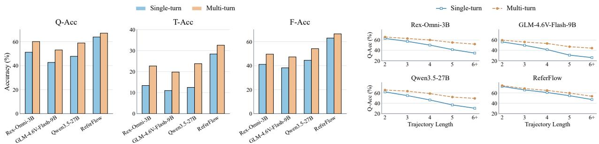  
Figure 9 Comparisons between multi-turn and single-turn evaluation protocols on ReferFlow-Bench.

## D.3 Effects of Intermediate Grounding

We investigate the impact of intermediate grounding on final localization across the full ReferFlow-Bench, reporting F-Acc in Fig. 10. Prior to predicting the final target, we either retain the predicted intermediate bounding boxes (Predicted), replace them with ground-truth bounding boxes (Oracle) or distractor bounding boxes (Wrong), or omit them entirely (Removed). The input image and the entire query sequence remain fixed across all conditions. Across both models, the Oracle condition consistently outperforms the Predicted condition for the Refinement, Shift, and Mixture trajectory types. Furthermore, the Wrong condition underperforms the Removed condition across all four trajectory types, suggesting that incorrect intermediate bounding boxes can negatively interfere with final localization. Shift shows the largest gap between Oracle and Wrong in both models, while Reset remains relatively stable, reflecting their diferent dependencies on prior regions.

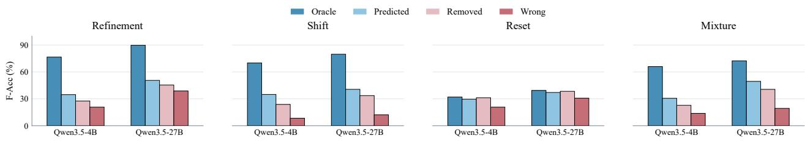  
Figure 10 Efects of intermediate grounding on final localization across trajectory types.

## E In-Depth Analysis of ReferFlow

Table 8 Eficiency analysis of ReferFlow compared with representative models. We report average wall-clock time (Time), sequence length (Len.), and accuracy (Acc.) across three benchmarks. For ReferFlow-Bench, Acc. denotes Q-Acc. Fallback denotes re-decoding unreliable parallel outputs using next-token prediction. – denotes unsupported evaluation settings.
<table><tr><td>Model</td><td colspan="3">RefCOCOg</td><td colspan="3">GroundingME</td><td colspan="3">ReferFlow-Bench</td></tr><tr><td></td><td>Time (s)</td><td>Len.</td><td>Acc.</td><td>Time (s)</td><td>Len.</td><td>Acc.</td><td>Time (s)</td><td>Len.</td><td>Acc.</td></tr><tr><td>Qwen3-VL-2B</td><td>1.5</td><td>29.4</td><td>84.3</td><td>2.8</td><td>85.6</td><td>27.6</td><td>6.3</td><td>237.1</td><td>34.8</td></tr><tr><td>LocateAnything</td><td>0.9 (24.5% fallback)</td><td>10.2</td><td>88.0</td><td>1.9 (66.5% fallback)</td><td>53.7</td><td>23.9</td><td>一</td><td></td><td></td></tr><tr><td>ReferFlow</td><td>0.8</td><td>18.8</td><td>92.2</td><td>1.2</td><td>62.4</td><td>43.4</td><td>1.8</td><td>119.4</td><td>63.2</td></tr></table>

## E.1 Efficiency Analysis

Tab. 8 compares ReferFlow against representative models across three benchmarks, evaluating the average wall-clock time, output sequence length, and grounding accuracy. We randomly sample 800 instances each from RefCOCOg and GroundingME, and 800 trajectories from ReferFlow-Bench, each containing five ground-truth boxes across all steps. LocateAnything is excluded from ReferFlow-Bench because its current implementation does not support grounding an entire trajectory within a single input. The longer output sequences on GroundingME partly reflect its longer queries, as the query text is repeated in the generated responses. Compared to the same-backbone baseline Qwen3-VL-2B, ReferFlow improves grounding accuracy while reducing inference time and output sequence length across all benchmarks. SRLR utilizes compact continuous states to represent intermediate regions, while TAPD recovers all box coordinates in parallel. Overall, these components support trajectory-level grounding with competitive overall inference costs. ReferFlow also achieves highly competitive latency compared to LocateAnything, despite producing longer output sequences. Given that the two models difer in backbone and model size, these measurements compare overall system performance rather than isolated decoding eficiency.

To examine their decoding costs, we compare the sequential decoding steps required to generate N boxes.   
This analysis accounts for region-state generation and box decoding steps, while excluding textual reasoning. (i) Autoregressive Token Decoding. Qwen3-VL represents coordinates as text and generates them autoregressively.   
For coordinates in 0–999, assuming one token per digit, each coordinate requires one to three predictions.   
With five formatting tokens per box, generating N boxes requires 9N–17N sequential predictions.

(ii) Parallel Box Decoding with Fallback. LocateAnything jointly predicts a six-token block containing four coordinates and two boundary tokens. Each block requires one parallel step, while decoding remains sequential across boxes. Accounting for six additional autoregressive predictions per fallback yields an expected boxdecoding depth of (1 + 6p)N, where p is the per-box fallback rate. In our evaluation, 24.5% of RefCOCOg instances and 66.5% of GroundingME instances triggered NTP fallback, indicating a greater reliance on autoregressive correction on the more challenging benchmark. Using these sample-level rates as per-box estimates yields approximately 2.47N and 4.99N decoding steps, respectively.

(iii) ReferFlow. ReferFlow decouples region-state generation from coordinate decoding. For each box, it generates two continuous latents delimited by <|latent\_start|> and <|latent\_end|>. TAPD then recovers all boxes in parallel over four geometry-constrained rounds. Accounting for four sequential steps per region state and four TAPD rounds yields a total of 4N + 4 steps. Thus, region-state generation scales with the box count, while coordinate recovery remains fixed at four rounds without NTP fallback.

Although ReferFlow achieves higher grounding accuracy, it requires more sequential decoding steps when predicting a small number of boxes according to these estimates. However, as the number of boxes increases, TAPD maintains a fixed coordinate-decoding depth of four rounds, enforcing geometric constraints without relying on cross-box autoregression or NTP fallback. These characteristics facilitate long grounding trajectories and highlight the potential of ReferFlow for other tasks that require predicting multiple bounding boxes, such as dense object detection.

## E.2 Dependence on Historical Region States

We replace the region state of one intermediate target with that of another object in the same image (Mismatched) and rerun the remaining grounding steps. As shown in Fig. 11, F-Acc drops substantially on Refinement, Shift, and Mixture, with the largest decrease on Shift. In Shift, the target-specific visual and spatial information retained in a mismatched state can provide a misleading reference for locating the next target. In contrast, Reset remains relatively stable, with an absolute F-Acc decrease of only 0.8%. For Reset, the small performance change suggests that ReferFlow limits interference from historical region states when localizing independently specified targets. These results provide causal evidence that historical region states guide subsequent grounding, and suggest that ReferFlow selectively uses this information according to the task’s dependence on prior regions.

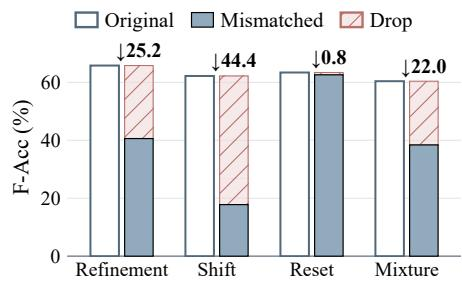  
Figure 11 Efect of historical region states on final localization.

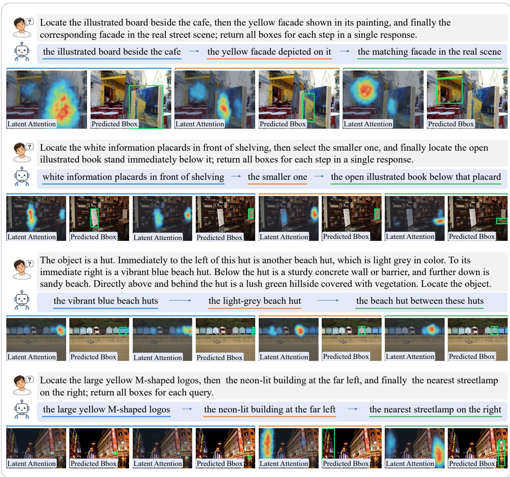  
Figure 12 Attention visualization of region latents. Heatmaps depict the Gaussian-smoothed aggregation of relevant image patches for region latents.

## E.3 Attention Visualization of Region States

We visualize attention from region latents to image tokens alongside the corresponding textual responses and predicted boxes in Fig. 12. For each region state, we average attention over its M = 2 region latents and all heads in the last full-attention layer. Across grounding steps, attention remains aligned with the corresponding target regions as constraints or targets change, providing qualitative evidence that region states capture target-specific visual information.

## E.4 Ablation on the Number of Region Latents

Table 9 evaluates the impact of the number of latents per region state. Increasing M from 1 to 2 improves performance across all evaluated benchmarks. However, performance declines slightly at M = 4 and drops further at $M = 8 .$ . This indicates that distributing the same region-level supervision across a larger number of latents may hinder region-state learning. Therefore, we adopt M = 2 as the default setting.

Table 9 Ablation on the number of region latents. All variants are evaluated after SFT.
<table><tr><td rowspan="2">M</td><td rowspan="2">RefCOCOg</td><td rowspan="2">GroundingME</td><td colspan="3">ReferFlow-Bench</td></tr><tr><td>Q-Acc</td><td>T-Acc</td><td>F-Acc</td></tr><tr><td>1</td><td>91.3</td><td>37.6</td><td>59.0</td><td>23.7</td><td>57.5</td></tr><tr><td>2</td><td>92.0</td><td>39.1</td><td>60.8</td><td>25.6</td><td>59.4</td></tr><tr><td>4</td><td>91.9</td><td>38.7</td><td>60.4</td><td>25.0</td><td>58.6</td></tr><tr><td>8</td><td>89.5</td><td>33.4</td><td>53.8</td><td>17.8</td><td>50.8</td></tr></table>

## E.5 MLP Regression vs. MLLM Coordinate Decoding

We further compare the auxiliary MLP for SRLR training and TAPD at diferent IoU thresholds in Fig. 13. At an IoU threshold of 0.3, the auxiliary MLP achieves comparable accuracy to TAPD on both benchmarks, indicating that region states retain spatial information for direct box prediction. The performance gap widens at higher IoU thresholds. Compared with the external MLP decoder, TAPD decodes coordinates within the MLLM, allowing it to combine the current region state with textual and regional evidence from the corresponding trajectory context for more precise localization.

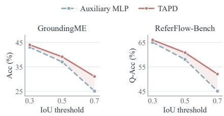  
Figure 13 Comparisons of coordinate decoding at diferent IoU thresholds after SFT.

## E.6 Adaptive Trajectory Generation

Fig. 14 illustrates the proportion of trajectory generation by ReferFlow across various REC benchmarks. The results indicate that the utilization of grounding trajectories is closely correlated with task complexity. On standard REC benchmarks such as $\operatorname { R e f C O C O } / + / \mathbf { g } ,$ which are characterized by short queries with limited intermediate references, the model relies predominantly on direct grounding. In contrast, on Ref-L4, which focuses on long-caption grounding, trajectory-based grounding is employed more frequently. This pattern is most notable on GroundingME, where trajectory-based grounding accounts for 74.5% of the predictions, reflecting a greater reliance on these trajectories for complex referring expressions. Additionally, Ref-Adv and HumanRef show more balanced distributions, though direct grounding remains more common.

## E.7 Effects of $R _ { \mathrm { T R } }$

We evaluate ReferFlow on the GroundingME benchmark following both SFT and RL, with and without the trajectory reward $R _ { \mathrm { T R } }$ . To isolate the efect of $R _ { \mathrm { T R } } , R _ { \mathrm { m u l t i } }$ is disabled in both RL settings. We report the final localization accuracy, the average number of grounding steps, and the trajectory ratio, defined as the proportion of multi-step grounding outputs. As shown in Tab. 10(a), compared to SFT, RL without $R _ { \mathrm { T R } }$ improves final localization accuracy but increases both the trajectory ratio and the average number of steps. Incorporating $R _ { \mathrm { T R } }$ further increases the trajectory ratio and final localization accuracy while maintaining the average number of steps largely unchanged, demonstrating a more favorable trade-of between grounding accuracy and trajectory length. Furthermore, we manually evaluate intermediate grounding on 500

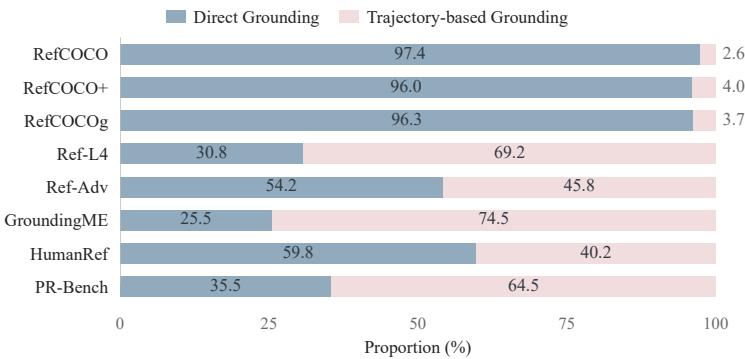  
Figure 14 Proportions of direct and trajectory-based grounding across benchmarks.

GroundingME samples, defining intermediate grounding accuracy as the proportion of intermediate steps that correctly ground their generated descriptions. Tab. 10(b) reveals that $R _ { \mathrm { T R } }$ enhances the accuracy of self-generated intermediate grounding steps, with performance gains observed across all trajectory length groups.

Table 10 Effects of trajectory reward on GroundingME. (a) Final localization accuracy, trajectory ratio, and average grounding steps, where trajectory ratio denotes the proportion of multi-step grounding outputs. (b) Intermediate grounding accuracy overall and across diferent trajectory lengths.  
(a) Final Accuracy and Trajectory Generation
<table><tr><td>Setting</td><td>Final Acc.(%)</td><td>Trajectory Ratio (%)</td><td>Avg. Steps</td></tr><tr><td>SFT</td><td>39.1</td><td>48.0</td><td>1.72</td></tr><tr><td>RL w/o  $R _ { \mathrm { T R } }$ </td><td>40.6</td><td>64.0</td><td>2.06</td></tr><tr><td>RL w/ RTR</td><td>42.1</td><td>71.0</td><td>2.03</td></tr></table>

(b) Intermediate Accuracy by Trajectory Length
<table><tr><td>Setting</td><td>Overall (%)</td><td>2 steps (%)</td><td>3 steps (%)</td><td>≥ 4 steps (%)</td></tr><tr><td>SFT</td><td>64.2</td><td>66.2</td><td>63.0</td><td>56.0</td></tr><tr><td>RL w/o RTR</td><td>65.6</td><td>68.1</td><td>65.0</td><td>58.7</td></tr><tr><td>RL w/ RTR</td><td>71.8</td><td>73.6</td><td>70.4</td><td>64.0</td></tr></table>

## E.8 Generalization to Object Detection

To demonstrate its broader applicability, we further extend ReferFlow to object detection via supervised fine-tuning on the COCO and LVIS training sets, using vanilla SFT with text-based bounding-box outputs as a baseline. Tab. 11 shows that ReferFlow outperforms both the original Qwen3-VL-2B backbone and the vanilla SFT baseline in detection accuracy, while also achieving a lower average inference time. These results demonstrate ReferFlow’s potential as an accurate and eficient framework for multi-object detection, extending its utility well beyond referring expression comprehension.

Table 11 Object detection accuracy and inference eficiency on COCO and LVIS.
<table><tr><td rowspan="2">Method</td><td colspan="2">COCO LVIS (F1@mloU) (F1@mloU)</td><td rowspan="2">Time(s)</td></tr><tr><td></td><td></td></tr><tr><td>Qwen3-VL-2B</td><td>46.2</td><td>40.7</td><td>2.5</td></tr><tr><td>+ Vanilla SFT</td><td>52.8</td><td>43.0</td><td>2.2</td></tr><tr><td>ReferFlow</td><td>55.1</td><td>43.8</td><td>1.1</td></tr></table>

## F Visualization

## F.1 Visualizations of ReferFlow-Bench

We provide visualizations on ReferFlow-Bench in Fig. 15 and Fig. 16, covering all four trajectory types, and showing the predictions of representative models to illustrate the challenge of ReferFlow-Bench.

## F.2 Visualization Results of ReferFlow

Fig. 17 presents representative outputs of ReferFlow. For REC tasks, ReferFlow adapts to query complexity by directly localizing targets or generating intermediate grounding steps. On ReferFlow-Bench, it follows the provided grounding steps and consistently localizes the corresponding target regions.

## (a) Refinement

Question: Locate the runners approaching along the winding paved path, then those wearing sleeveless tops, and finally the one wearing a green-and-yellow vest

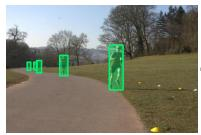

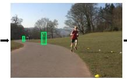  
Ground Truth

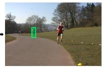

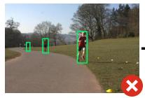

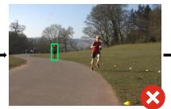  
Qwen3.5-4B

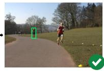

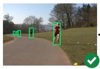

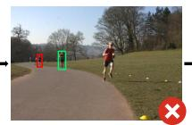

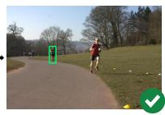  
Rex-Omni

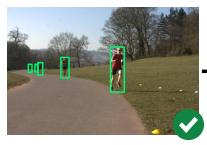

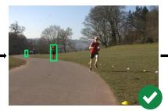

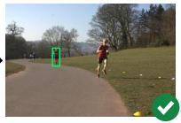  
ReferFlow  
Question: Locate the traffic signals controlling vehicles at the junction, then those along the left-hand building facade, and finally the higher signal.

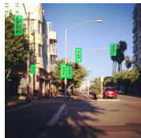

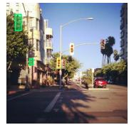  
Ground Truth

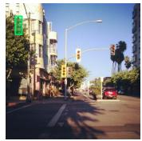

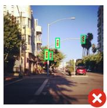

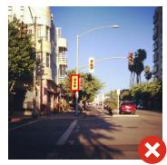

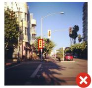

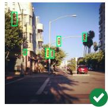  
Rex-Omni

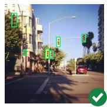  
Qwen3.5-4B

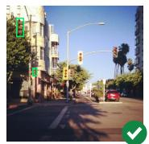  
ReferFlow

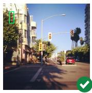

## (b) Shift

Question: Locate the taller plant in the pair of terracotta pots left of the entrance, then the terracotta pot directly below that plant, and finally the plant immediately to the right of that pot.

  
Ground Truth

  
Qwen3.5-4B

  
Rex-Omni

  
ReferFlow

  
Question: Locate the partially visible foreground car at the far left, then the car immediately to its right along the same curb, and finally the rear wheel of that car.

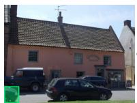

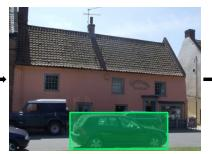

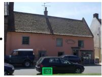  
Ground Truth

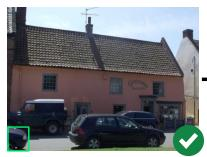

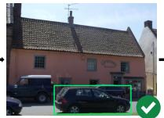

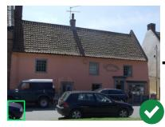

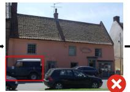

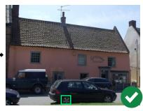  
Rex-Omni

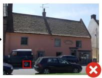

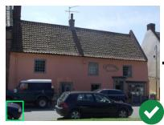  
Qwen3.5-4B

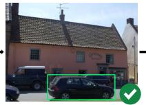  
ReferFlow

  
Figure 15 Visualization results for Refinement and Shift on ReferFlow-Bench. Each panel presents a challenging example and the corresponding predictions from representative models.

Qwen3.5-4B

Ground Truth

ReferFlow

## (c) Reset

Question: Locate the black stroller at the far left of the crowd, then the far-right building with a curved glass facade, and finally the photographer in black in the right foreground, facing the crowd.

  
Qwen3.5-4B

  
Rex-Omni

  
ReferFlow

Question: Locate the small potted plant nearest the green court, then the building with a white roof, and finally the streetlight nearest the bus shelters.  

  
Rex-Omni

  
ReferFlow

## (d) Mixture

  
Rex-Omni

  
Qwen3.5-4B

  
Rex-Omni

  
ReferFlow

  
Figure 16 Visualization results for Reset and Mixture on ReferFlow-Bench. Each panel presents a challenging example and the corresponding predictions from representative models.

## (a) Direct Grounding RefCOCO

Question: Locate the large standing elephant with its trunk hanging down.

## RefCOCO+

Question: Locate the white teddy bear wearing a red Santa hat and scarf.

## Ref-L4

Question: Locate the brown upholstered sofa against the left wall.

## HumanRef

Question: Locate the woman in a purple robe holding an open card.

## (b) Trajectory-based Grounding RefCOCOg

Question: Find the gold car behind and to the right of the parking meter, next to the red car and the van.

the parking meter  

the gold car behind it  

## GroundingME

Question: Find the second-tallest fountain to the right of the central statue.

the central statue  

second-tallest jet to its right

## Ref-Adv

Question: Of the people in the studio, consider only the two seated behind the glass, excluding the person at the mixing desk in the foreground. Find the non-red microphone directly in front of the one wearing glasses.

all three people in the studio

two people behind the glass  

the one wearing glasses  

the non-red microphone  

## (c) Grounding on ReferFlow-Bench

Question: Locate the tall drinking glasses on the table, then the uppermost one containing golden beer, then the person seated directly behind that glass, and finally the top he or she is wearing; return all boxes for each step in a single response.

the tall drinking glasses

the uppermost glass  

the person seated behind it

the top he is wearing  

Question: Locate the unoccupied tables in the foreground, then the one farther to the right, then the large white umbrella on the left, and finally chairs around the previously selected table; return all boxes for each step in a single response.

the unoccupied tables in the foreground

the one farther to the right

the large white umbrella on the left

the chairs around the previously selected table

  
Figure 17 Visualization results of ReferFlow. Blue dashed boxes denote intermediate reference regions, while green solid boxes denote predicted target regions.