# Reliability-Aware Multimodal Sentiment Prediction Under Local Modality Missingness

Minghao Kong1,2, Deng Yao3, Xi Zhang4, Ying Gao2 Jiurun Chen2, Zirong Liu2, Rongjie Wang 2

1School of Electronics and Communication Engineering, Sun Yat-sen University, Shenzhen, China

2Department of Network Intelligence, Pengcheng Laboratory, Shenzhen, China 3School of Mathematics, Sun Yat-sen University, Guangzhou, China 4School of Physics and Astronomy, Sun Yat-sen University, Zhuhai, China

## Abstract

Multimodal sentiment models are usually evaluated on complete utterances, yet streams often lose a contiguous span of text, audio, or video. We study local missingness on aligned CMU-MOSEI features. Our reliability-aware network (RM-Net) keeps the original temporal positions, represents unobserved positions with a learned token, outputs bounded per-modality intensity contributions gated by observation quality, and is trained with dual-view masking of contiguous segments. We fuse five RM-Net seeds with a LoRA-adapted BERT text expert, using a fusion weight that depends only on the visible fraction of content tokens. Architecture, checkpoint, and fusion choices were made on the validation split. On the held-out split, the fused model reaches a macro-F1 of 0.655 on clean inputs and 0.634 under 40% mixed missingness; its two-view average exceeds the auxiliary-head baseline by 0.024 (95% videocluster bootstrap interval [0.003, 0.045]). Because this split was inspected during development, these numbers are not a blind test. For explanations, exact Shapley attributions over the eight modality subsets and position-level occlusion show that top-ranked positions reduce the predicted-class probability faster than random positions (AUC gap 0.113 on validation). We also describe an auditable word-level alignment pipeline for raw clips; its outputs do not feed the predictive models.

## 1 Introduction

Sentiment is conveyed jointly through lexical content, prosody, and facial behavior, and multimodal models exploit these complementary cues (Zadeh et al., 2017; Tsai et al., 2019). Most such models assume that every modality is present throughout an utterance. In deployed systems this assumption fails in a structured way: a microphone drops out for a few seconds, a recognizer fails on one phrase, or a face leaves the frame. Such local, contiguous missingness differs from the random or whole-modality missingness studied in much prior work. The surviving modalities still carry evidence, and their temporal alignment with the gap must be preserved.

Two design questions follow. First, absent spans must be distinguished from observed content: without an observation mask, z-scored zero-filling treats an absent face as a face at the training mean. Second, fusion must reflect available evidence: a text expert’s influence should shrink as words disappear.

We address both questions. RM-Net keeps positions fixed, marks unobserved positions explicitly, weights modalities with a reliability gate, and is trained with dual-view masking of contiguous segments. A LoRA-adapted BERT expert supplies task-adapted text evidence, and its fusion weight is a deterministic function of visible text. Explanations are computed on the deployed fused predictor rather than on attention maps, using exact Shapley attribution and position-level interventions.

Our contributions are:

• an observation-aware, position-preserving sentiment network with reliability gating and dual-view training under contiguous masking;

• a text-availability-gated fusion of this network with a LoRA-adapted BERT expert, with all parameters and fusion settings chosen on validation;

• a controlled evaluation over 21 missingness conditions, position and length analyses, an ablation study, and a pre-encoding text-span deletion check, reported with the caveat that the held-out split was inspected earlier;

• dual-target explanations for both the fused intensity and the predicted-class probability, checked with deletion and retention curves against random orderings and with class-flip analysis;

• an auditable word-level alignment pipeline for raw clips, reported separately because its features do not enter the predictive results.

## 2 Related Work

Multimodal sentiment fusion. Early fusion models combine modalities through tensor products (Zadeh et al., 2017), low-rank factors (Liu et al., 2018), or shared and private representations (Hazarika et al., 2020). Cross-modal transformers model asynchronous streams directly (Tsai et al., 2019). These models generally assume complete inputs. CMU-MOSEI (Zadeh et al., 2018) is the standard benchmark for this setting.

Incomplete multimodal data. Recent work addresses incomplete inputs with dedicated mechanisms for learning under missing or corrupted modalities (Zhang et al., 2024; Zhu et al., 2025; Sun et al., 2024). Two of these works study random feature-level missingness within modalities (Zhu et al., 2025; Sun et al., 2024). Our setting differs in its structure: we preserve the original time positions and study contiguous spans of varying length and location, and we keep the pretrained encoders frozen while adding a separately trained text expert.

Parameter-efficient adaptation. Low-rank adaptation (Hu et al., 2022) trains small update matrices on top of a frozen transformer. We apply it to BERT (Devlin et al., 2019) to obtain a text expert that is trained only on the training split.

Explanations. Shapley values (Shapley, 1953) and their SHAP instantiation (Lundberg and Lee, 2017) attribute predictions to input groups. Deletion and insertion curves measure whether highly ranked evidence matters for the output (Petsiuk et al., 2018). Attention weights are not reliable explanations by themselves (Jain and Wallace, 2019), and some gradient saliency methods fail basic sanity checks (Adebayo et al., 2018). We therefore intervene on the deployed predictor. Ensembles (Lakshminarayanan et al., 2017) and calibration (Guo et al., 2017) are relevant to uncertainty estimates, which we do not calibrate here.

## 3 Data and Input Representation

We use CMU-MOSEI (Zadeh et al., 2018) utterances in an aligned format with 50 positions per modality. Text positions are BERT WordPiece positions, including [CLS] and [SEP]; they are not words. Acoustic and visual features are the supplied 74-dimensional and 35-dimensional preextracted vectors; we did not produce them and did not verify the toolchain that generated them. Text is re-encoded by a frozen uncased BERT-base model (Devlin et al., 2019) at a fixed revision. On observed positions these re-extracted features differ from the supplied text features by a mean absolute value on the order of $3 \times 1 0 ^ { - 4 }$ , consistent with half-precision storage.

These 4,850 utterances form the supplied CMU-MOSEI-derived subset, which we use with its provided split; the full CMU-MOSEI collection contains about 23,500 labelled utterances. The training, validation, and held-out splits contain 3,395, 728, and 727 utterances; the validation split spans 239 source videos. Labels are continuous intensities $y \in [ - 3 , 3 ]$ , mapped to Negative $( y < 0 )$ , Neutral $( y = 0 )$ , and Positive $( y > 0 )$ . Neutral corresponds exactly to $y = 0$ and covers 22.3% of training utterances. Two unlabeled sets of 30 and 20 utterances are used only for inference and descriptive analysis.

Observation masks. Let $\ell \leq 5 0$ be the number of valid positions of a modality, with $p _ { i } = \mathbf { 1 } \{ 0 \leq$ $i < \ell \}$ . A position is observed when its raw feature vector is non-zero, $o _ { i } ^ { m } = p _ { i } \mathbf { 1 } \{ \| x _ { i } ^ { m } \| _ { 0 } > 0 \}$ Zero vectors inside the valid range are uninformative: they can be structural zeros, natural silence or absent faces, or missing spans. The mask therefore separates missing spans from non-zero observations, but it treats legitimate all-zero observations, such as natural silence, as unobserved. Features are z-scored with training statistics, clipped to $[ - 5 , 5 ]$ , and uninformative positions are reset to zero. A synthetic missingness set $\mathcal { M } _ { m }$ (a union of half-open spans) gives the damaged mask $o _ { i } ^ { m , c } = o _ { i } ^ { m } \mathbf { 1 } \{ i \notin \mathcal { M } _ { m } \}$ ; positions are never removed, so the three sequences stay aligned.

## 4 Method

Figure 1 summarizes the pipeline. The RM-Net core and the text expert are trained separately, each

with five seeds, and their outputs are combined only at prediction time.

## 4.1 RM-Net core

Each modality is projected to 128 dimensions. Unobserved positions are replaced by a learned [MISS] embedding, and learned positional embeddings are added. A two-layer, four-head Transformer (Vaswani et al., 2017) (feed-forward width 256) encodes each modality, masking only padding. A cross-modal layer lets each position attend only to observed positions of the other modalities, with a learned negative distance bias $b _ { m } ( i , j ) =$ − softplus $( \beta _ { m } ) | i - j | / 5$ . Attention pooling over observed positions yields a modality vector $z _ { m } ;$ if a modality has no observed position, a learned absent vector is used instead.

A reliability gate combines $z _ { m }$ with the unobserved fraction $\rho _ { m }$ , the number of unobserved segments relative to length, and a stop-gradient reconstruction residual $\epsilon _ { m }$ computed only on observed positions. The gate produces normalized weights $w _ { m }$ over available modalities. The intensity is additive and bounded:

$$
\begin{array} { r l r } {  { \hat { y } _ { m } = 2 . 7 \operatorname { t a n h } \bigl ( a _ { m } ( z _ { m } ) \bigr ) , } } \\ {  { \hat { y } _ { \mathrm { i n t } } = 0 . 3 \operatorname { t a n h } \bigl ( a _ { \mathrm { i n t } } ( z ) \bigr ) , } } \\ & { } & { \hat { y } = \displaystyle \sum _ { m } w _ { m } \hat { y } _ { m } + \hat { y } _ { \mathrm { i n t } } . } \end{array}
$$

where $\begin{array} { r } { z = \sum _ { m } w _ { m } z _ { m } } \end{array}$ . When no modality is observed, a learned bounded prior replaces the interaction term, so $\hat { y } \in [ - 3 , 3 ]$ in all cases. Each contribution $w _ { m } \hat { y } _ { m }$ is exact, so the decomposition of the intensity is additive by construction. An auxiliary head maps the fused representation to three class logits. The core has 1,510,206 parameters, and its FP16 checkpoint is about 3 MB.

## 4.2 Dual-view training with contiguous masking

Each batch is processed twice with shared parameters: once clean and once with additional masking for augmented samples. The objective is

$$
\begin{array} { r l } & { \mathscr { L } = \mathscr { L } _ { \mathrm { p r e d } } + 0 . 3 \mathscr { L } _ { u } + 0 . 3 \mathscr { L } _ { \mathrm { C E } } } \\ & { ~ + 0 . 5 \mathscr { L } _ { \mathrm { r e c } } + 0 . 5 \mathscr { L } _ { \mathrm { c o n } } + 0 . 1 \mathscr { L } _ { \mathrm { i n t } } . } \end{array}
$$

$\mathcal { L } _ { \mathrm { p r e d } }$ is an L1 intensity loss on both views. $\mathcal { L } _ { u }$ supervises single-modality branches that remain observed in the damaged view. $\mathcal { L } _ { \mathrm { C E } }$ is class-weighted cross-entropy on both views. ${ \mathcal { L } } _ { \mathrm { r e c } }$ reconstructs only positions that were observed in the clean view and are newly masked. ${ \mathcal { L } } _ { \mathrm { c o n } }$ pulls the damaged fused representation and intensity toward the stopgradient clean outputs. ${ \mathcal { L } } _ { \mathrm { i n t } }$ penalizes the magnitude of the interaction term in the damaged view.

For augmented samples, the number of damaged modalities is 1, 2, or 3 with probabilities 0.5, 0.35, and 0.15. The missing ratio is drawn from $0 . 7 U ( 0 . 1 , 0 . 6 ) + 0 . 2 5 U ( 0 . 6 , 0 . 9 5 ) + 0 . 0 5 \delta ( 1 )$ with one or two contiguous spans. The upper bound of the ratio rises linearly from 0.3 to 1 during the first 30% of training. Each sample is left unaugmented with probability 0.2. Separately, with probability 0.01 an augmented sample masks all modalities, which supplies supervision for the empty-set output.

## 4.3 Text expert and availability-gated fusion

The text expert freezes BERT-base and adds rank-8 LoRA updates with $\alpha = 1 6$ to the query and value projections of each layer; this adds about 0.29M trainable adapter parameters, excluding task heads. Mean pooling runs over visible positions that are not [UNK], followed by a classification head and an intensity head with 128 hidden units. Its loss is class-weighted cross-entropy over clean and masked views plus 0.3 times an L1 intensity loss.

Let $f$ be the visible fraction of content positions, where content excludes [PAD], [CLS], and [SEP]; the numerator also excludes [UNK], and $f = 0$ when there are no content positions. Let $p _ { R }$ and $p _ { L }$ be the five-seed mean class probabilities of RM-Net and the text expert, and let $y _ { R }$ and $y _ { L }$ be their mean intensities. Fusion uses

$$
\begin{array} { l l } { w = 0 . 8 f ^ { 2 } , } & { q = ( 1 - w ) p _ { R } + w p _ { L } , } \\ { v = 0 . 6 f ^ { 2 } , } & { p _ { c } \propto e ^ { b _ { c } } \operatorname* { m a x } ( q _ { c } , 1 0 ^ { - 1 2 } ) , } \\ { \hat { c } = \arg \operatorname* { m a x } p _ { c } , } & { \hat { y } = ( 1 - v ) y _ { R } + v y _ { L } . } \end{array}
$$

with bias $b = ( 0 . 2 5 , 0 , 0 . 0 2 5 )$ for (Negative, Neutral, Positive). When $f = 0$ , both expert weights vanish: the intensity reverts to the RM-Net core, and the class output keeps the bias. Classes and intensity are decided separately, so they may disagree. The bias adjusts decisions and does not calibrate the probabilities.

## 4.4 Explanations on the fused predictor

We treat text, audio, and vision as three players. For each of the eight subsets S, we keep the observations of S and remove the others, then rerun the complete fused predictor, including the expert pooling and the availability-dependent weights. Shapley values give an intensity attribution and a class-probability attribution for the originally predicted class; the class target is fixed on the unperturbed input. For position-level evidence, each observed content position is occluded alone and the full output is recomputed. Positions are ranked by the intensity change |∆y| and by the drop in the predicted-class probability. We report deletion and retention curves at fractions 0, 0.1, . . . , 0.8 against five random permutations, and the first deletion step at which the fused class changes.

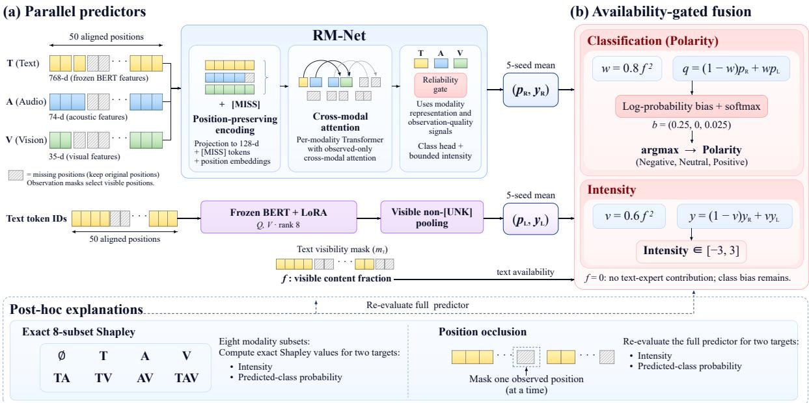  
Figure 1: Overview of the fused predictor. Each branch is evaluated under the same observation masks, and the fusion weights depend only on how much text remains visible.

## 5 Experimental Protocol

Selection and frozen decisions. Architecture, checkpoints, fusion exponents and weights, and class biases are chosen on the validation split. RM-Net checkpoints are selected by J = r − MAE + Macro-F1, where r is the Pearson correlation; the clean condition and the mean over the 20%, 40%, and 60% missing-rate conditions each receive weight 0.5, and the intensity cut-points used by the Macro-F1 term are re-tuned on validation predictions at each epoch. The LoRA expert and the fused configuration are selected by the mean of clean and 40% mixed-missingness macro-F1 on validation. Fusion weights are searched on [0, 1] in steps of 0.1, exponents on {1, 2, 4}, and class biases on [−1, 1] in steps of 0.1 and then refined in steps of 0.025. These settings were frozen before the held-out evaluation reported here. The held-out split had already been inspected during development, so it does not provide a blind estimate. The candidate set and its validation results are listed in Appendix E.

Missingness conditions. “Clean” inputs contain only the natural zero-vector positions. For “mixed40”, each utterance is assigned a damagedmodality subset drawn from the seven non-empty combinations (T, A, V, TA, TV, AV, TAV), and each damaged modality loses ⌈0.4ℓ⌉ positions in one contiguous span (placement seed 20260923). Thus 40% is the per-modality ratio, not the fraction of utterances with all modalities missing. The 21- condition grid applies the seven subsets at 20%, 40%, and 60%. Feature masking is applied after context encoding, so text outside the masked span may still reflect masked words; we address this with a pre-encoding deletion check.

Metrics and statistics. We report Accuracy, Macro-F1, MAE, and Pearson r. Classes come from the argmax of the fused probabilities, and intensity comes from the fused intensity. Because utterances from the same video are correlated, the main comparisons use 5,000 paired bootstrap resamples (Efron, 1979) over source videos, keeping both views of each video together, together with a two-sided video-cluster permutation test. The deletion and retention intervals in Table 5 are computed differently: they use 500 paired bootstrap resamples over utterances, keeping each utterance’s curve intact, and do not cluster by source video.

<table><tr><td>Configuration</td><td>Val clean</td><td>Val mixed</td><td>Val avg</td><td>Held-out clean</td><td>Held-out mixed</td></tr><tr><td>RM-Net auxiliary head</td><td>0.6144</td><td>0.6057</td><td>0.6101</td><td>0.6237</td><td>0.6178</td></tr><tr><td>RM-Net, CE weight 1, 15 seeds, bias</td><td>0.6260</td><td>0.6277</td><td>0.6269</td><td>0.6187</td><td>0.6071</td></tr><tr><td>RM-Net + frozen BERT probe (15 seeds), bias</td><td>0.6360</td><td>0.6367</td><td>0.6363</td><td>0.6326</td><td>0.6284</td></tr><tr><td>LoRA text expert only</td><td>0.6175</td><td>0.6269</td><td>0.6222</td><td>0.6578</td><td>0.6524</td></tr><tr><td> $\mathbf { R M - N e t + L o \mathbf { \hat { R } } A } .$  no bias</td><td>0.6351</td><td>0.6304</td><td>0.6328</td><td>0.6600</td><td>0.6496</td></tr><tr><td> $\mathbf { R M - N e t + L o R A } ,$  with bias (final)</td><td>0.6339</td><td>0.6394</td><td>0.6367</td><td>0.6550</td><td>0.6341</td></tr></table>

Table 1: Macro-F1 of the configurations compared during development. The final row was selected on the validation average. Held-out columns were inspected during development and are not a blind test. The frozen-probe row uses a core trained with CE weight 1 and 15 seeds, whereas the final model uses five core seeds.

<table><tr><td colspan="3">Clean</td><td colspan="2">Mixed40</td></tr><tr><td>Metric</td><td>Core</td><td>Fused</td><td>Core</td><td>Fused</td></tr><tr><td>Acc</td><td>0.6479</td><td>0.6809</td><td>0.6424</td><td>0.6630</td></tr><tr><td>Macro-F1</td><td>0.6237</td><td>0.6550</td><td>0.6178</td><td>0.6341</td></tr><tr><td>MAE</td><td>0.6344</td><td>0.6099</td><td>0.6379</td><td>0.6210</td></tr><tr><td>r</td><td>0.6644</td><td>0.6942</td><td>0.6677</td><td>0.6861</td></tr></table>

Table 2: Held-out results (727 utterances). Core is RM-Net with its auxiliary classification head and regression output; Fused is RM- $\mathrm { . N e t + L o R A }$

Compute. RM-Net checkpoints were trained on four RTX 3090 GPUs with BF16 mixed precision. The frozen BERT-base backbone has about 110M parameters. We did not log total GPU hours over all development runs, so the total budget is not reported.

## 6 Results

## 6.1 Model comparison on validation and held-out splits

Table 1 separates three decisions: the core network, a text representation, and the fusion rule. The final configuration has the highest validation average among all candidates in the evaluation grid. Its advantage over the strongest frozen-representation candidate is small (0.0003 in validation average, computed from unrounded scores; Table 1 shows rounded values). That comparator uses a 15-seed core, whereas the final model uses five seeds, so the choice does not show that LoRA is generally superior to frozen features. Several candidates lead on individual held-out conditions, including the LoRA-only expert on the mixed split and the unbiased fusion on clean inputs. Class biases improve validation but not the held-out ranking, so we treat that gain as selection-dependent. Appendix E.3 lists all 29 candidates.

<table><tr><td>Subset 20%</td><td>∆ Macro-F1 (points) 40% 60%</td><td>20%</td><td>∆ MAE (reduction) 40% 60%</td></tr><tr><td>T A</td><td>+0.74 +0.69  $+ 3 . 1 5 ~ + 3 . 3 3$ </td><td>-0.30 0.017 0.012</td><td>0.006</td></tr><tr><td>V</td><td> $+ 3 . 3 2 ~ + 3 . 4 1$ </td><td>+2.87 +3.06</td><td>0.024 0.0240.023 0.024 0.022 0.022</td></tr><tr><td>TA</td><td> $+ 1 . 7 3 \ + 1 . 3 1$ </td><td>+0.70</td><td>0.019 0.012 0.005</td></tr><tr><td>TV AV</td><td> $+ 2 . 3 2 \ + 1 . 8 5$   $+ 3 . 3 3 ~ + 3 . 4 0$ </td><td>+0.21 +3.66</td><td>0.018 0.012 0.005 0.023 0.022 0.020</td></tr></table>

Table 3: Change from the RM-Net auxiliary head to the fused model on the 727-utterance held-out split, for 21 fixed missingness conditions. Positive Macro-F1 values and MAE reductions indicate improvement. Each cell is a single condition, not an independent sample.

## 6.2 Final model on the held-out split

Table 2 compares the fused model with the RM-Net core. Fused Macro-F1 is 0.6550 versus 0.6237 on clean inputs and 0.6341 versus 0.6178 under mixed40. The two-view average improves by 0.0238, from 0.6208 to 0.6446 (95% interval [0.0027, 0.0452]; two-sided permutation p = 0.030). The clean and mixed40 intervals are [0.0049, 0.0585] and [−0.0043, 0.0371], respectively, supporting the average more clearly than mixed40 alone.

## 6.3 Missingness grid

Table 3 reports the change in Macro-F1 and MAE over the 21 fixed conditions on the held-out split. The fused model improves Macro-F1 in 19 conditions and reduces MAE in all 21. Both decreases in Macro-F1 occur when text is heavily masked: text alone at 60% (-0.30 points) and all three modalities at 60% (-1.44 points). When text is intact, the expert helps most, with gains of 2.87 to 3.66 points for A, V, and AV. Gains are smaller for TA and TV, and MAE reductions are largest for the audio and visual subsets. Position analysis on validation shows that text masking at the head, middle, and tail of the utterance increases MAE by 0.0214, 0.0165, and

<table><tr><td>Variant</td><td>Val MAE</td></tr><tr><td>RM-Net (full)</td><td> $0 . 5 9 7 0 \pm 0 . 0 0 4 6$ </td></tr><tr><td>Clean-only training (no augmentation)</td><td> $0 . 6 0 6 5 \pm 0 . 0 0 7 1$ </td></tr><tr><td>No consistency term</td><td> $0 . 6 0 2 3 \pm 0 . 0 0 5 9$ </td></tr><tr><td>Concatenation MLP fusion</td><td> $0 . 6 0 2 6 \pm 0 . 0 0 9 2$ </td></tr><tr><td>Text only</td><td> $0 . 6 0 1 4 \pm 0 . 0 0 6 8$ </td></tr></table>

Table 4: Core-network ablations on the validation missingness grid (mean ± SD over five training seeds).

0.0287; audio and visual masking change MAE by at most 0.0022. Groups in this analysis use different samples, so these differences are descriptive. Text spans of 13 or more positions produce the largest MAE increase (0.0343), but these groups also differ in missing ratio and sentence length, so the trend cannot be attributed to absolute length alone. When all text is absent, held-out Macro-F1 falls to 0.454; when all three modalities are absent, the output reduces to a learned prior and Macro-F1 is 0.148. Appendix C reports the core-network scans, and Appendix D gives the position, length, and replay analyses.

## 6.4 Ablations of the core network

Table 4 reports validation MAE over the missingness grid for the core network. Each training seed is averaged over the damaged subsets, rates, and placements before the five seeds are summarized. Removing augmentation (clean-only training) increases MAE by 0.0095, the largest change in the table. Removing the consistency term or replacing the gated fusion with a concatenation MLP increases MAE by about 0.005 each. The text-only model is 0.0044 worse than the full model. These differences are comparable to the seed-to-seed standard deviations, and we do not claim that each component contributes significantly on its own.

## 6.5 Robustness to pre-encoding text-span deletion

Encoded-feature masking can leave context from deleted words in the surviving positions. To test this, we deleted the characters covered by the masked spans of the validation mixed40 condition before re-encoding, re-encoded the remaining text with the frozen BERT and each LoRA expert, mapped the surviving subwords back to their original positions, and kept audio, vision, and masks unchanged. Because span boundaries follow subword offsets, a boundary can split a word, so this is not strictly whole-word deletion. Under this stricter protocol, the fused Macro-F1 under missingness falls from 0.6394 to 0.6065 (MAE rises from 0.5722 to 0.5930), and the RM-Net core reaches 0.5813 on the same condition. The fused model therefore still gains over the core, but masking of encoded features overstates performance when the words are truly unavailable. This check was run only on validation and was not used for selection. A separate grouped five-fold check on the training split gives a mean two-view Macro-F1 of 0.6170 with standard deviation 0.0073 for a single adapter, which measures stability of one configuration and is not a nested estimate for the five-seed model. Appendix D gives the details of both checks.

<table><tr><td>Delete</td><td>Intensity Retain Delete</td><td>Class prob. Retain</td></tr><tr><td>Selected</td><td>0.2235 0.1796 0.1370</td><td>-0.0645</td></tr><tr><td>Random</td><td>0.1136 0.1659 0.0244</td><td>0.0365</td></tr><tr><td>Paired diff.</td><td>0.1100 0.0137 0.1126</td><td>-0.1010</td></tr><tr><td>95% CI low 95% CI high</td><td>0.1010 0.0044 0.1081 0.1201 0.0238 0.1174</td><td>-0.1059 -0.0963</td></tr></table>

Table 5: Deletion and retention curves for the fused model on 728 validation utterances. Intervals come from 500 paired bootstrap resamples over utterances, keeping each utterance’s curve intact; they do not cluster by source video.

## 6.6 Dual-target explanations

Table 5 and Figure 2 report fidelity on 728 validation utterances. Deleting top-ranked positions lowers predicted-class probability faster than random deletion: AUC is 0.137 versus 0.024, a paired difference of 0.113 (interval [0.108, 0.117]). Intensity deletion agrees. Retention does not support sufficiency: top-ranked positions yield higher intensity retention AUC of |∆y| than random positions (0.1796 versus 0.1659), indicating greater average deviation from the full-input intensity. For class probability, negative signed retention AUC (−0.0645 versus 0.0365 for random orderings) means probability rises on average over the integrated curve. This does not guarantee probability at or above the full-input level for every utterance or retained fraction. We therefore report retention descriptively.

Attributions satisfy the Shapley efficiency identity to within $4 . 4 \times 1 0 ^ { - 1 6 }$ . In 12 recomputations of intervention outputs (three unlabeled utterances under four conditions each), the largest discrepancy was $2 . 4 \times 1 0 ^ { - 7 }$ for intensity and $2 . 7 \times 1 0 ^ { - 8 }$ for

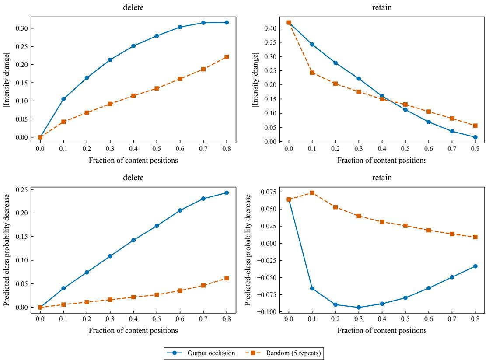  
Figure 2: Deletion and retention curves of the fused model on the 728 validation utterances. Left panels delete the top-ranked fraction of content positions; right panels keep only that fraction. Top: change in intensity $| \Delta y |$ ; bottom: decrease in the predicted-class probability. Solid blue lines use occlusion ranking; dashed orange lines average five random permutations.

## 6.7 Error diagnostics

probability, with identical classes; stored singleprecision text contexts were reused, while pooling, prediction, and fusion were recomputed. The first flip along the selected classification order is summarized as a censored count: an utterance that never flips is assigned K + 1, where K is its number of content positions. The median count is 11 deleted positions for the selected order and 18 for random permutations, where the five permutations are averaged within each utterance before the median is taken across utterances. Under the selected order, 272 of 728 utterances (37.4%) never flip. For the 357 validation utterances in which the text and vision contributions to the class probability have opposite signs, the error rate is 38.9%, compared with 32.4% for the rest. This pattern suggests a review priority, but it is not evidence that the conflict causes errors. Appendix G gives the definitions, numerical checks, word-deletion comparison, and sample-level cases.

Figure 3(a) shows that fusion lowers held-out MAE for neutral, weak, and moderate sentiment under clean and 40% mixed-missing inputs, but raises it for strong sentiment: 1.063 to 1.071 on clean inputs and 1.074 to 1.077 under mixed missingness. In the validation mixed-missingness confusion matrix (b), 107 of 223 Neutral predictions are correct; 37 are truly Negative and 79 Positive (precision 0.480, recall 0.582). Neutral is also the weakest class on clean inputs (Appendix D). Panel (c) shows text dominates 563 of 728 intensity attributions and 681 of 728 class attributions; audio dominates 60 and 7, and vision 105 and 40. These fusedpredictor attributions describe model dependence, not an absence of information in audio or vision.

## 6.8 Unlabeled predictions

On the 30 unlabeled utterances with zero-valued spans, the fused model predicts 6 Negative, 13 Neutral, and 11 Positive. The text-availability fraction ranges from 0.50 to 1.00, and 27 of the 30 utterances contain [UNK] tokens. On the 20-utterance explanation set, the predictions are 8 Negative, 5 Neutral, and 7 Positive. Text is the dominant classlevel modality in all 20 cases, while intensity is dominated by text in 16 cases and by vision in 4. These sets have no labels, so we report distributions and explanations but no accuracy. Appendix H lists every prediction and its evidence.

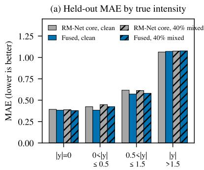

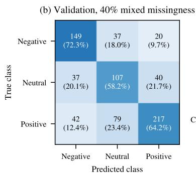

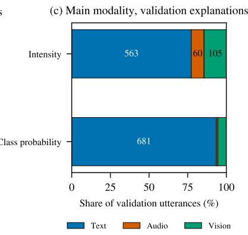  
Figure 3: Error diagnostics of the fused model. (a) Held-out MAE by true-intensity group (727 utterances) for the RM-Net core and the fused model, under clean and 40% mixed-missing inputs. (b) Validation confusion matrix under 40% mixed missingness (rows: true class; columns: predicted class; percentages are row-normalized). (c) Main modality of the validation explanations (728 utterances each): intensity, text 563, vision 105, audio 60; class probability, text 681, vision 40, audio 7.

## 6.9 Auditable word-level alignment for raw clips

A separate pipeline extracts word-level features for 100 raw clips from 37 videos in the supplied CMU-MOSEI-derived package, with their transcripts and labels. Each word receives BERT features averaged over WordPieces, 74 acoustic dimensions at a 10 ms hop, and 35 facial dimensions at 25 Hz. CTC forced alignment with wav2vec 2.0 posteriors supplies word boundaries (Graves et al., 2006; Baevski et al., 2020). The time-quality gate applies fixed thresholds to word and clip-mean alignment posteriors and greedy-decoding WER. Of 1,926 words, 1,316 (68.3%) pass, across 65 clips. Two independent extractions match in all 500 files. Word-level grouping retains less acoustic variance than 0.25 s windows (0.249 versus 0.312), but more than 0.5 s and 1 s windows (0.185 and 0.107); this is descriptive, not sentiment accuracy. Pipeline outputs do not train or evaluate the sentiment models. Appendix F shows a typical clip with all ten words passing (Figure 8) and quality across clips (Figure 9).

## 7 Discussion

Three findings emerge. First, retaining positions and marking missing spans permits position-level inspection; without a position-dropping control, we cannot attribute accuracy to this design. Second, text-expert fusion improves the held-out two-view average over the core, but Macro-F1 gains shrink under heavy text masking (60%) and reverse for T and TAV. Without a fixed-weight control, we cannot attribute gains to availability-dependent weighting alone. Third, explanation-ranked removal changes predicted-class probability much more than random removal.

Deployment limits remain: gains vary across conditions, and encoded-feature masking overstates performance when words are unavailable. Validation selection and earlier held-out inspection mean the reported numbers are estimates, not a fresh test. Our controlled, auditable method and analysis make no state-of-the-art claim.

## 8 Conclusion

RM-Net handles contiguous missingness, fusing with a LoRA-adapted BERT expert weighted only by visible text. Frozen on validation, fusion improves held-out two-view macro-F1 by 0.024 over the auxiliary-head baseline, most when text is intact. Dual-target Shapley and occlusion identify positions affecting deployed predictions. Future work includes fresh blind evaluation, human assessment of explanations, probability calibration, and integration of word-level alignment with prediction.

## Limitations

Our results rest on several assumptions that limit their scope. The held-out split was inspected during development, and validation was used for every selection; the reported held-out numbers are therefore not a blind test, and the fused model’s advantage over the baseline is an estimate with uncertainty from a single 727-utterance split. Missingness is simulated by masking precomputed features after context encoding. Because text positions may still encode the masked words, the maskedencoding numbers overstate performance when words are truly unavailable; our pre-encoding deletion check covers only the validation split and only the mixed40 condition. Performance gains are uneven: the fused model loses Macro-F1 when text is heavily masked, and masking all three modalities at 60% reduces Macro-F1 by 1.44 points relative to the baseline. The text-availability weighting is a fixed rule designed on validation, and the class biases improve validation but not the held-out ranking. The probabilities are not calibrated, so they should not be read as confidence. Ensemble spread is not evaluated for coverage.

The explanations are faithful to the deployed predictor under the stated interventions, but they describe model dependence rather than human emotional causation. The intervals in Table 5 resample utterances rather than source videos; because utterances from the same video are correlated, they may understate uncertainty and should be read as descriptive. Retention curves are not clear evidence of sufficiency. We have not yet completed cross-seed and randomization checks for the fused model’s occlusion rankings, and the explanation evidence has not been annotated by humans. The word-level alignment pipeline lacks human word-boundary ground truth, its time gate is a heuristic, and its outputs do not feed the sentiment models. Our experiments use one English dataset and pre-extracted features with a fixed text encoder, so they do not establish performance on other languages, domains, or sensors. We did not run physical-device or realtime evaluations, and total compute was not logged in full.

## Ethical Considerations

CMU-MOSEI consists of online videos of speakers. The predictive experiments used only the supplied precomputed numerical features, which are numerical descriptors rather than images, and did not attempt to identify any speaker. The separate alignment experiment decoded 100 raw clips from 37 videos in the supplied CMU-MOSEI-derived package, together with their transcripts; face detection there served only to compute numerical per-frame descriptors. The official CMU-MOSEI SDK distributes processed features rather than raw videos, so we did not verify the supplied clips against the original YouTube sources. The separate code supplement excludes raw videos and removes transcript text from its CSV evidence; the EmoMosaic data repository includes source media and transcripts. We used the dataset for research purposes only. Sentiment prediction from speech, text, and facial behavior can be misused for surveillance, manipulation, or unfair screening, and a model that performs well on average can still fail on particular speakers, languages, or expression styles. The explanations in this paper expose input dependence but do not establish that a person feels any emotion, and they should not be used as evidence about individuals. We recommend that any deployment be restricted to consenting users, be evaluated for subgroup performance, and keep a human in the loop for consequential decisions.

Licenses and redistribution. The released code is under the MIT license. The EmoMosaic data repository distributes the four supplied, reorganized CMU-MOSEI-derived attachments, including available video clips, transcripts, labels, and pre-extracted features. This modified subset is not the full CMU-MOSEI corpus. The code license does not relicense these third-party assets; their original terms remain applicable. The pretrained components (BERT, wav2vec 2.0, MediaPipe, and the Qwen backbones) are used under their original licenses and are not included in the code supplement; only their download URLs, versions, and checksums are shipped. The released RM-Net and LoRA checkpoints were trained on CMU-MOSEI features and are provided for research use only.

Offensive content. The released dataset includes source media and transcripts and may therefore contain offensive language or other objectionable material. No systematic offensive-content audit of the source data was performed.

Environmental considerations. RM-Net checkpoints were trained on four consumer-grade RTX 3090 GPUs with BF16 mixed precision, and the released core checkpoint is about 3 MB, while large pretrained weights are excluded from the release. Total GPU hours and energy consumption were not logged over the course of development, so we cannot report a precise compute footprint; this is stated in the experimental protocol (paragraph “Compute”) and in the Limitations section.

## Acknowledgments

This work was supported in part by the Major Key Project of Pengcheng Laboratory under Grant PCL2025A12-3, and in part by the Science and Technology Planning Project of Guangdong Science and Technology Department under the Guangdong Key Laboratory of Advanced IntelliSense Technology under Grant 2019B121203006.

Code and data availability. Source code: https://github.com/rudykon/EmoMosaic; data repository: https://huggingface.co/ datasets/config-h/EmoMosaic.

## References

Julius Adebayo, Justin Gilmer, Michael Muelly, Ian Goodfellow, Moritz Hardt, and Been Kim. 2018. Sanity checks for saliency maps. In Advances in Neural Information Processing Systems, volume 31. Curran Associates, Inc.

Alexei Baevski, Yuhao Zhou, Abdelrahman Mohamed, and Michael Auli. 2020. wav2vec 2.0: A framework for self-supervised learning of speech representations. In Advances in Neural Information Processing Systems, volume 33, pages 12449–12460. Curran Associates, Inc.

Jacob Devlin, Ming-Wei Chang, Kenton Lee, and Kristina Toutanova. 2019. BERT: Pre-training of deep bidirectional transformers for language understanding. In Proceedings ofthe 2019 Conference of the North American Chapter ofthe Associationfor Computational Linguistics: Human Language Technologies, Volume 1 (Long and Short Papers), pages 4171–4186, Minneapolis, Minnesota. Association for Computational Linguistics.

Bradley Efron. 1979. Bootstrap methods: Another look at the jackknife. The Annals ofStatistics, 7(1):1–26.

Florian Eyben, Klaus R. Scherer, Björn W. Schuller, Johan Sundberg, Elisabeth André, Carlos Busso, Laurence Y. Devillers, Julien Epps, Petri Laukka, Shrikanth S. Narayanan, and Khiet P. Truong. 2016. The Geneva minimalistic acoustic parameter set (GeMAPS) for voice research and affective computing. IEEE Transactions on Affective Computing, 7(2):190–202.

Florian Eyben, Martin Wöllmer, and Björn Schuller. 2010. openSMILE: The Munich versatile and fast open-source audio feature extractor. In Proceedings ofthe 18th ACM International Conference on Multimedia, pages 1459–1462. ACM.

Alex Graves, Santiago Fernández, Faustino Gomez, and Jürgen Schmidhuber. 2006. Connectionist temporal classification: labelling unsegmented sequence data with recurrent neural networks. In Proceedings ofthe 23rd International Conference on Machine Learning, pages 369–376. ACM Press.

Chuan Guo, Geoff Pleiss, Yu Sun, and Kilian Q. Weinberger. 2017. On calibration of modern neural networks. In Proceedings ofthe 34th International Conference on Machine Learning, volume 70 of Proceedings of Machine Learning Research, pages 1321– 1330. PMLR.

Devamanyu Hazarika, Roger Zimmermann, and Soujanya Poria. 2020. MISA: Modality-invariant and -specific representations for multimodal sentiment analysis. In Proceedings of the 28th ACM International Conference on Multimedia, pages 1122–1131. ACM.

Edward J. Hu, Yelong Shen, Phillip Wallis, Zeyuan Allen-Zhu, Yuanzhi Li, Shean Wang, Lu Wang, and Weizhu Chen. 2022. LoRA: Low-rank adaptation of large language models. In International Conference on Learning Representations.

Sarthak Jain and Byron C. Wallace. 2019. Attention is not Explanation. In Proceedings of the 2019 Conference of the North American Chapter of the Associationfor Computational Linguistics: Human Language Technologies, Volume 1 (Long and Short Papers), pages 3543–3556, Minneapolis, Minnesota. Association for Computational Linguistics.

Balaji Lakshminarayanan, Alexander Pritzel, and Charles Blundell. 2017. Simple and scalable predictive uncertainty estimation using deep ensembles. In Advances in Neural Information Processing Systems, volume 30. Curran Associates, Inc.

Zhun Liu, Ying Shen, Varun Bharadhwaj Lakshminarasimhan, Paul Pu Liang, AmirAli Bagher Zadeh, and Louis-Philippe Morency. 2018. Efficient lowrank multimodal fusion with modality-specific factors. In Proceedings of the 56th Annual Meeting of the Associationfor Computational Linguistics (Volume 1: Long Papers), pages 2247–2256, Melbourne, Australia. Association for Computational Linguistics.

Ilya Loshchilov and Frank Hutter. 2019. Decoupled weight decay regularization. In International Conference on Learning Representations.

Camillo Lugaresi, Jiuqiang Tang, Hadon Nash, Chris McClanahan, Esha Uboweja, Michael Hays, Fan Zhang, Chuo-Ling Chang, Ming Guang Yong, Juhyun Lee, Wan-Teh Chang, Wei Hua, Manfred Georg, and Matthias Grundmann. 2019. MediaPipe: A framework for building perception pipelines. Preprint, arXiv:1906.08172.

Scott M. Lundberg and Su-In Lee. 2017. A unified approach to interpreting model predictions. In Advances in Neural Information Processing Systems, volume 30. Curran Associates, Inc.

Brian McFee, Colin Raffel, Dawen Liang, Daniel P. W. Ellis, Matt McVicar, Eric Battenberg, and Oriol Nieto. 2015. librosa: Audio and music signal analysis in Python. In Proceedings ofthe 14th Python in Science Conference, pages 18–24.

Masanori Morise, Fumiya Yokomori, and Kenji Ozawa. 2016. WORLD: A vocoder-based high-quality speech synthesis system for real-time applications. IEICE Transactions on Information and Systems, E99.D(7):1877–1884.

Vitali Petsiuk, Abir Das, and Kate Saenko. 2018. RISE: Randomized input sampling for explanation of blackbox models. In Proceedings ofthe British Machine Vision Conference (BMVC).

Lloyd S. Shapley. 1953. A value for n-person games. In Harold William Kuhn and Albert William Tucker, editors, Contributions to the Theory ofGames (AM-28), Volume II, pages 307–318. Princeton University Press, Princeton, NJ.

SPTK Working Group. n.d. Speech signal processing toolkit (SPTK). Used through pysptk 1.0.1. Accessed October 13, 2026.

Licai Sun, Zheng Lian, Bin Liu, and Jianhua Tao. 2024. Efficient multimodal transformer with dual-level feature restoration for robust multimodal sentiment analysis. IEEE Transactions on Affective Computing, 15(1):309–325.

Yao-Hung Hubert Tsai, Shaojie Bai, Paul Pu Liang, J. Zico Kolter, Louis-Philippe Morency, and Ruslan Salakhutdinov. 2019. Multimodal transformer for unaligned multimodal language sequences. In Proceedings of the 57th Annual Meeting of the Associationfor Computational Linguistics, pages 6558– 6569, Florence, Italy. Association for Computational Linguistics.

Ashish Vaswani, Noam Shazeer, Niki Parmar, Jakob Uszkoreit, Llion Jones, Aidan N. Gomez, Łukasz Kaiser, and Illia Polosukhin. 2017. Attention is all you need. In Advances in Neural Information Processing Systems, volume 30. Curran Associates, Inc.

Amir Zadeh, Minghai Chen, Soujanya Poria, Erik Cambria, and Louis-Philippe Morency. 2017. Tensor fusion network for multimodal sentiment analysis. In Proceedings of the 2017 Conference on Empirical Methods in Natural Language Processing, pages 1103–1114, Copenhagen, Denmark. Association for Computational Linguistics.

Amir Zadeh, Paul Pu Liang, Jonathan Vanbriesen, Soujanya Poria, Edmund Tong, Erik Cambria, Minghai Chen, and Louis-Philippe Morency. 2018. Multimodal language analysis in the wild: CMU-MOSEI dataset and interpretable dynamic fusion graph. In Proceedings of the 56th Annual Meeting of the Associationfor Computational Linguistics (Volume 1: Long Papers), pages 2236–2246, Melbourne, Australia. Association for Computational Linguistics.

Haoyu Zhang, Wenbin Wang, and Tianshu Yu. 2024. Towards robust multimodal sentiment analysis with incomplete data. In Advances in Neural Information Processing Systems, volume 37, pages 55943–55974. Curran Associates, Inc.

Aoqiang Zhu, Min Hu, Xiaohua Wang, Jiaoyun Yang, Yiming Tang, and Ning An. 2025. Proxy-driven robust multimodal sentiment analysis with incomplete data. In Proceedings ofthe 63rd Annual Meeting of the Associationfor Computational Linguistics (Volume 1: Long Papers), pages 22123–22138, Vienna, Austria. Association for Computational Linguistics.

## A Model Details

This section gives the full definitions behind Section 4. Symbols follow the main text.

## A.1 Observation masks and missingness operator

Let $\ell \leq 5 0$ be the number of valid positions of a modality and $p _ { i } = { \bf 1 } \{ 0 \leq i < \ell \}$ . Valid positions include the special tokens of the text sequence. The observation indicator on the raw features is

$$
o _ { i } ^ { m , 0 } = p _ { i } { \bf 1 } \{ \| x _ { i } ^ { m } \| _ { 0 } > 0 \} .
$$

A synthetic missingness set $\mathcal { M } _ { m }$ (a union of halfopen spans) gives the damaged indicator $o _ { i } ^ { m , c } =$ $o _ { i } ^ { m , 0 } \mathbf { 1 } \{ i \notin M _ { m } \}$ , and the unobserved fraction is $\begin{array} { r } { \rho _ { m } ^ { \dot { c } } = 1 - \frac { 1 } { \ell } \sum _ { i } o _ { i } ^ { m , c } } \end{array}$ . The observation state is determined from the raw features before normalization, so zero-valued normalized features are not reinterpreted as missing. Features are z-scored with the mean and standard deviation of observed frames in the 3,395 training utterances, clipped to [−5, 5], and unobserved positions are reset to zero. The masking operator $\mathcal { C } _ { \mathcal { M } }$ zeroes features and indicators at the masked positions and never changes the sequence length, so the three modalities remain aligned.

## A.2 Network equations

Each modality $m \in \{ t , a , v \}$ with input dimension $d _ { m } ( 7 6 8 , 7 4 , 3 5 )$ is projected to 128 dimensions. Unobserved positions are replaced by a learned [MISS] embedding and learned positional embeddings are added:

$$
\begin{array} { r l } { e _ { i } ^ { m } = o _ { i } ^ { m } \big ( P _ { m } \bar { x } _ { i } ^ { m } + b _ { m } ^ { \mathrm { p r o j } } \big ) } & { { } } \\ { + ( 1 - o _ { i } ^ { m } ) \mu _ { m } + \mathrm { P E } _ { i } , } & { { } } \end{array}
$$

where $P _ { m } \in \mathbb { R } ^ { 1 2 8 \times d _ { m } }$ . Each modality is encoded by a two-layer, four-head Transformer with feedforward width 256 and layer normalization; only padding positions are masked, so internal missing spans remain in the sequence. The cross-modal layer lets a position of modality m attend to the observed positions of the other modalities, with the learned distance bias

$$
b _ { m } ( i , j ) = - \operatorname { s o f t p l u s } ( \beta _ { m } ) | i - j | / 5 .
$$

If no other modality is observed, a zero-valued sentinel key is used so that the attention is well defined; the sentinel is visible only in this case.

Attention pooling is restricted to observed positions,

$$
\begin{array} { r l } & { u _ { i } ^ { m } = q _ { m } ^ { \top } \operatorname { t a n h } ( U _ { m } \widetilde { h } _ { i } ^ { m } + b _ { m } ^ { \mathrm { p o o l } } ) , } \\ & { \alpha _ { i } ^ { m } = \mathrm { M S M } _ { i } ( u ^ { m } ; o ^ { m } ) , } \\ & { z _ { m } = \left\{ \begin{array} { l l } { \sum _ { i } \alpha _ { i } ^ { m } \widetilde { h } _ { i } ^ { m } , } & { r _ { m } = 1 , } \\ { v _ { m } ^ { \mathrm { a b s e n t } } , } & { r _ { m } = 0 , } \end{array} \right. } \end{array}
$$

where $r _ { m } ~ = ~ { \bf 1 } \{ \sum _ { i } o _ { i } ^ { m } ~ > ~ 0 \}$ and $v _ { m } ^ { \mathrm { a b s e n t } }$ is a learned vector. The masked softmax is

$$
\begin{array} { r } { \mathrm { M S M } _ { j } ( u ; v ) = \left\{ \begin{array} { l l } { \frac { v _ { j } \exp ( u _ { j } ) } { \sum _ { k } v _ { k } \exp ( u _ { k } ) } , } & { \sum _ { k } v _ { k } > 0 , } \\ { 0 , } & { \sum _ { k } v _ { k } = 0 . } \end{array} \right. } \end{array}
$$

The reliability gate combines each pooled representation with two observation descriptors and a reconstruction residual,

$$
\begin{array} { c } { { s _ { j } = g _ { j } ( [ z _ { j } ; \rho _ { j } ; n _ { j } ^ { \mathrm { s e g } } / \ell ; \epsilon _ { j } ] ) , } } \\ { { w _ { m } = \mathrm { M S M } _ { m } \big ( ( s _ { j } ) _ { j \in \{ t , a , v \} } ; r \big ) , } } \end{array}
$$

where $n _ { j } ^ { \mathrm { s e g } }$ counts the unobserved segments within the valid range. The residual is computed only on observed positions from a reconstruction head,

$$
\begin{array} { c } { { R _ { m } = \displaystyle \frac { \sum _ { i } { o _ { i } ^ { m } \| \hat { x } _ { i } ^ { m } - \bar { x } _ { i } ^ { m } \| _ { 2 } ^ { 2 } } } { d _ { m } \operatorname* { m a x } ( 1 , \sum _ { i } { o _ { i } ^ { m } ) } } , } } \\ { { \epsilon _ { m } = \displaystyle \frac { 1 } { 2 5 } \operatorname* { m i n } \{ 2 5 , \mathrm { s g } ( R _ { m } ) \} , } } \end{array}
$$

with sg the stop-gradient operator and $\epsilon _ { m } \ = \ 0$ when $r _ { m } = 0$ . The residual is a proxy for reliability; it is not a calibrated predictive variance.

The intensity is additive and bounded,

$$
\begin{array} { r l r } & { } & { \hat { y } _ { m } = 2 . 7 \operatorname { t a n h } \bigl ( a _ { m } ( z _ { m } ) \bigr ) , } \\ & { } & { \hat { y } _ { \mathrm { i n t } } = \left\{ \begin{array} { l l } { \displaystyle 0 . 3 \operatorname { t a n h } \bigl ( a _ { \mathrm { i n t } } ( z ) \bigr ) , } & { \displaystyle \sum _ { m } r _ { m } > 0 , } \\ { \displaystyle 3 \operatorname { t a n h } ( \eta ) , } & { \displaystyle \sum _ { m } r _ { m } = 0 , } \end{array} \right. } \\ & { } & { \hat { y } = \displaystyle \sum _ { m } w _ { m } \hat { y } _ { m } + \hat { y } _ { \mathrm { i n t } } , } \end{array}
$$

with $\begin{array} { r } { z = \sum _ { m } w _ { m } z _ { m } } \end{array}$ and η a learned prior. The contribution of modality m is $\begin{array} { r c l } { { c _ { m } } } & { { = } } & { { w _ { m } \hat { y } _ { m } , } } \end{array}$ so the decomposition of $\hat { y }$ is exact. The fiveseed ensemble averages the per-seed contributions, $\textstyle \frac { 1 } { 5 } \sum _ { s } w _ { m } ^ { ( s ) } \hat { y } _ { m } ^ { ( s ) }$ , rather than multiplying averaged gates and averaged branch outputs. The auxiliary classifier maps the fused representation to three logits; its probabilities are averaged after a softmax for each seed. The network has 1,510,206 parameters.

## A.3 Training objective and masking schedule

For each batch, the clean and damaged views share parameters, and the objective is

$$
\begin{array} { r l } & { \mathscr { L } = \mathscr { L } _ { \mathrm { p r e d } } + 0 . 3 \mathscr { L } _ { u } + 0 . 3 \mathscr { L } _ { \mathrm { C E } } } \\ & { ~ + 0 . 5 \mathscr { L } _ { \mathrm { r e c } } + 0 . 5 \mathscr { L } _ { \mathrm { c o n } } + 0 . 1 \mathscr { L } _ { \mathrm { i n t } } . } \end{array}
$$

The prediction loss uses the L1 intensity error on both views, $\begin{array} { r } { \mathcal { L } _ { \mathrm { p r e d } } = \frac { 1 } { B } \sum _ { n } ( | \hat { y } _ { n } ^ { c } - y _ { n } | + | \hat { y } _ { n } ^ { \mathrm { c l e a n } } } \end{array}$ $y _ { n } | )$ . The single-branch loss $\mathcal { L } _ { u }$ applies the same L1 error to the modalities that remain observed in the damaged view, normalized by their number. The classification loss $\mathcal { L } _ { \mathrm { C E } }$ is cross-entropy over both views, weighted by the inverse class frequency. The reconstruction loss ${ \mathcal { L } } _ { \mathrm { r e c } }$ uses a smooth L1 penalty on the positions that were observed in the clean view and are newly masked. The consistency loss ${ \mathcal { L } } _ { \mathrm { c o n } }$ pulls the damaged fused representation and intensity toward the stop-gradient clean outputs. The interaction penalty ${ \mathcal { L } } _ { \mathrm { i n t } }$ bounds the magnitude of $\hat { y } _ { \mathrm { i n t } }$ in the damaged view.

Augmentation follows a fixed schedule. A sample is left unaugmented with probability 0.2. Otherwise the number of damaged modalities is 1, 2, or 3 with probabilities 0.5, 0.35, and 0.15, and each damaged modality receives a missing ratio drawn from $0 . 7 U ( 0 . 1 , 0 . 6 ) + 0 . 2 5 U ( 0 . 6 , 0 . 9 5 ) +$ 0.05 δ(1). Spans are contiguous, one or two per modality; damaged modalities share spans with probability 0.3; span lengths are ⌈rℓ⌉ and may cover the special tokens. The upper bound of the ratio grows linearly from 0.3 to 1 over the first 30% of training. With probability 0.01, an augmented sample masks all modalities, which supervises the empty-set output.

Table 6 lists the optimization settings. RM-Net checkpoints were selected by a validation criterion $J = r - \mathrm { M A E } + \mathrm { M a c r o } { - } \mathrm { F } _ { 1 }$ , where r is the Pearson correlation. The clean condition and the mean over the 20%, 40%, and 60% missing-rate conditions each receive weight 0.5. The Macro-F1 term uses intensity cut-points that are re-tuned on the validation predictions at every epoch. The selected epochs (1-based) were 8 to 11 across the five seeds. The text expert was selected by the mean of clean and mixed40 Macro-F1 on the validation split.

## A.4 Text expert and fusion

The text expert freezes the BERT-base encoder and adds rank-8 LoRA updates with $\alpha = 1 6$ to the query and value projections of each of the 12 layers. The trainable adapters contain about 0.29M parameters, excluding the task heads. Mean pooling runs over the visible positions that are not [UNK], including visible special tokens; if no position is usable, the pooled vector is zero. The classification and intensity heads share one 128-unit hidden layer, each followed by its own linear output. The expert loss is class-weighted cross-entropy over the clean and damaged views plus 0.3 times an L1 intensity loss. The fusion equations and the frozen constants are those given in Section 4; the fusion weights, exponents, and class biases were chosen on the validation split with the grids listed in Table 6.

The fused intensity is computed from the same visible-text fraction $f ,$ so the two fusion weights are coupled: $v = 0 . 6 f ^ { 2 }$ and $w = 0 . 8 f ^ { 2 }$ . For the unlabeled sets, f ranges from 0.50 to 1.00 in set A (Appendix H).

## B Data Statistics and Input Checks

## B.1 Split statistics

Table 7 summarizes the aligned release in each split. Lengths are the median numbers of valid positions. The zero-frame ratios are the fractions of valid positions whose raw audio or visual vector is all zeros; they combine structural zeros, natural silence or absent faces, and any missing spans already present in the release, and cannot be separated from one another.

The validation split contains 239 source videos. Two provisions of the release affect the analysis. First, the 50 positions are token positions of the text sequence, so a position is not a word or a fixed time interval. Second, the text positions of padding are not zero in the precomputed text features, so the valid length is read from the attention mask and not from the text vectors.

## B.2 Re-extraction of text features

Text features were re-extracted with the frozen uncased BERT-base encoder at a fixed revision, for all splits and for the unlabeled sets, so that the text branch and the text expert use identical inputs. On observed positions, the re-extracted features differ from the supplied text features by a mean absolute value on the order of $3 \times 1 0 ^ { - 4 }$ , which is consistent with half-precision storage.

## B.3 Availability in the unlabeled sets

In unlabeled set A (30 utterances), 27 utterances contain at least one [UNK] token, for 131 positions in total. These positions have non-zero BERT vectors but are excluded from the numerator of the visible-text fraction, following the rule in Section 4. The special tokens [CLS] and [SEP] are excluded from both numerator and denominator. Consequently the visible-text fraction ranges from 0.50 to 1.00 across set A. Audio and visual zero spans in set A may be structural, natural, or artificially imposed; the release does not label their origin, so they are treated as observed by the model only when the raw vector is non-zero.

<table><tr><td>Setting</td><td>Value</td></tr><tr><td>RM-Net optimizer</td><td>AdamW (Loshchilov and Hutter, 2019), learning rate  $1 0 ^ { - 4 } ,$  weight decay  $1 0 ^ { - 3 }$ </td></tr><tr><td>RM-Net schedule</td><td>up to 60 epochs, patience 10, batch 64, 5% warm-up, cosine decay</td></tr><tr><td>RM-Net regularization</td><td>dropout 0.25, input dropout 0.1, gradient clipping 1.0</td></tr><tr><td>RM-Net precision</td><td>BF16 mixed precision</td></tr><tr><td>Seeds</td><td>17, 29, 43, 71, 101 (core and text expert)</td></tr><tr><td>Text expert</td><td>rank  $8 , \alpha = 1 6 ,$  query and value projections of all 12 layers; batch 32</td></tr><tr><td>Text expert optimizer</td><td>AdamW, weight decay 0.01; adapter learning rate  $1 0 ^ { - 4 }$   $3 \times 1 0 ^ { - 4 }$  , head learning rate</td></tr><tr><td>Text expert schedule Fusion search</td><td>up to 10 epochs, patience 3 fusion weights on [0, 1] (step 0.1); exponents {1, 2, 4}; class bias on [—1, 1] (step 0.1), refined with</td></tr><tr><td></td><td>step 0.025</td></tr><tr><td>Mixed40 placement seed</td><td>20260923</td></tr></table>

Table 6: Training and evaluation settings. The fusion search used only the validation split; the held-out split had been inspected during development.
<table><tr><td>Split</td><td>N</td><td>Neg</td><td>Neu</td><td>Pos</td><td>Median length</td><td>Zero audio / visual frames</td></tr><tr><td>Train</td><td>3,395</td><td>967</td><td>758</td><td>1,670</td><td>22.0</td><td>0.082 / 0.132</td></tr><tr><td>Valid</td><td>728</td><td>206</td><td>184</td><td>338</td><td>23.5</td><td>0.081 / 0.131</td></tr><tr><td>Test</td><td>727</td><td>207</td><td>158</td><td>362</td><td>23.0</td><td>0.079 / 0.135</td></tr></table>

Table 7: Aligned release (50 positions per modality). Neutral corresponds exactly to $y = 0$ and is 22.3% of the training split.

## C Robustness Scans of the Core Network

This section reports controlled scans of the RM-Net core, the network before the text expert is fused. The scans were run on the validation split with the historical intensity-threshold rule for classification; they are not the fused predictor’s classification curves. Their intensity errors (MAE) do not depend on that rule, and they are reported here to show how the core responds to each kind of missingness. The scans use the same contiguous-span masking as the main experiments.

## C.1 Missing fraction and modality subset

Figure 4 varies the missing fraction from 0 to 1 in steps of 0.1 for each of the seven damaged-modality subsets, with five training seeds and five span placements. Missing text has the largest effect. At 80% text missing, MAE is about 0.648, and when text is fully missing it rises to about 0.801. Fully missing audio or visual alone gives MAE of about 0.611 and 0.604. When all three modalities are missing, the output falls back to the learned prior. These results describe the locally missing regime and do not extend to total information loss.

## C.2 Span position

Figure 5 compares spans placed at the start, middle, and end of the admissible range, at missing fractions 0.3 and 0.5. Averaged over the two fractions, text MAE is 0.616 for the start, 0.593 for the middle, and 0.607 for the end, so the start is the most sensitive position for text. Because the start also includes the [CLS] token and the first content words, this experiment cannot separate the two effects. Audio and visual differences across positions are small.

## C.3 Span length and reconstruction

Figure 6 removes 1, 2, 3, 5, 8, or 12 valid positions. Visual reconstruction $R ^ { 2 }$ on the removed positions falls from 0.408 to 0.277, audio from 0.084 to 0.045, and text stays between −0.015 and

−0.007. Reconstruction is therefore informative for vision and weak for audio, and text reconstruction does not beat a constant predictor. The right panel varies the start of a three-position window; MAE varies by about 0.015 across the admissible range, so the effect of placement is modest for short spans.

Two further observations are recorded here.

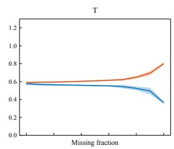

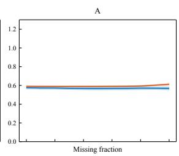

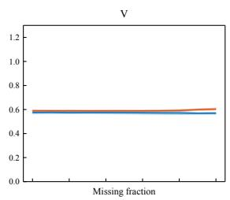

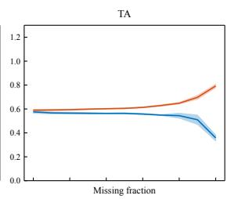

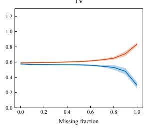

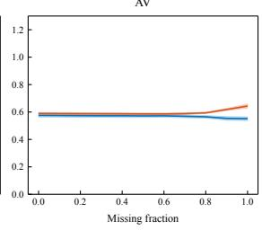

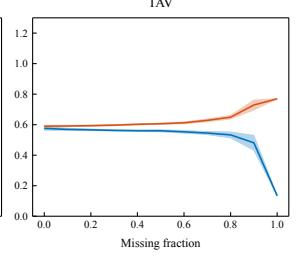  
Figure 4: RM-Net core under increasing missingness on the validation split. Each panel is one damaged-modality subset; the blue curve is Macro-F1 (historical thresholds) and the orange curve is MAE. Shading is the standard deviation across five training seeds, after averaging over placements within each seed.

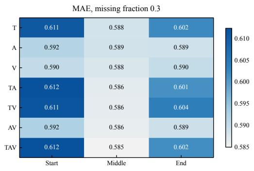

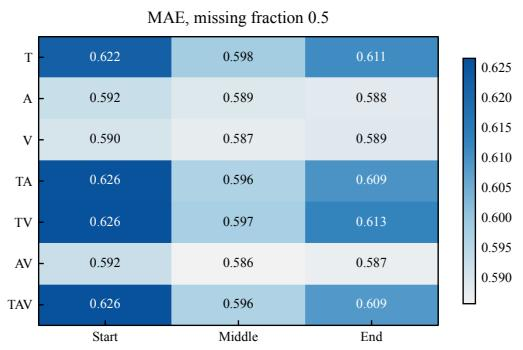  
Figure 5: MAE of the RM-Net core by damaged-modality subset (rows) and span position (columns) at missing fractions 0.3 (left) and 0.5 (right). Colour scales differ between the two panels.

First, under 40% text missingness, one contiguous span gives an MAE of 0.603 and four spans give 0.599; this small difference was not tested for significance. Second, the mean text gate weight of the core rises only from 0.531 to 0.548 as the text missing fraction increases from 10% to 90%, so the gate does not decrease monotonically with missingness. The gate is an internal weight, not a calibrated reliability estimate.

## D Fused-Model Missingness and Validation Diagnostics

This section expands the diagnostics of the fused model summarized in Section 6. The validation split was used for model development, so every number here describes the frozen model on data it was tuned on, and none is a blind test.

## D.1 Per-utterance changes under mixed missingness

On the 728 validation utterances, 447 are classified correctly under both clean and 40% mixedmissing inputs, and 233 are wrong under both. Missingness flips 22 correct predictions to wrong and 26 wrong predictions to correct. The average Macro-F1 change therefore reflects cancelling perutterance changes, not a uniform effect. Table 8 shows one case per true class: for each class, the flipped utterance with the largest increase in absolute intensity error. The cases illustrate failure modes and were not used for any selection. Spans are position indices, starting at 0 and half-open; “∅” means that the modality received no additional mask.

V1 describes difficulty in obtaining educational resources; its text span covers the phrase “really difficult for me”, and the negative prediction turns positive when that span and different parts of the audio and vision are removed. V2 is a factual statement whose neutral reading is lost when a position in the text tail is masked. V3 contains a positive evaluation; masking that span together with the end of the audio turns a positive prediction negative. These examples show that locally masked cues can change the decision, but multiple modalities change together, so they do not identify a single cause.

## D.2 Position and length groups

Table 9 gives the paired increase in MAE caused by masking (masked minus clean) for the validation split. The length groups pool the 20%, 40%, and 60% conditions, giving 2,184 records per modality (728 utterances at three rates), so records from the same utterance are not independent. Text spans starting at the head, middle, and tail of the admissible range increase MAE by 0.0214, 0.0165, and 0.0287. Audio and visual changes are at most 0.0022. For text, longer spans have larger increases, but the groups also differ in missing ratio and sentence length, so the trend does not isolate absolute length.

## D.3 Intensity groups and per-class behaviour

Table 10 reports validation MAE by true-intensity group for the fused model. Under mixed missingness, MAE rises for the moderate group (0.568 to 0.583), while the strong group remains the largest error source in both conditions. The neutral group is defined by $| y | = 0$

Table 11 gives per-class precision, recall, and F1 for the clean validation confusion matrix. The Neutral class is the weakest in all three measures. Under 40% mixed missingness, its precision is 0.480 and its recall 0.582 (Figure 3).

## D.4 Replay of the unlabeled-set zero spans

The zero spans in unlabeled set A were replayed on the held-out split. Each of the 30 patterns was mapped to each of the 727 held-out utterances by normalizing its span positions to the utterance length. Figure 7 shows the Macro-F1 gain of the fused model over the RM-Net core for each pattern. Panel (a) replays only the zero spans; panel (b) also treats the [UNK] tokens of the set as extra text masking. The fused model improves Macro-F1 in all 30 patterns of panel (a), with a mean gain of 3.07 points. In panel (b) the mean gain falls to 1.36 points, and patterns 17, 20, and 21 are negative. The MAE reduction is positive for every pattern in both panels. The replay gives a condition-level view of the same effect, but its 30 patterns are not independent samples.

## D.5 Pre-encoding text-span deletion and fold-level stability

The pre-encoding deletion check removes the characters covered by the masked text spans in the validation mixed40 condition before re-encoding, reencodes the remaining text with the frozen BERT and each LoRA expert, maps the surviving subwords back to the original positions, and keeps audio, vision, and masks unchanged. Under this protocol, the fused Macro-F1 falls from 0.6394 to 0.6065 and MAE rises from 0.5722 to 0.5930; the RM-Net core reaches Macro-F1 0.5813 on the same condition. Because span boundaries follow subword offsets, a boundary can split a word, so this check is not strictly whole-word deletion. The check was not used for selection.

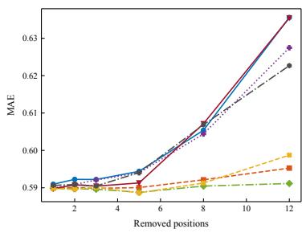

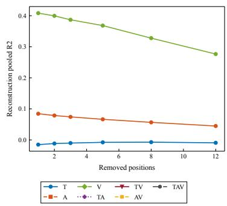

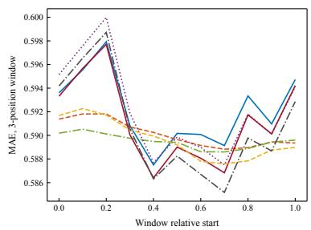  
Figure 6: RM-Net core under span length and placement. Left: MAE as the number of removed positions grows, by modality subset. Middle: reconstruction $R ^ { 2 }$ on the removed positions for single-modality removal. Right: MAE of a three-position window as its relative start varies.

<table><tr><td>Case</td><td>True polarity / intensity</td><td>Polarity change</td><td>Intensity change</td><td>Text span</td></tr><tr><td>V1 (Vuay0mVKkik$_$3)</td><td>Neg / -2.0</td><td>Neg→Pos</td><td> $- 0 . 2 0 1  0 . 4 8 5$ </td><td>[2, 14)</td></tr><tr><td>V2 (fWOIAxzBQFY$_$7)</td><td>Neu / 0.0</td><td>Neu→Pos</td><td> $0 . 4 5 3  0 . 8 0 5$ </td><td>[12, 21)</td></tr><tr><td>V3 (128059$_$6)</td><td>Pos / 1.0</td><td> $\mathrm { P o s \to N e g }$ </td><td> $0 . 0 3 9  - 0 . 7 2 9$ </td><td>[15, 35)</td></tr></table>

Table 8: Representative flips under mixed missingness on the validation split. Audio and visual spans are [4, 16) and [15, 27) for V1, [6, 15) and [3, 12) for V2, and [30, 50) and ∅ for V3.

<table><tr><td>Grouping</td><td>Group 1</td><td>Group 2</td><td>Group 3</td><td>Group 4</td></tr><tr><td>Span position: head / middle / tail (40%)</td><td>0.0214</td><td>0.0165</td><td>0.0287</td><td></td></tr><tr><td>Span length:  $1 { - } 4 / 5 { - } 8 / 9 { - } 1 2 / \geq 1 3 \mathrm { ( t e x t ) }$ </td><td>0.0034</td><td>0.0141</td><td>0.0192</td><td>0.0343</td></tr><tr><td>Records per length group</td><td>352</td><td>658</td><td>516</td><td>658</td></tr></table>

Table 9: Paired increase in validation MAE caused by text masking (masked minus clean). Position uses the 40% condition; length pools the 20%, 40%, and 60% conditions.

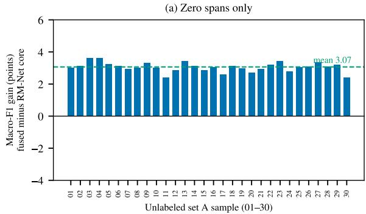

(b) Zero spans + [UNK] as extra text masking  
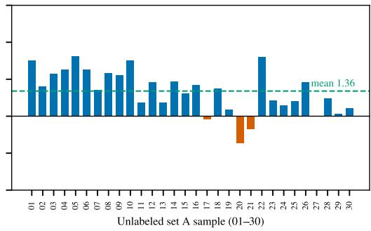  
Figure 7: Held-out replay of the unlabeled-set A zero spans. Bars show the Macro-F1 gain of the fused model over the RM-Net core for each pattern (sample number 01–30). Panel (b) also masks the [UNK] positions of the set. The dashed line is the mean gain.

<table><tr><td>Group (|y|)</td><td>n</td><td>Clean MAE</td><td>Mixed40 MAE</td></tr><tr><td> $0 \mathrm { ( N e u t r a l ) }$ </td><td>184</td><td>0.352</td><td>0.348</td></tr><tr><td> $0 < | y | \le 0 . 5 ( \mathrm { w e a k } )$ </td><td>147</td><td>0.391</td><td>0.399</td></tr><tr><td> $0 . 5 < | y | \leq 1 . 5$  (moderate)</td><td>267</td><td>0.568</td><td>0.583</td></tr><tr><td> $\left| y \right| > 1 . 5 \left( \mathrm { s t r o n g } \right)$ </td><td>130</td><td>1.057</td><td>1.064</td></tr></table>

Table 10: Validation MAE of the fused model by trueintensity group.
<table><tr><td>Class</td><td>Precision (%)</td><td>Recall (%)</td><td>F1 (%)</td></tr><tr><td>Negative</td><td>65.6</td><td>72.3</td><td>68.8</td></tr><tr><td>Neutral</td><td>46.3</td><td>57.1</td><td>51.1</td></tr><tr><td>Positive</td><td>78.5</td><td>63.6</td><td>70.3</td></tr></table>

Table 11: Per-class metrics of the fused model on the clean validation split.

A grouped five-fold check was run inside the training split, with folds defined by source video. Each fold starts from the public BERT weights and trains a single LoRA adapter. The two-view Macro-F1 averages 0.6170 across folds with standard deviation 0.0073. This measures the stability of one configuration and is not a nested estimate for the five-seed fused model.

## E Model Selection and Frozen-Representation Comparisons

The fused predictor was chosen from a set of candidates on the validation split. This section documents the candidate set, the replacement rule, and the alternatives that were not adopted, so that the selection can be audited.

## E.1 Candidate workflow after the frozen model

After the final model was frozen, nine workflow candidates were compared: the frozen model and eight additional ones. The additional candidates are two class-bias shrinkage variants (bias multiplied by 0.5 or 0), three quality-adaptive fusion variants, and three quality-adaptive fusion variants with a restricted review step. The review step runs only when text is present and the RM and LoRA classes disagree or the top two fused probabilities differ by less than 0.20; it adds at most two extra calls to the RM core with audio-visual or text-only inputs. The adaptive variants use 27 diagnostic features, and the review variant uses 49. Regularization strengths were 0.01, 0.1, and 1 for the learned variants. Each learned variant was fitted on out-of-fold predictions from five video-grouped folds of the training split.

A candidate could replace the frozen model only if all three conditions held on the validation split: the two-view mean Macro-F1 rose by at least 0.003; neither view’s Macro-F1 decreased; and the MAE of each view increased by at most 0.01. The rule was fixed before the candidates were compared. Table 12 lists the best configuration of each family by validation Macro-F1.

The best review candidate has a held-out Macro-F1 difference of +0.0130 with a 95% video-cluster bootstrap interval of [−0.0043, 0.0303] and a twosided permutation $p = 0 . 1 6 3 .$ Its validation average is lower than the frozen model’s, so it does not satisfy the rule. Its effect was also not corrected for multiple comparisons. Across the 21 missingness conditions, the review candidate has a mean Macro-F1 gain of +0.0146 with 12 wins, 0 ties, and 9 losses. The review step was triggered for 31.9% (clean) and 34.3% (40% mixed) of held-out utterances, adding on average 0.64 and 0.69 calls per utterance. We therefore keep the frozen model and report the candidate only as a documented alternative.

## E.2 Interface checks

A separate offline check ran 156 raw-input inferences for four configurations: each configuration on the 30 unlabeled set-A utterances, and three utterances each for mixed missingness, alltext-missing, and all-modalities-missing boundary cases. Class labels matched the cached-feature inference in every case, and the probability, intensity, and core-contribution identities held. The check verifies the software interface and does not estimate accuracy on the unlabeled set, which has no labels.

## E.3 All candidates

Table 13 reports every frozen-representation and fusion candidate that was evaluated, with the validation and held-out results. Two patterns are informative. First, the final configuration has the highest validation average of all candidates, with a margin of 0.0003 over the best frozen-representation fusion (RM-Net + BERT probe fusion + bias). Second, several candidates lead on individual held-out conditions, including the LoRA expert alone on the mixed split and the unbiased fusion on clean inputs. These differences do not form a consistent ranking, which is why the final choice is justified by the validation rule and not by the held-out numbers.

<table><tr><td>Family</td><td>Configuration</td><td>Val avg</td><td>Test avg</td><td>Test ∆ vs. frozen</td><td>Adopted</td></tr><tr><td>Frozen RM + LoRA fusion</td><td>baseline</td><td>0.636652</td><td>0.644564</td><td>0</td><td>Yes</td></tr><tr><td>Class-bias shrinkage</td><td>bias_shrink_0.5</td><td>0.629462</td><td>0.646465</td><td>+0.001902</td><td>No</td></tr><tr><td>Quality-adaptive fusion</td><td>adaptive_12_0.1</td><td>0.614761</td><td>0.650359</td><td>9+0.005795</td><td>No</td></tr><tr><td>Quality fusion + restricted review</td><td>review_12_0.01</td><td></td><td></td><td>0.6262970.657514+0.012950</td><td>No</td></tr></table>

Table 12: Workflow candidates. Averages are over the clean and 40% mixed-missing Macro-F1 values. The test column is shown for transparency; it was inspected earlier and was not used to choose among candidates.

The Qwen probes use the frozen encoders of Qwen2.5-1.5B, Qwen3.5-0.8B, Qwen3.5-2B, and Qwen3.5-4B, each with a linear probe on pooled hidden states. The probe layer and regularization were selected on the training and validation splits. The Qwen3.5 family did not pass the preset validation fusion threshold, and every Qwen probe has lower held-out Macro-F1 than the fused model. The SVD baselines use singular-value features with logistic regression; they are reported as comparisons only.

## E.4 Grouped stability of the text expert

The stability check in Appendix D trains one LoRA adapter per fold. Its fold-level Macro-F1 values are reported as a mean and standard deviation only, because the folds are not independent estimates of the five-seed fused model.

## F Raw-Video Alignment Pipeline

This section documents the word-level pipeline summarized in Section 3. The pipeline processes the 100 raw clips with their transcripts. It is separate from the predictive models: none of its features are used for training, validation, or testing of the fused predictor.

## F.1 Common time base

Let $b _ { a }$ and $b _ { v }$ be the start times of the audio and video streams, and $T _ { a }$ and $T _ { v }$ their durations. The common time base starts at $b = \operatorname* { m a x } ( b _ { a } , b _ { v } )$ and lasts $T = \mathrm { m i n } ( b _ { a } + T _ { a } , b _ { v } + T _ { v } ) - b$ . Audio is decoded with FFmpeg to mono 16 kHz floatingpoint samples, and only decoded samples are kept; no tail is padded. Video frames are read with PyAV, keeping the original presentation timestamp (PTS)

and decoded frame index instead of dividing frame numbers by a nominal frame rate. Across the 100 clips, stream durations range from 2.257 to 29.288 s for video, and the effective common duration ranges from 2.229 to 29.109 s, totalling 777.090 s (mean 7.771 s). Fifty clips have a stream-duration difference above 100 ms; for all clips, the common interval is the only interval that is used.

## F.2 Text features

Each raw sentence is encoded by the frozen BERTbase uncased model (last layer), and the encoding covers the whole sentence; no truncation to 50 positions is applied at this stage. Words are nonempty whitespace-delimited spans of the transcript; punctuation-only spans are not words. For the ith word with character span $[ c _ { i } ^ { s } , c _ { i } ^ { e } )$ , let $s _ { i }$ be the set of WordPiece tokens that overlap it. The word vector is the mean of their hidden states,

$$
\mathbf { x } _ { i } ^ { t } = \frac { 1 } { | S _ { i } | } \sum _ { u \in \mathcal { S } _ { i } } \mathbf { h } _ { u } \in \mathbb { R } ^ { 7 6 8 } .
$$

Punctuation inside a word can contribute subword tokens to that word. Word vectors are stored in half precision; the maximum absolute quantization error against single-precision encodings is 0.003899.

## F.3 Acoustic features

The acoustic grid uses 25 ms analysis windows (400 samples) with a 10 ms hop (160 samples). The number of full frames is $N ^ { a } = \lfloor ( S { - } 4 0 0 ) / 1 6 0 \rfloor { + } 1$ for S decoded samples, and the centre of frame k is $\tau _ { k } ^ { a } = ( 1 6 0 k + 2 0 0 ) / 1 6 0 0 0 = 0 . 0 1 2 5 + 0 . 0 1 k$ s. No partial window is padded at the end. Table 14 lists the 74 dimensions. Tools differ in native analysis windows: openSMILE and eGeMAPS features (Eyben et al., 2010, 2016) are interpolated linearly to the 10 ms grid by timestamp, and F0 and mel-cepstral features take the nearest WORLD frame (Morise et al., 2016). Spectral and cepstral descriptors use librosa (McFee et al., 2015); mel-cepstral coefficients are computed with SPTK through pysptk 1.0.1 (SPTK Working Group, n.d.). Values are stored as float32, and non-finite values are replaced and counted; the count was zero for all clips. Semitone-based pitch differences are set to zero across voiced/unvoiced boundaries.

<table><tr><td>Configuration</td><td>Val clean</td><td>Val mixed</td><td>Val avg</td><td>Test clean</td><td>Test mixed</td><td>Test MAE clean</td><td>Test MAE mixed</td></tr><tr><td>RM-Net core (auxiliary head)</td><td>0.6144</td><td>0.6057</td><td>0.6101</td><td>0.6237</td><td>0.6178</td><td>0.6344</td><td>0.6379</td></tr><tr><td>RM-Net core + class bias</td><td>0.6169</td><td>0.6177</td><td>0.6173</td><td>0.6185</td><td>0.6189</td><td>0.6344</td><td>0.6379</td></tr><tr><td>BERT last-layer probe</td><td>0.5976</td><td>0.5935</td><td>0.5956</td><td>0.6280</td><td>0.6118</td><td>0.6870</td><td>0.6969</td></tr><tr><td>BERT multi-layer probe</td><td>0.6118</td><td>0.6007</td><td>0.6063</td><td>0.6315</td><td>0.6371</td><td>0.6950</td><td>0.7019</td></tr><tr><td>BERT + SVD probe</td><td>0.6125</td><td>0.5930</td><td>0.6027</td><td>0.6090</td><td>0.6161</td><td>0.7004</td><td>0.7032</td></tr><tr><td>BERT scalar-mix probe (5 seeds)</td><td>0.6074</td><td>0.6165</td><td>0.6119</td><td>0.6209</td><td>0.6261</td><td>0.6436</td><td>0.6432</td></tr><tr><td>BERT scalar-mix probe (5 seeds) + bias</td><td>0.6179</td><td>0.6276</td><td>0.6227</td><td>0.6150</td><td>0.6152</td><td>0.6436</td><td>0.6432</td></tr><tr><td>SVD + logistic regression, all modalities + bias</td><td>0.6207</td><td>0.6146</td><td>0.6176</td><td>0.6213</td><td>0.6136</td><td>0.6344</td><td>0.6379</td></tr><tr><td>SVD + logistic regression, text only + bias</td><td>0.6163</td><td>0.6087</td><td>0.6125</td><td>0.6309</td><td>0.6192</td><td>0.6344</td><td>0.6379</td></tr><tr><td>Qwen2.5-1.5B probe</td><td>0.5962</td><td>0.5791</td><td>0.5876</td><td>0.5853</td><td>0.5777</td><td>0.6845</td><td>0.7794</td></tr><tr><td>Qwen3.5-0.8B probe</td><td>0.5788</td><td>0.5704</td><td>0.5746</td><td>0.5965</td><td>0.5676</td><td>0.7448</td><td>0.7665</td></tr><tr><td>Qwen3.5-2B probe</td><td>0.6021</td><td>0.5810</td><td>0.5915</td><td>0.6192</td><td>0.6010</td><td>0.7100</td><td>0.7727</td></tr><tr><td>Qwen3.5-4B probe</td><td>0.6028</td><td>0.5932</td><td>0.5980</td><td>0.6027</td><td>0.5867</td><td>0.7046</td><td>0.7479</td></tr><tr><td>LoRA text expert only</td><td>0.6175</td><td>0.6269</td><td>0.6222</td><td>0.6578</td><td>0.6524</td><td>0.6171</td><td>0.6223</td></tr><tr><td>RM-Net, CE weight 0.3, 15 seeds, bias</td><td>0.6153</td><td>0.6216</td><td>0.6185</td><td>0.6126</td><td>0.6144</td><td>0.6287</td><td>0.6305</td></tr><tr><td>RM-Net, CE weight 1, 15 seeds, bias</td><td>0.6260</td><td>0.6277</td><td>0.6269</td><td>0.6187</td><td>0.6071</td><td>0.6185</td><td>0.6242</td></tr><tr><td>RM-Net, CE weight 2, 15 seeds, bias</td><td>0.6288</td><td>0.6219</td><td>0.6253</td><td>0.6264</td><td>0.6247</td><td>0.6173</td><td>0.6230</td></tr><tr><td>RM-Net + BERT probe fusion</td><td>0.6256</td><td>0.6258</td><td>0.6257</td><td>0.6407</td><td>0.6338</td><td>0.6279</td><td>0.6333</td></tr><tr><td>RM-Net + BERT probe fusion + bias</td><td>0.6350</td><td>0.6308</td><td>0.6329</td><td>0.6544</td><td>0.6368</td><td>0.6279</td><td>0.6343</td></tr><tr><td>RM-Net + BERT+SVD fusion</td><td>0.6231</td><td>0.6224</td><td>0.6227</td><td>0.6246</td><td>0.6223</td><td>0.6312</td><td>0.6361</td></tr><tr><td>RM-Net + BERT+SVD fusion + bias</td><td>0.6319</td><td>0.6143</td><td>0.6231</td><td>0.6169</td><td>0.6239</td><td>0.6312</td><td>0.6361</td></tr><tr><td>RM-Net + LoRA fusion</td><td>0.6351</td><td>0.6304</td><td>0.6328</td><td>0.6600</td><td>0.6496</td><td>0.6099</td><td>0.6185</td></tr><tr><td>RM-Net + LoRA fusion + bias (final)</td><td>0.6339</td><td>0.6394</td><td>0.6367</td><td>0.6550</td><td>0.6341</td><td>0.6099</td><td>0.6210</td></tr><tr><td>RM-Net (CE 1, 15 seeds) + BERT probe fusion</td><td>0.6277</td><td>0.6331</td><td>0.6304</td><td>0.6439</td><td>0.6250</td><td>0.6172</td><td>0.6240</td></tr><tr><td>RM-Net (CE 1, 15 seeds) + BERT probe fusion + bias</td><td>0.6360</td><td>0.6367</td><td>0.6363</td><td>0.6326</td><td>0.6284</td><td>0.6172</td><td>0.6242</td></tr><tr><td>RM-Net (CE 1, 15 seeds) + BERT+SVD fusion</td><td>0.6277</td><td>0.6248</td><td>0.6262</td><td>0.6219</td><td>0.6206</td><td>0.6185</td><td>0.6242</td></tr><tr><td>RM-Net (CE 1, 15 seeds) + BERT+SVD fusion + bias</td><td>0.6309</td><td>0.6268</td><td>0.6288</td><td>0.6184</td><td>0.6249</td><td>0.6185</td><td>0.6242</td></tr><tr><td>RM-Net (CE 1, 15 seeds) + LoRA fusion</td><td>0.6298</td><td>0.6312</td><td>0.6305</td><td>0.6377</td><td>0.6273</td><td>0.6060</td><td>0.6139</td></tr><tr><td>RM-Net (CE 1, 15 seeds) + LoRA fusion + bias</td><td>0.6379</td><td>0.6341</td><td>0.6360</td><td>0.6298</td><td>0.6118</td><td>0.6060</td><td>0.6139</td></tr></table>

Table 13: All evaluated candidates. Val and Test columns report Macro-F1 on the clean and 40% mixed-missing inputs; MAE is on the held-out split. Val avg is the mean of the two validation views. The bold row is the final configuration.

## F.4 Visual features

Video is sampled on a 25 Hz grid $\tau _ { j } ^ { v } = j / 2 5 \mathrm { ~ s } ;$ each grid time takes the decoded frame whose PTS is nearest. Frames are downscaled, keeping the aspect ratio, to at most 640 pixels wide and passed to MediaPipe Face Landmarker v1 (Lugaresi et al., 2019) in IMAGE mode, with detection and presence thresholds of 0.5 and at most five faces per frame. The first valid frame uses the largest face; later frames prefer the face with IoU at least 0.5 with the previous box, and otherwise switch to the largest face. Frames without a face have a zero 35-dimensional vector and face mask zero. Table 15 lists the 35 dimensions. The 27 expression coefficients are descriptive outputs of the frozen model. They are not facial action units, emotion probabilities, or labels.

## F.5 Forced alignment and the time-quality gate

Transcripts are normalized only for CTC: text is uppercased, apostrophes are kept, and numbers are spelled out. The original transcript and character offsets are unchanged. A wav2vec 2.0 Base model pretrained on 960 hours of speech (Baevski et al., 2020) provides frame posteriors $p _ { k } ( \cdot \mid u )$ at a stride of 320 samples with a 400-sample receptive field, and the centre of CTC frame k is 0.0125 + 0.02k s at 16 kHz. The forced path maximizes

$$
\pi ^ { * } = \underset { \pi : \mathcal { B ( \pi ) } = \widetilde W } { \arg \operatorname* { m a x } } \sum _ { k } \log p _ { k } ( \pi _ { k } \mid u ) ,
$$

where B merges repeated labels and removes blanks (Graves et al., 2006). The dynamic program allows staying, advancing one state, and skipping one blank between distinct characters; a repeated character must pass through a blank. Each word’s boundaries are the first and last assigned frame centres, extended by 10 ms and clipped to the valid range. The word posterior $c _ { i }$ is the mean posterior of its non-blank frames. A greedy decode of the same model gives a word error rate (WER) used only as a consistency diagnostic.

A word passes the time-quality gate when its own posterior, the clip mean posterior, and the clip

WER all satisfy fixed thresholds set before any sentiment labels were inspected:

$$
\begin{array} { l } { { q _ { i } = { \bf 1 } \{ c _ { i } \geq 0 . 5 \} { \bf 1 } \{ \bar { c } _ { n } \geq 0 . 5 \} } } \\ { { \displaystyle ~ \cdot { \bf 1 } \{ { \bf W E R } _ { n } \leq 0 . 5 \} } , } \\ { { \bar { c } _ { n } = \displaystyle \frac { 1 } { m _ { n } } \sum _ { i } c _ { i } . } } \end{array}
$$

Words that fail the gate keep their candidate intervals and features, but their cross-modal use mask is zero. Passing the gate does not establish that a human would mark the same boundary.

## F.6 Word-level pooling and index mapping

For word i with candidate interval $[ s _ { i } , e _ { i } )$ , let $S _ { i } =$ $3 2 0 k _ { i } ^ { s } + 4 0$ and $E _ { i } = \operatorname* { m i n } \{ 3 2 0 ( k _ { i } ^ { e } - 1 ) + 3 6 0 , N _ { s } \}$ where $k _ { i } ^ { s }$ and $k _ { i } ^ { e }$ are the first frame and the exclusive end frame of the word and $N _ { s }$ is the number of decoded samples. The audio frame set and the video grid set are

$$
\begin{array} { l } { { \displaystyle { \mathcal { K } } _ { i } = \{ k : \ S _ { i } \leq 1 6 0 k + 2 0 0 < E _ { i } \} , } } \\ { { \displaystyle { \mathcal { J } } _ { i } = \{ j : \ S _ { i } \leq 6 4 0 j < E _ { i } \} . } } \end{array}
$$

If a set is empty, its nearest frame to the word midpoint is used and the fallback is recorded (ties go to the smaller index). Audio features are averaged over $\kappa _ { i }$ . Visual features are weighted by the face indicator $a _ { j } ^ { v }$

$$
\overline { { \mathbf { v } } } _ { i } = \frac { \sum _ { j \in \mathcal { T } _ { i } } a _ { j } ^ { v } \mathbf { v } _ { j } } { \sum _ { j \in \mathcal { T } _ { i } } a _ { j } ^ { v } } ,
$$

with $\overline { { \mathbf { v } } } _ { i } = \mathbf { 0 }$ when the denominator is zero. The three-modality use mask is $M _ { i } = ( 1 , q _ { i } a _ { i } ^ { a } , q _ { i } a _ { i } ^ { v } )$ Every word stores its character span, interval, frame indices, subword indices, and source PTS, so that a feature can be traced back to the original video frames. The trace is an index map, not an exact inverse of the pooling. Pooling by mean is a least-squares summary, and no reconstruction of the original signal is claimed.

## F.7 Output interfaces

The pipeline writes three layers. L0 keeps framelevel features on the full acoustic grid and the 25 Hz visual grid. L1 keeps one vector per word for all words. L2 provides fixed-length tensors on the 50- position BERT grid. Table 16 gives the shapes. In L2, each subword position receives the vectors of its word, and [CLS] and [SEP] have zero audio and visual vectors. A sequence longer than 50 positions keeps the first 49 positions and the final [SEP]; six clips are truncated. Non-aligned chunking uses fixed block sizes, $r _ { a } = \lceil 2 9 0 9 / 5 0 0 \rceil = 6$ frames (about 60 ms) for audio and $r _ { v } = \lceil 7 2 8 / 5 0 0 \rceil = 2$ frames (about 80 ms) for vision, which covers the longest clip. Length fields distinguish the retained BERT positions, the full subword count, and the full word count.

<table><tr><td>Group</td><td>Content</td><td>Dim.</td><td>Main tools</td></tr><tr><td>Prosody</td><td>FO, semitones re. 27.5 Hz, semitone delta, voicing, RMS, RMS delta, loudness, zero-crossing rate</td><td>8</td><td>WORLD, waveform, openSMILE</td></tr><tr><td>Voice quality</td><td>HNR, jitter, shimmer, H1–H2, alpha ratio, Hammarberg index</td><td>6</td><td>eGeMAPSv02</td></tr><tr><td>Spectral shape</td><td>centroid, bandwidth, 85% rolloff, spectral flux, flatness, slopes (0–500, 500–1500 Hz), entropy</td><td>8</td><td>librosa, openSMILE</td></tr><tr><td>Formants</td><td>F1-F3 frequencies and bandwidths</td><td>6</td><td>eGeMAPSv02</td></tr><tr><td>Cepstrum</td><td>MFCC1–13 with 13 deltas (9-frame window); MCEP0–19</td><td>46</td><td>librosa, WORLD, SPTK</td></tr></table>

Table 14: The 74 acoustic dimensions. The feature schema is stored with the outputs.
<table><tr><td>Group</td><td>Content</td><td>Dim.</td></tr><tr><td>Expression coefficients</td><td>brows (5), cheeks (2), eye blink, squint, and widening (6), jaw (1), smile, mouth corner, and lip pressing (6), lip pucker (1), mouth stretch (2), upper-lip raise (2), nose wrinkle (2)</td><td>27</td></tr><tr><td>Head pose</td><td>Euler angles from the facial transformation matrix (rad)</td><td>3</td></tr><tr><td>Geometry and dynamics</td><td>normalized face-box area, eye aspect ratio, mouth aspect ratio, relative rotation speed between valid frames, fraction of landmarks inside the frame</td><td>5</td></tr></table>

Table 15: The 35 visual dimensions.

## F.8 Quality checks

Table 17 summarizes the checks run on all 100 clips. The face-detection rate is frame-weighted, and the CTC mean is an internal model score, not an alignment accuracy. High WER, low posterior, missing faces, and stream-duration mismatch can co-occur, so the counts should not be added. Clips with low scores are kept, with their flags.

Figure 9 summarizes the distributions behind these checks. The lower-right panel is an exploratory audio–visual lag analysis: for 85 clips with enough paired observations, the lag between speech energy and mouth-opening ratio is searched in ±480 ms. Only 15 clips have a peak within ±40 ms, and the median absolute lag is 160 ms. The lag estimates are widely dispersed, so the pipeline does not shift any timeline by them.

## F.9 Cross-check with the supplied aligned split and retention

Eighteen of the 100 clips also appear in the supplied aligned split (11 in training and 7 in test). For these, the transcripts are identical and the labels agree exactly; this only checks correspondence and was not used for training. Table 18 compares how much acoustic variance is kept by each grouping, using the same frames and only the 65 clips that have a gated word.

## F.10 A typical clip

Figure 8 shows the clip -egA8-b7-3M\_9, labelled Positive, with 4.936 s of common duration and a mean CTC posterior of 0.978. All ten words pass the gate, and its WER is 0. Table 19 lists the wordlevel values. Frame numbers start at 0 and intervals are half-open; for readability, frame ranges include both endpoints.

The example runs from the word to its acoustic frames, video grid frames, and three feature types, and the figure shows the same mapping on a common time axis. It does not represent every clip: 35 clips have no gated word and 13 have no detected face, and these limits remain.

## G Explanation Details

This section expands the explanation analysis of Section 6. Explanations describe the dependence of the frozen fused predictor on each input under the stated interventions. They do not establish human causes of sentiment, and they have not been checked by human annotation of evidence.

## G.1 Targets and attributions

Two targets are explained for each utterance. The intensity target is the fused intensity yˆ. The classification target is the probability of the class predicted on the unperturbed input, $p _ { \hat { c } _ { 0 } } .$ , which stays fixed while the input is perturbed, even when the predicted class changes. The three modalities are the players of a Shapley game, and the value of a coalition S is the output of the complete fused predictor with only the observations of S kept. The Shapley value of modality m is

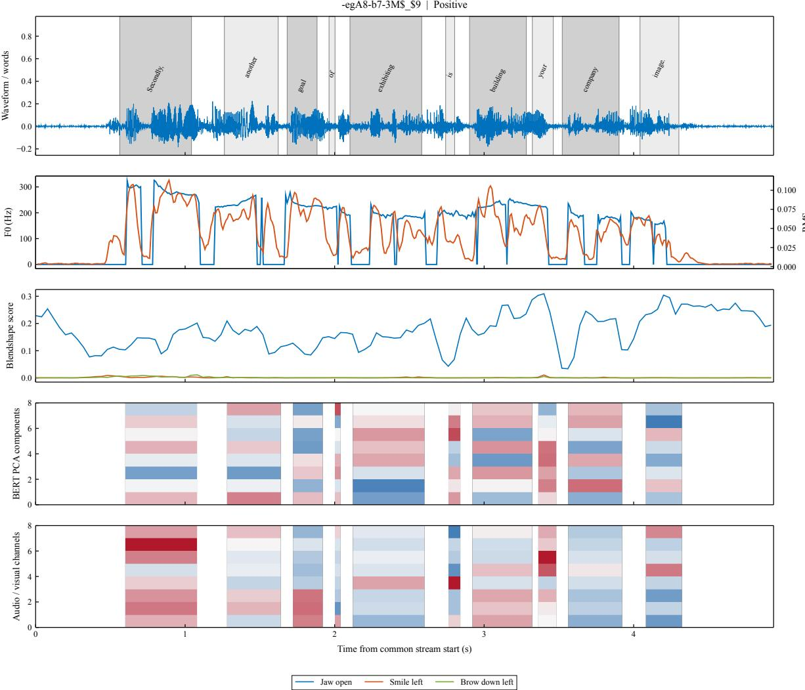  
Figure 8: Word-level alignment for a typical clip (-egA8-b7-3M\_9, Positive, 4.9 s). From top: waveform with CTC-estimated word spans; F0 and RMS; three MediaPipe blendshape scores; a projection of the BERT word features onto principal components; and per-word means of selected audio and visual channels. Shaded spans mark word boundaries, and the vertical axis of each panel is in its own units.

<table><tr><td>File</td><td>Text</td><td>Audio</td><td>Vision</td></tr><tr><td>L2 aligned (50 positions)</td><td>(100, 50, 768)</td><td>(100, 50, 74)</td><td>(100, 50, 35)</td></tr><tr><td>L2 non-aligned (500 blocks)</td><td>(100, 50, 768)</td><td>(100, 500, 74)</td><td>(100, 500, 35)</td></tr></table>

Table 16: Output tensor shapes for the 100 clips.

<table><tr><td>Check or diagnostic</td><td>Result</td></tr><tr><td>Clips with all modality files and indices</td><td>100 / 100</td></tr><tr><td>Clips passing the interface and index checks</td><td>100 / 100</td></tr><tr><td>Acoustic NaN/Inf replacements</td><td>0</td></tr><tr><td>Frame-weighted face detection rate</td><td>81.97%</td></tr><tr><td>Word-level visual availability before the time gate</td><td>82.61%</td></tr><tr><td>Clips with face detection below 20% (of which none detected)</td><td>17 (13)</td></tr><tr><td>Mean CTC posterior over clips (model score)</td><td>0.7617</td></tr><tr><td>Clips with mean CTC posterior below 0.5</td><td>20</td></tr><tr><td>Median greedy WER against the transcript</td><td>0.3417</td></tr><tr><td>Clips with WER above 0.5</td><td>35</td></tr><tr><td>Clips with at least one gated word</td><td>65 / 100</td></tr><tr><td>Gated words</td><td>1,316 / 1,926 (68.33%)</td></tr><tr><td>Clips with stream-duration difference above 100 ms</td><td>50</td></tr><tr><td>Fallback frames (audio / visual)</td><td>0/29</td></tr><tr><td>Clips with L2 subword truncation</td><td>6</td></tr><tr><td>Repeated extraction: identical files, maximum absolute difference</td><td>500 / 500, 0</td></tr></table>

Table 17: Quality checks on the 100 raw clips.

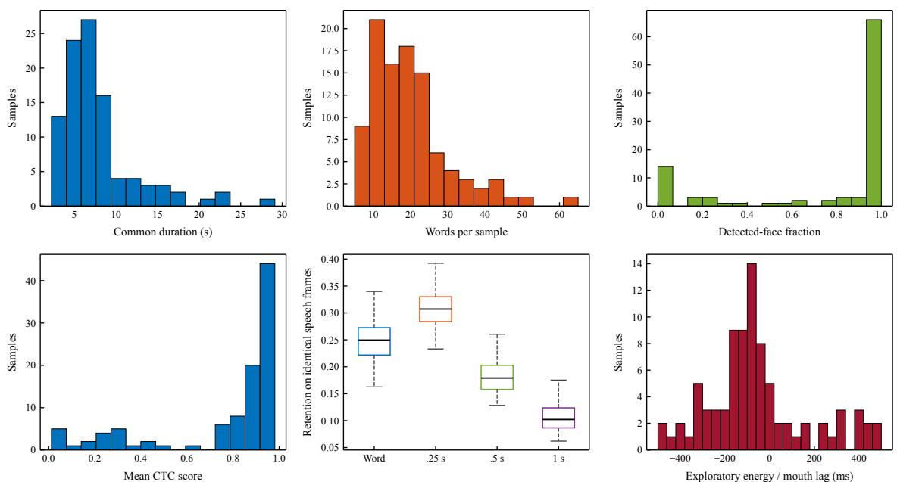  
Figure 9: Quality summaries over the 100 raw clips: duration of the common timeline, words per clip, detected-face fraction, mean CTC posterior, and retained acoustic variance by grouping (65 clips with at least one gated word). The lower-right panel is an exploratory audio–visual lag histogram; it is not used to shift timelines.

<table><tr><td>Grouping</td><td>Retention R</td><td>Mean non-empty groups</td></tr><tr><td>Word level</td><td>0.2489</td><td>20.25</td></tr><tr><td>0.25 s windows</td><td>0.3120</td><td>25.75</td></tr><tr><td>0.5 s windows</td><td>0.1848</td><td>14.03</td></tr><tr><td>1.0 s windows</td><td>0.1069</td><td>7.82</td></tr></table>

Table 18: Acoustic variance retained by each grouping, averaged over the 65 clips with at least one gated word. R is a descriptive variance measure, not a sentiment accuracy.

$$
\phi _ { m } = \sum _ { \begin{array} { l } { S \subseteq \{ t , a , v \} \backslash \{ m \} } \\ { \cdot \ \big ( F ( S \cup \{ m \} ) - F ( S ) \big ) , } \end{array} } \frac { | S | ! ( 3 - | S | - 1 ) ! } { 3 ! }
$$

where $F ( S )$ is the target value with coalition S (the complete fused predictor with only the observations of S). The absolute share of a modality is $| \phi _ { m } | / \Sigma _ { m ^ { \prime } } | \phi _ { m ^ { \prime } } |$ , and a modality is dominant when its share is largest. Ties are flagged. Coalitions with an empty observation set use the learned empty-set prior of the model, not zero, so the efficiency identity holds with the same baseline.

Position-level evidence uses single-position occlusion. Each observed content position is occluded alone in each of the four intervention scopes (text, audio, vision, and all three modalities at the same position), and the full fused output is recomputed. The ranking uses $| \Delta y |$ for intensity and the drop in the fixed predicted-class probability for classification; ties are broken by the smaller position index. Special tokens are excluded from the ranking but retained in the full output.

## G.2 Fidelity protocol and flips

Deletion and retention curves remove or keep the top fraction $\rho \in \{ 0 , 0 . 1 , \ldots , 0 . 8 \}$ of content positions, with $\lceil \rho K \rceil$ positions for K content positions, and recompute the complete fused output. Random comparisons use five random permutations, and their metrics are averaged after each permutation is evaluated separately. Curves are integrated with the trapezoid rule over [0, 0.8] and divided by 0.8. For intensity, the reported quantity is the absolute change. For the class target it is the signed decrease of the predicted-class probability, so a negative value means that retaining the ranked positions raises that probability.

The flip analysis deletes content positions along the classification ranking and records the first deletion count at which the three-class decision changes. Utterances that never change are censored at $K + 1$ . This is the first flip along one fixed ranking, not a global minimum over subsets, and it uses the same censoring rule for random permutations. On the 728 validation utterances, the median first-flip count is 11 for the selected ranking and 18 for random permutations, and 37.36% of utterances never flip. For random permutations, the five permutations are averaged within each utterance before the median is taken across utterances.

## G.3 Numerical checks

The Shapley values satisfy the efficiency identity, with maximum residuals of $4 . 4 4 \times 1 0 ^ { - 1 6 }$ for intensity and $1 . 6 7 \times 1 0 ^ { - 1 6 }$ for the class probability. The full intensity decomposition into the RM contributions and the expert contribution has a maximum residual of $1 . 2 5 \times 1 0 ^ { - 7 }$ . Twelve intervention outputs were recomputed from the raw inputs: three utterances of unlabeled set B (IDs 01, 10, and 20), each under four conditions (full input, all text missing, a local mask, and all modalities missing). The largest differences were $2 . 3 8 \times 1 0 ^ { - 7 }$ for intensity and $2 . 7 3 \times 1 0 ^ { - 8 }$ for probability, and the predicted classes agreed in every case. Singleprecision stored text contexts were reused for speed, but pooling, prediction, and fusion weights were recomputed after each intervention.

## G.4 Conflicts, margins, and error rates

A text–vision conflict is defined as opposite signs of the two modalities’ Shapley values for the class probability. On the validation split, 357 utterances are in conflict, with an error rate of 38.94%, compared with 32.35% for the remaining 371. This suggests a priority for manual review, but the conflict is not shown to cause errors. Grouping by the probability margin (the gap between the top two fused probabilities) gives error rates of 48.90% and 50.55% in the two lowest quartiles and 14.84% in the highest quartile. The relation is not strictly monotone. The 7 utterances whose main classification modality is audio have an error rate of 57.14%; this is too few to support a comparison of modality quality.

<table><tr><td>Word</td><td>Time interval (s)</td><td>Audio frames</td><td>Video grid frames</td><td>BERT subwords</td><td>FO (Hz)</td></tr><tr><td>Secondly,</td><td>[0.5625, 1.0425)</td><td>55-102</td><td>15-26</td><td>1,2</td><td>211.00</td></tr><tr><td>another</td><td>[1.2625, 1.6225)</td><td>125-160</td><td>32-40</td><td>3</td><td>154.51</td></tr><tr><td>goal</td><td>[1.6825, 1.8825)</td><td>167-186</td><td>43-47</td><td>4</td><td>234.28</td></tr><tr><td>of</td><td>[1.9625, 2.0025)</td><td>195-198</td><td>50</td><td>5</td><td>219.63</td></tr><tr><td>exhibiting</td><td>[2.1025, 2.5825)</td><td>209-256</td><td>53-64</td><td>6</td><td>130.28</td></tr><tr><td>is</td><td>[2.7425, 2.8025)</td><td>273-278</td><td>69-70</td><td>7</td><td>196.16</td></tr><tr><td>building</td><td>[2.9025, 3.2825)</td><td>289-326</td><td>73-82</td><td>8</td><td>216.75</td></tr><tr><td>your</td><td>[3.3225, 3.4625)</td><td>331-344</td><td>84-86</td><td>9</td><td>176.94</td></tr><tr><td>company</td><td>[3.5225, 3.9025)</td><td>351-388</td><td>89-97</td><td>10</td><td>123.54</td></tr><tr><td>image.</td><td>[4.0425, 4.3025)</td><td>403-428</td><td>102-107</td><td>11, 12</td><td>108.01</td></tr></table>

Table 19: Word-level mapping for the typical clip. The jaw-opening coefficient of each word, which is also stored with the outputs, is omitted here for space.

## G.5 Word deletion against encoded masking

For each validation utterance, the word with the largest classification-occlusion effect was deleted, the remaining text was re-encoded by the frozen BERT and by each LoRA expert, and the surviving positions were mapped back to the original positions. Audio and vision rows were kept with their tokens. Positions that became newly exposed at the truncated tail have no supplied audio or vision evidence and were marked unobserved; this affects 35 of the 728 comparisons. The comparison is with the joint three-modality occlusion of the same word in the original sequence.

Encoded masking still lets surviving positions carry information about the deleted word, and real deletion also moves positions and changes the visible-text denominator. The comparison therefore combines context, sequence shifts, and reliability changes. Table 20 shows that the two interventions agree moderately for intensity and weakly for the class probability. Results from encoded masking should not be presented as the effect of words being truly unavailable.

## G.6 Representative misclassifications

Table 21 gives three misclassified validation utterances, chosen to illustrate different failure modes. The choice does not affect any reported statistic, and their evidence is described below.

E1’s text says the product is more convenient than boots that take forever to put on; the negative wording refers to the compared boots, and the model predicts a strongly negative intensity. The three top-ranked positions that support the predicted negative class come from “aren’t” and two occurrences of “just”, each with a small probability decrease. This points to the comparison structure as a candidate for further checking, not as an established cause. E2 is a factual statement that is positive in the label but neutral in the classification, while the regression output is weakly positive. The error lies on the boundary between weak positive and neutral. E3 is labelled neutral but describes convenience in a generally positive way. The topranked word, “guarantee”, has a negative probability effect, meaning that masking it slightly raises the predicted-class probability. Single-position rankings must therefore be read with their sign and in context.

## G.7 Set B, sample 19

Sample 19 of unlabeled set B is the reference case for the dual-target explanation. Its predicted polarity is Negative with fused intensity 0.034 and probability margin 0.270. The main modality for the classification is text, while the main modality for the intensity is vision. The Shapley values for the classification target are 0.25394 (text), −0.05226 (audio), and −0.02965 (vision), so text raises the Negative probability and audio and vision offset it. For the intensity target, the values are −0.25695 (text), 0.01894 (audio), and 0.26464 (vision), so the text and vision effects cancel. These values are relative to the empty-set baseline, so the main modality names alone do not determine the direction of a prediction.

Figures 10 and 11 show the local occlusion effect of each of the 39 valid content positions for the two targets. Values are scaled within each modality, so the colours compare positions within a row and do not compare magnitudes across modalities. Blue indicates a negative effect, orange a positive effect, and the asterisk marks the main modality.

## G.8 Scope of the explanations

The explanations are exact for the Shapley decomposition and for the stated interventions. They are not validated by cross-seed stability or randomizedparameter tests for the fused model, which remain to be done. They do not identify which word a human annotator would call evidence, and the time anchors come from the alignment pipeline, whose limits are documented in Appendix F.

<table><tr><td>Output target</td><td>Signed Spearman</td><td>Absolute Spearman</td><td>Mean absolute effect difference</td></tr><tr><td>Fused intensity</td><td>0.6680</td><td>0.4748</td><td>0.1707</td></tr><tr><td>Predicted-class probability</td><td>0.2903</td><td>0.3522</td><td>0.0785</td></tr></table>

Table 20: Agreement between encoded masking and word deletion for the top-ranked word of each validation utterance (728 comparisons).

<table><tr><td>Case</td><td>True polarity / intensity</td><td>Predicted polarity</td><td>Predicted intensity</td><td>Margin</td></tr><tr><td>E1 (f_ZJ7L14oYQ$_$21)</td><td>Pos / 2.000</td><td>Neg</td><td>-1.681</td><td>0.940</td></tr><tr><td>E2 (EQxkXiWAm08$_$8)</td><td>Pos / 0.333</td><td>Neu</td><td>0.100</td><td>0.642</td></tr><tr><td>E3 (x210wQaAn4g$_$4)</td><td>Neu / 0.000</td><td>Pos</td><td>1.675</td><td>0.863</td></tr></table>

Table 21: Three misclassified validation utterances, chosen for illustration. The probability margin is the gap between the top two fused probabilities.

Attachment 4 / 19 | Original-class probability | \* main modality  
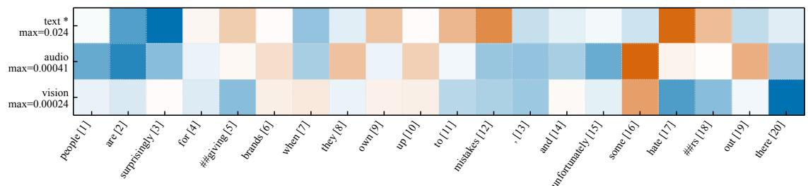

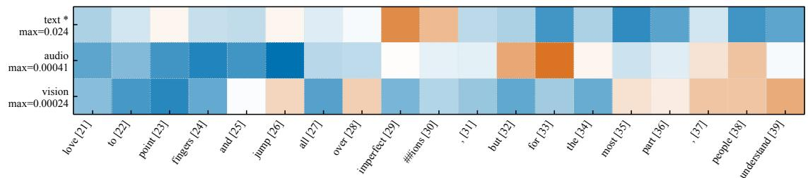  
Blue: negative effect | White: zero | Orange: positive effect; color scaled within each modality  
Figure 10: Set B, sample 19: local occlusion effects on the classification target (probability of the originally predicted class). The title keeps the release name “Attachment 4 / 19”.

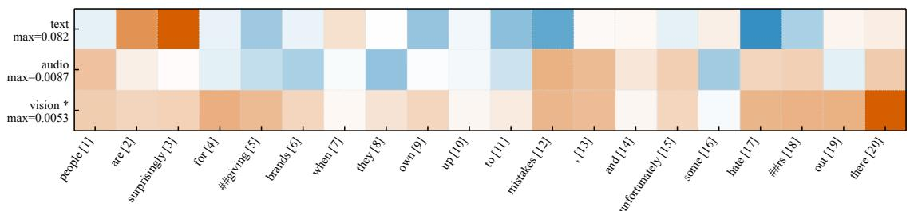

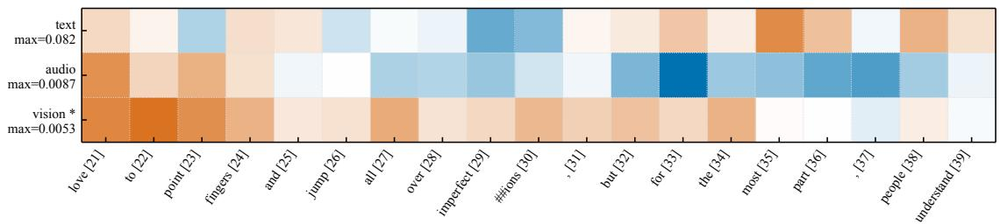  
Blue: negative effect | White: zero | Orange: positive effect; color scaled within each modality  
Figure 11: Set B, sample 19: local occlusion effects on the fused intensity. Vision is the main modality for this target. Colours are scaled within each modality, as in Figure 10.

## H Predictions on the Unlabeled Sets

Two unlabeled sets are used only for inference and description. Set A contains 30 utterances with absent or zero spans in the aligned release (attachment 3 in the release). Set B contains 20 utterances with video, used for the dual-target explanations (attachment 4 in the release). Neither set has labels, so no accuracy is reported for either set. The release names are kept only for traceability.

## H.1 Set A

Table 22 lists the fused predictions for set A and Figure 12 shows them with the visible-text fraction and the two fusion weights. The fused model predicts 6 Negative, 13 Neutral, and 11 Positive utterances. The visible-text fraction ranges from 0.50 to 1.00. Twenty-seven utterances contain [UNK] tokens (Appendix B.3). For each utterance, the classification probabilities are the probabilities of the fused classifier, and the core intensity is shown for comparison with the fused intensity. The two weights follow $w = 0 . 8 f ^ { 2 }$ and $v = 0 . 6 f ^ { 2 }$ , so they are equal to zero only when no text is visible.

## H.2 Set B

Table 23 gives the predictions and the main modality for each utterance of set B. The predicted polarities are 8 Negative, 5 Neutral, and 7 Positive. Text is the main modality for the classification target in all 20 utterances. For the intensity target, text is the main modality in 16 utterances and vision in 4. Table 24 lists the highest-ranked evidence position for each modality, with its time interval where timing is available. The timing of samples 15 and 16 did not pass the time-quality gate, and samples 01 and 13 have no detected faces; these limits are recorded in the table and should be kept in any use of the explanations.

## I Use of AI Assistants

Generative AI tools assisted idea discussions, drafting, editing, coding, debugging, and typesetting. The authors designed the methods, selected and ran the experiments, and take full responsibility for the paper and code.

<table><tr><td>Set A</td><td>Polarity</td><td>Intensity</td><td>RM core</td><td> $p _ { \mathrm { n e g } }$ </td><td>pneu</td><td>Ppos</td><td>Wcls</td><td> $w _ { \mathrm { r e g } }$ </td></tr><tr><td>A01</td><td>Negative</td><td>-0.660</td><td>-0.470</td><td>0.697</td><td>0.185</td><td>0.118</td><td>0.80</td><td>0.60</td></tr><tr><td>A02</td><td>Neutral</td><td>+0.061</td><td>-0.052</td><td>0.199</td><td>0.647</td><td>0.154</td><td>0.54</td><td>0.40</td></tr><tr><td>A03</td><td>Neutral</td><td>+0.152</td><td>+0.048</td><td>0.187</td><td>0.558</td><td>0.255</td><td>0.57</td><td>0.43</td></tr><tr><td>A04</td><td>Positive</td><td>+0.398</td><td>+0.322</td><td>0.093</td><td>0.333</td><td>0.573</td><td>0.70</td><td>0.53</td></tr><tr><td>A05</td><td>Negative</td><td>-1.127</td><td>-1.494</td><td>0.849</td><td>0.091</td><td>0.061</td><td>0.80</td><td>0.60</td></tr><tr><td>A06</td><td>Positive</td><td>+0.710</td><td>+0.853</td><td>0.047</td><td>0.364</td><td>0.589</td><td>0.62</td><td>0.46</td></tr><tr><td>A07</td><td>Neutral</td><td>+0.137</td><td>-0.039</td><td>0.211</td><td>0.411</td><td>0.378</td><td>0.59</td><td>0.44</td></tr><tr><td>A08</td><td>Negative</td><td>+0.138</td><td>+0.276</td><td>0.479</td><td>0.304</td><td>0.218</td><td>0.60</td><td>0.45</td></tr><tr><td>A09</td><td>Positive</td><td>+1.087</td><td>+1.026</td><td>0.011</td><td>0.116</td><td>0.873</td><td>0.59</td><td>0.44</td></tr><tr><td>A10</td><td>Neutral</td><td>-0.035</td><td>+0.025</td><td>0.149</td><td>0.764</td><td>0.086</td><td>0.80</td><td>0.60</td></tr><tr><td>A11</td><td>Neutral</td><td>+0.154</td><td>+0.119</td><td>0.158</td><td>0.495</td><td>0.346</td><td>0.41</td><td>0.31</td></tr><tr><td>A12</td><td>Positive</td><td>+0.399</td><td>+0.520</td><td>0.250</td><td>0.329</td><td>0.421</td><td>0.57</td><td>0.43</td></tr><tr><td>A13</td><td>Positive</td><td>+0.270</td><td>+0.088</td><td>0.164</td><td>0.403</td><td>0.433</td><td>0.64</td><td>0.48</td></tr><tr><td>A14</td><td>Negative</td><td>-0.329</td><td>-0.093</td><td>0.701</td><td>0.232</td><td>0.067</td><td>0.67</td><td>0.50</td></tr><tr><td>A15</td><td>Positive</td><td>+0.505</td><td>+0.697</td><td>0.036</td><td>0.360</td><td>0.605</td><td>0.63</td><td>0.47</td></tr><tr><td>A16</td><td>Positive</td><td>+1.490</td><td>+1.415</td><td>0.039</td><td>0.068</td><td>0.893</td><td>0.62</td><td>0.47</td></tr><tr><td>A17</td><td>Negative</td><td>-0.110</td><td>-0.167</td><td>0.450</td><td>0.408</td><td>0.142</td><td>0.32</td><td>0.24</td></tr><tr><td>A18</td><td>Neutral</td><td>+0.357</td><td>+0.405</td><td>0.120</td><td>0.485</td><td>0.395</td><td>0.54</td><td>0.41</td></tr><tr><td>A19</td><td>Negative</td><td>-0.295</td><td>-0.194</td><td>0.492</td><td>0.395</td><td>0.113</td><td>0.40</td><td>0.30</td></tr><tr><td>A20</td><td>Neutral</td><td>+0.102</td><td>+0.018</td><td>0.217</td><td>0.578</td><td>0.205</td><td>0.40</td><td>0.30</td></tr><tr><td>A21</td><td>Positive</td><td>+0.404</td><td>+0.377</td><td>0.046</td><td>0.356</td><td>0.597</td><td>0.36</td><td>0.27</td></tr><tr><td>A22</td><td>Neutral</td><td>+0.302</td><td>+0.339</td><td>0.214</td><td>0.397</td><td>0.389</td><td>0.47</td><td>0.35</td></tr><tr><td>A23</td><td>Neutral</td><td>+0.447</td><td>+0.381</td><td>0.054</td><td>0.559</td><td>0.387</td><td>0.38</td><td>0.29</td></tr><tr><td>A24</td><td>Neutral</td><td>+0.359</td><td>+0.433</td><td>0.336</td><td>0.345</td><td>0.319</td><td>0.45</td><td>0.34</td></tr><tr><td>A25</td><td>Neutral</td><td>+0.219</td><td>+0.309</td><td>0.119</td><td>0.538</td><td>0.342</td><td>0.48</td><td>0.36</td></tr><tr><td>A26</td><td>Positive</td><td>+0.559</td><td>+0.470</td><td>0.079</td><td>0.263</td><td>0.658</td><td>0.42</td><td>0.32</td></tr><tr><td>A27</td><td>Positive</td><td>+0.633</td><td>+0.586</td><td>0.069</td><td>0.284</td><td>0.647</td><td>0.31</td><td>0.23</td></tr><tr><td>A28</td><td>Neutral</td><td>+0.316</td><td>+0.340</td><td>0.052</td><td>0.532</td><td>0.416</td><td>0.36</td><td>0.27</td></tr><tr><td>A29</td><td>Positive</td><td>+0.434</td><td>+0.347</td><td>0.117</td><td>0.401</td><td>0.482</td><td>0.25</td><td>0.19</td></tr><tr><td>A30</td><td>Neutral</td><td>+0.349</td><td>+0.393</td><td>0.202</td><td>0.557</td><td>0.242</td><td>0.20</td><td>0.15</td></tr></table>

Table 22: Predictions for unlabeled set A (30 utterances). Polarity and intensity are the fused outputs; RM core is the core intensity; p are the fused class probabilities; $w _ { \mathrm { c l s } }$ and $w _ { \mathrm { r e g } }$ are the classification and intensity text-expert weights. No labels are available.

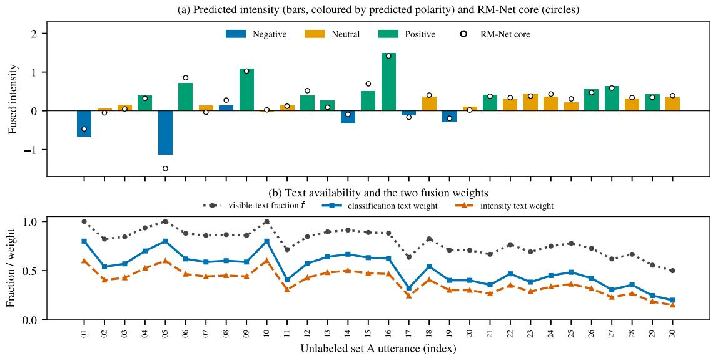  
Figure 12: Unlabeled set A. (a) Fused intensity, coloured by the predicted polarity, with the RM-Net core intensity as open circles. (b) Visible-text fraction f and the two text-expert weights for each utterance.

<table><tr><td></td><td></td><td></td><td>Main (class)</td><td>Main (intensity)</td><td>Class shares T/A/V (%)</td><td>Intensity shares T/A/V (%)</td></tr><tr><td>Set B</td><td>Polarity</td><td>Intensity</td><td></td><td></td><td>65.4 / 19.4 / 15.2</td><td></td></tr><tr><td>B01 B02</td><td>Neutral Positive</td><td>+0.369 +0.250</td><td>text text</td><td>text text</td><td>66.3 / 20.8 / 12.9</td><td>89.6 / 6.2 / 4.2 70.6 / 18.1 / 11.3</td></tr><tr><td>B03</td><td>Negative</td><td>-0.350</td><td>text</td><td>text</td><td>78.7 / 8.9 / 12.5</td><td>80.1 / 18.6 / 1.3</td></tr><tr><td>B04</td><td>Negative</td><td>-0.358</td><td>text</td><td>text</td><td>75.5 / 9.9 / 14.7</td><td>58.6 / 20.7 / 20.7</td></tr><tr><td>B05</td><td>Neutral</td><td>+0.401</td><td>text</td><td>vision</td><td>66.9 / 12.3 / 20.8</td><td>19.0 / 19.1 / 61.9</td></tr><tr><td>B06</td><td>Positive</td><td>+0.755</td><td>text</td><td>text</td><td>79.0 / 1.5 / 19.5</td><td>68.5 / 13.5 / 17.9</td></tr><tr><td>B07</td><td>Positive</td><td>+0.769</td><td>text</td><td>text</td><td>83.6 / 7.3 / 9.1</td><td>64.7 / 12.5 / 22.8</td></tr><tr><td>B08</td><td>Positive</td><td>+0.585</td><td>text</td><td>text</td><td>80.2 / 6.1 / 13.7</td><td>74.9 / 10.5 / 14.6</td></tr><tr><td>B09</td><td>Negative</td><td>-2.275</td><td>text</td><td>text</td><td>94.2 / 5.0 / 0.8</td><td>98.0 / 0.9 / 1.1</td></tr><tr><td>B10</td><td>Negative</td><td>-1.705</td><td>text</td><td>text</td><td>87.9 / 5.4 / 6.6</td><td>92.5 / 4.5 / 3.0</td></tr><tr><td>B11</td><td>Negative</td><td>-1.257</td><td>text</td><td>text</td><td>91.3 / 2.1 / 6.7</td><td>86.7 / 8.9 / 4.4</td></tr><tr><td>B12</td><td>Negative</td><td>-0.823</td><td>text</td><td>text</td><td>92.6 / 3.4 / 4.0</td><td>84.9 / 1.0 / 14.1</td></tr><tr><td>B13</td><td>Neutral</td><td>+0.309</td><td>text</td><td>text</td><td>87.2 / 12.8 / 0.0</td><td>86.5 / 13.5 / 0.0</td></tr><tr><td>B14</td><td>Neutral</td><td>+0.270</td><td>text</td><td>vision</td><td>72.6 / 7.7 / 19.6</td><td>30.9 / 22.9 / 46.2</td></tr><tr><td>B15</td><td>Positive</td><td>+0.630</td><td>text</td><td>text</td><td>69.4 / 20.5 / 10.0</td><td>55.3 / 31.0 / 13.8</td></tr><tr><td>B16</td><td>Negative</td><td>-2.367</td><td>text</td><td>text</td><td>95.2 / 2.9 / 1.9</td><td>98.4 / 0.3 / 1.3</td></tr><tr><td>B17</td><td>Positive</td><td>+1.579</td><td>text</td><td>text</td><td>83.7 / 8.0 / 8.4</td><td>94.0 / 1.3 / 4.6</td></tr><tr><td>B18</td><td>Neutral</td><td>-0.324</td><td>text</td><td>vision</td><td>54.3 / 13.1 / 32.6</td><td>15.1 / 11.6 / 73.3</td></tr><tr><td>B19</td><td>Negative</td><td>+0.034</td><td>text</td><td>vision</td><td>75.6 / 15.6 / 8.8</td><td>47.5 / 3.5 / 49.0</td></tr><tr><td>B20</td><td>Positive</td><td>+0.700</td><td>text</td><td>text</td><td>60.0 / 10.7 / 29.3</td><td>70.2 / 0.5 / 29.4</td></tr></table>

Table 23: Predictions and main modalities for unlabeled set B (20 utterances). Shares are the absolute Shapley values of each modality, normalized to 100% within each target.

<table><tr><td>Set B</td><td>Polarity</td><td>Main (class)</td><td>Top text evidence</td><td>Top audio evidence</td><td>Top vision evidence</td></tr><tr><td>B01</td><td>Neutral</td><td>text</td><td>when (1.98–2.10 s; estimated)</td><td>its (7.04–7.14 s; estimated)</td><td>ensuring (4.64–5.02 s; estimated)</td></tr><tr><td>B02</td><td>Positive</td><td>text</td><td>happiness (1.44–1.80 s; estimated)</td><td>want (0.60–0.70 s; estimated)</td><td>happiness (1.44–1.80 s; estimated)</td></tr><tr><td>B03</td><td>Negative</td><td>text</td><td>just (2.72–2.88 s; estimated)</td><td>account, (6.22–6.52 s; estimated)</td><td>take (7.04–7.22 s; estimated)</td></tr><tr><td>B04</td><td>Negative</td><td>text</td><td>not. (6.02–6.24 s; estimated)</td><td>team (1.28–1.44 s; estimated)</td><td>chances (2.90–3.24 s; estimated)</td></tr><tr><td>B05</td><td>Neutral</td><td>text</td><td>for (4.16–4.26 s; estimated)</td><td>for (4.16–4.26 s; estimated)</td><td>Wagon (4.64–4.92 s; estimated)</td></tr><tr><td>B06</td><td>Positive</td><td>text</td><td>impressive (3.96–4.40 s; estimated)</td><td>dance (4.46–4.70 s; estimated)</td><td>you&#x27;re (0.62–0.76 s; estimated)</td></tr><tr><td>B07</td><td>Positive</td><td>text</td><td>“enthusiastically (6.00–7.02 s; estimated)</td><td>discussed (7.10–7.56 s; estimated)</td><td>partnerships, (12.90–13.48 s; estimated)</td></tr><tr><td>B08</td><td>Positive</td><td>text</td><td>Universal (2.04–2.50 s; estimated)</td><td>That (0.64–0.78 s; estimated)</td><td>Grand (3.38–3.68 s; estimated)</td></tr><tr><td>B09</td><td>Negative</td><td>text</td><td>not (1.36–1.46 s; estimated)</td><td>not (1.36–1.46 s; estimated)</td><td>not (3.04–3.14 s; estimated)</td></tr><tr><td>B10</td><td>Negative</td><td>text</td><td>terrible (8.68–9.20 s; estimated)</td><td>flicks (3.90–4.18 s; estimated)</td><td>this (6.94–7.10 s; estimated)</td></tr><tr><td>B11</td><td>Negative</td><td>text</td><td>be (0.78–0.86 s; estimated)</td><td>made (3.52–3.68 s; estimated)</td><td>have (3.34–3.46 s; estimated)</td></tr><tr><td>B12</td><td>Negative</td><td>text</td><td>low. (12.02–12.26 s; estimated)</td><td>had (2.50–2.70 s; estimated)</td><td>sag, (9.94–10.30 s; estimated)</td></tr><tr><td>B13</td><td>Neutral</td><td>text</td><td>more. (8.44–8.60 s; estimated)</td><td>the (6.86–6.92 s; estimated)</td><td>– (no observed evidence)</td></tr><tr><td>B14</td><td>Neutral</td><td>text</td><td>He (0.50–0.56 s; estimated)</td><td>(UFE) (6.64–6.84 s; candidate low trust)</td><td>(UFE) (6.64–6.84 s; candidate low trust)</td></tr><tr><td>B15</td><td>Positive</td><td>text</td><td>transform (6.74–6.98 s; candidate low trust)</td><td>However, (0.08–0.58 s; candidate low trust)</td><td>lives (7.02–7.28 s; candidate low trust)</td></tr><tr><td>B16</td><td>Negative</td><td>text</td><td>terrible (1.82–2.16 s; candidate low trust)</td><td>It&#x27;s (0.48–0.62 s; candidate low trust)</td><td>movie (2.20–2.50 s; candidate low trust)</td></tr><tr><td>B17</td><td>Positive</td><td>text</td><td>will (6.80–6.94 s; estimated)</td><td>guru. (8.74–9.02 s; estimated)</td><td>design (1.76–2.12 s; estimated)</td></tr><tr><td>B18</td><td>Neutral</td><td>text</td><td>first (1.72–1.94 s; estimated)</td><td>Denmark (0.82–1.20 s; estimated)</td><td>mackerel (14.80–15.20 s; estimated)</td></tr><tr><td>B19</td><td>Negative</td><td>text</td><td>haters (6.38–6.74 s; estimated)</td><td>some (6.14–6.30 s; estimated)</td><td>some (6.14–6.30 s; estimated)</td></tr><tr><td>B20</td><td>Positive</td><td>text</td><td>course, (0.82–1.04 s; estimated)</td><td>today. (9.46–9.68 s; estimated)</td><td>and (4.56–4.64 s; estimated)</td></tr></table>

Table 24: Top-ranked evidence for unlabeled set B: the highest-ranked position for each modality, with its time interval and timing status. Time is in seconds from the common stream start; “candidate low trust” marks times that did not pass the time-quality gate.