# RepForcing: Representation-Space Initialization for Autoregressive Video Distillation

Siming Fu1∗ Zheming Fu1∗ Lianrui Mu1 Haoyang Huang1 Chaojie Gu2 Ruizhe $\mathbf { H e } ^ { 2 , \ast \dagger }$ 1Joy Future Academy 2Zhejiang University

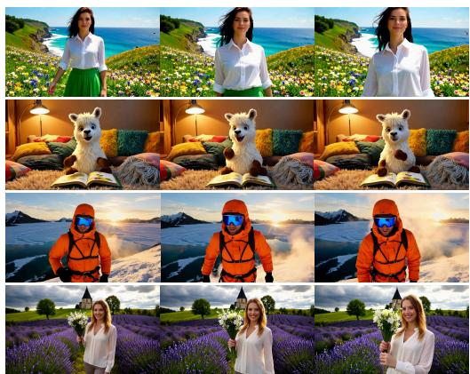

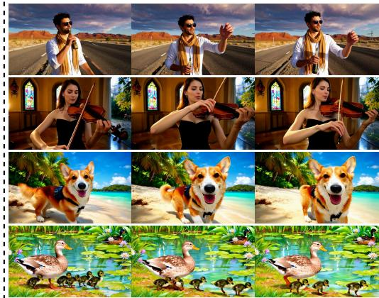  
Figure 1: High-Quality Videos Generated by RepForcing. The examples span human activities, animal behavior, and stylized scenes, showing details such as clothing folds, fur, and vegetation. Across the displayed frames, subjects change pose and position while retaining their appearance and surrounding scene structure.

## ABSTRACT

Distilling pretrained video diffusion models into few-step autoregressive (AR) generators typically combines student initialization with distribution matching distillation (DMD). An intermediate AR teacher can provide causally compatible targets for ODE initialization. However, causally compatible targets alone do not ensure high-quality generation under a short sampling schedule. We analyze the posterior-mean predictions favored by direct latent regression and empirically find that causal ODE initialization alleviates blur but still leaves fine detail unresolved. To address this limitation, we propose Representation Forcing, which learns few-step causal initialization through representation-space supervision rather than intermediate-teacher trajectory regression. The student is trained with teacher forcing by comparing clean predictions and training targets through normalized features of a frozen video diffusion transformer. This phase reuses the synthetic videos generated by a bidirectional model for AR teacher training and replaces both teacher training and causal ODE distillation, without generating additional causal ODE trajectories. The subsequent asymmetric DMD procedure remains unchanged. Empirical results show that, at four sampling steps, RepForcing better preserves generation quality than intermediate-teacher-based initialization before DMD. After DMD, our four-step chunk-wise model improves VBench Total from 84.04 to 84.66 (+0.62 points) and VisionReward from 6.326 to 10.074 (+59.25%) over the reported causal-ODE-based baseline. Code at RepForcing.

## 1 INTRODUCTION

Autoregressive (AR) video diffusion enables streaming generation by producing video blocks conditioned on previously generated content. This formulation supports interactive applications including world modeling, game simulation, and embodied intelligence (Jin et al., 2025; Teng et al., 2025; Chen et al., 2025; Ball et al., 2025). Despite these capabilities, repeatedly denoising each block increases inference cost. Reducing the number of sampling steps while preserving visual quality is therefore important for real-time video generation.

To reduce this cost, distillation methods (Yin et al., 2025; Huang et al., 2025) convert pretrained bidirectional video diffusion models into few-step AR students. The training pipeline typically consists of an initialization stage followed by asymmetric distribution matching distillation (DMD) (Yin et al., 2024b;a). Beyond accelerating sampling, initialization must account for the difference between bidirectional teachers and causal students. Prior analysis (Zhu et al., 2026) identifies framelevel injectivity as a requirement for recovering the teacher’s flow map through ODE distillation: each input available to the student must determine a unique endpoint. A bidirectional teacher can violate this requirement through its dependence on future frames unavailable to the student. Training an intermediate AR teacher and distilling its causal trajectories provides compatible targets, but requires two training stages before DMD.

However, resolving causal compatibility does not by itself ensure high-quality few-step generation. In this work, we revisit the supervision used to construct the initialization. Direct latent regression favors posterior-mean clean predictions: when the noisy input and its conditions admit different plausible continuations, coordinate-wise averaging can blur texture and blend incompatible structures. This concerns individual clean predictions rather than the output distribution of a complete multi-step sampler. Empirically, directly shortening the sampling schedule of the teacher-forced AR diffusion model produces blurred outputs. Causal ODE initialization alleviates this blur, but still leaves fine detail unresolved under few-step sampling. Figure 2 compares the initialization methods as the number of sampling steps decreases, revealing a larger quality gap between ODE initialization and RepForcing at four steps. Thus, deterministic teacher targets do not remove the observed limitation. These findings motivate an alternative to intermediate-teacher initialization, rather than an additional distillation stage.

To address this limitation, we propose Representation Forcing (RepForcing), which learns fewstep causal initialization directly in a pretrained video representation space. The student predicts clean video blocks under teacher forcing, and its predicted video is compared with the training target through normalized features of a frozen video diffusion transformer. Unlike coordinate-wise latent regression, this objective need not favor the latent posterior mean. RepForcing preserves the causal student architecture and reuses the synthetic videos generated by a bidirectional Wan model from VidProM (Wang & Yang, 2024) prompts for intermediate AR teacher training. It requires no additional causal ODE trajectory pairs. A single teacher-forced phase replaces both intermediate teacher training and ODE distillation, after which the student undergoes the same asymmetric DMD refinement using its own generated prefixes.

Experiments evaluate both the resulting initialization and the final generator. Before DMD, Rep-Forcing better preserves generation quality than intermediate-teacher-based initialization at four sampling steps. After DMD, it improves VBench Total and VisionReward over the reported intermediate-teacher baselines in both chunk-wise and frame-wise generation using the same number of sampling steps (Table 1). For four-step chunk-wise generation, the improvements are 0.62 points and 59.25%, respectively. Our contributions are summarized as follows:

• We analyze the limitations of intermediate-teacher initialization for few-step autoregressive generation. Our analysis connects the posterior-mean behavior of latent regression to the loss of detail under a short sampling schedule, while controlled comparisons show that causal ODE initialization alleviates blur but leaves fine detail unresolved.

• We propose Representation Forcing, which reformulates few-step causal initialization as regression in a pretrained video representation space. It replaces intermediate-teacher training and causal ODE distillation with a single teacher-forced phase on the same synthetic training videos.

• Experimental results show that RepForcing better preserves generation quality than intermediate-teacher-based initialization at four sampling steps before DMD. After DMD, it improves VBench Total and VisionReward over the reported Causal Forcing baselines.

## 2 RELATED WORK

Autoregressive Video Generation. AR video diffusion produces a video block by block and runs diffusion within each block, which enables streaming generation (Jin et al., 2025; Teng et al., 2025; Chen et al., 2025). During training, each block is conditioned on clean history under teacher forcing or on noisy history under diffusion forcing (Chen et al., 2024), whereas at inference it is conditioned on generated history. Self Forcing (Huang et al., 2025) closes this gap by training on self-rollouts with KV caching, AAPT (Lin et al., 2026) uses adversarial post-training for single-step streaming, and further work extends the generation horizon (Cui et al., 2026; Liu et al., 2025; Yang et al., 2026).

Few-Step Initialization for AR Distillation. CausVid (Yin et al., 2025) and Self Forcing initialize the AR student with ODE pairs from a bidirectional teacher before DMD (Yin et al., 2024b;a). Causal Forcing (Zhu et al., 2026) replaces this teacher with an AR model trained under teacher forcing, so that the distilled trajectories respect causality. Causal Forcing++ (Zhao et al., 2026) and Causal-rCM (Zheng et al., 2026) substitute causal consistency distillation or training for the trajectory stage, building on consistency models (Song et al., 2023; Lu & Song, 2025). All of these learn the few-step initialization from an intermediate multi-step teacher; we instead obtain it directly from the shared bidirectional-model-generated training videos by changing the regression metric.

Learned Representations as Training Signals. Perceptual losses compare predictions and targets through a pretrained network (Simonyan & Zisserman, 2014; Johnson et al., 2016), and LPIPS (Zhang et al., 2018) calibrates such distances to human judgments. In generative modeling, REPA (Yu et al., 2024) and Geometry Forcing (Wu et al., 2026) align a generator’s internal activations with an external encoder such as DINOv2 (Oquab et al., 2023), REPA-E (Leng et al., 2025) extends this alignment to end-to-end VAE tuning, representation autoencoders (Zheng et al., 2025) perform diffusion in the space of a pretrained encoder, and LADD (Sauer et al., 2024) uses diffusion features for adversarial distillation. Our objective differs from each of them: it preserves the generator architecture and VAE, requires no discriminator, and uses a frozen video DiT only to measure the distance between a predicted clean latent and its target.

## 3 PRELIMINARIES

Following Causal Forcing (Zhu et al., 2026), let $( X _ { 0 } , y ) \sim p _ { \mathrm { d a t a } }$ be a video VAE latent (Rombach et al., 2022; Blattmann et al., 2023) and text condition, with $\mathbf { \bar { \mathbf { X } } } _ { 0 } = ( \mathbf { x } _ { 0 } ^ { 1 } , \ldots , \mathbf { x } _ { 0 } ^ { N } )$ split into N frameor chunk-wise blocks. We reuse its first-stage dataset $\mathcal { D } _ { \mathrm { B i } } \colon$ approximately 3K videos synthesized by bidirectional Wan from VidProM (Wang & Yang, 2024) prompts. “Clean” and “ground truth” refer to these unnoised synthetic targets.

## 3.1 FLOW MATCHING

For a clean latent $\mathbf { x } _ { \mathrm { 0 } }$ , the forward noising kernel $q _ { t | 0 }$ is

$$
\mathbf { x } _ { t } = \alpha _ { t } \mathbf { x } _ { 0 } + \sigma _ { t } \epsilon , \qquad \epsilon \sim \mathcal { N } ( \mathbf { 0 } , I ) , \qquad \alpha _ { t } = 1 - t , \quad \sigma _ { t } = t ,\tag{1}
$$

where $t \in [ 0 , 1 ]$ is normalized noise time, I is the identity covariance, and noise is independent of the data. Given condition $h ,$ flow matching (Liu et al., 2023; Lipman et al., 2023) trains velocity network $v _ { \theta }$ and defines its clean prediction $G _ { \theta }$ by

$$
\begin{array} { r l } & { \mathcal { L } _ { \mathrm { F M } } ( \theta ) = \mathbb { E } _ { \mathbf { x } _ { 0 } , h , t , \epsilon } \left[ w ( t ) \left| \left| v _ { \theta } ( \mathbf { x } _ { t } , t , h ) - ( \epsilon - \mathbf { x } _ { 0 } ) \right| \right| _ { 2 } ^ { 2 } \right] , } \\ & { } \\ & { \quad G _ { \theta } ( \mathbf { x } _ { t } , t , h ) = \mathbf { x } _ { t } - t v _ { \theta } ( \mathbf { x } _ { t } , t , h ) . } \end{array}\tag{2}
$$

Here θ denotes trainable parameters and $w ( t ) > 0$ weights the sampled times. Sampling integrates the probability flow ODE $\mathrm { d } \mathbf { z } _ { t } = v _ { \theta } ( \mathbf { z } _ { t } , t , h )$ dt from standard Gaussian $\mathbf { z } _ { 1 }$ to $t = 0$ (Song et al., 2021). Unlike directly noised $\mathbf { x } _ { t } , \mathbf { z } _ { t }$ lies on a sampling trajectory; its integrated endpoint need not equal the single prediction $G _ { \theta }$

Teacher Forcing + ODE Init (Causal Forcing)  
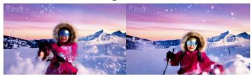

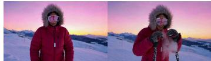

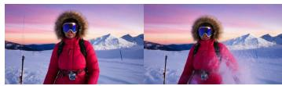

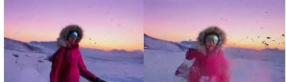

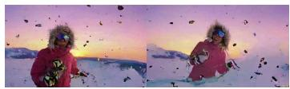

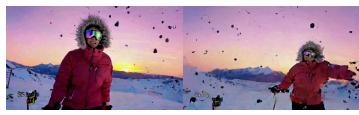

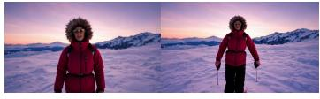  
4 step

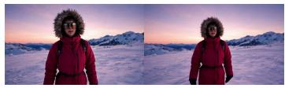  
8 step

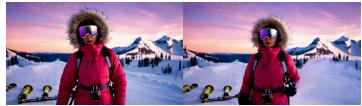  
12 step  
Figure 2: RepForcing Initialization Better Preserves Generation Quality as Sampling Steps Decrease. Rows compare three initialization strategies: teacher-forced AR training followed by ODE distillation, teacher-forced AR training followed by consistency distillation, and direct representation-space initialization, from top to bottom. All results are shown before subsequent refinement. Columns show 4, 8, and 12 sampling steps from left to right, with two frames per setting for the same prompt. With more denoising steps, ODE initialization approaches the visual quality of RepForcing. At four steps, however, the intermediate-teacher initializations exhibit blur or structural artifacts, while RepForcing maintains coherent subject and scene structure.

## 3.2 AUTOREGRESSIVE DIFFUSION AND ODE INITIALIZATION

With prefix $\mathbf { x } _ { 0 } ^ { < i }$ (empty for i = 1) and condition $h _ { i } = ( \mathbf { x } _ { 0 } ^ { < i } , y )$ , the model factorizes

$$
p _ { \theta } ( X _ { 0 } \mid y ) = \prod _ { i = 1 } ^ { N } p _ { \theta } ( \mathbf { x } _ { 0 } ^ { i } \mid h _ { i } ) .\tag{3}
$$

Teacher forcing uses clean prefixes and independently noised blocks from Eq. (1), with times $\mathbf { t } ~ = ~ ( t _ { 1 } , \ldots , t _ { N } )$ and noises $E = ( \epsilon ^ { 1 } , \dots , \epsilon ^ { \dot { N } } )$ . Set $U ^ { i } = ( \mathbf { x } _ { t _ { i } } ^ { i } , t _ { i } , h _ { i } )$ and $\begin{array} { r l } { \bar { \hat { \mathbf { x } } } _ { 0 } ^ { i } = \boldsymbol { G } _ { \theta } ( U ^ { i } ) : = } & { { } } \end{array}$ $G _ { \theta } ( \mathbf { x } _ { t _ { i } } ^ { i } , t _ { i } , h _ { i } )$ , and collect predictions as $\hat { X } _ { 0 } = ( \hat { \mathbf { x } } _ { 0 } ^ { 1 } , \ldots , \hat { \mathbf { x } } _ { 0 } ^ { N } )$ . A block-causal mask on concatenated clean and noisy sequences enables one-pass training (Teng et al., 2025; Zhu et al., 2026); free AR sampling instead uses generated prefixes and produces $\tilde { X } _ { 0 }$

Causal Forcing trains an AR teacher $v _ { \psi }$ on $\mathcal { D } _ { \mathrm { B i } }$ , then freezes $\psi$ and samples trajectories under $h _ { i }$ at the few-step schedule $s \subset ( 0 , 1 ]$ . The resulting tuple distribution $\mathcal { D } _ { \mathrm { O D E } }$ supplies endpoint regression pairs:

$$
\mathcal { L } _ { \mathrm { O D E } } ( \theta ) = \mathbb { E } _ { ( i , h _ { i } , t , \mathbf { z } _ { t } ^ { i } , \mathbf { z } _ { 0 } ^ { i } ) \sim \mathcal { D } _ { \mathrm { O D E } } } \left[ \left| \left| G _ { \theta } ( \mathbf { z } _ { t } ^ { i } , t , h _ { i } ) - \mathbf { z } _ { 0 } ^ { i } \right| \right| _ { 2 } ^ { 2 } \right] .\tag{4}
$$

Here $\mathbf { z } _ { 0 } ^ { i }$ is the teacher-generated endpoint for the causal input $( \mathbf { z } _ { t } ^ { i } , t , h _ { i } )$ , not the training clip’s target;   
only the prefix comes from that clip. A well-defined teacher ODE makes this endpoint deterministic.

## 4 METHOD

## 4.1 ANALYSIS: SUBOPTIMALITY OF INITIALIZATION WITH AN INTERMEDIATE TEACHER

We analyze the limitations of direct latent regression and examine the remaining deficiencies of causal ODE initialization under few-step sampling, following the training setup described in Sec. 3.2.

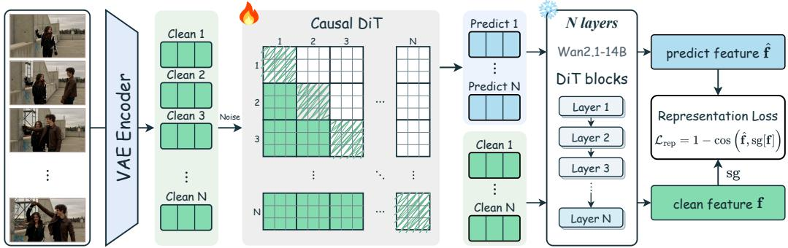  
Figure 3: Representation Forcing Initialization Pipeline. Training videos are encoded into clean latent blocks by a VAE encoder. The trainable causal DiT reconstructs clean blocks from noisy inputs, conditioned on preceding clean blocks under teacher forcing. The predicted and target video latents are passed separately through the same truncated, frozen Wan2.1-14B to obtain features $\hat { \mathbf { f } }$ and f. A token-wise cosine loss compares these features, with stop-gradient (sg) on the target branch. Gradients propagate through the frozen extractor to update the causal DiT. This initialization replaces intermediate AR teacher training and causal ODE distillation.

Latent $\ell _ { 2 }$ Regression Blurs Few-Step Predictions. To analyze the direct predictions of the intermediate teacher, write the clean-block regression loss using the quantities defined in Sec. 3.2:

$$
\mathcal { L } _ { \mathrm { M S E } } ( \theta ) = \mathbb { E } _ { X _ { 0 } , y , E , \mathbf { t } } \left[ \sum _ { i = 1 } ^ { N } \left| \left| \hat { \mathbf { x } } _ { 0 } ^ { i } - \mathbf { x } _ { 0 } ^ { i } \right| \right| _ { 2 } ^ { 2 } \right] .\tag{5}
$$

By the parameterization in Eq. (2), each clean-block squared error is $t _ { i } ^ { 2 }$ times its velocity squared error. Thus the losses differ in timestep weighting, but have the same unrestricted conditional optimum at a fixed positive time.

Proposition 1 (Posterior mean as the minimizer of latent $\ell _ { 2 }$ regression). Fix a block i and $t \in$ (0, 1] under the independent Gaussian noising process of Sec. 3.2. Assume $\mathbb { E } \| \mathbf { x } _ { 0 } ^ { i } \| _ { 2 } ^ { 2 } < \infty$ and that $p _ { \mathrm { d a t a } } ( \mathbf { x } _ { 0 } ^ { i } \mid h _ { i } )$ is not a point mass on a set of conditions $h _ { i }$ of positive probability. Over squareintegrable measurable predictors, the fixed-time blockwise risk in Eq. (5) has the almost-surely unique minimizer

$$
\hat { \mathbf { x } } _ { 0 } ^ { i , * } = \mathbb { E } [ \mathbf { x } _ { 0 } ^ { i } \mid \mathbf { x } _ { t } ^ { i } , h _ { i } ] , \qquad \mathbb { E } \big \| \hat { \mathbf { x } } _ { 0 } ^ { i , * } \big \| _ { 2 } ^ { 2 } < \mathbb { E } \big \| \mathbf { x } _ { 0 } ^ { i } \big \| _ { 2 } ^ { 2 } ,\tag{6}
$$

so the optimal predictions are not distributed as the data. Proofin Appendix C.1.

Proposition 1 shows that latent regression favors the conditional mean of clean continuations compatible with the noisy input and its conditions. When these continuations differ in texture placement or motion phase, coordinate-wise averaging can blend incompatible structures. Multi-step sampling refines successive predictions as noise decreases, whereas a short schedule provides fewer refinement steps. The proposition characterizes direct clean predictions, rather than the output distribution of the complete sampler. Empirically, the teacher-forced AR diffusion model produces blurred outputs under four-step sampling, indicating that diffusion training alone does not provide the required few-step initialization in this setting.

Causal ODE Initialization Alleviates Blur but Leaves Fine Detail Unresolved. Causal ODE initialization replaces the data-regression target with a deterministic endpoint generated by the AR teacher, as defined in Eq. (4). This removes the conditional target ambiguity of direct latent regression. However, target determinism alone does not ensure high-quality generation in the few-step regime. As shown in Fig. 2, ODE initialization produces coherent results with eight or twelve sampling steps, but exhibits degraded visual quality when sampling is reduced to four steps. This observation motivates replacing the intermediate-teacher initialization route with direct representationspace supervision.

## 4.2 REPRESENTATION FORCING

Building on the above analysis, we propose Representation Forcing (RepForcing), a two-stage method consisting of representation-space teacher forcing (Fig. 3) and asymmetric DMD. The first stage directly trains the causal student on the same $\mathcal { D } _ { \mathrm { B i } }$ used for Causal Forcing’s AR teacher training. These synthetic videos supply the clean targets and prefixes, without intermediate AR teacher training or additional causal ODE trajectory generation.

Representation-Space Supervision Preserves Fine Detail under Few-Step Sampling. Instead of regressing teacher-generated trajectories, we compare the student’s clean predictions with the training videos in a pretrained representation space. Minimizing normalized-feature discrepancy need not favor the coordinate-wise latent mean (Appendix C.2). If the representation distinguishes plausible continuations from their blurred blends, this objective can disfavor those blends. Empirically, Fig. 2 shows that RepForcing better preserves generation quality at four steps than intermediate-teacher-based initialization, before subsequent refinement.

Stage 1: Teacher Forcing in Representation Space. Given the teacher-forced predictions $\hat { X } _ { 0 }$ defined in Sec. 3.2 and the target video $X _ { 0 } .$ , a shared frozen video DiT $\Phi _ { L , \tau }$ extracts their token features. Here L is the one-based extraction block index, τ is the extractor’s timestep embedding value, and $K$ is the number of tokens. Feature extraction uses native bidirectional attention without changing the student’s causal architecture:

$$
\hat { \mathbf { f } } _ { k } = [ \Phi _ { L , \tau } ( \hat { X } _ { 0 } ; y ) ] _ { k } , \qquad \mathbf { f } _ { k } = [ \Phi _ { L , \tau } ( X _ { 0 } ; y ) ] _ { k } , \qquad k = 1 , \ldots , K .\tag{7}
$$

The subscript k selects a token feature vector. For a video latent X, ${ \bar { \Phi } } ( X ; y )$ denotes the concatenated unit-normalized token features of $\Phi _ { L , \tau } ( X ; y )$ , with L and τ fixed. We optimize the token-wise cosine objective

$$
\mathcal { L } _ { \mathrm { r e p } } ( \theta ) = \mathbb { E } _ { X _ { 0 } , y , E , \mathbf { t } } \left[ \frac { 1 } { K } \sum _ { k = 1 } ^ { K } \Big ( 1 - \cos \Big ( \hat { \mathbf { f } } _ { k } , \mathrm { s g } [ \mathbf { f } _ { k } ] \Big ) \Big ) \right] ,\tag{8}
$$

where cos denotes cosine similarity between nonzero feature vectors and sg denotes stop-gradient. The target features are detached, while gradients through the frozen extractor update the causal student. No latent MSE or adversarial term is added. The per-video loss is equivalently $\| \bar { \Phi } ( \hat { X } _ { 0 } ; y ) -$ $\bar { \Phi } ( X _ { 0 } ; y ) \lVert _ { 2 } ^ { 2 } / ( 2 K )$ , linking the cosine objective to regression on normalized features.

Criteria for Representation Selection. The representation loss should favor detailed predictions rather than latent blends. We use two criteria for the extractor $\Phi _ { L , \tau }$ . First, we favor video representations that capture motion and inter-frame relations, which frame-wise image features do not explicitly model. This motivates extracting features from whole video sequences rather than individual frames. Second, features should be read from an intermediate depth. We expect shallow features to be close to an isometry of the latent space and thus to inherit its averaging behaviour, and the deepest features to become invariant to fine appearance.

Stage 2: Asymmetric DMD. Starting from the representation-space initialization, we apply asymmetric DMD following Self Forcing (Huang et al., 2025), as in Causal Forcing (Zhu et al., 2026). The student performs few-step autoregressive rollouts conditioned on its own generated prefixes, reducing the mismatch between teacher-forced training and inference. We retain this refinement stage unchanged; the feature extractor is no longer used.

## 5 EXPERIMENTS

We evaluate whether the initial teacher-forced training can replace an independent few-step distillation stage. We report the quality of the initialization before DMD, the quality of the final model after DMD, and results under several sampling settings. Published reference numbers and our matched initialization experiments are reported separately. Additional results are provided in the appendix.

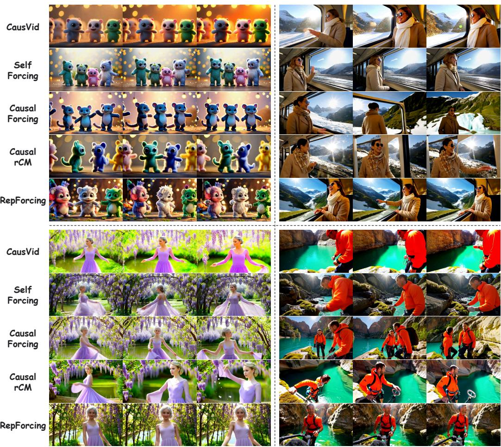  
Figure 4: Qualitative comparison of chunk-wise distilled autoregressive models. For each of four prompts, three sampled frames are shown for CausVid, Self Forcing, Causal Forcing, CausalrCM, and RepForcing. The RepForcing examples retain visible fur strands and facial detail in the character scene, together with clothing folds, hanging blossoms, and rock textures in the human scenes. Changes in body and hand pose are visible across the sampled frames.

## 5.1 SETUP

Implementation Details. RepForcing’s representation-space initialization uses the shared synthetic dataset $\mathcal { D } _ { \mathrm { B i } }$ defined in Sec. 3. We use a Wan2.1-1.3B causal student, a frozen Wan2.1-14B feature extractor and DMD teacher, and a Wan2.1-1.3B auxiliary score model. Final models are evaluated with four-step generation in both chunk-wise and frame-wise settings, using three latent frames per chunk in the former. Each model is refined with its corresponding four-step DMD rollout schedule. Representation-model and extraction-depth ablations use the chunk-wise four-step setting, with the same training data, initial student weights, Stage 1 update budget, and DMD teacher, update schedule, and update budget. For feature supervision, we read block L = 8 (one-based) of the frozen Wan2.1-14B (Wan et al., 2025), with $\tau = 0$ and clean predicted and target latent inputs.

Evaluation. Following Causal Forcing (Zhu et al., 2026), we evaluate 81-frame videos at $8 3 2 \times$ 480. VBench (Huang et al., 2024) Total, Quality, and Semantic use standard prompts. Our standalone Dynamic Degree, VisionReward, and Instruction Following scores (Xu et al., 2024) use Causal Forcing’s released 100-prompt motion set and are scaled by 100. All six metrics are higheris-better, and negative reward scores are valid.

Table 1: Comparison with existing methods. Dynamic., Vision., and Instruct. denote Dynamic Degree, VisionReward, and Instruction Following. Bold marks column-wise best results within each distilled AR group, including ties; empty cells are unreported. Baseline scores follow Zhu et al. (2026); frame-wise four-step Causal Forcing++ scores come from its own report (Zhao et al., 2026), and Causal-rCM scores are obtained from evaluations of pretrained weights (Zheng et al., 2026).
<table><tr><td>Model Total ↑ Quality ↑ Semantic ↑ Dynamic. ↑ Vision. ↑ Instruct. ↑</td></tr><tr><td></td></tr><tr><td>Bidirectional video models LTX-1.9B (HaCohen et al., 2024) 79.83 81.88 71.62 46 -6.218 -38</td></tr><tr><td>Wan2.1-1.3B (Wan et al., 2025) 83.37 84.30 79.65 61 5.275 42</td></tr><tr><td>Autoregressive video models</td></tr><tr><td>-7.381</td></tr><tr><td>NOVA (Deng et al., 2025) 80.31 80.66 78.92 46 -16 Pyramid Flow (Jin et al., 2025) 80.75 83.41 70.11 16 4.055 -2</td></tr><tr><td>SkyReels-V2-1.3B (Chen et al., 2025) 81.97 83.96 74.01 37 3.584 32</td></tr><tr><td>MAGI-1-4.5B (Teng et al., 2025) 78.88 81.67 67.72 42 0.773 8</td></tr><tr><td>Distilled autoregressive models: chunk-wise</td></tr><tr><td>CausVid (Yin et al., 2025) 81.33 83.98 70.72 62 5.741 12</td></tr><tr><td>Self Forcing (Huang et al., 2025) 83.74 84.48 80.77 57 5.820 48</td></tr><tr><td>Causal Forcing (Zhu et al., 2026) 84.04 84.59 81.84 68 6.326 56</td></tr><tr><td>Causal-rCM (Zheng et al., 2026) 84.37 85.02 81.73 71 8.211 64</td></tr><tr><td>Ours 84.66 85.55 81.10 69 10.074 78</td></tr><tr><td>Distilled autoregressive models: frame-wise</td></tr><tr><td>Causal Forcing (Zhu et al., 2026) 83.75 84.35 81.37 64 6.204 42</td></tr><tr><td>Causal Forcing++ (Zhao et al., 2026) 84.10 84.94 80.75 71 6.798 47</td></tr><tr><td>Ours 84.38 85.67 79.21 78 10.598 80</td></tr></table>

## 5.2 RESULTS

Performance Comparison with Existing Models. Table 1 compares the final generator with bidirectional, autoregressive, and distilled autoregressive video models. We compare distilled methods within their chunk-wise or frame-wise settings. Baseline results are taken from the sources specified in the table caption, rather than from a controlled retraining comparison. RepForcing attains the highest VBench Total, Quality, VisionReward, and Instruction Following scores among the listed distilled methods in both groups.

Under four-step chunk-wise generation, RepForcing reaches 84.66 VBench Total and 10.074 VisionReward, exceeding the reported Causal Forcing (Zhu et al., 2026) results by 0.62 points and 59.25%, respectively. Relative to Causal-rCM (Zheng et al., 2026), the corresponding gains are 0.29 points and 22.69%. These results show that omitting an intermediate AR teacher and its trajectorydistillation stage need not compromise the final model’s aggregate quality or reward scores.

Under four-step frame-wise generation, RepForcing reaches 84.38 VBench Total and 10.598 VisionReward. Compared with Causal Forcing++ (Zhao et al., 2026), this gives gains of 0.28 points and 55.90%, respectively, while Instruction Following increases from 47 to 80. The gains are not uniform across metrics: Semantic remains below Causal Forcing (Zhu et al., 2026) in both settings, and chunk-wise Dynamic Degree is 69 versus 71 for Causal-rCM (Zheng et al., 2026). The results therefore support improved aggregate quality and reward-based evaluation, rather than superiority on every metric.

Qualitative Comparison. Figure 4 compares three sampled frames for each of four prompts across distilled AR methods. The differences concern local detail as well as recognizable content: RepForcing’s character examples show fur strands and facial features, while the human scenes retain clothing folds, hanging blossoms, and rock textures. Changes in pose are visible across the sampled frames, with scene elements such as the train interior remaining recognizable in the Rep-Forcing examples. These observations complement the aggregate scores with visible differences in local texture and scene rendering.

Table 2: Ablation Study on Representation Models and Extraction Depth. All variants are evaluated with chunk-wise four-step generation after matched DMD refinement. Repr. Model compares feature extractors, while Relative Depth varies the extraction position within Wan2.1-14B. The default representation model is shown in bold. Dynamic., Vision., and Instruct. denote Dynamic Degree, VisionReward, and Instruction Following.
<table><tr><td>Ablation</td><td>Setting</td><td>Total ↑</td><td>Quality ↑</td><td>Semantic ↑</td><td>Dynamic. ↑</td><td>Vision. ↑</td><td>Instruct. ↑</td></tr><tr><td rowspan="3">Repr. Model</td><td>DINOv2</td><td>82.82</td><td>83.73</td><td>79.15</td><td>75</td><td>5.947</td><td>53</td></tr><tr><td>InternVid</td><td>83.08</td><td>84.33</td><td>78.05</td><td>64</td><td>7.653</td><td>62</td></tr><tr><td>Wan2.1-14B</td><td>84.66</td><td>85.55</td><td>81.10</td><td>69</td><td>10.074</td><td>78</td></tr><tr><td rowspan="4">Relative Depth</td><td>1/8</td><td>84.49</td><td>85.45</td><td>80.64</td><td>61</td><td>9.217</td><td>69</td></tr><tr><td>1/5</td><td>84.66</td><td>85.55</td><td>81.10</td><td>69</td><td>10.074</td><td>78</td></tr><tr><td>1/2</td><td>84.58</td><td>85.51</td><td>80.86</td><td>65</td><td>9.893</td><td>77</td></tr><tr><td>3/4</td><td>84.44</td><td>85.28</td><td>81.09</td><td>71</td><td>9.728</td><td>73</td></tr></table>

## 5.3 ABLATION STUDIES

We examine the representation model and extraction depth in the chunk-wise four-step setting. All variants use the same training data, initial student weights, Stage 1 update budget, cosine objective, and DMD configuration and update budget. Table 2 reports post-DMD results using the metrics and evaluation protocol of Table 1.

Representation Model. We compare DINOv2 (Oquab et al., 2023), InternVid (Wang et al., 2024), and Wan2.1-14B (Wan et al., 2025) features while keeping the DMD teacher fixed. Wan2.1-14B achieves the highest Total, Quality, Semantic, VisionReward, and Instruction Following scores among the tested extractors. Compared with InternVid, it improves VBench Total by 1.58 points and VisionReward from 7.653 to 10.074. DINOv2 yields the highest Dynamic Degree, but lower scores on the other five metrics than Wan2.1-14B. These results support using the video diffusion representation for supervision, without attributing the differences solely to temporal modeling.

Relative Extraction Depth. We compare features extracted at 1/8, 1/5, 1/2, and 3/4 of the Wan2.1-14B (Wan et al., 2025) network depth, using the selected layer’s features rather than averaging preceding layers. With 40 Transformer blocks, these fractions correspond to blocks 5, 8, 20, and 30, respectively, counted from 1. The 1/5 setting achieves the highest Total, Quality, Semantic, VisionReward, and Instruction Following scores among the tested depths. Shallower extraction at 1/8 yields lower scores, while extending extraction to 1/2 or 3/4 provides no further improvement on these metrics. Although 3/4 attains the highest Dynamic Degree, its lower quality and reward scores indicate that deeper features are not uniformly better suited to the supervision task.

## 6 CONCLUSION

In this work, we examine the limitations of intermediate-teacher initialization for few-step autoregressive video generation. Our analysis links latent regression to posterior-mean predictions, while experiments reveal that causal ODE initialization still leaves fine detail unresolved under few-step sampling. Motivated by these findings, we propose Representation Forcing, which supervises the causal student’s clean predictions through normalized features of a frozen video diffusion trans former. A single teacher-forced phase on the same synthetic training videos replaces intermediateteacher training and causal ODE distillation, followed by asymmetric DMD. Experiments show that RepForcing better preserves generation quality than intermediate-teacher-based initialization at four sampling steps before DMD. After DMD, it achieves higher VBench Total and VisionReward than the reported Causal Forcing baselines in both chunk-wise and frame-wise generation, without additional causal ODE trajectory generation.

## REFERENCES

Philip J. Ball, Jakob Bauer, Frank Belletti, Bethanie Brownfield, Ariel Ephrat, Shlomi Fruchter, Agrim Gupta, Kristian Holsheimer, Aleksander Holynski, Jiri Hron, Christos Kaplanis, Marjorie Limont, Matt McGill, Yanko Oliveira, Jack Parker-Holder, Frank Perbet, Guy Scully, Jeremy Shar, Stephen Spencer, Omer Tov, Ruben Villegas, Emma Wang, Jessica Yung, Cip Baetu, Jordi Berbel, David Bridson, Jake Bruce, Gavin Buttimore, Sarah Chakera, Bilva Chandra, Paul Collins, Alex Cullum, Bogdan Damoc, Vibha Dasagi, Maxime Gazeau, Charles Gbadamosi, Woohyun Han, Ed Hirst, Ashyana Kachra, Lucie Kerley, Kristian Kjems, Eva Knoepfel, Vika Koriakin, Jessica Lo, Cong Lu, Zeb Mehring, Alex Moufarek, Henna Nandwani, Valeria Oliveira, Fabio Pardo, Jane Park, Andrew Pierson, Ben Poole, Helen Ran, Tim Salimans, Manuel Sanchez, Igor Saprykin, Amy Shen, Sailesh Sidhwani, Duncan Smith, Joe Stanton, Hamish Tomlinson, Dimple Vijaykumar, Luyu Wang, Piers Wingfield, Nat Wong, Keyang Xu, Christopher Yew, Nick Young, Vadim Zubov, Douglas Eck, Dumitru Erhan, Koray Kavukcuoglu, Demis Hassabis, Zoubin Gharamani, Raia Hadsell, Aaron van den Oord, Inbar Mosseri, Adrian Bolton, Satinder¨ Singh, and Tim Rocktaschel. Genie 3: A new frontier for world models. 2025.¨

Andreas Blattmann, Robin Rombach, Huan Ling, Tim Dockhorn, Seung Wook Kim, Sanja Fidler, and Karsten Kreis. Align your latents: High-resolution video synthesis with latent diffusion models. In Proceedings ofthe IEEE/CVF conference on computer vision andpattern recognition, pp. 22563–22575, 2023.

Boyuan Chen, Diego Mart´ı Monso, Yilun Du, Max Simchowitz, Russ Tedrake, and Vincent Sitz-´ mann. Diffusion forcing: Next-token prediction meets full-sequence diffusion. Advances in Neural Information Processing Systems, 37:24081–24125, 2024.

Guibin Chen, Dixuan Lin, Jiangping Yang, Chunze Lin, Juncheng Zhu, Mingyuan Fan, Hao Zhang, Sheng Chen, Zheng Chen, Chengchen Ma, et al. Skyreels-v2: Infinite-length film generative model. arXiv preprint arXiv:2504.13074, 2025.

Justin Cui, Jie Wu, Ming Li, Tao Yang, Xiaojie Li, Rui Wang, Andrew Bai, Yuanhao Ban, and Cho-Jui Hsieh. Self-forcing++: Towards minute-scale high-quality video generation. In International Conference on Learning Representations, 2026.

Haoge Deng, Ting Pan, Haiwen Diao, Zhengxiong Luo, Yufeng Cui, Huchuan Lu, Shiguang Shan, Yonggang Qi, and Xinlong Wang. Autoregressive video generation without vector quantization. In ICLR, 2025.

Yoav HaCohen, Nisan Chiprut, Benny Brazowski, Daniel Shalem, Dudu Moshe, Eitan Richardson, Eran Levin, Guy Shiran, Nir Zabari, Ori Gordon, et al. Ltx-video: Realtime video latent diffusion. arXiv preprint arXiv:2501.00103, 2024.

Xun Huang, Zhengqi Li, Guande He, Mingyuan Zhou, and Eli Shechtman. Self forcing: Bridging the train-test gap in autoregressive video diffusion. arXiv preprint arXiv:2506.08009, 2025.

Ziqi Huang, Yinan He, Jiashuo Yu, Fan Zhang, Chenyang Si, Yuming Jiang, Yuanhan Zhang, Tianxing Wu, Qingyang Jin, Nattapol Chanpaisit, et al. Vbench: Comprehensive benchmark suite for video generative models. In Proceedings of the IEEE/CVF Conference on Computer Vision and Pattern Recognition, pp. 21807–21818, 2024.

Yang Jin, Zhicheng Sun, Ningyuan Li, Kun Xu, Hao Jiang, Nan Zhuang, Quzhe Huang, Yang Song, Yadong Mu, and Zhouchen Lin. Pyramidal flow matching for efficient video generative modeling. In International Conference on Learning Representations, volume 2025, pp. 23378–23402, 2025.

Justin Johnson, Alexandre Alahi, and Li Fei-Fei. Perceptual losses for real-time style transfer and super-resolution. In European conference on computer vision, pp. 694–711. Springer, 2016.

Xingjian Leng, Jaskirat Singh, Yunzhong Hou, Zhenchang Xing, Saining Xie, and Liang Zheng. Repa-e: Unlocking vae for end-to-end tuning of latent diffusion transformers. In Proceedings of the IEEE/CVF International Conference on Computer Vision, pp. 18262–18272, 2025.

Shanchuan Lin, Ceyuan Yang, Hao He, Jianwen Jiang, Yuxi Ren, Xin Xia, Yang Zhao, Xuefeng Xiao, and Lu Jiang. Autoregressive adversarial post-training for real-time interactive video generation. Advances in Neural Information Processing Systems, 38:41061–41086, 2026.

Yaron Lipman, Ricky TQ Chen, Heli Ben-Hamu, Maximilian Nickel, and Matthew Le. Flow matching for generative modeling. In ICLR, 2023.

Kunhao Liu, Wenbo Hu, Jiale Xu, Ying Shan, and Shijian Lu. Rolling forcing: Autoregressive long video diffusion in real time. arXiv preprint arXiv:2509.25161, 2025.

Xingchao Liu, Chengyue Gong, and Qiang Liu. Flow straight and fast: Learning to generate and transfer data with rectified flow. In ICLR, 2023.

Cheng Lu and Yang Song. Simplifying, stabilizing and scaling continuous-time consistency models. In International Conference on Learning Representations, 2025.

Maxime Oquab, Timothee Darcet, Th´ eo Moutakanni, Huy Vo, Marc Szafraniec, Vasil Khalidov,´ Pierre Fernandez, Daniel Haziza, Francisco Massa, Alaaeldin El-Nouby, et al. Dinov2: Learning robust visual features without supervision. arXiv preprint arXiv:2304.07193, 2023.

Robin Rombach, Andreas Blattmann, Dominik Lorenz, Patrick Esser, and Bjorn Ommer. High-¨ resolution image synthesis with latent diffusion models. In CVPR, 2022.

Axel Sauer, Frederic Boesel, Tim Dockhorn, Andreas Blattmann, Patrick Esser, and Robin Rombach. Fast high-resolution image synthesis with latent adversarial diffusion distillation. In SIG-GRAPH Asia 2024 Conference Papers, pp. 1–11, 2024.

Karen Simonyan and Andrew Zisserman. Very deep convolutional networks for large-scale image recognition. arXiv preprint arXiv:1409.1556, 2014.

Yang Song, Jascha Sohl-Dickstein, Diederik P Kingma, Abhishek Kumar, Stefano Ermon, and Ben Poole. Score-based generative modeling through stochastic differential equations. In ICLR, 2021.

Yang Song, Prafulla Dhariwal, Mark Chen, and Ilya Sutskever. Consistency models. In International Conference on Machine Learning, pp. 32211–32252. PMLR, 2023.

Hansi Teng, Hongyu Jia, Lei Sun, Lingzhi Li, Maolin Li, Mingqiu Tang, Shuai Han, Tianning Zhang, WQ Zhang, Weifeng Luo, et al. Magi-1: Autoregressive video generation at scale. arXiv preprint arXiv:2505.13211, 2025.

Team Wan, Ang Wang, Baole Ai, Bin Wen, Chaojie Mao, Chen-Wei Xie, Di Chen, Feiwu Yu, Haiming Zhao, Jianxiao Yang, et al. Wan: Open and advanced large-scale video generative models. arXiv preprint arXiv:2503.20314, 2025.

Wenhao Wang and Yi Yang. Vidprom: A million-scale real prompt-gallery dataset for text-to-video diffusion models. Advances in Neural Information Processing Systems, 37:65618–65642, 2024.

Yi Wang, Yinan He, Yizhuo Li, Kunchang Li, Jiashuo Yu, Xin Ma, Xinhao Li, Guo Chen, Xinyuan Chen, Yaohui Wang, et al. Internvid: A large-scale video-text dataset for multimodal understanding and generation. In International Conference on Learning Representations, pp. 42055–42079, 2024.

Haoyu Wu, Diankun Wu, Tianyu He, Junliang Guo, Yang Ye, Yueqi Duan, and Jiang Bian. Geometry Forcing: Marrying video diffusion and 3d representation for consistent world modeling, 2026. URL https://arxiv.org/abs/2507.07982.

Jiazheng Xu, Yu Huang, Jiale Cheng, Yuanming Yang, Jiajun Xu, Yuan Wang, Wenbo Duan, Shen Yang, Qunlin Jin, Shurun Li, et al. Visionreward: Fine-grained multi-dimensional human preference learning for image and video generation. arXiv preprint arXiv:2412.21059, 2024.

Shuai Yang, Wei Huang, Ruihang Chu, Yicheng Xiao, Yuyang Zhao, Xianbang Wang, Muyang Li, Enze Xie, Yingcong Chen, Yao Lu, et al. Longlive: Real-time interactive long video generation. In ICLR, 2026.

Tianwei Yin, Michael Gharbi, Taesung Park, Richard Zhang, Eli Shechtman, Fredo Durand, and ¨ Bill Freeman. Improved distribution matching distillation for fast image synthesis. Advances in neural information processing systems, 37:47455–47487, 2024a.

Tianwei Yin, Michael Gharbi, Richard Zhang, Eli Shechtman, Fredo Durand, William T Freeman,¨ and Taesung Park. One-step diffusion with distribution matching distillation. In Proceedings of the IEEE/CVF conference on computer vision and pattern recognition, pp. 6613–6623, 2024b.

Tianwei Yin, Qiang Zhang, Richard Zhang, William T Freeman, Fredo Durand, Eli Shechtman, and Xun Huang. From slow bidirectional to fast autoregressive video diffusion models. In CVPR, 2025.

Sihyun Yu, Sangkyung Kwak, Huiwon Jang, Jongheon Jeong, Jonathan Huang, Jinwoo Shin, and Saining Xie. Representation alignment for generation: Training diffusion transformers is easier than you think. arXiv preprint arXiv:2410.06940, 2024.

Richard Zhang, Phillip Isola, Alexei A Efros, Eli Shechtman, and Oliver Wang. The unreasonable effectiveness of deep features as a perceptual metric. In CVPR, 2018.

Min Zhao, Hongzhou Zhu, Kaiwen Zheng, Zihan Zhou, Bokai Yan, Xinyuan Li, Xiao Yang, Chongxuan Li, and Jun Zhu. Causal forcing++: Scalable few-step autoregressive diffusion distillation for real-time interactive video generation. arXiv preprint arXiv:2605.15141, 2026.

Boyang Zheng, Nanye Ma, Shengbang Tong, and Saining Xie. Diffusion transformers with representation autoencoders. arXiv preprint arXiv:2510.11690, 2025.

Kaiwen Zheng, Guande He, Min Zhao, Jintao Zhang, Huayu Chen, Jianfei Chen, Chen-Hsuan Lin, Ming-Yu Liu, Jun Zhu, and Qianli Ma. Causal-rCM: A unified teacher-forcing and self-forcing open recipe for autoregressive diffusion distillation in streaming video generation and interactive world models. arXiv preprint arXiv:2606.25473, 2026.

Hongzhou Zhu, Min Zhao, Guande He, Hang Su, Chongxuan Li, and Jun Zhu. Causal forcing: Autoregressive diffusion distillation done right for high-quality real-time interactive video generation. arXiv preprint arXiv:2602.02214, 2026.

## A MORE VISUALIZATION

Figure 5 presents additional qualitative comparisons of frame-wise autoregressive video generation. The four examples cover human activities and animal behavior. For each prompt, we show three sampled frames from Causal Forcing, Causal Forcing++, and RepForcing. The complete prompts are provided in Section D.

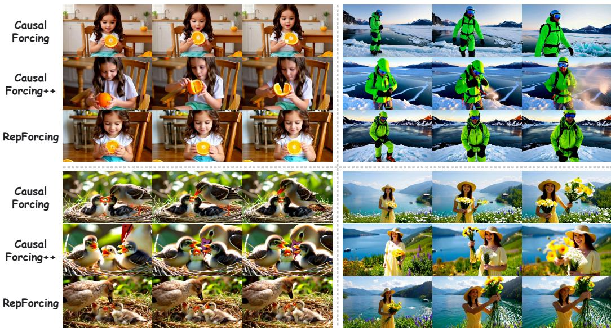  
Figure 5: Qualitative comparison of frame-wise autoregressive models. Each quadrant shows three sampled frames for the same prompt across Causal Forcing, Causal Forcing++, and Rep-Forcing (top to bottom). The examples depict a girl peeling an orange (top left), a mountaineer overlooking a frozen fjord (top right), a mother bird feeding her chicks (bottom left), and a woman holding flowers above a lake (bottom right).

## B ADDITIONAL EXPERIMENTAL DETAILS

## B.1 TRAINING AND EVALUATION PROTOCOL

RepForcing’s Stage 1 reuses Causal Forcing’s first-stage $\mathcal { D } _ { \mathrm { B i } }$ , consisting of approximately 3K clean video samples synthesized by a bidirectional Wan model from VidProM prompts (Zhu et al., 2026). These offline samples supply both the clean targets and teacher-forcing prefixes. They are neither real captured videos nor the student’s online self-rollouts used during DMD. Causal Forcing additionally generates causal ODE trajectory pairs with its trained AR teacher; RepForcing does not use that second dataset. Although Causal Forcing stores bidirectional noisy intermediates when constructing $\mathcal { D } _ { \mathrm { B i } }$ for an ODE baseline, RepForcing needs only the clean video samples and independently adds noise during training.

The main comparison and representation ablations use the six metrics in Table 1. Instruction Following is VisionReward’s prompt-alignment component, not a human-study score. Qualitative comparisons use free autoregressive generation rather than teacher-forced reconstructions. Dynamic Degree is interpreted alongside visual consistency because artifacts can increase measured motion.

## B.2 FEATURE EXTRACTOR SETTINGS

Default Configuration. For Stage 1, we extract features from the frozen Wan2.1-14B DiT (Wan et al., 2025) using its native bidirectional attention over the full video. We read the output of the eighth block $( L = 8 ,$ , one-based) and retain only the first eight of its 40 blocks, corresponding to relative depth $1 / 5$ . Both predicted and target latents are processed without VAE decoding or added noise, with the same embedding value $\tau = 0$ in the extractor’s native timestep units. This embedding is distinct from the student’s normalized noising time $t _ { i } .$ . The DMD teacher instead uses the full network to score noisy videos.

## B.3 QUALITATIVE COMPARISON OF FRAME-WISE GENERATION

Figure 5 compares Causal Forcing (Zhu et al., 2026), Causal Forcing++ (Zhao et al., 2026), and RepForcing on four prompts, with three sampled frames per method. The examples cover a girl holding an orange, a mountaineer beside a frozen fjord, a bird feeding its chicks, and a woman holding flowers above a lake.

The RepForcing samples show distinct orange segments and clothing folds in the indoor scene, together with snow texture and mountain contours in the fjord scene. Compared with the more stylized birds in the baseline examples, RepForcing renders fine feather texture and nest material. In the lakeside sequence, the bouquet and surrounding landscape remain recognizable as the woman raises the flowers. Across the displayed frames, subjects change pose while retaining identifiable clothing, appearance, and scene elements. These examples complement the quantitative evaluation with visual evidence of appearance fidelity in frame-wise generation.

## C PROOFS

## C.1 PROOF OF PROPOSITION 1

The proposition concerns expected regression risk under a data distribution with residual uncertainty in the clean continuation given the prefix and prompt. It does not characterize memorization of a finite training set.

Proof. Fix i and $t \in ( 0 , 1 ]$ as in the proposition. For this proof, write $Y = \mathbf { x } _ { 0 } ^ { i } , H = h _ { i } .$ , and $U =$ $( \mathbf { x } _ { t } ^ { i } , H )$ , and let $m ( U ) = \bar { \mathbb { E } } [ Y \mid U ]$ . The assumed finite second moment makes the following squared risks well defined. For any square-integrable measurable prediction $g ( U )$ , conditional expectation gives the orthogonal decomposition

$$
\begin{array} { r } { \mathbb { E } \| g ( U ) - Y \| _ { 2 } ^ { 2 } = \mathbb { E } \| g ( U ) - m ( U ) \| _ { 2 } ^ { 2 } + \mathbb { E } \| Y - m ( U ) \| _ { 2 } ^ { 2 } . } \end{array}
$$

Thus $m ( U )$ is the unique minimizer up to almost-sure equality. Applying the same orthogonality to $Y = m ( \bar { U } ) + ( Y - \bar { m ( U ) } )$ yields

$$
\mathbb { E } \| Y \| _ { 2 } ^ { 2 } = \mathbb { E } \| m ( U ) \| _ { 2 } ^ { 2 } + \mathbb { E } [ \mathrm { t r } \mathrm { C o v } ( Y \mid U ) ] .
$$

Here Cov denotes conditional covariance and tr its matrix trace. For $t > 0$ , the conditional likelihood of $\mathbf { x } _ { t } ^ { i }$ given Y, H is Gaussian with covariance $t ^ { 2 } I$ and is strictly positive. Hence the posterior law of Y given U is equivalent to its conditional prior given $H$ . Whenever that prior is not a point mass, the posterior is also not a point mass, so its covariance has strictly positive trace. This occurs on a set of positive probability by assumption. Therefore

$$
\mathbb { E } \Vert m ( U ) \Vert _ { 2 } ^ { 2 } < \mathbb { E } \Vert Y \Vert _ { 2 } ^ { 2 } .
$$

If $m ( U )$ and $Y$ had the same distribution, their finite second moments would agree, contradicting this inequality. The result concerns the direct regression prediction at fixed $t ,$ not the output distribution of a complete multi-step ODE sampler. □

## C.2 CONDITIONAL INTERPRETATION OF REPRESENTATION REGRESSION

Let ${ \bar { \Phi } } ( X ; y )$ denote the concatenated unit-normalized token features of the frozen video extractor defined in Sec. 4.2. For a generic observation $U$ containing the text condition y, an unrestricted conditional predictor has an optimal video prediction

$$
\mu _ { \mathrm { r e p } } ( U ) \in \arg \operatorname* { m i n } _ { Z } ~ \mathbb { E } \left[ \| \bar { \Phi } ( Z ; y ) - \bar { \Phi } ( X _ { 0 } ; y ) \| _ { 2 } ^ { 2 } \bigm | U \right] ,\tag{9}
$$

where $Z$ ranges over candidate video latents with defined normalized features, and a minimum is assumed to exist. Let $F = \bar { \Phi } ( X _ { 0 } ; y )$ and $m _ { \Phi } ( U ) = \mathbb { E } [ F \mid U ]$ . Conditional squared-error decomposition gives

$$
\begin{array} { r } { \mathbb { E } [ \| \bar { \Phi } ( Z ; y ) - F \| _ { 2 } ^ { 2 } \mid U ] = \| \bar { \Phi } ( Z ; y ) - m _ { \Phi } ( U ) \| _ { 2 } ^ { 2 } } \\ { + \mathbb { E } [ \| F - m _ { \Phi } ( U ) \| _ { 2 } ^ { 2 } \mid U ] . } \end{array}
$$

The second term does not depend on Z. Thus an optimal prediction has realizable features closest to $m _ { \Phi } ( U )$ , which need not correspond to the coordinate-wise mean of the target latents. The feature mean need not itself be realizable, and the optimal video need not be unique. This characterizes the loss preference, not the blockwise optimum of the actual causal student, whose predictions have distinct inputs $U ^ { i }$

## D PROMPTS

We provide the complete text prompts for the qualitative examples in Figures 1, 2, 4, and 5. Within each figure, prompts are listed from left to right and then from top to bottom across the example groups; repeated frames and methods for the same prompt are counted only once.

The prompts used in Figure 1 are as follows:

1. In spring on a coastal cliff carpeted with wildflowers, a fashion model in a white blouse and sea green skirt fills the foreground in cinematic 4K. She turns into the wind, then steps forward with confident posture as the camera glides close to fluttering fabric and natural skin. Behind, turquoise waves shimmer and seabirds arc through bright air. Crisp petal texture, clean highlights, and gentle film grain make the landscape feel fresh, elegant, and hauntingly beautiful.

2. High summer on a desert highway pull-off, a traveler in a white linen shirt and tan scarf fills the foreground in cinematic 4K. He wipes dust from sunglasses, lifts a bottle to drink, then walks toward a viewpoint as the camera tracks beside him through shimmering heat. Behind him, red mesas glow under harsh sun and a distant storm paints the sky violet. Dust motes, fabric fibers, and skin tones are crisp; gentle film grain grounds the vast, dramatic realism.

3. A cozy reading nook scene in a warm, inviting interior, featuring a playful llama sitting on a soft, plush rug. The llama is surrounded by an array of colorful, cozy pillows and soft blankets, creating a snug and comfortable atmosphere. Golden lighting from a floor lamp casts a warm glow throughout the space, enhancing the cozy ambiance. The llama reads a picture book aloud, using expressive voices to bring the characters to life. The camera captures the llama’s animated face and the charming illustrations within the book, with a close-up view of both the reader and the pages.

4. In late autumn in a candle lit chapel, a violinist in a black satin dress fills the foreground in cinematic 4K. She plays a slow phrase, then accelerates into a shimmering run as the camera moves close to bow hair and fingerwork. Outside stained glass, rain taps softly and leaves swirl in the courtyard. Warm flame light paints her face and instrument, with true tones and gentle film grain making the performance hauntingly beautiful.

5. On a winter sunrise above a frozen fjord, a mountaineer in an orange down suit and mirrored goggles dominates the frame in ultra clean UHD. He tightens his harness, then steps onto a ridge as wind lifts powder into glittering sheets. The camera holds close on breath mist and frost on his lashes, then reveals blue ice, dark water cuts, and distant peaks glowing pink. Every seam, strap, and snow crystal reads sharply, with subtle film grain grounding the grandeur.

6. A vibrant and lively vlog-style photo of a corgi in tropical Maui, showcasing the dog energetically filming itself on a sandy beach. The corgi stands on the shore, one paw slightly lifted, with a joyful and curious expression. It wears a colorful collar and a small backpack camera slung over its neck. The background features a lush, palm-fringed beach with clear turquoise waters and a bright blue sky. The photo has a warm, natural lighting effect, capturing the corgi from a slightly elevated angle, emphasizing its playful and adventurous spirit.

7. In spring on a lavender hillside after rain, a woman in a cream blouse and lilac skirt dominates the frame in cinematic 4K. She lifts a bouquet to her face, then walks forward as the camera tracks close to her smile and the shimmer of dew on blossoms. Behind her, clouds break and sunlight warms purple rows stretching to a distant chapel. Sharp textures, true tones, and gentle film grain make the landscape hauntingly beautiful.

8. A serene watercolor painting of a mother duck leading her six ducklings across a tranquil pond. The mother duck has a gentle expression, her feathers glistening in the sunlight, and she frequently glances back to ensure all her ducklings are safely following in a neat little line. The ducklings follow closely behind, their small heads bobbing up and down as they waddle along. The background features a peaceful pond with lily pads and ducks floating nearby, creating a harmonious and natural scene. A mid-shot from a slightly elevated angle captures the mother duck and her ducklings in motion.

## The prompt used in Figure 2 is as follows:

1. Across a snowfield under pink dawn, a skier in a crimson down jacket, fur-lined hood, and mirrored goggles dominates the frame in HDR 4K with sparkling ice detail. First, she plants her poles and adjusts the strap of a small camera on her chest, breath puffing in the cold. Then she pushes off, carves a wide S-curve through powder, and throws a spray of snow toward the lens as the camera follows low and fast, mountains glowing and the sky vast and stunning.

## The prompts used in Figure 4 are as follows:

1. A miniature 3D render in an octane engine style depicting adorable wool and felt monsters dancing together in a dreamy, bokeh-filled setting. These soft, cuddly creatures, with big expressive eyes and fluffy bodies, are illuminated by gentle, diffused lighting that casts a warm, ethereal glow. The background features a soft, hazy backdrop with a dreamy bokeh effect, adding a cinematic quality to the scene. The monsters are shown from various angles, capturing their playful movements and expressions, creating a charming and enchanting atmosphere. A medium shot with a dynamic camera angle, highlighting the natural and joyful dance of these woolen monsters.

2. On a sunlit train crossing the Swiss Alps, a traveler in a beige coat, knitted scarf, and round sunglasses dominates the shot in 4K with crisp window reflections. First, she wipes condensation from the glass and presses her palm against it, watching snowy peaks slide past. Then she turns, opens the cabin door, and walks into the corridor with a delighted laugh, the camera tracking as valleys open outside, sunlight hits glaciers, and the landscape feels impossibly grand. with water droplets sparkling.

3. In spring under a tunnel of wisteria, a dancer in a pale lavender dress and silver hairpin fills the frame in cinematic 4K. She moves through slow turns, sleeves fluttering, then pauses to let blossoms brush her shoulders as the camera pushes close to her serene eyes. Behind her, a sunlit garden pond mirrors purple clusters and fresh green leaves. Natural tones, crisp petal detail, and soft lens bloom create a dreamy realism that feels delicate and moving.

4. At midsummer in a canyon pool, a climber in an orange technical jacket and chalk dusted hands dominates the frame in HDR UHD. He grips a hold, pulls up with visible effort, then pauses on a ledge to look down at emerald water as the camera tilts to reveal sunlight slicing through rock. Mineral streaks, wet moss, and fabric seams read sharply. True tones and subtle film grain create a thrilling sense of scale.

## The prompts used in Figure 5 are as follows:

1. A photo in a realistic style depicting a young girl sitting on a wooden chair, peeling an orange with a focused expression. She has long wavy brown hair and clear, warm brown eyes, wearing a simple white blouse and light blue shorts. Her hands are steady as she peels the orange, revealing the segments inside. The background shows a cozy kitchen with a blurred view of a wooden table and some utensils nearby. The lighting is soft and natural, casting gentle shadows. A close-up shot from a slightly downward angle, capturing her detailed facial expression and the orange being peeled.

2. Winter sunrise on a frozen fjord overlook, a mountaineer in a bright down suit and mirrored goggles stands close to camera in ultra-clean 4K. He tightens his harness, stamps boots to test ice, then steps forward as wind lifts powder into glittering sheets. The camera holds on frost crystals clinging to fabric and eyelashes, then reveals blue ice, dark water cuts, and distant peaks glowing pink. Every seam and snow grain is crisp; subtle film grain grounds the grandeur.

3. A detailed and heartwarming wildlife photograph capturing a mother bird tenderly feeding her chicks in a cozy nest. The mother bird gently places food into the wide-open beaks of her chirping chicks, who eagerly await their meal. Her feathers are soft and fluffy, and she has a gentle, attentive expression. The chicks have small, round heads with wide-open beaks and big, curious eyes. The nest is lined with soft grass and twigs, and the background features a blurred forest scene with dappled sunlight filtering through the leaves. The photo has a natural, documentary style. A close-up shot from a slightly elevated angle, focusing on the interaction between the mother bird and her chicks.

4. In spring on a hillside above a bright lake, a woman in a light yellow dress and straw hat dominates the frame in cinematic 4K. She picks wildflowers, then lifts the bouquet toward the lens as the camera glides closer to her joyful expression. Behind her, water shimmers, small boats drift, and mountains soften into blue haze. Sharp textures, true tones, and gentle film grain create a warm, uplifting beauty.