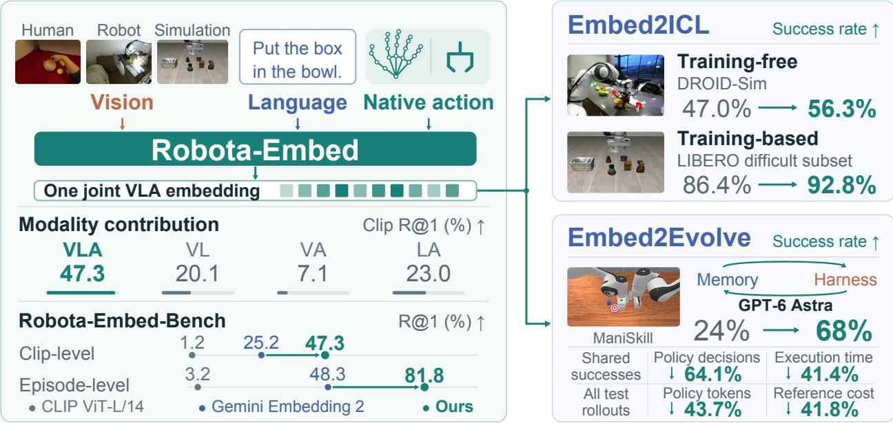  
Figure 1 | One joint VLA embedding, two context applications. Robota-Embed jointly encodes vision, language, and native action from human, robot, and simulated experience to retrieve recorded continuations. Left: retrieval accuracy and modality contributions on Robota-Embed-Bench. Right: retrieved demonstrations condition robot policies in Embed2ICL; task-local memory and context use evolve around a fixed GPT-6 Astra policy in Embed2Evolve. Token savings include failed final tests and exclude development; decision/time savings use matched successful pairs. These eficiency comparisons use Direct as the baseline.

# Robota-Embed: Unified VLA Embeddings for Robot In-Context Learning and Evolution

Yunze Liu1,\*, Jing Wang1,\*, Shenrui Wu3, Wenkun He2, Guanqi Zhan1, Xianzheng Ma4, Junyu Chen1, Wenhang Ge1, Haozhan Tang5, Yuchao Gu1, Zhuoyang Zhang2, Zekai Wang3, Dantong Niu3, Zhen Dong1, Yuke Zhu1, Trevor Darrell3, Linxi “Jim” Fan1, Song Han2, Han Cai1,†

1 NVIDIA 2 MIT 3 UCB 4 Oxford 5 CMU \* Equal contribution. † Corresponding author.

Project Page

Abstract: Retrieving useful context for a robot requires matching not only its task, but also its current stage of execution and the continuation that should follow. We introduce Robota-Embed, to our knowledge the first vision–language–action (VLA) embedding model to jointly encode all three modalities in both current-state queries and recorded future continuations. Predictive retrieval training aligns these endpoints for physical-experience retrieval, and the resulting representation retrieves historical continuations as context at inference time. We construct a multi-source corpus of 1,695,684 cleaned training anchors and introduce Robota-Embed-Bench, which evaluates 4,000 queries against a shared 8,000-entry gallery. Our model achieves 47.33% clip-level and 81.77% episode-level R@1, surpassing action-free Gemini Embedding 2 by 22.09 and 33.47 percentage points. Across controlled retrieval studies, removing native action degrades retrieval more than removing vision, indicating that execution information is a central part of the retrieval key. We then study how this shared retrieval space transfers beyond retrieval metrics through two complementary applications. Embed2ICL uses retrieved experience for training-free and training-based policy conditioning, increasing success from 47.0% to 56.3% in DROID-Sim and from 86.4% to 92.8% on the LIBERO dificult subset. Both interfaces also improve task progress in real-robot evaluations. Embed2Evolve uses execution feedback to grow task-local memory and refine how retrieved context is used around a frozen GPT-6 Astra policy. Across five ManiSkill tasks, it achieves 68% success, compared with 24% for GPT-6 Astra Direct and 33% for a harness independently evolved with Omni-Embed-Nemotron-3B under the same protocol. Relative to the latter, it uses approximately 79.5% fewer policy tokens per test rollout. Together, these results show that a unified, action-aware retrieval space can support both robot in-context learning and task-local context evolution.

## 1. Introduction

Robot policies increasingly use experience supplied in context. GEN-1.5 [1] and S1 [2] demonstrate Robot In-Context Learning from sensorimotor or video examples. In our experiments, GPT-6 Astra [3] generates robot actions from observations and execution history. These capabilities make experience selection part of the control problem. Demonstration-conditioned world action models (WAMs) need useful existing examples; policies acting repeatedly must organize accumulated experience. Both raise a representation question: how should physical experience be represented for task- and stage-sensitive retrieval?

Task similarity alone is insuficient. Reaching toward a bowl and withdrawing after placement can share objects and an instruction yet require diferent continuations. Language specifies the goal, vision the interaction state, and native action the ongoing motion. The retrieval endpoints have diferent temporal roles: the query describes the present, whereas a candidate records what followed an earlier interaction. Predictive retrieval therefore requires sensitivity to task intent and execution stage: the goal is an appropriate recorded continuation, not simply a similar scene.

General-purpose embeddings align vision and language [4, 5, 6], while action-aware metric learning connects perception or language with behavior [7, 8]. We introduce Robota-Embed, a unified vision–language–action (VLA) embedding model for physical-experience retrieval. To our knowledge, it is the first to jointly encode all three modalities in both current-state queries and recorded continuations. Each endpoint yields one vector, so native action informs retrieval itself. Source-specific projectors handle heterogeneous action formats. Retrieval training combines predictive alignment, multimodal grounding and discrimination, and representation regularization.

We construct a multi-source training corpus and introduce Robota-Embed-Bench, with 4,000 queries and 8,000 gallery candidates spanning human, simulated, and real-robot experience. Nearby same-episode clips distinguish finding the right experience from locating its recorded continuation. Across four sources, Robota-Embed achieves 47.33% clip-level and 81.77% episode-level R@1. Native action adds information beyond text and images: with backbone, data, and training budget matched on DROID, adding action raises clip-level R@1 from 59.8% to 78.7%. Complementary retraining and query-masking studies examine which information the representation learns and uses.

Figure 1 connects retrieval to demonstration conditioning and memory-based interaction. Embed2ICL supports robot in-context learning through two policy interfaces. For DreamZero [9], retrieved videos initialize the visual cache without policy updates. For Fast-WAM [10], we fine-tune the policy to condition on precomputed Context Tokens from retrieved demonstrations. Both interfaces improve simulation task success and real-robot task progress. Random-reference controls show that useful context depends on reference selection.

Embed2Evolve extends retrieval to context management for agentic robots. Repeated attempts grow task-local memory, while execution feedback refines retrieval, refresh, and retained-history settings around a frozen GPT-6 Astra policy. Policy and embedding weights remain fixed. Across five ManiSkill tasks, the selected context harness raises success from 24% with Direct to 68%, using 43.7% fewer policy tokens per test rollout. To examine the retrieval model’s role, we independently repeat evolution with Omni-Embed-Nemotron-3B from the same initial memory under the same search protocol. Its harness reaches 33% success; Embed2Evolve uses approximately 79.5% fewer tokens than this baseline. Token averages include failed tests and exclude development.

We make four contributions.

• Robota-Embed. A unified embedding model that jointly encodes vision, language, and native action at both endpoints for predictive physical-experience retrieval.

• Data and evaluation. A multi-source training corpus, Robota-Embed-Bench, and controlled studies of temporal precision, representation learning, and native action’s contribution beyond vision and language.

• Embed2ICL. Training-free and training-based interfaces that turn retrieved demonstrations into useful policy context, evaluated in simulation and on real robots.

• Embed2Evolve. Embedding-guided memory and context evolution around a frozen policy, improving success and token eficiency under matched comparisons of retrieval embedding models.

## 2. Related Work

Multimodal and action-aware embeddings. CLIP aligns images with language [4]; Perception Encoder and InternVideo2 extend vision–language representation learning to video [11, 12]. Unified vision–language embeddings support image and video retrieval in one space [6, 13, 14, 15, 16]; ImageBind [5] includes additional sensory modalities. Deep Multimodal Embedding [7] and CLASP [8] align language or perception with action. VLA-R [17] embeds visual–language queries and action-token candidates in a shared space, while RADAR [18] reuses VLA-policy features for retrieval. Robota-Embed jointly encodes vision, language, and native action at both retrieval endpoints: the current state and the recorded future clip.

Physical-experience retrieval. Action can enter the retrieval key or the content returned to the policy. ROSER [19] searches proprioceptive sequences; RAEA [20], REGENT [21], and RICL [22] return actions selected through action-free keys. Zeva [23] indexes action–efect evidence, whereas RADAR [18] uses policy features. MemER [24] selects rollout keyframes; Retrieve-Reason-Act [25] indexes visual manuals. Robota-Embed includes native action in both query and candidate keys, so motion informs the similarity comparison itself (Table 33).

Robot In-Context Learning and Evolution. GEN-1.5 [1] conditions on a sensorimotor example; S1 [2], Zero-WAM [26], and HOST [27] use supplied video. R+X [28] retrieves human-video clips and converts them into keypoint and hand-trajectory context. Embed2ICL uses Robota-Embed to select experience for training-free and training-based WAM conditioning. Reflexion [29] stores verbal reflections in episodic memory, using feedback to improve later trials without updating model weights. In robotics, Zeva [23] retrieves action–efect evidence across retries within an episode, resetting memory for each new episode. Embed2Evolve performs in-context evolution: it grows task-local memory across development episodes and refines retrieval, refresh, and history settings around a frozen policy. Evaluation uses the selected memory and context settings without further changes on fresh task initializations.

## 3. Robota-Embed

## 3.1. Problem Formulation

Physical AI experience combines language, vision, and source-native motion or control from human, simulated, or robotic interaction. Given a current VLA state, Robota-Embed retrieves the video and actions that followed an anchor in a recorded trajectory.

For sample � from source $d _ { i } ,$ the query combines instruction $\ell _ { i } ,$ , an interaction-region image $z _ { i , t } ,$ and synchronized native action $a _ { i , t } .$ The paired target combines the same instruction with a four-second video clip $V _ { i } ^ { + }$ and aligned actions $A _ { i } ^ { + }$ recorded strictly after �:

$$
x _ { i } ^ { q } = ( \ell _ { i } , z _ { i , t } , a _ { i , t } , d _ { i } ) , \qquad x _ { i } ^ { k } = ( \ell _ { i } , V _ { i } ^ { + } , A _ { i } ^ { + } , d _ { i } ) .\tag{1}
$$

## 3.2. Action-Native Predictive VLA Embeddings

We train Robota-Embed for current-to-future retrieval using Cosmos3-Edge 4B [30] as the base model (Figure 2) Query and target share the Transformer, video tokenizer, and head, with separate adapters $A _ { q } , A _ { k }$ . Sourcespecific projectors $P _ { d _ { i } }$ map native actions into the backbone. Each endpoint jointly encodes language, vision, and action into one normalized vector. For retrieval, we rank candidates by the cosine similarity between the current-state query $q _ { i } = f _ { \theta } ^ { q } ( x _ { i } ^ { q } ; P _ { d _ { i } } )$ and the future-clip target $k _ { i } = f _ { \theta } ^ { k } ( x _ { i } ^ { k } ; P _ { d _ { i } } )$

Retrieval-oriented training. We train with predictive alignment, multimodal grounding, and representation regularization. Structured parsing and deterministic rules supply weak labels. The supervision distinguishes exact continuation identity from broader task compatibility; a diferent clip ID alone does not establish a valid negative. Native action is learned within the fused representation, with modality swaps encouraging sensitivity to motion without requiring action-only matching to an exact future clip.

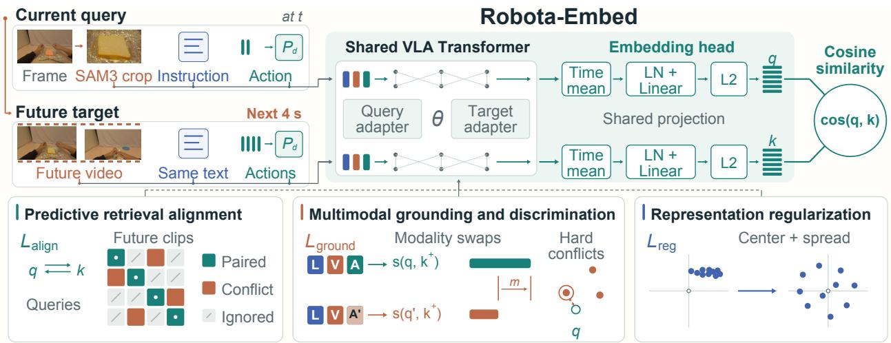  
Figure 2 | Robota-Embed architecture and objectives. Each query is paired with the next four seconds of recorded video and actions. Three objective groups train a joint VLA space.

Predictive retrieval alignment $\left( \mathcal { L } _ { \mathrm { a l i g n } } \right)$ uses bidirectional InfoNCE with exact future-clip positives and task, object, action, or joint conflicts as negatives. Compatible, uncertain, or potentially duplicate non-positives are ignored. Figure 2 shows the validity mask. We optimize:

$$
\mathcal { L } = \mathcal { L } _ { \mathrm { a l i g n } } + \mathcal { L } _ { \mathrm { g r o u n d } } + \mathcal { L } _ { \mathrm { r e g } } .\tag{2}
$$

Multimodal grounding and discrimination $( \mathcal { L } _ { \mathrm { g r o u n d } } )$ combines task/object auxiliaries with margins against modality swaps and hard semantic conflicts, so that similarity responds to changes in the inputs. Representation regularization $( \mathcal { L } _ { \mathrm { r e g } } )$ centers query and target batches and discourages low-variance, low-rank embeddings. Section A.1–A.2 detail the architecture, native-action preprocessing, optimization schedule, and individual training losses.

## 3.3. Training Data and Retrieval Benchmark

Our training corpus contains 1,695,684 filtered current–future pairs from EgoDex [31], DROID [32], LIBERO [33], and RoboMIND–Franka-dual [34]. EgoDex records tracked human motion; the other sources record robot controls. We sample sources equally and form within-source pairs (Figure 3; Section A.3).

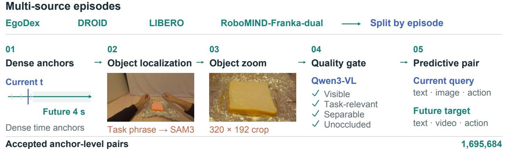  
Figure 3 | Multi-source training-data curation. We split episodes before sampling anchors, localize and verify interaction crops, and pair accepted anchors with video and actions from the next four seconds. Query filtering uses only the instruction and current observations.

Robota-Embed-Bench. All 4,000 held-out queries search one shared 8,000-clip gallery from the four source datasets. Each source contributes 1,000 queries from 800 episodes, 1,000 paired future clips, and 1,000 nearby same-episode clips. Queries follow Equation 1. Clip-level retrieval treats only the paired clip as positive; episode-level retrieval accepts all clips from the same source episode. Downstream experiments test whether retrieved context helps control.

We split episodes, sessions, and content identities before sampling anchors; task, object, and embodiment categories may recur. Clip-level metrics weight sources equally. Episode-level metrics aggregate within episodes, then equally over each source’s 800 episodes and the four sources. We use cosine similarity without reranking (Section B.1).

## 4. Embedding Evaluation

Table 1 | Retrieval on Robota-Embed-Bench. Four-source average recall and MRR (%) on the shared 8,000-clip gallery. Bold marks column-wise best results.
<table><tr><td></td><td colspan="4">Clip-level</td><td colspan="4">Episode-level</td></tr><tr><td>Model</td><td>R@1</td><td>R@5</td><td>R@10</td><td>MRR</td><td>R@1</td><td>R@5</td><td>R@10</td><td>MRR</td></tr><tr><td colspan="9">CLIP-style text-video embeddings</td></tr><tr><td>CLIP ViT-L/14</td><td>1.2</td><td>5.8</td><td>9.8</td><td>4.06</td><td>3.2</td><td>7.7</td><td>11.6</td><td>5.98</td></tr><tr><td>Perception Encoder B16</td><td>2.0</td><td>8.1</td><td>12.8</td><td>5.52</td><td>5.0</td><td>10.1</td><td>15.2</td><td>8.01</td></tr><tr><td>InternVideo2</td><td>1.6</td><td>7.3</td><td>11.4</td><td>4.82</td><td>4.1</td><td>9.1</td><td>13.2</td><td>6.94</td></tr><tr><td colspan="9">Unified VL embeddings</td></tr><tr><td>Qwen3-VL-Embedding-2B</td><td>23.3</td><td>51.6</td><td>57.3</td><td>36.20</td><td>45.1</td><td>55.9</td><td>61.0</td><td>50.71</td></tr><tr><td>VLM2Vec-V2</td><td>24.1</td><td>51.9</td><td>57.6</td><td>36.67</td><td>47.3</td><td>58.1</td><td>63.3</td><td>52.88</td></tr><tr><td>WeMM-Embedding-2B</td><td>24.1</td><td>52.2</td><td>58.2</td><td>36.78</td><td>45.1</td><td>57.3</td><td>63.2</td><td>51.08</td></tr><tr><td>Omni-Embed-Nemotron-3B</td><td>24.5</td><td>54.5</td><td>60.1</td><td>38.10</td><td>48.6</td><td>59.1</td><td>64.4</td><td>53.84</td></tr><tr><td>Gemini Embedding 2</td><td>25.2</td><td>52.3</td><td>57.5</td><td>37.68</td><td>48.3</td><td>58.2</td><td>64.7</td><td>53.69</td></tr><tr><td colspan="9">Unified VLA embedding</td></tr><tr><td>Robota-Embed (ours)</td><td>47.3</td><td>91.9</td><td>97.0</td><td>67.05</td><td>81.8</td><td>94.9</td><td>98.1</td><td>86.96</td></tr></table>

## 4.1. Unified VLA Retrieval on Robota-Embed-Bench

Protocol and models. Eight action-free baselines search the shared gallery (Section 3.3). CLIP-style models retrieve video from text; unified VL models also use visual queries (Table 1). We use each model’s supported interface. The retraining studies in Section B.4 use the same DROID data splits and training budgets for the compared model variants.

Main results. Robota-Embed achieves 47.33% clip-level and 81.77% episode-level R@1. The strongest baselines, Gemini Embedding 2 and Omni-Embed-Nemotron-3B, reach 25.24% and 48.59%, respectively. Robota-Embed improves on them by 22.09 and 33.18 percentage points.

Gains over unified VL baselines are largest on LIBERO and RoboMIND-FD (Section B.2). Episode retrieval does not resolve temporal localization: on EgoDex, episode/clip R@1 is 87.06/36.70%, versus 99.88/74.10% on DROID. Finding a relevant experience is easier than locating its paired continuation, the target of predictive retrieval.

Benchmark validity. Masking candidate text before fusion and recomputing embeddings lowers cliplevel R@1 from 47.33% to 12.78%, confirming that the model uses language. Restricting candidates to the same instruction still gives 47.62% R@1, so the model also distinguishes continuations that share an instruction. Within same-instruction galleries, Robota-Embed achieves 38.60% and 40.10% R@1 on LIBERO and RoboMIND-FD, compared with random-ranking rates of 1.90% and 0.24%, respectively. High-� recall approaches saturation in the smaller EgoDex and DROID pools. Tables 12 and 13 give the full aggregate results, per-source candidate counts, and random baselines.

Index-size scaling. Expanding the precomputed gallery from 1M to 15M entries increases query encoding plus retrieval latency from 160.36 to 195.17 ms on one NVIDIA A100 (Table 22). At 15M, Top-10 search alone takes 37.47 ms. These timings exclude time spent on SAM3 preprocessing, reference reranking, and downstream policy execution (Section B.6).

## 4.2. What Makes Predictive Retrieval Work?

The controlled studies separate representation adaptation from input use. On the shared four-source benchmark, a frozen Cosmos3-Edge readout reaches only 0.65% clip-level R@1, whereas retrieval training reaches 47.33% (Table 15). On the matched DROID split, a learned head over frozen features reaches 13.8%, compared with 78.7% when the backbone and head are adapted (Table 16). Predictive alignment already places the paired continuation near the top at 75.6% R@1 and 100.0% R@10; representation regularization raises R@1 to 77.0%, and multimodal grounding and discrimination further raise it to 78.7% (Table 17). The added objectives therefore refine top-rank ordering rather than merely broad recall.

Action is the most consequential non-language input in both controlled views. Retraining without action lowers R@1 by 18.9 percentage points, versus 1.9 points without vision (Table 19); with the final model and gallery fixed, masking query action or vision lowers clip R@1 by 27.25 or 24.33 points (Table 20). These interventions answer diferent questions: retraining measures what the remaining modalities can relearn, whereas masking measures reliance under an input shift. Thus the small no-vision retraining gap does not imply that the final model ignores vision. SAM3 interaction crops provide a further, modest localization gain over full frames, 78.7% versus 77.9% R@1 (Table 18). Appendix B reports each intervention as a separate table and conclusion.

## 4.3. Benchmark Retrieval Examples

Figure 4 contrasts a paired-clip hit with a temporal near-miss. The latter retrieves a nearby window from the correct episode rather than the paired continuation, illustrating why episode matching and clip localization require separate metrics.

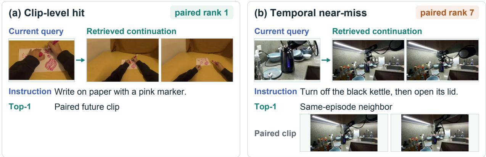  
Figure 4 | Selected retrieval diagnostics. (a) The paired future clip ranks first. (b) A nearby clip from the same episode ranks first, while the paired clip ranks seventh. Both top-1 returns are episode-level matches; only (a) is also a clip-level match.

## 5. From Embeddings to Robot Context

## 5.1. Embed2ICL: Embedding-Guided Robot In-Context Learning

Training-free ICL with DreamZero. Embed2ICL initializes the visual cache of frozen DreamZero-DROID [9] with a retrieved video. Table 2 compares top-1 and reranked retrieval on three DROID-Sim tasks. Both retrievers use the same GPT-5.6 sol Reranking Agent to select task-relevant four-second references with completion evidence. All six conditions use 100 trials per task, including the random-reference control. Embed2ICL uses one fixed reference video per task across all evaluation trials (Section C.1).

Embed2ICL performs best on all three tasks, averaging 56.3% success versus 47.0% without warm-up and 36.0% with random references. Reranking improves both retrievers. Robota-Embed exceeds Omni-Embed-Nemotron-3B before reranking (50.3% versus 43.3%) and with the same reranker (56.3% versus 51.0%; Section C.2). Random references underperform no warm-up: adding a demonstration is not suficient. Selected references preserve placement relations despite changes in objects or receptacles, suggesting that useful context need not reproduce the target scene exactly.

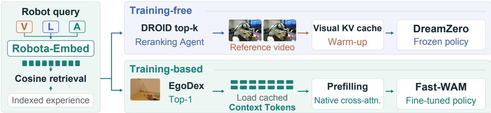  
Figure 5 | Embed2ICL: one retriever, two policy interfaces. Reranked DROID videos warm up DreamZero’s visual cache; top-1 EgoDex matches supply Context Tokens for Fast-WAM’s native cross-attention. Retrieval vectors select experience; videos or tokens condition the policy.

Table 2 | Training-free DreamZero-DROID in DROID-Sim. Success rates (%); parentheses show percentagepoint changes from no warm-up. Reranked conditions share the same agent.
<table><tr><td>Reference condition</td><td>Cube → Bowl</td><td>Can → Mug</td><td>Banana → Bin</td><td>Average</td></tr><tr><td>No warm-up</td><td>61</td><td>13</td><td>67</td><td>47.0</td></tr><tr><td>Random reference</td><td>50(-11)</td><td>7(-6)</td><td>51 (−16)</td><td>36.0 (−11.0)</td></tr><tr><td colspan="5">Omni-Embed-Nemotron-3B</td></tr><tr><td>Top-1</td><td>57(−4)</td><td>5(−8)</td><td>68(+1)</td><td>43.3 (−3.7)</td></tr><tr><td>+ reranking</td><td>62(+1)</td><td>19(+6)</td><td>72(+5)</td><td>51.0 (+4.0)</td></tr><tr><td>Robota-Embed Top-1</td><td>63(+2)</td><td>16(+3)</td><td>72(+5)</td><td>50.3 (+3.3)</td></tr><tr><td>Embed2ICL</td><td>65(+4)</td><td>24(+11)</td><td>80 (+13)</td><td>56.3 (+9.3)</td></tr></table>

On YAM, Embed2ICL raises Banana-to-Bowl mean task progress from 21.67 to 40.00 (Table 5). Both conditions use the same DreamZero-AgiBot policy adapted to YAM, with no further policy updates for reference warm-up (Section C.3).

Training-based ICL with Fast-WAM. For Fast-WAM [10], Robota-Embed retrieves the top-ranked EgoDex demonstration. Cached Context Tokens from its multimodal temporal states condition the policy (Figure 5). We train the policy to use this context while keeping the ofline embedding encoder fixed (Section C.4).

LIBERO dificult subset. Before ICL evaluation, an independent pilot selected five tasks on which the oficial release succeeded in at most 46 of 50 trials. In 50 trials per task and condition, Embed2ICL improves every task and raises average success from 86.4% to 92.8% (Table 3).

With the same policy checkpoint, retrieved Context Tokens outperform tokens from random references by 4.8 percentage points (Table 4). After the same 21,700 training updates as Embed2ICL, the no-ICL continuation still achieves 86.4% (Section C.5), versus 92.8% with retrieved context. Figure 12 illustrates a retrieved human reference and robot execution.

Both interfaces improve task progress on real robots (Table 5). With partial-credit scoring inspired by T-Rex [35], Fast-WAM gains more on Split Cup than on Pick Fruit. Split Cup requires one hand to stabilize a stack while the other separates a cup; Pick Fruit scores each arm’s grasp and placement into the center basket.

These progress gains complement binary LIBERO success rates but are not directly comparable across tasks: each real-robot score reflects task-specific completion stages. The references span robot and human experience, while each policy retains its own conditioning interface. Retrieval quality and the form of policy context therefore need to be evaluated together.

130 s  
Table 3 | Training-based ICL on the LIBERO dificult subset. Successes out of 50 per task; last row: average success (%). Parentheses give percentage-point gains over the oficial release.
<table><tr><td>Suite / ID</td><td>Abbreviated task</td><td>Official release</td><td>Embed2ICL</td></tr><tr><td>Spatial / S4</td><td>Black bowl → plate</td><td>46</td><td>49(+6)</td></tr><tr><td>Goal / G3</td><td>Bowl → top drawer</td><td>42</td><td>50 (+16)</td></tr><tr><td>Goal / G9</td><td>Wine bottle → rack</td><td>45</td><td>47(+4)</td></tr><tr><td>LIBERO-10 / L4</td><td>Two mugs → plates</td><td>43</td><td>44(+2)</td></tr><tr><td>LIBERO-10 / L6</td><td>Mug-pudding arrangement</td><td>40</td><td>42(+4)</td></tr><tr><td>Five-task average (%)</td><td></td><td>86.4</td><td>92.8 (+6.4)</td></tr></table>

Table 4 | LIBERO controls. Five-task average success (%); 50 trials per task and condition.
<table><tr><td>Official release (no ICL)</td><td>Random Context Tokens</td><td>Embed2ICL (retrieved)</td></tr><tr><td>86.4</td><td>88.0</td><td>92.8</td></tr></table>

Table 5 | Embed2ICL on real robots. Mean task progress on task-specific 0–100 scales over 12 rollouts per task and condition. Parentheses show gains computed before rounding.
<table><tr><td>Task</td><td>No ICL</td><td>Embed2ICL</td></tr><tr><td colspan="3">Training-free: DreamZero</td></tr><tr><td>Banana → Bowl</td><td>21.67</td><td>40.00 (+18.33)</td></tr><tr><td colspan="3">Training-based: Fast-WAM</td></tr><tr><td>Pick Fruit</td><td>75.00</td><td>79.17(+4.17)</td></tr><tr><td>Split Cup</td><td>66.67</td><td>87.50 (+20.83)</td></tr></table>

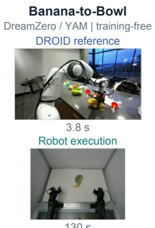

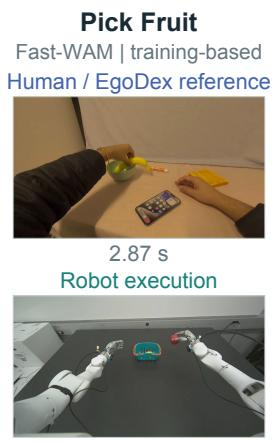  
26.77 s

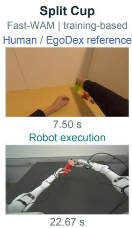  
Figure 6 | Retrieved references and real-robot execution. Each task pairs a retrieved reference (top) with real-robot execution (bottom). References come from DROID for DreamZero/YAM and EgoDex for Fast-WAM. Timestamps are relative to each clip’s start.

## 5.2. Embed2Evolve: Embedding-Guided Context Evolution

Embed2Evolve builds task-local memory and refines how it is used through repeated attempts. This memory and context recipe form a harness; GPT-6 Astra and Robota-Embed remain fixed (Figure 7).

Memory and context search. Completed attempts, successful or failed, add indexed continuations of up to four seconds. Deterministic search varies retrieval ranking and count, refresh cadence, and retained history, prioritizing success before successful-execution eficiency. The selected memory and recipe are frozen for fresh-test initializations (Figure 13; Section D.2). Along PullCubeTool’s R4→R5→R8 path, memory grows from 938 to 1,667 anchors while retained history shrinks from eight to four pairs. The current VLA query retrieves historical RGB, actions, and feedback to guide GPT-6 Astra within an unchanged action interface (Section D.1).

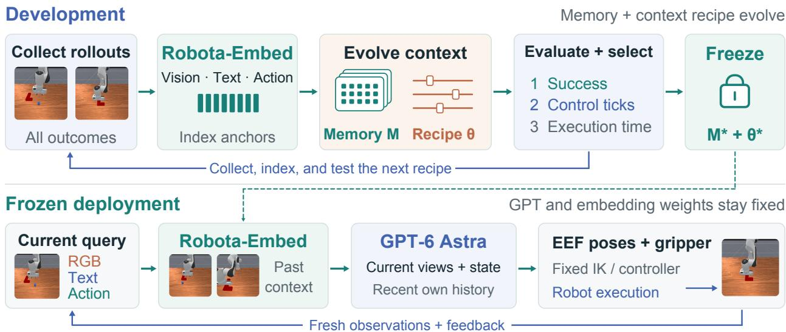  
Figure 7 | Embed2Evolve. Development grows memory and optimizes its use; testing fixes both. GPT-6 Astra proposes actions for a fixed controller. The model comparison replaces Robota-Embed in both phases. Images show the PullCubeTool task.

Evaluation. Five development-selected ManiSkill tasks [36] use 20 fresh matched initializations per condition. GPT-6 Astra Direct (Direct) uses within-episode history; GPT-6 Astra + random history adds a fixed random same-task RGB clip. These conditions use the same policy, current observations, controller, and per-rollout control budgets.

Embedding-model comparison. We replace only Robota-Embed with Omni-Embed-Nemotron-3B [6] and independently repeat evolution. Both conditions share the policy, prompt, initial memory, seeds, proposal and stopping rules, and eight-round cap per task. Both retrieve actions and feedback, but their resulting memory banks and context recipes may difer.

Table 6 | Embed2Evolve in ManiSkill simulation. Success (%) over 20 trials per task and condition; mean policy tokens per test rollout, including failures.

<table><tr><td>Task</td><td>GPT-6 Astra Direct</td><td>GPT-6 Astra + random history</td><td>Evolve + Omni-Embed- Nemotron-3B</td><td>Embed2Evolve</td></tr><tr><td>Poke Cube</td><td>45</td><td>15</td><td>45</td><td>80</td></tr><tr><td>Stack Cube</td><td>10</td><td>20</td><td>20</td><td>60</td></tr><tr><td>Lift Peg Upright</td><td>30</td><td>40</td><td>55</td><td>65</td></tr><tr><td>Pull Cube with Tool</td><td>10</td><td>10</td><td>20</td><td>50</td></tr><tr><td>Two-Robot Stack Cube</td><td>25</td><td>15</td><td>25</td><td>85</td></tr><tr><td>Average (%)</td><td>24.0</td><td>20.0</td><td>33.0</td><td>68.0</td></tr><tr><td>Tokens/rollout (M)</td><td>0.921</td><td></td><td>≈2.531</td><td>0.518</td></tr></table>

The Omni-Embed-Nemotron-3B harness raises success from Direct’s 24% to 33%, while mean policy tokens rise from 0.921M to approximately 2.531M per test rollout (Table 6). Embed2Evolve reaches 68% at 0.518M tokens, improving success on every task while using approximately 79.5% fewer tokens than this independently evolved baseline. Under matched evolution settings, the embedding model afects the resulting harness’s success and token use.

Tool use and dual-arm coordination. Within the same action interface, retrieved continuations may narrow GPT-6 Astra’s efective decision space through task- and stage-specific examples of tool contact, motion direction, and arm coordination. Against Omni-Embed-Nemotron-3B, success rises from 20% to 50% on Pull Cube with Tool and from 25% to 85% on Two-Robot Stack Cube.

Test-time eficiency. Compared with Direct, Embed2Evolve uses 43.7% fewer tokens across all test rollouts and reduces reference API cost by 41.8%, from \$9.9641 to \$5.7980 (Section D.6). Most savings come from inputs. On 19 shared-success pairs, policy decisions fall by 64.1% and observed client execution time by 41.4%. Both reductions average task-wise percentages equally across the five tasks; the mean task-wise Direct-to-Embed2Evolve time ratio is 1.90×. Execution time includes API waits and is afected by actual caller and scheduling diferences (Section D.5); the time savings are observational, not an isolated method speedup. Fewer policy calls need not reduce physical control ticks (Table 31).

## 6. Discussion

Retrieval quality has two levels. Episode recall measures experience identification; clip recall measures continuation localization. Their gap shows that matching a task and embodiment need not identify the execution phase. Same-instruction evaluation and candidate-text masking probe temporal discrimination and target-language use beyond episode identification.

The modalities play complementary roles. Language specifies the task, action supplies motion and phase, and vision localizes the interaction. Action adds information beyond vision and language. However, retraining permits adaptation to remaining inputs, whereas masking perturbs learned fusion. The no-vision retraining/masking gap supports a joint VLA key, not a universal modality ranking. Accordingly, masking characterizes the trained model’s use of each input, not the attainable performance of separately trained unimodal systems.

Retrieved context is useful only through a compatible interface. Random references hurt DreamZero relative to no warm-up (36.0% versus 47.0%), whereas Robota-Embed’s raw retrieval and reranked Embed2ICL reach 50.3% and 56.3%. Fast-WAM gains from retrieved rather than random Context Tokens under fixed policy weights (92.8% versus 88.0%). More context is not inherently better: reference selection, temporal content, and conditioning jointly matter, without isolating each component’s causal contribution.

Memory size and policy context are diferent resources. Embed2Evolve can grow memory while retaining less history and refreshing less often. Independent evolution with Omni-Embed-Nemotron-3B compares discovered memories and harnesses, not a fixed-harness encoder swap. Token and reference-cost metrics cover all test rollouts; decision/time comparisons use shared successes. Fewer policy calls need not mean fewer control ticks or shorter robot motion.

Future work. Future work will extend Robota-Embed to more robot embodiments with diverse kinematics, native action spaces, and control interfaces. We will also explore variable-length retrieval that adapts the temporal extent of recorded continuations to the task and execution stage, rather than using a fixed four-second window. The goal is to retrieve only the duration of experience needed for the current interaction.

## 7. Conclusion

Robota-Embed jointly encodes task intent, visual state, and native action for physical-experience retrieval; action improves retrieval beyond language and vision. This shared space supports Embed2ICL conditioning and Embed2Evolve memory evolution. Under matched settings, Embed2Evolve’s success and eficiency gains show that representation shapes both retrieved context and the harness around a frozen policy.

## References

[1] Generalist Team. Gen-1.5: Embodied foundation models are one-shot learners. Generalist AI Blog, 2026. https://generalistai.com/blog/gen-1.5.

[2] Skild AI. Introducing s1: In-context learning for robotics. August 2026. URL https://skild.ai/blogs/s1.

[3] OpenAI. Gpt-6 astra: A new generation of intelligence. https://openai.com/index/gpt-6-astra/, 2026.

[4] Alec Radford, Jong Wook Kim, Chris Hallacy, Aditya Ramesh, Gabriel Goh, Sandhini Agarwal, Girish Sastry, Amanda Askell, Pamela Mishkin, Jack Clark, et al. Learning transferable visual models from natural language supervision. In International conference on machine learning, pages 8748–8763. PmLR, 2021.

[5] Rohit Girdhar, Alaaeldin El-Nouby, Zhuang Liu, Mannat Singh, Kalyan Vasudev Alwala, Armand Joulin, and Ishan Misra. Imagebind one embedding space to bind them all. In 2023 IEEE/CVF Conference on Computer Vision and Pattern Recognition (CVPR), pages 15180–15190. IEEE, 2023.

[6] Mengyao Xu, Wenfei Zhou, Yauhen Babakhin, Gabriel Moreira, Ronay Ak, Radek Osmulski, Bo Liu, Even Oldridge, and Benedikt Schiferer. Omni-embed-nemotron: A unified multimodal retrieval model for text, image, audio, and video. arXiv preprint arXiv:2510.03458, 2025.

[7] Jaeyong Sung, Ian Lenz, and Ashutosh Saxena. Deep multimodal embedding: Manipulating novel objects with point-clouds, language and trajectories. In 2017 IEEE International Conference on Robotics and Automation (ICRA), pages 2794–2801. IEEE, 2017.

[8] Krishan Rana, Andrew Melnik, and Niko Sünderhauf. Contrastive language, action, and state pre-training for robot learning. arXiv preprint arXiv:2304.10782, 2023.

[9] Seonghyeon Ye, Yunhao Ge, Kaiyuan Zheng, Shenyuan Gao, Sihyun Yu, George Kurian, Suneel Indupuru, You Liang Tan, Chuning Zhu, Jiannan Xiang, et al. World action models are zero-shot policies. arXiv preprint arXiv:2602.15922, 2026.

[10] Tianyuan Yuan, Zibin Dong, Yicheng Liu, and Hang Zhao. Fast-wam: Do world action models need test-time future imagination? arXiv preprint arXiv:2603.16666, 2026.

[11] Daniel Bolya, Po-Yao Huang, Peize Sun, Jang Hyun Cho, Andrea Madotto, Chen Wei, Tengyu Ma, Jiale Zhi, Jathushan Rajasegaran, Hanoona Bangalath, et al. Perception encoder: The best visual embeddings are not at the output of the network. Advances in Neural Information Processing Systems, 38:60884–60937, 2026.

[12] Yi Wang, Kunchang Li, Xinhao Li, Jiashuo Yu, Yinan He, Guo Chen, Baoqi Pei, Rongkun Zheng, Zun Wang, Yansong Shi, et al. Internvideo2: Scaling foundation models for multimodal video understanding. In European conference on computer vision, pages 396–416. Springer, 2024.

[13] Rui Meng, Ziyan Jiang, Ye Liu, Mingyi Su, Xinyi Yang, Yuepeng Fu, Can Qin, Zeyuan Chen, Ran Xu, Caiming Xiong, et al. Vlm2vec-v2: Advancing multimodal embedding for videos, images, and visual documents. arXiv preprint arXiv:2507.04590, 2025.

[14] Junjie Zhou, Ke Mei, Lei Li, Tianyi Wang, Fengyun Rao, and Jing Lyu. Wemm-embedding: Wechat multi-modal embedding technical report. arXiv preprint arXiv:2608.24053, 2026.

[15] Madhuri Shanbhogue, Zhe Li, Shanfeng Zhang, Gustavo Hernández Ábrego, Shih-Cheng Huang, Aashi Jain, Daniel Salz, Sonam Goenka, Chaitra Hegde, Ji Ma, et al. Gemini embedding 2: A native multimodal embedding model from gemini. arXiv preprint arXiv:2605.27295, 2026.

[16] Mingxin Li, Yanzhao Zhang, Dingkun Long, Keqin Chen, Sibo Song, Shuai Bai, Zhibo Yang, Pengjun Xie, An Yang, Dayiheng Liu, et al. Qwen3-vl-embedding and qwen3-vl-reranker: A unified framework for state-of-theart multimodal retrieval and ranking. arXiv preprint arXiv:2601.04720, 2026.

[17] Hyunki Seong, Seongwoo Moon, Hojin Ahn, Jehun Kang, and David Hyunchul Shim. Vla-r: Vision-language action retrieval toward open-world end-to-end autonomous driving. arXiv preprint arXiv:2511.12405, 2025.

[18] Jensen Gao, Dorsa Sadigh, Sandy Huang, and Dhruv Shah. Grounding robot generalization in training data via retrieval-augmented vlms. arXiv preprint arXiv:2603.11426, 2026.

[19] Zillur Rahman, Eddison Pham, Alejandro Daniel Noel, and Cristian Meo. Roser: Few-shot robotic sequence retrieval for scalable robot learning. 2026.

[20] Yichen Zhu, Zhicai Ou, Xiaofeng Mou, and Jian Tang. Retrieval-augmented embodied agents. In 2024 IEEE/CVF Conference on Computer Vision and Pattern Recognition (CVPR), pages 17985–17995. IEEE, 2024.

[21] Kaustubh Sridhar, Souradeep Dutta, Dinesh Jayaraman, and Insup Lee. Regent: A retrieval-augmented generalist agent that can act in-context in new environments. In International Conference on Learning Representations, volume 2025, pages 39385–39414, 2025.

[22] Kaustubh Sridhar, Souradeep Dutta, Dinesh Jayaraman, and Insup Lee. Ricl: Adding in-context adaptability to pre-trained vision-language-action models. arXiv preprint arXiv:2508.02062, 2025.

[23] Fu Chen, Xin Ding, Bingjia Huang, Xiangyu Li, Mingju Wang, Jiawei He, Kun Li, Wei Sun, Yunxin Liu, Hao Wu, et al. Zeva: In-context causal learning for generalizable embodied manipulation. arXiv preprint arXiv:2608.30880, 2026.

[24] Ajay Sridhar, Jennifer Pan, Satvik Sharma, and Chelsea Finn. Scaling up memory for robotic control via experience retrieval. In International Conference on Learning Representations, volume 2026, pages 97142–97166, 2026.

[25] Izat Temiraliev, Diji Yang, and Yi Zhang. Retrieval-augmented robots via retrieve-reason-act. arXiv preprint arXiv:2603.02688, 2026.

[26] Jiaming Zhou, Qihang Zhang, Gangwei Xu, Cunxin Fan, Yujie Zhao, Ruilin Wang, Yiming Luo, Shuai Yang, Xing Zhu, Yujun Shen, et al. Zero-wam: In-context world-action modeling from human videos for open-ended task generalization. arXiv preprint arXiv:2608.26103, 2026.

[27] Guangyan Chen, Meiling Wang, Te Cui, Zichen Zhou, Qi Shao, Shalfun Li, Hang Su, Roy Gan, Hao Wang, Mengyin Fu, et al. Robots acquire manipulation skills in seconds from a single human video. arXiv preprint arXiv:2607.20033, 2026.

[28] Georgios Papagiannis, Norman Di Palo, Pietro Vitiello, and Edward Johns. R+ x: Retrieval and execution from everyday human videos. In 2025 IEEE International Conference on Robotics and Automation (ICRA), pages 8284–8290. IEEE, 2025.

[29] Noah Shinn, Federico Cassano, Ashwin Gopinath, Karthik Narasimhan, and Shunyu Yao. Reflexion: Language agents with verbal reinforcement learning. Advances in neural information processing systems, 36:8634–8652, 2023.

[30] Niket Agarwal, Arslan Ali, Jon Allen, Martin Antolini, Adeline Aubame, Alisson Azzolini, Junjie Bai, Maciej Bala, Yogesh Balaji, Josh Bapst, et al. Cosmos 3: Omnimodal world models for physical ai. arXiv preprint arXiv:2606.02800, 2026.

[31] Ryan Hoque, Peide Huang, David Yoon, Jian Zhang, et al. Egodex: Learning dexterous manipulation from large-scale egocentric video. In International Conference on Learning Representations, volume 2026, pages 4218–4237, 2026.

[32] Alexander Khazatsky, Karl Pertsch, Suraj Nair, Ashwin Balakrishna, Sudeep Dasari, Siddharth Karamcheti, Soroush Nasiriany, Mohan Kumar Srirama, Lawrence Yunliang Chen, Kirsty Ellis, et al. Droid: A large-scale in-the-wild robot manipulation dataset. arXiv preprint arXiv:2403.12945, 2024.

[33] Bo Liu, Yifeng Zhu, Chongkai Gao, Yihao Feng, Qiang Liu, Yuke Zhu, and Peter Stone. Libero: Benchmarking knowledge transfer for lifelong robot learning. Advances in Neural Information Processing Systems, 36:44776–44791, 2023.

[34] Kun Wu, Chengkai Hou, Jiaming Liu, Zhengping Che, Xiaozhu Ju, Zhuqin Yang, Meng Li, Yinuo Zhao, Zhiyuan Xu, Guang Yang, et al. Robomind: Benchmark on multi-embodiment intelligence normative data for robot manipulation. arXiv preprint arXiv:2412.13877, 2024.

[35] Dantong Niu, Zhuoyang Liu, Zekai Wang, Boning Shao, Zhao-Heng Yin, Anirudh Pai, Yuvan Sharma, Stefano Saravalle, Ruijie Zheng, Jing Wang, et al. T-rex: Tactile-reactive dexterous manipulation. arXiv preprint arXiv:2606.17055, 2026.

[36] Stone Tao, Fanbo Xiang, Arth Shukla, Yuzhe Qin, Xander Hinrichsen, Xiaodi Yuan, Chen Bao, Xinsong Lin, Yulin Liu, Tse-Kai Chan, et al. Maniskill3: Gpu parallelized robot simulation and rendering for generalizable embodied ai. In 7th Robot Learning Workshop: Towards Robots with Human-Level Abilities, 2025.

[37] Nicolas Carion, Laura Gustafson, Yuan-Ting Hu, Shoubhik Debnath, Ronghang Hu, Didac Suris Coll-Vinent, Chaitanya Ryali, Kalyan Vasudev Alwala, Haitham Khedr, Andrew Huang, et al. Sam 3: Segment anything with concepts. In International conference on learning representations, volume 2026, pages 138846–138923, 2026.

[38] Shuai Bai, Yuxuan Cai, Ruizhe Chen, Keqin Chen, Xionghui Chen, Zesen Cheng, Lianghao Deng, Wei Ding, Chang Gao, Chunjiang Ge, et al. Qwen3-vl technical report. arXiv preprint arXiv:2511.21631, 2025.

[39] Lin Li, Qihang Zhang, Yiming Luo, Shuai Yang, Ruilin Wang, Fei Han, Mingrui Yu, Zelin Gao, Nan Xue, Xing Zhu, et al. Causal world modeling for robot control. arXiv preprint arXiv:2601.21998, 2026.

## Appendix

## A. Robota-Embed Method Details

## A.1. Architecture and Optimization

Paired inputs. Queries use instructions, synchronized current actions, and SAM3 [37] interaction crops. Targets pair instructions with 16 frames and native-rate actions from strictly future four-second windows. We favor less-occluded third-person views; EgoDex is egocentric.

Shared backbone and endpoint adapters. Robota-Embed uses Cosmos3-Edge 4B, with 28 Transformer layers and hidden width 2,048. The Transformer, shared retrieval head, endpoint adapters, and temperature are initialized from its pretrained checkpoint. Query and target share the Transformer, video tokenizer, and embedding projection head. Separate bias-free residual linear adapters specialize the current-state and future-clip endpoints. Each source retains its native action projector, trained jointly with the Transformer. For endpoint $r \in \{ q , k \}$ , let $H ^ { r } \in \mathbb { R } ^ { T _ { r } \times 2 0 4 8 }$ denote the multimodally fused hidden states at native action-token positions, after the generation RMSNorm following layer 28. These states jointly encode the endpoint’s language, vision, and action. Let $g _ { r }$ denote the endpoint readout, comprising the shared LayerNorm and projection $W \in \mathbb { R } ^ { 1 0 2 4 \times 2 0 4 8 }$ together with the endpoint-specific residual adapter. Temporal pooling and normalization give

$$
\bar { h } ^ { r } = \frac { 1 } { T _ { r } } \sum _ { t = 1 } ^ { T _ { r } } H _ { t } ^ { r } , \qquad z ^ { r } = \frac { g _ { r } ( \bar { h } ^ { r } ) } { \| g _ { r } ( \bar { h } ^ { r } ) \| _ { 2 } } .\tag{3}
$$

The shared projection is bias-free. Benchmark retrieval uses cosine similarity; only training-free Embed2ICL reranks. Temporal pooling of the target states, shared projection, and per-token normalization yield Em bed2ICL’s cached Context Tokens (Section C.4).

Native actions. Table 7 specifies the native action interfaces. For each source, we compute per-coordinate quantiles $q _ { 0 1 }$ and �99 using its training partition and normalize actions as

$$
\hat { a } = 2 \frac { a - q _ { 0 1 } } { \operatorname* { m a x } ( q _ { 9 9 } - q _ { 0 1 } , 1 0 ^ { - 8 } ) } - 1 .\tag{4}
$$

Values remain unclipped, and zero-padding to 64 dimensions standardizes tensor shape. The source identifier selects the native projector; future actions retain their native sampling rate.

Table 7 | Native action interfaces. Dimensions and rates describe native actions before normalization and padding. Domain IDs route actions to their Cosmos3-Edge projectors.
<table><tr><td>Source</td><td>Domain ID</td><td>Action dimensions</td><td>Rate (Hz)</td></tr><tr><td>EgoDex</td><td>3</td><td>57</td><td>30</td></tr><tr><td>DROID</td><td>8</td><td>10</td><td>15</td></tr><tr><td>LIBERO</td><td>5</td><td>10</td><td>10</td></tr><tr><td>RoboMIND-Franka-dual</td><td>12</td><td>20</td><td>10</td></tr></table>

Optimization. We use AdamW with $\beta = ( 0 . 9 , 0 . 9 5 )$ and gradient clipping at 1.0. The Transformer learning rate is $3 \times 1 0 ^ { - 7 }$ , and the projection head and endpoint adapters use $1 0 ^ { - 4 } .$ . Training runs for 26,275 optimizer steps, with 1,314 steps of linear warm-up followed by cosine decay, global batch size 512, and equal sampling of EgoDex, DROID, LIBERO, and RoboMIND–Franka-dual (1:1:1:1). The optimizer and scheduler are reinitialized for retrieval training. Both parameter groups use weight decay 0.05; the video VAE is frozen. We use the final-step checkpoint (26,275).

## A.2. Robota-Embed Objective

The objective (Eq. 2) combines predictive retrieval alignment, multimodal grounding and discrimination, and representation regularization. Table 8 lists term coeficients and ranking margins.

Table 8 | Robota-Embed training objective. Loss coeficients and ranking margins for each term, organized into the three objective groups in Eq. 2.
<table><tr><td>Objective</td><td>Constraint or positive relation</td><td>Weight</td><td>Margin</td></tr><tr><td colspan="4">Predictive retrieval alignment</td></tr><tr><td>Clip-level retrieval</td><td>Exact future-clip identity; bidirectional InfoNCE</td><td>1.00</td><td></td></tr><tr><td colspan="4">Multimodal grounding and discrimination</td></tr><tr><td>Text auxiliary</td><td>Text-only query; matched task</td><td>0.15</td><td></td></tr><tr><td>Image auxiliary</td><td>Image-only query; matched interaction object</td><td>0.20</td><td></td></tr><tr><td>Action auxiliary</td><td>Disabled; future identity uses multimodal context</td><td>0.00</td><td></td></tr><tr><td>Text swap</td><td>Replacing query text must reduce similarity</td><td>0.25</td><td>0.08</td></tr><tr><td>Image swap</td><td>Replacing the query zoom must reduce similarity</td><td>0.35</td><td>0.10</td></tr><tr><td>Action swap</td><td>Replacing current action must reduce similarity</td><td>0.20</td><td>0.06</td></tr><tr><td>Hard task</td><td>Same object roles; operation/relation/direction conflict</td><td>0.25</td><td>0.08</td></tr><tr><td>Hard object</td><td>Same task relation; interaction-object category conflict</td><td>0.35</td><td>0.10</td></tr><tr><td>Hard action</td><td>Same task/objects; action-primitive/phase conflict</td><td>0.20</td><td>0.06</td></tr><tr><td>Fused dominance</td><td>Fused query must outperform every unimodal query</td><td>0.20</td><td>0.02</td></tr><tr><td colspan="4">Representation regularization</td></tr><tr><td>Isotropy</td><td>Variance, participation-ratio rank, and centering</td><td>0.05</td><td></td></tr><tr><td>Query center</td><td>Direct query-centering penalty</td><td>0.10</td><td></td></tr><tr><td>Target center</td><td>Direct target-centering penalty</td><td>0.10</td><td></td></tr></table>

Positive, negative, and ignored pairs. Positive pairs share the exact future-clip ID. For query $q _ { i } , k _ { i }$ is the paired positive $( k ^ { + }$ in Figure 2). Each pair links a current state to its recorded future clip within the same source. Let $s ( q , k )$ be cosine similarity and $\mathcal { N } ( i )$ contain only candidates with a diferent clip ID and an explicit semantic conflict. The query-to-target term is

$$
\mathcal { L } _ { q \to k } = - \frac { 1 } { | \mathcal { B } | } \sum _ { i \in \mathcal { B } } \log \frac { \exp ( s ( q _ { i } , k _ { i } ) / \tau ) } { \exp ( s ( q _ { i } , k _ { i } ) / \tau ) + \sum _ { j \in N ( i ) } \exp ( s ( q _ { i } , k _ { j } ) / \tau ) } .\tag{5}
$$

We independently build the reverse validity mask and average the directions: $\begin{array} { r } { \mathcal { L } _ { \mathrm { a l i g n } } = \frac { 1 } { 2 } ( \mathcal { L } _ { q  k } + \mathcal { L } _ { k  q } ) } \end{array}$ . The global pool contains 512 entries before masking; each denominator retains only the positive and valid negatives. We optimize the inherited Cosmos3-Edge temperature � within [0.01, 0.2].

Semantic conflict rules. We generate weak labels through structured parsing and deterministic rules. Qwen3-VL-8B-Instruct [38] parses task instructions into operation names and object roles using non-sampling decoding. From this output, we construct signatures for task relations, object identities, and object categories. The resulting labels are rule-driven weak supervision, not human annotations. Before similarity-based mining, we determine eligibility for $\mathcal { N } ( i )$ using four pairwise conflicts: Task conflict preserves object roles but changes the operation, relation, or direction. Object conflict preserves the task relation but changes a valid interaction-object category. Action conflict shares task and objects but difers in the current-action primitive or future-action phase. Joint conflict changes both task and objects.

For same-episode action negatives, future windows with temporal intersection-over-union greater than 0.25 are treated as near-duplicates and excluded. Cross-episode action negatives must additionally difer in future gripper phase. These checks filter the action-conflict class; semantically compatible, uncertain, or potentially duplicate candidates are masked out of the negative set. A diferent clip ID alone is therefore insuficient to make a pair negative.

Current-action primitives are obtained by scale-standardizing the domain-normalized action and discretizing each coordinate at thresholds −0.5 and +0.5. Future-action phase combines the dominant motion direction, the timing of peak motion, and changes in gripper state. To compare future actions, we sample 16 time points and concatenate the per-coordinate means, standard deviations, and first-to-last diferences. We compare these descriptors using scale-normalized RMS distances.

Auxiliary alignment. Text-only and image-only auxiliary queries align with targets sharing task and interaction-object identity, respectively. We disable standalone action-only alignment to exact future clips:

a single current action does not uniquely determine a future trajectory. Action remains an input to fused retrieval alignment, with action swaps discouraging the model from ignoring it.

Modality comparisons. Each swapped query replaces exactly one modality while keeping its paired target fixed. Text donors share object identity but difer in task relation; image donors share the task relation but difer in valid object category. Action donors share the action domain, task, and object identity, but difer in both current-action primitive and future-action phase. The standardized RMS distances between their current actions and between their future descriptors must each be at least 0.75. These donor conditions are stricter than the action-conflict eligibility rules.

Let $q ^ { \prime }$ encode a valid swapped query. We use the cosine hinge loss

$$
\ell _ { \mathrm { s w a p } } ( q , q ^ { \prime } , k ^ { + } ) = \operatorname* { m a x } \left\{ 0 , m - s ( q , k ^ { + } ) + s ( q ^ { \prime } , k ^ { + } ) \right\} ,\tag{6}
$$

with $m = 0 . 0 8$ (text), 0.10 (image), and 0.06 (action). We skip only the corresponding swap loss when no valid donor exists. A 0.02 margin favors the fused query over each unimodal query.

Hard-negative constraints. The contrastive denominator uses all valid negatives. For the hard-task, hardobject, and hard-action terms, we select the highest-similarity candidate from the corresponding nonempty conflict class � after validity masking: $\begin{array} { r } { j _ { c } ^ { * } ( i ) = \arg \operatorname* { m a x } _ { j \in \mathcal { N } _ { c } ( i ) } s ( q _ { i } , k _ { j } ) } \end{array}$ . Their margins are 0.08, 0.10, and 0.06, respectively. Conditional hinge losses are averaged over valid samples within each rank, then averaged across ranks.

Representation regularization. We encourage near-zero batch centers, a per-dimension standard-deviation floor near 0.02, and participation-ratio efective ranks of at least 16 for query batches and 18 for target batches. Center losses weighted at 0.10 per side reinforce isotropy-based centering.

## A.3. Training Data and Curation

Our training dataset contains 1,695,684 filtered anchor-level examples from EgoDex [31], DROID [32], LIBERO [33], and RoboMIND–Franka-dual [34]. Table 9 gives the source composition. EgoDex contributes tracked human hand and body pose trajectories, encoded by its source-specific native-action projector. Before constructing dense anchors, we assign complete episodes, sessions, and content identities to disjoint training, validation, and original test partitions.

Table 9 | Training-data composition. Filtered anchor-level training examples by source.
<table><tr><td>Source domain</td><td>Training rows</td></tr><tr><td>EgoDex [31]</td><td>1,345,160</td></tr><tr><td>DROID [32]</td><td>26,563</td></tr><tr><td>LIBERO [33]</td><td>136,671</td></tr><tr><td>RoboMIND-Franka-dual [34]</td><td>187,290</td></tr><tr><td>Total</td><td>1,695,684</td></tr></table>

Anchor enumeration and object localization. For a source sequence with � frames, let � be a frame index and ℎ the future horizon in frames. We enumerate dense anchors satisfying $a + h + 1 < N$ . We prompt SAM3 with phrases naming the instruction’s physical interaction objects, using a proposal threshold of 0.35. We retain detections with a final score of at least 0.40 that cover at least 0.08% of the source image, and permit a zoom ratio of at least 1.10. We independently recompute each accepted crop at $3 2 0 \times 1 9 2$

Visual quality gate. Qwen3-VL-8B-Instruct [38] verifies each crop deterministically. A crop passes only if the model confirms with high confidence that the interaction object is visible, matches the instruction, is separable from other instances, and is unoccluded. If verification fails, we resample an earlier neighboring timestamp, updating the image, synchronized action, and temporal anchor together. Selection uses only the instruction and current observations.

Future target construction. We pair each accepted anchor with the strictly future four-second action sequence and 16 video frames from that interval. The window starts after the accepted timestamp, including when resampling selects an earlier one. Figure 3 shows the pipeline.

## B. Robota-Embed-Bench Evaluation and Diagnostics

## B.1. Robota-Embed-Bench: Composition and Evaluation

EgoDex, DROID, LIBERO, and RoboMIND–Franka-dual each contribute 1,000 held-out queries from 800 unique episodes. The shared 8,000-item gallery contains 2,000 candidates per source: 1,000 paired future clips and 1,000 nearby same-episode clips. Nearby clips often share the positive’s instruction, objects, and visual content, requiring precise temporal localization.

The four sources contain 591, 800, 39, and 5 distinct task-instruction strings, respectively, covering human experience, simulation, and single- and dual-arm robots. DROID and LIBERO also support the downstream ICL studies, evaluated separately from retrieval.

Clip-level retrieval assigns one positive to each query: its uniquely paired future four-second window. Episode-level retrieval treats any indexed window from the same source-scoped episode as relevant. Episodelevel metrics average query outcomes within each episode, then equally over the 800 episodes per source and the four sources, giving each episode equal weight regardless of its query count. In total, the benchmark contains 4,000 queries and 3,200 episodes. Training, validation, and original test partitions are separated by complete episode, session, and content identity before dense anchoring. Benchmark episodes are excluded from training; task, object, and embodiment categories may overlap across partitions. Every target is strictly later than its paired query anchor. Ranking uses cosine similarity on L2-normalized embeddings, without reranking. We evaluate the final Robota-Embed checkpoint at training step 26,275, the last step of retrieval training.

Baseline input interfaces. Robota-Embed queries combine instruction, a SAM3 object zoom, and synchronized action; gallery entries combine instruction, future video, and future action. Omni-Embed-Nemotron-3B and Qwen3-VL-Embedding-2B use instruction and the uncropped current frame as the query, and instruction and the 16-frame future clip as the candidate. CLIP, Perception Encoder, and InternVideo2 use the instruction to retrieve the future video clip. Gemini Embedding 2 and VLM2Vec-V2 likewise use instruction plus the original, uncropped current image as the query, without action input, and instruction plus the future four-second video as the gallery entry. For Gemini Embedding 2, we upload a video assembled from 16 frames and obtain normalized 768-dimensional vectors. VLM2Vec-V2 receives the 16 frames directly and uses last-token pooling followed by L2 normalization, producing 1,536-dimensional vectors. Both are evaluated on all 4,000 queries and 8,000 gallery entries. The released WeMM-Embedding-2B model is evaluated zero-shot with instruction and the uncropped current frame as the query, instruction and the 16-frame future clip as the candidate, and L2-normalized 2,048-dimensional outputs. Each external baseline is evaluated through its supported input interface. The controlled DROID study isolates modality choices with matched training data, backbone architecture, and optimization budget.

Frozen Cosmos3-Edge feature baseline. The frozen Cosmos3-Edge control uses the same query and target fields and native action projectors as Robota-Embed. We extract dense action-token features after the final RMSNorm of layer 28, before the action-output projection. Temporal averaging and L2 normalization produce a 2,048-dimensional VLA-conditioned backbone readout.

## B.2. Per-Domain Results

Tables 10 and 11 report retrieval on the shared 8,000-item gallery. Recall and MRR are percentages; lower ranks are better. Average weights sources equally. Episode-level metrics first average within episodes, then over 800 episodes per source.

For Robota-Embed, EgoDex episode-level R@1 reaches 87.06%, while clip-level R@1 is 36.70%; the corresponding DROID scores are 99.88% and 74.10%. The larger gap on EgoDex shows that identifying the episode often leaves the paired window unresolved, as in the near-miss in Figure 4. VLM2Vec-V2 and WeMM-Embedding-2B both perform best on DROID and EgoDex, with markedly lower recall on LIBERO and RoboMIND-FD.

Table 10 | Robota-Embed retrieval by source. Recall and MRR are percentages; lower mean ranks are better. Overall median ranks are 2 for clip retrieval and 1 for episode retrieval.
<table><tr><td>Domain</td><td>R@1</td><td>R@5</td><td>R@10</td><td>MRR</td><td>Median rank</td><td>Mean rank</td></tr><tr><td colspan="7">Clip-level retrieval</td></tr><tr><td>EgoDex</td><td>36.70</td><td>96.60</td><td>99.30</td><td>62.22</td><td>2</td><td>2.68</td></tr><tr><td>DROID</td><td>74.10</td><td>99.00</td><td>100.00</td><td>85.27</td><td>1</td><td>1.41</td></tr><tr><td>LIBERO</td><td>38.50</td><td>87.00</td><td>96.60</td><td>60.33</td><td>2</td><td>2.92</td></tr><tr><td>RoboMIND-FD</td><td>40.00</td><td>85.00</td><td>91.90</td><td>60.39</td><td>2</td><td>3.87</td></tr><tr><td>Average</td><td>47.33</td><td>91.90</td><td>96.95</td><td>67.05</td><td></td><td>2.72</td></tr><tr><td colspan="7">Episode-level retrieval</td></tr><tr><td>EgoDex</td><td>87.06</td><td>98.94</td><td>99.44</td><td>90.98</td><td>1</td><td>1.54</td></tr><tr><td>DROID</td><td>99.88</td><td>100.00</td><td>100.00</td><td>99.94</td><td>1</td><td>1.00</td></tr><tr><td>LIBERO</td><td>67.62</td><td>91.81</td><td>98.19</td><td>77.42</td><td>1</td><td>2.17</td></tr><tr><td>RoboMIND-FD</td><td>72.50</td><td>88.88</td><td>94.62</td><td>79.50</td><td>1</td><td>2.80</td></tr><tr><td>Average</td><td>81.77</td><td>94.91</td><td>98.06</td><td>86.96</td><td></td><td>1.88</td></tr></table>

Table 11 | Action-free VL baselines by source. Recall and MRR are percentages on the shared gallery. Average weights sources equally; episode-level metrics first average within each episode.
<table><tr><td></td><td colspan="4">Clip-level</td><td colspan="4">Episode-level</td></tr><tr><td>Domain</td><td>R@1</td><td>R@5</td><td>R@10</td><td>MRR</td><td>R@1</td><td>R@5</td><td>R@10</td><td>MRR</td></tr><tr><td colspan="9">VLM2Vec-V2</td></tr><tr><td>EgoDex</td><td>32.40</td><td>92.00</td><td>99.20</td><td>56.90</td><td>78.13</td><td>97.81</td><td>99.88</td><td>86.04</td></tr><tr><td>DROID</td><td>58.70</td><td>97.80</td><td>99.90</td><td>75.15</td><td>99.19</td><td>100.00</td><td>100.00</td><td>99.51</td></tr><tr><td>LIBERO</td><td>4.70</td><td>16.20</td><td>28.10</td><td>12.68</td><td>10.75</td><td>30.44</td><td>46.25</td><td>22.01</td></tr><tr><td>RoboMIND-FD</td><td>0.40</td><td>1.40</td><td>3.00</td><td>1.96</td><td>1.19</td><td>3.94</td><td>6.94</td><td>3.95</td></tr><tr><td>Average</td><td>24.05</td><td>51.85</td><td>57.55</td><td>36.67</td><td>47.31</td><td>58.05</td><td>63.27</td><td>52.88</td></tr><tr><td colspan="9">WeMM-Embedding-2B</td></tr><tr><td>EgoDex</td><td>30.80</td><td>90.20</td><td>98.50</td><td>54.54</td><td>70.31</td><td>96.25</td><td>99.63</td><td>80.22</td></tr><tr><td>DROID</td><td>61.10</td><td>98.40</td><td>100.00</td><td>77.18</td><td>99.69</td><td>100.00</td><td>100.00</td><td>99.84</td></tr><tr><td>LIBERO</td><td>4.30</td><td>18.30</td><td>30.30</td><td>13.31</td><td>9.00</td><td>28.56</td><td>44.31</td><td>20.05</td></tr><tr><td>RoboMIND-FD</td><td>0.30</td><td>1.70</td><td>3.80</td><td>2.09</td><td>1.25</td><td>4.44</td><td>8.75</td><td>4.20</td></tr><tr><td>Average</td><td>24.13</td><td>52.15</td><td>58.15</td><td>36.78</td><td>45.06</td><td>57.31</td><td>63.17</td><td>51.08</td></tr></table>

## B.3. Candidate Language and Gallery Controls

Two evaluation-time controls on Robota-Embed-Bench test reliance on candidate language and discrimination among clips with the same instruction. Queries and targets come from held-out episodes excluded from training, but retain within-episode visual continuity.

Both controls use the same fixed Robota-Embed model. Candidate text masking replaces each gallery instruction with an empty prompt before multimodal fusion, then recomputes embeddings while preserving candidate video and action. Same-instruction gallery restricts each query to candidates with the same instruction, testing within-instruction ranking. The original protocol and candidate-text masking both retain the full shared 8,000-item cross-source gallery.

Table 12 | Aggregate benchmark-validity controls. Candidate-text masking and same-instruction retrieval use a fixed model. Recall and MRR (%) are averaged equally across four sources.
<table><tr><td></td><td colspan="4">Clip-level</td><td colspan="4">Episode-level</td></tr><tr><td>Setting</td><td>R@1</td><td>R@5</td><td>R@10</td><td>MRR</td><td>R@1</td><td>R@5</td><td>R@10</td><td>MRR</td></tr><tr><td>Original</td><td>47.33</td><td>91.90</td><td>96.95</td><td>67.05</td><td>81.77</td><td>94.91</td><td>98.06</td><td>86.96</td></tr><tr><td>Candidate text masked</td><td>12.78</td><td>33.65</td><td>43.10</td><td>23.06</td><td>23.17</td><td>36.83</td><td>46.69</td><td>30.32</td></tr><tr><td>Same-instruction gallery</td><td>47.62</td><td>92.45</td><td>97.25</td><td>67.46</td><td>82.53</td><td>95.23</td><td>98.20</td><td>87.55</td></tr></table>

Candidate text masking lowers clip-level R@1 from 47.33% to 12.78% and episode-level R@1 from 81.77% to 23.17%. The model relies on candidate language for current-to-future alignment: masked and original candidate embeddings have a mean cosine similarity of 0.506.

Restricting the gallery to the same instruction yields 47.62% clip-level R@1, approximately 0.3 percentage points above the original protocol after removing diferent-instruction distractors. The retained candidates share the instruction, so ranking them depends on their visual and action content. Nearby same-episode distractors further require precise localization of the paired future clip.

Table 13 | Same-instruction gallery dificulty. Candidate counts and clip-level recall (%) within query-specific galleries. Random recall uses the same restricted candidates. The final row averages source means and recalls equally; its candidate median is the cross-source aggregate. RoboMIND-FD denotes RoboMIND–Franka-dual.
<table><tr><td>Domain</td><td colspan="2">Candidates</td><td colspan="2">R@1</td><td colspan="2">R@5</td></tr><tr><td></td><td>Mean</td><td>Median</td><td>Model</td><td>Random</td><td>Model</td><td>Random</td></tr><tr><td>EgoDex</td><td>4.06</td><td>4</td><td>37.60</td><td>29.76</td><td>98.40</td><td>95.09</td></tr><tr><td>DROID</td><td>2.71</td><td>2</td><td>74.20</td><td>54.64</td><td>99.20</td><td>97.46</td></tr><tr><td>LIBERO</td><td>54.51</td><td>50</td><td>38.60</td><td>1.90</td><td>87.00</td><td>9.50</td></tr><tr><td>RoboMIND-FD</td><td>473.59</td><td>342</td><td>40.10</td><td>0.24</td><td>85.20</td><td>1.19</td></tr><tr><td>All domains</td><td>133.72</td><td>25</td><td>47.62</td><td>21.63</td><td>92.45</td><td>50.81</td></tr></table>

Same-instruction pools are small in EgoDex and DROID, so R@5 approaches saturation. LIBERO and RoboMIND-FD have larger pools, averaging 54.51 and 473.59 candidates. Their R@1 scores of 38.60% and 40.10% exceed the corresponding random rates of 1.90% and 0.24%.

Table 14 | Benchmark-validity controls by source. Recall and MRR are percentages. Candidate-text masking preserves video and action; same-instruction retrieval restricts each query’s gallery. Original-protocol results are in Table 10. Episode-level metrics use the within-episode and per-source reducer from Section 3.3.
<table><tr><td></td><td colspan="4">Clip-level</td><td colspan="4">Episode-level</td></tr><tr><td>Domain</td><td>R@1</td><td>R@5</td><td>R@10</td><td>MRR</td><td>R@1</td><td>R@5</td><td>R@10</td><td>MRR</td></tr><tr><td colspan="9">Candidate text masked</td></tr><tr><td>EgoDex</td><td>4.00</td><td>14.30</td><td>21.40</td><td>9.73</td><td>9.00</td><td>16.81</td><td>24.75</td><td>13.62</td></tr><tr><td>DROID</td><td>4.40</td><td>13.30</td><td>21.20</td><td>9.69</td><td>6.50</td><td>16.81</td><td>25.25</td><td>12.57</td></tr><tr><td>LIBERO</td><td>13.40</td><td>36.40</td><td>49.30</td><td>25.03</td><td>23.19</td><td>39.56</td><td>53.87</td><td>32.09</td></tr><tr><td>RoboMIND-FD</td><td>29.30</td><td>70.60</td><td>80.50</td><td>47.77</td><td>54.00</td><td>74.12</td><td>82.88</td><td>63.01</td></tr><tr><td colspan="9">Same-instruction gallery</td></tr><tr><td>EgoDex</td><td>37.60</td><td>98.40</td><td>100.00</td><td>63.59</td><td>89.69</td><td>100.00</td><td>100.00</td><td>92.99</td></tr><tr><td>DROID</td><td>74.20</td><td>99.20</td><td>100.00</td><td>85.34</td><td>100.00</td><td>100.00</td><td>100.00</td><td>100.00</td></tr><tr><td>LIBERO</td><td>38.60</td><td>87.00</td><td>96.80</td><td>60.41</td><td>67.69</td><td>91.81</td><td>98.19</td><td>77.47</td></tr><tr><td>RoboMIND-FD</td><td>40.10</td><td>85.20</td><td>92.20</td><td>60.51</td><td>72.75</td><td>89.12</td><td>94.62</td><td>79.73</td></tr></table>

## B.4. Controlled Robota-Embed Ablations

Retraining tests how well each input set supports retrieval; query masking tests a fixed model’s reliance on its inputs. Retraining uses matched DROID splits and budgets, with clip-level metrics (%). Tables 15 and 20 report four-source averages for frozen-feature adaptation and final-model masking.

## B.4.1. Retrieval Adaptation

Table 15 | Retrieval adaptation. Four-source average retrieval (%) on the shared Robota-Embed-Bench gallery. The frozen readout and Robota-Embed use the same VLA query/target fields.
<table><tr><td>Setting</td><td>Clip R@1</td><td>Episode R@1</td></tr><tr><td>Cosmos3-Edge 4B (frozen readout)</td><td>0.65</td><td>1.17</td></tr><tr><td>Robota-Embed</td><td>47.33</td><td>81.77</td></tr></table>

Frozen Cosmos3-Edge features provide 0.65% clip-level R@1 and 1.17% episode-level R@1. Retrieval training raises these scores to 47.33% and 81.77%, respectively. The pretrained features contain all three modalities, but retrieval training is needed to compare present states with recorded continuations efectively.

## B.4.2. Trainable Scope

Table 16 | Trainable scope. Clip-level retrieval on the controlled DROID split (%). Both rows use a learned retrieval head; the second also updates the backbone.
<table><tr><td>Trainable scope</td><td>R@1</td><td>MRR</td></tr><tr><td>Head only</td><td>13.8</td><td>24.00</td></tr><tr><td>Backbone + head</td><td>78.7</td><td>88.00</td></tr></table>

Training a retrieval head over the frozen backbone reaches 13.8% R@1, whereas training the backbone and head reaches 78.7%. Under matched DROID training, adapting the shared representation is much more efective than learning a readout from fixed features.

## B.4.3. Objective Groups

Table 17 | Objective groups. Clip-level retrieval on the controlled DROID split (%). Each row adds an objective group from Equation 2.
<table><tr><td>Objective (Eq. 2)</td><td>R@1</td><td>MRR</td></tr><tr><td> $\mathcal { L } _ { \mathrm { a l i g n } }$ </td><td>75.6</td><td>86.20</td></tr><tr><td> $\mathcal { L } _ { \mathrm { a l i g n } } + \mathcal { L } _ { \mathrm { r e g } }$ </td><td>77.0</td><td>87.10</td></tr><tr><td> $\mathcal { L } _ { \mathrm { a l i g n } } + \mathcal { L } _ { \mathrm { g r o u n d } } + \mathcal { L } _ { \mathrm { r e g } }$ </td><td>78.7</td><td>88.00</td></tr></table>

Predictive retrieval alignment alone reaches 75.6% R@1. Adding representation regularization raises R@1 to 77.0%, and adding multimodal grounding and discrimination reaches 78.7%. R@10 is 100.0% throughout these three runs. Predictive alignment already places the correct clip near the top; the added objective groups improve its rank among those closest candidates.

## B.4.4. Visual Input

Table 18 | Visual input. Clip-level retrieval on the controlled DROID split (%). All rows are retrained for their stated visual interface.
<table><tr><td>Visual input</td><td>R@1</td><td>MRR</td></tr><tr><td>w/o vision (retrained)</td><td>76.8</td><td>86.69</td></tr><tr><td>Full frame</td><td>77.9</td><td>87.40</td></tr><tr><td>SAM3 object zoom</td><td>78.7</td><td>88.00</td></tr></table>

The no-vision, full-frame, and SAM3 object-zoom settings reach 76.8%, 77.9%, and 78.7% R@1, respectively. Their MRR values are 86.69%, 87.40%, and 88.00%. SAM3 object zoom gives the highest R@1 and MRR among these matched DROID retrieval variants, with a modest 0.8-point R@1 gain over the full frame. Cropping to the interaction region gives a small improvement in clip localization.

## B.4.5. Training-Time Modalities

Table 19 | Training-time modalities. Matched DROID retraining after removing one modality (%). $\mathrm { V } / \mathrm { L } / \mathrm { A }$ denote vision, language, and action.
<table><tr><td>Setting</td><td>Input</td><td>Clip R@1</td><td>∆ clip R@1</td></tr><tr><td>Full VLA</td><td>VLA</td><td>78.7</td><td></td></tr><tr><td>No action</td><td>VL</td><td>59.8</td><td>-18.9</td></tr><tr><td>No vision</td><td>LA</td><td>76.8</td><td>-1.9</td></tr><tr><td>No language</td><td>VA</td><td>20.2</td><td>-58.5</td></tr></table>

Removing action lowers R@1 from 78.7% to 59.8%, a drop of 18.9 percentage points. Removing language has the largest efect, while retraining without vision lowers R@1 by 1.9 points. Native action supplies retrieval signal beyond vision and language in this controlled DROID study.

## B.4.6. Inference-Time Modality Availability

Table 20 | Inference-time modality availability. Four-source average retrieval (%) with the final checkpoint and gallery fixed. Only the query inputs are changed. $\mathrm { V } / \mathrm { L } / \mathrm { A }$ denote vision/language/action; Δ gives the percentage-point change in clip-level R@1 from Full VLA.
<table><tr><td>Query input</td><td>Clip R@1</td><td>Episode R@1</td><td>∆ clip R@1</td></tr><tr><td>Full VLA</td><td>47.33</td><td>81.77</td><td></td></tr><tr><td>VL (no action)</td><td>20.08</td><td>37.36</td><td>-27.25</td></tr><tr><td>LA (no vision)</td><td>23.00</td><td>39.50</td><td>-24.33</td></tr><tr><td>VA (no language)</td><td>7.13</td><td>14.73</td><td>-40.20</td></tr><tr><td>L (text only)</td><td>16.23</td><td>31.09</td><td>-31.10</td></tr><tr><td>V (image only)</td><td>1.68</td><td>3.66</td><td>-45.65</td></tr><tr><td>A (action only)</td><td>0.53</td><td>1.58</td><td>-46.80</td></tr></table>

Withholding query action, image, or text lowers clip-level R@1 by 27.25, 24.33, or 40.20 percentage points, respectively. Full VLA ranks highest at both clip and episode levels. The final model uses all three query modalities; the drops also reflect the input distribution shift caused by masking. Text alone reaches 16.23% clip-level R@1; image-only and action-only queries yield 1.68% and 0.53%. No single query modality reproduces the fused VLA representation under this fixed-model protocol.

## B.5. Controlled DROID Query Masking

We mask inputs to the fixed DROID Full VLA model and compare its response with the retrained variants in Table 19. This test uses the controlled DROID checkpoint and split, whereas Table 20 uses the final checkpoint across four sources.

Table 21 | DROID query-only masking. Clip-level recall and MRR (%) with the model and gallery embeddings fixed. Δ R@1 gives the percentage-point change from the full VLA query.
<table><tr><td>Query setting</td><td>Input</td><td>R@1</td><td>R@5</td><td>R@10</td><td>MRR</td><td>∆ R@1</td></tr><tr><td>Full query</td><td>VLA</td><td>78.7</td><td>99.4</td><td>100.0</td><td>88.00</td><td>0.0</td></tr><tr><td>Action masked</td><td>VL</td><td>50.7</td><td>90.3</td><td>94.9</td><td>67.60</td><td>-28.0</td></tr><tr><td>Image masked</td><td>LA</td><td>60.9</td><td>91.8</td><td>96.1</td><td>74.17</td><td>-17.8</td></tr><tr><td>Text masked</td><td>VA</td><td>1.9</td><td>7.2</td><td>12.0</td><td>5.41</td><td>-76.8</td></tr></table>

Conclusion. Masking action, image, or text lowers clip-level R@1 from 78.7% to 50.7%, 60.9%, or 1.9%, respectively. Removing text has the largest efect, followed by action and image. The larger efect of removing action than vision is shared by the retraining and masking studies. No-vision retraining reaches 76.8% R@1, whereas masking vision in the full model yields 60.9%. Retraining permits adaptation to the remaining inputs; masking tests the fixed model’s reliance on its inputs, including sensitivity to distribution shift. The small no-vision retraining gap therefore does not imply that the full model ignores vision.

## B.6. Index-Size Scaling and Retrieval Latency

Table 22 measures query encoding and Top-10 search over precomputed galleries on one NVIDIA A100. Timings exclude SAM3 preprocessing, reranking, policy inference, and robot execution. Throughput is the reciprocal of total latency; GPU memory is estimated. Encoding takes 157.70 ms at every scale, while expanding the gallery from one million to 15 million entries adds 34.81 ms to search latency. Retrieval quality is evaluated separately on the 8,000-entry benchmark.

Table 22 | Retrieval scaling on one NVIDIA A100. Measured latencies cover Top-10 search alone and query encoding plus search. Throughput is derived from the latter; GPU memory is estimated.
<table><tr><td>Gallery</td><td>Top-10 search (ms)</td><td>Encode + retrieve latency (ms)</td><td>Single-stream QPS</td><td>Est. GPU memory (GB)</td></tr><tr><td>1M</td><td>2.66</td><td>160.36</td><td>6.24</td><td>11.29</td></tr><tr><td>2M</td><td>5.14</td><td>162.84</td><td>6.14</td><td>15.39</td></tr><tr><td>5M</td><td>12.60</td><td>170.30</td><td>5.87</td><td>27.69</td></tr><tr><td>10M</td><td>25.04</td><td>182.74</td><td>5.47</td><td>48.19</td></tr><tr><td>15M</td><td>37.47</td><td>195.17</td><td>5.12</td><td>68.69</td></tr></table>

## B.7. Qualitative Cross-Embodiment Analysis

Figure 8 presents three selected cases from a diagnostic checkpoint. Each query searches only the illustrated target source, excluding its own. The top-ranked clips share placement or removal roles with their queries across human, robot, and simulated experience. The three cases provide selected qualitative evidence from a separate diagnostic checkpoint. Aggregate cross-source accuracy, prevalence, robustness, and source invariance are outside this analysis.

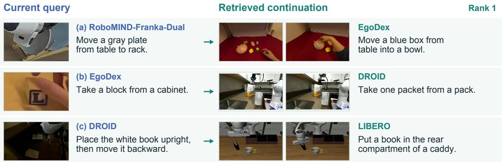  
Figure 8 | Selected qualitative evidence across embodiments. Each query searches only the illustrated target source. The top-ranked clips share placement or removal roles with their queries.

## C. Embed2ICL Implementation and Supplementary Results

This section covers DreamZero’s training-free video-cache warm-up and Fast-WAM’s training-based Context Tokens, followed by integration controls.

## C.1. DreamZero-DROID Reference Warm-Up

Embed2ICL initializes frozen DreamZero-DROID’s cache with a retrieved and reranked video (Figure 9). Both retrievers use the same GPT-5.6 sol Reranking Agent. All reference conditions use four-second videos. Each Embed2ICL reference contains three synchronized streams at 15 Hz for four seconds (60 frames per view): 45 frames before the detected final gripper release, the release frame, and 14 frames after it. All three streams serve as video-only policy input. Embed2ICL performs one warm-up per applicable task phase and issues eight reference-conditioned policy requests. Live observations then update the rolling cache. The source episode and temporal window remain fixed across all trials for a task, so the experiment evaluates conditioning on a selected task reference. We evaluate the three tasks in Table 2. No warm-up, random reference, both retrievers’ top-1, and both reranked conditions each use 100 trials per task, totaling 300 per condition. All share the released DreamZero-DROID policy; only the test-time video reference changes. The top-1 conditions select an episode and recut a four-second reference from its successful stage.

## C.2. DreamZero Reference and Interface Analysis

Figure 10 shows the task-specific DROID warm-up references for full Embed2ICL (Table 2). All three preserve the placement relation while changing the object or receptacle: Cube→Bowl uses a block-to-bowl example; Can→Mug uses a cap-to-container analogue; and Banana→Bin preserves the manipulated object but changes the receptacle. Reranking selects references using completion evidence among other criteria; Table 2 evaluates their usefulness as policy context.

Reference-cache compatibility. DreamZero-DROID [9] supports video warm-up through its rolling 6.6-second visual KV cache and stateless VAE. LingBot-VA [39] (CauVA in the proceedings) instead requires synchronized initialization of video/action positions and streaming VAE state. Fast-WAM [10] resets visual KV state at each policy call; Embed2ICL therefore supplies its trained Context-Token interface (Section C.4).

## 01 Select a task-relevant reference

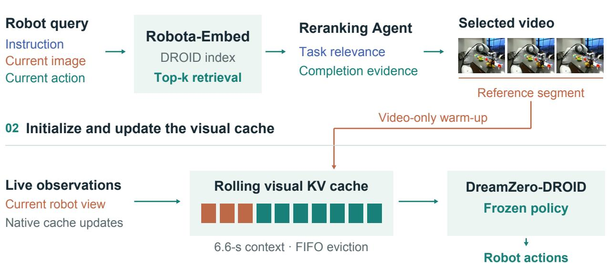  
Figure 9 | Training-free Embed2ICL. Robota-Embed retrieves candidate VLA clips, and the Reranking Agent selects a task-relevant reference containing completion evidence. Its video initializes DreamZero-DROID’s visual key–value cache. The policy remains frozen while live observations update the cache during execution.

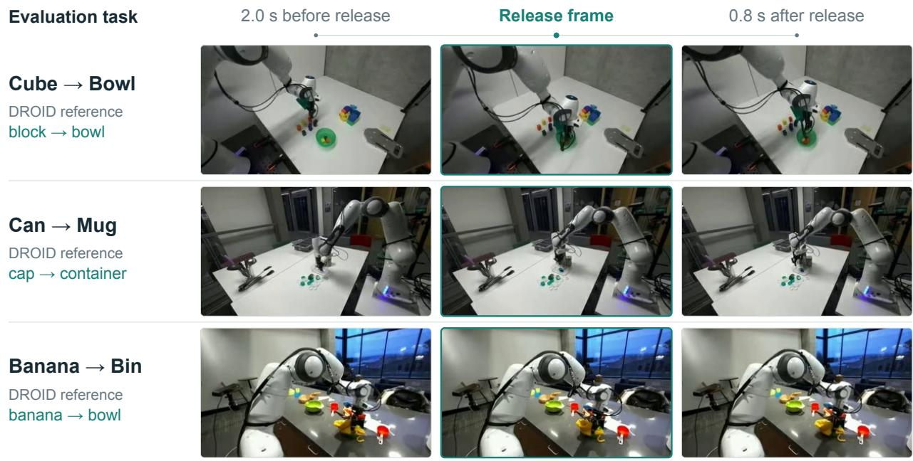  
Figure 10 | DROID references for training-free Embed2ICL. Each row shows one task’s fixed reference from a single camera, before, at, and after the detected final gripper release. DreamZero-DROID receives all three synchronized four-second video streams.

## C.3. Training-Free Embed2ICL on the YAM Robot

Policy and reference. We adapt DreamZero-AgiBot [9] to YAM for 20 epochs on 55 play trajectories, comprising approximately 30 minutes of interaction. Both conditions share this adapted policy; Embed2ICL adds retrieved video through visual KV-cache warm-up without further policy updates. It reuses the bananaplacement reference selected by Robota-Embed and the Reranking Agent for the DROID-Sim Banana-to-Bin task. This DROID reference depicts placement into a bowl; the real-robot task is Banana-to-Bowl.

Evaluation. We evaluate each condition over 12 real-robot rollouts. Success requires the banana to remain inside the bowl while the bowl stays upright. We also report mean cumulative task progress on a 0–100 scale, awarding 20 points for each completed stage: (1) gripper contact with the banana; (2) grasping and lifting it from the table; (3) transporting it above the bowl; (4) releasing it into the bowl; and (5) stable placement with the bowl upright. Embed2ICL raises mean progress from 21.67 to 40.00 (Table 5); success increases from 0.0% to 16.7%.

## C.4. Fast-WAM Integration Details

Context Tokens from target states. The target encoder jointly encodes task text, future video, and native actions. From valid action slots after layer 28’s generation RMSNorm, we extract fused states $H _ { i } ^ { k } \in \mathbb { R } ^ { T }$ �×2048 used by the global retrieval branch (Eq. 3). Adaptive temporal average pooling retains at most 32 positions; standard windows from all four sources yield 32. Pooled states pass through shared LayerNorm, 2048 →1024 projection �, and target residual adapter $A _ { k }$

$$
\begin{array} { r l } { \widetilde { H } _ { i } = \mathrm { P o o l } _ { 3 2 } ( H _ { i } ^ { k } ) , \quad } & { u _ { i , j } = A _ { k } \left( W \mathrm { L N } ( \widetilde { H } _ { i , j } ) \right) , } \\ { C _ { i , j } = u _ { i , j } / \Vert u _ { i , j } \Vert _ { 2 } , \quad } & { C _ { i } \in \mathbb { R } ^ { 3 2 \times 1 0 2 4 } . } \end{array}\tag{7}
$$

Standard windows yield 32 independently L2-normalized tokens from temporally pooled states, not copies of the global retrieval vector. Cosine search uses $k _ { i } ;$ Fast-WAM consumes $C _ { i }$

Retrieval-trained parameters. Context Tokens reuse the Transformer, shared projection, and endpoint adapters learned during retrieval training. The video VAE remains frozen. Token extraction adds no separate head or token-level alignment or reconstruction loss.

01 Encode and cache human experience  
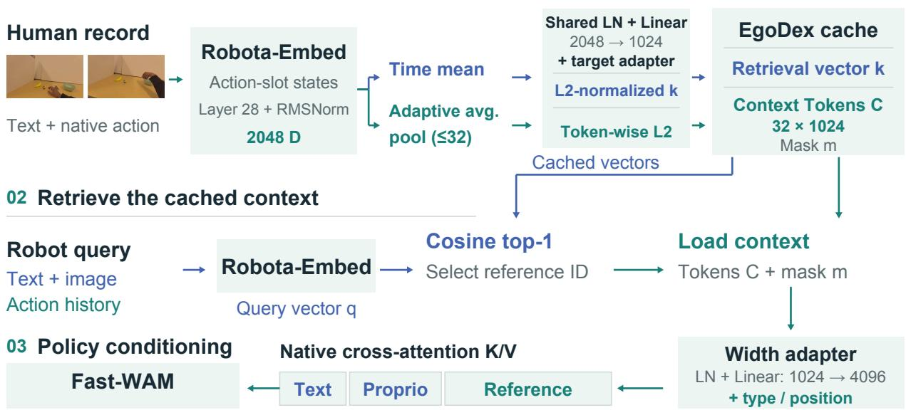  
Figure 11 | Training-based Embed2ICL. Ofline encoding caches each candidate’s retrieval vector, Context Tokens, and context mask. Online cosine top-1 search selects a reference and loads its tokens and mask. The prefilling adapter projects the tokens to Fast-WAM’s context width and appends them to the native text and proprioceptive conditioning for cross-attention.

Ofline cache and online lookup. Ofline, we cache each candidate’s retrieval vector, Context Tokens, and context mask $m _ { i } .$ Online, we encode the robot query as $q ,$ find $i ^ { * } = \arg \operatorname* { m a x } _ { i } q ^ { \top } k _ { i }$ , and load $\left( C _ { i ^ { * } } , m _ { i ^ { * } } \right)$ without re-encoding the candidate. Each rollout starts without reference context. After the first successful retrieval, that reference stays active until the rollout ends. Task-progress metadata is excluded from conditioning.

Prefilling. Embed2ICL projects $C = C _ { i ^ { * } }$ to Fast-WAM’s conditioning width:

$$
R = \mathrm { L i n e a r } _ { 1 0 2 4  4 0 9 6 } ( \mathrm { L N } ( C ) ) + E _ { \mathrm { t y p e } } + E _ { \mathrm { p o s } } , \quad R \in \mathbb { R } ^ { 3 2 \times 4 0 9 6 } .\tag{8}
$$

The projected sequence extends native conditioning $[ H _ { \mathrm { t e x t } } ; h _ { \mathrm { p r o p r i o } } ] ; E _ { \mathrm { t y p e } }$ and $E _ { \mathrm { p o s } }$ are learned type and position embeddings. Native cross-attention reads it in all 30 video-expert and 30 action-expert layers, at every action-difusion denoising step, and during video KV-cache prefilling.

Policy-adaptation scope. Video and action flow-matching losses update approximately 5.00B video-expert parameters, 1.02B action-expert parameters, the proprioception encoder, and a 4.34M-parameter projection adapter: approximately 6.02B trainable parameters in total. The text encoder and VAE remain frozen. The context adapter inserts cached tokens into native conditioning, with no gradient propagation to the ofline Robota-Embed encoder.

LIBERO training schedule. The retrieved-context condition starts from the oficial Fast-WAM LIBERO checkpoint and trains on 1,712 trajectories comprising 277,713 samples across the four LIBERO suites. Five epochs yield 21,700 parameter updates with an efective batch size of 64. We use AdamW with a learning rate of $1 0 ^ { - 4 }$ , a 5% warm-up, and cosine decay to $1 0 ^ { - 6 }$ . The random-reference condition evaluates this same policy checkpoint. A separate no-ICL control uses the same 21,700 training updates (Section C.5).

Real-robot evaluation. Pick Fruit and Split Cup each use 12 rollouts per task and condition. Following T-Rex’s partial-credit approach [35], we report 100 $\textstyle { \frac { 1 } { 1 2 } } \sum _ { i = 1 } ^ { 1 2 } s _ { i }$ , where $s _ { i } \in [ 0 , 1 ]$ is a rollout’s normalized task-progress score.

Additive scoring. Pick Fruit and Split Cup award 0.25 independently for each completed sub-step, up to a total of 1. For Pick Fruit, the four sub-steps are: the left hand grasps a fruit from the left side; the left hand places that fruit in the center basket; the right hand grasps a fruit from the right side; and the right hand places that fruit in the center basket. For Split Cup, they are: the left hand grasps and stabilizes the cup stack; the right hand separates exactly one cup; the right hand grasps the separated cup; and the separated cup is placed upright on the table.

Table 5 reports mean task progress and gains computed before rounding. Figure 6 pairs retrieved references with illustrative executions for these two tasks and DreamZero/YAM.

## C.5. LIBERO Supplementary Controls

Table 4 compares retrieved and random Context Tokens with the oficial release without ICL. The retrievedand random-reference conditions evaluate the same policy checkpoint, changing only the source of Context Tokens at inference. For the random-context condition, a fixed seed deterministically selects a pseudorandom real reference window from the EgoDex gallery. Its precomputed 32 × 1024 Context Tokens replace the retrieved window’s tokens; the control neither injects noise nor shufles token order. Each condition uses 50 binary-success trials per task across the five-task LIBERO dificult subset. Retrieved tokens reach 92.8% success, compared with 88.0% for tokens from random references. This isolates reference selection at fixed policy weights.

Separately, continuing the oficial release without ICL for 21,700 updates, matching Embed2ICL’s update count, yields 216/250 successes (86.4%). Success remains unchanged from the oficial release and 6.4 percentage points below Embed2ICL. Thus, continuation for the same number of updates does not reproduce the gain from retrieved-context conditioning.

Retrieved human context. Figure 12 pairs the G3 bowl-to-drawer task with a top-1 EgoDex clip of a human moving an object toward a bowl. Both depict placement into a receptacle. The selected Embed2ICL rollout completes G3, whereas the rollout from the oficial release does not.

## G3 Open the top drawer and put the bowl inside

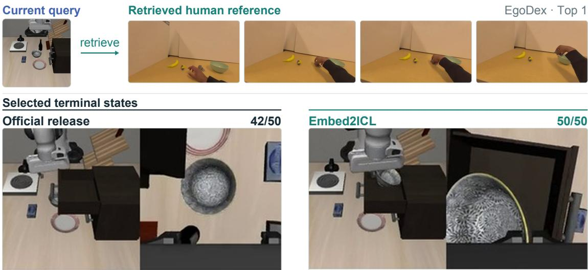  
Figure 12 | LIBERO G3: reference and final states. Successes out of 50 per condition.

## C.6. Training-Based Integration Ablation

We compare two complete integration settings: Embed2ICL’s native-context prefilling with policy fine-tuning, and a frozen-backbone reference side branch. Both use the Robota-Embed retriever, EgoDex index, cosine top-1 selection, and complete 32 × 1024 Context Tokens. They difer in both the conditioning path and trainable scope.

Side-branch setting. A shared reference encoder projects the cached tokens to width 512. Each of the 30 video-expert and 30 action-expert layers receives an eight-head reference cross-attention block, inserted after self-attention and before native text/proprioception cross-attention. Channel-wise residual gates are initialized to zero, preserving the original policy at initialization. Training updates the reference encoder, added attention blocks, and gates (approximately 158.74M parameters), while freezing the original Fast-WAM backbone and proprioception encoder. Standard Embed2ICL instead fine-tunes approximately 6.02B parameters with its prefilling interface (Section C.4).

Table 23 | LIBERO integration ablation. Successes from 50 trials per task and condition; the final row gives the five-task average (%). Parentheses show percentage-point changes from the oficial release; bold marks the better ICL setting.
<table><tr><td>Suite / ID</td><td>Official release</td><td>Side branch</td><td>Embed2ICL</td></tr><tr><td>Spatial / S4</td><td>46</td><td>46 (0)</td><td>49 (+6)</td></tr><tr><td>Goal / G3</td><td>42</td><td>44 (+4)</td><td>50 (+16)</td></tr><tr><td>Goal / G9</td><td>45</td><td>44 (−2)</td><td>47 (+4)</td></tr><tr><td>LIBERO-10 / L4</td><td>43</td><td>43 (0)</td><td>44 (+2)</td></tr><tr><td>LIBERO-10 / L6</td><td>40</td><td>43 (+6)</td><td>42 (+4)</td></tr><tr><td>Five-task average (%)</td><td>86.4</td><td>88.0 (+1.6)</td><td>92.8 (+6.4)</td></tr></table>

Conclusion: LIBERO. The side branch reaches 88.0% average success, compared with 86.4% for the oficial release and 92.8% for Embed2ICL (Table 23). Embed2ICL performs better on four tasks; the side branch performs better on L6 (43 versus 42 successes). The side branch uses fewer trainable parameters, but Embed2ICL reaches higher average success.

Table 24 | Real-robot integration ablation. Mean normalized task progress (%) from 12 rollouts per task and condition. Parentheses show percentage-point changes from Fast-WAM without ICL.
<table><tr><td>Task</td><td>No ICL</td><td>Side branch</td><td>Embed2ICL</td></tr><tr><td>Pick Fruit</td><td>75.00</td><td>77.08 (+2.08)</td><td>79.17 (+4.17)</td></tr><tr><td>Split Cup</td><td>66.67</td><td>75.00 (+8.33)</td><td>87.50 (+20.83)</td></tr></table>

Conclusion: Real robots. Both settings improve mean normalized task progress over no ICL (Table 24). Embed2ICL reaches 79.17% on Pick Fruit and 87.50% on Split Cup, compared with 77.08% and 75.00% for the side branch. The larger gap occurs on Split Cup.

Table 25 | Retrieved versus random Context Tokens. Each integration is evaluated on the LIBERO dificult subset with 50 trials per task and condition. Results are five-task average success rates (%).
<table><tr><td>Integration</td><td>Random tokens</td><td>Retrieved tokens</td></tr><tr><td>Side branch</td><td>85.6</td><td>88.0</td></tr><tr><td>Embed2ICL</td><td>88.0</td><td>92.8</td></tr></table>

Conclusion: Retrieved versus random context. Retrieved tokens yield higher success than random tokens within each setting (Table 25): 88.0% versus 85.6% for the side branch and 92.8% versus 88.0% for Embed2ICL. In the Embed2ICL comparison, both reference conditions use the same policy checkpoint. Retrieved context helps in both the frozen-backbone and fine-tuned settings.

## D. Embed2Evolve: Harnesses, Development, and Evaluation

Embed2Evolve accumulates completed attempts in task-local memory and searches for a recipe for using that memory during control. Online retrieval ranks individual memory anchors; development compares entire context configurations. The two decisions use diferent criteria. The policy and embedding models remain fixed throughout.

## D.1. Policy and Memory Interfaces

Matched embedding-model design. We compare Robota-Embed with Omni-Embed-Nemotron-3B [6] by replacing only the retrieval embedding model and developing each condition independently. Both use the same GPT-6 Astra policy, prompt, initial memory, development and test seeds, candidate-generation rules, and stopping criteria. Retrieved memories supply the same RGB, action, and feedback fields to the policy. Both evolved systems use the full memory interface; the random-history baseline supplies only RGB.

At each decision, GPT-6 Astra receives all current RGB views, robot state, execution feedback, recent action/feedback history, and external context when available. It proposes end-efector target poses and gripper commands, which are validated and executed by a fixed IK/controller. Table 26 gives the runtime and budgets. The four single-arm tasks use base\_camera, vision\_side, vision\_top, and vision\_wrist; TwoRobotStackCube uses base, side, top, and separate left/right wrist cameras. The policy observes all four or five views, respectively, at every decision.

Action execution and observation constraints. Each primitive specifies one arm’s world-frame endefector position in metres, unit XYZW quaternion, and gripper open/close command. Targets are transformed to that robot’s base frame and executed by the native IK/PD controller. In the two-arm task, the other arm holds its measured pose at the start of the primitive. The shared prompt requires explicit targets, without hidden tool calls or automatic execution until a target is reached. It restricts observations to RGB, the robot’s own state, the instruction, and public actions and feedback; object poses, private simulator state, and task code are excluded. A gripper command does not establish grasp success, nor does an IK target establish arrival. The joint\_eff field estimates the robot’s own PD drive efort, not contact ground truth or measured torque. Native environment feedback determines task success.

Table 26 | Embed2Evolve runtime and observation interface. Simulation time is distinct from client execution time, which includes API waiting.
<table><tr><td>Component</td><td>Configuration</td></tr><tr><td>Policy</td><td>GPT-6 Astra, reasoning effort 1ow</td></tr><tr><td>Simulator</td><td>ManiSkill 3.0.1; SAPIEN 3.0.3</td></tr><tr><td>Current RGB</td><td>One 256 × 256 image per camera per decision</td></tr><tr><td>Cameras</td><td>Four for single-arm tasks; five for TwoRobotStackCube</td></tr><tr><td>Control rate</td><td>20 Hz; two ticks per primitive (0.1 s simulation time)</td></tr><tr><td>Decision budget</td><td>At most eight primitives per GPT decision</td></tr><tr><td>Rollout budget</td><td>100 decisions, 300 primitives, and 600 policy control ticks</td></tr><tr><td>Target-change limits</td><td>Per tick: 0.026 m translation and 0.1 rad rotation</td></tr></table>

Historical-context prompt. Both conditions retain the Direct system prompt except that “This condition is Direct: no memory or retrieval.” is replaced by “A historical RGB video excerpt may accompany the current observations.” Both use this fixed preamble for historical video:

This reference is a uniformly random four-second excerpt from a retrieved historical video. The images are historical, not current observations.

Here, “uniformly random” is inherited prompt wording: both conditions use the clip associated with the retrieved anchor, not a randomly drawn excerpt from the selected video.

Anchor index and query. For Robota-Embed, the query combines the instruction, current main-camera RGB, and an endpoint-error action proxy derived from the most recent acknowledged active-arm command, rather than achieved displacement. Applying the LIBERO action codec to ManiSkill is an out-of-distribution adaptation.

Omni-Embed-Nemotron-3B runs in BF16 with eager attention. Its query uses the query: prefix, task text, and current RGB, without native actions; its target uses passage:, task text, and historical video. Retrieved context supplied to GPT includes the clip’s public actions, execution feedback, relative timestamps, and robot state after command acknowledgement. These policy-context fields are distinct from the embedding model’s inputs.

Memory indexes completed development episodes, including successes and failures. Each key represents a current-state anchor linked to at most four seconds of recorded RGB, commands, robot state, feedback, and timestamps. Retrieval matches the task and active arm, excludes episodes with the current seed, and selects anchors from distinct source episodes.

Ranking and refresh. For candidate anchor �, let $S _ { j } \in \{ 0 , 1 \}$ be its source episode’s native success label and $L _ { j }$ its total control ticks, with budget 600. For normalized query and anchor vectors $q , z _ { j }$ from the chosen embedding model, the score uses success/eficiency bonuses $\alpha , \beta \colon$

$$
R ( q , j ) = \cos ( q , z _ { j } ) + \alpha S _ { j } + \beta S _ { j } \left( 1 - \frac { L _ { j } } { 6 0 0 } \right) .\tag{9}
$$

Candidates are ranked in descending order, with at most one anchor retained per source episode. The eficiency bonus rewards successful episodes that use fewer control ticks; tokens, cost, and policy decision counts do not enter the score. For example, 300 ticks with $\alpha = 0 . 1 0 , \beta = 0 . 0 3$ adds 0.115 to cosine similarity. The episode-level label records the outcome of the whole attempt, so it does not establish that every local action was correct. Decision zero uses no retrieved context. Retrieval starts at decision one, refreshes at the selected cadence and upon an active-arm change, and caches context between refreshes.

Failed attempts. Ordinary task failures and budget-exhausted episodes count as unsuccessful trials and can enter memory. With $S _ { j } = 0$ , their anchors receive neither a bonus nor a penalty and remain retrievable by similarity. Exhausted repairs of malformed policy output also count as valid failures, but the memory builder does not admit these episodes. Audited infrastructure interruptions are excluded from the valid-trial denominator and memory; replacement runs complete the trial budget. The policy receives failed attempts as execution records under the fixed prompt; these records are not rewritten as prompt advice.

## D.2. Development and Selected Harnesses

Search varies retrieval count �, refresh cadence $\delta ,$ history pairs $H ,$ and success/eficiency bonuses $\alpha , \beta .$ Models, prompt prose, controller, and episode budgets stay fixed. Every candidate uses development seeds 0–9 and retains historical images. The history window keeps the most recent 2� messages, corresponding to � action/feedback pairs; � counts policy decisions. Each task begins with the three presets in Table 27.

Table 27 | Initial context configurations. All presets enable historical images and are evaluated on the same ten development seeds.
<table><tr><td>Preset</td><td>k</td><td>Cadence δ</td><td>History H</td><td>α</td><td>β</td></tr><tr><td>A</td><td>2</td><td></td><td>12</td><td>0.10</td><td>0.03</td></tr><tr><td>B</td><td>1</td><td>4</td><td></td><td>0.10</td><td>0.10</td></tr><tr><td>C</td><td>2</td><td>1</td><td></td><td>0.15</td><td>0.05</td></tr></table>

Memory expands between rounds, so development changes both available experience and its retrieval recipe. Search round � need not equal the numbered report round ℓ: earlier transport-version rounds can contribute memory but are excluded from current-version configuration selection.

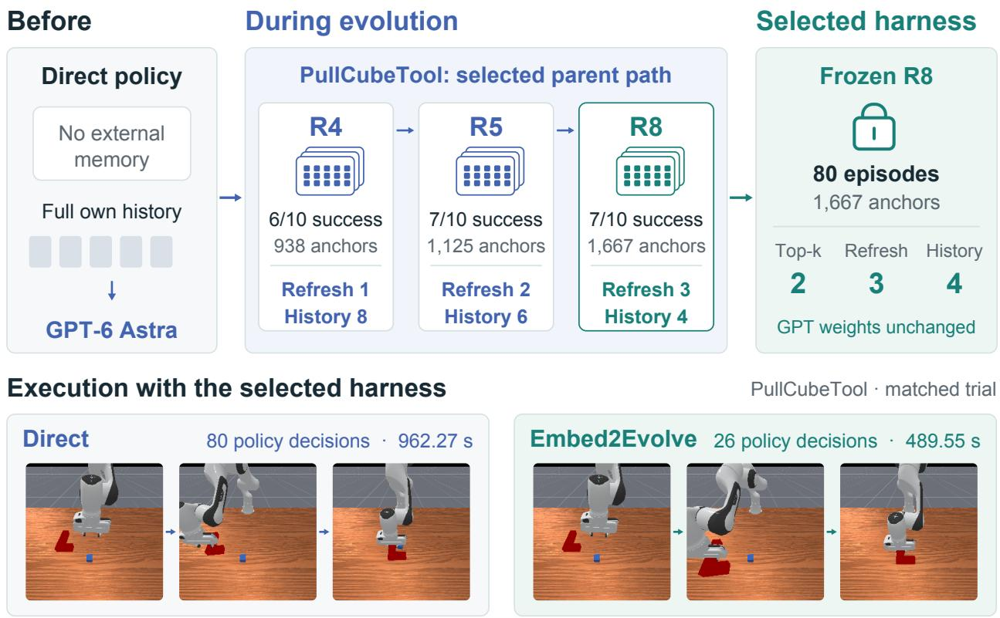  
Figure 13 | From Direct control to a selected harness. PullCubeTool’s R4 → R5 → R8 parent–child sequence grows memory while reducing retained history and retrieval frequency. The bottom filmstrips show the same fresh-test initialization completed successfully by both systems. Task execution time includes API waits.

Success-first selection. Let $\mathcal { E }$ contain the eligible numbered development rounds. For round $\ell ,$ write $N _ { \ell }$ for its number of successful trials, and $\overline { { L } } _ { \ell } , \overline { { T } } _ { \ell }$ for mean control ticks and client execution time over its successful trials. We select lexicographically:

$$
\ell ^ { \star } = \underset { \ell \in \mathcal { E } } { \arg \operatorname* { m i n } } \left( - N _ { \ell } , \overline { { L } } _ { \ell } , \overline { { T } } _ { \ell } , \ell \right) .\tag{10}
$$

We first maximize successes, then break ties by fewer control ticks, shorter time, and the earlier round. Every round contains ten valid trials. If none succeeds, both successful-trial means are +∞, so rapid failure confers no eficiency advantage. Configuration selection thus ranks success and eficiency in order of priority; online retrieval combines them in a weighted score.

Local proposals. After the presets, search round � copies the current winner and makes one deterministic local proposal; all unlisted settings are inherited:

• If � mod 3 = 1, set � ← min(4, � + 1) and � ← 6 if � > 6, or � ← 4 otherwise.

• If � mod 3 = 2, set � ← max(1, � − 1), � ← 2, and � ← min(0.25, � + 0.05).

• If � mod 3 = 0, set � ← 1 and � ← min(0.20, � + 0.05).

Stopping and freezing. Stopping tracks the Pareto frontier of $( N _ { \ell } , - \overline { { L } } _ { \ell } , - \overline { { T } } _ { \ell } )$ . A point dominates another when it is no worse in all three coordinates and better in at least one. A candidate adds a frontier point only if no existing point dominates it and its coordinates are not already present.

After at least three eligible rounds under the current transport version, two consecutive rounds without a new frontier point trigger stopping. A separate cap allows at most eight numbered development rounds per task, including earlier transport versions; baseline collection and formal testing do not count toward it. Any started round must complete ten valid trials.

For each embedding model, formal testing freezes the winning configuration and the memory bank from that round. Test outcomes do not enter selection. The two conditions develop independently and can produce diferent banks and recipes. The comparison measures the embedding model’s contribution through evolution, not a replacement within one final harness.

With Robota-Embed, StackCube stops by the frontier rule after four rounds and TwoRobotStackCube after eight. PokeCube, LiftPegUpright, and PullCubeTool each reach the eight-round cap. The 36 recorded configurations and 360 trials include historical first rounds that are ineligible for selection. Table 28 lists the selected harnesses, and the trajectories below show eligible candidates.

Table 28 | Selected Embed2Evolve harnesses. Bank sizes count development episodes and indexed anchors. Cadence counts GPT decisions; � counts retained action/feedback pairs.
<table><tr><td>Task</td><td>Round</td><td>Episodes</td><td>Anchors</td><td>k</td><td>Cadence</td><td>H</td><td> $\alpha / \beta$ </td></tr><tr><td>Poke Cube</td><td>8</td><td>80</td><td>1,610</td><td>2</td><td>2</td><td>6</td><td>.15/.05</td></tr><tr><td>Stack Cube</td><td>2</td><td>20</td><td>454</td><td>2</td><td>2</td><td>12</td><td>.10/.03</td></tr><tr><td>Lift Peg Upright</td><td>6</td><td>60</td><td>1,116</td><td>2</td><td>1</td><td>6</td><td>.20/.05</td></tr><tr><td>Pull Cube with Tool</td><td>8</td><td>80</td><td>1,667</td><td>2</td><td>3</td><td>4</td><td>.15/.05</td></tr><tr><td>Two-Robot Stack Cube</td><td>5</td><td>50</td><td>1,126</td><td>2</td><td>3</td><td>6</td><td>.10/.03</td></tr></table>

## D.3. Development Trajectories

Figure 14 traces Robota-Embed’s candidate performance. Decision counts average each round’s successful trials; test-time eficiency uses matched initializations (Section D.5). Hollow diamonds mark selected harnesses, which need not come from the final round.

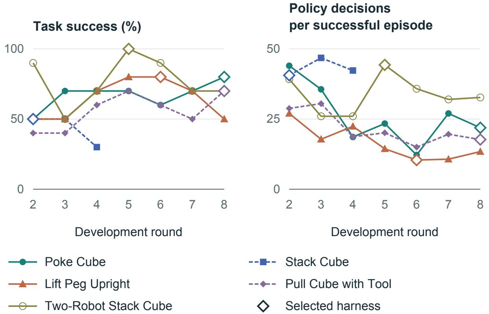  
Figure 14 | Task-wise development trajectories. Success uses ten trials per round; decisions average that round’s successful trials. Hollow diamonds mark selected harnesses. Lines connect evaluated candidates, not necessarily parent–child configurations.

## D.4. Embedding-Model Comparison

Table 29 lists the completed and selected rounds for each embedding model. Both stay within the eight-round cap and produce their own memory banks and context configurations.

Table 29 | Independent development under matched search rules. Completed rounds count all numbered rounds; selected rounds identify the configuration and memory frozen for testing.
<table><tr><td></td><td colspan="2">Omni-Embed- Nemotron-3B</td><td colspan="2">Robota-Embed</td></tr><tr><td>Task</td><td>Completed</td><td>Selected</td><td>Completed</td><td>Selected</td></tr><tr><td>Poke Cube</td><td>8</td><td>6</td><td>8</td><td>8</td></tr><tr><td>Stack Cube</td><td>6</td><td>3</td><td>4</td><td>2</td></tr><tr><td>Lift Peg Upright</td><td>8</td><td>4</td><td>8</td><td>6</td></tr><tr><td>Pull Cube with Tool</td><td>3</td><td>1</td><td>8</td><td>8</td></tr><tr><td>Two-Robot Stack Cube</td><td>7</td><td>5</td><td>8</td><td>5</td></tr></table>

The selected Omni-Embed-Nemotron-3B releases’ frozen banks contain 182 rollout videos: 49 from the original Direct collection and 133 from that condition’s own development, with 30 successful and 152 failed rollouts. These are the selected-round snapshots, not a post-hoc merge of all development trajectories. Video counts difer from indexed-anchor counts; failed rollouts remain retrievable by similarity under the scoring rule in Section D.1.

The two context systems evolve independently; the embedding-model replacement changes both input modalities and retrieval training. It is neither an action-only ablation nor an encoder swap within one fixed final harness. Fewer high-level decisions can coexist with more physical control ticks (Table 31): these metrics measure diferent aspects of execution.

## D.5. Fresh-Test Protocol and Eficiency

The five tasks—PokeCube, StackCube, LiftPegUpright, PullCubeTool, and TwoRobotStackCube—were selected from earlier development results. All four conditions use the same 20 test seeds (40–59) per task, disjoint from development seeds 0–9, yielding 400 valid test episodes. We measure native task success; budget exhaustion and policy failures count as failures. Audited infrastructure interruptions are excluded.

System comparisons. GPT-6 Astra Direct (Direct) uses its original prompt and full within-episode action/feedback history without external memory. GPT-6 Astra + random history adds one randomly sampled same-task development clip with up to eight ordered RGB frames. This RGB-only reference remains fixed within the episode. The harnesses evolved with Omni-Embed-Nemotron-3B and Robota-Embed use their selected memories, bounded histories, ranking, and context refresh. Table 6 compares these four context systems.

Success rates and token-use means include all test trials; decision-count and execution-time comparisons use shared successes. Table 30 specifies each metric’s population and aggregation rule.

Table 30 | Embed2Evolve test-metric accounting. All five tasks receive equal weight. Paired comparisons and reference API costs use Direct and Embed2Evolve.
<table><tr><td>Metric</td><td>Test population</td><td>Five-task aggregation</td></tr><tr><td>Task success</td><td>All 20 trials per task in all four conditions</td><td>Mean of task success rates.</td></tr><tr><td>Policy decisions and execution time</td><td>Matched initializations successful under Direct and Embed2Evolve</td><td>Mean of task-wise relative reductions; speedup averages Direct/Embed2Evolve time ratios.</td></tr><tr><td>Policy tokens</td><td>All 20 trials per task for Direct, evolution with Omni-Embed-Nemotron-3B, and Embed2Evolve, including failures</td><td>Relative reduction between equal-task per-rollout means.</td></tr><tr><td>Reference API cost</td><td>Embed2Evolve, including failures</td><td>All 20 trials per task for Direct and Relative reduction between equal-task per-rollout means at fixed input/output rates.</td></tr></table>

Eficiency accounting. Direct and Embed2Evolve both succeed on 7, 2, 5, 1, and 4 matched initializations in task order. Here, Evolve denotes Embed2Evolve. Per task, we compute the reduction $1 0 0 ( 1 - \overline { { x } } _ { \mathrm { E v o l v e } } / \overline { { x } } _ { \mathrm { D i r e c t } } )$ on this paired set. Averaging the five task-wise reductions equally gives 64.1% fewer policy decisions and 41.4% less task execution time. Observed mean speedup is $\begin{array} { r } { \frac { \mathrm { i } } { 5 } \sum _ { j = 1 } ^ { 5 } \overline { { T } } _ { \mathrm { D i r e c t , } j } / \overline { { T } } _ { \mathrm { E v o l v e , } j } \mathrm {  { \approx } 1 . 9 0 } } \end{array}$ , where each mean uses that task’s shared successful trials. The 1.90× speedup and 41.4% reduction average task-wise time ratios and relative savings, respectively.

Task execution time includes context preparation, API waiting, and execution overhead, but excludes embedding-model cold-start time. It varies with API load, whereas replay videos show simulation time without API waits. During this evaluation, rate-limit recovery changed API caller handling mid-batch, and Direct was added after the batch began. Concurrency, CPU placement, and API load were not controlled across conditions. These diferences confound wall-time attribution: the reported time ratios describe observed execution, not an isolated method-induced speedup. Table 31 reports physical control ticks separately from GPT decisions.

Table 31 | Eficiency and physical control on shared successes. Direct → Embed2Evolve means over the same � matched successful initializations for all three metrics. Execution time includes API waiting. Tick change is 100(Evolve/Direct − 1); positive values indicate more physical control ticks despite fewer GPT decisions.
<table><tr><td>Task</td><td>Paired n</td><td>Policy decisions</td><td>Execution time (s)</td><td>Control ticks</td><td>Tick change (%)</td></tr><tr><td>Poke Cube</td><td>7</td><td>34.86 → 22.71</td><td>419.30 → 382.16</td><td>133.0 → 181.4</td><td>+36.4</td></tr><tr><td>Stack Cube</td><td>2</td><td>45.00 → 10.00</td><td>499.03 → 186.35</td><td>90.0 → 65.0</td><td>-27.8</td></tr><tr><td>Lift Peg Upright</td><td>5</td><td>57.20 → 12.40</td><td>556.06 → 234.46</td><td>152.0 → 149.6</td><td>-1.6</td></tr><tr><td>Pull Cube with Tool</td><td>1</td><td>80.00 → 26.00</td><td>962.27 → 489.55</td><td> $3 4 7 . 0 \to 3 3 7 . 0$ </td><td>-2.9</td></tr><tr><td>Two-Robot Stack Cube</td><td>4</td><td>87.25 → 33.00</td><td> $1 0 5 4 . 6 7  7 5 1 . 5 9$ </td><td> $2 0 6 . 0  3 1 2 . 8$ </td><td>+51.8</td></tr></table>

## D.6. Token Usage and Reference Cost

Table 32 reports mean policy input, output, and total tokens across all 20 test rollouts per task and condition, including successes and failures, for GPT-6 Astra Direct and Embed2Evolve. We average the five task means equally before comparing methods: total tokens fall from 920,979.76 to 518,216.15 per rollout, a 43.7% reduction. Reference API cost falls from \$9.9641 to \$5.7980, or 41.8%. Both reductions use $1 0 0 ( 1 - \overline { { x } } _ { \mathrm { E v o l v e } } / \overline { { x } } _ { \mathrm { D i r e c t } } )$ on these five-task means. They measure resource use per attempt, including failures; timing in Section D.5 uses initializations on which both Direct and Embed2Evolve succeed.

Reference costs use fixed rates of \$10 per million input tokens and \$50 per million output tokens, giving $( 1 0 I + 5 0 O ) / 1 0 ^ { 6 }$ USD for input count � and output count �. This fixed-rate estimate of test-time policy cost excludes cache discounts, retrieval, simulation, and memory/harness development.

Table 32 | Policy token usage and reference cost per rollout. Means include all 20 test rollouts per task and condition, regardless of outcome. Direct denotes GPT-6 Astra Direct; the final group averages task means equally. USD estimates use the fixed input/output rates above.
<table><tr><td>Method</td><td>Input tokens</td><td>Output tokens</td><td>Total tokens</td><td>Ref. cost (USD)</td></tr><tr><td>Poke Cube</td><td></td><td></td><td></td><td></td></tr><tr><td>Direct</td><td>693,733.05</td><td>16,052.50</td><td>709,785.55</td><td>7.7400</td></tr><tr><td>Embed2Evolve</td><td>375,759.60</td><td>12,903.40</td><td>388,663.00</td><td>4.4028</td></tr><tr><td>Stack Cube</td><td></td><td></td><td></td><td></td></tr><tr><td>Direct</td><td>935,086.30</td><td>18,401.05</td><td>953,487.35</td><td>10.2709</td></tr><tr><td>Embed2Evolve</td><td>656,130.60</td><td>19,000.10</td><td>675,130.70</td><td>7.5113</td></tr><tr><td>Lift Peg Upright</td><td></td><td></td><td></td><td></td></tr><tr><td>Direct</td><td>839,705.25</td><td>16,225.95</td><td>855,931.20</td><td>9.2083</td></tr><tr><td>Embed2Evolve</td><td>380,229.95</td><td>13,087.65</td><td>393,317.60</td><td>4.4567</td></tr><tr><td>Pull Cube with Tool</td><td></td><td></td><td></td><td></td></tr><tr><td>Direct</td><td>955,384.05</td><td>20,302.90</td><td>975,686.95</td><td>10.5690</td></tr><tr><td>Embed2Evolve</td><td>399,519.65</td><td>15,041.75</td><td>414,561.40</td><td>4.7473</td></tr><tr><td>Two-Robot Stack Cube</td><td></td><td></td><td></td><td></td></tr><tr><td>Direct</td><td>1,086,699.35</td><td>23,308.40</td><td>1,110,007.75</td><td>12.0324</td></tr><tr><td>Embed2Evolve</td><td>702,461.85</td><td>16,946.20</td><td>719,408.05</td><td>7.8719</td></tr><tr><td>Five-task average</td><td></td><td></td><td></td><td></td></tr><tr><td>Direct</td><td>902,121.60</td><td>18,858.16</td><td>920,979.76</td><td>9.9641</td></tr><tr><td>Embed2Evolve</td><td>502,820.33</td><td>15,395.82</td><td>518,216.15</td><td>5.7980</td></tr></table>

Total token use decreases on every task, most on Pull Cube with Tool (57.5%). Input tokens account for most of the savings. Even on Stack Cube, where output usage increases, the reduction in input tokens lowers total consumption.

Token use after matched context evolution. The Omni-Embed-Nemotron-3B comparison in Table 6 uses all final test rollouts of the independently evolved, frozen harnesses, including failures, and excludes development consumption. Its aggregate total-token comparison does not establish a wall-time or monetary-cost ratio: neither an Omni-Embed-Nemotron-3B input/output split nor matched-success timing is available.

## E. Related Retrieval Protocols

Table 33 compares retrieval inputs, the role of action, gallery scope, and policy dependence. Action can enter the retrieval key, a retrieved record, or the consuming policy’s output. Policy coupling specifies how the retrieval interface depends on that policy; lifetime specifies the scope over which retrieved experience is stored or reused. In Zeva, both phase keys encode recurrent interaction history, including executed actions and observed efects. RADAR’s row follows its observation–language retrieval formulation. Embed2ICL and Embed2Evolve share Robota-Embed’s retrieval space.

Table 33 | Representative physical-experience retrieval interfaces. V/L/A/S/P denote vision, language, native action, state, and proprioception; 3D denotes point clouds. Training-only action use is listed under action role; cross-source galleries span datasets or interfaces.
<table><tr><td>Method</td><td>Modalities</td><td>Query → candidate</td><td>Action role</td><td>Cross- source</td><td>Policy coupling</td><td>Lifetime</td></tr><tr><td>Deep Multimodal</td><td>3D/L/A</td><td>3D+L → trajectory</td><td>Candidate key</td><td>No</td><td>Independent</td><td>Offline corpus</td></tr><tr><td>CLASP</td><td>L/S/A</td><td>L → state+action</td><td>Candidate key</td><td>No</td><td>Independent</td><td>Offline corpus</td></tr><tr><td>VLA-R</td><td>V/L/A</td><td>scene V/L → action token</td><td>Candidate key</td><td>No</td><td>Direct control</td><td>Action vocab.</td></tr><tr><td>ROSER</td><td>P</td><td>prototype → window</td><td>None</td><td>No</td><td>Independent</td><td>Offline corpus</td></tr><tr><td>RAEA</td><td>V/L</td><td>V/L → V/L record</td><td>Returned only</td><td>Yes</td><td>Coupled</td><td>Persistent bank</td></tr><tr><td>REGENT</td><td>S</td><td>state → demo state</td><td>Returned+blend</td><td>No</td><td>Coupled</td><td>Task buffer</td></tr><tr><td>RICL</td><td>V</td><td>image → demo frame</td><td>Returned+blend</td><td>No</td><td>Coupled</td><td>Task buffer</td></tr><tr><td>Zeva</td><td>V/A</td><td>task phase → stored phase</td><td>Recurrent keys</td><td>No</td><td>Coupled</td><td>Within episode</td></tr><tr><td>RADAR</td><td>V/L</td><td>eval V/L → train V/L</td><td>Policy prior</td><td>No</td><td>Analysis only</td><td>Offline corpus</td></tr><tr><td>Robota-Embed</td><td>V/L/A</td><td>current VLA → future VLA</td><td>Query + candidate</td><td>Yes</td><td>Independent</td><td>Persistent index</td></tr></table>