# SAM3RL: MEMORY CONTROL VIA REINFORCEMENT LEARNING FOR VISUAL OBJECT TRACKING

Tomáš Cížekˇ 1,\*,†, Matej Straka1,\*, Illia Volkov2,\*, Matej Kripnerˇ 1,\*, Ervin Macic´3, Jiri Matas2, Klara Janouskova2, Martin Schmid1,4

1Charles University, Prague, 2Czech Technical University in Prague,

3University of Oxford, 4EquiLibre Technologies, Inc.

{cizek,straka,schmid}@kam.mff.cuni.cz, kripner@ufal.mff.cuni.cz {volkoill,matas,janoukl1}@fel.cvut.cz, ervin.macic@pmb.ox.ac.uk

Core contributor †Project lead

## ABSTRACT

Segment Anything Model 3 (SAM 3) is a foundation model for image and video segmentation that sets the state of the art in visual object tracking. Its tracker, inherited from SAM 2, stores information from past frames in a memory bank, managed by a simple First-In-First-Out rule, allowing temporal consistency in complex videos. Several recent methods improve SAM 2 with hand-crafted memory update rules, each targeting a specific failure mode, such as distractors, occlusions, or object motion. However, their gains transfer only partially to the stronger SAM 3 backbone. We instead present a more general, data-driven approach that frames memory control as a sequential decision-making task. SAM3RL is an extension of the SAM 3 tracker with a lightweight memory controller, trained by reinforcement learning, that decides which frames enter the memory bank in order to maximize tracking performance. SAM3RL sets a new state of the art on 10 of 12 tracking and video object segmentation benchmarks, outperforming all handcrafted rules without any runtime overhead. The same approach applied to SAM 2 gives SAM2RL, which outperforms hand-crafted rules on 9 of the 12 benchmarks, showing the generality of our method across model generations.

## 1 INTRODUCTION

Visual object tracking is a fundamental computer vision task in which a tracker is given a target object in the first frame of a video and must localize it, as a box or a segmentation mask, in all subsequent frames. Reliable tracking is a key component of applications such as autonomous driving, robotics, video surveillance, and sports analytics (Marvasti-Zadeh et al., 2022). The task remains difficult since the target may be surrounded by visually similar distractors, be occluded for long periods, or change its appearance. These challenges are amplified in long videos, where errors can accumulate over time and recovery depends critically on historical context (Javed et al., 2023).

Recent state-of-the-art trackers are built on the Segment Anything Model (SAM) family. SAM 2 (Ravi et al., 2025) is a promptable video segmentation model that conditions each mask prediction on features from past frames held in a small, fixed-size memory bank. SAM 3 (Carion et al., 2026) targets promptable concept segmentation, while inheriting the tracker architecture from SAM 2. The original SAM 2 populates the bank with a simple First-In-First-Out (FIFO) rule that keeps the most recent frames regardless of quality or relevance. Therefore, a line of follow-up work replaces FIFO with hand-crafted update rules, including motion-aware frame selection (Yang et al., 2026; Chen et al., 2026), distractor-aware memory (Videnovic et al., 2026), and calibrated prototype memory ´ with positional priors (Xu et al., 2025); some go further and also select among mask candidates by motion consistency (Yang et al., 2026; Chen et al., 2026) or maintain several banks and search over them (Ding et al., 2025b). SAM 3 also follows this approach and refines FIFO by keeping only frames in which the object is not occluded, plus the most recent frame.

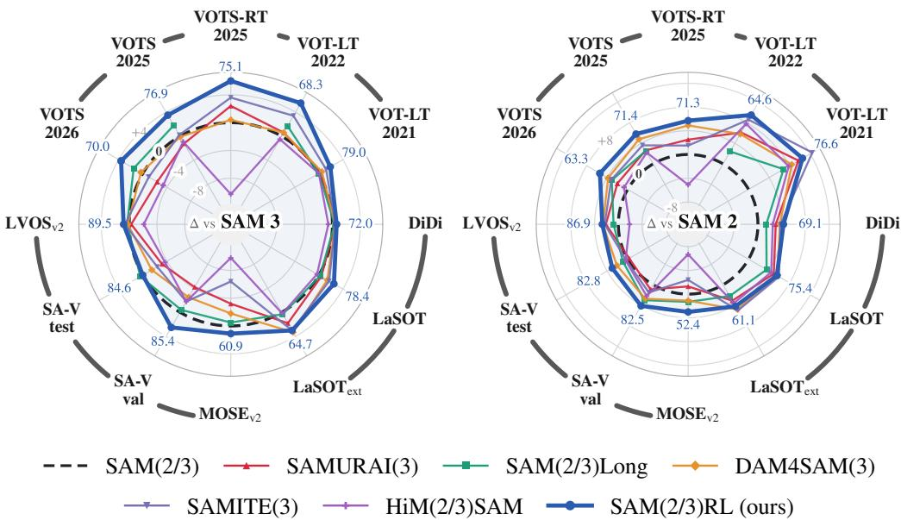  
Figure 1: Gains from hand-crafted rules vs. our learned memory control SAM3RL (left) and SAM2RL (right). Each axis is a tracking or video segmentation benchmark, spanning three categories: VOT(S) challenges (VOTS2025/2026, $\mathrm { V O T S  – R T } _ { 2 0 2 5 }$ , and $\mathrm { V O T - L T } _ { 2 0 2 1 / 2 0 2 2 } )$ , visual object tracking (DiDi, $\mathrm { L a S O T , L a S O T _ { \mathrm { e x t } } ) }$ , and video object segmentation $( \mathrm { M O S E _ { v 2 } , S A  – V _ { v a l / t e s t } , L V O S _ { v 2 } } )$ The radius shows the change in that benchmark’s standard metric relative to the corresponding base line tracker (SAM 3 or SAM 2). The outer labels give our score on each benchmark. The compared methods modify what the tracker stores in the memory bank, and in most cases also mask selection or the number of banks. In contrast, our policy operates with the memory bank only. The compared methods are evaluated on SAM 2 as published and on SAM 3 after our porting to that backbone.

However, each of the hand-crafted rules targets a particular failure mode, such as distractors, occlusions, or fast motion. Ideally, the tracker should be robust to all of them at the same time. Moreover, these rules are tied to the model generation they were designed for, as all heuristics developed for SAM 2 transfer poorly to the stronger SAM 3. Their gains on tracking benchmarks are limited, and on video object segmentation they even fall below SAM 3 on most benchmarks; see Figure 1.

In this work, we show that memory control should be learned rather than designed. We formulate memory control as a Markov Decision Process (MDP), designing the state, actions, and reward, but leaving the choice of what to remember to the agent. That choice is learned by reinforcement learning (RL) directly from data, without touching the tracker itself. We introduce SAM3RL, which applies this memory control formulation to SAM 3 and sets a new state of the art on several tracking benchmarks, most notably on the VOTS and VOT-LT challenges. It does so at no additional inference cost and, unlike hand-crafted rules, without sacrificing performance on video object segmentation. Applied to SAM 2, the same recipe yields SAM2RL, which still outperforms hand-crafted rules on most benchmarks, showing the generality of our learned method across model generations.

## Our contributions are as follows:

Learned memory control for SAM-based trackers. We formulate memory bank control in SAMbased trackers as an MDP over a fixed-capacity bank. The state describes the content of the bank, the action selects the entry to evict, and the reward scores the resulting prediction against the annotation. This formulation allows the memory control to be learned instead of being manually designed.

State-of-the-art visual object tracker. We present SAM3RL, which extends SAM 3 with a memory controller obtained by optimizing the introduced MDP with RL. It improves over SAM 3 on 11 out of 12 benchmarks and ranks first on 10 of them. The largest gains are achieved on the VOT(S) challenges, with +3.6 on $\mathrm { V O T S } _ { 2 0 2 6 }$ and +5.5 on $\mathrm { V O T - L T _ { 2 0 2 2 } }$ . It is also the only tracker that consistently succeeds in video object segmentation, scoring +1.1 on $\mathrm { M O S E } _ { \mathrm { v } 2 }$ and +2.5 on $\mathrm { S A ^ { \mathrm { - } } V _ { \mathrm { v a l } } }$

SAM3RL achieves this while optimizing the memory control only, whereas most compared methods additionally modify mask selection, prompting, or the number of banks maintained.

Online controller without a runtime penalty. The SAM3RL controller is a lightweight MLP evaluated once per memory update. It reads only values the tracker has already computed, and stays fully online without lookahead or extra feature extraction, unlike other methods. On tracking benchmarks, SAM3RL is faster than SAM 3, at 16.0 FPS against 15.3 FPS, as the memory is updated only every sixth frame, matching the decision rate used in training. Under the real-time FPS constraint of VOTS-RT , SAM3RL stays best at 75.1, dropping only 1.8 points, while SAM 3 drops 4.3.

Generality across model generations. SAM2RL is obtained by applying the same recipe to SAM 2. It improves the baseline on all 12 benchmarks and leads on 9 of them, although every compared rule was designed specifically for SAM 2. SAM2RL still remains faster than SAM 2, at 25.5 FPS against 25.1 FPS. Together with SAM3RL, this demonstrates the generality of the introduced method.

## 2 RELATED WORK

Visual object tracking (VOT) and semi-supervised video object segmentation (VOS) are conditioned on a target specified in the first frame of a video, which must then be localized in all subsequent frames. The target is represented by a bounding box in VOT and a pixel-level mask in VOS. Both tasks require maintaining the target through appearance changes, occlusions, fast motion, and distractors, which remain the dominant sources of tracking failure (Kristan et al., 2020). To address these challenges, trackers have long exploited information from previous frames (Matthews et al., 2004; Kalal et al., 2012; Oh et al., 2019; Cui et al., 2022; Han & Huang, 2024).

Recently, the SAM 2 foundation model (Ravi et al., 2025) set a new state of the art in tracking. Its impact is evident in the VOTS challenge, where 92% of submitted trackers were derived from the SAM family (Kristan et al., 2026). Central to the SAM 2 design is the memory bank, a fixed-capacity store of past frames on which every prediction is conditioned by memory attention. The bank holds seven slots, the prompted first frame and the six most recent ones, under a FIFO rule. Because adjacent frames are highly correlated, FIFO tends to fill the bank with redundant observations rather than the diverse history required to distinguish the target from distractors or recover after occlusions.

Consequently, memory design in SAM-based trackers has become an active research area, with follow-up work replacing FIFO with hand-crafted selection rules. SAMURAI (Yang et al., 2026) uses a Kalman filter (Kalman, 1960) to score motion consistency, both selecting among per-frame mask candidates and gating memory updates. DAM4SAM (Videnovic et al., 2026) splits the bank´ into a fixed-interval part and a part reserved for frames that resolve visually similar distractors. SAMITE (Xu et al., 2025) calibrates stored prototypes and adds positional priors. HiM2SAM (Chen et al., 2026) combines hierarchical motion estimation with a long- and short-term split of the bank. SAM2Long (Ding et al., 2025b) keeps several banks in parallel and performs tree search over alternative trajectories. Even SAM 3 (Carion et al., 2026) relies on such a rule, retaining an unprompted frame only when the model is confident that the target is present.

However, for older trackers, learned memory control has already been shown to outperform handcrafted rules (Choi et al., 2018; Yang & Chan, 2018; Zhang et al., 2019b; Dai et al., 2020). Specifically for SAM 2, we attempted learning the rules instead of designing them in our preliminary work (Adamyan et al., 2025). There, we showed the potential of learned memory control by fitting a separate RL agent to each of a handful of training videos. Agents improve over the hand-crafted rules, but do not transfer to unseen videos. This demonstrates a performance upper bound rather than a usable tracker. Here, we develop the full method, a single general-purpose policy that generalizes to unseen videos, extends to SAM 3, and sets a new state of the art in visual object tracking.

## 3 METHODOLOGY

We formulate memory control as an MDP and train a lightweight MLP controller $\pi _ { \theta }$ with RL by rolling out tracking episodes over a corpus of annotated videos. Given a training sequence with frames $x _ { 0 } , \ldots , x _ { T }$ and object mask or box annotations $y _ { 0 } , \ldots , y _ { T }$ , the simulation starts by conditioning the frozen tracker on the first annotation y0; see Figure 2. At each step t, the tracker holds a memory bank $B _ { t } = ( m _ { \tau _ { 0 } } , m _ { \tau _ { 1 } } , . . . , m _ { \tau _ { 6 } } )$ of seven memory frames with indices

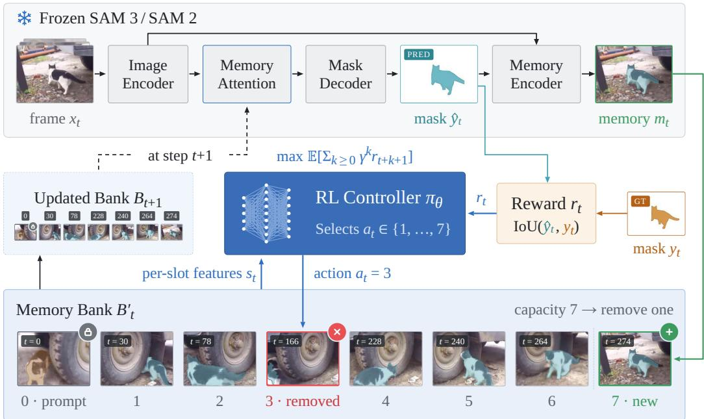  
Figure 2: Learned memory control for SAM-based trackers. The frozen tracker (top) embeds the frame $x _ { t }$ and conditions it through memory attention on the current memory bank $B _ { t }$ . The decoder predicts the mask $\hat { y } _ { t }$ , and the memory encoder fuses it with $x _ { t }$ into a new memory $m _ { t }$ . The bank has capacity seven, where slot 0 is permanently reserved for the conditioning frame. Appending $m _ { t }$ to slot $7$ therefore overfills the bank, so one of the slots $1 , \ldots , 7$ must be evicted. Our controller $\pi _ { \theta }$ observes the state $s _ { t } ,$ which collects temporal, confidence, semantic, and geometric features of all eight slots, and picks the action $a _ { t } \in \{ 1 , \ldots , 7 \}$ that removes the corresponding memory (here $a _ { t } = 3 )$ . The surviving slots form the updated bank $B _ { t + 1 }$ that the tracker reads at step $t + 1$ . During training, πθ receives the reward $r _ { t }$ , scoring $\hat { y } _ { t }$ against the annotation $y _ { t }$ , and maximizes the expected discounted return $\begin{array} { r } { \mathbb { E } _ { \pi _ { \theta } } \Big [ \sum _ { k \geq 0 } \gamma ^ { k } r _ { t + k + 1 } \Big ] } \end{array}$ . At inference, $\pi _ { \theta }$ is fixed and the actions are taken greedily.

$0 = \tau _ { 0 } < \tau _ { 1 } < \cdot \cdot \cdot < \tau _ { 6 } < t ,$ , where slot 0 is permanently occupied by the conditioning frame $m _ { 0 }$ and the other six hold past memory frames formed from the tracker’s own predictions. The image encoder embeds $x _ { t }$ and the memory attention conditions this embedding on the current content of $B _ { t }$ . The mask decoder then converts the result into three candidate masks and keeps the most confident as the prediction $\hat { y } _ { t }$ . The mask decoder also outputs an object pointer $p _ { t }$ , which is a single token summarizing the appearance of the target. The memory encoder then fuses $\hat { y } _ { t }$ with the embedding of $x _ { t }$ into a spatial memory feature $f _ { t }$ , and the two together form the memory frame $m _ { t } = ( p _ { t } , f _ { t } )$

We assume that the bank $B _ { t }$ is always full, except during the first six frames $x _ { 1 } , \ldots , x _ { 6 }$ , when the memory frames $m _ { 1 } , \ldots , m _ { 6 }$ are simply appended without eviction. Once $B _ { t }$ is filled, storing $m _ { t }$ requires evicting one of the existing entries. Whereas prior work relies on hand-crafted rules, we employ a learned controller π that selects one of seven candidates for removal, either one of the stored memories $m _ { \tau _ { 1 } } , . . . , m _ { \tau _ { 6 } }$ or the newly formed memory $m _ { t }$ . The six remaining candidates, together with the conditioning memory $m _ { 0 }$ , form the updated bank $B _ { t + 1 }$ used for the tracker prediction in the next step. Once training is complete, the controller $\pi _ { \theta }$ is fixed and the same loop is used for inference on unseen videos, with actions taken greedily and no reward computed.

## 3.1 MDP FORMULATION

An episode of our MDP is one object tracked through a video. The policy $\pi _ { \theta }$ acts once per tracker step, after $\hat { y } _ { t }$ and $m _ { t }$ have been produced and before $B _ { t }$ is updated. We denote a temporary bank after appending the new memory frame $m _ { t }$ by $B _ { t } ^ { \prime } = ( m _ { \tau _ { 0 } } , . . . , m _ { \tau _ { 7 } } )$ where $\tau _ { 7 } = t .$ . The policy observes the state $s _ { t }$ and selects the action $a _ { t }$ that removes one of $m _ { \tau _ { 1 } } , \ldots , m _ { \tau _ { 7 } }$ , producing the next memory bank $B _ { t + 1 }$ . It also receives the reward $r _ { t }$ , which reflects the quality of the prediction $\hat { y } _ { t }$ against the annotation $y _ { t }$ . We now formalize the state $s _ { t } .$ , action $a _ { t } ,$ and reward $r _ { t }$

State space. The state $s _ { t }$ describes the content of $B _ { t } ^ { \prime }$ by four pairwise disjoint groups of features, computed for every slot $i \in \{ 0 , \ldots , 7 \}$ from the tracker outputs at the corresponding time step $\tau _ { i } \dot { : }$

• Temporal encodings are sinusoidal positional encodings $\mathrm { P E } _ { \tau _ { i } } \in \mathbb { R } ^ { 3 2 }$ of the frame age $t - \tau _ { i }$

• Confidence features are the object score $o _ { \tau _ { i } } \in \mathbb { R }$ , which is the logit of the target being visible in $x _ { \tau _ { i } } .$ , and the predicted IoU scores $\iota _ { \tau _ { i } } \in [ 0 , 1 ] ^ { 3 }$ , one per candidate mask, estimating how well that mask overlaps with the ground truth. Both $o _ { \tau _ { i } }$ and $\iota _ { \tau _ { i } }$ are outputs of the tracker’s mask decoder.

• Semantic features are the object pointer $p _ { \tau _ { i } } \in \mathbb { R } ^ { 2 5 6 }$ and the mean-pooled memory feature $f _ { \tau _ { i } } ^ { p o o l } \in$ $\mathbb { R } ^ { 6 4 }$ of the spatial memory feature $f _ { \tau _ { i } }$ under the predicted mask $\hat { y } _ { \tau _ { i } }$ to reduce the input size. The features also contain pairwise cosine similarities between $( p _ { \tau _ { i } } , p _ { \tau _ { j } } )$ and $( f _ { \tau _ { i } } ^ { p o o l } , f _ { \tau _ { j } } ^ { p o o { \bar { l } } } )$ for $i \neq j .$

• Geometric features describe the area, centroid, and box size of $\hat { y } _ { \tau _ { i } }$ , plus the pairwise mask IoUs between $\hat { y } _ { \tau _ { i } }$ and $\hat { y } _ { \tau _ { j } }$ for $i \neq j$ . They further contain the IoUs of the two unselected candidate masks for $\hat { y } _ { t }$ against every $\hat { y } _ { \tau _ { i } }$ , as well as the IoU between the two unselected masks themselves.

Action space. The action $a _ { t } \in \{ 1 , \ldots , 7 \}$ is the index of the memory frame that the policy removes from $B _ { t } ^ { \prime } ,$ giving the updated bank $B _ { t + 1 } = B _ { t } ^ { \prime } \backslash \{ m _ { \tau _ { a _ { t } } } \}$ . Choosing $a _ { t } = 7$ removes the newly formed $m _ { t }$ and thus rejects the current frame, leaving the bank unchanged at $B _ { t + 1 } = B _ { t }$ . The actions also determine which object pointers the tracker attends to. In fact, memory attention reads sixteen object pointers but only seven memory features. We take the seven memory features and object pointers from $B _ { t }$ and fill the remaining nine pointers from the frames most recently evicted from the bank. We keep temporal encodings for the memory attention inputs from SAM 3 but index object pointers by recency rank instead of frame offset, so their encodings stay within the range seen in training.

The policy then defines a distribution $\pi _ { \theta } { \big ( } a _ { t } \ { \big | } \ s _ { t } { \big ) }$ over the seven actions, from which we sample during training and take the most likely action during inference. The memory rules of SAM 2 and SAM 3 can themselves be formulated as policies in this action space. SAM 2 always selects $a _ { t } = 1$ and evicts the oldest memory, while SAM 3 keeps the most recent frame and selects $a _ { t } = 6$ whenever an object-score-gated IoU of $x _ { \tau _ { 6 } }$ falls below a predefined threshold, and $a _ { t } = 1$ otherwise.

Reward. The reward measures the tracking quality of the prediction $\hat { y } _ { t }$ against the annotation $y _ { t }$ by

$$
q _ { t } = \left\{ { \begin{array} { l l } { 1 } & { { \mathrm { i f ~ } } { \hat { y } } _ { t } = \emptyset { \mathrm { ~ a n d ~ } } y _ { t } = \emptyset , } \\ { { \mathrm { I o U } } ( { \hat { y } } _ { t } , y _ { t } ) } & { { \mathrm { o t h e r w i s e } } , } \end{array} } \right.\tag{1}
$$

which credits the tracker for the overlap between $\hat { y } _ { t }$ and $y _ { t }$ when the target is visible, and for correctly reporting when the object is absent. If the annotation is a bounding box, the IoU is computed against the tight axis-aligned box enclosing the predicted mask. A large amount of variance of $q _ { t }$ comes from the difficulty of the video rather than from the actions taken. Therefore, we normalize the reward by setting $r _ { t } = q _ { t } - b _ { t }$ , where $b _ { t }$ is the tracking quality that the underlying tracker scores at the same frame of the same video under the same conditioning with SAM 3’s default memory control. The baseline depends only on the video and not on the policy $\pi _ { \boldsymbol { \theta } } .$ , so we pre-compute $\bar { b _ { t } }$ only once for the whole training dataset. The policy then maximizes the expected return $\bar { \mathbb { E } _ { \pi _ { \theta } } ^ { - } } [ G _ { t } ]$ where $\begin{array} { r } { G _ { t } = \sum _ { k \geq 0 } \gamma ^ { k } r _ { t + k + 1 } } \end{array}$ is the discounted return from step t and $\gamma$ is the discount factor.

Appendix E ablates the input feature groups, object pointer selection, and the reward normalization.

## 3.2 TRAINING THE MEMORY CONTROLLER

Architecture. The controller $\pi _ { \theta }$ is a single MLP, which serves as the actor. All features enter it directly, except the object pointers, which a shared linear projection first compresses to 64 dimensions. All groups are then concatenated and passed through one hidden layer of 2,048 units and a linear head over the seven actions, about 3.2 M parameters in total. For training, we add a critic, a second network of the same design with a scalar head, which estimates the expected return, shares no parameters with the actor, and is discarded after training. Besides $s _ { t }$ , the critic receives the normalized number of decision steps left in the episode, which it needs to predict undiscounted finite-horizon returns. This value is unavailable at inference, but since only the actor is deployed, the controller remains fully online and depends on $s _ { t }$ alone.

Training data. We train on the LaSOT training split (Fan et al., 2019), whose 1,120 sequences are divided into 896 for training and 224 for validation, while the official test set is held out. LaSOT is annotated with per-frame bounding boxes at 30 FPS. Since consecutive frames at that rate are nearly identical, an eviction decision changes the bank very little while still consuming a decision step. We therefore subsample every sixth frame, so that training episodes run at 5 FPS and span 425 decision steps on average. This also matches the typical annotation rate of VOS datasets.

Optimization. We train the controller with Proximal Policy Optimization (PPO) (Schulman et al., 2017), using the undiscounted Monte-Carlo return $( \mathrm { i } . \mathrm { e } . , \gamma = 1 )$ minus the critic’s predicted value as the advantage. The return is bootstrapped only when the rollout window truncates an episode, corresponding $\mathrm { t o } \lambda = 1$ in generalized advantage estimation (GAE) (Schulman et al., 2016). Apart from this bootstrap, we keep the critic out of the targets and use it only as a baseline, as it fits the training videos well but transfers poorly to unseen videos. Each of the 400 iterations collects 376- step rollouts from 256 parallel environments. Training takes about 24 hours on four H200 GPUs. We evaluate the greedy policy on the full validation videos every 25 iterations and select the best checkpoint. All remaining hyperparameters are listed in Table 13 in Appendix D.

Inference. The actor picks actions greedily, and its only overhead is a single MLP evaluation per memory update. To keep the decision rate close to the 5 FPS seen in training, the memory controller operates with a stride $s = \mathrm { r o u n d } ( \nu / 5 )$ , where ν is the frame rate of the benchmark. The tracker still predicts a mask on every frame, but only every sth frame triggers a memory update and can enter the bank. On the remaining frames no memory frame $m _ { t }$ is formed, so the memory encoder that produces $f _ { t }$ is skipped altogether. The 30 FPS VOT and VOTS benchmarks use $s = 6 ,$ while the 5 FPS $\mathrm { M O S E _ { v 2 } }$ uses $s = 1$ . The frame rates and strides for all benchmarks are listed in Appendix B.

## 4 SAM3RL PERFORMANCE

SAM3RL sets a new state of the art among memory control methods for SAM-based trackers on most tracking and video object segmentation benchmarks. In this section, we compare it with the prior methods discussed in Section 2, all evaluated on the SAM 3 backbone. Because these methods were designed for SAM 2 and their authors have not released SAM 3 implementations, we port each one to SAM 3 ourselves. Each port replaces the SAM 2 video predictor with the SAM 3 tracker and leaves the method otherwise untouched. We also compare the prior methods, in their original SAM 2 implementations, against SAM2RL (our memory control on SAM 2) in Figure 1 and Appendix A. Appendix B details tracker evaluation, FPS measurement, reproducibility, and the ports.

## 4.1 VOT(S) CHALLENGES

The VOT initiative has organized annual tracking challenges for over a decade, and its benchmarks have evolved with the field (Kristan et al., 2013). Current VOTS challenges unify short-term and long-term tracking with single-target and multi-target scenarios. The sequences feature occlusions, visually similar distractors, and targets that leave the field of view and re-enter. VOTS targets are annotated by segmentation masks and scored on a remote server, whereas VOT-LT targets are annotated by bounding boxes. Results are presented in Table 1. The challenges separate the methods most sharply, with scores spanning 7.0 points on $\mathrm { V O T S } _ { 2 0 2 6 }$ . SAM3RL ranks first on all five challenges. Among hand-crafted rules, SAMITE3 and SAM3Long provide the strongest baselines.

VOTS2026 (Kristan et al., 2026) is the latest edition of the challenge, and $\mathbf { V O T S } _ { 2 0 2 5 }$ (Kristan et al., 2023b) is the previous one, whose sequences are a subset of it. $\mathbf { V O T S - R T } _ { 2 0 2 5 }$ (Kristan et al., 2025) is the real-time variant of the $\mathrm { V O T S } _ { 2 0 2 5 }$ benchmark, designed to evaluate tracking quality under a strict streaming constraint. Frames are delivered to the tracker at a constant rate of 20 FPS, independently of its processing latency. The tracker must finish reporting the mask in the current frame before the next frame becomes available. Otherwise, the prediction from the previous frame is retained. The constraint costs SAM 3 several points, whereas SAM3RL gains the most of all methods. Notably, we do not report SAM3Long in this setting because it is not an online tracker and cannot satisfy this causal protocol; see Appendix B. VOT-LT2021 (Kristan et al., 2021) evaluates long-term tracking, where the target is absent for extended periods and must be redetected, and $\mathbf { V O T - L T } _ { 2 0 2 2 }$ (Kristan et al., 2023a) is the latest LT challenge, which introduced more difficult sequences. The results on

Table 1: Performance on VOT(S) challenges. We report standard metrics for the evaluated challenges. Deltas indicate improvement or decline relative to SAM 3. Bold indicates the best.
<table><tr><td colspan="3"></td><td colspan="3">Quality</td><td colspan="2">F-score</td></tr><tr><td>Model</td><td>FPS</td><td> $\mathrm { V O T S } _ { 2 0 2 6 }$ </td><td> $\mathrm { V O T S } _ { 2 0 2 5 }$ </td><td> $\mathrm { V O T S  – R T } _ { 2 0 2 5 }$ </td><td></td><td> $\mathrm { V O T - L T } _ { 2 0 2 1 }$ </td><td> $\mathrm { V O T - L T } _ { 2 0 2 2 }$ </td></tr><tr><td>SAM 3</td><td>15.3</td><td>66.4</td><td>73.4</td><td></td><td>69.1</td><td>77.1</td><td>62.8</td></tr><tr><td>SAMURAI3</td><td>15.1</td><td> $6 4 . 0 { - } 2 . 4 $ </td><td> $7 2 . 2 . 1 . 2$ </td><td> $7 1 . 5 \substack { + 2 . 4 }$ </td><td> $7 7 . 4 \substack { + 0 . 3 }$ </td><td></td><td> $6 3 . 4 \substack { + 0 . 6 }$ </td></tr><tr><td>SAM3Long</td><td>9.3</td><td> $6 7 . 9 \substack { + 1 . 5 }$ </td><td> $7 5 . 2 \substack { + 1 . 8 }$ </td><td></td><td></td><td> $7 7 . 1 \pm 0 . 0$ </td><td> $6 4 . 5 \substack { + 1 . 7 }$ </td></tr><tr><td>DAM4SAM3</td><td>14.2</td><td> $6 6 . 7 \substack { + 0 . 3 }$ </td><td> $7 3 . 3 . 0 . 1 $ </td><td></td><td> $6 9 . 5 \substack { + 0 . 4 }$ </td><td> $7 7 . 6 \substack { + 0 . 5 }$ </td><td> $6 3 . 4 \substack { + 0 . 6 }$ </td></tr><tr><td>SAMITE3</td><td>12.7</td><td> $6 5 . 4 \mathrm { - } 1 . 0$ </td><td> $7 3 . 6 \substack { + 0 . 2 }$ </td><td></td><td> $7 2 . 7 \substack { + 3 . 6 }$ </td><td> $7 8 . 3 \substack { + 1 . 2 }$ </td><td> $6 6 . 2 \substack { + 3 . 4 }$ </td></tr><tr><td>HiM3SAM</td><td>11.8</td><td> $6 3 . 0 . 3 . 4 $ </td><td> $7 2 . 5 . 0 . 9$ </td><td> $5 8 . 8 \AA . 1 0 . 3 $ </td><td></td><td> $7 7 . 1 \pm 0 . 0$ </td><td> $6 2 . 3 \AA { - } 0 . 5$ </td></tr><tr><td>SAM3RL (ours)</td><td>16.0</td><td> $7 0 . 0 \substack { + 3 . 6 }$ </td><td> $7 6 . 9 \substack { + 3 . 5 }$ </td><td></td><td> $7 5 . 1 \substack { + 6 . 0 }$ </td><td> $\mathbf { 7 9 . 0 + 1 . 9 }$ </td><td>68.3+5.5</td></tr></table>

Table 2: Performance on VOT datasets. Deltas indicate improvement or decline relative to SAM 3. Bold indicates the best.  
Table 3: Performance on VOS datasets. Deltas indicate improvement or decline relative to SAM 3. Bold indicates the best.
<table><tr><td></td><td>Quality</td><td colspan="2">AUC</td></tr><tr><td>Model</td><td>DiDi</td><td> $\mathrm { L a S O T }$ </td><td> $\mathrm { L a S O T _ { e x t } }$ </td></tr><tr><td>SAM 3</td><td>71.4</td><td>75.9</td><td>61.7</td></tr><tr><td>SAMURAI3</td><td> $7 1 . 8 \substack { + 0 . 4 }$ </td><td> $7 6 . 3 \substack { + 0 . 4 }$ </td><td> $6 3 . 5 \substack { + 1 . 8 }$ </td></tr><tr><td>SAM3Long</td><td> $7 1 . 7 \substack { + 0 . 3 }$ </td><td> $7 6 . 1 + 0 . 2 $ </td><td> $6 2 . 0 \substack { + 0 . 3 }$ </td></tr><tr><td>DAM4SAM3</td><td> $7 1 . 8 \substack { + 0 . 4 }$ </td><td> $7 7 . 3 \substack { + 1 . 4 }$ </td><td>65.0+3.3</td></tr><tr><td>SAMITE3</td><td> $7 1 . 8 \substack { + 0 . 4 }$ </td><td> $7 7 . 6 { + } 1 . 7 $ </td><td> $6 4 . 7 + 3 . 0 $ </td></tr><tr><td>HiM3SAM</td><td> $7 0 . 8 \mathbf { - 0 . 6 }$ </td><td> $7 5 . 6 \AA . 0 . 3$ </td><td> $6 1 . 9 \substack { + 0 . 2 }$ </td></tr><tr><td>SAM3RL</td><td> $7 2 . 0 \substack { + 0 . 6 }$ </td><td> $7 8 . 4 \substack { + 2 . 5 }$ </td><td> $6 4 . 7 + 3 . 0 $ </td></tr></table>

<table><tr><td></td><td> $\mathcal { I } \& \dot { \mathcal { F } }$ </td><td colspan="3"> $\mathcal { I } \& \mathcal { F }$ </td></tr><tr><td>Model</td><td> $\mathrm { M O S E } _ { \mathrm { v } 2 }$ </td><td> $\mathrm { { S A } \mathrm { { - V } _ { v a l } } }$ </td><td> $\mathrm { S A ^ { - } V _ { \mathrm { t e s t } } }$ </td><td> $\mathrm { L V O S } _ { \mathrm v 2 }$ </td></tr><tr><td>SAM 3</td><td>59.8</td><td>82.9</td><td>84.6</td><td>88.7</td></tr><tr><td>SAMURAI3</td><td>56.6-3.2</td><td> $7 8 . 7 . 4 . 2 $ </td><td>81.4-3.2</td><td>88.4-0.3</td></tr><tr><td>SAM3Long</td><td>59.3-0.5</td><td>82.5-0.4</td><td>85.0+0.4</td><td>89.0+0.3</td></tr><tr><td>DAM4SAM3</td><td>58.0-1.8</td><td> $8 0 . 4 { \cdot } 2 . 5 $ </td><td>83.1-1.5</td><td>88.9+0.2</td></tr><tr><td>SAMITE3</td><td>53.4-6.4</td><td> $8 1 . 1 { - } 1 . 8 $ </td><td>82.2-2.4</td><td> $8 9 . 3 \substack { + 0 . 6 }$ </td></tr><tr><td>HiM3SAM</td><td>50.0-9.8</td><td> $8 1 . 1 { - } 1 . 8 $ </td><td>80.9-3.7</td><td>86.6-2.1</td></tr><tr><td>SAM3RL</td><td> $\mathbf { 6 0 . 9 + 1 . 1 }$ </td><td> $8 5 . 4 \substack { + 2 . 5 }$ </td><td> $8 4 . 6 { \pm } 0 . 0 $ </td><td> $\mathbf { 8 9 . 5 + 0 . 8 }$ </td></tr></table>

$\mathrm { V O T - L T } _ { 2 0 2 1 }$ were the most affected by a race condition in the original SAM 3 video predictor, which we identify and fix in Appendix C; the numbers reported in this work are measured after the fix.

Model throughput is measured on $\mathrm { V O T S _ { 2 0 2 6 } }$ and covers model inference only. On the 30 FPS benchmarks, SAM3RL updates its memory only every sth frame with $s = 6 ,$ matching the 5 FPS data used during training. On the s − 1 frames in between, no memory frame is formed, so the memory encoder is skipped and the controller is not evaluated. SAM 3, in contrast, runs the memory encoder on every frame. The time saved on memory encoding outweighs the cost of the controller, so SAM3RL reaches 16.0 FPS, exceeding both the hand-crafted rules and the 15.3 FPS of SAM 3. The speedup therefore comes from the less frequent memory updates rather than from the policy itself. With memory updated on every frame where s = 1, SAM3RL runs at 14.9 FPS; see Table 4.

## 4.2 VOT DATASETS

The VOT datasets are annotated with bounding boxes, so each predicted mask is scored by its tight box; results are in Table 2. SAM3RL improves over SAM 3 on all three and ranks first on two of them. DAM4SAM3 and SAMITE3 are the strongest rules here, while HiM3SAM is the weakest.

DiDi (Videnovic et al., 2026) is a set of distractor-distilled sequences from various tracking datasets,´ built to isolate the failures caused by visually similar objects. It was introduced with DAM4SAM, which was designed specifically against distractors. On SAM 2, DAM4SAM improves clearly on DiDi (Appendix A), but on SAM 3 most of the gain disappears. LaSOT (Fan et al., 2019) is the standard long-term tracking benchmark. Our policy is trained on the LaSOT training split, so its test set is the closest to our training distribution among all benchmarks. $\mathbf { L a S O T _ { e x t } }$ (Fan et al., 2021) extends LaSOT with sequences of object classes not present in the LaSOT training set. It is the only tracking benchmark in the main comparison on which SAM3RL does not rank first. The gap to the best method is small, and the three leading methods stay well ahead of the remaining rules.

Table 4: Memory stride ablation. All benchmarks here run at 30 FPS, $\mathbf { s o \ } s = 6$ matches the 5 FPS training and $s = 1$ updates every frame. SAM 3 at $s = 1$ is the original tracker. SAM 3 at $s = 6$ is the official strided variant of SAM 3, which encodes memory and reselects the bank every frame t, keeping t − 1 frame plus the frames $t - 1 - s , t - 1 - 2 s , . .$ . that pass SAM 3’s threshold. SAM3RL and SAM $3 _ { \mathrm { o u r s } }$ update the bank only every sth frame and hold it fixed in between, with SAM $3 _ { \mathrm { o u r s } }$ using SAM 3’s selection rule. Deltas are relative to SAM 3 at $s = 1$ . Bold indicates the best.
<table><tr><td></td><td></td><td></td><td colspan="3">Quality</td><td colspan="2">F-score</td><td colspan="2">AUC</td></tr><tr><td>Model</td><td>S</td><td>FPS</td><td> $\mathrm { V O T S } _ { 2 0 2 6 }$ </td><td> $\mathrm { V O T S } _ { 2 0 2 5 }$ </td><td>DiDi</td><td> $\mathrm { V O T - L T } _ { 2 0 2 1 }$ </td><td> $\mathrm { V O T - L T } _ { 2 0 2 2 }$ </td><td>LaSOT</td><td> $\mathrm { L a S O T _ { e x t } }$ </td></tr><tr><td>SAM 3</td><td>1</td><td>15.3</td><td>66.4</td><td>73.4</td><td>71.4</td><td>77.1</td><td>62.8</td><td>75.9</td><td>61.7</td></tr><tr><td>SAM3RL 1</td><td></td><td>14.9</td><td>69.3 +2.9</td><td> $7 5 . 4 \substack { + 2 . 0 }$ </td><td>71.7+0.3</td><td>77.2+0.1</td><td>65.6+2.8</td><td>77.1+1.2</td><td>65.2+3.5</td></tr><tr><td>SAM 3</td><td>6</td><td>15.5</td><td>55.5-10.9</td><td>66.9-6.5</td><td>60.5-10.9</td><td>76.2-0.9</td><td>61.8-1.0</td><td>72.0-3.9</td><td>57.4-4.3</td></tr><tr><td>SAM  $3 _ { \mathrm { o u r s } }$ </td><td>6</td><td>15.8</td><td>68.1+1.7</td><td>75.9+2.5</td><td>71.2-0.2</td><td>75.7-1.4</td><td>65.6+2.8</td><td>77.4+1.5</td><td>64.8 +3.1</td></tr><tr><td>SAM3RL 6</td><td></td><td>16.0</td><td>70.0+3.6</td><td>76.9+3.5</td><td>72.0+0.6</td><td>79.0+1.9</td><td>68.3+5.5</td><td>78.4+2.5</td><td>64.7 +3.0</td></tr></table>

## 4.3 VOS DATASETS

The VOS datasets are annotated with segmentation masks, so predictions are scored at the pixel level; results are in Table 3. SAM3RL improves over the baseline on three of the four benchmarks and ranks first on them. The rules that help most on tracking hurt segmentation, whereas our learned memory controller, trained only on box-annotated LaSOT, remains effective in both settings.

$\mathbf { M O S E } _ { \mathbf { v } 2 }$ (Ding et al., 2025a) targets conditions largely absent from the classic VOS benchmarks, including frequent disappearance and reappearance, severe occlusions and crowding, small objects, and adverse lighting. It is the hardest VOS benchmark in our evaluation. All hand-crafted rules fall below the baseline, and SAM3RL is the only method to improve on it. $\mathbf { L V O S } _ { \mathbf { v } 2 }$ (Hong et al., 2026) evaluates long-term segmentation, where the memory bank must retain information over far longer horizons than on the other VOS benchmarks. It is the only VOS benchmark on which most rules improve over the baseline. SA-V (Ravi et al., 2025) was released with SAM 2, covering diverse everyday objects. SAM3RL leads on the validation split and matches the baseline on the test split.

## 5 ANALYSIS OF LEARNED MEMORY CONTROL

Memory stride. Deciding on every frame is the most flexible choice in principle, but training at 30 FPS is costly, as most decisions concern nearly identical frames. We therefore train at 5 FPS and match that decision rate at inference with the stride s. Table 4 shows the effect of stride on 30 FPS benchmarks. $\mathbf { A } \mathbf { t } \ s = 1$ , our policy runs outside its training distribution, yet still outperforms SAM 3 on all seven benchmarks, by 1.8 points on average. $\mathrm { A t } \ : s = 6 $ , although only every sixth frame can enter the bank, the gain grows to 2.9 points as the decision rate matches the 5 FPS used in training. In our evaluations, the compared methods run at their native strides, as most were developed for 30 FPS benchmarks, and DAM4SAM and HiM2SAM even adapt their stride to the benchmark frame rate, similarly to ours. The SAM 3 paper, however, reports only VOS results at $s = 1$ , so we also evaluate SAM 3 at $s = 6 .$ , both with its official strided variant and as our modification SAM ${ 3 } _ { \mathrm { o u r s } } ,$ which pairs SAM 3’s selection rule with our stride. The former loses up to 10.9 points, while the latter gains 1.4 points on average. At equal stride, SAM3RL still outperforms SAM $3 _ { \mathrm { o u r s } }$ by 1.5 points on average.

Learned memory selection. SAM 3 admits only frames whose effective IoU score exceeds a threshold. Its bank thus acts as FIFO while the target is visible and, during absences, holds the pre-absence frames plus the most recent one. Figure 3 shows that SAM3RL instead spreads its bank further back in time and, during absences, mixes older pre-absence frames with ones from the absence itself. Unlike SAM 3, the policy admits nearly all medium-score frames and grows more selective as the score rises, rejecting the most confident frames about as often as those predicted absent; see Figure 4. The policy also adapts to video content, admitting far more frames when the target moves or changes appearance, as in Figure 5. Appendix F quantifies this effect and includes more behavior analysis.

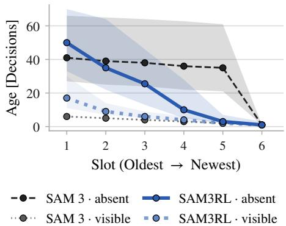  
Figure 3: Frame age in memory slots for SAM3RL and SAM 3 on MOSEv2. Visible pools all decisions with the target present. Absent pools the last decisions of absent gaps of at least 16 decisions. Median with the 25th to 75th percentile.

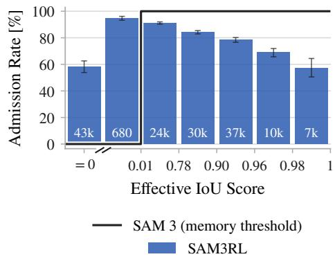  
Figure 4: Admission rate of incoming frames by SAM3RL on MOSEv2 against the frame’s predicted IoU score scaled by max(2σ(ot) − 1, 0). SAM 3 stores only frames above 0.01. Decisions are binned, counts in white, 95% CIs.

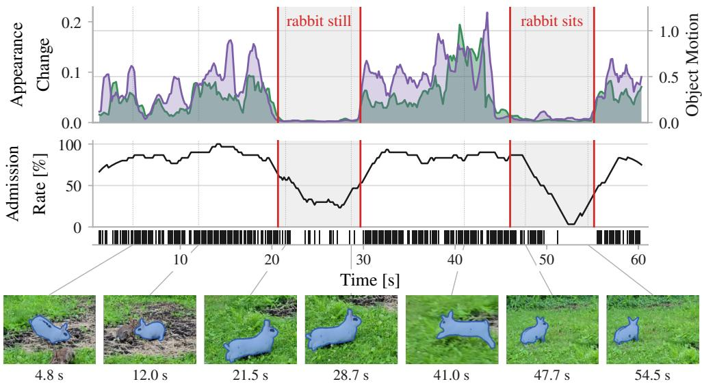  
Appearance Change Object Motion Frame Admitted SAM3RL  
Figure 5: Admission rate of incoming frames by SAM3RL follows object change. An LVOS video sequence in which a rabbit settles and hops off twice over 60 s. Object motion is the shift of the ground-truth box center between consecutive decisions, normalized by the square root of the box area. Appearance change is the DINOv3 (Siméoni et al., 2025) cosine distance between consecutive ground-truth crops. The middle panel is the admission rate in a 5 s window, one tick per admitted decision. Admissions are sparse while the rabbit stays still (gray) and dense when both curves rise.

## 6 DISCUSSION

We presented SAM3RL, which learns memory control over a fixed-capacity bank with RL while keeping the backbone frozen. SAM3RL improves over SAM 3 on 11 of 12 benchmarks and ranks first on 10, with the largest gains on VOT(S), at virtually no runtime cost. It is also the only method that consistently improves on video object segmentation. Applying the same recipe to SAM 2 yields SAM2RL, which improves over SAM 2 on every benchmark and leads on 9. These results suggest that memory control should be learned rather than designed, as learned control improves even the strongest trackers and, unlike fixed rules, remains effective across model generations.

Limitations. First, the policy is tied to the 5 FPS decision rate seen in training. Deciding on every frame of 30 FPS benchmarks still improves over SAM 3, but the average gain drops from 2.9 to 1.8 points. We therefore match the training rate with the stride s, which requires the frame rate to be known in advance and keeps the skipped frames out of the memory bank. The former is rarely restrictive in practice, as the frame rate is usually available. Training at the native rate would remove this restriction, but most decisions would then concern near-identical frames. Such a policy could nonetheless exploit the skipped frames and improve further on high-frame-rate benchmarks. Second, the policy controls only the seven frames in the memory bank, while the nine object pointers are filled by a fixed rule. Learning both jointly is a natural direction for future work.

## ACKNOWLEDGMENTS

T. Cížek, M. Straka, M. Kripner, and M. Schmid were supported by grant no. 25-18031S of the ˇ Czech Science Foundation (GACR). M. Schmid was also supported by Charles University projectˇ UNCE 24/SCI/008. K. Janouskova was supported by the Grant Agency of the Czech Technical University in Prague, grant no. SGS26/074/OHK3/1T/13. The authors acknowledge the support of the OP VVV funded project CZ.02.1.01/0.0/0.0/16\_019/0000765 “Research Center for Informatics”. The authors also thank EquiLibre Technologies, Inc. for supporting this research.

## REFERENCES

Alen Adamyan, Tomáš Cížek, Matej Straka, Klara Janouskova, and Martin Schmid. SAM2RL:ˇ Towards Reinforcement Learning Memory Control in Segment Anything Model 2. arXiv preprint arXiv:2507.08548, 2025.

Nicolas Carion, Laura Gustafson, Yuan-Ting Hu, Shoubhik Debnath, Ronghang Hu, Didac Suris Coll-Vinent, Chaitanya Ryali, Kalyan Vasudev Alwala, Haitham Khedr, Andrew Huang, et al. SAM 3: Segment Anything with Concepts. In International Conference on Learning Representations (ICLR), volume 2026, pp. 138846–138923, 2026.

Luka Cehovin Zajc. A Modular Toolkit for Visual Tracking Performance Evaluation.ˇ SoftwareX, 12:100623, 2020. doi:10.1016/j.softx.2020.100623.

Ruixiang Chen, Guolei Sun, Yawei Li, Jie Qin, and Luca Benini. HiM2SAM: Enhancing SAM2 with Hierarchical Motion Estimation and Memory Optimization Towards Long-term Tracking. In Chinese Conference on Pattern Recognition and Computer Vision (PRCV), pp. 276–291, 2026.

Janghoon Choi, Junseok Kwon, and Kyoung Mu Lee. Real-Time Visual Tracking by Deep Reinforced Decision Making. Computer Vision and Image Understanding, 171:10–19, 2018. doi:10.1016/j.cviu.2018.05.009.

Yutao Cui, Cheng Jiang, Limin Wang, and Gangshan Wu. MixFormer: End-to-End Tracking with Iterative Mixed Attention. In IEEE/CVF Conference on Computer Vision and Pattern Recognition (CVPR), pp. 13598–13608, 2022. doi:10.1109/CVPR52688.2022.01324.

Kenan Dai, Yunhua Zhang, Dong Wang, Jianhua Li, Huchuan Lu, and Xiaoyun Yang. High-Performance Long-Term Tracking with Meta-Updater. In IEEE/CVF Conference on Computer Vision and Pattern Recognition (CVPR), pp. 6297–6306, 2020. doi:10.1109/CVPR42600.2020.00633.

Martin Danelljan, Goutam Bhat, Christoph Mayer, and Matthieu Paul. PyTracking: Visual Tracking Library Based on PyTorch. https://github.com/visionml/pytracking, 2019. Accessed September 2026.

Henghui Ding, Kaining Ying, Chang Liu, Shuting He, Xudong Jiang, Yu-Gang Jiang, Philip H. S. Torr, and Song Bai. MOSEv2: A More Challenging Dataset for Video Object Segmentation in Complex Scenes. arXiv preprint arXiv:2508.05630, 2025a.

Shuangrui Ding, Rui Qian, Xiaoyi Dong, Pan Zhang, Yuhang Zang, Yuhang Cao, Yuwei Guo, Dahua Lin, and Jiaqi Wang. SAM2Long: Enhancing SAM 2 for Long Video Segmentation with a Training-Free Memory Tree. In IEEE/CVF International Conference on Computer Vision (ICCV), pp. 13614–13624, 2025b.

Heng Fan, Liting Lin, Fan Yang, Peng Chu, Ge Deng, Sijia Yu, Hexin Bai, Yong Xu, Chunyuan Liao, and Haibin Ling. LaSOT: A High-Quality Benchmark for Large-Scale Single Object Tracking. In IEEE/CVF Conference on Computer Vision and Pattern Recognition (CVPR), pp. 5369–5378, 2019. doi:10.1109/CVPR.2019.00552.

Heng Fan, Hexin Bai, Liting Lin, Fan Yang, Peng Chu, Ge Deng, Sijia Yu, Harshit, Mingzhen Huang, Juehuan Liu, Yong Xu, Chunyuan Liao, Lin Yuan, and Haibin Ling. LaSOT: A High-Quality Large-Scale Single Object Tracking Benchmark. International Journal of Computer Vision, 129(2):439–461, 2021. doi:10.1007/s11263-020-01387-y.

Yushan Han and Kaer Huang. ACTrack: Adding Spatio-Temporal Condition for Visual Object Tracking. arXiv preprint arXiv:2403.07914, 2024.

Lingyi Hong, Zhongying Liu, Wenchao Chen, Chenzhi Tan, Yuang Feng, Xinyu Zhou, Pinxue Guo, Jinglun Li, Zhaoyu Chen, Shuyong Gao, Wei Zhang, and Wenqiang Zhang. LVOS: A Benchmark for Large-Scale Long-Term Video Object Segmentation. IEEE Transactions on Pattern Analysis and Machine Intelligence, 48(1):946–961, 2026. doi:10.1109/TPAMI.2025.3611020.

Lianghua Huang, Xin Zhao, and Kaiqi Huang. GOT-10k: A Large High-Diversity Benchmark for Generic Object Tracking in the Wild. IEEE Transactions on Pattern Analysis and Machine Intelligence, 43(5):1562–1577, 2021. doi:10.1109/TPAMI.2019.2957464.

Sajid Javed, Martin Danelljan, Fahad Shahbaz Khan, Muhammad Haris Khan, Michael Felsberg, and Jiri Matas. Visual Object Tracking with Discriminative Filters and Siamese Networks: A Survey and Outlook. IEEE Transactions on Pattern Analysis and Machine Intelligence, 45(5): 6552–6574, 2023. doi:10.1109/TPAMI.2022.3212594.

Zdenek Kalal, Krystian Mikolajczyk, and Jiri Matas. Tracking-Learning-Detection. IEEE Transactions on Pattern Analysis and Machine Intelligence, 34(7):1409–1422, 2012. doi:10.1109/TPAMI.2011.239.

Rudolf E. Kalman. A New Approach to Linear Filtering and Prediction Problems. Journal ofBasic Engineering, 82(1):35–45, 1960. doi:10.1115/1.3662552.

Matej Kristan, Roman Pflugfelder, Ales Leonardis, Jiri Matas, et al. The Visual Object Tracking VOT2013 Challenge Results. In IEEE International Conference on Computer Vision Workshops (ICCVW), pp. 98–111, 2013. doi:10.1109/ICCVW.2013.20.

Matej Kristan, Aleš Leonardis, Jiri Matas, Michael Felsberg, et al. The Eighth Visual Object Tracking VOT2020 Challenge Results. In European Conference on Computer Vision Workshops (EC-CVW), pp. 547–601, 2020. doi:10.1007/978-3-030-68238-5\_39.

Matej Kristan, Jiri Matas, Ales Leonardis, Michael Felsberg, et al. The Ninth Visual Object Tracking VOT2021 Challenge Results. In IEEE/CVF International Conference on Computer Vision Workshops (ICCVW), pp. 2711–2738, 2021. doi:10.1109/ICCVW54120.2021.00305.

Matej Kristan, Ales Leonardis, Jiri Matas, Michael Felsberg, et al. The Tenth Visual Object Tracking VOT2022 Challenge Results. In European Conference on Computer Vision Workshops (ECCVW), pp. 431–460, 2023a. doi:10.1007/978-3-031-25085-9\_25.

Matej Kristan, Jiri Matas, Martin Danelljan, Michael Felsberg, Hyung Jin Chang, et al. The First Visual Object Tracking Segmentation VOTS2023 Challenge Results. In IEEE/CVF International Conference on Computer Vision Workshops (ICCVW), pp. 1788–1810, 2023b. doi:10.1109/ICCVW60793.2023.00195.

Matej Kristan, Jiri Matas, Pavel Tokmakov, Alan Lukežic, Michael Felsberg, et al. Theˇ Third Visual Object Tracking Segmentation VOTS2025 Challenge Results. In IEEE/CVF International Conference on Computer Vision Workshops (ICCVW), pp. 7472–7490, 2025. doi:10.1109/ICCVW69036.2025.00771.

Matej Kristan, Jiri Matas, Pavel Tokmakov, Adam W. Harley, Alan Lukežic, et al. The Fourthˇ Visual Object Tracking Segmentation VOTS2026 Challenge Results. In European Conference on Computer Vision Workshops (ECCVW), 2026. URL https://openreview.net/forum? id=zGOan36xpF.

Alan Lukežic, Lukaˇ Cehovin Zajc, Tomáš Vojíˇ ˇr, Jiri Matas, and Matej Kristan. Performance Evaluation Methodology for Long-Term Single-Object Tracking. IEEE Transactions on Cybernetics, 51(12):6305–6318, 2021. doi:10.1109/TCYB.2020.2980618.

Seyed Mojtaba Marvasti-Zadeh, Li Cheng, Hossein Ghanei-Yakhdan, and Shohreh Kasaei. Deep Learning for Visual Tracking: A Comprehensive Survey. IEEE Transactions on Intelligent Transportation Systems, 23(5):3943–3968, 2022. doi:10.1109/TITS.2020.3046478.

Iain Matthews, Takahiro Ishikawa, and Simon Baker. The Template Update Problem. IEEE Transactions on Pattern Analysis and Machine Intelligence, 26(6):810–815, 2004. doi:10.1109/TPAMI.2004.16.

Seoung Wug Oh, Joon-Young Lee, Ning Xu, and Seon Joo Kim. Video Object Segmentation Using Space-Time Memory Networks. In IEEE/CVF International Conference on Computer Vision (ICCV), pp. 9225–9234, 2019. doi:10.1109/ICCV.2019.00932.

Federico Perazzi, Jordi Pont-Tuset, Brian McWilliams, Luc Van Gool, Markus Gross, and Alexander Sorkine-Hornung. A Benchmark Dataset and Evaluation Methodology for Video Object Segmentation. In IEEE Conference on Computer Vision and Pattern Recognition (CVPR), pp. 724–732, 2016. doi:10.1109/CVPR.2016.85.

Jordi Pont-Tuset, Federico Perazzi, Sergi Caelles, Pablo Arbeláez, Alexander Sorkine-Hornung, and Luc Van Gool. The 2017 DAVIS Challenge on Video Object Segmentation. arXiv preprint arXiv:1704.00675, 2017.

Nikhila Ravi, Valentin Gabeur, Yuan-Ting Hu, Ronghang Hu, et al. SAM 2: Segment Anything in Images and Videos. In International Conference on Learning Representations (ICLR), volume 2025, pp. 28085–28128, 2025.

John Schulman, Philipp Moritz, Sergey Levine, Michael I. Jordan, and Pieter Abbeel. High-Dimensional Continuous Control Using Generalized Advantage Estimation. In International Conference on Learning Representations (ICLR), 2016.

John Schulman, Filip Wolski, Prafulla Dhariwal, Alec Radford, and Oleg Klimov. Proximal Policy Optimization Algorithms. arXiv preprint arXiv:1707.06347, 2017.

Oriane Siméoni, Huy V. Vo, Maximilian Seitzer, Federico Baldassarre, Maxime Oquab, Cijo Jose, et al. DINOv3. arXiv preprint arXiv:2508.10104, 2025.

Jovana Videnovic, Matej Kristan, and Alan Lukeži´ c. Distractor-Aware Memory-Based Visual Objectˇ Tracking. International Journal ofComputer Vision, 134(5):211, 2026. doi:10.1007/s11263-026- 02790-7.

Yi Wu, Jongwoo Lim, and Ming-Hsuan Yang. Object Tracking Benchmark. IEEE Transactions on Pattern Analysis and Machine Intelligence, 37(9):1834–1848, 2015. doi:10.1109/TPAMI.2014.2388226.

Ning Xu, Linjie Yang, Yuchen Fan, Jianchao Yang, Dingcheng Yue, Yuchen Liang, Brian Price, Scott Cohen, and Thomas Huang. YouTube-VOS: Sequence-to-Sequence Video Object Segmentation. In European Conference on Computer Vision (ECCV), pp. 603–619, 2018. doi:10.1007/978-3-030-01228-1\_36.

Qianxiong Xu, Lanyun Zhu, Chenxi Liu, Guosheng Lin, Cheng Long, Ziyue Li, and Rui Zhao. SAMITE: Position Prompted SAM2 with Calibrated Memory for Visual Object Tracking. arXiv preprint arXiv:2507.21732, 2025.

Cheng-Yen Yang, Hsiang-Wei Huang, Wenhao Chai, Zhongyu Jiang, and Jenq-Neng Hwang. SAMURAI: Motion-Aware Memory for Training-Free Visual Object Tracking with SAM 2. IEEE Transactions on Image Processing, 35:970–982, 2026. doi:10.1109/TIP.2026.3651835.

Tianyu Yang and Antoni B. Chan. Learning Dynamic Memory Networks for Object Tracking. In European Conference on Computer Vision (ECCV), pp. 153–169, 2018. doi:10.1007/978-3-030- 01240-3\_10.

Fangyi Zhang, Qiang Wang, Bo Li, Zhiyuan Chen, and Jinghao Zhou. PySOT: SenseTime Research Platform for Single Object Tracking. https://github.com/STVIR/pysot, 2019a. Accessed September 2026.

Lichao Zhang, Abel Gonzalez-Garcia, Joost van de Weijer, Martin Danelljan, and Fahad Shahbaz Khan. Learning the Model Update for Siamese Trackers. In IEEE/CVF International Conference on Computer Vision (ICCV), pp. 4009–4018, 2019b. doi:10.1109/ICCV.2019.00411.

## A EXTENDED RESULTS

We extend the main model comparison from Tables 1 to 3. Tables 5 to 7 add three more benchmarks (GOT-10k, DAVIS2017, and YouTube-VOS), together with the throughput of each method on VOT and VOS. We also report the compared methods in their original SAM 2 implementations alongside SAM2RL, our policy trained on the SAM 2 backbone. We discuss SAM 2 results in Appendix A.1, the three additional benchmarks in Appendix A.2, and the VOS throughput in Appendix A.3.

## A.1 SAM2RL PERFORMANCE

In addition to the SAM 3 backbone results of Tables 1 to 3, we report the performance of compared methods in their original SAM 2 implementations. The results are presented alongside those of SAM2RL in Tables 5 to 7, where SAM2RL is trained in the same way as SAM3RL. The MDP, the controller architecture, the LaSOT training corpus, the PPO hyperparameters, and the inference stride are unchanged, and only the frozen backbone differs. Unlike Section 4, this comparison includes GOT-10k, $\mathrm { D A V I S } _ { 2 0 1 7 }$ and YouTube-VOS. The SAM 2 backbone leaves room for memory control to make a difference, and the compared methods still separate, which does not hold on SAM 3; see Appendix A.2 for further discussion.

On the VOT(S) challenges and VOT datasets, SAM2RL improves over SAM 2 on all nine benchmarks and ranks first on five. The gains are largest on the challenges, where it is the best method on four of five and second only to SAMITE on $\mathrm { V O T - L T } _ { 2 0 2 1 }$ . On DiDi it is ahead of every hand-crafted rule, while on LaSOT and $\mathrm { L a S O T _ { e x t } }$ it trails SAMITE by less than one point. GOT-10k is the only tracking benchmark where the gain is negligible. SAM2RL also runs faster than SAM 2 itself and than every compared method, for the same reason as on SAM 3; see Section 4. On the segmentation benchmarks, SAM2RL ranks first on all six. It is the only method that improves on DAVIS2017. On $\mathrm { Y T - V O S } _ { 2 0 1 9 } .$ , it matches the baseline, as does SAM2Long, while every other rule falls below it. Unlike on SAM 3, most hand-crafted rules do improve SAM 2 on SA-V, which supports the observation that they were designed to handle the specific weaknesses of the older backbone.

Table 5: Extended performance on VOT(S) challenges. We report standard metrics for evaluated challenges. Deltas indicate improvement or decline relative to SAM 2 and SAM 3. Bold = best.
<table><tr><td></td><td></td><td colspan="3">Quality</td><td colspan="2">F-score</td></tr><tr><td>Model</td><td>FPS</td><td> $\mathrm { V O T S } _ { 2 0 2 6 }$ </td><td>VOTS2025</td><td>VOTS-RT2025</td><td>VOT-LT2021</td><td>VOT-LT2022</td></tr><tr><td>SAM 3</td><td>15.3</td><td>66.4</td><td>73.4</td><td>69.1</td><td>77.1</td><td>62.8</td></tr><tr><td>SAMURAI3</td><td>15.1</td><td>64.0-2.4</td><td>72.2-1.2</td><td>71.5+2.4</td><td>77.4+0.3</td><td>63.4+0.6</td></tr><tr><td>SAM3Long</td><td>9.3</td><td>67.9+1.5</td><td>75.2+1.8</td><td></td><td>77.1±0.0</td><td>64.5+1.7</td></tr><tr><td>DAM4SAM3</td><td>14.2</td><td>66.7 +0.3</td><td>73.3-0.1</td><td>69.5+0.4</td><td>77.6+0.5</td><td>63.4+0.6</td></tr><tr><td>SAMITE3</td><td>12.7</td><td>65.4-1.0</td><td>73.6+0.2</td><td>72.7 +3.6</td><td>78.3+1.2</td><td>66.2+3.4</td></tr><tr><td>HiM3SAM</td><td>11.8</td><td>63.0-3.4</td><td>72.5-0.9</td><td>58.8-10.3</td><td>77.1 ±0.0</td><td>62.3-0.5</td></tr><tr><td>SAM3RL (ours)</td><td>16.0</td><td>70.0+3.6</td><td>76.9+3.5</td><td>75.1 +6.0</td><td>79.0+1.9</td><td>68.3+5.5</td></tr><tr><td>SAM 2.1 L</td><td>25.1</td><td>57.9</td><td>65.6</td><td>65.6</td><td>66.1</td><td>55.1</td></tr><tr><td>SAMURAI</td><td>21.3</td><td>59.9+2.0</td><td>68.2+2.6</td><td>68.1 +2.5</td><td>75.8+9.7</td><td>61.2+6.1</td></tr><tr><td>SAM2Long</td><td>11.0</td><td>61.0+3.1</td><td>68.1 +2.5</td><td></td><td>72.9+6.8</td><td>57.5+2.4</td></tr><tr><td>DAM4SAM</td><td>16.7</td><td>61.7 +3.8</td><td>70.4+4.8</td><td>70.5+4.9</td><td>74.5 +8.4</td><td>60.9+5.8</td></tr><tr><td>SAMITE</td><td>16.3</td><td>61.1 +3.2</td><td>69.2+3.6</td><td>67.1+1.5</td><td>78.5+12.4</td><td>63.7 +8.6</td></tr><tr><td>HiM2SAM</td><td>16.1</td><td>58.6+0.7</td><td>67.8+2.2</td><td>60.5-5.1</td><td>73.9+7.8</td><td>62.9+7.8</td></tr><tr><td>SAM2RL (ours)</td><td>25.5</td><td>63.3+5.4</td><td>71.4+5.8</td><td>71.3+5.7</td><td>76.6+10.5</td><td>64.6+9.5</td></tr></table>

## A.2 ADDITIONAL BENCHMARKS

We additionally report three benchmarks that are not part of the main comparison, GOT-10k, $\mathrm { D A V I S } _ { 2 0 1 7 }$ and YouTube-VOS, in Tables 6 and 7. Performance is scored by the average overlap (AO) on GOT-10k, and by the overall score G on YouTube-VOS, which is the mean of J&F over categories seen and unseen during training.

Table 6: Extended performance on VOT datasets. We report standard metrics for the evaluated datasets. Deltas indicate improvement or decline relative to SAM 2 and SAM 3. Bold = best.
<table><tr><td rowspan="2">Model</td><td>Quality</td><td colspan="2">AUC</td><td>AO</td></tr><tr><td>DiDi</td><td>LaSOT</td><td> $\mathrm { L a S O T _ { e x t } }$ </td><td>GOT-10k</td></tr><tr><td>SAM 3</td><td>71.4</td><td>75.9</td><td> $6 1 . 7$ </td><td>84.7</td></tr><tr><td>SAMURAI3</td><td>71.8+0.4</td><td>76.3+0.4</td><td>63.5+1.8</td><td>85.0+0.3</td></tr><tr><td>SAM3Long</td><td>71.7 +0.3</td><td>76.1 +0.2</td><td> $6 2 . 0 \substack { + 0 . 3 }$ </td><td>84.9+0.2</td></tr><tr><td>DAM4SAM3</td><td>71.8+0.4</td><td>77.3+1.4</td><td> $\mathbf { 6 5 . 0 } \mathbf { _ { + 3 . 3 } }$ </td><td>84.8+0.1</td></tr><tr><td>SAMITE3</td><td>71.8+0.4</td><td> $7 7 . 6 { \scriptstyle + 1 . 7 }$ </td><td> $6 4 . 7 \substack { + 3 . 0 }$ </td><td>84.5-0.2</td></tr><tr><td>HiM3SAM</td><td>70.8-0.6</td><td>75.6-0.3</td><td>61.9+0.2</td><td>84.3-0.4</td></tr><tr><td>SAM3RL (ours)</td><td>72.0+0.6</td><td>78.4+2.5</td><td>64.7 +3.0</td><td>84.8+0.1</td></tr><tr><td>SAM 2.1 L</td><td>64.8</td><td>69.9</td><td>56.9</td><td>80.6</td></tr><tr><td>SAMURAI</td><td>67.8 +3.0</td><td>74.8+4.9</td><td>60.0+3.1</td><td>81.9+1.3</td></tr><tr><td>SAM2Long</td><td>66.2+1.4</td><td>73.4+3.5</td><td>59.1 +2.2</td><td>81.0+0.4</td></tr><tr><td>DAM4SAM</td><td>68.5 +3.7</td><td>75.5+5.6</td><td> $6 1 . 7 \substack { + 4 . 8 }$ </td><td>81.3+0.7</td></tr><tr><td>SAMITE</td><td>68.6+3.8</td><td>75.8+5.9</td><td>61.9+5.0</td><td>80.1-0.5</td></tr><tr><td>HiM2SAM</td><td>67.3 +2.5</td><td> $7 4 . 3 \substack { + 4 . 4 }$ </td><td>60.5 +3.6</td><td>75.8-4.8</td></tr><tr><td>SAM2RL (ours)</td><td> $\mathbf { 6 9 . 1 } \substack { + 4 . 3 }$ </td><td> $7 5 . 4 \substack { + 5 . 5 }$ </td><td>61.1 +4.2</td><td>80.7+0.1</td></tr></table>

Table 7: Extended performance on VOS datasets. We report standard metrics for the evaluated datasets. Deltas indicate improvement or decline relative to SAM 2 and SAM 3. Bold = best.
<table><tr><td colspan="2"></td><td> $\mathcal { I } \& \dot { \mathcal { F } }$ </td><td colspan="4"> $\mathcal { T } \& \mathcal { F }$ </td><td>g</td></tr><tr><td rowspan="2">Model</td><td rowspan="2">FPS</td><td> $\mathrm { M O S E _ { v 2 } }$ </td><td> $\mathrm { { S A ^ { - } V _ { v a l } } }$ </td><td> $\mathrm { S A ^ { - } V _ { t e s t } }$ </td><td> $\mathrm { L V O S } _ { \mathrm v 2 }$ </td><td> $\mathrm { D A V I S } _ { 2 0 1 7 }$ </td><td> $\mathrm { Y T - V O S } _ { 2 0 1 9 }$ </td></tr><tr><td colspan="2"></td><td></td><td></td><td></td><td></td></tr><tr><td>SAM 3</td><td>15.7</td><td>59.8</td><td>82.9</td><td>84.6</td><td>88.7</td><td>91.6</td><td>89.6</td></tr><tr><td>SAMURAI3</td><td>15.2</td><td>56.6-3.2</td><td>78.7-4.2</td><td>81.4-3.2</td><td>88.4-0.3</td><td>91.3-0.3</td><td>89.2-0.4</td></tr><tr><td>SAM3Long</td><td>9.4</td><td>59.3-0.5</td><td>82.5-0.4</td><td>85.0+0.4</td><td>89.0+0.3</td><td>91.3-0.3</td><td>89.5-0.1</td></tr><tr><td>DAM4SAM3</td><td>14.5</td><td>58.0-1.8 53.4-6.4</td><td>80.4-2.5</td><td>83.1-1.5</td><td>88.9+0.2</td><td>91.6±0.0</td><td>89.4-0.2</td></tr><tr><td>SAMITE3 HiM3SAM</td><td>12.8 10.6</td><td>50.0-9.8</td><td>81.1-1.8 81.1-1.8</td><td>82.2-2.4</td><td>89.3 +0.6</td><td>90.7-0.9</td><td>88.9-0.7</td></tr><tr><td>SAM3RL (ours)</td><td>15.4</td><td> $\mathbf { 6 0 . 9 + 1 . 1 }$ </td><td> $\mathbf { 8 5 . 4 } \substack { + 2 . 5 }$ </td><td>80.9-3.7 84.6±0.0</td><td>86.6-2.1  $\mathbf { 8 9 . 5 + 0 . 8 }$ </td><td>89.9-1.7 91.5-0.1</td><td>88.5-1.1 89.5-0.1</td></tr><tr><td></td><td></td><td></td><td></td><td></td><td></td><td></td><td></td></tr><tr><td>SAM 2.1 L SAMURAI</td><td>25.0 21.1</td><td>49.4 48.1-1.3</td><td>78.4 79.3+0.9</td><td>79.8 79.5-0.3</td><td>84.2</td><td>89.8</td><td>88.5</td></tr><tr><td>SAM2Long</td><td>12.1</td><td>50.7+1.3</td><td>81.4+3.0</td><td>80.7+0.9</td><td>86.3 +2.1 85.0+0.8</td><td>89.6-0.2 89.8±0.0</td><td>88.1-0.4</td></tr><tr><td>DAM4SAM</td><td>17.9</td><td>50.5+1.1</td><td>81.1+2.7</td><td>81.9+2.1</td><td>86.8+2.6</td><td>88.4-1.4</td><td>88.5±0.0</td></tr><tr><td>SAMITE</td><td>17.0</td><td>47.0-2.4</td><td>79.9+1.5</td><td>80.1+0.3</td><td>86.5 +2.3</td><td>88.2-1.6</td><td>88.3-0.2</td></tr><tr><td>HiM2SAM</td><td>13.9</td><td>42.7-6.7</td><td>80.6+2.2</td><td>80.2+0.4</td><td>82.3-1.9</td><td>87.1-2.7</td><td>87.9-0.6 87.4-1.1</td></tr><tr><td></td><td>24.1</td><td></td><td> $\mathbf { 8 2 . 5 + 4 . 1 }$ </td><td></td><td>86.9+2.7</td><td></td><td></td></tr><tr><td>SAM2RL (ours)</td><td></td><td>52.4+3.0</td><td></td><td>82.8+3.0</td><td></td><td>90.7+0.9</td><td>88.5±0.0</td></tr></table>

GOT-10k (Huang et al., 2021) is the shortest of all tracking benchmarks we evaluate on, with an average sequence length of 127 frames. In Table 6, five of the seven SAM 3 methods lie within 0.3 of each other, and the SAM 3 baseline is already at 84.7. SAM3RL reaches 84.8, 0.2 behind SAMURAI3. This further highlights the previous findings that GOT-10k difficulty is shrinking for modern trackers (Videnovic et al., 2026).´

DAVIS (Pont-Tuset et al., 2017; Perazzi et al., 2016) and YouTube-VOS (Xu et al., 2018) are the classic VOS benchmarks, on which modern methods are near 90 J&F and which contain mostly salient, dominant, and isolated objects (Ding et al., 2025a). In Table 7, the SAM 3 baseline already performs well on these datasets, leaving little room for memory-control methods to improve it. Therefore, all methods remain within a few points of each other, with the main exception of HiM3SAM. The small differences on these benchmarks contrast with the larger gaps on other VOS datasets, indicating that conventional short VOS benchmarks do not provide a discriminative test of memory management.

Note that the benchmark counts in the main paper, such as “first on 10 of 12”, are over the twelve benchmarks of Tables 1 to 3 and exclude the three discussed here, because on SAM 3, none of the three benchmarks separates the compared methods. We nonetheless keep them in Tables 6 and 7, since on the weaker SAM 2 backbone they still separate the methods, and Appendix A.1 evaluates SAM2RL performance over all fifteen.

## A.3 VOS THROUGHPUT

In addition to the VOTS throughput reported in Section 4, we measure VOS throughput on ${ \bf M O S E } _ { \mathrm { v } 2 }$ and list it in Table 7. The protocol is the same as on VOTS, but $\mathrm { M O S E } _ { \mathrm { v } 2 }$ videos are annotated at an average of 5 FPS, so both SAM2RL and SAM3RL update their memory on every frame with s = 1, unlike every-6-frames updates on VOTS with s = 6. SAM3RL falls slightly behind SAM 3 at 15.4 vs 15.7 FPS, but remains faster than all other methods. The same holds for SAM2RL, which runs at 24.1 against 25.0 FPS for SAM 2.1 L, and is the fastest after the baseline.

## B TRACKER EVALUATION DETAILS AND REPRODUCIBILITY

Benchmarks and metrics. Table 8 lists every dataset we evaluate on, with the number of sequences, objects, frame rate, and length. Performance is measured by the tracking quality (Kristan et al., 2023b) on the VOTS challenges and on DiDi, and by the F-score (Lukežic et al., 2021) on the VOT-ˇ LT challenges. On LaSOT and $\mathrm { L a S O T _ { e x t } }$ , it is measured by the area under the success rate curve (AUC) (Wu et al., 2015). On VOS benchmarks, it is measured by $\mathcal { T } \& \mathcal { F }$ (Pont-Tuset et al., 2017), the mean of the region similarity $\mathcal { I }$ and the contour accuracy $\mathcal { F } . \mathrm { M O S E } _ { \mathrm { v } 2 }$ replaces $\mathcal { F }$ by an adaptive boundary accuracy $\dot { \mathcal { F } }$ that rescales the tolerance with object size.

We score LaSOT and $\mathrm { L a S O T _ { e x t } }$ with the PyTracking evaluation code (Danelljan et al., 2019) (commit 9cba77e), which implements the AUC protocol of the official LaSOT toolkit (Fan et al., 2019). Our SAM 2.1 runs reproduce the published AUC of 70.0 on LaSOT and 56.9 on $\mathrm { L a S O T _ { e x t } }$ (Ding et al., 2025b; Videnovic et al., 2026) to within 0.1. Some evaluators implement the protocol differently´ (e.g., the got10k toolkit (Huang et al., 2021) and the pysot toolkit (Zhang et al., 2019a)), as does the evaluation code in the SAMURAI codebase (Yang et al., 2026). For instance, on $\mathrm { L a S O T _ { e x t } }$ , their implementations inflate scores of every method we report by up to 1.7 AUC compared to the official protocol. GOT-10k, MOSE , and all VOTS challenges are scored on their evaluation servers. DiDi and VOT-LT are scored with the VOT toolkit (Cehovin Zajc, 2020).ˇ

Table 8: Evaluation benchmarks with VOT(S) challenges (top), VOT datasets (middle), VOS datasets (bottom). Seq. and Obj. are the numbers of sequences and annotated targets, respectively. FPS is the annotation frame rate, Frames is the average number of frames per sequence, and s is the stride defined in Section 3.2. The three length columns give the average, shortest, and longest sequence duration in seconds. SA-V videos are recorded at 24 FPS, but annotated at 6.
<table><tr><td colspan="6"></td><td colspan="3">Length (s)</td></tr><tr><td>Dataset</td><td>Seq.</td><td>Obj.</td><td>FPS</td><td>S</td><td>Frames</td><td>Avg.</td><td>Min</td><td>Max</td></tr><tr><td>VOTS2026 (Kristan et al., 2026)</td><td>170</td><td>375</td><td>30</td><td>6</td><td>1860</td><td>62.0</td><td>2.1</td><td>356.6</td></tr><tr><td> $\mathrm { V O T S } ( \mathrm { - R T } ) _ { 2 0 2 5 }$  (Kristan et al., 2023b; 2025)</td><td>144</td><td>341</td><td>30</td><td>6</td><td>2074</td><td>69.1</td><td>2.1</td><td>356.6</td></tr><tr><td> $\mathrm { V O T - L T } _ { 2 0 2 1 }$  (Kristan et al., 2021)</td><td>50</td><td>50</td><td>30</td><td>6</td><td>4306</td><td>143.5</td><td>46.3</td><td>990.0</td></tr><tr><td> $\mathrm { V O T - L T } _ { 2 0 2 2 }$  (Kristan et al., 2023a)</td><td>50</td><td>50</td><td>30</td><td>6</td><td>3366</td><td>112.2</td><td>32.6</td><td>356.6</td></tr><tr><td>DiDi (Videnović et al., 2026)</td><td>180</td><td>180</td><td>30</td><td>6</td><td>1527</td><td>50.9</td><td>2.1</td><td>333.3</td></tr><tr><td>LaSOT (Fan et al., 2019)</td><td>280</td><td>280</td><td>30</td><td>6</td><td>2448</td><td>81.6</td><td>33.3</td><td>333.3</td></tr><tr><td> $\mathrm { L a S O T _ { e x t } }$  (Fan et al., 2021)</td><td>150</td><td>150</td><td>30</td><td>6</td><td>2394</td><td>79.8</td><td>66.8</td><td>90.1</td></tr><tr><td>GOT-10k (Huang et al., 2021)</td><td>180</td><td>180</td><td>10</td><td>2</td><td>127</td><td>12.7</td><td>5.1</td><td>92.0</td></tr><tr><td> $\mathrm { M O S E } _ { \mathrm { v } 2 }$  (Ding et al., 2025a)</td><td>433</td><td>575</td><td>5</td><td>1</td><td>154</td><td>30.7</td><td>4.8</td><td>488.0</td></tr><tr><td> $\mathbf { S A } – \mathbf { V } _ { \mathrm { v a l } }$  (Ravi et al., 2025)</td><td>155</td><td>293</td><td>24/6</td><td>5</td><td>414</td><td>17.2</td><td>2.2</td><td>38.4</td></tr><tr><td> $\mathrm { S A ^ { - } V _ { t e s t } }$  (Ravi et al., 2025)</td><td>150</td><td>278</td><td>24/6</td><td>5</td><td>426</td><td>17.7</td><td>2.7</td><td>36.1</td></tr><tr><td> $\mathrm { L V O S } _ { \mathrm v 2 }$  (Hong et al., 2026)</td><td>140</td><td>239 61</td><td>6</td><td>1</td><td>472</td><td>78.6</td><td>19.2</td><td>356.7</td></tr><tr><td> $\mathrm { D A V I S } _ { 2 0 1 7 }$  (Pont-Tuset et al., 2017)</td><td>30</td><td>1063</td><td>24</td><td>5</td><td>67 27</td><td>2.8</td><td>1.4</td><td>4.3</td></tr><tr><td> $\mathrm { Y o u T u b e - V O S } _ { 2 0 1 9 }$  (Xu et al., 2018)</td><td>507</td><td></td><td>6</td><td>1</td><td></td><td>4.5</td><td>0.7</td><td>6.0</td></tr></table>

Previously published results for the compared methods and baselines are listed in Table 9 and Table 10, next to our own measurements. Most agree within noise, while some differ more. We attribute these differences to evaluation protocols that vary between papers (e.g., mentioned LaSOT case), to unspecified prompt masks, and to differences in hardware and libraries. Interestingly, even SAM 2 baseline numbers are not consistent between previous work.

Initialization prompts used for the trackers in our evaluation are as follows. We use segmentation masks wherever such are available. A mask localizes the target more precisely than a box. SAM 2 reports 79.3 against 74.4 $\mathcal { T } \& \mathcal { F }$ averaged over 17 video datasets when the first frame is prompted by a ground-truth mask rather than a box (Ravi et al., 2025). SAM 3 then inherits masks as main prompts in its evaluation (Carion et al., 2026).

We do not use mask prompting only where a method or a challenge protocol prescribes otherwise. On VOS benchmarks, every method is initialized with the ground-truth mask of the dataset. On

Table 9: Performance on tracking benchmarks across previous work. For each work, we list the numbers for baselines as reported there (whether independently measured, or cited from prior work). The last block reports our own measurements. Hyphen means the benchmark was not reported.
<table><tr><td rowspan="2">Source</td><td rowspan="2">Model</td><td colspan="2">Quality</td><td colspan="2">AUC</td><td>AO</td></tr><tr><td>DiDi</td><td> $\mathrm { V O T S } _ { 2 0 2 5 }$ </td><td>LaSOT</td><td> $\mathrm { L a S O T _ { e x t } }$ </td><td>GOT-10k</td></tr><tr><td>SAMURAI</td><td>SAM 2.1 L</td><td>一</td><td></td><td>68.5</td><td>58.6</td><td></td></tr><tr><td rowspan="2">(Yang et al., 2026)</td><td>SAMURAI</td><td>一</td><td>一</td><td>74.2</td><td>61.0</td><td>81.7</td></tr><tr><td>SAM 2.1 L</td><td>一</td><td>一</td><td>70.0</td><td>56.9</td><td>80.7</td></tr><tr><td>SAM2Long (Ding et al., 2025b)</td><td>SAM2Long</td><td>一</td><td>一</td><td>73.9</td><td>60.9</td><td>81.1</td></tr><tr><td rowspan="3">SAMITE (Xu et al., 2025)</td><td>SAM 2.1 L</td><td></td><td>一</td><td>68.5</td><td>58.6</td><td></td></tr><tr><td>SAMURAI</td><td></td><td>一</td><td>74.2</td><td>61.0</td><td></td></tr><tr><td>SAMITE</td><td></td><td></td><td>74.7</td><td>62.1</td><td></td></tr><tr><td rowspan="5">HiM2SAM (Chen et al., 2026)</td><td>SAM 2.1 L</td><td></td><td></td><td>68.5</td><td>58.6</td><td></td></tr><tr><td>SAMURAI</td><td></td><td>一</td><td>74.2</td><td>61.0</td><td></td></tr><tr><td>DAM4SAM</td><td></td><td></td><td>75.1</td><td>60.9</td><td></td></tr><tr><td>SAM2Long</td><td></td><td>一</td><td>73.9</td><td>60.9</td><td></td></tr><tr><td>HiM2SAM</td><td>一</td><td>一</td><td>75.1</td><td>62.8</td><td></td></tr><tr><td rowspan="4">DAM4SAM (Videnović et al., 2026)</td><td>SAM 2.1 L</td><td>64.9</td><td>66.1</td><td>70.0</td><td>56.9</td><td>80.7</td></tr><tr><td>SAMURAI</td><td>68.0</td><td></td><td></td><td></td><td></td></tr><tr><td>DAM4SAM</td><td>69.4</td><td>71.1</td><td>75.1</td><td>60.9</td><td>81.1</td></tr><tr><td>SAM2Long</td><td>64.6</td><td></td><td></td><td></td><td></td></tr><tr><td rowspan="6">Ours</td><td>SAM 2.1 L</td><td>64.8</td><td>65.6</td><td>69.9</td><td>56.9</td><td>80.6</td></tr><tr><td>SAMURAI</td><td>67.8</td><td>68.2</td><td>74.8</td><td>60.0</td><td>81.9</td></tr><tr><td>DAM4SAM</td><td>68.5</td><td>70.4</td><td>75.5</td><td>61.7</td><td>81.3</td></tr><tr><td>SAM2Long</td><td>66.2</td><td>68.1</td><td>73.4</td><td>59.1</td><td>81.0</td></tr><tr><td>SAMITE</td><td>68.6</td><td>69.2</td><td>75.8</td><td>61.9</td><td>80.1</td></tr><tr><td>HiM2SAM</td><td>67.3</td><td>67.8</td><td>74.3</td><td>60.5</td><td>75.8</td></tr><tr><td></td><td>SAM 3</td><td>71.4</td><td>73.4</td><td>75.9</td><td>61.7</td><td>84.7</td></tr></table>

LaSOT, $\mathrm { L a S O T _ { e x t } } .$ , and GOT-10k, we use the masks from the set released by Videnovic et al. (2026),´ so that the prompt is reproducible from a public file. The single exception for these VOT datasets is SAMURAI(3), which we prompt with the box, as its authors do and as its published numbers were obtained.1 DiDi ships its own first-frame masks, and we use them. On $\mathrm { V O T - L T } _ { 2 0 2 1 }$ and VOT-LT2022, we prompt with the ground-truth box. That is the official protocol of both challenges, and no public mask set exists either. On VOTS the toolkit delivers the ground-truth mask of each target.

Object handling. We evaluate trackers in a per-object rather than joint setup. Each object is initialized with its first non-empty annotation and propagated forward from that frame. The tracker state is reset between objects. This is the only mode all methods support, since SAMURAI, DAM4SAM, SAM2Long, SAMITE, and HiM2SAM are single-object trackers by construction. It is also the better mode for SAM 3, which gains up to 2.8 J&F over joint tracking on $\mathrm { S A ^ { - } V _ { \mathrm { t e s t } } }$ . VOTS multi-target sequences are run in the sequential single-object mode of the toolkit, one tracker process per target.

Port implementation. None of the compared methods has an official SAM 3 implementation, so we port each to that backbone. We replace the SAM 2 video predictor with the SAM 3 tracker and leave the method’s code, hyperparameters, and memory layout unchanged. Additionally, we implement the striding described in Section 3.2 for DAM4SAM (Videnovic et al., 2026). This ´ follows its VOS protocol, which Videnovic et al. (2026) describe in the paper. The official code for´ this feature was never released, so we reproduce it from the description. We will release the port implementations together with our code.

Table 10: Performance on VOS datasets across previous work. For each work, we list the numbers for baselines as reported there (whether independently measured, or cited from prior work). The last block presents our own measurements. Hyphen means the benchmark was not reported.
<table><tr><td rowspan="2">Source</td><td rowspan="2">Model</td><td rowspan="2">J&amp;F</td><td colspan="4">J&amp;F</td><td>g</td></tr><tr><td></td><td>MOSEv2 SA-Vval SA-Vtest</td><td>LVOSv2</td><td>DAVIS2017</td><td>YT-VOS2019</td></tr><tr><td rowspan="4">MOSEv2 (Ding et al., 2025a)</td><td>SAM 2.1 L</td><td>49.4</td><td>一</td><td>78.4</td><td>84.0</td><td>90.7</td><td>89.3</td></tr><tr><td>SAMURAI</td><td>51.1</td><td>一</td><td></td><td>一</td><td></td><td>一</td></tr><tr><td>DAM4SAM</td><td>51.2</td><td>一</td><td></td><td></td><td></td><td></td></tr><tr><td>SAM2Long</td><td>51.5</td><td>一</td><td>81.2</td><td>85.3</td><td>88.8</td><td>90.2</td></tr><tr><td rowspan="2">DAM4SAM (Videnović et al., 2026)</td><td>SAM 2.1 L</td><td>一</td><td>一</td><td>一</td><td>80.6</td><td>一</td><td>一</td></tr><tr><td>DAM4SAM</td><td>一</td><td>一</td><td>一</td><td>85.5</td><td>一</td><td>一</td></tr><tr><td rowspan="2">SAM2Long (Ding et al., 2025b)</td><td>SAM 2.1 L</td><td>一</td><td>78.6</td><td>79.6</td><td>84.0</td><td>一</td><td>1</td></tr><tr><td>SAM2Long</td><td>一</td><td>81.1</td><td>81.2</td><td>85.3</td><td>一</td><td>一</td></tr><tr><td rowspan="4">SAM3 (Carion et al., 2026)</td><td>SAM 2.1 L</td><td>47.9</td><td>77.9</td><td>78.4</td><td>79.6</td><td>90.7</td><td>一</td></tr><tr><td>SAMURAI</td><td>51.1</td><td>79.8</td><td>80.0</td><td>84.2</td><td>89.9</td><td></td></tr><tr><td>SAM2Long</td><td>51.5</td><td>81.2</td><td>81.1</td><td>85.9</td><td>91.4</td><td></td></tr><tr><td>SAM3</td><td>60.3</td><td>83.5</td><td>84.4</td><td>88.5</td><td>92.2</td><td>1</td></tr><tr><td rowspan="5">Ours</td><td>SAM 2.1 L</td><td>49.4</td><td>78.4</td><td>79.8</td><td>84.2</td><td>89.8</td><td>88.5</td></tr><tr><td>SAMURAI</td><td>48.1</td><td>79.3</td><td>79.5</td><td>86.3</td><td>89.6</td><td>88.1</td></tr><tr><td>DAM4SAM</td><td>50.5</td><td>81.1</td><td>81.9</td><td>86.8</td><td>88.4</td><td>88.3</td></tr><tr><td>SAM2Long</td><td>50.7</td><td>81.4</td><td>80.7</td><td>85.0</td><td>89.8</td><td>88.5</td></tr><tr><td>SAM3</td><td>59.8</td><td>82.9</td><td>84.6</td><td>88.7</td><td>91.6</td><td>89.6</td></tr></table>

SAM2Long and SAM3Long are not online trackers. Ding et al. (2025b) keep several memory pathways and decodes the video only after tracking ends, along the pathway that leads in the last frame. We preserve this behavior for both SAM2Long and SAM3Long, since changing them to fulfill the causality would be a different algorithm. However, the comparison on the tracking benchmarks is uneven, where every other method, ours included, is online. As a result, SAM(2/3)Long are excluded from VOTS-RT , where the answer for frame t is due before frame t + 1 arrives.

Hardware. All evaluations are computed on NVIDIA A100 40 GB GPUs unless specified otherwise. Throughput is also measured on the A100, as the mean over three runs. It times only model inference, with all the data preprocessing and postprocessing being excluded.

Notably, some methods utilize much more RAM or GPU memory than others. For instance, the longest VOT-LT2021 sequence, decoded to CPU, takes 348 GB for most methods, but SAM(2/3)Long need 600 GB on that sequence, since they store three pathways per frame. Similarly, the SAMITE prototype bank of up to 30 frames exceeds the 40 GB of the A100 on MOSEv2, so the SAMITE family is run on NVIDIA H200 NVL. Throughput is nonetheless measured on the A100 for SAMITE and SAM2Long, since the sequences used for timing fit into its memory.

## C RACE CONDITION IN SAM 3

The SAM 3 video predictor offloads per-frame tracking state to pageable host memory with non\_blocking=True and then reads that buffer on the CPU without synchronizing, which Py-Torch documents as undefined behavior. Within a single add\_new\_points\_or\_box call, the asynchronous copy of the conditioning-frame mask is launched and the same tensor is interpolated on the host a few lines later. If the copy did not land, the host will read the leftovers of the previous sequence in the process. The corrupted mask is encoded into the memory bank as frame 0, and because long-term tracking never re-initializes, the sequence is lost from frame 1 rather than degrading over time. The failure requires box initialization, CPU state offloading, and a preceding sequence in the same process. We fix it by forcing CUDA→CPU copies to be synchronous.

The impact of the race condition was seen most severely on the $\mathrm { V O T - L T } _ { 2 0 2 1 }$ challenge, where all methods are box-prompted, and on SAMURAI3, which is also box-prompted on all benchmarks; see Appendix B. Table 11 shows $\mathrm { V O T - L T _ { 2 0 2 1 } }$ before and after the fix. Four baselines gain between 5.1 and 12.3 F. DAM4SAM3 and SAMITE3 are byte-identical on all fifty sequences before and after the fix. We report performance changes for SAMURAI3 in Table 12. Post-fix, SAMURAI3 recovers +13.1 AUC on LaSOT and +7.7 on $\mathrm { L a S O T _ { e x t } }$ . All other numbers in this work are post-fix.

Table 11: Effect of forcing CUDA→CPU copies to be synchronous on VOT-LT2021. DAM4SAM3 and SAMITE3 were unaffected.
<table><tr><td>Method</td><td>pre-fix</td><td>after</td><td>∆</td></tr><tr><td>HiM3SAM</td><td>64.8</td><td>77.1</td><td>+12.3</td></tr><tr><td>SAM3Long</td><td>69.1</td><td>77.1</td><td>+8.0</td></tr><tr><td>SAM 3</td><td>71.4</td><td>77.1</td><td>+5.7</td></tr><tr><td>SAMURAI3</td><td>72.3</td><td>77.4</td><td>+5.1</td></tr><tr><td>DAM4SAM3</td><td>77.6</td><td>77.6</td><td>±0.0</td></tr><tr><td>SAMITE3</td><td>78.3</td><td>78.3</td><td>±0.0</td></tr></table>

Table 12: SAMURAI3 performance on the VOT datasets exposed to the race condition before and after the fix. Unlike other trackers, SAMURAI3 is always prompted by bounding boxes; see Appendix B. Therefore, it was the only one affected outside VOT-LT2021.
<table><tr><td>Split</td><td>Metric</td><td>pre-fix</td><td>after</td><td>∆</td></tr><tr><td>GOT-10k</td><td>AO</td><td>82.8</td><td>85.0</td><td>+2.2</td></tr><tr><td>LaSOT</td><td>AUC</td><td>63.2</td><td>76.3</td><td>+13.1</td></tr><tr><td>LaSOText</td><td>AUC</td><td>55.8</td><td>63.5</td><td>+7.7</td></tr><tr><td> $\mathrm { V O T - L T _ { 2 0 2 1 } }$ </td><td>F</td><td>72.3</td><td>77.4</td><td>+5.1</td></tr></table>

## D TRAINING SETUP

We provide further details on the training setup in addition to those in Section 3. All training hyperparameters are listed in Table 13.

Pre-computed embeddings. The image encoder is frozen and its output does not depend on the policy. Thus, we compute the image embeddings of the whole training corpus once and cache them on disk. During rollouts, only the tracker components after the image encoder are run.

Batch composition. Each rank runs 64 parallel environments, each tracking one object. They come from 16 videos, with each object copied four times. We truncate the batch to the length of its shortest video, so that all environments are synchronized and process the same frame index at every step. To discard few frames, videos are grouped into batches by similar length, with each length jittered by up to 16 steps so that the same videos are not always grouped together.

Truncation. Apart from this batch truncation, episodes are not capped, whereas a rollout collects 376 steps. An episode that crosses the rollout boundary continues in the next iteration, and at the cut its return is bootstrapped with the critic’s value of the last state. The end of the truncated batch, by contrast, is terminal and is not bootstrapped.

Table 13: Training hyperparameters for SAM2RL and SAM3RL. Both backbones are frozen. Only the actor–critic is optimized on pre-extracted image embeddings.
<table><tr><td>Hyperparameter</td><td>Value</td></tr><tr><td>Task</td><td></td></tr><tr><td>Backbones</td><td>SAM 3, frozen; image size 1008 × 1008, bf16 SAM 2.1 L, frozen; image size  $1 0 2 4 \times 1 0 2 4$  bf16</td></tr><tr><td>Memory bank size</td><td>7 slots</td></tr><tr><td>Action space</td><td>7 (evict one slot after appending the current frame)</td></tr><tr><td>Trainable parameters</td><td>6.45 M (actor 3.23 M, critic 3.22 M)</td></tr><tr><td>Data</td><td></td></tr><tr><td>Corpus</td><td> $\mathrm { L a S O T _ { 5 f p s } }$  (stride-6 subsample of LaSOT, 5 fps)</td></tr><tr><td>Split</td><td>896 train / 224 validation sequences (of 1120)</td></tr><tr><td>Episode length</td><td>full video, truncated to the shortest video in batch</td></tr><tr><td>Batch composition</td><td>similar-length batching, length jitter 16</td></tr><tr><td>Environments per rank</td><td>64, drawn from 16 unique videos (object multiplier 4)</td></tr><tr><td>PPO</td><td></td></tr><tr><td>Iterations</td><td>400</td></tr><tr><td>Parallel environments</td><td>256 (64 × 4 ranks)</td></tr><tr><td>Rollout length</td><td>376 steps (96,256 transitions per iteration) 4</td></tr><tr><td>Update epochs</td><td></td></tr><tr><td>Minibatch size</td><td>1024</td></tr><tr><td>Optimizer</td><td>Adam,  $\varepsilon = 1 0 ^ { - 5 }$  , weight decay 0</td></tr><tr><td>Learning rate</td><td> $3 \times 1 0 ^ { - 4 }$  , constant (no annealing)</td></tr><tr><td>Discount γ</td><td>1.0</td></tr><tr><td>Task horizon</td><td>finite (episode end is terminal)</td></tr><tr><td>Advantage estimator</td><td>GAE, λ = 1 (Monte-Carlo return minus critic baseline)</td></tr><tr><td>Policy clip €</td><td>0.1</td></tr><tr><td>Target KL (early stop)</td><td>0.02 10−4, constant (no annealing)</td></tr><tr><td>Entropy coefficient Value loss</td><td></td></tr><tr><td></td><td>Huber, δ = 5; coefficient 0.5</td></tr><tr><td>Advantage normalization</td><td>yes (per minibatch)</td></tr><tr><td>Gradient clipping</td><td> $\| g \| _ { 2 } \leq 2 . 0 ,$  applied per head</td></tr><tr><td>Compute</td><td></td></tr><tr><td>Hardware</td><td>24 hours on 4× H200 (one node, 32 CPU, 256 GB), DDP</td></tr><tr><td>Seeds</td><td>1, 2, 3 (main results use seed 1, the best on local validation)</td></tr></table>

## E ABLATIONS

All ablations are based on the SAM3RL training setup described in Section 3 and Appendix D, and the evaluation protocols follow Section 4. We report ablation results as the mean over three training seeds to reduce the impact of training variance. In contrast, the main results in Tables 1 to 3 use the single best of these seeds, selected on our validation split without using the test benchmarks, as they aim to show the best model we can obtain. The effects of the actor input features, the object pointer selection rule, and the reward normalization are presented in Appendix E.1, Appendix E.2, and Appendix E.3, respectively.

## E.1 ACTOR INPUT FEATURES

The state s groups the per-slot features into four disjoint groups: temporal, confidence, semantic, and geometry; see Section 3.1. We test whether each group is necessary or sufficient with delete-one and keep-one ablations, respectively. The former removes one group from the actor input, while the latter keeps exactly one. Everything else, including the critic input, is unchanged. The groups differ in the input size, with the baseline actor input having 1,560 dimensions after the pointer projection, of which semantic take 1,152, temporal 256, geometry 120, and confidence 32. The performance is presented in Tables 14 and 15 as a mean over three seeds for each arm. No single group is critically necessary, and no single group is sufficient either. All arms still improve over SAM 3, except the keep-one arms on ${ \bf M O S E } _ { \mathrm { v } 2 }$ , yet none matches the all-inputs actor across all benchmarks.

Table 14: Delete-one actor input feature group ablation. Each row removes one feature group from the actor input. Everything else, including the critic input, is unchanged. Every entry is the mean over three seeds, with the standard error of the mean in subscript. Cell color encodes the difference to the full-input SAM3RL mean, green for a gain and red for a drop, darker for a larger difference. Bold indicates the best.
<table><tr><td></td><td>Quality</td><td>F-score</td><td colspan="2">AUC</td><td> $\mathcal { T } \& \mathcal { F }$ </td></tr><tr><td>Actor input</td><td> $\mathrm { V O T S } _ { 2 0 2 6 }$ </td><td> $\mathrm { V O T - L T } _ { 2 0 2 2 }$ </td><td>LaSOT</td><td> $\mathrm { L a S O T _ { e x t } }$ </td><td> $\mathrm { M O S E } _ { \mathrm { v } 2 }$ </td></tr><tr><td>SAM3RL (all inputs)</td><td> ${ \bf 6 9 . 5 } _ { \pm 0 . 2 }$ </td><td> $6 8 . 5 _ { \pm 0 . 3 }$ </td><td> ${ \bf 7 8 . 0 _ { \pm 0 . 3 } }$ </td><td> ${ \bf 6 4 . 6 _ { \pm 0 . 1 } }$ </td><td> $6 0 . 6 _ { \pm 0 . 3 }$ </td></tr><tr><td>w/o temporal</td><td> $6 9 . 1 _ { \pm 0 . 3 }$ </td><td> ${ \bf 6 8 . 9 2 0 . 5 }$ </td><td> ${ \bf 7 8 . 0 _ { \pm 0 . 1 } }$ </td><td> $6 4 . 3 _ { \pm 0 . 3 }$ </td><td> ${ \bf 6 0 . 7 } _ { \pm 0 . 3 }$ </td></tr><tr><td>w/o confidence</td><td> $6 9 . 2 _ { \pm 0 . 2 }$ </td><td> $6 8 . 4 _ { \pm 0 . 4 }$ </td><td> $7 7 . 9 _ { \pm 0 . 1 }$ </td><td> $6 4 . 1 _ { \pm 0 . 1 }$ </td><td> $6 0 . 4 _ { \pm 0 . 1 }$ </td></tr><tr><td>w/o semantic</td><td> $6 9 . 1 _ { \pm 0 . 4 }$ </td><td> $6 7 . 3 _ { \pm 0 . 4 }$ </td><td> ${ \bf 7 8 . 0 _ { \pm 0 . 2 } }$ </td><td> $6 4 . 5 _ { \pm 0 . 2 }$ </td><td> $6 0 . 2 { \scriptstyle \pm 0 . 2 }$ </td></tr><tr><td>w/o geometry</td><td> $6 9 . 2 _ { \pm 0 . 2 }$ </td><td> $6 8 . 2 _ { \pm 0 . 2 }$ </td><td> $7 7 . 8 _ { \pm 0 . 1 }$ </td><td> $6 4 . 5 _ { \pm 0 . 2 }$ </td><td> $5 9 . 7 _ { \pm 0 . 2 }$ </td></tr></table>

Table 15: Keep-one actor input feature group ablation. Each row keeps one feature group in the actor input and removes the other three. Everything else, including the critic input, is unchanged. Every entry is the mean over three seeds, with the standard error of the mean in subscript. Cell color encodes the difference to the full-input SAM3RL mean, green for a gain and red for a drop, darker for a larger difference. Bold indicates the best.
<table><tr><td rowspan="2">Actor input</td><td>Quality</td><td>F-score</td><td colspan="2">AUC</td><td> $\mathcal { T } \& \mathcal { F }$ </td></tr><tr><td> $\mathrm { V O T S } _ { 2 0 2 6 }$ </td><td> $\mathrm { V O T - L T } _ { 2 0 2 2 }$ </td><td>LaSOT</td><td> $\mathrm { L a S O T _ { e x t } }$ </td><td> $\mathrm { M O S E } _ { \mathrm { v } 2 }$ </td></tr><tr><td>SAM3RL (all inputs)</td><td> ${ \bf 6 9 . 5 } _ { \pm 0 . 2 }$ </td><td> $6 8 . 5 { \scriptstyle \pm 0 . 3 }$ </td><td> $7 8 . 0 { \scriptstyle \pm 0 . 3 }$ </td><td> $6 4 . 6 { \scriptstyle \pm 0 . 1 }$ </td><td> ${ \bf 6 0 . 6 } _ { \pm 0 . 3 }$ </td></tr><tr><td>only temporal</td><td> $6 8 . 7 _ { \pm 0 . 3 }$ </td><td> $6 8 . 3 _ { \pm 0 . 0 }$ </td><td> $7 7 . 6 _ { \pm 0 . 2 }$ </td><td> $6 4 . 1 _ { \pm 0 . 1 }$ </td><td> $5 9 . 2 _ { \pm 0 . 1 }$ </td></tr><tr><td>only confidence</td><td> $6 8 . 7 _ { \pm 0 . 2 }$ </td><td> $6 6 . 3 _ { \pm 0 . 2 }$ </td><td> $7 7 . 7 _ { \pm 0 . 2 }$ </td><td> ${ \bf 6 4 . 8 _ { \pm 0 . 1 } }$ </td><td> $6 0 . 1 _ { \pm 0 . 6 }$ </td></tr><tr><td>only semantic</td><td> $6 9 . 1 _ { \pm 0 . 4 }$ </td><td> ${ \bf 6 8 . 8 _ { \pm 0 . 3 } }$ </td><td> ${ \bf 7 8 . 1 _ { \pm 0 . 3 } }$ </td><td> $6 3 . 7 _ { \pm 0 . 4 }$ </td><td> $5 9 . 8 _ { \pm 0 . 2 }$ </td></tr><tr><td>only geometry</td><td> $6 8 . 8 { \scriptstyle \pm 0 . 2 }$ </td><td> $6 7 . 6 { \scriptstyle \pm 0 . 6 }$ </td><td> $7 7 . 7 _ { \pm 0 . 2 }$ </td><td> $6 3 . 9 _ { \pm 0 . 2 }$ </td><td> $5 8 . 9 { \scriptstyle \pm 0 . 8 }$ </td></tr></table>

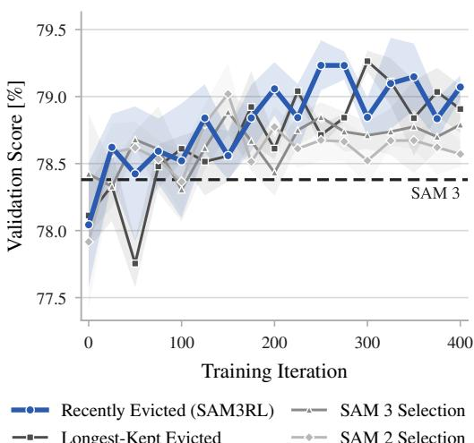

Figure 6: Object pointer selection. Validation score on the LaSOT validation split during SAM3RL training; mean over three seeds with a ±SEM band. The arms differ only in the rule that fills the nine object pointers outside the bank.  
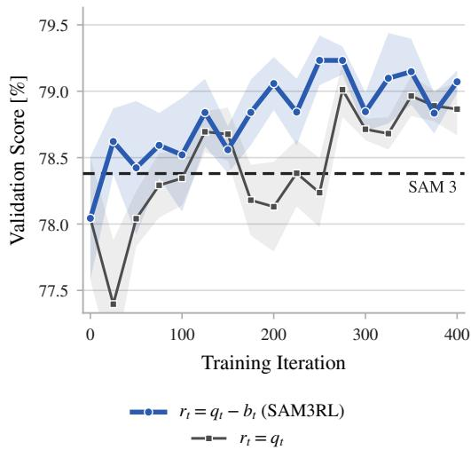  
Figure 7: Reward normalization. Validation score on the LaSOT validation split during training; mean over three seeds with a ±SEM band. The arms differ only in the $b _ { t }$ normalized reward, $r _ { t } = q _ { t } - b _ { t }$ against the raw quality $r _ { t } = q _ { t }$

## E.2 OBJECT POINTER SELECTION

Besides the seven memory features, the memory attention of SAM 2 and SAM 3 also reads up to sixteen object pointers, one of which always comes from the conditioning frame; see Section 3. SAM 2 takes the remaining pointers from the 15 most recent frames, whereas SAM 3 takes them from the most recent frames whose effective IoU score exceeds a threshold, always including the previous frame. SAM3RL instead uses a recently evicted rule, which reads the pointers of the conditioning frame and of the six frames currently in the memory bank, and fills the remaining nine slots with the frames most recently evicted from the bank. We also consider a longest-kept rule, which ranks evicted frames by the number of decisions they remained in the memory bank and selects the pointers of the top nine. Unlike the rules of SAM 2 and SAM 3, both of our rules depend on the agent’s actions. Figure 6 compares all four rules within SAM3RL, reporting the LaSOT validation score of each rule every 25 training iterations; all other components are kept fixed.

After the first 200 iterations, both our action-dependent rules remain above the SAM 2 and SAM 3 rules, showing that the object pointer selection rule affects tracking performance. Between the two, the recently evicted rule scores higher in most evaluations, but the longest-kept rule performs comparably and their seed bands overlap. Designing better rules could improve performance further. Moreover, since learned memory control outperforms hand-crafted rules for memory bank selection, extending the policy to also select object pointers is a natural direction for future work.

## E.3 REWARD NORMALIZATION

We train SAM3RL against the normalized reward $r _ { t } = q _ { t } - b _ { t }$ , which is the difference between the tracking quality $q _ { t }$ of SAM 3 under our learned memory control and the tracking quality $b _ { t }$ of SAM 3 under its native memory control. Since much of the variance of $q _ { t }$ comes from the difficulty of the video rather than from the actions taken, subtracting the policy-independent $b _ { t }$ reduces this variance while leaving the optimal policy unchanged. In Figure 7, we ablate this normalization by training on the raw quality $r _ { t } = q _ { t }$ with everything else unchanged, and evaluate both arms every 25 training iterations on the LaSOT validation split. The raw-reward arm falls below SAM 3 itself on several evaluations in the first 250 iterations and is less stable than the difference-based arm, which stays above SAM 3 throughout.

## F EXTENDED ANALYSIS OF LEARNED MEMORY CONTROL

We present the action distributions of SAM 3 and SAM3RL in Figure 8. SAM 3 evicts the oldest frame on almost every decision, while SAM3RL spreads its decisions over all seven actions, with no single action dominating. The admission rate of SAM3RL as a function of object motion and appearance change is shown in Figure 9, where the admission rate rises both with object motion and object appearance change. This finding is consistent with the sequences shown in Figures 5 and 10.

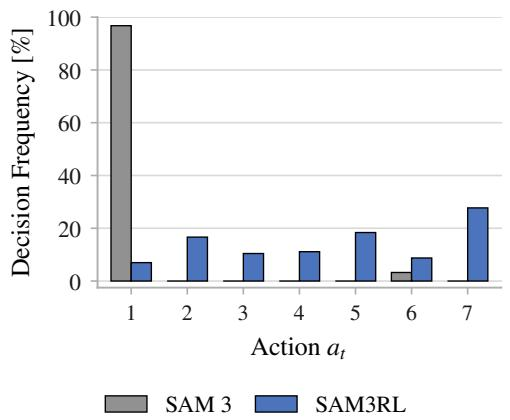

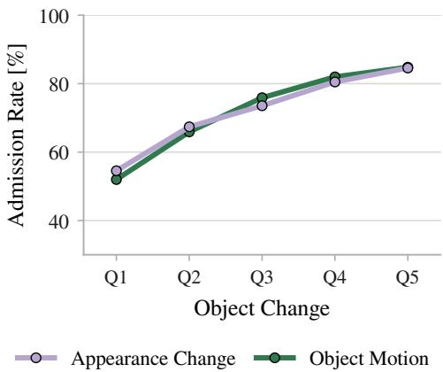  
Figure 8: Action distributions. Frequency of each action $a _ { t }$ for SAM 3 and SAM3RL on our LaSOT validation split. Action $a _ { t } \in \{ 1 , \ldots , 6 \}$ evicts the stored memory $m _ { \tau _ { a _ { t } } }$ , where $a _ { t } = 7 \mathrm { r e }$ jects the incoming frame. The SAM 3 rule uses only two actions. It evicts the most recent stored frame $m _ { \tau _ { 6 } } \ ( a _ { t } \ = \ 6 )$ if its effective IoU score falls below the memory threshold, and the oldest frame $m _ { \tau _ { 1 } } \ ( a _ { t } = 1 )$ otherwise.  
Figure 9: Admission follows object change. Share of incoming frames SAM3RL admits per quintile of object motion and appearance change on our LaSOT validation split. Object motion is the shift of the ground-truth box center between consecutive decisions, normalized by the square root of the box area. Appearance change is the DINOv3 (Siméoni et al., 2025) cosine distance between consecutive ground-truth crops.

Figures 11 to 13 compare the memory banks of SAM 3, DAM4SAM3, and SAM3RL around three absence gaps. In all three, SAM3RL keeps old, temporally sparse frames and admits few new ones while the target is absent, so the pre-absence appearance is still in its bank when the target returns. In Figure 11, this lets SAM3RL reacquire the formula car that both SAM 3 and DAM4SAM3 lose. In Figure 12, SAM3RL reacquires the soldier’s hat, which DAM4SAM3 swaps for a distractor. On the other hand, in Figure 13, its bank retains frames showing the longboarder small and centered, but the rider returns large and on the left, so SAM3RL reacquires later than SAM 3 and DAM4SAM3.

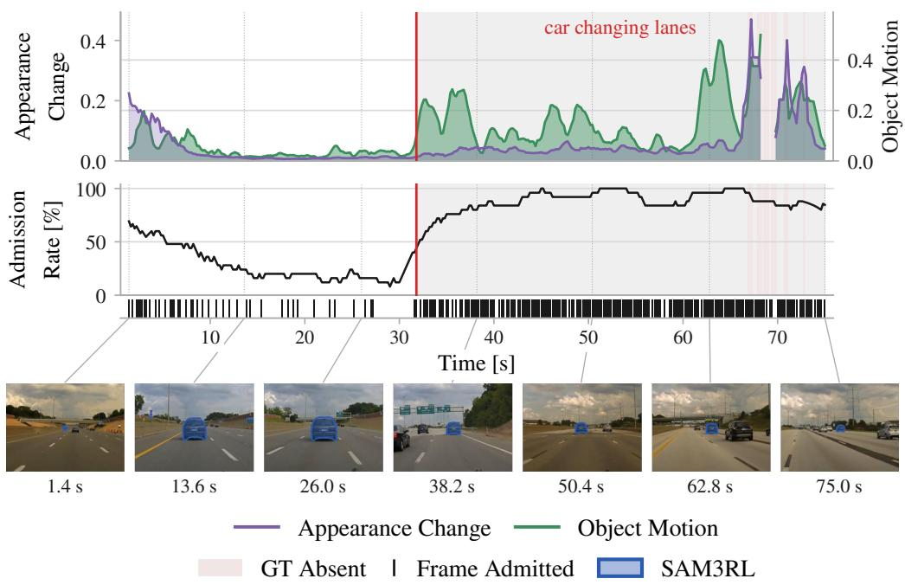  
Figure 10: Admission rate of incoming frames by SAM3RL follows object change II. A 75 s DiDi video sequence in which a car cruises steadily in one lane and then starts moving quickly, changing lanes until the end. Object motion is the shift of the ground-truth box center between consecutive decisions, normalized by the square root of the box area. Appearance change is the DINOv3 (Siméoni et al., 2025) cosine distance between consecutive ground-truth crops. The middle panel is the admission rate in a 5 s window, one tick per admitted decision. Admissions are sparse during the cruise and dense in the lane-changing interval (gray) when object motion rises.

(a) · 88.0 s  
(b) · 100.9 s (absent)  
(c) · 113.1 s  
(d) · 115.1 s  
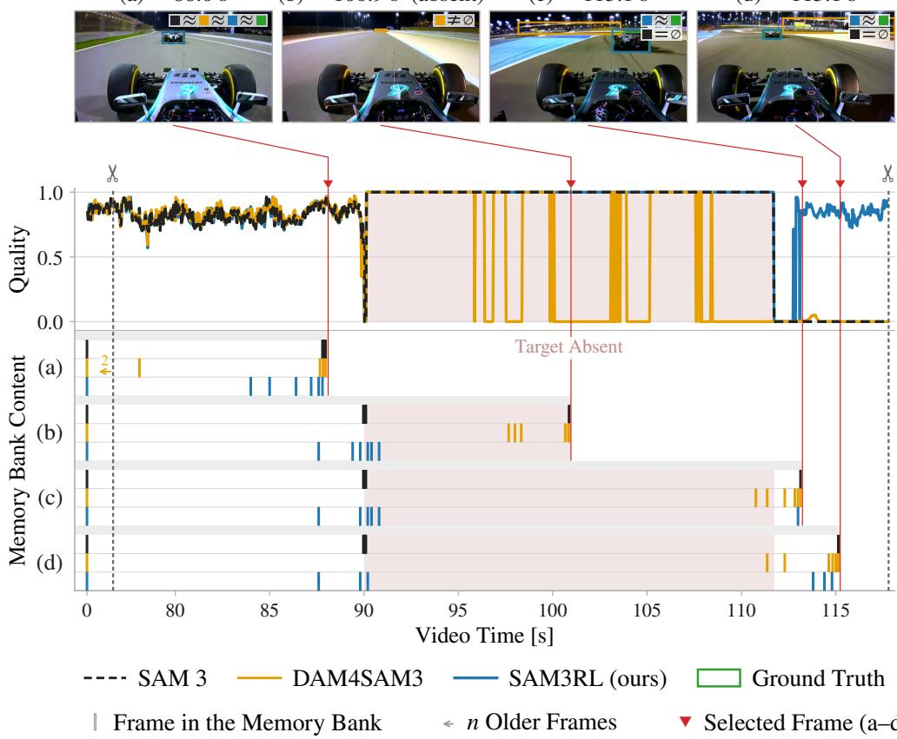

Figure 11: SAM3RL holds diverse pre-absence frames through a long absence. A VOT-LT2021 sequence captured from the onboard camera of a formula car, in which the car ahead leaves the field of view for about 22 s. The top row shows four selected frames (a–d) with the ground truth and the prediction of each method. The middle panel shows the per-frame tracking quality of each method in the selected time window, with the absence shaded red. The bottom panel shows the memory bank content of each method at the four selected frames, one row per selected frame and method and one tick per stored frame. The prompt frame at 0 s is on the left, and an arrow gives the number of stored frames older than the selected window. SAM 3 correctly predicts no target throughout the absence, with its bank fixed on consecutive frames just before it, in which the car is mostly out of view. It does not reacquire the car after its return. DAM4SAM3 wrongly predicts the target at several points during the absence, and by (b) its bank holds only frames from the absence. After the return, its predictions miss the car. SAM3RL also predicts no target during the absence. When the car leaves, its bank holds frames spread over the last few seconds before the absence and a few from the start of the absence, and at (b) and (c) it still holds nearly all of them. SAM3RL reacquires the car about 1 s after its return, and by (d) half of its bank holds frames from after the return, while the pre-absence frames remain.

(a) · 170.9 s  
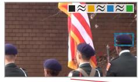  
(b) · 174.5 s (absent)

(c) · 177.1 s  
(d) · 179.1 s  
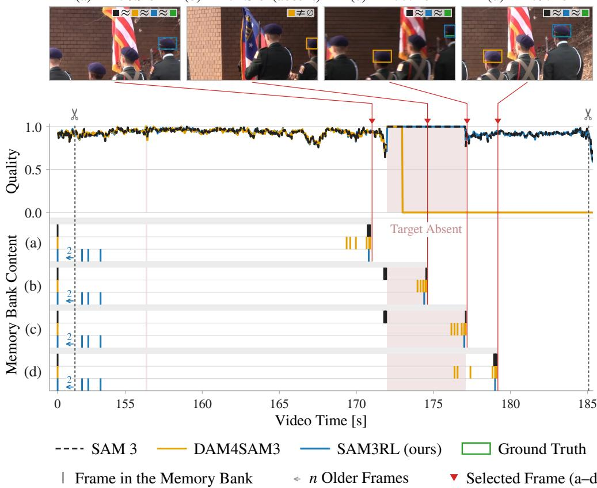

Figure 12: SAM3RL holds onto very old frames and successfully reacquires. A LaSOT test sequence of a military ceremony, in which the tracked soldier’s hat leaves the field of view for about 5 s among other soldiers wearing near-identical hats. The top row shows four selected frames (a–d) with the ground truth and the prediction of each method. The middle panel shows the per-frame tracking quality of each method in the selected time window, with the absence shaded red. The bottom panel shows the memory bank content of each method at the four selected frames, one row per selected frame and method and one tick per stored frame. The prompt frame at 0 s is on the left, and an arrow gives the number of stored frames older than the selected window. SAM 3 correctly predicts no target throughout the absence, with its bank holding the last five frames before it, and reacquires the hat on the first frame after its return. DAM4SAM3 also predicts no target at the start of the absence, but shortly after it locks onto another soldier’s hat. By (b) it has evicted all preabsence frames, and its bank holds only frames in which it tracks the wrong hat. It keeps following that hat for the rest of the sequence, also after the target returns. SAM3RL correctly predicts no target throughout the absence, but its bank barely changes. When the hat leaves the view, five of its six slots hold frames that are 20–30 s old. These stay in the bank through more than 30 s of tracking, from before (a) until after (d), and only the newest slot turns over. SAM3RL thus keeps the target’s appearance in memory throughout the gap and reacquires the hat on the first frame after its return.

(b) · 44.4 s (absent) (c) · 45.7 s (absent)

(a) · 38.0 s  
(d) · 50.7 s  
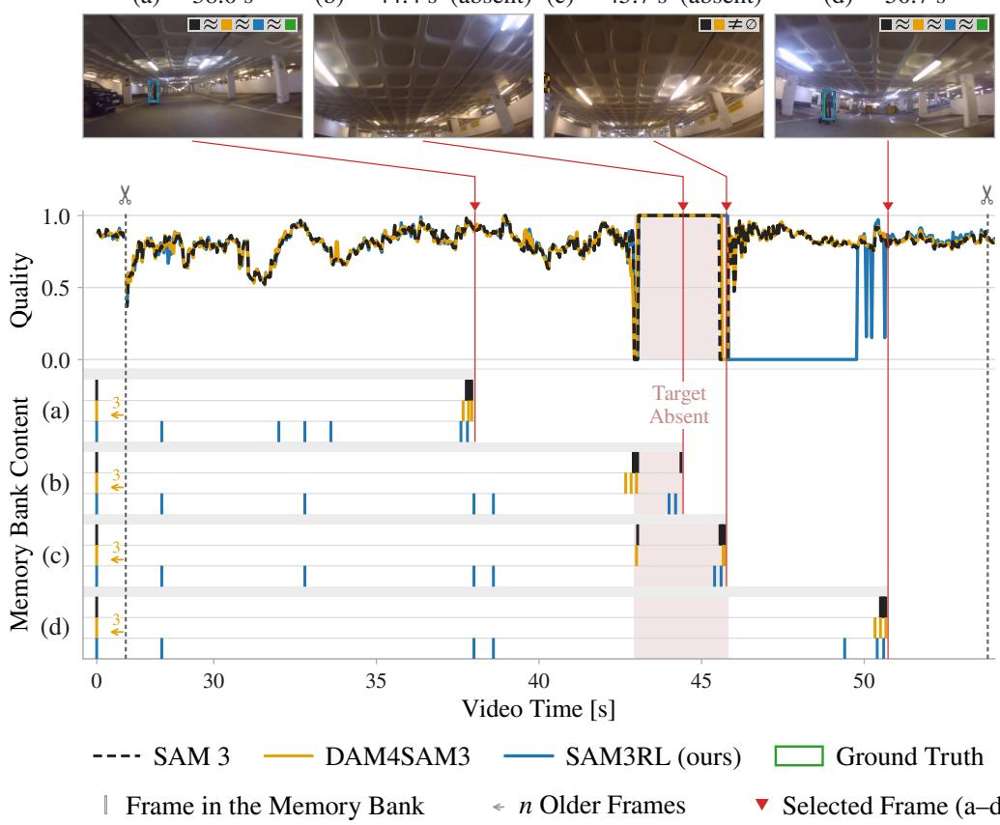

Figure 13: SAM3RL holds sparse old frames and reacquires late. A VOT-LT2021 sequence capturing a longboarder from behind, who goes out of view on the left for about 3 s. The top row shows four selected frames (a–d) with the ground truth and the prediction of each method. The middle panel shows the per-frame tracking quality of each method in the selected time window, with the absence shaded red. The bottom panel shows the memory bank content of each method at the four selected frames, one row per selected frame and method and one tick per stored frame. The prompt frame at 0 s is on the left, and an arrow gives the number of stored frames older than the selected window. SAM 3 correctly reports the target absent on most frames of the gap and reacquires successfully. DAM4SAM3 keeps 3 old frames and 3 recent ones in all selected frames, although during the absence the 3 recent ones are the pre-absence ones. SAM3RL carries four frames from before the absence through the gap, which are 4–15 s old at the start of the absence and all show the rider small and near the center of the frame, while the rider comes back large and on the left side. The memory bank frames that would match that view all passed through the two newest slots and are not present in the bank of SAM3RL at the end of the absence, but are present in the banks of SAM 3 and DAM4SAM3. SAM3RL fails to reacquire for 4 s after the return, while SAM 3 and DAM4SAM3 reacquire immediately. Once the rider moves back towards the center, SAM3RL reacquires and updates its memory bank.