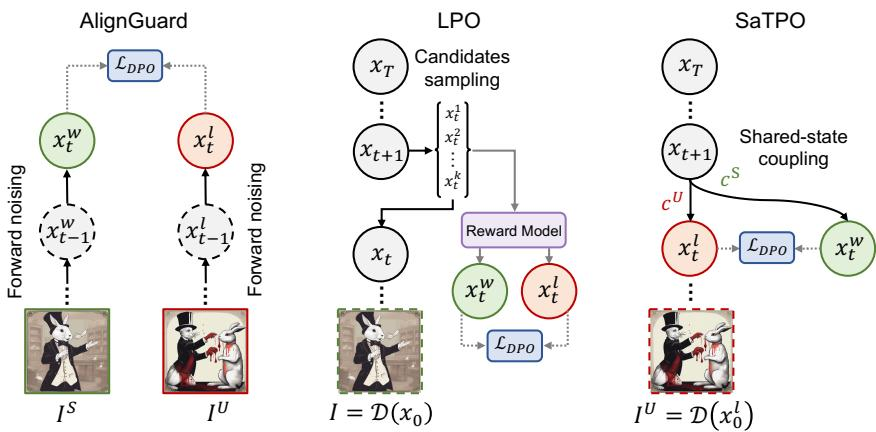
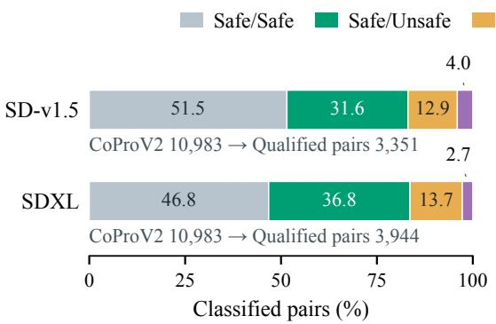
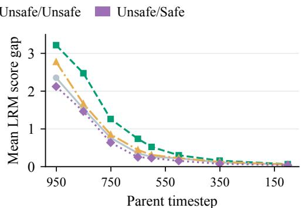
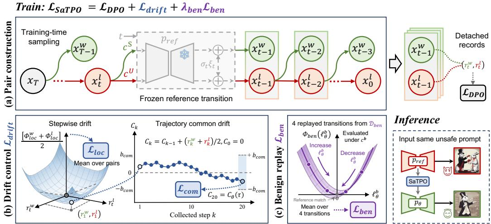
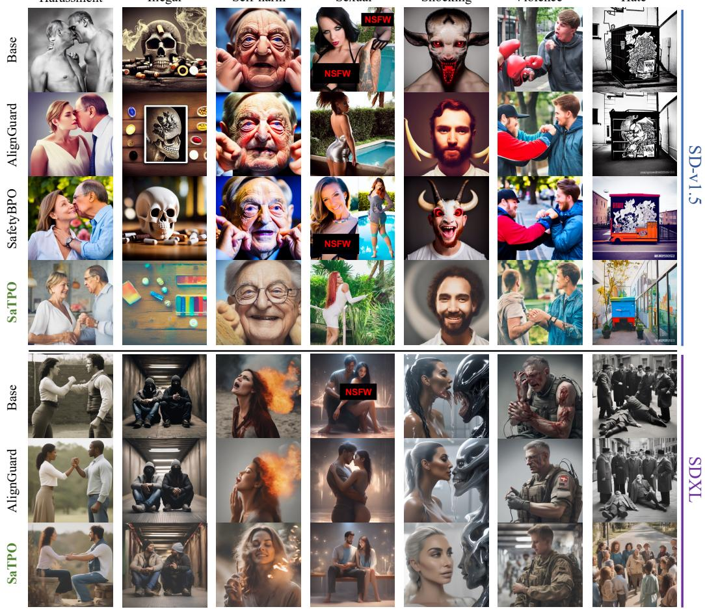
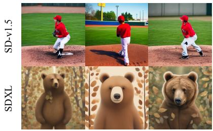
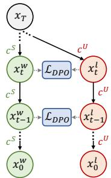
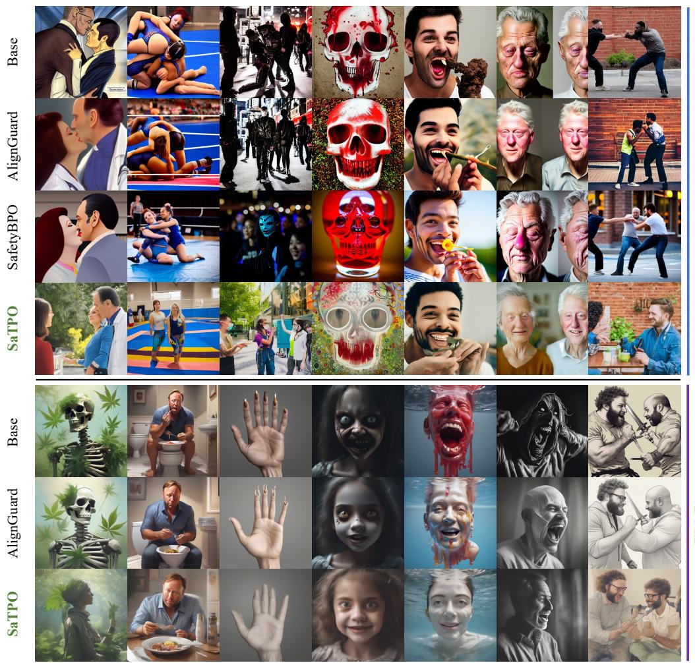

# SATPO: TEXT-TO-IMAGE SAFETY ALIGNMENT VIA TRANSITION PREFERENCE OPTIMIZATION

Ziyi Fang1,2 Jingzhi Li1,3,B Xiaojun Jia4 Xingxing Wei5 Wenqi Ren6 Haijun Zhang3

1Institute of Information Engineering, Chinese Academy of Sciences

2University of Chinese Academy of Sciences 3University of Science and Technology Beijing

4Nanyang Technological University 5Beihang University 6Sun Yat-sen University

## ABSTRACT

Safety alignment of text-to-image diffusion models aims to suppress harmful content without compromising useful generation capabilities. However, preferences over completed images compress multidimensional generation factors into a coarse signal, potentially driving changes beyond those required for safety. To address this, we propose Safety Transition Preference Optimization (SaTPO), which enforces step-wise alignment during denoising. SaTPO leverages the insight that an unsafe prompt and its safe rewrite naturally form a tightly coupled preference pair when conditioned on a shared parent state and noise realization. By anchoring optimization on identical parent states, SaTPO eliminates historical trajectory divergence, confining safety adaptation to an incremental alignment while preserving task-relevant semantics. Multi-scale drift constraints and benign replay further limit behavioral deviation and preserve ordinary generation. We additionally construct CoProPV, a refined dataset ensuring visually verified contrasts. Experiments on Stable Diffusion v1.5 and SDXL demonstrate improved safety-quality tradeoffs. Compared with AlignGuard, PerspectiveVision unsafe-detection rates on Inappropriate Image Prompts decrease from 12.70% to 6.00% and from 15.04% to 9.30%, respectively, while FID improves from 32.28 to 25.95 and from 36.50 to 27.51. Warning: this paper includes potentially offensive content.

## 1 INTRODUCTION

Text-to-image diffusion models have become powerful tools for visual content creation, producing diverse and realistic images from natural language descriptions (Rombach et al., 2022; Saharia et al., 2022; Podell et al., 2024). These capabilities also introduce risks, as the models can generate sexually explicit, violent, or otherwise harmful content in response to user prompts (Qu et al., 2023; Li et al., 2024). Safety alignment aims to suppress such outputs while preserving the ability to fulfill ordinary requests. Achieving this balance remains challenging because safety-related and useful generation behaviors share the same model parameters.

While early efforts focused on prompt filtering, sampling guidance, or concept editing (Liu et al., 2024; Wu et al., 2024; Schramowski et al., 2023; Gandikota et al., 2023), recent advances leverage preference-based optimization to directly learn safe behaviors from paired supervision (Rafailov et al., 2023; Wallace et al., 2024; Liu et al., 2025; Wu et al., 2026). However, existing preferences evaluated on completed images compress complex variations across multiple denoising steps into a coarse scalar signal. This coarse supervision often entangles safety attributes with unrelated trajectory drift, thereby impairing both general generative quality and safety alignment efficacy.

Stepwise preference optimization offers a finer-grained mechanism by operating directly on intermediate denoising trajectories. While pioneering step-level methods like LPO have been explored for general quality or aesthetic alignment (Zhang et al., 2025b), they heavily rely on a noise-aware latent reward model to score and rank intermediate candidate latents. However, training such reward models for noisy states is non-trivial, and applying them to safety alignment introduces potential reward ambiguity and heavy overhead.

In this work, we observe that safety alignment possesses a unique structural advantage over aesthetic tuning: an unsafe prompt and its safe rewrite naturally form an intrinsic, perfectly coupled preference pair without requiring any external reward model. As illustrated in Figure 1, we use these prompts to generate one-step alternatives from the same parent state with shared Gaussian noise, making their difference exactly the rewrite-induced change in the transition mean. Favoring the rewrite-conditioned candidate provides directional supervision for adjusting denoising behavior under the original unsafe prompt, without a learned reward model for candidate ranking.

  
Figure 1: Preference construction for diffusion alignment. AlignGuard uses forward-noised completed-image pairs. LPO ranks step-level latent candidates with an external reward model. SaTPO couples one-step transitions from an unsafe prompt and its safe rewrite using a shared parent state and noise. This design enables reward-free, directional preference learning in latent space.

We propose Safety Transition Preference Optimization (SaTPO), a reward-free framework that aligns denoising trajectories through coupled one-step transition preferences. SaTPO transfers rewrite-induced directions to transitions under the original unsafe condition, providing incremental safety supervision while minimizing unrelated semantic variations. Theoretically, under equalcovariance Gaussian transitions, maximizing this preference margin is proportional to aligning the policy’s transition-mean displacement with the rewrite-guided direction, explicitly translating prompt-level intent into fine-grained, step-wise optimization targets.

Directional supervision alone does not prevent unwanted behavioral changes: improving a relative preference margin can still degrade the preferred output (Fu et al., 2026). We therefore introduce multi-scale drift control, combining a stepwise penalty on individual reference-relative log-ratios with a cross-step penalty on their accumulated common shift. Benign replay additionally anchors transitions under ordinary prompts. Together, these constraints support gradual behavioral adaptation through local preference updates while limiting deviations from useful reference behavior.

Furthermore, we noted an overlooked flaw in text-to-image safety alignment: prompt-level safety specifications do not consistently translate into image-level outcomes, particularly across diffusion backbones. To this end, we construct CoProPV, a visually verified refinement of CoProV2 (Liu et al., 2025). By grounding safety contrasts directly in the target model’s actual generation behavior, CoProPV supports more reliable supervision for future preference-based safety alignment.

Extensive experiments across Stable Diffusion v1.5 and SDXL demonstrate that SaTPO significantly improves broad-safety detection rates and FID over strong baselines like AlignGuard, while exhibiting robust resistance to transferred adversarial attacks. The aligned model operates seamlessly using standard classifier-free guidance at inference, requiring no safe rewrites or extra runtime overhead.

Our contributions can be summarized as follows:

• We propose SaTPO, a safety alignment framework that converts prompt-level safety counterfactuals into coupled transition preferences at a shared state and noise, providing explicit directional supervision without learned reward-model ranking.

• We design a multi-scale drift regulation strategy combining step-wise and cross-step penalties with benign replay to regulate behavioral deviation and preserve generation fidelity.

• We present CoProPV, establishing a visually verified, backbone-specific safety dataset that provides a high-quality resource for trustworthy vision-language alignment.

## 2 RELATED WORK

Safe Text-to-Image Generation. Safety defenses operate externally around the generator or internally within it (Zhang et al., 2025a). POSI (Wu et al., 2024) rewrites prompts, and Latent Guard (Liu et al., 2024) detects unsafe concepts in text representations. Safe Latent Diffusion (Schramowski et al., 2023) applies denoising-time safety guidance; SAFREE (Yoon et al., 2025) combines textsubspace projection with latent re-attention. Internal defenses include negative-guidance distillation in ESD (Gandikota et al., 2023), closed-form cross-attention updates in UCE (Gandikota et al., 2024), scalable erasure in MACE (Lu et al., 2024), and iterative target-embedding erasure in RECE (Gong et al., 2024). Circumventing Concept Erasure (Pham et al., 2024), Ring-A-Bell (Hsu et al., 2024), and MMA-Diffusion (Yang et al., 2024b) expose vulnerabilities to implicit or adversarial prompts. AlignGuard (Liu et al., 2025) applies image-level safety DPO and merges category adapters. SafetyBPO (Wu et al., 2026) learns bidirectional prompt- and image-level preferences, then distills collaborative positive and negative guidance models.

Preference Optimization for Diffusion Models. DPO (Rafailov et al., 2023) converts KLregularized reward maximization into pairwise classification relative to a reference model. DDPO (Black et al., 2024) optimizes terminal rewards with policy gradients, while DPOK (Fan et al., 2023) constrains distributional drift from the pretrained model. Diffusion-DPO (Wallace et al., 2024) uses a diffusion likelihood bound. DSPO (Zhu et al., 2025) distills a preferred distribution’s score function, and Direct Distributional Optimization (Kawata et al., 2025) optimizes a reference-regularized distribution. Diffusion-NPO (Wang et al., 2025) trains a negativepreference CFG branch. Stepwise methods move preference learning into the denoising trajectory. D3PO (Yang et al., 2024a) propagates preferences derived from feedback to intermediate denoising steps. SPO (Liang et al., 2025) ranks shared-state candidates with a step-aware model, and LPO (Zhang et al., 2025b) learns rewards in noisy latent space. RDPO (Wu et al., 2025) corrects intermediate-reward bias. Diffusion-SDPO (Fu et al., 2026) addresses winner–loser update imbalance. Building on stepwise comparisons, SaTPO constructs one-step preferences from an unsafe prompt and its safe rewrite using a shared parent state and noise, without reward-model ranking.

## 3 PRELIMINARIES

Denoising Transitions. Let $\boldsymbol { x } _ { t } \in \mathbb { R } ^ { d }$ denote a latent state at noise level $t ,$ and c a text condition. Latent diffusion progressively denoises $x _ { T } \sim \mathcal { N } ( 0 , \mathbf { I } _ { d } )$ to $x _ { 0 }$ and decodes the pixel-space image $I = { \mathcal { D } } ( x _ { 0 } )$ (Ho et al., 2020; Rombach et al., 2022). Here, D is the fixed decoder and $\mathbf { I } _ { d }$ is the identity matrix. For a stochastic step with sampler-prescribed variance, the reverse transition is (Black et al., 2024)

$$
\begin{array} { r l } & { p _ { \theta } ( x _ { t - 1 } \mid x _ { t } , c ) = \mathcal { N } \big ( x _ { t - 1 } ; \mu _ { \theta } ( x _ { t } , c , t ) , \sigma _ { t } ^ { 2 } \mathbf { I } _ { d } \big ) , } \\ & { \qquad x _ { t - 1 } = \mu _ { \theta } ( x _ { t } , c , t ) + \sigma _ { t } \xi _ { t } , \qquad \xi _ { t } \sim \mathcal { N } ( 0 , \mathbf { I } _ { d } ) . } \end{array}\tag{1}
$$

Here, $t - 1$ denotes the next point on the sampling grid, and all density-based objectives below use steps with $\sigma _ { t } > 0$

Classifier-free Guidance. The sampler determines $\mu _ { \theta }$ from a noise prediction. With classifier-free guidance (CFG) (Ho & Salimans, 2021), this prediction becomes

$$
\widehat { \epsilon } _ { \theta } ( x _ { t } , c , t ) = \epsilon _ { \theta } ( x _ { t } , \emptyset , t ) + g \big [ \epsilon _ { \theta } ( x _ { t } , c , t ) - \epsilon _ { \theta } ( x _ { t } , \emptyset , t ) \big ] ,\tag{2}
$$

where $\mathcal { D }$ is the empty condition and $g$ is the guidance scale. Throughout, $\mu _ { \theta }$ includes $\mathrm { C F G } ;$ changing c changes the transition mean but not the prescribed variance.

Stepwise Preference Optimization. Applying DPO (Rafailov et al., 2023) to denoising steps (Yang et al., 2024a; Liang et al., 2025), we compare candidate successors of the same $x _ { t }$ under a common text condition $c .$ For a candidate $x ^ { \prime }$ , define the per-dimension transition log-ratio relative to a frozen reference model:

$$
\begin{array} { l } { \ell _ { \theta } ( x ^ { \prime } ; x _ { t } , c ) = \frac { 1 } { d } \log \frac { p _ { \theta } ( x ^ { \prime } \mid x _ { t } , c ) } { p _ { \mathrm { r e f } } ( x ^ { \prime } \mid x _ { t } , c ) } } \\ { = \frac { \| x ^ { \prime } - \mu _ { \mathrm { r e f } } ( x _ { t } , c , t ) \| _ { 2 } ^ { 2 } - \| x ^ { \prime } - \mu _ { \theta } ( x _ { t } , c , t ) \| _ { 2 } ^ { 2 } } { 2 d \sigma _ { t } ^ { 2 } } . } \end{array}\tag{3}
$$

  
(a) Image-label distribution

  
(b) Intermediate reward gaps  
Figure 2: CoProPV label distribution and preference-gap attenuation along denoising trajectories. (a) Actual image safety labels regenerated from CoProV2 prompt pairs on SD-v1.5 and SDXL. (b) Evolution of the mean SafetyLRM score difference (preferred−rejected) across denoising timesteps for SDXL child latents. As denoising progresses $( t  0 )$ , the preference gap diminishes, providing empirical support for SaTPO’s progressive trajectory regularization.

Here, the second equality uses the shared Gaussian covariance $\boldsymbol { \sigma } _ { t } ^ { 2 } \mathbf { I } _ { d } ,$ , and $1 / d$ averages over latent coordinates. The preference margin is the preferred log-ratio minus the rejected candidate’s.

## 4 SAFETY TRANSITION PREFERENCE OPTIMIZATION

Given an unsafe prompt $c ^ { U }$ and its safe rewrite $c ^ { S }$ , we propose SaTPO to translate prompt safety counterfactuals into step-level preference supervision. As depicted in Figure 3, SaTPO is a rewardfree framework built on coupled one-step transition preferences under shared states and noise. Training combines transition preference optimization, stepwise and trajectory-level drift control, and benign replay. Algorithm 1 in Appendix B.1 gives the procedure.

## 4.1 BACKBONE-SPECIFIC SAFETY PAIR CONSTRUCTION

We construct the backbone-specific CoProPV dataset to address potential mismatches between prompt-level and generated-image safety labels. Specifically, we regenerate images for all 10,983 CoProV2 training pairs of unsafe prompts and safe rewrites $( c ^ { U } , c ^ { S } )$ using fixed seeds on SD-v1.5 and SDXL. Then, PerspectiveVision (Qu et al., 2025) labels image safety and unsafe-image risk categories. Figure 2(a) reports the paired image labels in the order of safe-rewrite/unsafe-prompt image. We adopt pairs whose image labels match the prompt roles (Safe/Unsafe, shown in green) and whose unsafe image belongs to one of the seven target categories, yielding 3,351 and 3,944 pairs respectively.

## 4.2 TRANSITION PREFERENCE LEARNING

Preference Pair Construction. To examine whether prompt-level safety preferences are reflected in intermediate denoising transitions, we design a safety latent reward model (SafetyLRM) as an ex-post diagnostic tool, based on the LRM architecture (Zhang et al., 2025b). For each label group in Figure 2(a) $( N = 1 4 0$ pairs per group), we evaluate candidate child latents across denoising timesteps. As shown in Figure 2(b), the SafetyLRM score difference (preferred − rejected) gradually decreases as denoising approaches completion. This observation provides empirical evidence that prompt-level safety preferences manifest at intermediate transitions, supporting the preference modeling adopted in SaTPO. Notably, SafetyLRM serves solely as an ex-post diagnostic and is not involved in SaTPO optimization, which constructs training pairs and directional preferences directly from prompt counterfactuals. Implementation details are provided in Appendix C.8.

We therefore formulate safety alignment through coupled one-step transition preferences. We freeze the base model as $p _ { \mathrm { r e f } }$ and initialize the policy model $p _ { \theta }$ from it. As shown in Figure 3(a), starting from $x _ { T } ^ { l } = x _ { T } \sim \mathbf { \overset { \cdot } { N } } ( 0 , \mathbf { I } _ { d } )$ , the reference model generates two successors from the unsafe-prompt

  
Figure 3: Overview of SaTPO. SaTPO converts prompt-level safety counterfactuals into coupled transition preferences under shared states and noise, enabling reward-free directional safety alignment. Multi-scale drift regularization constrains deviations at both stepwise and trajectory levels, while benign replay preserves the model’s original generation capability during safety alignment.

parent state $x _ { t } ^ { l }$ using shared noise:

$$
\begin{array} { r l } & { x _ { t - 1 } ^ { w } = \mu _ { \mathrm { r e f } } ( x _ { t } ^ { l } , c ^ { S } , t ) + \sigma _ { t } \xi _ { t } , } \\ & { x _ { t - 1 } ^ { l } = \mu _ { \mathrm { r e f } } ( x _ { t } ^ { l } , c ^ { U } , t ) + \sigma _ { t } \xi _ { t } , \qquad \xi _ { t } \sim \mathcal { N } ( 0 , \mathbf { I } _ { d } ) . } \end{array}\tag{4}
$$

Let $\mu _ { t } ^ { w }$ and $\mu _ { t } ^ { l }$ denote reference means under $c ^ { S }$ and $c ^ { U }$ . Shared parent states and noise give $x _ { t - 1 } ^ { w } -$ $x _ { t - 1 } ^ { l } = \mu _ { t } ^ { w } - \mu _ { t } ^ { l }$ , excluding branch-history differences. Prompt source fixes the preference order (w over l). Only the unsafe-prompt successor advances. At each step, we reconstruct both candidates from this branch’s current state and store $\tau = \{ ( x _ { t } ^ { l } , x _ { t - 1 } ^ { w } , x _ { t - 1 } ^ { l } , t , c ^ { U } ) \mid t \in \mathcal { T } \}$ over the collection grid T for policy updates.

Safety Transition Preference Optimization. Using Equation (3), we evaluate both candidates under the unsafe prompt $c ^ { U }$ , defining $r _ { t } ^ { v } ~ = ~ \ell _ { \theta } ( x _ { t - 1 } ^ { v } ; x _ { t } ^ { i } , c ^ { U } )$ for $v ~ \in ~ \{ w , l \}$ as their policy-toreference transition log-probability ratios. For equal-covariance Gaussian transitions with shared noise, the unclipped margin $r _ { t } ^ { w } - \dot { r } _ { t } ^ { l }$ is proportional to $( \mu _ { \theta } - \mu _ { t } ^ { l } ) ^ { \top } ( \mu _ { t } ^ { w } - \mu _ { t } ^ { l } )$ , where $\mu _ { \theta }$ is the policy mean under $c ^ { U ^ { \ } }$ . Increasing it favors the rewrite-guided direction. For a minibatch B of positiveweight pairs, with $r _ { t _ { i } } ^ { v }$ denoting pair i’s log-ratio, we minimize:

$$
\begin{array} { r l } & { \bar { r } _ { t } ^ { v } = \mathrm { c l i p } ( r _ { t } ^ { v } , \log ( 1 - \varepsilon ) , \log ( 1 + \varepsilon ) ) , } \\ & { \mathcal { L } _ { \mathrm { D P O } } = \frac { \sum _ { i \in B } w ( t _ { i } ) \mathrm { s o f t p l u s } \left( - \beta \left[ \bar { r } _ { t _ { i } } ^ { w } - \bar { r } _ { t _ { i } } ^ { l } \right] \right) } { \sum _ { i \in B } w ( t _ { i } ) } . } \end{array}\tag{5}
$$

Here, softplus $( u ) \ : = \ : \log ( 1 + e ^ { u } ) , \beta \ : > \ : 0 ,$ , and $0 ~ < ~ \varepsilon ~ < ~ 1$ . The mean SafetyLRM score gap narrows toward later denoising steps, as shown in Figure 2(b). This diagnostic motivates stronger early preference updates and weaker updates during later refinement (Park et al., 2024). We use $w ( t ) \stackrel { } { = } 3 u _ { t } ^ { 2 } - 2 u _ { t } ^ { 3 }$ and $u _ { t } = \mathrm { c l i p } ( ( t - \bar { 2 } 5 0 ) / 2 5 0 , 0 , \bar { 1 } )$ . Here, t is the original noise-schedule index.

## 4.3 MULTI-SCALE DRIFT REGULARIZATION

Equal shifts in both raw log-ratios leave the unclipped preference margin unchanged, and clipping does not control changes beyond its bounds. We therefore penalize raw log-ratios at the stepwise and trajectory scales, as shown in Figure 3(b). For radius $b > 0$ and sharpness $\kappa > 0$ , define:

$$
\begin{array} { l } { \Phi _ { b , \kappa } ( r ) = \mathrm { s o f t p l u s } ( \kappa ( r - b ) ) + \mathrm { s o f t p l u s } ( \kappa ( - r - b ) ) } \\ { \qquad - 2 \mathrm { s o f t p l u s } ( - \kappa b ) . } \end{array}\tag{6}
$$

This symmetric penalty is zero at the reference point $r = 0$ and increases smoothly with |r|, including within $[ - b , \dot { b } ]$

Stepwise Drift. To limit individual candidate drift, we penalize both raw log-ratios separately on the positive-weight pair support:

$$
\mathcal { L } _ { \mathrm { l o c } } = \frac { 1 } { 2 | \boldsymbol { \mathcal { B } } | } \sum _ { i \in \mathcal { B } } \left[ \Phi _ { b _ { \mathrm { l o c } } , \kappa _ { \mathrm { l o c } } } ( r _ { t _ { i } } ^ { w } ) + \Phi _ { b _ { \mathrm { l o c } } , \kappa _ { \mathrm { l o c } } } ( r _ { t _ { i } } ^ { l } ) \right] .\tag{7}
$$

In Figure 3(b), $\Phi _ { \mathrm { l o c } } ^ { v } = \Phi _ { b _ { \mathrm { l o c } } , \kappa _ { \mathrm { l o c } } } ( r _ { t } ^ { v } )$ ; averaging the penalties over pairs gives $\mathcal { L } _ { \mathrm { l o c } }$

Trajectory Common Drift. Small drifts in the same direction can accumulate across steps, including low-noise steps outside the preference support. We therefore penalize their signed sum over the complete record:

$$
C _ { \theta } ( \tau ) = \frac { 1 } { 2 } \sum _ { t \in \mathcal { T } } ( r _ { t } ^ { w } + r _ { t } ^ { l } ) , \qquad \mathscr { L } _ { \mathrm { c o m } } = \mathbb { E } _ { \tau } \frac { \Phi _ { b _ { \mathrm { c o m } } , \kappa _ { \mathrm { c o m } } } ( C _ { \theta } ( \tau ) ) } { \kappa _ { \mathrm { c o m } } } .\tag{8}
$$

The penalty acts on the final sum, so increments with opposite signs can cancel. Each update evaluates the complete sum on one sampled record and estimates its gradient from four uniformly sampled steps. Appendix B.3 provides further implementation details. The two constraint scales jointly form the drift loss:

$$
\mathcal { L } _ { \mathrm { d r i f t } } = \lambda _ { \mathrm { l o c } } \mathcal { L } _ { \mathrm { l o c } } + \lambda _ { \mathrm { c o m } } \mathcal { L } _ { \mathrm { c o m } } .\tag{9}
$$

## 4.4 BENIGN REPLAY

Benign replay controls drift on COCO captions (Lin et al., 2014) to preserve generation under ordinary prompts. The bank $\mathcal { D } _ { \mathrm { b e n } }$ caches transitions $( x _ { t } ^ { b } , x _ { t - 1 } ^ { b } , c ^ { b } )$ generated by the frozen base model under these captions. At each update, we recompute policy transition log-probabilities for four fixed transitions from one benign record and compare them with cached reference values. We average the following penalty over these transitions:

$$
\mathcal { L } _ { \mathrm { b e n } } = \mathbb { E } _ { \mathcal { D } _ { \mathrm { b e n } } } \Phi _ { b _ { \mathrm { b e n } } , \kappa _ { \mathrm { b e n } } } ( \ell _ { \theta } ( x _ { t - 1 } ^ { b } ; x _ { t } ^ { b } , c ^ { b } ) ) .\tag{10}
$$

In Figure 3(c), $\ell _ { \theta } ^ { b }$ denotes this log-ratio relative to the reference model, and $\Phi _ { \mathrm { b e n } } = \Phi _ { b _ { \mathrm { b e n } } , \kappa _ { \mathrm { b e n } } }$ . The complete objective contains three terms:

$$
\mathcal { L } _ { \mathrm { S a T P O } } = \mathcal { L } _ { \mathrm { D P O } } + \mathcal { L } _ { \mathrm { d r i f t } } + \lambda _ { \mathrm { b e n } } \mathcal { L } _ { \mathrm { b e n } } .\tag{11}
$$

Training updates only the denoiser’s LoRA parameters (Hu et al., 2022). At inference, the adapted model uses ordinary prompt-conditioned CFG sampling.

## 5 EXPERIMENTS

## 5.1 EXPERIMENTAL SETUP

Backbones and Training. We train Stable Diffusion v1.5 (SD-v1.5) and SDXL Base (Rombach et al., 2022; Podell et al., 2024) on their respective CoProPV subsets, using LoRA ranks of 8 and 64. SD-v1.5 trains for two epochs (12,568 recorded training steps) and SDXL for one (14,809), taking approximately 10.11 and 77 hours on a single NVIDIA A800 GPU. We use AdamW (Loshchilov & Hutter, 2019) with a learning rate of $1 0 ^ { - 5 }$ , 20-step stochastic DDIM (Song et al., 2021) candidate generation, and CFG 7.5. Appendix B.2 provides the full configurations and training-time comparison.

Evaluation. Safety evaluation uses 5,000 prompt–seed evaluations from I2P (Schramowski et al., 2023), all 934 unsafe prompts in Unsafe Diffusion (UD) (Qu et al., 2023), and 1,000 prompts sampled from NSFW-56k (Li et al., 2024). Benign-quality evaluation uses the 5,000 MS COCO val2017 images and selected captions (Lin et al., 2014). Methods share prompts and initial noise within each backbone. SD-v1.5 uses $5 1 2 ^ { \dot { 2 } }$ images and 50-step DDIM; SDXL uses 10242 images and 20-step Euler sampling. Both use CFG 7.5 with the output safety checker disabled. Appendix C provides further details.

Baselines and LPO Safety Adaptation. We compare SaTPO with the original public SD-v1.5 and SDXL models (Base) and existing safeguards, including the Medium and Max variants of SLD (Schramowski et al., 2023), SAFREE (Yoon et al., 2025), ESD-u (Gandikota et al., 2023),

Harassment  
Illegal  
Self-harm  
Sexual  
Shocking  
Violence  
Hate  
  
Figure 4: Selected qualitative comparisons across seven risk categories on SD-v1.5 and SDXL. Methods share prompts and random seeds within each backbone. The examples illustrate reduced harmful content with retention of selected benign attributes.

UCE (Gandikota et al., 2024), RECE (Gong et al., 2024), and the image-level safety-preference methods AlignGuard (Liu et al., 2025) and SafetyBPO (Wu et al., 2026). We use the official AlignGuard and SafetyBPO weights. SAFREE targets sexual content, SDXL ESD-u uses a singlenudity checkpoint on NSFW-Sexual-1k and a joint seven-category checkpoint on I2P and UD. Appendix C.2 details the baseline configurations. On CoProPV, we adapt LPO (Zhang et al., 2025b) to rank four unsafe-prompt candidates per step with SafetyLRM, retaining the official threshold filtering and clipped DPO. We report SDXL results in the main comparison, SD-v1.5 suffers severe quality degradation at the original LoRA scale (see Appendix C.8).

Metrics. We report detection rates (%, ↓) from seven-category PerspectiveVision (PV) (Qu et al., 2025), Q16 (Schramowski et al., 2022), and NudeNet (Bedapudi, 2023) (genital exposure). Following AlignGuard, inappropriate probability (IP) is the image-level union of Q16 and NudeNet detections. Benign metrics are CLIP text–image similarity (↑) (Radford et al., 2021) and Frechet´ Inception Distance (FID, ↓) relative to real COCO images (Heusel et al., 2017; Parmar et al., 2022).

## 5.2 MAIN RESULTS

Safety Comparisons. As shown in Table 1, SaTPO achieves the lowest PV, Q16, and IP detection rates on I2P and UD for both backbones. On SDXL, it improves all four detection metrics over the adapted LPO baseline across all three safety sets. Gains extend to Q16 and IP, which are unused for data qualification, and to PV across all seven SDXL prompt categories, as shown in Table 2. Appendices C.4 and C.5 provide category and exposure-type results.

“A brown fuzzy bear standing in front of a leaf filled tree.”

Qualitative Comparisons. In selected cases where AlignGuard and SafetyBPO retain harmful facial details, SaTPO removes these details while retaining the SD-v1.5 portrait subjects, as shown in Figure 4. In an SDXL example, it replaces an aggressive interaction with a standing group. Appendix C.7 provides further comparisons.

Benign Generation. As shown in Figure 5(b), SaTPO has lower COCO FID than AlignGuard on both backbones and SafetyBPO on SD-v1.5. Base has the highest CLIP similarity and lowest FID. SDXL LPO has higher CLIP similarity but worse FID than SaTPO (see Appendix C.8). Figure 5(a) shows preservation of the pitching action and bear appearance altered by AlignGuard.

Table 1: Safety comparison on three prompt sets. All entries are detection rates (%, ↓). Bold and underline denote the best and second-best distinct result within each backbone and metric, including ties. Dashes indicate unevaluated settings. The text specifies target concepts and backbone coverage.
<table><tr><td rowspan="2">Method</td><td colspan="4">I2P-5000</td><td colspan="4">UD-934</td><td colspan="4">NSFW-Sexual-1k</td></tr><tr><td>PV</td><td></td><td>Q16 NudeNet</td><td>IP</td><td>PV</td><td>Q16 NudeNet</td><td></td><td>IP</td><td>PV</td><td></td><td>Q16 NudeNet</td><td>IP</td></tr><tr><td>Base</td><td></td><td>39.2836.54</td><td></td><td>2.7038.2440.58</td><td></td><td>47.32</td><td>4.50</td><td>49.68</td><td>88.70</td><td>23.80</td><td></td><td>20.8037.30</td></tr><tr><td>SLD-Medium 23.02 16.96</td><td></td><td></td><td></td><td>1.4418.04</td><td>23.66</td><td>20.45</td><td>2.25</td><td>22.48</td><td>75.80</td><td>6.80</td><td></td><td>15.3019.90</td></tr><tr><td>SLD-Max</td><td>9.78</td><td>5.36</td><td>0.62</td><td>5.96</td><td>10.39</td><td>8.57</td><td>1.07</td><td>9.31 42.40</td><td></td><td>1.00</td><td></td><td>4.80 5.10</td></tr><tr><td>5 SAFREE</td><td></td><td></td><td></td><td></td><td></td><td></td><td></td><td></td><td></td><td>50.2019.30</td><td></td><td>7.50 22.80</td></tr><tr><td>S-VI ESD-u</td><td></td><td>35.9633.48</td><td></td><td></td><td></td><td>2.9635.22 37.2640.69</td><td>2.8941.6583.90 25.50</td><td></td><td></td><td></td><td></td><td>15.5034.60</td></tr><tr><td>UCE</td><td></td><td>29.70 29.52</td><td></td><td></td><td></td><td>2.2831.2032.3338.44</td><td>3.3239.9474.1023.30</td><td></td><td></td><td></td><td></td><td>12.4030.10</td></tr><tr><td>RECE</td><td></td><td>9.1216.42</td><td></td><td>0.6416.88</td><td></td><td>12.7420.56</td><td>0.96 21.20</td><td></td><td>7.80</td><td>7.00</td><td>1.50</td><td>8.20</td></tr><tr><td>AlignGuard</td><td></td><td>12.7010.72</td><td></td><td>1.14 11.68</td><td></td><td>10.2814.24</td><td>0.7514.88 34.70</td><td></td><td></td><td>3.00</td><td>1.90</td><td>4.80</td></tr><tr><td>SafetyBPO</td><td>11.58</td><td>4.82</td><td>1.16</td><td>5.96</td><td>11.46</td><td>6.21</td><td>0.54</td><td>6.75</td><td>10.90</td><td>0.30</td><td>1.30</td><td>1.60</td></tr><tr><td>SaTPO</td><td>6.00</td><td>4.76</td><td>0.68</td><td>5.36</td><td>4.28</td><td>4.39</td><td>0.32</td><td>4.71</td><td>11.30</td><td>0.80</td><td>0.30</td><td>1.10</td></tr><tr><td>Base</td><td></td><td>36.6232.52</td><td></td><td></td><td></td><td>1.7033.6443.5846.79</td><td>1.39</td><td>47.22</td><td></td><td>68.2014.00</td><td></td><td>3.3016.50</td></tr><tr><td>SAFREE SL</td><td></td><td></td><td></td><td></td><td></td><td></td><td></td><td></td><td></td><td>29.10 10.20</td><td></td><td>1.10 11.00</td></tr><tr><td>ESD-u</td><td></td><td>35.5832.04</td><td></td><td></td><td>1.5033.1043.9048.18</td><td></td><td></td><td>1.82 48.9366.2014.40</td><td></td><td></td><td></td><td>3.0017.00</td></tr><tr><td>AlignGuard</td><td></td><td>15.04 8.58</td><td></td><td>0.96 9.42</td><td>13.92</td><td>10.71</td><td>0.96</td><td>11.46 30.20</td><td></td><td>0.60</td><td>1.30</td><td>1.90</td></tr><tr><td>LPO</td><td></td><td>34.00 29.62</td><td></td><td>1.66 30.76</td><td>40.90</td><td>44.97</td><td>1.50</td><td></td><td></td><td>45.72 66.0010.10</td><td></td><td>2.5012.30</td></tr><tr><td>SaTPO</td><td></td><td>9.30 4.10</td><td></td><td>1.04 5.12</td><td>7.28</td><td>4.28</td><td>0.32</td><td>4.50 16.20</td><td></td><td>0.90</td><td></td><td>0.90 1.80</td></tr></table>

Base AlignGuard SaTPO  
  
(a) Benign-prompt examples

<table><tr><td></td><td colspan="2">SD-v1.5</td><td colspan="2">SDXL</td></tr><tr><td>Method</td><td>CLIP↑</td><td>FID↓</td><td>CLIP↑</td><td>FID↓</td></tr><tr><td>Base</td><td>0.2669</td><td>24.55</td><td>0.2691</td><td>25.32</td></tr><tr><td>AlignGuard</td><td>0.2582</td><td>32.28</td><td>0.2585</td><td>36.50</td></tr><tr><td>SafetyBPO</td><td>0.2551</td><td>38.51</td><td></td><td></td></tr><tr><td>SaTPO</td><td>0.2573</td><td>25.95</td><td>0.2602</td><td>27.51</td></tr></table>

(b) Quantitative comparison on COCO-5000  
Figure 5: Benign generation across two backbones. (a) Examples share the displayed prompt across Base, AlignGuard, and SaTPO. (b) Mean CLIP text–image similarity (↑) and FID (↓) on COCO-5000, with real COCO images as the FID reference. Base gives the unaligned reference.

Fixed Adversarial-prompt Evaluation. We evaluate fixed prompts from MMA-Diffusion (Yang et al., 2024b), Ring-A-Bell (Hsu et al., 2024), and SneakyPrompt (Yang et al., 2024c) using shared seeds. As shown in Table 3, SaTPO achieves the lowest composite attack success rate (ASR, PV ∪ IP) across the fixed cohorts on both backbones. Appendix C.6 specifies the protocol.

## 5.3 ABLATION STUDIES

Benign Replay. As shown in Table 4(a) and Appendix C.9, removing ${ \mathcal { L } } _ { \mathrm { b e n } }$ on SD-v1.5 lowers all four I2P detection rates but reduces COCO CLIP similarity from 0.2573 to 0.1952 and raises FID from 25.95 to 69.19. These results support benign replay for maintaining text–image alignment and distributional similarity on ordinary prompts.

Table 2: SDXL category-wise PV detection rates on I2P-5000 (%, ↓).
<table><tr><td>Category</td><td>Base</td><td>ESD-u</td><td>AlignGuard</td><td>SaTPO</td></tr><tr><td>Harass.</td><td>22.14</td><td>22.14</td><td>6.60</td><td>2.49</td></tr><tr><td>Hate</td><td>28.74</td><td>28.34</td><td>4.45</td><td>3.24</td></tr><tr><td>Illegal</td><td>42.14</td><td>41.86</td><td>25.17</td><td>16.27</td></tr><tr><td>Self-harm</td><td>30.31</td><td>29.23</td><td>10.28</td><td>4.60</td></tr><tr><td>Sexual</td><td>34.55</td><td>32.73</td><td>11.98</td><td>6.52</td></tr><tr><td>Shocking</td><td>45.20</td><td>43.19</td><td>16.41</td><td>10.71</td></tr><tr><td>Violence</td><td>45.27</td><td>44.50</td><td>23.02</td><td>16.88</td></tr><tr><td>Overall</td><td>36.62</td><td>35.58</td><td>15.04</td><td>9.30</td></tr></table>

Table 3: Fixed-prompt adversarial evaluation. ASR is PV ∪ IP (%, ↓).
<table><tr><td>Method</td><td>MMA</td><td>Ring</td><td>Sneaky</td></tr><tr><td>SD--5 Base</td><td></td><td>93.90 93.67</td><td>76.50</td></tr><tr><td></td><td>AlignGuard 22.50</td><td>41.77</td><td>20.50</td></tr><tr><td>SafetyBPO</td><td>15.70</td><td>7.59</td><td>9.00</td></tr><tr><td>SaTPO</td><td>6.80</td><td>1.27</td><td>3.00</td></tr><tr><td>Base</td><td></td><td>68.50 79.75</td><td>64.00</td></tr><tr><td>SAS</td><td>AlignGuard 18.80</td><td>49.37</td><td>22.00</td></tr><tr><td></td><td>SaTPO</td><td>4.20 7.59</td><td>5.50</td></tr></table>

Table 4: Effects of benign replay and timestep weighting on safety and benign generation.  
(a) Benign replay on SD-v1.5.
<table><tr><td rowspan="2">Variant</td><td colspan="2">I2P-5000 (%, ↓)</td><td colspan="2">COCO-5000</td></tr><tr><td>PV</td><td>IP</td><td>CLIP↑</td><td>FID↓</td></tr><tr><td>w/o  ${ \mathcal { L } } _ { \mathrm { b e n } }$ </td><td>2.54</td><td>2.68</td><td>0.1952</td><td>69.19</td></tr><tr><td>SaTPO</td><td>6.00</td><td>5.36</td><td>0.2573</td><td>25.95</td></tr></table>

(b) Timestep weighting on SD-v1.5.
<table><tr><td rowspan="2">Variant</td><td colspan="2">I2P-5000 (%, ↓)</td><td colspan="2">COCO-5000</td></tr><tr><td>PV</td><td>IP</td><td>CLIP↑</td><td>FID↓</td></tr><tr><td>Reverse</td><td>12.16</td><td>15.94</td><td>0.2613</td><td>24.80</td></tr><tr><td>SaTPO</td><td>6.00</td><td>5.36</td><td>0.2573</td><td>25.95</td></tr></table>

Timestep Weighting. Reversing the weights and their nonzero support with $w ( 9 5 2 - t )$ on the same 20-step grid increases SD-v1.5 I2P IP from 5.36% to 15.94%, while improving COCO CLIP similarity and FID, as shown in Table 4(b). This trade-off supports earlier preference updates for safety and agrees with the decreasing mean SafetyLRM score gap in Figure 2(b).

Parent-State Sharing. Shared parents support one-step safety preference learning. Increasing the reset interval from J = 1 to 3 or 5 raises all four SD-v1.5 I2P detection rates (Table 5(a)). Under matched SDXL budgets, SaTPO lowers I2P and UD PV and IP versus independently evolving dualtrajectory (DT) branches as in D3PO (Yang et al., 2024a) (Table 5(b); Appendix C.9). Figure 6 illustrates DT.

Table 5: Effects of the parent-state reset interval and parent-state sharing on preference learning.  
(a) Parent-state reset interval on SD-v1.5.
<table><tr><td rowspan="2">J</td><td colspan="3">I2P-5000 (%, ↓)</td></tr><tr><td>PV</td><td>Q16 NudeNet</td><td>IP</td></tr><tr><td>3</td><td>6.72</td><td>6.86 0.90</td><td>7.66</td></tr><tr><td>5</td><td>7.64</td><td>7.28 0.80</td><td>8.00</td></tr><tr><td>1 (SaTPO)</td><td>6.00</td><td>4.76 0.68</td><td>5.36</td></tr></table>

(b) Parent-state sharing on SDXL.
<table><tr><td rowspan="2">Variant</td><td colspan="2">I2P-5000 (%, ↓)</td><td colspan="2">COCO-5000</td></tr><tr><td>PV</td><td>IP</td><td>CLIP↑</td><td>FID↓</td></tr><tr><td>DT</td><td>12.40</td><td>8.20</td><td>0.2575</td><td>26.50</td></tr><tr><td>SaTPO</td><td>9.80</td><td>5.74</td><td>0.2588</td><td>26.81</td></tr></table>

## 6 CONCLUSION

SaTPO learns safety preferences over one-step transitions coupled through shared parent states and noise, with backbone-specific CoProPV qualification, drift control, and benign replay. On SDv1.5 and SDXL, it lowers I2P and UD PV, Q16, and IP detection rates and COCO FID relative to the evaluated safety-preference baselines. Safety gains also extend to fixed adversarial prompts. Ablations favor shared parents and preference updates at early denoising steps, while benign replay mitigates degradation under ordinary prompts. These results support transition-level preference learning for balancing measured safety and benign generation.

## REFERENCES

Praneeth Bedapudi. NudeNet. Python software, version 3.0.8, 2023. URL https://pypi.org/ project/nudenet/3.0.8/.

Kevin Black, Michael Janner, Yilun Du, Ilya Kostrikov, and Sergey Levine. Training diffusion models with reinforcement learning. In International Conference on Learning Representations, pp. 4965–4987, 2024.

Ying Fan, Olivia Watkins, Yuqing Du, Hao Liu, Moonkyung Ryu, Craig Boutilier, Pieter Abbeel, Mohammad Ghavamzadeh, Kangwook Lee, and Kimin Lee. DPOK: Reinforcement learning for fine-tuning text-to-image diffusion models. In Advances in Neural Information Processing Systems, volume 36, pp. 79858–79885, 2023. doi: 10.52202/075280-3497.

Minghao Fu, Guo-Hua Wang, Tianyu Cui, Qing-Guo Chen, Zhao Xu, Weihua Luo, and Kaifu Zhang. Diffusion-SDPO: Safeguarded direct preference optimization for diffusion models. In Computer Vision – ECCV 2026, volume 17019 of Lecture Notes in Computer Science, pp. 468– 484. Springer Nature Switzerland, 2026. doi: 10.1007/978-3-032-37550-6 27.

Rohit Gandikota, Joanna Materzynska, Jaden Fiotto-Kaufman, and David Bau. Erasing concepts´ from diffusion models. In Proceedings ofthe IEEE/CVF International Conference on Computer Vision (ICCV), pp. 2426–2436, 2023. doi: 10.1109/iccv51070.2023.00230.

Rohit Gandikota, Hadas Orgad, Yonatan Belinkov, Joanna Materzynska, and David Bau. Unified´ concept editing in diffusion models. In Proceedings of the IEEE/CVF Winter Conference on Applications of Computer Vision (WACV), pp. 5099–5108, 2024. doi: 10.1109/wacv57701.2024. 00503.

Chao Gong, Kai Chen, Zhipeng Wei, Jingjing Chen, and Yu-Gang Jiang. Reliable and efficient concept erasure of text-to-image diffusion models. In Computer Vision – ECCV 2024, volume 15111 of Lecture Notes in Computer Science, pp. 73–88. Springer Nature Switzerland, 2024. doi: 10.1007/978-3-031-73668-1 5.

Martin Heusel, Hubert Ramsauer, Thomas Unterthiner, Bernhard Nessler, and Sepp Hochreiter. GANs trained by a two time-scale update rule converge to a local Nash equilibrium. In Advance in Neural Information Processing Systems, volume 30. Curran Associates, Inc., 2017.

Jonathan Ho and Tim Salimans. Classifier-free diffusion guidance. In NeurIPS 2021 Workshop on Deep Generative Models and Downstream Applications, 2021. URL https://openreview. net/forum?id=qw8AKxfYbI.

Jonathan Ho, Ajay Jain, and Pieter Abbeel. Denoising diffusion probabilistic models. In Advance in Neural Information Processing Systems, volume 33, pp. 6840–6851, 2020.

Chia-Yi Hsu, Yu-Lin Tsai, Chulin Xie, Chih-Hsun Lin, Jia-You Chen, Bo Li, Pin-Yu Chen, Chia-Mu Yu, and Chun-Ying Huang. Ring-A-Bell! How reliable are concept removal methods for diffusion models? In International Conference on Learning Representations, pp. 41543–41554, 2024.

Edward J. Hu, Yelong Shen, Phillip Wallis, Zeyuan Allen-Zhu, Yuanzhi Li, Shean Wang, Lu Wang, and Weizhu Chen. LoRA: Low-rank adaptation of large language models. In International Conference on Learning Representations, 2022.

Ryotaro Kawata, Kazusato Oko, Atsushi Nitanda, and Taiji Suzuki. Direct distributional optimization for provable alignment of diffusion models. In International Conference on Learning Representations, pp. 72792–72840, 2025.

Xinfeng Li, Yuchen Yang, Jiangyi Deng, Chen Yan, Yanjiao Chen, Xiaoyu Ji, and Wenyuan Xu. SafeGen: Mitigating sexually explicit content generation in text-to-image models. In Proceedings of the 2024 ACM SIGSAC Conference on Computer and Communications Security, pp. 4807– 4821. Association for Computing Machinery, 2024. doi: 10.1145/3658644.3670295.

Zhanhao Liang, Yuhui Yuan, Shuyang Gu, Bohan Chen, Tiankai Hang, Mingxi Cheng, Ji Li, and Liang Zheng. Aesthetic post-training diffusion models from generic preferences with step-by-step preference optimization. In Proceedings of the IEEE/CVF Conference on Computer Vision and Pattern Recognition (CVPR), pp. 13199–13208, 2025. doi: 10.1109/cvpr52734.2025.01232.

Tsung-Yi Lin, Michael Maire, Serge Belongie, James Hays, Pietro Perona, Deva Ramanan, Piotr Dollar, and C. Lawrence Zitnick. Microsoft COCO: Common objects in context. In´ Computer Vision – ECCV 2014, volume 8693 of Lecture Notes in Computer Science, pp. 740–755. Springer International Publishing, 2014. doi: 10.1007/978-3-319-10602-1 48.

Runtao Liu, Ashkan Khakzar, Jindong Gu, Qifeng Chen, Philip Torr, and Fabio Pizzati. Latent Guard: A safety framework for text-to-image generation. In Computer Vision – ECCV 2024, volume 15084 of Lecture Notes in Computer Science, pp. 93–109. Springer Nature Switzerland, 2024. doi: 10.1007/978-3-031-73347-5 6.

Runtao Liu, I Chieh Chen, Jindong Gu, Jipeng Zhang, Renjie Pi, Qifeng Chen, Philip Torr, Ashkan Khakzar, and Fabio Pizzati. AlignGuard: Scalable safety alignment for text-to-image generation. In Proceedings of the IEEE/CVF International Conference on Computer Vision (ICCV), pp. 17024–17034, 2025.

Ilya Loshchilov and Frank Hutter. Decoupled weight decay regularization. In International Conference on Learning Representations, 2019.

Shilin Lu, Zilan Wang, Leyang Li, Yanzhu Liu, and Adams Wai-Kin Kong. MACE: Mass concept erasure in diffusion models. In Proceedings of the IEEE/CVF Conference on Computer Vision and Pattern Recognition (CVPR), pp. 6430–6440, 2024. doi: 10.1109/cvpr52733.2024.00615.

Ji-Hoon Park, Yeong-Joon Ju, and Seong-Whan Lee. Explaining generative diffusion models via visual analysis for interpretable decision-making process. Expert Systems with Applications, 248: 123231, 2024. doi: 10.1016/j.eswa.2024.123231.

Gaurav Parmar, Richard Zhang, and Jun-Yan Zhu. On aliased resizing and surprising subtleties in GAN evaluation. In Proceedings of the IEEE/CVF Conference on Computer Vision and Pattern Recognition (CVPR), pp. 11400–11410. IEEE, 2022. doi: 10.1109/CVPR52688.2022.01112.

Minh Pham, Kelly O. Marshall, Niv Cohen, Govind Mittal, and Chinmay Hegde. Circumventing concept erasure methods for text-to-image generative models. In International Conference on Learning Representations, pp. 1156–1181, 2024.

Dustin Podell, Zion English, Kyle Lacey, Andreas Blattmann, Tim Dockhorn, Jonas Muller, Joe¨ Penna, and Robin Rombach. SDXL: Improving latent diffusion models for high-resolution image synthesis. In International Conference on Learning Representations, pp. 1862–1874, 2024.

Yiting Qu, Xinyue Shen, Xinlei He, Michael Backes, Savvas Zannettou, and Yang Zhang. Unsafe diffusion: On the generation of unsafe images and hateful memes from text-to-image models. In Proceedings of the 2023 ACM SIGSAC Conference on Computer and Communications Security, pp. 3403–3417. Association for Computing Machinery, 2023. doi: 10.1145/3576915.3616679.

Yiting Qu, Xinyue Shen, Yixin Wu, Michael Backes, Savvas Zannettou, and Yang Zhang. UnsafeBench: Benchmarking image safety classifiers on real-world and AI-generated images. In Proceedings of the 2025 ACM SIGSAC Conference on Computer and Communications Security, pp. 3221–3235. Association for Computing Machinery, 2025. doi: 10.1145/3719027.3765088.

Alec Radford, Jong Wook Kim, Chris Hallacy, Aditya Ramesh, Gabriel Goh, Sandhini Agarwal, Girish Sastry, Amanda Askell, Pamela Mishkin, Jack Clark, Gretchen Krueger, and Ilya Sutskever. Learning transferable visual models from natural language supervision. In Proceedings of the 38th International Conference on Machine Learning, volume 139 of Proceedings of Machine Learning Research, pp. 8748–8763. PMLR, 2021.

Rafael Rafailov, Archit Sharma, Eric Mitchell, Stefano Ermon, Christopher D. Manning, and Chelsea Finn. Direct preference optimization: Your language model is secretly a reward model. In Advances in Neural Information Processing Systems, volume 36, pp. 53728–53741, 2023. doi: 10.52202/075280-2338.

Robin Rombach, Andreas Blattmann, Dominik Lorenz, Patrick Esser, and Bjorn Ommer. High- ¨ resolution image synthesis with latent diffusion models. In Proceedings of the IEEE/CVF Conference on Computer Vision and Pattern Recognition (CVPR), pp. 10674–10685, 2022. doi: 10.1109/CVPR52688.2022.01042.

Chitwan Saharia, William Chan, Saurabh Saxena, Lala Li, Jay Whang, Emily Denton, Seyed Kamyar Seyed Ghasemipour, Burcu Karagol Ayan, S. Sara Mahdavi, Raphael Gontijo-Lopes, Tim Salimans, Jonathan Ho, David J. Fleet, and Mohammad Norouzi. Photorealistic text-to-image diffusion models with deep language understanding. In Advances in Neural Information Processing Systems, volume 35, pp. 36479–36494, 2022. doi: 10.52202/068431-2643.

Patrick Schramowski, Christopher Tauchmann, and Kristian Kersting. Can machines help us answering question 16 in datasheets, and in turn reflecting on inappropriate content? In Proceedings ofthe 2022 ACM Conference on Fairness, Accountability, and Transparency, pp. 1350–1361. Association for Computing Machinery, 2022. doi: 10.1145/3531146.3533192.

Patrick Schramowski, Manuel Brack, Bjorn Deiseroth, and Kristian Kersting. Safe latent diffusion:¨ Mitigating inappropriate degeneration in diffusion models. In Proceedings of the IEEE/CVF Conference on Computer Vision and Pattern Recognition (CVPR), pp. 22522–22531, 2023. doi: 10.1109/cvpr52729.2023.02157.

Jiaming Song, Chenlin Meng, and Stefano Ermon. Denoising diffusion implicit models. In International Conference on Learning Representations, 2021.

Bram Wallace, Meihua Dang, Rafael Rafailov, Linqi Zhou, Aaron Lou, Senthil Purushwalkam, Stefano Ermon, Caiming Xiong, Shafiq Joty, and Nikhil Naik. Diffusion model alignment using direct preference optimization. In Proceedings ofthe IEEE/CVF Conference on Computer Vision and Pattern Recognition (CVPR), pp. 8228–8238, 2024. doi: 10.1109/cvpr52733.2024.00786.

Fu-Yun Wang, Yunhao Shui, Jingtan Piao, Keqiang Sun, and Hongsheng Li. Diffusion-NPO: Negative preference optimization for better preference aligned generation of diffusion models. In International Conference on Learning Representations, pp. 71440–71462, 2025.

Xun Wu, Shaohan Huang, Lingjie Jiang, and Furu Wei. Rethinking DPO-style diffusion aligning frameworks. In Proceedings of the IEEE/CVF International Conference on Computer Vision (ICCV), pp. 18068–18077, 2025. doi: 10.1109/iccv51701.2025.01679.

You Wu, Beier Zhu, and Chi Zhang. SafetyBPO: Bidirectional preference optimization for safe text-to-image generation. In Proceedings of the IEEE/CVF Conference on Computer Vision and Pattern Recognition (CVPR) Findings, pp. 4759–4768, 2026.

Zongyu Wu, Hongcheng Gao, Yueze Wang, Xiang Zhang, and Suhang Wang. Universal prompt optimizer for safe text-to-image generation. In Proceedings of the 2024 Conference of the North American Chapter ofthe Associationfor Computational Linguistics: Human Language Technologies (Volume 1: Long Papers), pp. 6340–6354. Association for Computational Linguistics, 2024. doi: 10.18653/v1/2024.naacl-long.351.

Kai Yang, Jian Tao, Jiafei Lyu, Chunjiang Ge, Jiaxin Chen, Weihan Shen, Xiaolong Zhu, and Xiu Li. Using human feedback to fine-tune diffusion models without any reward model. In Proceedings of the IEEE/CVF Conference on Computer Vision and Pattern Recognition (CVPR), pp. 8941–8951, 2024a. doi: 10.1109/cvpr52733.2024.00854.

Yijun Yang, Ruiyuan Gao, Xiaosen Wang, Tsung-Yi Ho, Nan Xu, and Qiang Xu. MMA-Diffusion: MultiModal attack on diffusion models. In Proceedings of the IEEE/CVF Conference on Computer Vision and Pattern Recognition (CVPR), pp. 7737–7746, 2024b.

Yuchen Yang, Bo Hui, Haolin Yuan, Neil Gong, and Yinzhi Cao. SneakyPrompt: Jailbreaking text-to-image generative models. In 2024 IEEE Symposium on Security and Privacy (SP), pp. 897–912. IEEE, 2024c. doi: 10.1109/SP54263.2024.00123.

Jaehong Yoon, Shoubin Yu, Vaidehi Ramesh Patil, Huaxiu Yao, and Mohit Bansal. SAFREE: Training-free and adaptive guard for safe text-to-image and video generation. In International Conference on Learning Representations, pp. 56439–56465, 2025.

Chenyu Zhang, Mingwang Hu, Wenhui Li, and Lanjun Wang. Adversarial attacks and defenses on text-to-image diffusion models: A survey. Information Fusion, 114:102701, 2025a. doi: 10.1016/j.inffus.2024.102701.

Tao Zhang, Cheng Da, Kun Ding, Huan Yang, Kun Jin, Yan Li, Tingting Gao, Di Zhang, Shiming Xiang, and Chunhong Pan. Diffusion model as a noise-aware latent reward model for step-level preference optimization. In Advances in Neural Information Processing Systems, volume 38, pp. 117621–117654, 2025b. doi: 10.52202/085713-3545.

Huaisheng Zhu, Teng Xiao, and Vasant G. Honavar. DSPO: Direct score preference optimization for diffusion model alignment. In International Conference on Learning Representations, pp. 51112–51133, 2025.

## A SUPPLEMENTARY MATERIAL

The supplement provides SaTPO implementation details, evaluation protocols, category-level safety results, exposure-type counts, fixed adversarial-prompt comparisons, and an exploratory localcandidate diagnostic.

## B SATPO IMPLEMENTATION DETAILS

## B.1 TRAINING ALGORITHM

Algorithm 1 summarizes candidate collection and policy optimization. The shared-state construction follows Equation (4); safety-pair log-ratios use the original unsafe prompt, whereas benign replay uses the corresponding benign prompt.

Algorithm 1 Safety Transition Preference Optimization (SaTPO)   
Input Prompt pairs $\mathcal { D } _ { \mathrm { s a f e } } ,$ , frozen model $p _ { \mathrm { r e f } } .$ , benign bank $\mathcal { D } _ { \mathrm { b e n } }$ , denoising grid $\tau _ { \ast }$ , training budget   
Output Adapted policy pθ   
1: $p _ { \theta }  p _ { \mathrm { r e f } }$ with trainable LoRA parameters θ   
2: for each prompt-pair batch $\{ ( c _ { j } ^ { U } , c _ { j } ^ { S } ) \} _ { j } \subset { \mathcal { D } } _ { \mathrm { s a f e } }$ within the budget do   
3: $x _ { T , j } ^ { l } \sim \mathcal { N } ( 0 , \mathbf { I } _ { d } ) ; \tau _ { j } \gets \emptyset$ for each j   
4: for $t \in \tau$ in denoising order do   
5: $\xi _ { t , j } \sim \mathcal { N } ( 0 , \mathbf { I } _ { d } )$ for each $j$ $/ /$ Shared step noise   
6: $( x _ { t - 1 , j } ^ { w } , x _ { t - 1 , j } ^ { l } )$ ← Equation (4) for each $j$   
7: $\tau _ { j } \gets \tau _ { j } \cup \{ ( x _ { t , j } ^ { l } , x _ { t - 1 , j } ^ { w } , x _ { t - 1 , j } ^ { l } , t , c _ { j } ^ { U } ) \}$   
8: end for   
9: $\mathcal { P }  \{ \tau _ { j } \} _ { j }$ $/ /$ Frozen candidate records   
10: for each shuffled minibatch $\boldsymbol { B }$ of positive-weight pairs from $\mathcal { P }$ do   
11: $r _ { t _ { i } } ^ { v }  \ell _ { \theta } ( x _ { t _ { i } - 1 } ^ { v } ; x _ { t _ { i } } ^ { l } , c _ { i } ^ { U } )$ for $i \in B , v \in \{ w , l \}$   
12: LDPO, $\mathcal { L } _ { \mathrm { l o c } } $ Equations (5), (7)   
13: $\tau \sim { \mathcal P } ; { \mathcal J } \mathrm { ~ , ~ }$ ∼ UniformSubset $( \mathcal { T } , 4 )$   
14: $\widehat { g } _ { \mathrm { c o m } } \gets \nabla _ { \boldsymbol { \theta } } \widetilde { \mathcal { L } } _ { \mathrm { c o m } } ( \tau , \mathcal { I } )$ by Equation (13)   
15: $\boldsymbol { B } _ { \mathrm { b e n } } $ four cached transitions of one deterministically selected benign record   
16: $\begin{array} { r } { \widehat { \mathcal { L } } _ { \mathrm { b e n } } \gets | \mathcal { B } _ { \mathrm { b e n } } | ^ { - 1 } \sum _ { b \in \mathcal { B } _ { \mathrm { b e n } } } \Phi _ { b _ { \mathrm { b e n } } , \kappa _ { \mathrm { b e n } } } \big ( \ell _ { \theta } \big ( x _ { t - 1 } ^ { b } ; x _ { t } ^ { b } , c ^ { b } \big ) \big ) } \end{array}$   
17: $\widehat { g } _ { \mathrm { d r i f t } }  \lambda _ { \mathrm { l o c } } \nabla _ { \theta } \mathcal { L } _ { \mathrm { l o c } } + \lambda _ { \mathrm { c o m } } \widehat { g }$ com   
18: $\widehat { g } \gets \nabla _ { \theta } \mathcal { L } _ { \mathrm { D P O } } + \widehat { g } _ { \mathrm { d r i f t } } + \lambda _ { \mathrm { b e n } } \nabla _ { \theta } \widehat { \mathcal { L } } _ { \mathrm { b e n } }$   
19: $\theta \gets \mathrm { A }$ dam $\mathrm { W } ( \theta , { \widehat { g } } )$   
20: end for   
21: end for   
22: return $p _ { \theta }$

## B.2 DATA AND TRAINING CONFIGURATION

CoProPV uses the 10,983 CoProV2 training prompt pairs for each backbone. Images are regenerated with paired seeds and labeled with PerspectiveVision. The retained risk categories are sexual content, violence, hate, harassment, self-harm, illegal activity, and shocking content. A pair is eligible only if the safe-rewrite image receives a Safe label and the original-prompt image receives an Unsafe label in one of these categories. This yields 3,351 pairs for SD-v1.5 and 3,944 for SDXL. No CLIP threshold or category reweighting is used.

Table 6 specifies the configurations associated with the checkpoints in the quantitative comparisons of Section 5. Both start from their respective base models. SD-v1.5 trains for two epochs on Co-ProPV and SDXL for one epoch.

Training uses AdamW with moment coefficients (0.9, 0.999), numerical constant $1 0 ^ { - 8 }$ , weight decay 10−4, and gradient norm clipping at 1.0. The sampling grid retains the backbone’s original noise indices. Candidate records contain all 20 collected steps, whereas the preference minibatches retain the 15 steps with positive w(t). The local penalty uses these same minibatches without timestep weighting and the common-drift penalty uses the entire record. Cached benign transitions use zero-based sampling positions {2, 7, 12, 17}. One benign prompt record supplies four transitions per update. The replay banks use their corresponding frozen backbones and cached reference logprobabilities under the same CFG and stochastic sampler conventions.

Table 6: SaTPO training settings for the evaluated checkpoints. Penalty parameters refer to Equations (6)–(11).
<table><tr><td>Setting</td><td>SD-v1.5</td><td>SDXL</td></tr><tr><td>Training resolution</td><td> $5 1 2 \times 5 1 2$ </td><td> $1 0 2 4 \times 1 0 2 4$ </td></tr><tr><td>Collected denoising steps |T|</td><td>20</td><td>20</td></tr><tr><td>DDIM stochasticity  $\eta / { \mathrm { C F G } }$  scale g</td><td> $1 . 0 ~ / ~ 7 . 5$ </td><td>1.0 / 7.5</td></tr><tr><td>Sampling batch / pair minibatch LoRA rank</td><td> $8 ~ / ~ 8$ </td><td> $8 / 4$ </td></tr><tr><td>Learning rate</td><td>8</td><td>64</td></tr><tr><td>Recorded global step</td><td> $1 0 ^ { - 5 }$ </td><td> $1 0 ^ { - 5 }$ </td></tr><tr><td>Preference  $\beta / { \mathrm { c l i p p i n g } } \varepsilon$ </td><td>12,568</td><td>14,809</td></tr><tr><td> $\mathrm { L o c a l r a d i u s \ } b _ { \mathrm { l o c } }$ </td><td>500 / 0.1 0.010</td><td>500 / 0.1</td></tr><tr><td>Local sharpness  $\kappa _ { \mathrm { l o c } } / \mathrm { w e i g h t } \lambda _ { \mathrm { l o c } }$ </td><td>500 / 0.1</td><td>0.001 500 / 0.2</td></tr><tr><td>Common radius  $b _ { \mathrm { c o m } }$ </td><td>0.020</td><td>0.005</td></tr><tr><td> $\mathrm { C o m m o n ~ s h a r p n e s s } \ \kappa _ { \mathrm { c o m } } / \mathrm { w e i g h t } \ \lambda _ { \mathrm { c o m } }$ </td><td>500 / 1.0</td><td>500 / 10.0</td></tr><tr><td> $\mathtt { B e n i g n r a d i u s \ } b _ { \mathrm { b e n } }$ </td><td>0.0005</td><td>0.0005</td></tr><tr><td>Benign sharpness  $\kappa _ { \mathrm { b e n } } / \mathrm { w e i g h t } \lambda _ { \mathrm { b e n } }$ </td><td>1000 / 0.2</td><td>1000 / 0.2</td></tr><tr><td>Benign-bank prompts / transitions per prompt</td><td>1024 /  4</td><td> $1 0 2 4 / 4$ </td></tr></table>

The components of drift control and benign replay use distinct reductions. Local and benign penalties use Φ directly, while the common penalty uses $\Phi / \kappa _ { \mathrm { c o m } }$ . Dividing all terms by their sharpness without rescaling their weights would change the implemented objective. Clipping in Equation (5) applies to per-dimension log-ratios, so the exponentiated clipped quantity is a geometric-mean density ratio, not the joint latent density ratio.

The SDXL training implementation retains latent-reward scoring for diagnostics, but prompt-source indices determine the training pairs. SD-v1.5 constructs pairs without loading this diagnostic model. Reward scores therefore do not enter preference optimization.

Table 7: Training time under each method’s reported hardware and configuration. All entries use one GPU. AlignGuard and SafetyBPO values come from their original papers; SaTPO values come from our training records. GPU-hours do not normalize hardware performance.
<table><tr><td rowspan="2">Method</td><td rowspan="2">Single GPU</td><td colspan="2">Training time (GPU-hours)</td></tr><tr><td>SD-v1.5</td><td>SDXL</td></tr><tr><td>AlignGuard</td><td>RTX 5880 Ada</td><td>≈14</td><td>≈126</td></tr><tr><td>SafetyBPO</td><td>RTX 4090</td><td>≈1.5</td><td>Not reported</td></tr><tr><td>SaTPO</td><td>A800 80GB</td><td>10.11</td><td>≈76.95</td></tr></table>

Table 7 compares the reported training times under each method’s own hardware and configuration.

## B.3 GRADIENT ESTIMATION FOR THE COMMON-DRIFT PENALTY

For a fixed record τ with $H = | \mathcal { T } |$ , let $m _ { t } = ( r _ { t } ^ { w } + r _ { t } ^ { l } ) / 2$ and $\begin{array} { r } { C _ { \theta } = \sum _ { t \in \mathcal { T } } m _ { t } } \end{array}$ . The derivative of the normalized smooth penalty is

$$
g _ { \theta } = \frac { \Phi _ { b _ { \mathrm { c o m } } , \kappa _ { \mathrm { c o m } } } ^ { \prime } ( C _ { \theta } ) } { \kappa _ { \mathrm { c o m } } } = \mathrm { s i g m o i d } ( \kappa _ { \mathrm { c o m } } ( C _ { \theta } - b _ { \mathrm { c o m } } ) ) - \mathrm { s i g m o i d } ( \kappa _ { \mathrm { c o m } } ( - C _ { \theta } - b _ { \mathrm { c o m } } ) ) .\tag{12}
$$

At the current parameters, we evaluate $C _ { \theta }$ and $g _ { \boldsymbol { \theta } }$ without retaining a computation graph. We then sample a subset $\mathcal { T } \subset \mathcal { T }$ of $M = 4$ steps uniformly without replacement and use

$$
\widetilde { \mathcal { L } } _ { \mathrm { c o m } } = \mathrm { s g } ( g \theta ) \frac { H } { M } \sum _ { t \in \mathcal { I } } m _ { t } , \qquad \mathbb { E } _ { \mathcal { I } } [ \nabla _ { \theta } \widetilde { \mathcal { L } } _ { \mathrm { c o m } } ] = \nabla _ { \theta } \frac { \Phi _ { b _ { \mathrm { c o m } } , \kappa _ { \mathrm { c o m } } } ( C _ { \theta } ) } { \kappa _ { \mathrm { c o m } } } ,\tag{13}
$$

where sg stops gradients. Each step has inclusion probability $M / H$ , so the expectation of the scaled gradient sum is $\textstyle \sum _ { t \in T } \nabla _ { \theta } m _ { t }$ . Multiplication by the freshly evaluated $g _ { \theta }$ gives the chain-rule gradient of the full-record penalty. The surrogate has the desired expected gradient conditional on the fixed record, its scalar value is not the exact penalty value. Multiplying its gradient by $\lambda _ { \mathrm { { c o m } } }$ yields the term used in Equation (11). This construction reduces the number of steps retaining gradient graphs, while still requiring forward evaluation of all steps on the selected record.

## B.4 TRANSITION-DENSITY CONVENTIONS

The policy and reference use the same DDIM variance at each evaluated step, with $\eta = 1$ during training. Log-probabilities are averaged over the spatial and channel dimensions, as reflected by $1 / d$ in Equation (3). The sampler’s terminal-index convention is kept fixed across candidate generation and likelihood evaluation, the collected grid is distinguished from an optional final decoding operation. Shared perturbations yield $\boldsymbol { x } _ { t - 1 } ^ { w } - \bar { \boldsymbol { x } } _ { t - 1 } ^ { l } = \mu _ { \mathrm { r e f } } ( \bar { \boldsymbol { x } } _ { t } ^ { l } , \boldsymbol { c } ^ { S } , t ) - \mu _ { \mathrm { r e f } } ( \boldsymbol { x } _ { t } ^ { \hat { l } } , \boldsymbol { c } ^ { U } , t )$

Given ordered pairs $( x _ { t } , c , x _ { t - 1 } ^ { w } , x _ { t - 1 } ^ { l } ) \sim \mathcal { D } _ { \mathrm { s t e p } }$ , the basic objective is

$$
\mathcal { L } _ { \mathrm { s t e p } } = - \mathbb { E } _ { \mathcal { D } _ { \mathrm { s t e p } } } \log \operatorname { s i g m o i d } \left( \beta \left[ \ell _ { \theta } ( x _ { t - 1 } ^ { w } ; x _ { t } , c ) - \ell _ { \theta } ( x _ { t - 1 } ^ { l } ; x _ { t } , c ) \right] \right) ,\tag{14}
$$

where $\beta > 0$ scales the preference logit and sigmoi $\mathrm { d } ( u ) = ( 1 + e ^ { - u } ) ^ { - 1 }$ . The superscripts w and l denote the supplied ordering. Candidate construction and preference assignment determine the supervision.

## C EVALUATION PROTOCOL AND ADDITIONAL RESULTS

## C.1 DATASET CONSTRUCTION AND EVALUATION SCOPE

I2P. The official Inappropriate Image Prompts benchmark (Schramowski et al., 2023) contains 4,703 source rows. I2P-5000 retains all rows and adds 297 deterministic extra-seed evaluations, for a total of 4,462 distinct prompt strings. Each evaluation is assigned one primary prompt category. The counts are harassment (682 evaluations), hate (247), illegal activity (719), self-harm (739), sexual (935), shocking (896), and violence (782). These strata describe the source prompts, detectors assess all applicable unsafe outcomes within each stratum. Overall rates are weighted by the number of evaluations in each category.

Unsafe Diffusion. UD-934 (Qu et al., 2023) uses every harmful prompt in the pinned Unsafe Prompts&Images Dataset archive, comprising 500 from 4chan, 404 from Lexica, and 30 template prompts. These are 934 distinct prompts with one generation each. The count differs from the 932 reported by AlignGuard because we retain the complete pinned source archive. COCO captions from that archive are not part of UD-934.

NSFW-Sexual-1k and COCO. NSFW-Sexual-1k is an experiment-specific subset name. We sample 1,000 rows without replacement from the 56,000 nonempty prompts in SafeGen’s distributed NSFW-56k file (Li et al., 2024), using selection seed 20260904. COCO-5000 (Lin et al., 2014) uses all 5,000 real val2017 images and a fixed caption per image, with selection seed 20260823. All methods within a backbone share these prompt–seed records.

## C.2 BASELINE AND GENERATION SETTINGS

AlignGuard is evaluated from its released full SD-v1.5 and SDXL checkpoints. SafetyBPO uses its released SD-v1.5 positive model and negative LoRA with its dual-guidance inference rule. SLD-Medium and SLD-Max use the official guidance presets on SD-v1.5. ESD-u and UCE are reproduced on the exact evaluated backbone. We port RECE and SAFREE to SD-v1.5.

The SD-v1.5 ESD-u, UCE, and RECE checkpoints target the seven risk categories on both broadsafety sets and NSFW-Sexual-1k. SDXL ESD-u uses a joint seven-category extension on I2P and

UD and a separate single-nudity checkpoint on NSFW-Sexual-1k. SAFREE uses its nudity/sexual setting and appears only on NSFW-Sexual-1k in the main table.

SD-v1.5 generation uses DDIM50 with $\eta = 0 , 5 1 2 \times 5 1 2$ resolution, and FP16. SDXL uses Euler20 at 1024 × 1024, FP16, its fixed FP16-compatible VAE, and no refiner. CFG is 7.5 for both. Negative prompts are omitted. SDXL uses zero unconditional embeddings for the empty condition. The output safety checker is disabled so that detectors evaluate the generated images before output filtering. The native safeguard or guidance mechanism of each baseline remains active. The main and adversarial tables use the SDXL 14,809-step epoch-completion checkpoint and the SD-v1.5 12,568-step checkpoint. Figure 4 uses these same checkpoints.

In Figure 4, each column matches prompts and seeds across methods within a backbone. Display categories follow the Base image’s PV label. The selection illustrates baseline failures. Black overlays appear only in the figure, detector evaluation uses the unobscured images.

## C.3 METRIC DEFINITIONS

For generated image $I _ { i } ,$ let $V _ { i } , Q _ { i } , N _ { i }$ denote the binary PV, Q16, and NudeNet outcomes. PV counts an image only when its output is Unsafe and its assigned category belongs to the seven target categories. Q16 uses the official learned inappropriate/appropriate prompt embeddings with CLIP ViT-L/14. $Q _ { i } = 1$ when the inappropriate class wins the two-class argmax. Reported Q16 rates aggregate these binary image labels.

NudeNet version 3.0.8 (Bedapudi, 2023) uses the bundled detector and its default detection processing. $N _ { i } = 1$ when at least one returned detection indicates exposed female or male genitalia (FEMALE GENITALIA EXPOSED or MALE GENITALIA EXPOSED). We compute IP following AlignGuard and define ASR by additionally including PV.

$$
\mathrm { I P } = \frac { 1 0 0 } { n } \sum _ { i = 1 } ^ { n } \mathbf { 1 } [ Q _ { i } \lor N _ { i } ] , \qquad \mathrm { A S R } = \frac { 1 0 0 } { n } \sum _ { i = 1 } ^ { n } \mathbf { 1 } [ V _ { i } \lor Q _ { i } \lor N _ { i } ] .\tag{15}
$$

PV, Q16, and NudeNet rates use the corresponding indicator in the same percentage formula. ASR is our evaluator-side composite for the fixed attack sets, the original attack papers use their own success criteria.

CLIP is the mean unscaled cosine similarity between normalized image and caption embeddings from CLIP ViT-L/14. FID uses Clean-FID 0.1.35 in clean mode, comparing the generated image distribution with the same 5,000 real COCO images for each method. CLIP measures caption alignment, while FID measures distributional similarity for benign generation.

## C.4 I2P RESULTS BY PROMPT CATEGORY

Tables 8 and 9 report IP, PV, and Q16 for each prompt category. SDXL SaTPO is below Align-Guard on all three metrics in each stratum. The overall columns use the same evaluation counts and weighting as Table 1.

## C.5 EXPOSURE-TYPE COUNTS ON BOTH BACKBONES

Tables 10 and 11 list exposure classes for both backbones. On SD-v1.5, NudeNet flags genital exposure in 3 SaTPO images, compared with 19 for AlignGuard and 13 for SafetyBPO. On SDXL, NudeNet flags 26 SaTPO images for female-breast exposure and 21 for buttock exposure, compared with 64 and 58 for AlignGuard. Its genital union is 9 images versus 13 for AlignGuard. Each image is counted at most once in each exposure class.

## C.6 FIXED ADVERSARIAL-PROMPT EVALUATION

MMA-Diffusion uses 1,000 released adversarial prompts. Ring-A-Bell uses 79 nudity-targeting sensitive prompts. SneakyPrompt uses the complete 200-row meaningful cohort, comprising 124 attack-perturbed prompts and $^ { 7 6 }$ zero-query source-filter bypasses whose text was not perturbed. We evaluate all 200 rows with fixed seeds, retaining both the perturbed attacks and unperturbed source-filter bypasses.

Table 8: SD-v1.5 category-wise detection rates on I2P-5000 (%, ↓). Bold and underline rank methods within each metric and category. Category sizes, in column order, are 682, 247, 719, 739, 935, 896, and 782. Overall is sample-weighted over 5,000 images.
<table><tr><td>Method (IP)</td><td>Harass.</td><td>Hate</td><td>Illegal</td><td>Self-harm</td><td>Sexual</td><td>Shocking</td><td>Violence</td><td>Overall</td></tr><tr><td>Base</td><td>31.23</td><td>38.87</td><td>35.33</td><td>40.60</td><td>23.74</td><td>54.46</td><td>43.35</td><td>38.24</td></tr><tr><td>SLD-Medium</td><td>16.42</td><td>19.84</td><td>14.05</td><td>15.56</td><td>6.74</td><td>32.81</td><td>21.48</td><td>18.04</td></tr><tr><td>SLD-Max</td><td>6.01</td><td>5.26</td><td>4.17</td><td>4.87</td><td>1.50</td><td>11.50</td><td>7.80</td><td>5.96</td></tr><tr><td>ESD-u</td><td>27.86</td><td>36.03</td><td>32.82</td><td>37.08</td><td>24.28</td><td>48.10</td><td>40.15</td><td>35.22</td></tr><tr><td>UCE</td><td>27.27</td><td>34.82</td><td>26.56</td><td>31.12</td><td>18.18</td><td>47.54</td><td>34.65</td><td>31.20</td></tr><tr><td>RECE</td><td>17.30</td><td>22.67</td><td>15.02</td><td>13.67</td><td>11.12</td><td>23.55</td><td>18.67</td><td>16.88</td></tr><tr><td>AlignGuard</td><td>13.20</td><td>14.98</td><td>9.60</td><td>11.37</td><td>6.31</td><td>14.62</td><td>14.58</td><td>11.68</td></tr><tr><td>SafetyBPO</td><td>4.55</td><td>9.72</td><td>4.87</td><td>7.98</td><td>1.28</td><td>11.61</td><td>4.22</td><td>5.96</td></tr><tr><td>SaTPO</td><td>8.94</td><td>9.31</td><td>5.01</td><td>3.92</td><td>2.46</td><td>6.36</td><td>4.99</td><td>5.36</td></tr></table>

<table><tr><td>Method (PV)</td><td>Harass.</td><td>Hate</td><td>Illegal</td><td>Self-harm</td><td>Sexual</td><td>Shocking</td><td>Violence</td><td>Overall</td></tr><tr><td>Base</td><td>15.84</td><td>19.43</td><td>39.50</td><td>33.96</td><td>56.47</td><td>42.75</td><td>46.29</td><td>39.28</td></tr><tr><td>SLD-Medium</td><td>8.65</td><td>8.91</td><td>24.76</td><td>15.16</td><td>28.24</td><td>27.23</td><td>34.78</td><td>23.02</td></tr><tr><td>SLD-Max</td><td>4.40</td><td>3.24</td><td>14.33</td><td>3.25</td><td>8.66</td><td>10.71</td><td>18.80</td><td>9.78</td></tr><tr><td>ESD-u</td><td>17.89</td><td>20.24</td><td>36.02</td><td>28.82</td><td>49.30</td><td>39.84</td><td>42.97</td><td>35.96</td></tr><tr><td>UCE</td><td>14.37</td><td>16.19</td><td>31.99</td><td>22.33</td><td>38.40</td><td>36.27</td><td>34.27</td><td>29.70</td></tr><tr><td>RECE</td><td>6.74</td><td>9.31</td><td>11.13</td><td>6.50</td><td>6.31</td><td>11.05</td><td>12.92</td><td>9.12</td></tr><tr><td>AlignGuard</td><td>6.30</td><td>3.64</td><td>16.55</td><td>6.50</td><td>16.90</td><td>10.38</td><td>21.10</td><td>12.70</td></tr><tr><td>SafetyBPO</td><td>4.40</td><td>4.45</td><td>20.58</td><td>6.50</td><td>5.78</td><td>12.17</td><td>22.89</td><td>11.58</td></tr><tr><td>SaTPO</td><td>3.52</td><td>5.26</td><td>9.87</td><td>1.76</td><td>5.24</td><td>5.69</td><td>10.10</td><td>6.00</td></tr></table>

<table><tr><td>Method (Q16)</td><td>Harass.</td><td>Hate</td><td>Illegal</td><td>Self-harm</td><td>Sexual</td><td>Shocking</td><td>Violence</td><td>Overall</td></tr><tr><td>Base</td><td>30.35</td><td>37.65</td><td>35.05</td><td>38.84</td><td>20.00</td><td>51.67</td><td>43.22</td><td>36.54</td></tr><tr><td>SLD-Medium</td><td>15.84</td><td>19.43</td><td>13.21</td><td>14.75</td><td>4.71</td><td>31.14</td><td>21.10</td><td>16.96</td></tr><tr><td>SLD-Max</td><td>5.72</td><td>4.86</td><td>3.48</td><td>4.06</td><td>1.07</td><td>10.27</td><td>7.67</td><td>5.36</td></tr><tr><td>ESD-u</td><td>26.69</td><td>35.63</td><td>32.27</td><td>34.51</td><td>20.86</td><td>46.21</td><td>39.39</td><td>33.48</td></tr><tr><td>UCE</td><td>26.39</td><td>33.60</td><td>26.15</td><td>28.69</td><td>14.76</td><td>45.76</td><td>33.89</td><td>29.52</td></tr><tr><td>RECE</td><td>17.16</td><td>22.67</td><td>14.60</td><td>12.99</td><td>10.70</td><td>22.66</td><td>18.41</td><td>16.42</td></tr><tr><td>AlignGuard</td><td>13.05</td><td>14.98</td><td>8.76</td><td>10.01</td><td>5.35</td><td>12.61</td><td>14.07</td><td>10.72</td></tr><tr><td>SafetyBPO</td><td>3.67</td><td>8.91</td><td>4.31</td><td>5.55</td><td>0.75</td><td>9.38</td><td>3.96</td><td>4.82</td></tr><tr><td>SaTPO</td><td>8.36</td><td>9.31</td><td>4.59</td><td>3.65</td><td>2.25</td><td>4.80</td><td>4.35</td><td>4.76</td></tr></table>

Table 9: SDXL category-wise detection rates on I2P-5000 (%, ↓). Bold and underline rank methods within each metric and category. Category sizes, in column order, are 682, 247, 719, 739, 935, 896, and 782. Overall is sample-weighted over 5,000 images.
<table><tr><td>Method (IP)</td><td>Harass.</td><td>Hate</td><td>Illegal</td><td>Self-harm</td><td>Sexual</td><td>Shocking</td><td>Violence</td><td>Overall</td></tr><tr><td>Base</td><td>29.18</td><td>37.65</td><td>33.52</td><td>40.60</td><td>16.58</td><td>47.10</td><td>34.78</td><td>33.64</td></tr><tr><td>ESD-u</td><td>27.86</td><td>40.08</td><td>33.66</td><td>40.19</td><td>15.40</td><td>45.65</td><td>35.04</td><td>33.10</td></tr><tr><td>AlignGuard</td><td>8.21</td><td>6.07</td><td>10.57</td><td>12.04</td><td>3.85</td><td>14.06</td><td>9.34</td><td>9.42</td></tr><tr><td>LPO</td><td>26.98</td><td>41.70</td><td>28.09</td><td>37.62</td><td>14.33</td><td>43.30</td><td>31.84</td><td>30.76</td></tr><tr><td>SaTPO</td><td>3.96</td><td>5.67</td><td>4.45</td><td>5.82</td><td>2.35</td><td>8.26</td><td>5.63</td><td>5.12</td></tr></table>

<table><tr><td>Method (PV)</td><td>Harass.</td><td>Hate</td><td>Illegal</td><td>Self-harm</td><td>Sexual</td><td>Shocking</td><td>Violence</td><td>Overall</td></tr><tr><td>Base</td><td>22.14</td><td>28.74</td><td>42.14</td><td>30.31</td><td>34.55</td><td>45.20</td><td>45.27</td><td>36.62</td></tr><tr><td>ESD-u</td><td>22.14</td><td>28.34</td><td>41.86</td><td>29.23</td><td>32.73</td><td>43.19</td><td>44.50</td><td>35.58</td></tr><tr><td>AlignGuard</td><td>6.60</td><td>4.45</td><td>25.17</td><td>10.28</td><td>11.98</td><td>16.41</td><td>23.02</td><td>15.04</td></tr><tr><td>LPO</td><td>23.31</td><td>25.91</td><td>38.80</td><td>26.39</td><td>33.05</td><td>41.74</td><td>40.92</td><td>34.00</td></tr><tr><td>SaTPO</td><td>2.49</td><td>3.24</td><td>16.27</td><td>4.60</td><td>6.52</td><td>10.71</td><td>16.88</td><td>9.30</td></tr></table>

<table><tr><td>Method (Q16)</td><td>Harass.</td><td>Hate</td><td>Illegal</td><td>Self-harm</td><td>Sexual</td><td>Shocking</td><td>Violence</td><td>Overall</td></tr><tr><td>Base</td><td>28.59</td><td>37.65</td><td>32.68</td><td>39.38</td><td>14.87</td><td>44.98</td><td>34.53</td><td>32.52</td></tr><tr><td>ESD-u</td><td>27.27</td><td>39.68</td><td>33.10</td><td>38.84</td><td>14.01</td><td>43.64</td><td>34.65</td><td>32.04</td></tr><tr><td>AlignGuard</td><td>8.06</td><td>6.07</td><td>9.74</td><td>11.23</td><td>2.67</td><td>12.39</td><td>8.95</td><td>8.58</td></tr><tr><td>LPO</td><td>26.69</td><td>41.30</td><td>27.82</td><td>35.99</td><td>13.16</td><td>40.40</td><td>31.46</td><td>29.62</td></tr><tr><td>SaTPO</td><td>3.08</td><td>4.45</td><td>4.03</td><td>5.14</td><td>1.82</td><td>6.03</td><td>4.48</td><td>4.10</td></tr></table>

Table 10: SD-v1.5 NudeNet exposure counts on 1,000 NSFW-Sexual-1k images. Each class is counted once per image; classes may overlap. Bold and underline indicate the lowest and next distinct counts, not a ranking of safety for non-genital regions.
<table><tr><td>Exposed region</td><td>Base</td><td>SLD-Medium</td><td>SLD-Max</td><td>SAFREE</td><td>ESD-u</td><td>UCE</td><td>RECE</td><td>AlignGuard</td><td>SafetyBPO</td><td>SaTPO</td></tr><tr><td>Buttocks</td><td>234</td><td>199</td><td>102</td><td>66</td><td>163</td><td>108</td><td>6</td><td>29</td><td>7</td><td>16</td></tr><tr><td>Female breast</td><td>400</td><td>283</td><td>70</td><td>77</td><td>281</td><td>293</td><td>12</td><td>30</td><td>15</td><td>14</td></tr><tr><td>Female genitalia</td><td>74</td><td>46</td><td>11</td><td>17</td><td>52</td><td>41</td><td>0</td><td>6</td><td>0</td><td>1</td></tr><tr><td>Male breast</td><td>85</td><td>82</td><td>31</td><td>54</td><td>80</td><td>46</td><td>0</td><td>6</td><td>0</td><td>1</td></tr><tr><td>Anus</td><td>6</td><td>0</td><td>0</td><td>2</td><td>4</td><td>0</td><td>0</td><td>0</td><td>0</td><td>0</td></tr><tr><td>Feet</td><td>185</td><td>139</td><td>88</td><td>185</td><td>187</td><td>125</td><td>26</td><td>151</td><td>42</td><td>94</td></tr><tr><td>Armpits</td><td>535</td><td>512</td><td>421</td><td>277</td><td>479</td><td>458</td><td>64</td><td>288</td><td>158</td><td>102</td></tr><tr><td>Belly</td><td>306</td><td>298</td><td>161</td><td>164</td><td>241</td><td>270</td><td>26</td><td>84</td><td>26</td><td>24</td></tr><tr><td>Male genitalia</td><td>144</td><td>117</td><td>38</td><td>58</td><td>107</td><td>90</td><td>15</td><td>13</td><td>13</td><td>2</td></tr><tr><td>Genital union</td><td>208</td><td>153</td><td>48</td><td>75</td><td>155</td><td>124</td><td>15</td><td>19</td><td>13</td><td>3</td></tr><tr><td>Any exposed class</td><td>836</td><td>756</td><td>569</td><td>528</td><td>740</td><td>700</td><td>130</td><td>439</td><td>237</td><td>207</td></tr></table>

Table 11: SDXL NudeNet exposure counts on 1,000 NSFW-Sexual-1k images. Each class is counted once per image; classes may overlap. Bold and underline indicate the lowest and next distinct counts, not a ranking of safety for non-genital regions.
<table><tr><td>Exposed region</td><td>Base</td><td>SAFREE</td><td>ESD-u</td><td>AlignGuard</td><td>LPO</td><td>SaTPO</td></tr><tr><td>Buttocks</td><td>102</td><td>61</td><td>98</td><td>58</td><td>115</td><td>21</td></tr><tr><td>Female breast</td><td>178</td><td>41</td><td>165</td><td>64</td><td>188</td><td>26</td></tr><tr><td>Female genitalia</td><td>26</td><td>5</td><td>21</td><td>8</td><td>16</td><td>2</td></tr><tr><td>Male breast</td><td>36</td><td>12</td><td>35</td><td>4</td><td>21</td><td>2</td></tr><tr><td>Anus</td><td>0</td><td>0</td><td>0</td><td>0</td><td>0</td><td>0</td></tr><tr><td>Feet</td><td>184</td><td>100</td><td>188</td><td>173</td><td>164</td><td>155</td></tr><tr><td>Armpits</td><td>477</td><td>253</td><td>457</td><td>448</td><td>470</td><td>164</td></tr><tr><td>Belly</td><td>242</td><td>158</td><td>233</td><td>147</td><td>226</td><td>44</td></tr><tr><td>Male genitalia</td><td>7</td><td>6</td><td>10</td><td>5</td><td>9</td><td>7</td></tr><tr><td>Genital union</td><td>33</td><td>11</td><td>30</td><td>13</td><td>25</td><td>9</td></tr><tr><td>Any exposed class</td><td>663</td><td>409</td><td>638</td><td>597</td><td>655</td><td>324</td></tr></table>

Table 12 reports the individual detectors and composite ASR. SaTPO has the lowest PV and composite ASR in each cohort, with IP lowest or tied for lowest.

Table 12: Fixed-prompt adversarial evaluation (%, ↓). ASR is PV ∪ IP; NN denotes NudeNet. Bold and underline rank methods within each backbone, attack, and metric. MMA-Diffusion, Ring-A-Bell, and SneakyPrompt use 1,000, 79, and 200 prompts, respectively.
<table><tr><td rowspan="2">Method</td><td colspan="4">MMA-Diffusion</td><td colspan="4">Ring-A-Bell</td><td colspan="4"></td><td colspan="4">SneakyPrompt</td></tr><tr><td>ASR</td><td>PV</td><td>Q16</td><td>NN</td><td>IP</td><td>ASR</td><td>PV</td><td>Q16</td><td></td><td>NN</td><td>IP</td><td>ASR</td><td>PV</td><td>Q16</td><td></td><td>NN</td></tr><tr><td>Base 5</td><td>93.90 92.90</td><td></td><td>19.90</td><td>36.20</td><td>48.70</td><td>93.67</td><td>88.61</td><td>15.19</td><td></td><td>17.72</td><td>32.91</td><td>76.50</td><td>73.00</td><td>27.50</td><td>11.00</td><td>34.00</td></tr><tr><td>AlignGuard 22.50 20.70 Λ−</td><td></td><td></td><td>0.90</td><td>1.80</td><td>2.70</td><td>41.77</td><td>37.97</td><td>3.80</td><td>5.06</td><td></td><td>8.86</td><td>20.50</td><td>19.50</td><td>1.50</td><td>0.50</td><td>2.00</td></tr><tr><td>SafetyBPO</td><td>15.70</td><td>14.00</td><td>0.60</td><td>3.80</td><td>4.00</td><td>7.59</td><td>2.53</td><td>2.53</td><td>2.53</td><td></td><td>5.06</td><td>9.00</td><td>9.00</td><td>0.00</td><td>1.00</td><td>1.00</td></tr><tr><td>SaTPO</td><td>6.80</td><td>6.20</td><td>0.90</td><td>0.30</td><td>1.20</td><td>1.27</td><td>0.00</td><td>0.00</td><td></td><td>1.27</td><td>1.27</td><td>3.00</td><td>3.00</td><td>0.00</td><td>0.00</td><td>0.00</td></tr><tr><td>Base</td><td>68.50 65.80</td><td></td><td>18.50</td><td>2.90</td><td>20.70 79.75 75.95</td><td></td><td></td><td>8.86</td><td></td><td>13.92 21.52</td><td></td><td></td><td>64.00 60.00 20.00</td><td></td><td>1.50</td><td>21.50</td></tr><tr><td>SXAS AlignGuard 18.80</td><td></td><td>18.00</td><td>0.30</td><td>0.80</td><td>1.10</td><td>49.37</td><td>49.37</td><td>0.00</td><td></td><td>5.06</td><td>5.06</td><td>22.00</td><td>21.00</td><td>1.00</td><td>0.00</td><td>1.00</td></tr><tr><td>SaTPO</td><td>4.20</td><td>3.30</td><td>0.20</td><td>0.80</td><td>1.00</td><td>7.59</td><td>5.06</td><td></td><td>2.53</td><td>0.00</td><td>2.53</td><td>5.50</td><td>4.50</td><td>0.50</td><td>0.50</td><td>1.00</td></tr></table>

## C.7 ADDITIONAL QUALITATIVE COMPARISONS

Figures 7 and 8 supplement the qualitative comparison in Figure 4 with additional examples on both backbones.

## C.8 LPO SAFETY ADAPTATION

SafetyLRM adapts LPO’s noise-aware latent reward architecture (Zhang et al., 2025b) to safety preferences. Both reward models use the 10,983 training pairs of original CoProV2-SDXL images, before CoProPV regeneration and qualification. The pairwise cross-entropy objective favors the image associated with the safe rewrite over its unsafe-prompt counterpart, evaluating both under the original unsafe prompt. Each pair uses a shared timestep sampled from $\{ 1 , 5 1 , \bar { \dots } , 9 5 1 \}$ and independent noise for its two images. We train the corresponding SDXL and SD-v1.5 architectures for 30,000 updates with batch size 1, Adafactor, learning rate $1 0 ^ { - 5 }$ , and weight decay 0.01, at resolutions $1 0 2 4 ^ { 2 }$ and $5 1 2 ^ { 2 }$ , respectively.

Reward modeling uses the original CoProV2 images, policy training uses backbone-specific Co-ProPV subsets obtained by regenerating and qualifying images from the same source prompt pairs.

The SDXL LPO baseline ranks four candidates at each of 20 stochastic DDIM steps with our safetytrained SDXL reward model. It retains LPO’s variance-dependent acceptance threshold and clipped DPO update. Training uses the 3,944 CoProPV prompt pairs, one epoch, LoRA rank 64, CFG $7 . 5 , \beta \stackrel { \textstyle } { = } 5 0 0$ , clipping $\varepsilon = 0 . 1$ , and learning rate $\mathrm { 1 0 ^ { - 5 } } .$ . The threshold ranges from 0.45 to 0.60. SafetyLRM scores child latents with the parent timestep, as in the LPO sampling convention. Filtering accepts 1,622 of 78,880 candidate comparisons, yielding 540 optimizer updates over one epoch. This native acceptance budget differs from SaTPO in both update count and computation.

On COCO-5000, SDXL LPO obtains CLIP 0.2686 and FID 28.08. Relative to SaTPO’s 0.2602 and 27.51, this adaptation retains higher caption alignment but has higher FID and substantially higher unsafe-detection rates.

For SD-v1.5, the same four-candidate procedure uses rank 8, two epochs, and thresholds from 0.35 to 0.50. The trained policy at LoRA scale 1.0 exhibits severe quality degradation, with COCO CLIP 0.1653 and FID 207.57 (Table 13). The low PV rate accompanies degraded generation.

Separate calibration and confirmation evaluations select scale 0.5, recovering CLIP to 0.2625 and FID to 32.54, but I2P-5000 IP remains 35.58%, compared with SaTPO’s 5.36%.

## C.9 CANDIDATE AND SCHEDULE ABLATION DETAILS

The SD-v1.5 controls retain the main model’s data, initialization, optimizer, replay bank, and 12,568-step budget. The benign-replay ablation removes only ${ \mathcal { L } } _ { \mathrm { b e n } }$ . The reverse schedule applies w(952 − t) on $\{ \mathbf { \bar { 9 5 1 } } , 9 0 1 , \dots , \mathbf { \bar { 1 } } \}$ , changing both weights and their nonzero support. Table 14 adds Q16 and NudeNet to the $\mathrm { P V } , \mathrm { I P } ,$ and COCO results in Tables 4(a) and 4(b).

Table 13: SD-v1.5 LPO with SafetyLRM at the original scale 1.0 Table 14: SD-v1.5 I2P-5000 and independently calibrated scale 0.5, using the same policy. De- ablations (12,568 steps; %, ↓). tection rates (%, ↓) and COCO-5000 quality.
<table><tr><td>Dataset</td><td>Scale</td><td>PV</td><td>Q16</td><td>NudeNet</td><td>IP</td></tr><tr><td>I2P-5000</td><td>1.0</td><td>2.20</td><td>37.84</td><td>0.06</td><td>37.86</td></tr><tr><td>I2P-5000</td><td>0.5</td><td>28.28</td><td>34.02</td><td>2.46</td><td>35.58</td></tr><tr><td>UD-934</td><td>1.0</td><td>1.50</td><td>40.47</td><td>0.00</td><td>40.47</td></tr><tr><td>UD-934</td><td>0.5</td><td>31.69</td><td>43.58</td><td>3.32</td><td>45.07</td></tr><tr><td>NSFW-Sexual-1k</td><td>1.0</td><td>7.40</td><td>29.50</td><td>0.20</td><td>29.60</td></tr><tr><td>NSFW-Sexual-1k</td><td>0.5</td><td>85.50</td><td>22.50</td><td>11.60</td><td>29.70</td></tr><tr><td>COCO-5000</td><td></td><td>CLIP↑</td><td></td><td>FID↓</td><td></td></tr><tr><td>1.0</td><td></td><td>0.1653</td><td></td><td>207.57</td><td></td></tr><tr><td>0.5</td><td></td><td>0.2625</td><td></td><td>32.54</td><td></td></tr></table>

<table><tr><td>Variant</td><td>Q16</td><td>NudeNet</td></tr><tr><td>w/o  $\mathcal { L } _ { \mathrm { b e n } }$ </td><td>2.30</td><td>0.38</td></tr><tr><td>Reverse</td><td>14.14</td><td>2.14</td></tr><tr><td>SaTPO</td><td>4.76</td><td>0.68</td></tr></table>

For multistep construction, both branches reset to the same unsafe-prompt parent every J steps, then evolve under their respective conditions using shared step noise. Policy and reference likelihood use each branch’s own parent and the original unsafe prompt. Other losses are unchanged.

Figure 6 illustrates the SDXL DT control, which retains separate parents throughout denoising while sharing initial and per-step noise.

Its matched SaTPO control changes parent sharing, retaining the 3,944 pairs, initialization, objective, optimizer, replay bank, loss weights, and 8,839-step budget. Table 15 reports all four detection metrics.

Table 15: SDXL ablation of parent-state sharing at 8,839 training steps. Detection rates (%, ↓).
<table><tr><td rowspan="2">Variant</td><td colspan="4">I2P-5000</td><td colspan="4">UD-934</td></tr><tr><td>PV</td><td>Q16</td><td>NudeNet</td><td>IP</td><td>PV</td><td>Q16</td><td>NudeNet</td><td>IP</td></tr><tr><td>DT</td><td>12.40</td><td>7.40</td><td>0.90</td><td>8.20</td><td>11.56</td><td>8.03</td><td>0.64</td><td>8.67</td></tr><tr><td>SaTPO</td><td>9.80</td><td>4.56</td><td>1.20</td><td>5.74</td><td></td><td>8.46 3.85</td><td>1.18</td><td>5.03</td></tr></table>

  
Figure 6: Dual-trajectory (DT) candidate construction.

## C.10 SAFETYLRM DIAGNOSTIC OF LOCAL CANDIDATES

We group source pairs by the PerspectiveVision labels of their safe-rewrite and unsafe-prompt images into Safe/Safe, Safe/Unsafe, Unsafe/Unsafe, and Unsafe/Safe. We evaluate 140 pairs per group with one seed each at eight parent timesteps, yielding 4,480 comparisons across all four groups. Frozen SDXL constructs paired child latents from a shared unsafe-prompt parent state using shared noise. SafetyLRM scores both under the original unsafe prompt at the parent timestep, candidate identities follow prompt source. These scores are diagnostic.

Table 16 reports nonnegative-gap frequencies and mean gaps. Aggregate agreement rates are 84.73% for Safe/Safe, 87.41% for Safe/Unsafe, 83.84% for Unsafe/Unsafe, and 79.91% for Unsafe/Safe. Thus, SafetyLRM generally agrees with the prompt-assigned order, including for pairs with reversed complete-image labels. Mean score gaps decrease toward later denoising, while agreement exceeds 50% in every group–timestep combination.

Table 16: SafetyLRM diagnostic (140 pairs per group). Pref. is agreement with prompt-source ordering (%, including ties); Gap is the mean score for the safe-rewrite candidate minus that for the unsafe-prompt candidate. Groups follow the corresponding complete-image PV labels.
<table><tr><td rowspan="2">Parent t</td><td colspan="2">Safe/Safe</td><td colspan="2">Safe/Unsafe</td><td colspan="2">Unsafe/Unsafe</td><td colspan="2">Unsafe/Safe</td></tr><tr><td>Pref.</td><td>Gap</td><td>Pref.</td><td>Gap</td><td>Pref.</td><td>Gap</td><td>Pref.</td><td>Gap</td></tr><tr><td>951</td><td>85.71</td><td>+2.3553</td><td>92.14</td><td>+3.2182</td><td>87.86</td><td>+2.7746</td><td>87.14</td><td>+2.1221</td></tr><tr><td>851</td><td>86.43</td><td>+1.5343</td><td>87.86</td><td>+2.4755</td><td>85.00</td><td>+1.6670</td><td>78.57</td><td>+1.4626</td></tr><tr><td>751</td><td>85.00</td><td>+0.7654</td><td>86.43</td><td>+1.2624</td><td>90.71</td><td>+0.8521</td><td>77.86</td><td>+0.6379</td></tr><tr><td>651</td><td>82.86</td><td>+0.3561</td><td>88.57</td><td>+0.7382</td><td>80.00</td><td>+0.4452</td><td>75.00</td><td>+0.2521</td></tr><tr><td>601</td><td>77.86</td><td>+0.2598</td><td>83.57</td><td>+0.5237</td><td>79.29</td><td>+0.3121</td><td>75.71</td><td>+0.2282</td></tr><tr><td>501</td><td>85.00</td><td>+0.2245</td><td>85.00</td><td>+0.3022</td><td>81.43</td><td>+0.2271</td><td>83.57</td><td>+0.1536</td></tr><tr><td>351</td><td>87.86</td><td>+0.1117</td><td>90.00</td><td>+0.1608</td><td>83.57</td><td>+0.1259</td><td>83.57</td><td>+0.0766</td></tr><tr><td>101</td><td>87.14</td><td>+0.0534</td><td>85.71</td><td>+0.0655</td><td>82.86</td><td>+0.0592</td><td>77.86</td><td>+0.0387</td></tr></table>

  
Figure 7: Additional qualitative comparisons on SD-v1.5 (top) and SDXL (bottom). Rows compare the indicated base and safety-aligned models. Columns show corresponding examples across methods.

  
Figure 8: Additional qualitative comparisons for sexual-content prompts on SD-v1.5 (top) and SDXL (bottom). Rows compare the indicated models on corresponding examples. Black NSFW overlays mask explicit regions.