# SCENEAE: SCENE GENERATION AND RECONSTRUC-TION IN QUERYABLE 3D-ANCHORED LATENT SPACE

Shuofeng Sun1, Wenzhao Zheng2, Yunpeng Zhang3, Yi Wu4, Linqing Zhao1, Haibin Yan1∗ Beijing University of Posts and Telecommunications1, University of California, Berkeley2, PhiGent Robotics 3, SynapX 4

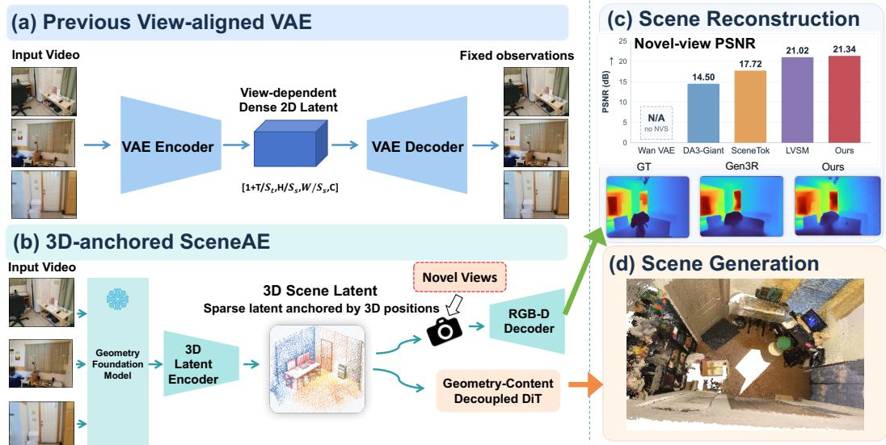  
Figure 1: (a) Previous VAEs construct view-bound grid latent representations, which can only reconstruct fixed observations. (b) We construct a compact 1D latent representation anchored to explicit 3D positions, which can achieve efficient scene reconstruction and scene generation tasks.

## ABSTRACT

Recent video world models have increasingly adopted 3D memory mechanisms to integrate historical observations into a lightweight and persistent scene representation. This naturally raises a complementary question: if 3D representations can serve as an effective mechanism for memorizing observed scenes, can they also be directly used as the latent space for reconstructing and generating scenes? Motivated by this idea, we represent a scene as a compact and unstructured 3Danchored latent space (SceneAE). Each latent combines an explicit 3D position with an implicit content feature and is spatially grounded to describe its local scene region, forming a sparse latent point cloud. Unlike conventional video-VAE latents that describe how a scene appears from particular viewpoints, our representation directly describes the scene itself, making it naturally applicable to both reconstruction and generation. For reconstruction, once the scene has been generated, our persistent 3D representation can be projected and decoded into RGB-D observations by different target cameras, without the need to regenerate a video for each new camera trajectory. For generation, we leverage the geometry-content separation to first generate camera-controlled 3D geometry and then synthesize content conditioned on it, reducing camera-appearance entanglement and improving camera controllability. Experiments show that this 3D latent achieves superior generation quality, computational cost, and camera controllability.

## 1 INTRODUCTION

Recent video generation models (Wan et al., 2025; Hong et al., 2022; Yang et al., 2025; Zheng et al., 2024) encode videos into dense spatiotemporal latent grids and learn their distributions with diffusion transformers. Building on this paradigm, camera-controllable world models generate future observations from an initial view and a prescribed camera trajectory, often predicting RGB together with depth to improve spatial understanding. For example, Gen3R (Huang et al., 2026) jointly models the appearance latents of Wan VAE and the geometric features of VGGT (Wang et al., 2025), while GLD (Jang et al., 2026) performs diffusion directly in the feature space of a geometry foundation model (Lin et al., 2025). These approaches combine scalable video- generation priors with explicit geometric information, producing compelling and geometry-aware RGB-D sequences.

Despite architectural differences, these methods use viewpoint-aligned latent grids that describe individual observations rather than the scene itself. Their outputs are therefore trajectory-specific videos that cannot be directly queried from novel viewpoints as shown in Figure 1(a). Overlapping views also introduce latent redundancy, while appearance- centric representations make geometric consistency harder to learn. SceneTok (Asim et al., 2026) compresses the scene into compact unstructured 1D tokens and supports multi-view decoding, thereby alleviating the fixed-viewpoint limitation. However, its tokens lack explicit spatial localization, and the model must learn the scene region corresponding to each token through dense token-pixel interaction, which increases optimization difficulty as well as encoding and decoding costs. Our core idea is to anchor latent features at explicit 3D positions, guiding them to learn the corresponding local 3D regions and thereby forming a sparse latent point cloud, which is shown in Figure 1(b). Unlike view-aligned dense grids, this rep resentation describes the scene directly in a shared 3D coordinate system, so that the same physical region needs to be encoded only once and can be reused across different viewpoints, which avoids the redundancy of repeated encoding while effectively ensuring geometric consistency across viewpoints. Furthermore, due to the properties of the 3D representation, for any target camera within the field of view, the latents can be projected onto its image plane and decoded into per-pixel RGBD information through a deep learnable decoder, which allows our representation to directly perform the scene reconstruction task and thereby support fast world roaming.

Furthermore, existing camera-controllable generation methods typically inject camera features directly into view-aligned appearance latents. Since camera conditions and appearance features de scribe different factors, this implicit conditioning requires the model to infer geometric transformations, occlusion relationships, and the emergence of newly revealed regions while simultaneously generating texture, which easily leads to feature entanglement and makes camera control difficult. 3D memory methods such as GEN3C (Ren et al., 2025), Voyager (Huang et al., 2025), and Mirage (Wang et al., 2026) have shown that more direct geometric control can be achieved when camera control acts directly on explicit scene geometry (e.g., a point cloud memory) rather than on appearance latents. However, the 3D memory in these methods is mainly used to store and query scene content that has already been observed. Inspired by this, we further extend camera control over explicit geometry to future scene generation, and propose a two-stage Geometry-Content Decoupled DiT. Specifically, the future 3D anchor layout is first generated according to the target camera trajectory, and then the predicted point positions are used to provide spatial relationships through 3D RoPE to guide the generation of the corresponding latent content. This establishes a direct control path from camera trajectory to scene geometry and then to scene content, reducing camera-appearance entanglement and achieving more accurate trajectory following.

Extensive experiments on multiple real-world datasets demonstrate that our method achieves superior scene reconstruction and generation quality with a substantially more compact latent space and lower computational cost. It consistently reconstructs geometrically coherent RGB-D observations across query viewpoints and more faithfully follows target camera trajectories.

## 2 RELATED WORK

Scene Latent Space. Conventional image and video VAEs (Wan et al., 2025; Yang et al., 2025) compress appearance into dense latent grids, but their limited geometric awareness can cause crossview inconsistency. GLD (Jang et al., 2026) introduces stronger geometry by generating dense foundation-model features, at the cost of a high-dimensional latent space. Both remain viewpointaligned and redundantly encode overlapping regions. SceneTok (Asim et al., 2026) uses compact, unstructured tokens for query-view decoding, but their lack of spatial grounding requires token-pixel interactions to learn token-region correspondence, increasing optimization difficulty and cost.

Camera-Controllable Scene Generation. Recent video diffusion models (Zhang et al., 2025; Wu et al., 2026) have been extended to camera-controllable scene generation by incorporating camera poses, ray embeddings, or geometric features into the generation process. Aether (Zhu et al., 2025) jointly models and generates image latents, depth latents, and camera pose latents. PRoPE (Li et al., 2025) encodes relative projective relationships directly in attention. GLD (Jang et al., 2026) performs diffusion in the feature space of a geometry foundation model. Other methods maintain a persistent 3D memory: GEN3C (Ren et al., 2025) renders an explicit point-cloud cache as conditioning, and Mirage (Wang et al., 2026) stores and queries historical video latents in 3D space.

3D Scene Reconstruction. Neural scene representations, such as NeRF (Mildenhall et al., 2021; Chen et al., 2022; Johari et al., 2022) and 3D Gaussian Splatting (Kerbl et al., 2023; Chen et al., 2024; Zhang et al., 2024), encode scenes in 3D and support novel-view rendering, but typically require per-scene optimization and are not designed as latent spaces for generative modeling. Therefore, some feed-forward reconstruction models (Lin et al., 2025; Liu et al., 2026) efficiently and generally recover scene geometry from visual observations by predicting pixel-aligned 3D Gaussians. In addition, some methods (Jiang et al., 2025; Asim et al., 2026; Jin et al., 2025) reconstruct observations from arbitrary viewpoints by constructing implicit representations of the scene.

## 3 METHOD

## 3.1 3D LATENT REPRESENTATION

We encode the video scene into a representation $R = \{ P , Z \} = \{ p _ { i } , z _ { i } \} _ { i = 1 } ^ { N }$ , where the explicit coordinates $p _ { i }$ provide each latent with a stable spatial identity, and the implicit features $z _ { i }$ describe the content of its corresponding local 3D region. Leveraging the properties of 3D point clouds, this representation reduces the redundancy of repeated observations across viewpoints, yielding a compact latent space while effectively supporting high-quality RGBD rendering from arbitrary viewpoints.

Encoder. Given V posed RGB observations $\left( O \right) = \left( I _ { v } , K _ { v } , T _ { v } \right) _ { v = 1 } ^ { V }$ , where $I _ { v } \in R ^ { 3 \times H \times W } , K _ { v } \in$ $R ^ { 4 \times 4 }$ and $T _ { v } \in R ^ { 4 \times 4 }$ represent the v-th RGB image, camera intrinsics, and the camera pose.), we aim to encode the observed scene into a sparse and view-independent 3D latent representation. We first apply a frozen Depth Anything 3-Base (DA3) (Lin et al., 2025) model to extract multi-level feature maps $( F = [ \bar { F _ { 1 } , F _ { 2 } . . . . \dot { F _ { V } } } ] )$ and predict depth maps $( D = [ D _ { 1 } , D _ { 2 } . . . D _ { V } ] )$ . Each valid pixel is back-projected into the world coordinate system using K and $T$ to obtain a global point cloud, and farthest-point sampling yields N anchor positions $P = [ p _ { 1 } , p _ { 2 } . . . p _ { N } ]$

For each latent, we project its 3D position into all visible input views and sample the corresponding DA3 features. These projected features are aggregated to initialize a latent query:

$$
q _ { i } = \phi _ { x } ( p _ { i } ) + \phi _ { f } \left( \operatorname { A g g } _ { v \in \mathcal { V } _ { i } } F _ { v } \left( \pi _ { v } ( p _ { i } ) \right) \right) ,\tag{1}
$$

where $\phi _ { x } ( p _ { i } )$ means the position embedding of the 3D coords. $\pi _ { v } ( p _ { i } )$ projects the point $p _ { i }$ into the v-th view using the corresponding camera parameters. Therefore, $F _ { v } \left( \pi _ { v } ( p _ { i } ) \right)$ denotes the v-th view DA3 feature sampled at its projected location. Notably, instead of using all views, we select the top-V views for aggregation based on visibility and occlusion.

In $E _ { \theta } { } _ { : }$ , following BEVFormer (Li et al., 2024), we construct deformable cross-attention with the DA3 feature maps based on the 3D coordinates of each latent, along with self-attention, for refinement.

$$
\left\{ \mathbf { z } _ { i } \right\} _ { i = 1 } ^ { N } = E _ { \theta } \left( \left\{ q _ { i } , p _ { i } \right\} _ { i = 1 } ^ { N } , \left\{ F _ { v } \right\} _ { v = 1 } ^ { V } \right) .\tag{2}
$$

Decoder. After constructing the non-grid latent representation, achieving RGBD reconstruction from arbitrary viewpoints remains a challenging problem. SceneTok decodes by having the pixels of the target view interact with all latents, which incurs substantial computational overhead. Given that our 3D latent representation is analogous to 3D Gaussians, for a target v-th view we first construct a corresponding downsampled grid $\bar { G } _ { v } \in R ^ { \frac { H } { S _ { s } } \times \frac { W } { S _ { s } } }$ , where $S _ { s }$ denotes the downsampling scale, and then splat each latent into the grid according to the projection relationship. For the j-th pixel in the grid, the top- $M _ { 1 }$ nearest latents are selected based on 2D distance, and then the weight of each latent is computed from its distance, visibility, and latent features.

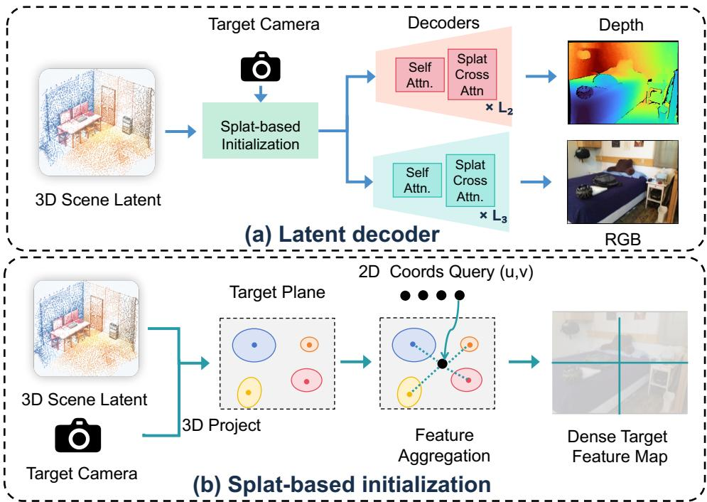  
Figure 2: Overall Framework of the RGB-D Decoder. By leveraging the 3D properties of the latents, we can efficiently achieve RGBD rendering from arbitrary novel viewpoints.

$$
s _ { i j } ^ { v } = \psi ( z _ { i } , d _ { v } ^ { 2 d } [ i j ] - \beta _ { z } d _ { v } ^ { z } ( p _ { i } )\tag{3}
$$

where $s _ { i j } ^ { v }$ mean the score of the i-th latent at the j-th pixel of the v-th view, $d _ { v } ^ { 2 d } [ i j ]$ denotes the distance between the j-th pixel and the 2D coordinate onto which the i-th latent is splatted in the v-th view, and $d _ { v } ^ { z } ( p _ { i } )$ denotes the depth of the i-th latent in the v-th view. This term is introduced so that latents with smaller depth receive higher weights, forming a soft z-buffer splatting.

Then, these are aggregated into the initialization feature of the current j-th pixel in v-th view grid.

$$
h _ { j } ^ { v } = \sum _ { n \in \mathcal { N } _ { j } ^ { v } } s _ { n j } ^ { v } \theta _ { d } ( z _ { n } )\tag{4}
$$

where $h _ { j } ^ { v }$ means the init feature, and $\mathcal { N } _ { j } ^ { v }$ means the top- $M _ { 1 }$ nearest latents set.

This produces a low-resolution feature map h for the target view. Unlike 3D Gaussian Splatting, we use splatting only for geometry-aware feature initialization rather than full-resolution rendering. This efficiently establishes 3D-to-2D correspondences at low resolution, while a deep decoder refines and upsamples the features to recover detailed RGB-D observations.

Finally, the RGB and depth predictions are obtained by the RGB Decoder $H _ { \mathrm { r g b } }$ and Depth Decoder , in which these decoders consist of multiple layers of self-attention and cross-attention with the $\mathrm { t o p } { \cdot } M _ { 2 }$ nearest latents under the view (splat cross attention). The overall framework of decoder is illustrated in Figure 2. More details are provided in Section A.2.

$$
\hat { \mathbf { I } } _ { v } = H _ { \mathrm { r g b } } ( \{ \mathbf { h } ^ { v } \} , \{ p _ { i } , z _ { i } \} _ { i = 1 } ^ { N } ) , \hat { \mathbf { D } } _ { v } = H _ { \mathrm { d e p t h } } ( \{ \mathbf { h } ^ { v } \} , \{ p _ { i } , z _ { i } \} _ { i = 1 } ^ { N } )\tag{5}
$$

Training. The training losses are only the RGB and depth rendering losses.

$$
L _ { l a t e n t } = \lambda _ { 1 } L _ { m s e } ^ { r g b } + \lambda _ { 2 } L _ { g r a d } ^ { r g b } + \lambda _ { 3 } L _ { m s e } ^ { d e p t h } + \lambda _ { 4 } L _ { g r a d } ^ { d e p t h }\tag{6}
$$

Furthermore, since the latent coordinates are also generated by the DiT at inference time, we apply small perturbations to the latent coordinates during the decoder training stage to enhance the robustness of the decoder to coordinate errors produced by the DiT.

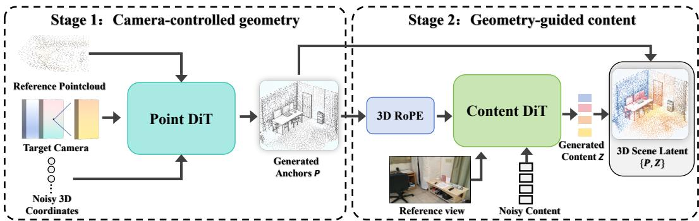  
Figure 3: Overall Framework of the Geometry-Content decoupled DiT. We first control the generation of the future geometric layout via the camera, and then control the generation of texture content via the geometric layout, thereby achieving more accurate camera control.

## 3.2 GEOMETRY-CONTENT DECOUPLED DIT

Given the 3D latent state $R _ { r e f } = \{ P _ { r e f } , Z _ { r e f } \}$ encoded from the reference frame and a target camera trajectory $T _ { t a r g e t }$ , our goal is to generate the 3D positions $( P _ { t a r g e t } )$ and content features $( Z _ { t a r g e t } )$ of the target scene region. Existing methods commonly inject camera poses or rays into viewpoint-aligned video latents through feature addition, positional encoding, or attention. In these formulations, the camera trajectory remains an implicit conditioning signal, and the model must learn to translate it into changes in scene geometry, visibility, and spatial coverage. Because these geometric effects are expressed indirectly through appearance-oriented latents, accurate camera following remains challenging. In contrast, our 3D latent representation provides an explicit geometric variable on which camera control can directly operate. We therefore first generate the spatial structure according to the target trajectory and subsequently generate content features upon this geometry, the overall framework is shown in Figure 3. This establishes a structured control path from camera trajectory to scene geometry and then to scene content, enabling more accurate camera control.

Camera-Controlled Point Diffusion. We build a lightweight point diffusion model that generates future 3D positions from the reference point cloud and target camera poses.

We first express all cameras relative to the reference camera and construct a sparse ray map for each target view. Each ray token contains its Plucker coordinates, image-plane location, trajectory index, ¨ and the depth information projected from the observed scene when available.

We then add noise to the input positions. To provide scene-aware information, we train using the flow path from the first-frame to the target point cloud. At timestep t, the noisy input is:

$$
\hat { P } ^ { t } = ( 1 - t ) \cdot P _ { t a r g e t } + t \cdot P _ { r e f }\tag{7}
$$

The input noise is fed into a lightweight Point DiT for prediction. The Point DiT consists of selfattention on the input, cross-attention with the point cloud of the reference frame, and cross-attention with the ray token of the corresponding target camera after projection onto the target plane. As a result, the camera trajectory can directly constrain the spatial structure of the generated latents.

Finally, the model predicts the clean target layout $\hat { P } _ { t a r g e t }$ with an MSE loss.

$$
L _ { p o i n t } = M S E ( \theta _ { p o i n t } ( \hat { P } ^ { t } , P _ { r e f } , T _ { t a r g e t } ) , P _ { t a r g e t } )\tag{8}
$$

Geometric-guided Content Diffusion. The second-stage Content DiT generates content features on the geometry $\hat { P } _ { t a r g e t }$ produced by the first-stage Point DiT. We employ a Wan-style (Wan et al., 2025) transformer consisting of adaptive LayerNorm self-attention, cross-attention to the reference latents $R _ { r e f }$ , and feed-forward layers. In self- and cross-attention, we add 3D RoPE of the token position $\hat { P } _ { t a r g e t }$ for geometric association and camera control. Training follows:

$$
\hat { Z } ^ { t } = ( 1 - t ) \cdot Z _ { t a r g e t } + t \cdot \sigma\tag{9}
$$

$$
L _ { c o n t e n t } = M S E ( \theta _ { c o n t e n t } ( \hat { Z } ^ { t } , R _ { r e f } , \hat { P } _ { t a r g e t } ) , Z _ { t a r g e t } - \hat { Z } ^ { t } )\tag{10}
$$

Table 1: Quantitative Comparison of Appearance Generation. We report the PSNR, SSIM, Subject Consistency, Background Consistency, Multi-view Consistency from VBench. We also report the GFLOPs and ms per step to evaluate the efficiency of the models.
<table><tr><td rowspan="2">Ccond.</td><td rowspan="2">Method</td><td colspan="5">DL3DV-10K</td><td colspan="5">RealEstate10K</td><td rowspan="2">GFLOPs</td><td rowspan="2">ms</td></tr><tr><td>PSNR↑</td><td>SSIM↑</td><td>Sub↑ Bg↑</td><td></td><td>MVC↑</td><td>PSNR↑</td><td>SSIM↑</td><td>Sub↑ Bg↑</td><td></td><td>MVC↑|</td></tr><tr><td rowspan="5">1-ew</td><td>Aether SceneTok</td><td>14.1</td><td>0.36</td><td>0.81</td><td>0.84</td><td>0.19</td><td>15.4</td><td>0.47</td><td>0.82</td><td>0.89</td><td>0.21</td><td>48874</td><td>364</td></tr><tr><td></td><td></td><td></td><td></td><td></td><td></td><td>15.3</td><td>0.48</td><td>0.84</td><td>0.91</td><td>0.24</td><td></td><td></td></tr><tr><td>Gen3R</td><td>14.7</td><td>0.39</td><td>0.85</td><td>0.88</td><td>0.21</td><td>15.8</td><td>0.53</td><td>0.86</td><td>0.92</td><td>0.24</td><td>18105</td><td>174</td></tr><tr><td>GLD</td><td>15.6</td><td>0.45</td><td>0.87</td><td>0.91</td><td>0.22</td><td>16.9</td><td>0.58</td><td>0.89</td><td>0.94</td><td>0.28</td><td>23203</td><td>285</td></tr><tr><td>Ours</td><td>15.4</td><td>0.45</td><td>0.88 0.93</td><td></td><td>0.28</td><td>17.1</td><td>0.60</td><td></td><td>0.900.94</td><td>0.33</td><td>8348</td><td>134</td></tr><tr><td rowspan="5">2-ew</td><td>Aether SceneTok</td><td>15.7</td><td>0.42</td><td>0.82 0.84</td><td></td><td>0.20</td><td>16.8</td><td>0.55</td><td>0.82 0.88</td><td></td><td>0.23</td><td>48874</td><td>364</td></tr><tr><td></td><td></td><td></td><td></td><td></td><td></td><td>17.1</td><td>0.57</td><td>0.84</td><td>0.90</td><td>0.25</td><td></td><td></td></tr><tr><td>Gen3R</td><td>16.3</td><td>0.46</td><td>0.86</td><td>0.89</td><td>0.24</td><td>17.5</td><td>0.59</td><td>0.85</td><td>0.92</td><td>0.26</td><td>18105</td><td>174</td></tr><tr><td>GLD</td><td>18.1</td><td>0.53</td><td>0.87</td><td>0.92</td><td>0.23</td><td>19.4</td><td>0.67</td><td>0.88</td><td>0.93</td><td>0.30</td><td>23203</td><td>285</td></tr><tr><td>Ours</td><td>17.9</td><td>0.52</td><td>0.88 0.92</td><td></td><td>0.28</td><td>19.8</td><td>0.68</td><td></td><td>0.92 0.95</td><td>0.34</td><td>9975</td><td>145</td></tr></table>

Table 2: Quantitative Comparison of Geometry Generation. We report the average accuracy, completeness, and Chamfer Distance. The evaluation GT for Gen3R is provided by VGGT (Wang et al., 2025), while the evaluation GT for ours and GLD is provided by DA3 (Lin et al., 2025). This avoids the influence of performance differences among geometry foundation models.
<table><tr><td rowspan="2">Cond.</td><td rowspan="2">Method</td><td colspan="3">DL3DV-10K</td><td colspan="3">RealEstate10K</td></tr><tr><td>Accuracy↓</td><td>Completeness↓</td><td>CD↓</td><td>Accuracy↓</td><td>Completeness↓</td><td>CD↓</td></tr><tr><td rowspan="3">Iliew</td><td>Gen3R GLD</td><td>1.74</td><td>1.92</td><td>2.01</td><td>0.75</td><td>0.91</td><td>0.96</td></tr><tr><td rowspan="2">Ours</td><td>0.87</td><td>1.18</td><td>1.04</td><td>0.36</td><td>0.49</td><td>0.46</td></tr><tr><td>0.34</td><td>0.55</td><td>0.44</td><td>0.13</td><td>0.22</td><td>0.18</td></tr><tr><td rowspan="2">2iew</td><td>Gen3R GLD</td><td>1.23</td><td>1.46</td><td>1.38</td><td>0.59</td><td>0.75</td><td>0.74</td></tr><tr><td rowspan="2">Ours</td><td>0.63</td><td>0.91</td><td>0.85</td><td>0.27</td><td>0.44</td><td>0.39</td></tr><tr><td>0.21</td><td></td><td>0.46</td><td>0.30</td><td>0.07</td><td>0.10</td><td>0.08</td></tr></table>

Two-stage Training. Since camera-controllable content generation relies on 3D RoPE, relatively accurate 3D positions are required. Therefore, we adopt a two-stage training paradigm: the Point DiT is trained first, and only then is the Content DiT trained, rather than training them jointly. Details of the Point DiT and Content DiT are in Sections A.3 and A.4.

## 4 EXPERIMENTS

## 4.1 TRAINING DETAILS

Datasets. We train SceneLatent from scratch on DL3DV (Ling et al., 2024), RealEstate10K (Zhou et al., 2018)(RE10K), and ScanNet (Dai et al., 2017). For a fair comparison, we construct each sample from nine views (matching the 4N+1 frame requirement of Wan, Gen3R, etc., while approaching the 8-frame design used by GLD), and then train the scene generation task under both the 1-view setting with a given first frame and the 2-view setting with given first and last frames.

Training Details. We use DepthAnything V3-Base as the backbone to extract feature maps and depth for the input videos. The image resolution is set to 518×376, and the number N of 3D latents is set to 3000. The training optimizer hyperparameters follow GLD, using AdamW with a learning rate of 5e-5 and a batch size of 40. SceneLatent is trained for 100k iterations on 8 A800 GPUs. Although our method uses less training time and fewer training datasets than methods such as GLD and Gen3R, it still achieves competitive performance.

## 4.2 3D SCENE GENERATION

Appearance Generation. We evaluate the RGB generation performance on DL3DV Eval and RealEstate10K test, reporting mainly PSNR, SSIM (Wang et al., 2004), as well as Subject Consistency, Background Consistency, Multi-View Consistency from VBench (Huang et al., 2024), with comparison methods including Aether (Zhu et al., 2025), SceneTok (Asim et al., 2026),

Ours  
Table 3: Trajectory following. AUC@30 and ATE (Absolute Trajectory Error) are computed from poses estimated by VGGT.
<table><tr><td rowspan="2">Method</td><td colspan="2">DL3DV</td><td rowspan="2">RE10K AUC@30↑ ATE↓</td></tr><tr><td>AUC@30↑ ATE↓</td><td></td></tr><tr><td rowspan="3">Aether Gen3R GLD</td><td>0.48</td><td>0.23 0.51</td><td>0.22</td></tr><tr><td>0.59</td><td>0.19</td><td>0.57 0.20</td></tr><tr><td>0.64 0.15</td><td>0.67</td><td>0.15</td></tr><tr><td>Ours</td><td>0.76</td><td>0.10</td><td>0.72 0.09</td></tr></table>

GT

Gen3R  
Table 4: Memory ability. We reverse each trajectory to form a round trip, and compare corresponding forward and return views.
<table><tr><td rowspan="2">Method</td><td colspan="2">RGB</td><td rowspan="2">Depth Accuracy↓</td></tr><tr><td>PSNR↑</td><td>SSIM↑</td></tr><tr><td rowspan="3">Aether Gen3R GEN3C</td><td>17.1</td><td>0.58</td><td>0.18</td></tr><tr><td>17.3</td><td>0.60</td><td>0.12</td></tr><tr><td>29.8</td><td>0.90</td><td>0.06</td></tr><tr><td>Ours</td><td>30.7</td><td>0.93</td><td>0.04</td></tr></table>

GLD  
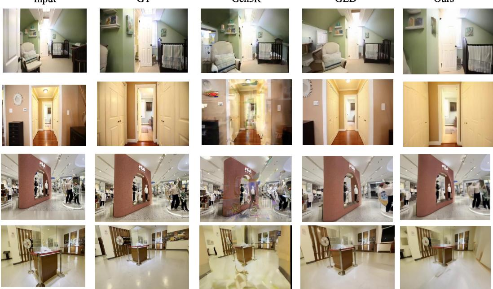  
Figure 4: Qualitative Comparison of Different Methods under the 1-view setting.

Gen3R (Huang et al., 2026) and GLD (Jang et al., 2026). In addition, we report the GFLOPs and time (ms) per inference step for all evaluated methods. The results are shown in Table 1. As can be seen, owing to the adaptability of our splat-based decoder to the 3D representation and the precise camera control brought by the geometry-content decoupled DiT, our method achieves the best generation quality even with an extremely sparse 3D latent representation. More importantly, benefiting from the sparsity of the latent representation, our computational overhead in GFLOPs and inference time is only half that of the state-of-the-art method GLD. This fully demonstrates that 3D representations can also be effectively applied to future scene generation tasks.

Geometry Generation. We evaluate depth generation on DL3DV Eval and the RealEstate10K test set using accuracy, completeness, and Chamfer distance. To avoid conflating generation quality with differences among geometry foundation models, each method is evaluated against the depth produced by its own geometry model: VGGT for Gen3R and DA3 for ours and GLD. As shown in Table 2, our method substantially outperforms existing approaches, benefiting from latents anchored to explicit 3D coordinates and the resulting geometric prior throughout generation.

Trajectory Following. In this section, we test the trajectory following capability of the model during generation. Specifically, for the predicted videos, we compute the poses using VGGT and compare them with the ground-truth poses. We report AUC@30 and ATE (Absolute Trajectory Error), and the results are shown in Table 3. As can be seen, thanks to the geometry-content decoupled DiT design, we achieve more precise camera control, yielding stronger trajectory following.

Memory Ability. Memory is essential for a world model to remain consistent when revisiting previously observed regions. We evaluate this ability by concatenating each test trajectory with its reversed copy to form a round-trip sequence. We compare corresponding forward and return RGB views using PSNR and SSIM, and depth views using Accuracy. As shown in Table 4, GEN3C outperforms Gen3R by using an explicit 3D point-cloud memory. Our latent memory also forms an implicit point cloud: nearby latent coordinates tend to carry consistent content, enabling strong round-trip consistency comparable to explicit 3D memory.

Table 5: Quantitative comparison of RGB reconstruction. We report PSNR and SSIM for reconstructing the input views (Input Reconstruction) and for rendering 20 other viewpoints of the scene from 9 context frames (Novel View Synthesis). “–” denotes not supported or not reported.
<table><tr><td rowspan="3">Method</td><td colspan="4">Input Reconstruction</td><td colspan="4">Novel View Synthesis</td></tr><tr><td colspan="2">DL3DV</td><td colspan="2">RE10K</td><td colspan="2">DL3DV</td><td colspan="2">RE10K</td></tr><tr><td>PSNR↑</td><td>SSIM↑</td><td>PSNR↑</td><td>SSIM↑</td><td>PSNR↑</td><td>SSIM↑</td><td>PSNR↑</td><td>SSIM↑</td></tr><tr><td>Wan-VAE</td><td>26.1</td><td>0.79</td><td>30.9</td><td>0.88</td><td></td><td></td><td></td><td>一</td></tr><tr><td>GLD</td><td>26.7</td><td>0.84</td><td>31.1</td><td>0.91</td><td></td><td></td><td></td><td></td></tr><tr><td>DA3-Giant</td><td></td><td></td><td>一</td><td>一</td><td>13.4</td><td>0.35</td><td>14.4</td><td>0.52</td></tr><tr><td>LVSM</td><td></td><td></td><td></td><td></td><td>17.8</td><td>0.53</td><td>21.0</td><td>0.71</td></tr><tr><td>SceneTok</td><td>19.3</td><td>0.61</td><td>24.1</td><td>0.81</td><td>16.1</td><td>0.46</td><td>17.7</td><td>0.59</td></tr><tr><td>Ours</td><td>22.2</td><td>0.68</td><td>26.3</td><td>0.84</td><td>18.3</td><td>0.55</td><td>21.3</td><td>0.73</td></tr></table>

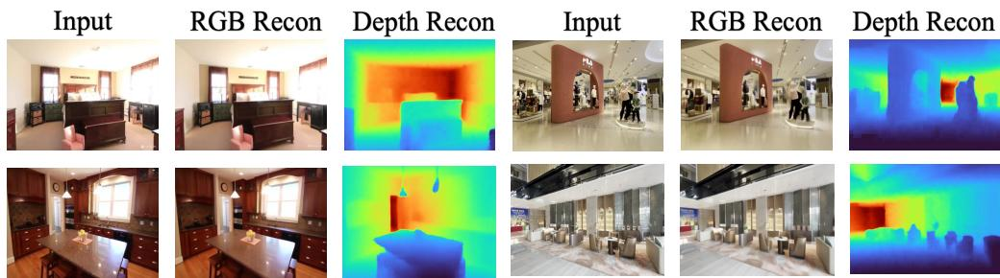  
Figure 5: Visualization of the Latent Encoder-Decoder Reconstruction.

Visualizations of RGB Generation. In Figure 4, we visualize the last generated frame under the 1-view setting for different methods. More visualizations are provided in Section B.3.

## 4.3 3D SCENE RECONSTRUCTION

Novel View Synthesis. A key property of our representation is that the encoded scene can be queried from viewpoints that are not observed in the input. Using 9 frames as context, we render 20 other viewpoints of the scene and report PSNR and SSIM in the right part of Table 5. Dense view-aligned latents such as Wan-VAE and GLD can only decode the encoded observations and therefore do not support this setting. Our method outperforms the feed-forward Gaussian model DA3-Giant as well as the query-based SceneTok and LVSM on both DL3DV and RE10K. Since each latent is anchored to an explicit 3D position, projecting the latents onto a novel camera directly provides geometrically consistent correspondences for decoding, rather than requiring the decoder to infer them implicitly.

Input Reconstruction. The left part of Table 5 compares the RGB reconstruction performance of different latent encoders and decoders. Wan-VAE and GLD adopt dense, view-aligned grids, which retain more visual information and higher fidelity. Like ours, SceneTok uses unstructured 1D tokens to support novel view reconstruction, but its latents must learn their responsible regions from scratch and require full interaction with pixels, resulting in higher optimization difficulty and greater computational overhead. By explicitly anchoring latents to 3D positions and restricting interaction to spatially relevant local regions, our method achieves higher reconstruction performance while significantly reducing computational overhead. Compared with SceneTok at the same resolution, GFLOPs drop from 27,096 to 13,171, and batch latency decreases from 4,020 ms to 1,623 ms. Figure 5 visualizes the RGB-D reconstructions of the input images.

Geometry Reconstruction. We evaluate depth reconstruction on DL3DV in Table 6. Our method reduces the Chamfer Distance from 0.63 (Gen3R) and 0.79 (Aether) to 0.20, since the explicit 3D anchors provide a strong geometric prior for depth decoding. We further measure the depth projection consistency between adjacent views in Table 7, where our method also surpasses Gen3R and DA3-Base, indicating more consistent scene geometry across views. As shown in Figure 6, our method faithfully recovers object structures, whereas DA3 and Gen3R may bend or distort objects.

Table 6: Depth reconstruction on DL3DV.
<table><tr><td>Method</td><td>Accuracy↓</td><td>Completeness↓</td><td>CD↓</td></tr><tr><td>Aether</td><td>0.74</td><td>0.96</td><td>0.79</td></tr><tr><td>Gen3R</td><td>0.51</td><td>0.81</td><td>0.63</td></tr><tr><td>Ours</td><td>0.12</td><td>0.35</td><td>0.20</td></tr></table>

DA3

Table 7: Cross-view depth consistency.
<table><tr><td>Method</td><td>Median↓</td><td>P90↓</td><td>1%↑</td><td>10%↑</td></tr><tr><td>DA3-Base Gen3R</td><td>8.55% 8.65%</td><td>47.55%</td><td>9.00%</td><td>54.58%</td></tr><tr><td>Ours</td><td></td><td>47.95%</td><td>8.92%</td><td>53.96%</td></tr><tr><td></td><td>8.05%</td><td>46.15%</td><td>10.25%</td><td>55.92%</td></tr></table>

Gen3R

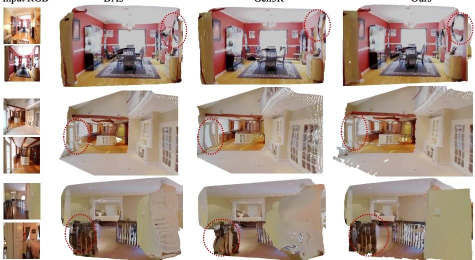  
Ours  
Figure 6: Qualitative comparison of geometry reconstruction. Red circles mark distorted regions.

Table 8: Ablation of latent autoencoder.
<table><tr><td>Jitter</td><td>Low-Res</td><td>Splat-CA</td><td>PSNR↑</td></tr><tr><td>x</td><td>x</td><td>x</td><td>24.1</td></tr><tr><td>x</td><td>x</td><td>√</td><td>24.7</td></tr><tr><td>x</td><td>√</td><td>x</td><td>25.9</td></tr><tr><td>x</td><td>√</td><td>√</td><td>26.3</td></tr><tr><td>√</td><td>√</td><td>√</td><td>26.5</td></tr></table>

Table 9: Ablation of DiT designs.
<table><tr><td rowspan=1 colspan=1>Setting</td><td rowspan=1 colspan=1>| Variant</td><td rowspan=1 colspan=1>| PSNR↑</td></tr><tr><td rowspan=2 colspan=1>(a) Generation</td><td rowspan=1 colspan=1>JointContent-Only</td><td rowspan=1 colspan=1>15.516.0</td></tr><tr><td rowspan=1 colspan=1>Decoupled</td><td rowspan=1 colspan=1>17.1</td></tr><tr><td rowspan=2 colspan=1>(b) Camera Inj.</td><td rowspan=1 colspan=1>Content-OnlyBoth</td><td rowspan=1 colspan=1>16.216.4</td></tr><tr><td rowspan=1 colspan=1>Geometry-Only</td><td rowspan=1 colspan=1>17.1</td></tr></table>

4.4 ABLATION STUDY

Components of the Latent Encoder-Decoder. Table 8 ablates three components of the latent encoder-decoder on RE10K. Here, Jitter denotes perturbing the latent coordinates during the decoder stage. Low-Res denotes the decoding paradigm that constructs a low-resolution dense feature map via splat-based initialization and then performs feature refinement through a subsequent deep decoder. Rendering at the original resolution as in 3D Gaussian splatting performs worse, because our latents are much sparser than pixel-aligned Gaussians. Splat-CA denotes the splat cross-attention in the decoder: unlike SceneTok, where each pixel interacts with all latents, our design lets each pixel interact only with the nearest few latents splatted onto the plane.

Different DiT Design. Table 9 evaluates alternative DiT designs on RE10K. In (a), Joint generates positions and content jointly, Content-Only generates content and regresses positions afterward, and Decoupled first generates geometry and then conditions content generation on it. The decoupled design performs best, showing that explicit geometric priors facilitate content synthesis. In (b), injecting the camera condition only into geometry generation outperforms injecting it into both geometry and content, confirming that camera-appearance entanglement harms generation quality.

## 5 CONCLUSION

We presented SceneAE, a sparse and scene-centric 3D latent representation for both scene reconstruction and generation. Unlike view-aligned dense grid latents, each latent couples an explicit 3D anchor position with an implicit content feature, so that every physical region is encoded only once and shared across viewpoints. A splat-based decoder renders this compact representation into

RGB-D observations from arbitrary cameras without regenerating a video for each trajectory. Our Geometry-Content Decoupled DiT further generates the 3D anchor layout from the camera trajectory before synthesizing content, establishing an explicit control path from camera to geometry to content. Experiments show that SceneAE achieves strong generation quality, superior geometric consistency and camera controllability, at about half the computational cost of dense latents. We hope this work encourages the use of 3D representations as the latent space of video world models.

## REFERENCES

Mohammad Asim, Christopher Wewer, and Jan Eric Lenssen. Scenetok: A compressed, diffusable token space for 3d scenes, 2026. URL https://arxiv.org/abs/2602.18882.

Anpei Chen, Zexiang Xu, Andreas Geiger, Jingyi Yu, and Hao Su. Tensorf: Tensorial radiance fields. In European Conference on Computer Vision, pp. 333–350. Springer, 2022.

Yuedong Chen, Chuanxia Zheng, Haofei Xu, Bohan Zhuang, Andrea Vedaldi, Tat-Jen Cham, and Jianfei Cai. Mvsplat360: Feed-forward 360 scene synthesis from sparse views. Advances in Neural Information Processing Systems, 37:107064–107086, 2024.

Angela Dai, Angel X Chang, Manolis Savva, Maciej Halber, Thomas Funkhouser, and Matthias Nießner. Scannet: Richly-annotated 3d reconstructions of indoor scenes. In 2017 IEEE Conference on Computer Vision and Pattern Recognition (CVPR), pp. 2432–2443. IEEE, 2017.

Wenyi Hong, Ming Ding, Wendi Zheng, Xinghan Liu, and Jie Tang. Cogvideo: Large-scale pretraining for text-to-video generation via transformers. arXiv preprint arXiv:2205.15868, 2022.

Jiaxin Huang, Yuanbo Yang, Bangbang Yang, Lin Ma, Yuewen Ma, and Yiyi Liao. Gen3r: 3d scene generation meets feed-forward reconstruction. In Proceedings of the IEEE/CVF Conference on Computer Vision and Pattern Recognition, pp. 25358–25369, 2026.

Tianyu Huang, Wangguandong Zheng, Tengfei Wang, Yuhao Liu, Zhenwei Wang, Junta Wu, Jie Jiang, Hui Li, Rynson Lau, Wangmeng Zuo, et al. Voyager: Long-range and world-consistent video diffusion for explorable 3d scene generation. ACM Transactions on Graphics (TOG), 44 (6):1–15, 2025.

Ziqi Huang, Yinan He, Jiashuo Yu, Fan Zhang, Chenyang Si, Yuming Jiang, Yuanhan Zhang, Tianxing Wu, Qingyang Jin, Nattapol Chanpaisit, et al. Vbench: Comprehensive benchmark suite for video generative models. In 2024 IEEE/CVF Conference on Computer Vision and Pattern Recognition (CVPR), pp. 21807–21818. IEEE, 2024.

Wooseok Jang, Seonghu Jeon, Jisang Han, Jinhyeok Choi, Minkyung Kwon, Seungryong Kim, Saining Xie, and Sainan Liu. Repurposing geometric foundation models for multi-view diffusion. arXiv preprint arXiv:2603.22275, 2026.

Hanwen Jiang, Hao Tan, Peng Wang, Haian Jin, Yue Zhao, Sai Bi, Kai Zhang, Fujun Luan, Kalyan Sunkavalli, Qixing Huang, et al. Rayzer: A self-supervised large view synthesis model. In 2025 IEEE/CVF International Conference on Computer Vision (ICCV), pp. 4918–4929. IEEE, 2025.

Haian Jin, Hanwen Jiang, Hao Tan, Kai Zhang, Sai Bi, Tianyuan Zhang, Fujun Luan, Noah Snavely, and Zexiang Xu. Lvsm: A large view synthesis model with minimal 3d inductive bias, 2025. URL https://arxiv.org/abs/2410.17242.

Mohammad Mahdi Johari, Yann Lepoittevin, and Franc¸ois Fleuret. Geonerf: Generalizing nerf with geometry priors. In 2022 IEEE/CVF conference on computer vision and pattern recognition (CVPR), pp. 18344–18347. IEEE, 2022.

Bernhard Kerbl, Georgios Kopanas, Thomas Leimkuhler, George Drettakis, et al. 3d gaussian splat-¨ ting for real-time radiance field rendering. ACM Trans. Graph., 42(4):139–1, 2023.

Ruilong Li, Brent Yi, Junchen Liu, Hang Gao, Yi Ma, and Angjoo Kanazawa. Cameras as relative positional encoding. In D. Belgrave, C. Zhang, H. Lin, R. Pascanu, P. Koniusz, M. Ghassemi, and N. Chen (eds.), Advances in Neural Information Processing Systems, volume 38, Main Conference, pp. 15984–16009. Curran Associates, Inc., 2025. doi: 10.52202/

085713-0540. URL https://proceedings.neurips.cc/paper\_files/paper/ 2025/file/17a7075094632c88cccdd86270ad715b-Paper-Conference.pdf.

Zhiqi Li, Wenhai Wang, Hongyang Li, Enze Xie, Chonghao Sima, Tong Lu, Qiao Yu, and Jifeng Dai. Bevformer: learning bird’s-eye-view representation from lidar-camera via spatiotemporal transformers. IEEE Transactions on Pattern Analysis and Machine Intelligence, 47(3):2020– 2036, 2024.

Haotong Lin, Sili Chen, Junhao Liew, Donny Y Chen, Zhenyu Li, Guang Shi, Jiashi Feng, and Bingyi Kang. Depth anything 3: Recovering the visual space from any views. arXiv preprint arXiv:2511.10647, 2025.

Lu Ling, Yichen Sheng, Zhi Tu, Wentian Zhao, Cheng Xin, Kun Wan, Lantao Yu, Qianyu Guo, Zixun Yu, Yawen Lu, et al. Dl3dv-10k: A large-scale scene dataset for deep learning-based 3d vision. In 2024 IEEE/CVF Conference on Computer Vision and Pattern Recognition (CVPR), pp. 22160–22169. IEEE, 2024.

Yifan Liu, Zhiyuan Min, Zhenwei Wang, Junta Wu, Tengfei Wang, Yixuan Yuan, Yawei Luo, and Chunchao Guo. Worldmirror: Universal 3d world reconstruction with any-prior prompting, 2026. URL https://arxiv.org/abs/2510.10726.

Ben Mildenhall, Pratul P Srinivasan, Matthew Tancik, Jonathan T Barron, Ravi Ramamoorthi, and Ren Ng. Nerf: Representing scenes as neural radiance fields for view synthesis. Communications ofthe ACM, 65(1):99–106, 2021.

Maxime Oquab, Timothee Darcet, Th´ eo Moutakanni, Huy Vo, Marc Szafraniec, Vasil Khalidov,´ Pierre Fernandez, Daniel Haziza, Francisco Massa, Alaaeldin El-Nouby, Mahmoud Assran, Nicolas Ballas, Wojciech Galuba, Russell Howes, Po-Yao Huang, Shang-Wen Li, Ishan Misra, Michael Rabbat, Vasu Sharma, Gabriel Synnaeve, Hu Xu, Herve Jegou, Julien Mairal, Patrick Labatut, Ar-´ mand Joulin, and Piotr Bojanowski. Dinov2: Learning robust visual features without supervision, 2024. URL https://arxiv.org/abs/2304.07193.

Xuanchi Ren, Tianchang Shen, Jiahui Huang, Huan Ling, Yifan Lu, Merlin Nimier-David, Thomas Muller, Alexander Keller, Sanja Fidler, and Jun Gao. Gen3c: 3d-informed world-consistent video¨ generation with precise camera control. In 2025 IEEE/CVF Conference on Computer Vision and Pattern Recognition (CVPR), pp. 6121–6132. IEEE, 2025.

Robin Rombach, Andreas Blattmann, Dominik Lorenz, Patrick Esser, and Bjorn Ommer. High-¨ resolution image synthesis with latent diffusion models, 2022. URL https://arxiv.org/ abs/2112.10752.

Team Wan, Ang Wang, Baole Ai, Bin Wen, Chaojie Mao, Chen-Wei Xie, Di Chen, Feiwu Yu, Haiming Zhao, Jianxiao Yang, et al. Wan: Open and advanced large-scale video generative models. arXiv preprint arXiv:2503.20314, 2025.

Jianyuan Wang, Minghao Chen, Nikita Karaev, Andrea Vedaldi, Christian Rupprecht, and David Novotny. Vggt: Visual geometry grounded transformer. In 2025 IEEE/CVF Conference on Computer Vision and Pattern Recognition (CVPR), pp. 5294–5306. IEEE, 2025.

Weijie Wang, Haoyu Zhao, Yifan Yang, Feng Chen, Zeyu Zhang, Yefei He, Zicheng Duan, Donny Y Chen, Yuqing Yang, and Bohan Zhuang. Latent spatial memory for video world models. arXiv preprint arXiv:2606.09828, 2026.

Zhou Wang, Alan C Bovik, Hamid R Sheikh, and Eero P Simoncelli. Image quality assessment: from error visibility to structural similarity. IEEETransactionss on Image Processing, 13(4):600– 612, 2004.

Haoyu Wu, Diankun Wu, Tianyu He, Junliang Guo, Yang Ye, Yueqi Duan, and Jiang Bian. Geometry forcing: Marrying video diffusion and 3d representation for consistent world modeling. In International Conference on Learning Representations, volume 2026, pp. 119186–119209, 2026.

Zhuoyi Yang, Jiayan Teng, Wendi Zheng, Ming Ding, Shiyu Huang, Jiazheng Xu, Yuanming Yang, Wenyi Hong, Xiaohan Zhang, Guanyu Feng, et al. Cogvideox: Text-to-video diffusion models with an expert transformer. In International Conference on Learning Representations, volume 2025, pp. 83048–83077, 2025.

Kai Zhang, Sai Bi, Hao Tan, Yuanbo Xiangli, Nanxuan Zhao, Kalyan Sunkavalli, and Zexiang Xu. Gs-lrm: Large reconstruction model for 3d gaussian splatting. In European Conference on Computer Vision, pp. 1–19. Springer, 2024.

Qihang Zhang, Shuangfei Zhai, Miguel Angel Bautista Martin, Kevin Miao, Alexander Toshev, Joshua Susskind, and Jiatao Gu. World-consistent video diffusion with explicit 3d modeling. In Proceedings of the IEEE/CVF Conference on Computer Vision and Pattern Recognition, pp. 21685–21695, 2025.

Zangwei Zheng, Xiangyu Peng, Tianji Yang, Chenhui Shen, Shenggui Li, Hongxin Liu, Yukun Zhou, Tianyi Li, and Yang You. Open-sora: Democratizing efficient video production for all. arXiv preprint arXiv:2412.20404, 2024.

Tinghui Zhou, Richard Tucker, John Flynn, Graham Fyffe, and Noah Snavely. Stereo magnification: Learning view synthesis using multiplane images, 2018. URL https://arxiv.org/abs/ 1805.09817.

Haoyi Zhu, Yifan Wang, Jianjun Zhou, Wenzheng Chang, Yang Zhou, Zizun Li, Junyi Chen, Chunhua Shen, Jiangmiao Pang, and Tong He. Aether: Geometric-aware unified world modeling. In 2025 IEEE/CVF International Conference on Computer Vision (ICCV), pp. 8535–8546. IEEE, 2025.

## Appendix

## A IMPLEMENTATION DETAILS

## A.1 LATENT ENCODER

We provide further details of the latent encoder $( E _ { \theta } )$ introduced in Eq. (2) in the main paper. Given N sparse latent positions $( P = \{ p _ { i } \} _ { i = 1 } ^ { N } )$ and $V$ posed RGB observations, the encoder associates each latent with a 64-dimensional content feature $z _ { i }$ . The latent coordinates remain fixed throughout encoding: the encoder only gathers and transforms visual evidence at these explicit 3D locations. This preserves a clear separation between the geometric support $P$ and the learned content $Z .$

Query Initialization. We use a frozen DA3-Base backbone and extract 768-dimensional feature maps from all (L=12) transformer layers. For each latent pi, we project it into every input view and retain projections that lie in front of the camera and inside the image boundary. To reduce feature contamination caused by occlusion or inaccurate correspondence, we compare the projected anchor depth $d _ { i v } ^ { p r o j }$ with the DA3 depth sampled at the same image location.

We select the view with the smallest depth discrepancy and sample its features at the anchor projection. The features are layer-averaged and added to a Fourier coordinate encoding (Eq. (1)).

Dual-path Deformable Cross Attention. Since we need to decode RGBD observations from the 3D latent representation, this involves a trade-off in aggregating multi-view features. Specifically, multi-view aggregation requires balancing feature reliability and scene coverage. Using only the views with the highest depth consistency yields accurately aligned local texture appearance, but may lack complementary geometry information visible from other views. Conversely, aggregating a large number of views can expand spatial coverage and enhance geometric understanding, but may also introduce conflicting texture features from occluded regions or incorrect correspondences. We therefore design two complementary deformable cross-attention paths. The Main path reads only the views with the highest depth consistency, prioritizing reliable local texture evidence, while the Multi-View path introduces more visible views layer by layer, supplementing geometric context.

$$
q _ { i } ^ { l , m a i n } = D A ( q _ { i } ^ { l } , \hat { F } ^ { i } , \hat { F } ^ { i } )\tag{11}
$$

$$
q _ { i } ^ { l , m v } = D A ( q _ { i } ^ { l } , [ F _ { 1 } , F _ { 2 } . . . F _ { V } ] , [ F _ { 1 } , F _ { 2 } . . . F _ { V } ] )\tag{12}
$$

where $q _ { i } ^ { l }$ denotes the i-thlatent feature input at layer l, ${ \hat { F } } ^ { i }$ denotes the view with the highest depth consistency with the i-th latent, and DA denotes deformable cross-attention, which samples four points around the projected location in the input view for interaction.

The two outputs are then fused to dynamically balance texture and geometric information.

$$
\bar { \mathbf q } _ { i } ^ { l } = q _ { i } ^ { l } + \phi _ { \mathrm { f u s e } } \left( \left[ q _ { i } ^ { l , \mathrm { m a i n } } , q _ { i } ^ { l , \mathrm { m v } } \right] \right) .\tag{13}
$$

Self-Attention with 3D Rope After the dual-path deformable cross-attention, we employ global self-attention with 3D RoPE to enlarge the receptive field of the latents.

$$
\widetilde { \mathbf { q } } ^ { l } = \bar { \mathbf { q } } ^ { l } + \mathrm { S e l f A t t n } _ { { 3 \mathrm { D - R o P E } } } \left( \mathrm { N o r m } ( \bar { \mathbf { q } } ^ { l } ) , \mathbf { P } \right) ,\tag{14}
$$

Therefore, the explicit coordinates serve two complementary roles in the encoder: on the one hand, they determine from which locations in the image the cross-attention should sample features, and on the other hand, they provide 3D spatial relationships for the latent self-attention

## A.2 LATENT DECODER

Splat Cross Attention Although the feature map initialized by Eq. (4) may be correctly assigned texture and geometric information, a single aggregation may be insufficient for occluded and sparsely covered regions. We retain the $( \mathsf { K } \bar { = } 6 4 )$ nearest 3D latents for each pixel and perform local cross-attention in subsequent blocks. Each image token interacts only with its local latents.

RGB Reconstruction Here we provide the specific details of Eq. (5). We first refine the initialized feature map h (Eq. (4)) through self-attention and splat cross-attention, and then restore it to the image resolution via a two-stage PixelShuffle head. The first stage upsamples the patch grid by a factor of 7, and the second stage upsamples it by a factor of 2, ultimately producing the RGB image.

Depth Reconstruction Here we provide the specific details of Eq. (5). Unlike RGB reconstruction, since the 3D latent representation has explicit 3D coordinates, it can be leveraged to provide a depth prior. For each query viewpoint, we estimate a robust depth interval from the depths of the valid latents projected into the camera coordinate system, denoting by $d _ { \mathrm { l o } }$ and $d _ { \mathrm { h i } }$ the 1% and 99% quantiles of the valid depths. In Eq. (4), we aggregate the depths of neighboring latents according to the aggregation weights to produce a depth prior $z ^ { p r i o r }$ for each pixel, and normalize it.

$$
u _ { v } ^ { \mathrm { p r i o r } } = \mathrm { c l i p } \left( \frac { ( z _ { p } ^ { \mathrm { p r i o r } } ) ^ { - 1 } - d _ { \mathrm { h i } } ^ { - 1 } } { d _ { \mathrm { l o } } ^ { - 1 } - d _ { \mathrm { h i } } ^ { - 1 } } , 0 , 1 \right) .\tag{15}
$$

The depth decoder then predicts the correction term $r _ { v }$ relative to the depth prior.

$$
\begin{array} { r } { \hat { \boldsymbol { u } } _ { \boldsymbol { v } } = \sigma \left( \mathrm { l o g i t } ( \boldsymbol { u } _ { \boldsymbol { v } } ^ { \mathrm { p r i o r } } ) + \boldsymbol { r } _ { \boldsymbol { v } } \right) , } \end{array}\tag{16}
$$

and the final depth is

$$
\hat { D } _ { v } = \left[ d _ { \mathrm { h i } } ^ { - 1 } + \hat { u } _ { v } \cdot \left( d _ { \mathrm { l o } } ^ { - 1 } - d _ { \mathrm { h i } } ^ { - 1 } \right) \right] ^ { - 1 } .\tag{17}
$$

## A.3 CAMERA-CONTROLLED POINT DIFFUSION

This first stage DiT generates the spatial support of the target scene by predicting the 3D positions of target latent representations. Given the reference latent state and a target camera trajectory, the model predicts the target latent positions without directly generating their content features.

Point DiT The Point DiT consists of 6 refinement groups. Each group first performs camera ray cross-attention, followed by two layers of point self-attention and reference memory cross-attention. The point self-attention models the spatial dependencies among the target anchors, while the memory cross-attention transfers geometric and content information from the reference scene. The model has a hidden dimension of 768, uses 8 attention heads, and adopts continuous 3D RoPE.

Reference Memory Cross Attention. For each reference latent, we construct a memory token from its 3D position, latent content feature, and geometric descriptor:

$$
\begin{array} { r } { \mathbf { m } _ { i } = \mathrm { M L P } \left( \left[ \phi _ { \mathrm { p t } } ( \mathbf { p } _ { i } ^ { \mathrm { r e f } } ) , \mathbf { z } _ { i } ^ { \mathrm { r e f } } , \mathbf { d } e s _ { i } ^ { \mathrm { r e f } } \right] \right) , } \end{array}\tag{18}
$$

where $\mathbf { d } e s _ { i } ^ { \mathrm { r e f } }$ contains the viewing ray, log-depth, validity flag, and lattice coordinates.

The noisy features then cross-attend to m to read the reference scene information.

Target Camera Cross Attention Target poses are expressed relative to the first view:

$$
\begin{array} { r } { \widetilde { \mathbf { T } } _ { v } = \mathbf { T } _ { 0 } ^ { - 1 } \mathbf { T } _ { v } , } \end{array}\tag{19}
$$

where $\mathbf { T } _ { 0 }$ defines the canonical reference frame. The reference and target point clouds are transformed into this coordinate system and standardized using the training-set statistics.

For each future view, we construct a sparse ray map from the VAE feature lattice. Each ray token contains Plucker coordinates, image-plane coordinates, trajectory time, and projected depth:¨

$$
\mathbf { r } a y _ { v , j } = \left[ \mathbf { l } _ { v , j } , \mathbf { u } _ { v , j } , \tau _ { v } , \ell _ { v , j } ^ { \mathrm { k n o w n } } , m _ { v , j } ^ { \mathrm { k n o w n } } \right] .\tag{20}
$$

where $\mathbf { l } _ { v , j } \in \mathbb { R } ^ { 6 }$ is the Plucker ray,¨ $\mathbf { u } _ { v , j } \in \mathbb { R } ^ { 2 }$ is the normalized lattice coordinate, and $\tau _ { v }$ encodes the temporal position of the view along the camera trajectory.

$\ell _ { v , j } ^ { \mathrm { k n o w n } }$ denotes the log-depth of the closest reference latent projected into the j-th ray cell of target view v. Meanwhile, $m _ { v , j } ^ { \mathrm { k n o w n } }$ is a binary validity mask specifying whether the cell receives any valid reference projection. Both quantities are derived exclusively from the observed reference point cloud, rather than target-view ground-truth depth. They tell the model which parts of a future camera ray are already geometrically constrained and which remain unobserved and must be generated.

For each noisy target point $\hat { p } _ { i } ^ { t }$ , it is first projected onto each future viewpoint to obtain the corresponding query grid coordinates. The point query then interacts with the ray tokens near the projected location via 2D continuous rotary position encoding. The outputs across different future viewpoints are summed rather than combined via cross-view softmax, and are gated by masks indicating the visibility of the point and whether it lies in front of the camera. As a result, the camera trajectory can directly constrain the spatial positions and coverage of the generated point set.

## A.4 GEOMETRIC-GUIDED CONTENT DIFFUSION

The Content Diffusion takes the 3D layout generated by Point Diffusion as its basis, generates the content features of each latent, and corrects local position errors. This stage no longer receives the target camera trajectory, since camera control has already been converted into explicit 3D geometry in the first stage. Therefore, the second stage mainly addresses geometry-guided content generation.

The model adopts a Wan-style Transformer with 22 layers and a hidden dimension of 1536. Each layer sequentially performs self-attention, reference-state cross-attention, and a feed-forward network. The model employs continuous 3D RoPE in all attention layers: the target self-attention uses the current geometric positions, while the cross-attention uses the target positions and reference positions, respectively, making content interaction explicitly depend on 3D spatial relationships.

For the content features, we add noise according to Eq. (9) and use Eq. (10) as the supervision loss.

Although Point Diffusion can generate future 3D positions $\hat { P } _ { t a r g e t } ,$ its generation relies only on reference-frame information and future camera poses, which may lead to erroneous predictions. Since clean content helps correct positions, we construct a correction path from $\hat { P } _ { t a r g e t }$ and $P _ { t a r g e t } { \mathrm { : } }$

$$
\tilde { p } ^ { t } = ( 1 - t _ { p o s } ) \cdot P _ { t a r g e t } + t _ { p o s } \cdot \hat { P } _ { t a r g e t }\tag{21}
$$

and then predict $P _ { t a r g e t } - \widetilde { p } ^ { t }$ based on the content features and positions.

Note that the content time step t and the geometry time step $t _ { p o s }$ are sampled independently. As a result, the model may observe combinations such as ”content highly noisy but geometry accurate” or ”content nearly clean but geometry still erroneous.” This prevents content generation from implicitly judging geometric quality based on content noise, and forces it to read the current 3D positions.

At inference time, the geometry is initialized with the positions from $\hat { P } ^ { t a r g e t }$ , and the content is initialized from Gaussian noise. The model first performs content denoising, and geometry correction is carried out synchronously during the last 10 content sampling steps. This is to ensure that position corrections are predicted only when the content is relatively accurate. Furthermore, we additionally predict a confidence score to determine whether the geometric position of the current point requires strong correction. In this way, latent positions that are already relatively accurate are preserved as much as possible, while low-confidence latents receive stronger position corrections. The updated positions continue to be used for the 3D RoPE in the next step, allowing the progressively generated content features to in turn guide local geometry optimization.

## B MORE EXPERIMENTS

## B.1 LATENT DECODER RECONSTRUCTION

In this part, we test the Decoder reconstruction results for the 3D latents encoded by the Encoder.

Visualization of RGB and Depth Reconstruction. Figure 7 visualizes the RGB and Depth results reconstructed by the Decoder. Although we use only sparse and unstructured 3D latents, through our designed Decoder we can still reconstruct high-fidelity RGB and Depth observations.

## B.2 ABLATION STUDY OF LATENT ENCODER-DECODER.

Dual Path Deformable Cross Attention. In this part, we test the design of Dual Path Deformable Cross Attention in the latent encoder. We compare the performance of using only the Main Path, only the Multi-View Path, and the combination of both, with the results shown in Table 10. A we analyzed, the Main Path provides accurate local texture information by focusing only on re gions from depth-consistent frames, and thus achieves better RGB-related metrics. However, due to the lack of information across multiple views, its geometric features are weaker, resulting in worse Depth-related metrics. The Multi-View Path, through aggregation across multiple views, effectively provides accurate geometric features, but may be affected by occlusion and other factors that introduce erroneous texture information, leading to better Depth metrics but weaker RGB metrics. By combining the two, we can simultaneously achieve superior RGB and Depth generation.

Input  
RGB Recon  
Depth Recon  
Input  
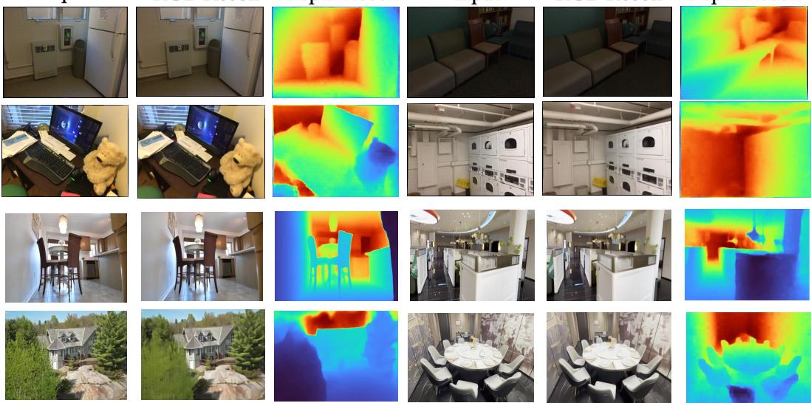  
RGB Recon  
Depth Recon  
Figure 7: Visualization of the Decoder Reconstruction.

Table 10: Ablation of dual-path deformable cross-attention on DL3DV.  
Table 11: Ablation of vision encoders on DL3DV.
<table><tr><td rowspan="2">Path</td><td colspan="2">RGB</td><td colspan="2">Depth</td></tr><tr><td>PSNR↑</td><td>SSIM↑</td><td>Acc.↓</td><td>Comp.↓</td></tr><tr><td>Main-only</td><td>14.9</td><td>0.43</td><td>0.49</td><td>0.70</td></tr><tr><td>MV-only</td><td>14.0</td><td>0.36</td><td>0.38</td><td>0.59</td></tr><tr><td>Main+MV</td><td>15.4</td><td>0.45</td><td>0.34</td><td>0.55</td></tr></table>

<table><tr><td rowspan="2">Encoder</td><td colspan="2">RGB</td><td colspan="2">Depth</td></tr><tr><td>PSNR↑</td><td>SSIM↑</td><td>Acc.↓</td><td>Comp.↓</td></tr><tr><td>DINO</td><td>14.5</td><td>0.39</td><td>0.43</td><td>0.66</td></tr><tr><td>VAE</td><td>14.4</td><td>0.37</td><td>0.52</td><td>0.71</td></tr><tr><td>VGGT</td><td>15.1</td><td>0.42</td><td>0.39</td><td>0.58</td></tr><tr><td>DA3-Base</td><td>15.4</td><td>0.45</td><td>0.34</td><td>0.55</td></tr></table>

Different Vision Encoders. Here we test the performance comparison of different visual foundation models when used as the frozen encoder. Specifically, we compare DINOV2 (Oquab et al., 2024), VAE (Rombach et al., 2022), VGGT, and the DA3-Base adopted by the existing implementation. It should be noted that since DINOV2 and VAE cannot directly output depth, a learnable depth prediction head must be attached. The results are shown in Table 11. We can see that VAE performs the worst because it focuses only on texture information and lacks an understanding of geometry, resulting in poor performance in both depth prediction and subsequent depth reconstruction. DA3- Base matches VGGT at lower computational cost, so we adopt it.

## B.3 3D SCENE GENERATION

Visualization of 1-View Setting. We visualize generation results under the 1-view setting. Figure 8 shows results with camera control, while Figure 9 shows results without camera control.

Out-of-Distribution Datasets. In this section, we test the generation performance on datasets outside the training distribution (TartanAir and ScanNet++) to demonstrate the generalization of our method, with the results shown in Table 12. We can see that even on out-of-distribution datasets, our method still achieves superior performance, indicating strong generalization.

Ablation Studies. In this part, we test the noise-adding schemes of Point Diffusion. Specifically, Gaussian Noise denotes the standard noise-adding scheme, i.e., constructing a flow path from Gaussian noise to the target point cloud. However, considering the sensitivity of point cloud positions, we adopt a new noise-adding scheme, namely a flow path from the reference-frame point cloud to the target point cloud (Reference Noise), which maximally stabilizes point cloud generation and effectively leverages the initial information of the scene. The results are shown in Table 13. We can see that Reference Noise achieves higher performance, validating our design.

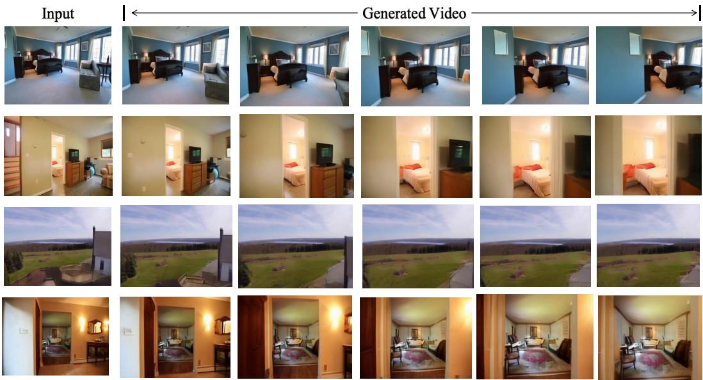  
Figure 8: Visualization in the 1-view setting with camera condition.

Input  
Generated Video  
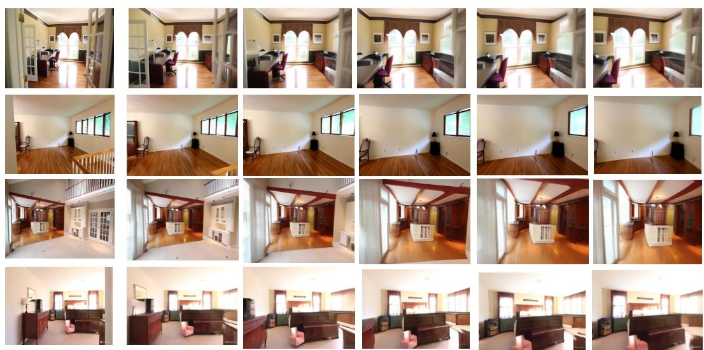  
Figure 9: Visualization in the 1-view setting without camera condition.

We then test geometry correction in content diffusion (Table 14). It can be seen that introducing geometry correction effectively improves performance while bringing almost no additional overhead, indicating that texture content also plays a supporting role for geometric structure.

Visualization of 2-View Setting. We visualize generation results under the 2-view setting. Figure 10 shows results with camera control, while Figure 11 shows results without camera control.

Table 12: Quantitative Comparison of Appearance Generation on Out-of-Distribution Datasets with 1-view setting. We report 2D metrics (PSNR, SSIM) and 3D metrics (Accuracy, Completeness).
<table><tr><td rowspan="2">Method</td><td colspan="5">TartanAir</td><td colspan="3">ScanNet++</td></tr><tr><td>PSNR</td><td>SSIM</td><td>Accuracy</td><td>Completeness</td><td>PSNR</td><td>SSIM</td><td>Accuracy</td><td>Completeness</td></tr><tr><td>Aether</td><td>12.1</td><td>0.43</td><td>0.55</td><td>0.81</td><td>13.4</td><td>0.45</td><td>0.50</td><td>0.71</td></tr><tr><td>Gen3R</td><td>13.9</td><td>0.47</td><td>0.52</td><td>0.74</td><td>14.2</td><td>0.49</td><td>0.46</td><td>0.70</td></tr><tr><td>Ours</td><td>15.2</td><td>0.53</td><td>0.22</td><td>0.49</td><td>15.8</td><td>0.55</td><td>0.16</td><td>0.37</td></tr></table>

Table 13: Ablation of the noisy input of Point Diffusion.  
Table 14: Ablation of position correction in Content Diffusion.
<table><tr><td rowspan="2">Noise</td><td colspan="2">DL3DV</td><td colspan="2">RE10K</td></tr><tr><td>PSNR↑</td><td>SSIM↑</td><td>PSNR↑</td><td>SSIM↑</td></tr><tr><td>Gaussian</td><td>14.4</td><td>0.37</td><td>15.9</td><td>0.48</td></tr><tr><td>Reference</td><td>15.4</td><td>0.45</td><td>17.1</td><td>0.60</td></tr></table>

<table><tr><td>Correction</td><td>DL3DV PSNR↑ SSIM↑</td><td>RE10K PSNR↑ SSIM↑</td><td></td></tr><tr><td>None</td><td>14.9 0.40</td><td>16.4</td><td>0.53</td></tr><tr><td>w/o confidence</td><td>15.1 0.41</td><td>16.7</td><td>0.58</td></tr><tr><td>w/ confidence</td><td>15.4</td><td>0.45 17.1</td><td>0.60</td></tr></table>

## C DISCUSSION

## C.1 DIFFERENCE WITH FEED-FOWARD 3D GAUSSIAN SPLATTING

Feed-forward 3D Gaussian methods and our approach both construct explicit 3D scene representations without per-scene optimization, but they differ substantially in how scene information is organized and used. Many feed-forward 3DGS methods predict one or multiple Gaussian primitives from each input pixel or image patch. Although these primitives are subsequently transformed into a shared 3D coordinate system, their prediction remains aligned with the source observations. Consequently, the same physical surface observed from multiple viewpoints may be represented by several overlapping Gaussians. This redundancy is beneficial for preserving view-specific details, but it also causes the representation size to grow with the number and resolution of input views.

Such pixel-aligned representations are well suited to reconstruction. Each Gaussian explicitly stores the attributes required for rendering, including position, spatial extent, opacity, and appearance. Once the Gaussians have been predicted, novel views can be rendered efficiently through Gaussian rasterization. The dense correspondence between image pixels and Gaussian primitives also help retain fine textures and thin structures, allowing fast and high-fidelity reconstruction.

However, the same design is less convenient as a latent space for generative scene modeling. First, redundant primitives require a generative model to repeatedly model the same physical region across different view-aligned Gaussian predictions. Second, the number of primitives is large, increasing the computational cost of diffusion or autoregressive generation. Third, each primitive jointly carries geometry, scale, opacity, and appearance attributes. Generating this high-dimensional and coupled parameter space requires the model to resolve scene layout, visibility, surface extent, and texture.

In contrast, we construct a compact, scene-level 3D representation specifically for generative modeling. By representing shared scene regions only once, our latent space reduces both the representation size and the burden of generative learning. Moreover, the separation between explicit geometry and latent content allows camera-controllable generation to be decomposed into geometry generation followed by content generation, providing a more direct control path. The trade-off is that our representation relies on a learned decoder and therefore does not match the rendering speed or finedetail fidelity of rasterized 3D Gaussians. Overall, feed-forward 3DGS favors efficient, high-fidelity reconstruction, whereas our representation favors compact and controllable scene generation.

## C.2 LIMITATIONS

Rendering Fidelity. Compared with conventional video VAEs, our representation provides lower reconstruction sharpness. Dense video-VAE latents preserve spatially aligned appearance information at every view, whereas our method compresses the scene into a limited number of sparse 3D latents and reconstructs each view through a learned decoder. This stronger information bottleneck may smooth high-frequency textures and lose details in thin structures, object boundaries, and view-dependent appearance. Improving the spatial adaptivity of the anchors and the capacity of the rendering decoder is a promising direction for closing this fidelity gap.

Input  
Generated Video  
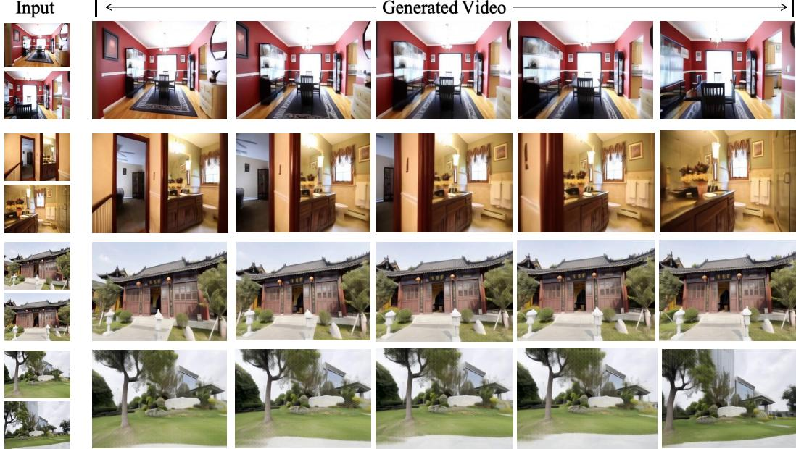

Figure 10: Visualization in the 2-view setting with camera condition.  
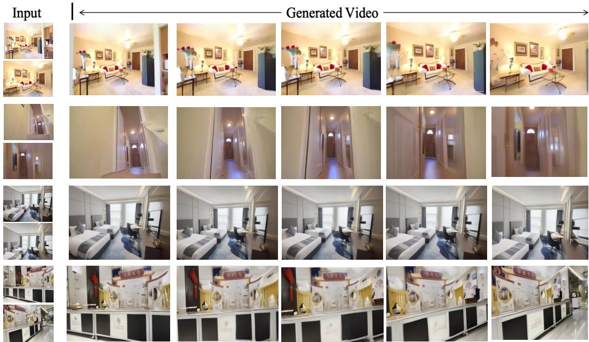  
Figure 11: Visualization in the 2-view setting without camera condition.

Dynamic-scene Modeling. Our current representation assumes that scene content can be anchored to persistent locations in a shared 3D coordinate system. This assumption is effective for static scenes but becomes restrictive for moving or deformable objects. Observations of a dynamic object at different times may correspond to different spatial locations, making direct multi-view aggregation ambiguous and potentially leading to duplicated geometry or inconsistent appearance. More over, the generative model predicts spatial scene completion without explicitly modeling object motion or temporal evolution. Extending the representation with time-dependent anchors, motion fields, or explicit static-dynamic decomposition is necessary for general dynamic environments.