# SELF-CONDITIONING ENABLES DEEP SEQUENTIAL REASONING IN FLOW MATCHING

Zeyang Zhang1,2∗ Linxiang Gao2∗ Meiqi Gu2∗ Xingyan Chen2 Minrui Luo4,2 Kaifeng Lyu2† Tianxing He2,3,1†

1Shanghai Qi Zhi Institute

2Institute for Interdisciplinary Information Sciences, Tsinghua University

3Xiongan AI Institute 4Georgia Institute of Technology

{zhangzey24,glx24,gumq24,chenxy24}@mails.tsinghua.edu.cn mluo89@gatech.edu {klyu,hetianxing}@mail.tsinghua.edu.cn

## ABSTRACT

Recent work has explored visual reasoning through image generation, where models solve visual-reasoning problems by directly generating solution images. Intuitively, iterative samplers such as flow matching are well suited to this task, since each sampling step may resemble one reasoning step. However, in this work, from a circuit complexity perspective, we show that this intuition is misleading. We prove that as long as the model outputs satisfy certain mild regularity conditions, the trajectory of the vanilla flow-matching sampler can be simulated by a constant number of sequential rounds of parallel model evaluations. Consequently, additional sampling steps cannot increase the expressive power of a constant-depth backbone model under the standard complexity-theoretic model of transformers. We then reveal that self-conditioning, which conditions the model on the previous step’s estimate of the final image, plays a previously unrecognized role in removing this bottleneck. Controlled experiments on diverse visual-reasoning tasks show that flow matching with self-conditioning achieves higher accuracy and greater reasoning depth than vanilla flow matching, and its performance improves with more sampling steps. Theoretically, we prove that with self-conditioning, a constant-depth backbone can achieve expressive power equivalent to that of spacebounded Turing machines. Our study suggests a design principle for future visual reasoning research: carry more information between sampling steps, so that additional steps translate into deeper reasoning.

## 1 INTRODUCTION

Recent advances in visual generative models have sparked growing interest in generative visual reasoning, where models plan and reason directly in image space (Su et al., 2025b; Hu et al., 2024; Tong et al., 2026). This paradigm is natural for spatial planning, combinatorial optimization, and structured rendering (He et al., 2025; Dai et al., 2026). Intuitively, flow matching (Lipman et al., 2022; Liu et al., 2022) is well suited to this setting: it turns noise into an image through K evaluations of a velocity model, providing K sequential rounds for reasoning to unfold. He et al. (2025) put this intuition into practice, solving visual reasoning tasks via flow-matching image generation.

However, in this work we show that this apparent reasoning depth is an illusion. Through circuit complexity analysis, we find that the expressive power of vanilla flow matching (VANILLAFM) does not grow with the number of sampling steps K. The intuition lies in how flow matching generates images: the sampling process discretizes an ordinary differential equation (ODE), making only a small incremental update of scale O(1/K) to its state at each step. Because the full trajectory is governed by this continuous ODE, we show that it can be simulated by an alternative ODE solver in a constant number of steps, regardless of how large K is. Consequently, running VANILLAFM with a constant-depth backbone leaves its expressive power collapsed to constant reasoning depth (§3.1).

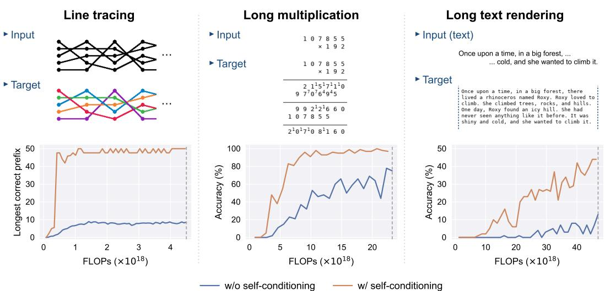  
Figure 1: Controlled experiments on three synthetic tasks: line tracing, long multiplication, and long text rendering (§4.2). The top row shows an example input and target output for each task, and the bottom row plots performance against training FLOPs. Across all three tasks, self-conditioning improves the performance of flow matching by large margins.

To overcome this barrier, we uncover a previously unrecognized role of self-conditioning (Chen et al., 2022). In flow matching with self-conditioning (SELFCONDFM), the model still simulates the ODE, but its input is augmented with a prediction of its own sampling trajectory’s endpoint, i.e., an estimate of the final image (§3.2). This endpoint prediction acts as an internal scratchpad on which the model records and refines intermediate partial solutions. Unlike the continuous state, which changes only by O(1/K), this scratchpad can change abruptly between steps. Therefore, the resulting trajectory can no longer be simulated by an ODE solver in a constant number of steps. This prevents the collapse of expressive power, enabling deep sequential reasoning (§3.3).

We establish this advantage of self-conditioning both theoretically and empirically. Theoretically, we prove that self-conditioning can lift the expressive power of flow matching from constant-depth circuits to space-bounded Turing machines (§3). Empirically, controlled experiments on diverse synthetic tasks demonstrate that self-conditioning substantially improves the performance of flow matching (Figure 1), and its advantage also extends to broader visual-reasoning tasks (§4). Our contributions are as follows:

• Self-conditioning as an internal scratchpad. We reveal a previously unrecognized role of selfconditioning in generative reasoning: rather than serving merely as an empirical regularizer, its endpoint prediction provides an internal scratchpad that carries rich information, enabling deep sequential computation across sampling steps.

• Circuit complexity separation. We formalize this mechanism through circuit complexity analysis. We prove that as long as the model outputs satisfy certain mild regularity conditions, VANILLAFM with an ${ \mathsf { A C } } ^ { 0 } { \mathsf { o r } } { \mathsf { T C } } ^ { 0 }$ backbone collapses to constantly many sequential model evaluations, deciding only languages in the backbone’s circuit complexity class regardless of the number of sampling steps (§3.1). In contrast, SELFCONDFM enables an $\mathsf { A C } ^ { \widetilde { 0 } }$ model to simulate space-bounded Turing machines, deciding P/poly with polynomial steps and PSPACE/poly with at most exponential steps (§3.3). These results extend to more general settings (§3.4).

• Empirical validation. We support these theoretical results through controlled experiments on three synthetic tasks with known circuit complexity: ${ \mathsf { N C } } ^ { 1 }$ -complete line tracing, and ${ \mathsf { T C } } ^ { 0 } .$ complete long multiplication and long text rendering (§4.2). Under matched training FLOPs, SELFCONDFM outperforms VANILLAFM by large margins (Figure 1). Moreover, in agreement with our theory, SELFCONDFM keeps improving with more sampling steps, whereas VANILLAFM saturates early (Figure 3). Self-conditioning also brings consistent improvements on five broader visual-reasoning tasks from He et al. (2025) (§4.3).

## 2 PRELIMINARIES

We first review flow matching and circuit complexity (§2.1), then formalize the modeling conventions and regularity conditions underlying our theoretical analysis (§2.2).

## 2.1 BACKGROUND

Flow matching. Flow matching (Lipman et al., 2022; Liu et al., 2022) is a generative modeling framework. Given a data distribution $p _ { \mathrm { d a t a } }$ and a prior $p _ { \mathrm { p r i o r } } .$ , we define the probability path $p _ { t }$ as the distribution of $\tilde { x } _ { t } : = t x _ { \mathrm { d a t a } } + ( 1 - t ) \epsilon$ for independent random vectors $x _ { \mathrm { d a t a } } \sim p _ { \mathrm { d a t a } }$ and $\epsilon \sim p _ { \mathrm { p r i o r } } .$ The velocity field that generates this path is given by $v ( x , t ) : = \mathbb { E } _ { ( x _ { \mathrm { d a t a } } , \epsilon ) \sim p ( \cdot | \tilde { x } _ { t } = x ) } [ x _ { \mathrm { d a t a } } - \epsilon ]$ . Flow matching aims to find a parameterized field $u _ { \theta } ( x , t )$ to approximate $\boldsymbol { v } ( \boldsymbol { x } , t )$ , so that the solution of the ODE $\begin{array} { r } { \frac { \mathrm { d } x } { \mathrm { d } t } = u _ { \theta } ( x , t ) } \end{array}$ with $x | _ { t = 0 } \sim p _ { \mathrm { p r i o r } }$ follows the marginals $p _ { t }$ for $t \in [ 0 , 1 ]$

Flow-matching models are trained by minimizing the conditional flow-matching loss $\mathcal { I } _ { \mathrm { C F M } } : =$ $\mathbb { E } _ { t \sim \mathcal { U } [ 0 , 1 ] , \epsilon \sim p _ { \mathrm { p r i o r } } , x _ { \mathrm { d a t a } } \sim p _ { \mathrm { d a t a } } } \| u _ { \theta } ( \tilde { x } _ { t } , t ) - ( x _ { \mathrm { d a t a } } - \epsilon ) \| _ { 2 } ^ { 2 }$ . Lipman et al. (2022) prove that minimizing JCFM is equivalent to minimizing $\mathbb { E } _ { t , \epsilon , x _ { \mathrm { d a t a } } } \| u _ { \boldsymbol { \theta } } ( \tilde { x } _ { t } , t ) - v ( \tilde { x } _ { t } , t ) \| _ { 2 } ^ { 2 }$ , so the trained model regresses onto the target field $v .$ At inference time, a sample is generated by solving the ODE with a numerical scheme such as Euler’s method (Hairer et al., 1993; Liu et al., 2022; Esser et al., 2024).

For conditional generation, such as text-to-image and image editing, the model is conditioned on context ctx, with $p _ { \mathrm { d a t a } }$ now a joint distribution over pairs $\bar { \left( \mathrm { c t x } ,  { x _ { \mathrm { d a t a } } } \right) }$ . This amounts to learning a velocity field $u _ { \theta } ( x , t ; \mathrm { c t x } )$ minimizing $\mathcal { T } _ { \mathrm { c o n d } } : = \mathbb { E } _ { t , \epsilon , ( \mathrm { c t x } , x _ { \mathrm { d a t a } } ) } \Vert u _ { \theta } ( \tilde { x } _ { t } , t ; \mathrm { c t x } ) - ( x _ { \mathrm { d a t a } } - \epsilon ) \Vert _ { 2 } ^ { 2 }$

Circuit complexity. We measure the expressive power of a model by the complexity of the languages it can decide. A language is a subset $\mathcal { L } \subseteq \bar { \{ 0 , 1 \} } ^ { * }$ , and to decide $\mathcal { L }$ is to determine whether a given input $w \in \{ 0 , 1 \} ^ { m }$ belongs to ${ \mathcal { L } } .$ We abstract the model as a circuitfamily $( \mathcal { C } _ { m } ) _ { m \geq 1 }$ , where each ${ \mathcal { C } } _ { m }$ is a Boolean circuit that handles inputs of length m (Arora et al., 2009). The size of a circuit is the number of gates and its depth is the length of the longest input-to-output path. Depth measures sequential computation, whereas size measures total work.

For $k \geq 0 , { \mathsf { N C } } ^ { k } , { \mathsf { A C } } ^ { k }$ , and ${ \mathsf { T C } } ^ { k }$ denote the non-uniform classes of languages decided by polynomialsize, $\mathrm { d e p t h - } O ( \log ^ { k } m )$ ) circuit families with bounded-fan-in Boolean, unbounded-fan-in Boolean, and unbounded-fan-in Boolean plus MAJORITY gates, respectively. We call circuits of unboundedfan-in AND, OR, NOT, and MAJORITY gates majority circuits. The class $\begin{array} { r } { \mathsf { N C } : = \bigcup _ { k > 0 } \mathsf { N C } ^ { k } } \end{array}$ comprises the efficiently parallelizable problems. The advice classes $\mathsf { P } / \mathsf { p o l y }$ and ${ \mathsf { P S P A C E / p o l y } }$ consist of languages decided by polynomial-time and polynomial-space Turing machines, respectively, with polynomial-length advice depending only on the input length. Standard relations among these classes, such as ${ \mathsf { N C } } \subseteq { \mathsf { P / p o l y } } \subseteq { \dot { \mathsf { P S P A C E } } } / { \mathsf { p o l y } }$ , are collected in Appendix A.1.

These classes bound the power of common neural network architectures: a constant-depth logprecision transformer without chain-of-thought (CoT) lies in ${ \mathsf { T C } } ^ { 0 }$ (Merrill et al., 2022; Merrill & Sabharwal, 2023; Chiang, 2024), and variants such as unique hard-attention transformers (Hao et al., 2022) and constant-precision transformers (Li et al., 2024) lie in $\mathsf { A C } ^ { 0 }$ instead. Surpassing these bounds requires more layers or, as with CoT, additional sequential calls (Li et al., 2024). This motivates studying whether flow matching, which sequentially invokes such a network many times, extends what the model can decide.

## 2.2 THEORETICAL SETUP AND NOTATION

To formally analyze the expressive power of flow matching, we establish our theoretical setup below, adapting the flow-matching framework into a concrete computational model.

Modeling flow matching. We consider flow matching under finite-precision arithmetic with b fractional bits. The representable numbers form $F _ { b } : = \left\{ 2 ^ { - b } k : k \in \mathbb { Z } \right\}$ . All arithmetic operations are evaluated over the reals and then rounded coordinate-wise via round $_ b ( x ) : = 2 ^ { - b } \lfloor 2 ^ { b } x ^ { \mathit { \bar { + } } } 1 / 2 \rfloor$

A model u is a map acting on binary encodings of arbitrary length. It receives an encoded triple $( x , t , \mathrm { c t x } ) \in F _ { b } ^ { n } \times \mathbf { \bar { F } } _ { b } \times \bar { F } _ { b } ^ { * }$ , where $n , b ,$ and the length of ctx are non-negative integers read from the encoding, and outputs the velocity $u ( x , t ; \mathrm { c t x } ) \in F _ { b } ^ { n }$ . On an input problem $w \in \{ 0 , 1 \} ^ { m }$ , vanilla flow matching $\mathtt { V A N I L A F M } ( w ; u , K )$ sets $\operatorname { c t x } = w$ and runs the Euler method for K steps, starting from $\tilde { x } _ { 0 } \sim p _ { \mathrm { p r i o r } }$ , where p is an arbitrary prior distribution whose support we additionally restrict to $[ - 1 , 1 ] ^ { n }$ (Algorithm 1).

Model regularity and acceptance. A model u is B-bounded if $\| u ( x , t ; \mathrm { c t x } ) \| _ { \infty } \leq B$ for all $x \in$ $F _ { b } ^ { n } , t \in [ \breve { 0 } , 1 ] \cap \breve { F } _ { b }$ , and $\mathrm { c t x } \bar { \in } F _ { b } ^ { * }$ , and L-Lipschitz continuous if $\begin{array} { r } { \| \ddot { u } ( \dot { x } , t ; \mathrm { c t x } ) - u ( x ^ { \prime } , t ; \mathrm { c t x } ^ { \prime } ) \| _ { \infty } \leq } \end{array}$ $L ^ { ' } \mathrm { m a x } \{ \| x - \dot { x ^ { \prime } } \| _ { \infty } , \| \mathrm { c t x } - \mathrm { c t x ^ { \prime } } \| _ { \infty } \}$ for all $\dot { \boldsymbol { x } } , \boldsymbol { x } ^ { \prime } \in F _ { b } ^ { n } , t \in [ 0 , 1 ] \ddot { \cap } \dot { F _ { b } }$ , and equal-length ctx, $\operatorname { c t x } ^ { \prime } \in$ $F _ { b } ^ { * }$ . The Lipschitz condition is joint in $( x , \mathrm { c t x } )$ and uniform over t. For simplicity we measure Lipschitzness in the $\ell _ { \infty }$ norm, but the analysis carries over to any $\ell _ { p }$ norm; see $\mathring { \ S } ^ { 3 . 4 . }$

Given an inference algorithm A and a constant $c > 0$ independent of m, we say that u accepts a language $\mathcal { L }$ with margin c under ${ \mathcal { A } } { \mathrm { i f } } ,$ for every m and w $\in \{ 0 , 1 \} ^ { m }$ , the output $x _ { K } = \mathcal { A } ( w ; u , K )$ satisfies, with probability 1 over the randomness in $\mathcal { A } , ( x _ { K } ) _ { j } \geq c$ for all coordinates j when $w \in { \mathcal { L } }$ and $( x _ { K } ) _ { j } \leq - c$ for all $j$ when w $\notin { \mathcal { L } } .$ Acceptance with a margin represents a robust decision, in which every output coordinate is separated from the threshold 0 by at least $c .$ For asymptotic analysis, the precision b, state dimension n, and step count K may grow with the problem size m.

## 3 SELF-CONDITIONING INCREASES EXPRESSIVE POWER

In this section, we first show that, under the mild regularity conditions below, vanilla flow-matching inference is confined to constant-depth circuit classes (§3.1), which restricts the problems it can solve. We then consider self-conditioning (§3.2), a simple mechanism that allows the same models to attain substantially greater expressive power (§3.3).

## 3.1 VANILLA FLOW MATCHING IS CONFINED TO CONSTANT DEPTH

Although VANILLAFM makes K sequential model evaluations, as long as the model outputs satisfy certain mild regularity conditions, this sequential depth is an illusion: the same decision can be reached in $O ( \bar { L } )$ sequential rounds of parallel evaluations of the model, regardless of how large K is. When L is a constant, these are constantly many rounds, so the decided language stays within the model’s own complexity class. Below we view K as a function of the problem size m, and state the theorem under the setup of §2.2.

Theorem 1 (Upper bounds on the expressiveness of vanilla flow matching). Let $k \geq 0$ be a constant integer, $\mathsf { D } \in \{ \mathsf { N C } ^ { k + 1 } , \mathsf { A C } ^ { k } , \mathsf { T C } ^ { k } \}$ be a circuit complexity class, u be a model that can be computed by circuits in D, and L be any language that can be accepted by u with margin 1 under VANILLAFM. Assume that for some constants $B > 0$ and $L \geq 1$ independent of m, the model u is B-bounded and L-Lipschitz continuous. Then as long as the state dimension satisfies $n = \mathrm { p o l y } ( m )$ , and the number offractional bits satisfies

$$
\left( 1 + \Omega ( 1 ) \right) \log _ { 2 } K ( m ) \leq b ( m ) \leq O ( \log m ) ,\tag{1}
$$

we have $\mathcal { L } \in \mathsf { D } .$

See Appendix A.2.4 for the proof. The case $k = 0$ recovers the canonical constant-depth classes: under vanilla flow matching, log-precision softmax-attention transformers in ${ \mathsf { T C } } ^ { 0 }$ (Merrill et al., 2022; Merrill & Sabharwal, 2023; Chiang, 2024) remain in ${ \mathsf { T C } } ^ { 0 }$ , and the unique hard-attention and constant-precision variants in $\mathsf { A C } ^ { 0 }$ (Hao et al., 2022; Li et al., 2024) remain in $\mathsf { A C } ^ { 0 }$ . Thus, ODE iteration alone adds no expressive power in this setting.

The core technique behind the proof is a parallel Picard iteration (Hairer et al., 1993). The ODE under which VANILLAFM samples can amplify an initial error by a factor of $\mathrm { e } ^ { L }$ . A naive simulation that reruns the Euler method with fewer steps to reproduce the full K-step trajectory therefore takes $\mathrm { e } ^ { O ( L ) }$ steps to reach constant accuracy. We instead iteratively update all K positions in parallel using the previous iterate, making the propagated error decay at a factorial rate across rounds up to an additive floor, so that $O ( L )$ rounds suffice. This yields the following lemma.

Lemma 1. Under the same setup as Theorem 1, assume that u is B-boundedfor a constant $B > 0$ and $L ( m )$ -Lipschitz continuous with $L ( m ) \ge 1$ . Then there exist a constant $c _ { 0 } = c _ { 0 } ( B ) > 0 ;$

Algorithm 1 Vanilla Flow Matching Algorithm 2 Self-Conditioning Flow Matching   
1: function $\overline { { \mathrm { V A N I L A F M } ( w ; u , K ) } }$ 1: function $\mathtt { S E L F C O N D F M } ( w ; u , K )$   
2: $t _ { i } \gets \mathrm { r o u n d } _ { b } ( i / K ) \mathrm { f o r } i = 0 , . . . , K$ 2: $t _ { i } \gets \mathrm { r o u n d } _ { b } ( i / K ) \mathrm { f o r } i = 0 , . . . , K$   
3: Sample $\tilde { x } _ { 0 } \sim p _ { \mathrm { p r i o r } } ; x _ { 0 }  \mathrm { r o u n d } _ { b } ( \tilde { x } _ { 0 } )$ 3: Sample $\tilde { x } _ { 0 } \sim p _ { \mathrm { p r i o r } } ; x _ { 0 }  \mathrm { r o u n d } _ { b } ( \tilde { x } _ { 0 } )$   
4: 4: $z _ { 0 } \gets \mathbf { 0 } ^ { n }$   
5: for $i = 0 , \ldots , K - 1$ do 5: for $i = 0 , \ldots , K - 1$ do   
6: $\boldsymbol { v _ { i } } \gets \boldsymbol { u } ( \boldsymbol { x _ { i } } , t _ { i } ; \boldsymbol { w } )$ 6: $v _ { i }  u ( x _ { i } , t _ { i } ; \mathrm { c o n c a t } ( w , z _ { i } ) )$   
7: $x _ { i + 1 }  x _ { i } + ( t _ { i + 1 } - t _ { i } ) \cdot v _ { i }$ 7: $x _ { i + 1 }  x _ { i } + ( t _ { i + 1 } - t _ { i } ) \cdot v _ { i }$   
8: 8: $z _ { i + 1 } \gets x _ { i } + ( 1 - t _ { i } ) \cdot v _ { i }$   
9: end for 9: end for   
10: return $x _ { K }$ 10: return $x _ { K }$   
11: end function 11: end function

independent of $m ,$ and an inference algorithm that runs for $O ( L ( m ) )$ iterations, making at most $K ( m )$ parallel calls to u per iteration, such that as long as the number of fractional bits satisfies

$$
b ( m ) \geq \log _ { 2 } K ( m ) + ( \log _ { 2 } \mathrm { e } ) L ( m ) + c _ { 0 } \qquad f o r e \nu e r y m ,\tag{2}
$$

u accepts L with margin $1 / 2$ under that algorithm.

See Appendix A.2.2 for the proof. For constant L, these are constantly many rounds, and the arithmetic accompanying the model calls is shallow enough to be absorbed into the model’s own circuit class, yielding Theorem 1. The $O ( L )$ bound also lets us extend the analysis to a growing L (§3.4).

## 3.2 SELF-CONDITIONING

The expressivity bottleneck in Theorem 1 stems from how information flows along the continuous ODE: consecutive steps in VANILLAFM transfer information solely through the state $x _ { i }$ , which changes only by a small increment scaled by a step size of $O ( 1 / K ) \colon x _ { i + 1 } = x _ { i } + ( t _ { i + 1 } - t _ { i } ) v _ { i }$ . This small ODE update is what allows the Picard iteration in Lemma 1 to compress all K sampling steps into $O ( L )$ iterations. One potential way to overcome this bottleneck is to make a larger update per step, for example, by introducing an extra input component that can change abruptly between sampling steps.

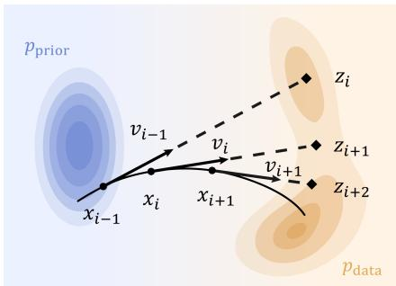  
Figure 2: Overview of self-conditioning. Each prediction $z _ { i + 1 }$ is obtained by extrapolating the state $x _ { i }$ along its velocity $v _ { i }$ to $t = 1$

We find that a simple mechanism achieves this: self-conditioning (Chen et al., 2022), originally proposed for discrete diffusion models and later

adapted to other settings (Strudel et al., 2022; Stark et al., 2023; Gupta et al., 2024). As stated¨ in Algorithm $^ { 2 , }$ self-conditioning feeds the model an additional endpoint prediction $z _ { i } ~ \in ~ F _ { b } ^ { n }$ which is a linear approximation of $x _ { \mathrm { d a t a } } .$ , obtained by extrapolating along the previous velocity: $z _ { i } : = x _ { i - 1 } + ( 1 - t _ { i - 1 } ) v _ { i - 1 }$ for $i \geq 1$ , with $z _ { 0 } = \mathbf { 0 } ^ { n }$

For training, we use a two-pass heuristic inspired by prior work (Chen et al., 2022). Given (w, xdata) ∼ pdata, $t \sim \mathcal { U } [ 0 , 1 ] , \epsilon \sim p _ { \mathrm { p r i o r } }$ , and $\tilde { x } _ { t } = t x _ { \mathrm { d a t a } } + ( 1 - t ) \epsilon$ , let

$$
\begin{array} { r } { v ^ { ( 1 ) } : = u _ { \theta } \big ( \tilde { x } _ { t } , t ; \mathrm { c o n c a t } ( w , \mathbf { 0 } ^ { n } ) \big ) , \qquad v ^ { ( 2 ) } : = u _ { \theta } \big ( \tilde { x } _ { t } , t ; \mathrm { c o n c a t } ( w , \mathbf { s g } [ \tilde { x } _ { t } + ( 1 - t ) v ^ { ( 1 ) } ] ) \big ) , } \end{array}
$$

where $\mathrm { s g } [ \cdot ]$ stops the gradient. The first pass imitates the initial sampling step, at which $z _ { 0 } = \mathbf { 0 } ^ { n }$ and the second imitates later steps. Both passes are weighted equally via the following objective:

$$
\begin{array} { r } { \mathcal { I } _ { \mathrm { S C } } : = \frac { 1 } { 2 } \mathbb { E } _ { t , \epsilon , ( w , x _ { \mathrm { d a t a } } ) } \big [ \| v ^ { ( 1 ) } - ( x _ { \mathrm { d a t a } } - \epsilon ) \| _ { 2 } ^ { 2 } + \| v ^ { ( 2 ) } - ( x _ { \mathrm { d a t a } } - \epsilon ) \| _ { 2 } ^ { 2 } \big ] . } \end{array}
$$

Consequently, by training on predictions that closely recover $z _ { i } ,$ the model learns to leverage the actual $z _ { i }$ generated in the preceding sampling step, requiring only one extra forward pass during training. Figure 2 provides an overview of the mechanism.

Self-conditioning in practice. Self-conditioning is particularly natural for visual-space reasoning: the fed-back prediction $z _ { i }$ approximates the clean sample $x _ { \mathrm { d a t a } }$ and is therefore near the target data manifold in image space. Modern image generation models already accept images as conditions (Black Forest Labs et al., 2025; Wu et al., 2025), so it is reasonable to expect knowledge from image-conditioned pretraining to transfer to self-conditioning, even though that pretraining involves no self-conditioning. The initialization $z _ { 0 } = \mathbf { 0 } ^ { n }$ is a placeholder for cleaner theoretical analysis. In actual implementation, for better efficiency, it is omitted both in the first training pass $\boldsymbol { v } ^ { ( 1 ) } = u _ { \theta } ( \tilde { x } _ { t } , t ; w )$ and at the first sampling step, without affecting empirical performance.

## 3.3 SELF-CONDITIONING REACHES PSPACE/poly

We now formally show that self-conditioning expands the expressiveness of flow matching. Since the extra input $z _ { i + 1 }$ is a fresh prediction rather than an $O ( 1 / \bar { K } )$ increment on $x _ { i }$ , it is unconstrained by the step size and can change abruptly between sampling steps. Thus, the convergence behind Lemma 1 is lost, and the constant-depth barrier disappears altogether: constant-depth models with self-conditioning can decide $\mathsf { P } / \mathsf { p o l y }$ in polynomially many steps and PSPACE/poly in at most exponentially many steps.

Theorem 2 (Lower bounds on the expressiveness of flow matching with self-conditioning). For any language L in PSPACE/poly, there exists a model u that accepts $\mathcal { L }$ with margin 1 under SELFCONDFM and satisfies the following conditions: (a) u can be computed by $\mathsf { A C } ^ { 0 }$ circuits; (b) u is 4-bounded and 8-Lipschitz continuous; (c) b = O(log m), n = poly(m), $\dot { K } \le 2 ^ { \mathrm { p o l y } ( m ) }$ . If moreover $\mathcal { L } \in \mathsf { P } / \mathsf { p o l y } ,$ , then the same result holds with (1) satisfied.

The proof makes the sampler simulate a Turing machine with advice. The prediction $z _ { i }$ holds the machine’s tape and state, and each model call advances the machine by one step, so $K$ calls run the machine for $\Omega ( K )$ steps. See Appendix A.3.2 for the construction.

In the P/poly case, all the regularity hypotheses of Theorem 1 are retained, so the two theorems concern the same model class and the gap comes from the inference algorithm alone. For $\textsf { D } \in$ $\{ \mathsf { A C } ^ { 0 } , \mathsf { T C } ^ { 0 } \}$ , the two samplers therefore separate across the barrier $\mathsf { P } / \mathsf { p o l y } \backslash$ D: given any language $\mathcal { L } \in \sf P / p o l y \mid D$ , Theorem 2 supplies an $\mathsf { A C } ^ { 0 }$ model accepting it under SELFCONDFM, whereas Theorem 1 leaves no D model satisfying its hypotheses capable of accepting it under VANILLAFM. For $\mathsf { D } = \mathsf { A } \mathsf { C } ^ { 0 }$ , the separation always holds since $\mathsf { A C } ^ { 0 } \subsetneq \bar { \mathsf { T C } } ^ { 0 }$ (Furst et al., 1984); for $\mathsf { D } = \mathsf { T C } ^ { 0 }$ , it holds under the conjecture ${ \mathsf { T C } } ^ { 0 } \subsetneq { \mathsf { N C } } ^ { 1 }$ (Vollmer, 1999), which implies that $\mathsf { T C } ^ { 0 } \subsetneq \mathsf { P / p o l y }$

## 3.4 EXTENSIONS

Beyond the main results above, the analysis extends to more general settings. Lemma 1 directly implies an NC upper bound for VANILLAFM when the Lipschitz constant L grows as $L ( m ) = \mathrm { p o l y } ( \log m )$ , or ${ \mathsf { T C } } ^ { k }$ upper bounds when further $L = O ( \log ^ { k } m )$ for any constant integer $k \geq 0 ( \mathrm { A p p e n d i x }$ B.1). Restricting u to be Lipschitz continuous under $\ell _ { p }$ norms rather than $\ell _ { \infty }$ norms preserves both Theorem 1 and Theorem 2 (Appendix B.2). Replacing the Euler method with any fixed explicit Runge–Kutta method (Hairer et al., 1993) whose nodes lie in [0, 1], such as Heun’s method (Karras et al., 2022), leaves the asymptotic results for VANILLAFM unchanged (Appendix B.3).

On the other hand, the $O ( L ( m ) )$ bound of Lemma 1 is tight with respect to circuit depth: any polynomial-size majority circuit of depth d can be simulated under VANILLAFM in $O ( d )$ sequential rounds by an $O ( d )$ -Lipschitz continuous model u computed by ${ \mathsf { T C } } ^ { 0 }$ circuits. The bound of Lemma 1 therefore cannot be improved to $o ( L ( m ) )$ ) rounds of the same form unless the depth hierarchy for polynomial-size majority circuits collapses (Appendix B.4).

## 4 EXPERIMENTS

The analysis in §3 establishes an expressivity separation under the stated assumptions: SELFCONDFM can decide languages beyond the reach of VANILLAFM. Whether models trained on finite data realize this expressive advantage remains an empirical question. Therefore, we conduct controlled experiments to empirically validate the expressivity separation (§4.2). We further extend the evaluation to the five structured visual-reasoning tasks used by He et al. (2025) through controlled comparisons and larger-scale experiments (§4.3). Finally, we provide supporting analyses that assess the applicability of our theory to trained models and characterize the inference behavior of VANILLAFM and SELFCONDFM (§4.4).

## 4.1 EXPERIMENTAL SETUP

Within each task, VANILLAFM and SELFCONDFM share the same backbone architecture, training dataset, optimizer, and noise schedule. The only difference is that SELFCONDFM passes the endpoint prediction from one backbone model evaluation to the next as an additional condition (§3.2). During training, SELFCONDFM makes two forward passes per example instead of one, costing extra compute, so we match the two methods on cumulative training FLOPs. Appendix D.1 provides the complete configurations and FLOPs accounting.

Since both VANILLAFM and SELFCONDFM make one backbone call per sampling step, we compare them by default at the same number of function evaluations (NFE), which directly measures sequential computation and equals the step count K in Algorithms 1 and 2. Unless otherwise stated, we use 50 NFEs; the NFE-scaling study in §4.2 varies the number of evaluations.

## 4.2 EMPIRICAL VALIDATION OF THE EXPRESSIVITY SEPARATION

To empirically validate the expressivity separation, we first compare the two methods on three tasks with natural step-by-step solutions: line tracing, long multiplication, and long text rendering (Figure 1). Each task, formally defined and analyzed in Appendix C, has circuit complexity matching the separation barrier identified in §3.1 for either $\mathsf { A C } ^ { 0 }$ or ${ \mathsf { T C } } ^ { 0 }$ backbones (the latter case assumes ${ \mathsf { T C } } ^ { 0 } \doteq { \mathsf { N C } } ^ { 1 } )$ ). Consequently, we expect these tasks to lie beyond the expressive power of vanilla flow matching with the corresponding backbone.

Tasks. We denote the problem scale for each task by m. Line tracing $( \mathsf { N C } ^ { \mathrm { 1 } } \mathrm { - c o m p l e t e } )$ requires coloring five long polylines that go through m permutation stages; long multiplication $( \mathsf { T C } ^ { 0 }$ -complete) entails completing a step-by-step long multiplication worksheet to compute the product of two integers, each with at most m digits; and long text rendering $( \mathsf { T C } ^ { 0 }$ -complete) requires rendering some paragraphs containing a total of m words onto a fixed-width canvas. We compare the methods on finite-scale synthetic datasets. For line tracing, we report the mean longest correct prefix (LCP), which is the average number of initial stages through which all five polylines remain correctly colored; for the other tasks, we report instance-level accuracy. See Appendix D.2 for more details.

Backbone architectures. All three tasks use FLUX.2-based architectures with their pretrained VAE kept frozen for image encoding and decoding (Black Forest Labs, 2026). For line tracing, we train a model from scratch; for the other two tasks, we fine-tune FLUX.2-klein-base-4B to leverage its prior knowledge of character recognition and generation.

Results. Figure 1 plots performance against training FLOPs. On line tracing, both methods are evaluated at 100 NFEs. SELFCONDFM reaches the maximum LCP of 50 at $1 . 1 0 \times 1 0 ^ { 1 8 }$ training FLOPs, while VANILLAFM plateaus near 8. On long multiplication, SELFCONDFM exceeds 90% accuracy within half the budget, a level VANILLAFM never reaches over the evaluated compute range. On long text rendering, SELFCONDFM’s accuracy rises with training compute, while VANILLAFM’s stays near zero for most of training. Self-conditioning thus converges faster and performs better on all three tasks, consistent with our theoretical separation. See Appendix D.2.1 for multi-seed evaluation and Appendix D.2.2 for generated examples.

NFE scaling. We further examine how the two methods use additional inference steps. Our theory in §3 suggests a contrasting behavior: under its assumptions, VANILLAFM is confined to constant reasoning depth, whereas SELFCONDFM can realize sequential reasoning depth that grows with the number of sampling steps. We test whether this predicted difference emerges on the line tracing task by varying the NFE.

Table 1: Controlled experiments on the DiffThinker tasks (accuracy, %). Under matched training FLOPs and NFE, SELFCONDFM outperforms VANILLAFM on every task.
<table><tr><td>Method</td><td>VSP-Super</td><td>Maze</td><td>TSP</td><td>Sudoku</td><td>Jigsaw</td><td>Avg.</td></tr><tr><td>VANILLAFM</td><td>89.0</td><td>64.3</td><td>51.0</td><td>60.5</td><td>64.7</td><td>65.9</td></tr><tr><td>SELFCONDFM</td><td>92.0 (+3.0)</td><td>70.7 (+6.4)</td><td>66.7 (+15.7)</td><td>80.0 (+19.5)</td><td>74.3 (+9.6)</td><td>76.7 (+10.8)</td></tr></table>

Table 2: Large-scale comparison on the DiffThinker tasks (accuracy, %). Each column header is a difficulty level, following the evaluation of Dai et al. (2026), from which the baseline numbers are taken. The best results are in bold and the second best are underlined. For unified training, each method uses a single adapter trained jointly on data from all four tasks.
<table><tr><td rowspan="2">Method</td><td colspan="2">VSP-Super</td><td colspan="2">Maze</td><td colspan="2"></td><td colspan="2">TSP</td><td colspan="2">Sudoku</td><td colspan="2"></td><td rowspan="2">Avg.</td></tr><tr><td>16</td><td>32</td><td>8</td><td>16</td><td>32</td><td>12</td><td>15</td><td>18</td><td>45</td><td>40</td><td>35</td><td>30</td></tr><tr><td>Task-specific training</td><td></td><td></td><td></td><td></td><td></td><td></td><td></td><td></td><td></td><td></td><td></td><td></td><td></td></tr><tr><td>Qwen3-VL-8B (SFT)</td><td>61</td><td>8</td><td>53</td><td>37</td><td>0</td><td>59</td><td>60</td><td>43</td><td>30</td><td>17</td><td>2</td><td>0</td><td>30.8</td></tr><tr><td>Qwen3-VL-8B (GRPO)</td><td>0</td><td>0</td><td>0</td><td>0</td><td>0</td><td>0</td><td>0</td><td>0</td><td>0</td><td>0</td><td>0</td><td>0</td><td>0.0</td></tr><tr><td>DiffThinker</td><td>99</td><td>80</td><td>100</td><td>100</td><td>65</td><td>76</td><td>72</td><td>59</td><td>97</td><td>94</td><td>55</td><td>13</td><td>75.8</td></tr><tr><td>EndoCoT</td><td>99</td><td>85</td><td>100</td><td>100</td><td>90</td><td>77</td><td>77</td><td>73</td><td>100</td><td>100</td><td>95</td><td>64</td><td>88.3</td></tr><tr><td>Ours</td><td>100</td><td>86</td><td>100</td><td>100</td><td>95</td><td>79</td><td>74</td><td>72</td><td>100</td><td>100</td><td>98</td><td>76</td><td>90.0</td></tr><tr><td>Unified training</td><td></td><td></td><td></td><td></td><td></td><td></td><td></td><td></td><td></td><td></td><td></td><td></td><td></td></tr><tr><td>DiffThinker</td><td>97</td><td>84</td><td>98</td><td>99</td><td>66</td><td>64</td><td>49</td><td>34</td><td>94</td><td>45</td><td>26</td><td>37</td><td>66.1</td></tr><tr><td>EndoCoT</td><td>100</td><td>80</td><td>97</td><td>98</td><td>52</td><td>64</td><td>55</td><td>46</td><td>100</td><td>88</td><td>80</td><td>59</td><td>76.6</td></tr><tr><td>Ours</td><td>100</td><td>86</td><td>100</td><td>100</td><td>96</td><td>78</td><td>75</td><td>65</td><td>100</td><td>100</td><td>97</td><td>85</td><td>90.2</td></tr></table>

We select two checkpoints with matched training FLOPs, and evaluate both at different NFEs. Figure 3 shows that both methods begin with a mean LCP of 0 at NFE = 1, but diverge as NFE increases. SELFCONDFM reaches 49.84 at NFE = 10, whereas VANILLAFM reaches 7.66 at NFE = 6 and remains below 8.0 through NFE = 50. The extra steps thus yield deeper reasoning for SELFCONDFM, confirming that selfconditioning lets the model make better use of more sampling steps. Full details and inference-FLOP-aligned comparisons are provided in Appendix D.3.

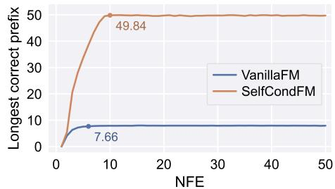  
Figure 3: SELFCONDFM’s performance scales strongly with NFE, while that of VANILLAFM saturates early.

## 4.3 EVALUATION ON STRUCTURED VISUAL-REASONING TASKS

We next investigate whether the gains observed in §4.2 extend to the five structured visual-reasoning tasks of He et al. (2025): large-scale visual spatial planning (VSP-Super), Maze, the traveling salesperson problem (TSP), Sudoku, and Jigsaw. See Appendix D.4 for detailed setup and illustrations.

Controlled experiments. Following the setup in §4.1, we train VANILLAFM and SELFCONDFM as FLUX.2-klein-base-4B LoRA adapters on the same data for each task, and evaluate them at matched training FLOPs and NFE.

As reported in Table 1, SELFCONDFM improves over VANILLAFM on every task, raising the average accuracy from 65.9% to 76.7%. Larger gains appear on TSP (+15.7%) and Sudoku (+19.5%), while notable improvements are also observed on the other tasks. Thus self-conditioning extends its advantage from our validation tasks to the task suite of He et al. (2025). Appendix D.4.2 shows some generated examples.

Large-scale comparisons. To evaluate the method at a larger scale, we fine-tune SELFCONDFM as a LoRA adapter on the 20B-parameter Qwen-Image-Edit-2511 backbone (Qwen Team, 2025) following the setup of Dai et al. (2026), and compare it with the published baselines. Jigsaw is reported separately in Appendix D.4.1, because EndoCoT (Dai et al., 2026) does not evaluate it.

As shown in Table 2, task-specific SELFCONDFM adapters achieve 90.0% average accuracy, outperforming the purely visual-generative DiffThinker baseline (75.8%). EndoCoT (88.3%) additionally guides image generation using latent CoT in a multimodal language model, so we include it as a reference rather than a directly comparable baseline. A single adapter trained jointly on the four tasks reaches 90.2%, matching the per-task adapters and exceeding the unified DiffThinker (66.1%) and EndoCoT (76.6%) results by large margins.

## 4.4 ADDITIONAL EMPIRICAL ANALYSES

Finally, we provide some empirical analyses to illustrate how the trained models behave during inference (detailed in Appendix D.5):

• Lipschitzness. We estimate the Lipschitz constant of a VANILLAFM model trained on mixedlength line tracing instances. The estimate levels off at a roughly constant value of 400 for m ≥ 30, consistent with the bounded-Lipschitz regime assumed in §3.1 (Appendix D.5.1).

• Attention allocation. The endpoint prediction $z _ { i }$ in SELFCONDFM receives a nontrivial share of attention throughout the generation, with a larger share early on when $x _ { i }$ is still noisy. This indicates that the model indeed uses $z _ { i }$ to guide its generation (Appendix D.5.2).

• Parallel and revisable reasoning. Reasoning with flow matching has some intrinsic advantages, and SELFCONDFM preserves them well. The model can form multiple local results in parallel within one trajectory and correct a wrong mid-trajectory generation in place (Appendix D.5.3).

## 5 RELATED WORK

Generative visual reasoning. Multimodal large language models (MLLMs) typically treat images as static inputs and externalize reasoning through textual CoT. The emerging thinking with images paradigm instead turns vision into an intermediate workspace that can be repeatedly inspected or modified (Su et al., 2025b). Early approaches manipulate images through tool calls (Su et al., 2025a; 2026; Lai et al., 2026), while other approaches internalize visual intermediates within the model, in the form of generated images, latent visual states, or learned visual representations (Xu et al., 2026; Yang et al., 2026; Zhang et al., 2025; Qin et al., 2025; Wang et al., 2026a; Gu et al., 2026; Li et al., 2026; Cheng et al., 2026). These intermediates give the model a richer workspace for reasoning than text alone.

Video generation offers another medium for reasoning, representing evolving intermediate states as a sequence of frames (Wiedemer et al., 2025; Tong et al., 2026). Recent works further suggest that video diffusion models (Ho et al., 2022; Xing et al., 2024) reason across denoising steps: they explore candidate solutions, correct earlier mistakes, and commit early to high-level plans (Wang et al., 2026b; Newman et al., 2026).

Recent work moves reasoning into image generation itself: DiffThinker uses direct image-to-image generation (He et al., 2025), while EndoCoT bridges latent states in an MLLM’s CoT to image generation (Dai et al., 2026). However, the computational structure of generative visual reasoning remains underexplored. Liu (2025) establishes a ${ \mathsf { T C } } ^ { 0 }$ upper bound for optimal denoising diffusion probabilistic models, but requires the model to match the score function exactly, an assumption that rarely holds for practical trained models.

Self-conditioning. Self-conditioning feeds a model’s endpoint prediction back into a subsequent denoising step. It was introduced by Chen et al. (2022) for diffusion over discrete data, and has since been adapted to continuous diffusion language modeling, image and video generation, and molecular flow matching (Strudel et al., 2022; Jabri et al., 2022; Gupta et al., 2024; Stark et al.,¨ 2023). Prior work primarily studies generation quality and efficiency empirically; we instead treat self-conditioning as maintaining a computational state and analyze its expressive power.

Computational Expressiveness. The expressive power of transformers (Vaswani et al., 2017) has been studied extensively through circuit complexity, formal languages, and logic (Strobl et al., 2024). Depending on the attention mechanism and numerical precision, constant-depth transformers are upper-bounded by ${ \mathsf { A C } } ^ { 0 } \ { \mathrm { o r } } \ { \mathsf { T C } } ^ { 0 }$ (Hao et al., 2022; Merrill et al., 2022; Merrill & Sabharwal, 2023; Chiang, 2024), and such circuit bounds extend to modern components such as rotary positional embeddings (Chen et al., 2025). Chiang et al. (2023) further tighten both the upper and lower bounds through a logical characterization.

Repeated model calls can lift computation beyond these single-evaluation bounds. With chainof-thought (Wei et al., 2022), a constant-depth transformer writes its intermediate results into the autoregressive context and can thereby solve inherently serial problems (Li et al., 2024; Feng et al., 2023; Merrill & Sabharwal, 2024). Amiri et al. (2025) complement this with lower bounds on the number of chain-of-thought steps that hard-attention transformers need for various algorithmic problems. Beyond autoregressive generation, Feng et al. (2025) establish theoretical bounds for masked diffusion language models, proving that while constant sampling steps suffice for distribution matching, sequential reasoning requires sampling steps that scale with sequence length.

## 6 CONCLUSION AND DISCUSSION

This work reveals a previously unrecognized role of self-conditioning in generative reasoning. We show that vanilla flow matching cannot deepen sequential reasoning through additional sampling steps. Self-conditioning breaks this bottleneck by passing endpoint predictions across steps, which lets additional sampling steps translate into reasoning depth. Experiments across diverse visualreasoning tasks confirm this separation: self-conditioning achieves better performance and consis tently benefits from more sampling steps.

These theoretical guarantees, however, rely on certain regularity assumptions. In particular, the upper bound in Theorem 1 requires a fairly strong Lipschitz restriction. Moreover, the Lipschitz estimates in §4.4 are relatively large and provide empirical rather than certified bounds (Appendix D.5.1). Since the dependence on the Lipschitz constant is tight up to constant factors (§3.4), future work may explore alternative forms of regularity conditions.

Although we focus on image-space visual reasoning, our theoretical analysis does not depend on the data modality. It therefore applies wherever flow matching serves as the sampling backbone, including video generation (Kong et al., 2024; Ifriqi et al., 2026), continuous diffusion language modeling (Chen et al., 2026), and visuomotor policy learning (Black et al., 2024). Whether selfconditioning delivers similar empirical gains remains an open question. Nevertheless, this perspective may inform future sampler design in settings where iterative generation is expected to reason.

## AI DISCLOSURE

For this work, we used generative AI tools to (i) generate synthetic datasets for the tasks in §4.2; (ii) provide insights into reducing the number of sequential rounds from $\mathrm { e } ^ { O ( L ) }$ to $O ( L )$ by replacing the Euler method with Picard iterations in §3.1; (iii) assist in writing the proofs; and (iv) implement the training codebase. We did not use generative AI tools to develop theoretical models or conceptual frameworks, formulate mathematical claims, design or provide feedback on research methodology or experiments, support qualitative or thematic data analysis, or interpret results. The tasks of proposing or refining hypotheses, translating text, and cleaning or reformatting datasets were not applicable to this work. Additionally, we used generative AI tools to create and refine figures, to assist in drafting and editing the paper at the paragraph level to improve readability, to identify relevant literature, and to format references.

We have reviewed all AI-assisted work. All AI-assisted proof writing was reviewed by at least two authors other than the original writers. All AI-assisted language editing was reviewed by at least one author other than those who originally drafted the corresponding text. The core experimental codebase and synthetic datasets were reviewed by at least one author. All figures, relevant literature, and the final reference formatting were verified by at least one author. We take full responsibility for the final content of this work, including all text, claims, and artifacts produced with the aid of generative AI.

## REPRODUCIBILITY STATEMENT

For the theoretical results, §2.2 specifies the theoretical setup, and §3 states the assumptions of each theorem. Appendices A and B give complete proofs of the main theorems and their extensions, and Appendix C formally defines the three synthetic tasks in §4.2 and proves their circuit-complexity classifications. For the experiments, Appendix D.1 describes the backbones, the implementation of self-conditioning, and the training-FLOP accounting. Appendix D.2 details the data generation, training hyperparameters, and evaluation protocol for each synthetic task, Appendix D.2.1 reports results over multiple seeds, and Appendix D.3 elaborates the selection of checkpoints and the eval uation for our NFE-scaling study. Appendix D.4 describes the data preparation, evaluators, and training configurations for the structured visual-reasoning tasks in §4.3, which follow Dai et al. (2026) and He et al. (2025).

## REFERENCES

El Mehdi Achour, Franc¸ois Malgouyres, and Franck Mamalet. Existence, stability and scalability of orthogonal convolutional neural networks. Journal of Machine Learning Research, 23(347): 1–56, 2022.

Miklos Ajtai. Approximate counting with uniform constant-depth circuits. ´ Advances in computational complexity theory, 13:1–20, 1990.

Alireza Amiri, Xinting Huang, Mark Rofin, and Michael Hahn. Lower bounds for chain-of-thought reasoning in hard-attention transformers. arXiv preprint arXiv:2502.02393, 2025.

Sanjeev Arora, Boaz Barak, et al. Computational complexity: a modern approach, volume 1. Cambridge University Press Cambridge, 2009.

David A. Mix Barrington. Bounded-width polynomial-size branching programs recognize exactly those languages in NC1. In Proceedings of the Eighteenth Annual ACM Symposium on Theory of Computing, pp. 1–5, 1986. doi: 10.1145/12130.12131.

David A. Mix Barrington, Kevin J. Compton, Howard Straubing, and Denis Therien. Regular´ languages in NC1. Journal of Computer and System Sciences, 44(3):478–499, 1992. doi: 10.1016/0022-0000(92)90014-A.

Kevin Black, Noah Brown, Danny Driess, Adnan Esmail, Michael Equi, Chelsea Finn, Niccolo Fusai, Lachy Groom, Karol Hausman, Brian Ichter, et al. π0: A vision-language-action flow model for general robot control. arXiv preprint arXiv:2410.24164, 2024.

Black Forest Labs. Flux.2 [klein] 4b base. https://huggingface.co/black-forest-l abs/FLUX.2-klein-base-4B, 2026. Hugging Face model card.

Black Forest Labs, Stephen Batifol, Andreas Blattmann, Frederic Boesel, Saksham Consul, Cyril Diagne, Tim Dockhorn, Jack English, Zion English, Patrick Esser, et al. Flux. 1 kontext: Flow matching for in-context image generation and editing in latent space. arXiv preprint arXiv:2506.15742, 2025.

Ashok K Chandra, Larry Stockmeyer, and Uzi Vishkin. Constant depth reducibility. SIAM Journal on Computing, 13(2):423–439, 1984.

Bo Chen, Xiaoyu Li, Yingyu Liang, Jiangxuan Long, Zhenmei Shi, Zhao Song, and Jiahao Zhang. Circuit complexity bounds for rope-based transformer architecture. In Proceedings of the 2025 Conference on Empirical Methods in Natural Language Processing, pp. 11091–11108, 2025.

Ting Chen, Ruixiang Zhang, and Geoffrey Hinton. Analog bits: Generating discrete data using diffusion models with self-conditioning. arXiv preprint arXiv:2208.04202, 2022.

Yuxin Chen, Chumeng Liang, Hangke Sui, Ruihan Guo, Chaoran Cheng, Jiaxuan You, and Ge Liu. Langflow: Continuous diffusion rivals discrete in language modeling. arXiv preprint arXiv:2604.11748, 2026.

Dongjie Cheng, Yongqi Li, Zhixin Ma, Hongru Cai, Yupeng Hu, Wenjie Wang, Liqiang Nie, and Wenjie Li. Omni-R1: Towards the unified generative paradigm for multimodal reasoning. In Findings ofthe Associationfor Computational Linguistics: ACL 2026, pp. 38907–38924. Association for Computational Linguistics, 2026. doi: 10.18653/v1/2026.findings-acl.1937.

David Chiang. Transformers in uniform TC0. arXiv preprint arXiv:2409.13629, 2024.

David Chiang, Peter Cholak, and Anand Pillay. Tighter bounds on the expressivity of transformer encoders. In International Conference on Machine Learning, pp. 5544–5562. PMLR, 2023.

Xuanlang Dai, Yujie Zhou, Long Xing, Jiazi Bu, Xilin Wei, Yuhong Liu, Beichen Zhang, Kai Chen, and Yuhang Zang. Endocot: Scaling endogenous chain-of-thought reasoning in diffusion models. arXiv preprint arXiv:2603.12252, 2026.

Ronen Eldan and Yuanzhi Li. Tinystories: How small can language models be and still speak coherent english? arXiv preprint arXiv:2305.07759, 2023.

Patrick Esser, Sumith Kulal, Andreas Blattmann, Rahim Entezari, Jonas Muller, Harry Saini, Yam¨ Levi, Dominik Lorenz, Axel Sauer, Frederic Boesel, et al. Scaling rectified flow transformers for high-resolution image synthesis. In Forty-first international conference on machine learning, 2024.

Guhao Feng, Bohang Zhang, Yuntian Gu, Haotian Ye, Di He, and Liwei Wang. Towards revealing the mystery behind chain of thought: a theoretical perspective. Advances in neural information processing systems, 36:70757–70798, 2023.

Guhao Feng, Yihan Geng, Jian Guan, Wei Wu, Liwei Wang, and Di He. Theoretical benefit and limitation of diffusion language model. Advances in Neural Information Processing Systems, 38: 24415–24459, 2025.

Merrick Furst, James B Saxe, and Michael Sipser. Parity, circuits, and the polynomial-time hierarchy. Mathematical systems theory, 17(1):13–27, 1984.

Jiawei Gu, Yunzhuo Hao, Huichen Wang, Linjie Li, Michael Qizhe Shieh, Yejin Choi, Ranjay Krishna, and Yu Cheng. Thinkmorph: Emergent properties in multimodal interleaved chain-ofthought reasoning. In International Conference on Learning Representations, volume 2026, pp. 141405–141447, 2026.

Agrim Gupta, Lijun Yu, Kihyuk Sohn, Xiuye Gu, Meera Hahn, Fei-Fei Li, Irfan Essa, Lu Jiang, and Jose Lezama. Photorealistic video generation with diffusion models. In ´ European Conference on Computer Vision, pp. 393–411. Springer, 2024.

Ernst Hairer, Gerhard Wanner, and Syvert P Nørsett. Solving ordinary differential equations I: Nonstiff problems. Springer, 1993.

Andras Hajnal, Wolfgang Maass, Pavel Pudl ´ ak, Mario Szegedy, and Gy ´ orgy Tur ¨ an. Threshold ´ circuits of bounded depth. Journal of Computer and System Sciences, 46(2):129–154, 1993.

Yiding Hao, Dana Angluin, and Robert Frank. Formal language recognition by hard attention transformers: Perspectives from circuit complexity. Transactions ofthe Associationfor Computational Linguistics, 10:800–810, 2022.

John Hastad. Almost optimal lower bounds for small depth circuits. In Proceedings ofthe eighteenth annual ACM symposium on Theory ofcomputing, pp. 6–20, 1986.

Zefeng He, Xiaoye Qu, Yafu Li, Tong Zhu, Siyuan Huang, and Yu Cheng. Diffthinker: Towards generative multimodal reasoning with diffusion models. arXiv preprint arXiv:2512.24165, 2025.

William Hesse, Eric Allender, and David A Mix Barrington. Uniform constant-depth threshold circuits for division and iterated multiplication. Journal of Computer and System Sciences, 65(4): 695–716, 2002.

Jonathan Ho, Tim Salimans, Alexey Gritsenko, William Chan, Mohammad Norouzi, and David J. Fleet. Video diffusion models. In Advances in Neural Information Processing Systems, volume 35, pp. 8633–8646, 2022.

Yushi Hu, Weijia Shi, Xingyu Fu, Dan Roth, Mari Ostendorf, Luke Zettlemoyer, Noah A Smith, and Ranjay Krishna. Visual sketchpad: Sketching as a visual chain of thought for multimodal language models. Advances in Neural Information Processing Systems, 37:139348–139379, 2024.

Tariq Berrada Ifriqi, John Nguyen, Karteek Alahari, Jakob Verbeek, and Ricky TQ Chen. Flowception: Temporally expansive flow matching for video generation. In Proceedings of the IEEE/CVF Conference on Computer Vision and Pattern Recognition, pp. 16185–16195, 2026.

Allan Jabri, David Fleet, and Ting Chen. Scalable adaptive computation for iterative generation. arXiv preprint arXiv:2212.11972, 2022.

Tero Karras, Miika Aittala, Timo Aila, and Samuli Laine. Elucidating the design space of diffusionbased generative models. Advances in neural information processing systems, 35:26565–26577, 2022.

Akitoshi Kawamura. Lipschitz continuous ordinary differential equations are polynomial-space complete. Computational Complexity, 19(2):305–332, 2010.

Weijie Kong, Qi Tian, Zijian Zhang, Rox Min, Zuozhuo Dai, Jin Zhou, Jiangfeng Xiong, Xin Li, Bo Wu, Jianwei Zhang, et al. Hunyuanvideo: A systematic framework for large video generative models. arXiv preprint arXiv:2412.03603, 2024.

Xin Lai, Junyi Li, Wei Li, Tao Liu, Tianjian Li, and Hengshuang Zhao. Mini-o3: Scaling up reasoning patterns and interaction turns for visual search. In International Conference on Learning Representations, volume 2026, pp. 76722–76746, 2026.

Sangyun Lee, Zinan Lin, and Giulia Fanti. Improving the training of rectified flows. Advances in neural information processing systems, 37:63082–63109, 2024.

Bangzheng Li, Ximeng Sun, Jiang Liu, Ze Wang, Jialian Wu, Xiaodong Yu, Emad Barsoum, Muhao Chen, and Zicheng Liu. Latent visual reasoning. In International Conference on Learning Representations, 2026.

Zhiyuan Li, Hong Liu, Denny Zhou, and Tengyu Ma. Chain of thought empowers transformers to solve inherently serial problems. In International Conference on Learning Representations, volume 2024, pp. 11911–11943, 2024.

Yaron Lipman, Ricky TQ Chen, Heli Ben-Hamu, Maximilian Nickel, and Matt Le. Flow matching for generative modeling. arXiv preprint arXiv:2210.02747, 2022.

Xingchao Liu, Chengyue Gong, and Qiang Liu. Flow straight and fast: Learning to generate and transfer data with rectified flow. arXiv preprint arXiv:2209.03003, 2022.

Yuxi Liu. Perfect diffusion is tc0–bad diffusion is turing-complete. arXiv preprint arXiv:2507.12469, 2025.

Edward James McShane. Extension of range of functions. Bulletin of the American Mathematical Society, 40(12):837–842, 1934.

William Merrill and Ashish Sabharwal. The parallelism tradeoff: Limitations of log-precision transformers. Transactions ofthe Associationfor Computational Linguistics, 11:531–545, 2023.

William Merrill and Ashish Sabharwal. The expressive power of transformers with chain of thought. In International Conference on Learning Representations, volume 2024, pp. 7690–7706, 2024.

William Merrill, Ashish Sabharwal, and Noah A Smith. Saturated transformers are constant-depth threshold circuits. Transactions of the Association for Computational Linguistics, 10:843–856, 2022.

Kaleb Newman, Tyler Zhu, and Olga Russakovsky. Video models reason early: Exploiting plan commitment for maze solving. arXiv preprint arXiv:2603.30043, 2026.

Yiming Qin, Bomin Wei, Jiaxin Ge, Konstantinos Kallidromitis, Stephanie Fu, Trevor Darrell, and XuDong Wang. Chain-of-visual-thought: Teaching vlms to see and think better with continuous visual tokens. arXiv preprint arXiv:2511.19418, 2025.

Qwen Team. Qwen-image-edit-2511. https://huggingface.co/Qwen/Qwen-Image-E dit-2511, 2025. Hugging Face model card.

Qwen Team. Qwen3.8-Flash-Next: A new architecture, towards ultimate cost-efficiency, August 2026. URL https://qwen.ai/blog?id=qwen3.8-flash-next.

Andy Shih, Suneel Belkhale, Stefano Ermon, Dorsa Sadigh, and Nima Anari. Parallel sampling of diffusion models. Advances in Neural Information Processing Systems, 36:4263–4276, 2023.

Hannes Stark, Bowen Jing, Regina Barzilay, and Tommi Jaakkola. Harmonic self-conditioned flow¨ matching for multi-ligand docking and binding site design. arXiv preprint arXiv:2310.05764, 2023.

Lena Strobl, William Merrill, Gail Weiss, David Chiang, and Dana Angluin. What formal languages can transformers express? a survey. Transactions of the Association for Computational Linguistics, 12:543–561, 2024.

Robin Strudel, Corentin Tallec, Florent Altche, Yilun Du, Yaroslav Ganin, Arthur Mensch, Will´ Grathwohl, Nikolay Savinov, Sander Dieleman, Laurent Sifre, et al. Self-conditioned embedding diffusion for text generation. arXiv preprint arXiv:2211.04236, 2022.

Alex Su, Haozhe Wang, Weiming Ren, Fangzhen Lin, and Wenhu Chen. Pixel reasoner: Incentivizing pixel space reasoning via curiosity-driven reinforcement learning. Advances in Neural Information Processing Systems, 38:8222–8251, 2026.

Zhaochen Su, Linjie Li, Mingyang Song, Yunzhuo Hao, Zhengyuan Yang, Jun Zhang, Guanjie Chen, Jiawei Gu, Juntao Li, Xiaoye Qu, et al. Openthinkimg: Learning to think with images via visual tool reinforcement learning. arXiv preprint arXiv:2505.08617, 2025a.

Zhaochen Su, Peng Xia, Hangyu Guo, Zhenhua Liu, Yan Ma, Xiaoye Qu, Jiaqi Liu, Yanshu Li, Kaide Zeng, Zhengyuan Yang, et al. Thinking with images for multimodal reasoning: Foundations, methods, and future frontiers. arXiv preprint arXiv:2506.23918, 2025b.

Jingqi Tong, Yurong Mou, Hangcheng Li, Mingzhe Li, Yongzhuo Yang, Ming Zhang, Qiguang Chen, Tianyi Liang, Xiaomeng Hu, Yining Zheng, et al. Thinking with video: Video generation as a promising multimodal reasoning paradigm. In Proceedings ofthe IEEE/CVF Conference on Computer Vision and Pattern Recognition, pp. 41121–41129, 2026.

Ashish Vaswani, Noam Shazeer, Niki Parmar, Jakob Uszkoreit, Llion Jones, Aidan N Gomez, Łukasz Kaiser, and Illia Polosukhin. Attention is all you need. Advances in neural information processing systems, 30, 2017.

Heribert Vollmer. Introduction to circuit complexity: a uniform approach. Springer Science & Business Media, 1999.

Qixun Wang, Yang Shi, Yifei Wang, Yuanxing Zhang, Pengfei Wan, Kun Gai, Xianghua Ying, and Yisen Wang. Monet: Reasoning in latent visual space beyond image and language. In Proceedings of the IEEE/CVF Conference on Computer Vision and Pattern Recognition, pp. 12030–12040, 2026a.

Ruisi Wang, Zhongang Cai, Fanyi Pu, Junxiang Xu, Wanqi Yin, Maijunxian Wang, Ran Ji, Chenyang Gu, Bo Li, Ziqi Huang, et al. Demystifying video reasoning. arXiv preprint arXiv:2603.16870, 2026b.

Jason Wei, Xuezhi Wang, Dale Schuurmans, Maarten Bosma, Fei Xia, Ed Chi, Quoc V Le, Denny Zhou, et al. Chain-of-thought prompting elicits reasoning in large language models. Advances in neural information processing systems, 35:24824–24837, 2022.

Thaddaus Wiedemer, Yuxuan Li, Paul Vicol, Shixiang Shane Gu, Nick Matarese, Kevin Swersky,¨ Been Kim, Priyank Jaini, and Robert Geirhos. Video models are zero-shot learners and reasoners. arXiv preprint arXiv:2509.20328, 2025.

Chenfei Wu, Jiahao Li, Jingren Zhou, Junyang Lin, Kaiyuan Gao, Kun Yan, Sheng-ming Yin, Shuai Bai, Xiao Xu, Yilei Chen, et al. Qwen-image technical report. arXiv preprint arXiv:2508.02324, 2025.

Zhen Xing, Qijun Feng, Haoran Chen, Qi Dai, Han Hu, Hang Xu, Zuxuan Wu, and Yu-Gang Jiang. A survey on video diffusion models. ACM Computing Surveys, 57(2):1–42, 2024.

Yi Xu, Chengzu Li, Han Zhou, Xingchen Wan, Caiqi Zhang, Anna Korhonen, and Ivan Vulic. Visual´ planning: Let’s think only with images. In International Conference on Learning Representations, volume 2026, pp. 36706–36739, 2026.

Yao-Yuan Yang, Cyrus Rashtchian, Hongyang Zhang, Russ R Salakhutdinov, and Kamalika Chaudhuri. A closer look at accuracy vs. robustness. Advances in neural information processing systems, 33:8588–8601, 2020.

Zeyuan Yang, Xueyang Yu, Delin Chen, Maohao Shen, and Chuang Gan. Machine mental imagery: Empower multimodal reasoning with latent visual tokens. In Proceedings of the IEEE/CVF Conference on Computer Vision and Pattern Recognition, pp. 33510–33520, 2026.

Huanyu Zhang, Wenshan Wu, Chengzu Li, Ning Shang, Yan Xia, Yangyu Huang, Yifan Zhang, Li Dong, Zhang Zhang, Liang Wang, et al. Latent sketchpad: Sketching visual thoughts to elicit multimodal reasoning in mllms. arXiv preprint arXiv:2510.24514, 2025.

## CONTENTS

1 Introduction 1   
2 Preliminaries 3   
2.1 Background 3   
2.2 Theoretical Setup and Notation . 3   
3 Self-Conditioning Increases Expressive Power 4   
3.1 Vanilla Flow Matching Is Confined to Constant Depth . 4   
3.2 Self-Conditioning . 5   
3.3 Self-Conditioning Reaches PSPACE/poly . 6   
3.4 Extensions . 6   
4 Experiments 6   
4.1 Experimental Setup 7   
4.2 Empirical Validation of the Expressivity Separation 7   
4.3 Evaluation on Structured Visual-Reasoning Tasks 8   
4.4 Additional Empirical Analyses . 9   
5 Related Work 9   
6 Conclusion and Discussion 10   
A Proofs of Main Expressivity Theorems 18   
A.1 Conventions and Preliminary Facts . 18   
A.2 Expressiveness Upper Bound for VANILLAFM 19   
A.2.1 The Error Recurrence . 19   
A.2.2 Proof of Lemma 1 20   
A.2.3 Approximate Normalized Prefix Sums in $\mathsf { A C } ^ { 0 }$ 22   
A.2.4 Proof of Theorem 1 . 22   
A.3 Expressiveness Lower Bound for SELFCONDFM 24   
A.3.1 Local Simulation of Space-Bounded Machines 24   
A.3.2 Proof of Theorem 2 . 24   
B Proofs of Theoretical Extensions 27   
B.1 The Growing Lipschitz Constant 27   
B.2 $\ell _ { p }$ Lipschitz Condition 27   
B.3 Runge–Kutta Samplers 29   
B.4 Matching the Circuit Depth . 32   
C Formalization and Circuit Complexity of the Tasks in §4.2 34   
C.1 Task Descriptions 34   
C.2 Preliminaries for the Complexity Analysis . 34   
C.3 Line Tracing . 35   
C.4 Long Multiplication 35   
C.5 Long Text Rendering 36   
D Experimental Details 39   
D.1 Overall Setup 39   
D.2 Setup and Evaluation for the Tasks in §4.2 39   
D.2.1 Multi-Seed Evaluation 40   
D.2.2 Generated Examples 42   
D.3 NFE Scaling . 46   
D.4 Setup and Results for Structured Visual-Reasoning Tasks 46   
D.4.1 Jigsaw Results 46   
D.4.2 Generated Examples 47   
D.5 Additional Empirical Analyses 53   
D.5.1 Empirical Lipschitz Estimation 53   
D.5.2 Attention Allocation 53   
D.5.3 Parallel and Revisable Reasoning 54

## A PROOFS OF MAIN EXPRESSIVITY THEOREMS

This appendix proves the two main theoretical results from §3: Theorem 1 and Theorem 2. Building on the theoretical setup in §2.2, Appendix A.1 first fixes the notation and the encoding in which circuits read and write elements of $F _ { b } ,$ and collects the preliminary facts. Appendix A.2 then proves Theorem 1 with the help of Lemma 1, and Appendix A.3 proves Theorem 2. The extension result of §3.4 are proved separately in Appendix B.

## A.1 CONVENTIONS AND PRELIMINARY FACTS

Throughout this appendix, m denotes the problem size and $\mathsf { D } \in \{ \mathsf { N C } ^ { k + 1 } , \mathsf { A C } ^ { k } , \mathsf { T C } ^ { k } \}$ denotes a circuit complexity class for a constant integer $k \geq 0 ;$ we abbreviate $b = b ( m ) , n = n ( m ) , K =$ $K ( m )$ , and $\bar { \delta } : = \bar { 2 } ^ { - b }$ . All circuit families are non-uniform.

Relations among complexity classes. It is known that ${ \mathsf { N C } } ^ { k } \subseteq { \mathsf { A C } } ^ { k } \subseteq { \mathsf { T C } } ^ { k } \subseteq { \mathsf { N C } } ^ { k + 1 }$ for all $k \geq 0$ (Arora et al., 2009). Consequently, $\begin{array} { r } { \mathsf { N C } = \mathsf { U } _ { k } \mathsf { A C } ^ { k } = \mathsf { U } _ { k } \mathsf { T C } ^ { k } } \end{array}$ . Furthermore, $\mathsf { A C } ^ { 0 } \subsetneq \mathsf { T C } ^ { 0 }$ because $\mathrm { P A R I T Y } \in \mathsf { T C } ^ { 0 } \setminus \mathsf { A C } ^ { 0 }$ (Furst et al., 1984; Hastad, 1986), whereas ${ \mathsf { T C } } ^ { 0 } \subseteq { \mathsf { N C } } ^ { 1 }$ is widely conjectured but open (Vollmer, 1999). By definition, $\mathsf { P \subseteq P / \mathsf { p o l y } }$ and $\mathsf { P S P A C E \subseteq P S P A C E / p o l y }$ Moreover, the class P/poly is exactly the class of languages decidable by polynomial-size families of Boolean circuits (Arora et al., 2009), so ${ \mathsf { N C } } \subseteq { \mathsf { P } } / { \mathsf { p o l y } } \subseteq { \mathsf { P S P A C E } } / { \mathsf { p o l y } }$ . Both inclusions are widely conjectured to be strict (Arora et al., 2009).

Encoding of scalars. Fix a binary encoding of the scalars of $F _ { b }$ in which a scalar of magnitude at most $2 ^ { \bar { \ell } }$ occupies $O ( b + \ell )$ bits. Every scalar in the runs of this appendix has magnitude at most $\mathrm { p o l y } ( m ) , \mathrm { i . e . , } \bar { \ell } = O ( \mathrm { l o g } m )$ , and all circuit constructions have $b = \mathrm { p o l y } ( m )$ . Their encodings thus have poly(m) bits. When b is additionally constrained to $O ( \log m )$ , the encodings have $O ( \log m )$ bits.

Circuits for models. We say that a model u is computed by D circuits if, under the encoding above, its restriction to inputs of each total encoded length is computed by a D circuit of size polynomial in that length. The Boolean input w needs no convention of its own, since $\{ 0 , 1 \} \subset F _ { b }$

Finite-precision arithmetic. The grid $F _ { b } = \{ k 2 ^ { - b } : k \in \mathbb { Z } \}$ is closed under addition, under subtraction, and under multiplication by an integer, so these operations need no rounding. Iterated sums are independent of the association order. For every $x \in { \mathbb R }$ we have $| \mathrm { r o u n d } _ { b } ( x ) - \bar { x } | \leq \delta / 2$ and round is nondecreasing and fixes $F _ { b }$ (i.e., round $, ( x ) = x$ for all $x \in F _ { b } )$ .

Time grid. Both samplers (Algorithms 1 and 2) use discrete time steps $t _ { i } = \mathrm { r o u n d } _ { b } ( s _ { i } )$ with $s _ { i } : = i / K$ ; write $h _ { i } : = t _ { i + 1 } - t _ { i }$ . Since round is nondecreasing and fixes 0 and 1, we have

$$
t _ { 0 } = 0 , \qquad t _ { K } = 1 , \qquad h _ { i } \geq 0 , \qquad \sum _ { i = 0 } ^ { K - 1 } h _ { i } = 1 ,
$$

and $| t _ { i } - s _ { i } | \leq \delta / 2$ gives $| h _ { i } - 1 / K | \leq \delta .$

Hardwiring the initialization. In both samplers the initial state $x _ { 0 } = \mathrm { r o u n d } _ { b } ( \tilde { x } _ { 0 } )$ ranges over the finite set $( \bar { F _ { b } } \cap [ - 1 , 1 ] ) ^ { n }$ , since $p _ { \mathrm { p r i o r } }$ is supported on $[ - 1 , 1 ] ^ { n }$ , and the rest of the run is deterministic given $x _ { 0 }$ . If a model accepts $\mathcal { L }$ with margin c under a fixed sampler, the acceptance criterion holds for every x0 occurring with positive probability. Since $p _ { \mathrm { p r i o r } }$ does not depend on $w ,$ , fixing one such value $\hat { x } _ { 0 } = \hat { x } _ { 0 } ( m )$ for each m turns the sampler into a deterministic algorithm with the same guarantee. We do this whenever a sampler is regarded as a circuit family.

The table bound. A function f of few bits is shallow, however complicated it is: writing each output bit of an arbitrary $f : \{ 0 , 1 \} ^ { j }  \{ 0 , 1 \} ^ { j ^ { \prime } }$ as a disjunctive normal form over the $j$ input literals gives an unbounded-fan-in circuit of depth two and size $O ( j ^ { \prime } 2 ^ { j } )$ , hence of size poly(m) once $j = O ( \log m )$ and $j ^ { \prime } = \mathrm { p o l y } ( m )$ . We call this the table bound; it exploits no structure of $f ,$ only how many bits $f$ reads and writes. In the proofs below, we frequently invoke it for maps on constantly many scalars, each of $O ( \log m )$ bits.

## A.2 EXPRESSIVENESS UPPER BOUND FOR VANILLAFM

The K Euler steps of VANILLAFM are sequential, so a circuit that follows them has depth growing with K. We replace them by a Picard iteration (Hairer et al., 1993) that updates all K positions at once, and whose propagated error decays factorially across iteration rounds, up to an additive error floor (Appendix A.2.1). Therefore, $O ( \dot { L } )$ rounds already approximate the sampler’s output to within a constant error; this proves Lemma 1 in Appendix A.2.2. Aside from the K parallel model calls, each round computes normalized prefix sums of the velocities, which Appendix A.2.3 approximates in $\mathsf { A C } ^ { 0 }$ up to a constant error, small enough for acceptance with margin (see §2.2). Appendix A.2.4 substitutes these approximate sums into the Picard iteration to prove Theorem 1.

## A.2.1 THE ERROR RECURRENCE

Appendices A.2.2 and A.2.4 both compare an approximate trajectory with the exact one through the same error recurrence, so we bound it here once and for all. The error accumulates over multiple steps. At each step, the error at each position is bounded by a fixed linear transformation of the sum of the errors at all preceding positions in the previous step, plus an additive error. Consequently, the initial error decays factorially across steps, while the additive errors accumulate to a magnitude of order $\mathrm { e } ^ { L }$

Lemma 2. Let $K \in \mathbb { N } ^ { + }$ be a positive integer, $B > 0 , L \geq 1$ , and $\alpha , \beta \geq 0$ be real numbers, and let $C : = \lceil \mathrm { e } L + 4 B \rceil$ . Recall that $s _ { i } : = i / K$ (Appendix A.1). Let $( e _ { i } ^ { ( r ) } ) _ { 0 \leq i \leq K , 0 \leq r \leq C }$ be nonnegative reals such that,for all i and all $r < C$

$$
e _ { i } ^ { ( 0 ) } \leq B s _ { i } + \alpha ,\tag{3}
$$

$$
e _ { i } ^ { ( r + 1 ) } \leq \frac { L } { K } \sum _ { j = 0 } ^ { i - 1 } e _ { j } ^ { ( r ) } + \beta .\tag{4}
$$

Then for all $0 \leq i \leq K$ and $0 \leq r \leq C ,$

$$
e _ { i } ^ { ( r ) } \leq \frac { B L ^ { r } s _ { i } ^ { r + 1 } } { ( r + 1 ) ! } + \frac { \alpha L ^ { r } s _ { i } ^ { r } } { r ! } + \beta \sum _ { q = 0 } ^ { r - 1 } \frac { L ^ { q } s _ { i } ^ { q } } { q ! } ,\tag{5}
$$

where $0 ^ { 0 } : = 1$ and the sum is read as empty when $r = 0 .$ . In particular, $\begin{array} { r } { e _ { K } ^ { ( C ) } \le \frac { 1 } { 4 } + \alpha + \beta \mathrm { e } ^ { L } . } \end{array}$

Proof. We prove (5) by induction on r. For $r = 0$ the right-hand side is $B s _ { i } + \alpha$ , so (5) is (3). Assume that (5) holds for r and all i. Since the function $\vartheta \mapsto \vartheta ^ { q }$ is nondecreasing on $[ 0 , \infty )$ and $s _ { j + 1 } - s _ { j } = 1 / K$ , every integer $q \geq 0$ satisfies the Riemann bound

$$
\frac { 1 } { K } \sum _ { j = 0 } ^ { i - 1 } s _ { j } ^ { q } = \frac { 1 } { K } \sum _ { j = 0 } ^ { i - 1 } ( j / K ) ^ { q } \leq \int _ { 0 } ^ { s _ { i } } \vartheta ^ { q } \mathrm { d } \vartheta = \frac { s _ { i } ^ { q + 1 } } { q + 1 } .\tag{6}
$$

Summing (5) over $j < i$ and applying (6) termwise gives

$$
\begin{array} { r l } & { \displaystyle \frac { L } { K } \sum _ { j = 0 } ^ { i - 1 } e _ { j } ^ { ( r ) } \leq \frac { 1 } { K } \sum _ { j = 0 } ^ { i - 1 } \left( \frac { B L ^ { r + 1 } s _ { j } ^ { r + 1 } } { ( r + 1 ) ! } + \frac { \alpha L ^ { r + 1 } s _ { j } ^ { r } } { r ! } + \beta \sum _ { q = 0 } ^ { r - 1 } \frac { L ^ { q + 1 } s _ { j } ^ { q } } { q ! } \right) } \\ & { \qquad \leq \frac { B L ^ { r + 1 } s _ { i } ^ { r + 2 } } { ( r + 1 ) ! ( r + 2 ) } + \frac { \alpha L ^ { r + 1 } s _ { i } ^ { r + 1 } } { r ! ( r + 1 ) } + \beta \sum _ { q = 0 } ^ { r - 1 } \frac { L ^ { q + 1 } s _ { i } ^ { q + 1 } } { q ! ( q + 1 ) } } \\ & { \qquad = \frac { B L ^ { r + 1 } s _ { i } ^ { r + 2 } } { ( r + 2 ) ! } + \frac { \alpha L ^ { r + 1 } s _ { i } ^ { r + 1 } } { ( r + 1 ) ! } + \beta \sum _ { q = 1 } ^ { r } \frac { L ^ { q } s _ { i } ^ { q } } { q ! } . } \end{array}
$$

By (4), adding $\beta = \beta L ^ { 0 } s _ { i } ^ { 0 } / 0 !$ to this bound yields (5) for $r + 1$

For the last claim, put $i = K$ and $r = C \mathrm { i n } ( 5 )$ , so that $s _ { K } = 1$ . Stirling’s inequality $C ! \geq ( C / \mathrm { e } ) ^ { C }$ together with $C \geq \mathrm { e } L$ gives $L ^ { C } / C ! \le ( \mathrm { e } L / C ) ^ { C } \le 1$ , whence $\alpha L ^ { C } / C ! \leq \alpha$ and

$$
\frac { B L ^ { C } } { ( C + 1 ) ! } = \frac { B } { C + 1 } \cdot \frac { L ^ { C } } { C ! } \leq \frac { B } { 4 B + 1 } \leq \frac { 1 } { 4 } .
$$

The remaining sum satisfies $\begin{array} { r } { \sum _ { q < C } L ^ { q } / q ! \le \sum _ { q \ge 0 } L ^ { q } / q ! = \mathrm { e } ^ { L } } \end{array}$ , and adding the three terms yields

$$
e _ { K } ^ { ( C ) } \leq { \frac { B L ^ { C } } { ( C + 1 ) ! } } + { \frac { \alpha L ^ { C } } { C ! } } + \beta \sum _ { q = 0 } ^ { C - 1 } { \frac { L ^ { q } } { q ! } } \leq { \frac { 1 } { 4 } } + \alpha + \beta \mathrm { e } ^ { L } ,
$$

which completes the proof.

## A.2.2 PROOF OF LEMMA 1

Up to rounding, the K Euler updates of Algorithm 1 state that the trajectory $( x _ { i } ) _ { i = 0 } ^ { K }$ solves the fixedpoint system $\begin{array} { r } { x _ { i } = x _ { 0 } + \sum _ { j < i } h _ { j } u ( x _ { j } , t _ { j } ; w ) } \end{array}$ , with $h _ { j } : = t _ { j + 1 } - t _ { j }$ as in Appendix A.1. Algorithm 3 solves this fixed-point system by a Picard iteration (Hairer et al., 1993): iteration r recomputes all positions $y _ { 0 } ^ { ( r + 1 ) } , \dotsc , y _ { K } ^ { ( { \bar { r } } + 1 ) }$ in parallel from the previous iterate $( y _ { i } ^ { ( r ) } ) _ { i = 0 } ^ { K } ,$ replacing the rounded step sizes $h _ { j }$ by the uniform nominal step $1 / K$ , implemented by dividing each prefix sum $S _ { i } ^ { ( r ) }$ by K (line 8 of Algorithm 3). We show that $C = O ( L )$ iterations bring its endpoint $y _ { K } ^ { ( C ) }$ within $\begin{array} { l } { { \frac { 1 } { 2 } } } \end{array}$ of $x _ { K }$ , thereby proving Lemma 1.

Algorithm 3 Parallel Picard Inference   
1: function PARALLEL $\overline { { \mathrm { P I C A R D } ( w ; u , K , C ) } }$   
2: $t _ { i } \gets \mathrm { r o u n d } _ { b } ( i / K ) \mathrm { f o r } i = 0 , . . . , K$   
3: Sample $\tilde { x } _ { 0 } \sim p _ { \mathrm { p r i o r } } ; x _ { 0 } \gets$ round $, ( \tilde { x } _ { 0 } )$   
4: $y _ { i } ^ { ( 0 ) }  x _ { 0 }$ for $i = 0 , \ldots , K$   
5: for $r = 0 , \ldots , C - 1$ do   
6: in parallel for $j = 0 , \ldots , K - 1 ; \ v _ { j } ^ { ( r ) } \gets u ( y _ { j } ^ { ( r ) } , t _ { j } ; w )$   
7: $\begin{array} { r } { S _ { i } ^ { ( r ) }  \sum _ { j = 0 } ^ { i - 1 } v _ { j } ^ { ( r ) } } \end{array}$ for $i = 0 , \ldots , K$   
8: in parallel for $i = 0 , \ldots , K \colon y _ { i } ^ { ( r + 1 ) } \gets \mathrm { r o u n d } _ { b } \big ( x _ { 0 } + S _ { i } ^ { ( r ) } / K \big )$   
9: end for   
10: return $y _ { K } ^ { ( C ) }$   
11: end function

ProofofLemma 1. Fix m and $w ~ \in ~ \{ 0 , 1 \} ^ { m }$ , and write $L \ = \ L ( m )$ . Let $c _ { 0 } ~ = ~ c _ { 0 } ( B ) ~ > ~ 0$ be a constant to be chosen at the end of the proof, and take the inference algorithm to be PARALLEL $\mathrm { P I C A R D } ( w ; u , K , C )$ with

$$
C : = \lceil { \mathrm { e } L + 4 B } \rceil .
$$

Both VANILLAFM and PARALLELPICARD draw $\tilde { x } _ { 0 }$ from $p _ { \mathrm { p r i o r } }$ and round it, so we may couple the two runs by giving them the same $x _ { 0 }$ . The estimates below hold for every realization of $x _ { 0 } .$ , which is the only random quantity in either run, and therefore hold with probability 1.

The two trajectories. Let $( x _ { i } ) _ { i = 0 } ^ { K }$ be the VANILLAFM trajectory and $v _ { j } : = u ( x _ { j } , t _ { j } ; w )$ . In line 7 of Algorithm 1, the subtraction $t _ { i + 1 } - t _ { i }$ and the addition are exact in $\bar { F _ { b } } \overset { \cdot } { ( A _ { \mathrm { I } } ) }$ ppendix A.1). Only the product needs rounding, so $x _ { i + 1 } = x _ { i } + \mathrm { r o u n d } _ { b } ( h _ { i } v _ { i } )$ , and each step contributes a rounding residual round $, ( h _ { i } v _ { i } ) - h _ { i } v _ { i }$ of size at most $\delta / 2$ . Summing these residuals into $\begin{array} { r } { \rho _ { i } : = \sum _ { j < i } \bigl (  { \mathrm { r o u n d } _ { b } } ( h _ { j } v _ { j } ) - \qquad } \end{array}$ $h _ { j } v _ { j } )$ gives

$$
x _ { i } = x _ { 0 } + \sum _ { j = 0 } ^ { i - 1 } h _ { j } v _ { j } + \rho _ { i } \qquad \left( \| \rho _ { i } \| _ { \infty } \leq \frac { i \delta } { 2 } \leq \frac { K \delta } { 2 } \right) .\tag{7}
$$

Likewise the prefix sum $S _ { i } ^ { ( r ) }$ in line 7 of Algorithm 3 is a sum of elements of $F _ { b }$ and hence exact, and $x _ { 0 } \in F _ { b } ,$ , so line 8 rounds only once. Writing $\rho _ { i } ^ { ( r ) }$ for this rounding residual, line 8 gives

$$
y _ { i } ^ { ( r + 1 ) } = x _ { 0 } + \frac { 1 } { K } \sum _ { j = 0 } ^ { i - 1 } v _ { j } ^ { ( r ) } + \rho _ { i } ^ { ( r ) } \qquad \left( \| \rho _ { i } ^ { ( r ) } \| _ { \infty } \leq \frac { \delta } { 2 } \right) .\tag{8}
$$

We bound the difference between (7) and (8) in two steps: we first verify the hypotheses (3) and (4) of Lemma 2 for it, and then apply the lemma. The two expressions differ in three respects, which the first step tracks: the weights $1 / K$ against $h _ { j }$ , the velocities $v _ { j } ^ { ( r ) }$ against $v _ { j }$ , and the rounding residuals $\rho _ { i }$ and $\rho _ { i } ^ { ( r ) }$

Verifying the conditions of Lemma 2. Put $e _ { i } ^ { ( r ) } : = \| y _ { i } ^ { ( r ) } - x _ { i } \| _ { \infty } ,$ , and set $\alpha : = \frac { 1 } { 2 } ( B + 1 ) K \delta$ and $\beta : = \overline { { ( B + 1 ) K \delta } }$ . For $r = 0$ , using $\begin{array} { r } { h _ { j } \ge 0 , \sum _ { i < i } h _ { j } = t _ { i } , t _ { i } \le s _ { i } + \delta / 2 } \end{array}$ (Appendix A.1), and the B-boundedness $\| v _ { j } \| _ { \infty } \leq B$ of $u ,$ we have

$$
e _ { i } ^ { ( 0 ) } = \| x _ { 0 } - x _ { i } \| _ { \infty } \leq B t _ { i } + \frac { K \delta } { 2 } \leq B s _ { i } + \frac { ( B + K ) \delta } { 2 } \leq B s _ { i } + \alpha ,
$$

where the last step uses $B + K \le ( B + 1 ) K$ for $K \geq 1$ . This is (3) in Lemma $2 .$ . For $0 \leq r < C$ subtract (7) from (8):

$$
y _ { i } ^ { ( r + 1 ) } - x _ { i } = \frac { 1 } { K } \sum _ { j = 0 } ^ { i - 1 } \bigl ( v _ { j } ^ { ( r ) } - v _ { j } \bigr ) + \sum _ { j = 0 } ^ { i - 1 } \Bigl ( \frac { 1 } { K } - h _ { j } \Bigr ) v _ { j } + \rho _ { i } ^ { ( r ) } - \rho _ { i } .
$$

The two velocities in the first sum are evaluated at the same time $t _ { j }$ and the same condition w: $v _ { j } ^ { ( r ) } = u ( y _ { j } ^ { ( r ) } , t _ { j } ; w )$ and $v _ { j } = u ( x _ { j } , t _ { j } ; w )$ . Therefore, L-Lipschitz continuity of u gives $\parallel v _ { j } ^ { ( r ) } -$ $v _ { j } \| _ { \infty } \leq L e _ { j } ^ { ( r ) } .$ By B-boundedness and $| h _ { j } - 1 / K | \le \delta$ (Appendix A.1), the second sum is bounded by $\textstyle \bar { B } \sum _ { i < K } | 1 / K - h _ { j } | \leq B K \delta$ . By the residual bounds in (7) and (8), the last two terms are bounded by $( \bar { \boldsymbol { K } } + 1 ) \delta / 2 \leq K \delta$ . Thus,

$$
e _ { i } ^ { ( r + 1 ) } \leq \frac { L } { K } \sum _ { j = 0 } ^ { i - 1 } e _ { j } ^ { ( r ) } + B K \delta + K \delta = \frac { L } { K } \sum _ { j = 0 } ^ { i - 1 } e _ { j } ^ { ( r ) } + \beta ,
$$

which is (4) in Lemma 2.

Applying Lemma 2. With (3) and (4) verified, Lemma 2, applied with the parameters $B , L , \alpha , \beta$ above and the same $C = \lceil \mathrm { e } L + 4 B \rceil$ , yields $e _ { K } ^ { ( C ) } \leq { \textstyle { \frac { 1 } { 4 } } } + \alpha + \beta \mathrm { e } ^ { L }$ . Since $\delta = 2 ^ { - b }$ , the precision hypothesis (2) is equivalent to $K \delta \leq 2 ^ { - c _ { 0 } } \mathrm { e } ^ { - L }$ , so, using $\mathrm { e } ^ { - L } \leq 1$

$$
\alpha + \beta { \mathrm { e } } ^ { L } \leq { \frac { ( B + 1 ) 2 ^ { - c _ { 0 } } } { 2 } } + ( B + 1 ) 2 ^ { - c _ { 0 } } = { \frac { 3 } { 2 } } ( B + 1 ) 2 ^ { - c _ { 0 } } .
$$

Choose $c _ { 0 } = c _ { 0 } ( B )$ so that $\begin{array} { r } { \frac { 3 } { 2 } ( B + 1 ) 2 ^ { - c _ { 0 } } \leq \frac { 1 } { 4 } } \end{array}$ ; then $\begin{array} { r } { \| y _ { K } ^ { ( C ) } - x _ { K } \| _ { \infty } = e _ { K } ^ { ( C ) } \leq \frac { 1 } { 2 } . } \end{array}$

Since u accepts $\mathcal { L }$ with margin 1 under VANILLAFM, every coordinate of $x _ { K }$ is at least 1 when $w \in { \mathcal { L } }$ and at most −1 otherwise, so every coordinate of the returned value $y _ { K } ^ { ( C ) }$ is at least $\textstyle { \frac { 1 } { 2 } }$ in the first case and at most $- \frac 1 2$ in the second. Thus u accepts $\mathcal { L }$ with margin $\frac { 1 } { 2 }$ under Algorithm $^ { 3 , }$ which runs for $C = O ( L )$ ) iterations because $L \geq 1$ and $B$ is a constant, and makes $K$ parallel calls to u in each iteration. □

Aside from the model calls in line $^ { 6 , }$ one iteration of Algorithm 3 performs only the prefix sums of line 7 and the normalization of line 8. When $K = \mathrm { p o l y } \bar { ( } m )$ and $b = \mathrm { p o l y } ( m )$ , the prefix sums are iterated additions of polynomially many numbers of poly(m) bits each, while each normalization uses addition and division by the hardwired $K ,$ , and ${ \bar { \mathsf { T } } } { \mathsf { C } } ^ { 0 }$ circuits compute all these operations exactly (Vollmer, 1999; Hesse et al., 2002). For constant L, Lemma 1 together with this observation essentially gives the ${ \mathsf { T C } } ^ { 0 }$ part of Theorem 1 (Appendix A.2.4 gives the complete proof for every D). The same iteration gives the growing-L extension in §3.4, i.e., Corollary 1.

Picard iterations have also been used to accelerate diffusion sampling (Shih et al., 2023), with a worst-case guarantee of as many iterations as sampling steps and fewer iterations observed empirically. We instead use Picard iteration as a proof device for expressivity: Lemma 1 shows that the K sequential steps of VANILLAFM collapse into $O ( L )$ parallel rounds regardless of $K ,$ , which caps the sequential depth that VANILLAFM can exploit.

As a side remark, this collapse relies on approximating the endpoint only to constant accuracy, which suffices for acceptance with margin. When exponentially small additive error is required, even a Lipschitz continuous ODE can be hard to solve: Kawamura (2010) constructs an ODE with a polynomial-time computable, Lipschitz continuous right-hand side whose solution is PSPACEcomplete, with the answer encoded in the solution at precision $2 ^ { - \mathrm { p o l y } ( m ) }$

## A.2.3 APPROXIMATE NORMALIZED PREFIX SUMS IN $\mathsf { A C } ^ { 0 }$

The exact prefix sums in line 7 of Algorithm 3, however, lie beyond $\mathsf { A C } ^ { 0 } ;$ : the low-order bit of a sum is the parity of the summands’ low-order bits (Furst et al., 1984; Hastad, 1986). To obtain the $\mathsf { A C } ^ { 0 }$ part of Theorem 1, we approximate the sums, which suffices because the Picard iteration needs each normalized prefix sum only to within a constant additive error, which merely enlarges $\beta$ in (4). Quantizing the summands to constantly many levels makes each normalized prefix sum an affine function of a count of ones, and $\mathsf { A C } ^ { 0 }$ approximates such a count to within any constant fraction of the string length (Ajtai, 1990). Formally, we have the following lemma.

Lemma 3. Let $M \geq 1$ and $\varepsilon \in ( 0 , 1 )$ be constant reals. Let $N = N ( m ) \leq \mathrm { p o l y } ( m )$ be a positive integer, and let the number offractional bits $b = b ( m ) = O ( \log m )$ satisfy $2 ^ { - b } \leq \varepsilon .$ . There is a $f a m i l y o f \mathsf { A C } ^ { 0 }$ circuits of size poly(m) that maps any input $g _ { 0 } , \dots , g _ { N - 1 } \in F _ { b } \cap [ - M , M ]$ to outputs $A _ { 0 } , \dots , A _ { N } \in F _ { b }$ with

$$
\left| A _ { i } - \frac 1 N \sum _ { j = 0 } ^ { i - 1 } g _ { j } \right| \leq \varepsilon \qquad f o r a l l 0 \leq i \leq N .
$$

Proof. Fix a constant $R : = \lceil 8 M / \varepsilon \rceil$ . For each $j ,$ , let $k _ { j } \in \{ 0 , \ldots , R \}$ be the integer nearest to $( g _ { j } + M ) R / ( 2 M )$ and put $\begin{array} { r } { \hat { g } _ { j } : = \frac { 2 M } { R } k _ { j } - M } \end{array}$ , so that $| \hat { g } _ { j } - g _ { j } | \le M / R \le \varepsilon / 8$ . Write $\chi _ { j } \in \{ 0 , 1 \} ^ { R }$ for the unary encoding of $k _ { j }$ . Since $\breve { g } _ { j } \bar { \in } F _ { b } \cap [ - M , M ]$ occupies $O ( \log m )$ bits, the table bound (as in Appendix A.1) maps gj to χj at depth two. For each i, the string $\chi _ { 0 } \cdot \cdot \cdot \chi _ { i - 1 } 0 ^ { ( N - i ) R }$ has length NR and exactly $\begin{array} { r } { S _ { i } : = \sum _ { j < i } k _ { j } } \end{array}$ ones. $\mathsf { A C } ^ { 0 }$ circuits can count these ones up to any constant fraction $\gamma > 0$ of the length, i.e., output $\hat { S } _ { i }$ with $| \hat { S } _ { i } - S _ { i } | \le \gamma N R$ (Ajtai, 1990). Taking $\gamma : = \varepsilon / ( 1 6 M )$ gives $\begin{array} { r } { \frac { 2 M } { N R } | \hat { S } _ { i } - S _ { i } | \leq \varepsilon / 8 . \mathrm { ~ A s ~ } \frac { 1 } { N } \sum _ { j < i } \hat { g } _ { j } = \frac { 2 M } { N R } S _ { i } - \frac { i M } { N } } \end{array}$ , set

$$
A _ { i } : = \mathrm { r o u n d } _ { b } \bigg ( \frac { 2 M } { N R } \hat { S } _ { i } - \frac { i M } { N } \bigg ) .
$$

Here i and N are hardwired and $\hat { S } _ { i }$ occupies $O ( \log m )$ bits, so the table bound maps $\hat { S } _ { i }$ to $A _ { i }$ at depth two as well. Composing these three stages, each of constant depth and size $\mathrm { p o l y } ( m )$ , gives the claimed $\mathsf { A C } ^ { 0 }$ family. It remains to bound the error of $A _ { i }$ . Inserting the intermediate quantities $\textstyle { \frac { 2 M } { N R } } { \hat { S } } _ { i } - { \frac { i M } { N } }$ and $\textstyle { \frac { 1 } { N } } \sum _ { j < i } { \hat { g } } _ { j }$ and applying the triangle inequality,

$$
\begin{array} { l } { \displaystyle \left| A _ { i } - \frac { 1 } { N } \sum _ { j < i } g _ { j } \right| \leq \left| A _ { i } - \left( \frac { 2 M } { N R } \hat { S } _ { i } - \frac { i M } { N } \right) \right| + \frac { 2 M } { N R } \big | \hat { S } _ { i } - S _ { i } \big | + \frac { 1 } { N } \sum _ { j < i } \big | \hat { g } _ { j } - g _ { j } \big | } \\ { \leq 2 ^ { - b - 1 } + \frac { \varepsilon } { 8 } + \frac { \varepsilon } { 8 } \leq \frac { \varepsilon } { 2 } + \frac { \varepsilon } { 4 } \leq \varepsilon , } \end{array}
$$

the three terms being the rounding, counting, and quantization errors, and the second inequality using $2 ^ { - b } \leq \varepsilon .$ □

## A.2.4 PROOF OF THEOREM 1

To place the VANILLAFM sampler in D, we split on the number of steps: a bounded K is handled by unrolling the K Euler steps directly, and otherwise we substitute the approximate prefix sums of Lemma 3 into the Picard iteration of Lemma 1 (Algorithm 3). The substitution perturbs the error recurrence (4) by one constant per round, small enough for the endpoint to stay within a constant acceptance margin, and it keeps the circuit at constant depth over the model calls.

ProofofTheorem 1. By (1) there is a constant $c > 0$ such that $b \geq ( 1 + c ) \log _ { 2 }$ K for all but finitely many m. Let $c _ { 1 } = c _ { 1 } ( B ) > 0$ satisfy

$$
\Bigl ( \frac { 3 B } { 2 } + 1 \Bigr ) 2 ^ { - c _ { 1 } } \leq \frac { 1 } { 8 } ,\tag{9}
$$

and split the proof into the two cases $b < \log _ { 2 } K + ( \log _ { 2 } \mathrm { e } ) L + c _ { 1 } { \mathrm { ~ a n d ~ } } b \geq \log _ { 2 } K + ( \log _ { 2 } \mathrm { e } ) L + c _ { 1 }$ Since the circuit families are non-uniform, each m may use the construction of its own case.

Small K. Suppose first that $b < \log _ { 2 } K + ( \log _ { 2 } \mathrm { e } ) L + c _ { 1 }$ . Then K is bounded: only finitely many such m have $b < \left( 1 + c \right) \log _ { 2 } { K } \bar { \mathfrak { b y } } \left( 1 \right)$ , and every other one satisfies $( 1 + c ) \log _ { 2 } \dot { K } \leq b \dot { < }$ $\log _ { 2 } K + ( \log _ { 2 } \mathrm { e } ) L + c _ { 1 }$ , hence $K \stackrel { - } { < } 2 ^ { ( ( \log _ { 2 } \mathrm { e } ) L + c _ { 1 } ) / c }$ , a constant.

We then reproduce the sampler directly. Fix m and a hardwired initialization $\scriptstyle { \hat { x } } _ { 0 }$ as in Appendix A.1. The circuit runs the K Euler steps of Algorithm 1 from $x _ { 0 } : = { \hat { x } } _ { 0 }$ with the time grid hardwired: step i evaluates $v _ { i } : = u ( x _ { i } , t _ { i } ; w )$ with one copy of u and then sets $x _ { i + 1 } : = x _ { i } + \mathrm { r o u n d } _ { b } ( h _ { i } v _ { i } )$ coordinatewise, where $h _ { i } : = t _ { i + 1 } - t _ { i }$ . This reproduces the VANILLAFM trajectory exactly, so its endpoint has every coordinate at least 1 when $w \in \mathcal L$ and at most −1 otherwise, and the sign of the first coordinate decides L.

The circuit lies in D. Each of the constantly many steps makes one call to the D circuit u. Each coordinate-wise update is a map on constantly many scalars of $O ( \log m )$ bits, since $b = O ( \log m )$ and, with K bounded in this case, every state and velocity has magnitude bounded by a constant. The table bound places this map in $\mathsf { A \bar { C } ^ { 0 } \subseteq D }$ (Appendix A.1). Composing constantly many D circuits keeps the result in D, so ${ \mathcal { L } } \in { \mathsf { D } }$ in this case.

Large K. Otherwise $b \geq \log _ { 2 } K + ( \log _ { 2 } \mathrm { e } ) L + c _ { 1 }$ . We construct the circuit by running Algorithm 3 with its exact prefix sums replaced by the approximate ones of Lemma 3, and then show that it decides $\mathcal { L }$ and lies in D. Set $M : = \operatorname* { m a x } \{ B , 1 \}$ and $\begin{array} { r } { \eta : = \frac { 1 } { 8 } \mathrm { e } ^ { - L } } \end{array}$ , and use the same $C = \lceil \mathrm { e } L + 4 B \rceil$ as in Appendix A.2.2. This lower bound on b is equivalent to $K \delta \leq 2 ^ { - c _ { 1 } } \mathrm { e } ^ { - L }$ , which with (9) gives $\delta \le K \delta \le \eta$ and, by $( 1 ) , K \leq 2 ^ { b } = \mathrm { p o l y } ( m )$

The circuit. Fix m and a hardwired initialization ${ \hat { x } } _ { 0 }$ as in Appendix A.1, and let $\Phi _ { m }$ be the circuit of Lemma 3 for $N : = K$ , M, and $\varepsilon : = \eta$ , whose hypotheses hold by the previous paragraph and (1). On input $w ,$ , the circuit runs C rounds of Algorithm 3 from $y _ { i } ^ { ( 0 ) } : = \hat { x } _ { 0 }$ , with the time grid hardwired and lines 7 and 8 replaced by $y _ { i } ^ { ( r + 1 ) } : = \hat { x } _ { 0 } + A _ { i } ^ { ( r ) }$ . Here $A _ { 0 } ^ { ( r ) } , \dots , A _ { K } ^ { ( r ) }$ are the outputs of $\Phi _ { m }$ applied coordinate-wise to the velocities $v _ { j } ^ { ( r ) } : = u ( y _ { j } ^ { ( r ) } , t _ { j } ; w ) , j = 0 , \ldots , K - 1$ . Each $A _ { i } ^ { ( r ) }$ therefore approximates the normalized prefix sum $\begin{array} { r } { \frac { 1 } { K } \sum _ { j < i } v _ { j } ^ { ( r ) } } \end{array}$ . B-boundedness puts the velocities in $F _ { b } \cap [ - M , M ]$ as Lemma 3 requires. Their normalized prefix sums also lie in $[ - M , M ]$ , so every scalar here has constant magnitude and hence $O ( \log m )$ bits, as the table bound below requires.

Correctness. We show that the circuit decides L by the sign of $( y _ { K } ^ { ( C ) } ) _ { 1 }$ . Compare with the VANILLAFM run from $x _ { 0 } = \hat { x } _ { 0 }$ , with $v _ { j }$ and $\rho _ { i }$ as in (7), and put $e _ { i } ^ { ( r ) } : = \| y _ { i } ^ { ( r ) } - x _ { i } \| _ { \infty }$ . Since $\hat { x } _ { 0 } , A _ { i } ^ { ( r ) } \in F _ { b }$ , the new update involves no rounding, so subtracting (7) from $\boldsymbol y _ { i } ^ { ( r + 1 ) } = \boldsymbol \hat { x } _ { 0 } + \boldsymbol A _ { i } ^ { ( r ) }$ gives

$$
\begin{array} { r } { y _ { i } ^ { ( r + 1 ) } - x _ { i } = \Big ( A _ { i } ^ { ( r ) } - \frac { 1 } { K } \sum _ { j < i } v _ { j } ^ { ( r ) } \Big ) + \frac { 1 } { K } \sum _ { j < i } ( v _ { j } ^ { ( r ) } - v _ { j } ) + \sum _ { j < i } \Big ( \frac { 1 } { K } - h _ { j } \Big ) v _ { j } - \rho _ { i } . } \end{array}
$$

The first term is bounded by η by Lemma 3; the remaining three terms are bounded by $\begin{array} { r } { \frac { L } { K } \sum _ { j < i } e _ { j } ^ { ( r ) } } \end{array}$ BKδ, and $K \delta / 2$ exactly as in Appendix A.2.2, with $\rho _ { i } ^ { ( r ) }$ absent. Thus (3) holds with the same $\alpha : = \frac { 1 } { 2 } ( B + 1 ) K \delta$ and (4) with $\beta : = \eta + ( B + \textstyle \frac { 1 } { 2 } ) K \delta .$ , and Lemma 2 gives

$$
e _ { K } ^ { ( C ) } \leq \frac { 1 } { 4 } + \alpha + \beta \mathrm { e } ^ { L } = \frac { 1 } { 4 } + \eta \mathrm { e } ^ { L } + \Big ( \frac { B + 1 } { 2 } + \Big ( B + \frac { 1 } { 2 } \Big ) \mathrm { e } ^ { L } \Big ) K \delta \leq \frac { 1 } { 4 } + \frac { 1 } { 8 } + \Big ( \frac { 3 B } { 2 } + 1 \Big ) 2 ^ { - \alpha _ { 1 } } \leq \frac { 1 } { 2 } ,
$$

using $\begin{array} { r } { \eta \mathrm { e } ^ { L } = \frac { 1 } { 8 } } \end{array}$ , then $K \delta \mathrm { e } ^ { L } \leq 2 ^ { - c _ { 1 } }$ and $K \delta \leq 2 ^ { - c _ { 1 } }$ , and finally (9). As in Appendix A.2.2, acceptance with margin 1 under VANILLAFM at the positive-probability initialization ${ \hat { x } } _ { 0 }$ (Appendix A.1) now gives $\begin{array} { r } { ( y _ { K } ^ { ( C ) } ) _ { 1 } \geq \frac { 1 } { 2 } } \end{array}$ if $w \in { \mathcal { L } }$ and $( y _ { K } ^ { ( C ) } ) _ { 1 } \leq - \frac { 1 } { 2 }$ otherwise.

Size and depth. The run consists of C rounds, each consisting of K parallel calls to u surrounded by $\mathsf { A C } ^ { 0 }$ circuits of size $\mathrm { p o l y } ( m )$ , namely n copies of $\Phi _ { m } ,$ one per state coordinate, and, by the table bound, the addition of $\scriptstyle { \hat { x } } _ { 0 }$ . Since $C \overset { \cdot } { = } O ( 1 \overset { \cdot } { ) }$ and $K .$ , n are $\mathrm { p o l y } ( m )$ , the whole circuit has size $\mathrm { p o l y } ( m )$ and depth $O ( 1 )$ over the copies of u. The surrounding arithmetic lies in $\mathsf { A C } ^ { 0 } \subseteq \mathsf { D }$ , and composing these C layers of parallel copies of the D circuit u keeps the result in D. Since the sign test $( y _ { K } ^ { ( C ) } ) _ { 1 } \ge 0$ reads only the $O ( \log m )$ bits of one scalar, the table bound computes it in $\mathsf { A C } ^ { 0 }$ , correctly outputting $\mathbf { 1 } \{ w \in \mathcal { L } \}$ . Hence $\mathcal { L } \in \mathsf { D }$ □

## A.3 EXPRESSIVENESS LOWER BOUND FOR SELFCONDFM

We now prove Theorem 2 by making SELFCONDFM simulate a Turing machine, using the endpoint prediction $z _ { i }$ as the Turing machine’s tape. Appendix A.3.1 puts a space-bounded Turing machine with advice into a form in which the new value of each cell is determined by that cell and its two neighbors. Appendix A.3.2 then builds a model that applies this rewrite rule to $z _ { i }$ coordinate-wise, so that each output coordinate reads constantly many inputs and the model stays in $\mathsf { A C } ^ { 0 }$ . Since the extrapolation $z _ { i + 1 } = x _ { i } + ( 1 - t _ { i } ) v _ { i }$ (line 8 of Algorithm 2) carries the current velocity with sufficient magnitude while ti is small, the tape can advance one machine step per sampling step, and taking K large enough lets the simulated Turing machine halt. The tape then freezes on the verdict, which keeps the velocity constant and decides the sign of $x _ { K }$

## A.3.1 LOCAL SIMULATION OF SPACE-BOUNDED MACHINES

To prepare the machine for the coordinate-wise simulation of Appendix A.3.2, we flatten it into a cellular automaton: the initial tape is the input followed by one hardwired string carrying the advice, and the machine fills the tape with one of two verdict symbols before halting.

Lemma 4. Let L be any language in PSPACE/poly. There exist an alphabet $\Sigma \supseteq \{ 0 , 1 \}$ ofconstant size containing two symbols acc and rej, a boundary symbol # $\not \in \Sigma ,$ , a local rule $\varphi : ( \Sigma \cup \{ \# \} ) ^ { 3 } $ $\Sigma ,$ a tape length $P ( m ) = \mathrm { p o l y } ( m )$ , a horizon $H ( m ) \leq 2 ^ { \mathrm { p o l y } ( m ) }$ , and strings $\hat { a } _ { m } \in \Sigma ^ { P ( m ) - m }$ , such that thefollowing holdsfor every w $\in \{ 0 , 1 \} ^ { m }$ . The sequence

$$
c ^ { ( 1 ) } : = \mathrm { c o n c a t } ( w , \hat { a } _ { m } ) , \qquad c _ { p } ^ { ( i + 1 ) } : = \varphi \big ( c _ { p - 1 } ^ { ( i ) } , c _ { p } ^ { ( i ) } , c _ { p + 1 } ^ { ( i ) } \big ) \quad ( 1 \leq p \leq P ( m ) ) ,
$$

with the convention $c _ { 0 } ^ { ( i ) } = c _ { P ( m ) + 1 } ^ { ( i ) } = \#$ , satisfies $c ^ { ( i ) } = \mathsf { a c c } ^ { P ( m ) }$ for all $i \geq H ( m ) \ i f w \in { \mathcal { L } } ,$ , and $c ^ { ( i ) } = \mathsf { r e j } ^ { P ( m ) }$ otherwise. Ifmoreover $\mathcal { L } \in \mathsf { P } / \mathsf { p o l y }$ , then $H ( m ) = \mathrm { p o l y } ( m )$

Proof. Take a deterministic Turing machine M that decides w $\in \mathcal { L }$ on the cells $1 , \ldots , P ( m )$ , for some $P ( m ) = \mathrm { p o l y } ( m )$ , from the tape initialization concat $( w , \diamond , a _ { m } )$ , with ⋄ a separator and $a _ { m }$ an advice string of length $P ( m ) - m - 1$ . Being deterministic and halting, M never repeats one of its at most $2 ^ { O ( { \overline { { P } } } ( m ) ) }$ configurations, so it halts within $T ( m ) \leq 2 ^ { \mathrm { p o l y } ( m ) }$ steps, and within $T ( m ) \leq$ $\mathrm { p o l y } ( m )$ steps in the $\mathsf { P } / \mathsf { p o l y }$ case, where M can be taken polynomial-time. We may assume that $\mathcal { M }$ starts in an initial state $q _ { 0 }$ with its head on the separator and, before halting, overwrites every cell with acc or rej according to its verdict.

Fold the head and its state into the alphabet: $\Sigma : = \Gamma \cup ( \mathcal { Q } \times \Gamma )$ , where $\Gamma \supseteq \{ 0 , 1 , \diamond , \mathsf { a c c } , \mathsf { r e j } \}$ is the tape alphabet and Q the state set. The whole run of M is then local: each cell’s next content is determined by itself and its two neighboring cells. We encode this one-step update by the rule $\varphi ,$ with $\#$ read as an end-marker and a halting head dissolving into its verdict. Since a cell changes only when the head acts on it, the headless all-acc and all-rej configurations are fixed points. Taking $\hat { a } _ { m } : = \mathrm { c o n c a t } ( ( q _ { 0 } , \diamond ) , a _ { m } )$ makes $c ^ { ( 1 ) }$ the initial configuration, so $\bar { c } ^ { ( i ) }$ is the configuration after i−1 steps. A halting head thus appears by $c ^ { ( T ( m ) + 1 ) }$ and dissolves one step later, leaving the tape filled with the verdict, a fixed point. Hence $H ( m ) : = T ( m ) + 2$ works. □

## A.3.2 PROOF OF THEOREM 2

To make the sampler simulate the machine of Lemma 4, we store the binary encoding of $c ^ { ( i ) }$ in the prediction $z _ { i }$ , one bit per coordinate, and take $K = 1 6 H$ . The simulation then runs at times $\begin{array} { r } { t _ { i } \le \frac { 1 } { 8 } , } \end{array}$ where the extrapolation $z _ { i + 1 } = x _ { i } + ( 1 - t _ { i } ) v _ { i }$ delivers the velocity with sufficient magnitude, so $z _ { i + 1 }$ decodes exactly to the next configuration computed by the model. Once the tape freezes on the verdict, the velocity stays pinned at ±4, ensuring that every coordinate of $x _ { K }$ clears the acceptance margin with the sign of the verdict.

ProofofTheorem 2. Let Σ, $\varphi , \ P \ = \ P ( m ) , \ H \ = \ H ( m )$ , and $\hat { a } _ { m }$ be as in Lemma 4. Put $\kappa : = \lceil \log _ { 2 } | \Sigma | \rceil$ and fix an injection enc $\colon \Sigma  \{ 0 , 1 \} ^ { \kappa }$ with $\textstyle \operatorname { e n c } ( \mathsf { a c c } ) = \mathbf { 1 } ^ { \kappa }$ and $\mathrm { e n c } ( \mathsf { r e j } ) = \mathbf { 0 } ^ { \kappa }$ calling enc(σ) the codeword of $\sigma$ . Extend enc to configurations ${ \dot { c } } \in \Sigma ^ { P }$ cell by cell, enc $( c ) : =$ concat $( \mathrm { e n c } ( c _ { 1 } ) , \ldots , \mathrm { e n c } ( c _ { P } ) )$ ), and set

$$
n : = \kappa P , \qquad K : = 1 6 H .
$$

The codeword of cell $p$ thus occupies the block of coordinates $\kappa ( p - 1 ) + 1 , \ldots , \kappa p .$ , so, with $p : =$ $\lceil j / \kappa \rceil$ , coordinate $; j$ carries bit $q : = j - \kappa ( p - 1 )$ of the codeword of cell $p .$ Let $N _ { p } : = \{ p - 1 , p , p +$ $\operatorname { i } \operatorname { j } \cap \left\{ 1 , \ldots , P \right\}$ and let $\begin{array} { r } { J _ { j } : = \dot { \bigcup } _ { r \in N _ { n } } \{ \kappa ( \dot { r } - 1 ) + 1 , \ldots , \kappa r \} } \end{array}$ collect the blocks of cell $p$ and of its neighbors on the tape, and let $I _ { j } : = \{ p \}$ if $p \leq m$ and $I _ { j } : = \emptyset$ otherwise. The precision $b = b ( m )$ is fixed at the end of the proof. Everything below holds for any choice with $b \geq 3$ and $b = O ( \log { m } )$ The next three paragraphs construct u and verify conditions (a) and (b) of Theorem 2, the paragraph The run proves acceptance, and the paragraph Parameters fixes b to meet condition (c).

Encoding a bit. A coordinate of the prediction $z _ { i }$ encodes one bit of a configuration, or the placeholder $\perp$ when not yet initialized, via the encoding set $E$ and the decoding map dec given by

$$
\begin{array} { r l } & { E : = \{ 0 \} \cup \{ \zeta \in F _ { b } : 2 \leq | \zeta | \leq 5 \} , } \\ & { \qquad \operatorname* { d e c } ( \zeta ) : = \left\{ \begin{array} { l l } { \perp } & { \zeta = 0 , } \\ { 1 } & { \zeta \geq 2 , } \\ { 0 } & { \zeta \leq - 2 . } \end{array} \right. } \end{array}
$$

The three bands $\{ 0 \} , E \cap [ 2 , 5 ]$ , and $E \cap [ - 5 , - 2 ]$ are deliberately wide and pairwise at distance at least 2. Therefore, the encoding can tolerate the sampler’s perturbation, while an 8-Lipschitz model can still tell the bands apart.

The local maps. Define $\tau _ { j } : \{ 0 , 1 \} ^ { I _ { j } } \times \{ 0 , 1 , \perp \} ^ { J _ { j } } \to \{ 0 , 1 \}$ by

$$
\tau _ { j } ( \omega , \psi ) : = \left\{ \begin{array} { l l } { \mathrm { b i t ~ } q \mathrm { ~ o f ~ } \operatorname { e n c } ( \omega _ { p } ) } & { \psi = \perp ^ { J _ { j } } \mathrm { ~ a n d ~ } p \le m , } \\ { \mathrm { b i t ~ } q \mathrm { ~ o f ~ } \operatorname { e n c } \bigl ( ( \hat { a } _ { m } ) _ { p - m } \bigr ) } & { \psi = \perp ^ { J _ { j } } \mathrm { ~ a n d ~ } p > m , } \\ { \mathrm { b i t ~ } q \mathrm { ~ o f ~ } \operatorname { e n c } \bigl ( \varphi ( \sigma _ { p - 1 } , \sigma _ { p } , \sigma _ { p + 1 } ) \bigr ) } & { \psi = ( \operatorname { e n c } ( \sigma _ { r } ) ) _ { r \in N _ { p } } , } \\ { 0 } & { \mathrm { o t h e r w i s e } , } \end{array} \right.
$$

with the convention $\sigma _ { 0 } = \sigma _ { P + 1 } = \#$ at the tape ends. The first two cases initialize the tape and the third advances the machine by one step, so that with $\bar { c } ^ { ( 0 ) } : = \perp ^ { n }$ and $\bar { c } ^ { ( i ) } : = \mathrm { e n c } ( c ^ { ( i ) } )$ for $i \geq 1$

$$
\bar { c } _ { j } ^ { ( i + 1 ) } = \tau _ { j } \big ( w _ { I _ { j } } , \bar { c } _ { J _ { j } } ^ { ( i ) } \big ) \qquad \mathrm { f o r ~ a l l ~ } j \mathrm { ~ a n d ~ a l l ~ } i \geq 0 .\tag{10}
$$

The model. Write $D _ { j } : = \{ 0 , 1 \} ^ { I _ { j } } \times E ^ { J _ { j } }$ , a finite nonempty subset of $F _ { b } ^ { I _ { j } } \times F _ { b } ^ { J _ { j } }$ , and define $f _ { j } : D _ { j }  \{ - 4 , 4 \}$ by

$$
f _ { j } ( \omega , \psi ) : = { \left\{ \begin{array} { l l } { + 4 } & { \tau _ { j } \left( \omega , \operatorname* { d e c } ( \psi ) \right) = 1 , } \\ { - 4 } & { \tau _ { j } \left( \omega , \operatorname* { d e c } ( \psi ) \right) = 0 , } \end{array} \right. }
$$

where dec is applied coordinate-wise to ψ. Then $f _ { j }$ is 8-Lipschitz on $D _ { j }$ in the maximum norm: if two points have different values, they differ in a Boolean coordinate or lie in different bands at some E coordinate, so they differ by at least 1 in that coordinate, while the values differ by 8.

Extend $f _ { j }$ to all of $F _ { b } ^ { I _ { j } } \times F _ { b } ^ { J _ { j } }$ by a clipped McShane extension (McShane, 1934),

$$
\bar { f } _ { j } ( \omega , \psi ) : = \operatorname* { m a x } \Big \{ - 4 , \operatorname* { m i n } \Big \{ 4 , \operatorname* { m i n } _ { ( \omega ^ { \prime } , \psi ^ { \prime } ) \in D _ { j } } \big ( f _ { j } ( \omega ^ { \prime } , \psi ^ { \prime } ) + 8 \operatorname* { m a x } \{ \| \omega - \omega ^ { \prime } \| _ { \infty } , \| \psi - \psi ^ { \prime } \| _ { \infty } \} \big ) \Big \} \Big \} .
$$

Then ${ \bar { f } } _ { j }$ is 8-Lipschitz and 4-bounded, and agrees with $f _ { j }$ on $D _ { j }$ . It needs no rounding, because $F _ { b }$ is closed under the arithmetic involved.

For every $m ,$ , define the restriction of the single model u with $b = b ( m ) , n = n ( m )$ , and $\left. \mathrm { c t x } \right. =$ $m + n { \mathsf { b y } }$

$$
\big ( u ( x , t ; \mathrm { c t x } ) \big ) _ { j } : = \bar { f } _ { j } \big ( \mathrm { c t x } _ { I _ { j } } , ( \mathrm { c t x } _ { m + k } ) _ { k \in J _ { j } } \big ) , \qquad j = 1 , \ldots , n ,
$$

and set $u ( x , t ; \mathrm { c t x } ) : = \mathbf { 0 } ^ { n }$ on all other encoded inputs. Since each output coordinate is ${ \bar { f } } _ { j }$ of a fixed subtuple of the condition, the model is 4-bounded and 8-Lipschitz continuous in the sense of §2.2. Each ${ \bar { f } } _ { j }$ reads $| I _ { j } | + | J _ { j } | = O ( 1 )$ scalars, and an $\mathsf { A C } ^ { 0 }$ circuit first clips them to $[ - 8 , 8 ]$ . This leaves ${ \bar { f } } _ { j }$ unchanged, since $\dot { D _ { j } } \subseteq [ - 5 , 5 ] ^ { I _ { j } \cup J _ { j } }$ and a scalar of magnitude at least 8 forces $\bar { f } _ { j } = 4$ . The clipped scalars have $O ( \log m )$ bits, so the table bound (Appendix A.1) computes ${ \bar { f } } _ { j }$ at depth two and size $\mathrm { p o l y } ( m )$ . Hence u is computed by $\mathsf { A C } ^ { 0 }$ circuits, and conditions (a) and (b) of Theorem 2 hold.

The run. We now prove that u accepts $\mathcal { L }$ with margin 1 under SELFCONDFM. Fix $w \in \{ 0 , 1 \} ^ { m }$ and run $\mathtt { S E L F C O N D F M } ( w ; u , K )$ . The estimates below hold for every realization of $x _ { 0 } .$ , which is the only randomness in the run, and therefore hold with probability 1. By line 6 of Algorithm $^ { 2 , }$ its condition at step i is conca $\textstyle ; ( w , z _ { i } )$ , of length exactly $m + n$ , so $\bar { ( } v _ { i } ) _ { j } \stackrel { . } { = } \bar { f } _ { j } ( w _ { I _ { j } } , ( z _ { i } ) \bar { ) } _ { J _ { j } } )$ . The run splits at step H. For the first phase, when ${ \bar { 0 } } \leq i \leq { \dot { H } }$ , one sampling step advances the tape by one machine step, so that $z _ { i }$ decodes to $\bar { c } ^ { ( i ) } = \mathrm { e n c } ( c ^ { ( i ) } )$ . For the second phase, from H on, Lemma 4 freezes the tape on the verdict, the velocity stays pinned at ±4, and $x _ { K }$ inherits this sign. We prove these two claims in turn.

For the first phase, we show that $z _ { i }$ decodes to $\bar { c } ^ { ( i ) }$ for every $0 \leq i \leq H$ . This phase runs at small times: since $\mathbf { \hat { \boldsymbol { b } } } \geq 3$ , we have $\delta / 2 \leq 2 ^ { - 4 }$ , so $t _ { i } \le i / K + 2 ^ { - 4 }$ , and $K = 1 6 H$ gives

$$
t _ { i } \leq { \frac { 1 } { 1 6 } } + { \frac { 1 } { 1 6 } } = { \frac { 1 } { 8 } } \qquad { \mathrm { f o r ~ a l l ~ } } 0 \leq i \leq H .\tag{11}
$$

We prove by induction on i the stronger claim that for every $0 \ \leq \ i \ \leq \ H : \ ( \mathrm { a } ) \ ( z _ { i } ) _ { j } \ \in \ E$ with dec $( ( z _ { i } ) _ { j } ) = \bar { c } _ { j } ^ { ( i ) }$ for all $j ; ( \mathbf { b } ) \| x _ { i } \| _ { \infty } \leq 1 + 4 t _ { i }$ ; and (c) all arithmetic up to step i is exact. All three hold at $i = 0$ . Given them at some $i < H$ , claim (a) puts the argument of ${ \bar { f } } _ { j }$ in $D _ { j } .$ , where $\bar { f } _ { j }$ agrees with $f _ { j }$ , so that $( v _ { i } ) _ { j }$ is +4 if $\bar { c } _ { i } ^ { ( i + 1 ) } = 1$ and −4 otherwise, by (10). As $F _ { b }$ is closed under multiplication by integers, both updates in lines 7 and 8 of Algorithm 2 are exact, giving (c) and $\| x _ { i + 1 } \| _ { \infty } \leq \| x _ { i } \| _ { \infty } + 4 ( t _ { i + 1 } - t _ { i } ) \leq 1 + 4 t _ { i + 1 }$ , which is (b). For (a), if $\bar { c } _ { j } ^ { ( i + 1 ) } = 1$ then $( z _ { i + 1 } ) _ { j } = ( x _ { i } ) _ { j } + 4 ( 1 - t _ { i } )$ lies in $[ 3 - 8 t _ { i } , 5 ] \ \subseteq \ [ 2 , 5 ]$ by (b) and (11), and symmetrically in $[ - 5 , - 2 ] \mathrm { i f } \bar { c } _ { j } ^ { ( i + 1 ) } = 0$ . This completes the induction, so $z _ { H }$ decodes to $\bar { c } ^ { ( H ) }$ , the encoded verdict tape.

For the second phase, we show that the velocity stays at ±4 from step H on, so that every coordinate of x has the sign of the verdict and magnitude at least 1. The first-phase bound on $z _ { i + 1 }$ relied on $t _ { i } \le 1 / 8$ , which fails as $t _ { i }$ approaches 1, so we use instead that the tape is frozen. Suppose that $w \in { \mathcal { L } }$ . Then Lemma 4 and $\textstyle \operatorname { e n c } ( \mathsf { a c c } ) = \mathbf { 1 } ^ { \kappa }$ give $\bar { c } ^ { ( i ) } = \mathbf { 1 } ^ { n }$ for all $i \geq H$ . We show by induction on $H \leq i \leq K$ that $( \mathsf { a } ^ { \prime } ) \ ( z _ { i } ) _ { j } \in E \cap [ 2 , 5 ]$ for all $j ,$ and $( { \bf b } ^ { \prime } ) \ x _ { i } = x _ { H } + 4 ( t _ { i } - t _ { H } ) { \bf \bar { 1 } } ^ { n }$ exactly. $\mathrm { A t } \ i = H , ( \mathrm { a ^ { \prime } } )$ is (a) with $\bar { c } ^ { ( H ) } = \mathbf { 1 } ^ { n }$ , and (b′) is trivial. Given them at some $i < K , ( { \bf { a } } ^ { \prime } )$ puts the argument of ${ \bar { f } } _ { j }$ in $D _ { j }$ with $\operatorname* { d e c } ( ( z _ { i } ) _ { J _ { j } } ) = \mathbf { 1 } ^ { J _ { j } } = \bar { c } _ { J _ { i } } ^ { ( i ) }$ , so (10) and $\bar { c } ^ { ( i + 1 ) } = \mathbf { 1 } ^ { n }$ give $( v _ { i } ) _ { j } = + 4$ for every $j .$ . Line 7 of Algorithm 2 then gives (b′) at $i + 1$ , and in line 8 the two $t _ { i }$ terms cancel:

$$
( z _ { i + 1 } ) _ { j } = ( x _ { i } ) _ { j } + 4 ( 1 - t _ { i } ) = ( x _ { H } ) _ { j } + 4 ( 1 - t _ { H } ) \in [ 3 - 8 t _ { H } , 5 ] \subseteq [ 2 , 5 ]
$$

by (b) and (11) at $i = H$ , which is $( { \bf a } ^ { \prime } ) { \bf a }  t i + 1$ . Thus $z _ { i }$ stops moving and the velocity stays at +4 until the end. Taking $i = K$ in (b′) and using $t _ { K } = 1$ gives $\bar { ( } x _ { K } ) _ { j } = \bar { ( } x _ { H } ) _ { j } + 4 ( 1 - \bar { t } _ { H } ) \bar { \geq } 2 \geq 1$ for every $j .$ . Symmetrically, if $w \not \in { \mathcal { L } } ,$ , then $\bar { c } ^ { ( i ) } = \mathbf { 0 } ^ { n }$ for $i \geq H$ , the velocity stays at −4, and $( x _ { K } ) _ { j } \leq - 1$ . Hence u accepts L with margin 1 under SELFCONDFM.

Parameters. Finally, we fix b and read off the two cases of Theorem 2. For $\mathcal { L } \in \mathsf { P S P A C E / p o l y } .$ Lemma 4 gives $n ( m ) = \kappa P ( m ) = \mathrm { p o l y } ( m )$ and $K ( m ) = 1 6 H ( m ) \leq 2 ^ { \mathrm { p o l y } ( m ) }$ , and $b ( m ) : =$ $3 = O ( \log m )$ meets the sole requirement $b \geq 3$ made above. If moreover $\mathcal { L } \in \mathsf { P } / \mathsf { p o l y }$ , the same lemma gives $H ( m ) = \mathrm { p o l y } ( m )$ and hence $K ( m ) = \mathrm { p o l y } ( m )$ , while b must in addition satisfy the bound (1) on its fractional bits. The choice

$$
b ( m ) : = \operatorname* { m a x } \{ 3 , \lceil 2 \log _ { 2 } K ( m ) \rceil \}
$$

satisfies $b ( m ) ~ \geq ~ 2 \log _ { 2 } K ( m )$ , and hence (1). Since $K ( m )$ is now polynomial, this $b ( m )$ is $O ( \log m )$ , and the construction remains valid. In both cases condition (c) holds, which completes the proof. □

## B PROOFS OF THEORETICAL EXTENSIONS

This appendix proves the extension results presented in §3.4. Appendix B.1 establishes Corollary 1, the circuit analogue of Lemma 1 for a growing Lipschitz constant L. Appendix B.2 extends the analyses from $\ell _ { \infty }$ to $\ell _ { p }$ Lipschitz continuity for any fixed $p \in [ 1 , \infty ]$ . Appendix B.3 extends the upper bounds for VANILLAFM from the Euler method to fixed explicit Runge–Kutta samplers. Finally, Appendix B.4 encodes majority circuits into VANILLAFM, demonstrating that the $O ( L )$ rounds of Lemma 1 match circuit depth and cannot be improved without collapsing the majoritycircuit depth hierarchy.

## B.1 THE GROWING LIPSCHITZ CONSTANT

The proof of Lemma 1 bounds the number of Picard rounds by $O ( L )$ without using the constancy of $L ,$ so the lemma already allows a growing $L ( m )$ . Since the exact prefix sums of each round are computable in ${ \mathsf { T C } } ^ { 0 }$ when $K = \mathrm { p o l y } ( m )$ and $b = \mathrm { p o l y } ( m )$ , the whole run then becomes a majority circuit of depth $O ( L )$ instead of $O ( 1 )$

Corollary 1. Let u be a model that can be computed by circuits in ${ \mathsf { T C } } ^ { 0 } ,$ , and $\mathcal { L }$ be any language that can be accepted by u with margin 1 under VANILLAFM. Assume that u is B-bounded for a constant $B > 0$ and $L ( m ) – L i p s c h i t z$ continuous for some $L ( m ) \geq 1$ that may grow with m. Then there exists a constant $c _ { 0 } = c _ { 0 } ( B ) > 0$ , independent ofm, such that as long as the state dimension and the number of steps satisfy $n = \mathrm { p o l y } ( m )$ and $K = \mathrm { p o l y } ( m )$ , and the number of fractional bits satisfies

$$
\log _ { 2 } K ( m ) + ( \log _ { 2 } \mathrm { e } ) L ( m ) + c _ { 0 } \leq b ( m ) \leq \mathrm { p o l y } ( m ) \qquad f o r e \nu e r y m ,\tag{12}
$$

L can be decided by majority circuits ofsize $\mathrm { p o l y } ( m )$ and depth $O ( L ( m ) )$ . In particular, $\boldsymbol { \mathcal { L } } \in \mathsf { T C } ^ { k }$ $i f L ( m ) = O ( \log ^ { k } m )$ for a constant integer $k \geq 0$ , and ${ \mathcal { L } } \in \mathsf { N C } i f L ( m ) = \mathrm { p o l y } ( \log m )$

Proof. We turn the algorithm of Lemma 1 into a majority circuit. The lower bound in (12) is exactly the hypothesis (2) of Lemma 1, with $c _ { 0 } = c _ { 0 } ( B )$ the constant of that lemma. Hence the lemma’s algorithm, namely Algorithm 3 with $C : = \left\lceil \mathrm { e } L + 4 B \right\rceil$ rounds, run from a hardwired initialization $\scriptstyle { \hat { x } } _ { 0 }$ (Appendix $\mathbf { A . l } )$ , accepts $\mathcal { L }$ with margin ${ \frac { 1 } { 2 } } ;$ : every coordinate of its output $y _ { K } ^ { ( C ) }$ is at least $\frac { 1 } { 2 }$ when $w \in { \mathcal { L } }$ and at most $- \frac 1 2$ otherwise.

As noted after the proof of Lemma 1, one round of that algorithm consists of K parallel calls to u followed by prefix sums and normalizations, which $\mathsf { T C } ^ { \widetilde { 0 } }$ computes exactly since K and b are poly(m) (Vollmer, 1999; Hesse et al., 2002). Since u is itself computed by ${ \mathsf { T C } } ^ { \bar { 0 } }$ circuits, composing the C rounds with the indicator $\mathbf { 1 } \{ ( y _ { K } ^ { ( C ) } ) _ { 1 } \ \geq \ 0 \}$ yields a majority circuit deciding ${ \mathcal { L } } .$ Its depth is $O ( C ) \ = \ O ( L ( m ) )$ , and its size is polynomial because each round has size poly(m) and the precision hypothesis (12) bounds $( \log _ { 2 } \mathrm { e } ) L ( m )$ by $b ( m ) = \mathrm { p o l y } ( m )$ , so that $C = \mathrm { p o l y } ( m )$

If $L ( m ) = O ( \log ^ { k } m )$ , the depth is $O ( \log ^ { k } m )$ and $\boldsymbol { \mathcal { L } } \in \mathsf { T C } ^ { k }$ by definition. If $L ( m ) = \mathrm { p o l y } ( \log m )$ then $L ( m ) = O ( \log ^ { k } m )$ for some constant k, so $\mathcal { L } \in \mathsf { T C } ^ { k } \subseteq \mathsf { N C }$ (Appendix A.1). □

## B.2 $\ell _ { p }$ LIPSCHITZ CONDITION

We now extend Theorems 1 and 2 to the $\ell _ { p }$ norm for a fixed $p \in [ 1 , \infty ]$ . We say that u is L-Lipschitz in $\ell _ { p }$ if

$$
\| u ( x , t ; \mathrm { c t x } ) - u ( x ^ { \prime } , t ; \mathrm { c t x } ^ { \prime } ) \| _ { p } \leq L \operatorname* { m a x } \{ \| x - x ^ { \prime } \| _ { p } , \| \mathrm { c t x } - \mathrm { c t x } ^ { \prime } \| _ { p } \}
$$

for all $x , x ^ { \prime } \in F _ { b } ^ { n }$ , equal-length ctx, ct $\mathbf { x } ^ { \prime } \in F _ { b } ^ { * }$ , and $t \in [ 0 , 1 ] \cap F _ { b }$

Proposition 1 (Upper bound under $\ell _ { p } )$ . Theorem 1 remains true if its $\ell _ { \infty }$ Lipschitz hypothesis is replaced by an $\ell _ { p }$ Lipschitz hypothesisfor anyfixed $p \in [ 1 , \infty ]$

Proof. The small-K case of Appendix A.2.4 re-runs the sampler exactly and is independent of the Lipschitz norm, so it carries over unchanged. For the large-K case, we follow the proof of Theorem 1 in Appendix $_ { \mathrm { A . 2 . 4 } }$ , measuring every error in the normalized norm $e _ { i } ^ { ( r ) } : = n ^ { - 1 / \bar { p } } \Vert y _ { i } ^ { ( r ) } -$ $x _ { i } \| _ { p } ,$ with $n ^ { - 1 / \infty } : = 1$ . Two observations carry the argument over. Boundedness gives $\| v _ { j } \| _ { p } \leq$ $n ^ { 1 / p } B$ , and a perturbation bounded by ε in every coordinate changes the normalized norm by at most $\varepsilon ,$ both because $\| \cdot \| _ { p } \leq n ^ { 1 / p } \| \cdot \| _ { \infty }$ . The $\ell _ { p }$ Lipschitz hypothesis gives $\| v _ { j } ^ { ( r ) } - v _ { j } \| _ { p } \leq L \| y _ { j } ^ { ( r ) } - x _ { j } \| _ { p } ,$ since the two velocities share $t _ { j }$ and w.

We run the construction of Appendix A.2.4 with $\begin{array} { r } { \eta : = \frac { 1 } { 1 6 } \mathrm { e } ^ { - L } } \end{array}$ in place of $\scriptstyle { \frac { 1 } { 8 } } \mathrm { e } ^ { - L }$ , choosing the constant $c _ { 1 } = c _ { 1 } ( B )$ of (9) large enough that $\begin{array} { r } { ( \frac { 3 B } { 2 } + 1 ) 2 ^ { - c _ { 1 } } \leq \frac { \hat { 1 } } { 1 6 } } \end{array}$ and $2 ^ { - c _ { 1 } } \leq \frac { 1 } { 1 6 }$ . In the large-K case we have $b \geq \log _ { 2 } K + ( \log _ { 2 } \mathrm { e } ) L + c _ { 1 }$ , which is equivalent to $K \delta \leq 2 ^ { - c _ { 1 } } \mathrm { e } ^ { - L }$ and thus gives $\delta \le K \delta \le \eta .$ so Lemma 3 applies with $\varepsilon : = \eta$ exactly as there, and every other parameter is unchanged.

The error analysis of Appendix A.2.4 then carries over: with $s _ { i } : = i / K$ and the same $\begin{array} { r } { \alpha : = \frac { B + 1 } { 2 } K \delta } \end{array}$ and $\beta : = \eta + ( B + \textstyle { \frac { 1 } { 2 } } ) K \delta$ as there,

$$
e _ { i } ^ { ( 0 ) } \le B s _ { i } + \alpha , \qquad e _ { i } ^ { ( r + 1 ) } \le \frac { L } { K } \sum _ { j = 0 } ^ { i - 1 } e _ { j } ^ { ( r ) } + \beta .
$$

Indeed, the four terms of the decomposition of Appendix $_ { \mathrm { A . 2 . 4 } }$ are bounded exactly as there: the prefix-sum error contributes $\eta ,$ the velocity differences $\begin{array} { r } { \frac { L } { K } \sum _ { j < i } e _ { j } ^ { ( r ) } } \end{array}$ by the second observation, the weight mismatch at most $B K \delta$ by the first, and the rounding residuals $K \delta / 2$ since $n ^ { - 1 / p } \| \cdot \| _ { p } \leq$ $\| \cdot \| _ { \infty }$ , and similarly for the initial bound.

Lemma 2 with $C : = \lceil \mathrm { e } L + 4 B \rceil$ gives $e _ { K } ^ { ( C ) } \leq { \textstyle { \frac { 1 } { 4 } } } + \alpha + \beta \mathrm { e } ^ { L }$ , and as in Appendix A.2.4 the precision hypothesis bounds $\begin{array} { r } { \alpha + \beta \mathrm { e } ^ { L } \leq ( \frac { 3 B } { 2 } + 1 ) 2 ^ { - c _ { 1 } } + \eta \mathrm { e } ^ { L } \leq \frac { 1 } { 1 6 } + \frac { 1 } { 1 6 } = \frac { 1 } { 8 } } \end{array}$ , so that $e _ { K } ^ { ( C ) } \leq { \frac { 3 } { 8 } }$

It remains to read off the decision, for which a single coordinate no longer suffices. If w $\in { \mathcal { L } } .$ , every coordinate of $x _ { K }$ is at least 1, so a coordinate $j$ with $( y _ { K } ^ { ( C ) } ) _ { j } \le 0$ satisfies $| ( y _ { K } ^ { ( C ) } ) _ { j } - ( x _ { K } ) _ { j } | \geq 1$ Such coordinates form at most a fraction ξ of the n coordinates, where $\xi \le ( e _ { K } ^ { ( C ) } ) ^ { p } \operatorname { i f } p < \infty$ , since their contribution alone gives $n ^ { - 1 } \| y _ { K } ^ { ( C ) } - x _ { K } \| _ { p } ^ { p } \geq \xi$ , and $\xi = 0 \mathrm { i f } p = \infty$ . In either case $\xi \le \frac { 3 } { 8 }$ because $e _ { K } ^ { ( C ) } \leq { \textstyle { \frac { 3 } { 8 } } } < 1$ and $p \geq 1$

At least $\frac { 5 } { 8 }$ of the coordinates of $y _ { K } ^ { ( C ) }$ are therefore positive, and symmetrically at least $\frac { 5 } { 8 }$ are negative if $w \not \in { \mathcal { L } }$ . The table bound computes the sign of each coordinate, and approximate counting in ${ \mathsf { A C } } ^ { 0 } { \mathrm { ~ ( A j t a i , ~ 1 9 9 0 ) } }$ , applied to these signs, estimates the fraction of positive coordinates to within $\frac { 1 } { 1 6 }$ . The estimate is thus at least $\begin{array} { r } { \frac { 5 } { 8 } - \frac { 1 } { 1 6 } > \frac { 1 } { 2 } } \end{array}$ if $w \in { \mathcal { L } }$ and at most $\textstyle { \frac { 3 } { 8 } } + { \frac { 1 } { 1 6 } } < { \frac { 1 } { 2 } }$ if w $\notin { \mathcal { L } } ,$ , so comparing it with $\textstyle { \frac { 1 } { 2 } }$ decides L. This count replaces the single-coordinate comparison at the end of Appendix A.2.4 and lies in $\mathsf { A C } ^ { 0 } \subseteq \mathsf { D }$ for all three choices of D. Hence $\mathcal { L } \in \mathsf { D }$ □

Proposition 2 (Lower bound under $\ell _ { p } )$ . For everyfixed $p \in [ 1 , \infty ]$ , Theorem 2 remains true with the Lipschitz requirement in condition $( \hat { b } )$ replaced by L′-Lipschitz continuity in $\ell _ { p } , f o r$ some constant $L ^ { \prime }$ depending only on $\mathcal { L } .$ In the P/poly case its precision can be chosen to further satisfy (1).

Proof. We reuse the model u of Appendix A.3.2 as it stands: each coordinate of its condition is read by constantly many of the windows $( I _ { j } , J _ { j } )$ , and this bounded overlap already makes u Lipschitz continuous in every $\ell _ { p }$ norm. All other conditions of Theorem 2, and acceptance with margin 1, are unaffected, since the model and the run are unchanged.

To compute the constant, write $\Delta \mathrm { c t x } : = \mathrm { c t x } - \mathrm { c t x } ^ { \prime }$ for the difference of two equal-length conditions and split it into its input part ∆w and its endpoint-prediction part $\Delta z .$ Since u ignores x and each ${ \bar { f } } _ { j }$ is 8-Lipschitz in the $\ell _ { \infty }$ norm of its window, each output coordinate changes by at most 8 times the largest change inside its window. Raising to the p-th power, bounding that maximum by a sum, and summing over $j \ \mathrm { g i v e }$ , for $1 \leq p < \infty$

$$
\| u ( x , t ; \mathrm { c t x } ) - u ( x , t ; \mathrm { c t x } ^ { \prime } ) \| _ { p } ^ { p } \leq 8 ^ { p } \sum _ { j = 1 } ^ { n } \Bigl ( \sum _ { k \in I _ { j } } | \Delta w _ { k } | ^ { p } + \sum _ { k \in J _ { j } } | \Delta z _ { k } | ^ { p } \Bigr ) .
$$

In this double sum, each input coordinate appears in $I _ { j }$ for the κ coordinates j of its block, and each endpoint-prediction coordinate appears in $\bar { J } _ { j }$ for at most 3κ coordinates $j ,$ those of its own block and of the two neighboring blocks. The double sum is therefore at most $\mathrm { \Delta } \kappa \| \Delta w \| _ { p } ^ { p } + 3 \kappa \| \Delta z \| _ { p } ^ { p } \leq$ $\mathrm { 3 } \kappa \| \Delta \mathrm { c t x } \| _ { p } ^ { p } ,$ , where the last step uses $\lVert \Delta \mathrm { c t x } \rVert _ { p } ^ { p } = \lVert \Delta w \rVert _ { p } ^ { p } + \lVert \Delta z \rVert _ { p } ^ { p }$ , so u is $8 ( 3 \kappa ) ^ { 1 / p }$ -Lipschitz in $\ell _ { p } .$ . The same argument with the maximum kept in place of the sum handles $p = \infty .$ , recovering the constant 8 of Theorem $2 . \mathrm { A s } 8 ( 3 \kappa ) ^ { 1 / p } \leq 2 4 \kappa$ for every $p \in [ 1 , \infty ]$ , we may take $L ^ { \prime } : = 2 4 \kappa .$ , which depends only on the alphabet of Lemma 4 and hence only on ${ \mathcal { L } } .$

In the P/poly case, the parameter choice of Appendix A.3.2 sets $b ( m ) : = \operatorname* { m a x } \{ 3 , \lceil 2 \log _ { 2 } K ( m ) \rceil \}$ which does not depend on the Lipschitz constant and therefore still satisfies (1). □

## B.3 RUNGE–KUTTA SAMPLERS

The upper bounds above are stated for vanilla flow matching with the Euler method. We extend them to any fixed explicit Runge–Kutta method. Let R be such a method with $q \in \mathbb { N } ^ { + }$ stages per step, whose tableau is specified by nodes $\tilde { \omega } _ { \ell } \in [ 0 , 1 ]$ , weights $\tilde { \lambda } _ { \ell } \in \mathbb { R }$ , and coefficients $\tilde { a } _ { \ell , k } \in \mathbb { R }$ for $1 \leq k < \ell \leq q$ (Hairer et al., 1993). Algorithm 4 gives the resulting sampler, RKFM, using the rounded tableau entries $\omega _ { \ell } : = \mathrm { r o u n d } _ { b } ( \tilde { \omega } _ { \ell } ) , \lambda _ { \ell } : = \mathrm { r o u n d } _ { b } ( \tilde { \lambda } _ { \ell } )$ , and $a _ { \ell , k } : = \mathrm { r o u n d } _ { b } ( \tilde { a } _ { \ell , k } )$ . The Euler method is the special case $q = 1$ , while Heun’s method, another common flow-matching sampler (Karras et al., 2022; Lee et al., 2024), has $q = 2$

As in Algorithm 3, we simulate RKFM by a parallel Picard iteration for R. The analysis of Appendices A.2.2 and A.2.4 then carries over with L scaled by a constant depending only on the tableau, at the cost of qK parallel model calls per round.

Algorithm 4 Runge–Kutta Flow Matching   
Fixed: an explicit Runge–Kutta method R with constant stage count $q \in \mathbb { N } ^ { + }$ and rounded   
tableau entries $\omega _ { \ell } \in F _ { b } , \lambda _ { \ell } \in F _ { b }$ , and $a _ { \ell , k } \in F _ { b }$   
1: function $\ R \mathrm { K F M } ( w ; u , K )$   
2: $t _ { i } \gets \mathrm { r o u n d } _ { b } ( i / K )$ for $i = 0 , \ldots , K$   
3: $t _ { i , \ell } \gets \mathrm { r o u n d } _ { b } ( t _ { i } + \omega _ { \ell } h _ { i } ) \mathrm { f o r } i = 0 , \dots , K - 1 ; \ell = 1 , \dots , q$   
4: Sample $\tilde { x } _ { 0 } \sim p _ { \mathrm { p r i o r } } ; x _ { 0 }  \mathrm { r o u n d } _ { b } ( \tilde { x } _ { 0 } )$   
5: for $i = 0 , \ldots , \dot { K } - 1$ do   
6: for $\ell = 1 , \ldots , q$ do   
7: $\begin{array} { r } { Y _ { i , \ell } \gets \mathrm { r o u n d } _ { b } \big ( x _ { i } + h _ { i } \sum _ { k < \ell } a _ { \ell , k } v _ { i , k } \big ) } \end{array}$   
8: $v _ { i , \ell } \gets u ( Y _ { i , \ell } , t _ { i , \ell } ; w )$   
9: end for   
10: $\begin{array} { r } { x _ { i + 1 } \gets \mathrm { r o u n d } _ { b } \left( x _ { i } + h _ { i } \sum _ { \ell = 1 } ^ { q } \lambda _ { \ell } v _ { i , \ell } \right) } \end{array}$   
11: end for   
12: return $x _ { K }$   
13: end function

Proposition 3 (Runge–Kutta samplers). Let q be a constant integer and R be any fixed explicit Runge–Kutta method with q stages, whose nodes lie in [0, 1]. There is a constant $\gamma _ { \mathsf { R } } \geq 1$ , depending only on R, such that the following hold with VANILLAFM replaced by RKFM:

• Lemma 1 remains true once the precision condition (2) is replaced by

$$
b ( m ) \geq \log _ { 2 } K ( m ) + \gamma _ { \mathbb { R } } ( \log _ { 2 } \mathrm { e } ) L ( m ) + c _ { 0 } \qquad f o r e \nu e r y m ,\tag{13}
$$

where the constant $c _ { 0 } = c _ { 0 } ( B , { \sf R } )$ now also depends on R, and the bound $K ( m )$ on the parallel calls per round is replaced by $q K ( m )$

• Corollary 1 remains true once the lower bound in (12) is replaced by (13).

• Theorem 1 remains true.

Proof. We simulate the Runge–Kutta sampler of Algorithm 4 by the parallel Picard iteration of Algorithm 5, following the same strategy as the Euler case: write the RKFM trajectory as a fixedpoint system, solve it by Algorithm 5, and bound the error with Lemma 2. The only new feature is that each step has q stages, so the system has $q K$ positions instead of $K$ . Each stage depends on earlier stages in the same step as well as on all stages of previous steps.

The fixed-point system. Fix w and couple the two algorithms through a common initial $x _ { 0 }$ . Let $Y _ { i , \ell } ^ { * }$ and $\boldsymbol { x } _ { i } ^ { * }$ denote the true stages and states of Algorithm 4, and write $\bar { v } _ { i , \ell } ^ { * } : = u ( Y _ { i , \ell } ^ { * } , t _ { i , \ell } ; w )$ . Since ωℓ $\in \ [ 0 , 1 ]$ and $\mathrm { r o u n d } _ { b }$ is nondecreasing and fixes $F _ { b } .$ every stage time satisfies $t _ { i , \ell } \in [ t _ { i } , t _ { i + 1 } ] \subseteq$ $[ 0 , 1 ] ,$ , so the boundedness and Lipschitz hypotheses apply at every stage. Each roundb displayed in Algorithms 4 and 5 evaluates its argument over the reals and rounds the result once. Unrolling the rounded updates gives the fixed-point equations

Algorithm 5 Parallel Runge–Kutta Picard Inference   
Fixed: an explicit Runge–Kutta method R with constant stage count $q \in \mathbb { N } ^ { + }$ and rounded   
tableau entries $\omega _ { \ell } \in F _ { b } , \lambda _ { \ell } \in F _ { b } ,$ , and $a _ { \ell , k } \in F _ { b }$   
1: function PARALLELRK(w; $u , K , C )$   
2: $t _ { i } \gets \mathrm { r o u n d } _ { b } ( i / K )$ for $i = 0 , \ldots , K$   
3: $t _ { i , \ell } \gets \mathrm { r o u n d } _ { b } ( t _ { i } + \omega _ { \ell } h _ { i } )$ for i = 0, . . . , K − 1, ℓ = 1, . . . , q   
4: Sample $\tilde { x } _ { 0 } \sim p _ { \mathrm { p r } }$ ior; x0 ← roun $\mathrm { l } _ { b } \big ( \tilde { x } _ { 0 } \big )$   
5: $Y _ { i , \ell } ^ { ( 0 ) } \gets x _ { 0 }$ for all $i , \ell ; X ^ { ( 0 ) } \gets x _ { 0 }$   
6: for $r = 0 , \ldots , C - 1$ do   
7: in parallel for all $i , \ell \colon \upsilon _ { i , \ell } ^ { ( r ) } \gets u ( Y _ { i , \ell } ^ { ( r ) } , t _ { i , \ell } ; w )$   
8: $\begin{array} { r } { S _ { i } ^ { ( r ) }  \sum _ { j = 0 } ^ { i - 1 } \sum _ { k = 1 } ^ { q } } \end{array}$ roun $\mathrm { i } _ { b } ( \lambda _ { k } v _ { j , k } ^ { ( r ) } )$ for $i = 0 , \ldots , K$   
9: $\begin{array} { r } { T _ { i , \ell } ^ { ( r ) }  \bar { \ L } _ { k = 1 } ^ { \ell - 1 } } \end{array}$ round $_ b ( a \ell , k \boldsymbol { v } _ { i , k } ^ { ( r ) } )$ for all $i , \ell$   
10: in parallel for all i, ℓ: $Y _ { i , \ell . } ^ { ( r + 1 ) } \gets \mathrm { r o u n d } _ { b } \big ( x _ { 0 } + \big ( S _ { i } ^ { ( r ) } + T _ { i , \ell } ^ { ( r ) } \big ) / K \big )$   
11: $X _ { \bullet } ^ { ( r + 1 ) }  \mathrm { r o u n d } _ { b } \big ( x _ { 0 } + S _ { K } ^ { ( r ) } / K \big )$   
12: end for   
13: return $X ^ { ( C ) }$   
14: end function

$$
Y _ { i , \ell } ^ { * } = x _ { 0 } + \sum _ { j < i } h _ { j } \sum _ { k = 1 } ^ { q } \lambda _ { k } v _ { j , k } ^ { * } + h _ { i } \sum _ { k < \ell } a _ { \ell , k } v _ { i , k } ^ { * } + \rho _ { i , \ell } , \qquad \| \rho _ { i , \ell } \| _ { \infty } \le \frac { K \delta } { 2 } ,\tag{14}
$$

and

$$
x _ { K } ^ { * } = x _ { 0 } + \sum _ { j = 0 } ^ { K - 1 } h _ { j } \sum _ { k = 1 } ^ { q } \lambda _ { k } v _ { j , k } ^ { * } + \rho _ { K } , \qquad \| \rho _ { K } \| _ { \infty } \leq \frac { K \delta } { 2 } .\tag{15}
$$

We now index all positions in dependency order. Put index 0 for $x _ { 0 } ,$ index $\nu = q i + \ell$ for stage $Y _ { i , \ell } ^ { * }$ with $0 \leq i \leq \mathbf { \bar { \mathnormal { K } } } - 1$ and $1 \leq \ell \leq q ,$ and index $M : = q K + 1$ for the endpoint $x _ { K } ^ { * } .$ . For each $\nu \geq 1$ , write $y _ { \nu } ^ { \ast }$ for the corresponding quantity (the stage $Y _ { i , \ell } ^ { * }$ when $\nu = q i + \ell$ , and the endpoint $x _ { K } ^ { * }$ when $\nu = M )$ , and for $1 \leq \nu \leq q K$ write $v _ { \nu } ^ { \ast }$ for the corresponding stage velocity $v _ { i , \ell } ^ { \ast } .$ Then the fixed-point equations for all positions can be written uniformly as

$$
y _ { \nu } ^ { * } = x _ { 0 } + \sum _ { 1 \leq \nu ^ { \prime } < \nu } \Lambda _ { \nu , \nu ^ { \prime } } v _ { \nu ^ { \prime } } ^ { * } + \rho _ { \nu } , \qquad \| \rho _ { \nu } \| _ { \infty } \leq \frac { K \delta } { 2 } ,
$$

where, by (14) and (15), each coefficient $\Lambda _ { \nu , \nu ^ { \prime } }$ is either $0 ,$ some $h _ { j } \lambda _ { k }$ , or some $h _ { i } a _ { \ell , k }$ . Put $\mu : =$ $3 \operatorname* { m a x } _ { \ell , k } \{ 1 , | \tilde { \lambda } _ { \ell } | , | \tilde { a } _ { \ell , k } | \}$ , a constant depending only on the tableau, so that every rounded tableau entry has magnitude at most $\mu / 2$ . The precision condition (13) gives $\delta \le 1 / K$ , so $h _ { j } \leq 2 / K$ , and hence every coefficient satisfies

$$
\left| \Lambda _ { \nu , \nu ^ { \prime } } \right| \leq \frac { \mu } { K } .
$$

Error analysis. For each position $\nu ,$ define $e _ { \nu } ^ { ( r ) }$ as follows: if $\nu = q i + \ell$ is a stage, then $e _ { \nu } ^ { ( r ) } : = { }$ $\| Y _ { i , \ell } ^ { ( r ) } - Y _ { i , \ell } ^ { * } \| _ { \infty } ; \operatorname { i f } \nu = M$ is the endpoint, then $e _ { M } ^ { ( r ) } : = \| X ^ { ( r ) } - x _ { K } ^ { * } \| _ { \infty } ;$ and $e _ { 0 } ^ { ( r ) } : = 0$ , since both runs share $x _ { 0 }$ . Put $s _ { \nu } : = \nu / M , \gamma _ { \mathsf { R } } : = 2 q \mu , B _ { \mathsf { R } } : = 2 q \mu B ,$ , and $A _ { \mathsf { R } } : = q ( \mu B + 1 ) + 1$ , constants depending only on B and R. Since the iteration starts every position at $x _ { 0 } ,$ bounding the at most ν velocities in the uniform equation by B gives

$$
e _ { \nu } ^ { ( 0 ) } = \| x _ { 0 } - y _ { \nu } ^ { * } \| _ { \infty } \leq \sum _ { 1 \leq \nu ^ { \prime } < \nu } | \Lambda _ { \nu , \nu ^ { \prime } } | \| v _ { \nu ^ { \prime } } ^ { * } \| _ { \infty } + \| \rho _ { \nu } \| _ { \infty } \leq \nu \cdot \frac { \mu B } { K } + \frac { K \delta } { 2 } \leq B _ { \mathrm { { R } } } s _ { \nu } + A _ { \mathrm { { R } } } K \delta ,
$$

the last step because $\nu / K = s _ { \nu } M / K \leq 2 q s _ { \nu }$

For the inductive step, write $y _ { \nu } ^ { ( r ) }$ and $v _ { \nu } ^ { ( r ) }$ for the iterate and velocity of Algorithm 5 at position $\nu ,$ in the indexing above, and let $\Lambda _ { \nu , \nu ^ { \prime } } ^ { \circ }$ be the nominal coefficients, obtained from $\Lambda _ { \nu , \nu ^ { \prime } }$ by replacing the step $h _ { j }$ or $h _ { i }$ with $1 / K$ . Each rounded tableau entry has magnitude at most $\mu / 2 ,$ so $| \Lambda _ { \nu , \nu ^ { \prime } } ^ { \circ } | \leq$ $\mu / ( 2 K )$ , and $| 1 / K - h _ { i } | \leq \delta$ bounds the mismatch by $| \Lambda _ { \nu , \nu ^ { \prime } } ^ { \circ } - \Lambda _ { \nu , \nu ^ { \prime } } | \leq \mu \delta / 2$ . Expanding the update of Algorithm 5 in the same indexing,

$$
y _ { \nu } ^ { ( r + 1 ) } = x _ { 0 } + \sum _ { 1 \leq \nu ^ { \prime } < \nu } \Lambda _ { \nu , \nu ^ { \prime } } ^ { \circ } v _ { \nu ^ { \prime } } ^ { ( r ) } + \rho _ { \nu } ^ { ( r ) } , \qquad \| \rho _ { \nu } ^ { ( r ) } \| _ { \infty } \leq \frac { ( 2 q + 1 ) \delta } { 2 } ,
$$

where $\rho _ { \nu } ^ { ( r ) }$ collects the roundings of the at most $q K$ products in $S _ { i } ^ { ( r ) }$ and the at most q products in $T _ { i , \ell } ^ { ( r ) }$ , each of size at most $\delta / 2$ and divided by $K$ , together with the outer rounding. Subtracting the uniform equation from this expansion and taking norms,

$$
e _ { \nu } ^ { ( r + 1 ) } \leq \sum _ { 1 \leq \nu ^ { \prime } < \nu } | \Lambda _ { \nu , \nu ^ { \prime } } ^ { \circ } | \| v _ { \nu ^ { \prime } } ^ { ( r ) } - v _ { \nu ^ { \prime } } ^ { * } \| _ { \infty } + \sum _ { 1 \leq \nu ^ { \prime } < \nu } | \Lambda _ { \nu , \nu ^ { \prime } } ^ { \circ } - \Lambda _ { \nu , \nu ^ { \prime } } | \| v _ { \nu ^ { \prime } } ^ { * } \| _ { \infty } + \| \rho _ { \nu } ^ { ( r ) } \| _ { \infty } + \| \rho _ { \nu } \| _ { \infty } .
$$

In the first sum, the two velocities at position $\nu ^ { \prime }$ share the stage time and the condition, so Lipschitz continuity gives $\| v _ { \nu ^ { \prime } } ^ { ( r ) } - v _ { \nu ^ { \prime } } ^ { * } \| _ { \infty } \leq L e _ { \nu ^ { \prime } } ^ { ( r ) }$ , and $\lvert \Lambda _ { \nu , \nu ^ { \prime } } ^ { \circ } \rvert \leq \mu / ( 2 K ) \leq \gamma _ { \mathsf { R } } / M$ because $M \leq 2 q K$ . The second sum has fewer than $M \leq 2 q K$ terms, each at most ${ \frac { \mu \delta } { 2 } } B ,$ , so it is at most $q \mu B K \delta$ . The two residuals add at most $( 2 q + 1 ) { { \delta } } / { 2 } + K { \delta } / { 2 } \le ( q + 1 ) K { \delta }$ . Hence, by the choice of $A _ { \mathsf { R } }$

$$
e _ { \nu } ^ { ( r + 1 ) } \leq \frac { \gamma _ { \mathtt { R } } L } { M } \sum _ { \nu ^ { \prime } < \nu } e _ { \nu ^ { \prime } } ^ { ( r ) } + A _ { \mathtt { R } } K \delta .
$$

This is exactly the recurrence of Lemma $^ { 2 , }$ , with its parameters set to $M , B _ { \mathsf { R } } , \gamma _ { \mathsf { R } } L , \alpha = A _ { \mathsf { R } } K \delta$ , and $\beta = A _ { \mathsf { R } } K \delta$ . Applying that lemma with $C : = \lceil \mathrm { e } \gamma _ { \mathsf { R } } \dot { L } + 4 B _ { \mathsf { R } } \rceil$ gives

$$
e _ { M } ^ { ( C ) } \leq { \frac { 1 } { 4 } } + A _ { \mathsf { R } } K \delta \big ( 1 + \mathrm { e } ^ { \gamma _ { \mathsf { R } } L } \big ) .
$$

The precision condition (13) implies $K \delta \leq 2 ^ { - c _ { 0 } } \mathrm { e } ^ { - \gamma _ { \mathsf { R } } L }$ . Choosing $c _ { 0 } = c _ { 0 } ( B , { \sf R } )$ with $2 A _ { \mathsf { R } } 2 ^ { - c _ { 0 } } \leq$ $\frac { 1 } { 4 }$ makes $e _ { M } ^ { ( C ) } \leq { \frac { 1 } { 2 } }$ . Thus u accepts $\mathcal { L }$ with margin $\frac { 1 } { 2 }$ under Algorithm 5 whenever it accepts $\mathcal { L }$ with margin 1 under RKFM, and the algorithm runs for ${ \bf \tilde { \it C } } = { \cal O } ( L )$ rounds with $q K$ parallel model calls per round. This proves the first item.

Expressiveness upper bounds. For the analogue of Theorem 1, where $b = O ( \log m )$ , we split as in Appendix $_ { \mathrm { A . 2 . 4 , } }$ now at $b \geq \log _ { 2 } K + \gamma _ { \mathsf { R } } ( \bar { \log _ { 2 } \mathrm { e } } ) L + c _ { 1 }$ . The small-K case again re-runs the sampler directly, now making q stage calls per step, and lies in D by the same argument as in $\mathsf { A p - }$ pendix A.2.4. In the large-K case, we replace the normalized prefix sums by the approximate ones of Lemma 3, applied with $N : = q K$ and accuracy $\varepsilon : = \eta / q$ to the rounded products round $, ( \lambda _ { k } v _ { j , k } ^ { ( r ) } )$ which are bounded by a constant, and rescaled by the integer $q ,$ as in Appendix A.2.4. All remaining updates depend on only $O ( 1 )$ scalars of O(log m) bits. With the time grid and stage times hardwired, they can be computed exactly by the table bound. The approximation adds $\eta$ to the additive constant of the recurrence, so Lemma 2, now with $\beta = A _ { \mathsf { R } } K \delta + \bar { \eta }$ , gives

$$
e _ { M } ^ { ( C ) } \leq { \frac { 1 } { 4 } } + A _ { \mathsf { R } } K \delta + \big ( A _ { \mathsf { R } } K \delta + \eta \big ) \mathrm { e } ^ { \gamma _ { \mathsf { R } } L } .
$$

Taking $\eta : = \begin{array} { r } { \frac { 1 } { 8 } \mathrm { e } ^ { - \gamma _ { \mathsf { R } } L } } \end{array}$ and choosing $c _ { 1 } = c _ { 1 } ( B , { \sf R } )$ with $2 A _ { \mathsf { R } } 2 ^ { - c _ { 1 } } \ \leq \ \frac { 1 } { 8 }$ gives $e _ { M } ^ { ( C ) } \ \leq \ \frac { 1 } { 2 }$ . Since $A _ { \mathsf { R } } \geq q$ , this choice also gives $\delta \le K \delta \le 2 ^ { - c _ { 1 } } \mathrm { e } ^ { - \gamma _ { \mathtt { R } } L } \le \eta / q .$ , as Lemma 3 requires. The size and depth argument of Appendix A.2.4 then places $\mathcal { L }$ in $\mathsf { D } ,$ which proves the third item.

For the analogue of Corollary 1, where $b = \mathrm { p o l y } ( m )$ , arithmetic with the hardwired rounded tableau entries and the exact prefix sums lies in ${ \mathsf { T C } } ^ { 0 }$ (Vollmer, 1999; Hesse et al., 2002), so the depth is $O ( L )$ as in Corollary 1. This proves the second item and hence the proposition. 口

## B.4 MATCHING THE CIRCUIT DEPTH

Corollary 1 shows that any run of VANILLAFM can be compressed into $O ( L )$ sequential rounds. Here we show that these rounds match circuit depth up to constant factors: given any polynomialsize target majority circuit of depth d, VANILLAFM can simulate it using a model with Lipschitz constant $O ( d )$ , while each model evaluation can be computed by a constant-depth circuit. The construction proceeds in three phases, determined by the current time t: resetting the sampler state, evaluating one layer of the target circuit per sampling step, and finally amplifying the resulting verdict to satisfy the acceptance margin.

Proposition 4 (Encoding majority circuits into VANILLAFM). Let $\{ d ( m ) \} _ { m = 1 } ^ { \infty }$ be a sequence of positive integers, and L be a language decided by polynomial-size majority circuits of depth $d ( m )$ Then there are $K ( m ) = \Theta ( \bar { d ( m ) } ) , \bar { n ( m ) } = \mathrm { p o l y } ( \bar { m } )$ , and $b ( m ) = \mathrm { p o l y } ( m )$ satisfying (2) with $B = 8$ and $L ( m ) : = 8 K ( m )$ , and a model u, computed by ${ \mathsf { T C } } ^ { 0 }$ circuits, such that u is 8-bounded and 8K(m)-Lipschitz continuous and accepts $\mathcal { L }$ with margin 1 under VANILLAFM.

Proof. Every gate of the circuit is a threshold gate with weights in $\{ - 1 , 1 \}$ and an integer threshold. An AND, OR, or MAJORITY gate of fan-in r has unit weights and threshold $r , 1 , \mathrm { o r } \ \lceil r / 2 \rceil$ respectively, and a NOT gate has weight −1 and threshold 0.

We construct the model u explicitly. Recode Boolean values by $0 \mapsto - 1$ and $1 \mapsto 1$ . A gate keeps its ±1 weights $q _ { 1 } , \ldots , q _ { r } ,$ , and its threshold $\theta _ { \mathrm { o l d } }$ becomes the integer $\begin{array} { r } { \theta : = 2 \theta _ { \mathrm { o l d } } - \sum _ { i = 1 } ^ { r } q _ { j } } \end{array}$ . Index the state coordinates by the gates, let n be the number of gates, and write ∗ for the output gate. The run stores the output of each gate $\gamma$ in the state coordinate $x _ { \gamma }$ . The layer of a gate $\gamma$ is its depth $\ell ( \gamma ) \in \{ 1 , \ldots , d \}$ . Every gate reads only primary inputs and gates of earlier layers.

Let K be the least power of two with $K \geq 8 ( d + 1 )$ , so that $d + 1 \le K / 8$ and $K \leq 1 6 ( d + 1 )$ . We will choose $b \geq \log _ { 2 } K$ at the end of the proof. Since K is a power of two and roundb fixes $F _ { b }$ , the time grid is exact: $t _ { i } = i / K$ and $h _ { i } = 1 / K$

Encodings and gate extensions. Write $\mathrm { c l i p } ( y ; c ) : = \operatorname* { m a x } \{ - c , \operatorname* { m i n } \{ c , y \} \}$ for the truncation of a scalar $y \ t o \ [ - c , c ]$ . Gate outputs are stored at scale $1 / K \colon$ one Euler step with velocity ±1 writes exactly $\pm 1 / \dot { K }$ into a coordinate. A state coordinate $x _ { \gamma }$ is therefore decoded by $\mathrm { c l i p } ( K x _ { \gamma } ; 1 )$ , which maps the stored encodings $\pm 1 / K$ to ±1. An input bit $w _ { j } \in \{ 0 , 1 \}$ is decoded by $\mathrm { c l i p } ( 2 w _ { j } - 1 ; 1 )$ , which maps 0 to −1 and 1 to 1.

Consider a gate with weights $q _ { 1 } , \ldots , q _ { r } \in \{ - 1 , 1 \}$ and integer threshold θ, and set $k : = \lceil ( \theta + r ) / 2 \rceil$ On a vertex $a \in \{ - 1 , 1 \} ^ { r }$ , the gate fires if and only $\mathrm { i f } \sum _ { i } q _ { j } a _ { j } = 2 | \{ j : q _ { j } a _ { j } = 1 \} | - r$ reaches θ, that is, if and only if at least k of the ±1 values $q _ { j } a _ { j }$ equal 1. The recoded gate value is therefore the k-th largest of the $q _ { j } a _ { j }$ when $1 \leq k \leq r$ , and a constant otherwise. Accordingly, extend the gate 1 $\operatorname { \mathrm { [ } 0 \ [ - 1 , 1 ] } ^ { r }$ by letting $\hat { g } ( y )$ be the k-th largest of $q _ { 1 } y _ { 1 } , \ldots , q _ { r } y _ { r }$ , with $\hat { g } \equiv 1 \mathrm { i f } k \le 0$ and $\hat { g } \equiv - 1$ if $k > r$ . Then gˆ equals the recoded gate value on the vertices, and every value of $\hat { g }$ is one of the $q _ { j } y _ { j }$ or ±1, so gˆ maps $F _ { b } ^ { r }$ into $F _ { b }$ and the model needs no rounding.

The model. Let $G _ { \gamma } ( w , x )$ denote gˆ of gate γ applied to its decoded inputs. We define u coordinatewise by

$$
\begin{array} { r } { \left( u ( x , t ; w ) \right) _ { \gamma } : = \left\{ \begin{array} { l l } { - \operatorname { c l i p } ( K x _ { \gamma } ; 8 ) } & { t = i / K \mathrm { ~ w i t h ~ } 0 \leq i < K / 4 , } \\ { G _ { \gamma } ( w , x ) } & { t = ( K / 4 + \ell ( \gamma ) - 1 ) / K , } \\ { 8 \operatorname { c l i p } ( K x _ { * } ; 1 ) } & { t = i / K \mathrm { ~ w i t h ~ } K / 4 + d \leq i < K , } \\ { 0 } & { \mathrm { o t h e r w i s e } , } \end{array} \right. } \end{array}\tag{16}
$$

on valid inputs with parameters $( n ( m ) , b ( m ) , m )$ , and $u ( x , t ; w ) : = \mathbf { 0 } ^ { n }$ on all other encoded inputs.

The run. We now show that u accepts L with margin 1 under VANILLAFM. In the first phase, one step maps $x _ { \gamma } \mathrm { t o } 0 \mathrm { i f } | x _ { \gamma } | \le 8 / K$ and otherwise moves it toward 0 by $8 / K$ , so from $\| x _ { 0 } \| _ { \infty } \leq 1$ the state reaches 0 within $\ddot { K } / 8 + \overset { \cdot } { 1 } \leq K / 4$ steps and stays there.

The second phase evaluates one circuit layer per step. A coordinate has zero velocity at every second-phase step except its own layer step, so a value once written persists. By construction, step $K / 4 + \bar { \ell } - 1$ writes the value of every layer-ℓ gate, encoded as $\pm 1 / \bar { K }$ , into its coordinate.

The third phase amplifies the verdict: after step $K / 4 + d - 1$ every gate value is written, so the decoded output $\mathrm { c l i p } \hat ( K x _ { * } ; 1 )$ is the verdict ±1. The shared velocity $\bar { 8 } \bar { \mathrm { c l i p } } ( K x _ { * } ; 1 )$ stays pinned at $\pm 8$ for the $\dot { K } - K \dot { / } 4 - d \ge \textstyle { \frac { 5 } { 8 } } K$ remaining steps. Every final coordinate is then at least $\textstyle 8 \cdot { \frac { 5 } { 8 } } - { \frac { 1 } { K } } \geq 1$ on acceptance and at most −1 on rejection, so u accepts $\mathcal { L }$ with margin 1.

The run is exact: every velocity lies in $\{ 0 , \pm 1 , \pm 8 \}$ or equals $- K x _ { \gamma }$ , so every Euler increment is $0 ,$ $\pm 1 / K , \pm 8 / K , \mathrm { o r } - x _ { \gamma }$ , all in $F _ { b }$

Lipschitz constant and circuit complexity. We first check that $\hat { g }$ is 1-Lipschitz. Suppose that $\| y - y ^ { \prime } \| _ { \infty } \leq \varepsilon ,$ , so that $q _ { j } y _ { j } ^ { \prime } \leq q _ { j } y _ { j } + \varepsilon$ for every j. The k-th largest is nondecreasing in every coordinate and grows by exactly ε when every coordinate grows by ε. Hence $\hat { g } ( y ^ { \prime } ) \leq \hat { g } ( y ) + \varepsilon$ , and exchanging y and $y ^ { \prime }$ gives the reverse bound.

The model is 8-bounded. For fixed t, the velocity is K-Lipschitz in the reset phase and 8K-Lipschitz in the amplification phase, as clip is 1-Lipschitz. In the layer phase, the velocity is K-Lipschitz: the state decoder $\mathrm { c l i p } ( K x _ { \gamma } ; 1 )$ is $K \bar { - } ]$ Lipschitz, the input decoder $\mathrm { c l i p } ( 2 w _ { j } - 1 ; 1 )$ is 2-Lipschitz, and gˆ is 1-Lipschitz. Since the Lipschitz condition of §2.2 constrains each t separately, u is 8K-Lipschitz continuous.

It remains to check that u is computed by ${ \mathsf { T C } } ^ { 0 }$ circuits. Every scalar involved occupies polynomially many bits in the input length. Comparisons, additions, and multiplexing lie in $\mathsf { A C } ^ { \hat { 0 } }$ (Vollmer, 1999), and multiplication by K is a bit shift, as K is a power of two.

The only nontrivial computation is ${ \hat { g } } ,$ the k-th largest of the r scalars $q _ { j } y _ { j }$ . This value is the largest candidate $c \in \{ q _ { 1 } y _ { 1 } , \ldots , q _ { r } y _ { r } \}$ with $| \{ j : q _ { j } y _ { j } \ \bar { \geq } \ c \} | \geq k$ . The circuit compares all pairs of the scalars in parallel, tests each candidate by one threshold gate over its r comparison bits, and selects the largest passing candidate by multiplexing. These blocks have constant depth and polynomial size, so u is computed by ${ \mathsf { T C } } ^ { 0 }$ circuits.

Parameters. Finally, we fix the parameters. The quantities $n ( m )$ and $K ( m ) \leq 1 6 ( d ( m ) + 1 )$ are $\mathrm { p o l y } ( m )$ , and

$$
b ( m ) : = \left\lceil \log _ { 2 } K ( m ) + 8 ( \log _ { 2 } \mathrm { e } ) K ( m ) + c _ { 0 } ( 8 ) \right\rceil = \mathrm { p o l y } ( m )
$$

satisfies $b \geq \log _ { 2 } K$ and (2) with $B = 8$ and $L ( m ) = 8 K ( m )$

Remark. Proposition 4 and Corollary 1 show that the $O ( L )$ rounds of Lemma 1 cannot be improved in general without collapsing the depth hierarchy of majority circuits. Suppose that some inference algorithm simulates VANILLAFM in $f ( L ) = { \dot { o ( L ) } }$ rounds, each consisting of polynomially many parallel calls to u and ${ \mathsf { T C } } ^ { 0 }$ arithmetic. The model of Proposition 4 has $L ( m ) \ = \ \Theta ( d ( m ) )$ and is computed by majority circuits of constant depth, so polynomial-size majority circuits of depth $d ( m )$ would collapse to polynomial-size majority circuits of depth $O ( f ( L ( \dot { m } ) ) ) \dot { = } o ( d ( m ) )$ , which is unlikely. For example, the depth hierarchy of majority circuits within ${ \mathsf { T C } } ^ { 0 }$ would collapse to a constant depth, whereas it is widely conjectured to be infinite (Hajnal et al., 1993).

## C FORMALIZATION AND CIRCUIT COMPLEXITY OF THE TASKS IN §4.2

This appendix formalizes the three synthetic tasks introduced in §4.2 and establishes the circuitcomplexity claims used there. Specifically, we show that line tracing is ${ \mathsf { N C } } ^ { 1 }$ -complete, while long multiplication and long text rendering are ${ \mathsf { T C } } ^ { 0 }$ -complete, matching the separation barriers between VANILLAFM and SELFCONDFM in §3.1 for ${ \mathsf { T C } } ^ { 0 }$ and $\mathsf { A C } ^ { 0 }$ backbones, respectively. As in $\mathsf { A p - }$ pendix A.1, all circuit classes considered below are non-uniform.

## C.1 TASK DESCRIPTIONS

We first describe the three task families before giving their formal definitions and complexity analyses. The tasks are illustrated in Figure 1.

Line tracing. The input is an image containing five black polylines that traverse m permutation stages from left to right, with one polyline starting in each of the five rows. At stage k, a permutation $g _ { k } \in A _ { 5 }$ reroutes the polyline entering row i to row $g _ { k } ( i )$ , where $A _ { 5 }$ denotes the group of even permutations on five elements. The target is a colored version of the input in which each polyline is assigned a fixed color determined by its starting row. Whenever two polylines cross within a stage, we resolve occlusion by rendering the polyline entering the stage from the higher row on top.

Long multiplication. The input is an image containing a multiplication problem of two positive integers A and B, each with at most m digits and no leading zeros. The two integers are rendered with their digits aligned by column and their least significant digits in the rightmost column. The target is a complete step-by-step long-multiplication worksheet: writing $\begin{array} { r } { B = \sum _ { i } B _ { i } 1 0 ^ { i } } \end{array}$ , it displays the shifted partial products $A B _ { i } 1 0 ^ { i }$ , the digitwise carries, their vertical summation, and the final product $A \bar { B }$ . The worksheet follows a digit-aligned grid layout, with each digit rendered in a separate cell and carry digits placed at the upper left of the corresponding cells. Additional line segments indicate the summation of the partial products.

Long text rendering. The input is a text passage of m words sampled from the TinyStories (Eldan & Li, 2023) dataset, given to the model as a text condition. The target is a monospaced rendering of the passage on a canvas of fixed usable width W. The first word begins at the left margin; each subsequent word is placed on the current line if it fits after a single interword space, and otherwise starts a new line. At each paragraph break, one line is left blank, and the next paragraph begins at the left margin.

## C.2 PRELIMINARIES FOR THE COMPLEXITY ANALYSIS

Next, we formalize these three image-space tasks and establish their circuit complexities through their underlying symbolic functions.

Completeness for functions. Each of the three tasks produces a long output rather than a single bit, so we phrase completeness through the output bits. For a function $\bar { \boldsymbol { f } }$ whose output has polynomial length, put

$$
\operatorname { B i t } ( f ) : = \{ ( x , j ) : { \mathrm { t h e ~ } } j { \mathrm { - t h ~ b i t ~ o f ~ } } f ( x ) { \mathrm { ~ i s ~ } } 1 \} .
$$

As in Theorem 1, we write D for a circuit class. We call f D-complete when $\operatorname { B i t } ( f ) \in \mathsf { D }$ and every language in D is decided by $\mathsf { A C } ^ { 0 }$ circuits with oracle gates for $\operatorname { B i t } ( f )$ , that is, when f is complete for D under $\mathsf { A C } ^ { 0 }$ Turing reductions. The three propositions below use this notion with $\mathsf { D } = \mathsf { N C } ^ { 1 }$ for line tracing and $\mathsf { D } = \bar { \mathsf { T } } \bar { \mathsf { C } } ^ { 0 }$ for the other two tasks.

Symbolic and image-space tasks. Line tracing and long multiplication map images to images, whereas long text rendering maps a word sequence with paragraph boundaries to an image. We call these three image-output mappings image-space tasks, distinguishing them from their underlying symbolic functions. For each task, we establish the circuit complexity of its symbolic function, then give bidirectional $\mathsf { A C } ^ { 0 }$ Turing reductions between that function and the corresponding image-space task.

Asymptotic interpretation. The propositions below concern asymptotic task families as m grows. In practice, our experiments in §4.2 instantiate these families over a finite range of problem sizes m and report a single score for each task. A line-tracing instance with $m = 5 0$ contains every shorter prefix length as a subproblem. Long multiplication draws operands of five to seven digits, and long text rendering draws passages of varying word count $m .$ . Circuit complexity is a property of the family, so the propositions describe the computation that the tasks demand as m grows.

## C.3 LINE TRACING

A line-tracing instance, as illustrated in the left column of Figure 1, can be viewed as a sequence $( g _ { 1 } , \dotsc , g _ { m } ) \in A _ { 5 } ^ { m }$ , where $A _ { 5 }$ denotes the alternating group on five elements. Here $g _ { k }$ reroutes the polyline entering row i of stage k to row $g _ { k } ( i )$ . With e the identity of $A _ { 5 } ,$ , set

$$
\pi _ { 0 } = e , \qquad \pi _ { k } = g _ { k } \circ \pi _ { k - 1 } \quad ( 1 \leq k \leq m ) ,
$$

so that the polyline starting in row i occupies row $\pi _ { k } ( i )$ after $k$ stages. Each polyline keeps the color $c _ { i }$ of its starting row $i ,$ so row j carries the color $^ C \pi _ { k } ^ { - 1 } ( j )$ after k stages. The colored target is exactly the sequence of prefix permutations Trace $_ { A _ { 5 } } ( g _ { 1 } , \ldots , g _ { m } ) : = ( \pi _ { 0 } , \ldots , \pi _ { m } )$

Proposition 5 (Line tracing). The line-tracing task, mapping a black-and-white input image to its colored target, is ${ \mathsf { N C } } ^ { 1 }$ -complete under $\mathsf { A C } ^ { 0 }$ Turing reductions.

Proof. We first consider the symbolic function Trace . Since $A _ { 5 }$ is fixed, multiplying two encoded permutations is a constant-size lookup, so a balanced tree computes any $\pi _ { k }$ with depth $O ( \log m )$ Computing all m prefix products independently still uses only polynomial size, so the output-bit relation of $\mathrm { T r a c e } _ { A _ { 5 } }$ is in $\mathsf { \bar { N } C ^ { 1 } }$

To establish ${ \mathsf { N C } } ^ { 1 }$ -hardness, we use Barrington’s result that the word problem for every fixed nonsolvable group is ${ \mathsf { N C } } ^ { 1 }$ -complete under $\mathsf { A C } ^ { 0 }$ reductions (Barrington, 1986). Since $A _ { 5 }$ is non-solvable, that result applies to the word problem of deciding whether $g _ { m } \circ \cdot \cdot \cdot \circ g _ { 1 } = e$ . An encoded group element occupies a constant number of bits, so a constant number of oracle queries returns the final component $\pi _ { m }$ of the trace, and an $\mathsf { A C } ^ { 0 }$ test compares it with e. Hence Trace $A _ { 5 }$ is ${ \mathsf { N C } } ^ { 1 }$ -complete.

Parallel local lookups decode $( g _ { k } ) _ { k = 1 } ^ { m }$ from the black-and-white stage templates and $( \pi _ { k } ) _ { k = 0 } ^ { m }$ from the colored target, and conversely render both sequences as images. These conversions lie in $\mathsf { A C } ^ { 0 }$ so the classification transfers to the line-tracing task. □

## C.4 LONG MULTIPLICATION

We write $\operatorname { L M u l } ( A , B )$ for the complete decimal worksheet of two positive integers A and $B ,$ shown in the middle column of Figure 1. For $\begin{array} { r } { B = \sum _ { i } B _ { i } 1 0 ^ { i } } \end{array}$ , put $P _ { i } = A B _ { i } 1 0 ^ { i }$ and $\begin{array} { r } { S _ { i } = \sum _ { j = 0 } ^ { i } P _ { j } } \end{array}$ The worksheet contains the shifted partial products $P _ { i }$ , the successive partial sums $S _ { i }$ for $i \geq 1$ the digitwise carries used in these multiplications and additions, and the final product $A B ,$ , all in decimal.

Proposition 6 (Long multiplication). The long-multiplication task, mapping an operand image to its rendered worksheet, $i s \mathsf { T C } ^ { 0 }$ -complete under $\mathsf { A C } ^ { 0 }$ Turing reductions.

Proof. We first analyze the symbolic worksheet function LMul. To show that LMul $\in \mathsf { T C } ^ { 0 }$ , recall that fixed-base conversion, iterated addition, multiplication, division, and remainder are computable by constant-depth threshold circuits (Chandra et al., 1984; Hesse et al., 2002). These operations compute every $P _ { i }$ , every $S _ { i }$ , and every decimal output digit in parallel, and each displayed carry is obtained from the corresponding fixed-base quotient and remainder. The number of worksheet entries and the length of each entry are polynomial in the input length, so the complete worksheet is in ${ \mathsf { T C } } ^ { 0 }$

We now prove ${ \mathsf { T C } } ^ { 0 }$ -hardness. For $x = ( x _ { 0 } , \ldots , x _ { N - 1 } ) \in \{ 0 , 1 \} ^ { N }$ , the exact-counting function is

$$
\mathrm { C o u n t } _ { N } ( x ) : = \sum _ { i = 0 } ^ { N - 1 } x _ { i } ,
$$

with its output written in binary. This function is ${ \mathsf { T C } } ^ { 0 }$ -complete under $\mathsf { A C } ^ { 0 }$ Turing reductions (Chandra et al., 1984). To establish ${ \mathsf { T C } } ^ { 0 }$ -hardness, it therefore suffices to reduce $\mathrm { C o u n t } _ { N }$ to LMul.

Given $x ,$ we set

$$
d = \lceil \log _ { 1 0 } ( N + 2 ) \rceil , \qquad Q = 1 0 ^ { d } ,
$$

and define the positive decimal integers A and $B$ by

$$
A = 1 + \sum _ { i = 0 } ^ { N - 1 } x _ { i } Q ^ { i + 1 } , \qquad B = \sum _ { j = 0 } ^ { N - 1 } Q ^ { j } .
$$

Their decimal encodings consist of d-digit blocks and are produced by an $\mathsf { A C } ^ { 0 }$ circuit, since every output digit is either a constant or an input bit $x _ { i } .$ . When $\bar { A B }$ is written in base $Q$ , every coefficient is at most $N + 1 < Q$ , so no carry crosses a d-digit block, and the coefficient of $Q ^ { \mathbf { \check { N } } }$ is exactly $\operatorname { C o u n t } _ { N } ( x )$

The final row of the worksheet contains $A B ,$ , from which an $\mathsf { A C } ^ { 0 }$ readout extracts this block. Its $d = O ( \log N )$ decimal digits have an ${ \cal O } ( \log N )$ -bit encoding. A non-uniform lookup on these bits has $2 ^ { O ( \log N ) } = N ^ { O ( 1 ) }$ entries and converts the block to binary in $\mathsf { A C } ^ { 0 }$ . Thus Count $N :$ , and hence every language in ${ \mathsf { T C } } ^ { 0 }$ , reduces to LMul.

The fixed digit glyphs and worksheet grid similarly allow parallel local lookups to decode $( A , B )$ from the operand image and $\operatorname { L M u l } ( A , { \overset { \vartriangle } { B } } )$ from the worksheet image, and conversely to render both as images. These conversions lie in $\mathsf { A C } ^ { 0 }$ , so the same classification holds for the long-multiplication task. □

## C.5 LONG TEXT RENDERING

As illustrated in the right column of Figure 1, long text rendering uses a fixed monospaced raster font over a finite alphabet Σ with $| \Sigma | \ \geq 2$ . We call the font nontrivial if its glyph-raster map is not constant, that is, if some two characters render differently. We normalize horizontal distances to character cells, so the width budget is an integer $W \geq 3$

An input consists of a sequence $( ( s _ { i } , p _ { i } ) ) _ { i = 1 } ^ { m }$ where $s _ { i } \in \Sigma ^ { + }$ is the i-th word and $p _ { i } \in \{ 0 , 1 \}$ is a paragraph-boundary indicator. By convention, $p _ { 1 } = 1$ . For $i > 1 , p _ { i } = 1$ means that $s _ { i }$ begins a new paragraph after one blank line, whereas $p _ { i } = 0$ means that it continues the current paragraph.

The words $s _ { i }$ determine the glyph content, while the auxiliary wrapping function below determines their positions. Let $a _ { i } : = | \bar { s } _ { i } | \in \{ 1 , . . . , W \}$ be the length of word i. We define three auxiliary variables for each word: $\ell _ { i }$ is its line index, starting from $1 ; \zeta _ { i }$ is its horizontal starting position, starting from 0; and $r _ { i }$ is the occupied width of the line after placing $s _ { i } .$ , equivalently the exclusive right boundary of $s _ { i }$

With $\left( \ell _ { 1 } , \zeta _ { 1 } , r _ { 1 } \right) : = \left( 1 , 0 , a _ { 1 } \right)$ , we define, for $i > 1$

$$
\left( \ell _ { i } , \zeta _ { i } , r _ { i } \right) = \left\{ \begin{array} { l l } { ( \ell _ { i - 1 } + 2 , 0 , a _ { i } ) , } & { p _ { i } = 1 , } \\ { ( \ell _ { i - 1 } , r _ { i - 1 } + 1 , r _ { i - 1 } + 1 + a _ { i } ) , } & { p _ { i } = 0 \mathrm { ~ a n d ~ } r _ { i - 1 } + 1 + a _ { i } \leq W , } \\ { ( \ell _ { i - 1 } + 1 , 0 , a _ { i } ) , } & { p _ { i } = 0 \mathrm { ~ a n d ~ } r _ { i - 1 } + 1 + a _ { i } > W , } \end{array} \right.
$$

and denote the sequence $( ( \ell _ { i } , \zeta _ { i } ) ) _ { i = } ^ { m }$ 1 by $\mathrm { W r a p } _ { W } \big ( ( a _ { i } , p _ { i } ) _ { i = 1 } ^ { m } \big )$ . The three cases are the greedy rule stated in the task descriptions above, where a word joins the current line whenever it fits with a single interword space.

The long text rendering task is the function RenderW. On input $( ( s _ { i } , p _ { i } ) ) _ { i = 1 } ^ { m }$ , it returns the fullheight rasterization of these words under the rule above. Its canvas has $W$ character cells per line and 2m line slots, with unused slots left white. The largest line index is 2m − 1, so the canvas accommodates every input and has a fixed output length given m.

Proposition 7 (Long text rendering). For everyfixed $W \geq 3$ andfixed nontrivial monospaced raster font over an alphabet $\Sigma$ with $| \Sigma | \geq 2$ , the function RenderW is ${ \mathsf { T } } { \mathsf { C } } ^ { 0 }$ -complete under $\mathsf { A C } ^ { 0 }$ Turing reductions.

Proof. We first classify the auxiliary wrapping function. To show that Wrap $\mathsf { \Gamma } ) _ { W } \in \mathsf { T } \mathsf { C } ^ { 0 }$ , we track the occupied width with a finite automaton. For each input pair $( a , p )$ , its transition on the state set $\{ 1 , \ldots , \bar { W } \}$ is

$$
\tau _ { a , p } ( r ) = \left\{ \begin{array} { l l } { a , } & { p = 1 , } \\ { r + 1 + a , } & { p = 0 \mathrm { ~ a n d ~ } r + 1 + a \leq W , } \\ { a , } & { p = 0 \mathrm { ~ a n d ~ } r + 1 + a > W , } \end{array} \right.
$$

and we let $M _ { W }$ be the transition monoid generated under composition by $\{ \tau _ { a , p } : 1 \le a \le W , p \in$ $\{ 0 , 1 \} \}$

For any initial state $r _ { 0 } ,$ reading the first i input pairs yields

$$
r _ { i } = ( \tau _ { a _ { i } , p _ { i } } \circ \cdot \cdot \cdot \circ \tau _ { a _ { 1 } , p _ { 1 } } ) ( r _ { 0 } ) .
$$

We arrange the states in cyclic order. For $p = 0$ , the list $\tau _ { a , 0 } ( 1 ) , \ldots , \tau _ { a , 0 } ( W )$ advances in that order, wraps around at most once, and may repeat $^ { a ; }$ for $p = 1$ , the transition is constant. Both are orientation-preserving transformations of the cycle, and such transformations are closed under composition.

Every subgroup G of $M _ { W }$ is cyclic. To see this, let e be the identity of G and $S = e ( \{ 1 , \dots , W \} )$ Although e need not fix every state, it fixes every element of S. Since $g = g \circ e ,$ , each $g \in G$ is determined by its restriction to S, where it acts as a cyclic-order-preserving permutation. Restriction to S therefore embeds G into the rotation group of S. Since this rotation group is cyclic, so is G. In particular, every subgroup of $M _ { W }$ is solvable.

By the characterization of regular languages recognized by finite monoids with solvable sub groups (Barrington et al., 1992), every state predicate of this automaton lies in $\mathsf { A C C } ^ { 0 } \subseteq \mathsf { T C } ^ { 0 }$ Applying these state-predicate circuits to every prefix gives a one-hot encoding of every $r _ { i } ,$ still with constant depth and polynomial size. The first word needs no special treatment: since $p _ { 1 } = 1$ the map $\tau _ { a _ { 1 } , 1 }$ is constant with value $a _ { 1 }$ , so applying it to any initial state returns $r _ { 1 } = a _ { 1 }$

For each $i \geq 2$ , the automatic-wrap indicator $\chi _ { i }$ and the total line increment $\Delta _ { i }$ are

$$
\chi _ { i } : = ( 1 - p _ { i } ) { \bf 1 } \{ r _ { i - 1 } + 1 + a _ { i } > W \} , \qquad \Delta _ { i } : = \chi _ { i } + 2 p _ { i } ,
$$

and computing them requires only a constant-size lookup once $r _ { i - 1 } , a _ { i }$ , and $p _ { i }$ are known. Threshold circuits compute all prefix sums

$$
\ell _ { i } = 1 + \sum _ { j = 2 } ^ { i } \Delta _ { j }
$$

in constant depth, and the starting position is $\zeta _ { i } = 0$ when $\chi _ { i } + p _ { i } > 0$ and $\zeta _ { i } = r _ { i - 1 } + 1$ otherwise. Thus the entire wrapping function is in ${ \mathsf { T C } } ^ { 0 }$

To establish ${ \mathsf { T C } } ^ { 0 }$ -hardness, we use the single-paragraph subfamily, setting $p _ { 1 } = 1$ and $p _ { i } = 0$ for every $i > 1$ , and reduce MAJORITY to a single query of $\operatorname { W r a p } _ { W }$ . Given $x \in \{ 0 , 1 \} ^ { N }$ , we begin with a sentinel word of width $W$ , so that the first line is full, and encode each input bit $x _ { i }$ by the two-word gadget $\gamma ( x _ { i } )$ given by

$$
\gamma ( 0 ) : = ( 1 , W - 2 ) , \qquad \gamma ( 1 ) : = ( W , W ) .
$$

The gadgets $\gamma ( x _ { 0 } ) , \dots , \gamma ( x _ { N - 1 } )$ are appended after the sentinel.

Whenever a gadget begins, the current line is full. The 0-gadget starts one new line and fills it exactly, because $\mathbf { \bar { 1 } } + 1 \mathbf { \bar { + } } \left( W - 2 \right) = W$ , while the 1-gadget starts two new lines, each filled by one width-W word. Both gadgets therefore end with a full line, contributing one and two line breaks respectively, so the final word has line index

$$
1 + N + \sum _ { i = 0 } ^ { N - 1 } x _ { i } .
$$

The width sequence is an $\mathsf { A C } ^ { 0 }$ encoding of the input bits, and an $\mathsf { A C } ^ { 0 }$ comparison of the returned line index with a hardwired threshold decides MAJORITY. Since MAJORITY generates ${ \mathsf { T C } } ^ { 0 }$ under $\mathsf { A C } ^ { 0 }$ Turing reductions (Chandra et al., 1984), the wrapping function is ${ \mathsf { T C } } ^ { 0 }$ -hard.

We now transfer this classification to the rendered image. To compute Render with an oracle for $\operatorname { W r a p } _ { W }$ , first obtain each $a _ { i } = \left| s _ { i } \right|$ by a constant-size lookup and query the word positions $( \ell _ { i } , \zeta _ { i } )$ Each output pixel is then a fixed glyph lookup on the characters of $s _ { i }$ , followed by an OR over the words, all in $\mathsf { \bar { A } C ^ { 0 } }$ . Since $\mathrm { W r a p } _ { W } \in \mathsf { T C } ^ { 0 }$ , this reduction places RenderW in ${ \mathsf { T C } } ^ { 0 }$

For the reverse reduction, nontriviality provides two characters $u , v \in \Sigma$ whose glyph rasters differ at a fixed pixel. For each word index $i \in \{ 1 , \ldots , m \}$ , form two rendering inputs with the same paragraph indicators. Both inputs represent word $j$ by $\dot { u } ^ { a _ { j } }$ for every $j \in \{ 1 , \dots , m \}$ . In the second input, replace the first u of the i-th word by v.

The two inputs have identical layouts because the font is monospaced. Comparing their bitmaps at that pixel offset in every character cell gives a one-hot encoding of the starting cell $( \ell _ { i } , \zeta _ { i } )$ . An $\mathsf { A C } ^ { 0 }$ circuit converts this encoding to binary. All $O ( m )$ pairs are queried in parallel with polynomially many oracle gates. This gives an $\mathsf { A C } ^ { 0 }$ Turing reduction from $\mathrm { W r a p } _ { W }$ to RenderW. Since WrapW is ${ \mathsf { T C } } ^ { 0 }$ -hard, Render is ${ \mathsf { T C } } ^ { 0 }$ -hard as well. □

## D EXPERIMENTAL DETAILS

## D.1 OVERALL SETUP

Backbones. For line tracing, we train a multimodal diffusion transformer (MMDiT) with 9M parameters from random initialization, following the FLUX.2 architecture (Black Forest Labs, 2026). It has three joint-attention blocks and three single-stream blocks, each with four attention heads and head dimension 64. Other runs fine-tune pretrained backbones with LoRA adapters (rank and alpha 32, no dropout). Long multiplication, long text rendering, and the controlled comparison of §4.3 use FLUX.2-klein-base-4B (Black Forest Labs, 2026). The large-scale comparison in §4.3 instead uses Qwen-Image-Edit-2511 (Qwen Team, 2025).

Implementation of self-conditioning. All backbones encode images into VAE latents and pack each $2 \times 2$ latent patch into one image token. In the second training pass and at each sampling step after the first, SELFCONDFM concatenates the tokens of the endpoint prediction with the tokens of the noisy target and of any conditioning image before the transformer blocks. The FLUX.2 backbones append the tokens of the endpoint prediction with a distinct positional encoding offset, and Qwen-Image-Edit places them after the tokens of the target image. No attention mask separates these blocks of tokens. Both placements follow the backbones’ own design for imageconditioned generation. Thus self-conditioning changes the input sequence but not the transformer architecture.

Training FLOPs. We match training compute by cumulative FLOPs, the total number of floatingpoint operations a run performs. We estimate it as the training FLOPs per micro-batch, averaged over 100 micro-batches, multiplied by the number of micro-batches processed across all devices. Each measurement covers the complete training computation, including VAE encoding, the second SELFCONDFM training pass, and the longer self-conditioned token sequence, so the extra cost of self-conditioning is fully counted. The plotted budgets in Figure 1 are $\phantom { + } 4 . 5 0 \times 1 0 ^ { 1 8 }$ FLOPs for line tracing, $2 . 3 2 \times \bar { 1 } 0 ^ { 1 9 }$ for long multiplication, and $4 . { \overset { \smile } { 7 } } 0 \times 1 0 ^ { 1 9 }$ for long text rendering.

## D.2 SETUP AND EVALUATION FOR THE TASKS IN §4.2

Shared configuration. All training runs are conducted on four NVIDIA A100 80GB GPUs, using AdamW, bfloat16 precision, and a constant learning rate schedule with 1,000 warmup steps. Within each task, the two methods share the data, optimizer, noise schedule, and evaluation procedure. The SELFCONDFM runs use the two-pass training scheme of §3.2.

Line tracing. The training set contains $1 0 ^ { 6 }$ random instances with $m = 5 0$ . We train with a global batch size of 32 and a learning rate of $2 \times 1 0 ^ { - 3 }$ . After FLOP alignment, the plotted curves end at step 60k for VANILLAFM and step 53k for SELFCONDFM.

We evaluate checkpoints on a held-out set of 20 instances using 100 NFE. The evaluator samples interior locations on the five expected segments of each stage and requires their local average RGB values to match the ground-truth rendering within a fixed tolerance. Our evaluation metric is the longest correct prefix (LCP), defined for each instance as the length of the longest prefix of stages for which all five segments match.

Long multiplication. The training set contains $2 \times 1 0 ^ { 5 }$ problems with operands of five to seven digits, where the number of digits of each operand is drawn independently and uniformly from $\{ 5 , 6 , 7 \}$ . Each operand is then sampled uniformly at random from the integers with the chosen number of digits, so it contains no leading zeros. We use a global batch size of 8 and a learning rate of $1 0 ^ { - 4 }$ , training SELFCONDFM for five epochs and VANILLAFM for 15 epochs to cover a comparable FLOP range.

We evaluate checkpoints on a test split of 100 instances drawn from the same distribution as the training set, using 50 NFE. We use Qwen3.8-Flash (Qwen Team, 2026) as the judge, prompting it to compare the generated and reference worksheets. A sample counts as correct only when the two worksheets agree throughout, from the final product to every intermediate row. The full judge prompt is given in Figure 4.

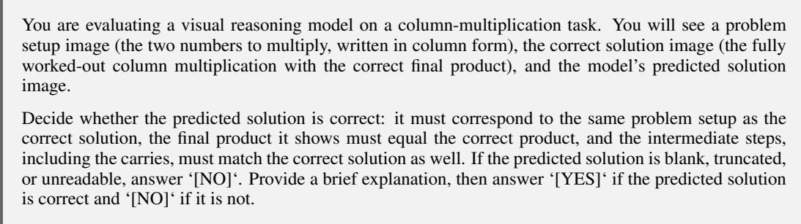  
Figure 4: Judge prompt for evaluating long multiplication.

Long text rendering. The training set contains $3 \times 1 0 ^ { 5 }$ text samples as conditions, with their 384× 384 monospaced renderings as targets. The corpus is drawn from the TinyStories dataset (Eldan & Li, 2023). During preprocessing, we truncate each text to the longest prefix that fits on the canvas. We use a global batch size of 16 and a learning rate of $1 0 ^ { - 4 }$ , training VANILLAFM for 12 epochs and SELFCONDFM for four epochs.

We evaluate 100 held-out instances using 50 NFE, parsing the text from the reference and generated images with Qwen3.8-Flash (Qwen Team, 2026), prompted to preserve all line breaks and whitespace. The rate of perfect rendering is the fraction of instances whose two parsed texts match exactly.

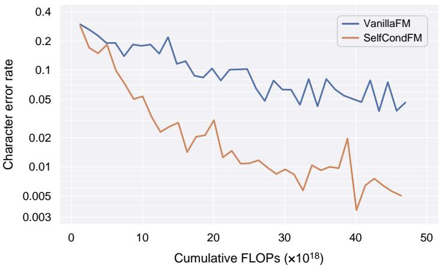  
Figure 5: Character error rate (CER) of parsed text from the long text rendering evaluation, against cumulative training FLOPs. SELFCONDFM keeps improving throughout training, whereas VANILLAFM plateaus nearly an order of magnitude above the final SELFCONDFM value.

Beyond exact matching, we also compute the character error rate (CER) between the two parsed texts (Figure 5), defined as $\mathrm { C E R } = d _ { \mathrm { L e v } } ( \boldsymbol { r } , \boldsymbol { \hat { r } } ) / | \boldsymbol { r } |$ , where r and rˆ are the parsed text of the reference and generated images, respectively. The Levenshtein distance $d _ { \mathrm { L e v } } ( r , \hat { r } )$ is the minimum number of character edits required to transform r into rˆ, where each edit inserts, deletes, or substitutes one character and has unit cost. SELFCONDFM ends at CER 0.005, while VANILLAFM plateaus between 0.03 and 0.1 and stands at 0.046 at the matched budget of $4 . 7 0 \times 1 0 ^ { 1 9 }$ FLOPs.

## D.2.1 MULTI-SEED EVALUATION

We further train VANILLAFM and SELFCONDFM with 3 different seeds (i.e., 2 seeds in addition to the one used in Figure 1) on line tracing and long multiplication. We evaluate line tracing on the same held-out set of 20 instances as the single-seed evaluation at 100 NFE, and long multiplication on the same held-out set of 100 instances as its single-seed evaluation at 50 NFE. Due to limited computational resources, we train long multiplication with a smaller compute budget and do not run multi-seed experiments for long text rendering.

Figures 6 and 7 show the mean evaluation curve of each method against training FLOPs, with a band of one standard deviation around the mean. For line tracing, at the checkpoints with matched training FLOPs (SELFCONDFM@53k vs. VANILLAFM@60k), SELFCONDFM saturates at a mean LCP of $5 0 . 0 { \pm } 0 . 0 $ , while VANILLAFM reaches only $5 . 6 \pm 2 . 7$ . For long multiplication, at its smaller matched budget (SELFCONDFM@50k vs. VANILLAFM@125k), SELFCONDFM attains $( 9 0 . 0 \pm$ $5 . 3 ) \%$ accuracy while VANILLAFM reaches $( 3 5 . 0 \pm 8 . 9 ) \%$ . These multi-seed results thus confirm that SELFCONDFM outperforms VANILLAFM on line tracing and long multiplication, consistent with the single-seed evaluations in Figure 1.

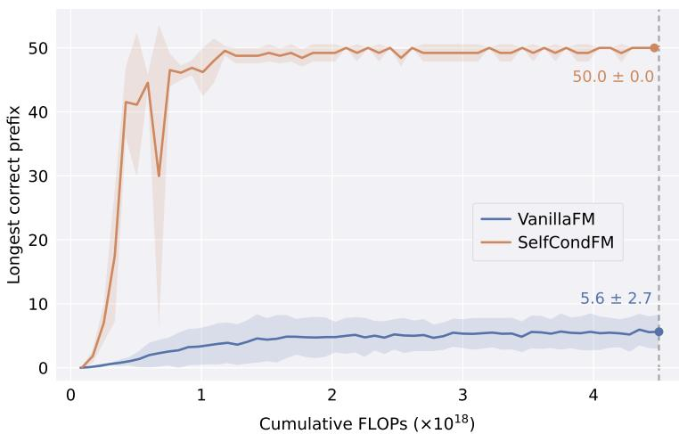  
Figure 6: Training curves of line tracing with 3 different seeds, plotting mean LCP on the held-out set of 20 instances at 100 NFE against training FLOPs. For each method, the curve shows the mean over the 3 runs, and the shaded band shows the mean ± one standard deviation. SELFCONDFM saturates at $5 0 . 0 \pm 0 . 0 $ while VANILLAFM reaches $5 . 6 \pm 2 . 7$ at the matched budget.

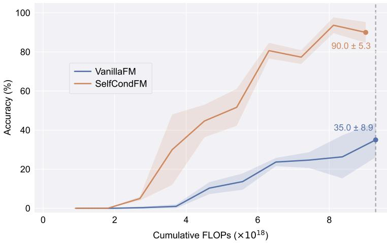  
Figure 7: Training curves of long multiplication with 3 different seeds, plotting the mean accuracy on the held-out set under 50 NFE against training FLOPs. As in Figure 6, each curve and its shaded band show the mean and the mean ± one standard deviation over the 3 runs. VANILLAFM reaches $( 3 5 . 0 \pm 8 . 9 ) \%$ while SELFCONDFM is higher at $( 9 0 . 0 \pm 5 . 3 ) \%$ under the fixed budget.

## D.2.2 GENERATED EXAMPLES

Figures 8 to 10 present selected held-out examples on which VANILLAFM fails while SELFCONDFM succeeds, with annotations highlighting the errors made by VANILLAFM. They are generated by the checkpoints at the final evaluation point of Figure 1, namely VANILLAFM@60k and SELFCONDFM@53k for line tracing, VANILLAFM@312.5k and SELFCONDFM@125k for long multiplication, and VANILLAFM@190k and SELFCONDFM@74k for long text rendering.

(a) Sample 00001: stages 1 to 9 Black box: first error at stage 8  
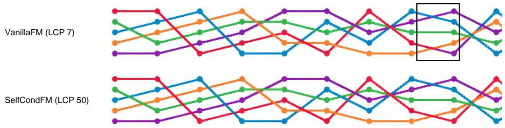

(b) Sample 00002: stages 1 to 15 Black box: first error at stage 14  
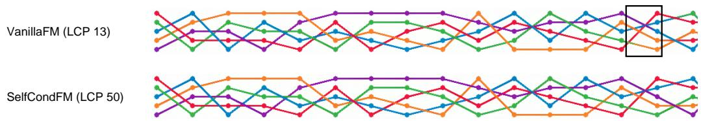  
Figure 8: Examples on line tracing. For visualization, each trajectory is truncated shortly after the first error of VANILLAFM; the full trajectory contains 50 stages. VANILLAFM first fails at stages 8 and 14 in (a) and (b), respectively, by incorrectly switching colors at line crossings. Black boxes mark the errors. In contrast, SELFCONDFM preserves each line’s color throughout all 50 stages in both examples (LCP = 50).

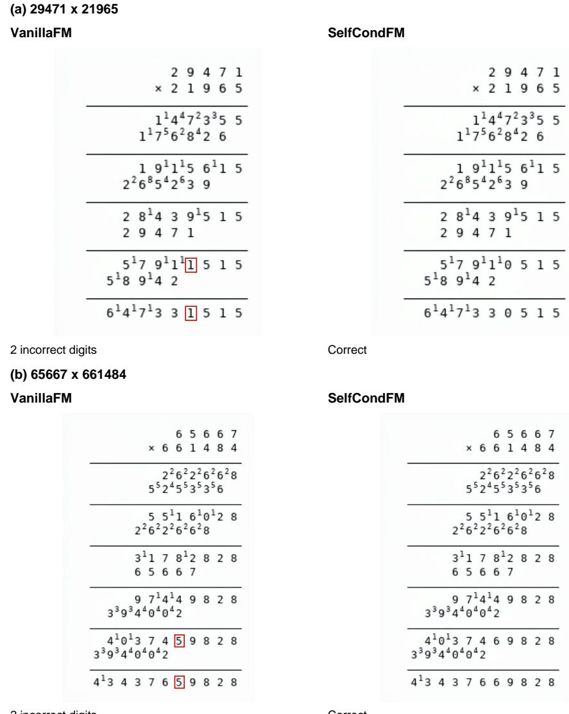  
2 incorrect digits  
Correct  
Figure 9: Examples on long multiplication. VANILLAFM makes accumulation errors in both cases, resulting in incorrect final answers, with the erroneous digits highlighted in red boxes. In contrast, SELFCONDFM produces the correct product for both examples.

## (a) Sample 00007\_000082

## VanillaFM

Once upon a time, there was a little duck named Ducky. Ducky loved to play in the pond with his friends. One day, Ducky saw a yellow butterfly and he wanted to catch it. He rushed after the butterfly, but he didn't nooicea big rock in his way. Ducky tripped and fell into the mud.

Ducky. was very sad because \_he was all dirty. He wanted to be clean again. Ducky's friends saw him and wanted to help him. They rushed to find some clean water to wash him off. They found a bucked of clean water and poured it over Ducky.

Ducky was happy to be clean again. He thanked his friends for helping him. They all played together in the pond, happy and clean. The end.

## CER = 0.0106

Red boxes: text errors

Blue dashed boxes: line-break and whitespace errors

## (b) Sample 00018\_000043

## VanillaFM

Once upon a time, there was a little girl named Lily. She went on a tour with her family to see animals like lions and monkeys. It was so much fun! But then, they had to go home. Lily started to feel sad because she would miss the animals and the crazy things they did.

When they got home, Lily looked at all the pictures she tooke on the tour. She felt happy again because she remembered al the fun she had. Her mom told her theygou coud onother tour soon. Lily was excited and couldn't waitcatseemor orer ainal sand have more fun.

Once upon a time, there was a little duck named Ducky. Ducky loved to play in the pond with his friends. One day, Ducky saw a yellow butterfly and he wanted to catch it. He rushed after the butterfly, but he didn't notice a big rock in his way. Ducky tripped and fell into the mud.

## SelfCondFM

Ducky was very sad because he was all dirty He wanted to be clean again. Ducky's friends saw him and wanted to help him. They rushed to find some clean water to wash him off. They found a bucket of clean water and poured it over Ducky.

CER = 0.0000

Ducky was happy to be clean again. He thanked his friends for helping him. They all played together in the pond, happy and clean. The end.

## SelfCondFM

## CER = 0.0410

Once upon a time, there was a little girl named Lily. She went on a tour with her family to see animals like lions and monkeys. It was so much fun! But then, they had to go home. Lily started to feel sad because she would miss the animals and the crazy things they did.

Red boxes: text errors

When they got home, Lily looked at all the pictures she took on the tour. She felt happy again because she remembered all the fun she had. Her mom told her they could go on another tour soon. Lily was excited and couldn't wait to see more animals and have more fun.

CER = 0.0000

Blue dashed boxes: line-break and whitespace errors

Figure 10: Examples on long text rendering. VANILLAFM produces text errors as well as line-break and whitespace errors, yielding CERs of 0.0106 and 0.0410 in (a) and (b), respectively. Red boxes highlight text errors, and blue dashed boxes indicate line-break and whitespace errors. In contrast, SELFCONDFM renders both passages correctly with zero CER.

## D.3 NFE SCALING

For Figure 3, we evaluate the checkpoints of Appendix D.2 for line tracing at matched training FLOPs, VANILLAFM@60k and SELFCONDFM@53k, on 200 held-out instances with $m = 5 0$ The NFE grid covers every integer from 1 to 50, and the two methods share the same initial noise for each instance at every NFE. The LCP is computed with the evaluator described in Appendix D.2.

Beyond the comparison at matched NFE in Figure 3, we also plot the mean LCP against cumulative inference FLOPs in Figure 11.

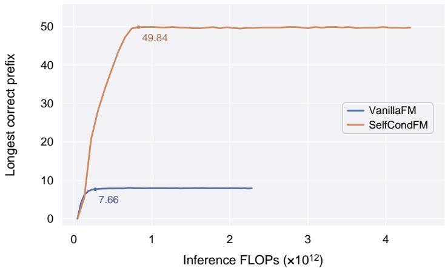  
Figure 11: Mean LCP in the NFE scaling comparison of Figure 3, plotted against cumulative inference FLOPs. Both methods have zero mean LCP at $\mathrm { \Delta N F E } = 1$ . SELFCONDFM reaches 49.84 at $8 . 2 9 \times 1 0 ^ { 1 1 }$ FLOPs. VANILLAFM reaches 7.66 at $2 . 7 4 \times 1 0 ^ { 1 1 }$ FLOPs, ending below 8.0 up to $2 . 2 8 \times 1 0 ^ { 1 2 }$ FLOPs (which corresponds to $\mathrm { N F E } = 5 0 )$ .

## D.4 SETUP AND RESULTS FOR STRUCTURED VISUAL-REASONING TASKS

Datasets and evaluators. We prepare the training data with the pipeline of Dai et al. (2026) for VSP-Super, Maze, TSP, and Sudoku, and with that of He et al. (2025) for Jigsaw. The evaluation data and protocol for all five tasks follow He et al. (2025).

Controlled experiments. In the controlled experiments of §4.3, for each of VSP-Super, Maze, TSP, Sudoku, and Jigsaw, we train separate FLUX.2-klein-base-4B LoRA adapters under the shared configuration of the tasks in §4.2, with a global batch size of 16 and a learning rate of $1 0 ^ { - 4 }$ Checkpoints are compared at matched cumulative training FLOPs, at which SELFCONDFM has been trained for 16k steps, and all results use 50 NFE.

Large-scale comparisons. Following the setup of Dai et al. (2026), we train two kinds of SELFCONDFM models. For task-specific training, we train one Qwen-Image-Edit-2511 LoRA adapter per task. For unified training, a single adapter is trained on the union of the VSP-Super, Maze, TSP, and Sudoku data. All adapters are trained for five epochs to ensure convergence.

## D.4.1 JIGSAW RESULTS

Since EndoCoT (Dai et al., 2026) does not evaluate Jigsaw, we compare our large-scale result on Jigsaw with the baselines reported by He et al. (2025). Our SELFCONDFM adapter attains the best average accuracy, 96.0% versus 92.3% for DiffThinker, with the largest gain at the hardest level; see Table 3.

Table 3: Jigsaw accuracy (%) at difficulty levels 2 to 4. “Avg.” is the unweighted mean over the three levels. The best results are in bold and the second best are underlined.
<table><tr><td>Method</td><td>2</td><td>3</td><td>4</td><td>Avg.</td></tr><tr><td>Gemini-3-Flash</td><td>71</td><td>16</td><td>0</td><td>29.0</td></tr><tr><td>GPT-5</td><td>30</td><td>0</td><td>0</td><td>10.0</td></tr><tr><td>Qwen3-VL-8B</td><td>7</td><td>0</td><td>0</td><td>2.3</td></tr><tr><td>Qwen3-VL-8B (SFT)</td><td>95</td><td>56</td><td>9</td><td>53.3</td></tr><tr><td>Qwen3-VL-8B (GRPO)</td><td>6</td><td>0</td><td>0</td><td>2.0</td></tr><tr><td>DiffThinker</td><td>99</td><td>98</td><td>80</td><td>92.3</td></tr><tr><td>Ours</td><td>98</td><td>100</td><td>90</td><td>96.0</td></tr></table>

## D.4.2 GENERATED EXAMPLES

To illustrate the qualitative differences between VANILLAFM and SELFCONDFM on the five structured visual-reasoning tasks, we select two held-out instances per task from the controlled comparison in Table 1 on which VANILLAFM fails while SELFCONDFM succeeds. The examples are shown in Figures 12 to 16, with annotations highlighting the errors made by VANILLAFM.

(a) 16 x 16 grid VanillaFM  
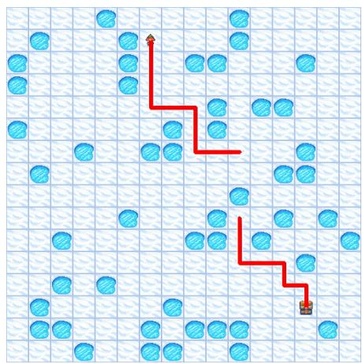  
Disconnected route

SelfCondFM  
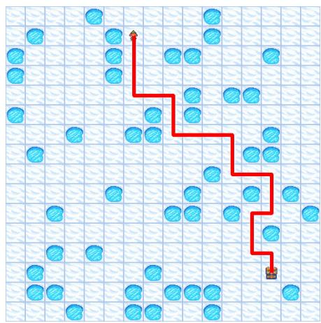  
Connected route

(b) 32 x 32 grid VanillaFM  
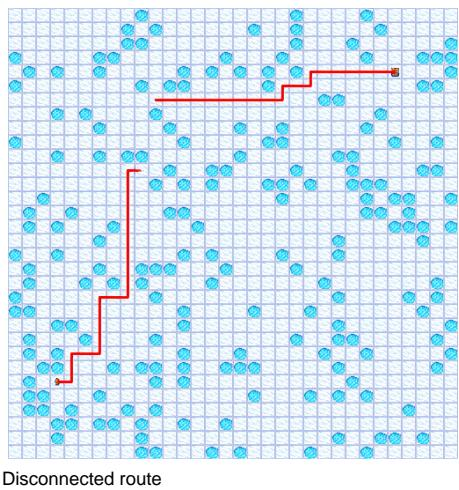  
Figure 12: VSP-Super examples on 16 × 16 and 32 × 32 grids. The VANILLAFM routes contain disconnected segments. In contrast, the SELFCONDFM routes correctly connect the endpoints.

SelfCondFM  
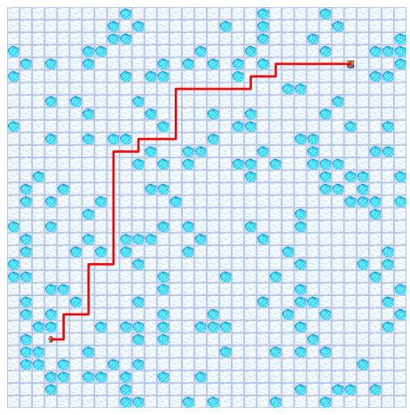  
Connected route

Disconnected route (b) 16 x 16 maze VanillaFM

(a) 8 x 8 maze

VanillaFM

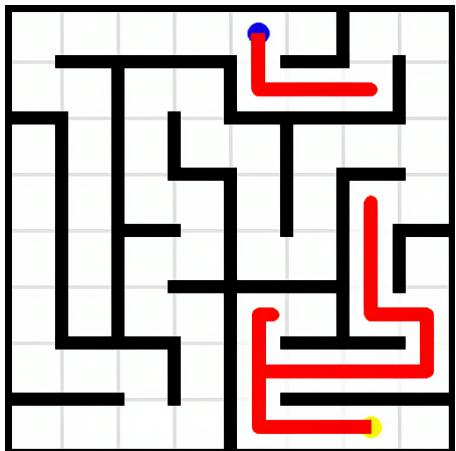  
SelfCondFM

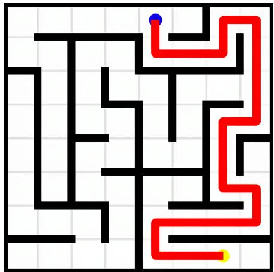  
Reaches the endpoint

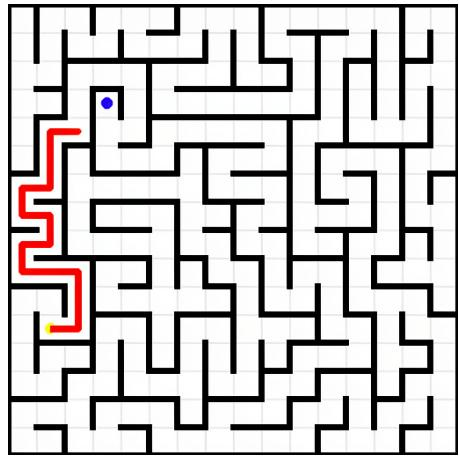  
Stops before the endpoint

SelfCondFM  
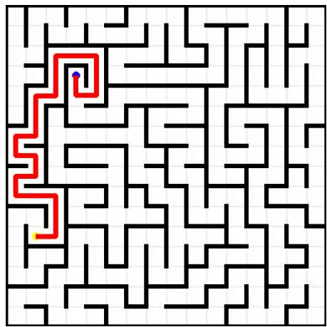  
Reaches the endpoint

Figure 13: Maze examples on 8 × 8 and $1 6 \times 1 6$ grids. In (a), VANILLAFM leaves separate path fragments; in (b), its route stops before reaching the blue endpoint. In contrast, SELFCONDFM completes both routes.

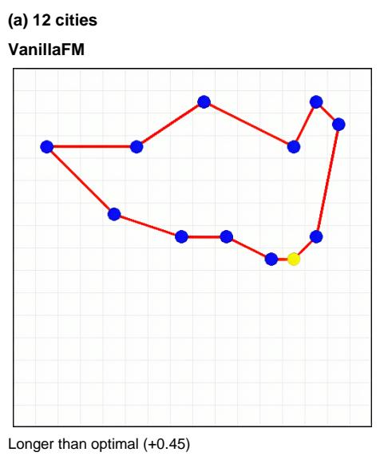

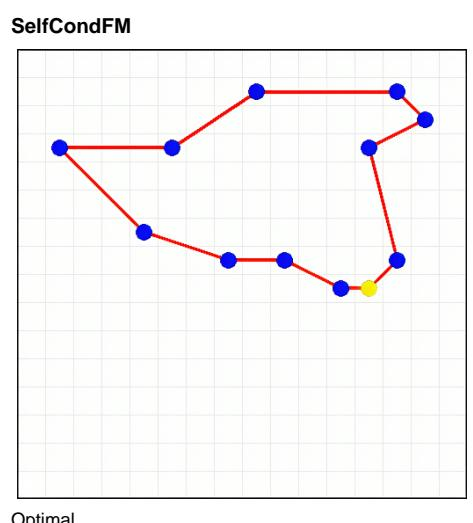

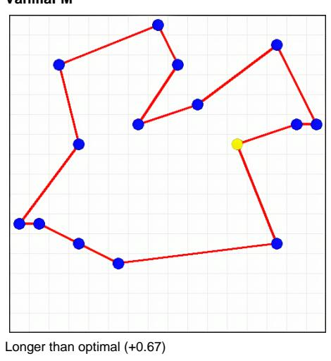

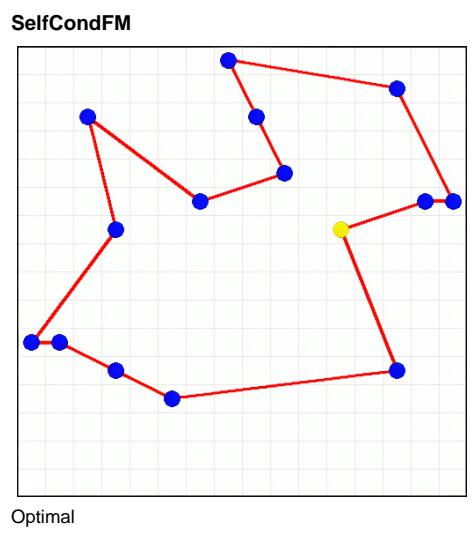  
Figure 14: TSP examples with 12 and 15 cities. VANILLAFM fails to find the optimal tour in both cases, yielding excess tour lengths of +0.45 and +0.67, respectively. In contrast, SELFCONDFM produces the optimal solution for both instances.

VanillaFM

## (a) 35 given digits

<table><tr><td rowspan=1 colspan=1>1</td><td rowspan=1 colspan=1>2</td><td rowspan=1 colspan=1>6</td><td rowspan=1 colspan=1>7</td><td rowspan=1 colspan=1>8</td><td rowspan=1 colspan=1>3</td><td rowspan=1 colspan=1>9</td><td rowspan=1 colspan=1>4</td><td rowspan=1 colspan=1>5</td></tr><tr><td rowspan=1 colspan=1>7</td><td rowspan=1 colspan=1>9</td><td rowspan=1 colspan=1>3</td><td rowspan=1 colspan=1>2</td><td rowspan=1 colspan=1>5</td><td rowspan=1 colspan=1>4</td><td rowspan=1 colspan=1>6</td><td rowspan=1 colspan=1>1</td><td rowspan=1 colspan=1>8</td></tr><tr><td rowspan=1 colspan=1>8</td><td rowspan=1 colspan=1>4</td><td rowspan=1 colspan=1>5</td><td rowspan=1 colspan=1>9</td><td rowspan=1 colspan=1>6</td><td rowspan=1 colspan=1>1</td><td rowspan=1 colspan=1>2</td><td rowspan=1 colspan=1>2</td><td rowspan=1 colspan=1>3</td></tr><tr><td rowspan=1 colspan=1>4</td><td rowspan=1 colspan=1>1</td><td rowspan=1 colspan=1>2</td><td rowspan=1 colspan=1>3</td><td rowspan=1 colspan=1>9</td><td rowspan=1 colspan=1>8</td><td rowspan=1 colspan=1>7</td><td rowspan=1 colspan=1>5</td><td rowspan=1 colspan=1>6</td></tr><tr><td rowspan=1 colspan=1>6</td><td rowspan=1 colspan=1>8</td><td rowspan=1 colspan=1>7</td><td rowspan=1 colspan=1>4</td><td rowspan=1 colspan=1>1</td><td rowspan=1 colspan=1>5</td><td rowspan=1 colspan=1>3</td><td rowspan=1 colspan=1>9</td><td rowspan=1 colspan=1>2</td></tr><tr><td rowspan=1 colspan=1>5</td><td rowspan=1 colspan=1>3</td><td rowspan=1 colspan=1>9</td><td rowspan=1 colspan=1>6</td><td rowspan=1 colspan=1>2</td><td rowspan=1 colspan=1>7</td><td rowspan=1 colspan=1>4</td><td rowspan=1 colspan=1>8</td><td rowspan=1 colspan=1>1</td></tr><tr><td rowspan=1 colspan=1>2</td><td rowspan=1 colspan=1>7</td><td rowspan=1 colspan=1>1</td><td rowspan=1 colspan=1>5</td><td rowspan=1 colspan=1>4</td><td rowspan=1 colspan=1>6</td><td rowspan=1 colspan=1>8</td><td rowspan=1 colspan=1>3</td><td rowspan=1 colspan=1>9</td></tr><tr><td rowspan=1 colspan=1>9</td><td rowspan=1 colspan=1>6</td><td rowspan=1 colspan=1>8</td><td rowspan=1 colspan=1>1</td><td rowspan=1 colspan=1>3</td><td rowspan=1 colspan=1>2</td><td rowspan=1 colspan=1>5</td><td rowspan=1 colspan=1>7</td><td rowspan=1 colspan=1>4</td></tr><tr><td rowspan=1 colspan=1>3</td><td rowspan=1 colspan=1>5</td><td rowspan=1 colspan=1>4</td><td rowspan=1 colspan=1>8</td><td rowspan=1 colspan=1>7</td><td rowspan=1 colspan=1>9</td><td rowspan=1 colspan=1>1</td><td rowspan=1 colspan=1>6</td><td rowspan=1 colspan=1>2</td></tr></table>

5 incorrect cells

SelfCondFM
<table><tr><td rowspan=1 colspan=1>1</td><td rowspan=1 colspan=1>2</td><td rowspan=1 colspan=1>6</td><td rowspan=1 colspan=1>7</td><td rowspan=1 colspan=1>8</td><td rowspan=1 colspan=1>3</td><td rowspan=1 colspan=1>9</td><td rowspan=1 colspan=1>4</td><td rowspan=1 colspan=1>5</td></tr><tr><td rowspan=1 colspan=1>7</td><td rowspan=1 colspan=1>9</td><td rowspan=1 colspan=1>3</td><td rowspan=1 colspan=1>2</td><td rowspan=1 colspan=1>5</td><td rowspan=1 colspan=1>4</td><td rowspan=1 colspan=1>6</td><td rowspan=1 colspan=1>1</td><td rowspan=1 colspan=1>8</td></tr><tr><td rowspan=1 colspan=1>8</td><td rowspan=1 colspan=1>4</td><td rowspan=1 colspan=1>5</td><td rowspan=1 colspan=1>9</td><td rowspan=1 colspan=1>6</td><td rowspan=1 colspan=1>1</td><td rowspan=1 colspan=1>7</td><td rowspan=1 colspan=1>2</td><td rowspan=1 colspan=1>3</td></tr><tr><td rowspan=1 colspan=1>4</td><td rowspan=1 colspan=1>1</td><td rowspan=1 colspan=1>7</td><td rowspan=1 colspan=1>3</td><td rowspan=1 colspan=1>9</td><td rowspan=1 colspan=1>8</td><td rowspan=1 colspan=1>2</td><td rowspan=1 colspan=1>5</td><td rowspan=1 colspan=1>6</td></tr><tr><td rowspan=1 colspan=1>6</td><td rowspan=1 colspan=1>8</td><td rowspan=1 colspan=1>2</td><td rowspan=1 colspan=1>4</td><td rowspan=1 colspan=1>1</td><td rowspan=1 colspan=1>5</td><td rowspan=1 colspan=1>3</td><td rowspan=1 colspan=1>9</td><td rowspan=1 colspan=1>7</td></tr><tr><td rowspan=1 colspan=1>5</td><td rowspan=1 colspan=1>3</td><td rowspan=1 colspan=1>9</td><td rowspan=1 colspan=1>6</td><td rowspan=1 colspan=1>2</td><td rowspan=1 colspan=1>7</td><td rowspan=1 colspan=1>4</td><td rowspan=1 colspan=1>8</td><td rowspan=1 colspan=1>1</td></tr><tr><td rowspan=1 colspan=1>2</td><td rowspan=1 colspan=1>7</td><td rowspan=1 colspan=1>1</td><td rowspan=1 colspan=1>5</td><td rowspan=1 colspan=1>4</td><td rowspan=1 colspan=1>6</td><td rowspan=1 colspan=1>8</td><td rowspan=1 colspan=1>3</td><td rowspan=1 colspan=1>9</td></tr><tr><td rowspan=1 colspan=1>9</td><td rowspan=1 colspan=1>6</td><td rowspan=1 colspan=1>8</td><td rowspan=1 colspan=1>1</td><td rowspan=1 colspan=1>3</td><td rowspan=1 colspan=1>2</td><td rowspan=1 colspan=1>5</td><td rowspan=1 colspan=1>7</td><td rowspan=1 colspan=1>4</td></tr><tr><td rowspan=1 colspan=1>3</td><td rowspan=1 colspan=1>5</td><td rowspan=1 colspan=1>4</td><td rowspan=1 colspan=1>8</td><td rowspan=1 colspan=1>7</td><td rowspan=1 colspan=1>9</td><td rowspan=1 colspan=1>1</td><td rowspan=1 colspan=1>6</td><td rowspan=1 colspan=1>2</td></tr></table>

Correct

(b) 45 given digits  
VanillaFM
<table><tr><td rowspan=1 colspan=1>1</td><td rowspan=1 colspan=1>7</td><td rowspan=1 colspan=1>3</td><td rowspan=1 colspan=1>4</td><td rowspan=1 colspan=1>6</td><td rowspan=1 colspan=1>2</td><td rowspan=1 colspan=1>5</td><td rowspan=1 colspan=1>9</td><td rowspan=1 colspan=1>8</td></tr><tr><td rowspan=1 colspan=1>6</td><td rowspan=1 colspan=1>9</td><td rowspan=1 colspan=1>2</td><td rowspan=1 colspan=1>5</td><td rowspan=1 colspan=1>7</td><td rowspan=1 colspan=1>8</td><td rowspan=1 colspan=1>4</td><td rowspan=1 colspan=1>1</td><td rowspan=1 colspan=1>3</td></tr><tr><td rowspan=1 colspan=1>5</td><td rowspan=1 colspan=1>4</td><td rowspan=1 colspan=1>8</td><td rowspan=1 colspan=1>3</td><td rowspan=1 colspan=1>1</td><td rowspan=1 colspan=1>9</td><td rowspan=1 colspan=1>6</td><td rowspan=1 colspan=1>7</td><td rowspan=1 colspan=1>2</td></tr><tr><td rowspan=1 colspan=1>7</td><td rowspan=1 colspan=1>8</td><td rowspan=1 colspan=1>1</td><td rowspan=1 colspan=1>9</td><td rowspan=1 colspan=1>2</td><td rowspan=1 colspan=1>4</td><td rowspan=1 colspan=1>3</td><td rowspan=1 colspan=1>5</td><td rowspan=1 colspan=1>6</td></tr><tr><td rowspan=1 colspan=1>9</td><td rowspan=1 colspan=1>2</td><td rowspan=1 colspan=1>4</td><td rowspan=1 colspan=1>1</td><td rowspan=1 colspan=1>3</td><td rowspan=1 colspan=1>5</td><td rowspan=1 colspan=1>1</td><td rowspan=1 colspan=1>8</td><td rowspan=1 colspan=1>7</td></tr><tr><td rowspan=1 colspan=1>3</td><td rowspan=1 colspan=1>5</td><td rowspan=1 colspan=1>1</td><td rowspan=1 colspan=1>7</td><td rowspan=1 colspan=1>8</td><td rowspan=1 colspan=1>6</td><td rowspan=1 colspan=1>2</td><td rowspan=1 colspan=1>4</td><td rowspan=1 colspan=1>9</td></tr><tr><td rowspan=1 colspan=1>4</td><td rowspan=1 colspan=1>1</td><td rowspan=1 colspan=1>7</td><td rowspan=1 colspan=1>2</td><td rowspan=1 colspan=1>9</td><td rowspan=1 colspan=1>3</td><td rowspan=1 colspan=1>8</td><td rowspan=1 colspan=1>6</td><td rowspan=1 colspan=1>5</td></tr><tr><td rowspan=1 colspan=1>8</td><td rowspan=1 colspan=1>3</td><td rowspan=1 colspan=1>9</td><td rowspan=1 colspan=1>6</td><td rowspan=1 colspan=1>5</td><td rowspan=1 colspan=1>1</td><td rowspan=1 colspan=1>7</td><td rowspan=1 colspan=1>2</td><td rowspan=1 colspan=1>4</td></tr><tr><td rowspan=1 colspan=1>2</td><td rowspan=1 colspan=1>6</td><td rowspan=1 colspan=1>5</td><td rowspan=1 colspan=1>8</td><td rowspan=1 colspan=1>4</td><td rowspan=1 colspan=1>7</td><td rowspan=1 colspan=1>9</td><td rowspan=1 colspan=1>3</td><td rowspan=1 colspan=1>1</td></tr></table>

SelfCondFM
<table><tr><td rowspan=1 colspan=1>1</td><td rowspan=1 colspan=1>7</td><td rowspan=1 colspan=1>3</td><td rowspan=1 colspan=1>4</td><td rowspan=1 colspan=1>6</td><td rowspan=1 colspan=1>2</td><td rowspan=1 colspan=1>5</td><td rowspan=1 colspan=1>9</td><td rowspan=1 colspan=1>8</td></tr><tr><td rowspan=1 colspan=1>6</td><td rowspan=1 colspan=1>9</td><td rowspan=1 colspan=1>2</td><td rowspan=1 colspan=1>5</td><td rowspan=1 colspan=1>7</td><td rowspan=1 colspan=1>8</td><td rowspan=1 colspan=1>4</td><td rowspan=1 colspan=1>1</td><td rowspan=1 colspan=1>3</td></tr><tr><td rowspan=1 colspan=1>5</td><td rowspan=1 colspan=1>4</td><td rowspan=1 colspan=1>8</td><td rowspan=1 colspan=1>3</td><td rowspan=1 colspan=1>1</td><td rowspan=1 colspan=1>9</td><td rowspan=1 colspan=1>6</td><td rowspan=1 colspan=1>7</td><td rowspan=1 colspan=1>2</td></tr><tr><td rowspan=1 colspan=1>7</td><td rowspan=1 colspan=1>8</td><td rowspan=1 colspan=1>1</td><td rowspan=1 colspan=1>9</td><td rowspan=1 colspan=1>2</td><td rowspan=1 colspan=1>4</td><td rowspan=1 colspan=1>3</td><td rowspan=1 colspan=1>5</td><td rowspan=1 colspan=1>6</td></tr><tr><td rowspan=1 colspan=1>9</td><td rowspan=1 colspan=1>2</td><td rowspan=1 colspan=1>4</td><td rowspan=1 colspan=1>6</td><td rowspan=1 colspan=1>3</td><td rowspan=1 colspan=1>5</td><td rowspan=1 colspan=1>1</td><td rowspan=1 colspan=1>8</td><td rowspan=1 colspan=1>7</td></tr><tr><td rowspan=1 colspan=1>3</td><td rowspan=1 colspan=1>5</td><td rowspan=1 colspan=1>6</td><td rowspan=1 colspan=1>7</td><td rowspan=1 colspan=1>8</td><td rowspan=1 colspan=1>1</td><td rowspan=1 colspan=1>2</td><td rowspan=1 colspan=1>4</td><td rowspan=1 colspan=1>9</td></tr><tr><td rowspan=1 colspan=1>4</td><td rowspan=1 colspan=1>1</td><td rowspan=1 colspan=1>7</td><td rowspan=1 colspan=1>2</td><td rowspan=1 colspan=1>9</td><td rowspan=1 colspan=1>3</td><td rowspan=1 colspan=1>8</td><td rowspan=1 colspan=1>6</td><td rowspan=1 colspan=1>5</td></tr><tr><td rowspan=1 colspan=1>8</td><td rowspan=1 colspan=1>3</td><td rowspan=1 colspan=1>9</td><td rowspan=1 colspan=1>1</td><td rowspan=1 colspan=1>5</td><td rowspan=1 colspan=1>6</td><td rowspan=1 colspan=1>7</td><td rowspan=1 colspan=1>2</td><td rowspan=1 colspan=1>4</td></tr><tr><td rowspan=1 colspan=1>2</td><td rowspan=1 colspan=1>6</td><td rowspan=1 colspan=1>5</td><td rowspan=1 colspan=1>8</td><td rowspan=1 colspan=1>4</td><td rowspan=1 colspan=1>7</td><td rowspan=1 colspan=1>9</td><td rowspan=1 colspan=1>3</td><td rowspan=1 colspan=1>1</td></tr></table>

5 incorrect cells  
Correct

Figure 15: Sudoku examples with 35 and 45 given digits. VANILLAFM produces incorrect solutions with explicit Sudoku constraint violations: row 3 in (a) contains two 2s, while row 5 in (b) contains two 1s. The red boxes highlight these errors. In contrast, SELFCONDFM correctly solves both puzzles.

(a) 2 x 2 puzzle  
VanillaFM  
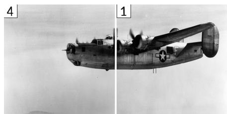

SelfCondFM  
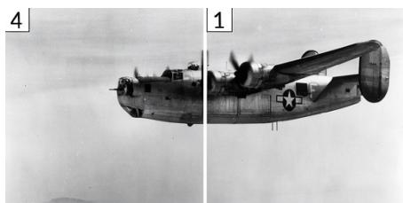

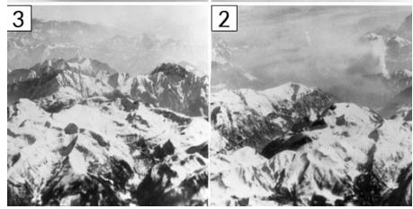  
Bottom two tiles are swapped

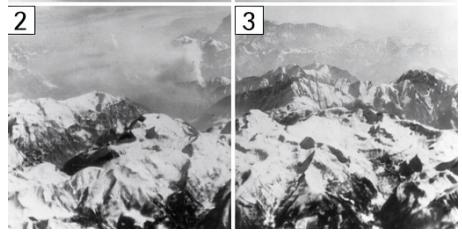  
Correct arrangement

(b) 3 x 3 puzzle VanillaFM  
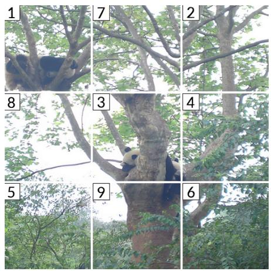

SelfCondFM  
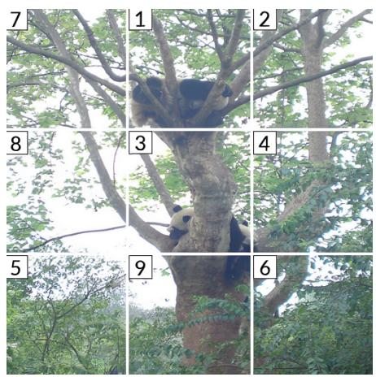  
First two top-row tiles are swapped  
Correct arrangement

Figure 16: Jigsaw examples on $2 \times 2$ and $3 \times 3$ tile grids. VANILLAFM fails in both examples: it swaps the two bottom tiles of (a), giving the order 3, 2 instead of 2, 3, and swaps the first two tiles in the top row of (b), giving 1, 7 instead of 7, 1. SELFCONDFM matches the reference permutation in both examples. Tile identifiers are part of the original images.

## D.5 ADDITIONAL EMPIRICAL ANALYSES

## D.5.1 EMPIRICAL LIPSCHITZ ESTIMATION

Theorem 1 assumes that the model u has a bounded Lipschitz constant. To empirically support this assumption, we estimate the Lipschitz constant, in the joint $\ell _ { \infty }$ norm on (x, ctx) used in $\ S 2 . 2 .$ , of a VANILLAFM model for line tracing. The checkpoint is separately trained on approximately $3 \times 1 0 ^ { 5 }$ examples of mixed lengths, using about $2 \times 1 0 ^ { \mathrm { i } 7 }$ training FLOPs.

For a state $x _ { i }$ visited at time $t _ { i \cdot }$ , we use projected gradient ascent to maximize

$$
\frac { \| u ( x _ { i } + \Delta x , t _ { i } ; \mathrm { c t x } + \Delta \mathrm { c t x } ) - u ( x _ { i } , t _ { i } ; \mathrm { c t x } ) \| _ { \infty } } { \operatorname* { m a x } \{ \| \Delta x \| _ { \infty } , \| \Delta \mathrm { c t x } \| _ { \infty } \} } .
$$

We jointly perturb the noisy state and the condition latent with radii $0 . 0 0 3 , 0 . 0 1 , 0 . 0 3 , 0 . 1 .$ , and 0.3, and cover every state of an inference trajectory with 50 steps. For each problem length $m =$ $1 , \ldots , 5 0$ , we estimate $L$ on 30 held-out trajectories and report the maximum estimate over all tested states, radii, and trajectories.

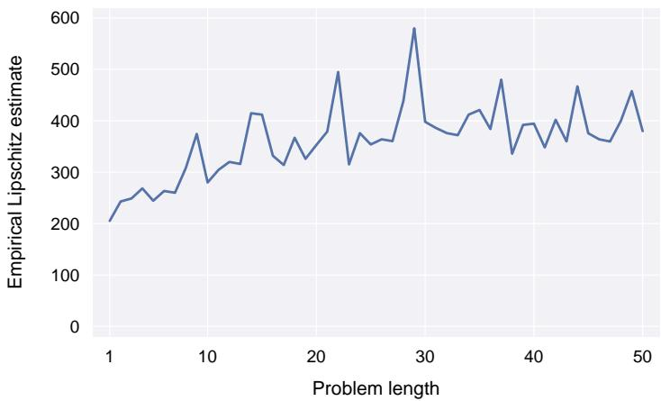  
Figure 17: Maximum joint $\ell _ { \infty }$ empirical Lipschitz estimate among 30 held-out trajectories at each problem length.

As shown in Figure 17, the maximum Lipschitz estimate at each problem length rises for small m and levels off around 400 for $m \geq 3 0$ , with an overall maximum of 580. The largest observed velocity norm is below 10. The estimates thus show no continued growth with m over the tested range.

Remark. These estimates are not certified upper bounds. Nevertheless, estimating Lipschitz constants via adversarial search is common practice (Yang et al., 2020; Achour et al., 2022), and the absence of continued growth in the estimated L with m still provides empirical support for the regime of bounded Lipschitz constants assumed in §3.1.

## D.5.2 ATTENTION ALLOCATION

We measure how the first joint-attention layer of the SELFCONDFM checkpoint for line tracing allocates attention from queries at the $x _ { i }$ token positions to the keys from three input sources at sampling step i: the noisy state $x _ { i } ,$ the conditioning image $w ,$ , and the endpoint prediction $z _ { i }$ . The experiment uses 50 test instances with $m = 5 0$ and 50 NFE. At every step after the first, we normalize the attention mass over the three sources and average it over heads and instances.

As shown in Figure 18, the attention share of the endpoint prediction stays between 20.0% and 31.3% and declines nearly monotonically along the sampling trajectory. Thus the model relies on $z _ { i }$ throughout sampling and uses it most heavily at early steps, where the noisy state is less informative.

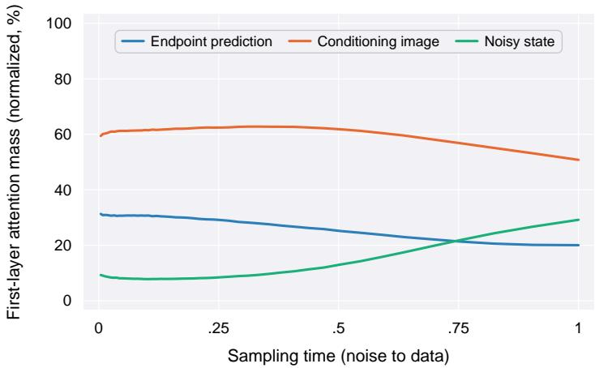  
Figure 18: Normalized attention mass of the first layer to each input source. Endpoint prediction maintains a nontrivial share throughout the trajectory, declining nearly monotonically from 31.3% to 20.0%, thus peaking at early steps, where noise dominates.

## D.5.3 PARALLEL AND REVISABLE REASONING

By inspecting the sampling trajectories of the checkpoints for long multiplication, we observe two properties of visual generative reasoning with flow matching that SELFCONDFM preserves: parallel local computation and in-place error correction, which are usually not possible in autoregressive reasoning. The following paragraphs provide empirical evidence for each.

Parallel local computation. For each generated worksheet, we score every shifted partial product $A B _ { i } 1 0 ^ { i }$ against the reference, repeating the evaluation over every integer NFE from 1 to 50. As shown in Figure 19, the accuracy of partial products for both methods stays above 98% at every NFE, even at $\mathrm { { N F E } = 1 }$ This shows that even a single model evaluation can produce multiple correct local results simultaneously within the same worksheet. By contrast, common autoregressive reasoning methods, such as CoT, generate reasoning steps sequentially and do not produce multiple local results in parallel.

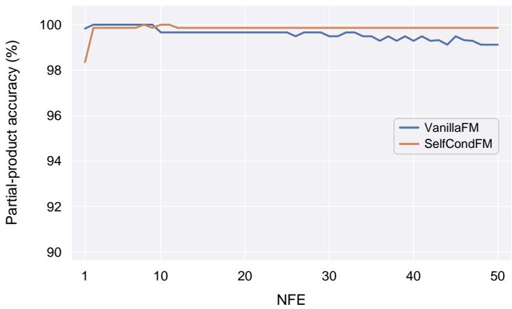  
Figure 19: Parallel local computation. Accuracy of partial products on long multiplication at every NFE from 1 to 50: both methods keep nearly all partial products correct within a single generated worksheet.

In-place error correction. For pairs of problems $( w , w ^ { \prime } )$ with different answers, we sample with 50 NFE, conditioning on $w$ for the first k steps and swapping to $w ^ { \prime }$ for the rest. We repeat this for every k from 1 to 50, and judge each output against the reference worksheet of $w ^ { \prime }$

As shown in Figure 20, SELFCONDFM keeps the accuracy of matching $w ^ { \prime }$ around 90% whenever the swap falls in the first half of the trajectory, and the accuracy falls to zero only once k exceeds 35. VANILLAFM also corrects early swaps in place, but its accuracy is only 65% at $k = 1$ and decays to zero by $k = 3 2$

Both methods therefore revise a wrong generation in place in the middle of the trajectory, with SELFCONDFM performing particularly well in the first half of the trajectory. Autoregressive reasoning, in contrast, retains the reasoning steps once they are generated and cannot correct them in place.

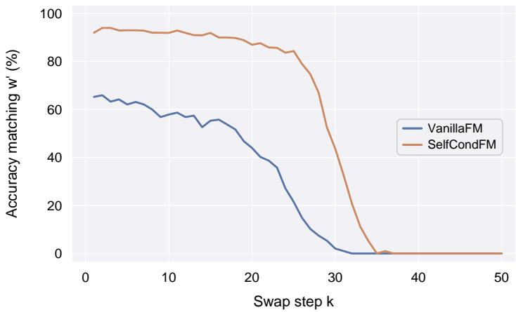  
Figure 20: In-place error correction on long multiplication. The condition changes from w to $w ^ { \prime }$ after step $k ,$ and the curves show the accuracy of matching $w ^ { \prime }$ as k varies: the output of SELFCONDFM is redirected in place to the new problem when the swap falls in the first half of the trajectory, whereas VANILLAFM follows the new problem only partially.