# SPECTRA-VLA: Base-Fine Hyperspectral Token Transfer at Frozen Vision-Language-Action Interfaces

Chih-Chung Hsu

Abstract—Hyperspectral imaging distinguishes RGB-similar objects, but a pretrained vision-language-action model needs a state its frozen decoder can use. SPECTRA-VLA provides a native-width spectral upgrade without retraining the visual encoder or action decoder. A learned continuous residual enriches each target token through its own normalized false-color reference; projection, norm control and validation-calibrated injection regulate the change. Across 86 held-out acquisitions, category balanced accuracy rises from 0.812 to 0.883. With identical residuals and scale, own-token addition improves reuse of an external category-derived probe on frozen decoder logits: 0.701 versus 0.590 with pooled replacement, at similar image-disjoint recognition. Five grouped tests covering the same 86 acquisitions recover within-category spectral shape with R2 = 0.802/0.337 from continuous and posterior-code states. Category-matched spectral swaps further show that own-token composition approximately doubles the target-specific recovery increment after frozen decoding. Spectral enrichment and receiving-token preservation thus work together at the pretrained interface

Index Terms—Hyperspectral imaging, vision-language-action models, multimodal transfer, waste-object recognition, frozen foundation models.

## 1 INTRODUCTION

trained visual-language representations to robot action tokens [1], [2], [3], [4]. Their RGB-optimized interfaces can miss distinctions needed for waste-object recognition: crosscategory SpectralWaste objects have similar paired true-RGB VLA tokens but different spectra. Hyperspectral imaging (HSI) supplies additional measurements, but replacing the visual representation can discard the token structure that the pretrained decoder expects. We address this upgrade at the existing encoder–decoder connection, retaining both pretrained components.

The central question is how to add spectral discrimination while preserving token-specific content of the normalized reference grid. SPECTRA-VLA couples continuous spectral enrichment with receiving-token preservation: a learned residual enters through each target token’s own reference, at the native token width and a validationcalibrated scale. Category probabilities compress withincategory spectral variation; pooled replacement omits each receiving token’s own reference from the inserted branch. Matched content, composition and movement comparisons establish the distinct benefits of retaining both the spectrum and the receiving grid.

Our contributions are:

Receiving-token-preserving spectral transfer. A continuous spectral residual enters through each token’s own reference, retaining the pretrained encoder, action decoder and native token width. Across 86 held-out acquisitions, category bAcc improves from 0.812 to 0.883, with paired session gain

0.071 [0.050, 0.107]. A second backbone reproduces fixed-split enrichment (0.812 to 0.914).

Continuous enrichment beyond category compression. Across five session-grouped tests, continuous and posterior-code states recover within-category spectral shape with $R ^ { 2 } \ = \ 0 . 8 0 2 / 0 . 3 3 7$ under the same composition and allowance. Learning the residual also improves category bAcc over a label-free map (0.865/0.773) while reducing mean decoder KL (0.048/0.062) in the matched 16-session comparison.

Spectral-content–composition interaction. Across 86 acquisitions, own-token addition approximately doubles target-specific recovery increments after frozen decoding (interaction 0.0171 [0.0121, 0.0228]; Table 3d). Complementary image-disjoint tests show 0.111 better reference-fixed reuse than pooled replacement at similar recognition. At a common allowance, base-fine matches the unprojected ablation’s rounded recognition with smaller disturbance tails.

Category supervision learns discriminative continuous content [5]; own-token composition preserves the receiving grid; projection defines a base-complement direction; norm and validation calibration control the executed disturbance (Fig. 1). Category recognition and spectral recovery measure enrichment. External four-state decoder-logit probes distinguish reuse of a reference-trained decision function from accessibility after refitting.

## 2 RELATED WORK

## 2.1 VLA Models and Beyond-RGB Sensing

OpenVLA is an open 7B-parameter action-token model trained on 970k Open X-Embodiment episodes; SpatialVLA adds spatial representations learned from 1.1 million episodes [3], [4]. PointVLA injects point clouds into actionexpert blocks, and PointACT trains an action expert over hierarchical point-cloud features [6], [7]. HARP-VLA preserves discrimination while aligning human and robot videos [8]. These methods use video or robot-action supervision.

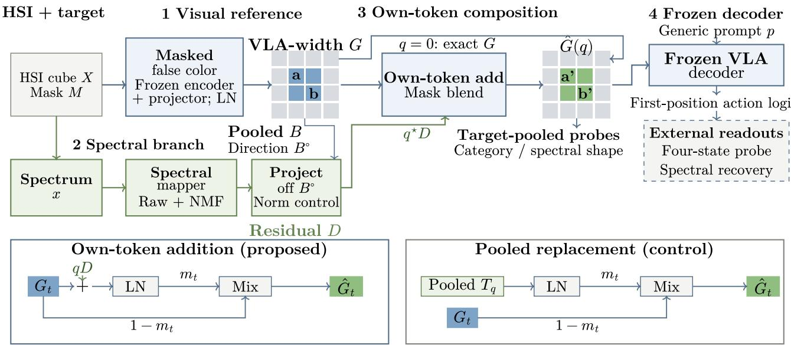  
Fig. 1. SPECTRA-VLA adds spectral residuals after the frozen visual backbone and pretrained projector. LN defines native-width reference G. Lower panels share $D , q , m _ { t }$ and skip $( 1 - m _ { t } ) G _ { t } . { \mathsf { F o r } } q > 0 ,$ pooled $T _ { q } = \mathrm { L N } _ { \epsilon } ( B ^ { \circ } + \dot { q } D )$ ; only addition retains $G _ { t }$ inside the normalized branch. Pooled-token probes measure category and spectral shape. The frozen decoder consumes the full grid and generic prompt p; external first-position readouts measure four-state information and spectral recovery. Category labels train the mapper; validation selects q. Projection and norm contro constrain the residual. Non-target tokens are unchanged; q = 0 exactly returns $G = \mathrm { L N } ( Z _ { \mathrm { b a s e } } )$ . Blue/green identifies reference/spectral paths.

OmniVLA and MuseVLA provide the closest beyond-RGB action comparison [9], [10]. Both convert thermal, acoustic, or radar measurements into spatially grounded sensor images and train downstream VLA components with demonstrations. OmniVLA freezes its vision encoder; MuseVLA additionally selects sensors as task-conditioned tools. Tactile VLAs condition visual features, modulate tactile tokens, distill tactile-aware behavior, or overlay tactile fields for action generation [11], [12], [13], [14]. SPECTRA-VLA holds both encoder and action decoder fixed. This unchanged downstream consumer motivates our separate measurements of recognition, decoder disturbance, and retention of an established readout.

## 2.2 Spectral Representations and RGB Transfer

SpectralGPT, HyperSIGMA, DOFA, HyperSL, MaskedSST, and HyperFree learn spectral-image representations across remote-sensing domains [15], [16], [17], [18], [19], [20]; HyperVision covers heterogeneous ground-based sensors [21]. HSI-Adapter mixes original and injected ViT tokens through spectral–spatial interaction and trains a segmentation decoder [22]. HyA-T freezes SeqTrack’s original encoder and autoregressive decoder, learning internal attention and feedforward adapters with tracking supervision [23]. SPECTRA-VLA inserts at the existing visual-token connection: category supervision learns continuous spectral content, while composition preserves each receiving token’s reference. Uni-Diff anchors diffusion-based HSI/SAR classification with pseudo-RGB [24].

Low-rank updates, bottleneck adapters, and visual prompts provide compact pretrained-model adaptation [25], [26], [27]. BLIP-2 places a learned querying transformer between frozen image and language models [28]; cross-modal backward-compatible training aligns new and old visionlanguage embeddings for retrieval [29]. Orthogonal Residual Update projects updates off an internal residual stream during training [30]. ORCA uses a pretrained fundus-image anchor, orthogonal cross-modal residuals and norm control for choroidal-thickness regression [31]. Feature-wise concatenation expands feature width. TokenFusion replaces low-importance tokens while retaining position through residual positional alignment [32]; our branch retains token content $\bar { G } _ { t } ,$ not only position. BCAF learns an RGB–HSI segmentation endpoint on SpectralWaste [33].

SPECTRA-VLA learns a category-supervised continuous spectral residual at the native-width post-projector interface. Equation (8) combines it with each receiving token’s own content before normalization; the unchanged decoder consumes the full grid. Category-code and residualplacement controls test content and composition (Tables 2, 3); category-matched swaps test their interaction, and common-constraint calibration measures recognition and disturbance (Table 4).

## 3 PROBLEM SETTING AND EVIDENCE SCOPE

An observation consists of HSI cube $X _ { i } ,$ supplied target mask $M _ { i } ,$ and a generic prompt without a category name. The target spectrum is $\bar { x _ { i } } = \bar { \mathrm { p o o l } } ( X _ { i } , M _ { i } )$ . A frozen VLA exposes visual states $E ( I _ { i } )$ and a decoder $A ( Z _ { i } , p _ { i } )$ . Our bridge composes an HSI-conditioned state at the original visual-token width and feeds it to A without changing VLA parameters.

The reference is a fixed HSI-derived SWIR false-color view, not paired true RGB. Paired RGB is used separately to identify a stress set whose cross-category objects have similar RGB-VLA tokens. SpectralWaste’s six labels (film, basket, cardboard, video tape, filament, and bag) are operational object categories rather than verified physicalcomposition identities [5]. A four-state target is fixed by mapping cardboard to 0; film, filament, and bag to 1; basket to 2; and video tape to 3. This category-derived proxy state is a controlled coarsening of category information, not an independently labeled robot action.

Pooled-token category and pooled-token proxy readouts classify pooled states. The decoder-logit probe (“decoder probe” in tables) is an external four-state ridge classifier on firstposition (FP) frozen action-symbol logits. A refitted decoderlogit probe learns separately for each representation, measuring accessible information; a reference-fixed decoder-logit probe retains the reference-trained standardizer and classifier, measuring decision-function reuse. Four-state content interventions instead retain the correct-spectrum-trained probe. In decoder tables, “refit” means refitted logit bAcc; “basefixed FP,” “Fixed bAcc” and “Ref.-fixed” mean referencefixed logit bAcc. “C-proxy” identifies the category-derived target, with the table heading specifying pooled tokens or decoder logits. Native width, non-target preservation and zero-injection identity follow by construction; recognition, spectral recovery and decoder behavior are measured.

## 4 BASE-FINE HYPERSPECTRAL TRANSFER

SPECTRA-VLA trains a spectral branch and auxiliary heads while both VLA components remain frozen.1 The pooled reference controls residual direction and norm; the mask locates insertion through each receiving token’s own content. Validation selects injection scale, and the training heads are discarded.

## 4.1 False-Color Reference and Target Support

The sensor spans 900–1700 nm. Fixed bands [119, 60, 0] with masked exterior pixels pass through the frozen visual backbone and its pretrained visual-to-language projector $E ,$ yielding post-projector embeddings $Z _ { i } ^ { \mathrm { b a s e } } \in \mathbb { R } ^ { 2 5 6 \times 4 0 9 6 }$ . The bridge acts here, before the frozen decoder. Area-pooling $M _ { i }$ onto the $1 6 \times 1 6$ grid gives occupancy $\widetilde { m } _ { i t }$ . We use

$$
m _ { i t } = \frac { \widetilde { m } _ { i t } } { \operatorname* { m a x } _ { t } \widetilde { m } _ { i t } + \delta } , \qquad \delta = 1 0 ^ { - 6 } ,\tag{1}
$$

which preserves relative occupancy and gives nonempty small objects approximately unit peak weight. Non-affine LayerNorm defines the reference grid and pooled state:

$$
G _ { i t } = \mathrm { L N } _ { \epsilon } ( Z _ { i t } ^ { \mathrm { b a s e } } ) , \qquad \epsilon = 1 0 ^ { - 5 } ,\tag{2}
$$

$$
B _ { i } = \mathrm { L N } _ { \epsilon } \Bigg ( \frac { \sum _ { t } m _ { i t } G _ { i t } } { \sum _ { t } m _ { i t } + 1 0 ^ { - 6 } } \Bigg ) .\tag{3}
$$

The operational reference G provides a common token scale for base-relative geometry and executed-movement calibration. Normalization deliberately changes the interface while model parameters remain frozen: the cached-runtime rawto-G diagnostic gives mean action KL 2.610 and top-1 agreement 0.163 (Supplement S7.2). Preservation comparisons begin at G, which zero injection exactly restores. Projection and scaling use $B _ { i } ^ { \circ } = \mathrm { L N } _ { \epsilon } ^ { \circ } ( B _ { i } )$ .

## 4.2 Spectral Fine Residual

The fine branch pairs the target’s 120 raw bands with 16 NMF coordinates. The mapper learns categorydiscriminative information; projection and rescaling define its base-relative insertion. Standardization, percentile scaling and NMF are fitted only on the relevant training partition:

$$
s _ { i } = [ \mathrm { S t d } ( x _ { i } ) ; \mathrm { S t d } ( a _ { i } ) ] .\tag{4}
$$

A bottleneck with hidden width r produces

$$
u _ { i } = W _ { \mathrm { u p } } \mathrm { G E L U } ( W _ { \mathrm { d o w n } } \mathrm { L N } _ { \mathrm { a f f } } ( s _ { i } ) ) .\tag{5}
$$

Its output becomes base-dependent through

$$
\widetilde { D } _ { i } = u _ { i } - \frac { \left. u _ { i } , B _ { i } ^ { \circ } \right. } { \| B _ { i } ^ { \circ } \| _ { 2 } ^ { 2 } + \delta } B _ { i } ^ { \circ } ,\tag{6}
$$

$$
D _ { i } = \rho \| B _ { i } ^ { \circ } \| _ { 2 } \frac { \widetilde { D } _ { i } } { \| \widetilde { D } _ { i } \| _ { 2 } + \delta } , \qquad \rho = 0 . 1 .\tag{7}
$$

Projection defines an approximately base-orthogonal spectral direction for the geometric analysis and matched interventions. Equation (7) rescales nondegenerate residuals toward $\rho \| B _ { i } ^ { \circ } \| _ { 2 } ^ { \bar { } }$ . For finite positive $\delta , \| \bar { q } D _ { i } \| _ { 2 } \leq q \rho \| B _ { i } ^ { \circ } \| _ { 2 }$ in real arithmetic. At the largest searched scale $q = 4 ,$ , the pre-composition residual budget is 0.4 of the base norm. Recognition and decoder divergence are measured separately from this geometric constraint.

Training operates on the pooled-vector state $\begin{array} { r l } { T _ { q } } & { { } = } \end{array}$ $\mathrm { L N } _ { \epsilon } ( B _ { i } ^ { \circ } + \mathsf { q } D _ { i } )$ for $q > 0$ , with $\mathbf { \bar { \Phi } } _ { T _ { 0 } } = B _ { i } ^ { \circ }$ . Each item draws $q _ { i } ~ \sim ~ \mathcal { U } ( 0 , 4 )$ . Here $T _ { q }$ is the pooled training surrogate; evaluation instead uses the composed grid and its pool $C _ { q }$ defined below. Category supervision minimizes

$$
\begin{array} { r l } & { \mathscr { L } = \mathrm { C E } _ { w } ( h _ { c } ( T _ { q _ { i } } ) , y _ { i } ) + \lambda _ { f } \mathrm { C E } _ { w } ( h _ { f } ( D _ { i } ) , y _ { i } ) } \\ & { \qquad + 0 . 1 \mathrm { C E } _ { w } ( h _ { c } ( T _ { 0 } ) , y _ { i } ) + 1 0 ^ { - 4 } \mathrm { m e a n } ( D _ { i } ^ { 2 } ) . } \end{array}
$$

The fine-loss weight λ is 1 in fixed-split mechanism studies and inner-selected in principal session holdout. The shared head $h _ { c }$ learns to classify both the reference and states at sampled injection scales; the separate head $h _ { f }$ supervises the residual itself. The reference term supplies no adapter gradient because $T _ { 0 }$ bypasses the residual. For training class counts $n _ { c } ~ > ~ 0$ over C classes, $\begin{array} { r } { w _ { c } \ = \ C / ( n _ { c } \sum _ { k = 1 } ^ { C } n _ { k } ^ { - 1 } ) } \end{array}$ and $\mathrm { C E } _ { w } = - w _ { y }$ log $p _ { y }$ . Each classification term averages over minibatch B as $\begin{array} { r } { \sum _ { i \in \mathcal { B } } \omega _ { i } \mathrm { C E } _ { w , i } / \sum _ { i \in \mathcal { B } } \omega _ { i } , } \end{array}$ , with $\omega _ { i } = 4$ on training stress-pair endpoints and 1 otherwise. Matched controls share this reduction except the no-pair-weighting ablation. The denominator excludes class weights; the residual penalty is an unweighted mean. Equation $( 7 ) ,$ rather than the nearly constant penalty on rescaled nondegenerate residuals, controls the norm. Training heads are discarded; only category labels supervise the adapter.

## 4.3 Composition, Endpoint, and Geometry

The controlled residual is broadcast into target tokens:

$$
\widehat { G } _ { i t } ( q ) = \left\{ \begin{array} { l l } { G _ { i t } , } & { q = 0 , } \\ { ( 1 - m _ { i t } ) G _ { i t } + m _ { i t } \mathrm { L N } _ { \epsilon } ( G _ { i t } + q D _ { i } ) , } & { q > 0 . } \end{array} \right.\tag{8}
$$

Zero-weight tokens remain unchanged; the zero-scale branch returns $G$ without residual computation or normalization. Evaluation pools the composed grid into $C _ { q } \ =$ $\operatorname { L N } _ { \epsilon } ( \operatorname { p o o l } _ { m } \widehat { G } _ { i } ( q ) ) .$ ; the decoder receives the complete grid. Per-token normalization and fractional-mask mixing distinguish $C _ { q }$ from training state $T _ { q } .$

Executed insertion. For mean-centered $G _ { t }$ and $D _ { c } \ =$ $D - \bar { D } \mathbf { 1 }$ in real arithmetic, Eq. (8) gives $\widehat { G } _ { t } = a _ { t } G _ { t } + b _ { t } D _ { c }$ for $q \ > \ 0 ,$ , with $a _ { t } \ = \ 1 - \ m _ { t } \ + \ m _ { t } c _ { t } , \ b _ { t } \ = \ m _ { t } c _ { t } q ,$ and $c _ { t } \ = \ ( d ^ { - 1 } \| G _ { t } \ + \ q D _ { c } \| _ { 2 } ^ { 2 } \ + \ \epsilon ) ^ { - 1 / 2 }$ Occupancy and token-dependent normalization therefore determine how the shared payload enters each position. Addition uses the token’s own reference in both the injected and skip branches; pooled replacement uses it only in the fractional skip. Table 3 isolates this choice with identical residuals; Supplement S7.1 gives its angular analysis.

For the idealized pre-normalization state $Y _ { q } = B ^ { \circ } + q D _ { . }$ setting $\delta = 0$ and assuming a nondegenerate residual gives

$$
\cos ( B ^ { \circ } , Y _ { q } ) = ( 1 + \rho ^ { 2 } q ^ { 2 } ) ^ { - 1 / 2 } ,
$$

$$
\boldsymbol { w } ^ { \intercal } \boldsymbol { Y _ { q } } = \boldsymbol { w } ^ { \intercal } \boldsymbol { B } ^ { \circ } + q \boldsymbol { w } ^ { \intercal } \boldsymbol { D } .\tag{9}
$$

(10)

These identities describe pre-normalization angular control and directional margin changes; stabilizers, token normalization and fractional masks determine executed movement. Equal-mean calibration sets each base-fine seed to a preset validation mean-displacement target; final cosine and decoder KL are measured. At epoch 60, fixed-test, threeseed $T _ { q } / C _ { q }$ mean cosine is 0.9977, relative distance 0.0569, and residual coordinate-mean energy 0.0098%. Validationselected checkpoints give 2.82% disagreement between auxiliary-head $T _ { q } / C _ { q }$ predictions. The supplement expands occupancy-stratified margins and composition interventions.

Selecting the executed state. Define displacement $d _ { i } ( q ) = \lVert \stackrel { \sim } { C _ { i } } ( q ) - B _ { i } \rVert _ { 2 } / ( \lVert B _ { i } \rVert _ { 2 } + 1 0 ^ { - 1 2 } )$ and its validation mean $\bar { d } _ { \mathrm { v a l } } ( q )$ . At a fixed trained checkpoint, a common allowance b selects

$$
q _ { b } ^ { \star } \in \arg \operatorname* { m a x } _ { q \in \mathcal { Q } } U _ { \mathrm { v a l } } ( q ) \quad \mathrm { s u b j e c t } \mathrm { t o } \quad \bar { d } _ { \mathrm { v a l } } ( q ) \leq b ,
$$

where $U = { \mathrm { b A c c } } + 0 . 2 5 \operatorname* { P a i r }$ . Unrestricted selection omits the constraint. Equal-mean calibration instead calibrates each base-fine seed to a preset validation displacement; information matching targets a preset validation spectral $R ^ { 2 }$ These criteria select executed states, separately from training loss and the pre-normalization budget $q \rho .$ Section 5.2 and Supplement S4 give each study’s grids and ties; the principal 86-session selection remains distinct.

## 5 EXPERIMENTAL PROTOCOL

AI assistance. OpenAI Codex and ChatGPT [34], [35] assisted with experimental implementation and analysis, as disclosed in the Acknowledgment.

## 5.1 Data and Split Boundaries

The released SpectralWaste corpus has 514/167/171 training/validation/test source images [5]. Four-connected target components of at least 100 resized pixels yield 2,295 objects, split 1,392/442/461. Cubes are linearly resampled from 224 to 120 bands and resized to $2 2 4 ^ { 2 } ;$ raw objectmean spectra are retained without per-image radiometric normalization or object-wise unit scaling. The fixed sensor rendering uses [119, 60, 0] with the released 16-bit scale, and image pixels outside the target are zeroed.

The fixed split is image-disjoint but not session-disjoint. The principal evaluation holds out each of 86 acquisition sessions containing 2,291 objects; four objects from two validation-only sessions are excluded. Every fitted spectral transform, NMF, candidate setting, pair threshold and readout is estimated inside outer training. Deterministic frozen visual tokens are precomputed without fitted spectral statistics. Selection uses 12 inner-training epochs and refitting uses 60 epochs. Separate fixed-coordinate diagnostics use a shorter 5/15 schedule and are reported as distinct estimands.

## 5.2 Comparison Controls and Readouts

Controls distinguish spectral input, replacement, expanded width and residual constraints. The spectrum-only retargeter uses the bottleneck in Eq. (5), category loss and coordinate-mean alignment to $B ^ { \widetilde { \circ } }$ . The high-anchor direct control additionally receives the base and retains an identity skip; validation requires cosine at least 0.94 before utility selection. Supplement S1 and S3 give both objectives, capacities and grids. The fixed-map replacement maps 120 bands and 16 NMF coordinates to 4096 dimensions by a label-free isometry followed by row LayerNorm (Supplement S3.2). A replacement vector $v _ { i }$ enters the full grid through

$$
R _ { i t } ( v _ { i } ) = ( 1 - m _ { i t } ) G _ { i t } + m _ { i t } \mathrm { L N } _ { \epsilon } ( v _ { i } ) ,\tag{11}
$$

whereas additive controls use Eq. (8) with their residual in place of $D _ { i }$ . The pooled-replacement control in Table 3 inserts the pooled base-plus-residual state $v _ { i } = T _ { q } ,$ , using the same spectral residual and injection scale as own-token addition; its no-fine control inserts $v _ { i } = B _ { i } ^ { \circ }$ . All preserve non-target tokens. Replacement removes the own-token reference from its injected branch but retains the fractional skip; addition uses it in both branches. For equal weights m and a shared replacement vector, $R _ { t } ( v ) \ \bar { { \ - } } \ R _ { u } ( v ) \ =$ $( 1 - m ) ( G _ { t } - G _ { u } )$ : differences shrink, collapsing only at $m \ = \ 1$ . Fine-only normalizes the proposed residual for replacement. Supplement S1 and S3 define the complete controls.

In the fixed-split comparison, base-fine and the base-conditioned direct mapper use hidden widths 64/32 and 271,184/275,024 mapper parameters; auxiliary heads explain their total-parameter difference. Fixedsplit/mechanism controls share 60 epochs, AdamW, three seeds, preprocessing and category supervision; principal session holdout uses fold-specific seeds. Category and pooled-token proxy readouts use 256-D signed pooling, train-only standardization and class-balanced ridge. Validation category bAcc selects regularization; pair resolution requires both endpoints correct. Representation selection uses $U = \mathrm { b A c c } + 0 . 2 5$ Pair before fitting proxy readouts. Supplement S1 specifies pooling, grids and deterministic ties.

Mechanism studies train with independent $q _ { i } \sim \mathcal { U } ( 0 , 4 ) ;$ minimum class-weighted validation CE of $h _ { c } ( T _ { 1 } )$ selects a checkpoint within 60 epochs, excluding auxiliary and stresspair terms. Unrestricted and allowance-constrained scales maximize validation utility; matched-movement and recovery studies target validation displacement or spectral recovery (Section 4.3). Refitted decoder-logit probes learn from each representation’s logits; reference-fixed probes retain the reference-trained standardizer and classifier. Decoding receives the full grid; token readouts pool $C _ { q }$ . Fixed-epoch sensitivity uses epoch 60, rank 64 and $q = ( 2 , 4 , 4 )$ for seeds (0, 1, 2). Supplement S1/S4 gives regularization and fold choices. Test P95 values average per-seed computations.

## 5.3 Frozen Decoder and Uncertainty

OpenVLA receives the full 256-token grid and a generic sorting prompt [3]. Its 32,064-coordinate runtime output supplies 256 first-position action symbols (IDs 31,744–31,999) to the four-state decoder-logit probes defined in Section 3. KL renormalizes this support, directed from reference to altered state.

Matched decoder comparisons jointly recompute reference and altered states in one inference configuration: bfloat16, batch four, no key–value cache, PyTorch 2.6.0, CUDA 12.4, Transformers 4.40.1 and scaled dot-product attention. Table 4 also uses the common category ridge grid. Earlier-runtime results form a separate sensitivity study (Supplement S1.6); captions identify the configuration and reference score of each comparison.

Raw-token reinsertion matches the official forward exactly on 171 RGB observations (Supplement S7.3). Section 4.1 reports the cached-runtime normalization diagnostic. SpatialVLA uses all 8,194 action coordinates [4]; decoder contrasts remain within each backbone.

Cross-category/image stress pairs have high paired true-RGB token cosine. Validation selects the strictest threshold retaining at least 20 greedy object-disjoint pairs: 0.75, giving 27 test pairs over 49 images/38 sessions. Nested pairs are fold-local (Supplement S4 fallback); neither applies a spectral-angle filter. Principal inference uses sessionclustered pooled out-of-fold category bAcc, conditional on fitted models; image intervals test sensitivity. Three-seed spread describes optimization, not sampling uncertainty. A 38-session-node product-multiplier bootstrap handles twosession pair membership. The supplement supplies grids, seeds and class supports.

## 6 RESULTS

Table 1 reports recognition across 86 held-out sessions with 12 selection/60 refit epochs. The five-group held-session comparisons use validation-CE checkpoints: Table 2 tests spectral content under movement allowance 0.2, whereas Table 3c,d test composition with unrestricted utility-selected scales. Table 4 tests calibration; Figure 2 reports epoch-60 sensitivity. Reference-fixed readouts measure reference reuse; refitted readouts measure accessible information.

## 6.1 Session-Held-Out Category Transfer

Across held-out sessions (Table 1), base-fine improves pooled out-of-fold category bAcc by 0.071 (95% CI [0.050, 0.107]) and proxy-state bAcc by 0.056 ([0.033, 0.097]). Direct replacement reaches cosine 0.991 but category bAcc 0.814, near reference 0.812; base-fine reaches 0.883, exceeding direct by 0.069 ([0.047, 0.107]). High reference similarity alone therefore misses the spectral gain. Fold-local selection/refitting precedes each session’s single evaluation. The base contrast is primary; learned-method contrasts are exploratory, conditional on fitted predictions.

The bridge combines reference anchoring with additional spectral discrimination. Projection attributes the residual to the pooled base’s complement; norm control and validation-selected scale regulate executed movement. Removing projection improves recognition in some Table 1 cells. Under a common movement allowance, base-fine instead achieves similar recognition with smaller disturbance tails (Table 4); equal-achieved-movement comparisons separate this operating-point benefit from projection alone.

Recall improves in five of six categories; filament falls from 0.859 to 0.848 on 92 objects from 33 sessions. Every single-session deletion retains a positive category gain (0.068–0.078). Omitting pair utility changes 11 of 86 selections; pooling those 11 refits with the other 75 folds gives category/proxy bAcc 0.8815/0.9174 versus 0.8829/0.9161 over all 86 sessions, with both paired session intervals including zero. Training pair weights stay fixed. The supplement gives class counts and selection sensitivities.

Session-held-out band exclusion isolates information beyond the rendering: full spectra give category bAcc 0.886 versus false-color-triplet 0.835 (paired CI [0.032, 0.075]); excluding those base bands gives 0.878.

## 6.2 Spectral Content Before and After Decoding

Continuous spectra retain variation that category probabilities compress (Table 2). Five outer groups test all 86 acquisitions once; inner session-disjoint classifiers supply training posteriors. Padding six-class codes to 136 coordinates matches adapter and selection settings, with 26,182 additional classifier parameters. The image split also tests one-hot codes; Section 6.4 compares recognition and disturbance.

Before decoding. A linear readout of frozen categorytrained tokens recovers each object’s 120-band mean spectrum. Let $\bar { x } _ { i } = x _ { i } / \| x _ { i } \| _ { 2 }$ and $c _ { i }$ be its category. Trainingonly means and scales define $\tilde { C } _ { i } = ( C _ { q , i } - \mu _ { c _ { i } } ^ { \stackrel { . . } { C } } ) / \sigma ^ { C }$ and $\widetilde { x } _ { i } \overset { \cdot } { = } ( \bar { x } _ { i } - \mu _ { c _ { i } } ^ { x } ) / \sigma ^ { x }$ . We measure

$$
R ^ { 2 } = 1 - \frac { \sum _ { i } \Vert \widehat { \widetilde { x } } _ { i } - \widetilde { x } _ { i } \Vert _ { 2 } ^ { 2 } } { \sum _ { i } \Vert \widetilde { x } _ { i } \Vert _ { 2 } ^ { 2 } } .\tag{12}
$$

Sums use test objects; the denominator is the trainingcategory mean-spectrum baseline. All methods receive truecategory conditioning and population scales of categorycentered training residuals. Reconstruction targets train only the readout. Identical 4096-to-120 ridges use validation-MSE selection at allowance 0.2 (Supplement S2.2).

Table 2 separates continuous spectral content from category recognition. The recovery gain persists with signed pooling and an expanded ridge grid; true-category one-hot and shuffled training targets give $R ^ { 2 } \simeq 0$ and −0.184.

(c) Category  
TABLE 1  
SPECTRA-VLA improves recognition across 86 held-out acquisitions. Leave-one-session-out evaluation uses fold-local 12/60-epoch selection/refitting and one prediction per held-out object. Category/pooled-token proxy bAcc read pooled states; proxy labels are category-derived. Cos. measures false-color-reference similarity (all ↑). Differences are row minus SPECTRA-VLA, with conditional paired session 95% intervals. High-anchor direct requires validation cosine ≥ 0.94. Gray identifies SPECTRA-VLA; bold marks favorable means, not significance.
<table><tr><td>Method</td><td>Category bAcc</td><td>∆Category [95% CI]</td><td>Token-proxy bAcc</td><td>∆Token [95% CI]</td><td>Cos.</td></tr><tr><td>False-color base</td><td>0.812</td><td>-0.071[-0.107, -0.050]</td><td>0.860</td><td>-0.056 [-0.097, -0.033]</td><td>1.000</td></tr><tr><td>High-anchor direct</td><td>0.814</td><td>-0.069 [-0.107, -0.047]</td><td>0.862</td><td>-0.055 [−0.089, −0.032]</td><td>0.991</td></tr><tr><td>SPÉCTRA-VLA (ours)</td><td>0.883</td><td>0.000</td><td>0.916</td><td>0.000</td><td>0.939</td></tr><tr><td>No orthogonalization</td><td>0.893</td><td>+0.010 [-0.002, 0.023]</td><td>0.929</td><td>+0.013 [0.002, 0.035]</td><td>0.937</td></tr></table>

Epoch-60 scale sensitivity: documented runtime  
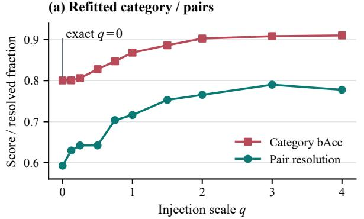

(b) Decoder: reference-fixed probe  
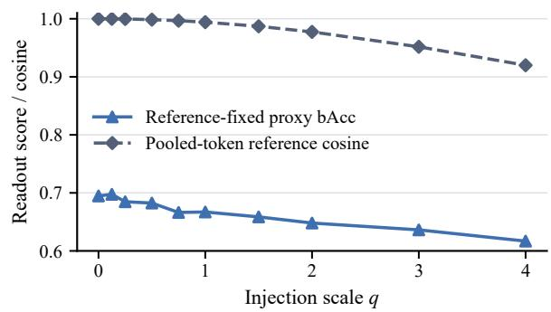  
Correspondence controls: correct-spectrum-fixed readouts

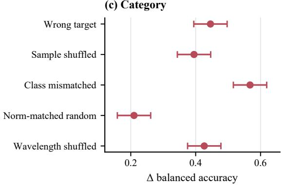

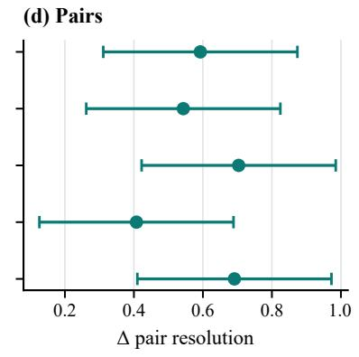

(e) Decoder: spectrum-fixed probe  
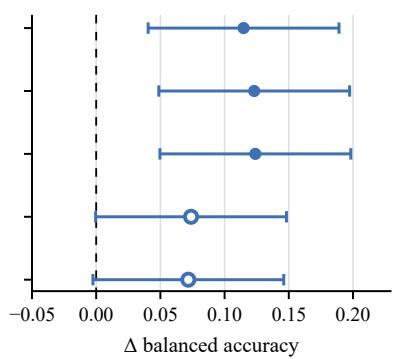  
Fig. 2. Injection scale and correspondence affect recognition and decoder-readout reuse differently. (a,b) Epoch-60, image-disjoint three-seed curves use refitted category/pair and reference-fixed decoder probes. Table 3 changes checkpoint/scale, retaining the reference-trained probe. (c–e) Correct-minus-control differences retain correct-spectrum-trained readouts (“spectrum-fixed” in e) and $q = ( 2 , 4 , 4 )$ for seeds 0–2. Both (b,e) use recomputed decoder outputs; correct-spectrum bAcc in (e) is 0.710. Filled/open markers denote intervals excluding/including zero. Session 95% intervals are simultaneous across five controls per endpoint; pairs use 38-session-node product multipliers.

Posteriors favor grouped category recognition (0.882 versus 0.861); continuous states retain more spectral detail, with $\Delta R ^ { 2 } = 0 . 4 6 5$ [0.429, 0.502].

Learned versus fixed-map residual. In the separate 16- session mapper comparison, learning makes the retained spectrum more useful for recognition: category bAcc improves by 0.092 (session CI [0.017, 0.174]), while mean decoder KL decreases by 0.014 $( [ - 0 . 0 2 1 , - 0 . 0 0 9 ] )$ ). Projection, rescaling, own-token insertion and selection are identical (Table 2; Supplement S2.4). The label-free 136-to-4096 Raw+NMF isometry retains higher $R ^ { 2 } .$ , separating spectral recoverability from learned discrimination. Referencefixed/refitted decoder-logit probe bAcc is 0.634/0.694 for learned and 0.646/0.595 for fixed; both exploratory intervals include zero. This fixed residual omits the replacement control’s pre-projection row LayerNorm.

After frozen decoding. Within-category spectral variation remains accessible in frozen decoder logits. Continuous/posterior inputs recover $R ^ { 2 } = 0 . 0 9 6 / 0 . 0 \check { 8 } 5$ versus reference 0.083, with continuous-minus-posterior gain 0.0113 (66-session CI [0.0042, 0.0189]). These jointly recomputed comparisons use validation-CE checkpoints, allowance 0.2 and Eq. (12)’s conditioning. The 256-D pooled-token sensitivity gives $R ^ { 2 } ~ = ~ 0 . 6 0 9$ before decoding (Supplement S2.2); width also contributes to cross-block differences. Each comparison matches readout width and conditioning.

## TABLE 2

Continuous tokens retain more object-specific spectral variation than category codes. All blocks use validation-CE checkpoints and allowance 0.2. Recovery R2 and angle (radians) use train-fitted category conditioning (Eq. (12)); category bAcc uses the unconditioned category readout (Section 5.2). Held-session results pool five groups over 86 acquisitions; the final mapper comparison uses 16 sessions. Paired intervals resample acquisitions. Learned rows average three seeds; bAcc is shown where jointly evaluated. Bold favors means within blocks; gray identifies SPECTRA-VLA.
<table><tr><td colspan="4">Within-category</td></tr><tr><td>Representation</td><td>bAcc ↑</td><td> $R ^ { 2 } \uparrow$ </td><td>Angle ↓</td></tr><tr><td colspan="4">Image split: 4096-D tokens, 461 objects</td></tr><tr><td>False-color base</td><td></td><td>0.263</td><td>0.041</td></tr><tr><td>Continuous (ours)</td><td></td><td>0.824</td><td>0.019</td></tr><tr><td>Category posterior</td><td></td><td>0.374</td><td>0.038</td></tr><tr><td>Hard category code Continuous-posterior</td><td> $\Delta R ^ { 2 } = 0 . 4 5 0$ </td><td>0.333 [0.398, 0.504]</td><td>0.039</td></tr><tr><td colspan="4"></td></tr><tr><td>False-color base 0.793</td><td>Held sessions: 4096-D tokens, 2,291 objects</td><td>0.238</td><td>0.040</td></tr><tr><td>Continuous (ours)</td><td>0.861</td><td>0.802</td><td>0.020</td></tr><tr><td>Category posterior</td><td>0.882</td><td>0.337</td><td>0.038</td></tr><tr><td colspan="4">Continuous-posterior  $\Delta R ^ { 2 } = 0 . 4 6 5$  [0.429, 0.502]</td></tr><tr><td>Image split: 256 logits, 461 objects False-color base</td><td></td><td>0.083</td><td>0.048</td></tr><tr><td>Continuous (ours)</td><td></td><td>0.096</td><td>0.047</td></tr><tr><td>Category posterior Continuous-posterior  $\Delta R ^ { 2 } = 0 . 0 1 1 3$ </td><td></td><td>0.085 [0.0042, 0.0189]</td><td>0.048</td></tr></table>

<table><tr><td>Residual mapper</td><td>bAcc ↑</td><td> $R ^ { 2 } \uparrow$ </td><td>Mean KL↓</td></tr><tr><td>Learned (ours)</td><td>0.865</td><td>0.826</td><td>0.048</td></tr><tr><td>Fixed isometry</td><td>0.773</td><td>0.839</td><td>0.062</td></tr></table>

Target correspondence. Correct target spectra support both waste-object category recognition and object-specific spectral recovery. Pooled-token category recognition and pair resolution exceed all five corruption controls (Figure 2c,d), with proxy-state gains in Supplement S2.1. Beyond category identity, the bridge preserves the target’s own spectral variation, as shown by comparisons with samecategory donors (Table 3d). Epoch-60 interventions keep residual norms and correct-spectrum-trained readouts fixed. Joint decoder recomputation gives bAcc 0.710 and gains 0.115–0.124 over wrong-target, sample-permuted and classmismatched inputs, with simultaneous lower bounds 0.040– 0.050. Random/band-permuted means are lower, with intervals crossing zero (Supplement S2).

## 6.3 Composition at a Frozen Interface

Preserving the receiving grid. At similar category recognition, own-token addition better supports reuse of the reference-trained decoder-logit probe. With spectral residuals and injection scale fixed, its balanced accuracy is 0.701, compared with 0.590 for pooled replacement on the imagedisjoint test (Table 3). Replacement moves the pool less yet has higher decoder-KL P95, 5.593 versus 1.158. Pooled proximity therefore misses changes in the token structure consumed downstream. These exploratory contrasts fix validation-CE checkpoints, residuals and q = 4 (Eq. (11)).

Zero-injection contrasts identify receiving-grid preservation; the image-disjoint reference-fixed four-state composition-by-injection interval includes zero (Table 3b). Category-matched swaps below separately identify the content-dependent effect after decoding.

Refitted decoder-logit probes at these validation-CE checkpoints and unrestricted, utility-selected q = 4 also improve decoder-logit probe bAcc over the reference from 0.695 to 0.791 (gain 0.096, session CI [0.031, 0.201]).

Across five groups, addition improves decoder-probe bAcc at similar category recognition (Table 3c). The refitted gain concentrates in cardboard: 60 objects/24 acquisitions. Removing the first group’s six cardboard objects retains gain 0.028 [0.007, 0.055]; every session deletion stays positive (Supplement S2.4).

Target-content–composition interaction. Fixed adapters/scales and recipient projection/norm give own-minus-same-category-donor increments 0.0336/0.0165 for addition/replacement, with interaction 0.0171 [0.0121, 0.0228] across 86 acquisitions (Table 3d). Both shared recipient/donor resampling and the sameacquisition-only subset support this approximately doubled target-specific increment, distinct from total recovery or four-state classification.

## 6.4 Calibrating Recognition and Disturbance

Calibration compares recognition under a shared validation mean-displacement ceiling of 0.2 (Table 4). Utility selects scale at validation-CE checkpoints. Reference and altered logits are jointly recomputed with the common category ridge grid; test movement and divergence are measured afterward.

Base-fine attains the same rounded category bAcc as the unprojected ablation, 0.880, with smaller displacement and decoder-KL tails: P95 0.188/0.152 versus 0.213/0.182 (Table 4a). The common allowance 0.2 yields validation mean displacements 0.1438/0.1620. When achieved mean movement itself is matched, recognition and KL tails are similar (Supplement S3). Thus projection defines the basecomplement residual, while calibration determines the measured disturbance of the selected operating point.

Under acquisition shift, validation mean-displacement target 0.15 gives base-fine category bAcc 0.865, test mean 0.150, displacement P95 0.194 and decoder-KL P95 0.164 on 16 disjoint sessions. Validation sets the target; the supplement reports achieved movement, scales and tolerance.

Continuous content versus category compression. Category posteriors and continuous spectra favor different objectives. Under unrestricted utility selection, category and pooled-token proxy differences among continuous, hardcode and posterior inputs are unresolved. At the common allowance (Table 4b), posterior-minus-continuous differences are 0.020 ([0.001, 0.035]) in category bAcc and −0.065 ([−0.086, −0.047]) in decoder-KL P95. Decoder-logit probe differences remain unresolved. Posteriors favor classification and smaller disturbance, whereas continuous input retains within-category spectral variation beyond the sixcategory decision. Selecting scale for validation recovery $R ^ { 2 } = \dot { 0 } . 8$ yields test recovery 0.801, category bAcc 0.871 and decoder-KL P95 0.087 (Supplement S2.1–S2.3).

## TABLE 3

Own-token composition improves readout reuse and target-specific recovery. Arms share residuals/scales and recomputed logits. (a,b) Image-disjoint: 461 objects, CE-selected epochs (3, 6, 4), q = 4, reference bAcc 0.695. (c,d) Five held-out groups: 2,291 objects/86 sessions,   
reference 0.681, unrestricted validation-utility-selected scales. (d) Each cell separately train-fits centering, standardization and ridge; increment is own-minus-same-category-donor within-category R2. Equal seed contributions share acquisition resampling, including donor nodes in (d);   
secondary intervals are unadjusted. Disp.: pooled movement; P95: per seed. Gray: base-fine; bold: favorable means, not significance. Supplement S2.4 gives influence.

(a) Identical spectral residual, different composition
<table><tr><td>Composition</td><td>Category ↑</td><td>Reference-fixed ↑</td><td>Refit ↑</td><td>Disp. P95↓</td><td>KL P95↓</td></tr><tr><td>Base-fine (ours)</td><td>0.897</td><td>0.701</td><td>0.791</td><td>0.513</td><td>1.158</td></tr><tr><td>Pooled replacement</td><td>0.892</td><td>0.590</td><td>0.741</td><td>0.362</td><td>5.593</td></tr></table>

Addition minus replacement: reference-fixed +0.111 [0.047, 0.164]; refit +0.049 [0.002, 0.082].

(b) Composition-by-injection decoder-logit readouts
<table><tr><td rowspan="2">Spectral injection</td><td colspan="2">Reference-fixed readout bAcc ↑</td><td colspan="2">Refitted readout bAcc ↑</td></tr><tr><td>Grid / addition</td><td>Replacement</td><td>Grid / addition</td><td>Replacement</td></tr><tr><td>None</td><td>0.695</td><td>0.597</td><td>0.695</td><td>0.694</td></tr><tr><td>Target spectrum</td><td>0.701</td><td>0.590</td><td>0.791</td><td>0.741</td></tr></table>

Reference-fixed composition-by-injection interaction: +0.013 [−0.014, 0.058].

(c) Held-session recognition and readouts
<table><tr><td>Readout</td><td>Add</td><td>Replace</td><td>Δ</td><td>95% CI</td></tr><tr><td>Category</td><td>0.876</td><td>0.877</td><td>-0.001</td><td>[-0.0068, 0.0035]</td></tr><tr><td>Ref.-fixed</td><td>0.683</td><td>0.658</td><td>+0.026</td><td>[0.0004, 0.0572]</td></tr><tr><td>Refit</td><td>0.735</td><td>0.700</td><td>+0.035</td><td>[0.0148, 0.0656]</td></tr></table>

(d) Decoder spectral recovery
<table><tr><td>Composition</td><td>Correct</td><td>Donor</td><td>Increment ↑</td></tr><tr><td>Base-fine</td><td>0.1010</td><td>0.0674</td><td>0.0336</td></tr><tr><td>Replacement</td><td>0.0966</td><td>0.0801</td><td>0.0165</td></tr></table>

Spectral content-by-composition interaction: +0.0171 [0.0121, 0.0228].  
Recognition and disturbance at validation-CE checkpoints, using 461 objects from 66 sessions and the same category ridge grid. (a) Allowance 0.2 gives achieved validation means 0.1438/0.1620. Matching achieved mean target 0.15 instead gives base-fine/no-projection category bAcc 0.871/0.871 and KL P95 0.163/0.160 (Supplement S3.3). (b) Both inputs use the same composition and allowance 0.2. Disp. and decoder KL are per-seed test 95th percentiles; $\mathrm { \mathit { R } ^ { 2 } }$ reads within-category spectral shape. Gray identifies continuous SPECTRA-VLA. Bold marks favorable rounded means, not significance.

TABLE 4

(a) Common-allowance selection
<table><tr><td>Method</td><td>Cat. bAcc ↑</td><td>Disp. P95 ↓</td><td>KL P95 ↓</td></tr><tr><td>Base-fine</td><td>0.880</td><td>0.188</td><td>0.152</td></tr><tr><td>No pooled-base projection</td><td>0.880</td><td>0.213</td><td>0.182</td></tr></table>

## 6.5 Checkpoint and Readout Sensitivity

(b) Spectral input under the same composition
<table><tr><td>Input</td><td>Cat. bAcc ↑</td><td> $R ^ { 2 } \uparrow$ </td><td>Disp. P95 ↓</td><td>KL P95 ↓</td></tr><tr><td>Continuous spectra</td><td>0.880</td><td>0.824</td><td>0.188</td><td>0.152</td></tr><tr><td>Category posterior</td><td>0.899</td><td>0.374</td><td>0.142</td><td>0.087</td></tr></table>

## 6.6 Backbone, Grounding, and Failure Analysis

At epoch 60, validation-selected q = (2, 4, 4) improves category/pair scores to 0.905/0.778 from 0.801/0.593, while reference-fixed bAcc falls 0.695 → 0.617 (−0.077 [−0.118, −0.035]). The pair-gain session interval [−0.030, 0.443] includes zero (Figure 2a,b). Earlier CE checkpoints with q = 4 give 0.701 in the same runtime/readout. Supplement S3 gives cached sensitivities; S6 reports short-budget held-session scores 0.684/0.705 for altered/reference states.

On the fixed image-disjoint split, SpatialVLA reproduces the representation pattern: category/proxy balanced accuracy rises from 0.812/0.871 to 0.914/0.947 at cosine 0.985. Paired session intervals for the gains are [0.043, 0.177] and [0.025, 0.127], respectively. Reference-fixed decoderlogit probe balanced accuracy remains lower than the reference (0.673 versus 0.718). The supplement reports directretargeting and constraint comparisons, together with spectral interventions on its distinct action vocabulary.

Target quality determines which spectrum enters the bridge. Four-state decoder-logit probes are trained separately on each representation’s ground-truth-region logits and kept fixed across mask perturbations. One-pixel erosion gives base-fine/base bAcc 0.732/0.683, while a fourpixel shift gives 0.638/0.643. Poor class-oracle predicted masks, with mean IoU 0.218, lower base-fine below the base (0.362/0.468), even with the category supplied. Each condition re-encodes its region with unchanged injection scales.

Base-fine retains 0.975 of base-correct category predictions and repairs 0.542 of base-wrong predictions. Figure 3(a–c) shows refitted category predictions. Separate reference-fixed decoder-logit probe predictions are correct for the base and base-fine in (a,b), but only for the base in (c). In (d), predicted-mask IoU 0.0029 changes the region-trained decoder-logit probe prediction from correct to wrong. Category correction and reuse of a referencetrained logit readout differ even on the same object.

(a) Bag: repaired  
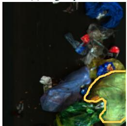

(b) Bag: harmed  
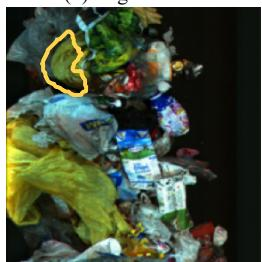  
(c) Bag: unresolved

(d) Film: target mismatch  
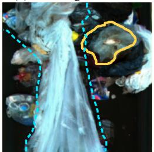

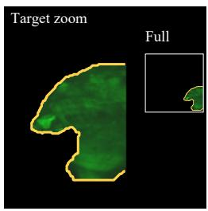

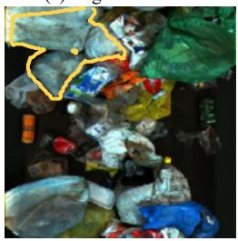

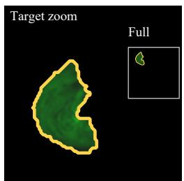  
False-color base: film SPECTRA-VLA: bag  
(a-c) Refitted category readouts False-color base: bag SPECTRA-VLA: film

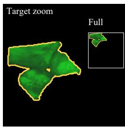  
False-color base: film SPECTRA-VLA: film

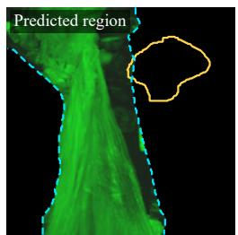  
Decoder-logit probe GT region: correct Pred. region: wrong Fixed across masks Mask IoU: 0.0029

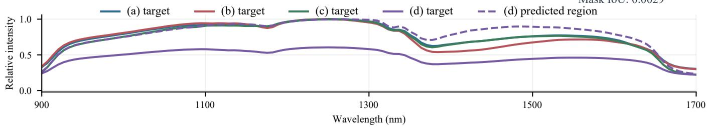  
Fig. 3. Category repair, injection-induced harm, unresolved recognition and target-region failure on fixed-test examples. True RGB marks targets. Lower views (a–c) enlarge targets for display only; side views show original full-frame inputs at unchanged intensities. Refit category predictions are bold when correct. In (d), ground-truth (solid gold) and predicted (dashed cyan) regions have IoU 0.0029; the ground-truth-region-trained decoderlogit probe changes from correct to wrong. Spectra (a–c) use each target’s peak; both (d) curves share the larger region peak. Wavelengths approximate an uncalibrated uniform grid. Outcome-selected cases do not estimate prevalence.

Published spectral encoders provide a complementary recognition comparison under the same ridge grid; the supplement reports five spectral encoders and a raw-spectrum reference, rendering sensitivity and external datasets. Partially loaded DOFA/HyperSIGMA are excluded from peer ranking. Mendeley Wood/SpecTex use expanded ridge/PCA readouts of learned residual features to test dataset-specific augmentation, separately from nativewidth VLA composition.

## 7 DISCUSSION

Spectral enrichment and interface preservation are complementary. Continuous inputs retain variation lost by category compression (Table 2); receiving-token controls tie decoder stability to grid structure rather than pooled proximity (Table 3). Across all five acquisition groups, same-category swaps link receiving-token composition to a larger recovery increment from the target’s own spectrum, separately from the no-injection grid benefit.

Learning supplies discrimination; own-token addition retains the receiving grid. Projection specifies a basecomplement direction, while norm control and validation calibration regulate executed movement. Commonallowance and equal-movement comparisons attribute smaller disturbance tails to the selected operating point (Table 4; Supplement S3). Posterior codes favor classification; continuous input retains within-category shape. Learned residuals improve recognition and mean decoder KL over fixed maps, with a recovery trade-off. These results separate content, composition and calibration choices.

HyA-T also freezes both pretrained components [23]. SPECTRA-VLA preserves receiving tokens at native width, as shown by matched spectral-content, composition and calibration tests. Its auxiliary heads serve training only.

## 8 CONCLUSION

SPECTRA-VLA upgrades frozen VLA interfaces at native token width. Category bAcc rises 0.812 → 0.883 across

86 held-out acquisitions; a second backbone reproduces enrichment. Continuous input retains within-category spectral variation. Own-token composition improves fixedreadout reuse at similar recognition and approximately doubles target-specific recovery increments across five acquisition groups. The frozen encoder/decoder and exact zeroinjection reference are preserved, coupling new spectral content to the pretrained receiving structure.

Code and data availability. Code is available at https://github.com/jesse1029/SPECTRA-VLA. Grouped predictions, donor identities and numerical results are available at https://www.dropbox.com/scl/fi/ xkp5xlb8ldjbmrgljx4ku/SPECTRA-VLA numerical data only.zip?rlkey=ycpmxfvmaxzquax6xw0zhe8aa&dl=0. Supplement S1 specifies checkpoints and inference.

## ACKNOWLEDGMENT

This study was supported in part by the National Science and Technology Council (NSTC), Taiwan, under grants 115- 2627-M-006-001, 115-2218-E-A49-023, and 115-2634-F-A49- 014. The author thanks the National Center for Highperformance Computing (NCHC) of National Applied Research Laboratories (NARLabs) in Taiwan for providing computational and storage resources.

OpenAI Codex and ChatGPT [34], [35] assisted with implementation, experimental analysis, and manuscript drafting and revision. Their use included implementation and analysis associated with the method and experiments, and revision of the main paper and supplementary material. The author remains responsible for the scientific claims, reported results, and final manuscript.

## REFERENCES

[1] A. Brohan et al., “RT-1: Robotics transformer for real-world control at scale,” in Proceedings of Robotics: Science and Systems XIX, 2023.

[2] B. Zitkovich et al., “RT-2: Vision-language-action models transfer web knowledge to robotic control,” in Proceedings of the 7th Conference on Robot Learning, ser. Proceedings of Machine Learning Research, vol. 229. PMLR, 2023, pp. 2165–2183.

[3] M. J. Kim, K. Pertsch, S. Karamcheti, T. Xiao, A. Balakrishna, S. Nair, R. Rafailov, E. P. Foster, P. R. Sanketi, Q. Vuong, T. Kollar, B. Burchfiel, R. Tedrake, D. Sadigh, S. Levine, P. Liang, and C. Finn, “OpenVLA: An open-source visionlanguage-action model,” in Proceedings of the 8th Conference on Robot Learning, ser. Proceedings of Machine Learning Research, vol. 270. PMLR, 2025, pp. 2679–2713. [Online]. Available: https://proceedings.mlr.press/v270/kim25c.html

[4] D. Qu, H. Song, Q. Chen et al., “SpatialVLA: Exploring spatial representations for visual-language-action model,” in Robotics: Science and Systems, 2025. [Online]. Available: https: //www.roboticsproceedings.org/rss21/p011.pdf

[5] S. Casao, F. Pena, A. Sabater, R. Castill˜ on, D. Su´ arez, E. Montijano,´ and A. C. Murillo, “SpectralWaste dataset: Multimodal data for waste sorting automation,” in IEEE/RSJ International Conference on Intelligent Robots and Systems (IROS), 2024, pp. 5852–5858.

[6] C. Li, J. Wen, Y. Peng, Y. Peng, and Y. Zhu, “PointVLA: Injecting the 3d world into vision-language-action models,” IEEE Robotics and Automation Letters, vol. 11, no. 3, pp. 2506–2513, 2026.

[7] S. Chen, P. Pacaud, and C. Schmid, “Pointact: Vision-languageaction models with multi-scale point-action interaction,” in Robotics: Science and Systems, 2026, accepted. [Online]. Available: https://arxiv.org/abs/2605.21414

[8] X. Zhu, P. Yuan, Y. Liu, and J. Chen, “HARP-VLA: Humanrobot aligned representation learning for vision-language-action model,” 2026. [Online]. Available: https://arxiv.org/abs/2605. 31234

[9] H. Guo, S. Wang, R. Ma, S. Jiang, Y. Ghasempour, O. Abari, B. Guo, and L. Qiu, “OmniVLA: Physically-grounded multimodal VLA with unified multi-sensor perception for robotic manipulation,” in IEEE International Conference on Robotics and Automation (ICRA), 2026, arXiv:2511.01210. [Online]. Available: https: //arxiv.org/abs/2511.01210

[10] X. Liu, R. Ma, H. Guo, Q. Li, Q. Yang, L. Luo, S. Jiang, C. Xu, J. Yang, and B. Guo, “MuseVLA: An adaptive multimodal sensing vision-language-action model for robotic manipulation,” 2026. [Online]. Available: https://arxiv.org/abs/2606.17598

[11] C. Morissette, A. Abyaneh, W.-D. Chang, A. Houssaini, D. Meger, H.-C. Lin, J. Tremblay, and G. Dudek, “Tactile modality fusion for vision-language-action models,” in Proceedings of the European Conference on Computer Vision (ECCV), 2026, accepted. [Online]. Available: https://arxiv.org/abs/2603.14604

[12] K. Zhang, H. Zhang, Z. Xu, Z. Zhang, M. R. I. Prince, X. Li, X. Han, Y. Zhou, A. Ajoudani, and Y. She, “TacVLA: Contact-aware tactile fusion for robust vision-language-action manipulation,” 2026. [Online]. Available: https://arxiv.org/abs/2603.12665

[13] K. Gubernatorov, M. Sannikov, I. Mikhalchuk, E. Kuznetsov, M. Artemov, O. F. Oluwatobi, M. Fernando, A. Asanov, Z. Guo, and D. Tsetserukou, “HapticVLA: Contact-rich manipulation via vision-language-action model without inference-time tactile sensing,” 2026. [Online]. Available: https://arxiv.org/abs/2603. 15257

[14] M. Van der Merwe, M. L. Shehab, J. Lee, Y. Wi, Y. Dai, D. Berenson, and N. Fazeli, “TAP-VLA: Tactile annotation prompting for vision language action models,” 2026. [Online]. Available: https://arxiv.org/abs/2606.29089

[15] D. Hong, B. Zhang, X. Li, Y. Li, C. Li, J. Yao, N. Yokoya, H. Li, P. Ghamisi, X. Jia, A. Plaza, P. Gamba, J. A. Benediktsson, and J. Chanussot, “SpectralGPT: Spectral remote sensing foundation model,” IEEE Transactions on Pattern Analysis and Machine Intelligence, vol. 46, no. 8, pp. 5227–5244, 2024.

[16] D. Wang, M. Hu et al., “HyperSIGMA: Hyperspectral intelligence comprehension foundation model,” IEEE Transactions on Pattern Analysis and Machine Intelligence, vol. 47, no. 8, pp. 6427–6444, 2025.

[17] Z. Xiong, Y. Wang, F. Zhang, A. J. Stewart, J. Hanna, D. Borth, I. Papoutsis, B. Le Saux, G. Camps-Valls, and X. X. Zhu, “Neural plasticity-inspired multimodal foundation model for earth observation,” 2024, arXiv:2403.15356.

[18] W. Kong, B. Liu, X. Bi, C. Yu, X. Li, and Y. Chen, “HyperSL: A spectral foundation model for hyperspectral image interpretation,” IEEE Transactions on Geoscience and Remote Sensing, vol. 63, pp. 1–19, 2025.

[19] L. Scheibenreif, M. Mommert, and D. Borth, “Masked vision transformers for hyperspectral image classification,” in Proceedings of the IEEE/CVF Conference on Computer Vision and Pattern Recognition Workshops, 2023, pp. 2166–2176.

[20] J. Li, Y. Liu, X. Wang, Y. Peng, C. Sun, S. Wang, Z. Sun, T. Ke, X. Jiang, T. Lu, A. Zhao, and Y. Zhong, “HyperFree: A channeladaptive and tuning-free foundation model for hyperspectral remote sensing imagery,” in Proceedings of the IEEE/CVF Conference on Computer Vision and Pattern Recognition, 2025, pp. 23 048–23 058.

[21] G. Fu, J. Li, Z. Cheng et al., “Hypervision: A channel-adaptive ground-based hyperspectral vision pre-trained backbone,” arXiv preprint arXiv:2605.17286, 2026. [Online]. Available: https://arxiv. org/abs/2605.17286

[22] J. V. Hurtado, R. Mohan, and A. Valada, “Hyperspectral adapter for semantic segmentation with vision foundation models,” IEEE Robotics and Automation Letters, vol. 11, no. 3, pp. 3606–3613, 2026. [Online]. Available: https://doi.org/10.1109/LRA.2026.3656795

[23] L. Gao, Y. Zhang, L. Chen, Y. Jiang, G. He, W. Xie, and Y. Li, “Domain adapter for visual object tracking based on hyperspectral video,” Pattern Recognition, vol. 172, p. 112296, 2026.

[24] Y. Hu and S. Prasad, “Unidiff: Parameter-efficient adaptation of diffusion models for land cover classification with multi-modal remotely sensed imagery and sparse annotations,” in Proceedings of the IEEE/CVF Winter Conference on Applications of Computer Vision, March 2026, pp. 4611–4620. [Online]. Available: https://openaccess.thecvf.com/content/WACV2026/html/Hu UniDiff Parameter-Efficient Adaptation of Diffusion Models for Land Cover Classification WACV 2026 paper.html

[25] E. J. Hu, Y. Shen, P. Wallis, Z. Allen-Zhu, Y. Li, S. Wang, L. Wang, and W. Chen, “LoRA: Low-rank adaptation of large language models,” in International Conference on Learning

Representations, 2022. [Online]. Available: https://openreview. net/forum?id=nZeVKeeFYf9

[26] S. Chen, C. Ge, Z. Tong, J. Wang, Y. Song, J. Wang, and P. Luo, “Adaptformer: Adapting vision transformers for scalable visual recognition,” in Advances in Neural Information Processing Systems, vol. 35, 2022, pp. 16 664–16 678.

[27] M. Jia, L. Tang, B.-C. Chen, C. Cardie, S. Belongie, B. Hariharan, and S.-N. Lim, “Visual prompt tuning,” in European Conference on Computer Vision, 2022, pp. 709–727.

[28] J. Li, D. Li, S. Savarese, and S. Hoi, “BLIP-2: Bootstrapping language-image pre-training with frozen image encoders and large language models,” in Proceedings of the International Conference on Machine Learning, vol. 202. PMLR, 2023, pp. 19 730–19 742. [Online]. Available: https://proceedings.mlr.press/ v202/li23q.html

[29] Y. K. Jang and S.-n. Lim, “Towards cross-modal backwardcompatible representation learning for vision-language models,” in Proceedings of the IEEE/CVF International Conference on Computer Vision, 2025, pp. 1783–1792.

[30] G. Oh, W. Cho, S. Kim, S. Choi, and Y. Yu, “Revisiting residual connections: Orthogonal updates for stable and efficient deep networks,” in Advances in Neural Information Processing Systems, vol. 38, 2025.

[31] P. Li, H. S. Gan, M. Suleymanzade, C. D. Engin, and¨ G. Ersoz, “ORCA: Orthogonal residual cross-modal adaptation¨ for choroidal thickness estimation from multimodal fundus images,” in Advanced Intelligent Computing Technology and Applications (ICIC 2026), ser. Lecture Notes in Computer Science, vol. 16660. Springer, 2027, pp. 480–492, first online July 16, 2026.

[32] Y. Wang, X. Chen, L. Cao, W. Huang, F. Sun, and Y. Wang, “Multimodal token fusion for vision transformers,” in Proceedings of the IEEE/CVF Conference on Computer Vision and Pattern Recognition, 2022.

[33] J. V. Funk, L. Roming, A. Michel, P. Backer, G. Maier, T. L¨ angle, and¨ M. Klute, “Bidirectional cross-attention fusion of high-resolution RGB and low-resolution hyperspectral inputs for multimodal semantic segmentation,” 2026, arXiv:2603.13941.

[34] OpenAI, “Codex,” https://openai.com/codex/, accessed: Oct. 13, 2026.

[35] ——, “ChatGPT,” https://chatgpt.com/overview/, accessed: Oct. 13, 2026.

# Supplementary Material for “SPECTRA-VLA: Base-Fine Hyperspectral Token Transfer at Frozen Vision-Language-Action Interfaces”

Chih-Chung Hsu

## S1 EXPERIMENTAL DETAILS

AI assistance. OpenAI Codex and ChatGPT [1], [2] assisted with implementation, analysis, and preparation of this supplement; the main paper’s Acknowledgment describes their use and the author’s responsibility.

SPECTRA-VLA enriches the frozen VLA visual-token interface with target-corresponding spectral information. The following experiments distinguish spectral content, receiving-token composition and injection calibration. Category and category-derived proxy readouts classify pooled states; decoder-logit probes classify frozen first-position action-symbol logits. Gray shading identifies SPECTRA-VLA, and bold marks favorable displayed means within comparable groups, including ties. Paired intervals assess statistical support separately.

## S1.1 Observations, Targets and Partitions

SpectralWaste [3] contains 514/167/171 training/validation/test source images with synchronized RGB, $\phantom { + } 3 2 2 4 \times 2 5 6 \times 2 5 6$ band-first HSI cube and category masks. Cubes retain their original intensity scale in float32. Linear interpolation maps 224 bands to 120, sampling source position $( k + { \textstyle \frac { 1 } { 2 } } ) \dot { 2 } 2 4 / 1 2 0 - { \textstyle \frac { 1 } { 2 } }$ for output band k. HSI and RGB are bilinearly resized from $2 5 6 ^ { 2 }$ to $2 2 4 ^ { 2 }$ with pixel-center interpolation; masks use nearest neighbors. Category-specific four-connected components of at least 100 resized pixels define targets. This gives 1,392/442/461 objects in 479/156/159 images; 35/11/12 source images contain no retained component.

Images are zeroed outside the target, without cropping, padding or additional registration. The fixed falsecolor view uses bands [119, 60, 0], divides each channel by $6 5 5 3 5 + 1 0 ^ { - 6 }$ , clips to [0, 1] and casts 255 times the result to uint8. This spans the sensor’s index range; it is distinct from paired visible RGB. Area pooling reduces the target mask to the 16 × 16 token grid. Raw occupancy $\widetilde { m } _ { i t }$ and injection weight $m _ { i t } = \widetilde { m } _ { i t } / ( \mathrm { m a x } _ { t } \widetilde { m } _ { i t } + 1 0 ^ { - 6 } )$ are kept distinct.

The six labels are operational waste-object categories. Table S1 defines their four-state reduction; only state 1 merges categories. State-0/1/2/3 counts are 35/760/200/397, 15/256/54/117 and 10/254/67/130 in training, validation and test. Predicting a category and applying this mapping provides the category-lookup diagnostic.

Waste-object categories, object counts and the fixed four-state proxy mapping. Category IDs and names follow SpectralWaste; the grouping is defined by the evaluation.

<table><tr><td>Category (ID)</td><td>State</td><td>Train/Val./Test</td></tr><tr><td>Film (1)</td><td>1</td><td>203/67/66</td></tr><tr><td>Basket (2)</td><td>2</td><td>200/54/67</td></tr><tr><td>Cardboard (3)</td><td>0</td><td>35/15/10</td></tr><tr><td>Video tape (4)</td><td>3</td><td>397/117/130</td></tr><tr><td>Filament (5)</td><td>1</td><td>57/20/16</td></tr><tr><td>Bag (6)</td><td>1</td><td>500/169/172</td></tr></table>

An object, not an individual wavelength, is the prediction unit. The image-disjoint split contains 2,295 objects in 794 images; its train/validation/test partitions occupy 82/63/66 overlapping acquisition sessions. Sessions follow the source-image acquisition prefix. Session-held-out evaluation instead uses 2,291 objects in 792 images from the 86 sessions represented in fixed training or test. It includes 438 fixed-validation objects from overlapping sessions and excludes four objects from two validation-only sessions. Each outer fold holds out a complete acquisition. Thus image holdout separates images, whereas session holdout separates all images acquired together.

## S1.2 Training-Fitted Spectral Features

The 120-D raw spectrum averages target pixels. The sensor range is 900–1700 nm, but the release provides no per-band calibration vector; wavelength-dependent analyses use an approximate uniform grid. Inputs always follow the sourceindex interpolation above.

The main 136-D input joins 120 raw bands and 16 NMF abundances. Each training partition fits per-band standardization and nonnegative 99th-percentile scaling. NMF uses NNDSVDa initialization, coordinate-descent Frobenius updates, at most 2,000 iterations, tolerance $1 0 ^ { - 4 }$ and seed 20260710 + s. Abundances are divided by their sum plus $1 0 ^ { - 8 }$ ; raw and abundance blocks are standardized separately. All fitted transforms remain within the relevant training partition and are refitted within each outer-training population.

## S1.3 Adapter, Loss and Token Composition

The rank-r mapper is

$$
\phi _ { r } ( s ) = W _ { \mathrm { u p } } \mathrm { G E L U } \bigl ( W _ { \mathrm { d o w n } } \mathrm { L N } _ { \mathrm { a f f } } ( s ) \bigr ) ,
$$

with affine input LayerNorm, a biased down projection and bias-free up projection. The main model uses $r = 6 4$ , output width d = 4096 and norm budget $\rho = 0 . 1 \colon 2 7 1 , 1 8 4$ mapper parameters and 320,348 including auxiliary heads. Nonaffine composition LayerNorm uses $\epsilon = 1 \dot { 0 } ^ { - 5 } ;$ projection and norm control use $\dot { \delta } = 1 0 ^ { - 6 }$

Writing $B ^ { \circ } = \mathrm { L N } _ { \epsilon } ( B )$ , training uses $T _ { q } = \mathrm { L N } _ { \epsilon } ( B ^ { \circ } + q D )$ for $q > 0$ and $T _ { 0 } = B ^ { \circ }$ . The composed and base losses share linear head $h _ { c } ;$ the fine head $h _ { f }$ is separate:

$$
\begin{array} { r l } & { \mathcal { L } = \mathrm { C E } _ { w } ( h _ { c } ( T _ { q } ) , y ) + \lambda _ { f } \mathrm { C E } _ { w } ( h _ { f } ( D ) , y ) } \\ & { \quad \quad \quad + 0 . 1 \mathrm { C E } _ { w } ( h _ { c } ( T _ { 0 } ) , y ) + 1 0 ^ { - 4 } \mathrm { m e a n } ( D ^ { 2 } ) . } \end{array}
$$

The fixed-split default is $\begin{array} { r l r } { \lambda _ { f } } & { { } = } & { 1 } \end{array}$ . For C training classes with counts $n _ { c } ,$ mean-one class weights are $w _ { c } =$ $C / ( n _ { c } \sum _ { k } n _ { k } ^ { - 1 } )$ . Each minibatch reduces classification losses as $\textstyle \sum _ { i } \omega _ { i } { \left[ - \tilde { w } _ { y _ { i } } \log p _ { i , y _ { i } } \right] } / \sum _ { i } \omega _ { i }$ , with $\omega _ { i } ~ = ~ 4$ on training stress-pair endpoints and 1 elsewhere. The denominator excludes class weights; the residual penalty is unweighted. Each item draws $q \sim \mathcal { U } ( 0 , 4 )$ . The $T _ { 0 }$ loss updates $h _ { c }$ but has no residual-path gradient. Auxiliary heads are discarded after training.

Evaluation supplies the full 256-token grid to the frozen decoder:

$$
A _ { i t } ( D , q ) = \left\{ \begin{array} { l l } { G _ { i t } , } & { q = 0 , } \\ { ( 1 - m _ { i t } ) G _ { i t } + m _ { i t } \mathrm { L N } _ { \epsilon } ( G _ { i t } + q D ) , } & { q > 0 . } \end{array} \right.
$$

Pooled readouts use $C _ { q } = \mathrm { L N } _ { \epsilon } ( \mathrm { p o o l } _ { m } A ( D , q ) )$ . This executed pool differs from the training surrogate $T _ { q }$ . Replacement uses $R _ { i t } ( v ) = ( 1 - m _ { i t } ) G _ { i t } + \mathrm { \bar { { m } } } _ { i t } \mathrm { L N } _ { \epsilon } \mathrm { \bar { ( } } v ) .$ , broadcasting one vector over target tokens. The no-LayerNorm ablation substitutes $G _ { i t } + q \breve { D }$ for the normalized branch. All operators preserve zero-weight tokens.

## S1.4 Optimization and Fixed-Split Selection

All matched learned representations use seeds {0, 1, 2}, batch size 256, seeded epoch permutations and a 60-epoch budget. AdamW uses learning rate $2 \times 1 0 ^ { - 3 } ,$ , weight decay $1 0 ^ { - 3 } , \ \beta \ = \ ( 0 . 9 , 0 . 9 9 9 )$ and $\epsilon _ { \mathrm { A d a m } } ~ = ~ 1 0 ^ { - 8 }$ , without a scheduler; gradient norm is clipped at 1. Linear layers use seeded PyTorch default initialization and affine LayerNorm uses unit gain/zero bias. Fixed-epoch comparisons retain epoch 60. Mechanism comparisons select the minimum class-weighted composed-head validation CE at $q \ = \ 1$ excluding auxiliary losses, before scale selection.

The injection grid is

$$
\mathcal { Q } = \{ 0 , 0 . 1 2 5 , 0 . 2 5 , 0 . 5 , 0 . 7 5 , 1 , 1 . 5 , 2 , 3 , 4 \} .
$$

For each seed and candidate, category ridge regularization is first chosen by validation bAcc from {0.01, 0.1, 1, 10, 100}, preferring the smaller coefficient on exact ties. Candidates are ordered by $( \mathrm { b A c c } \ + \ 0 . 2 5 \mathrm { P a i r } , \mathrm { b A c c } , - q ) ;$ a missing pair value contributes zero. Proxy and decoder ridge coefficients are selected independently after fixing the representation. Fixed replacement rows use scale one. Random-label adapters inherit the correctly supervised model’s scale. The final-epoch base-fine choices are $q = ( 2 , 4 , 4 ) .$ ; category/proxy/decoder ridge coefficients are (100, 100, 100)/(100, 100, 10)/(100, 100, 100).

Spectrum-only retargeting uses α ∈ {0, 0.01, 0.05, 0.1, 0.25, 0.5, 1, 2, 5, 10} and the analogous tuple with $- \alpha ,$ selecting (0.5, 10, 0.5). Its category/proxy/decoder ridge choices are $( 1 0 , 1 0 , 1 0 \bar { 0 } ) / ( \bar { 1 } 0 \bar { 0 } , 1 0 \bar { 0 } , 1 0 0 ) / ( 1 0 , 1 0 0 , \bar { 1 0 } 0 ) .$ Baseconditioned replacement adds {25, 50, 100} to this alignment grid, requires validation cosine $\ge ~ 0 . 9 4 ,$ , then maximizes category-plus-pair utility, cosine and smaller α in order. It selects (0.01, 0.05, 0.05); category and proxy ridges are 100 for all seeds. Its decoder diagnostic uses the common reference-fixed ridge 10.

## S1.5 Pooled-State and Decoder Readouts

For $X ~ \in ~ \mathbb { R } ^ { 2 5 6 \times 1 6 }$ obtained by reshaping a 4096-D state, signed pooling is

$$
P _ { k } ( X ) = 1 6 ^ { - 1 / 2 } \sum _ { j = 1 } ^ { 1 6 } S _ { k j } X _ { k j } ,
$$

where S is a fixed Rademacher sign pattern with seed 20260712. Other widths use the corresponding fixed projection $x R / \sqrt { 2 5 6 }$ . Training-fitted standardization precedes class-balanced ridge with an iterative least-squares solver and the five-value validation grid above. OpenVLA’s 256 logit coordinates are retained up to signs; SpatialVLA’s 8,194 coordinates are projected to width 256. Prototype prediction uses the same pooled, standardized features u(x):

$$
\mu _ { c } = n _ { c } ^ { - 1 } \sum _ { \substack { i : y _ { i } = c } } u ( x _ { i } ) , \qquad \hat { y } = \arg \operatorname* { m a x } _ { c } \nu ( u ( x ) ) ^ { \top } \nu ( \mu _ { c } ) ,
$$

with $\nu ( v ) = v / ( \| v \| + 1 0 ^ { - 8 } )$

Decoder-logit probes are external four-state classifiers on frozen logits. A refitted probe learns separately for each representation. A reference-fixed probe retains the referencetrained standardizer and classifier. Correspondence controls retain the correct-spectrum-trained probe. These measure accessible information, reference decision-function reuse and content dependence, respectively.

Official weights and matching tokenizers/processors use revisions 47a0ec7fc4ec (OpenVLA) and 886c4557dfde (SpatialVLA). OpenVLA-7B [4] receives In: What action should the robot take to sort the object into the correct bin?\nOut: followed by space token 29871. Frozen features pass through its pretrained visual-to-language projector. The 256 composed embeddings and attention-mask entries follow the beginning-of-sequence embedding; first-position logits use the last real prompt token. The unpadded action reference is 32,000 versus 32,064 runtime logits; $j _ { b } = 3 1 , 9 9 9 - b , b = 0 , \ldots , 2 5 5 ,$ gives IDs 31,744–31,999. SpatialVLA-4B-224 [5] uses the same instruction without In:/Out:, its Gemma tokenizer/processor, 256 image positions and $^ { 8 , 1 9 4 }$ action coordinates starting at 257153. The probe reads all coordinates, versus native three-token decoding.

KL uses temperature-one softmax renormalized over the specified action support. Token cosine averages samplewise target-pooled cosines; displacement averages $\| z -$ $\stackrel { \bullet } { z } ^ { \mathrm { { r e f } } } \Vert / ( \Vert z ^ { \mathrm { { r e f } } } \Vert + \dot { 1 } 0 ^ { - 1 2 } )$ . Backbone-specific KL supports differ, so their magnitudes are interpreted within each backbone.

## S1.6 Numerical Settings

Optimization and composition normalization use float32; frozen inference/grid storage use bfloat16/float16. Joint OpenVLA uses PyTorch 2.6.0, CUDA 12.4, Transformers 4.40.1, SDPA, batch four, evaluation mode and no key– value cache (reference bAcc 0.694685). Earlier cached sensitivities match precision/batch/cache settings, requesting SDPA with eager fallback (reference bAcc 0.704116). Original versions are incompletely documented; retained logits/predictions, splits, fitted readouts and table scripts support reproduction. Eight-observation maximum/mean absolute logit differences are 0.40625/0.077215; top-1 symbols agree. Each contrast uses one configuration and reference. SpatialVLA uses Transformers 4.47.0.

## S2 SPECTRAL CONTENT

## S2.1 Correspondence and Category-Code Controls

Correspondence controls preserve residual width and norm while changing spectral content. Category, proxy and decoder heads are fitted/selected with correct spectra and remain fixed. Epoch-60 adapters use $q ~ = ~ ( 2 , 4 , 4 )$ . The separately trained no-fine-loss control inherits these scales here; its independently selected/refitted comparison uses (4, 4, 4).

Wrong-target donors come from the same image, else the same session, else another category, with target index modulo donor count. Class mismatch cycles to the next sorted category. Partitionwise sample derangements use seed $\mathrm { 2 0 2 6 0 7 1 0 } + s + 1 0 0 9 p$ for partition p, at most 64 draws, then a one-position rotation. Norm-matched Gaussian residuals use seed $9 9 1 7 3 + s ;$ band permutation uses $7 7 3 + s .$ Foreign/random residuals are reprojected against the recipient base and matched to its correct-residual norm.

Correct spectra outperform wrong-target, samplepermuted and class-mismatched inputs in the jointly recomputed decoder comparison. Norm-random and bandpermuted means are lower, but their simultaneous intervals cross zero. Intervals use 100,000 shared Exp(1) cluster draws (seed 20261005), seed averaging within draws and the maximum centered deviation across five contrasts. Pair inference uses the product of distinct endpoint-session multipliers and a single multiplier within one session (Section S5).

A same-category/different-session donor control keeps training/validation states unchanged and replaces only test residuals. An additional linear predicted-label control fits train-only raw-plus-NMF ridge (α = 1); training codes are in-sample and validation/test codes out-of-sample. A learned ${ \overline { { 6 } } } \times 6 4$ embedding and bias-free $6 4 \times 4 0 9 6$ projection produce a base-orthogonal residual without norm rescaling, with selected $\begin{array} { r l r } { q } & { { } = } & { \left( 0 . 7 5 , 0 . 7 5 , 0 . 5 \right) } \end{array}$ Base-fine/donor/predicted-label category/proxy bAcc is $0 . 9 0 4 \boldsymbol { \hat { 6 } 4 5 } / 0 . 9 1 1 2 7 6 , \quad 0 . 8 8 6 3 9 7 / 0 . 9 1 \boldsymbol { \bar { 5 } 3 \dot { 2 } 1 } ^ { \circ }$ and 0.860065/0.877341 under ridge 1. Base-fine-minusdonor intervals span zero; differences from predicted labels are 0.044580 [0.017565, 0.081454] and 0.033935 [0.006015, 0.061737]. Donors share the base-fine head, while predicted-label states refit it.

Stronger category-code controls use a 136–128–64– 6 ReLU classifier, inverse-frequency CE, AdamW with learning rate 10−3/weight decay $\mathrm { 1 0 ^ { - 4 } }$ and 100 epochs. Five session-grouped folds supply out-of-fold training codes; full-training refitting supplies validation/test codes. Six-dimensional one-hot or posterior codes are padded to 136 and passed through the same rank-64, 320,348- parameter bridge, projection, norm bound, CE-checkpoint rule, scale grid and readout. The upstream classifier adds 26,182 parameters. Hard/posterior/continuous scales are $( 1 . 5 , 0 . \bar { 7 } 5 , 1 ) / ( 1 , 4 , 1 ) / ( 4 , 4 , \bar { 4 } )$ . Category/proxy differences are small, with all continuous-versus-code paired intervals spanning zero. At allowance 0.2, posterior scales are $( 1 , 1 , \bar { 1 } )$ , mean validation displacement 0.1084 and category bAcc 0.899275. At allowance 0.1, scales are (0.75, 0.75, 0.75) and category bAcc 0.889462. Posterior codes favor classification and smaller disturbance; continuous spectra favor spectral-shape retention, examined next.

## S2.2 Within-Category Spectral-Shape Recovery

A linear probe recovers the 120-band object-average spectrum from fixed category-trained states. Shape targets are $\bar { x } _ { i } = x _ { i } / \| x _ { i } \|$ . For states or spectra $a _ { i } ,$ subtract their trainingcategory mean $\mu _ { c } ^ { a }$ , then divide by the coordinatewise population standard deviation of these category-centered training residuals. Floors are $1 0 ^ { - 6 }$ for states/logits and $1 0 ^ { - 8 }$ for spectra. True-category conditioning removes betweencategory variation from both predictors and targets.

A training-only ridge with an intercept predicts standardized targets from 4096-D executed pools at the existing allowance-0.2 scales. Validation MSE selects $\{ 1 0 ^ { - 4 } , 1 0 ^ { - 3 } , 1 0 ^ { - 2 } , 1 0 ^ { - 1 } , 1 , 1 0 , 1 0 0 , 1 0 0 0 \}$ , preferring smaller coefficients on ties. With standardized spectral target ${ \widetilde { x } } ,$

$$
R ^ { 2 } = 1 - \frac { \sum _ { \mathrm { t e s t } } \| \widehat { \widetilde { x } } _ { i } - \widetilde { x } _ { i } \| ^ { 2 } } { \sum _ { \mathrm { t e s t } } \| \widetilde { x } _ { i } \| ^ { 2 } } .
$$

The denominator is the error of training-category mean spectra. Spectral angle, in radians, is measured after reversing standardization and adding the category mean. This measures within-category object-average shape.

Continuous-minus-posterior recovery is 0.450000, with session interval [0.397758, 0.504428] and image interval [0.398236, 0.506449]. Shared resamples recompute seedspecific error ratios, then average paired differences (10,000 draws, seed 20261005; 66 sessions or 159 images). Spectruminput/category-only/shuffled-target controls give $R ^ { 2 } \simeq$ $1 , { \bar { 0 } } , - 0 . 1 8 { \bar { 4 } } 4 5 9 .$ . Recovery persists under 256-D signed pooling. Adding $1 0 ^ { 4 } , 1 0 ^ { 5 } , 1 0 ^ { \check { 6 } }$ uniformly to the ridge grid yields continuous/posterior 0.823875/0.359549, paired difference 0.464326 [0.416840, 0.514945]. Frozen-logit recovery improves by 0.011339 [0.004193, 0.018923] under session resampling. These conditional probes leave adapters, scales and the VLA unchanged.

## S2.3 Spectral-Recovery Calibration

Validation recovery targets are $R ^ { 2 } \ = \ 0 . 8$ (primary) and 0.7 (secondary). Calibration takes the first adjacent scale-

TABLE S2

Correct spectral correspondence supports recognition and decoder information. (a) Correct-spectrum-fixed readouts at epoch 60. (b) Simultaneous paired intervals over five cached-logit controls: shared image/session clusters, both endpoint-session memberships for pairs. (c) Joint recomputation with unchanged correct-spectrum heads; session intervals are primary, image intervals sensitivity. SD measures optimization spread.

(a) Recognition and cached-logit decoder sensitivity
<table><tr><td>Condition</td><td>Category bAcc</td><td>Pair</td><td>C-proxy bAcc</td><td>Correct-spectrum-fixed bAcc</td><td>Cosine</td></tr><tr><td>Correct target fine</td><td>0.905</td><td>0.778</td><td>0.938</td><td>0.711</td><td>0.939</td></tr><tr><td>Zero fine (fixed readout)</td><td>0.727</td><td>0.481</td><td>0.699</td><td>0.635</td><td>1.000</td></tr><tr><td>No fine loss (fixed)</td><td>0.868</td><td>0.691</td><td>0.889</td><td>0.681</td><td>0.939</td></tr><tr><td>Wrong-target fine</td><td>0.459</td><td>0.185</td><td>0.514</td><td>0.587</td><td>0.939</td></tr><tr><td>Sample-shuffled fine</td><td>0.510</td><td>0.235</td><td>0.521</td><td>0.586</td><td>0.939</td></tr><tr><td>Class-mismatched fine</td><td>0.337</td><td>0.074</td><td>0.449</td><td>0.587</td><td>0.939</td></tr><tr><td>Norm-matched random</td><td>0.695</td><td>0.370</td><td>0.682</td><td>0.635</td><td>0.939</td></tr><tr><td>Wavelength-shuffled input</td><td>0.478</td><td>0.086</td><td>0.566</td><td>0.637</td><td>0.939</td></tr></table>

(b) Correct-minus-control simultaneous intervals
<table><tr><td>Object endpoints: image clusters</td></tr><tr><td>Control Category</td><td>C-proxy</td><td></td><td>First position</td></tr><tr><td>Wrong target</td><td>+.446 [.395,.496]</td><td>+.424 [.369,.478] +.417 [.362,.472]</td><td>+.124 [.056,.192] +.124 [.057,.192]</td></tr><tr><td>Sample shuffled Class mismatched</td><td>+.395 [.345,.445] +.568 [.517,.618]</td><td>+.488 [.434,.543]</td><td>+.124 [.056,.191]</td></tr><tr><td>Norm random</td><td>+.210 [.160,.260]</td><td>+.256 [.201,.311]</td><td>+.075 [.007,.143]</td></tr><tr><td>Bands shuffled</td><td>+.426 [.376,.477]</td><td>+.372 [.317,.427]</td><td>+.073 [.006,.141]</td></tr><tr><td>Object endpoints: acquisition-session clusters</td><td></td><td></td><td></td></tr><tr><td>Control</td><td>Category</td><td>C-proxy</td><td>First position</td></tr><tr><td>Wrong target</td><td>+.446 [.394,.497]</td><td>+.424 [.367,.480]</td><td>+.124 [.052,.197]</td></tr><tr><td>Sample shuffled</td><td>+.395 [.344,.446]</td><td>+.417 [.361,.473]</td><td>+.124 [.052,.197]</td></tr><tr><td>Class mismatched</td><td>+.568 [.516,.619]</td><td>+.488 [.432,.545]</td><td>+.124 [.051,.196]</td></tr><tr><td>Norm random</td><td>+.210 [.159,.261]</td><td>+.256 [.199,.312]</td><td>+.075 [.003,.148]</td></tr><tr><td>Bands shuffled</td><td>+.426 [.375,.478]</td><td></td><td></td></tr><tr><td></td><td></td><td>+.372 [.316,.429]</td><td>+.073 [.001,.146]</td></tr><tr><td>Pair resolution: session-node intervals</td><td></td><td></td><td></td></tr><tr><td>Wrong target</td><td>+.593 [.311,.874]</td><td></td><td></td></tr><tr><td>Sample shuffled</td><td></td><td></td><td></td></tr><tr><td></td><td>+.543 [.262,.825]</td><td></td><td></td></tr><tr><td>Class mismatched</td><td>+.704 [.422,.985]</td><td></td><td></td></tr><tr><td></td><td></td><td></td><td></td></tr><tr><td>Norm random</td><td>+.407 [.126,.689]</td><td></td><td></td></tr><tr><td></td><td></td><td></td><td></td></tr><tr><td></td><td></td><td></td><td></td></tr><tr><td>Bands shuffled</td><td>+.691 [.410,.973]</td><td></td><td></td></tr></table>

(c) Jointly recomputed decoder contrasts
<table><tr><td>Fine input</td><td>Proxy bAcc↑ (sd)</td><td>Gain, session CI</td><td>Gain, image CI</td></tr><tr><td>Correct spectrum</td><td>0.710 (0.013)</td><td></td><td></td></tr><tr><td>Wrong target</td><td>0.596 (0.061)</td><td>+0.115 [0.0404, 0.1891]</td><td>+0.115 [0.0462, 0.1834]</td></tr><tr><td>Sample permutation</td><td>0.587 (0.054)</td><td>+0.123 [0.0487, 0.1974]</td><td>+0.123 [0.0544, 0.1917]</td></tr><tr><td>Category mismatch</td><td>0.586 (0.076)</td><td>+0.124 [0.0496, 0.1983]</td><td>+0.124 [0.0553, 0.1926]</td></tr><tr><td>Norm-matched random</td><td>0.637 (0.048)</td><td>+0.074 [-0.0005, 0.1482]</td><td>+0.074 [0.0052, 0.1425]</td></tr><tr><td>Band permutation</td><td>0.639 (0.094)</td><td>+0.072 [-0.0026, 0.1461]</td><td>+0.072 [0.0031, 0.1404]</td></tr></table>

grid bracket crossing the target, then bisects for at most 18 iterations to absolute error ≤ 0.002, selecting spectral ridge by validation MSE at each scale. Primary scales are (1.015625, 1.031250, 1.031250); secondary scales are (0.4921875, 0.515625, 0.515625). The primary point reaches test $R ^ { 2 } ~ = ~ 0 . 8 0 1$ , category bAcc 0.871, displacement P95 0.146 and decoder-KL P95 0.087; secondary test recovery is 0.713095. Thus scale can be chosen for an information requirement rather than maximum recognition.

## S2.4 Session-Disjoint Mechanism Tests

Five acquisition groups (seed 20261006) hold out all 86 eligible sessions once: 16/16/18/18/18 sessions and

329/378/597/647/340 objects, totaling 2,291. Each outertraining set uses the first inner five-fold group split (seed 20261007); five session-disjoint classifiers supply training posteriors. All transforms and readouts fit training data. Both inputs share rank 64, 320,348 bridge/head parameters, three seeds, ρ = 0.1 and 60 epochs with minimumvalidation-CE checkpoint selection. Continuous/posterior epochs span 3–27/3–13, unrestricted scales 1–4/0.75–4 and allowance-0.2 scales 1–1.5/0.75–1.5. S1 defines categoryplus-pair selection; recovery minimizes validation MSE. This schedule differs from the principal 86-fold category evaluation.

Continuous input preserves more within-category variation than posterior codes (paired $R ^ { 2 }$ gain 0.465

## TABLE S3

Continuous spectra and matched category codes offer distinct operating points. (a) Utility-selected scales with refitted pooled readouts. (b) Common validation displacement allowance 0.2, with jointly recomputed fixed/refitted decoder probes. The code classifier adds 26,182 parameters; paired decoder uncertainty appears in Table S8.

(a) Category-code scale comparison
<table><tr><td>Input</td><td>Mean q</td><td>Cat.</td><td>Proxy</td><td>Cos.</td></tr><tr><td>Continuous spectrum</td><td>4.00</td><td>0.897</td><td>0.931</td><td>0.919</td></tr><tr><td>Hard category code</td><td>1.08</td><td>0.893</td><td>0.896</td><td>0.993</td></tr><tr><td>Six-class posterior</td><td>2.00</td><td>0.901</td><td>0.916</td><td>0.969</td></tr></table>

(b) Common movement allowance
<table><tr><td colspan="3"></td><td rowspan="2">Decoder proxy Decoder proxy refit ↑</td><td rowspan="2">Disp. P95↓</td><td rowspan="2">KL P95↓</td></tr><tr><td>Input to base-fine</td><td>Category ↑</td><td>reference-fixed ↑</td></tr><tr><td>Continuous spectrum</td><td>0.880</td><td>0.692</td><td>0.715</td><td>0.188</td><td>0.152</td></tr><tr><td>Predicted category probabilities</td><td>0.899</td><td>0.686</td><td>0.690</td><td>0.142</td><td>0.087</td></tr></table>

TABLE S4  
Continuous payloads retain spectral shape beyond category identity. (a) Fixed-state recovery and uniformly expanded ridge-grid sensitivity. RMSE uses standardized targets; angle is in radians. (b) Paired cluster intervals; the first session comparison is primary within this post-hoc analysis. (c) Recovery from the 256 frozen decoder logits at the same allowance-0.2 states. Seed SD is optimization spread.

(a) Pooled-state recovery and sensitivities
<table><tr><td>Input</td><td>Setting</td><td> $R ^ { 2 } \uparrow$ </td><td>Seed SD</td><td>RMSE↓</td><td>Angle ↓</td></tr><tr><td>False-color base</td><td>4096-D, allowance 0.2</td><td>0.263</td><td>0.000</td><td>0.906</td><td>0.041</td></tr><tr><td>Continuous spectra (ours)</td><td>4096-D, allowance 0.2</td><td>0.824</td><td>0.023</td><td>0.442</td><td>0.019</td></tr><tr><td>Category posterior</td><td>4096-D, allowance 0.2</td><td>0.374</td><td>0.007</td><td>0.835</td><td>0.038</td></tr><tr><td>Hard category code</td><td>4096-D, allowance 0.2</td><td>0.333</td><td>0.006</td><td>0.862</td><td>0.039</td></tr><tr><td>False-color base</td><td>256-D, allowance 0.2</td><td>0.217</td><td>0.000</td><td>0.933</td><td>0.043</td></tr><tr><td>Continuous spectra (ours)</td><td>256-D, allowance 0.2</td><td>0.609</td><td>0.065</td><td>0.659</td><td>0.030</td></tr><tr><td>Category posterior</td><td>256-D, allowance 0.2</td><td>0.272</td><td>0.006</td><td>0.900</td><td>0.042</td></tr><tr><td>Hard category code</td><td>256-D, allowance 0.2</td><td>0.263</td><td>0.014</td><td>0.906</td><td>0.042</td></tr><tr><td>False-color base</td><td>4096-D, unrestricted</td><td>0.263</td><td>0.000</td><td>0.906</td><td>0.041</td></tr><tr><td>Continuous spectra (ours)</td><td>4096-D, unrestricted</td><td>0.893</td><td>0.002</td><td>0.345</td><td>0.015</td></tr><tr><td>Category posterior</td><td>4096-D, unrestricted</td><td>0.384</td><td>0.024</td><td>0.828</td><td>0.037</td></tr><tr><td>Hard category code</td><td>4096-D, unrestricted</td><td>0.333</td><td>0.006</td><td>0.862</td><td>0.039</td></tr><tr><td colspan="4">Expanded validation ridge grid; 4096-D, allowance 0.2</td><td></td><td></td></tr><tr><td>False-color base</td><td>Expanded grid</td><td>0.284</td><td>一</td><td>0.893</td><td>0.040</td></tr><tr><td>Continuous spectra (ours)</td><td>Expanded grid</td><td>0.824</td><td>一</td><td>0.442</td><td>0.019</td></tr><tr><td>Category posterior</td><td>Expanded grid</td><td>0.360</td><td>一</td><td>0.844</td><td>0.038</td></tr><tr><td>Hard category code</td><td>Expanded grid</td><td>0.339</td><td></td><td>0.858</td><td>0.039</td></tr></table>

(b) Paired differences
<table><tr><td>Continuous minus</td><td>Setting / unit</td><td></td><td>∆R2 [95% CI]</td></tr><tr><td>Category posterior</td><td>4096-D, session</td><td></td><td>+0.450 [+0.398, +0.504]</td></tr><tr><td>Category posterior</td><td>4096-D, image</td><td></td><td>+0.450 [+0.398, +0.506]</td></tr><tr><td>False-color base</td><td>4096-D, session</td><td></td><td>+0.561 [+0.512, +0.615]</td></tr><tr><td>Hard category code</td><td>4096-D, session</td><td></td><td>+0.491 [+0.438, +0.548]</td></tr><tr><td>Category posterior</td><td>256-D, session</td><td></td><td>+0.336 [+0.290, +0.390]</td></tr><tr><td>Category posterior</td><td>Expanded grid, session</td><td></td><td>+0.464 [+0.417, +0.515]</td></tr></table>

(c) Recovery after frozen decoding
<table><tr><td>Readout input  $R ^ { 2 }$  ↑</td></tr><tr><td>Angle↓</td></tr><tr><td>Frozen decoder logits False-color reference 0.083 0.048</td></tr><tr><td>Continuous spectra (ours) 0.096 0.047</td></tr><tr><td>Category posterior 0.085 0.048</td></tr><tr><td>Readout sanity controls</td></tr><tr><td>Continuous, shuffled targets -0.043 0.052</td></tr><tr><td>True-category one-hot 0.000 0.050</td></tr><tr><td>Spectrum input 1.000 0.000</td></tr></table>

Spectral content and composition across five held-out groups/86 sessions. (a) Allowance-0.2 recovery/category bAcc; angle is in radians. (b) Shared residuals; fold-local scales maximize unrestricted validation utility. Reference-fixed probes retain reference training; each refit probe trains on its cell’s logits, including donors. Donors change correspondence, preserving category. Values pool out-of-fold objects after equal seed averaging.

(a) Continuous spectra versus category posteriors
<table><tr><td>State</td><td> $R ^ { 2 } \uparrow$ </td><td>Angle ↓</td><td>Category bAcc ↑</td></tr><tr><td>Continuous spectrum</td><td>0.802</td><td>0.020</td><td>0.861</td></tr><tr><td>Category posterior</td><td>0.337</td><td>0.038</td><td>0.882</td></tr><tr><td>False-color base</td><td>0.238</td><td>0.040</td><td>0.793</td></tr></table>

(b) Composition with and without injection
<table><tr><td>Composition</td><td>Category</td><td>Reference-fixed</td><td>Refit</td></tr><tr><td>Addition, zero</td><td>0.793</td><td>0.681</td><td>0.681</td></tr><tr><td>Replacement, zero</td><td>0.788</td><td>0.665</td><td>0.689</td></tr><tr><td>Addition, own spectrum</td><td>0.876</td><td>0.683</td><td>0.735</td></tr><tr><td>Replacement, own spectrum</td><td>0.877</td><td>0.658</td><td>0.700</td></tr><tr><td>Addition, same-category donor</td><td>一</td><td>0.696</td><td>0.742</td></tr><tr><td>Replacement, same-category donor</td><td></td><td>0.667</td><td>0.718</td></tr></table>

[0.429, 0.502]), while posterior codes favor classification by 0.021 [0.009, 0.034]. Table S5 gives all means and the falsecolor reference.

At similar category recognition, addition improves refitted decoder bAcc by 0.035 [0.015, 0.066] (Table S5). Cardboard accounts for the gain: 60 objects/24 acquisitions; the other three recalls slightly favor replacement (Table S6). Removing the first group’s six cardboard objects retains refit gain 0.0283 [0.0067, 0.0551] and reference-fixed gain 0.0271 [−0.0003, 0.0637]. Every session deletion preserves refit gains (0.0310–0.0414). All 10,000 full-data bootstrap draws contain four states.

The separate fixed-map and achieved-movement diagnostics retain the first outer group (329 objects/16 sessions). A label-independent fixed map uses a 4096 × 136 Gaussian reduced-QR isometry (seed 20260710), followed by unchanged projection and norm control, without preprojection LayerNorm. Allowance 0.2 selects fixed-map scales (1.5, 1.5, 1.5) versus learned (1, 1.5, 1). Mean-displacement calibration to validation target 0.15 within $1 0 ^ { ^ { \bullet } - 4 }$ selects (1.3809, 1.3809, 1.3809) and category ridge 100; test mean displacement/category bAcc/displacement P95/KL P95 is 0.150/0.865/0.194/0.164.

Content-specific composition effect: Within each outer group, the same adapters and selected scales cross own-token addition or pooled replacement with correct or same-category donor spectra. Partition/category derangements use seed 202610080 + s, shuffled session order, stable image order and cyclic donor shifts, favoring withinsession donors. Donors are reprojected against recipient bases and norm-matched; normalized-dot/relative-norm errors are below $1 0 ^ { - 5 }$ . Every cell independently fits trainingcategory feature centering, standardization and a 256-to-120 ridge; common recipient spectral targets use the conditional recovery definition above.

For addition/replacement $( A / R )$ and correct/donor $( C / W )$ , the primary interaction is

$$
I = ( R _ { A , C } ^ { 2 } - R _ { A , W } ^ { 2 } ) - ( R _ { R , C } ^ { 2 } - R _ { R , W } ^ { 2 } ) .
$$

Donors cross acquisitions for 11.6% of objects. Shared node multipliers $\xi _ { s } \sim \mathrm { \bar { E } x p } ( 1 )$ weight same-acquisition pairs by $\xi _ { s }$ and distinct pairs by $\xi _ { s } \xi _ { t } ,$ with equal seed contributions to pooled error ratios. Inference conditions on fitted models and fixed donors. Own/donor recovery is 0.1010/0.0674 for addition and 0.0966/0.0801 for replacement: increments 0.0336/0.0165 give I = 0.0171 [0.0121, 0.0228] (Table S6). Same-acquisition donors in all seeds retain 2,026 objects/76 sessions and $I = 0 . 0 1 6 2 \ [ 0 . 0 1 2 2 , 0 . 0 2 1 0 ] ;$ dyadic overlapsandwich sensitivity gives [0.0118, 0.0224]. Omitting the first group’s six cardboard objects gives $\begin{array} { r l r } { I } & { { } = } & { 0 . { \overset { \cdot } { 0 } } 1 7 0 ; } \end{array}$ recipient-session deletion range is 0.0161–0.0183. Correctcontent totals differ by 0.0044 [−0.0093, 0.0188], separating content-dependent increments from total recovery.

Same-category donors retain or improve proxy recognition because the labels remain unchanged (Table S5); recipient-spectrum recovery instead tests object correspondence. Two excluded validation-only acquisitions contain four state-1 objects, evaluated by each frozen fold fit as a separate sensitivity. Repeated predictions are not additional sampling units.

## S3 COMPOSITION AND CALIBRATION

## S3.1 Alignment and Native-Width Composition

Spectrum-only retargeting minimizes

$$
\begin{array} { r l } & { z _ { \mathrm { { r e t } } } = \mathrm { L N } _ { \epsilon } ( \phi _ { r } ( s ) ) , } \\ & { \mathcal { L } _ { \mathrm { { r e t } } } = \mathrm { C E } _ { w } ( h ( z _ { \mathrm { { r e t } } } ) , y ) + \alpha d ^ { - 1 } \| z _ { \mathrm { { r e t } } } - B ^ { \circ } \| ^ { 2 } . } \end{array}\tag{1}
$$

Endpoint weights apply to both terms; class weights apply only to CE. Direct projection instead uses 1.1 $\begin{array} { r l r } { \dot { \mathrm { C E } } _ { w } ( \dot { h _ { c } } ( z ) , y ) } & { { } + } & { \mathrm { C E } _ { w } \bar { ( } h _ { f } ( \phi _ { r } ( s ) ) , y ) \quad + } \end{array}$ $1 0 ^ { - 4 } \operatorname* { m e a n } ( \phi _ { r } ( s ) ^ { 2 } )$ . Fine-only normalizes the constrained residual as a replacement. Concatenation-projection uses the joint input $\ [ B ^ { \circ } ; s ]$ at native output width; feature concatenation retains width d + 136.

Base-conditioned replacement receives both base and spectrum:

$$
\begin{array} { r l } & { h _ { \mathrm { b c } } = \mathrm { G E L U } \big ( W _ { B } \mathrm { L N } _ { \mathrm { a f f } } ( B ^ { \circ } ) + W _ { s } \mathrm { L N } _ { \mathrm { a f f } } ( s ) \big ) , } \\ & { z _ { \mathrm { b c } } = \mathrm { L N } _ { \epsilon } \big ( B ^ { \circ } + W _ { u } h _ { \mathrm { b c } } \big ) . } \end{array}\tag{2}
$$

TABLE S6

Paired uncertainty and class contributions across 86 acquisitions. (a) Shared resampling, 10,000 draws, seed 20261012: node-product multipliers for donor contrasts, multinomial session bootstrap otherwise. Seeds contribute equally. Content-by-composition and reference-fixed addition/replacement are primary; other intervals are unadjusted. Spectral rows: within-category $R ^ { 2 } ;$ state rows: bAcc. (b) Refitted proxy-state recall/support. Bold marks higher displayed recall, including ties; contributions differ from sampling uncertainty.

(a) Paired session differences
<table><tr><td>Paired difference</td><td>Δ</td><td>Acquisition 95% CI</td></tr><tr><td>Spectral content × composition</td><td>+0.0171</td><td>[0.0121, 0.0228]</td></tr><tr><td>Áddition: own – donor spectral recovery</td><td>+0.0336</td><td>[0.0268, 0.0411]</td></tr><tr><td>Replacement: own – donor spectral recovery</td><td>+0.0165</td><td>[0.0123, 0.0210]</td></tr><tr><td>Reference-fixed: addition — replacement</td><td>+0.0257</td><td>[0.0004, 0.0572]</td></tr><tr><td>Refit: addition – replacement</td><td>+0.0350</td><td>[0.0148, 0.0656]</td></tr><tr><td>Reference-fixed: injection × composition</td><td>+0.0088</td><td>[-0.0070, 0.0362]</td></tr><tr><td>Refit: injection × composition</td><td>+0.0426</td><td>[0.0184, 0.0764]</td></tr><tr><td>Reference-fixed: own – donor state bAcc</td><td>-0.0127</td><td>[-0.0254, 0.0004]</td></tr><tr><td>Refit: own – donor state bAcc</td><td>-0.0066</td><td>[-0.0245, 0.0137]</td></tr></table>

(b) Class support and recall
<table><tr><td>Proxy category</td><td>Objects</td><td>Sessions</td><td>Add recall</td><td>Replace recall</td><td>Δ</td></tr><tr><td>Cardboard</td><td>60</td><td>24</td><td>0.572</td><td>0.422</td><td>+0.150</td></tr><tr><td>Film / filament / bag</td><td>1266</td><td>82</td><td>0.783</td><td>0.785</td><td>-0.002</td></tr><tr><td>Basket</td><td>321</td><td>35</td><td>0.682</td><td>0.690</td><td>-0.007</td></tr><tr><td>Video tape</td><td>644</td><td>37</td><td>0.903</td><td>0.903</td><td>-0.001</td></tr></table>

Its rank-32 mapper/total counts are 275,024/299,606. Mapper capacity is within 1.4% of base-fine; total counts differ because of auxiliary heads. It uses Eq. (1) with its own state and alignment weight, without base projection, norm control, fine loss or explicit zero-scale bypass.

Base-conditioned direct/base-fine gives cosine/category/pair/proxy $0 . 9 7 7 / 0 . 8 1 3 / 0 . 6 0 5 / \bar { 0 } . 8 5 2$ versus 0.939/0.905/0.778/0.938. Direct-minus-base-fine session intervals are [−0.165, −0.043] for category, [−0.184, −0.031] for proxy and [−0.377, −0.006] for pair. Reference-fixed decoder bAcc is 0.590/0.620 and KL 2.029/1.400; their bAcc interval spans zero. These results characterize the tested architecture, alignment grid and validation-high-anchor selection.

## S3.2 Identical-Residual and Matched Ablations

Own-token addition and pooled replacement use the same spectra, residual, target support, selected CE checkpoints (3, 6, 4) and $q \ = \ 4 .$ Both arms use the common recomputed decoder configuration. Category/proxy bAcc is 0.896720/0.892346 and 0.930654/0.924114; reference-fixed decoder bAcc is 0.700684/0.589521, and refitted bAcc 0.790621/0.741123. Intervals use 10,000 shared resamples of all objects within each test session (seed 20261004), recomputing each seed’s metric and averaging paired differences. A second reference-trained head, fitted on cached logits and applied unchanged to both recomputed arms, retains a fixed-readout gain of 0.110576 [0.045640, 0.163843].

The four-cell injection comparison returns exact G for no-injection addition and $R ( \bar { B ^ { \circ } } )$ for no-injection replacement. The fixed-readout addition advantage is 0.097731 without injection and 0.111163 with injection; the interaction is 0.013432 [−0.014300, 0.058071]. Interactions under the second fixed head and refitted heads also span zero. Category injection gains remain positive in both operators: 0.096165 [0.055093, 0.158895] and 0.104924 [0.048272, 0.209174]. Thus general grid preservation and content-specific transfer are distinct effects.

Raw-plus-NMF readout is a non-VLA-facing 136-D feature. Its frozen-decoder counterpart is a label-free 136 → 4096 reduced-QR isometry (seed 20260710) followed by row LayerNorm and replacement. Random-label adapters permute training/validation labels with seeds $s + 9 9 1 / s + 1 9 9 1$ preserving class counts, losses and endpoint weights. They retain epoch 60 and inherit correct-fine scale; external readouts/test use true labels. No-pair weighting sets all $\omega _ { i } = 1$ No-fine loss removes only its auxiliary term and selects its own scale.

The raw/NMF input ablation pads inactive coordinates to retain 136 inputs and 320,348 parameters. It evaluates the pooled surrogate $T _ { q } ,$ not a full injected grid, uses 74 training pairs at threshold 0.80, minimum validation-CE selection and the central 27 test pairs. Raw-plus-NMF selects epochs (4, 1, 4) and $q = ( 4 , 4 , \bar { 4 } )$ . Only these three rows constitute its matched input comparison.

## S3.3 Achieved Movement and Readout Sensitivity

At allowance 0.2, base-fine/no-projection selects (1.5, 1.5, 1)/(1.5, 1.5, 1.5) with validation mean displacement (0.1615, 0.1615, 0.1084)/(0.1621, 0.1621, 0.1619). Selection uses composed-head validation CE before utility and smaller-scale ties. The unprojected arm changes only base projection.

Bisection can instead match achieved validation movement. At target 0.15 within $1 0 ^ { - 5 }$ , base-fine/no-projection test means are 0.147383/0.147391 and category bAcc 0.870742/0.871170. Mean/P95 KL is 0.057333/0.163369 versus 0.055741/0.160344; paired differences are 0.001592 [0.000840, 0.002378] and 0.003025 [−0.003099, 0.015307] (10,000 shared 66-session resamples, seed 20261008). This matched-movement result separates projection’s attribution role from calibration of the achieved state.

TABLE S7  
Complete fixed-epoch curves. (a) Retargeting varies alignment α; base-fine varies injection $q ,$ with cached reference-fixed logit probes. (b) Validation-high-anchor base-conditioned replacement versus selected base-fine. (c) Common-α curves, distinct from per-seed selection. Higher recognition/cosine and lower KL are favorable.  
(a) Spectrum-only alignment and injection
<table><tr><td>Family</td><td> $\alpha / q$ </td><td>Cosine</td><td>Category bAcc</td><td>Pair</td><td>C-proxy bAcc</td><td>Reference-fixed bAcc</td></tr><tr><td>Direct</td><td>0.000</td><td>0.181</td><td>0.899</td><td>0.716</td><td>0.925</td><td>0.458</td></tr><tr><td>Direct</td><td>0.010</td><td>0.285</td><td>0.898</td><td>0.728</td><td>0.929</td><td>0.462</td></tr><tr><td>Direct</td><td>0.050</td><td>0.604</td><td>0.898</td><td>0.716</td><td>0.930</td><td>0.550</td></tr><tr><td>Direct</td><td>0.100</td><td>0.736</td><td>0.901</td><td>0.691</td><td>0.926</td><td>0.586</td></tr><tr><td>Direct</td><td>0.250</td><td>0.791</td><td>0.903</td><td>0.691</td><td>0.930</td><td>0.600</td></tr><tr><td>Direct</td><td>0.500</td><td>0.808</td><td>0.906</td><td>0.679</td><td>0.927</td><td>0.618</td></tr><tr><td>Direct</td><td>1.000</td><td>0.819</td><td>0.907</td><td>0.716</td><td>0.924</td><td>0.610</td></tr><tr><td>Direct</td><td>2.000</td><td>0.824</td><td>0.901</td><td>0.679</td><td>0.921</td><td>0.652</td></tr><tr><td>Direct</td><td>5.000</td><td>0.828</td><td>0.899</td><td>0.716</td><td>0.924</td><td>0.679</td></tr><tr><td>Direct</td><td>10.000</td><td>0.831</td><td>0.887</td><td>0.667</td><td>0.922</td><td>0.678</td></tr><tr><td>Base-fine</td><td>0.000</td><td>1.000</td><td>0.801</td><td>0.593</td><td>0.857</td><td>0.704</td></tr><tr><td>Base-fine</td><td>0.125</td><td>1.000</td><td>0.801</td><td>0.630</td><td>0.855</td><td>0.698</td></tr><tr><td>Base-fine</td><td>0.250</td><td>1.000</td><td>0.805</td><td>0.642</td><td>0.855</td><td>0.696</td></tr><tr><td>Base-fine</td><td>0.500</td><td>0.999</td><td>0.828</td><td>0.642</td><td>0.862</td><td>0.690</td></tr><tr><td>Base-fine</td><td>0.750</td><td>0.997</td><td>0.847</td><td>0.704</td><td>0.868</td><td>0.681</td></tr><tr><td>Base-fine</td><td>1.000</td><td>0.994</td><td>0.868</td><td>0.716</td><td>0.878</td><td>0.677</td></tr><tr><td>Base-fine</td><td>1.500</td><td>0.987</td><td>0.886</td><td>0.753</td><td>0.913</td><td>0.671</td></tr><tr><td>Base-fine</td><td>2.000</td><td>0.977</td><td>0.903</td><td>0.765</td><td>0.935</td><td>0.653</td></tr><tr><td>Base-fine</td><td>3.000</td><td>0.952</td><td>0.909</td><td>0.790</td><td>0.938</td><td>0.638</td></tr><tr><td>Base-fine</td><td>4.000</td><td>0.920</td><td>0.910</td><td>0.778</td><td>0.939</td><td>0.615</td></tr></table>

(b) Base-conditioned selected comparison
<table><tr><td>Representation</td><td>Cos.</td><td>Cat.</td><td>Pair</td><td>Token proxy</td><td>Reference-fixed bAcc</td><td>256-KL</td></tr><tr><td>False-color reference base</td><td>1.000</td><td>0.801</td><td>0.593</td><td>0.857</td><td>0.704</td><td>0.000</td></tr><tr><td>SPECTRA-VLA (ours)</td><td>0.939</td><td>0.905</td><td>0.778</td><td>0.938</td><td>0.620</td><td>1.400</td></tr><tr><td>Base-conditioned direct</td><td>0.977</td><td>0.813</td><td>0.605</td><td>0.852</td><td>0.590</td><td>2.029</td></tr></table>

(c) Base-conditioned alignment grid
<table><tr><td> $\alpha _ { \mathrm { b c } }$ </td><td> $\mathbf { C o s . }$ </td><td>Cat. bAcc</td><td>Pair</td><td>C-proxy bAcc</td></tr><tr><td>0</td><td>0.694</td><td>0.832</td><td>0.630</td><td>0.866</td></tr><tr><td>0.01</td><td>0.920</td><td>0.815</td><td>0.593</td><td>0.844</td></tr><tr><td>0.05</td><td>0.991</td><td>0.805</td><td>0.617</td><td>0.852</td></tr><tr><td>0.10</td><td>0.997</td><td>0.779</td><td>0.605</td><td>0.820</td></tr><tr><td>0.25</td><td>1.000</td><td>0.780</td><td>0.593</td><td>0.835</td></tr><tr><td>0.50</td><td>1.000</td><td>0.789</td><td>0.605</td><td>0.850</td></tr><tr><td>1</td><td>1.000</td><td>0.795</td><td>0.593</td><td>0.856</td></tr><tr><td>2</td><td>1.000</td><td>0.801</td><td>0.593</td><td>0.857</td></tr><tr><td>5</td><td>1.000</td><td>0.801</td><td>0.593</td><td>0.857</td></tr><tr><td>10</td><td>1.000</td><td>0.801</td><td>0.593</td><td>0.857</td></tr><tr><td>25</td><td>1.000</td><td>0.801</td><td>0.593</td><td>0.857</td></tr><tr><td>50</td><td>1.000</td><td>0.801</td><td>0.593</td><td>0.857</td></tr><tr><td>100</td><td>1.000</td><td>0.801</td><td>0.593</td><td>0.857</td></tr></table>

Seven fixed readout transforms test pooling dependence after representation selection: native width, five signed matrices (seeds 20260712–20260716) and contiguousblock means. Across 21 seed–transform combinations, category/proxy gains average 0.102/0.103, with ranges 0.071– 0.132 and 0.071–0.127.

## S3.4 Residual Constraints and Budget Sensitivity

The component ablation changes only projection or norm control, with rank 64, three seeds, 60 epochs and validationonly scale/readout selection. Norm budgets are diagnostic settings, not test-selected choices. Removing the bound raises the pre-scale/effective residual ratio to 0.671/1.333, lowers cosine to 0.655 and raises KL to 7.148. Removing orthogonalization retains norm control and can improve recognition. Projection defines a base-complement attribution; norm and scale control its magnitude.

The separate nested constraint study fixes rank 64/fine weight 1, uses five selection and 15 refit epochs, and compares orthogonal budgets {0.025, 0.05, 0.1, 0.2, 0.4} with no projection at 0.1. Inner validation requires cosine $\geq 0 . 9 5$ before utility selection; every fold refits preprocessing on outer training. It chooses orthogonal variants in 77/86 folds. The selected state has cosine/category/proxy 0.980/0.889/0.924 and reference-fixed probe bAcc 0.705 versus 0.673 for fixed orthogonal $\rho \ = \ 0 . 1 \colon$ difference 0.032 [0.009, 0.061]. Cat-

(a) Stress-pair resolution  
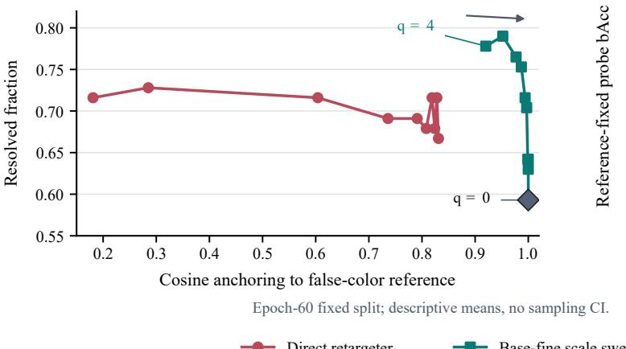

(b) Decoder-logit probe  
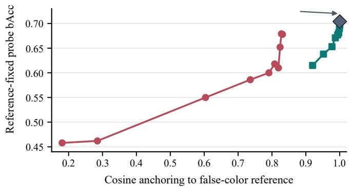  
Fig. S1. Epoch-60 fixed-split anchoring–retention sensitivity. (a) Spectrum-only retargeting and base-fine on 27 stress pairs. (b) The shared reference-fixed decoder-logit probe on 461 objects, using cached logits with reference bAcc 0.704. Curves are descriptive three-seed means over observed ranges; pair response is nonmonotone. Selected base-fine gives pair resolution 0.778 at reference cosine 0.939.  
TABLE S8

Receiving-token composition matters at closely matched recognition. (a) Three optimization seeds with identical residuals/checkpoints/scales; KL P95 uses the jointly recomputed reference. (b) Paired acquisition-session intervals on 461 objects in 66 sessions; all contrasts are exploratory. Positive bAcc and negative KL differences favor the first condition.

(a) Identical-residual results by seed
<table><tr><td>Composition</td><td>Category ↑</td><td>Proxy ↑</td><td>Fixed ↑</td><td>Cached-trained fixed↑</td><td>Refit ↑</td><td>KL P95↓</td></tr><tr><td colspan="7">Seed 0; validation-selected scale 4</td></tr><tr><td>Base-fine</td><td>0.884</td><td>0.928</td><td>0.701</td><td>0.707</td><td>0.757</td><td>1.096</td></tr><tr><td>Pooled replacement</td><td>0.883</td><td>0.927</td><td>0.603</td><td>0.606</td><td>0.725</td><td>5.598</td></tr><tr><td colspan="7">Seed 1; validation-selected scale 4</td></tr><tr><td>Base-fine</td><td>0.900</td><td>0.933</td><td>0.690</td><td>0.687</td><td>0.788</td><td>1.176</td></tr><tr><td>Pooled replacement</td><td>0.896</td><td>0.918</td><td>0.574</td><td>0.576</td><td>0.734</td><td>5.584</td></tr><tr><td colspan="7">Seed 2; validation-selected scale 4</td></tr><tr><td>Base-fine</td><td>0.907</td><td>0.930</td><td>0.711</td><td>0.716</td><td>0.828</td><td>1.202</td></tr><tr><td>Pooled replacement</td><td>0.899</td><td>0.928</td><td>0.592</td><td>0.596</td><td>0.765</td><td>5.597</td></tr></table>

(b) Paired composition and input-code contrasts
<table><tr><td>Comparison</td><td>Metric</td><td>Difference [95% session CI]</td></tr><tr><td>Addition minus replacement</td><td>Category bAcc</td><td>+0.004 [-0.004, +0.013]</td></tr><tr><td>Addition minus replacement</td><td>Fixed readout bAcc</td><td>+0.111 [+0.047, +0.164]</td></tr><tr><td>Addition minus replacement</td><td>Refit readout bAcc</td><td>+0.049 [+0.002, +0.082]</td></tr><tr><td>Addition minus replacement</td><td>Decoder KL P95</td><td>-4.435 [-4.894, -3.993]</td></tr><tr><td>Continuous minus probabilities</td><td>Category bAcc</td><td>-0.020 [-0.035, -0.001]</td></tr><tr><td>Continuous minus probabilities</td><td>Fixed readout bAcc</td><td>+0.006 [-0.010, +0.039]</td></tr><tr><td>Continuous minus probabilities</td><td>Refit readout bAcc</td><td>+0.026 [-0.010, +0.056]</td></tr><tr><td>Continuous minus probabilities</td><td>Decoder KL P95</td><td>+0.065 [+0.047, +0.086]</td></tr></table>

TABLE S9

Composition and supervision controls. (a) Same-residual four-cell comparison with and without injection in the jointly recomputed runtime. Fixed preserves the reference-trained decoder readout. (b) Complete final-epoch matched ablation with refitted cached-logit probes; Pair is both-endpoint correctness, Category/Proxy state are pooled bAcc and Cosine is reference anchoring. Zero scale is a reference endpoint

(a) Composition crossed with injection
<table><tr><td>Spectral input</td><td>Composition</td><td>Category ↑</td><td>Proxy ↑</td><td>Fixed ↑</td><td>Refit ↑</td></tr><tr><td>None</td><td>Original token grid</td><td>0.801</td><td>0.857</td><td>0.695</td><td>0.695</td></tr><tr><td>None</td><td>Pooled replacement</td><td>0.787</td><td>0.857</td><td>0.597</td><td>0.694</td></tr><tr><td>Continuous</td><td>Token-wise base-fine</td><td>0.897</td><td>0.931</td><td>0.701</td><td>0.791</td></tr><tr><td>Continuous</td><td>Pooled replacement</td><td>0.892</td><td>0.924</td><td>0.590</td><td>0.741</td></tr></table>

(b) Matched representation and supervision ablation
<table><tr><td>Representation</td><td>Pair</td><td>Category</td><td>Proxy state</td><td>Refitted logit bAcc</td><td>Cosine</td></tr><tr><td>Visual references</td><td></td><td></td><td></td><td></td><td></td></tr><tr><td>True RGB OpenVLA token</td><td>0.481</td><td>0.779</td><td>0.865</td><td>0.656</td><td>0.703</td></tr><tr><td>False-color HSI base</td><td>0.593</td><td>0.801</td><td>0.857</td><td>0.704</td><td>1.000</td></tr><tr><td>Expanded or spectral features</td><td></td><td></td><td></td><td></td><td></td></tr><tr><td>Raw+NMF feature readout (136-D)</td><td>0.617</td><td>0.832</td><td>0.867</td><td></td><td></td></tr><tr><td>Feature concatenation (4232-D)</td><td>0.519</td><td>0.859</td><td>0.892</td><td>一</td><td>一</td></tr><tr><td>Replacement states</td><td></td><td></td><td></td><td></td><td></td></tr><tr><td>Raw+NMF fixed projection (136 → 4096)</td><td>0.580</td><td>0.799</td><td>0.877</td><td>0.800</td><td>0.013</td></tr><tr><td>Spectral fine only</td><td>0.790</td><td>0.924</td><td>0.937</td><td>0.799</td><td>0.185</td></tr><tr><td>Direct HSI token projection</td><td>0.667</td><td>0.895</td><td>0.925</td><td>0.847</td><td>0.180</td></tr><tr><td>Spectrum-to-reference retargeter</td><td>0.691</td><td>0.899</td><td>0.929</td><td>0.820</td><td>0.815</td></tr><tr><td>Concatenation-projection</td><td>0.667</td><td>0.822</td><td>0.882</td><td>0.822</td><td>0.178</td></tr><tr><td>Base-fine ablations</td><td></td><td></td><td></td><td></td><td></td></tr><tr><td>No fine loss (refit)</td><td>0.728</td><td>0.901</td><td>0.930</td><td>0.772</td><td>0.919</td></tr><tr><td>No injected-branch LayerNorm</td><td>0.778</td><td>0.908</td><td>0.938</td><td>0.689</td><td>0.918</td></tr><tr><td>Random-label residual</td><td>0.605</td><td>0.863</td><td>0.893</td><td>0.672</td><td>0.939</td></tr><tr><td>SPECTRA-VLA base-fine (ours)</td><td>0.778</td><td>0.905</td><td>0.938</td><td>0.711</td><td>0.939</td></tr><tr><td>SPECTRA-VLA, scale 0</td><td>0.593</td><td>0.801</td><td>0.857</td><td>0.704</td><td>1.000</td></tr></table>

egory/proxy contrasts and all contrasts with unprojected $\rho ~ = ~ 0 . 1$ span zero. This study is distinct from principal $1 2 / 6 0$ recognition and the separate short-budget decoder diagnostic.

## S4 SESSION-HELD-OUT GENERALIZATION

Each of 86 outer folds holds out one complete session. From the remaining 85, 48 candidate inner splits use validation fraction 0.16 and seeds 20260809 + f + o. Splits retain all six categories and minimize category-proportion $L _ { 1 }$ drift plus 0.1 times size error. Inner training fits spectral transforms and candidates; outer training refits both after selection. Deterministic frozen visual features contain no populationfitted statistic, so they can be reused across folds.

Inner ambiguity thresholds are {0.80, 0.85, 0.90, 0.95}. The strictest cutoff with at least 20 validation pairs is preferred; otherwise maximum count and then the strictest cutoff. All folds use the 0.80 fallback, with 1–8 validation pairs (mean 5.27). Their fold-specific training pairs receive endpoint weight 4. Candidate/refit seeds are 20260809 + f and $2 0 2 6 0 8 0 9 + 1 0 0 0 0 + f ,$ with 12/60 epochs.

Base-fine and no-projection vary rank {32, 64}, fine-loss weight {0.5, 1, 2} and the ten injection scales. Ridge 1 supplies validation utility bAcc + 0.25 Pair; ties prefer cosine, then smaller scale, rank and fine weight. This gives 60 evaluated operating points per residual family, sharing fits across scales. Base-conditioned direct varies rank {32, 64} and $\alpha ~ \in ~ \{ 0 , 0 . 0 1 , 0 . 0 5 , 0 . 1 , 0 . 5 , 1 , 1 0 \}$ (14 candidates). It requires cosine ≥ 0.94, then orders by utility, cosine, smaller α and rank; if none qualifies, cosine precedes utility. Final category/proxy ridge regularization is selected on inner validation after fixing the representation.

Base-fine selects rank 32/64 in 39/47 folds; scales $0 . 7 5 / 1 / 1 . 5 / 2 / 3 / 4$ in 2/3/8/6/18/49; and fine weight 0.5/1/2 in 23/29/34. Direct selects ranks in 38/48 folds and $\alpha = 0 / 0 . 0 1 / 0 . 0 5 / 0 . 1 / 0 . 5 / 1$ in 1/2/50/20/5/8. All 85 outertraining sessions refit preprocessing, adapter and auxiliary heads; every held-out object contributes one prediction.

Base-fine raises pooled category bAcc from 0.812 to 0.883, with paired session gain interval [0.050, 0.107]. Deleting each session from the fixed predictions leaves gains 0.0680–0.0779 over the base and 0.0651–0.0769 over direct. These ranges describe influence conditional on the trained folds.

Principal intervals use 10,000 session-bootstrap draws (seed 20260891), recomputing pooled macro recall over the fixed six-category/four-state class set. An absent class contributes zero recall; all classes occur in every principal draw. Resampling conditions on realized fits and does not repeat training/selection. Optimization SD and session uncertainty therefore have different interpretations.

Selection-utility sensitivity: Removing the pair term changes 11/86 base-fine choices, 7 no-projection and 25 direct choices. The 11 changed base-fine folds repeat inner fitting/readout selection and 60-epoch outer refitting;

(a) Constraint components  
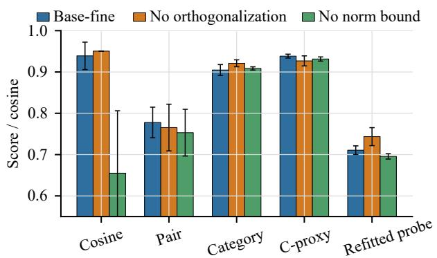

(b) Norm-budget sweep  
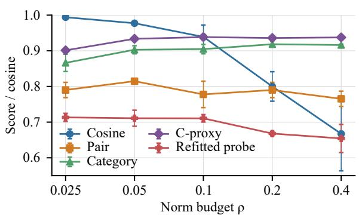

(c) Scale-budget coupling  
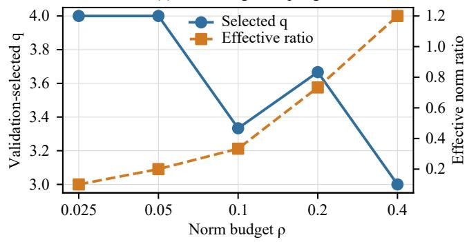

(d) Refitted decoder probe  
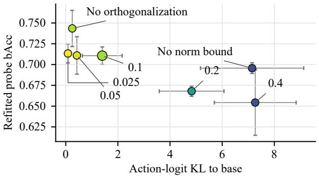  
Fig. S2. Image-disjoint constraint sensitivity at the final epoch, using cached logits and refitted decoder probes (Table S12a). Bars compare $\rho = 0 . 1$ no orthogonalization and no norm bound. The budget sweep separates recognition, anchoring and accessible decoder information; selected scale partly compensates for budget. Error bars are SD across three seeds.

(a) Selection frequency  
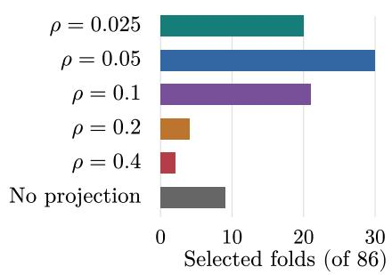

(b) Recognition and anchoring  
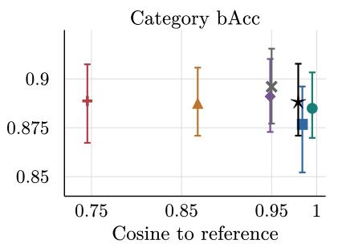  
Orthogonal settings unless marked otherwise

(c) Full decoder range  
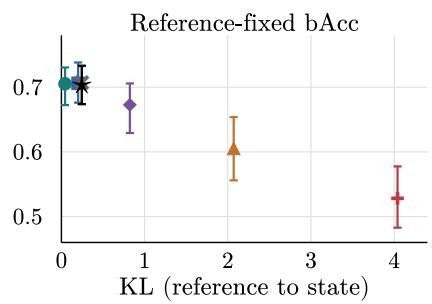  
(d) Low-KL detail (below 0.25)

$$
\bullet \rho = 0 . 0 2 5
$$

$$
\star ~ \rho = 0 . 1
$$

★ Inner selected

$$
\div \rho = 0 . 4
$$

$$
\equiv \rho = 0 . 0 5
$$

$$
\textbf { \em { \mathscr { \rho } } } = 0 . 2
$$

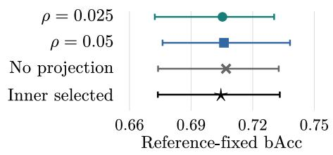

TABLE S10

Input and execution calibration. (a) Capacity-matched raw/NMF inputs, with active width reported separately; $\mathsf { P a i r } _ { 2 7 }$ uses the central stress pairs (b) Validation-CE checkpoint states. (c) Validation mean-displacement allowances; reported tails are measured on test. Decoder values in (b,c) use cached-logit sensitivity, separate from joint recomputation.

(a) Spectral input ablation
<table><tr><td>Spectral input</td><td>Active dim.</td><td>Pair</td><td>Category</td><td>Proxy</td><td>Cos.</td></tr><tr><td>Raw bands</td><td>120</td><td>0.7531</td><td>0.9163</td><td>0.9372</td><td>0.9584</td></tr><tr><td>Train-only NMF</td><td>16</td><td>0.7531</td><td>0.9077</td><td>0.9123</td><td>0.9486</td></tr><tr><td>Raw+NMF</td><td>136</td><td>0.7531</td><td>0.9187</td><td>0.9426</td><td>0.9285</td></tr></table>

All adapters have input width 136 and 320,348 trainable parameters.

(b) Validation-selected checkpoint states
<table><tr><td>Method</td><td>Pair</td><td>Category</td><td>Proxy</td><td>Cos.</td><td>Fixed bAcc</td><td>KL</td></tr><tr><td>No orthogonalization</td><td>0.716</td><td>0.897</td><td>0.931</td><td>0.918</td><td>0.703</td><td>0.405</td></tr><tr><td>Base-fine</td><td>0.716</td><td>0.897</td><td>0.931</td><td>0.919</td><td>0.704</td><td>0.410</td></tr></table>

Both validation-selected states use $q = 4 . 0 0 ;$ KL is over 256 coordinates.

(c) Common displacement allowances
<table><tr><td>Val. budget</td><td>Method</td><td>Category</td><td>Base-fixed FP</td><td>Disp. P95</td><td>KL mean</td><td>KL P95</td></tr><tr><td>0.1</td><td>Base-fine</td><td>0.842</td><td>0.699</td><td>0.107</td><td>0.020</td><td>0.053</td></tr><tr><td>0.1</td><td>No orthogonalization</td><td>0.848</td><td>0.701</td><td>0.107</td><td>0.019</td><td>0.051</td></tr><tr><td>0.2</td><td>Base-fine</td><td>0.880</td><td>0.699</td><td>0.188</td><td>0.054</td><td>0.152</td></tr><tr><td>0.2</td><td>No orthogonalization</td><td>0.880</td><td>0.695</td><td>0.213</td><td>0.064</td><td>0.183</td></tr><tr><td>0.3</td><td>Base-fine</td><td>0.891</td><td>0.692</td><td>0.278</td><td>0.112</td><td>0.319</td></tr><tr><td>0.3</td><td>No orthogonalization</td><td>0.891</td><td>0.694</td><td>0.280</td><td>0.110</td><td>0.307</td></tr><tr><td>0.4</td><td>Base-fine</td><td>0.892</td><td>0.689</td><td>0.320</td><td>0.156</td><td>0.445</td></tr><tr><td>0.4</td><td>No orthogonalization</td><td>0.892</td><td>0.688</td><td>0.323</td><td>0.153</td><td>0.442</td></tr><tr><td>None</td><td>Base-fine</td><td>0.897</td><td>0.704</td><td>0.513</td><td>0.410</td><td>1.115</td></tr><tr><td>None</td><td>No orthogonalization</td><td>0.897</td><td>0.703</td><td>0.520</td><td>0.405</td><td>1.117</td></tr></table>

TABLE S11

Readout robustness after fixing the representations. Mean [minimum, maximum] bAcc spans seven predeclared transformations and three training seeds; ranges are not sampling confidence intervals.
<table><tr><td>Method</td><td>Category</td><td>Proxy</td></tr><tr><td rowspan="2">No projection</td><td>0.891</td><td>0.929</td></tr><tr><td>[0.864, 0.928] 0.789</td><td>[0.909, 0.940]</td></tr><tr><td>Operational base</td><td>[0.769, 0.803]</td><td>0.826 [0.803, 0.857]</td></tr><tr><td>Base-fine</td><td>0.891 [0.874, 0.927]</td><td>0.929 [0.909, 0.940]</td></tr></table>

the other 75 predictions remain fixed. Category bAcc becomes 0.881547 versus 0.882859, difference −0.001313 [−0.006327, 0.001768]; proxy bAcc becomes 0.917447 versus 0.916076, difference 0.001371 [−0.000116, 0.003633]. Training-pair weights and every other setting remain unchanged. Changed choices of the other methods are not refitted.

## S5 AMBIGUITY AND CLUSTERED INFERENCE

Candidate pairs have different categories and images, with cosine above a validation-selected threshold in targetpooled paired RGB tokens. No spectral-distance filter is used. Sorting is by decreasing cosine; ties retain deterministic enumeration order. Greedy matching makes object endpoints disjoint. Pair $\boldsymbol { p } ^ { \mathrm { ~ } } = \left( i , j \right)$ is resolved for seed s only when both endpoints are correct:

$$
R _ { s p } = k / [ { \hat { y } } _ { s i } = y _ { i } \land { \hat { y } } _ { s j } = y _ { j } ] .
$$

Resolution averages this indicator over the inventory. Hard bAcc is macro recall over its endpoints. Method differences are averaged over three seeds before resampling, so seeds add no sampling units.

The fixed-split grid {0.75, 0.80, 0.85, 0.90, 0.95} uses the strictest cutoff yielding at least 20 validation pairs, else maximum count and then the strictest cutoff. It selects 0.75 with 24 validation pairs, producing 27 test pairs: 54 distinct objects, 49 images and 38 sessions. Endpoint records contain category, image/component identity, RGB cosine and spectral angle. Repeated images/sessions make this an object-disjoint clustered stress sample.

Primary pair inference uses 100,000 session-node product-multiplier draws (seed 20260713). Each session receives one independent Exp(1) weight. A cross-session pair receives the product of both endpoint weights; a withinsession pair receives that weight once. The weighted seedaveraged paired difference is recomputed each draw. Basefine-minus-base gives point estimate +0.185 and session interval [−0.030, 0.443]. Image-node, delete-session jackknife and pair-resampling sensitivities are [−0.028, 0.468], [−0.068, 0.438] and [0.037, 0.346]. The point estimate is reported alongside clustered uncertainty; category/session evidence provides the supported recognition gain.

TABLE S12

Constraint sensitivity. (a) Fixed-split final-epoch budget/component ablation with refitted cached-logit probes. Ratios distinguish pre-scale $\| D \| / \| B \|$ and injected q∥D∥/∥B∥; displayed q averages validation-selected scales. (b) Separate 5/15-epoch nested constraint study; Sel. counts inner-validation choices, and the decoder probe is reference-fixed.

(a) Components and norm budget
<table><tr><td>Variant</td><td>q</td><td>Norm ratio D/qD</td><td>Cos.</td><td>KL</td></tr><tr><td>ρ = 0.1 (main)</td><td>3.33</td><td colspan="2">0.100/0.333</td><td>0.939 1.400</td></tr><tr><td>No orthogonalization</td><td>3.00</td><td colspan="2">0.100/0.300 0.951</td><td>0.250</td></tr><tr><td>No norm bound</td><td>2.00</td><td colspan="2">0.671/1.333</td><td>0.655 7.148</td></tr><tr><td> $\rho = 0 . 0 2 5$ </td><td>4.00</td><td colspan="2">0.025/0.100</td><td>0.994 0.085</td></tr><tr><td> $\rho = 0 . 0 5$ </td><td>4.00</td><td colspan="2">0.050/0.200</td><td>0.977 0.427</td></tr><tr><td> $\rho = 0 . 2$ </td><td>3.67</td><td colspan="2">0.200/0.733</td><td>0.800 4.828</td></tr><tr><td> $\rho = 0 . 4$ </td><td>3.00</td><td colspan="2">0.400/1.200</td><td>0.667 7.268</td></tr><tr><td>Variant</td><td>Pair</td><td>Cat. C-proxy</td><td>Refit FP bAcc</td><td></td></tr><tr><td> $\rho = 0 . 1$  (main)</td><td>0.778</td><td>0.905</td><td>0.938</td><td>0.711</td></tr><tr><td>No orthogonalization</td><td>0.765</td><td>0.921</td><td>0.927</td><td>0.743</td></tr><tr><td>No norm bound</td><td>0.753</td><td>0.909</td><td>0.931</td><td>0.696</td></tr><tr><td> $\rho = 0 . 0 2 5$ </td><td>0.790</td><td>0.866</td><td>0.901</td><td>0.713</td></tr><tr><td> $\rho = 0 . 0 5$ </td><td>0.815</td><td>0.903</td><td>0.934</td><td>0.711</td></tr><tr><td> $\rho = 0 . 2$ </td><td>0.790</td><td>0.918</td><td>0.936</td><td>0.668</td></tr><tr><td> $\rho = 0 . 4$ </td><td>0.765</td><td>0.916</td><td>0.937</td><td>0.654</td></tr></table>

(b) Session-held-out constraint selection
<table><tr><td>Variant</td><td>Sel.</td><td>Cat.</td><td>C-proxy</td><td>Cos.</td><td>Base-fixed FP bAcc</td><td>256-KL</td></tr><tr><td>Orthogonal  $\rho = 0 . 0 2 5$ </td><td>20</td><td>0.885</td><td>0.919</td><td>0.995</td><td>0.705</td><td>0.044</td></tr><tr><td>Orthogonal  $\rho = 0 . 0 5$ </td><td>30</td><td>0.877</td><td>0.922</td><td>0.984</td><td>0.706</td><td>0.201</td></tr><tr><td>Orthogonal  $\rho = 0 . 1$ </td><td>21</td><td>0.891</td><td>0.926</td><td>0.948</td><td>0.673</td><td>0.823</td></tr><tr><td>Orthogonal  $\rho = 0 . 2$ </td><td>4</td><td>0.887</td><td>0.933</td><td>0.868</td><td>0.605</td><td>2.071</td></tr><tr><td>Orthogonal  $\rho = 0 . 4$ </td><td>2</td><td>0.889</td><td>0.924</td><td>0.745</td><td>0.528</td><td>4.041</td></tr><tr><td>No orthogonalization,  $\rho = 0 . 1$ </td><td>9</td><td>0.896</td><td>0.929</td><td>0.950</td><td>0.707</td><td>0.245</td></tr><tr><td>Inner-selected</td><td>86</td><td>0.889</td><td>0.924</td><td>0.980</td><td>0.705</td><td>0.245</td></tr></table>

TABLE S13  
Recognition gains across unseen acquisitions. (a) Principal 12/60-epoch comparison on the same 2,291 out-of-fold objects; category macro-F1 and equal-weight session summaries expand the main results. Session means/medians average present-class recalls; Worst-10 averages each method’s ten lowest sessions. (b) Category support and recall. Gray identifies SPECTRA-VLA; bold marks favorable means, not significance.

(a) Aggregate and session-level recognition
<table><tr><td>Method</td><td>Cat.</td><td>Proxy</td><td>Cos.</td><td>F1</td><td>Session mean/median/worst-10</td></tr><tr><td>False-color base</td><td>0.812</td><td>0.860</td><td>1.000</td><td>0.760</td><td>0.792/0.826/0.401</td></tr><tr><td>High-anchor direct</td><td>0.814</td><td>0.862</td><td>0.991</td><td>0.796</td><td>0.806/0.839/0.433</td></tr><tr><td>SPECTRA-VLA (ours)</td><td>0.883</td><td>0.916</td><td>0.939</td><td>0.863</td><td>0.893/0.936/0.612</td></tr><tr><td>No orthogonalization</td><td>0.893</td><td>0.929</td><td>0.937</td><td>0.877</td><td>0.892/0.933/0.584</td></tr></table>

(b) Category support and recall
<table><tr><td>Category</td><td>Objects</td><td>Sessions</td><td>Base</td><td>Base-fine</td></tr><tr><td>Film</td><td>334</td><td>63</td><td>0.734</td><td>0.868</td></tr><tr><td>Basket</td><td>321</td><td>35</td><td>0.844</td><td>0.903</td></tr><tr><td>Cardboard</td><td>60</td><td>24</td><td>0.767</td><td>0.883</td></tr><tr><td>Video tape</td><td>644</td><td>37</td><td>0.837</td><td>0.899</td></tr><tr><td>Filament</td><td>92</td><td>33</td><td>0.859</td><td>0.848</td></tr><tr><td>Bag</td><td>840</td><td>73</td><td>0.833</td><td>0.895</td></tr></table>

TABLE S14

Ambiguity-definition sensitivity. (a) Threshold-specific inventories; resolution averages seed estimates, and exact-CI envelopes span per-seed intervals rather than providing pooled coverage. (b) Continuous similarity over 215 fixed object-disjoint pairs, with differences averaged across seeds before inference. Its session-node intervals use 20,000 draws (seed 20260805).

(a) Threshold sensitivity
<table><tr><td>Method</td><td>Cosine 0.75 (n = 27)</td><td>Cosine 0.80 (n = 9)</td></tr><tr><td>Base</td><td>0.593 [0.388, 0.776]</td><td>0.556 [0.212, 0.863]</td></tr><tr><td>Raw spectrum</td><td>0.630 [0.424, 0.806]</td><td>0.556 [0.212, 0.863]</td></tr><tr><td>Direct retargeter</td><td>0.691 [0.460, 0.862]</td><td>0.593 [0.212, 0.925]</td></tr><tr><td>Base-fine</td><td>0.778 [0.537, 0.937]</td><td>0.741 [0.299, 0.972]</td></tr><tr><td>Base-fine (no pair weighting)</td><td>0.765 [0.498, 0.937]</td><td>0.667 [0.299, 0.925]</td></tr></table>

Cells give resolution [per-seed exact 95% CI envelope]. Cutoffs 0.85–0.95 yield 0 eligible test pairs for every method

(b) Continuous RGB-token similarity
<table><tr><td>Similarity bin</td><td>Pairs</td><td>Mean cosine</td><td>Mean gain</td><td>Base-fine resolution</td></tr><tr><td>Q1, least similar</td><td>54</td><td>0.419</td><td>+0.093</td><td>0.889</td></tr><tr><td>Q2</td><td>54</td><td>0.600</td><td>+0.179</td><td>0.827</td></tr><tr><td>Q3</td><td>53</td><td>0.682</td><td>+0.214</td><td>0.704</td></tr><tr><td>Q4, most similar</td><td>54</td><td>0.757</td><td>+0.210</td><td>0.673</td></tr><tr><td>Spearman  $\rho$ </td><td>215</td><td>0.115; session-clustered 95% CI [-0.073, 0.308]</td><td></td><td></td></tr></table>

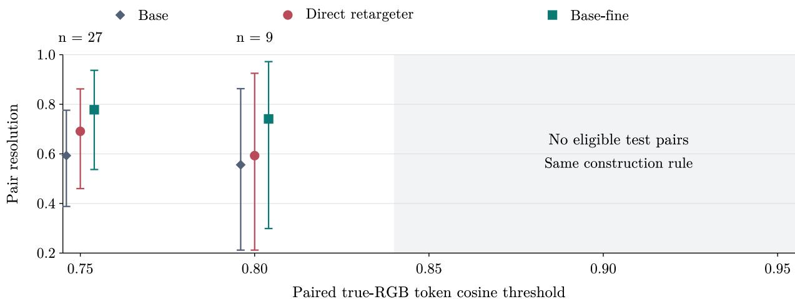  
Fig. S4. Threshold sensitivity with separately reconstructed inventories: 0.75 yields 27 pairs, 0.80 yields 9, and stricter thresholds yield none. Points are three-seed means; whiskers span per-seed exact pair-binomial intervals and are descriptive rather than a pooled 95% interval.

The continuous inventory has 215 disjoint cross-category pairs above cosine zero, 155 images and 65 sessions, grouped into four predefined quantiles. Spearman association between RGB similarity and spectral gain is 0.115 [−0.073, 0.308]. Quartile means are positive but nonmonotone; this sensitivity does not select the central stress inventory.

## S6 DECODER-READOUT DIAGNOSTICS

## S6.1 Fixed-Split Recognition and Decision-Function Reuse

The generic sorting prompt contains no category/state word and the supplied mask specifies the target. All representations use the same 256 action coordinates and ridge family. Refitted probes measure accessible four-state information;

reference-fixed probes preserve the established standardizer/head. The category-lookup arm predicts six categories from the same frozen logits, then applies Table S1.

Epoch-60 cached logits give refitted base-fine/base bAcc 0.711/0.704 (session difference [−0.043, 0.095]); referencefixed bAcc is 0.620, difference −0.084 [−0.137, −0.030]. Jointly recomputing the same residuals at q = (2, 4, 4) gives 0.617358/0.694685, difference −0.077327 [−0.117507, −0.035220]. Earlier CE-selected epochs (3, 6, 4) yield 0.701 at q = 4: checkpoint and scale differ, but the recomputed runtime and reference-fixed readout are identical. Cached sensitivities remain separate.

## S6.2 Session-Shift Diagnostic

The separate five-selection/15-refit-epoch protocol uses the same 2,291 objects and 86 outer sessions. Inner split seeds are 20260710 + k + o for 48 trials; splits retain all categories and minimize proportion drift plus 0.1 size error. Candidates vary ranks {16, 32, 64, 128}, fine weights {0.5, 1, 2}, the full scale grid and direct alignment grid. Ridge 1 supplies category-plus-0.25-pair utility; exact ties prefer smaller rank, scale, representation-readout value, fine weight and alignment weight. Final regularization follows representation selection. All transforms are inner-trained, then outerrefitted; the action head is fitted only on base logits and fixed across representations.

TABLE S15  
Paired differences (S6). Fixed-split decoder/prototype rows: epoch-60 representation-refitted readouts, pooled scores. Nested rows: reference-fixed readouts, equal-weight session means (not pooled OOF). Accuracy up/KL down favors base-fine; bold excludes zero. Base/direct contrasts are primary/exploratory. Direct-pair CIs are descriptive; other CIs use indicated image/session units. Seed SD: optimization spread.
<table><tr><td>Metric</td><td>∆ [95% CI] Seed SD</td><td></td></tr><tr><td>Fixed-split base contrast Pair Category bAcc Hard bÁcc  $+ 0 . 0 5 9 \ [ - 0 . 0 1 3 , + 0 . 1 4 1 ]$ </td><td>+0.185 [-0.030,+0.443] +0.104  $\bar { [ + 0 . 0 5 8 , + 0 . 1 5 4 ] }$ </td><td>0.037 0.013 0.032</td></tr><tr><td>C-proxy bAcc Pair Category bAcc</td><td>+0.081 [+0.022,+0.147] Fixed-split direct contrast (exploratory) +0.086  $[ - 0 . \dot { 0 } 2 5 , + 0 . \dot { 1 } 8 5 ]$  +0.006  $\mathsf { \bar { [ - 0 . 0 1 5 , + 0 . 0 2 8 ] } }$ </td><td>0.005 0.057 0.030</td></tr><tr><td>Hard bÁcc C-proxy bAcc Fixed-split decoder, base contrast</td><td>+0.031  $\left[ - 0 . 0 3 6 , + 0 . 1 0 3 \right]$  +0.010  $[ - 0 . 0 1 4 , + 0 . 0 3 4 ]$ </td><td>0.050 0.007</td></tr><tr><td>Probe bAcc Prototype bAcc 256-KL</td><td>+0.007  $\left[ - 0 . 0 6 3 , + 0 . 0 8 4 \right]$  -0.065  $[ - 0 . 1 6 1 , + 0 . 0 1 0 ]$  +1.400  $\left[ + 1 . 2 7 6 , + 1 . 5 4 3 \right]$ </td><td>0.011 0.006 0.763</td></tr><tr><td>Nested decoder, base contrast probe bAcc prototype bAcc</td><td>-0.024  $[ - 0 . 0 5 0 , + 0 . 0 0 2 ]$  -0.024  $\left[ - 0 . 0 5 9 , + 0 . 0 0 8 \right]$ </td><td></td></tr></table>

$\Delta = b a s e – f i n e$ minus reference. The primary base-pair CI resamples 38 sessions; its descriptive pair-bootstrap CI is [0.037, 0.346]. Other fixed-split units: 27 pairs, 49 images for Hard, 159 images otherwise; nested units: 86 sessions. Direct contrasts are exploratory.

Base-fine/base OOF bAcc is 0.684/0.705. The mean paired session difference is −0.024438, with 4,000 sessionbootstrap interval [−0.049086, 0.001150] (seed 20260710), rather than the pooled-score difference −0.020785. Table S15 rounds these bounds outward to three decimals. Session sizes range from 1 to 122 objects (median 19); instance weighting gives approximately −0.022 versus −0.024 unweighted. This is a fixed-budget shift diagnostic.

## S6.3 Normalization and Action-Coordinate Sensitivity

A raw-token-trained ridge selects regularization 100 on raw validation logits, then stays fixed on raw, normalized G and injected states. The G-trained reference selects 10. Statespecific refits use the common grid. The raw-trained readout changes from 0.730378 to 0.647454 after normalization and 0.610655 after injection. Individual differences span zero; the total raw-to-injected interval is [−0.205931, −0.006330]. The G-trained fixed readout declines by 0.084164. Seventeen bootstrap draws omit a class, handled identically in both arms.

The separate normalized-input vocabulary diagnostic clips each original band by imagewise 2nd/98th percentiles before interpolation. Bands [24, 60, 96] are normalized again for false color; the object spectrum is L2-normalized and train-standardized without NMF. Float16 mask weights use area occupancy divided by its maximum plus $1 0 ^ { - 8 }$ . The 319,292-parameter model uses threshold 0.80, CE-selected epochs (1, 2, 3) and $q \ = \ 4 .$ . All 32,064 logits arise from one forward before extracting action coordinates and three preset 256-coordinate complements.

## S7 NUMERICAL GEOMETRY AND FORWARD EQUIVALENCE

## S7.1 Executed-Token Geometry

The normalized false-color reference G is the exact $q = 0$ endpoint: its token/logit differences and KL are zero, top-1 agreement is one and downstream differences are zero. Positive-scale projection is numerically, rather than exactly, orthogonal. Across 6,885 object states, maximum absolute normalized dot product is $2 . { \overset { \cdot } { 4 } } 9 \times 1 0 ^ { - 7 }$ and maximum normratio error from $\rho = 0 . 1$ is $1 . 1 3 \times 1 0 ^ { - 6 }$ (means $4 . 0 1 \times 1 0 ^ { - 8 }$ and $3 . 7 7 \times 1 0 ^ { - 7 } )$ . Distinct reference pooling routines differ by at most $9 . 5 4 \times 1 0 ^ { - 6 }$ (mean $6 . 7 0 \times \overset { \cdot } { 1 0 ^ { - 8 } } )$ ; this is separate from the bypass identity.

For real-arithmetic mean-centered $G _ { t . }$ , define $D _ { c } = D -$ ${ \bar { D } } \mathbf { 1 } ,$

$$
\alpha _ { t } = \frac { G _ { t } ^ { \top } D _ { c } } { \| G _ { t } \| ^ { 2 } } , \qquad \beta _ { t } = \frac { \| D _ { c } \| ^ { 2 } } { \| G _ { t } \| ^ { 2 } } .
$$

For nonzero inputs, LayerNorm’s positive scale cancels from cosine:

$$
\cos ( G _ { t } , \mathrm { L N } _ { \epsilon } ( G _ { t } + q D ) ) = \frac { 1 + q \alpha _ { t } } { \sqrt { 1 + 2 q \alpha _ { t } + q ^ { 2 } \beta _ { t } } } .
$$

Pooled orthogonality does not set every $\alpha _ { t }$ to zero. With $c _ { t } = [ d ^ { - 1 } \lVert G _ { t } ^ { - } + q D _ { c } ^ { - } \rVert ^ { 2 } + \epsilon ] ^ { - 1 / 2 } , a _ { t } = \mathrm { i } - m _ { t } + m _ { t } c _ { t }$ and $b _ { t } = m _ { t } c _ { t } q .$ , fractional-mask composition gives

$$
\cos ( G _ { t } , a _ { t } G _ { t } + b _ { t } D _ { c } ) = \frac { a _ { t } + b _ { t } \alpha _ { t } } { \sqrt { a _ { t } ^ { 2 } + 2 a _ { t } b _ { t } \alpha _ { t } + b _ { t } ^ { 2 } \beta _ { t } } } .
$$

Token alignment and occupancy jointly determine executed movement; decoder KL is measured empirically.

## S7.2 Training Surrogate and Executed Pool

At epoch 60, $q \ = \ ( 2 , 4 , 4 )$ for seeds (0, 1, 2), the 461 test objects yield 1,383 training/executed-pool comparisons: cosine 0.9977, mean/P95 relative distance $\| T _ { q } - \mathbf { \dot { C } } _ { q } \| / \| T _ { q } \| =$ 0.0569/0.1328, and coordinate-mean residual energy 0.0098%. Validation occupancy cuts 0.0204, 0.0522, 0.1080 give quartile distances 0.0537, 0.0276, 0.0497, 0.0965 and cosines 0.9981, 0.9994, 0.9985, 0.9948. The unchanged auxiliary category head is evaluated separately at validation-CE epochs $( 3 , 6 , 4 )$ and $q \quad = \quad 4 \colon$ prediction disagreement is 2.82%, with mean true-category margin changes −0.042, 0.205, 0.174 by seed. Thus small aggregate geometric differences need not imply identical decisions. Protocol normalization changes the raw decoder response: raw-to-G action KL mean/P95/P99 is 2.610/5.413/6.888, reverse KL 2.399 and top-1 agreement 0.163. Operational logits agree with the cached reference on all 2,295 objects. The explicit zero endpoint is G.

## TABLE S16

Fixed-epoch decoder readouts using cached logits. (a) Refitted and category-lookup readouts, plus one reference-trained ridge with regularization 10 applied unchanged. The combined column reports its four-state bAcc, then native action-symbol argmax agreement with the false-color reference over 256 logits. (b) Proxy recall after category prediction and lookup. Means use three seeds; higher bAcc/agreement and lower reference-to-altered KL are favorable.

(a) Complete decoder comparison
<table><tr><td>Representation</td><td>Refitted probe Acc.</td><td>Refitted probe bAcc</td><td>Ref.-fixed bAcc / symbol agreement</td><td>Category lookup bAcc</td><td>256-KL</td></tr><tr><td>Majority</td><td>0.551</td><td>0.250</td><td></td><td></td><td></td></tr><tr><td>Zero visual</td><td>0.282</td><td>0.250</td><td></td><td>0.250</td><td></td></tr><tr><td>True RGB token</td><td>0.751</td><td>0.656</td><td></td><td>0.615</td><td>5.251</td></tr><tr><td>False-color base</td><td>0.781</td><td>0.704</td><td>0.704/1.000</td><td>0.726</td><td>0.000</td></tr><tr><td>Raw+NMF fixed projection (136 →4096)</td><td>0.850</td><td>0.800</td><td></td><td>0.775</td><td>5.042</td></tr><tr><td>Spectral fine only</td><td>0.803</td><td>0.799</td><td></td><td>0.790</td><td>9.397</td></tr><tr><td>Direct HSI token projection</td><td>0.852</td><td>0.847</td><td>0.457/0.081</td><td>0.827</td><td>4.818</td></tr><tr><td>Direct retargeter</td><td>0.872</td><td>0.820</td><td>0.627/0.167</td><td>0.799</td><td>2.890</td></tr><tr><td>Concatenation-projection</td><td>0.907</td><td>0.822</td><td>0.463/0.074</td><td>0.813</td><td>4.795</td></tr><tr><td>SPECTRA-VLA (ours)</td><td>0.759</td><td>0.711</td><td>0.620/0.377</td><td>0.698</td><td>1.400</td></tr></table>

(b) Category-to-proxy recall
<table><tr><td>Representation</td><td>C-proxy 0</td><td>C-proxy 1</td><td>C-proxy 2</td><td>C-proxy 3</td><td>bAcc</td></tr><tr><td>False-color base</td><td>.700</td><td>.823</td><td>.582</td><td>.800</td><td>.726</td></tr><tr><td>Direct retargeter</td><td>.667</td><td>.903</td><td>.801</td><td>.826</td><td>.799</td></tr><tr><td>SPECTRA-VLA (ours)</td><td>.600</td><td>.810</td><td>.602</td><td>.782</td><td>.698</td></tr></table>

TABLE S17

Short-budget session-held-out reference-fixed decoder diagnostic. Each representation is inner-selected, refitted for 15 epochs and tested once per held-out object. Pooled OOF bAcc uses 2,291 predictions; equal-weight session summaries average present-class recalls. This five/15-epoch study differs from principal 12/60 recognition and the fixed-rank constraint experiment.

<table><tr><td>Method</td><td>Fixed bAcc</td><td>F1</td><td>Session mean/median/worst-10</td><td>W/L/T</td></tr><tr><td>False-color base</td><td>0.705</td><td>0.640</td><td>0.682/0.750/0.162</td><td></td></tr><tr><td>Direct retargeter</td><td>0.560</td><td>0.533</td><td>0.621/0.651/0.081</td><td>27/43/16</td></tr><tr><td>Concatenation-projection</td><td>0.447</td><td>0.362</td><td>0.391/0.442/0.000</td><td>8/72/6</td></tr><tr><td>SPECTRA-VLÀ (ours)</td><td>0.684</td><td>0.612</td><td>0.658/0.725/0.142</td><td>18/38/30</td></tr></table>

TABLE S18

Decoder-coordinate decomposition and paired uncertainty. (a) Fixed versus state-specific readouts on identical objects/coordinates. (b) Conditional paired intervals for OpenVLA coordinate changes and SpatialVLA gains; 10,000 shared 66-session draws (seed 20260922), with absent-class recall zero. Bold marks intervals excluding zero, including adverse effects.

(a) Normalization and injection
<table><tr><td>Readout fitting</td><td>Raw</td><td>G</td><td>Injected</td></tr><tr><td>Raw-trained, fixed</td><td>0.730</td><td>0.647</td><td>0.611</td></tr><tr><td>G-trained, fixed</td><td>0.609</td><td>0.704</td><td>0.620</td></tr><tr><td>State-specific refit</td><td>0.730</td><td>0.704</td><td>0.711</td></tr></table>

(b) Paired session differences
<table><tr><td>Endpoint and paired contrast</td><td>∆bAcc [95% session CI]</td></tr><tr><td>Raw-trained: G minus raw</td><td>-0.083 [−0.197, +0.069]</td></tr><tr><td>Raw-trained: injected minus G</td><td>-0.037 [-0.125, +0.031]</td></tr><tr><td>Raw-trained: injected minus raw</td><td>-0.120 [−0.206, -0.006]</td></tr><tr><td>G-trained: injected minus G</td><td>-0.084 [-0.137, -0.030]</td></tr><tr><td>SpatialVLA category: SPECTRA-VLA minus base</td><td>+0.102 [+0.043, +0.177]</td></tr><tr><td>SpatialVLA proxy: ŠPECTRA-VLA minus base</td><td>+0.076 [+0.025, +0.127]</td></tr></table>

TABLE S19  
Separate normalized-input vocabulary diagnostic (Section S6.3). Action-coordinate movement versus three preset vocabulary complements at $q = 4 .$ Each 256-coordinate subset is internally normalized from the same full-vocabulary forward. Objectwise means across adapter seeds precede paired acquisition-session inference. Complement sets are descriptive controls rather than a vocabulary-wide null.
<table><tr><td>Complement seed</td><td>KL (action/complement ratio)</td><td>Difference [95% session CI]</td></tr><tr><td>20260813</td><td>0.086515  $( 6 . 0 2 9 \times )$ </td><td>0.435093 [0.385371, 0.495584]</td></tr><tr><td>20260814</td><td>0.086559  $( 6 . 0 2 6 \times )$ </td><td>0.435049 [0.385856, 0.497977]</td></tr><tr><td>20260815</td><td>0.083752  $( 6 . 2 2 8 \times )$ </td><td>0.437856 [0.387819, 0.498721]</td></tr></table>

Action-coordinate KL is 0.521608 for all three complements.

TABLE S20  
Auxiliary-head behavior by validation occupancy quartile (validation-CE epochs $3 , 6 , 4 ; q = 4 )$ . Margins are true-category logits minus the largest competitor, reported as $T _ { q } / C _ { q } .$ . Section S7.2 separately gives epoch-60 geometry.
<table><tr><td>Quartile</td><td>Disagree (%)</td><td> $T _ { q } / C _ { q }$  margin</td><td> $\Delta$ </td></tr><tr><td>1</td><td>2.84</td><td>5.890/5.593</td><td>-0.297</td></tr><tr><td>2</td><td>3.51</td><td>4.910/4.857</td><td>-0.053</td></tr><tr><td>3</td><td>1.93</td><td>5.586/5.833</td><td>+0.247</td></tr><tr><td>4</td><td>3.21</td><td>6.157/6.818</td><td>+0.661</td></tr></table>

## S7.3 Official Forward and Token Reinsertion

On 171 unmodified held-out RGB observations, the official multimodal OpenVLA forward and extraction/reinsertion of its same raw visual grid use identical prompt, masks, positions, pixels, weights and bfloat16 inference. Across all 32,064 runtime coordinates, maximum absolute logit difference, full-vocabulary KL and action-mass difference are zero; full/action-subset top-1 agreements are one. Mean action-subset mass is 0.999966. This validates the visual insertion interface before normalization and readout; the method’s zero endpoint is the protocol-normalized falsecolor reference.

## S8 BACKBONE AND OBSERVATION ROBUSTNESS S8.1 Second Frozen VLA

SpatialVLA repeats the same objects, train-only features, rank 64, three seeds, 60 epochs and validation scale/ridge selection. Pooled heads refit per representation; correspondence controls retain correct-spectrum heads. One action ridge fitted/selected on base training/validation logits stays fixed throughout. Base-fine reaches pooled cosine 0.985, with category/proxy bAcc 0.914/0.947 versus base 0.812/0.871. Reference-fixed decoder performance remains lower, reproducing the distinction between enriched token information and retained decoder decisions.

## S8.2 Grounding

Every supplied region re-encodes the masked false-color image and supplies its mean spectrum. Empty regions give black images, zero spectra and masks. Each representation’s readout is trained on ground-truth-region logits and fixed across test perturbations, as is its scale.

The predicted-mask model is pretrained FCN-ResNet50 trained for six epochs on $1 6 0 ^ { 2 }$ RGB with ImageNet normalization, random flips, AdamW $8 \times 1 0 ^ { - 5 } / 1 0 ^ { - 4 }$ , inversesquare-root pixel-frequency weights (background ×0.25)

and auxiliary CE weight 0.35. Foreground mIoU on 80 fixed validation images (seed 4137) selects the checkpoint. Resized test logits are argmaxed. Given the target category, components below 40 pixels are removed and the largest remaining component is chosen, without matching the target. The separate oracle-matched diagnostic uses maximum target IoU. A four-pixel shift gives approximately neutral 0.638/0.643. Moderate region errors and poor target selection therefore have different effects.

## S8.3 Capacity and Spectral Bands

The raw-only rank sweep uses 120 bands without NMF. Parameter count is $2 p + \bar { r ( p + 1 ) } + 4 0 9 6 r + 2 \cdot 6 ( 4 0 9 6 + 1 ) .$ or 4217r + 49404 for p = 120. Raw-only rank 64 has 270,128 mapper/319,292 total parameters, versus the principal 136- input model’s 271,184/320,348. Category/pair at rank 64 is 0.894/0.796, versus 0.884/0.778 at rank 256.

Session-held-out band exclusion fixes rank 64, fine weight 1 and $\rho \quad = \quad 0 . 1$ , with 12/60 epochs. Inputs are full [0, . . . , 119], base [119, 60, 0], base exclusion $[ 1 , \ldots , 5 9 , 6 1 , \ldots , 1 1 8 ] .$ , random [20, 75, 82] and contiguous [30, 31, 32]. Selected values fill a zero-padded 120-channel vector. NMF uses min(16, selected bands) components, padded to 16 after training-fitted scaling/standardization. The full-input category bAcc is 0.886 versus base-band 0.835, difference 0.050 [0.032, 0.075]; exclusion retains 0.878. The fixed hyperparameters distinguish this control from principal nested selection.

## S8.4 Rendering and Radiometry

Six-render augmentation compares HSI display constructions: fixed sensor [119, 60, 0], percentilescaled low/mid/high SWIR [119, 60, 0], NIR [16, 8, 0], random [105, 61, 7], gain/offset [96, 60, 24] and trainfitted PCA. Per training image, 512 sampled pixels (seed 20260710) determine 2nd/98th percentiles $L _ { b } , H _ { b } .$ Display is $2 5 5 \mathrm { c l i p } [ ( x _ { b } ~ - ~ L _ { b } ) / ( H _ { b } ~ - ~ \overset { \cdot } { L } _ { b } ~ + ~ 1 0 ^ { - 6 } ) , 0 , 1 ] ,$ except fixed sensor uses (0, 65535). Gain/offset maps $x _ { b }$ to $( 1 + 0 . 2 0 \sin \phi _ { b } ) x _ { b } + 0 . 0 5 \operatorname* { m a x } ( H _ { b } - L _ { b } , 1 0 ^ { - 6 } )$ cos $\phi _ { b . }$ $\phi _ { b } = 2 \pi b / 1 1 9 . \mathrm { P C A }$ fits three randomized-SVD components on the same sampled pixels and their training display percentiles.

Each epoch shuffles 8,352 rows (six per training object) with repeated spectra/labels and $\omega _ { i } = 1$ . Mean validation category bAcc plus 0.25 mean pair resolution selects $q =$ (4, 4, 3), with smaller-scale ties. One readout trained on all augmented rows and each seed’s scale remain fixed across test views. Paired-RGB tokens define the visually similar stress pairs; the six training and test views above are HSI renderings.

TABLE S21  
SpatialVLA replication. (a) Matched states with refitted pooled heads and one reference-fixed decoder probe. KL/top-1 use all 8,194 action coordinates. (b) Correspondence controls retain correct-spectrum pooled heads; the action head remains reference-fixed. At zero scale the grid/logits equal the base, though pooled scores use different heads.  
(a) Matched representations
<table><tr><td>SpatialVLA representation</td><td>Cat.</td><td>Pair</td><td>C-proxy</td><td>Cos.</td><td>Base-fixed FP</td><td>Full KL</td><td>Top-1 agr.</td></tr><tr><td>False-color base</td><td>0.812</td><td>0.704</td><td>0.871</td><td>1.000</td><td>0.718</td><td>0.000</td><td>1.000</td></tr><tr><td>Direct retargeter</td><td>0.836</td><td>0.642</td><td>0.888</td><td>0.229</td><td>0.588</td><td>4.529</td><td>0.155</td></tr><tr><td>Base-fine</td><td>0.914</td><td>0.827</td><td>0.947</td><td>0.985</td><td>0.673</td><td>0.709</td><td>0.522</td></tr><tr><td>No orthogonalization</td><td>0.894</td><td>0.753</td><td>0.928</td><td>0.974</td><td>0.703</td><td>0.594</td><td>0.611</td></tr></table>

(b) Spectral correspondence
<table><tr><td>Fine condition</td><td>Cat. bAcc</td><td>Pair</td><td>C-proxy bAcc</td><td>Base-fixed FP</td><td>Full KL</td></tr><tr><td>Correct target fine</td><td>0.914</td><td>0.827</td><td>0.947</td><td>0.673</td><td>0.709</td></tr><tr><td>Zero fine (q = 0)</td><td>0.743</td><td>0.593</td><td>0.811</td><td>0.718</td><td>0.000</td></tr><tr><td>Wrong-target fine</td><td>0.642</td><td>0.358</td><td>0.717</td><td>0.685</td><td>0.748</td></tr><tr><td>Sampǐe-shuffled fine</td><td>0.574</td><td>0.469</td><td>0.698</td><td>0.679</td><td>0.766</td></tr><tr><td>Class-mismatched fine</td><td>0.534</td><td>0.198</td><td>0.682</td><td>0.685</td><td>0.754</td></tr><tr><td>Norm-matched random</td><td>0.706</td><td>0.543</td><td>0.797</td><td>0.712</td><td>0.455</td></tr></table>

OpenVLA mask robustness Class-oracle region selection  
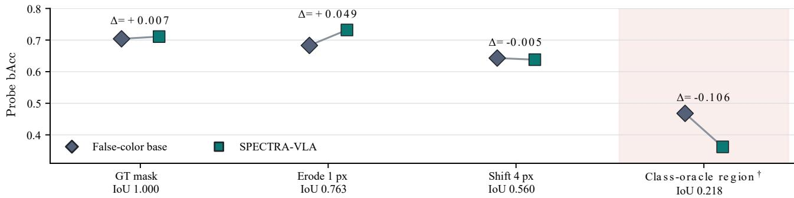  
Fig. S5. Region re-encoding on 461 objects in the earlier cached decoder configuration (Section S1.6). Each representation’s ground-truth-masktrained probe and scale remain fixed across masks. Probes use 256 first-position coordinates; points are descriptive means without sampling intervals. Erosion preserves base-fine/base bAcc 0.732/0.683; largest predicted components supplied with the target category (†) give IoU 0.218 and bAcc 0.362/0.468.

## S8.5 Class Errors and Conditional Recognition

Class recalls and confusion matrices use the same 461 objects and average per-seed row proportions rather than pooling seeded predictions. They separate six-category recognition, the four-state pooled proxy and the refitted decoder probe.

Conditional recognition partitions predictions by base correctness. If $p _ { s }$ is base accuracy, $r _ { s m }$ retention of basecorrect predictions and $c _ { s m }$ correction of base errors, then $\begin{array} { r } { \hat { \mathrm { A c c } } _ { s m } = p _ { s } r _ { s m } + ( 1 - p _ { s } ) c _ { s m } } \end{array}$ . Base-fine retains 0.975 of correct predictions and corrects 0.542 of errors at $q = ( 2 , 4 , 4 )$ and category ridge 100. The same identities/base predictions are shared with high-anchor direct; 100,000 66-session multiplier draws estimate paired uncertainty. Main Fig. 3 illustrates category correction, injection-induced harm, unresolved recognition and poor-region decoder failure. The first three show refitted category predictions, with fixed-readout outcomes reported separately. The fourth chooses the largest predicted target-category component and has IoU 0.0029. These outcome-selected examples illustrate failure types rather than prevalence; display scaling and cropping do not alter the model inputs.

## S9 PUBLISHED SPECTRAL FEATURES AND EX-TERNAL MATERIALS

## S9.1 Frozen Spectral Encoders

Published spectral features test discrimination on the same objects [6], [7], [8], [9], [10]. HyperSL uses the 120-band object mean with approximate 900–1700 nm coordinates (256-D output). MaskedSST uses 200 resampled bands in a masked $8 \times 8$ crop (96-D mean tokens); Spectral-GPT uses 12 bands in a masked $9 6 ^ { 2 }$ crop, zero mask ratio (768-D); DOFA uses masked 2242 crops at indices [0, 11, 22, 32, 43, 54, 65, 76, 87, 97, 108, 119] with micrometer wavelength coordinates (768-D); HyperSIGMA uses 120 bands in a masked $6 4 ^ { 2 }$ crop (128-D). Raw spectra retain width 120.

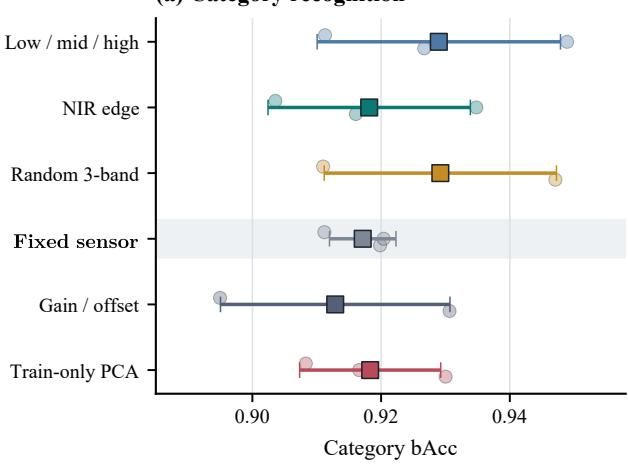

(b) Fixed stress-pair inventory  
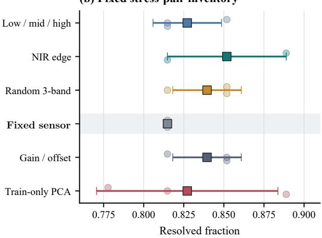  
Fig. S6. Rendering and radiometric robustness after six-view training. Fixed sensor denotes the primary reference bands [119, 60, 0]. Category bAcc spans 0.913–0.929 and pair resolution 0.815–0.852. Points are seeds 0–2; squares/whiskers are means and seed SD, not sampling confidence intervals.

TABLE S22  
Grounding sensitivity with fixed ground-truth-region-trained decoder readouts and scales. Every condition re-encodes its region. IoU compares with the target mask; predicted masks receive the target category and select its largest predicted component.
<table><tr><td>Representation</td><td>Acc.</td><td>bAcc</td><td>F1</td></tr><tr><td>GT (IoU=1.000)</td><td></td><td></td><td></td></tr><tr><td>Base</td><td>0.781</td><td>0.704</td><td>0.642</td></tr><tr><td>Base-fine</td><td>0.759</td><td>0.711</td><td>0.628</td></tr><tr><td>Erode (IoU=0.763)</td><td></td><td></td><td></td></tr><tr><td>Base</td><td>0.759</td><td>0.683</td><td>0.617</td></tr><tr><td>Base-fine</td><td>0.772</td><td>0.732</td><td>0.649</td></tr><tr><td>Shift (IoU=0.560)</td><td></td><td></td><td></td></tr><tr><td>Base</td><td>0.764</td><td>0.643</td><td>0.602</td></tr><tr><td>Base-fine</td><td>0.757</td><td>0.638</td><td>0.597</td></tr><tr><td colspan="4">Class-oracle predicted (IoU=0.218)</td></tr><tr><td>Base</td><td>0.568</td><td>0.468</td><td>0.424</td></tr><tr><td>Base-fine</td><td>0.508</td><td>0.362</td><td>0.334</td></tr></table>

All conditions evaluate the same 461 objects.

HyperSL, MaskedSST and SpectralGPT have complete pretrained weights. DOFA’s unavailable featurenormalization parameters retain identity initialization; its classification head is unused. HyperSIGMA lacks pretrained parameters in active attention blocks. These partial-load results form distinct diagnostic groups. All features use the same 1,392/442/461 objects, signed pooling, trainonly standardization and validation-selected class-balanced ridge. Selected category coefficients are 1 (HyperSL), 0.1 (MaskedSST), 10 (DOFA), 1 (SpectralGPT), 10 (Hyper-

SIGMA) and 0.01 (raw spectrum); proxy coefficients are selected independently. Pair resolution uses the same 27 stress pairs. HSI-Adapter [11] supplies driving-segmentation code but had no released pretrained checkpoint when inspected on 22 September 2026, so its contribution is discussed in related work rather than numerically benchmarked.

## S9.2 Dataset-Specific Material Transfer

Mendeley Wood and SpecTex [12], [13] test base-fine feature augmentation with a new basis fitted per dataset. These expanded ridge/PCA features are separate from nativewidth VLA composition.

Wood’s 204-D three-band base joins means, standard deviations, 25th/75th percentiles and 8 × 8 block means. A standardized ridge with $\alpha ~ = ~ 1 0$ predicts the 320-D mean spectrum; training-residual PCA supplies fine width $k \in \{ \hat { 0 , } 4 , 8 , 1 6 , 3 2 , 6 4 , \bar { 1 } 2 8 \}$ . Validation Pair+0.1 bAcc selects k and γ ∈ {0.25, 0.5, 1, 2, 4} (zero for $k = 0 ) .$ , giving k = 4 and 208 dimensions. The classifier uses standardized ridge 1. Ten class-stratified 75/25 development splits of 264 official training cuboids retain the official 132 test cuboids (66 sapwood/66 heartwood). Eighty opposite-class stress pairs maximize three-band cosine plus 0.10 full-spectrum angle; both endpoints must be correct.

SpecTex uses per-spectrum centered/scaled bands at 450/550/650 nm. Ridge 1 predicts the standardized full spectrum; residual PCA tests $k \in \{ 0 , 2 , 4 , 8 , 1 6 , 3 2 \}$ and the same scale grid. Validation bAcc+0.1 accuracy selects k = 32 (35-D), followed by ridge 1. Each of 60 source arrays is shuffled with seed 20260620 and split by rounded 60%/20% counts, with the remainder for test: 107,181/35,728/35,731 spectra. This is within-source interpolation; source arrays span all partitions. Wood base-fine reaches bAcc 0.844 versus full-spectrum mean+SD 0.849, while resolving 0.975 versus 0.782 of constructed pairs. SpecTex accuracy is 0.079 for the three-band base, 0.317 for base-fine and 0.314 for the full-spectrum ridge. Wood HyperSIGMA uniformly selects 120/320 bands, clips each cuboid by 1st/99th percentiles and resizes to 642; 23 unavailable parameters include attention sampling offsets. WoodVIT [14] requires a complete NIR scene hierarchy for its official CNN split, unavailable in the examined subset.

TABLE S23  
Capacity and spectral-input sensitivity. (a) Raw-only rank sweep, three seeds, validation-selected scales; counts exclude frozen VLA/readouts. (b) Session-held-out band exclusion with unchanged false-color tokens; only the fine-path input changes. Higher category/proxy/pair/cosine is favorable.  
(a) Rank and parameter count
<table><tr><td>Rank</td><td>Parameters</td><td>Selected scale</td><td>Category bAcc</td><td>Pair</td><td>C-proxy bAcc</td><td>Cosine</td></tr><tr><td colspan="7">SPECTRA-VLA (raw-only)</td></tr><tr><td>1</td><td>53621</td><td>1.583</td><td>0.866</td><td>0.667</td><td>0.884</td><td>0.993</td></tr><tr><td>2</td><td>57838</td><td>2.000</td><td>0.872</td><td>0.722</td><td>0.898</td><td>0.993</td></tr><tr><td>4</td><td>66272</td><td>4.000</td><td>0.890</td><td>0.815</td><td>0.908</td><td>0.981</td></tr><tr><td>8</td><td>83140</td><td>2.333</td><td>0.881</td><td>0.741</td><td>0.909</td><td>0.991</td></tr><tr><td>16</td><td>116876</td><td>2.667</td><td>0.888</td><td>0.833</td><td>0.902</td><td>0.990</td></tr><tr><td>32</td><td>184348</td><td>2.667</td><td>0.883</td><td>0.815</td><td>0.907</td><td>0.990</td></tr><tr><td>64</td><td>319292</td><td>4.000</td><td>0.894</td><td>0.796</td><td>0.898</td><td>0.981</td></tr><tr><td>128</td><td>589180</td><td>4.000</td><td>0.877</td><td>0.852</td><td>0.900</td><td>0.981</td></tr><tr><td>256</td><td>1128956</td><td>3.333</td><td>0.884</td><td>0.778</td><td>0.897</td><td>0.985</td></tr></table>

(b) Band exclusion
<table><tr><td>Spectral input</td><td>Cat. bAcc</td><td>C-proxy bAcc</td><td>Mean sess. Cat.</td><td>Worst-10 Cat.</td><td>Cos.</td></tr><tr><td>Full [0-119]</td><td>0.886</td><td>0.915</td><td>0.893</td><td>0.629</td><td>0.942</td></tr><tr><td>Base triplet [119,60,0]</td><td>0.835</td><td>0.887</td><td>0.814</td><td>0.415</td><td>0.955</td></tr><tr><td>Exclude base [1–59,61–118]</td><td>0.878</td><td>0.918</td><td>0.883</td><td>0.620</td><td>0.943</td></tr><tr><td>Random triplet [20,75,82]</td><td>0.825</td><td>0.868</td><td>0.800</td><td>0.383</td><td>0.959</td></tr><tr><td>Contiguous triplet [30,31,32]</td><td>0.816</td><td>0.860</td><td>0.791</td><td>0.382</td><td>0.973</td></tr></table>

(a) Mendeley Wood  
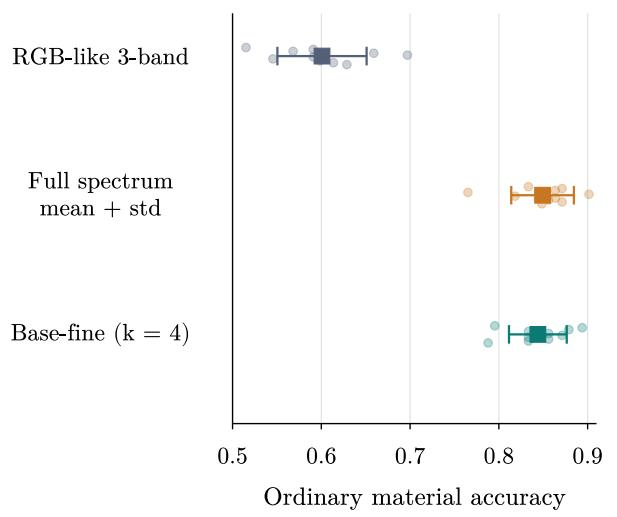

(b) SpecTex Within-source interpolation  
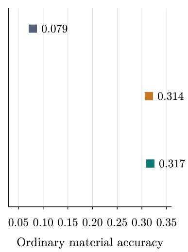  
Fig. S7. Dataset-specific material augmentation. Width k indexes the fine feature. Wood dots/squares/whiskers are runs/means/seed-split SD over ten development splits. SpecTex uses one within-source split across all 60 arrays. These are expanded material-readout features rather than native width VLA states.

TABLE S24  
Six-render augmentation under one fixed scale/readout per seed, with three-seed category/pair means. All test views use the same 461 objects and 27 pairs; this is separate from unaugmented primary evaluation.
<table><tr><td>Test rendering</td><td>Category bAcc</td><td>Pair</td></tr><tr><td>Low/mid/high</td><td>0.929</td><td>0.827</td></tr><tr><td>NIR edge</td><td>0.918</td><td>0.852</td></tr><tr><td>Random 3-band</td><td>0.929</td><td>0.840</td></tr><tr><td>Fixed sensor</td><td>0.917</td><td>0.815</td></tr><tr><td>Gain/offset</td><td>0.913</td><td>0.840</td></tr><tr><td>PCA</td><td>0.918</td><td>0.827</td></tr></table>

TABLE S25

Conditional recognition relative to the false-color base. Seed rows give aligned 461-object proportions; mean retention/correction includes acquisition-session intervals. P(B+) denotes base correctness.
<table><tr><td>Seed</td><td>Retained</td><td>Repaired</td><td>Acc.</td></tr><tr><td colspan="4">Base-fine</td></tr><tr><td>0</td><td>0.986</td><td>0.469</td><td>0.879</td></tr><tr><td>1</td><td>0.973</td><td>0.583</td><td>0.892</td></tr><tr><td>2</td><td>0.967</td><td>0.573</td><td>0.885</td></tr><tr><td></td><td>0.975</td><td>0.542</td><td></td></tr><tr><td></td><td>Mean [0.961, 0.987][0.437, 0.639]</td><td></td><td>0.885</td></tr><tr><td colspan="4">Base-conditioned direct</td></tr><tr><td>0</td><td>0.945</td><td>0.479</td><td>0.848</td></tr><tr><td>1</td><td>0.981</td><td>0.198</td><td>0.818</td></tr><tr><td>2</td><td>0.956</td><td>0.406</td><td>0.842</td></tr><tr><td></td><td>0.961</td><td>0.361</td><td></td></tr><tr><td colspan="4">Mean [0.943, 0.975] [0.302, 0.415] 0.836</td></tr></table>

All rows use 461 aligned objects with base correctness $P ( B + ) =$ 0.792. Mean rows include acquisition-session 95% CIs.

## S9.3 Sensor and Supervision Coverage

SpectralWaste supplies synchronized imaging HSI/RGB, target masks and category labels. Wood, SpecTex and WoodVIT provide material evidence at specimen/image or spectrum level; driving resources HSI-Drive, HCV2/HyKo2 and Hyper-Drive provide scene segmentation with different RGB alignment [11], [15], [16]. Erickson et al. use point spectra [17], while HSI-guided grasping supplies task-specific grasp supervision [18]. OmniVLA, MuseVLA, BridgeData V2, DROID and Open X-Embodiment supply language/trajectory supervision without imaging HSI [19], [20], [21], [22], [23]. These annotation differences motivate the target-grounded spectral-interface evaluation and distinguish it from trajectory-supervised policy evaluation.

TABLE S26  
Class-resolved fixed-split recall, with methods compared in columns. Categories and proxy states follow Table S1. Decoder-logit rows use refitted probes on frozen logits.  
Category recall
<table><tr><td>Class</td><td>False-color base</td><td>Direct retargeter</td><td>SPECTRA-VLA</td></tr><tr><td>Film</td><td>0.758</td><td>0.929</td><td>0.894</td></tr><tr><td>Basket</td><td>0.776</td><td>0.905</td><td>0.876</td></tr><tr><td>Cardboard</td><td>0.800</td><td>1.000</td><td>1.000</td></tr><tr><td>Video tape</td><td>0.792</td><td>0.846</td><td>0.887</td></tr><tr><td>Filament</td><td>0.875</td><td>0.875</td><td>0.896</td></tr><tr><td>Bag</td><td>0.802</td><td>0.835</td><td>0.876</td></tr></table>

Pooled proxy-state recall
<table><tr><td></td><td>False-color</td><td>Direct retargeter</td><td>SPECTRA-VLA</td></tr><tr><td>Class</td><td>base</td><td></td><td></td></tr><tr><td>State 0</td><td>0.800</td><td>1.000 0.921</td><td>1.000 0.934</td></tr><tr><td>State 1 State 2</td><td>0.937 0.791</td><td>0.896</td><td>0.881</td></tr><tr><td>State 3</td><td>0.900</td><td>0.897</td><td>0.938</td></tr></table>

Decoder-logit proxy-state recall
<table><tr><td></td><td>False-color</td><td>Direct</td><td>SPECTRA-VLA</td></tr><tr><td>Class</td><td>base</td><td>retargeter</td><td></td></tr><tr><td>State 0</td><td>0.500 0.776</td><td>0.667 0.879</td><td>0.600 0.741</td></tr><tr><td>State 1 State 2</td><td>0.672</td><td>0.851</td><td>0.627</td></tr><tr><td>State 3</td><td>0.869</td><td>0.885</td><td>0.874</td></tr><tr><td></td><td></td><td></td><td></td></tr></table>

TABLE S27

Row-normalized confusions (three-seed means), with methods side by side. Rows: true labels; columns: predictions. (a) Category IDs 1–6 follow Table S1. (b,c) Its proxy states 0–3 are read from pooled states and refitted decoder-logit probes, respectively. Bold highlights diagonals, not cross-method best values; unrounded diagonals reproduce recall and bAcc.

(a) Category recognition
<table><tr><td></td><td colspan="7">False-color base</td><td colspan="7">Direct retargeter</td><td colspan="7">SPECTRA-VLA</td></tr><tr><td></td><td>1</td><td></td><td>2</td><td></td><td>4</td><td>5</td><td>6</td><td>1</td><td>2</td><td>3</td><td>4</td><td></td><td>5</td><td>6</td><td>1</td><td></td><td>2</td><td>3</td><td>4</td><td>5</td><td>6</td></tr><tr><td>1</td><td>0.758</td><td>0.000</td><td>0.000</td><td>0.000</td><td>0.030</td><td>0.212</td><td>1</td><td>0.929</td><td>0.010</td><td>0.000</td><td>0.005</td><td>0.015</td><td></td><td>0.040</td><td>0.894</td><td></td><td>0.005</td><td>0.000</td><td>0.000</td><td>0.030</td><td>0.071</td></tr><tr><td>2</td><td>0.045</td><td>0.776</td><td>0.045</td><td>0.075</td><td>0.000</td><td>0.060</td><td>2</td><td>0.015</td><td>0.905</td><td>0.000</td><td>0.045</td><td>0.020</td><td>0.015</td><td></td><td>0.005</td><td></td><td>0.876</td><td>0.000</td><td>0.070</td><td>0.020</td><td>0.030</td></tr><tr><td>3</td><td>0.100</td><td>0.000</td><td>0.800</td><td>0.100</td><td>0.000</td><td>0.000</td><td>3</td><td>0.000</td><td>0.000</td><td>1.000</td><td>0.000</td><td>0.000</td><td></td><td>0.000</td><td></td><td>0.000</td><td>0.000</td><td>1.000</td><td>0.000</td><td>0.000</td><td>0.000</td></tr><tr><td>4</td><td>0.023</td><td>0.069</td><td>0.008</td><td>0.792</td><td>0.092</td><td>0.015</td><td></td><td>0.018</td><td>0.082</td><td>0.003</td><td>0.846</td><td>0.036</td><td></td><td>0.015</td><td>3</td><td>0.003</td><td>0.044</td><td>0.000</td><td>0.887</td><td>0.054</td><td>0.013</td></tr><tr><td>5</td><td>0.000</td><td>0.000</td><td>0.000</td><td>0.125</td><td>0.875</td><td>0.000</td><td>4 5</td><td>0.000</td><td>0.042</td><td>0.000</td><td>0.083</td><td>0.875</td><td></td><td>0.000</td><td>0.000</td><td></td><td>0.000</td><td>0.000</td><td>0.104</td><td>0.896</td><td>0.000</td></tr><tr><td>6</td><td>0.128</td><td>0.029</td><td>0.017</td><td>0.006</td><td>0.017</td><td>0.802</td><td>6</td><td>0.093</td><td>0.041</td><td>0.008</td><td>0.019</td><td>0.004</td><td>0.835</td><td></td><td>0.076</td><td></td><td>0.019</td><td>0.010</td><td>0.004</td><td>0.016</td><td>0.876</td></tr><tr><td></td><td></td><td></td><td></td><td></td><td></td><td></td><td></td><td>(b) Pooled proxy-state recognition</td><td></td><td></td><td></td><td></td><td></td><td></td><td></td><td></td><td></td><td></td><td></td><td></td><td></td></tr><tr><td></td><td></td><td></td><td></td><td>False-color base</td><td></td><td></td><td></td><td></td><td>Direct retargeter</td><td></td><td></td><td></td><td></td><td></td><td></td><td></td><td>SPECTRA-VLA</td><td></td><td></td><td></td><td></td></tr><tr><td></td><td></td><td>0</td><td>1</td><td>2</td><td></td><td></td><td></td><td></td><td></td><td></td><td></td><td>2</td><td></td><td></td><td></td><td></td><td>0</td><td></td><td></td><td></td><td></td></tr><tr><td></td><td>0</td><td>0.800</td><td>0.200</td><td></td><td></td><td></td><td></td><td></td><td>0</td><td>1</td><td></td><td></td><td>3</td><td></td><td></td><td></td><td></td><td>1</td><td>2</td><td>3</td><td></td></tr><tr><td></td><td>1</td><td>0.004</td><td>0.937</td><td>0.000 0.012</td><td>0.000</td><td></td><td></td><td>0</td><td>1.000</td><td>0.000</td><td>0.000</td><td></td><td>0.000</td><td></td><td></td><td>0</td><td>1.000</td><td>0.000</td><td>0.000</td><td>0.000</td><td></td></tr><tr><td></td><td>2</td><td>0.045</td><td>0.104</td><td>0.791</td><td>0.047 0.060</td><td></td><td></td><td>1</td><td>0.007</td><td>0.921</td><td>0.050</td><td>0.022</td><td></td><td></td><td></td><td>1 2</td><td>0.008 0.000</td><td>0.934</td><td>0.024</td><td>0.034</td><td></td></tr><tr><td></td><td>3</td><td>0.015</td><td>0.023</td><td>0.062</td><td>0.900</td><td></td><td></td><td>2 3</td><td>0.000 0.000</td><td>0.065 0.038</td><td>0.896 0.064</td><td>0.040</td><td></td><td></td><td></td><td>3</td><td>0.003</td><td>0.040 0.021</td><td>0.881 0.038</td><td>0.080 0.938</td><td></td></tr><tr><td></td><td></td><td></td><td></td><td></td><td></td><td></td><td></td><td></td><td></td><td></td><td></td><td>0.897</td><td></td><td></td><td></td><td></td><td></td><td></td><td></td><td></td><td></td></tr><tr><td></td><td></td><td>False-color base</td><td></td><td></td><td></td><td></td><td></td><td></td><td>(c) Decoder-logit probe</td><td></td><td></td><td></td><td></td><td></td><td></td><td></td><td></td><td></td><td></td><td></td><td></td></tr><tr><td></td><td></td><td>0</td><td></td><td></td><td></td><td></td><td></td><td></td><td>Direct retargeter</td><td></td><td></td><td></td><td></td><td></td><td></td><td></td><td></td><td></td><td>SPECTRA-VLA</td><td></td><td></td></tr><tr><td></td><td></td><td></td><td>1</td><td>2</td><td>3</td><td></td><td></td><td></td><td>0</td><td>1</td><td>2</td><td></td><td></td><td></td><td></td><td></td><td>0</td><td>1</td><td>2</td><td>3</td><td></td></tr><tr><td></td><td>0</td><td>0.500</td><td>0.300</td><td>0.200</td><td>0.000</td><td></td><td></td><td>0</td><td>0.667</td><td>0.267</td><td>0.000</td><td>0.067</td><td></td><td></td><td></td><td>0 0.600</td><td></td><td>0.133</td><td>0.267</td><td>0.000</td><td></td></tr><tr><td></td><td>1</td><td>0.047</td><td>0.776 0.149</td><td>0.102 0.672 0.090</td><td>0.075</td><td></td><td></td><td>1</td><td>0.020</td><td>0.879</td><td>0.063</td><td>0.038</td><td></td><td></td><td></td><td>1 0.066 2 0.109</td><td></td><td>0.741</td><td>0.101</td><td>0.092</td><td></td></tr><tr><td></td><td>2 0.090 3 0.023</td></table>

TABLE S28  
Spectral separability and dataset-specific material recognition. (a) Published frozen features use the common training-only readout; Hard is hard-subset bAcc. Partial-load diagnostics (†DOFA, ‡HyperSIGMA) are not ranked; ‡also denotes out-of-domain pretraining. (b) Wood uses ten development splits and one class-balanced official test, so bAcc equals Acc.; SpecTex uses one within-source split without pairs. Fine width k is validation-selected. †HyperSIGMA is partially loaded. Dim. is feature width and F1 is macro-F1.

(a) Published spectral features
<table><tr><td>Feature (Dim.)</td><td>Acc. bAcc</td><td>F1 Hard</td><td></td><td>Pair</td></tr><tr><td colspan="5">Fully loaded pretrained encoders</td></tr><tr><td rowspan="3">HyperSL (256) MaskedSST (96)</td><td rowspan="3">0.770 0.787 0.721 0.803 0.667</td><td></td><td></td><td></td></tr><tr><td>0.768 0.767</td><td>0.692 0.818 0.519</td><td></td></tr><tr><td>0.866 0.868 0.824</td><td>0.8180.593</td><td></td></tr><tr><td colspan="4">Raw spectral reference Raw spectrum (120) 0.766 0.795 0.741 0.775 0.630</td></tr><tr><td colspan="4"></td></tr><tr><td colspan="4">Partial-load diagnostics (not ranked)</td></tr><tr><td colspan="4">DOFA† (768) 0.855 0.834 0.780 0.919 0.741 HyperSIGMA (128) 0.063 0.183 0.047 0.2000.000</td></tr></table>

(b) External material recognition
<table><tr><td colspan="3">Mendeley Wood</td></tr><tr><td>Method (Dim.)</td><td>Acc.</td><td>F1 Pair</td></tr><tr><td>RGB-like 3-band (204) Full spectrum, mean+SD (640)</td><td>0.601 0.849</td><td>0.600 0.452 0.848</td></tr><tr><td>HyperSIGMA† (128)</td><td>0.709</td><td>0.782</td></tr><tr><td>Base-fine, k = 4 (208)</td><td></td><td>0.7080.656 0.844 0.842 0.975</td></tr><tr><td></td><td></td><td></td></tr><tr><td colspan="3">SpecTex Method (Dim.)</td></tr><tr><td></td><td>Acc. bAcc</td><td>F1</td></tr><tr><td>RGB-like 3-band (3)</td><td>0.079</td><td>0.051 0.013</td></tr><tr><td>Full spectrum ridge (39)</td><td>0.3140.221</td><td>0.172</td></tr><tr><td>Base-fine, k = 32 (35)</td><td></td><td>0.317 0.224 0.179</td></tr></table>

## REFERENCES

[1] OpenAI, “Codex,” https://openai.com/codex/, accessed: Oct. 13, 2026.

[2] , “ChatGPT,” https://chatgpt.com/overview/, accessed: Oct. 13, 2026.

[3] S. Casao, F. Pena, A. Sabater, R. Castill˜ on, D. Su´ arez, E. Montijano,´ and A. C. Murillo, “SpectralWaste dataset: Multimodal data for waste sorting automation,” in IEEE/RSJ International Conference on Intelligent Robots and Systems (IROS), 2024, pp. 5852–5858.

[4] M. J. Kim, K. Pertsch, S. Karamcheti, T. Xiao, A. Balakrishna, S. Nair, R. Rafailov, E. P. Foster, P. R. Sanketi, Q. Vuong, T. Kollar, B. Burchfiel, R. Tedrake, D. Sadigh, S. Levine, P. Liang, and C. Finn, “OpenVLA: An open-source visionlanguage-action model,” in Proceedings of the 8th Conference on Robot Learning, ser. Proceedings of Machine Learning Research, vol. 270. PMLR, 2025, pp. 2679–2713. [Online]. Available: https://proceedings.mlr.press/v270/kim25c.html

[5] D. Qu, H. Song, Q. Chen et al., “SpatialVLA: Exploring spatial representations for visual-language-action model,” in Robotics: Science and Systems, 2025. [Online]. Available: https: //www.roboticsproceedings.org/rss21/p011.pdf

[6] D. Hong, B. Zhang, X. Li, Y. Li, C. Li, J. Yao, N. Yokoya, H. Li, P. Ghamisi, X. Jia, A. Plaza, P. Gamba, J. A. Benediktsson, and J. Chanussot, “SpectralGPT: Spectral remote sensing foundation model,” IEEE Transactions on Pattern Analysis and Machine Intelligence, vol. 46, no. 8, pp. 5227–5244, 2024.

[7] D. Wang, M. Hu et al., “HyperSIGMA: Hyperspectral intelligence comprehension foundation model,” IEEE Transactions on Pattern Analysis and Machine Intelligence, vol. 47, no. 8, pp. 6427–6444, 2025.

[8] Z. Xiong, Y. Wang, F. Zhang, A. J. Stewart, J. Hanna, D. Borth, I. Papoutsis, B. Le Saux, G. Camps-Valls, and X. X. Zhu, “Neural plasticity-inspired multimodal foundation model for earth observation,” 2024, arXiv:2403.15356.

[9] W. Kong, B. Liu, X. Bi, C. Yu, X. Li, and Y. Chen, “HyperSL: A spectral foundation model for hyperspectral image interpretation,” IEEE Transactions on Geoscience and Remote Sensing, vol. 63, pp. 1–19, 2025.

[10] L. Scheibenreif, M. Mommert, and D. Borth, “Masked vision transformers for hyperspectral image classification,” in Proceedings of the IEEE/CVF Conference on Computer Vision and Pattern Recognition Workshops, 2023, pp. 2166–2176.

[11] J. V. Hurtado, R. Mohan, and A. Valada, “Hyperspectral adapter for semantic segmentation with vision foundation models,” IEEE Robotics and Automation Letters, vol. 11, no. 3, pp. 3606–3613, 2026. [Online]. Available: https://doi.org/10.1109/LRA.2026.3656795

[12] M. Boschetti, M. Caffini, S. Faccini, A. Buriro, R. Confalonieri, B. Sun, and T. Tillo, “Hyperspectral images for wood recognition (sapwood and heartwood),” Mendeley Data, Version 2, 2022.

[13] Computational Spectral Imaging Group, University of Eastern Finland, “SpecTex: Hyperspectral texture image database,” Online database, 2011. [Online]. Available: https://sites.uef.fi/spectral/databases-software/ spectex-hyperspectral-texture-image-database/

[14] M. Bihler, L. Roming, D. Cibirait ˇ e-Lukenskien ˙ e, J. Aderhold, ˙ A. Keil, F. Schluter, R. Gruna, and M. Heizmann, “Multimodal¨ and hyperspectral dataset for segmentation of bulky waste using VIS, IR, NIR, and terahertz imaging,” Scientific Data, vol. 13, p. 498, 2026.

[15] K. Basterretxea, V. Martinez, J. Echanobe, J. Gutierrez-Zaballa, and I. del Campo, “HSI-Drive: A dataset for the research of hyperspectral image processing applied to autonomous driving systems,” in Proceedings of the IEEE Intelligent Vehicles Symposium, 2021.

[16] N. Hanson, B. Pyatski, S. Hibbard, C. DiMarzio, and T. Padir, “Hyper-drive: Visible-short wave infrared hyperspectral imaging datasets for robots in unstructured environments,” in IEEE Workshop on Hyperspectral Imaging and Signal Processing: Evolution in Remote Sensing (WHISPERS), 2023.

[17] Z. Erickson, E. Xing, B. Srirangam, S. Chernova, and C. C. Kemp, “Multimodal material classification for robots using spectroscopy and high resolution texture imaging,” in IEEE/RSJ International Conference on Intelligent Robots and Systems, 2020.

[18] Z. Sun, Z. Dong, S. Wang, Z. Chu, and F. Chen, “A hyperspectral imaging guided robotic grasping system,” IEEE Robotics and Automation Letters, vol. 10, no. 7, pp. 7659–7666, 2025.

[19] H. Guo, S. Wang, R. Ma, S. Jiang, Y. Ghasempour, O. Abari, B. Guo, and L. Qiu, “OmniVLA: Physically-grounded multimodal VLA with unified multi-sensor perception for robotic manipulation,” in IEEE International Conference on Robotics and Automation (ICRA), 2026, arXiv:2511.01210. [Online]. Available: https: //arxiv.org/abs/2511.01210

[20] X. Liu, R. Ma, H. Guo, Q. Li, Q. Yang, L. Luo, S. Jiang, C. Xu, J. Yang, and B. Guo, “MuseVLA: An adaptive multimodal sensing vision-language-action model for robotic manipulation,” 2026. [Online]. Available: https://arxiv.org/abs/2606.17598

[21] H. R. Walke, K. Black, A. Lee, M. J. Kim, M. Du, C. Zheng, T. Zhao, P. Hansen-Estruch, Q. Vuong, A. He, V. Myers, K. Fang, C. Finn, and S. Levine, “BridgeData V2: A dataset for robot learning at scale,” in Conference on Robot Learning (CoRL), 2023, arXiv:2308.12952.

[22] A. Khazatsky et al., “DROID: A large-scale in-the-wild robot manipulation dataset,” in Robotics: Science and Systems, 2024, arXiv:2403.12945.

[23] A. Padalkar et al., “Open X-Embodiment: Robotic Learning Datasets and RT-X Models,” in 2024 IEEE International Conference on Robotics and Automation (ICRA), 2024, pp. 6892–6903, doi: 10.1109/ICRA57147.2024.10611477.