# STATECRAFT: AUGMENTING VIDEO WORLD MODELS WITH ABSTRACT-STATE REASONING

Lorenzo Venturoli1,2∗, Nedko Savov1, Xi Wang3,4,5, Marc Pollefeys1,2,6, Luc Van Gool1

1INSAIT, Sofia University "St. Kliment Ohridski" 2ETH Zurich 3University of Ulm 4TUM 5MCML - Munich Center for Machine Learning 6Microsoft

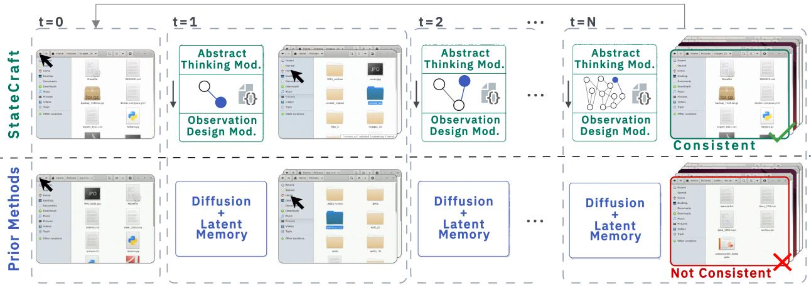  
Figure 1: Abstract and visual state decoupling for consistent video world models. StateCraft (top) couples a VLM that reasons about action effects and updates an abstract state with a video world model that generates the corresponding observations. This state preserves information beyond the current view, enabling consistent folder revisits, while prior methods relying on latent memory (bottom) may generate plausible but inconsistent content.

## ABSTRACT

Video world models aim to simulate complex environments with realistic appearance and dynamics. Maintaining consistency over long interactions requires tracking past actions and understanding how those actions affect the environment. Video world models can only generate partial observations of the entire world at a time. Remembering past observations alone may not be sufficient in every scenario, as they may no longer reflect the world after a sequence of actions. We therefore introduce a paradigm that decouples a persistent, updatable abstract state from the visual state. The abstract state keeps track of the entities’ changes as the world evolves, and is used to condition the visual state, which represents the current view. We propose StateCraft, a novel architecture that pairs a language model with a video diffusion model to evolve the dynamic world. We evaluate our approach on generative interfaces, which pose a substantial challenge because a single action may change parts of the state that are not currently visible. To support training and evaluation, we develop a data collection pipeline that produces informative, densely annotated trajectories at scale without human or agent supervision, together with a benchmark measuring generation quality, memory, and controllability. On this benchmark, our approach improves visual memory metrics by 0.30 (SSIM) and PSNR by up to 10 dB over the state-of-the-art baselines. We demonstrate that StateCraft maintains high self-consistency and strong generation quality over long trajectories. Because the abstract state is explicit, it can be edited directly, and generation follows edits to states never observed in the data. Finally, a proof-of-concept 3D experiment, in which actions change the illumination of an unobserved room, shows that the paradigm can also be applied to spatial environments. Dataset, code, and model weights will be made public: https://insait-institute.github.io/StateCraft/.

## 1 Introduction

World models learn the dynamics of a system to predict state changes in response to actions. Recent advances have enabled the simulation of realistic 3D worlds [Bruce et al., 2024, NVIDIA et al., 2026], robotics [Yang et al., 2024], driving scenes [Russell et al., 2025, Gao et al., 2024], games [Valevski et al., 2025, Qian et al., 2026], and, recently, graphical user interfaces (GUI) [Rivard et al., 2025, Zhuge et al., 2026]. As world models generate only part of the world at a time, actions may lead to changes that are not directly visible, and consistent simulation requires understanding their effects on the world state and updating it accordingly. Current video world models represent this state visually, through frame histories [Zhang et al., 2025a, Cai et al., 2025], caches of encoded frames [Xiao et al., 2025, Chen et al., 2026], reconstructed 3D point clouds [Shen et al., 2026], or recurrent states trained to reconstruct frames [Savov et al., 2025a]. Most of these memories store static content and cannot be updated by out-of-view dynamics. LiveWorld [Duan et al., 2026] supports such dynamics only for the motion of recognized entities within a fixed 3D scaffolding.

The need for a more abstract and general state representation is especially notable in the field of generative software, where each frame is conditioned on a keyboard or mouse event to simulate a GUI. For example, deleting a directory’s contents empties the folder, yet the model should track that ’Trash’ now contains those files and display them when visited. Existing memory approaches mainly target 3D worlds, and those requiring camera poses or explicit geometry do not directly apply to GUI simulation. Moreover, observations alone do not fully describe the world state behind the scenes, making the simulation visually plausible but not functional in practice [Rivard et al., 2025].

To model a more complete picture of the world state, we factorize it into an abstract state and a visual state. The abstract state is not tied to a specific representation. It is any structured record of the environment’s entities and their properties, including those out of view, that actions update directly. We develop StateCraft, which instantiates this state as a graph and complements a video world model with a VLM that updates and reasons over it. We demonstrate it on generative software, training the system to simulate a file explorer that preserves filesystem state and dynamics and supports editing them. We further propose trainable triggers on top of the video world model that decide when the VLM updates the abstract state, enabling programmable, event-driven interaction between the two. Unlike history-retrieval methods, our memory is dynamic rather than static. Unlike WorldDirector [Wang et al., 2026], trajectories are not planned in advance. Our VLM predicts state transitions online in response to incoming actions.

For training and evaluation, we develop a data collection framework for generative software. Existing pipelines combine a few goal-driven trajectories with many random, uninformative ones. Ours selects actions from interface elements and records aligned frames, actions, and structured state changes, producing informative, densely annotated trajectories at scale. We also release, to our knowledge, the first benchmark for video world models of graphical interfaces, evaluating generation quality, memory across controlled revisit horizons, and controllability under explicit state edits. On this benchmark, StateCraft keeps revisit self-consistency near 0.9 SSIM over up to 512 actions, while baselines remain at 0.5–0.6, and improves PSNR by up to 10 dB over the baselines. Direct edits to the abstract state are followed in 81% of cases, including hidden changes out of view, although inserting new elements on empty background remains difficult. A proof-of-concept 3D experiment shows that abstract state also guides generation beyond software interfaces. These results support modeling abstract state alongside visual dynamics as a basis for consistent, controllable simulation.

Our contributions are the following:

• A novel paradigm that factorizes the world into a global, abstract state that tracks and reasons about structured changes of the environment, and a visual state that simulates what is in view at every instant, enabling long, consistent, and controllable interface simulation and extending to state-guided generation in 3D.

• StateCraft, a novel architecture that couples a language model and a video world model throughout ongoing interaction, jointly predicting abstract state transitions and visual observations as user actions arrive, and enables event-driven trajectory control.

• A grounded data collection pipeline that records aligned frames, actions, and structured state changes, producing substantially more informative interactions.

• A novel benchmark for user-interface world models that isolates memory across controlled revisit intervals and evaluates state prediction, content reconstruction, and generation under explicit state edits. Our approach improves visual memory metrics (SSIM) by 0.30 and PSNR by up to 10 dB over the baselines on this benchmark.

## 2 Related Work

Video World Models. Video world models simulate entire interactive 3D worlds via camera-/object-control [NVIDIA et al., 2026, Team HY-World, 2026, Robbyant Team et al., 2026, Shen et al., 2026, Seo et al., 2026, Bruce et al., 2024,

Parker-Holder et al., 2024], robotics simulators [Yang et al., 2024, Zhu et al., 2025, Quevedo et al., 2025], driving environments [Hu et al., 2023, Russell et al., 2025, Wang et al., 2023a, Gao et al., 2024, Hassan et al., 2025], games from user input [Valevski et al., 2025, Che et al., 2024, Zhang et al., 2025b, He et al., 2025, Qian et al., 2026, Savov et al., 2025b], while recent work extends this paradigm to desktop interfaces. ViMo [Luo et al., 2025] addresses text corruption by separating textual and graphical generation through symbolic placeholders. NeuralOS [Rivard et al., 2025] uses a recurrent latent state to condition diffusion-based desktop generation. Neural Computers [Zhuge et al., 2026] further explores learned software execution, identifying symbolic consistency and long-horizon memory as open challenges. These approaches improve interface simulation but lack explicit mechanisms for maintaining entity identity and tracking off-screen state changes. We maintain structured entity states and update alongside the generation.

Memory-augmented world models. FramePack [Zhang et al., 2025a] compresses frame history, while Mixture of Contexts [Cai et al., 2025] uses sparse attention routing for long-term retrieval. WorldMem [Xiao et al., 2025], HyDRA [Chen et al., 2026], and VRAG [Chen et al., 2025a] retrieve historical visual information to preserve consistency. Spatial memory further supports consistent revisits: VMem [Li et al., 2025] indexes past views through surfels, SPMem [Wu et al., 2025] maintains geometry-grounded memory, Captain Safari [Chou et al., 2026] retrieves pose-aligned world tokens, and Lyra 2.0 [Shen et al., 2026] uses geometry to retrieve and align historical observations. Beyond scene recall, WorldDirector [Wang et al., 2026] preserves dynamic entities through LLM-planned trajectories specified before generation, while LiveWorld [Duan et al., 2026] simulates out-of-sight dynamics for selected entities, against a static 3D background. Our approach maintains an editable abstract state whose representation is not restricted to any specific environment.

Language and Vision-Language Models. Large language models support multi-step and compositional reasoning [Wei et al., 2023, Wang et al., 2023b, Zhou et al., 2023, Yao et al., 2023a], analogical inference [Webb et al., 2023], and representations of entity properties, relations, and spatiotemporal structure [Li et al., 2021, Feng and Steinhardt, 2024, Gurnee and Tegmark, 2024]. Multimodal pretraining and instruction tuning extend these models to visual inputs [Alayrac et al., 2022, Li et al., 2023a, Liu et al., 2023, Dai et al., 2023, Wang et al., 2024]. PaLM-E supports embodied reasoning [Driess et al., 2023], ReAct interleaves reasoning and interaction [Yao et al., 2023b], and RAP predicts action outcomes for planning [Hao et al., 2023]. Motivated by spatial reasoning in VLMs [Chen et al., 2024], we use one to predict updates to the abstract state.

GUI data and benchmarks. Agent benchmarks [Xie et al., 2024, Bonatti et al., 2024, Zhou et al., 2024, Deng et al., 2023, Rawles et al., 2025] and video corpora [Jian et al., 2026, Chen et al., 2025b] provide screenshots and action traces, but no persistent state identities linking actions to changes in previously visited views. GUI generation benchmarks evaluate image generators [Li et al., 2026] or screenshot-level world models [Fu et al., 2026], not frame-by-frame simulation with long-horizon revisits or state edits. We record aligned frames, actions, and state graphs, and test these capabilities.

## 3 Method

In this section we first define the simulation problem and describe how StateCraft couples abstract-state prediction with video generation. We then present our data collection procedure and evaluation protocol for reconstruction, memory, and controllability.

## 3.1 Problem setup

We model the environment as a partially observable controlled process with latent state $s _ { t } = ( G _ { t } , v _ { t } )$ , comprising the full world state $G _ { t }$ and a pointer $v _ { t }$ to the focused node. The observation $o _ { t } = \Omega ( s _ { t } ) = G _ { t } [ v _ { t } ]$ contains only that node, while actions advance the state near-deterministically, $s _ { t + 1 } = T ( s _ { t } , a _ { t } )$ . Transitions act on states rather than observations because actions can affect out-of-view elements. Frame generation follows $x _ { t } \sim R ( o _ { t } , a _ { t - 1 } )$ . Since the full state $s _ { t }$ is not fully available in every environment, the simulator maintains an abstract state $M _ { t }$ distilled from observations and updates it through sparse state updates, ${ M } _ { t + 1 } = { M } _ { t } \oplus \Delta _ { t } . { M } _ { 0 }$ is the initial state representing the first observation alone. We keep the general structure but omit the rewards of the process, as our goal is simulation rather than planning.

## 3.2 Model

StateCraft pairs two components operating in different spaces (Figure 2). Starting from an initial frame and its corresponding structured state, a VLM predicts action-induced updates to persistent abstract state, represented here as a graph, without receiving pixels. A diffusion model then generates the next frame conditioned on the predicted

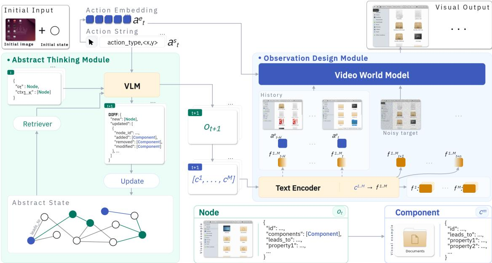  
Figure 2: Overview of StateCraft for generative UI. The abstract-thinking module (left) maintains the abstract state using a graph. Given action $a _ { t } ^ { s }$ , observed node $o _ { t } ,$ , and retrieved context nodes ctx $. K :$ , a VLM predicts a state diff and the next node $o _ { t + 1 }$ . A frozen text encoder maps the predicted node’s serialized components $c _ { t + 1 } ^ { 1 . . \dot { M } }$ to embeddings $f _ { t + 1 } ^ { 1 . . M }$ The observation-design module (right) generates video frames conditioned on past frames, action embeddings $a _ { t - H \ldots t } ^ { e } ,$ and component embeddings $f _ { t + 1 } ^ { 1 . . M }$ . Bottom-right panels detail the schema elements.

state, action, and visual history. The graph represents views and their constituent elements, preserving their content and spatial relationships across interactions.

One interaction step is factorized as

$$
\begin{array} { r l } & { p ( x _ { t + 1 } , o _ { t + 1 } , \Delta _ { t } \mid x _ { \le t } , o _ { \le t } , a _ { \le t } ) \approx \underbrace { p _ { \phi } ( o _ { t + 1 } , \Delta _ { t } \mid o _ { t } , a _ { t } , M _ { t } ) } _ { \mathrm { a b s r r a c t - s p a c e ~ t r a n s i t i o n } } \cdot \underbrace { p _ { \theta } ( x _ { t + 1 } \mid x _ { \le t } , a _ { t } , o _ { t + 1 } ) } _ { \mathrm { v i d e o ~ w o r d d ~ m o d e l } } , \qquad M _ { t + 1 } = M _ { t } \oplus \Delta _ { t } . } \end{array}\tag{1}
$$

## 3.2.1 Abstract state transition

The transition model $p _ { \phi }$ is a small pretrained VLM with low-rank finetuning [Hu et al., 2021]. Language models have been used to predict interface changes for selecting browser actions [Chae et al., 2025]. Here, predicted changes update persistent abstract state and condition visual generation. The retriever resolves the destination from the current node, action, and targeted element, then retrieves the corresponding node if present in memory. For pointer actions, the targeted element is identified from the action coordinates and component geometry. Given the serialized current node, retrieved context, and action, the VLM predicts a transition decision (new, same, or revisited), the next node $o _ { t + 1 }$ , and a diff $\Delta _ { t }$ that adds or modifies nodes and their components.

## 3.2.2 Video world model

The video world model $p _ { \theta }$ generates each frame conditioned on previous frames, the current action, and the predicted next abstract state. The action is supplied as text to the state predictor and as an embedding to the video model. The approach supports diffusion backbones with cross-attention conditioning. Because text and changing elements occupy small image regions, the training loss assigns them higher weight (Equation 3). Implementation and training details are in Appendix A.1.2.

## 3.2.3 Abstract state conditioning

The predicted node $o _ { t + 1 }$ is serialized into component strings, each independently embedded by a frozen text encoder. The resulting features condition the corresponding frame through cross-attention after each transformer block’s selfattention [Zhuge et al., 2026]:

$$
\begin{array} { r } { H ^ { k } \gets H ^ { k } + W _ { o } \mathrm { s o f t m a x } \Big ( \frac { ( H ^ { k } W _ { q } ) ( F ^ { k } W _ { k } ) ^ { \top } } { \sqrt { d } } \Big ) F ^ { k } W _ { v } , } \end{array}\tag{2}
$$

where $H ^ { k }$ contains the visual tokens of frame $k , F ^ { k }$ its state-component embeddings, $W _ { q } , W _ { k } , W _ { v } , W _ { o }$ are learned projections, and d is the query/key dimension. Each frame attends only to its corresponding state features, maintaining alignment between predicted state and visual generation. Implementation details are in Appendix A.1.1.

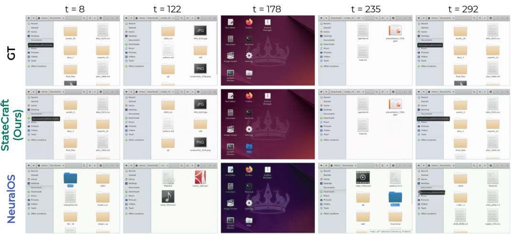  
Figure 3: Autoregressive rollout on a held-out trajectory. The model conditioned on the state signal tracks folders, filenames, and icons across the whole rollout, while NeuralOS keeps a convincing shell but drifts in content and loses high-frequency details.

## 3.3 Data collection

We collect trajectories in GNOME Files on containerized Ubuntu with randomly generated filesystems. Instead of sampling inputs blindly [Zhuge et al., 2026, Rivard et al., 2025], our policy selects actions on interactable elements using the accessibility tree, which describes interface elements and their properties. The training set contains 1,956 trajectories and 586,210 actions, of which 47.7% lead to a visible change in the state. For evaluation, we collect 240 held-out trajectories of 300 actions. For memory, we construct 184 navigation sequences that enter a target folder, visit other folders, and return. Each is repeated at five revisit horizons, keeping target contents and revisit frames identical (920 trajectories). For controllability, we construct 293 clips from held-out trajectories by replacing element names or types, or inserting elements into the conditioning state and inpainting the result in the corresponding frame, while keeping the preceding visual context and action sequence unchanged. Using AT-SPI [The GNOME Project], we record aligned images, actions, and observations as $\tau = ( x _ { 0 } , o _ { 0 } , ( a _ { t } , x _ { t } , o _ { t } ) _ { t = 1 } ^ { L } )$ . Graph nodes represent views identified by folder path or dialog type, allowing repeated visits to reference the same node. We store the initial graph and subsequent changes, reset the environment between trajectories, and discard discontinuous recordings. Appendix A.2 provide terminology, collection details, and dataset splits.

## 3.4 Benchmark

We introduce a protocol evaluating the state consistency required of UI world models. Full-frame PSNR and SSIM [Wang et al., 2004] can mask content errors because most pixels belong to static interface elements. Aggregate scores also overrepresent frequently visited views, such as home screens. We therefore compute crop-level metrics over state-bearing regions (path, main pane, and side list), using recorded element bounds and OCR-localized text boxes [Du et al., 2020], and weight frames by inverse frequency of the state and element appearance.

## 3.4.1 Memory, navigation, and controllability

Memory is measured as self-consistency: at each ground-truth revisit, we compare the model’s generated frame with its own frame from the first visit, using ROI-level SSIM with inverse-frequency pooling over disjoint lag buckets. Scores lie in [0, 1], plausible but unrelated folders score approximately 0.5.

For commanded edits, the contrastive follow score indicates whether the prediction is closer to the post-edit than the pre edit appearance over changed pixels. Let NEW and OLD denote these ground-truth appearances, and $d _ { \mathrm { n e w } }$ and $d _ { \mathrm { o l d } }$ their respective mean absolute distances from the prediction within the change mask M. Then follow $= { \bf 1 } [ d _ { \mathrm { n e w } } < d _ { \mathrm { o l d } } ]$ Reproducing the pre-edit state scores zero. We additionally report PSNR within the edited box and at an unedited control element.

Table 1: Generation quality with first-visit initialization. Our method improves every metric over the unconditioned backbones and NeuralOS, and stays close to the reconstruction quality obtained with ground-truth state updates.
<table><tr><td>Model</td><td>SSIM ↑</td><td>PSNR↑</td><td>ifreq-SSIM ↑</td><td>ifreq-PSNR ↑</td></tr><tr><td>NeuralOS</td><td>0.85</td><td>20.92</td><td>0.82</td><td>19.04</td></tr><tr><td>DFoT</td><td>0.86</td><td>23.27</td><td>0.81</td><td>19.45</td></tr><tr><td>CF++</td><td>0.78</td><td>18.49</td><td>0.79</td><td>18.99</td></tr><tr><td>StateCraft (Ours; DFoT)</td><td>0.92</td><td>27.63</td><td>0.92</td><td>28.06</td></tr><tr><td>StateCraft (Ours; CF++)</td><td>0.95</td><td>28.78</td><td>0.95</td><td>28.71</td></tr><tr><td colspan="3">Upper bound: ground-truth conditioning</td><td></td><td></td></tr><tr><td>StateCraft (Ours; DFoT)</td><td>0.93</td><td>29.55</td><td>0.95</td><td>31.85</td></tr><tr><td>StateCraft (Ours; CF++)</td><td>0.95</td><td>29.23</td><td>0.96</td><td>30.36</td></tr></table>

## 4 Experiments

Unless stated otherwise, models are trained on the same corpus of ∼2000 trajectories of 300 actions each. To assess whether abstract-state conditioning benefits different generation targets, we implement StateCraft with pixel-space DFoT [Song et al., 2025] and latent-space CF++ [Zhu et al., 2026, Zhao et al., 2026], based on pretrained Wan2.1 [Team Wan et al., 2025]. Our external baseline is NeuralOS [Rivard et al., 2025], a latent diffusion desktop simulator with recurrent memory, trained on the same corpus following its public schedule and iteration count. All models are evaluated at $2 5 6 \times 1 9 \dot { 2 }$ , downsampling higher-resolution outputs. Backbone configurations and training details are in Appendix A.1.2.

## 4.1 Data collection evaluation

We compare grounded collection with blind input sampling [Rivard et al., 2025, Zhuge et al., 2026], using regenerated NeuralOS-style data and a blind collector in our environment. Grounded collection produces three times as many transitions with substantial visual changes as blind collection in the same environment (63.9% versus 21.3%) and reaches deeper folders more frequently, while visiting approximately double the amount of unique state over 300 actions. These results support targeting interactable elements to collect informative training trajectories. Corpus descriptions, statistical analyses, and coverage estimates are provided in Appendix A.2.2.

## 4.2 Generation under long rollouts

We evaluate on 240 held-out file-manager trajectories of 300 actions each. To assess state evolution and retention without requiring models to guess arbitrary unseen filenames, we supply first-visit filenames to StateCraft as element hints and to CF++-based baselines through text prompts. NeuralOS receives the corresponding ground-truth frame to initialize its recurrent memory. No additional target information is supplied on revisits. Generation proceeds autoregressively between initialization events. All methods are scored at identical frame indices, excluding the indices corresponding to first visits of directories. Abstract-state conditioning improves both backbones across all metrics (Table 1). For CF++, it increases PSNR by 10.29 dB over the unconditioned model and comes within 0.45 dB of ground-truth conditioning. Gains are largest on the canvas: text-region SSIM reaches 0.85, compared with 0.16 for CF++ and 0.15 for NeuralOS (Table 2), indicating improved reconstruction of variable interface content. Figure 3 illustrates this over a rollout. Subsequent experiments use CF++, our best-performing backbone. Appendix A.3.2 reports DFoT reconstruction scores by screen region and within text boxes.

## 4.3 Memory evaluation

We evaluate 184 matched trajectory families, each entering a deep target folder, traversing distractors, and returning after N ∈ {32, 64, 128, 256, 512} actions, yielding 920 trajectories. Target contents remain unchanged, and target-visit subsequences are pixel-identical across horizons (zero MSE), controlling appearance while varying rollout length. All models receive the same eight ground-truth context frames, including the first target observation, and generate two further target frames before distraction. Corresponding filenames are supplied to StateCraft as element hints consistent with the visual context and to CF++-based baselines through text prompts. No target content is supplied again on revisits. We score only the designated target using ROI-level SSIM between generated first-visit and revisited frames (Section 3.4). This revisit target SSIM measures self-consistency rather than correctness and complements the reconstruction metrics in Section 4.2. Figure 4 shows that StateCraft maintains high revisit similarity across horizons and substantially outperforms the baselines. Appendix A.3.1 details initialization and pairing and reports target-revisit similarity to ground truth across the same horizons, measuring reconstruction correctness. We also evaluate training-free and finetuned adaptations of Mixture of Contexts [Cai et al., 2025], and an oracle-retrieval of past latents based on GT state identities unavailable at deployment. Both are based on CF++. Implementation and training details are in Appendices A.3.1.2 and A.3.1.3.

Table 2: Render quality by screen region, over the full region (top) and inside OCR-detected text boxes only (bottom). Gains over the baselines are largest on the canvas, the region with the highest variability. Side panel is mostly constant and the models do not need external conditioning to perform well. Last row of each block: upper bound with ground-truth diffs.
<table><tr><td rowspan="2">Model</td><td colspan="2">Breadcrumb</td><td colspan="2">Canvas</td><td colspan="2">Side panel</td></tr><tr><td>SSIM↑</td><td>PSNR↑</td><td>SSIM↑</td><td>PSNR↑</td><td>SSIM↑</td><td>PSNR↑</td></tr><tr><td>Full region</td><td></td><td></td><td></td><td></td><td></td><td></td></tr><tr><td>NeuralOS</td><td>0.85</td><td>30.12</td><td>0.61</td><td>19.74</td><td>0.96</td><td>34.28</td></tr><tr><td>CF++</td><td>0.77</td><td>21.86</td><td>0.59</td><td>17.51</td><td>0.88</td><td>23.99</td></tr><tr><td>StateCraft (Ours; CF++)</td><td>0.91</td><td>32.01</td><td>0.89</td><td>30.80</td><td>0.95</td><td>33.06</td></tr><tr><td>StateCraft (Ours; CF++), GT diffs</td><td>0.93</td><td>32.20</td><td>0.94</td><td>32.35</td><td>0.95</td><td>33.53</td></tr><tr><td>OCR-detected text boxes</td><td></td><td></td><td></td><td></td><td></td><td></td></tr><tr><td>NeuralOS</td><td>0.52</td><td>27.16</td><td>0.15</td><td>16.71</td><td>0.80</td><td>27.90</td></tr><tr><td>CF++</td><td>0.38</td><td>20.46</td><td>0.16</td><td>15.88</td><td>0.42</td><td>20.01</td></tr><tr><td>StateCraft (Ours; CF++)</td><td>0.76</td><td>30.46</td><td>0.85</td><td>25.86</td><td>0.88</td><td>28.71</td></tr><tr><td>StateCraft (Ours; CF++), GT diffs</td><td>0.80</td><td>30.48</td><td>0.90</td><td>27.08</td><td>0.89</td><td>28.73</td></tr></table>

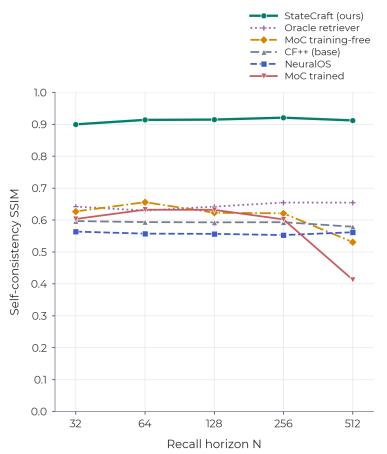  
(a) Revisit self-consistency SSIM versus horizon N.

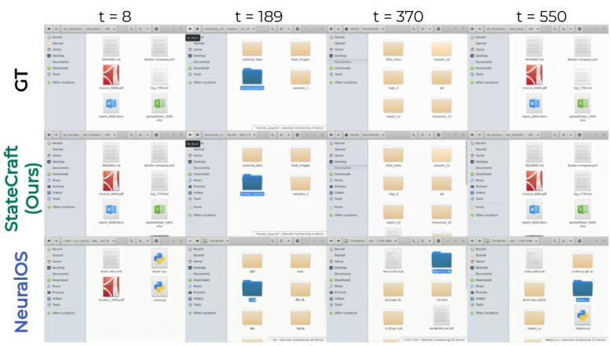  
(b) Target reconstruction at N=512.  
Figure 4: Memory across revisit horizons. (a) StateCraft maintains high self-consistency across horizons. Most baselines score around 0.5–0.6, trained MoC declines at the longest horizons. (b) StateCraft preserves target content, whereas NeuralOS generates a plausible interface with hallucinated content.

## 4.4 Controllable generation

Our architecture allows direct edits to persistent abstract state. We test whether generation follows these edits when they conflict with visual context, using 293 held-out clips (Section 3.3). We modify one or more canvas elements in the next frame’s conditioning, keeping visual context, actions, and other tokens unchanged. Edits include label and category substitutions, multi-element substitutions, and insertions, under ground-truth or self-generated context and when entering or revisiting a directory. The baseline uses frames generated by the same model without the intervention. Table 3 shows an overall edit-following rate of 81%, compared with 0% without intervention, reaching 98% for category changes upon re-entry but 48% for insertion. Edited-region PSNR improves from 17.6 to 27.62 dB, although control-region PSNR decreases from 37.7 to 23.88 dB. Thus, state edits guide generation beyond visual history, with limitations in inserting new elements and preserving unedited regions. Figure 11 in Appendix A.3.7 provides visual examples.

Table 3: Controllability by edit type and context. Edit-following rate and PSNR within edited (E) and unedited control (C) crops. The baseline uses the same model without the state intervention. All predictions are evaluated against the same edited targets using the metrics of Section 3.4.
<table><tr><td>Edit</td><td>Context at the edited frame</td><td>Follow</td><td>E-PSNR</td><td>C-PSNR</td></tr><tr><td colspan="3">Label change (same file type: new name with icon fixed)</td><td></td><td></td></tr><tr><td>Rename</td><td>ground truth</td><td>0.64</td><td>25.1</td><td>21.3</td></tr><tr><td>Rename</td><td>model-generated context</td><td>0.92</td><td>30.9</td><td>22.1</td></tr><tr><td colspan="3">Type change (new file type and name)</td><td></td><td></td></tr><tr><td>Retype</td><td>ground truth</td><td>0.84</td><td>28.4</td><td>22.6</td></tr><tr><td>Retype</td><td>model-generated context</td><td>0.86</td><td>26.9</td><td>24.6</td></tr><tr><td>Retype</td><td>directory entered one frame ago</td><td>0.83</td><td>27.5</td><td>24.9</td></tr><tr><td>Retype</td><td>directory re-entered at same step (hidden change)</td><td>0.98</td><td>32.2</td><td>25.7</td></tr><tr><td>Multi-retype</td><td>ground truth</td><td>0.83</td><td>26.6</td><td>25.4</td></tr><tr><td colspan="3">Insertion (element added on empty space)</td><td></td><td></td></tr><tr><td>Insert settled view</td><td></td><td>0.48</td><td>20.8</td><td>27.5</td></tr><tr><td colspan="3">Baseline (unedited generated frame)</td><td>17.6</td><td>37.7</td></tr><tr><td colspan="3">All</td><td>27.62</td><td>23.88</td></tr></table>

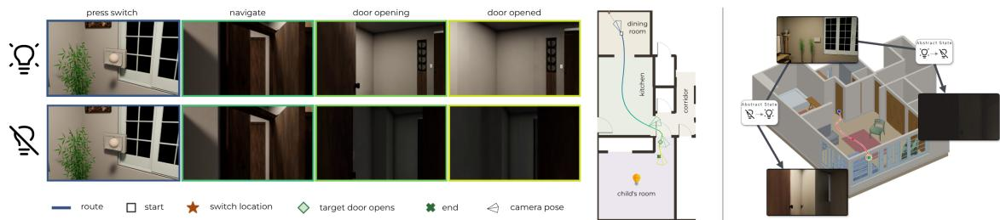  
Figure 5: Hidden-state conditioned generation. Left: two rollouts along the same path with different state signals. Our model generates the corresponding target-room illumination (last column) while preserving the distractor-room state (second column). The floor plan marks the camera path and four rendered poses. Right: another example from the second held-out apartment.

## 4.5 Ablation Study

Evaluated independently, the finetuned state predictor achieves 0.86 node and 0.96 transition accuracy on held-out navigation, versus 0.48 and 0.52 for the few-shot base model, showing that lightweight finetuning learns state dynamics. For our model of choice, this comes at the cost of out-of-domain generality (Table 7). Ablations on DFoT and CF++ show complementary conditioning roles: removing graph tokens reduces canvas SSIM by 0.31 on average and revisit SSIM by over 0.20, while removing actions causes smaller reconstruction losses. For DFoT, path-only conditioning barely improves canvas or memory scores. Encoding the full node helps, while separate element tokens further raise canvas SSIM from 0.76 to 0.92 (Appendices A.3.3 and A.3.4).

## 4.6 Event-driven generation

Following work on probing internal world representations [Li et al., 2023b, Esmati et al., 2026], we train small classifiers on frozen video-model activations, supervised by recorded ground-truth states, to detect changes and distinguish five transition types, including no change, backward navigation, forward navigation, window closure, and navigation to a nonadjacent folder. Binary and five-class probes achieve AUROC above 0.97 (Appendix A.3.5). After generating frame $x _ { t } ,$ the gate combines cached activations with incoming action $a _ { t }$ to decide whether to invoke the language model. The updated or retained state conditions $x _ { t + 1 }$ , requiring no additional backbone pass. In closed-loop evaluation, the gate skips 40.8% of language-model calls with 91.2% skip purity, reducing PSNR by 0.57 dB and SSIM by 0.008. This enables reciprocal interaction where abstract state conditions visual generation, while visual features govern subsequent state updates.

## 4.7 Hidden-state conditioning beyond software simulation

As a proof of concept beyond interfaces, we test abstract-state conditioning in simulated 3D interiors [Li et al., 2024], where a switch controls an unobserved room’s illumination. Room category and illumination state condition the video model, isolating its ability to render off-screen action effects. Trained on 8,644 trajectories across 14 houses, our model achieves 0.864 illumination-classification AUC on 120 balanced episodes from two unseen houses, versus 0.542 for separately trained CF++ without state conditioning. With visual context and noise fixed, flipping the illumination token shifts mean brightness by 63.7% of the ground-truth difference (p = 0.0006 across seven scene groups; Figure 5). These results support state-conditioned generation beyond interfaces, including unobserved action effects. Appendix A.3.6 provides experimental details.

## 5 Conclusion

We introduce a paradigm that decouples abstract-state reasoning from visual generation. StateCraft pairs a language model that updates persistent state with a video diffusion model that renders it. Our benchmark demonstrates how abstract-state reasoning supports visual quality, long-term consistency, and controllability in generative interfaces. A 3D proof of concept extends state-conditioned generation to spatial environments. These results support explicit, evolving memory as a foundation for consistent and controllable world models.

Limitations. Our approach relies on a predefined state schema for each environment. Learning the schema and acquiring new content autonomously remain future work. Broader evaluation is needed across applications, changing environments, and 3D settings with learned state prediction. Improving robustness to accumulated state errors and establishing end-to-end latency gains are further directions.

## References

Jake Bruce, Michael Dennis, Ashley Edwards, Jack Parker-Holder, Yuge Shi, Edward Hughes, Matthew Lai, Aditi Mavalankar, Richie Steigerwald, Chris Apps, Yusuf Aytar, Sarah Bechtle, Feryal Behbahani, Stephanie Chan, Nicolas Heess, Lucy Gonzalez, Simon Osindero, Sherjil Ozair, Scott Reed, Jingwei Zhang, Konrad Zolna, Jeff Clune, Nando de Freitas, Satinder Singh, and Tim Rocktäschel. Genie: Generative Interactive Environments, February 2024. URL http://arxiv.org/abs/2402.15391. arXiv:2402.15391 [cs].

NVIDIA, Aditi, Niket Agarwal, Arslan Ali, Jon Allen, Martin Antolini, Adeline Aubame, Alisson Azzolini, Junjie Bai, Maciej Bala, Yogesh Balaji, Josh Bapst, Aarti Basant, Mukesh Beladiya, Mohammad Qazim Bhat, Zaid Pervaiz Bhat, Dan Blick, Vanni Brighella, Han Cai, Tiffany Cai, Eric Cameracci, Jiaxin Cao, Yulong Cao, Mark Carlson, Carlos Casanova, Ting-Yun Chang, Yan Chang, Yu-Wei Chao, Prithvijit Chattopadhyay, Roshan Chaudhari, Chieh-Yun Chen, Junyu Chen, Ke Chen, Qizhi Chen, Wenkai Chen, Xiaotong Chen, Yu Chen, An-Chieh Cheng, Click Cheng, Xiu Chia, Jeana Choi, Chaeyeon Chung, Wenyan Cong, Yin Cui, Magdalena Dadela, Nalin Dadhich, Wenliang Dai, Joyjit Daw, Alperen Degirmenci, Rodrigo Vieira Del Monte, Robert Denomme, Sameer Dharur, Marco Di Lucca, Ke Ding, Wenhao Ding, Yifan Ding, Yuzhu Dong, Nicole Drumheller, Yilun Du, Aigul Dzhumamuratova, Aleksandr Efitorov, Hamid Eghbalzadeh, Naomi Eigbe, Imad El Hanafi, Hassan Eslami, Benedikt Falk, Jiaojiao Fan, Jim Fan, Amol Fasale, Sergiy Fefilatyev, Liang Feng, Francesco Ferroni, Sanja Fidler, Xiao Fu, Vikram Fugro, Prashant Gaikwad, TJ Galda, Katelyn Gao, Yihuai Gao, Wenhang Ge, Sreyan Ghosh, Arushi Goel, Vivek Goel, Akash Gokul, Rama Govindaraju, Jinwei Gu, Miguel Guerrero, Elfie Guo, Aryaman Gupta, Siddharth Gururani, Hugo Hadfield, Song Han, Ankur Handa, Zekun Hao, Mohammad Harrim, Ali Hassani, Nathan Hayes-Roth, Yufan He, Chris Helvig, Cyrus Hogg, Madison Huang, Michael Huang, Sophia Huang, Yufan Huang, Jacob Huffman, DeLesley Hutchins, Suneel Indupuru, Boris Ivanovic, Arihant Jain, Joel Jang, Ryan Ji, Yanan Jian, Dongfu Jiang, Jingyi Jin, Atharva Joshi, Nikhilesh Joshi, Pranjali Joshi, Andy Ju, Jaehun Jung, Weiwei Kang, Scott Kassekert, Jan Kautz, Ashna Khetan, Julia Kiczka, Slawek Kierat, Gwanghyun Kim, Kuno Kim, Sunny Kim, Kezhi Kong, Xin Kong, Zhifeng Kong, Tomasz Kornuta, Egor Krivov, Hui Kuang, Saurav Kumar, Chia-Wen Kuo, George Kurian, Wojciech Kutak, JF Lafleche, Himangshu Lahkar, Omar Laymoun, Jayjun Lee, Sanggil Lee, Gabriele Leone, Boyi Li, Freya Li, Jiajun Li, Jinfeng Li, Ling Li, Pengcheng Li, Shangru Li, Tingle Li, Xiaolong Li, Xuan Li, Zhaoshuo Li, Zhiqi Li, Hao Liang, Maosheng Liao, Chen-Hsuan Lin, Tsung-Yi Lin, Ming-Yu Liu, Sifei Liu, Zihan Liu, Hai Loc Lu, Xiangyu Lu, Alice Luo, Ruipu Luo, Wenjie Luo, Jiangran Lyu, Martin Ding Ma, Nic Ma, Qianli Ma, Dawid Majchrowski, Louis Marcoux, Miguel Martin, Qing Miao, Ashkan Mirzaei, Shreyas Misra, Kaichun Mo, Durra Mohsin, Hyejin Moon, Pawel Morkisz, Saeid Motiian, Kirill Motkov, Seungjun Nah, Yashraj Narang, Deepak Narayanan, Thabang Ngazimbi, Julian Ouyang, Shubham Pachori, David Page, Yatian Pang, Sehwi Park, Mahesh Patekar, Mostofa Patwary, Marco Pavone, Trung Pham, Wei Ping, Soha Pouya, Shrimai Prabhumoye, Varun Praveen, Delin Qu, Hesam Rabeti, Morteza Ramezanali, Marilyn Reeb, Xuanchi Ren, Kristen Rumley, Wojciech Rymer, Jun Saito, Yeongho Seol, John Shao, Piyush Shekdar, Tianwei Shen, Humphrey Shi, Min Shi, Stella Shi, Kevin Shih, Mohammad Shoeybi, Mateusz Sieniawski, Shuran Song, Alexander Sotelo, Amir Sotoodeh, Sunil Srinivasa, Vignesh Srinivasakumar, Bartosz Stefaniak, Rahul Heinrich Steiger, Shangkun Sun, Jiaxiang Tang, Shitao Tang, Yangyang Tang, Yue Tang, Tolou Tavakkoli, Kayley Ting, Krzysztof Tomala, Wei-Cheng Tseng, Jibin Varghese, Sergei Vasilev, Thomas Volk, Raju Wagwani, Roger Waleffe, Andrew Z. Wang, Boxiang Wang, Haoxiang Wang,

Qiao Wang, Shihao Wang, Shijie Wang, Ting-Chun Wang, Yan Wang, Yu Wang, Rohit Watve, David Wehr, Fangyin Wei, Xinshuo Weng, Jay Zhangjie Wu, Kedi Wu, Hongchi Xia, Summer Xiao, Tianjun Xiao, Kevin Xie, Daguang Xu, Jiashu Xu, Mengyao Xu, Ruqing Xu, Xingqian Xu, Yao Xu, Dinghao Yang, Dong Yang, Hans Yang, Xiaodong Yang, Xuning Yang, Yichu Yang, Yurong You, Zhiding Yu, Hao Yuan, Simon Yuen, Xiaohui Zeng, Pengcuo Zeren, Cindy Zha, Haotian Zhang, Jenny Zhang, Jing Zhang, Liangkai Zhang, Paris Zhang, Shun Zhang, Xuanmeng Zhang, Zhizheng Zhang, Ann Zhao, Yilin Zhao, Yuliya Zhautouskaya, Charles Zhou, Fengzhe Zhou, Shilin Zhu, Yuke Zhu, Dima Zhylko, and Artur Zolkowski. Cosmos 3: Omnimodal world models for physical ai, 2026. URL https://arxiv.org/abs/2606.02800.

Sherry Yang, Yilun Du, Kamyar Ghasemipour, Jonathan Tompson, Leslie Kaelbling, Dale Schuurmans, and Pieter Abbeel. Learning Interactive Real-World Simulators, September 2024. URL http://arxiv.org/abs/2310. 06114. arXiv:2310.06114 [cs].

Lloyd Russell, Anthony Hu, Lorenzo Bertoni, George Fedoseev, Jamie Shotton, Elahe Arani, and Gianluca Corrado. Gaia-2: A controllable multi-view generative world model for autonomous driving, 2025. URL https://arxiv. org/abs/2503.20523.

Shenyuan Gao, Jiazhi Yang, Li Chen, Kashyap Chitta, Yihang Qiu, Andreas Geiger, Jun Zhang, and Hongyang Li. Vista: A generalizable driving world model with high fidelity and versatile controllability, 2024. URL https: //arxiv.org/abs/2405.17398.

Dani Valevski, Yaniv Leviathan, Moab Arar, and Shlomi Fruchter. Diffusion Models Are Real-Time Game Engines, April 2025. URL http://arxiv.org/abs/2408.14837. arXiv:2408.14837 [cs].

Runjia Qian, Zile Wang, Jihai Zhang, Kai Zou, Wei Yu, Jiaxing Li, Zexiang Liu, Yaokun Li, Fei Kang, Kaichen Huang, Mengyin An, Haobo Zhang, Biao Jiang, Jiahua Wang, Haofeng Sun, Yang Liu, and Yangguang Li. Matrixgame 3.5: Enhancing real-time streaming interactive world models with patch memory, 2026. URL https: //arxiv.org/abs/2608.29910.

Luke Rivard, Sun Sun, Hongyu Guo, Wenhu Chen, and Yuntian Deng. NeuralOS: Towards Simulating Operating Systems via Neural Generative Models, July 2025. URL http://arxiv.org/abs/2507.08800. arXiv:2507.08800 [cs].

Mingchen Zhuge, Changsheng Zhao, Haozhe Liu, Zijian Zhou, Shuming Liu, Wenyi Wang, Ernie Chang, Gael Le Lan, Junjie Fei, Wenxuan Zhang, Yasheng Sun, Zhipeng Cai, Zechun Liu, Yunyang Xiong, Yining Yang, Yuandong Tian, Yangyang Shi, Vikas Chandra, and Jürgen Schmidhuber. Neural computers, 2026. URL https://arxiv.org/ abs/2604.06425.

Lvmin Zhang, Shengqu Cai, Muyang Li, Gordon Wetzstein, and Maneesh Agrawala. Frame context packing and drift prevention in next-frame-prediction video diffusion models, 2025a. URL https://arxiv.org/abs/2504.12626.

Shengqu Cai, Ceyuan Yang, Lvmin Zhang, Yuwei Guo, Junfei Xiao, Ziyan Yang, Yinghao Xu, Zhenheng Yang, Alan Yuille, Leonidas Guibas, Maneesh Agrawala, Lu Jiang, and Gordon Wetzstein. Mixture of contexts for long video generation, 2025. URL https://arxiv.org/abs/2508.21058.

Zeqi Xiao, Yushi Lan, Yifan Zhou, Wenqi Ouyang, Shuai Yang, Yanhong Zeng, and Xingang Pan. Worldmem: Long-term consistent world simulation with memory, 2025. URL https://arxiv.org/abs/2504.12369.

Kaijin Chen, Dingkang Liang, Xin Zhou, Yikang Ding, Xiaoqiang Liu, Pengfei Wan, and Xiang Bai. Out of sight but not out of mind: Hybrid memory for dynamic video world models. arXiv preprint arXiv:2603.25716, 2026.

Tianchang Shen, Sherwin Bahmani, Kai He, Sangeetha Grama Srinivasan, Tianshi Cao, Jiawei Ren, Ruilong Li, Zian Wang, Nicholas Sharp, Zan Gojcic, et al. Lyra 2.0: Explorable generative 3d worlds. arXiv preprint arXiv:2604.13036, 2026.

Nedko Savov, Naser Kazemi, Deheng Zhang, Danda Pani Paudel, Xi Wang, and Luc Van Gool. Statespacediffuser: Bringing long context to diffusion world models, 2025a. URL https://arxiv.org/abs/2505.22246.

Zicheng Duan, Jiatong Xia, Zeyu Zhang, Wenbo Zhang, Gengze Zhou, Chenhui Gou, Yefei He, Feng Chen, Xinyu Zhang, and Lingqiao Liu. Liveworld: Simulating out-of-sight dynamics in generative video world models. arXiv preprint arXiv:2603.07145, 2026.

Hanlin Wang, Hao Ouyang, Qiuyu Wang, Wen Wang, Qingyan Bai, Ka Leong Cheng, Yue Yu, Yixuan Li, Yihao Meng, Zichen Liu, Yanhong Zeng, Yujun Shen, and Qifeng Chen. Worlddirector: Building controllable world simulators with persistent dynamic memory. arXiv preprint arXiv:2607.02517, 2026.

Team HY-World. Hy-world 2.0: A multi-modal world model for reconstructing, generating, and simulating 3d worlds. arXiv preprint arXiv:2604.14268, 2026. doi:10.48550/arXiv.2604.14268. URL https://arxiv.org/abs/2604. 14268.

Robbyant Team, Zelin Gao, Qiuyu Wang, Yanhong Zeng, Jiapeng Zhu, Ka Leong Cheng, Yixuan Li, Hanlin Wang, Yinghao Xu, Shuailei Ma, Yihang Chen, Jie Liu, Yansong Cheng, Yao Yao, Jiayi Zhu, Yihao Meng, Kecheng Zheng, Qingyan Bai, Jingye Chen, Zehong Shen, Yue Yu, Xing Zhu, Yujun Shen, and Hao Ouyang. Advancing open-source world models, 2026. URL https://arxiv.org/abs/2601.20540.

Junyoung Seo, Hyunwook Choi, Minkyung Kwon, Jinhyeok Choi, Siyoon Jin, Gayoung Lee, Junho Kim, JoungBin Lee, Geonmo Gu, Dongyoon Han, Sangdoo Yun, Seungryong Kim, and Jin-Hwa Kim. Seoul World Model: Grounding World Simulation Models in a Real-World Metropolis. In European Conference on Computer Vision (ECCV), 2026.

Jack Parker-Holder, Philip Ball, Jake Bruce, Vibhavari Dasagi, Kristian Holsheimer, Christos Kaplanis, Alexandre Moufarek, Guy Scully, Jeremy Shar, Jimmy Shi, Stephen Spencer, Jessica Yung, Michael Dennis, Sultan Kenjeyev, Shangbang Long, Vlad Mnih, Harris Chan, Maxime Gazeau, Bonnie Li, Fabio Pardo, Luyu Wang, Lei Zhang, Frederic Besse, Tim Harley, Anna Mitenkova, Jane Wang, Jeff Clune, Demis Hassabis, Raia Hadsell, Adrian Bolton, Satinder Singh, and Tim Rocktäschel. Genie 2: A large-scale foundation world model. 2024. URL https://deepmind.google/discover/blog/genie-2-a-large-scale-foundation-world-model/.

Fangqi Zhu, Hongtao Wu, Song Guo, Yuxiao Liu, Chilam Cheang, and Tao Kong. Irasim: A fine-grained world model for robot manipulation, 2025. URL https://arxiv.org/abs/2406.14540.

Julian Quevedo, Ansh Kumar Sharma, Yixiang Sun, Varad Suryavanshi, Percy Liang, and Sherry Yang. Worldgym: World model as an environment for policy evaluation, 2025. URL https://arxiv.org/abs/2506.00613.

Anthony Hu, Lloyd Russell, Hudson Yeo, Zak Murez, George Fedoseev, Alex Kendall, Jamie Shotton, and Gianluca Corrado. Gaia-1: A generative world model for autonomous driving, 2023. URL https://arxiv.org/abs/2309. 17080.

Xiaofeng Wang, Zheng Zhu, Guan Huang, Xinze Chen, Jiagang Zhu, and Jiwen Lu. Drivedreamer: Towards real-world driven world models for autonomous driving, 2023a. URL https://arxiv.org/abs/2309.09777.

Mariam Hassan, Sebastian Stapf, Ahmad Rahimi, Pedro Rezende, Yasaman Haghighi, David Brüggemann, Isinsu Katircioglu, Lin Zhang, Xiaoran Chen, Suman Saha, et al. Gem: A generalizable ego-vision multimodal world model for fine-grained ego-motion, object dynamics, and scene composition control. In Proceedings of the IEEE/CVF Conference on Computer Vision and Pattern Recognition, pages 22404–22415, 2025.

Haoxuan Che, Xuanhua He, Quande Liu, Cheng Jin, and Hao Chen. GameGen-X: Interactive Open-world Game Video Generation, December 2024. URL http://arxiv.org/abs/2411.00769. arXiv:2411.00769 [cs].

Yifan Zhang, Chunli Peng, Boyang Wang, Puyi Wang, Qingcheng Zhu, Fei Kang, Biao Jiang, Zedong Gao, Eric Li, Yang Liu, and Yahui Zhou. Matrix-game: Interactive world foundation model, 2025b. URL https://arxiv.org/ abs/2506.18701.

Xianglong He, Chunli Peng, Zexiang Liu, Boyang Wang, Yifan Zhang, Qi Cui, Fei Kang, Biao Jiang, Mengyin An, Yangyang Ren, Baixin Xu, Hao-Xiang Guo, Kaixiong Gong, Size Wu, Wei Li, Xuchen Song, Yang Liu, Yangguang Li, and Yahui Zhou. Matrix-game 2.0: An open-source real-time and streaming interactive world model, 2025. URL https://arxiv.org/abs/2508.13009.

Nedko Savov, Naser Kazemi, Mohammad Mahdi, Danda Pani Paudel, Xi Wang, and Luc Van Gool. Exploration-driven generative interactive environments. In 2025 IEEE/CVF Conference on Computer Vision and Pattern Recognition (CVPR), pages 27597–27607. IEEE, 2025b.

Dezhao Luo, Bohan Tang, Kang Li, Georgios Papoudakis, Jifei Song, Shaogang Gong, Jianye Hao, Jun Wang, and Kun Shao. ViMo: A Generative Visual GUI World Model for App Agents, May 2025. URL http://arxiv.org/abs/ 2504.13936. arXiv:2504.13936 [cs].

Taiye Chen, Xun Hu, Zihan Ding, and Chi Jin. Learning world models for interactive video generation. arXiv preprint arXiv:2505.21996, 2025a.

Runjia Li, Philip Torr, Andrea Vedaldi, and Tomas Jakab. Vmem: Consistent interactive video scene generation with surfel-indexed view memory. In Proceedings of the IEEE/CVF International Conference on Computer Vision (ICCV), pages 25690–25699, October 2025.

Tong Wu, Shuai Yang, Ryan Po, Yinghao Xu, Ziwei Liu, Dahua Lin, and Gordon Wetzstein. Video world models with long-term spatial memory, 2025. URL https://arxiv.org/abs/2506.05284.

Yu-Cheng Chou, Xingrui Wang, Yitong Li, Jiahao Wang, Hanting Liu, Cihang Xie, Alan Yuille, and Junfei Xiao. Captain safari: A world engine with pose-aligned 3d memory, 2026. URL https://arxiv.org/abs/2511.22815.

Jason Wei, Xuezhi Wang, Dale Schuurmans, Maarten Bosma, Brian Ichter, Fei Xia, Ed Chi, Quoc Le, and Denny Zhou. Chain-of-thought prompting elicits reasoning in large language models, 2023. URL https://arxiv.org/abs/ 2201.11903.

Xuezhi Wang, Jason Wei, Dale Schuurmans, Quoc Le, Ed Chi, Sharan Narang, Aakanksha Chowdhery, and Denny Zhou. Self-consistency improves chain of thought reasoning in language models, 2023b. URL https://arxiv. org/abs/2203.11171.

Denny Zhou, Nathanael Schärli, Le Hou, Jason Wei, Nathan Scales, Xuezhi Wang, Dale Schuurmans, Claire Cui, Olivier Bousquet, Quoc Le, and Ed Chi. Least-to-most prompting enables complex reasoning in large language models, 2023. URL https://arxiv.org/abs/2205.10625.

Shunyu Yao, Dian Yu, Jeffrey Zhao, Izhak Shafran, Thomas L. Griffiths, Yuan Cao, and Karthik Narasimhan. Tree of thoughts: Deliberate problem solving with large language models, 2023a. URL https://arxiv.org/abs/2305. 10601.

Taylor Webb, Keith J. Holyoak, and Hongjing Lu. Emergent analogical reasoning in large language models, 2023. URL https://arxiv.org/abs/2212.09196.

Belinda Z. Li, Maxwell Nye, and Jacob Andreas. Implicit representations of meaning in neural language models. In Chengqing Zong, Fei Xia, Wenjie Li, and Roberto Navigli, editors, Proceedings of the 59th Annual Meeting of the Association for Computational Linguistics and the 11th International Joint Conference on Natural Language Processing (Volume 1: Long Papers), pages 1813–1827, Online, August 2021. Association for Computational Linguistics. doi:10.18653/v1/2021.acl-long.143. URL https://aclanthology.org/2021.acl-long.143/.

Jiahai Feng and Jacob Steinhardt. How do language models bind entities in context?, 2024. URL https://arxiv. org/abs/2310.17191.

Wes Gurnee and Max Tegmark. Language models represent space and time, 2024. URL https://arxiv.org/abs/ 2310.02207.

Jean-Baptiste Alayrac, Jeff Donahue, Pauline Luc, Antoine Miech, Iain Barr, Yana Hasson, Karel Lenc, Arthur Mensch, Katie Millican, Malcolm Reynolds, Roman Ring, Eliza Rutherford, Serkan Cabi, Tengda Han, Zhitao Gong, Sina Samangooei, Marianne Monteiro, Jacob Menick, Sebastian Borgeaud, Andrew Brock, Aida Nematzadeh, Sahand Sharifzadeh, Mikolaj Binkowski, Ricardo Barreira, Oriol Vinyals, Andrew Zisserman, and Karen Simonyan. Flamingo: a visual language model for few-shot learning, 2022. URL https://arxiv.org/abs/2204.14198.

Junnan Li, Dongxu Li, Silvio Savarese, and Steven Hoi. Blip-2: Bootstrapping language-image pre-training with frozen image encoders and large language models, 2023a. URL https://arxiv.org/abs/2301.12597.

Haotian Liu, Chunyuan Li, Qingyang Wu, and Yong Jae Lee. Visual instruction tuning, 2023. URL https://arxiv. org/abs/2304.08485.

Wenliang Dai, Junnan Li, Dongxu Li, Anthony Meng Huat Tiong, Junqi Zhao, Weisheng Wang, Boyang Li, Pascale Fung, and Steven Hoi. Instructblip: Towards general-purpose vision-language models with instruction tuning, 2023. URL https://arxiv.org/abs/2305.06500.

Peng Wang, Shuai Bai, Sinan Tan, Shijie Wang, Zhihao Fan, Jinze Bai, Keqin Chen, Xuejing Liu, Jialin Wang, Wenbin Ge, Yang Fan, Kai Dang, Mengfei Du, Xuancheng Ren, Rui Men, Dayiheng Liu, Chang Zhou, Jingren Zhou, and Junyang Lin. Qwen2-vl: Enhancing vision-language model’s perception of the world at any resolution, 2024. URL https://arxiv.org/abs/2409.12191.

Danny Driess, Fei Xia, Mehdi S. M. Sajjadi, Corey Lynch, Aakanksha Chowdhery, Brian Ichter, Ayzaan Wahid, Jonathan Tompson, Quan Vuong, Tianhe Yu, Wenlong Huang, Yevgen Chebotar, Pierre Sermanet, Daniel Duckworth, Sergey Levine, Vincent Vanhoucke, Karol Hausman, Marc Toussaint, Klaus Greff, Andy Zeng, Igor Mordatch, and Pete Florence. PaLM-e: An embodied multimodal language model. In Andreas Krause, Emma Brunskill, Kyunghyun Cho, Barbara Engelhardt, Sivan Sabato, and Jonathan Scarlett, editors, Proceedings ofthe 40th International Conference on Machine Learning, volume 202 of Proceedings of Machine Learning Research, pages 8469–8488. PMLR, 23–29 Jul 2023. URL https://proceedings.mlr.press/v202/driess23a.html.

Shunyu Yao, Jeffrey Zhao, Dian Yu, Nan Du, Izhak Shafran, Karthik Narasimhan, and Yuan Cao. React: Synergizing reasoning and acting in language models, 2023b. URL https://arxiv.org/abs/2210.03629.

Shibo Hao, Yi Gu, Haodi Ma, Joshua Jiahua Hong, Zhen Wang, Daisy Zhe Wang, and Zhiting Hu. Reasoning with language model is planning with world model, 2023. URL https://arxiv.org/abs/2305.14992.

Boyuan Chen, Zhuo Xu, Sean Kirmani, Brain Ichter, Dorsa Sadigh, Leonidas Guibas, and Fei Xia. Spatialvlm: Endowing vision-language models with spatial reasoning capabilities. In Proceedings ofthe IEEE/CVF Conference on Computer Vision and Pattern Recognition (CVPR), pages 14455–14465, June 2024.

Tianbao Xie, Danyang Zhang, Jixuan Chen, Xiaochuan Li, Siheng Zhao, Ruisheng Cao, Toh Jing Hua, Zhoujun Cheng, Dongchan Shin, Fangyu Lei, Yitao Liu, Yiheng Xu, Shuyan Zhou, Silvio Savarese, Caiming Xiong, Victor Zhong, and Tao Yu. OSWorld: Benchmarking Multimodal Agents for Open-Ended Tasks in Real Computer Environments, May 2024. URL http://arxiv.org/abs/2404.07972. arXiv:2404.07972 [cs].

Rogerio Bonatti, Dan Zhao, Francesco Bonacci, Dillon Dupont, Sara Abdali, Yinheng Li, Yadong Lu, Justin Wagle, Kazuhito Koishida, Arthur Bucker, Lawrence Jang, and Zack Hui. Windows Agent Arena: Evaluating Multi-Modal OS Agents at Scale, September 2024. URL http://arxiv.org/abs/2409.08264. arXiv:2409.08264 [cs].

Shuyan Zhou, Frank F. Xu, Hao Zhu, Xuhui Zhou, Robert Lo, Abishek Sridhar, Xianyi Cheng, Tianyue Ou, Yonatan Bisk, Daniel Fried, Uri Alon, and Graham Neubig. Webarena: A realistic web environment for building autonomous agents, 2024. URL https://arxiv.org/abs/2307.13854.

Xiang Deng, Yu Gu, Boyuan Zheng, Shijie Chen, Samuel Stevens, Boshi Wang, Huan Sun, and Yu Su. Mind2Web: Towards a Generalist Agent for the Web, December 2023. URL http://arxiv.org/abs/2306.06070. arXiv:2306.06070 [cs].

Chris Rawles, Sarah Clinckemaillie, Yifan Chang, Jonathan Waltz, Gabrielle Lau, Marybeth Fair, Alice Li, William Bishop, Wei Li, Folawiyo Campbell-Ajala, Daniel Toyama, Robert Berry, Divya Tyamagundlu, Timothy Lillicrap, and Oriana Riva. Androidworld: A dynamic benchmarking environment for autonomous agents. In Y. Yue, A. Garg, N. Peng, F. Sha, and R. Yu, editors, International Conference on Learning Representations, volume 2025, pages 406–441, 2025. URL https://proceedings.iclr.cc/paper\_files/paper/2025/file/ 01a83bc2f2732a58e6aa731e659e7101-Paper-Conference.pdf.

Xiangru Jian, Shravan Nayak, Kevin Qinghong Lin, Aarash Feizi, Kaixin Li, Patrice Bechard, Spandana Gella, and Sai Rajeswar. Cua-suite: Massive human-annotated video demonstrations for computer-use agents, 2026. URL https://arxiv.org/abs/2603.24440.

Dongping Chen, Yue Huang, Siyuan Wu, Jingyu Tang, Liuyi Chen, Yilin Bai, Zhigang He, Chenlong Wang, Huichi Zhou, Yiqiang Li, Tianshuo Zhou, Yue Yu, Chujie Gao, Qihui Zhang, Yi Gui, Zhen Li, Yao Wan, Pan Zhou, Jianfeng Gao, and Lichao Sun. GUI-World: A Video Benchmark and Dataset for Multimodal GUI-oriented Understanding, March 2025b. URL http://arxiv.org/abs/2406.10819. arXiv:2406.10819 [cs].

Haodong Li, Jingwei Wu, Quan Sun, Guopeng Li, Juanxi Tian, Huanyu Zhang, Yanlin Lai, Ruichuan An, Hongbo Peng, Yuhong Dai, Chenxi Li, Chunmei Qing, Jia Wang, Ziyang Meng, Zheng Ge, Xiangyu Zhang, and Daxin Jiang. Gebench: Benchmarking image generation models as gui environments, 2026. URL https://arxiv.org/abs/ 2602.09007.

Lin Fu, Zheyuan Yang, Tianhui Zhang, Jinbiao Wei, Guo Gan, Boxu Liu, Yilun Zhao, and Yu Rong. Gui-cc: Benchmarking contextual consistency of gui world models as agent environments, 2026. URL https://arxiv. org/abs/2609.00048.

Edward J. Hu, Yelong Shen, Phillip Wallis, Zeyuan Allen-Zhu, Yuanzhi Li, Shean Wang, Lu Wang, and Weizhu Chen. Lora: Low-rank adaptation of large language models, 2021. URL https://arxiv.org/abs/2106.09685.

Hyungjoo Chae, Namyoung Kim, Kai Tzu-iunn Ong, Minju Gwak, Gwanwoo Song, Jihoon Kim, Sunghwan Kim, Dongha Lee, and Jinyoung Yeo. Web Agents with World Models: Learning and Leveraging Environment Dynamics in Web Navigation, March 2025. URL http://arxiv.org/abs/2410.13232. arXiv:2410.13232 [cs].

The GNOME Project. AT-SPI2: Assistive technology service provider interface. https://www.freedesktop.org/ wiki/Accessibility/AT-SPI2/. Accessed 2026.

Zhou Wang, A.C. Bovik, H.R. Sheikh, and E.P. Simoncelli. Image quality assessment: from error visibility to structural similarity. IEEE Transactions on Image Processing, 13(4):600–612, 2004. doi:10.1109/TIP.2003.819861.

Yuning Du, Chenxia Li, Ruoyu Guo, Xiaoting Yin, Weiwei Liu, Jun Zhou, Yifan Bai, Zilin Yu, Yehua Yang, Qingqing Dang, and Haoshuang Wang. Pp-ocr: A practical ultra lightweight ocr system, 2020. URL https://arxiv.org/ abs/2009.09941.

Kiwhan Song, Boyuan Chen, Max Simchowitz, Yilun Du, Russ Tedrake, and Vincent Sitzmann. History-Guided Video Diffusion, July 2025. URL http://arxiv.org/abs/2502.06764. arXiv:2502.06764 [cs].

Hongzhou Zhu, Min Zhao, Guande He, Hang Su, Chongxuan Li, and Jun Zhu. Causal forcing: Autoregressive diffusion distillation done right for high-quality real-time interactive video generation. arXiv preprint arXiv:2602.02214, 2026.

Min Zhao, Hongzhou Zhu, Kaiwen Zheng, Zihan Zhou, Bokai Yan, Xinyuan Li, Xiao Yang, Chongxuan Li, and Jun Zhu. Causal forcing++: Scalable few-step autoregressive diffusion distillation for real-time interactive video generation. arXiv preprint arXiv:2605.15141, 2026.

Team Wan, Ang Wang, Baole Ai, Bin Wen, Chaojie Mao, Chen-Wei Xie, Di Chen, Feiwu Yu, Haiming Zhao, Jianxiao Yang, Jianyuan Zeng, Jiayu Wang, Jingfeng Zhang, Jingren Zhou, Jinkai Wang, Jixuan Chen, Kai Zhu, Kang Zhao, Keyu Yan, Lianghua Huang, Mengyang Feng, Ningyi Zhang, Pandeng Li, Pingyu Wu, Ruihang Chu, Ruili Feng, Shiwei Zhang, Siyang Sun, Tao Fang, Tianxing Wang, Tianyi Gui, Tingyu Weng, Tong Shen, Wei Lin, Wei Wang, Wei Wang, Wenmeng Zhou, Wente Wang, Wenting Shen, Wenyuan Yu, Xianzhong Shi, Xiaoming Huang, Xin Xu, Yan Kou, Yangyu Lv, Yifei Li, Yijing Liu, Yiming Wang, Yingya Zhang, Yitong Huang, Yong Li, You Wu, Yu Liu,

Yulin Pan, Yun Zheng, Yuntao Hong, Yupeng Shi, Yutong Feng, Zeyinzi Jiang, Zhen Han, Zhi-Fan Wu, and Ziyu Liu. Wan: Open and advanced large-scale video generative models. arXiv preprint arXiv:2503.20314, 2025.

Kenneth Li, Aspen K Hopkins, David Bau, Fernanda Viégas, Hanspeter Pfister, and Martin Wattenberg. Emergent world representations: Exploring a sequence model trained on a synthetic task. In The Eleventh International Conference on Learning Representations, 2023b. URL https://openreview.net/forum?id=DeG07\_TcZvT.

Parsa Esmati, Somjit Nath, Katja Hofmann, Derek Nowrouzezahrai, Samira Ebrahimi Kahou, and Majid Mirmehdi. The invisible hand of physics: When video diffusion models know more than they show, 2026. URL https: //arxiv.org/abs/2606.05328.

Chengshu Li, Ruohan Zhang, Josiah Wong, Cem Gokmen, Sanjana Srivastava, Roberto Martín-Martín, Chen Wang, Gabrael Levine, Wensi Ai, Benjamin Martinez, Hang Yin, Michael Lingelbach, Minjune Hwang, Ayano Hiranaka, Sujay Garlanka, Arman Aydin, Sharon Lee, Jiankai Sun, Mona Anvari, Manasi Sharma, Dhruva Bansal, Samuel Hunter, Kyu-Young Kim, Alan Lou, Caleb R Matthews, Ivan Villa-Renteria, Jerry Huayang Tang, Claire Tang, Fei Xia, Yunzhu Li, Silvio Savarese, Hyowon Gweon, C. Karen Liu, Jiajun Wu, and Li Fei-Fei. Behavior-1k: A human-centered, embodied ai benchmark with 1,000 everyday activities and realistic simulation, 2024. URL https://arxiv.org/abs/2403.09227.

Yanzhao Zhang, Mingxin Li, Dingkun Long, Xin Zhang, Huan Lin, Baosong Yang, Pengjun Xie, An Yang, Dayiheng Liu, Junyang Lin, Fei Huang, and Jingren Zhou. Qwen3 embedding: Advancing text embedding and reranking through foundation models, 2025c. URL https://arxiv.org/abs/2506.05176.

Aditya Kusupati, Gantavya Bhatt, Aniket Rege, Matthew Wallingford, Aditya Sinha, Vivek Ramanujan, William Howard-Snyder, Kaifeng Chen, Sham Kakade, Prateek Jain, et al. Matryoshka representation learning. In Advances in Neural Information Processing Systems, December 2022.

Emiel Hoogeboom, Jonathan Heek, and Tim Salimans. Simple diffusion: End-to-end diffusion for high resolution images, 2023. URL https://arxiv.org/abs/2301.11093.

Ethan Perez, Florian Strub, Harm de Vries, Vincent Dumoulin, and Aaron Courville. Film: Visual reasoning with a general conditioning layer, 2017. URL https://arxiv.org/abs/1709.07871.

Tim Salimans and Jonathan Ho. Progressive distillation for fast sampling of diffusion models, 2022. URL https: //arxiv.org/abs/2202.00512.

Diederik P. Kingma and Ruiqi Gao. Understanding diffusion objectives as the elbo with simple data augmentation, 2023. URL https://arxiv.org/abs/2303.00848.

Jianlin Su, Yu Lu, Shengfeng Pan, Ahmed Murtadha, Bo Wen, and Yunfeng Liu. Roformer: Enhanced transformer with rotary position embedding, 2023. URL https://arxiv.org/abs/2104.09864.

Jonathan Ho and Tim Salimans. Classifier-free diffusion guidance, 2022. URL https://arxiv.org/abs/2207. 12598.

Jiaming Song, Chenlin Meng, and Stefano Ermon. Denoising diffusion implicit models, 2022. URL https://arxiv. org/abs/2010.02502.

Qwen Team. Qwen3.5: Accelerating productivity with native multimodal agents, February 2026. URL https: //qwen.ai/blog?id=qwen3.5.

Bradley Efron and Robert J. Tibshirani. An Introduction to the Bootstrap. Chapman & Hall/CRC, 1993.

Anne Chao. Nonparametric estimation of the number of classes in a population. Scandinavian Journal of Statistics, 11 (4):265–270, 1984. doi:10.2307/4615964.

DiffusionGemma Team, Adrien Ali Taïga, James Assiene, Daniele Calandriello, Rahma Chaabouni, João Gante, Tamara von Glehn, Nate Keating, Chris Knutsen, Martin Kukla, Tianlin Liu, Ivan Lobov, Ofir Nabati, João Gabriel Oliveira, Nicolas Perez-Nieves, Nastasia Prutianova, Bobak Shahriari, Jean Tarbouriech, Pavel Tyletski, Çaglar Ünlü, Cindy˘ Wu, Glenn Cameron, Jerome Connor, Sertan Girgin, Maarten Grootendorst, Alon Levkovitch, Eliya Nachmani, Omar Sanseviero, Piotr Stanczyk, Quentin Berthet, Andrew Campbell, Clément Crepy, Valentin De Bortoli, Arnaud Doucet, Romuald Elie, Alexandre Galashov, Klaus Greff, Alexis Jacq, David Ruhe, Yu-Han Wu, Sebastian Flennerhag, Brendan O’Donoghue, George Scrivener, and Shantanu Thakoor. Diffusiongemma technical report, 2026. URL https://arxiv.org/abs/2608.00146.

## A Appendix

## Table of Contents

A.1 Model 15   
A.1.1 State conditioning implementation 15   
A.1.2 Diffusion architecture and training details 15   
A.1.3 State-predictor training 17   
A.2 Data Collection Framework . 17   
A.2.1 Collection and state recording 17   
A.2.2 Compared corpora and transition statistics 18   
A.2.3 Observed exploration and coverage 20   
A.2.4 Policy comparison on an estimated transition model 20   
A.3 Experiments 22   
A.3.1 Memory Experiment 22   
A.3.2 ROI scores for DFoT 24   
A.3.3 State-predictor evaluation 24   
A.3.4 Full ablation results . 24   
A.3.5 Latent space probing 25   
A.3.6 3D environment experiment details 26   
A.3.7 Additional Visualizations . 27

## A.1 Model

## A.1.1 State conditioning implementation

We serialize each node into at most M = 32 component strings and embed them independently using a frozen Qwen3 text encoder [Zhang et al., 2025c]. Embeddings are truncated to 1024 dimensions using its Matryoshka representation [Kusupati et al., 2022]. Cross-attention output projections are zero-initialized. Training begins with the video backbone frozen, followed by joint finetuning of the backbone and conditioning layers; the text encoder remains frozen throughout.

## A.1.2 Diffusion architecture and training details

Backbones. The pixel-space denoising network is a residual U-ViT after Simple Diffusion [Hoogeboom et al., 2023]: a 2 × 2 convolution patchifies each frame, which passes through a four-level hierarchy whose channel width climbs from 128 to 1024. The two finest resolutions use convolutional residual blocks; the two coarsest use transformer blocks, three per path at the intermediate level and sixteen at the bottleneck, with a single residual skip at each resolution. At a given resolution the tokens of all 32 frames of a training clip form one joint sequence, on the order of twenty-five thousand tokens at the intermediate level and six thousand at the bottleneck. Each block runs attention and feed-forward in parallel with query-key normalisation, and initialises every output projection to zero. Per-frame conditioning (noise-level embedding plus action embedding) reaches every block through feature-wise scale-and-shift modulation [Perez et al., 2017]. The network totals roughly 364M parameters: 288M in the action-conditioned base model, 76M in the cross-attention modules added for graph conditioning.

The causal-forcing backbone (CF++) starts from the Wan2.1-1.3B diffusion transformer [Team Wan et al., 2025] and its VAE, finetuned under the causal forcing recipe [Zhu et al., 2026, Zhao et al., 2026] so that generation is frame-autoregressive: each frame is denoised in 2 steps conditioned only on past frames, at 640 × 480. Action and graph conditioning enter both through cross-attention, following the ideas presented in Zhuge et al. [2026], with output projections zero-initialized so the pretrained model is undisturbed at insertion. This version has a total of 1.89B parameters: 1.42B in the Wan2.1 backbone and 470M in the added conditioning cross-attention layers. Actions use the encoding described below, projected to cross-attention tokens. Because the model denoises in latent space, the per-pixel weight map of Equation 3 is projected onto the latent grid at the VAE’s downsampling factor.

DFoT objective and sampling. Training of the pixel-space backbone is formulated in continuous time under diffusion forcing: each frame is assigned an independent diffusion time $t _ { k } \sim \mathcal { U } [ 0 , 1 ]$ and corrupted as $x _ { t _ { k } } ^ { k } = \alpha _ { t _ { k } } x ^ { k } + \sigma _ { t _ { k } } \varepsilon ^ { k }$ with $\varepsilon ^ { k } \sim { \mathcal { N } } ( 0 , I )$ , the scales derived from the log signal-to-noise ratio under a resolution-shifted cosine schedule [Hoogeboom et al., 2023]. The network predicts the velocity target [Salimans and Ho, 2022] and minimizes the equivalent noise error

$$
\mathcal { L } ( \theta ) = \mathbb { E } \left[ \sum _ { k } w ( \lambda _ { t _ { k } } ) \left. \hat { \varepsilon } ^ { k } - \varepsilon ^ { k } \right. _ { m ^ { k } } ^ { 2 } \right] ,\tag{3}
$$

with the sigmoid weighting of [Kingma and Gao, 2023] and the per-pixel weight map $m ^ { k }$ built from the recorded element bounds and an offline text-detection pass, assigning weight ×20 to dynamic elements, ×50 to text, and 1 elsewhere. Attention in the transformer stages is joint over space and time with axial 3D rotary position [Su et al., 2023]. The action embedding, a verb embedding concatenated with a smooth sinusoidal encoding of the click coordinates, is dropped with probability 0.1 after the manner of classifier-free guidance [Ho and Salimans, 2022], independently of the graph channel, which is dropped with probability 10%. Sampling for the pixel-space backbone is deterministic DDIM [Song et al., 2022] over 50 steps; rollout slides a window keeping the eight most recent frames as context, so after the first eight ground-truth frames the model conditions only on its own outputs.

CF++ objective and sampling. CF++ adapts Wan2.1-T2V-1.3B to frame-by-frame generation with the causal forcing recipe [Zhu et al., 2026, Zhao et al., 2026]. Starting from the public weights, we warm up the graph cross-attention for 30k steps, train the causal diffusion stage for 39k steps, and evaluate the final consistency-distillation stage, where we apply the latent-projected weight map. The VAE encodes each frame separately, so actions and graph tokens align one-to-one with latent frames, with frame t+1 receiving the transition of frame t. We train on 21-frame clips; at inference, each frame is generated in 2 denoising steps with a key-value cache of up to 21 previous frames, after 8 ground-truth frames. Wan’s text input receives the ground-truth path and first-visit filenames of each folder for the CF++ baselines (Section 4.2), and the fixed prompt "desktop file manager UI transition" for StateCraft.

Action encoding. The interaction verb, one of six classes spanning single, double, and right clicks, menu activations, window-management operations, and the null action, is a learnable embedding. Click coordinates, normalized to the unit square, are polar-decomposed, lifted onto the unit three-sphere, and unrolled into sinusoidal features at logarithmically spaced frequencies, giving a positional encoding that varies smoothly across the screen; verb and position encodings are concatenated and projected to the width of the modulation pathway.

Training schedule. For DFoT, the action-conditioned base model trains first, alone. The cross-attention modules are then inserted and trained with the rest of the network frozen, their zero initialization leaving the base behavior intact; this warm-up shields the pretrained dynamics from the gradient noise of fresh modules and lets the attention patterns onto the graph tokens take shape before the backbone co-adapts. The whole network is then finetuned jointly. An exponential moving average of the weights is kept throughout and used for every reported result. Training runs to 110k iterations (roughly 400 H200 GPU hours). CF++ follows the same staged schedule, starting from pretrained Wan2.1: 40k iterations of initial finetuning, 30k iterations of warm-up and 39k of joint finetuning plus a final 1k of consistency distillation(roughly 400 H200 GPU hours). Conditioning variants (described in Appendix A.3.4) follow a budget-matched protocol: all start from the same action-conditioned checkpoint at 40k iterations, graph-conditioned variants are finetuned a further 70k iterations (30k conditioning warm-up, 40k joint finetuning), and the unconditioned baseline trains for the same added budget, so no variant sees more updates than another. The second stage enables the region-of-interest reweighting of Equation 3 for all variants.

Table 4: Training hyperparameters.
<table><tr><td></td><td>DFoT</td><td>CF++</td></tr><tr><td>Parameters (base / added)</td><td>288M / 76M</td><td>1.42B / 470M</td></tr><tr><td>Training clip length (frames)</td><td>32</td><td>21</td></tr><tr><td>Context at inference (frames)</td><td>8</td><td>21</td></tr><tr><td>Denoising steps</td><td>50 (DDIM)</td><td>2</td></tr><tr><td>Optimizer / learning rate</td><td>AdamW / 1 × 10</td><td>AdamW / 2 × 10−⁶</td></tr><tr><td>Batch size</td><td>4 × 2 accum × 4 GPU = 32</td><td>8 (1 per GPU × 8)</td></tr><tr><td>Iterations (initial / warm-up / joint)</td><td>40k / 30k / 40k</td><td>40k / 30k / 39k + 1k CD</td></tr><tr><td>EMA decay</td><td>0.9999</td><td>0.99</td></tr><tr><td>Compute</td><td>~400 H200 h</td><td>~400 H200 h</td></tr></table>

NeuralOS. We train NeuralOS [Rivard et al., 2025] with its public code and schedule at its native 512×384 resolution, for 110k iterations to match our budget, batch size 32. NeuralOS training is also split in 3 stages (RNN training, diffusion training, joint finetuning), so we map our 40k/30k/40k splits exactly to their architecture. NeuralOS training takes approximately 250 H200 GPU hours.

## A.1.3 State-predictor training

We use Qwen3.5-0.8B [Qwen Team, 2026], adapted through low-rank finetuning [Hu et al., 2021] on recorded state transitions. We use LoRA with rank 16, applied to all attention and MLP projections (q, k, v, o, gate, up, down). We train with an effective batch of 32 (8 on a single H200 × 4 accumulation steps) at 16384 max sequence length, learning rate $2 \times 1 0 ^ { - 4 }$ , decay at 0.01, for 12k steps of which 100 are warmup. We select the checkpoint with the best structural validation composite, evaluated every 200 steps on a fixed 1,024-example held-out slice, and stop when neither that composite nor validation loss improves for 10 consecutive evaluations.

Inputs and leakage prevention. Inputs are kept from leaking answers: internal node identifiers and oracle transition labels are removed, and the identity of the clicked element is not handed over but re-derived from the click coordinates against the current node’s component geometry, so that the model must ground the action spatially just as its downstream consumer does.

Objective and model selection. Finetuning minimizes the next-token cross-entropy on the completion alone, with two adjustments. First, the loss is reweighted across output sections, leaning on the transition decision and the predicted paths over the long tail of component text, and supervision on rarely seen filename tokens is stochastically downweighted; without this the model memorizes the training name distribution instead of learning the shape of the transition. Second, model selection rests not on the scalar validation loss, which the memorization failure mode can drive down even as the useful capability degrades, but on a structural score that multiplies the rate of well-formed outputs by per-field quality measures, path correctness, component-kind agreement, and bounding-box placement, kept deliberately blind to the exact filename. Training examples are rebalanced across transition types, holding on to every state-changing and revisit step while thinning the uneventful ones.

Retrieval and decoding. During training, the memory retrieval that surfaces revisited nodes comes from an oracle on half the trajectories and from the same rule-based address resolution used at inference on the other half, so the model never trains on a retrieval distribution it will not meet once deployed. At inference it decodes greedily. We explored the option of having the model operate under a grammar constraint that limits generation to the legal completion shapes and to reference paths actually present in the prompt, but we found it overall detrimental to performance compared to letting the model generate freely.

## A.2 Data Collection Framework

Interface terminology. An accessibility tree describes interface elements through their roles, labels, and screen bounds; AT-SPI provides access to this information. In the file manager, the breadcrumb displays the current path, the main pane displays folder contents, and the sidebar provides navigation shortcuts. Our state graph records views as nodes and individual elements as their components.

## A.2.1 Collection and state recording

Environment and instrumentation. Each session runs in a disposable Ubuntu container with a virtual display, session bus, and accessibility bus. Its seed determines a synthetic filesystem with 12–24 top-level directories, subtrees of varying depth, and valid files of different media types. The policy selects interactable elements from the accessibility tree. Each step records a cursor-free screenshot, absolute cursor coordinates, the target component, the interaction verb, and structured state changes.

State recovery and graph construction. The window system identifies the active window and its geometry, while the application identifies the displayed directory. Path recovery uses, in order, the application-reported location, the navigation breadcrumb, and matching between visible labels and filesystem contents. Disagreement lowers confidence and emits a warning without replacing measured values with heuristic estimates. Consecutive post- and pre-states use the same source and settling point. Views are identified by folder path or dialog type; closed transient overlays become placeholder handles, composite icon-label rows become single elements, and decorative widgets are removed. We store the initial graph, subsequent updates, and element bounds for loss weighting and evaluation.

Recovery and validation. The collector distinguishes principal windows, transient overlays, popup menus, and foreign windows. When collection stalls, it applies a bounded sequence of dismissal actions, each recorded as a transition. Before each trajectory, it restores the filesystem snapshot and resets windows, history, bookmarks, and geometry. Parallel sessions record their seeds and configurations. Validation checks state continuity, overlay loops, stale target geometry, and missing frames; trajectories with fatal defects are excluded.

## A.2.2 Compared corpora and transition statistics

Compared corpora. Section 4.1 compares three collection settings:

• Grounded: 1,956 training trajectories containing 586,210 actions, with screenshots, target identities, semantic outcomes, and graph updates. A separate corpus contains 240 trajectories and 72,000 actions and provides an additional coverage estimate.

• NeuralOS-style: because the original data was unavailable, we run the published collector unmodified in its native environment [Rivard et al., 2025]. The resulting 200 clips last 30 seconds each at 15 fps and $5 1 2 \times 3 8 4$ yielding 89,800 transitions with frames and raw inputs but no element or state labels. The two cursor-speed modes are 2.5 and 190 pixels/frame, compared with the originally reported 1.5 and 195 at twice the resolution.

• Blind in our environment (B1): a NeuralOS-style sampler chooses a random key with probability 0.10; otherwise, it clicks uniformly over the 640 × 480 screen, with single/double/right-click probabilities of 65/30/5%. Inputs are issued through xdotool in a fresh Nautilus container per trajectory; screenshots are captured with scrot after a 0.7-second settling period. We collect 24 trajectories of 300 actions (7,200 actions). Recovery and validity checking are disabled. Records contain screenshots, inputs, and the active-window registry.

The last comparison holds the environment fixed, but includes differences in recovery and validation as well as action selection. Metrics requiring unavailable annotations are not reported.

Semantic and visual changes. The semantic state-change rate is

$$
\rho _ { \mathrm { s e m } } = \frac { 1 } { n } \sum _ { t = 1 } ^ { n } \mathbf { 1 } [ e _ { t } \in \mathcal { C } ] ,\tag{4}
$$

where $e _ { t }$ is the recorded outcome and C includes navigation, menu opening, and window-geometry changes. Pixel change is the mean squared difference between consecutive frames with intensities scaled to [0, 1]. We report the proportion $\rho _ { \mathrm { p i x } } ( \tau )$ with MSE at least τ (Figure 6).

Cursor handling. Grounded and B1 screenshots exclude the pointer, so their MSE is computed without masking. This was verified on recorded no-change steps with large cursor displacements, which contain zero changed pixels. NeuralOS-style recordings include the pointer, so we compute both raw and masked MSE. Using the recorded cursor coordinates, we exclude the union of two axis-aligned $\bar { 3 2 } \times 3 2$ boxes centered at the previous and current cursor positions, clipped to the image bounds. We average squared RGB differences over the remaining pixels only. Cursoronly threshold crossings satisfy $\mathrm { M S E } _ { \mathrm { r a w } } \geq \tau$ and $\mathrm { M S E } _ { \mathrm { m a s k e d } } < \tau$ . In NeuralOS-style data, 79.6% of consecutive frame pairs have masked MSE below $1 0 ^ { - 5 }$ ; this avoids treating pointer motion as novel interface content.

Transition rates and uncertainty. Grounded collection yields 47.7% semantic state changes and 63.9% pixel changes at $\tau = 1 0 ^ { - 2 }$ , compared with 4.0% for cursor-masked NeuralOS-style data and 21.3% for blind collection in our environment. In NeuralOS-style data, 52.4% of frames contain only mouse movement; 0.9% of these meet the masked threshold. Among left-clicks, right-clicks, and keypresses, respectively 9.7%, 40.2%, and 3.71% meet the same threshold. Thus, its low visual-change rate reflects both mouse-only frames and inputs with little visible effect. For signal-density estimates, reported 95% confidence intervals use 2,000 trajectory-level bootstrap replicates, recomputing the step-count-weighted mean and taking the 2.5th and 97.5th percentiles [Efron and Tibshirani, 1993].

Blind-click geometry. For a uniform click, the probability of hitting an interactable element is

$$
P _ { \mathrm { h i t } } ( s ) = \frac { \left| \bigcup _ { e \in E ( s ) } R _ { e } \right| } { | S | } ,\tag{5}
$$

where $R _ { e }$ is the element’s rectangle clipped to screen $s ,$ , with overlaps counted once. Averaged over recorded steps, this probability is 47.8% for any interactable element and 28.7% for elements observed to advance state. The latter falls from 34% at the home directory to 7.9% at depth three and 1.8% at depth five (Figure 7). Grounded selection targets valid elements by construction, although a valid interaction need not change state.

Table 5: Collection statistics. Pixel changes use an MSE threshold of $1 0 ^ { - 2 } ;$ ; NeuralOS-style rates exclude cursor motion. Dashes indicate unavailable or unreported measurements. Blind-click hit probabilities are geometric estimates over recorded states, not empirical success rates of the blind trajectories. The blind state-count reference (†) is a conservative comparison value, not a measured mean.
<table><tr><td></td><td>Grounded</td><td>NeuralOS-style</td><td>Blind (our env.)</td></tr><tr><td>Recorded actions/transitions</td><td>586,210</td><td>89,800</td><td>7,200</td></tr><tr><td>Semantic state-change rate</td><td>47.7%</td><td></td><td></td></tr><tr><td>Pixel-change rate</td><td>63.9%</td><td>4.0%</td><td>21.3%</td></tr><tr><td>Interactable-element hit probability</td><td>100%</td><td></td><td>47.8%</td></tr><tr><td>State-advancing-element hit probability</td><td></td><td></td><td>28.7%</td></tr><tr><td>Unique states in corpus</td><td>5,615</td><td></td><td></td></tr><tr><td>Unique states per trajectory</td><td>37.1</td><td></td><td> $\approx 2 0 ^ { \dag }$ </td></tr><tr><td>State-visit entropy (bits)</td><td>6.70</td><td></td><td></td></tr><tr><td>Chao1 estimated support coverage</td><td>88.2%</td><td></td><td></td></tr><tr><td>Reached depth  $\geq 3$  in 300 actions</td><td>58.6%</td><td></td><td>33.3%</td></tr><tr><td>Reached depth ≥ 5 in 300 actions</td><td>18.3%</td><td></td><td>0%</td></tr></table>

Signal density: how many recorded transitions carry change  
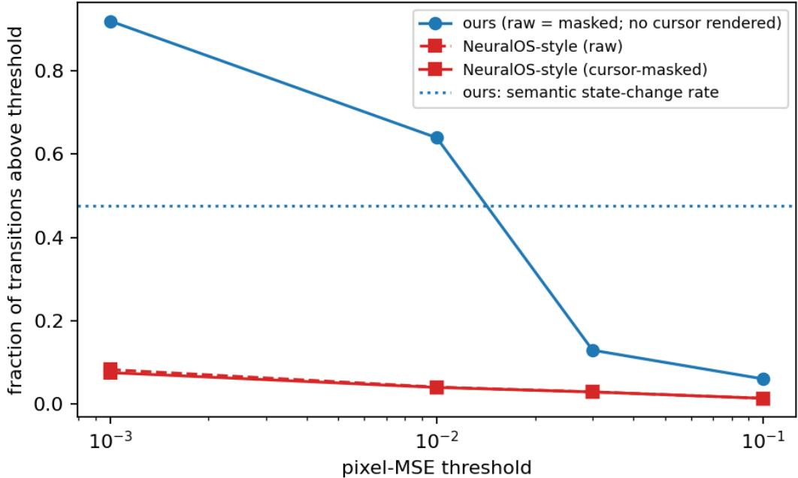  
Figure 6: Visual-change rates across thresholds. Fraction of transitions meeting each pixel-MSE threshold for grounded collection and NeuralOS-style collection, with and without cursor masking. The dotted line indicates the grounded semantic state-change rate (47.7%).

## A.2.3 Observed exploration and coverage

State diversity and event reachability. The grounded training corpus contains 5,615 distinct states, averaging 37.1 per trajectory, with pooled state-visit entropy of 6.70 bits. The estimated blind state count is 9.3 per trajectory; for comparison, we use a conservative reference of approximately 20 states per 300 actions, favoring the blind baseline. Within 300 actions, grounded collection reaches depths three and five in 58.6% and 18.3% of trajectories, compared with 33.3% and 0% for blind collection in the same environment.

For each event $G ,$ we measure its first occurrence $\tau _ { G } = \operatorname* { m i n } \{ t : G$ occurs at $t \}$ , right-censored at 300 actions. Reachability and median occurrence time among successful trajectories are: context menus, 98.5% (step 14); drags, 98.4% (11); typing or renaming, 96.9% (30); overlays or dialogs, 97.7% (20); and filesystem mutations, 86% (7).

Filesystem coverage and sampled state support. Across 60 sessions, each comprising twenty 300-action trajectories against its own seeded filesystem, mean folder coverage is 9.6% with a standard deviation of 2.8 percentage points across sessions (computed with divisor 60). This spread describes session-to-session variation, not uncertainty in the mean. Coverage ranges from 63% at depth one to approximately 1% at depth seven (Figure 7). It measures exploration of the complete generated filesystem, separately from the sampled-support estimate below.

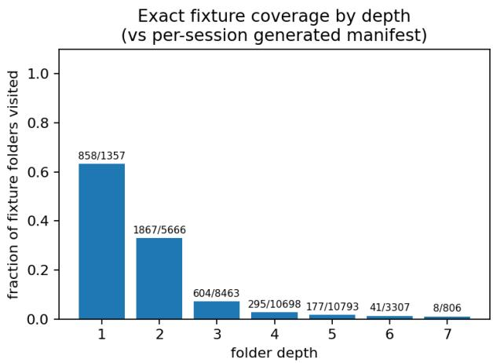

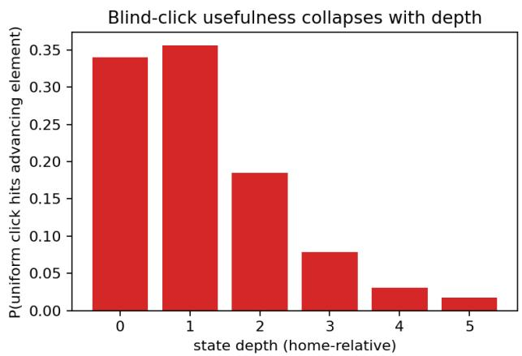  
Figure 7: Coverage and click geometry by depth. Left: folder coverage relative to each session’s generated filesystem. Right: probability that a uniform click hits an element observed to advance state.

We estimate sampled state support using Chao1 [Chao, 1984],

$$
\widehat { S } = S _ { \mathrm { o b s } } + \frac { f _ { 1 } ^ { 2 } } { 2 f _ { 2 } } ,\tag{6}
$$

where $S _ { \mathrm { o b s } }$ is the number of distinct observed states and $f _ { 1 } , f _ { 2 }$ count states visited once and twice. Training yields $S _ { \mathrm { o b s } } = 5 6 1 5 , f _ { 1 } = 8 9 0 , f _ { 2 } = 5 3 0$ , and $\widehat { S } \approx 6 3 6 2$ , corresponding to 88.2% estimated support coverage; validation yields 89.1%. Dependence between visits within trajectories limits interpretation of these estimates. They do not establish coverage of all reachable environment states. Figure 8 shows state accumulation over five shuffled trajectory orders.

## A.2.4 Policy comparison on an estimated transition model

Model and policies. To examine the effect of action selection, we simulate navigation on a transition model estimated from the grounded corpus. States are keyed by folder path, and content mutations are approximated as preserving identity. Each state supplies observed elements E(s), their screen areas, and destinations $\widehat { T } ( s , e )$ , resolving disagreements by majority vote. Unobserved transitions are treated as self-loops under every policy. This approximation omits dialog traps and limits exploration to transitions represented in the corpus.

We compare four policies: blind sampling with the NeuralOS-style input mix, blind sampling with one click per step, and uniform or production-weighted grounded selection. The first samples a per-walk click probability uniformly on [0, 0.4]; non-click steps self-loop. Both blind policies sample screen positions uniformly and use a double click with probability 0.3 when the destination requires one. Grounded policies select elements and use the required click type. Each policy runs 2,000 walks of 300 steps from the home directory (Algorithm 1).

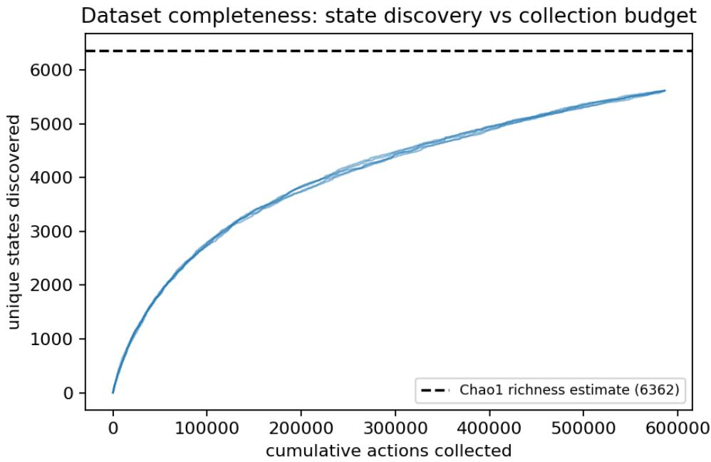  
Figure 8: Observed state accumulation. Unique states against cumulative actions over five shuffled trajectory orders. The dashed line indicates the Chao1 support estimate, $\widehat { S } \approx 6 3 6 2$

Algorithm 1 One step on the estimated transition model   
Require: state s, elements $E ( s )$ , destinations ${ \widehat { T } } ,$ policy π, blind click probability c   
1: if π is blind then   
2: with probability 1 − c: return s   
3: sample a screen position uniformly; identify the hit element e   
4: if no element is hit then   
5: return s   
6: end if   
7: if e requires a double click then   
8: with probability 0.7: return s   
9: end if   
10: else   
11: sample $e \in E ( s )$ uniformly or using production weights   
12: end if   
13: if Tb(s, e) is undefined then   
14: return s   
15: end if   
16: return $\widehat { T } ( s , e )$

Simulation results. The four policies visit respectively 7.1, 16.1, 36.8, and 38.1 unique states per 300 steps (Figure 9). The blind input mixture reaches depth three in 88% of simulated walks, with median first arrival at step 46, compared with every walk and median 1–2 steps for both grounded policies. Depth-five reachability is 0.8% for the blind mixture and 78.9% for weighted grounded selection. Pooled visit entropies are 5.67, 8.75, and 10.62 bits for the blind mixture, uniform grounded, and weighted grounded policies, respectively.

These estimates describe walks on the corpus-derived navigation model, not measured environment executions. Actual collection reaches 37.1 states per trajectory under the grounded policy, but its depth-five reachability is 18.3%, illustrating the limits of the simplified model. Transient views and their state-counting conventions must also be distinguished when comparing simulations with real trajectories.

State coverage per action budget (same environment, different policy)  
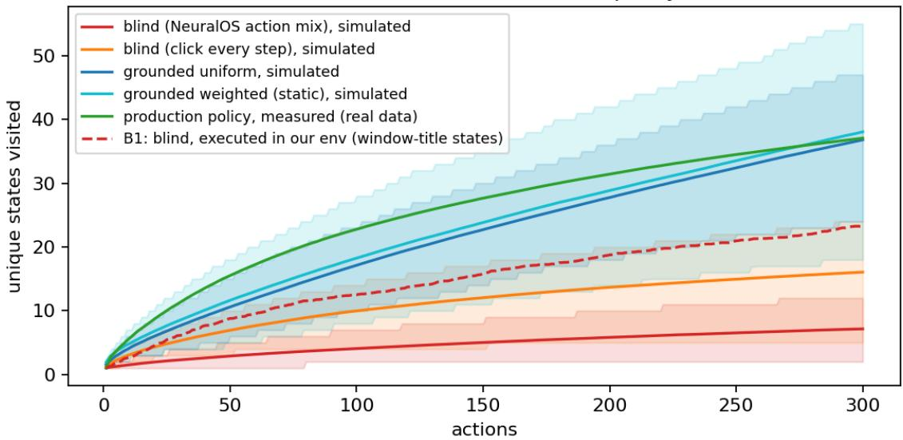  
Figure 9: Exploration under simulated policies. Unique states against action budget, with means and 10th–90th percentile bands over 2,000 walks. The measured grounded count and conservative blind reference are shown for comparison. Simulations use corpus-estimated navigation transitions and omit dialog traps.

## A.3 Experiments

## A.3.1 Memory Experiment

In the memory experiment of Section 4.3, the target’s first visit occupies frames 7-9, with zero-based indexing. Frame 7 belongs to the ground-truth context, whereas frames 8-9 are generated. For self-consistency, we pair each of these two generated frames with each of the five target-revisit frames, producing 10 pairs per trajectory, 1,840 pairs per horizon, and 9,200 pairs overall. Both models are evaluated at 256 × 192 resolution using the same element-crop matching and SSIM procedures, yielding 12,510 crop comparisons per horizon with no skipped comparisons. Only the designated target is scored: revisits to ancestor folders encountered during distraction are excluded. This benchmark evaluates retention of unchanged content; it does not test memory updates following content mutations.

A.3.1.1 Reconstruction correctness We compare generated target-revisit frames with their corresponding groundtruth frames using ROI-level SSIM. Figure 10 shows that StateCraft maintains SSIM of 0.92–0.94 across all horizons, whereas no baseline exceeds 0.51. Oracle retrieval remains close to base CF++ despite improving self-consistency, indicating that selecting the correct past latent under this cache mechanism does not by itself yield correct reconstruction. These results confirm that our high revisit consistency accompanies similarity to the target content.

A.3.1.2 Mixture of Contexts training details We adapt Mixture of Contexts [Cai et al., 2025] to the causal KV-cache implementation of our CF++ baseline, without graph conditioning. Historical keys are partitioned into one-frame chunks of 1,560 tokens. A parameter-free router scores chunks using dot products between pooled query and key representations. To accommodate the frame-autoregressive implementation, routing decisions are shared across the query tokens within each frame, rather than computed separately for each token. We set the chunk-selection parameter to 21 and retain the two most recent chunks as mandatory context. Text remains accessible through Wan’s cross-attention. During training, selected non-mandatory chunks undergo context drop-off and drop-in, using $p _ { \mathrm { m a x } } = 0 . 5$ and λ = 2, respectively (these values are implementation choices).

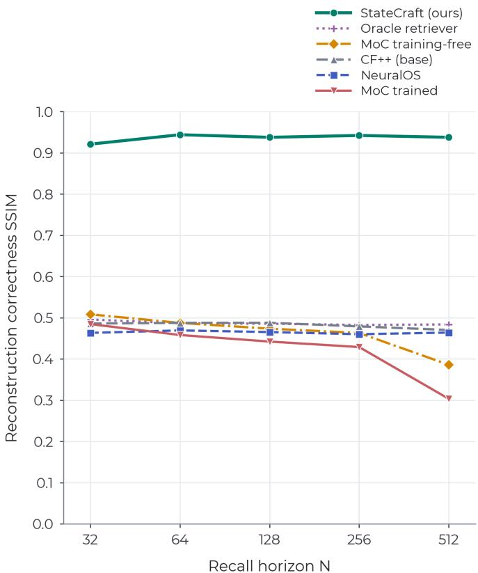  
Figure 10: Revisit reconstruction correctness. ROI-level SSIM against ground truth for the designated target. StateCraft maintains high reconstruction accuracy across horizons, complementing the self-consistency results in Figure 4.

Starting from the CF++ checkpoint trained without graph conditioning, we finetune for 4,500 optimizer steps on eight H200 GPUs, with a global batch size of eight and no gradient accumulation. Training uses 76-latent-frame clips at 640 × 480 resolution and the base model’s consistency-distillation objective, with learning rate $2 \times 1 0 ^ { - 6 }$ , weight decay 0.01, and EMA decay 0.99.

We evaluate checkpoints at steps 1,250 and 4,500, together with a training-free variant that applies the same routing configuration to the original CF++ checkpoint. In Figure 4a we plot the best finetuned checkpoint (step 1250), and the training-free adaptation. This comparison separates the effect of selecting historical context from that of finetuning the backbone for retrieval. Without finetuning, routing improves the self-consistency of the revisits over the rolling-window baseline at horizons $N = 3 2 – 2 5 6$ , but scores lower at $N = 5 1 2$ . Finetuning does not consistently improve these scores and progressively reduces visual sharpness. At N = 512, self-consistency SSIM is 0.5304 without finetuning, 0.4127 at step 1,250, and 0.3588 at step 4,500.

A.3.1.3 Oracle retrieval. We augment CF++ with an episode-specific bank indexed by ground-truth folder identity, storing the first generated latent for each folder and excluding ground-truth context frames. On subsequent occurrences, the stored latent replaces the newly generated latent only when updating the context cache; output frames remain model-generated. Retrieval therefore influences subsequent frames, not the first frame of a revisit. Retrieved latents use the current temporal position, and all other generation settings match base CF++. This baseline removes state-matching errors through privileged identities unavailable at deployment, while retaining first-visit generation errors. It tests oracle selection under this cache mechanism, rather than an upper bound on retrieval-based generation generally.

## A.3.2 ROI scores for DFoT

In Table 6 we expand the evaluation we present in Section 4.2 using DFoT as our backbone.

Table 6: Render quality by screen region for the DFoT backbone, over the full region (top) and inside OCRdetected text boxes only (bottom). Gains over the baselines are largest on the canvas, where filesystem state is displayed, and largest of all on canvas text, which the baselines fail to render legibly. On the static side panel, all models perform comparably. Last row of each block: upper bound with ground-truth diffs.
<table><tr><td rowspan="2">Model</td><td colspan="2">Breadcrumb</td><td colspan="2">Canvas</td><td colspan="2">Side panel</td></tr><tr><td>SSIM</td><td>PSNR</td><td>SSIM</td><td>PSNR</td><td>SSIM</td><td>PSNR</td></tr><tr><td>Full region</td><td></td><td></td><td></td><td></td><td></td><td></td></tr><tr><td>NeuralOS</td><td>0.85</td><td>30.12</td><td>0.61</td><td>19.74</td><td>0.96</td><td>34.28</td></tr><tr><td>DFoT</td><td>0.83</td><td>31.27</td><td>0.62</td><td>21.48</td><td>0.95</td><td>34.71</td></tr><tr><td>StateCraft (DFoT)</td><td>0.91</td><td>32.88</td><td>0.89</td><td>31.83</td><td>0.92</td><td>33.81</td></tr><tr><td>StateCraft (DFoT), GT diffs</td><td>0.93</td><td>33.41</td><td>0.92</td><td>32.87</td><td>0.92</td><td>33.92</td></tr><tr><td>OCR-detected text boxes</td><td></td><td></td><td></td><td></td><td></td><td></td></tr><tr><td>NeuralOS</td><td>0.52</td><td>27.16</td><td>0.15</td><td>16.71</td><td>0.80</td><td>27.90</td></tr><tr><td>DFoT</td><td>0.39</td><td>29.51</td><td>0.20</td><td>19.10</td><td>0.85</td><td>30.47</td></tr><tr><td>StateCraft (DFoT)</td><td>0.74</td><td>31.20</td><td>0.81</td><td>26.55</td><td>0.79</td><td>29.55</td></tr><tr><td>StateCraft (DFoT), GT diffs</td><td>0.79</td><td>31.60</td><td>0.91</td><td>27.60</td><td>0.88</td><td>29.60</td></tr></table>

## A.3.3 State-predictor evaluation

The state-predictor module is scored here against the ground truth recorded on node accuracy (exact structural match of the next node), transition accuracy, schema validity, and generation speed in tokens per second. Table 7 shows the evaluation of two backbones for in-domain and out-of-domain tasks. The OOD tasks are either unseen scenarios following the same JSON structure (i.e. memory game, battleship, blackjack) and unseen operations (i.e. "delete all the files starting with the letter ’A’"). For this evaluation, we test the model on the graph states of the hold-out set for the consistency experiment (Section 4.2), and on a set of synthetic experiments for the OOD scenarios.

Table 7: State predictor evaluation: finetuned (FT) against base with few-shot prompts (FS), both backbones on the same corpus and schedule. In-domain: node accuracy, transition accuracy and schema validity on held-out navigation. OOD: node accuracy on unseen operations and cross-domain games. Finetuning Qwen3.5-0.8B trades generality for in-domain accuracy; DiffusionGemma-26B scores are lower over the task-specific metrics, but it maintains generalization capabilities and decodes faster.
<table><tr><td rowspan="2"></td><td rowspan="2"></td><td colspan="3">In-domain</td><td colspan="2">OOD</td><td rowspan="2">TPS</td></tr><tr><td>Node</td><td>Trans.</td><td>Schema</td><td>Ops</td><td>Games</td></tr><tr><td rowspan="2">Qwen3.5-0.8B [Qwen Team, 2026]</td><td>FT</td><td>0.86</td><td>0.96</td><td>0.91</td><td>0.00</td><td>0.18</td><td>250</td></tr><tr><td>FS</td><td>0.48</td><td>0.52</td><td>0.85</td><td>1.00</td><td>0.83</td><td>250</td></tr><tr><td rowspan="2">DiffusionGemma-26B [DiffusionGemma Team et al., 2026]</td><td>FT</td><td>0.77</td><td>0.85</td><td>0.79</td><td>1.00</td><td>0.86</td><td>1500</td></tr><tr><td>FS</td><td>0.34</td><td>0.40</td><td>0.70</td><td>1.00</td><td>0.85</td><td>1500</td></tr></table>

## A.3.4 Full ablation results

Conditioning representation. We evaluate two reduced conditioning variants of DFoT while keeping the backbone, frozen encoder, cross-attention mechanism, and training budget fixed. Path embeds only the current filesystem path into one token per frame, providing state identity without contents. Flat-node embeds the entire serialized node, including its path and visible elements, into one token, retaining content without separate element representations. Both single-token variants retain the encoder’s native embedding width, whereas the full model truncates embeddings to accommodate multiple graph tokens. Both variants are finetuned from the same action-conditioned checkpoint using the full model’s warm-up and training schedule. Together with the unconditioned baseline and full model, they test the contributions of state identity, content, and elementwise access.

Table 8 shows that path conditioning improves breadcrumb reconstruction but provides little benefit for canvas content or revisit consistency. Flat-node conditioning improves both, while separate graph tokens yield the strongest results:

Table 8: Conditioning representation ablation on DFoT. Reconstruction cells report SSIM / PSNR (dB); text scores use OCR-detected boxes. Memory scores measure revisit similarity by action lag, with approximately 0.5 indicating plausible but unrelated content. None denotes no state conditioning. All models receive actions, and all conditioning variants use ground-truth states, isolating the representation supplied to the video model. Best values are bold and second-best underlined, including ties.
<table><tr><td>Region / lag</td><td>None</td><td>Path</td><td>Flat-node</td><td>Graph (full)</td></tr><tr><td colspan="5">Full-region reconstruction: SSIM / PSNR</td></tr><tr><td>Breadcrumb Canvas Side panel</td><td>0.83 / 31.27 0.62 / 21.48</td><td>0.92 / 31.18 0.62 / 21.80</td><td>0.91 / 32.55 0.76 / 25.92</td><td>0.93 / 33.41 0.92 / 32.87</td></tr><tr><td>Breadcrumb</td><td>0.95 / 34.71 Text reconstruction: SSIM / PSNR 0.39 / 29.51</td><td>0.94 / 34.29 0.80 / 31.65</td><td>0.93 / 33.70 0.41 / 30.95</td><td>0.92 / 33.92 0.79 / 31.60</td></tr><tr><td colspan="5">Canvas 0.20 / 19.10 0.20 / 19.60 0.54 / 22.42 Side panel 0.85 / 30.47 0.82 / 30.49 0.82 / 29.69 Revisit memory by action lag: SSIM</td></tr><tr><td>8-16</td><td>0.52</td><td>0.53</td><td>0.68</td><td>0.89</td></tr><tr><td>16-24</td><td>0.56</td><td>0.56</td><td>0.69</td><td>0.92</td></tr><tr><td>24-32</td><td>0.54</td><td>0.54</td><td>0.72</td><td>0.93</td></tr><tr><td>32-64</td><td>0.58</td><td>0.58</td><td>0.70</td><td></td></tr><tr><td>64+</td><td>0.55</td><td>0.56</td><td>0.70</td><td>0.92 0.93</td></tr></table>

canvas SSIM increases from 0.62 without conditioning to 0.76 with flat-node conditioning and 0.92 with graph tokens. Within canvas text boxes, the corresponding scores are 0.20, 0.54, and 0.91. Graph tokens also improve canvas PSNR by ∼7 dB over flat-node conditioning and maintain revisit scores of 0.89–0.93 across the evaluated distances. The unconditioned model retains a small advantage on full-region side-panel metrics, where appearance is identical across trajectories.

Conditioning ablation. We test whether the gains in Section 4.2 depend on graph conditioning beyond the ROIweighted loss, and whether actions remain useful when the target state is supplied explicitly. For both DFoT and CF++, we independently zero the graph or action channel at inference, following the independent conditioning dropout used during training. Evaluating the same finetuned models holds the learned weights and training objective fixed while measuring their dependence on each signal (Table 9).

Removing graph conditioning substantially degrades content reconstruction and memory: canvas SSIM falls by 0.333 for CF++ and 0.291 for DFoT, while revisit SSIM decreases by 0.222 and 0.210, respectively. These losses occur despite training with ROI reweighting, showing that the reweighted objective alone does not sustain the full model’s state fidelity when graph information is unavailable. This experiment establishes the model’s dependence on graph conditioning, although it does not separately quantify the contribution of loss reweighting.

Removing actions produces smaller reconstruction losses across both backbones, but its effect is not negligible: canvas SSIM decreases by 0.061 for CF++ and 0.051 for DFoT. Revisit consistency remains nearly unchanged for CF++ but drops by 0.092 for DFoT. Qualitative rollouts retain approximately correct target contents while exhibiting noisier, less plausible transitions, consistent with actions helping the model apply visual changes. Together, these results support complementary roles for the two channels: graph conditioning supplies explicit state contents, while actions improve their realization during interaction.

## A.3.5 Latent space probing

We test whether video-model activations predict the next UI transition before language-model invocation. With CF++ frozen, we extract residual activations from Wan block 15 of 30 during teacher-forced evaluation, at diffusion timestep τ=1000, the first step of the two-step sampler. Global, cursor-token, and cursor-neighborhood pooling of the 30 × 52 latent grid produce three 1536-dimensional vectors, concatenated with eight action features into a 4616-dimensional representation.

Controls include actions alone; symbolic features describing the clicked graph slot, its kind, name, area, sidebar membership, and valid-slot count; pixels from a decoded-frame thumbnail and cursor crop; and pooled and cursoraligned graph-conditioning features. Including actions, their dimensions are 8, 26, 200, and 2056, respectively. Each representation is evaluated with multinomial logistic regression and a two-layer GELU MLP with dropout, predicting NO\_CHANGE, UP\_BACK, WINDOW\_CLOSE, DEEPER, or JUMP. Trajectories are partitioned into disjoint training, calibration, and test sets. Calibration determines early stopping and gate thresholds; Table 10 reports results on 35,880 held-out test decisions.

Table 9: Effect of the different conditioning signals on the main metrics. Each channel is removed at inference by zeroing it, on the same 240 test trajectories with an 8-frame ground-truth seed and closed-loop generation. Graph tokens carry what is on screen: removing them costs the canvas 0.33 (CF++) and 0.29 (DFoT) SSIM and roughly a fifth of revisit memory, and drops breadcrumb agreement with the ground-truth path by 14–19 points. Removing the action channel is far cheaper on both backbones. Compare columns within a backbone: since the ablation is meant to compare the effectiveness of the components within an architecture, both CF++ and DFoT are scored here at their native resolution (640×480 and256×192).
<table><tr><td rowspan="2">SSIM↑</td><td colspan="3">CF++</td><td colspan="3">DFoT</td></tr><tr><td>full</td><td>-act.</td><td>-graph</td><td>full</td><td>-act.</td><td>-graph</td></tr><tr><td>Whole frame</td><td>0.934</td><td>0.895</td><td>0.824</td><td>0.929</td><td>0.889</td><td>0.857</td></tr><tr><td>Canvas</td><td>0.897</td><td>0.836</td><td>0.564</td><td>0.907</td><td>0.856</td><td>0.616</td></tr><tr><td>Breadcrumb</td><td>0.890</td><td>0.855</td><td>0.759</td><td>0.941</td><td>0.922</td><td>0.833</td></tr><tr><td>Semantic (all)</td><td>0.891</td><td>0.859</td><td>0.788</td><td>0.946</td><td>0.916</td><td>0.876</td></tr><tr><td>Revisit  $k { = } 6 4$ </td><td>0.878</td><td>0.874</td><td>0.656</td><td>0.898</td><td>0.806</td><td>0.688</td></tr><tr><td>Breadcrumb match rate ↑</td><td>0.905</td><td>0.872</td><td>0.769</td><td>0.932</td><td>0.904</td><td>0.812</td></tr></table>

Table 10: Transition probing across feature families. Results on 35,880 test decisions from trajectories disjoint from training and calibration. All representations include eight action features. We report MLP results and logistic-regression accuracy $( \mathrm { A c c } _ { 5 } ^ { \mathrm { l i n } } )$ . AUROC is five-class one-vs-rest macro AUROC; $\mathrm { { A U R O C _ { 2 } } }$ measures change versus no change. $\mathrm { A c c _ { 5 } }$ is five-class accuracy and F1 is macro-F1. Skip is the fraction of omitted calls; purity is the fraction of skips requiring no state change. Thresholds calibrated for 99% purity are applied unchanged to test. These are held-out probe results, closed-loop results are reported in the text.
<table><tr><td>Features</td><td>Dim.</td><td>AUROC</td><td> $\mathrm { { A U R O C _ { 2 } } }$ </td><td> $\mathrm { A c c } _ { 5 }$ </td><td>F1</td><td> $\mathrm { A c c } _ { 5 } ^ { \mathrm { l i n } }$ </td><td>Skip</td><td>Purity</td></tr><tr><td>Majority class</td><td>一</td><td>0.500</td><td>0.500</td><td>0.496</td><td>0.133</td><td>0.496</td><td>1</td><td></td></tr><tr><td>Action</td><td>8</td><td>0.944</td><td>0.919</td><td>0.790</td><td>0.736</td><td>0.790</td><td>0.329</td><td>0.981</td></tr><tr><td>Symbolic features</td><td>26</td><td>0.965</td><td>0.941</td><td>0.835</td><td>0.805</td><td>0.801</td><td>0.395</td><td>0.991</td></tr><tr><td>Graph conditioning</td><td>2056</td><td>0.978</td><td>0.960</td><td>0.870</td><td>0.820</td><td>0.819</td><td>0.397</td><td>0.990</td></tr><tr><td>Raw pixels</td><td>200</td><td>0.985</td><td>0.974</td><td>0.911</td><td>0.882</td><td>0.869</td><td>0.427</td><td>0.991</td></tr><tr><td>Denoiser latents</td><td>4616</td><td>0.987</td><td>0.975</td><td>0.916</td><td>0.898</td><td>0.901</td><td>0.410</td><td>0.990</td></tr></table>

Denoiser features achieve 0.987 macro AUROC and 0.916 five-class accuracy, versus 0.496 majority-class accuracy. Linear accuracy reaches 0.901. Latents outperform graph conditioning (0.870 accuracy), symbolic features (0.835), and actions alone (0.790), but only slightly exceed pixels (0.911 accuracy; 0.985 AUROC). Thus, transition information is accessible in denoiser activations, although much is also recoverable from decoded frames.

For deployment, the gate combines activations cached while generating $x _ { t }$ with incoming action $a _ { t } .$ . Thresholding its predicted NO\_CHANGE probability determines whether to invoke the language model; the updated or retained state then conditions $x _ { t + 1 }$ . This uses CF++ block 15 activations, or DFoT’s mid07 activations, without an additional backbone pass. Only the cached-latent configuration is deployed.

At a threshold calibrated for 99% skip purity, the held-out probe skips 41.0% of decisions with 99.0% purity, defined as the fraction of skips requiring no state change. In closed-loop evaluation without a verifier, it skips 3,914 of 9,600 decisions across 48 trajectories (40.8%), including 345 incorrect skips, giving 91.2% purity and 5,686 language-model calls. Incorrect skips retain stale states that can affect later decisions. Relative to generation without gating, PSNR decreases by 0.57 dB and SSIM by 0.008. These results establish call savings, not an end-to-end latency improvement.

## A.3.6 3D environment experiment details

Data and conditioning. We collect 8,644 training, 294 validation, and 828 test trajectories in OmniGibson interiors, with 14 houses represented in training and two unseen houses reserved for testing. The test set contains seven scene groups, each defined by a house and route setup. Trajectories vary camera paths, switch activations, and target-room visits. Each clip contains 81 video frames, encoded into 21 latent frames. The video model receives actions and simulator-derived room-category and illumination-state tokens through the abstract-state conditioning pathway. Room identity tokens are omitted. State updates are supplied by the simulator in this experiment. Conditioning is aligned with the next generated frame and provided with an eight-frame lead, making the illumination signal available during the ground-truth context before the target room is revealed.

Training and generation. We adapt the CF++ backbone using conditioning warmup followed by joint training. The training objective upweights five reveal frames by a factor of 50 and includes a contrastive term that encourages sensitivity to the state signal. We select the checkpoint using the validation split and report results on the held-out test set; the selected checkpoint corresponds to 3,000 joint-training steps. The comparison model starts from the same warmup checkpoint and trains for 3,000 steps with the graph-conditioning pathway absent. Evaluation supplies 14 ground-truth latent frames and autoregressively generates the remaining seven.

Illumination correctness. We evaluate 120 test episodes, balanced between lit and dark outcomes and spanning all seven scene groups. Generated frames are decoded to RGB in [0, 1] and converted to Rec. 709 luminance, $L _ { t } =$ $0 . 2 1 2 6 R _ { t } + 0 . 7 \hat { 1 } 5 2 \hat { G } _ { t } + 0 . 0 7 2 2 B _ { t }$ . We average spatially and over the video frames associated with each latent frame to obtain $\ell _ { k } .$ The episode score is

$$
s = \frac { 1 } { | \mathcal { W } | } \sum _ { k \in \mathcal { W } } \ell _ { k } , \qquad \mathcal { W } = \{ e , \dots , T - 1 \} ,
$$

where e denotes first entry into the target room, determined from recorded metadata. All 120 evaluated episodes enter at latent frame 15. We compute AUC from these scores and the illumination labels. State-conditioned generation achieves 0.8644 AUC, versus 0.5422 without state conditioning. Accuracy is 0.742 versus 0.542, using a shared threshold equal to the midpoint of the ground-truth lit and dark means, fitted while excluding the evaluated scene group.

Paired state intervention. For 240 test episodes, we generate paired continuations with identical visual context and noise, forcing the illumination token to either lit or dark. The mean luminance difference is 0.09218, corresponding to 63.7% of the ground-truth reference difference of 0.14471, estimated from camera-matched opposite-outcome pairs. The intervention changes brightness in the expected direction in 234 of 240 episodes and all seven scene groups. A two-sided one-sample t-test on the seven group-mean differences gives $t ( 6 ) = 6 . 5 8 , p = 0 . 0 0 0 6$ . Episode counts are descriptive; the significance test uses scene groups as its units.

## A.3.7 Additional Visualizations

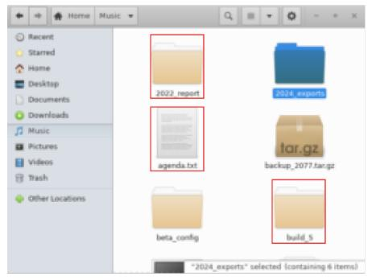  
click

\- folder:2022\_report - text:agenda.txt - folder:build\_5

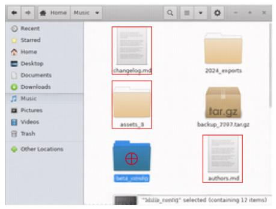

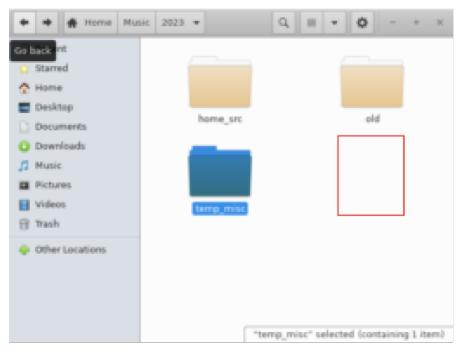

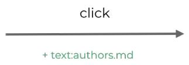

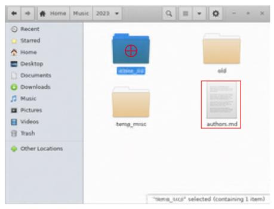

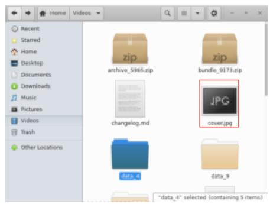

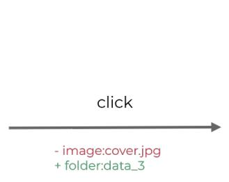

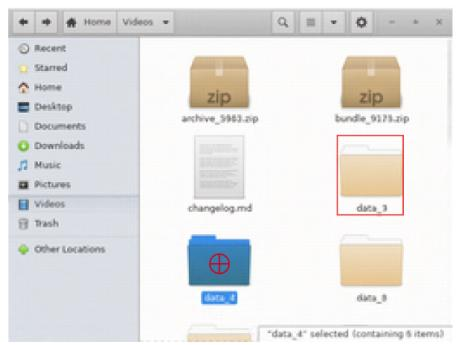  
Figure 11: Controllability interventions by type (multiple edits, new element on background, rename with type change). Per row: original state (left), commanded graph diff, removals in red and additions in green (centre), and the causally generated frame for the edited state, which never occurs in the data (right; red boxes mark edited regions). The render follows the state edit rather than the pixels of its own context.