Queries by material name

# Spectral World Renderer: Unified 3D Hyperspectral Unmixing

Chia-Ming Lee1,2 Yu-Jou Hsiao3 Ming-Ching Chang1 Xin Li1 Yu-Lun Liu2 Chih-Chung Hsu2,3

1University at Albany, State University of New York

2National Yang Ming Chiao Tung University 3National Cheng Kung University

https://ming053l.github.io/Spectral-World-Renderer/

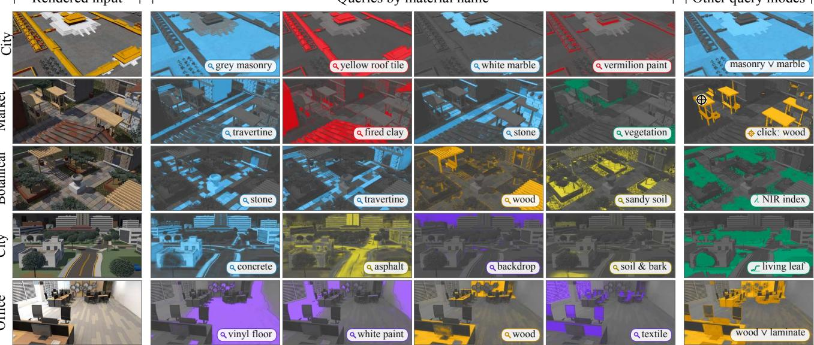  
Figure 1. From hyperspectral worlds to queryable material layers. Input: multi-view hyperspectral images of worlds with known material composition, produced by the SWR world generator (left). Output: a Gaussian scene whose primitives carry material abundances and spectra. Query: a user selects a material by name, a click (crosshair), a reference spectrum, a band index or a combination, and SWR colours the retrieved surfaces in any view; each tile shows one query on a test view.

## Abstract

Cameras and the foundation models built on them recognize what a 3D scene contains, but not what it is made of: surfaces of the same colour can be different materials. Hyperspectral unmixing explains each spectrum as a mixture of material signatures, yet in 3D it is applied to rendered images after the views are composited, or tied to slow implicit fields, and no multi-view data with known composition exist to check the result. We present the Spectral World Renderer (SWR), which unifies world generation and unmixing. A coding agent builds executable 3D worlds that are rendered with measured spectra, so every hyperspectral image comes with exact labels and sub-pixel proportions; the resulting SWR-Bench provides eight indoor and outdoor worlds in which decompositions can be verified. SWR then unmixes inside rendering: each Gaussian of a compact 3D representation is decoded into material abundances before compositing, so one render yields spectra and material maps, and any surface can be queried by mate-

rial name, a clicked pixel or a reference spectrum. Without material labels, SWR identifies materials best in all eight worlds, has the best mean PSNR on real captures, trains 3.7–12.9×faster than unmixing baselines, renders 34.9 labelled views/s and separates same-coloured materials.

## 1. Introduction

Knowing what a scene is made of, not only what it contains, matters for robotic sorting, agriculture and building inspection. Foundation models such as CLIP, SAM and DINOv2 recognize and segment objects from RGB images, and their features lift into 3D for open-vocabulary queries [38, 41, 60, 67]. They remain weak at identifying materials: three colours cannot separate surfaces of similar colour but different composition, such as green paint and a leaf; their labels name objects rather than materials, and one object may combine wood, laminate and metal; and they assign one category per pixel, like RGB material segmenters [4, 49, 84], whereas materials mix within a pixel.

Hyperspectral imaging supplies the missing evidence: the shape of a reflectance spectrum over tens to hundreds of bands characterizes the material [20, 22, 42, 53], and spectral unmixing explains each spectrum as a non-negative mixture of material signatures, or endmembers [5]. Extended to 3D, unmixing would reveal which materials each surface point contains, consistently across views.

This extension is difficult. (1) Hyperspectral data have many bands, so representations that store a spectrum per primitive grow with the band count. (2) Mixing occurs twice: within a pixel, as in 2D, and along each ray; unmixing rendered spectra afterwards cannot separate what compositing has mixed. (3) The decomposition is ambiguous: illumination changes the brightness and shape of a spectrum, and a model can explain two similar materials with one endmember while intensity absorbs their difference.

Existing methods treat reconstruction and unmixing as separate steps. Spectral radiance fields and Gaussian splatting [9, 24, 47, 55, 58, 76, 82] reconstruct spectra, often storing per-band quantities on every primitive, and are evaluated mainly by spectral fidelity; materials are then estimated by unmixing their renderings. UnMix-NeRF [63] unmixes inside a radiance field, but its implicit field makes training and rendering slow and lacks queryable primitives. Moreover, as Table 1 shows, the data needed to verify a decomposition are missing: real multi-view hyperspectral datasets are tabletop or turntable captures [9, 40, 44] that record radiance but no material labels or sub-pixel proportions, which cannot be annotated reliably by hand, and synthetic RGB datasets contain geometry and semantics, not spectra.

We therefore generate worlds whose composition is known by construction. In the world generator of our Spectral World Renderer (SWR), shown in Figure 2, a coding agent turns reference images and text into executable scene programs that fix geometry, materials, illumination and cameras. Measured spectra ground the materials, and shared sub-pixel samples render aligned RGB and hyperspectral observations, material labels and proportions. SWR-Bench offers eight worlds that separate fidelity from identity.

Spectral World Renderer unifies unmixing with rendering in Gaussian splatting and targets each difficulty. (1) An RGB-trained anchor provides compact geometry, and each Gaussian stores a band-independent feature instead of a spectrum, so storage does not grow with the bands. (2) A shared decoder maps this feature, at every ray intersection, to abundances over a scene-wide endmember dictionary, so mixing is resolved before compositing and one render yields both. (3) A separate intensity absorbs shading, and a multi-view appearance regularization keeps it from merging materials by assigning over-complete endmembers to distinct appearances without material labels. With abundances on every Gaussian, a material is queried by name, click, reference spectrum or band in 3 ms. SWR has the best mIoU in every world and trains 3.7–12.9× faster than unmixing baselines on City. Known composition also exposes what fidelity hides: in Market and Study, 3DGS with posthoc unmixing reaches a lower spectral angle yet far lower mIoU. Our contributions are:

Table 1. Multi-view datasets with ground truth. ID: material labels; Prop.: geometric area proportions; Gen.: worlds on demand. NeSpoF-Seg.: synthetic segmentation truth from UnMix-NeRF [63]. Only SWR-Bench samples proportions with each image and models spectral variability.
<table><tr><td>Dataset</td><td>Bands</td><td>nm</td><td>Scenes ×views</td><td>Capture</td><td>ID Prop. Gen.</td><td></td><td></td></tr><tr><td>Replica</td><td>3</td><td>RGB</td><td>18</td><td>indoor</td><td>x</td><td>x</td><td>x</td></tr><tr><td>Hypersim</td><td>3</td><td>RGB</td><td>461×168</td><td>indoor</td><td>x</td><td>x</td><td>x</td></tr><tr><td>Kubric</td><td>3</td><td>RGB</td><td></td><td>random</td><td>x</td><td>x</td><td>√</td></tr><tr><td>NeSpoF</td><td>21</td><td>450-650</td><td>4×18-30</td><td>tabletop</td><td>x</td><td>x</td><td>x</td></tr><tr><td>NeSpoF-Seg.</td><td>21</td><td>450-650</td><td>4 scenes</td><td>synthetic</td><td>√</td><td>x</td><td>x</td></tr><tr><td>HS-NeRF</td><td></td><td>128/141 371-1087</td><td>8×48-433</td><td>turntable</td><td>x</td><td>x</td><td>x</td></tr><tr><td>HSI-SC</td><td>204</td><td>397-1004</td><td>3×60</td><td>turntable</td><td>x</td><td>x</td><td>x</td></tr><tr><td>SWR-Bench</td><td>64</td><td>420-980</td><td>8×96–240 in/outdoor √</td><td></td><td></td><td>√</td><td>√</td></tr></table>

• The SWR world generator and SWR-Bench: an agent writes executable worlds whose shared samples render spectra, labels and proportions, giving eight worlds with measured spectra that make decompositions verifiable.

• Spectral World Renderer, a compact Gaussian representation with band-independent storage that decodes mixtures at every intersection, so one render yields spectra and queryable 3D abundances.

• A multi-view appearance regularization that clusters training pixels across views and binds each cluster to its own endmember, without material labels.

• Real-time material queries by name, click, reference spectrum or band, consistent across views, that separate RGB metamers and resist shadow.

## 2. Related Work

Hyperspectral 3D reconstruction. Radiance fields use neural or grid models [2, 56, 57]; 3DGS composites Gaussians [37], later improved in quality and speed [25, 32, 52, 71, 91]. Foundation-model features [41, 67] answer object queries [8, 38, 66, 89, 95] and select materials in RGB [17], and neural harmonic textures vary appearance within a primitive [12]. Hyperspectral fields render radiance per wavelength [9, 40, 44, 47]; Gaussian versions store spectral quantities per primitive [24, 55, 58, 76, 82]. RGB inverse rendering recovers reflectance and illumination [6, 50, 93] or reflection components [85]. These methods model appearance, spectra or objects; SWR also reveals materials.

Spectral unmixing. Unmixing explains each spectrum by endmembers and non-negative abundances [5, 26, 39], found by geometric extraction [59, 87], factorization or autoencoders [46, 62, 79], with spatial regularization [35] or spectral-variability and nonlinear models [27, 28]. These 2D abundance maps serve remote sensing and material analysis [20, 65]. UnMix-NeRF brings unmixing into a radiance field [63]. Like it, SWR learns endmembers and abundances jointly, but on explicit Gaussians and before compositing. Programmatic world generation. Procedural rules [68, 69], language-model layouts [16, 88] and scene code [31, 48] build 3D worlds. Programmable and generative world renderers turn scene state or G-buffers into video [33, 34, 51]. None models spectra or proportions; the SWR world generator binds measured spectra to inspectable geometry, sampling images with their composition.

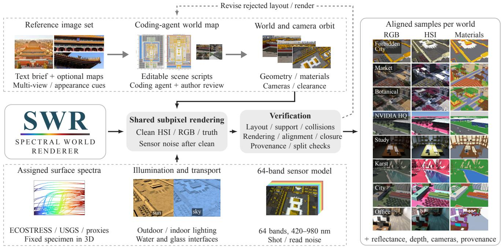

Figure 2. The SWR world generator gives every image its exact composition. From reference photographs and a short brief, a coding agent writes an executable world whose every surface carries a library-measured spectrum. One shared sub-pixel rendering produces the hyperspectral and RGB observations together with the material of every pixel, so the ground truth is exact for the rendered world. Checks on layout and rendering return flawed worlds for revision, yielding aligned, verifiable samples across all eight worlds (right).  
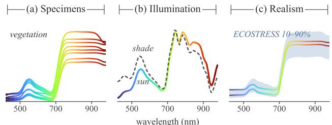  
Figure 3. No single spectrum describes a material. Grass specimens differ (a), and the same grass changes spectral shape between sunlight and shade (b). Both broadleaf spectra shown lie within independent leaf measurements (c).

Synthetic benchmarks and spectral simulation. Synthetic and scanned datasets supply geometry, semantics or intrinsic images [23, 73, 78]; game and agent benchmarks add G-buffers and checkable scene code [19, 34, 74, 90]. Spectral renderers and remote-sensing simulators trace light per wavelength [21, 36, 64, 86], and ray-traced vegetation scenes give known abundances for 2D unmixing [13]. As Table 1 summarizes, none pairs multi-view spectra with area proportions; SWR-Bench samples both from the same sub-pixel points, varies specimens and illumination, and stores coefficients so every target can be regenerated.

## 3. Spectral World Renderer

Spectral World Renderer unifies 3D reconstruction and unmixing in one verifiable framework. The world generator and SWR-Bench (Sec. 3.1) render each image and its ground truth from the same camera samples, with indoor and outdoor worlds, labels and sub-pixel proportions and measured spectra. The renderer (Sec. 3.2) unmixes at every ray intersection, so one render yields spectra, abundances and material queries at any band count; it uses bandindependent features, decoding before compositing and a separate intensity with multi-view appearance regularization (Sec. 3.3). Training uses no material labels; validation labels only select the number of endmembers K.

A scene is observed from V training cameras. Camera v provides RGB $\mathbf { I } _ { v } \in [ 0 , 1 ] ^ { H \times W \times 3 }$ and a co-registered hyperspectral cube $\mathbf { H } _ { v } \ \in \ \bar { \mathbb { R } ^ { H \times W \times L } }$ with L bands. The ray $\mathbf { r } = \mathbf { r } _ { v } ( p )$ of pixel p indexes its observed values $\mathbf { I } ( \mathbf { r } ) \in \mathbb { R } ^ { 3 }$ and $\mathbf { H } ( \mathbf { r } ) \in \mathbb { R } ^ { L }$ . At a novel camera, it renders a spectrum Hˆ (r) and abundances $\hat { \bf A } ( { \bf r } )$ over shared endmembers.

## 3.1. World Generator and SWR-Bench

Scoring an unmixing needs the material proportions of every pixel, which real captures cannot provide. The SWR world generator therefore renders images, material labels and area proportions from the same camera samples, so every target follows from the scene (Figure 2).

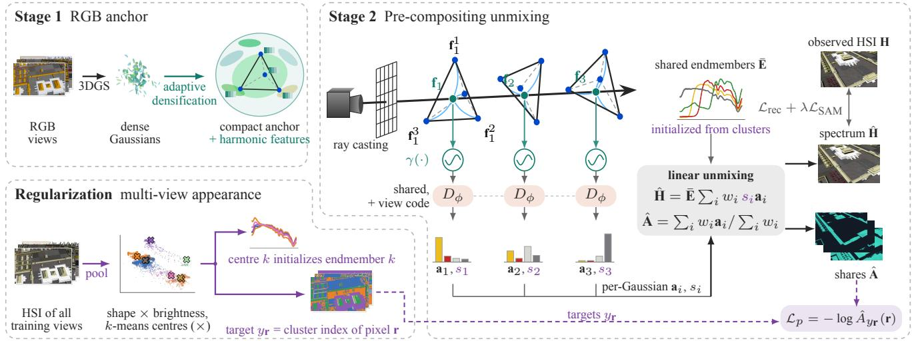  
Figure 4. Spectral World Renderer unmixes at every ray intersection, before compositing. An RGB anchor fixes the geometry, and each Gaussian carries harmonic features whose size does not depend on the band count. A shared decoder maps the feature at each intersection to abundances and an intensity, which mix scene-wide endmembers; the same visibility weights then render the spectrum and the abundances. Multi-view appearance clusters initialize the endmembers and regularize their assignment, so no material label enters training.

Reference-guided world generation. Users ground each world in reference images, available maps and a text brief. A coding agent turns them into executable scene programs: parameterized geometry and placement rules encode the layout, while materials, lighting and camera paths stay editable. The agent and the authors review previews for support, collisions and clearance.

Shared-sample ground truth. Images and labels rendered separately disagree at silhouettes and mixed pixels, so both use the same $S$ sub-pixel camera samples: for the pixel indexed by ray r, xn is the first surface hit of sample n and $m ( \mathbf { x } _ { n } )$ its material class. A Lambertian specimen $j$ with measured reflectance $\rho _ { j } ( \lambda )$ at wavelength λ has, under direct or sky illumination u, band radiance

$$
{ v } _ { j , \ell } ^ { u } = \int \psi _ { \ell } ( \lambda ) \rho _ { j } ( \lambda ) \Phi _ { u } ( \lambda ) / \pi \mathrm { d } \lambda , \quad u \in \{ \mathrm { d } , \mathrm { s } \} ,\tag{1}
$$

where $\psi _ { \ell }$ is the response of band ℓ and $\Phi _ { \mathrm { d } } , \Phi _ { \mathrm { s } }$ are direct and sky irradiance. The vectors $\mathbf { v } _ { j } ^ { u } \in \mathbb { R } ^ { L }$ and accumulated shading coefficients $C _ { j } ^ { u } ( \mathbf { r } )$ give

$$
\begin{array} { r l } & { \mathbf { H } _ { \mathrm { c l e a n } } ( \mathbf { r } ) = \sum _ { j } ( C _ { j } ^ { \mathrm { d } } \mathbf { v } _ { j } ^ { \mathrm { d } } + C _ { j } ^ { \mathrm { s } } \mathbf { v } _ { j } ^ { \mathrm { s } } ) , } \\ & { \qquad A _ { c } ( \mathbf { r } ) = \frac { 1 } { S } \sum _ { n = 1 } ^ { S } [ m ( \mathbf { x } _ { n } ) = c ] . } \end{array}\tag{2}
$$

Radiance and area proportions thus share one footprint; released proportions renormalize $A _ { c }$ over non-sky samples. Here c indexes ground-truth classes and $k ,$ below, learned endmembers. Some worlds go beyond this Lambertian model: NVIDIA HQ adds rough specular highlights, a glass reflection and a hazy analytic sky; Karst water adds reflection, refraction and absorption; the interiors are path traced in Mitsuba [36]. Each effect is stored separately.

Measured spectra and their variation. Reflectance comes from ECOSTRESS and USGS measurements [42, 53], and every assignment is recorded, so each observation can be traced to the spectra that produced it. No single spectrum describes a whole material: specimens differ within a class, and sunlight and skylight change the spectral shape of one surface, as Figure 3(a,b) shows. Each surface keeps one specimen across views. Outdoor worlds use ASTM G173 sunlight and skylight [1], interiors white sources [11]. We render 64 bands from 420 to 980 nm, clean and with shot and read noise [18].

Verification. Ground truth must be exact, so each world is checked for label alignment and integrity, spectral provenance and train/test separation. Stored coefficients and contributions re-compose clean outdoor radiance, indoor transport is checked before adding noise, and assigned spectra lie within independent library measurements (Figure 3(c)).

## 3.2. Unmixing at Every Ray Intersection

Unmixing a rendered image afterwards acts on spectra that compositing has already mixed. Spectral World Renderer instead unmixes inside rendering: at every ray intersection, a shared decoder turns the local feature into abundances and an intensity, and compositing accumulates both, so one render yields spectra and abundances (Figure 4).

RGB anchor and harmonic features. Hyperspectral observations are noisy and vary with illumination, and across many views these errors also degrade the recovered geometry. We therefore fit the geometry as a 3DGS anchor on coregistered RGB images, supplied with the data or derived from visible-band responses; advances in RGB Gaussian splatting thus transfer directly. FastGS densification and pruning [71] keep only primitives supported across views, so rendering is faster and fewer features and intersections remain to optimize and unmix. Unlike HyperGS [82], the anchor requires no spectral autoencoder. It has N Gaussians $G _ { i }$ with mean $\mu _ { i } ,$ rotation $\mathbf { R } _ { i } ,$ , scale $\sigma _ { i }$ and opacity $o _ { i } ;$ after fitting, we drop colours and fold the rasterizer’s screenspace variance into the scales. Instead of a spectrum, each Gaussian carries a neural harmonic texture [12], whose variation inside the primitive lets few Gaussians represent fine detail: four feature vectors $\mathbf { f } _ { i m } \in \mathbb { R } ^ { d } , m = 1 , \dots , 4 .$ , with $d = 1 2 . \mathrm { A }$ ray r queries $G _ { i }$ at its point of maximal response, whose barycentric coordinates $\beta _ { i m } ( { \bf r } )$ in a tetrahedron interpolate the vertex features:

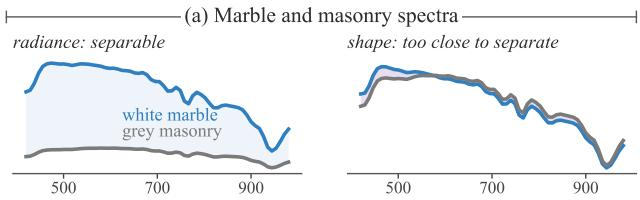

$$
\mathbf { f } _ { i } ( \mathbf { r } ) = \sum _ { m = 1 } ^ { 4 } \beta _ { i m } ( \mathbf { r } ) \mathbf { f } _ { i m } \in \mathbb { R } ^ { d } .\tag{3}
$$

Different rays through one Gaussian thus read different features. We refine features and geometry with the NHT RGB shader, without further densification, and then freeze the geometry. Each Gaussian stores 11 geometry and 48 feature values, so its size does not grow with $L .$

Pre-compositing material decoder. Each intersection is decoded before compositing blends it with others. Its feature $\left( \operatorname { E q . 3 } \right)$ , encoded as $\gamma ( \mathbf { f } ) = [ \sin \mathbf { f } ; \cos \mathbf { f } ]$ [80], enters a shared MLP $D _ { \phi }$ with a directional code $\mathbf { Y } ( \mathbf { d } _ { i } ( \mathbf { r } ) ) \in \mathbb { R } ^ { 9 }$ real spherical harmonics of degree $\leq ~ 2$ [70], where $\mathbf { d } _ { i }$ points from the Gaussian centre to the camera. The decoder produces

$$
\mathbf { z } _ { i } ( \mathbf { r } ) = D _ { \phi } ( \gamma ( \mathbf { f } _ { i } ( \mathbf { r } ) ) , \mathbf { Y } ( \mathbf { d } _ { i } ( \mathbf { r } ) ) ) \in \mathbb { R } ^ { K + 1 } .\tag{4}
$$

Here K is the number of shared endmembers. The first $K$ outputs yield abundances ${ \bf a } _ { i } ( { \bf r } ) = \mathrm { s o f t m a x } ( { \bf z } _ { i } ^ { 1 : K } ( { \bf r } ) )$ ; the last gives intensity $s _ { i } ( \mathbf { r } ) = \mathrm { s o f t p l u s } ( z _ { i } ^ { K + 1 } ( \mathbf { r } ) )$ . The MLP has three width-128 SiLU hidden layers; a zero-initialized linear map adds the directional code to layer one.

These coefficients mix a scene-wide dictionary $\bar { \textbf { E } } =$ $[ \bar { \mathbf { e } } _ { 1 } , \dots , \bar { \mathbf { e } } _ { K } ] \in \mathbb { R } ^ { L \times K }$ . Each endmember is parameterized by $\eta _ { k } \in \mathbb { R } ^ { L }$ as

$$
\bar { \mathbf { e } } _ { k } = \frac { \mathrm { s i g m o i d } ( \pmb { \eta } _ { k } ) } { \| \mathrm { s i g m o i d } ( \pmb { \eta } _ { k } ) \| _ { 2 } } \in \mathbb { R } _ { \ge 0 } ^ { L } .\tag{5}
$$

Unit normalization lets the dictionary carry spectral shape and $s _ { i }$ carry magnitude. The intersection spectrum is then a scaled linear mixture [5]:

$$
\mathbf { h } _ { i } ( \mathbf { r } ) = s _ { i } ( \mathbf { r } ) \bar { \mathbf { E } } \mathbf { a } _ { i } ( \mathbf { r } ) \in \mathbb { R } _ { \ge 0 } ^ { L } .\tag{6}
$$

Sec. 3.3 initializes and regularizes the dictionary.

Joint spectral and mixture rendering. Spectra and abundances should describe the same visible surfaces. With intersected Gaussians sorted front to back, with opacity $\alpha _ { i } ( \mathbf { r } )$ transmittance $\begin{array} { r } { T _ { i } ( \mathbf { r } ) \ = \ \prod _ { i ^ { \prime } < i } ( 1 - \alpha _ { i ^ { \prime } } ( \mathbf { r } ) ) } \end{array}$ gives visibility weights $w _ { i } ( \mathbf { r } ) = T _ { i } ( \mathbf { r } ) \alpha _ { i } ( \mathbf { r } ) \ [ 3 7 ]$ , which render both:

$$
\hat { \mathbf { H } } ( \mathbf { r } ) = \sum _ { i } w _ { i } ( \mathbf { r } ) \mathbf { h } _ { i } ( \mathbf { r } ) , \quad \hat { \mathbf { A } } ( \mathbf { r } ) = \frac { \sum _ { i } w _ { i } ( \mathbf { r } ) \mathbf { a } _ { i } ( \mathbf { r } ) } { \sum _ { i } w _ { i } ( \mathbf { r } ) } .\tag{7}
$$

Each ${ \bf a } _ { i }$ satisfies the abundance non-negativity constraint (ANC) and the abundance sum-to-one constraint (ASC) of linear unmixing [26], and for a non-empty ray Aˆ is a convex combination of them, so it satisfies both. Intensity scales the rendered spectrum but not the rendered abundances:

(b) Multi-view clusters  
(c) Marble layer, test view  
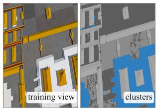

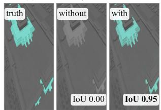  
Figure 5. Multi-view appearance clusters keep similar materials apart (Forbidden City). (a) White marble is four times brighter than grey masonry but only $3 . 8 ^ { \circ }$ apart in spectral shape; since intensity absorbs brightness, one endmember can explain both. (b) Clustering pixels of all training views by shape and brightness separates them, with clusters shared by every view. (c) Kept as a weak regularizer during training, these clusters give marble its own layer; without them it is absorbed into masonry.

$\begin{array} { r } { \hat { \bf H } = \bar { \bf E } \sum _ { i } w _ { i } s _ { i } { \bf a } _ { i } , } \end{array}$ whereas $\hat { \bf A }$ uses $w _ { i }$ alone. Because decoding precedes accumulation, each intersection keeps its own mixture; averaged over its training rays, each Gaussian’s abundance can be queried in 3D (Sec. 4.4).

## 3.3. Multi-View Appearance Regularization

Assignment ambiguity. Accurate spectra do not imply a correct decomposition. Eq. 6 fits each spectrum but does not fix which endmember explains it. Two similar materials may share one endmember while the intensity s absorbs their brightness difference, like the scaling factors of extended mixing models [14, 28]; the spectra are reconstructed well, yet the materials merge in Aˆ . We therefore derive an initial endmember for each appearance from the multi-view training data and keep this assignment as a weak regularizer, as Figure 5 illustrates.

Over-complete dictionary. One material spans several spectra (Figure 3). Following endmember bundles and multiple-endmember unmixing [3, 72, 77], we therefore choose K larger than the number of materials, one endmember per appearance mode. Extra endmembers alone do not decide which one serves which surface; without guidance they drift to dominant materials, as Figure 5(c) shows.

Multi-view appearance clusters. To find these modes without labels, we pool the foreground pixels of all training views and describe each 3×3-smoothed spectrum H˜ (r) by its shape and brightness:

$$
\mathbf { q } _ { \mathbf { r } } = \left[ \frac { \tilde { \mathbf { H } } ( \mathbf { r } ) } { \| \tilde { \mathbf { H } } ( \mathbf { r } ) \| _ { 2 } } , \kappa b ( \tilde { \mathbf { H } } ( \mathbf { r } ) ) \right] ,\tag{8}
$$

where b is the log norm of the spectrum, standardized robustly over the training views and clipped. The bounded weight κ keeps brightness secondary to shape, yet lets it separate nearly parallel spectra that the spectral angle alone would merge. Farthest-point seeding followed by kmeans groups the descriptors into K clusters, whose assignments serve as pseudo-labels, as in clustering-based selfsupervision [7]. Cluster centre k initializes endmember $k ,$ and each pixel’s cluster becomes its pseudo-label $y _ { \mathbf { r } }$

Table 2. Without material labels, Spectral World Renderer identifies materials best on SWR-Bench. It has the highest mIoU in every world, the best or second-best PSNR and SAM, and learns the endmembers closest to the true spectra; a lower spectral angle (3DGS in Market and Study) does not imply better identification. Rare: classes under 3 % of test pixels; Spectra: specimens; EM in degrees.
<table><tr><td></td><td></td><td></td><td></td><td></td><td colspan="4">UnMix-NeRF [63]</td><td colspan="4">3DGS [37] + VCA / NNLS</td><td colspan="4">Spectral World Renderer</td></tr><tr><td>Scene</td><td>Setting</td><td>Classes</td><td>Rare</td><td>Spectra</td><td>PSNR↑</td><td>SAM↓</td><td>mIoU↑</td><td>EM↓</td><td>PSNR↑</td><td>SAM↓</td><td></td><td>mIoU↑ EM↓</td><td>PSNR↑</td><td>SAM↓</td><td>mIoU↑ EM↓</td><td></td></tr><tr><td>Forbidden City</td><td>outdoor</td><td>9</td><td>3</td><td>47</td><td>26.13</td><td>7.37</td><td>0.19</td><td>27.4</td><td>25.03</td><td>5.05</td><td>0.17</td><td>30.7</td><td>28.37</td><td>4.45</td><td>0.55</td><td>4.4</td></tr><tr><td>Market</td><td>outdoor</td><td>6</td><td>0</td><td>29</td><td>31.87</td><td>3.61</td><td>0.13</td><td>30.9</td><td>30.02</td><td>1.85</td><td>0.24</td><td>26.9</td><td>33.63</td><td>1.95</td><td>0.78</td><td>2.4</td></tr><tr><td>Botanical</td><td>outdoor</td><td>6</td><td>0</td><td>29</td><td>30.24</td><td>5.99</td><td>0.10</td><td>38.8</td><td>29.57</td><td>3.12</td><td>0.22</td><td>27.1</td><td>32.88</td><td>2.97</td><td>0.71</td><td>2.4</td></tr><tr><td>NVIDIA HQ</td><td>outdoor</td><td>8</td><td>2</td><td>27</td><td>18.29</td><td>14.98</td><td>0.08</td><td>43.0</td><td>22.27</td><td>12.31</td><td>0.13</td><td>24.4</td><td>25.30</td><td>8.25</td><td>0.31</td><td>3.7</td></tr><tr><td>Study</td><td>indoor</td><td>5</td><td>2</td><td>5</td><td>33.78</td><td>2.81</td><td>0.20</td><td>22.9</td><td>32.53</td><td>1.52</td><td>0.30</td><td>14.9</td><td>33.14</td><td>2.01</td><td>0.52</td><td>0.9</td></tr><tr><td>Karst</td><td>outdoor</td><td>5</td><td>2</td><td>10</td><td>26.91</td><td>3.29</td><td>0.38</td><td>25.8</td><td>27.19</td><td>2.26</td><td>0.35</td><td>28.8</td><td>28.10</td><td>2.15</td><td>0.73</td><td>2.9</td></tr><tr><td>City</td><td>outdoor</td><td>11</td><td>5</td><td>56</td><td>27.00</td><td>4.40</td><td>0.10</td><td>30.4</td><td>25.61</td><td>4.21</td><td>0.21</td><td>29.1</td><td>28.18</td><td>3.53</td><td>0.52</td><td>3.1</td></tr><tr><td>Office</td><td>indoor</td><td>8</td><td>3</td><td>35</td><td>25.33</td><td>6.65</td><td>0.11</td><td>18.8</td><td>25.01</td><td>5.03</td><td>0.17</td><td>41.3</td><td>27.54</td><td>4.31</td><td>0.53</td><td>3.3</td></tr></table>

Persistent assignment regularization. During training, each pseudo-labelled pixel should concentrate its abundance (Eq. 7) on the endmember of its cluster:

$$
\mathcal { L } _ { p } = - \frac { 1 } { \vert \mathcal { B } _ { p } \vert } \sum _ { \mathbf { r } \in \mathcal { B } _ { p } } \log \hat { A } _ { y _ { \mathbf { r } } } ( \mathbf { r } ) ,\tag{9}
$$

where $\hat { A } _ { y _ { \bf r } } ( { \bf r } )$ is entry $y _ { \mathbf { r } }$ of $\hat { \bf A } ( { \bf r } )$ and $B _ { p }$ holds the pseudolabelled pixels of the batch whose rays hit the scene. Because a Gaussian appears in many training views, its abundances must agree with the pseudo-labels of all of them. Like semantic lifting in radiance fields [75, 89, 94], the loss thus lifts 2D appearance clusters into a 3D assignment by multi-view agreement. It constrains which endmember explains a pixel, not that endmember’s spectrum or the intensity. Endmembers stay frozen for the first 3k updates while the weight of ${ \mathcal { L } } _ { p }$ decays to its floor (Sec. 3.4), so initially distinct appearances do not merge.

## 3.4. Optimization

Stage 1 fits the anchor and refines geometry and features on RGB with $\mathcal { L } _ { \mathrm { R G B } } = 0 . 8 \mathcal { L } _ { 1 } + 0 . 2 \mathcal { L } _ { \mathrm { D - S S I M } }$ . Stage 2 freezes the geometry and updates features, decoder and endmembers on a uniform pixel batch B from one training camera, with

$$
\begin{array} { r l } & { \mathcal { L } = \mathcal { L } _ { \mathrm { r e c } } + \lambda _ { \mathrm { S A M } } \mathcal { L } _ { \mathrm { S A M } } + \lambda _ { p } ( t ) \mathcal { L } _ { p } , } \\ & { \mathcal { L } _ { \mathrm { r e c } } = \frac { 1 } { | \mathcal { B } | L } \sum _ { B } \| \hat { \mathbf { H } } _ { \mathbf { r } } - \mathbf { H } _ { \mathbf { r } } \| _ { 1 } , } \\ & { \mathcal { L } _ { \mathrm { S A M } } = \frac { 1 } { | \mathcal { B } _ { + } | } \sum _ { \mathcal { B } _ { + } } \mathrm { S A M } ( \hat { \mathbf { H } } _ { \mathbf { r } } , \mathbf { H } _ { \mathbf { r } } ) , } \end{array}\tag{10}
$$

where $B _ { + }$ has non-zero targets, SAM is in radians, λSAM = .05 and $\lambda _ { p } ( t ) = \operatorname* { m a x } ( . 0 0 5 , . 0 5 ( 1 - t / 3 0 0 0 ) )$ at update t.

## 4. Experiments

Data and baselines. SWR-Bench has eight indoor and outdoor worlds of known composition. For materials, we compare UnMix-NeRF [63] and an L-channel 3DGS [37] unmixed afterwards with VCA [59] endmembers from training-view renders and NNLS [45]. For fidelity, we add HyperGS [82] and DD-HGS [58]. Real data span 21 to 204 bands: four multispectral NeSpoF scenes [40], the 204-band HSI-SC apple [44] and five HS-NeRF scenes [9].

Table 3. RGB feature refinement improves both identification and spectral fidelity. Refining geometry and harmonic features on the RGB anchor gives the decoder spatially structured features; without it, the decoder reads random features.
<table><tr><td></td><td colspan="3">Market (SWR-Bench)</td><td colspan="2">HSI-SC apple</td><td>City</td></tr><tr><td></td><td>mIoU↑</td><td>PSNR↑</td><td>SAM↓</td><td>PSNR↑</td><td>SAM↓</td><td>train↓</td></tr><tr><td>w/o refinement</td><td>0.66</td><td>30.73</td><td>3.20</td><td>28.44</td><td>1.67</td><td></td></tr><tr><td>SWR</td><td>0.78</td><td>33.63</td><td>1.95</td><td>30.99</td><td>1.34</td><td>6 min 37 s</td></tr></table>

Protocol. Methods train on noisy views; PSNR and the spectral angle SAM [43] (mean and 95th percentile, in degrees) use clean truth on foreground pixels. For mIoU, each endmember is mapped to the class holding most training pixels it dominates; with this map frozen, we label test views by their dominant endmember. EM is the mean angle between each class’s mean spectrum over pure training pixels and its endmember under one-to-one assignment.

Implementation details. The anchor trains for 30k iterations, feature refinement for 5k and the decoder for 30k Adam steps (Sec. C). Validation mIoU selects the endmember count K per world from the class count, 16, 24 and 32: K=24 for Market, NVIDIA HQ and Study, K=32 elsewhere. Real captures use K=16; baselines use the class count. At K=24, 3DGS+VCA/NNLS stays below SWR in every world but Study, where the two tie (Table S6).

## 4.1. Material Identification and Abundances

Fidelity–identification gap. A lower SAM does not imply better labels. On Market and Study, 3DGS reaches a lower SAM than SWR yet a far lower mIoU, as Table 2 and Figure 6 show: unmixing afterwards works on contributions that compositing has already mixed. Noise and the learned decomposition both limit identification: NNLS with the true spectra reaches 0.84–0.94 mIoU on clean radiance but 0.32–0.77 under noise (Table S2).

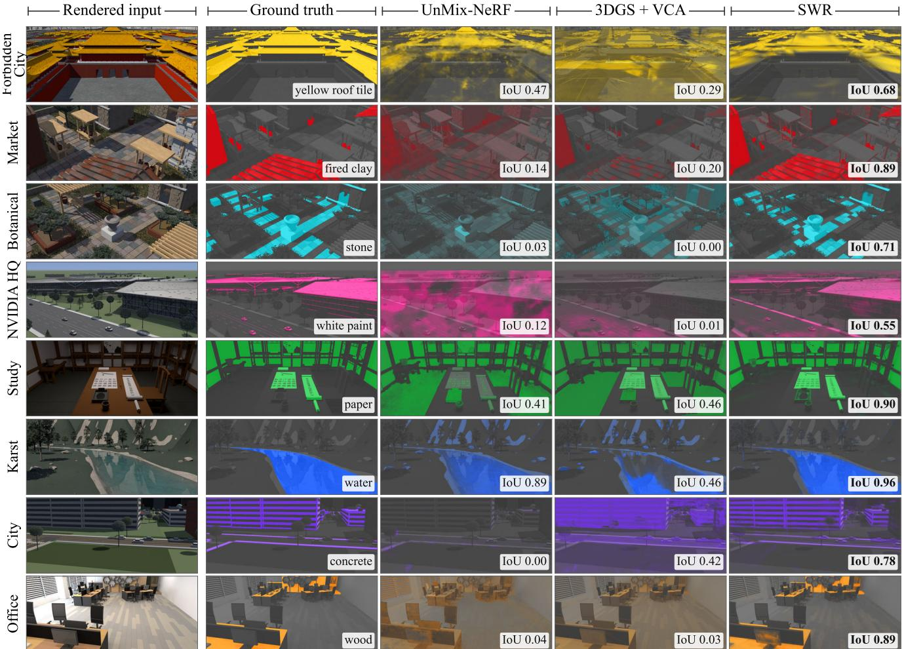  
Figure 6. Spectral World Renderer recovers the material layer closest to the ground truth. Across all eight worlds, each row tints one material by its abundance in a test view, for a material to which every method maps an endmember; IoU: summed abundance > 0.5 agains the true mask. Unmixing rendered spectra afterwards (3DGS + VCA) or inside a radiance field (UnMix-NeRF) spreads the material over unrelated surfaces. All rows use the models of Table 2.

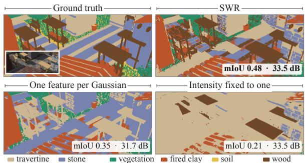  
Figure 7. One feature per Gaussian blends materials across edges and shadows. Within-primitive variation on a Market test view (inset: input; values for this view).

## 4.2. Ablation and Analysis

RGB feature stage. Refinement on the fixed anchor is cheap: it takes 36.5 s of the 397 s City pipeline, yet refining geometry and feature layout improves Market by 2.9 dB and 0.12 mIoU and the real apple by 2.6 dB, as Table 3 shows.

Within-primitive variation. A Gaussian crossing an edge or shadow needs more than one mixture, as Figure 7 tests on Market without $\mathcal { L } _ { p } .$ . One feature per Gaussian costs 1.6 dB and lowers mIoU from 0.47 to 0.34. Fixed intensity keeps PSNR but lowers mIoU to 0.22, as mixtures absorb shading. Unmixing inside rendering. Decoding after compositing raises Market PSNR from 33.72 to 34.37 dB yet lowers mIoU from 0.47 to 0.37 (Table S7): ray-averaged features blend surfaces, as unmixing afterwards does in Table 2.

Material allocation limits. Rare materials remain hard. Appearance regularization recovers Forbidden City marble (Figure 5(c)) but misses ink in Study, which NNLS with the true class spectra mostly separates (Figure S7).

## 4.3. Real Captures and Efficiency

Fidelity without material truth. SWR has the highest PSNR on each real dataset in Table 5. Its margin is largest on the 204-band apple in Figure 8, where PSNR, mean SAM and p95 all improve over HyperGS; on HS-NeRF, 3DGS has a lower mean and p95 angle.

rendered input  
RGB clusters  
Table 4. SWR is fastest. FPS: views/s with spectra and label maps. Ours: our optimized fused fp16 decoder, skipping hits of weight $< 1 0 ^ { - 4 }$ (99.97 % identical labels); baselines: reference code. City training spans all four stages, anchor to decoder.
<table><tr><td rowspan="2">Method</td><td rowspan="2">City train↓</td><td colspan="5">FPS↑ at 960 × 540 × 64</td></tr><tr><td>Market</td><td>Bot.</td><td>Study</td><td>Karst</td><td>Mean</td></tr><tr><td>UnMix-NeRF</td><td>24 min 17 s</td><td>0.18</td><td>0.21</td><td>0.21</td><td>0.12</td><td>0.18</td></tr><tr><td>3DGS+VCA/NNLS</td><td>85 min 2 s</td><td>2.53</td><td>2.51</td><td>4.70</td><td>4.73</td><td>3.6</td></tr><tr><td>SWR</td><td>6 min 37 s</td><td>36.5</td><td>39.3</td><td>36.3</td><td>27.4</td><td>34.9</td></tr></table>

Table 5. Best PSNR on every real source. L: bands; p95: 95thpercentile SAM; mean of 4 NeSpoF / 5 HS-NeRF scenes; baseline: best of 3DGS, HyperGS, DD-HGS.
<table><tr><td rowspan="2">Source</td><td rowspan="2">L</td><td colspan="4">PSNR-leading baseline</td><td colspan="3">SWR</td></tr><tr><td>Method</td><td>PSNR↑</td><td>SAM↓</td><td>p95↓</td><td>PSNR↑</td><td>SAM↓</td><td>p95↓</td></tr><tr><td>NeSpoF</td><td>21</td><td>HyperGS</td><td>28.36</td><td>4.58</td><td>9.44</td><td>29.39</td><td>3.86</td><td>8.04</td></tr><tr><td>Apple</td><td></td><td>204 HyperGS</td><td>27.95</td><td>1.64</td><td>4.88</td><td>30.67</td><td>1.35</td><td>3.87</td></tr><tr><td>HS-NeRF</td><td>128 141</td><td>3DGS</td><td>26.32</td><td>5.71</td><td>16.75</td><td>26.51</td><td>5.97</td><td>17.31</td></tr></table>

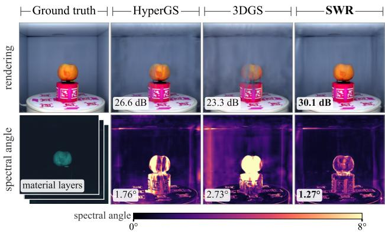  
Figure 8. SWR renders the most faithful spectra in this view. 204-band real capture (HSI-SC apple); inset: its abundances.

Efficiency. SWR is fastest in Table 4: City trains in 6 min 37 s versus 24 min for UnMix-NeRF and 85 min for 3DGS+VCA/NNLS, and our optimized fused fp16 decoder renders 34.9 views/s with label maps.

## 4.4. Application: Material Queries

Seeing beyond RGB. Leaves have a red edge near 700 nm: chlorophyll absorbs red light and leaf tissue reflects nearinfrared. Minerals and dry leaves lack it, so foliage-coloured mineral leaves (2◦ apart in RGB, 42◦ in spectrum) and dry crowns get their own endmembers, as Figure 9(b,c) shows. Querying primitives directly. In hyperspectral images, such materials are usually isolated by supervised classifiers [10, 29, 54, 81] or by unsupervised subspace clustering [92], which need labels or a run per image. SWR needs neither: abundances live on explicit, rasterizable Gaussians, so a material query selects primitives, consistently across views. The mineral-leaf query retrieves no ordinary tree, whereas the RGB query retrieves eleven, as Figure 9(a) shows. A measured spectrum can also serve as the query.

(a) RGB colours, RGB query  
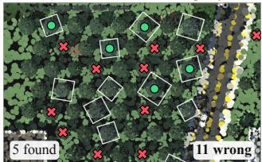

(b) NIR index, SWR  
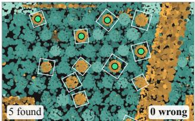

(c) Label maps of changed crowns; TV: distance to healthy leaves  
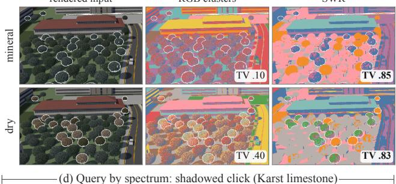

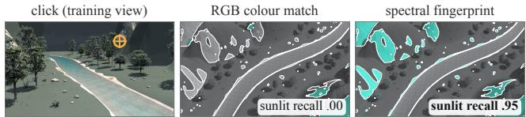  
Figure 9. Per-Gaussian abundances find materials that RGB confuses. In City, foliage-coloured mineral leaves replace the boxed crowns. (a) The same query on RGB also retrieves ordinary trees. (b) The mineral lacks the NIR rise of foliage, so the abundance query retrieves only these trees. (c) For mineral and dry leaves, SWR separates the changed crowns from healthy foliage, whereas RGB clusters mix them. (d) A spectrum clicked on shadowed limestone (Karst) also retrieves the sunlit rock, which RGB misses (recall of this click over all test views).

With sun and sky illumination factored out, a pixel clicked in shadow retrieves 77 % of the sunlit part of its material, against 10 % for RGB (mean over four outdoor worlds, 3 ms per query; Sec. I), as Figure 9(d) shows.

## 5. Conclusion

Spectral World Renderer brings hyperspectral unmixing into 3D as one verifiable framework: its world generator renders images with their exact material composition, and its renderer unmixes at every ray intersection, so a single render yields spectra and material maps checkable against known truth. Without material labels, SWR identifies materials best in all eight worlds and has the best mean PSNR on real captures; it trains City in under seven minutes, renders 34.9 labelled views/s, and its per-Gaussian abundances answer queries by name, click, reference spectrum or band, even for same-coloured materials. Future work will enrich light transport and sensor models, allocate endmembers to rare materials and handle dynamic scenes.

## References

[1] ASTM International. ASTM G173-03: Standard tables for reference solar spectral irradiances: Direct normal and hemispherical on 37◦ tilted surface, 2003. 4, 14

[2] Jonathan T. Barron, Ben Mildenhall, Dor Verbin, Pratul P. Srinivasan, and Peter Hedman. Mip-NeRF 360: Unbounded anti-aliased neural radiance fields. In CVPR, 2022. 2

[3] C. Ann Bateson, Gregory P. Asner, and Carol A. Wessman. Endmember bundles: A new approach to incorporating endmember variability into spectral mixture analysis. IEEE Transactions on Geoscience and Remote Sensing, 38(2):1083–1094, 2000. 5

[4] Sean Bell, Paul Upchurch, Noah Snavely, and Kavita Bala. Material recognition in the wild with the Materials in Context database. In CVPR, pages 3479–3487, 2015. 1

[5] Jose M. Bioucas-Dias, Antonio Plaza, Nicolas Dobi-´ geon, Mario Parente, Qian Du, Paul Gader, and Jocelyn Chanussot. Hyperspectral unmixing overview: Geometrical, statistical, and sparse regression-based approaches. IEEE Journal of Selected Topics in Applied Earth Observations and Remote Sensing, 5(2): 354–379, 2012. 2, 5

[6] Mark Boss, Raphael Braun, Varun Jampani, Jonathan T. Barron, Ce Liu, and Hendrik P.A. Lensch. NeRD: Neural reflectance decomposition from image collections. In ICCV, 2021. 2

[7] Mathilde Caron, Piotr Bojanowski, Armand Joulin, and Matthijs Douze. Deep clustering for unsupervised learning of visual features. In ECCV, pages 139–156, 2018. 6

[8] Jiazhong Cen, Jiemin Fang, Chen Yang, Lingxi Xie, Xiaopeng Zhang, Wei Shen, and Qi Tian. Segment any 3D Gaussians. In AAAI, pages 1971–1979, 2025. 2

[9] Gerry Chen, Sunil Kumar Narayanan, Thomas Gautier Ottou, Benjamin Missaoui, Harsh Muriki, Cedric´ Pradalier, and Yongsheng Chen. Hyperspectral neural radiance fields. arXiv preprint arXiv:2403.14839, 2024. 2, 6

[10] Yushi Chen, Hanlu Jiang, Chunyang Li, Xiuping Jia, and Pedram Ghamisi. Deep feature extraction and classification of hyperspectral images based on convolutional neural networks. IEEE Transactions on Geoscience and Remote Sensing, 54(10):6232–6251, 2016. 8

[11] CIE. Colorimetry, 4th edition. Technical Report CIE 015:2018, International Commission on Illumination, 2018. 4

[12] Jorge Condor, Nicolas Moenne-Loccoz, Merlin Nimier-David, Piotr Didyk, Zan Gojcic, and Qi Wu.

Neural harmonic textures for high-quality primitive based neural reconstruction. In ECCV, pages 322–341, 2026. 2, 5

[13] Nicolas Dobigeon, Laurent Tits, Ben Somers, Yoann Altmann, and Pol Coppin. A comparison of nonlinear mixing models for vegetated areas using simulated and real hyperspectral data. IEEE Journal ofSelected Topics in Applied Earth Observations and Remote Sensing, 7(6):1869–1878, 2014. 3

[14] Lucas Drumetz, Miguel-Angel Veganzones, Simon Henrot, Ronald Phlypo, Jocelyn Chanussot, and Christian Jutten. Blind hyperspectral unmixing using an extended linear mixing model to address spectral variability. IEEE Transactions on Image Processing, 25(8):3890–3905, 2016. 5

[15] Martin Ester, Hans-Peter Kriegel, Jorg Sander, and Xi-¨ aowei Xu. A density-based algorithm for discovering clusters in large spatial databases with noise. In KDD, 1996. 18

[16] Weixi Feng, Wanrong Zhu, Tsu-Jui Fu, Varun Jampani, Arjun Akula, Xuehai He, Sugato Basu, Xin Eric Wang, and William Yang Wang. LayoutGPT: Compositional visual planning and generation with large language models. In NeurIPS, 2023. 3

[17] Michael Fischer, Iliyan Georgiev, Thibault Groueix, Vladimir G. Kim, Tobias Ritschel, and Valentin Deschaintre. SAMa: Material-aware 3D selection and segmentation. In International Conference on 3D Vision (3DV), pages 1812–1822, 2026. 2

[18] Alessandro Foi, Mejdi Trimeche, Vladimir Katkovnik, and Karen Egiazarian. Practical Poissonian-Gaussian noise modeling and fitting for single-image rawdata. IEEE Transactions on Image Processing, 17(10): 1737–1754, 2008. 4

[19] Yipeng Gao, Lei Shu, Genzhi Ye, Xi Xiong, Ameesh Makadia, Meiqi Guo, Laurent Itti, and Jindong Chen. 3DCodeBench: Benchmarking agentic procedural 3D modeling via code. arXiv preprint arXiv:2606.01057, 2026. 3

[20] Pedram Ghamisi, Naoto Yokoya, Jun Li, Wenzhi Liao, Sicong Liu, Javier Plaza, Behnood Rasti, and Antonio Plaza. Advances in hyperspectral image and signal processing: A comprehensive overview of the state of the art. IEEE Geoscience and Remote Sensing Magazine, 5(4):37–78, 2017. 2

[21] Adam A. Goodenough and Scott D. Brown. DIRSIG 5: core design and implementation. In Algorithms and Technologies for Multispectral, Hyperspectral, and Ultraspectral Imagery XVIII, page 83900H, 2012. 3

[22] Robert O. Green, Michael L. Eastwood, Charles M. Sarture, Thomas G. Chrien, Mikael Aronsson, Bruce J. Chippendale, Jessica A. Faust, Betina E. Pavri, Christopher J. Chovit, Manuel Solis, et al.

Imaging spectroscopy and the airborne visible/infrared imaging spectrometer (AVIRIS). Remote Sensing ofEnvironment, 65(3):227–248, 1998. 2

[23] Klaus Greff, Francois Belletti, Lucas Beyer, Carl Doersch, Yilun Du, Daniel Duckworth, David J. Fleet, Dan Gnanapragasam, Florian Golemo, Charles Herrmann, et al. Kubric: A scalable dataset generator. In CVPR, 2022. 3

[24] Josef Grun, Lukas Meyer, Maximilian Weiherer, Bern-¨ hard Egger, Marc Stamminger, and Linus Franke. Towards integrating multi-spectral imaging with Gaussian splatting. In Vision, Modeling, and Visualization (VMV), 2025. 2

[25] Florian Hahlbohm, Linus Franke, Martin Eisemann, and Marcus Magnor. Faster-GS: Analyzing and improving Gaussian splatting optimization. In CVPR, pages 18946–18957, 2026. 2

[26] Daniel C. Heinz and Chein-I Chang. Fully constrained least squares linear spectral mixture analysis method for material quantification in hyperspectral imagery. IEEE Transactions on Geoscience and Remote Sensing, 39(3):529–545, 2001. 2, 5

[27] Rob Heylen, Mario Parente, and Paul Gader. A review of nonlinear hyperspectral unmixing methods. IEEE Journal of Selected Topics in Applied Earth Observations and Remote Sensing, 7(6):1844–1868, 2014. 2

[28] Danfeng Hong, Naoto Yokoya, Jocelyn Chanussot, and Xiao Xiang Zhu. An augmented linear mixing model to address spectral variability for hyperspectral unmixing. IEEE Transactions on Image Processing, 28(4):1923–1938, 2019. 2, 5

[29] Danfeng Hong, Zhu Han, Jing Yao, Lianru Gao, Bing Zhang, Antonio Plaza, and Jocelyn Chanussot. SpectralFormer: Rethinking hyperspectral image classification with transformers. IEEE Transactions on Geoscience and Remote Sensing, 60:1–15, 2022. 8

[30] D. N. H. Horler, M. Dockray, and J. Barber. The red edge of plant leaf reflectance. International Journal of Remote Sensing, 4(2):273–288, 1983. 14

[31] Ziniu Hu, Ahmet Iscen, Aashi Jain, Thomas Kipf, Yisong Yue, David A. Ross, Cordelia Schmid, and Alireza Fathi. SceneCraft: An LLM agent for synthesizing 3D scenes as Blender code. In ICML, pages 19252–19282, 2024. 3

[32] Binbin Huang, Zehao Yu, Anpei Chen, Andreas Geiger, and Shenghua Gao. 2D Gaussian splatting for geometrically accurate radiance fields. In ACM SIG-GRAPH Conference Papers, 2024. 2

[33] Zheng-Hui Huang, Guixu Lin, Jiacheng Lin, Yi-Chuan Huang, Ruihan Yu, Muyao Niu, Siqi Yang, Yu-Lun Liu, Yung-Yu Chuang, Kaipeng Zhang, and Zhixiang Wang. Programmable world model. arXiv preprint arXiv:2609.10540, 2026. 3

[34] Zheng-Hui Huang, Zhixiang Wang, Jiaming Tan, Ruihan Yu, Yidan Zhang, Bo Zheng, Yu-Lun Liu, Yung-Yu Chuang, and Kaipeng Zhang. Generative world renderer. arXiv preprint arXiv:2604.02329, 2026. 3

[35] Marian-Daniel Iordache, Jose M. Bioucas-Dias, and´ Antonio Plaza. Total variation spatial regularization for sparse hyperspectral unmixing. IEEE Transactions on Geoscience and Remote Sensing, 50(11):4484– 4502, 2012. 2

[36] Wenzel Jakob, Sebastien Speierer, Nicolas Roussel,´ Merlin Nimier-David, Delio Vicini, Tizian Zeltner, Baptiste Nicolet, Miguel Crespo, Vincent Leroy, and Ziyi Zhang. Mitsuba 3 renderer. https://mitsubarenderer.org, 2022. 3, 4, 14

[37] Bernhard Kerbl, Georgios Kopanas, Thomas Leimkuhler, and George Drettakis. 3D Gaussian¨ splatting for real-time radiance field rendering. ACM Transactions on Graphics, 42(4):139:1–139:14, 2023. 2, 5, 6

[38] Justin Kerr, Chung Min Kim, Ken Goldberg, Angjoo Kanazawa, and Matthew Tancik. LERF: Language embedded radiance fields. In ICCV, 2023. 1, 2

[39] N. Keshava and J.F. Mustard. Spectral unmixing. IEEE Signal Processing Magazine, 19(1):44–57, 2002. 2

[40] Youngchan Kim, Wonjoon Jin, Sunghyun Cho, and Seung-Hwan Baek. Neural spectro-polarimetric fields. In SIGGRAPH Asia 2023 Conference Papers, 2023. 2, 6

[41] Alexander Kirillov, Eric Mintun, Nikhila Ravi, Hanzi Mao, Chloe Rolland, Laura Gustafson, Tete Xiao, Spencer Whitehead, Alexander C. Berg, Wan-Yen Lo, Piotr Dollar, and Ross Girshick. Segment anything. In´ ICCV, pages 4015–4026, 2023. 1, 2

[42] Raymond F. Kokaly, Roger N. Clark, Gregg A. Swayze, K. Eric Livo, Todd M. Hoefen, Neil C. Pearson, Richard A. Wise, William M. Benzel, Heather A. Lowers, Rhonda L. Driscoll, and Anna J. Klein. USGS spectral library version 7. U.S. Geological Survey Data Series 1035, 2017. 2, 4, 14

[43] Fred A. Kruse, A. B. Lefkoff, Joseph W. Boardman, K. B. Heidebrecht, A. T. Shapiro, P. J. Barloon, and Alexander F. H. Goetz. The spectral image processing system (SIPS): Interactive visualization and analysis of imaging spectrometer data. Remote Sensing of Environment, 44(2–3):145–163, 1993. 6

[44] Kibon Ku, Talukder Z. Jubery, Adarsh Krishnamurthy, and Baskar Ganapathysubramanian. HS-3D-NeRF: 3D surface and hyperspectral reconstruction from stationary hyperspectral images using multi-channel NeRFs. arXiv preprint arXiv:2602.16950, 2026. 2, 6

[45] Charles L. Lawson and Richard J. Hanson. Solving Least Squares Problems. Prentice-Hall, 1974. 6, 15

[46] Daniel D. Lee and H. Sebastian Seung. Learning the parts of objects by non-negative matrix factorization. Nature, 401(6755):788–791, 1999. 2

[47] Ru Li, Jia Liu, Guanghui Liu, Shengping Zhang, Bing Zeng, and Shuaicheng Liu. SpectralNeRF: Physically based spectral rendering with neural radiance field. In AAAI, pages 3154–3162, 2024. 2

[48] Zhiqi Li, Yuxuan Liao, and Bo Zhu. Recursive code world models: Building complex worlds through recursive scene programs. arXiv preprint arXiv:2609.11499, 2026. 3

[49] Yupeng Liang, Ryosuke Wakaki, Shohei Nobuhara, and Ko Nishino. Multimodal material segmentation. In CVPR, pages 19800–19808, 2022. 1

[50] Zhihao Liang, Qi Zhang, Ying Feng, Ying Shan, and Kui Jia. GS-IR: 3D Gaussian splatting for inverse rendering. In CVPR, pages 21644–21653, 2024. 2

[51] Guixu Lin, Zheng-Hui Huang, Siqi Yang, Ming-Hsuan Yang, Kaipeng Zhang, and Zhixiang Wang. Generative world renderer at the speed of play. arXiv preprint arXiv:2607.18703, 2026. 3

[52] Tao Lu, Mulin Yu, Linning Xu, Yuanbo Xiangli, Limin Wang, Dahua Lin, and Bo Dai. Scaffold-GS: Structured 3D Gaussians for view-adaptive rendering. In CVPR, 2024. 2

[53] Susan K. Meerdink, Simon J. Hook, Dar A. Roberts, and Elsa A. Abbott. The ECOSTRESS spectral library version 1.0. Remote Sensing of Environment, 230:111196, 2019. 2, 4, 14, 22

[54] Farid Melgani and Lorenzo Bruzzone. Classification of hyperspectral remote sensing images with support vector machines. IEEE Transactions on Geoscience and Remote Sensing, 42(8):1778–1790, 2004. 8

[55] Lukas Meyer, Josef Grun, Maximilian Weiherer, Bern-¨ hard Egger, Marc Stamminger, and Linus Franke. Multi-spectral Gaussian splatting with neural color representation. Computer Graphics Forum, 45(2), 2026. 2

[56] Ben Mildenhall, Pratul P. Srinivasan, Matthew Tancik, Jonathan T. Barron, Ravi Ramamoorthi, and Ren Ng. NeRF: Representing scenes as neural radiance fields for view synthesis. In ECCV, 2020. 2

[57] Thomas Muller, Alex Evans, Christoph Schied, and¨ Alexander Keller. Instant neural graphics primitives with a multiresolution hash encoding. ACM Transactions on Graphics, 41(4):102:1–102:15, 2022. 2

[58] Sunil Kumar Narayanan, Lingjun Zhao, Lu Gan, and Yongsheng Chen. Diffusion-denoised hyperspectral Gaussian splatting. In International Conference on 3D Vision (3DV), pages 1218–1227, 2026. 2, 6

[59] Jose M. P. Nascimento and Jos´ e M. Bioucas-Dias. Ver-´ tex component analysis: A fast algorithm to unmix hyperspectral data. IEEE Transactions on Geoscience and Remote Sensing, 43(4):898–910, 2005. 2, 6, 15

[60] Maxime Oquab, Timothee Darcet, Th´ eo Moutakanni,´ Huy V. Vo, Marc Szafraniec, Vasil Khalidov, Pierre Fernandez, Daniel HAZIZA, Francisco Massa, Alaaeldin El-Nouby, Mido Assran, Nicolas Ballas, Wojciech Galuba, Russell Howes, Po-Yao Huang, Shang-Wen Li, Ishan Misra, Michael Rabbat, Vasu Sharma, Gabriel Synnaeve, Hu Xu, Herve Jegou, Julien Mairal, Patrick Labatut, Armand Joulin, and Piotr Bojanowski. DINOv2: Learning robust visual features without supervision. Transactions on Machine Learning Research, 2024. Featured Certification. 1

[61] Nobuyuki Otsu. A threshold selection method from gray-level histograms. IEEE Transactions on Systems, Man, and Cybernetics, 9(1):62–66, 1979. 22

[62] Burkni Palsson, Johannes R. Sveinsson, and Magnus O. Ulfarsson. Blind hyperspectral unmixing using autoencoders: A critical comparison. IEEE Journal ofSelected Topics in Applied Earth Observations and Remote Sensing, 15:1340–1372, 2022. 2

[63] Fabian Perez, Sara Rojas, Carlos Hinojosa, Hoover Rueda-Chacon, and Bernard Ghanem. UnMix-NeRF:´ Spectral unmixing meets neural radiance fields. In ICCV, 2025. 2, 3, 6

[64] Matt Pharr, Wenzel Jakob, and Greg Humphreys. Physically Based Rendering: From Theory to Implementation. Morgan Kaufmann, 3 edition, 2016. 3

[65] Antonio Plaza, Jon Atli Benediktsson, Joseph W. Boardman, Jason Brazile, Lorenzo Bruzzone, Gustavo Camps-Valls, Jocelyn Chanussot, Mathieu Fauvel, Paolo Gamba, Anthony Gualtieri, Mattia Marconcini, James C. Tilton, and Giovanna Trianni. Recent advances in techniques for hyperspectral image processing. Remote Sensing of Environment, 113: S110–S122, 2009. Imaging Spectroscopy Special Issue. 2

[66] Minghan Qin, Wanhua Li, Jiawei Zhou, Haoqian Wang, and Hanspeter Pfister. LangSplat: 3D language Gaussian splatting. In CVPR, 2024. 2

[67] Alec Radford, Jong Wook Kim, Chris Hallacy, Aditya Ramesh, Gabriel Goh, Sandhini Agarwal, Girish Sastry, Amanda Askell, Pamela Mishkin, Jack Clark, Gretchen Krueger, and Ilya Sutskever. Learning transferable visual models from natural language supervision. In ICML, pages 8748–8763, 2021. 1, 2

[68] Alexander Raistrick, Lahav Lipson, Zeyu Ma, Lingjie Mei, Mingzhe Wang, Yiming Zuo, Karhan Kayan, Hongyu Wen, Beining Han, Yihan Wang, Alejandro Newell, Hei Law, Ankit Goyal, Kaiyu Yang, and Jia

Deng. Infinite photorealistic worlds using procedural generation. In CVPR, pages 12630–12641, 2023. 3

[69] Alexander Raistrick, Lingjie Mei, Karhan Kayan, David Yan, Yiming Zuo, Beining Han, Hongyu Wen, Meenal Parakh, Stamatis Alexandropoulos, Lahav Lipson, Zeyu Ma, and Jia Deng. Infinigen indoors: Photorealistic indoor scenes using procedural generation. In CVPR, 2024. 3

[70] Ravi Ramamoorthi and Pat Hanrahan. An efficient representation for irradiance environment maps. In SIGGRAPH, 2001. 5

[71] Shiwei Ren, Tianci Wen, Yongchun Fang, and Biao Lu. FastGS: Training 3D Gaussian splatting in 100 seconds. In CVPR, pages 26094–26103, 2026. 2, 4, 14

[72] Dar A. Roberts, Michael Gardner, Rick Church, Susan Ustin, Gary Scheer, and Robert O. Green. Mapping chaparral in the Santa Monica Mountains using multiple endmember spectral mixture models. Remote Sensing ofEnvironment, 65(3):267–279, 1998. 5

[73] Mike Roberts, Jason Ramapuram, Anurag Ranjan, Atulit Kumar, Miguel Angel Bautista, Nathan Paczan, Russ Webb, and Joshua M. Susskind. Hypersim: A photorealistic synthetic dataset for holistic indoor scene understanding. In ICCV, 2021. 3

[74] Ruihong Shen, Ziga Kovaˇ ciˇ c, Peter Kulits, Xin-ˇ grui Wang, Zizhang Li, Joshua B. Tenenbaum, Alan Yuille, Jieneng Chen, and Jiajun Wu. 4DCodeBench: Benchmarking agents on inverse graphics of dynamic scenes. arXiv preprint arXiv:2610.03715, 2026. 3

[75] Yawar Siddiqui, Lorenzo Porzi, Samuel Rota Bulo,\` Norman Muller, Matthias Nießner, Angela Dai, and ¨ Peter Kontschieder. Panoptic lifting for 3D scene understanding with neural fields. In CVPR, pages 9043– 9052, 2023. 6

[76] Saptarshi Neil Sinha, Holger Graf, and Michael Weinmann. SpectralGaussians: Semantic, spectral 3D Gaussian splatting for multi-spectral scene representation, visualization and analysis. arXiv preprint arXiv:2408.06975, 2024. 2

[77] Ben Somers, Gregory P. Asner, Laurent Tits, and Pol Coppin. Endmember variability in spectral mixture analysis: A review. Remote Sensing of Environment, 115(7):1603–1616, 2011. 5

[78] Julian Straub, Thomas Whelan, Lingni Ma, Yufan Chen, Erik Wijmans, Simon Green, Jakob J. Engel, Raul Mur-Artal, Carl Ren, Shobhit Verma, et al. The Replica dataset: A digital replica of indoor spaces. arXiv preprint arXiv:1906.05797, 2019. 3

[79] Yuanchao Su, Jun Li, Antonio Plaza, Andrea Marinoni, Paolo Gamba, and Somdatta Chakravortty. DAEN: Deep autoencoder networks for hyperspectral

unmixing. IEEE Transactions on Geoscience and Remote Sensing, 57(7):4309–4321, 2019. 2

[80] Matthew Tancik, Pratul P. Srinivasan, Ben Mildenhall, Sara Fridovich-Keil, Nithin Raghavan, Utkarsh Singhal, Ravi Ramamoorthi, Jonathan T. Barron, and Ren Ng. Fourier features let networks learn high frequency functions in low dimensional domains. In NeurIPS, 2020. 5

[81] Yuliya Tarabalka, Jon Atli Benediktsson, and Jocelyn´ Chanussot. Spectral–spatial classification of hyperspectral imagery based on partitional clustering techniques. IEEE Transactions on Geoscience and Remote Sensing, 47(8):2973–2987, 2009. 8

[82] Christopher Thirgood, Oscar Mendez, Erin Ling, Jon Storey, and Simon Hadfield. HyperGS: Hyperspectral 3D Gaussian splatting. In CVPR, pages 5970–5979, 2025. 2, 4, 6

[83] Compton J. Tucker. Red and photographic infrared linear combinations for monitoring vegetation. Remote Sensing ofEnvironment, 8(2):127–150, 1979. 14

[84] Paul Upchurch and Ransen Niu. A dense material segmentation dataset for indoor and outdoor scene parsing. In ECCV, pages 450–466, 2022. 1

[85] Dor Verbin, Peter Hedman, Ben Mildenhall, Todd Zickler, Jonathan T. Barron, and Pratul P. Srinivasan. Ref-NeRF: Structured view-dependent appearance for neural radiance fields. IEEE Transactions on Pattern Analysis and Machine Intelligence, 47(11):9426– 9437, 2025. 2

[86] Alexander Wilkie, Sehera Nawaz, Marc Droske, Andrea Weidlich, and Johannes Hanika. Hero wavelength spectral sampling. Computer Graphics Forum, 33(4):123–131, 2014. 3

[87] Michael E. Winter. N-FINDR: An algorithm for fast autonomous spectral end-member determination in hyperspectral data. In Imaging Spectrometry V, Proc. SPIE, pages 266–275, 1999. 2

[88] Yue Yang, Fan-Yun Sun, Luca Weihs, Eli VanderBilt, Alvaro Herrasti, Winson Han, Jiajun Wu, Nick Haber, Ranjay Krishna, Lingjie Liu, Chris Callison-Burch, Mark Yatskar, Aniruddha Kembhavi, and Christopher Clark. Holodeck: Language guided generation of 3D embodied AI environments. In CVPR, 2024. 3

[89] Mingqiao Ye, Martin Danelljan, Fisher Yu, and Lei Ke. Gaussian Grouping: Segment and edit anything in 3D scenes. In ECCV, 2024. 2, 6

[90] Xiaokang Ye, Siddhant Hitesh Mantri, Zimeng Chen, Edward Zhang, Zhaoxu Zheng, Yuanheng Li, Yizhao Chen, Tianyang Huang, and Lianhui Qin. Code4Scene: Benchmarking coding agents for constructing and editing 3D scenes. arXiv preprint arXiv:2609.36777, 2026. 3

[91] Zehao Yu, Anpei Chen, Binbin Huang, Torsten Sattler, and Andreas Geiger. Mip-Splatting: Alias-free 3D Gaussian splatting. In CVPR, 2024. 2

[92] Hongyan Zhang, Han Zhai, Liangpei Zhang, and Pingxiang Li. Spectral–spatial sparse subspace clustering for hyperspectral remote sensing images. IEEE Transactions on Geoscience and Remote Sensing, 54 (6):3672–3684, 2016. 8

[93] Xiuming Zhang, Pratul P. Srinivasan, Boyang Deng, Paul Debevec, William T. Freeman, and Jonathan T. Barron. NeRFactor: Neural factorization of shape and reflectance under an unknown illumination. ACM Transactions on Graphics, 40(6):237:1–237:18, 2021. 2

[94] Shuaifeng Zhi, Tristan Laidlow, Stefan Leutenegger, and Andrew J. Davison. In-place scene labelling and understanding with implicit scene representation. In ICCV, pages 15838–15847, 2021. 6

[95] Shijie Zhou, Haoran Chang, Sicheng Jiang, Zhiwen Fan, Zehao Zhu, Dejia Xu, Pradyumna Chari, Suya You, Zhangyang Wang, and Achuta Kadambi. Feature 3DGS: Supercharging 3D Gaussian splatting to enable distilled feature fields. In CVPR, pages 21676–21685, 2024. 2

Contents. Figures, tables and equations carry the prefix S;   
unprefixed numbers refer to the main paper.

A SWR-Bench worlds and protocol 14   
B Spectra of SWR-Bench 14   
C Implementation details 14   
D Decoder analysis 15   
E Real captures 17   
F Efficiency 17   
G Rare materials and altered leaves 17   
H Object queries 18   
I Query by spectrum 22   
J Additional views of SWR-Bench 24

## A. SWR-Bench Worlds and Protocol

Generation and rendering. A coding agent builds each world from reference photographs, available maps and a written brief, revising it from rendered previews; the authors review the previews and approve each world, and the worlds, scene programs and code will be released (Table S1). Spectral images, RGB and ground truth share 16 sub-pixel samples per pixel, so labels and area proportions describe the first-hit surfaces that produce most of the radiance; transmitted and interreflected light is stored as separate contributions. Each surface keeps one measured specimen in world space across all views. Outdoor worlds use Lambertian surfaces under ASTM G173 sunlight and skylight [1]; NVIDIA HQ adds glossy highlights, glass reflection and an analytic sky, Karst adds refracting water with pure-water absorption, and the Study and Office are path traced in Mitsuba [36] with interreflection. All worlds are rendered at 960 × 540 with the same 64 Gaussian band responses over 420–980 nm.

Noise and protocol. Every world is released clean and with Poisson shot and Gaussian read noise scaled from the training views. All methods share the splits, classes and stereo point cloud. Each world has full primary-ray coverage, at least 99.9 % agreement between instance and material maps, and outdoor radiance that re-composes exactly from the stored coefficients.

Classes and City variants. Similar spectra are merged into one class, for example the stones of Market and Botanical and the paving and brick of Forbidden City. Four City variants change one factor each: foliage-coloured mineral leaves (metamer), dry leaves on 87 trees (stress), and a morning or afternoon sun. Every object keeps its instance and spectral sample, so Sec. H can score the object queries. Metrics. PSNR and spectral angle are computed against the clean radiance on the ground-truth support. Endmembers are mapped many-to-one to classes by majority vote on training views; with the map frozen, test pixels take the class of their dominant endmember. EM is the angle between learned endmembers and the mean spectra of pure training pixels, paired one-to-one. The true-spectrum reference unmixes noisy test pixels with all measured specimens; it is undefined indoors and for NVIDIA HQ, whose transport the fixed dictionary does not represent.

Further metrics. Reconstruction error stays above the observation noise level on both training and test views, so no model fits the noise (Table S2). The true-spectrum reference reaches 0.84 to 0.94 on clean radiance but drops under noise, most in City and Forbidden City, so both sensor noise and the learned decomposition limit identification.

## B. Spectra of SWR-Bench

Sources and selection. Reflectance comes from ECOSTRESS [53] and the USGS Spectral Library 7 [42] (Table S3). A record is accepted only if it is a reflectance measurement that covers 400–1000 nm with gaps of at most 20 nm and values in [0, 1], and if its metadata satisfy a written rule for its class, for example photosynthetic grass but no dry grass, or bark only on trunks. Accepted records are interpolated on a 1 nm grid without smoothing or extrapolation and integrated against 64 Gaussian bands of 20 nm width. Several specimens per class and separate spectra under sunlight and skylight give each material a range of appearances (Figure 3 of the main paper).

Realism. We compare every rendered spectrum with independent library measurements of the same type, excluding the rendered records themselves (Table S4). Of 40 naturalmaterial types with enough references, 37 lie within 3◦ of one and the rest within 4.5◦; all 21 vegetation spectra pass red-edge and NDVI checks [30, 83], whereas the dry and foliage-coloured substitutes of the City variants fail them, as designed. Man-made materials are more varied, and pigment proxies for paints lie farthest from their references.

Proxies and limits. Some objects use a measured specimen of a related material, such as pigment powders for paints and road markings, cotton for paper, or granite for an inkstone. Glazing is opaque, most outdoor transport has no spectral interreflection, and the bands end at 980 nm, so short-wave infrared features are out of range.

## C. Implementation Details

RGB anchor. The anchor uses multi-view density control [71], which clones and splits Gaussians that cover many high-error pixels and prunes by opacity and multi-view importance. After fitting, colours are discarded and the rasterizer’s screen-space variance is folded into the scales,

$$
\pmb { \sigma } _ { i } ^ { 2 }  \pmb { \sigma } _ { i } ^ { 2 } + 0 . 3 \mathrm { m e d } _ { v } ( z _ { i v } / f _ { v } ) ^ { 2 } ,\tag{S1}
$$

Table S1. The eight worlds of SWR-Bench. Views: training / validation / test. Noise: electrons at the reference radiance and read noise. Obs.: PSNR of the noisy test views against the clean ones.
<table><tr><td>World</td><td>Content</td><td>Cameras</td><td>Views</td><td>Transport</td><td>Noise (e−)</td><td>Obs. (dB)</td></tr><tr><td>Forbidden City</td><td>palace complex inspired by the Forbidden City, with golden roofs, red walls, courtyards, vegetation and water</td><td>3 orbits of 60 at 45, 170 and 430 m, pitched down 13°, 32°, 60°</td><td>135/21/24</td><td>two-term</td><td>5,000 / 2</td><td>45.4</td></tr><tr><td>Market</td><td>market square with stalls and pottery, enclosed by terrain, walls and buildings</td><td>3 rings of 60, inward and downward</td><td>135/21/24</td><td>two-term</td><td>5,000 / 2</td><td>45.6</td></tr><tr><td>Botanical</td><td>botanical garden with planters, trees and pergolas, enclosed by ter- 3 rings of 60, inward and downward rain, walls and buildings</td><td></td><td>135/21/24</td><td>two-term</td><td>5,000 / 2</td><td>46.4</td></tr><tr><td>NVIDIA HQ</td><td>twin triangular-roof offices, glazed facades, courtyard canopy and connected walkways, parked vehicles and 300 varied trees</td><td>descending spiral, facade, court- yard and low campus routes, 60 views each</td><td>180/28/32</td><td>extended</td><td>5,000 / 2</td><td>46.7</td></tr><tr><td>Study</td><td>scholar&#x27;s study with timber shelves, desk, paper, ink, inkstone and ceramic vessel, 5,000 K ceiling panel</td><td>eye-level and elevated orbits, desk details</td><td>64/16/16</td><td>path traced</td><td>3,000 /3</td><td>44.8</td></tr><tr><td>Karst</td><td>river valley with limestone cliffs, vegetation, soil, wood and clear water</td><td>two river-bank routes, a cliff loop and a high loop</td><td>128/32/32</td><td>two-term + water</td><td>5,000 / 2</td><td>44.3</td></tr><tr><td>City</td><td>campus block in a surrounding city: buildings, roads with mark- ings, 297 trees, vehicles</td><td>4 elliptical orbits of 60 at 16–95 m</td><td>180/28/32</td><td>two-term</td><td>5,000 / 2</td><td>45.2</td></tr><tr><td>Office</td><td>open-plan office with desks, displays, textiles and plants; 35 LED downlights and daylight through blinds</td><td>eye-level and elevated loops, work- station details</td><td>64/16/16</td><td>path traced</td><td>3,000 / 3</td><td>46.0</td></tr></table>

Table S2. Further metrics of reference Spectral World Renderer on SWR-Bench (test views, K equal to the number of classes). Train: PSNR on training views. p95: 95th-percentile angle. Acc.: pixel accuracy. Clean: mIoU when trained on clean radiance. GT dict.: NNLS with the true class spectra on noisy / clean radiance.
<table><tr><td></td><td colspan="2">PSNR↑</td><td colspan="3"></td><td colspan="2">GT dict. mIoU</td></tr><tr><td>World</td><td>Train</td><td>Test</td><td>p95↓</td><td>Acc.↑</td><td>Clean</td><td>noisy</td><td>clean</td></tr><tr><td>Forbidden City</td><td>29.82</td><td>28.35</td><td>14.76</td><td>0.75</td><td></td><td>0.55</td><td>0.94</td></tr><tr><td>Market</td><td>34.11</td><td>33.72</td><td>8.13</td><td>0.66</td><td>0.42</td><td>0.70</td><td>0.94</td></tr><tr><td>Botanical</td><td>33.11</td><td>32.92</td><td>10.48</td><td>0.65</td><td>0.38</td><td>0.73</td><td>0.93</td></tr><tr><td>NVIDIA HQ</td><td>30.88</td><td>25.20</td><td>25.15</td><td>0.62</td><td></td><td></td><td></td></tr><tr><td>Study</td><td>33.09</td><td>33.06</td><td>7.00</td><td>0.89</td><td>0.52</td><td></td><td></td></tr><tr><td>Karst</td><td>29.29</td><td>28.07</td><td>9.73</td><td>0.95</td><td>0.53</td><td>0.77</td><td>0.84</td></tr><tr><td>City</td><td>29.18</td><td>28.13</td><td>13.58</td><td>0.74</td><td>0.24</td><td>0.32</td><td>0.93</td></tr><tr><td>Office</td><td>29.80</td><td>27.23</td><td>14.22</td><td>0.62</td><td>0.29</td><td></td><td></td></tr></table>

where $z _ { i v }$ is the depth of Gaussian i in camera v and $f _ { v }$ its focal length. The harmonic features are then refined for 5k steps without further densification.

Appearance clusters. Each training view contributes up to 2304 smoothed pixel spectra. The descriptor concatenates the unit spectrum with the log norm, robustly standardized and clipped to [−4, 4] and weighted by $\kappa \in [ . 0 5 , . 2 ]$ Farthest-point seeding and 20 Lloyd steps give K clusters. Training. All methods train on the noisy training views at $4 8 0 \times 2 7 0$ and are rendered at $9 6 0 \times 5 4 0$ from the same stereo point cloud. The Spectral World Renderer decoder is trained for 30k Adam steps on 2048 pixels of one view each, with learning rate $1 0 ^ { - 3 }$ decayed by a cosine schedule to $1 0 ^ { - 5 }$ , and an EMA with decay 0.99 is evaluated. Endmembers are frozen for 3k updates, then learned at rate $1 0 ^ { - 3 }$ the assignment weight is max(.005, . $. 0 5 ( 1 - t / 3 0 0 0 ) \rangle$ ). Reference models without regularization use K equal to the number of classes on SWR-Bench and $K \ = \ 1 6$ on real captures. For 3DGS + VCA/NNLS, a 64-channel 3DGS is trained for 30k steps, VCA [59] extracts K endmembers from its training renders, and each test pixel is unmixed against them by non-negative least squares [45]. UnMix-NeRF uses the official code with its VCA initialization and learning-rate schedule for 30k iterations, accumulating gradients over smaller ray batches; every method trains per scene on the same views. Dictionary capacity. For every world, K is selected from the class count, 16, 24 and 32 by the dominant-endmember mIoU on the validation views (Table S1), with the regularization and seed 42; in all cases the endmember-to-class map is fitted on the training views. Table S6 lists the test mIoU of every candidate. The validation choice is also the best test candidate in seven worlds; in NVIDIA HQ, K = 24 and K = 32 differ by 0.001 on validation and 0.004 on test. The table also gives the decoder without regularization and 3DGS with VCA/NNLS, both at K = 24. In Karst and Study, the regularization trades rare classes (soil, ink) for appearance separation of the frequent classes. With K = 24, 3DGS with VCA/NNLS improves over its class-count setting in most worlds and remains below Spectral World Renderer in every world except Study, where both reach 0.51–0.52.

## D. Decoder Analysis

Fidelity and identification. Table S7 extends the decoder study of the main paper (Sec. 4.2) to a second scene. Replacing unmixing by a free spectral decoder gains at most 0.07 dB, whereas a single feature per Gaussian costs 0.4 to 1.6 dB: fidelity comes from the feature field rather than from relaxing the mixing model. Identification depends on other components. Without harmonic encoding or a separate intensity, Market keeps its PSNR but loses much of its mIoU, as the mixtures absorb shading, and decoding after compositing fits the spectra best but identifies fewer materials.

What the features encode. Projected on their principal components, the features follow both material and shading (Figure S1). Within one Gaussian, intensity varies with shading, while mixture coefficients change mainly at material boundaries, so a single primitive can span an edge. Some mixture variation also follows shadows, one reason a material can occupy several endmembers.

Table S3. Material classes and measured spectra of the eight SWR-Bench worlds. Benchmark class names describe assigned material roles, which may use measured proxies. Counts deduplicate native files; nE+nU denotes ECOSTRESS and USGS records, a single number ECOSTRESS, and a subscript U USGS. Parent-label counts appear in brackets. Forbidden City uses pigment proxies for yellow tiles and some paints, measured reflectance on opaque water surfaces, and bright solid-material proxies for haze. Karst water instead uses pure-water absorption and a Fresnel interface, with no fixed reflectance endmember. City variants share City geometry, cameras and sensor.
<table><tr><td>World</td><td>Classes</td><td>Spectra</td><td>E/U</td><td>Classes with their number of spectra</td><td>Illumination</td></tr><tr><td>Forbidden City</td><td>9 (11)</td><td>47</td><td>27/20</td><td>yellow glazed tile 5u; vermilion paint 3u; vegetation 8; white marble 4; grey masonry 4+5; painted eaves 2+2; soil and bark 7; water 1+2; distant city haze 1+3</td><td>G173 sun + sky</td></tr><tr><td>Market</td><td>6(8)</td><td>29</td><td>29/0</td><td>travertine 1; stone group (white marble, pink marble, granite) 7; vegetation 8; fired clay 4; sandy soil 4; wood and bark 5</td><td>G173 sun + sky</td></tr><tr><td>Botanical</td><td>6 (8)</td><td>29</td><td>29/0</td><td>travertine 1; stone group (white marble, pink marble, granite) 7; vegetation 8; fired clay 4; sandy soil 4; wood and bark 5</td><td>G173 sun + sky</td></tr><tr><td>NVIDIA</td><td>8</td><td>27</td><td>21/6</td><td>white coating/marking 2+1; glazing 1; vegetation 8; dark panels/frames 2U; concrete 1+2; asphalt 1+1; soil</td><td>G173 sun + sky</td></tr><tr><td>Study</td><td>5</td><td></td><td>3/2</td><td>and bark 7; wood 1 wood 1; paper 1U; ink 1U; dark stone 1; ceramic 1</td><td>5000 K panel</td></tr><tr><td>Karst City</td><td>5</td><td></td><td>10/0</td><td>limestone 2; vegetation 5; soil 1; wood and bark 2; water (absorption model)</td><td>G173 sun + sky</td></tr><tr><td></td><td>11</td><td>56</td><td>33/23</td><td>concrete/masonry 4+3; soil and bark 6; vegetation 6+1; fired clay 6+2; asphalt + white marking 1+3; yellow marking 2U; dark glazing 2; painted facade 1+5; metal roofing 2+2; vehicle 4+4; dark backdrop 1+1</td><td>G173 sun + sky</td></tr><tr><td>Office</td><td>8</td><td>35</td><td>11/24</td><td>light wood 2+4; dark laminate 2+3; textile 5U; grey floor 3U; white paint/plastic 6U; vegetation 4; metal 2+2; LED-B3 + G173 display 1+1</td><td></td></tr><tr><td>City-metamer</td><td>12</td><td>59</td><td>35/24</td><td>concrete/masonry 4+3; soil and bark 6; vegetation 6+1; fired clay 6+2; asphalt + white marking 1+3; yel- low marking 2u; dark glazing 2; painted facade 1+5; metal roofing 2+2; vehicle 4+4; dark backdrop 1+1;</td><td>as City</td></tr><tr><td>City-stress</td><td>11</td><td>60</td><td>36/24</td><td>metameric substitute 2+1 concrete/masonry 4+3; soil and bark 6; vegetation 9+2; fired clay 6+2; asphalt + white marking 1+3; yellow marking 2U; dark glazing 2; painted facade 1+5; metal roofing 2+2; vehicle 4+4; dark backdrop 1+1</td><td>as City</td></tr></table>

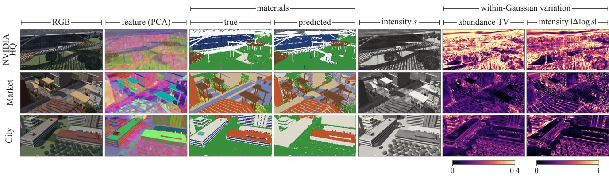  
Figure S1. Harmonic features and their decoding. Columns show RGB, the per-hit feature (PCA), true and predicted materials, intensity and the variation of mixture and intensity within each Gaussian, measured against its mean feature at the same viewing direction (fixed scales across scenes).

What the decoder learns. Figure S2 compares the decoded quantities with the stored ground truth on test views. Within one specimen, the logarithm of the composited intensity correlates with that of the true radiance (r = 0.97 on Market, 0.87 on City), and the sun or shadow state explains 84 % and 67 % of its within-class variance but only 3 % and 15 % of the variance of the class mass. Individual endmembers, in contrast, separate the two states: the endmembers that dominate one Market class in sun and in shadow overlap by 5 %, and those that dominate shadowed surfaces lie closer to the class-mean sky radiance than to the direct radiance (5.0◦ versus 13.2◦), so the over-complete dictionary represents illumination modes. In Office, where daylight and downlight differ in spectral composition rather than in brightness, the illumination explains 56 % of the within-class variance of the class mass, and grey flooring near the windows is assigned to white paint. Abundances change little with the viewing direction on the Lambertian worlds (TV at most 0.04 within 45◦), whereas the NVIDIA HQ decoder depends on the viewing direction throughout (0.18), not only on glass and specular surfaces.

Primitives as material carriers. Figure S3 draws the tetrahedron that bounds each Gaussian and colours it by the class decoded at its centre. Tetrahedra of one surface share a class, and class boundaries in the rendered map coincide with boundaries between primitives, so the abundances that a material query selects belong to individual Gaussians.

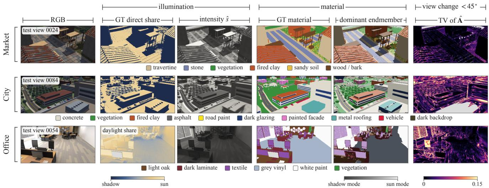  
Figure S2. Intensity carries shading; endmembers carry material and illumination mode. Test views of Market (K=24), City (K=32) logŝ nearer direct ↑ interior shadow edge material edgeand Office (K=32). The composited intensity sˆ follows the direct share of the illumination, and each material occupies distinct endmembers  (endmembers) assin sun and in shadow, so the over-complete dictionary represents illumination modes within a class. Columns: RGB; ground-truth direct s) 0.67 g V d: ershare (Office: daylight share); sˆ; ground-truth material; dominant endmember, coloured by its class and shaded by the mean direct share of c ct ceits pixels; total variation (TV) of Aˆ when the viewing direction changes by up to 45◦.

0.15 −10 Market ρs =−0.73Table S4. Reflectance checks per world, over 420–980 nm. Spec-0.03 nearer sky ↓ tra: distinct measured spectra rendered. Ref.: spectra with at least Market City Office 0.0 0.5three independent library measurements of the recorded source type; < 3◦: how many are within 3◦ of one; med.: median nearest angle. Veg.: green-leaf feature checks. Missing independent references are unevaluated, including Forbidden City pigment-totile, opaque-water and distant-background proxies. Counts concern source measurements, not surveyed historical materials. A shared spectrum counts in each world; summaries count each (file,type) pair once (154 pairs of 125 distinct spectra). Natural: vegetation, bark, soil and rock.

<table><tr><td>World</td><td>Spectra</td><td>in [0, 1]</td><td>Ref.</td><td>&lt; 3°</td><td>med. (°)</td><td>Veg.</td></tr><tr><td>Forbidden City</td><td>47</td><td>47/47</td><td>24</td><td>22</td><td>1.28</td><td>8/8</td></tr><tr><td>Market</td><td>29</td><td>29/29</td><td>21</td><td>17</td><td>2.01</td><td>8/8</td></tr><tr><td>Botanical</td><td>29</td><td>29/29</td><td>21</td><td>17</td><td>2.01</td><td>8/8</td></tr><tr><td>NVIDIA</td><td>27</td><td>27/27</td><td>19</td><td>17</td><td>1.35</td><td>8/8</td></tr><tr><td>Study</td><td>5</td><td>5/5</td><td>2</td><td>1</td><td>6.09</td><td>一</td></tr><tr><td>Karst</td><td>10</td><td>10/10</td><td>9</td><td>9</td><td>0.60</td><td>5/5</td></tr><tr><td>City</td><td>56</td><td>56/56</td><td>30</td><td>20</td><td>2.07</td><td>7/7</td></tr><tr><td>Office</td><td>35</td><td>35/35</td><td>18</td><td>8</td><td>3.46</td><td>4/4</td></tr><tr><td>Six outdoor worlds</td><td>119</td><td>119/119</td><td>61</td><td>47</td><td>1.47</td><td>17/17</td></tr><tr><td>All eight worlds</td><td>154</td><td>154/154</td><td>78</td><td>55</td><td>2.00</td><td>21/21</td></tr><tr><td>natural materials</td><td>45</td><td>45/45</td><td>40</td><td>37</td><td>1.25</td><td>21/21</td></tr><tr><td>man-made materials</td><td>109</td><td>109/109</td><td>38</td><td>18</td><td>3.46</td><td>1</td></tr></table>

## E. Real Captures

Data. HS-NeRF cubes are aligned with the released RGB images and COLMAP cameras, and only uniquely aligned views are kept; Fakeplant2 and Pinecone are excluded, as their processed RGB has a white background absent from the raw cubes. Figures S4–S6 show the first test view of every scene; errors concentrate at edges and thin parts.

## 10−2F. Efficiency

0 45 90 Market City OfficeStorage. Each Gaussian stores 59 values at any band count, against 78 for HyperGS and 62+L for per-band fields, so our models are 6 to 32 times smaller on the real captures, for example 4.2 MB against 127 MB on the 204-band apple.

Training and rendering. The City pipeline takes 397 s (Table S9); anchor and features do not depend on K, so tuning K repeats only the clustering and the decoder. Decoding every intersection costs more than rasterizing a stored spectrum, but our fused fp16 kernel, which skips intersections of negligible weight, renders 34.9 labelled views per second, about ten times 3DGS with VCA (Table S10).

## G. Rare Materials and Altered Leaves

Rare classes. Class IoU falls with class frequency, while the true spectra still separate most rare classes, as Figure S7 shows; the errors therefore lie in endmember allocation rather than in the data.

Altered leaves. In the City variants, foliage-coloured mineral leaves and stressed leaves are separated from healthy foliage far better by Spectral World Renderer than by clustering RGB: the total variation between their label distributions is .85 and .83, against .10 and .40 for RGB kmeans and .95 and .97 for the true spectra (main paper, Figure 9(c)). Separation is not yet identification: most changed leaves are mapped to another class rather than to a class of their own. A moved sun leaves large classes unchanged.

Table S5. Spectral reconstruction on real captures, per scene (test views; the main paper reports the means). MS/HS: measured mul tispectral/hyperspectral; 3DGS stores one channel per band. PSNR is higher-is-better; SAM and p95 angle are lower-is-better. Darke shading marks best, second and third; OOM is retained.
<table><tr><td rowspan="2">Source</td><td rowspan="2">Scene</td><td colspan="2">Spectral World Renderer</td><td colspan="3">HyperGS</td><td colspan="3">DD-HGS</td><td colspan="3">3DGS</td><td colspan="3">UnMix-NeRF</td></tr><tr><td>PSNR SAM</td><td>p95</td><td></td><td>PSNR SAM</td><td>p95</td><td></td><td>PSNR SAM</td><td></td><td>p95</td><td>PSNR SAM</td><td></td><td>p95</td><td>PSNR SAM</td><td>p95</td></tr><tr><td rowspan="5">MS</td><td>NeSpoF scene1</td><td>30.74</td><td>3.82</td><td>7.12</td><td>31.38</td><td>4.66</td><td>9.46</td><td>21.77</td><td>3.61</td><td>6.65</td><td>30.68</td><td>3.63</td><td>6.82</td><td>21.77</td><td>13.70 22.79</td></tr><tr><td>NeSpoF scene2</td><td>28.38</td><td>3.57</td><td>8.00</td><td>26.56</td><td>4.30</td><td>9.15</td><td>21.40</td><td>3.47</td><td>7.64</td><td>27.57</td><td>3.32</td><td>7.44</td><td>21.69</td><td>14.33 22.41</td></tr><tr><td>NeSpoF scene3</td><td>29.80</td><td>4.19</td><td>9.36</td><td>26.05</td><td>5.11</td><td>10.91</td><td>25.42</td><td>4.91</td><td>10.64</td><td>25.13</td><td>5.40</td><td>11.33</td><td>20.54</td><td>8.90 15.41</td></tr><tr><td>NeSpoF scene4</td><td>28.64</td><td>3.85</td><td>7.66</td><td>29.44</td><td>4.27</td><td>8.24</td><td>23.09</td><td>3.44</td><td>6.82</td><td>29.07</td><td>3.68</td><td>7.41</td><td>19.36 11.56</td><td>20.40</td></tr><tr><td>Mean</td><td>29.39</td><td>3.86</td><td>8.04</td><td>28.36</td><td>4.58</td><td>9.44</td><td>22.92</td><td>3.86</td><td>7.94</td><td>28.11</td><td>4.01</td><td>8.25</td><td>20.84</td><td>12.12 20.25</td></tr><tr><td>HS</td><td>HSI-SC apple</td><td>30.67</td><td>1.35</td><td>3.87</td><td>27.95</td><td>1.64</td><td>4.88</td><td>26.69</td><td>1.67</td><td>5.07</td><td>26.29</td><td>1.65</td><td>5.36</td><td>00M</td><td></td></tr><tr><td rowspan="6">HS</td><td>Basil</td><td>30.30</td><td>6.19</td><td>17.19</td><td>29.58</td><td>7.01</td><td>18.51</td><td>28.32</td><td>6.67</td><td>17.66</td><td>29.99</td><td>6.21</td><td>17.13</td><td>19.42</td><td>17.1034.39</td></tr><tr><td>Rosemary</td><td>29.21</td><td>4.30</td><td>21.48</td><td>29.05</td><td>4.60</td><td>22.35</td><td>27.70</td><td>6.96</td><td>27.18</td><td>28.57</td><td>4.43</td><td>23.31</td><td>18.67</td><td>15.82 37.50</td></tr><tr><td>Harsh1</td><td>21.31</td><td>6.22</td><td>17.69</td><td>20.92</td><td>6.81</td><td>19.14</td><td>20.95</td><td>5.99</td><td>16.55</td><td>21.02</td><td>5.99</td><td>16.88</td><td>16.26</td><td>13.28 41.92</td></tr><tr><td>Harsh2</td><td>24.78</td><td>6.71</td><td>17.60</td><td>23.07</td><td>6.54</td><td>16.08</td><td>22.34</td><td>5.84</td><td>14.73</td><td>23.09</td><td>6.02</td><td>15.20</td><td>15.34</td><td>21.28 51.16</td></tr><tr><td>Fakeplant1</td><td>26.93</td><td>6.44</td><td>12.60</td><td>27.86</td><td>7.49</td><td>15.55</td><td>30.12</td><td>5.86</td><td>11.62</td><td>28.93</td><td>5.92</td><td>11.24</td><td>22.33 9.63</td><td>21.15</td></tr><tr><td>Mean</td><td>26.51</td><td>5.97</td><td>17.31</td><td>26.10</td><td>6.49</td><td></td><td>18.33 25.89</td><td>6.2617.55</td><td></td><td>26.32</td><td>5.71 16.75</td><td></td><td>18.40</td><td>15.42 37.22</td></tr></table>

Table S6. Dictionary capacity (dominant-endmember mIoU, seed 42). Test mIoU of the regularized decoder for each candidate K; shaded: the K selected on validation views, whose validation mIoU is given in column Val. Last two columns: test mIoU at $K = 2 4$ without regularization and of 3DGS with VCA/NNLS. Karst includes water.

<table><tr><td rowspan="2">World</td><td rowspan="2">Classes</td><td colspan="4">Regularized, test</td><td rowspan="2">Val</td><td colspan="2"> $K = 2 4 , \mathrm { t e s t }$ </td></tr><tr><td>K=classes</td><td>16</td><td>24</td><td>32</td><td> $\mathrm { w } / \mathrm { o } \ \mathrm { r e g } .$ </td><td>3DGS</td></tr><tr><td>Forbidden City</td><td>9</td><td>0.410</td><td>0.500</td><td>0.538</td><td>0.552</td><td>0.563</td><td></td><td>0.277</td></tr><tr><td>Market</td><td>6</td><td>0.340</td><td>0.611</td><td>0.784</td><td>0.754</td><td>0.783</td><td>0.505</td><td>0.323</td></tr><tr><td>Botanical</td><td>6</td><td>0.315</td><td>0.628</td><td>0.684</td><td>0.712</td><td>0.713</td><td>0.629</td><td>0.356</td></tr><tr><td>NVIDIA HQ</td><td>8</td><td>0.202</td><td>0.307</td><td>0.311</td><td>0.315</td><td>0.320</td><td></td><td>0.199</td></tr><tr><td>Study</td><td>5</td><td>0.402</td><td>0.516</td><td>0.521</td><td>0.517</td><td>0.517</td><td>0.588</td><td>0.514</td></tr><tr><td>Karst</td><td>5</td><td>0.504</td><td>0.562</td><td>0.561</td><td>0.725</td><td>0.727</td><td>0.694</td><td>0.395</td></tr><tr><td>City</td><td>11</td><td>0.263</td><td>0.370</td><td>0.477</td><td>0.519</td><td>0.507</td><td></td><td>0.179</td></tr><tr><td>Office</td><td>8</td><td>0.437</td><td>0.500</td><td>0.524</td><td>0.527</td><td>0.533</td><td>0.307</td><td>0.163</td></tr></table>

Table S7. Decoder controls. One change at a time, without appearance regularization; means of seeds 42 and 43. Free decoders output spectra.
<table><tr><td></td><td colspan="2">NeSpoF scene3</td><td colspan="3">Market</td></tr><tr><td>Variant</td><td>PSNR↑ SAM↓ PSNR↑ SAM↓ mIoU↑</td><td></td><td></td><td></td><td></td></tr><tr><td>Per-hit unmixing</td><td>29.62</td><td>4.22</td><td>33.72</td><td>1.87</td><td>0.47</td></tr><tr><td>One feature/Gaussian</td><td>29.24</td><td>4.30</td><td>32.09</td><td>2.08</td><td>0.34</td></tr><tr><td>No harmonic encoding</td><td>29.61</td><td>4.21</td><td>33.65</td><td>1.89</td><td>0.30</td></tr><tr><td>Deferred (pixel)</td><td>29.16</td><td>4.17</td><td>34.37</td><td>1.57</td><td>0.37</td></tr><tr><td>No intensity (s=1)</td><td>29.54</td><td>4.37</td><td>33.70</td><td>2.14</td><td>0.22</td></tr><tr><td>Free, per hit</td><td>29.69</td><td>4.28</td><td>33.74</td><td>1.72</td><td>一</td></tr><tr><td>Free, one feature/Gaussian</td><td>29.26</td><td>4.34</td><td>32.11</td><td>1.90</td><td></td></tr><tr><td>Free, deferred (NHT)</td><td>29.21</td><td>4.17</td><td>34.38</td><td>1.41</td><td></td></tr></table>

## H. Object Queries

Procedure. Each Gaussian is assigned its mean abundance and radiance over the training views. The type “tree” denotes crown materials and a size: Gaussians of crown material above the ground are clustered with DBSCAN [15], and large clusters form instances. A measured leaf spectrum then selects instances by comparing each crown with the query and with ordinary leaves under sunlight and skylight. All parameters were tuned on the base City.

Table S8. Real captures. Views are training/test views per scene; SO/BS denote Surface Optics/BaySpec sensors.
<table><tr><td>Dataset</td><td>Scenes Bands Range (nm) Resolution</td><td></td><td></td><td></td><td>Views</td></tr><tr><td>NeSpoF</td><td>4</td><td>21</td><td>450-650</td><td> $5 1 2 \times 4 2 8$ </td><td>15-26 / 3-4</td></tr><tr><td>HSI-SC apple</td><td>1</td><td>204</td><td>397-1004</td><td> $5 1 2 \times 5 1 2$ </td><td>56/8</td></tr><tr><td>HS-NeRF (SO)</td><td>4</td><td>128</td><td>371-1044</td><td> $3 4 8 \times 2 6 0$ </td><td>20-42 / 3-7</td></tr><tr><td>HS-NeRF (BS)</td><td>1</td><td>141</td><td>401-1087</td><td> $3 2 0 \times 2 5 6$ </td><td>50/8</td></tr></table>

Table S9. City training time by stage (one RTX 4090, seed 42, including start-up and loading; ours: mean of two runs).
<table><tr><td>Method</td><td>Stage</td><td>City (s)</td></tr><tr><td>UnMix-NeRF</td><td>VCA initialisation and training</td><td>1,457</td></tr><tr><td>3DGS + VCA/NNLS</td><td>64-band 3DGS</td><td>5,030.2</td></tr><tr><td rowspan="5">SWR</td><td>rendering and VCA</td><td>71.3</td></tr><tr><td>total</td><td>5,101.5</td></tr><tr><td>anchor Gaussians</td><td>72.8</td></tr><tr><td>harmonic features</td><td>36.5</td></tr><tr><td>appearance clusters</td><td>68.4</td></tr><tr><td></td><td>decoder</td><td>219.5</td></tr><tr><td></td><td>total</td><td>397.2</td></tr></table>

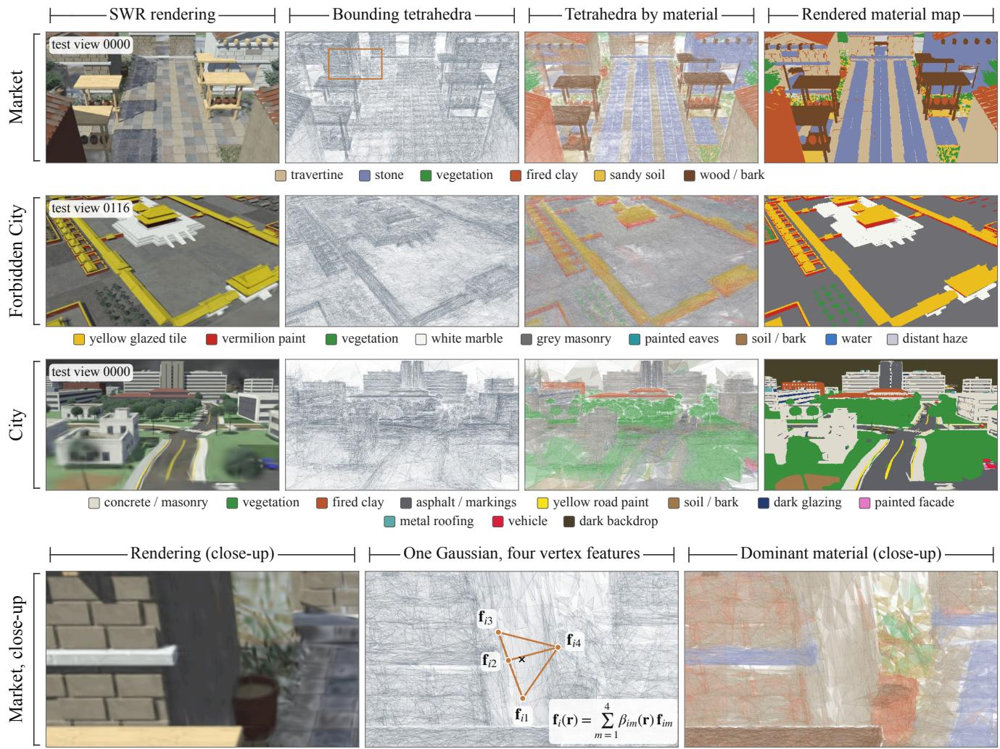  
Figure S3. Bounding tetrahedra on test views. Each Gaussian $G _ { i }$ is enclosed by the regular tetrahedron of its canonical frame, scaled by $\sigma _ { i } ,$ rotated by $\mathbf { R } _ { i }$ and translated by $\mu _ { i } ;$ the barycentric coordinates of the point of maximal response weight its four vertex features $( \mathrm { E q } . 3$ of the main paper). Columns show the rendering, the tetrahedra weighted by opacity and visibility, the tetrahedra coloured by the dominant class decoded at each Gaussian centre, and the rendered material map. The tetrahedra follow the scene structure, and their colouring reproduces the class layout of the rendered map: the median visible Gaussian places more than 98 % of its centre abundance on one class. The bottom row isolates one Gaussian of Market (amber window).

Table S10. Rendering speed (one RTX 4090): test views per second at $9 6 0 \times 5 4 0 \times 6 4$ , including spectra and labels. For $3 \mathrm { D G S } + \mathrm { V C A } / \mathrm { N N } \mathrm { L S } .$ the second row adds the training renders that VCA needs. Ours: full precision (reference), fp16 skipping intersections of weight $< 1 0 ^ { - 4 }$ (fast), and the same in one fused kernel; dominant labels agree with the reference on 99.97 % of pixels.
<table><tr><td>Method</td><td></td><td>Market Botanical</td><td>Study</td><td></td><td>Karst Mean</td></tr><tr><td>UnMix-NeRF</td><td>0.18</td><td>0.21</td><td>0.21</td><td>0.12</td><td>0.18</td></tr><tr><td>3DGS + VCA/NNLS</td><td>2.53</td><td>2.51</td><td>4.70</td><td>4.73</td><td>3.6</td></tr><tr><td>incl. training renders</td><td>1.49</td><td>1.47</td><td>2.18</td><td>2.16</td><td>1.8</td></tr><tr><td>SWR, reference</td><td>3.38</td><td>3.79</td><td>3.52</td><td>2.64</td><td>3.3</td></tr><tr><td>SWR, fast</td><td>8.19</td><td>8.81</td><td>8.09</td><td>6.34</td><td>7.9</td></tr><tr><td>SWR, fused</td><td>36.5</td><td>39.3</td><td>36.3</td><td>27.4</td><td>34.9</td></tr></table>

Results. The substituted mineral is $4 2 ^ { \circ }$ from ordinary leaves in spectrum but only $2 ^ { \circ }$ in RGB, so RGB retrieves wrong trees and Spectral World Renderer none (Table S11; main paper, Figure 9(a,b)). The true spectra give the same answers, and the missed targets are lost earlier, mostly in crowns too sparse to form instances.

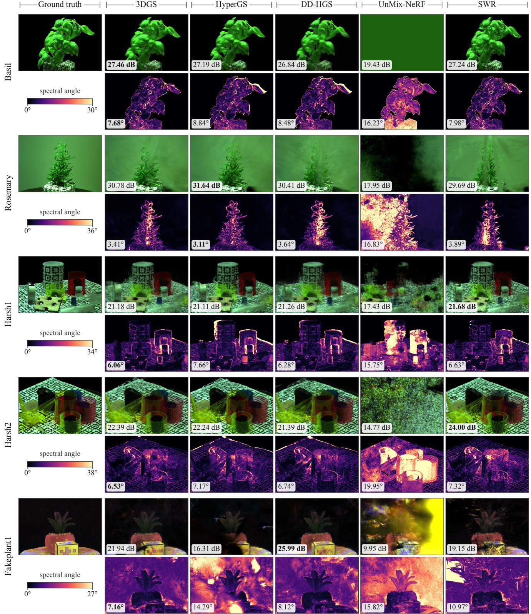  
Figure S4. Qualitative comparison on HS-NeRF test views, the first test view of each of the five scenes. Rows show false colour (630, 550 and 460 nm) and per-pixel spectral angle (left scale). Bold marks the best scores.

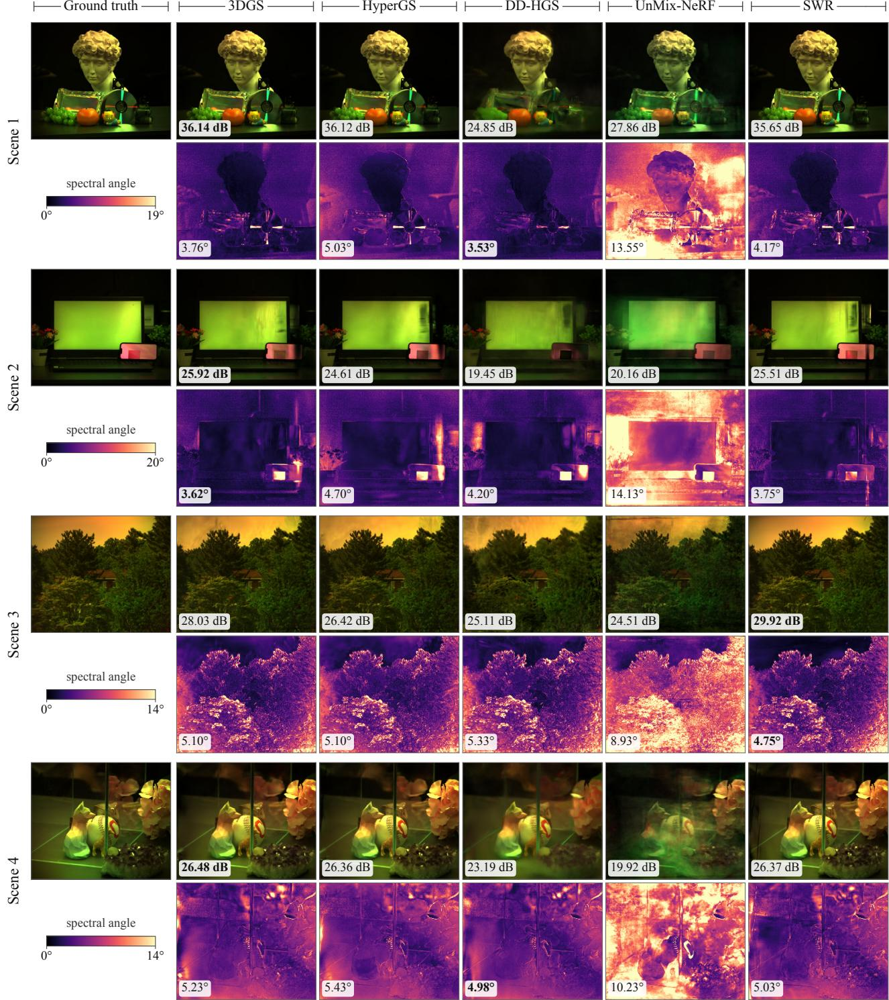  
Figure S5. Qualitative comparison on NeSpoF test views, the first test view of each of the four scenes, as in Figure S4.

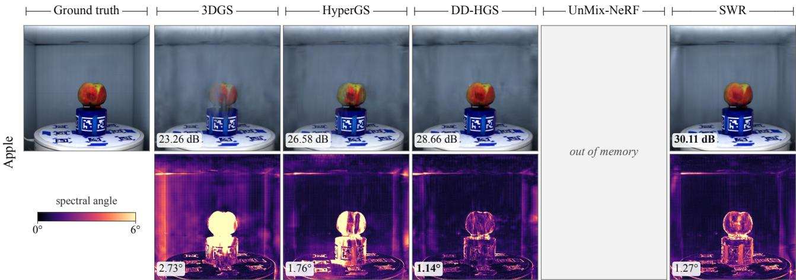  
Figure S6. Qualitative comparison on the HSI-SC apple, first test view, as in Figure S4. UnMix-NeRF runs out of memory.

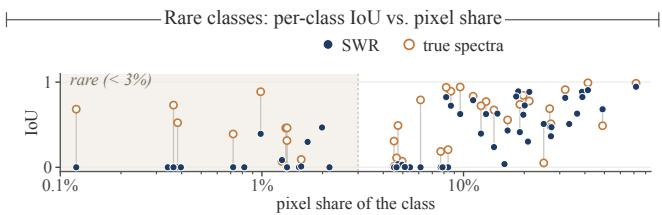  
Figure S7. Rare classes are absorbed by larger ones. Per-class IoU against pixel share over the eight worlds, with K equal to the class count. NNLS with the true class spectra separates most rare classes that Spectral World Renderer merges into larger ones.

Table S11. Object queries in City. Every target is either lost before the spectral query or found; among the found trees, Spectral World Renderer retrieves no ordinary tree in the metamer variant, whereas RGB retrieves up to 11. Targets: substituted (metamer) or stressed trees. Lost: typed as another material, or too few Gaussians to form an instance. Instances: all tree instances returned by the type query. Bold: fewest wrong answers.

<table><tr><td></td><td></td><td colspan="2">Lost</td><td></td><td></td><td colspan="2">SWR</td><td colspan="2">RGB</td></tr><tr><td></td><td>Seed Targets typed sparse</td><td></td><td></td><td>Found Inst.</td><td></td><td>correct</td><td>wrong</td><td>correct</td><td>wrong</td></tr><tr><td colspan="10">Metamer: foliage-coloured mineral leaves</td></tr><tr><td>42</td><td>61</td><td>13</td><td>43</td><td>5</td><td>57</td><td>5</td><td>0</td><td>5</td><td>11</td></tr><tr><td>43</td><td>61</td><td>16</td><td>43</td><td>2</td><td>54</td><td>2</td><td>0</td><td>2</td><td>2</td></tr><tr><td colspan="10">Stress: dry leaves on 87 trees</td></tr><tr><td>42</td><td>87</td><td>6</td><td>62</td><td>19</td><td>63</td><td>19</td><td>1</td><td>19</td><td>1</td></tr><tr><td>43</td><td>87</td><td>7</td><td>62</td><td>18</td><td>60</td><td>18</td><td>1</td><td>18</td><td>1</td></tr></table>

## I. Query by Spectrum

Procedure. The query is a spectrum: the rendered spectrum at a clicked pixel or a library reflectance $\rho .$ Each Gaussian carries its mean spectrum over the training rays, $\begin{array} { r } { \bar { \mathbf { h } } _ { i } \propto \sum _ { \mathbf { r } } w _ { i } ( \mathbf { r } ) \mathbf { h } _ { i } ( \mathbf { r } ) } \end{array}$ . Let $\phi _ { \mathrm { d } } , \phi _ { \mathrm { s } } \in \mathbb { R } ^ { L }$ denote the direct and sky irradiance of the world integrated over the band responses. Under sun and sky, a surface yields radiance proportional to $\rho \odot \left( \alpha \phi _ { \mathrm { d } } + \phi _ { \mathrm { s } } \right)$ , whose shape varies with the direct shading α. The comparison removes this dependence in one of two ways:

Table S12. Query by spectrum (mean over Market, City, Botanical and Karst). AP against the class masks on test views. Recall: proportion of the sunlit part of the class retrieved by shadowed clicks at the Otsu threshold. Ours: illumination cone for library spectra, whitening for clicks; click queries operate on rendered pixels, and per-Gaussian queries differ by at most .02 AP.

<table><tr><td></td><td colspan="3">AP↑</td><td>Recall↑</td></tr><tr><td>Query</td><td>library</td><td></td><td>sunlit click shadowed click</td><td>sunlit part</td></tr><tr><td>RGB colour angle</td><td>.50</td><td>.61</td><td>.45</td><td>.10</td></tr><tr><td>Spectral angle, raw</td><td>.55</td><td>.59</td><td>.48</td><td>.53</td></tr><tr><td>Ours</td><td>.61</td><td>.63</td><td>.61</td><td>.77</td></tr><tr><td>Class name (reference)</td><td>.82</td><td>一</td><td>一</td><td>一</td></tr></table>

• a library spectrum is compared by its angle to the nonnegative cone spanned by $\rho \odot \phi _ { \mathrm { d } }$ and $\rho \odot \phi _ { \mathrm { s } }$ , which contains every sunlit, penumbral and shadowed mixture;

• a clicked spectrum is compared after illumination whitening: the RMS log-ratio of the two spectra once the constant vector and the two principal directions of log(αϕd+ $\phi _ { \mathrm { s } } ) , \alpha \in [ 0 , 1 ]$ , are projected out. These two directions account for 99.999 % of the variation of this family.

Neither step involves training. The per-Gaussian angles are rasterized with the rendering weights; a default threshold follows from Otsu’s method [61] on the histogram of log angles, and a slider adjusts it.

Evaluation. Market, City, Botanical and Karst use the models of Table 2. Clicks are three sunlit and three shadowed pixels inside a single class in training views. Library queries use the assigned specimen of each class, another specimen of the class and ECOSTRESS spectra [53] that do not occur in the world. Each query is scored against the class mask on all test views, and the four worlds are weighted equally.

Results. Illumination handling makes a measured spectrum an effective query (Table S12, Figure S9). For shadowed clicks, the spectral query raises AP from .45 (RGB) to .61 and retrieves 77 % of the sunlit part of the clicked material, against 10 % for RGB, as shown in Figure S8(b). For library spectra, the illumination cone raises AP from .50 to .61. For sunlit clicks, spectral and RGB queries perform on par (.63 and .61). Applying the same query to the observed test spectra raises AP by only .03. When the material name is known, the class-name query remains more accurate (.82); a single spectrum also cannot represent classes assembled from several differently coloured specimens, such as vehicles and painted facades. The Otsu threshold yields an IoU about .14 below the best threshold of each query and is unreliable for rare materials, so the slider sets the final selection.

(b) retrieval on test views (Karst limestone, Otsu threshold; outline: GT)  
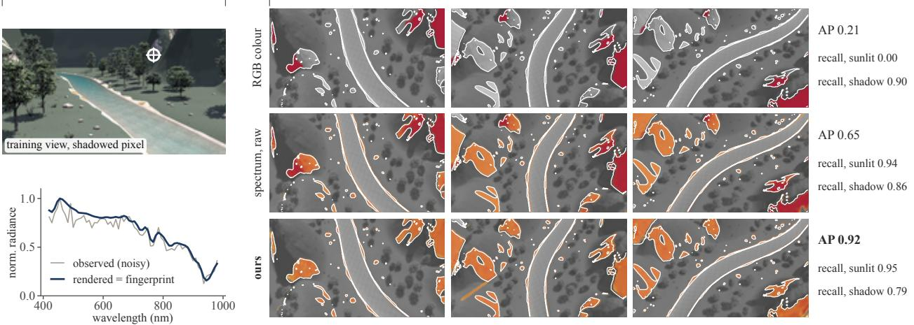

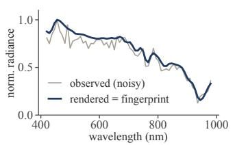

(c) metamer in City: 2° apart in RGB, 42° in spectrum; queries shown on tree crowns (outline: mineral crowns)  
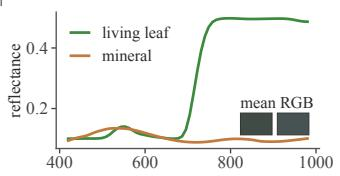

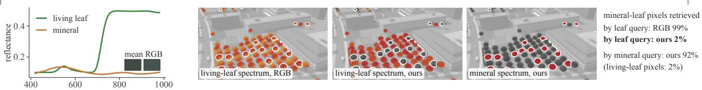  
Figure S8. A clicked spectrum retrieves its material across shading and separates metamers. (a) A pixel on shadowed limestone is clicked in a training view of Karst; its rendered spectrum is the query. (b) Selections on three test views at the Otsu threshold for the RGB colour angle, the raw spectral angle and the whitened spectral angle on per-Gaussian spectra (white outline: ground truth); AP and recall are computed over all test views for this click. The RGB query misses the sunlit rock, which the whitened query retrieves. (c) City metamer, shown on tree crowns (outline: mineral crowns): the living-leaf spectrum retrieves the mineral crowns in RGB but not with Spectral World Renderer, and the mineral spectrum retrieves only them.  
(a) AP by illumination handling

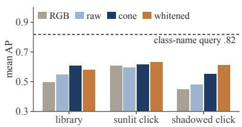  
(b) shadowed click

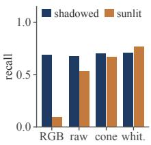  
Figure S9. Illumination handling makes spectral queries robust to shading (mean over four worlds). (a) Mean AP of RGB queries and of spectral queries without illumination handling (raw), with the sun and sky cone and with whitening; dashed line: class-name query. (b) For shadowed clicks, the RGB query retrieves the shadowed part of the class but almost none of its sunlit part, whereas whitened spectral queries retrieve both.

Metamers. In the City variant, the substituted mineral is 2◦ from foliage in RGB and 42◦ in spectrum. A living-leaf library spectrum separates the two leaf types with an AUC of .99 on per-Gaussian spectra, against .26 for RGB; it retrieves 2 % of the mineral-leaf pixels, against 99 % for RGB, as shown in Figure S8(c). The mineral spectrum retrieves 92 % of mineral-leaf and 2 % of living-leaf pixels.

Speed. With 61k to 84k Gaussians, a query takes 1.6 to 2.9 ms on an RTX 3090; rasterizing the selection at 960 × 540 brings the total to 3 to 4 ms.

## J. Additional Views of SWR-Bench

Figures S10 and S11 show the simulated hyperspectral observations of one test view per world. Figures S12–S14 show each world from fifteen cameras along its trajectory. Figures S15–S18 then show three test views of each world with predictions. Each row shows the rendered input, the material ground truth and the Spectral World Renderer prediction at one camera, using the models of the main table and their frozen training-view maps. Views are chosen by camera separation from a fixed reference camera, not by prediction scores.

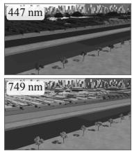

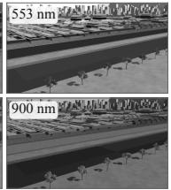

RGB rendering (test view)  
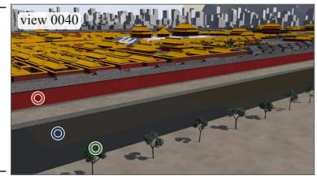

Narrow bands (one exposure per world) and CIR  
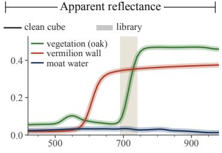

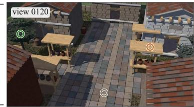

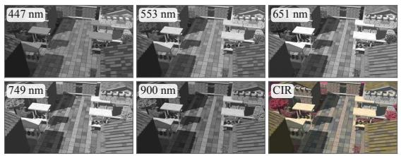

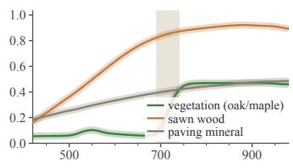

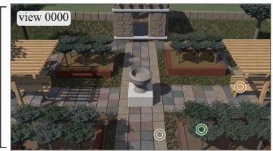

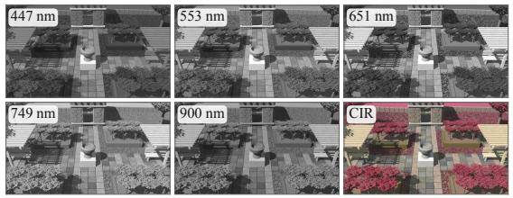

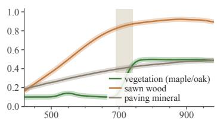

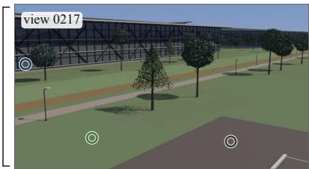

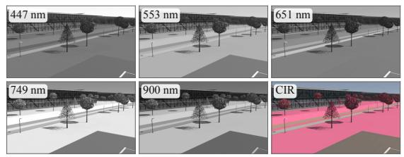

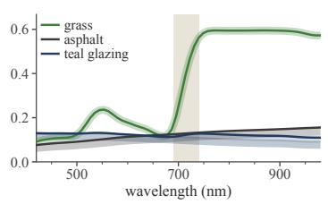

Clean vs. noisy observation, 900 nm band, 80×80 px crops at native resolution (same exposure per pair)  
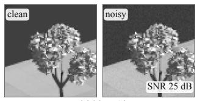

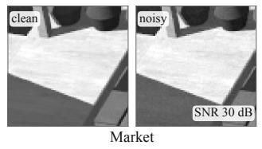

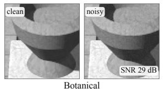

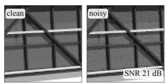  
Figure S10. Simulated hyperspectral observations: Forbidden City, Market, Botanical and NVIDIA HQ. Narrow bands share one exposure per world, so brightness differences between bands follow the radiance; the colour-infrared composite (R, G, B = 847, 651, 553 nm) renders vegetation red. Apparent reflectance divides the clean radiance by the white-reference radiance under each pixel’s illumi nation (median and 10–90 % range, over the library reflectance of the assigned specimen; shaded: red edge, 690–740 nm). Outdoor spectra reproduce the library reflectance, including chlorophyll absorption near 670 nm and the red edge; path-traced interiors deviate through interreflection and residual Monte Carlo variance. Bottom: clean and noisy crops of the 900 nm band with the signal-to-noise ratio of the noisy crop.

Office  
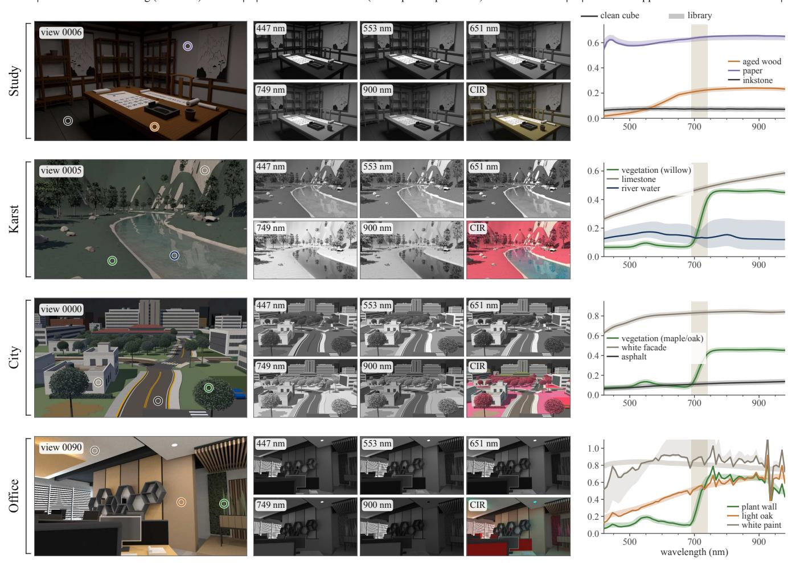  
RGB rendering (test view)  
Narrow bands (one exposure per world) and CIR

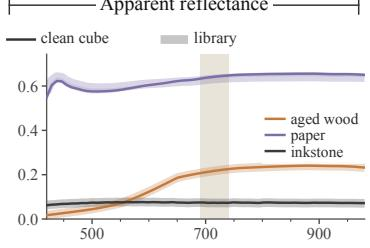

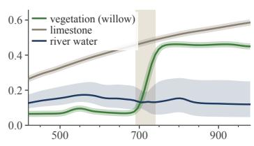

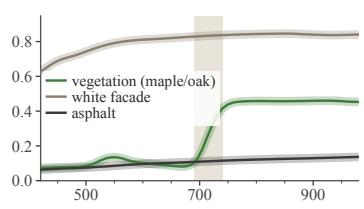

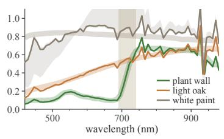

Clean vs. noisy observation, 900 nm band, 80×80 px crops at native resolution (same exposure per pair)  
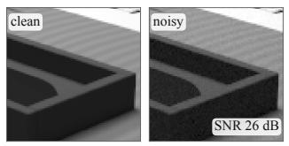  
Study

  
City

  
Figure S11. Simulated hyperspectral observations: Study, Karst, City and Office. Layout as in Figure S10. Indoor worlds are lit by white sources, so their bands differ less; the Office lights emit no near-infrared, which comes only from daylight through the blinds.

  
Figure S12. Rendered views: Forbidden City, Market and Botanical. Fifteen cameras per world, spread along its trajectory (released RGB renders).

  
Figure S13. Rendered views: NVIDIA HQ, Study and Karst. Fifteen cameras per world, spread along its trajectory (released RGB renders).

  
Figure S14. Rendered views: City and Office. Fifteen cameras per world, spread along its trajectory (released RGB renders).

  
Figure S15. Additional test views: Forbidden City and Market. Three separated test cameras per world, shown as full frames.

  
Figure S16. Additional test views: Botanical and NVIDIA HQ. Three separated test cameras per world, shown as full frames.

  
Figure S17. Additional test views: Study and Karst. Three separated test cameras per world, shown as full frames.

  
Figure S18. Additional test views: City and Office. Three separated test cameras per world, shown as full frames.