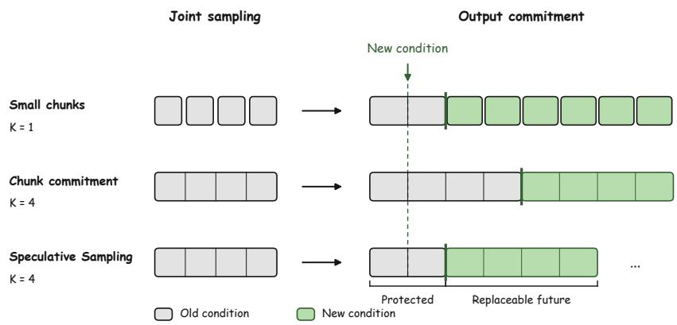
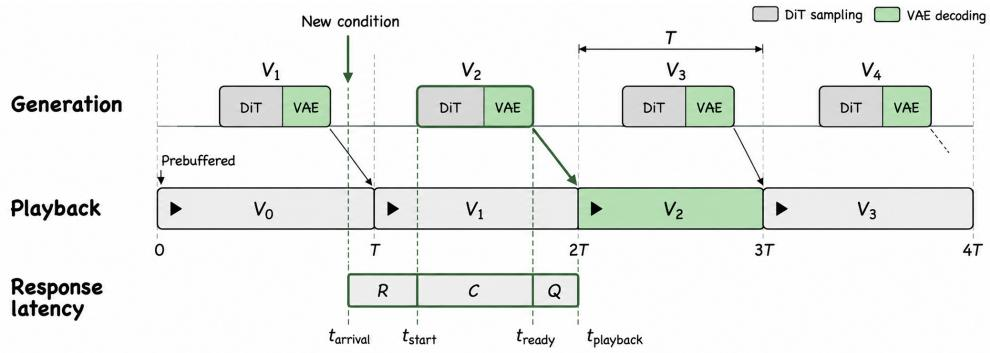
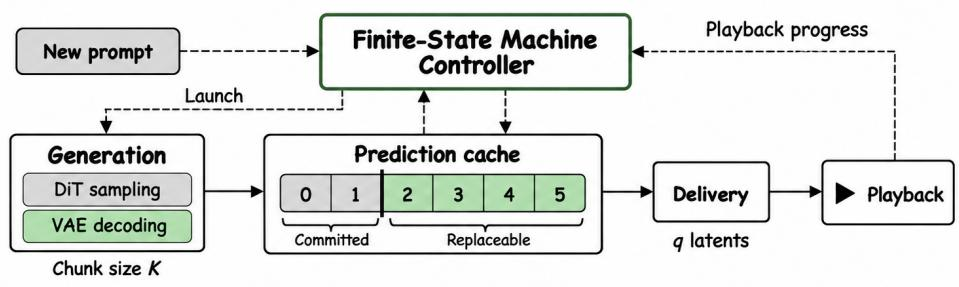
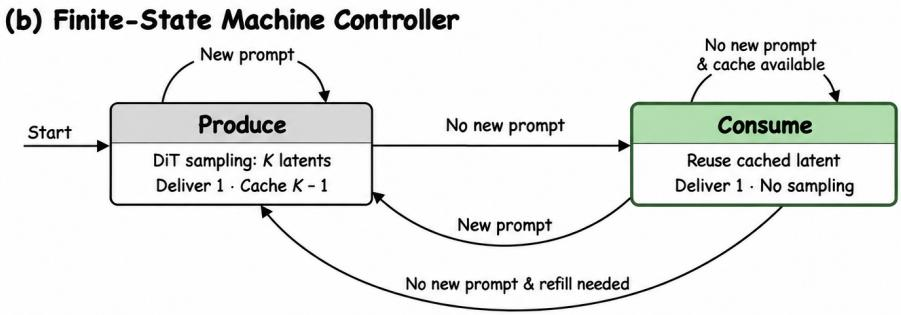
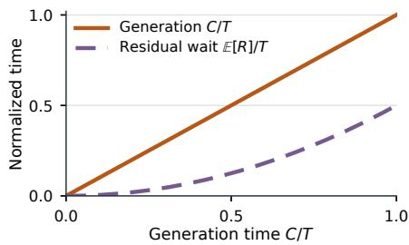
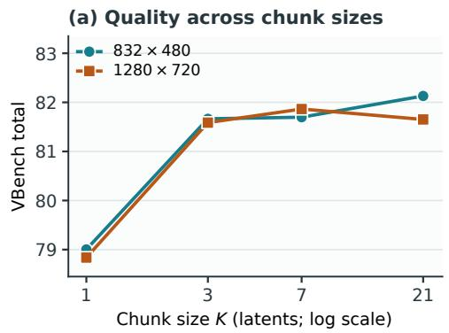
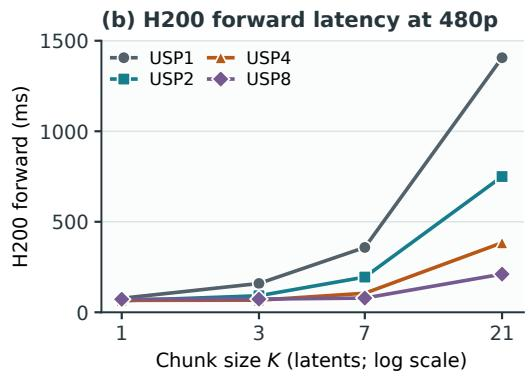

# Speculative Sampling in Interactive Video Generation

Yubo Huang1 Yuxuan Zhang2 Jiaming Liu3 Sirui Zhao1 Enhong Chen1∗

1University of Science and Technology of China 2The Chinese University of Hong Kong 3Independent Researcher

## ABSTRACT

Interactive video generation commonly relies on small bidirectional chunks to reduce response latency. Yet our preliminary experiments show that larger chunks improve video quality and better utilize GPU parallelism, allowing more latents to be sampled with only a modest increase in sampling time. Motivated by these observations, we propose Speculative Sampling, a strategy that combines the modeling power of large bidirectional windows with the low-latency interaction of small ones. It expands the modeling window by appending noise latents as padding and caches the resulting predictions for reuse when the condition remains unchanged. Predictions are delivered incrementally, while the uncommitted future remains replaceable. Our latency analysis shows that this removes the waiting-time lower bound imposed by chunk boundaries, shifting the optimization focus from reducing chunk size to accelerating per-chunk sampling. Bidirectional window size thus becomes a decision variable for jointly optimizing visual quality and sampling time, rather than a necessary constraint on low-latency interaction. This opens a path to serving large bidirectional models in interactive streaming systems without complex streaming post-training. Project page: https://yubo-shankui.github.io/speculative\_sampling.

## 1 INTRODUCTION

Interactive video generation requires newly arriving conditions to influence ongoing playback promptly. A viewer may change a camera command or action instruction at any time, while existing video continues to play. Generation throughput alone does not capture this requirement: a fast model can still leave the viewer waiting for a generation or playback boundary.

A natural route is fine-grained autoregressive generation. Advances in rollout training and few-step distillation have made this route increasingly practical (Huang et al., 2025; Zhao et al., 2026; Yang et al., 2025). Smaller generation chunks provide more frequent opportunities to incorporate new conditions, enabling fine-grained interaction, but may limit joint temporal modeling and parallel efficiency. This raises our central question: must low-latency interaction come at the cost of a smaller bidirectional modeling window?

We introduce Speculative Sampling, a strategy that combines the modeling power of large bidirectional windows with the low-latency interaction of small ones. It expands the modeling window with padding latents and caches their predictions for reuse when the condition remains unchanged, while allowing the predicted future to be revised when new conditions arrive (Figure 1).

We first formulate a serving model that separates condition arrivals, generation, output commitment, and playback. Generation is the computation needed for deliverable video output; for the latent diffusion models studied here, it includes DiT sampling and required VAE decoding. The model distinguishes generation time from phase-dependent random-arrival waiting imposed by scheduling and playback boundaries, and identifies replaceable outputs. When new output can enter playback only at chunk boundaries, the chunk duration imposes a waiting floor even if generation is fast.

We next examine chunk size K, the number of latent frames jointly sampled in one DiT sampling call. Changing K affects joint temporal modeling and parallel efficiency, as well as the time needed to generate each chunk. Our chunk-size ablation shows higher aggregate video quality for largerchunk configurations than their frame-wise counterparts in the evaluated settings (Section 4). Larger chunks also better utilize GPU parallelism, allowing more latents to be sampled with only a modest increase in sampling time. Together with the system model, this motivates retaining the benefits of joint generation while reducing the waiting imposed by coarse output commitment.

  
Figure 1: Fine-grained interaction without shrinking generation chunks. Our method preserves large-chunk joint sampling while allowing updates beyond the protected prefix, rather than only at chunk boundaries. Gray/green denote old/new conditions; the dashed line marks playback position at condition arrival, and thick green edges mark updated output. Positions represent video content, not computation time.

Guided by the system model and chunk-size ablation, we develop our method to combine largechunk joint generation with fine-grained delivery. We expand the bidirectional modeling window by appending noise latents as padding. Rather than discarding the resulting predictions, we cache them for reuse when the condition remains unchanged, while keeping the uncommitted future replaceable. We formulate the controller as a two-state finite-state machine that coordinates joint generation and incremental consumption of cached predictions, while playback continues independently. This decouples DiT sampling calls from individual deliveries: completed predictions are reused between condition updates, avoiding repeated sampling merely to support finer-grained delivery.

The resulting design points to an alternative route to interactive video generation: shrinking chunks need not be a prerequisite for low interaction latency. Instead, the optimization focus can shift to accelerating high-quality joint generation. DiT sampling acceleration and parallel acceleration can support this route. We further demonstrate this route by serving a large bidirectional model in a low-latency interactive streaming system without Self-Forcing-style post-training.

Our contributions are fourfold:

1. A simple serving-system model for interactive video generation. We formalize condition arrivals, generation, output commitment, and playback, distinguishing generation time from the additional waiting imposed by scheduling and playback boundaries (Section 3.1).

2. A systematic analysis of chunk size. We study how chunk size affects video quality, generation time, and redundant computation, clarifying the trade-offs between joint modeling and responsiveness (Section 4; Appendices A–B).

3. Recomputation-efficient speculative sampling. Guided by this model and analysis, we propose a speculative sampling scheme formulated as a two-state finite-state machine. It combines large-chunk joint generation with fine-grained output commitment, reusing predictions and replanning only a feasible suffix when conditions change (Section 3).

4. An alternative route to interactive video generation. By separating chunk size from output commitment, we shift the optimization focus from shrinking chunks to accelerating high-quality joint generation, making per-chunk generation time a central target for improving responsiveness.

## 2 RELATED WORK

Autoregressive video generation. Autoregressive video generation exploits temporal structure by predicting new content conditioned on the past (Yan et al., 2021). This provides a natural interface for extending videos, including segment-wise continuation under changing prompts (Villegas et al., 2022). Bringing sequential prediction to diffusion models (Chen et al., 2024) leaves two practical challenges: the cost of repeated sampling and errors accumulated through generated history. Recent progress therefore targets efficient few-step causal generation (Yin et al., 2024; Zhao et al., 2026) and training aligned with self-generated, long-horizon rollouts (Huang et al., 2025; Yang et al., 2025). Related rolling and bidirectional-window approaches retain joint temporal processing during sequential output (Kim et al., 2024; Kodaira et al., 2025; Liu et al., 2025; Rui et al., 2026). NFD additionally describes speculative multi-frame sampling on a frame-causal backbone to improve throughput, but retains a causal mask within the enlarged window and therefore does not exploit bidirectional modeling across it (Cheng et al., 2025). Related control mechanisms include reuse or replanning of fully denoised futures with ground-truth observation feedback (Lillemark et al., 2026) and management of generation–playback lead (Bai et al., 2026). Our method studies a complementary interface: retaining temporally bidirectional joint generation within each chunk while committing outputs at a finer granularity under newly arriving conditions.

Accelerating video generation. Acceleration targets several components of generation cost. Fewstep distillation (Yin et al., 2024; Zhao et al., 2026) and adversarial post-training (Lin et al., 2025) reduce DiT sampling steps. Pyramid Flow performs much of its DiT sampling below full spatial resolution and compresses history through a temporal pyramid (Jin et al., 2024); FramePack reduces the historical-context token budget (Zhang et al., 2025a). FasterCache and TeaCache reuse intermediate computations across diffusion steps (Lv et al., 2024; Liu et al., 2024), whereas Sliding Tile Attention and Sparse VideoGen reduce attention work through local or spatial–temporal sparsity (Zhang et al., 2025b; Xi et al., 2025). USP addresses distributed attention through sequence parallelism (Fang & Zhao, 2024). These methods have distinct training and inference requirements. Our perspective shifts the emphasis from shrinking generation chunks to accelerating their generation. By decoupling generation from output commitment, our method highlights per-chunk generation time, rather than chunk size alone, as a key determinant of interaction latency. This places greater importance on accelerating joint generation instead of requiring increasingly fine-grained autoregressive models.

## 3 METHOD

## 3.1 SERVING-SYSTEM MODEL

An interactive video serving system generates video into a buffer while the player consumes previously generated content. New conditions arrive online and must influence subsequent playback promptly. For the latent diffusion models considered here, the chunk size K counts the latents jointly sampled with bidirectional temporal modeling.1 Let f denote the video’s temporal sampling frame rate, used for generation and playback at its intended speed, and r the pixel frames represented by each latent. A latent spans $\delta = r / f$ seconds, so a chunk covers $T = K \bar { \delta } = K r / f$ seconds.

Figure 2 illustrates why response latency is not just DiT sampling time. A condition arrives at $t _ { \mathrm { a r r i v a l } }$ , waits until generation starts at $t _ { \mathrm { s t a r t } }$ , and yields a first output group ready at $t _ { \mathrm { r e a d y } }$ and displayed at $t _ { \mathrm { p l a y b a c k } }$ . For a displayed update, these stages give

$$
\begin{array} { r l } & { R = t _ { \mathrm { s t a r t } } - t _ { \mathrm { a r r i v a l } } , \quad \quad C = t _ { \mathrm { r e a d y } } - t _ { \mathrm { s t a r t } } , } \\ & { Q = t _ { \mathrm { p l a y b a c k } } - t _ { \mathrm { r e a d y } } , \quad L = R + C + Q . } \end{array}\tag{1}
$$

Here R and $Q$ are the waits before generation and playback, respectively. Generation time $C$ covers the critical path to the first deliverable output, including the required DiT sampling and VAE decoding.

For a conventional interface that admits newly conditioned output only at fixed chunk playback boundaries, the expected combined waiting satisfies $\mathbb { E } [ R + Q ] \stackrel {  } { \geq } T / 2$ under fixed generation time and isolated, uniformly phased arrivals (Section 3.4). Since $T = K r / f$ , two direct ways to reduce this waiting floor at fixed r are smaller chunks and higher temporal frame rates. Both approaches reduce latency by shortening the chunk period T. We instead ask: can we eliminate the chunkperiod waiting floor by decoupling joint generation from output commitment? This would remove the need to shrink chunks or increase the model’s temporal frame rate merely to obtain finergrained interaction, shifting the optimization focus to generation time rather than chunk duration.

  
Figure 2: Generation speed alone does not determine response latency. In this periodic reference schedule, the highlighted update waits R for generation, takes C to produce deliverable output, and waits Q for playback. Each chunk is prepared for the next playback period; $V _ { 0 }$ is prebuffered.

## 3.2 SPECULATIVE SAMPLING VIA A FINITE-STATE MACHINE

Our design separates how much the model jointly predicts from how much the system commits at each delivery. Delivery granularity q is the number of latents whose pixel frames are transferred together; our method uses $q = 1$ , with each regular group spanning δ seconds. For each sampling call, we append K − 1 noise latents as padding to the next latent to be delivered, forming a K-latent bidirectional modeling window. Rather than discarding the resulting padding predictions, we retain them in a prediction cache for reuse while the condition remains unchanged. Output commitment makes content non-replaceable and may precede actual playback. A large chunk supplies a reusable future; the controller keeps that future replaceable until needed. This is the role of speculative sampling, distinct from the individual DiT sampling calls it schedules.

Joint predictions and retained state. At a branch position $j ,$ let $\mathcal { H } _ { j }$ be the conditioning state derived from the retained prefix, and let c denote the current condition. One DiT sampling call produces a K-latent prediction $\widetilde { Y } _ { j }$

$$
\widetilde { Y } _ { j } \sim p _ { \boldsymbol { \theta } } ( \cdot \mid \mathcal { H } _ { j } , c ) , \qquad | \widetilde { Y } _ { j } | = K .\tag{2}
$$

The next latent and the padding latents are sampled jointly with bidirectional temporal attention. Their predictions are cached with source/playback mappings and condition versions, independently of the state used to condition subsequent calls. For a chunk-wise AR model, $\mathcal { H } _ { j }$ includes prefix KV; Section 3.3 defines an alternative for bidirectional clip models. Completed latents require the appropriate VAE decoding before pixel delivery.

Control states and events. The controller is an extended finite-state machine with two control states, $\mathcal { S } = \{ \mathsf { P r o d u c e } , \mathsf { C o n s u m e } \}$ . Produce means a generation job is active; Consume means no job is active and predictions can be reused. Playback continues in both states. Registers x store the prediction cache, conditioning and VAE state, condition versions, playback and commitment positions, and the active job J.

The events are condition arrival, output/state readiness, job completion, playback tick, and refill/retry wake-up. An event e at time t first updates the registers to $\bar { x } \doteq U _ { e } ( x )$ . The dispatch guard $g ( \bar { x } , t )$ requires an idle worker, pending-update or refill demand, and a feasible branch boundary. The

(a) Serving-system model  

  
Figure 3: Speculative Sampling serving system and control. (a) Joint generation populates a prediction cache for fine-grained delivery and playback; playback progress guides refill. (b) The finite-state machine coordinates generation in Produce and prediction reuse in Consume, illustrated for $q = 1$ Condition updates trigger feasible replanning without interrupting active generation; playback continues in both states.

transition is

$$
( z ^ { + } , x ^ { + } ) = \left\{ \begin{array} { l l } { ( \mathsf { P r o d u c e } , \mathrm { L a u n c h } ( \bar { x } ) ) , } & { g ( \bar { x } , t ) , } \\ { ( \mathsf { P r o d u c e } , \bar { x } ) , } & { \bar { J } \neq \emptyset , } \\ { ( \mathsf { C o n s u m e } , \bar { x } ) , } & { \mathrm { o t h e r w i s e } . } \end{array} \right.\tag{3}
$$

Dispatch requires $\bar { J } = \emptyset$ , so the first two guards are disjoint. Only Launch starts a DiT sampling call.

Guarded replacement and refill. A feasible boundary lies beyond the protected prefix, has the required conditioning inputs, preserves a valid VAE continuation, and lets the old prefix cover computation until the new content can meet its display deadlines. On an update, Launch selects the earliest such boundary, locks the prefix, and replaces only the eligible suffix with a new complete chunk. It does not shorten the new sample to the old chunk’s remaining length. Without an update, it appends a chunk when remaining playable coverage approaches the estimated compute lead, before exhaustion. Infeasible requests remain pending without discarding useful predictions.

Arrivals during Produce update the pending condition but not the active job. Completion validates its results and either returns to Consume or immediately launches another eligible job. Multiple pending updates coalesce to the latest version, with superseded events recorded. Playback ticks consume ready groups in either state; they do not themselves require DiT sampling. Output readiness may precede job completion, so time C is not necessarily the full Produce residence time. Figure 3 illustrates these actions; Appendix C specifies the guards and event updates.

## 3.3 ADAPTING BIDIRECTIONAL MODELS FOR STREAMING

Bidirectional teacher models often define the quality target for causal streaming students, yet their full-sequence generation interfaces are not designed for interactive serving. Directly converting the same backbone to causal generation can also introduce a quality gap without careful adaptation (Yin et al., 2024). This motivates a further extrapolation of chunk size: can a large-chunk bidirectional model itselfserve an interactive video stream? We preserve bidirectional joint sampling within each call and adapt its conditioning and output interfaces, allowing successive calls to continue from retained video while outputs are committed incrementally.

Continuation interface. Bidirectional video generators commonly provide native image- or video-conditioned continuation interfaces, allowing successive jointly sampled chunks to be connected without modifying within-chunk attention. A practical complication arises with temporally compressive 3D VAEs: the continuation interface often expects a temporally uncompressed firstframe latent, whereas an interior cached frame belongs to a temporally compressed latent group. We therefore decode the retained boundary to pixels and re-encode its final frame through the VAE’s first-frame path before the next DiT sampling call. This produces the latent format expected by the pretrained continuation interface. Alternatively, the bidirectional model can be fine-tuned to accept compressed latent continuation directly.

## 3.4 LATENCY AND RECOMPUTATION ANALYSIS

Removing coarse playback alignment. Consider uniform latent groups, fixed generation time $C$ and an isolated update uniformly distributed over a chunk period $\bar { T = } \bar { K } \delta$ . If new output can enter playback only at chunk boundaries, then

$$
t _ { \mathrm { p l a y b a c k } } ^ { \mathrm { m i n } } = T \left\lceil \frac { t _ { \mathrm { a r r i v a l } } + C } { T } \right\rceil , \qquad \mathbb { E } [ L ] \geq C + \frac { T } { 2 } .\tag{4}
$$

Since $L = R + C + Q$ and $C$ is fixed, this also gives $\mathbb { E } [ R + Q ] \ge T / 2$ . It bounds the mean combined waiting, not each request or each component separately; Appendix A gives the derivation. This boundary-imposed waiting persists whether it occurs before or after generation. With a ready prefix, no additional buffering constraint, and fine-grained commitment, the earliest latent-aligned display is

$$
\begin{array} { r l } & { t _ { \mathrm { p l a y b a c k } } = \delta \left\lceil \displaystyle \frac { t _ { \mathrm { s t a r t } } + C } { \delta } \right\rceil , } \\ & { \quad \quad \quad Q = t _ { \mathrm { p l a y b a c k } } - ( t _ { \mathrm { s t a r t } } + C ) , \qquad 0 \leq Q < \delta . } \end{array}\tag{5}
$$

Thus alignment is tied to delivery granularity rather than chunk size.

Generation time and prefix waiting. Fine commitment does not remove computation or its data dependencies. For one indivisible C-second job every $\bar { T }$ seconds, with $C \leq T$ , an isolated uniform arrival is blocked with probability $C / T$ and waits $C / 2$ on average when blocked, provided that job supplies the required prefix. Hence

$$
\mathbb { E } [ R ] = \frac { C ^ { 2 } } { 2 T } , \qquad \mathbb { E } [ L ] = C + \frac { C ^ { 2 } } { 2 T } + \mathbb { E } [ Q ] .\tag{6}
$$

Reducing C lowers both generation time and this conditional residual wait (Figure 4). For nonuniform completion phases, $\mathbb { E } [ Q ]$ is determined by the actual pipeline timing (Appendix A).

  
Figure 4: At fixed $T .$ , direct generation scales as $C / T _ { ; }$ , while residual wait scales as $\mathbb { E } [ R ] / T \stackrel { \cdot } { = } ( C / T ) ^ { 2 } / 2$ under the stated periodic model.

Cost of revocable predictions. Without condition changes, prediction reuse preserves the matched chunk-wise baseline’s complete DiT sampling-call count over steady-state output. Normal refill remains necessary; finer delivery does not cause resampling. Updates introduce extra work by replacing unused predictions. For equal-cost calls producing $K$ usable latent groups each, let w be the fraction ultimately discarded rather than played. Relative DiT sampling work satisfies

$$
A \simeq \frac { 1 } { 1 - w } .\tag{7}
$$

Infrequent updates can keep this overhead small, but update frequency alone does not determine w: chunk size and the selected branch also matter. VAE decoding, adapter preparation, overlap trimming, aborted jobs, and cache reconstruction require separate cost accounting. Appendix B gives the assumptions and a discrete update model. Together, these results motivate accelerating high-quality joint generation rather than shrinking chunks solely for responsiveness. DiT sampling acceleration and parallel acceleration target the generation path; their benefit is measured through C and total resource cost.

## 4 EXPERIMENTS

We first characterize how chunk size affects generation quality and computational efficiency within and across GPUs. We then compare conventional chunk commitment and Speculative Sampling in end-to-end interactive serving.

## 4.1 EXPERIMENTAL SETUP

Models and quality evaluation. For Wan1.3B, we follow CF++ (Zhao et al., 2026) and train on Toy6K, $K \in \{ 1 , 3 , 7 , 2 1 \}$ models with 1/2/4-step sampling. VBench (Huang et al., 2023) evaluates 81-frame, 16-fps videos at 832 × 480 and $1 2 8 0 \times 7 2 0$ over 946 prompts and five seeds. For LTX-2.3 (HaCohen et al., 2026), we train $K \in \{ 1 , 3 , 9 , 1 5 , 4 5 \}$ models with three DiT forwards under schedule [999, 757, 522, 0], where 0 is the terminal boundary, on an internal 8K-video training set (Internal8K). We evaluate on an internal 32-case set (Internal32), with matched seeds and 361-frame outputs at $8 3 2 \times 4 4 8$ and 24 fps. We report its six VBench visual scores separately.

Forward profiling. We profile Wan with USP over 1/2/4/8 H200 GPUs at batch one and BF16, using shared frame-wise/4-step EMA weights and synthetic inputs with a 21-latent prefix plus K current latents. We report the slowest-rank median over 30 synchronized forwards after 10 warmups. Timings include forward communication and output gathering but exclude text encoding, VAE decoding, and the sampler loop; these are shape-level profiles rather than generation times C.

End-to-end serving protocol. For Wan1.3B, LTX-2.3, and Sol-H3 (NVIDIA, 2026; Li et al., 2026), we compare model-specific small/large chunks under conventional chunk-level commitment (Baseline) or Speculative Sampling. Wan uses K3/USP4 and K21/USP8 on four/eight B300 DiT GPUs, with its real VAE pipelined on a separate GPU, at $8 3 2 \times 4 8 0$ . LTX uses K3/USP1 with eager or DiT CUDA Graph execution and K15/USP2 with eager execution; all use separate text and media GPUs at 832 × 448 and 24 fps. Because LTX short eager execution under-runs playback, we also report a CUDA Graph variant; the long implementation does not support graph capture, so chunksize comparisons use eager execution. Sol-H3 uses 22- and 124-frame proposals with USP4/USP8 on four/eight B300 GPUs at $8 3 2 \times 4 8 0$ and 24 fps. Within each short/long setting, the baseline and our method share model placement, continuation, decoding, playback, and scheduling lead time.

Each serving arm receives 30 matched 60-second traces at low (1–2 updates) and high (3–11 updates) frequency. Jittered arrivals are independent of playback and vary actions within a scene. The baseline applies updates at chunk refills; our method may replace a cached suffix.

Serving metrics. $L _ { 5 0 } / L _ { 9 5 }$ measure arrival-to-display response after minimum-RTT clock alignment. We report time-weighted NVML GPU kernel activity and the fraction of the 60-second window spent in playback underflow. Wan activity covers only its DiT GPUs because the VAE is separate; LTX activity averages all three/four service GPUs, including its dedicated text and media GPUs.

## 4.2 CHUNK-SIZE ANALYSIS ACROSS QUALITY AND EFFICIENCY

Chunk size is a quality–efficiency design choice. Across Wan configurations, $K > 1$ generally improves VBench over $K = 1$ within the same step budget and resolution; for example, the fourstep 480p VBench total rises from 79.00 to 81.66 at $K = 3 .$ . The gains are not monotonic, so the best K depends on the setting. Meanwhile, increasing K from 1 to 3 raises forward latency by only 2.05× at 480p and 2.74× at 720p, despite tripling the current-chunk latents. With USP8, 480p

  
Figure 5: Chunk size exposes a quality–efficiency tradeoff across models. (a) Wan four-step VBench totals at two resolutions. (b) Wan H200 forward latency across USP sizes at 480p. Quality uses separately trained configurations; timings use a shared reference checkpoint and synthetic fixedlength history. LTX quality and cached-forward profiles are reported in Table 2.

Table 1: Wan1.3B quality measurements. Total is the reported VBench aggregate, with its quality and semantic components; the table also includes dynamic degree, VisionReward, and instruction following.
<table><tr><td>Resolution Steps</td><td></td><td>K</td><td>Total</td><td>Quality</td><td>Semantic</td><td>Dynamic</td><td>VisionReward</td><td>Instruction</td></tr><tr><td>480p</td><td>1</td><td></td><td>1 79.11</td><td>81.80</td><td>68.34</td><td>4.00</td><td>6.50</td><td>90.00</td></tr><tr><td></td><td>1</td><td></td><td>380.38</td><td>83.40</td><td>68.29</td><td>58.00</td><td>4.81</td><td>94.00</td></tr><tr><td></td><td>1</td><td></td><td>781.35</td><td>83.97</td><td>70.86</td><td>48.00</td><td>5.79</td><td>100.00</td></tr><tr><td></td><td>1</td><td></td><td>21 81.68</td><td>84.83</td><td>69.08</td><td>85.00</td><td>9.93</td><td>94.00</td></tr><tr><td></td><td>2</td><td></td><td>180.07</td><td>82.76</td><td>69.34</td><td>14.00</td><td>9.31</td><td>98.00</td></tr><tr><td></td><td>2</td><td></td><td>381.62</td><td>84.63</td><td>69.57</td><td>57.00</td><td>9.82</td><td>100.00</td></tr><tr><td></td><td>2</td><td></td><td>780.84</td><td>84.06</td><td>67.94</td><td>93.00</td><td>9.29</td><td>100.00</td></tr><tr><td></td><td>2</td><td></td><td>21 81.84</td><td>84.62</td><td>70.74</td><td>71.00</td><td>10.17</td><td>100.00</td></tr><tr><td></td><td>4</td><td></td><td>1 79.00</td><td>81.38</td><td>69.50</td><td>13.00</td><td>7.65</td><td>96.00</td></tr><tr><td></td><td>4</td><td></td><td>3 81.66</td><td>84.70</td><td>69.51</td><td>80.00</td><td>9.64</td><td>100.00</td></tr><tr><td></td><td>4</td><td></td><td>7 81.70</td><td>84.73</td><td>69.56</td><td>78.00</td><td>10.19</td><td>98.00</td></tr><tr><td></td><td>4</td><td></td><td>21 82.13</td><td>85.03</td><td>70.54</td><td>85.00</td><td>9.66</td><td>98.00</td></tr><tr><td>720p</td><td>1</td><td></td><td>178.94</td><td>81.37</td><td>69.19</td><td>4.00</td><td>5.82</td><td>92.00</td></tr><tr><td></td><td>1</td><td></td><td>3 79.99</td><td>82.70</td><td>69.18</td><td>47.00</td><td>3.93</td><td>98.00</td></tr><tr><td></td><td>1</td><td></td><td>780.78</td><td>83.05</td><td>71.67</td><td>41.00</td><td>5.23</td><td>96.00</td></tr><tr><td></td><td>1</td><td></td><td>21 80.49</td><td>83.10</td><td>70.04</td><td>67.00</td><td>9.56</td><td>100.00</td></tr><tr><td></td><td>2</td><td></td><td>1 79.86</td><td>82.40</td><td>69.70</td><td>9.00</td><td>9.43</td><td>98.00</td></tr><tr><td></td><td>2</td><td></td><td>3 81.52</td><td>84.11</td><td>71.18</td><td>48.00</td><td>10.10</td><td>100.00</td></tr><tr><td></td><td>2</td><td></td><td>780.97</td><td>83.79</td><td>69.67</td><td>84.00</td><td>9.25</td><td>94.00</td></tr><tr><td></td><td>2</td><td></td><td>21 80.26</td><td>82.61</td><td>70.84</td><td>39.00</td><td>9.91</td><td>98.00</td></tr><tr><td></td><td>4</td><td></td><td>178.84</td><td>81.19</td><td>69.44</td><td>22.00</td><td>7.18</td><td>92.00</td></tr><tr><td></td><td>4</td><td></td><td>381.59</td><td>84.36</td><td>70.49</td><td>74.00</td><td>9.59</td><td>100.00</td></tr><tr><td></td><td>4</td><td></td><td>781.86</td><td>84.62</td><td>70.83</td><td>73.00</td><td>9.77</td><td>96.00</td></tr><tr><td></td><td>4</td><td></td><td>21 81.65</td><td>84.43</td><td>70.52</td><td>66.00</td><td>9.36</td><td>96.00</td></tr></table>

K = 7 takes 78.6 ms, close to 77.5 ms for $K = 1$ on USP1, while 720p K = 21 falls from 6432.8 to 899.7 ms. Suitable parallelism can therefore keep larger chunks efficient, although more GPUs do not always help.

These results suggest that chunk size should not be minimized by default: it is a design parameter that affects both quality and interactive granularity, and the best operating point need not use the smallest chunk. We next test whether a model-specific large chunk can remain responsive under interactive serving.

Table 2: H200 single-forward profiles and LTX quality. Wan timings use one shared reference checkpoint across nominal step configurations; LTX timings are cached-forward measurements for each (K, USP). LTX uses three steps. SC/BC denote subject/background consistency; visual scores are multiplied by 100 without a combined total.  
(b) LTX-2.3 / Internal32, 832 × 448, 3-step
<table><tr><td colspan="6">Resolution K USP1</td><td colspan="6"></td><td colspan="4">H200 forward (ms)</td></tr><tr><td>480p</td><td>1</td><td>77.5</td><td>USP2 63.7</td><td>65.9</td><td>USP4 USP8 72.1</td><td>K</td><td></td><td>Internal32 visual scores × 100</td><td>BC Aesth. Imaging Smooth. Dynamic</td><td></td><td></td><td></td><td>USP1</td><td>USP2 USP4 USP8</td></tr><tr><td rowspan="6">720p</td><td>3 7</td><td>159.2</td><td>91.5</td><td>67.0</td><td>72.9</td><td></td><td>SC</td><td></td><td></td><td></td><td></td><td></td><td></td><td></td></tr><tr><td></td><td>358.3 211406.2</td><td>194.7 750.0</td><td>105.2 78.6 384.1 211.0</td><td></td><td>1</td><td>87.97 94.68</td><td>52.82</td><td>73.09</td><td>99.62</td><td>31.25</td><td>274.0</td><td></td><td>440.5 479.6 526.1</td></tr><tr><td></td><td></td><td></td><td></td><td></td><td>3</td><td>88.81 94.31</td><td>52.21</td><td>65.98</td><td>99.53</td><td>46.88</td><td>255.6</td><td>423.5</td><td>457.0511.2</td></tr><tr><td>1 3</td><td>218.7</td><td>143.4</td><td></td><td>95.8 72.7</td><td>9</td><td>89.42 93.27</td><td>50.72</td><td>68.96</td><td>99.56</td><td>34.38</td><td>426.7</td><td>417.8</td><td>456.6502.0</td></tr><tr><td></td><td>599.6</td><td>318.4 7 1521.4 809.2 443.8 276.4</td><td>166.5 119.4</td><td></td><td></td><td>15 84.96 92.21</td><td>51.01</td><td>65.98</td><td>99.50</td><td>78.12</td><td>660.3</td><td>420.4</td><td>461.0509.4</td></tr><tr><td></td><td></td><td>21 6432.8 3335.5 1737.1 899.7</td><td></td><td></td><td></td><td>45 88.72 93.68</td><td>52.40</td><td>68.75</td><td>99.64</td><td></td><td></td><td>40.62 2016.21158.4634.0507.9</td><td></td></tr></table>

Table 3: Online serving results at 480p class for Wan1.3B, LTX-2.3, and Sol-H3. Baseline denotes chunk-level commitment; Speculative Sampling denotes our method. LTX’s parenthesized CUDA Graph configurations apply graph capture and replay to the DiT; Long versus Short isolates chunk size among eager configurations, while parenthesized versus unparenthesized Short isolates this execution mode. $L _ { 5 0 } / L _ { 9 5 }$ are seconds; GPU kernel activity and stall ratio are percentages. GPU is the time-weighted mean over the monitored deployment GPUs, with model-specific scope described in the text.
<table><tr><td rowspan="2">Model</td><td rowspan="2">Resolution Configuration</td><td colspan="4">Low-frequency updates High-frequency updates</td><td colspan="3"></td></tr><tr><td></td><td>L50 L95 GPU</td><td></td><td></td><td></td><td>Stall L50 L95 GPU</td><td>Stall</td></tr><tr><td rowspan="4">Wan1.3B 480p</td><td rowspan="4"></td><td>Short-Baseline</td><td>1.13 1.47 49.67</td><td></td><td></td><td></td><td>0.000 1.24 1.65 52.19</td><td>0.000</td></tr><tr><td>Long-Baseline</td><td></td><td>3.23 4.6416.97</td><td></td><td></td><td>0.0003.11 4.6617.29</td><td>0.000</td></tr><tr><td>Short-Speculative Sampling</td><td></td><td>1.01 1.14 50.45</td><td></td><td></td><td>0.0001.051.35 52.25</td><td>0.000</td></tr><tr><td>Long-Speculative Sampling</td><td></td><td>1.32 1.91 17.28</td><td></td><td></td><td>0.000 1.35 1.63 19.92</td><td>0.000</td></tr><tr><td rowspan="5">LTX-2.3 480p</td><td></td><td>Short-Baseline</td><td></td><td></td><td></td><td></td><td>2.12 2.58 22.02 19.669 2.01 2.64 22.69 20.339</td><td></td></tr><tr><td></td><td>Short-Baseline (CUDA Graph)</td><td></td><td></td><td></td><td></td><td>1.81 2.32 29.19 0.005 1.89 2.34 30.30 0.021</td><td></td></tr><tr><td></td><td>Long-Baseline</td><td></td><td>4.82 6.99 20.47</td><td></td><td></td><td>0.069 5.09 6.98 21.41 0.065</td><td></td></tr><tr><td></td><td>Short-Speculative Sampling</td><td></td><td></td><td></td><td></td><td>2.002.67 21.9419.758 2.002.57 22.7619.878</td><td></td></tr><tr><td></td><td>Short-Speculative Sampling g (CUDA Graph) 2.01 2.82 29.03</td><td></td><td></td><td></td><td></td><td>1.7811.94 2.54 29.99</td><td>4.407</td></tr><tr><td rowspan="4">Sol-H3</td><td>480p</td><td>Long-Speculative Sampling</td><td></td><td>2.394.13 21.29</td><td></td><td></td><td>0.204 2.394.24 24.51</td><td>0.524</td></tr><tr><td></td><td>Short-Baseline</td><td></td><td>1.87 2.11 48.62</td><td></td><td></td><td>0.0001.87 2.04 49.10</td><td>0.000</td></tr><tr><td></td><td>Long-Baseline</td><td></td><td>4.49 6.4417.42</td><td></td><td></td><td>0.000 4.45 6.5918.25</td><td>0.000</td></tr><tr><td>Short-Speculative Sampling Long-Speculative Sampling</td><td></td><td>1.111.50 48.85</td><td>1.42 2.47 18.45</td><td></td><td>0.000 1.41 1.95 22.67</td><td>0.0001.151.53 50.00</td><td>0.000 0.000</td></tr></table>

## 4.3 REAL SERVING-SYSTEM EVALUATION

Speculative Sampling removes the predicted boundary wait. Across the main short/long comparisons, our method reduces response latency in a pattern consistent with the chunk-boundary model. For Sol-H3, the measured short/long mean reductions are 0.493/2.814 s, close to the theoretical 0.438/2.562 s. The gain likewise grows with chunk size for Wan (0.155 to 1.744 s) and LTX eager (0.014 to 2.116 s), matching the predicted trend that larger chunks leave more boundary wait to remove.

Large chunks remain responsive and expose serving headroom. Under our method, the longsetting L50 is only 0.26–0.39 s above the corresponding short setting across all three models and both request loads. Meanwhile, long configurations have much lower per-GPU activity for Wan (17– 20% versus 50–52%) and Sol-H3 (18–23% versus 49–50%), while LTX eager remains comparable (21–25% versus 22–23%). This idle time suggests headroom for serving more concurrent streams. Under high-frequency updates, the activity increase over the baseline is somewhat larger, especially for long settings, but long-setting activity remains within 20–25%.

A large chunk can outperform the short baseline. On Sol-H3, the long setting under our method achieves $L _ { 5 0 } ~ { = } ~ 1 . 4 2 / 1 . 4 1 \ s$ s under low/high update rates, below the short baseline’s 1.87/1.87 s, with no playback stalls. Thus, retaining a larger bidirectional modeling window need not trade away responsiveness.

## 5 LIMITATIONS AND DISCUSSION

The main limitations are twofold. First, our method benefits from predictions only when they are reused before a new condition invalidates them; frequent or continuous updates can therefore discard much of each sampled chunk and waste substantial DiT computation. Second, with bidirectional within-chunk attention, the retained KV may encode information from a subsequently discarded suffix, so deleting its KV entries may not fully remove its influence on a regenerated continuation.

## 6 CONCLUSION

We have formulated interactive video generation as a joint problem of prediction and output commitment. Our method preserves multi-latent joint generation, reuses completed predictions under unchanged conditions, and replans only the future that can still be replaced while maintaining a fea sible playback prefix. This shifts part of the design effort from shrinking the generation unit toward accelerating joint generation, managing revocable predictions, and scheduling timely delivery.

## REFERENCES

Lichen Bai, Tianhao Zhang, Shitong Shao, Dingwei Tan, Qiyu Zhong, Zhengpeng Xie, Haopeng Li, Qinghao Huang, Dandan Shen, Tengjiao Ji, Wei Wang, Peicheng Wu, Yuxuan Zhao, Xiangyu Zhu, Welly Luo, Shurui Yang, and Zeke Xie. MaineCoon: Pursuing A Real-Time Audio-Visual Social World Model. arXiv preprint arXiv:2606.17800, 2026. URL https://arxiv.org/ abs/2606.17800.

Boyuan Chen, Diego Marti Monso, Yilun Du, Max Simchowitz, Russ Tedrake, and Vincent Sitzmann. Diffusion Forcing: Next-token Prediction Meets Full-Sequence Diffusion. arXiv preprint arXiv:2407.01392, 2024. URL https://arxiv.org/abs/2407.01392.

Xinle Cheng, Tianyu He, Jiayi Xu, Junliang Guo, Di He, and Jiang Bian. Playing with Transformer at 30+ FPS via Next-Frame Diffusion. arXiv preprint arXiv:2506.01380, 2025. URL https: //arxiv.org/abs/2506.01380.

Jiarui Fang and Shangchun Zhao. USP: A Unified Sequence Parallelism Approach for Long Context Generative AI. arXiv preprint arXiv:2405.07719, 2024. URL https://arxiv.org/abs/ 2405.07719.

Yoav HaCohen, Benny Brazowski, Nisan Chiprut, Yaki Bitterman, Andrew Kvochko, Avishai Berkowitz, Daniel Shalem, Daphna Lifschitz, Dudu Moshe, Eitan Porat, Eitan Richardson, Guy Shiran, Itay Chachy, Jonathan Chetboun, Michael Finkelson, Michael Kupchick, Nir Zabari, Nitzan Guetta, Noa Kotler, Ofir Bibi, Ori Gordon, Poriya Panet, Roi Benita, Shahar Armon, Victor Kulikov, Yaron Inger, Yonatan Shiftan, Zeev Melumian, and Zeev Farbman. LTX-2: Efficient Joint Audio-Visual Foundation Model. arXiv preprint arXiv:2601.03233, 2026. URL https://arxiv.org/abs/2601.03233.

Xun Huang, Zhengqi Li, Guande He, Mingyuan Zhou, and Eli Shechtman. Self Forcing: Bridging the Train-Test Gap in Autoregressive Video Diffusion. arXiv preprint arXiv:2506.08009, 2025. URL https://arxiv.org/abs/2506.08009.

Ziqi Huang, Yinan He, Jiashuo Yu, Fan Zhang, Chenyang Si, Yuming Jiang, Yuanhan Zhang, Tianxing Wu, Qingyang Jin, Nattapol Chanpaisit, Yaohui Wang, Xinyuan Chen, Limin Wang, Dahua Lin, Yu Qiao, and Ziwei Liu. VBench: Comprehensive Benchmark Suite for Video Generative Models. arXiv preprint arXiv:2311.17982, 2023. URL https://arxiv.org/abs/2311. 17982.

Yang Jin, Zhicheng Sun, Ningyuan Li, Kun Xu, Hao Jiang, Nan Zhuang, Quzhe Huang, Yang Song, Yadong Mu, and Zhouchen Lin. Pyramidal Flow Matching for Efficient Video Generative Modeling. arXiv preprint arXiv:2410.05954, 2024. URL https://arxiv.org/abs/2410. 05954.

Jihwan Kim, Junoh Kang, Jinyoung Choi, and Bohyung Han. FIFO-Diffusion: Generating Infinite Videos from Text without Training. arXiv preprint arXiv:2405.11473, 2024. URL https: //arxiv.org/abs/2405.11473.

Akio Kodaira, Tingbo Hou, Ji Hou, Markos Georgopoulos, Felix Juefei-Xu, Masayoshi Tomizuka, and Yue Zhao. StreamDiT: Real-Time Streaming Text-to-Video Generation. arXiv preprint arXiv:2507.03745, 2025. URL https://arxiv.org/abs/2507.03745.

Yitong Li, Junsong Chen, Haopeng Li, Haozhe Liu, Jincheng Yu, Ligeng Zhu, Ping Luo, Song Han, and Enze Xie. Sol Video Inference Engine: Agent-Native Full-Stack Acceleration Framework for Efficient Video Generation. arXiv preprint arXiv:2606.23743, 2026. URL https://arxiv. org/abs/2606.23743.

Hansen Jin Lillemark, Alex Rojas, Zachary Novack, Runqian Wang, Yilun Du, Yian Ma, Taylor Berg-Kirkpatrick, and Rose Yu. Equilibrium Forcing: Adaptive Video Generation Without Noise Conditioning. arXiv preprint arXiv:2608.14706, 2026. URL https://arxiv.org/abs/ 2608.14706.

Shanchuan Lin, Xin Xia, Yuxi Ren, Ceyuan Yang, Xuefeng Xiao, and Lu Jiang. Diffusion Adversarial Post-Training for One-Step Video Generation. arXiv preprint arXiv:2501.08316, 2025. URL https://arxiv.org/abs/2501.08316.

Feng Liu, Shiwei Zhang, Xiaofeng Wang, Yujie Wei, Haonan Qiu, Yuzhong Zhao, Yingya Zhang, Qixiang Ye, and Fang Wan. Timestep Embedding Tells: It’s Time to Cache for Video Diffusion Model. arXiv preprint arXiv:2411.19108, 2024. URL https://arxiv.org/abs/2411. 19108.

Kunhao Liu, Wenbo Hu, Jiale Xu, Ying Shan, and Shijian Lu. Rolling Forcing: Autoregressive Long Video Diffusion in Real Time. arXiv preprint arXiv:2509.25161, 2025. URL https: //arxiv.org/abs/2509.25161.

Zhengyao Lv, Chenyang Si, Junhao Song, Zhenyu Yang, Yu Qiao, Ziwei Liu, and Kwan-Yee K. Wong. FasterCache: Training-Free Video Diffusion Model Acceleration with High Quality. arXiv preprint arXiv:2410.19355, 2024. URL https://arxiv.org/abs/2410.19355.

NVIDIA. Sol-H3: Speed-of-Light MiniMax-H3 on an 8x NVIDIA B300 Blackwell System. Project page, 2026. URL https://nvlabs.github.io/Sana/Sol-Engine/Sol-H3/.

Shaohao Rui, Xiaofeng Mao, Zhanyu Zhang, Peijia Lin, Yansong Zhu, Yibo Zhang, Haibin Wan, Zhangrui Zhao, and Weijie Ma. BiWM: Advancing Open-Source Interactive Video World Models with Bidirectional Autoregression. arXiv preprint arXiv:2606.10135, 2026. URL https:/ arxiv.org/abs/2606.10135.

Ruben Villegas, Mohammad Babaeizadeh, Pieter-Jan Kindermans, Hernan Moraldo, Han Zhang, Mohammad Taghi Saffar, Santiago Castro, Julius Kunze, and Dumitru Erhan. Phenaki: Variable Length Video Generation From Open Domain Textual Description. arXiv preprint arXiv:2210.02399, 2022. URL https://arxiv.org/abs/2210.02399.

Haocheng Xi, Shuo Yang, Yilong Zhao, Chenfeng Xu, Muyang Li, Xiuyu Li, Yujun Lin, Han Cai, Jintao Zhang, Dacheng Li, Jianfei Chen, Ion Stoica, Kurt Keutzer, and Song Han. Sparse VideoGen: Accelerating Video Diffusion Transformers with Spatial-Temporal Sparsity. arXiv preprint arXiv:2502.01776, 2025. URL https://arxiv.org/abs/2502.01776.

Wilson Yan, Yunzhi Zhang, Pieter Abbeel, and Aravind Srinivas. VideoGPT: Video Generation using VQ-VAE and Transformers. arXiv preprint arXiv:2104.10157, 2021. URL https:// arxiv.org/abs/2104.10157.

Shuai Yang, Wei Huang, Ruihang Chu, Yicheng Xiao, Yuyang Zhao, Xianbang Wang, Muyang Li, Enze Xie, Yingcong Chen, Yao Lu, Song Han, and Yukang Chen. LongLive: Real-time Interactive Long Video Generation. arXiv preprint arXiv:2509.22622, 2025. URL https: //arxiv.org/abs/2509.22622.

Tianwei Yin, Qiang Zhang, Richard Zhang, William T. Freeman, Fredo Durand, Eli Shechtman, and Xun Huang. From Slow Bidirectional to Fast Autoregressive Video Diffusion Models. arXiv preprint arXiv:2412.07772, 2024. URL https://arxiv.org/abs/2412.07772.

Lvmin Zhang, Shengqu Cai, Muyang Li, Gordon Wetzstein, and Maneesh Agrawala. Frame Context Packing and Drift Prevention in Next-Frame-Prediction Video Diffusion Models. arXiv preprint arXiv:2504.12626, 2025a. URL https://arxiv.org/abs/2504.12626.

Peiyuan Zhang, Yongqi Chen, Runlong Su, Hangliang Ding, Ion Stoica, Zhengzhong Liu, and Hao Zhang. Fast Video Generation with Sliding Tile Attention. arXiv preprint arXiv:2502.04507, 2025b. URL https://arxiv.org/abs/2502.04507.

Min Zhao, Hongzhou Zhu, Kaiwen Zheng, Zihan Zhou, Bokai Yan, Xinyuan Li, Xiao Yang, Chongxuan Li, and Jun Zhu. Causal Forcing++: Scalable Few-Step Autoregressive Diffusion Distillation for Real-Time Interactive Video Generation. arXiv preprint arXiv:2605.15141, 2026. URL https://arxiv.org/abs/2605.15141.

## A TIMING ASSUMPTIONS AND DERIVATIONS

## A.1 FIXED CHUNK BOUNDARIES

The reference model has playback boundaries at integer multiples of $^ { T , }$ fixed generation time $C ,$ and a condition available at time $t _ { \mathrm { a r r i v a l } }$ . The new condition is unknown before $t _ { \mathrm { a r r i v a l } } .$ , and a generation job fixes its condition at launch. We exclude in-flight condition injection or partial DiT sampling reuse that could shorten the new condition’s C-second generation. We consider an isolated update that is not subsequently superseded, with no added transport or client-buffer delay. For attainability of a steady single-worker schedule, take $C \leq T$ and assume the required prefix is available when that schedule starts a job.

Proposition 1. For uniform condition-arrival phase modulo $T ,$ the fixed-boundary model has $\mathbb { E } [ \tilde { L } ] \geq C + T / 2$ . This lower bound is attainable under the stated ideal scheduling assumptions.

Proof. The new result cannot finish earlier than $t _ { \mathrm { a r r i v a l } } + C$ . Its earliest allowed playback boundary is therefore $t _ { \mathrm { p l a y b a c k } } ^ { \mathrm { m i n } } = T [ ( t _ { \mathrm { a r r i v a l } } + C ) / T ]$ . The phase $U = ( t _ { \mathrm { a r r i v a l } } + C )$ mod T is uniform on $[ 0 , T )$ because $C$ is fixed. Ignoring the zero-measure case of exact alignment, $t _ { \mathrm { p l a y b a c k } } ^ { \mathrm { m i n } } - ( t _ { \mathrm { a r r i v a l } } + C ) =$ $T - U ,$ whose expectation is $T / 2 .$ . Thus $\mathbb { E } [ t _ { \mathrm { p l a y b a c k } } - t _ { \mathrm { a r r i v a l } } ] \geq C + \dot { T } / 2$ . For attainability, start generation at $n T - C$ and finish at nT. An update is used by the next generation start after its arrival. Those starts are separated by $T ,$ , so their mean forward waiting time under a uniform arrival phase is $T / 2$ . Generation takes $C$ and its completion is aligned with playback. □

For any realized start $t _ { \mathrm { s t a r t } }$ and display $t _ { \mathrm { p l a y b a c k } }$ , the two waiting terms obey

$$
\begin{array} { r l } & { \left( t _ { \mathrm { s t a r t } } - t _ { \mathrm { a r r i v a l } } \right) + \left[ t _ { \mathrm { p l a y b a c k } } - ( t _ { \mathrm { s t a r t } } + C ) \right] } \\ & { \qquad = t _ { \mathrm { p l a y b a c k } } - t _ { \mathrm { a r r i v a l } } - C . } \end{array}\tag{8}
$$

Changing $t _ { \mathrm { s t a r t } }$ alone redistributes waiting without changing the total for a fixed $t _ { \mathrm { p l a y b a c k } }$ . The $T / 2$ in the proposition already accounts for the combined waiting in the ideal baseline; adding a second copy of residual generation waiting would double-count it. Additional dependencies can make an actual baseline slower, but they must be modeled explicitly.

## A.2 LATENT-BOUNDARY ALIGNMENT

If the prefix is immediately available, there are no extra buffer constraints, and generation takes fixed time $C ,$ , the earliest latent-aligned display is $t _ { \mathrm { p l a y b a c k } } = \delta \lceil ( t _ { \mathrm { a r r i v a l } } + C ) / \delta \rceil$ . Uniform phase modulo δ gives $\mathbb { E } [ L ] = C + \delta / 2$ in this ideal case. With nonzero R, however, the relevant phase is $( t _ { \mathrm { a r r i v a l } } + R + { \bf \dot { C } } )$ mod $\delta .$ Dependence between $t _ { \mathrm { a r r i v a l } }$ and $R$ can concentrate completion times at a few phases. Consequently, uniform arrivals do not by themselves imply a uniform completion phase.

## A.3 RESIDUAL GENERATION UNDER AN ISOLATED UPDATE

Assume the no-update system runs one indivisible job of length C in each period T, with $C \leq T$ . A uniformly arriving isolated update lands inside generation with probability $C / T$ . Suppose that job must complete to supply the prefix required for the new branch. Conditional on arriving during it, the residual duration is uniform on $[ 0 , { \dot { C } } ]$ . When generation is idle, the prefix and resources needed for the new branch are assumed ready. Then

$$
\mathbb { E } [ R ] = \operatorname* { P r } ( { \mathrm { b u s y } } ) \mathbb { E } [ R \mid { \mathrm { b u s y } } ] = { \frac { C } { T } } { \frac { C } { 2 } } = { \frac { C ^ { 2 } } { 2 T } } .\tag{9}
$$

Adding the new generation time and actual alignment gives $\mathbb { E } [ L ] = C + C ^ { 2 } / ( 2 T ) + \mathbb { E } [ Q ]$ . For the illustrative values $T = 5 \ : \mathrm { s }$ and $C = 1 . 6 \ : \mathrm { s }$ , the residual mean is 0.256 s. Excluding Q, an idle arrival responds in 1.6 s, a busy arrival averages 2.4 s, and the unconditional average is 1.856 s. These numbers are arithmetic examples, not video-system measurements.

The derivation intentionally uses the same C for the blocking job and the new branch’s time to deliverability. A real pipeline may separate DiT sampling, KV completion, VAE decoding, and transmission, or overlap some of these stages. In that case each critical path must be recorded and the blocking model rederived. Repeated updates can also change the busy fraction from $C / T$ , so this expression is not a high-frequency law.

An instructive limiting case is $C = T = K \delta .$ . The generation worker is always busy in the reference schedule, so $\mathbb { E } [ R ] = { \check { T } } / 2$ , and its new completion is latent-aligned with $Q = 0$ . The resulting mean is $3 T / 2$ , equal to the ideal fixed-chunk baseline. Finer delivery alone therefore need not improve the mean when generation consumes the entire period; the available compute headroom and prefix dependence matter.

## B PREDICTION-USE ACCOUNTING

## B.1 DIT SAMPLING-CALL ACCOUNTING

Let N equal-cost complete DiT sampling calls each produce K latents, and let U of those latents ultimately be played. If $w = 1 - \bar { U _ { ☉ } } ( \bar { N K } )$ , the number of DiT sampling calls per played latent, relative to full-use chunk generation, is

$$
A = { \frac { N / U } { 1 / K } } = { \frac { N K } { U } } = { \frac { 1 } { 1 - w } } .\tag{10}
$$

This equality is exact for the counted DiT sampling work under the stated equal-cost, complete-call accounting. Interpreting A as an end-to-end cost ratio is only approximate and requires separate accounting of VAE decoding, conditioning preparation, cache rebuilding, aborted jobs, and other overheads. Finite-run initialization and unused final buffers must be treated consistently between methods.

For an overlap-trimmed adapter, K remains the number of sampled latents, not the number of newly playable groups. Use the matched adapter’s full-use output yield as the baseline, and report mandatory overlap work separately from predictions discarded because of updates. Nonuniform group durations additionally require accounting in played frames or seconds. The formula above cannot be applied by counting re-generated conditioning frames as newly played output.

## B.2 A SEPARATE INDEPENDENT-UPDATE MODEL

For intuition, consider a discrete model in which every $\delta \mathrm { - }$ period decision independently triggers an update with probability $p .$ Each DiT sampling call provides K completed predictions, its head is always used, and generation is assumed ready at the necessary decision without cross-period prefix blocking. Let M be the number used before the next update or exhaustion. For $m = 1 , \ldots , K$ P $\operatorname { r } ( M \geq m ) = ( 1 - p ) ^ { m - 1 }$ . The tail-sum identity yields

$$
\mathbb { E } [ M ] = \sum _ { m = 1 } ^ { K } ( 1 - p ) ^ { m - 1 } = \frac { 1 - ( 1 - p ) ^ { K } } { p } , \qquad A = \frac { K } { \mathbb { E } [ M ] } = \frac { K p } { 1 - ( 1 - p ) ^ { K } } .\tag{11}
$$

The continuous extension at $p = 0$ is $A = 1$ , and $p = 1$ gives $A = K$ . If Poisson arrivals of rate λ are coalesced within each interval, $p = 1 - \exp ( - \lambda \delta )$ . For $\lambda T \ll 1$

$$
A - 1 \simeq \frac { \lambda \delta ( K - 1 ) } { 2 } = \frac { \lambda ( T - \delta ) } { 2 } .\tag{12}
$$

This model is not the wall-clock scheduler of Section 3. With finite generation time, a locked prefix can contain several old predictions, updates during a job can be coalesced, and even a new call’s head need not have the same usage distribution as in the independent model. The measured M distribution must therefore replace the geometric model for actual high-frequency workloads. If a DiT sampling call occupies its worker for $C _ { \mathrm { D i T } } , \rho = A C _ { \mathrm { D i T } } / T < 1$ provides average DiT worker capacity under the same accounting assumptions; it does not guarantee that all deadlines are met.

## C EXTENDED FINITE-STATE CONTROLLER SPECIFICATION

This specification formalizes the control logic of Section 3.2 as an extended FSM whose two control states describe worker activity and whose registers carry the remaining system state. The finite

control set is $\mathcal { S } = \{ \mathsf { P r o d u c e } , \mathsf { C o n s u m e } \}$ , with invariant

$$
z = { \mathsf { P r o d u c e } } \iff J \neq \emptyset .\tag{13}
$$

Registers and events. The register tuple is $x = ( B , H , V , v , u , J , p , \ell _ { i } , \ell _ { l } , n , \beta )$ . B stores versioned predictions and their latent/pixel readiness; H stores conditioning inputs and model-specific state, including prefix KV when used; V stores VAE state and the source-to-playback mapping. v is the latest accepted condition version and u a pending version or ∅. An active J records a unique job identifier, fixed condition version, branch position, and readiness/deadline estimates. p is the playback cursor; $\ell _ { i }$ and $\ell _ { l }$ are exclusive ends of the irrevocable and compute-locked prefixes; n is the end of valid predictions. The playback plan $\beta$ assigns deadline $b _ { j }$ to position $j .$ . A monotone event sequence records the processing order, including events sharing a timestamp.

The normal-operation event alphabet is

$$
\mathcal { E } = \{ \mathsf { u p d a t e } , \mathsf { r e a d y } , \mathsf { f i n i s h } , \mathsf { t i c k } , \mathsf { w a k e } \} .\tag{14}
$$

Events carry condition versions, job identifiers, positions, and timestamps as appropriate. Only valid callbacks from the corresponding job may publish results; stale callbacks cannot reinstall an invalidated suffix.

Feasible boundaries and dispatch guard. Let $\ell = \operatorname* { m a x } ( \ell _ { i } , \ell _ { l } )$ . For a candidate branch $j ,$ define

$$
\begin{array} { r l } & { F _ { j } ( x , t ) = [ j \ge \ell ] \wedge \mathrm { C o n t e x t R e a d y } ( x , j ) \wedge \mathrm { C o v e r } ( x , t , b _ { j } ) } \\ & { \qquad \wedge \mathrm { V a l i d V A E } ( x , j ) \wedge \displaystyle \bigwedge _ { m = 0 } [ t + \widehat C _ { j , m } + \epsilon \le b _ { j + m } ] . } \end{array}\tag{15}
$$

ContextReady requires the inputs needed by the selected adapter $\Phi _ { \theta }$ . For retained-prefix KV continuation, these include the prefix latents and their KV; playable pixels alone are insufficient. For boundary-image continuation, the retained boundary RGB frame suffices as the native image encoder’s input; full-prefix KV is not required. Cover requires that the old prefix can meet all remaining playback deadlines before $b _ { j } ;$ ValidVAE requires a continuation that preserves already committed pixels. $M _ { j }$ is the number of newly playable groups after the adapter’s overlap trimming and must be positive for dispatch; $M _ { j } = K$ for the untrimmed uniform-latent model. $\widehat { C } _ { j , m }$ estimates time from launch until new group m becomes deliverable, and ϵ is a configured safety margin. Deadlines $b _ { j + m }$ come from the actual output mapping, including nonuniform native group durations where needed. The feasible set $\mathcal { F } ( \boldsymbol { x } , t )$ contains positions with $F _ { j } ( x , t )$ true. For a pending update, it includes an append boundary when that boundary is feasible.

Let $h ( x , t )$ be remaining continuous playable coverage and $\eta ( x , t ) > 0$ the configured refill lead, including alignment and margin. Define Refill $( x , t ) = [ h ( x , t ) \leq \eta ( x , t ) ]$ and

$$
\begin{array} { r } { g ( x , t ) = [ J = \emptyset ] \wedge \big ( [ u \neq \emptyset \wedge \mathcal { F } ( x , t ) \neq \emptyset ] } \\ { \vee \left[ u = \emptyset \wedge \mathrm { R e f l l } ( x , t ) \wedge F _ { n } ( x , t ) \right] \big ) . } \end{array}\tag{16}
$$

With a pending update, choose the earliest feasible $j$ by playback deadline; otherwise append at n. Hence regular refill and update-triggered replacement are distinct reasons to launch, neither tied to every delivery. A nonempty pending version alone does not authorize a launch.

Event actions and transition semantics. For each event, apply the corresponding register action $U _ { e }$ below, then evaluate g and Equation (3) once. This order ensures that a completion’s outputs are validated before a dependent branch is launched.

1. update sets v and u to the newly accepted version, recording any replaced pending version as superseded. It leaves J and the protected prefix unchanged. An active job therefore yields a Produce self-loop.

2. ready validates and publishes the indicated latent, KV, or pixel readiness in B, H, V without releasing J. Pixel delivery may begin at its scheduled boundary during Produce; no unready pixel group is marked deliverable.

3. finish validates remaining results and releases the active scheduling slot by clearing J. The resulting transition is Produce → Produce when g authorizes another job, and Produce → Consume otherwise. Pending versions survive completion until actually dispatched.

4. tick delivers the next valid, ready group and advances p in either control state. Missing output records an underrun rather than a successful display. Delivery updates commitment positions when downstream transfer is irrevocable. It invokes no DiT sampling itself; a coincident refill or update demand can authorize a separate launch.

5. wake refreshes time-dependent guards, including refill lead and retry conditions. From Consume, a true guard gives Consume → Produce; a false guard leaves Consume → Consume with pending data retained.

Launch atomically locks the retained prefix before j, invalidates only the replaceable suffix and dependent speculative state, and records a new J for a complete K-latent DiT sampling call with the latest condition. It clears only the pending version it consumes. VAE decoding supplies the required pixels for each group’s deadline. In-flight conditioning is fixed; later arrivals populate u, not J. Initialization uses a separate bootstrap launch before the playback clock starts, establishing initial coverage and VAE state. Startup latency is recorded separately from steady-state response.

Required invariants. No delivered or locked prefix is overwritten. A new branch never directly attends to invalid suffix entries. At most one job occupies the active slot, and only a guarded launch starts new DiT sampling. Playback and cache positions remain consistent after a branch. No predicted latent is counted as displayed before a display event. VAE decoder invalidation cannot alter already delivered pixel frames. Missed deadlines, superseded updates, and additional work are recorded in the logs.

Runtime estimates and failure handling. The implementation estimates C at runtime. The experimental configuration specifies the estimator, safety margin, retry policy, and any fallback that freezes playback, drops frames, uses stale content, or alters the target boundary. Quality and response measurements include these fallback outcomes.

Job failure publishes no invalid outputs and releases the scheduling slot only when the worker confirms termination. The declared fallback handles any resulting coverage loss. Both states may receive playback ticks, while their effect on the control state is determined by remaining work and dispatch demand.

## D EVENT AND MEASUREMENT SCHEMA

Generation is the computation needed to produce deliverable video; its general definition does not require a VAE. For the latent diffusion models considered here, C includes conditioning preparation, DiT sampling, and required VAE decoding on the critical path to the first output group, not necessarily the entire chunk. Overlapping stages are not simply added. R may include scheduling, resource, and conditioning-input readiness waits; Q may include transport and buffering as well as playback alignment. User-end-to-end latency additionally includes processing before $t _ { \mathrm { a r r i v a l } }$ . Semantic response, when the condition’s effect is visibly recognizable, is a separate measure. The relation $T = K r / f$ assumes a uniform latent-to-frame mapping; models with nonuniform mappings or overlap trimming use their actual output frame counts. The temporal frame rate f is not computational throughput in generated frames per wall-clock second.

Each event log should include a run identifier, event identifier, condition version, condition-ready time, prefix-ready time, generation start, KV-ready time, DiT sampling completion, VAE decoding completion, first deliverable output time, target switch boundary, actual display time, and final outcome. Generation logs additionally record call identifier, absolute positions, used and discarded predictions, runtime, GPU count, and any canceled or repeated work. Model, DiT sampling, resolution, frame-rate, and buffer configurations belong in run metadata. Record the conditioning adapter, retained-context identity, source-to-playback offsets, and trimmed overlap, so native image contin uation is not conflated with retained-prefix KV reuse.

Use identical external event streams for paired policy comparisons. Report the randomization of wall-clock arrival phases and do not restrict events to convenient generation boundaries. Repeatedrun uncertainty should be estimated at the run or paired-run level when events within a rollout are dependent. Record the warm-up and final-buffer accounting policy.

## E CONDITIONING AND OUTPUT ADAPTERS

The controller operates on retained content and playback deadlines. Its conditioning state $\mathcal { H } _ { j }$ need not have the same representation across generators. This section distinguishes the adapters used to expose continuation, rather than treating all streaming paths as full-prefix KV reuse.

Retained-prefix KV. For a generator with history-conditioned DiT sampling, the adapter exposes the selected prefix’s inference state at the correct positions. Direct suffix entries are invalidated while the retained KV is reused. This preserves the original inference representations; it does not reconstruct them from clean latents. An implementation that instead builds KV by clean prefill of each retained latent is a different cache policy. An LTX proposal-reuse implementation may instead use incremental clean prefill; that should be identified separately from direct retained-KV reuse. Neither policy can erase old-future information already present in fixed prefix latent values. Separating the additional effect of KV reuse requires a matched controlled ablation.

Boundary-image continuation. The bidirectional image-conditioned path retrieves the fullresolution RGB frame immediately preceding the selected branch from the retained timeline, then submits it through the checkpoint’s native image conditioning interface with the latest available prompt. The H3 image-conditioned path can implement this operation without a new temporal causal mask or wrapper-specific training. This path conditions on the boundary image rather than full-prefix KV or equivalent long-range context.

Latent and multi-frame variants. The H3 experimental latent-input path replaces image encoding with a normalized clean video latent while retaining condition packing and condition-noise handling. This differs from copying the latent into the target noise tensor, and its conditioning distribution differs from that of a single encoded image. A separate multi-frame path supplies a phase-aligned group of retained latents as keyframe conditions and removes the corresponding out put overlap. These variants change context, eligible boundaries, and preparation costs, and are reported separately from the boundary-image adapter.

Output mapping and VAE state. A native clip may include a regenerated anchor or context span. The output adapter omits that span and maps only the remaining pixels to the new playback interval. It retains source indices for subsequent anchors, and never selects history from a discarded or trimmed-away prediction. This mapping can have nonuniform latent-to-frame spans and fewer playable groups than sampled latents; the controller uses their actual deadlines.

Streaming VAE decoding can publish finalized groups before the entire clip has finished decoding, while DiT sampling remains joint over the chunk. This does not imply that a prefix of bidirectional DiT sampling is available early. VAE overlap and any state dependent on a replaced suffix must be handled before pixels are committed; the adapter may instead decode the full clip and deliver its completed frames incrementally. Group-ready and job-finish events remain separate in both cases. History encoding, cache construction, VAE decoding, and mandatory overlap work are included in the corresponding timing and cost measurements.

## F FUTURE WORK: CO-OPTIMIZING DIT SAMPLING AND VAE DECODING

Accelerating joint DiT sampling is one route to retaining large chunks, but the serving objective is to reduce generation time C to the first deliverable output group. A natural next step is to codesign DiT sampling and VAE decoding as a single generation pipeline rather than optimize their isolated runtimes. This includes when completed latent groups are handed to the VAE decoder, how decoding is scheduled against playback deadlines, and how compute and memory are allocated between stages.

Overlap schedules must respect the data dependencies of temporally bidirectional DiT sampling and VAE decoding. Candidate schedules should measure time to the first deliverable group, later-group deadlines, total GPU cost, and playback stalls. Parallel acceleration should be evaluated within the complete pipeline and resource budget.