# TEXTVERIFIER: SEEING BEYOND RECOGNITION TO VERIFY CHINESE TEXT RENDERING

Yiyang Chen1,2∗, Guo-Hua Wang2†, Yaoli Liu3,2∗, Qing-Guo Chen2, Zhao Xu2, Weihua Luo2, Xiujun Ma1†

1 State Key Laboratory of General Artificial Intelligence, Peking University, Beijing, China

2 Alibaba Group

3 State Key Lab of CAD&CG, Zhejiang University

chenyy@stu.pku.edu.cn, wangguohua@alibaba-inc.com, maxiujun@pku.edu.cn

## ABSTRACT

Text-to-image models increasingly generate readable Chinese text that still contains local rendering defects, such as a character with an extra or missing stroke or a malformed component. Such errors are invisible to OCR and vision–language models, which are trained for recognition and are therefore invariant to the very structural deviations that define a rendering error. We formalize text rendering verification as a target-conditioned problem: given a target character and an image crop, decide whether the crop is a correct rendering of that character. Our verifier TEXTVERIFIER feeds the text tower a character’s Ideographic Description Sequence (IDS) rather than a single-character symbol, and is trained on 12.7M crop–IDS pairs plus label-free “same-character, different-quality” hard pairs sampled from the training trajectory of a text-region inpainting model. To evaluate this ability we build TEXTRENDERBENCH-ZH, the first per-character benchmark for generated Chinese text, annotating position, identity, and correctness for 7,358 characters. TEXTVERIFIER reaches an F1 of 0.844, far above OCR confidence (0.526), a general VLM (0.329), and TextPecker (0.590). Used as a per-character reward for Flow-GRPO post-training, it further reduces rendering errors, showing that its score can both detect and correct errors.

## 1 INTRODUCTION

Rendering text inside images has become a core capability of text-to-image models. Recent foun dation models (Wu et al., 2025; ByteDance Seed, 2026; OpenAI, 2026b; Google DeepMind, 2026a) render full sentences and even paragraphs of English and Chinese, and text rendering is now a key axis along which their quality is compared (Li et al., 2026; Chang et al., 2025; Geng et al., 2025). Even so, the strongest models still make rendering errors, and whether an error can be caught depends on the script: in English a wrong glyph changes the recognized word, so an OCR model flags it, whereas a malformed Chinese character is usually still read as the intended one and slips through. This asymmetry matters because Chinese, with six to eight thousand densely stroked characters built from components under hierarchical spatial structures (Zhang et al., 2018; Cao et al., 2020), fails no as an unreadable string but as a readable sentence with a single flawed character: a headline read correctly at a glance, yet one character adds or drops a stroke, or malforms a component (Figure 1). In publishing, education, and other zero-tolerance settings, one such mistake can make an entire image unusable. Evaluating or correcting such a model therefore rests on a more basic ability: to automatically judge whether every Chinese character in a generated image is rendered correctly.

The most natural idea is to reuse a text recognizer, yet recognition and correctness verification pursue opposite objectives. OCR models are trained for content recovery: they read which character is present despite changes in font, style, deformation, and blur, and is thus deliberately invariant to a glyph’s visual variation. Verification demands the opposite: sensitivity to structural deviation, so that a glyph with an added or missing stroke, or a blurred component, stays distinguishable from the canonical form. PP-OCRv6 (Zhang et al., 2026a) illustrates the mismatch: it assigns confidence above 0.99 even to a clearly wrong character (Figure 1), so its confidence is a poor criterion for rendering correctness. Prompting a general vision-language model directly is no better: on our benchmark even the best-performing Gemini 3.7 Flash (Google DeepMind, 2026b) recalls only 54% of the erroneous characters. Recognition models, in short, do not provide a reliable criterion for glyph correctness, which instead calls for a capability trained specifically for structural verification.

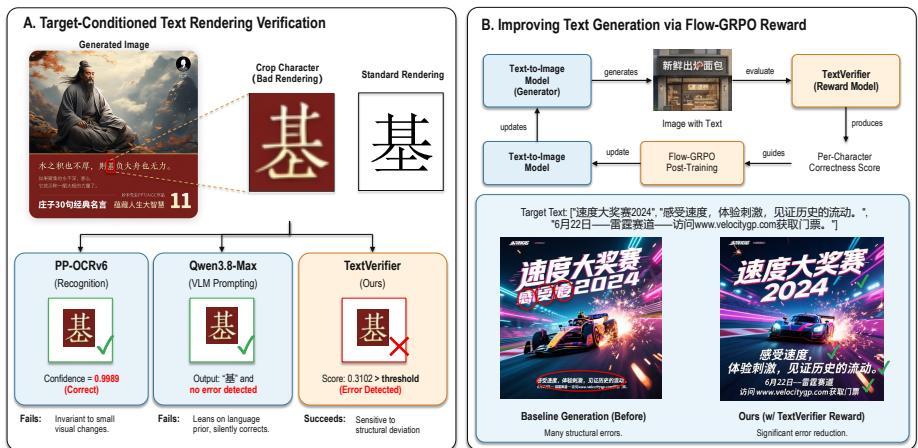  
Figure 1: Text rendering verification and its use as a reward. (A) For the character “基” in a generated image, OCR and VLM both miss the error, whereas TEXTVERIFIER correctly flags it as an error. (B) Using the per-character score as a post-training reward markedly reduces glyph errors.

TextPecker (Zhu et al., 2026) is the first work to address this problem in a systematic way, fine-tuning an 8B vision-language model as a structural-anomaly assessor. However, it folds blur, deformation, misalignment, and glyph error into a single notion of structural anomaly and judges an image without conditioning on the intended character. Lacking any model of which renderings of a character are legitimate, it readily flags correct characters as anomalies: on our benchmark it reaches a recall of 0.765 at a precision of only 0.480 (F1 0.590), producing a very high number of false alarms. Its 8B backbone also makes it costly to run at scale or to use as a training-time reward.

We therefore formalize the task as target-conditioned text rendering verification. Given a target character c supplied by a recognizer (e.g., an OCR model) and the corresponding image crop x, the goal is to decide whether x is a correct rendering of c. This is naturally a conditional anomalydetection problem: each character spans a manifold of legitimate renderings across fonts, calligraphy, and artistic styles, and an incorrect glyph lies a small distance off that manifold. Guided by this notion, we build TEXTVERIFIER, a CLIP-style dual-tower model (Radford et al., 2021) whose text tower takes the Ideographic Description Sequence (IDS) (The Unicode Consortium, 2026) of a character rather than a single-character token. We assemble an automatic labeling pipeline that yields 12.7M crop–IDS pairs from about 2.5M real images for the first-stage alignment pretraining. For discriminative supervision, we construct a set of hard positive–negative pairs by two routes: manual synthesis, and mining “same-character, different-quality” pairs from the training trajectory of a text-region inpainting model. We then train the verifier to produce a continuous, calibrated, target-conditioned score for each character.

To evaluate this ability we build TEXTRENDERBENCH-ZH, the first per-character benchmark for Chinese text rendering, labeling every character with its location, identity, and correctness. On it TEXTVERIFIER reaches an F1 of 0.844, well above OCR, general-VLM, and TextPecker (Zhu et al., 2026) baselines. Used as a per-character reward for Flow-GRPO (Liu et al., 2025) post-training, it further reduces rendering errors in a text-to-image model, showing that the score can not only detect errors but also help remove them.

We summarize our contributions as follows:

• We build TEXTVERIFIER, a structure-aware verifier that encodes each character’s IDS decomposition in a CLIP-style dual tower, reaching high accuracy at only 0.36B parameters.

• We design a three-stage training curriculum and a label-free way to construct its supervision, combining synthetic positive–negative pairs with hard pairs mined from a text-region inpainting model’s training trajectory.

• We build TEXTRENDERBENCH-ZH, the first per-character benchmark for generated Chinese text verification, on which TEXTVERIFIER reaches an F1 of 0.844 at 7.6 ms per character, and show that it can serve as a per-character reward for Flow-GRPO training.

## 2 RELATED WORK

Text recognition. Text recognition aims to recover which characters an image contains, spanning two-stage detect-then-recognize pipelines (Baek et al., 2019; Zhang et al., 2026a), end-to-end visionlanguage parsers (Wei et al., 2024; 2025; Zhang et al., 2026b; Lu et al., 2026), and general-purpose VLMs (Qwen Team, 2026). Whatever the architecture, these models optimize recognition accuracy and are thus invariant to font, style, and degradation: a glyph with an added stroke is read as the same character with high confidence, and VLM-based systems further lean on a language prior that quietly corrects ill-formed inputs (Liang et al., 2026b; Tong et al., 2024). We therefore separate recognition from verification: OCR supplies only the target character and its location, and correctness is left to a dedicated verifier trained for sensitivity rather than invariance.

Chinese structural representation. Chinese characters decompose into many components under a small set of spatial structures, written linearly as an Ideographic Description Sequence (IDS) (The Unicode Consortium, 2026). This compositionality drives zero-shot recognition through radical or stroke analysis (Zhang et al., 2018; Cao et al., 2020) and, closest to us, CLIP-style image–IDS alignment for a canonical per-character representation (Yu et al., 2023). A related line checks whether a handwritten character is well formed, decoding an image into an IDS and flagging any mismatch with a known character (Li et al., 2023; Hu et al., 2025a; Sun et al., 2024), recently extended to full text lines (Li et al., 2024). These target recognition or handwriting, where glyphs are clean and errors are whole-component swaps. Our setting differs on three counts. Generation errors are pixel-level rather than component-level: broken or adhered strokes and stylized fonts leave a glyph just off the manifold of valid renderings rather than turning it into a different character. The target character is already supplied by an upstream recognizer, so we verify a known identity instead of predicting it. And our supervision is label-free rather than hand-annotated.

Benchmarks and rewards for text rendering. Visual text rendering has progressed from glyphconditioned control (Yang et al., 2023; Tuo et al., 2024) to native rendering inside foundation models (Wu et al., 2025; ByteDance Seed, 2026), yet its evaluation still rests almost entirely on OCR string metrics over prompt-only benchmarks (Chen et al., 2023; Du et al., 2025), which misread stylizedbut-correct text, are sensitive to segmentation, and are judged by VLMs that hallucinate correctness (Hu et al., 2025b; Liang et al., 2026a). Models of glyph quality are recent: TextPecker fine-tunes an 8B VLM for structural-anomaly detection (Zhu et al., 2026), TIQA regresses perceptual quality while ignoring correctness (Koltsov et al., 2026), and Type-R detects typos by word-level OCR differencing (Shimoda et al., 2025); none labels each generated character with position, identity, and correctness (Li et al., 2024). The same string-versus-glyph gap reappears in reward design for posttraining (Black et al., 2024; Wallace et al., 2024; Liu et al., 2025): OCR-string rewards are cheap but blind to glyph form and easily gamed (Liu et al., 2025; Qiao et al., 2026; Wang et al., 2026), whereas VLM-judge rewards spend a large-model forward pass per sample and return discrete verdicts (Zhu et al., 2026; Cui et al., 2026), and another line uses human-annotated region-level preferences (Shuai et al., 2026). Our verifier instead is target-conditioned, per-character, continuous, and calibrated, and complements rather than replaces the OCR semantic reward inside Flow-GRPO.

## 3 METHOD

## 3.1 PROBLEM FORMULATION AND OVERVIEW

Given a target character c and its image crop x, the verifier outputs a continuous score score(x, c) and decides through a threshold δ whether x is a correct rendering of c; here c is a condition of the decision rather than a prediction target, and we only judge whether x belongs to the legitimate

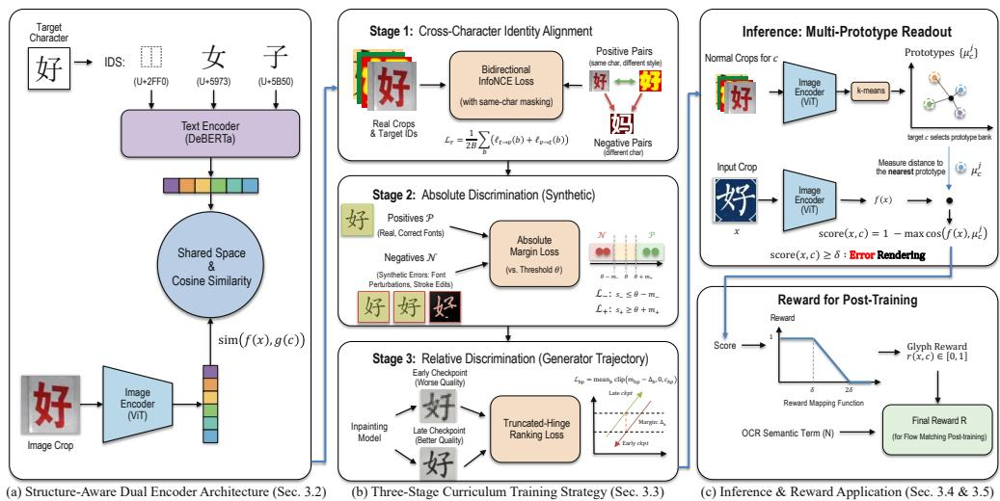  
Figure 2: Structure-aware dual tower and three-stage training. (a) The structure-aware CLIPstyle dual encoder model architecture. (b) The three-stage training curriculum. (c) Inference procedure, and it can also serve as a reward for Flow-GRPO post-training.

writings of c. The problem is thus a per-character conditional anomaly detection: across fonts, calligraphy, and styles a character spans a family of legitimate renderings (its “correct” manifold), and an error is only a small departure from it.

## 3.2 STRUCTURE-AWARE DUAL ENCODERS

We base the verifier on a CLIP-style dual tower (Radford et al., 2021) but reshape its text side. Since the “text” here is only the target character itself, treating each character as an independent token would reduce the text tower to a class lookup table with no structural relation between characters. We instead feed it the character’s Ideographic Description Sequence (IDS) (The Unicode Consortium, 2026): with a dozen structural operators and about a thousand components, an IDS writes each character uniquely as a sequence describing its components and structure (Figure 2), so that characters sharing components or structure lie close at the sequence level and structural differences can be encoded explicitly. The text tower adopts the CCR-CLIP (Yu et al., 2023) decomposition table with a from-scratch DeBERTa (He et al., 2021); the image tower is a ViT (Dosovitskiy et al., 2021) whose patch tokens are averaged into the image feature. Each tower has an MLP projection head into a shared, ℓ2-normalized space, and the cross-modal match is the cosine sim(f(x), g(c)).

## 3.3 THREE-STAGE DATA CONSTRUCTION

The verifier is trained in three stages over three kinds of data. The first stage teaches the model to distinguish the identities of different characters, using other characters in the same batch as negatives. With in-batch negatives, however, the model separates clearly different characters but cannot notice the fine stroke-level errors within a single character. The second and third stages therefore both introduce hard negatives for the same character, i.e., wrong renderings that closely resemble the correct glyph and differ only in small stroke or structural details; the two stages mainly differ in how these hard negatives are constructed, while also using different label semantics and loss forms. Figure 3 overviews the three-stage data construction.

The first stage draws data from real images containing Chinese text, via an automatic pipeline of two off-the-shelf models: CRAFT (Baek et al., 2019) is a character-level detector that locates each character and gives its bounding box, and PP-OCRv6 (Zhang et al., 2026a) then recognizes the crop in each box to obtain its target character. From about 2.5M real images this yields over ten million crop–character pairs covering 8,189 characters. As character frequency is heavily long-tailed, we pad rare characters with font-rendered standard glyphs to at least 500 samples each, giving about 12.73M crop–IDS pairs. Details are shown in Appendix A.2.

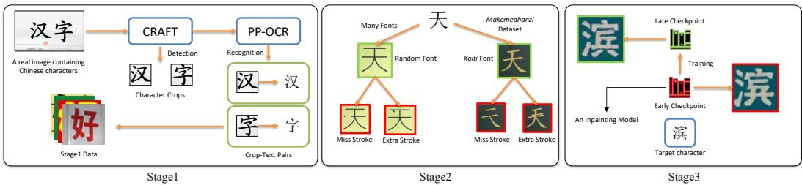  
Figure 3: Three-stage data construction. Left: real images pass through a data pipeline to yield stage1 data. Middle: standard glyphs are perturbed by two stroke edits into pairs. Right: early and late checkpoints of a text-region inpainting model repaint the same target character.

The second stage builds hard negatives by applying controlled perturbations to standard glyphs along two complementary routes. Font synthesis renders each character’s standard glyph in about thirty fonts and applies coarse perturbations: a missing stroke, which erases a segment of stroke pixels and fills it with background, or an added stroke, which overlays a horizontal, vertical, left-slanting, or right-slanting mark. The Makemeahanzi (Kishore, 2016) dataset provides per-stroke vector paths for the kaiti font, supporting structurally precise whole-stroke edits such as deleting a full stroke or grafting one from another character into light contact with the ink. The two routes produce about 1.75M glyph images; examples are shown in Appendix A.3.

The third stage builds negatives that more closely resemble real generation errors, which can only come from a generator itself. We exploit a convenient fact: a text-region inpainting model still in training leaves, along its trajectory, “same-character, different-quality” samples. For the same location and target character, its early checkpoints often render strokes wrongly while its late checkpoints are mostly correct, with texture, background, and color largely unchanged and only the glyph differing. We train such an inpainting model and use one early and one late checkpoint to repaint the same target character, yielding about 0.7M pairs. The inpainting model’s architecture and further sample pairs are given in Appendix A.4.

## 3.4 THREE-STAGE TRAINING

The three stages use the three kinds of data from Sec. 3.3, with the loss form set by the nature of each stage’s labels.

Stage 1: cross-character identity alignment. Using the crop–IDS pairs, we align the image embedding $v _ { b } = f ( x _ { b } )$ with the character IDS embedding $t _ { b } = g ( c _ { b } )$ by a bidirectional InfoNCE loss:

$$
\ell _ { t  v } ( b ) = - \log \frac { \exp ( \sin ( t _ { b } , v _ { b } ) / \tau ) } { \sum _ { j : c _ { j } \neq c _ { b } \lor j = b } \exp ( \sin ( t _ { b } , v _ { j } ) / \tau ) } , \quad \mathcal { L } _ { r } = \frac { 1 } { 2 B } \sum _ { b } \big ( \ell _ { t  v } ( b ) + \ell _ { v  t } ( b ) \big ) .\tag{1}
$$

where $\ell _ { v  t }$ is symmetric and τ is a temperature. Here the negatives are the other characters in the same batch. The only change from standard CLIP is same-character masking: other crops of the same character in a batch are excluded from the negatives, since they are further legitimate points on that character’s manifold. This stage learns identity only and cannot yet tell apart fine stroke errors of the same character.

Stage 2: absolute discrimination from synthetic samples. This stage uses the synthetic perturbation samples to introduce hard negatives for the same character. Anchored on the target character, the positive set $\mathcal { P }$ contains font-rendered correct glyphs, real crops, and the kaiti glyph, and the negative set $\mathcal { N }$ contains the synthesized wrong glyphs. These labels are absolute: positives are unconditionally correct and negatives are necessarily wrong. We therefore use a threshold θ to anchor same-character positives and negatives to its two sides, each with a margin m+ or m−:

$$
\begin{array} { r } { \mathcal { L } _ { + } = \underset { b , f \in \mathcal { P } _ { b } } { \mathrm { m e a n ~ s o f t p l u s } } \bigg ( \frac { \theta + m _ { + } - \sin ( t _ { b } , f ) } { \tau _ { \theta } } \bigg ) , \quad \mathcal { L } _ { - } = \underset { b , f \in \mathcal { N } _ { b } } { \mathrm { m e a n ~ s o f t p l u s } } \bigg ( \frac { \sin ( t _ { b } , f ) - \theta + m _ { - } } { \tau _ { \theta } } \bigg ) . } \end{array}\tag{2}
$$

and replay Stage $\mathrm { 1 } \ ' \mathrm { s } \mathcal { L } _ { r }$ to avoid forgetting identity. This stage begins to separate correct from incorrect, but the synthetic negatives still differ in distribution from real errors, so the learned boundary is loose, which leads to Stage 3.

Stage 3: relative discrimination from a generator’s trajectory. This stage uses the early/late checkpoint pairs, taking the late render as the positive and the early one as the negative. Unlike Stage 2, these labels are only relative: we cannot assert that the late render is correct or the early one wrong, only that the late is no worse than the early. We therefore drop the absolute-threshold anchoring of Stage 2 and use only a truncated-hinge (ramp) loss to keep the positive above the negative; with $\Delta _ { b } ^ { - } = \mathrm { s i m } ( t _ { b } , f _ { b } ^ { + } ) - \mathrm { s i m } ( t _ { b } , f _ { b } ^ { - } )$

$$
\mathcal { L } _ { \mathrm { h p } } = \mathop { \mathrm { m e a n } } _ { h } \mathrm { c l i p } \big ( m _ { \mathrm { h p } } - \Delta _ { b } , 0 , c _ { \mathrm { h p } } \big ) .\tag{3}
$$

Once a pair is correctly ordered $( \Delta _ { b } \geq m _ { \mathrm { h p } } )$ the gradient is zero, which avoids treating a relative signal as an absolute target; the cap $c _ { \mathrm { h p } }$ suppresses noisy pairs with very negative $\Delta .$ Stage 3 adds $\mathcal { L } _ { \mathrm { h p } }$ on top of all earlier losses and converges in a single epoch.

## 3.5 INFERENCE: MULTI-PROTOTYPE READOUT

At test time, thresholding sim $( f ( x ) , g ( c ) )$ directly is unreliable: per-character baselines vary, and a character’s legitimate writings are multi-modal. We instead keep several prototypes per character in image space to describe its legitimate manifold. For character $c ,$ its normal crops (sampled from the Stage-1 data) are encoded and clustered by k-means (Lloyd, 1982) into $K$ prototypes $\hat { \{ \mu _ { c } ^ { j } \} }$ , and the score is the cosine distance to the nearest one:

$$
\mathrm { s c o r e } ( x , c ) = 1 - \operatorname* { m a x } _ { j } \cos \bigl ( f ( x ) , \mu _ { c } ^ { j } \bigr ) .\tag{4}
$$

A larger score means x is farther from any normal writing of the character. The threshold is a single quantile value δ: we pool the scores of all normal training crops and take a high quantile $( \mathrm { e . g . }$ ., the 90th percentile). The readout costs only K cosine similarities per character.

## 3.6 THE VERIFIER AS A REWARD FOR POST-TRAINING

A continuous per-character score is a natural reward. Given a generated image, the same front-end (CRAFT (Baek et al., 2019) + PP-OCRv6 (Zhang et al., 2026a)) crops its text regions and aligns them to the target characters of the prompt, and each is scored. We map a character’s score to a reward in [0, 1] that is 1 for a clearly correct glyph, 0 for a clearly wrong one, and linear in between:

$$
\begin{array} { r } { r ( x , c ) = \mathrm { c l i p } \Big ( 2 - \frac { \mathrm { s c o r e } ( x , c ) } { \delta } , 0 , 1 \Big ) = \left\{ \begin{array} { l l } { 1 , } & { \mathrm { s c o r e } \leq \delta , } \\ { 2 - \mathrm { s c o r e } / \delta , } & { \delta < \mathrm { s c o r e } < 2 \delta , } \\ { 0 , } & { \mathrm { s c o r e } \geq 2 \delta . } \end{array} \right. } \end{array}\tag{5}
$$

Over all target characters $\{ c _ { j } \}$ of an image, the glyph term weights the mean with the worst case, the latter mildly penalizing an image that is acceptable overall but badly wrong on a single character:

$$
G = 0 . 9 \cdot \operatorname* { m e a n } _ { j } r ( x _ { j } , c _ { j } ) + 0 . 1 \cdot \operatorname* { m i n } _ { j } r ( x _ { j } , c _ { j } ) .\tag{6}
$$

As a complement, a recognition-based semantic term $N = 1 - \mathrm { { N E D } \in [ 0 , 1 ] }$ (the normalized edit distance between the OCR reading and the target text) constrains what is written. The final glyph-dominated reward is

$$
R = 0 . 8 G + 0 . 2 N ,\tag{7}
$$

which plugs into a flow-matching post-trainer such as Flow-GRPO (Liu et al., 2025).

## 4 EXPERIMENTS

## 4.1 TEXTRENDERBENCH-ZH

Existing text-rendering benchmarks provide only prompts and score whole images with OCR string metrics; they can neither judge glyph correctness character by character nor evaluate a verifier itself. We therefore build TEXTRENDERBENCH-ZH, the first per-character benchmark of Chinese text rendering. Its test images are generated by text-to-image models: from 308 images we collect 7,358 character crops, 642 of them confirmed by human annotators as rendering errors. Each character carries a (position, identity, correctness) triple (Figure 4); Appendix E details the two-step annotation protocol and the error criterion. This is the first benchmark for generated images with per-Chinesecharacter triple annotation; it measures a verifier’s character-level precision and recall.

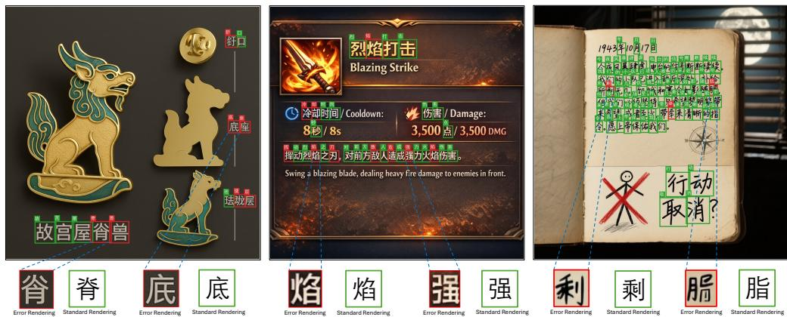  
Figure 4: Per-character annotation examples from TEXTRENDERBENCH-ZH. Images are generated by text-to-image models; each character carries a (position, identity, correctness) triple (green box: correct, red box: error), with error-versus-standard glyph pairs enlarged below.

## 4.2 SETUP

The image tower is a ViT-L/16 (Dosovitskiy et al., 2021) , and the text tower is a DeBERTa-v2 large (He et al., 2021) over the 981-symbol IDS vocabulary; both project to a 1024-dimensional shared space. Each stage continues from the previous stage’s weights: Stages 1 and 2 train for two epochs each and Stage 3 for one epoch. The loss hyperparameters are: InfoNCE temperature τ=0.3; Stage-2 threshold loss $\theta { = } 0 . 7 , m _ { + } { = } 0 . 1 , m _ { - } { = } 0 . 2 , \tau _ { \theta } { = } 0 . 0 5 ;$ Stage-3 ramp $m _ { \mathrm { h p } } { = } 0 . 0 5 , c _ { \mathrm { h p } } { = } 0 . 2$ . For each character we cluster 500 normal crops into K=10 prototypes and score a crop by its cosine distance to the nearest prototype; the global threshold is the 90th percentile of the training distribution, giving δ=0.0134/0.0188/0.0214 for the three stages.

A rendering error is the positive class and a correct glyph the negative in our benchmark, so a false positive (FP) is a false alarm on a correct glyph and a false negative (FN) a missed error. Baselines are PP-OCRv6 (Zhang et al., 2026a) character confidence (a glyph is flagged when its confidence falls below a threshold; we report an oracle best threshold as an upper reference), the general VLMs Qwen3.8-Max (Qwen Team, 2026), GPT-5.6-sol (OpenAI, 2026a), and Gemini 3.7 Flash (Google DeepMind, 2026b), and the two released TextPecker (Zhu et al., 2026) assessors.

## 4.3 MAIN RESULTS

Table 1 reports all methods, and every baseline is far from usable: PP-OCRv6 (Zhang et al., 2026a) confidence peaks at only 0.53 F1 even at an oracle threshold; the general VLMs either almost never fire (Qwen3.8-Max (Qwen Team, 2026), GPT-5.6-sol (OpenAI, 2026a)) or fire often but wrongly (Gemini 3.7 Flash (Google DeepMind, 2026b)); and TextPecker (Zhu et al., 2026) raises a very high number of false alarms (F1 0.590, InternVL3-8B variant 0.433). TEXTVERIFIER reaches F1 0.844 after all three stages (precision 0.830, recall 0.858), far above every baseline. Beyond accuracy, the verifier is compact and fast (last two columns of Table 1): its scoring model is 0.36B parameters, 23× smaller than TextPecker (Zhu et al., 2026) and far below the closed frontier VLMs, yet it is the most accurate. At 7.6 ms per character (median, full test set, batch=1; Appendix A details the measurement setup), it is also 2.3× faster than PP-OCRv6 (Zhang et al., 2026a) recognition (17.2 ms) and orders of magnitude faster than TextPecker (Zhu et al., 2026) VLMs.

## 4.4 ABLATIONS

IDS structural prior. Replacing the text-tower input from IDS with a single-character token (one token per character, everything else fixed) and retraining all three stages (Table 2) drops F1 by about 10.4, 7.1, and 10.1 points across the stages, with the loss falling almost entirely on recall (Stage-3 recall from 0.858 to 0.648) while precision even rises slightly: without a structural prior the model sees only “clearly different” samples and loses much of its sensitivity to stroke-level deviations. Appendix B further shows that the IDS tower’s embedding geometry is aligned with structural similarity and that its recall advantage holds across all character-frequency strata.

Table 1: Main results on TEXTRENDERBENCH-ZH. TEXTVERIFIER’s three-stage F1 of 0.844 is far above all baselines; the “best thr” row tunes the PP-OCRv6 confidence (Zhang et al., 2026a) threshold on the test set as an upper reference only. Params is the scoring-model size; Inf. is percharacter median latency (ms) on the full test set.
<table><tr><td>Method</td><td>TP↑</td><td>FP↓</td><td>FN↓</td><td>TN↑</td><td>P↑</td><td>R↑</td><td>F1↑</td><td>Params</td><td>Inf.(ms)↓</td></tr><tr><td>PP-OCRv6 (thr = 0.90) (Zhang et al., 2026a)</td><td>223</td><td>140</td><td>419</td><td>6576</td><td>0.614 0.455</td><td>0.347 0.623</td><td>0.444 0.526</td><td>0.06B</td><td>17.2</td></tr><tr><td>PP-OCRv6 (best thr) (Żhang et al., 2026a)</td><td>400</td><td>479</td><td>242</td><td>6237</td><td></td><td></td><td></td><td></td><td></td></tr><tr><td>Qwen3.8-Max (Qwen Team, 2026) GPT-5.6-sol (OpenAI, 2026a)</td><td>78 37</td><td>66 57</td><td>564 605</td><td>6650 6659</td><td>0.542 0.394</td><td>0.121 0.058</td><td>0.198 0.101</td><td></td><td></td></tr><tr><td>Gemini 3.7 Flash (Google DeepMind, 2026b)</td><td>347</td><td>1122</td><td>295</td><td>5594</td><td>0.236</td><td>0.540</td><td>0.329</td><td></td><td></td></tr><tr><td>TextPecker (Qwen3-VL-8B) (Zhu et al., 2026)</td><td></td><td></td><td></td><td></td><td></td><td></td><td></td><td></td><td></td></tr><tr><td>TextPecker (InternVL3-8B) (Żhu et al., 2026)</td><td>491 322</td><td>531 525</td><td>151 320</td><td>6185 6191</td><td>0.480 0.380</td><td>0.765 0.502</td><td>0.590 0.433</td><td>8.29B 8.1B</td><td>320.4 276.0</td></tr><tr><td></td><td></td><td></td><td></td><td></td><td></td><td></td><td></td><td></td><td></td></tr><tr><td>Ours: Stage 1</td><td>477</td><td>71</td><td>165</td><td>6645</td><td>0.870</td><td>0.743</td><td>0.802</td><td></td><td></td></tr><tr><td>Ours: Stage 2</td><td>484</td><td>76</td><td>158</td><td>6640</td><td>0.864</td><td>0.754</td><td>0.805</td><td>0.36B</td><td>7.6</td></tr><tr><td></td><td></td><td></td><td></td><td></td><td></td><td></td><td></td><td></td><td></td></tr><tr><td>Ours: Stage 3</td><td>551</td><td>113</td><td>91</td><td>6603</td><td>0.830</td><td>0.858</td><td>0.844</td><td></td><td></td></tr></table>

Table 2: Text-tower input: IDS vs. a singlecharacter token. A single-character token lowers F1 by ∼10.4/7.1/10.1 across the three stages.
<table><tr><td>Input</td><td>Stage</td><td>P</td><td>R</td><td>F1</td></tr><tr><td>IDS</td><td>1</td><td>0.870</td><td>0.743</td><td>0.802</td></tr><tr><td>single-char</td><td>1</td><td>0.862</td><td>0.586</td><td>0.698</td></tr><tr><td>IDS</td><td>2</td><td>0.864</td><td>0.754</td><td>0.805</td></tr><tr><td>single-char</td><td>2</td><td>0.879</td><td>0.631</td><td>0.734</td></tr><tr><td>IDS</td><td>3</td><td>0.830</td><td>0.858</td><td>0.844</td></tr><tr><td>single-char</td><td>3</td><td>0.870</td><td>0.648</td><td>0.743</td></tr></table>

Table 3: Training stages and loss terms. Full vs. removing one component: ➀ skip Stage 2; ➁ Stage 3 w/o Stage2 threshold loss; ➂ Stage 3 w/o Stage-1 loss replay; ➃ no Stage-1 pretraining.
<table><tr><td>Config</td><td>P</td><td>R</td><td>F1</td></tr><tr><td>Full</td><td>0.830</td><td>0.858</td><td>0.844</td></tr><tr><td>①</td><td>0.767</td><td>0.861</td><td>0.811</td></tr><tr><td>②</td><td>0.774</td><td>0.864</td><td>0.817</td></tr><tr><td>③</td><td>0.746</td><td>0.852</td><td>0.796</td></tr><tr><td>④</td><td>0.080</td><td>0.181</td><td>0.111</td></tr></table>

Training stages and loss terms. In Stage 3 three losses coexist: the new ramp pairwise loss, the Stage-2 threshold loss, and the Stage-1 InfoNCE replayed to preserve cross-character identity. Table 3 removes them one at a time. Dropping the Stage-1 InfoNCE replay costs 4.8 points (0.844 → 0.796), dropping the Stage-2 threshold loss 2.7 points (→ 0.817), and skipping Stage 2 entirely (Stage 1 straight to Stage 3) 3.3 points (→0.811); with no Stage-1 pretraining (random initialization) the model collapses to 0.111, as discriminative training relies on a representation already organized by glyph shape. Each term contributes to performance. Every ablation keeps recall near 0.86 but lowers precision markedly, confirming Sec. 3: the ramp pairwise loss alone constrains neither the representation’s overall scale nor its cross-character separability, which are exactly what the replay and threshold losses supply.

## 4.5 REWARD FOR FLOW-GRPO

We further use the verifier as a post-training reward. Starting from Qwen-Image (Wu et al., 2025), we post-train with Flow-GRPO (Liu et al., 2025), feeding R to its reward interface $\scriptstyle { \langle \beta = 1 0 ^ { - 3 } }$ , 20 denoising steps for rollout and training, otherwise default), and evaluate on oneID-ZH (Chang et al., 2025). RL prompts follow the Chinese text-rendering corpus of Zhu et al. (2026), restricted to its harder, text-dense subset (≥ 35 characters) to speed up training.

Our aim is to reduce glyph errors while disturbing the base generator as little as possible. Table 4 reports glyph accuracy (Glyph-Acc, the fraction of target characters our TEXTVERIFIER judges correctly rendered), diversity (DreamSim (Fu et al., 2023)), aesthetics (ImageReward (Xu et al., 2023)), and the reward model’s cost; Base (Qwen-Image (Wu et al., 2025)) is the un-post-trained reference, which trivially keeps the highest diversity and aesthetics but also all of its rendering errors. Two findings emerge. First, fixing glyphs requires a glyph-aware reward: a recognition-only reward (NED-only, dropping the glyph term G) barely lifts Glyph-Acc over Base (0.812 → 0.822, Table 5), whereas the full reward reaches 0.915. Second, against TextPecker (Zhu et al., 2026), our reward attains comparable glyph accuracy (0.915 vs. 0.919) while perturbing diversity and aesthetics less (0.175 vs. 0.165; 0.633 vs. 0.629), with a 23× smaller reward model (0.36B vs. 8.29B). Among

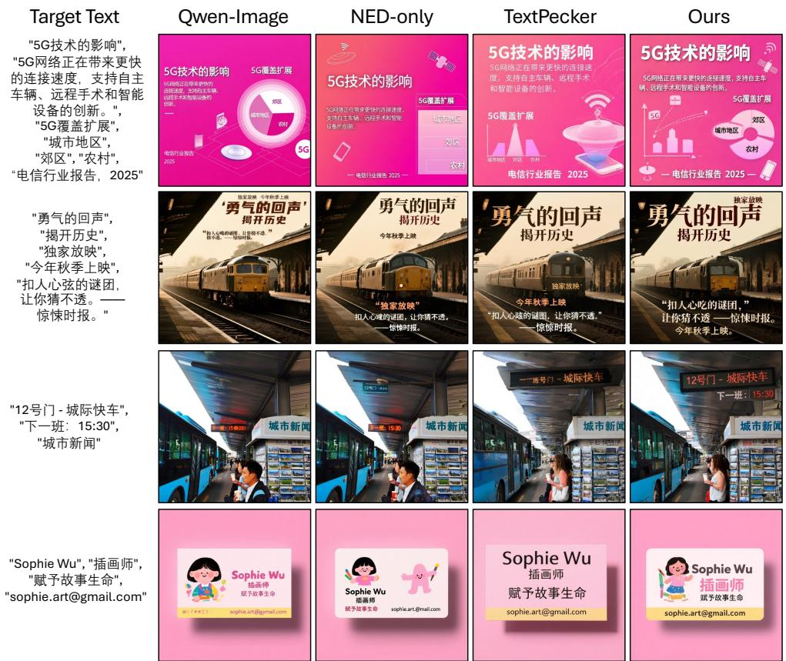  
Figure 5: Qualitative comparison of Flow-GRPO post-training under different rewards. Given the target text, we compare Qwen-Image (Wu et al., 2025), the NED-only ablation, TextPecker (Zhu et al., 2026), and ours; Ours yields fewer glyph errors while staying aesthetically closer to Base.

Table 4: Flow-GRPO post-training under different rewards (oneID-ZH; ↑ higher is better). Base (Qwen-Image (Wu et al., 2025)) is the un-post-trained reference (not bold); between the two rewards that fix glyphs, the better is bold.
<table><tr><td>Reward</td><td>Glyph-Acc↑</td><td>DreamSim↑</td><td>ImageReward↑</td><td>Reward Params↓</td></tr><tr><td>Base</td><td>0.812</td><td>0.2023</td><td>0.6645</td><td>一</td></tr><tr><td>TextPecker</td><td>0.919</td><td>0.1651</td><td>0.6288</td><td>8.29B</td></tr><tr><td>Ours</td><td>0.915</td><td>0.1753</td><td>0.6330</td><td>0.36B</td></tr></table>

Table 5: Reward ablation. A recognition-only reward (i.e., drop the glyph term G) barely improves Glyph-Acc over Base; the glyph term drives the gain.
<table><tr><td>Reward</td><td>Glyph-Acc↑</td></tr><tr><td>NED-only (drop G)</td><td>0.822</td></tr><tr><td>Ours (fuil R)</td><td>0.915</td></tr></table>

methods that actually reduce rendering errors, then, ours is the least disruptive and the most efficient.   
Figure 5 shows qualitative comparisons.

## 5 CONCLUSION

We formalized Chinese text-rendering verification in generated images as target-conditioned anomaly detection, and built TEXTVERIFIER, an IDS-conditioned dual tower trained with a threestage curriculum of cross-character alignment, synthetic absolute anchoring, and relative discrimination from an inpainting model’s trajectory. On TEXTRENDERBENCH-ZH, it reaches 0.844 F1 at 7.6 ms per character. As a Flow-GRPO reward, it matches 8B-VLM rewards on error reduction while better preserving diversity and aesthetics.

## AI USE STATEMENT

We used generative AI tools only for language polishing of author-written text. All technical content, experiments, and claims were produced and verified by the authors, who take full responsibility for the final content.

## REFERENCES

Youngmin Baek, Bado Lee, Dongyoon Han, Sangdoo Yun, and Hwalsuk Lee. Character region awareness for text detection. In Proceedings of the IEEE/CVF Conference on Computer Vision and Pattern Recognition, pp. 9365–9374, 2019. doi: 10.1109/CVPR.2019.00959.

Kevin Black, Michael Janner, Yilun Du, Ilya Kostrikov, and Sergey Levine. Training diffusion models with reinforcement learning. In International Conference on Learning Representations, 2024.

ByteDance Seed. Beyond generation, it understands design: Introducing Seedream 5.0 Pro, July 2026. Official model release, July 8, 2026.

Zhong Cao, Jiang Lu, Sen Cui, and Changshui Zhang. Zero-shot handwritten chinese character recognition with hierarchical decomposition embedding. Pattern Recognition, 107:107488, 2020. doi: 10.1016/j.patcog.2020.107488.

Jingjing Chang, Yixiao Fang, Peng Xing, Shuhan Wu, Wei Cheng, Rui Wang, Xianfang Zeng, Gang Yu, and Hai-Bao Chen. OneIG-Bench: Omni-dimensional nuanced evaluation for image generation. In Advances in Neural Information Processing Systems, volume 38, pp. 177093– 177128, 2025. doi: 10.52202/085713-5330.

Jingye Chen, Yupan Huang, Tengchao Lv, Lei Cui, Qifeng Chen, and Furu Wei. TextDiffuser: Diffusion models as text painters. In Advances in Neural Information Processing Systems, volume 36, pp. 9353–9387, 2023. doi: 10.52202/075280-0410.

Mingxuan Cui, Jingpu Yang, Fengxian Ji, Qian Jiang, Zhecheng Shi, Jiaming Wang, Zirui Song, Zhuohan Xie, Fajri Koto, and Xiuying Chen. TextAlign: Preference alignment for text rendering with hierarchical rewards, 2026.

Alexey Dosovitskiy, Lucas Beyer, Alexander Kolesnikov, Dirk Weissenborn, Xiaohua Zhai, Thomas Unterthiner, Mostafa Dehghani, Matthias Minderer, Georg Heigold, Sylvain Gelly, Jakob Uszkoreit, and Neil Houlsby. An image is worth 16x16 words: Transformers for image recognition at scale. In International Conference on Learning Representations, 2021.

Nikai Du, Zhennan Chen, Zhizhou Chen, Shan Gao, Xi Chen, Zhengkai Jiang, Jian Yang, and Ying Tai. TextCrafter: Accurately rendering multiple texts in complex visual scenes, 2025.

Stephanie Fu, Netanel Tamir, Shobhita Sundaram, Lucy Chai, Richard Zhang, Tali Dekel, and Phillip Isola. DreamSim: Learning new dimensions of human visual similarity using synthetic data. In Advances in Neural Information Processing Systems, volume 36, pp. 50742–50768, 2023. doi: 10.52202/075280-2208.

Zigang Geng, Yibing Wang, Yeyao Ma, Chen Li, Yongming Rao, Shuyang Gu, Zhao Zhong, Qinglin Lu, Han Hu, Xiaosong Zhang, Linus, Di Wang, and Jie Jiang. X-Omni: Reinforcement learning makes discrete autoregressive image generative models great again, 2025.

Google DeepMind. Gemini 3.1 Flash-Lite Image model card, June 2026a. Published June 30, 2026.

Google DeepMind. Gemini 3.7 Flash model card, August 2026b. URL https://deepmind. google/models/model-cards/gemini-3-7-flash/. Published August 13, 2026.

Pengcheng He, Xiaodong Liu, Jianfeng Gao, and Weizhu Chen. DeBERTa: Decoding-enhanced BERT with disentangled attention. In International Conference on Learning Representations, 2021. URL https://openreview.net/forum?id=XPZIaotutsD.

Byeongho Heo, Song Park, Dongyoon Han, and Sangdoo Yun. Rotary position embedding for vision transformer. In Computer Vision – ECCV 2024, Lecture Notes in Computer Science, pp. 289–305. Springer, 2024. doi: 10.1007/978-3-031-72684-2 17.

Pengfei Hu, Jiefeng Ma, Zhenrong Zhang, Jun Du, and Jianshu Zhang. Count, decompose and correct: A new approach to handwritten chinese character error correction. Pattern Recognition, 160:111110, 2025a. doi: 10.1016/j.patcog.2024.111110.

Xixi Hu, Keyang Xu, Bo Liu, Qiang Liu, and Hongliang Fei. AMO sampler: Enhancing text rendering with overshooting. In Proceedings of the IEEE/CVF Conference on Computer Vision and Pattern Recognition, pp. 13157–13166, 2025b.

Shaunak Kishore. Make me a hanzi: Free, open-source chinese character data. https:// github.com/skishore/makemeahanzi, 2016. Open-source Chinese character dictionary, decomposition, and stroke-order data.

Kirill Koltsov, Aleksandr Gushchin, Dmitriy Vatolin, and Anastasia Antsiferova. TIQA: Humanaligned text quality assessment in generated images, 2026.

Niantong Li, Guangzheng Hu, Weixu Qiao, Ying Ba, Qichen Hong, Shijun Shen, Jinlin Wang, Fan Zhou, Jianye Kang, Xin Shang, Ziyi He, Wei Wang, Dalin Li, Jiahao Li, Jie Zhang, Kaiyuan Gao, Kun Yan, Lihan Jiang, Ningyuan Tang, Shengming Yin, Tianhe Wu, Xiao Xu, Xiaoyue Chen, Yuxiang Chen, Yan Shu, Yanran Zhang, Yilei Chen, Yixian Xu, Zekai Zhang, Zhendong Wang, Zihao Liu, Zikai Zhou, Hongzhu Shi, Yi Wang, Bing Zhao, Hu Wei, Lin Qu, and Chenfei Wu. Qwen-Image-Bench: From generation to creation in text-to-image evaluation, 2026.

Tianhong Li and Kaiming He. Back to basics: Let denoising generative models denoise. In Proceedings of the IEEE/CVF Conference on Computer Vision and Pattern Recognition, pp. 36115– 36125, 2026.

Yinghui Li, Zishan Xu, Shaoshen Chen, Haojing Huang, Yangning Li, Shirong Ma, Yong Jiang, Zhongli Li, Qingyu Zhou, Hai-Tao Zheng, and Ying Shen. Towards real-world writing assistance: A Chinese character checking benchmark with faked and misspelled characters. In Proceedings of the 62nd Annual Meeting of the Association for Computational Linguistics (Volume 1: Long Papers), pp. 8656–8668. Association for Computational Linguistics, 2024. doi: 10.18653/v1/ 2024.acl-long.469.

Yunqing Li, Jun Du, Jianshu Zhang, and Changjie Wu. A tree-structure analysis network on handwritten chinese character error correction. IEEE Transactions on Multimedia, 25:3615–3627, 2023. doi: 10.1109/TMM.2022.3163517.

Qian Liang, Xiaomin Li, Ying Zhang, Jia Xu, Lihao Ni, Hongrui Li, Jingjing Li, Jing Lyu, and Chen Li. WeGenBench: A multidimensional diagnostic benchmark towards text-to-image model optimization, 2026a.

Yunhao Liang, Ruixuan Ying, Bo Li, Hong Li, Kai Yan, Feiteng Fang, Qingwen Li, Min Yang, Satoshi Okamoto, Zhe Cui, and Shiwen Ni. Visual merit or linguistic crutch? a close look at DeepSeek-OCR, 2026b.

Jie Liu, Gongye Liu, Jiajun Liang, Yangguang Li, Jiaheng Liu, Xintao Wang, Pengfei Wan, Di Zhang, and Wanli Ouyang. Flow-GRPO: Training flow matching models via online RL. In Advances in Neural Information Processing Systems, volume 38, pp. 45650–45685, 2025. doi: 10.52202/085713-1362.

Stuart P. Lloyd. Least squares quantization in PCM. IEEE Transactions on Information Theory, 28 (2):129–137, 1982. doi: 10.1109/TIT.1982.1056489.

Shiyin Lu, Yinglun Li, Yu Xia, Yuhui Chen, An-Yang Ji, Jun-Peng Jiang, Qing-Guo Chen, Jianshan Zhao, En Lin, Haijun Li, Cheng Qin, Zhao Xu, and Weihua Luo. OvisOCR2 technical report, 2026.

OpenAI. GPT-5.6 system card, July 2026a. URL https://deploymentsafety.openai. com/gpt-5-6. Published July 9, 2026.

OpenAI. ChatGPT Images 2.5 System Card, September 2026b. System card for GPT-Image-2.5- Sunburst and GPT-Image-2.5-Flare, published September 8, 2026.

Changhao Qiao, Chao Hui, Chen Li, Cunzheng Wang, Dejia Song, Jiale Zhang, Jing Li, Qiang Xiang, Runqi Wang, Shuang Sun, Wei Zhu, Xu Tang, Yao Hu, Yibo Chen, Yuhao Huang, Yuxuan Duan, Zhiyi Chen, and Ziyuan Guo. FireRed-Image-Edit-1.0 technical report, 2026.

Qwen Team. Qwen3.8-Max: A new bar for coding and cowork, August 2026. Official model release.

Alec Radford, Jong Wook Kim, Chris Hallacy, Aditya Ramesh, Gabriel Goh, Sandhini Agarwal, Girish Sastry, Amanda Askell, Pamela Mishkin, Jack Clark, Gretchen Krueger, and Ilya Sutskever. Learning transferable visual models from natural language supervision. In Proceedings of the 38th International Conference on Machine Learning, volume 139 of Proceedings of Machine Learning Research, pp. 8748–8763. PMLR, 2021.

Wataru Shimoda, Naoto Inoue, Daichi Haraguchi, Hayato Mitani, Seiichi Uchida, and Kota Yamaguchi. Type-R: Automatically retouching typos for text-to-image generation. In Proceedings of the IEEE/CVF Conference on Computer Vision and Pattern Recognition, pp. 2745–2754, 2025.

Xincheng Shuai, Ziye Li, Henghui Ding, and Dacheng Tao. GlyphPrinter: Region-grouped direct preference optimization for glyph-accurate visual text rendering. In Proceedings of the IEEE/CVF Conference on Computer Vision and Pattern Recognition, pp. 7674–7683, 2026.

Haizhao Sun, Yu Ning, Xu Ji, Chuang Zhang, and Ming Wu. A multimodal network on handwritten chinese character error correction. In British Machine Vision Conference. BMVA, 2024.

The Unicode Consortium. The Unicode Standard, Version 18.0.0. The Unicode Consortium, South San Francisco, 2026. ISBN 978-1-936213-36-8. Section 18.2: Ideographic Description Characters.

Shengbang Tong, Zhuang Liu, Yuexiang Zhai, Yi Ma, Yann LeCun, and Saining Xie. Eyes wide shut? exploring the visual shortcomings of multimodal LLMs. In Proceedings of the IEEE/CVF Conference on Computer Vision and Pattern Recognition, pp. 9568–9578, 2024. doi: 10.1109/ CVPR52733.2024.00914.

Yuxiang Tuo, Wangmeng Xiang, Jun-Yan He, Yifeng Geng, and Xuansong Xie. AnyText: Multilingual visual text generation and editing. In International Conference on Learning Representations, 2024. URL https://openreview.net/forum?id=ezBH9WE9s2.

Bram Wallace, Meihua Dang, Rafael Rafailov, Linqi Zhou, Aaron Lou, Senthil Purushwalkam, Stefano Ermon, Caiming Xiong, Shafiq Joty, and Nikhil Naik. Diffusion model alignment using direct preference optimization. In Proceedings of the IEEE/CVF Conference on Computer Vision and Pattern Recognition, pp. 8228–8238, 2024. doi: 10.1109/CVPR52733.2024.00786.

Yiyang Wang, Xi Chen, Xiaogang Xu, Yu Liu, and Hengshuang Zhao. GDRO: Group-level reward post-training suitable for diffusion models. In Proceedings ofthe IEEE/CVF Conference on Computer Vision and Pattern Recognition, pp. 43505–43513, 2026.

Haoran Wei, Chenglong Liu, Jinyue Chen, Jia Wang, Lingyu Kong, Yanming Xu, Zheng Ge, Liang Zhao, Jianjian Sun, Yuang Peng, Chunrui Han, and Xiangyu Zhang. General OCR theory: Towards OCR-2.0 via a unified end-to-end model, 2024.

Haoran Wei, Yaofeng Sun, and Yukun Li. DeepSeek-OCR: Contexts optical compression, 2025.

Chenfei Wu, Jiahao Li, Jingren Zhou, Junyang Lin, Kaiyuan Gao, Kun Yan, Sheng ming Yin, Shuai Bai, Xiao Xu, Yilei Chen, Yuxiang Chen, Zecheng Tang, Zekai Zhang, Zhengyi Wang, An Yang, Bowen Yu, Chen Cheng, Dayiheng Liu, Deqing Li, Hang Zhang, Hao Meng, Hu Wei, Jingyuan Ni, Kai Chen, Kuan Cao, Liang Peng, Lin Qu, Minggang Wu, Peng Wang, Shuting Yu, Tingkun Wen, Wensen Feng, Xiaoxiao Xu, Yi Wang, Yichang Zhang, Yongqiang Zhu, Yujia Wu, Yuxuan Cai, and Zenan Liu. Qwen-Image technical report, 2025.

Jiazheng Xu, Xiao Liu, Yuchen Wu, Yuxuan Tong, Qinkai Li, Ming Ding, Jie Tang, and Yuxiao Dong. ImageReward: Learning and evaluating human preferences for text-to-image generation. In Advances in Neural Information Processing Systems, volume 36, pp. 15903–15935, 2023. doi: 10.52202/075280-0700.

An Yang, Anfeng Li, Baosong Yang, Beichen Zhang, Binyuan Hui, Bo Zheng, Bowen Yu, Chang Gao, Chengen Huang, Chenxu Lv, Chujie Zheng, Dayiheng Liu, Fan Zhou, Fei Huang, Feng Hu, Hao Ge, Haoran Wei, Huan Lin, Jialong Tang, Jian Yang, Jianhong Tu, Jianwei Zhang, Jianxin Yang, Jiaxi Yang, Jing Zhou, Jingren Zhou, Junyang Lin, Kai Dang, Keqin Bao, Kexin Yang, Le Yu, Lianghao Deng, Mei Li, Mingfeng Xue, Mingze Li, Pei Zhang, Peng Wang, Qin Zhu, Rui Men, Ruize Gao, Shixuan Liu, Shuang Luo, Tianhao Li, Tianyi Tang, Wenbiao Yin, Xingzhang Ren, Xinyu Wang, Xinyu Zhang, Xuancheng Ren, Yang Fan, Yang Su, Yichang Zhang, Yinger Zhang, Yu Wan, Yuqiong Liu, Zekun Wang, Zeyu Cui, Zhenru Zhang, Zhipeng Zhou, and Zihan Qiu. Qwen3 technical report, 2025.

Yukang Yang, Dongnan Gui, Yuhui Yuan, Weicong Liang, Haisong Ding, Han Hu, and Kai Chen. GlyphControl: Glyph conditional control for visual text generation. In Advances in Neural Information Processing Systems, volume 36, pp. 44050–44066, 2023. doi: 10.52202/075280-1912.

Haiyang Yu, Xiaocong Wang, Bin Li, and Xiangyang Xue. Chinese text recognition with a pretrained CLIP-like model through image-IDS aligning. In Proceedings of the IEEE/CVF International Conference on Computer Vision, pp. 11943–11952, 2023. doi: 10.1109/ICCV51070.2023. 01097.

Jianshu Zhang, Yixing Zhu, Jun Du, and Lirong Dai. Radical analysis network for zero-shot learning in printed chinese character recognition. In 2018 IEEE International Conference on Multimedia and Expo (ICME), pp. 1–6, 2018. doi: 10.1109/ICME.2018.8486456.

Yubo Zhang, Xueqing Wang, Manhui Lin, Yue Zhang, Penglongyi Deng, Ting Sun, Tingquan Gao, Zelun Zhang, Jiaxuan Liu, Changda Zhou, Hongen Liu, Suyin Liang, Cheng Cui, Yi Liu, Dianhai Yu, and Yanjun Ma. PP-OCRv6: From 1.5m to 34.5m parameters, surpassing billion-scale VLMs on OCR tasks, 2026a.

Zelun Zhang, Hongen Liu, Suyin Liang, Yubo Zhang, Yiqing Xiang, Jiaxuan Liu, Ting Sun, Manhui Lin, Yue Zhang, Changda Zhou, Tingquan Gao, Cheng Cui, Yi Liu, Dianhai Yu, and Yanjun Ma. PaddleOCR-VL-1.6: Expanding the frontier of document parsing with under-optimized region refinement and progressive post-training, 2026b.

Hanshen Zhu, Yuliang Liu, Xuecheng Wu, An-Lan Wang, Hao Feng, Dingkang Yang, Chao Feng, Can Huang, Jingqun Tang, and Xiang Bai. TextPecker: Rewarding structural anomaly quantification for enhancing visual text rendering. In Proceedings of the IEEE/CVF Conference on Computer Vision and Pattern Recognition, pp. 22059–22069, 2026.

## A IMPLEMENTATION DETAILS

This section collects configuration and data details omitted from the main text for space; all stages continue from the previous stage’s weights.

## A.1 ARCHITECTURE AND TRAINING HYPERPARAMETERS

Table 6 summarizes the configuration. Loss hyperparameters are restated from Sec. 4 for a single reference point.

Table 6: Training configuration.
<table><tr><td>Component</td><td>Setting</td></tr><tr><td>Image tower</td><td>ViT-L/16, input  $1 2 8 \times 1 2 8 ,$  patch 16 (64 patch tokens, mean-pooled); 306.4M params</td></tr><tr><td>Text tower</td><td>DeBERTa-v2 large, trained from scratch; IDS vocabulary 981 (12 opera-</td></tr><tr><td>Projection</td><td>tors, 965 components, 4 special) per-tower MLP head to a 1024-d,  $\ell _ { 2 } .$  -normalized shared space</td></tr><tr><td>Epochs</td><td>Stage  $\mid / 2 / 3 = 2 / 2 / 1$ </td></tr><tr><td>Batch per step</td><td>96 threshold units, 160 replay samples, 128 hard pairs</td></tr><tr><td>Loss hyperparams</td><td> $\tau = 0 . 3 ; \theta = 0 . 7 , m _ { + } = 0 . 1 , \dot { m _ { - } } = 0 . \dot { 2 } , \tau _ { \theta } = 0 . 0 5 ; \dot { m _ { \mathrm { h p } } } = 0 . 0 5 , c _ { \mathrm { h p } } = 0 . 2 $ </td></tr></table>

Inference timing setup. Inference latency reported in Table 1 was measured on the full 7,358- character test set, batch=1, on 4× NVIDIA H800 (80GB) GPUs. Ours (Stage 3, bf16, ViT-L/16@128) and PP-OCRv6 (Zhang et al., 2026a) (fp32, medium-rec with IR & memory optimization) ran on dedicated GPUs in parallel, each warmed up with 100 iterations before timing. Reported values are per-character median milliseconds over the full test set, including all preprocessing, H2D transfer, forward pass, and synchronization (“crop in → result out”), ensuring a fair comparison. TextPecker’s (Zhu et al., 2026) per-character cost is dominated by the 8B vision-encoder prefill per image, and thus substantially higher than both Ours and PP-OCRv6 (Zhang et al., 2026a).

## A.2 STAGE-1 DATA PIPELINE

We run CRAFT (Baek et al., 2019) detection and PP-OCRv6 (Zhang et al., 2026a) recognition over about 2.5M Chinese images and filter crop–text pairs for reliability: OCR confidence $\bar { \geq } 0 . 9 8 .$ min(w, h) ≥ 48px, and aspect ratio ≤ 2.0. This yields 10.13M crop–text pairs over 8,189 distinct characters (the 6,500 level-1/2 characters plus out-of-list ones). The distribution is heavily long-tailed (most frequent character ≈110K crops, least frequent 1; mean 1,237, median 129); rare characters are padded with font-rendered standard glyphs so that every character has at least 500 crops, giving about 12.73M crop–IDS pairs for the Stage-1 InfoNCE.

## A.3 STAGE-2 SYNTHESIS

Stage-2 pairs a character’s correct and incorrect renderings as absolute-label positives and negatives; negatives are synthesized by two complementary routes, about 1.75M images in total. (i) Font synthesis: as shown in figure 6, we render the standard glyph in 30+ fonts, then apply coarse perturbations—missing strokes (erase a stroke’s pixels, fill with background) and extra strokes (overlay one of a horizontal / vertical / left- / right-slanted stroke). (ii) Makemeahanzi synthesis (Kishore, 2016): this dataset gives per-stroke vector decompositions of the standard (kaiti) font, enabling semantically precise whole-stroke edits (delete a full stroke, or graft a stroke from another character and shift it into light contact with the target ink), i.e. finer-grained negatives. We illustrate the construction of these positive and negative samples in Figure 7. Positives $\mathcal { P }$ are font-correct renders, real crops, and the kaiti glyph; negatives N are the synthesized errors. The Stage-1 InfoNCE $\mathcal { L } _ { r }$ is replayed to preserve cross-character identity.

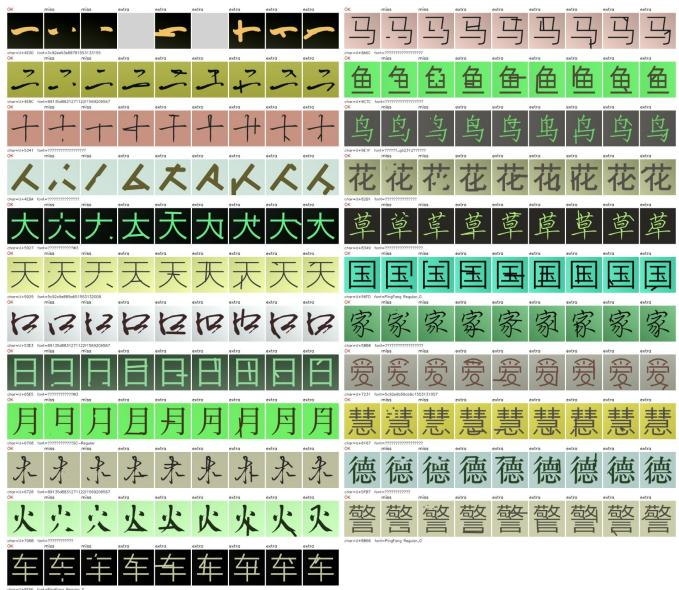

Figure 6: The positive and negative samples for stage-2 synthesized using synthetic font files. The first column in each row corresponds to the positive sample, which represents the correct standard rendering of the font. The remaining columns are negative samples containing perturbations such as stroke addition and stroke removal.  
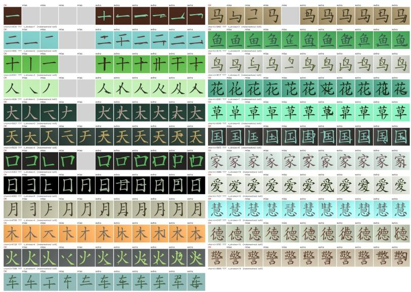  
Figure 7: The stage-2 positive and negative samples synthesized using Chinese kaiti-style vector data included in Makemeahanzi (Kishore, 2016). The first column of each row is the positive sample, representing the correct standard rendering of the font, and the rest are negative samples with perturbations such as stroke addition and stroke removal.

## A.4 STAGE-3 INPAINTING MODEL

The Stage-3 relative pairs are derived from the training trajectory of a text-region inpainting model. Built upon the JiT (Li & He, 2026) architecture (pixel-space, VAE-free; JiT-H/16, ≈ 1B params), the model concatenates three token groups along the sequence dimension: the full image (the region to be repainted is corrupted with Gaussian noise while the rest remains clean, serving as conditioning), target crops (the flow-matching target outputs, of which there can be multiple), and the target character’s Qwen3-0.6B (Yang et al., 2025) embedding (frozen and used as conditioning). Its architectural design is illustrated in figure 8. Following JiT (Li & He, 2026), it adopts the x-prediction MSE loss to compute losses over target crop regions for training the flow-matching model.

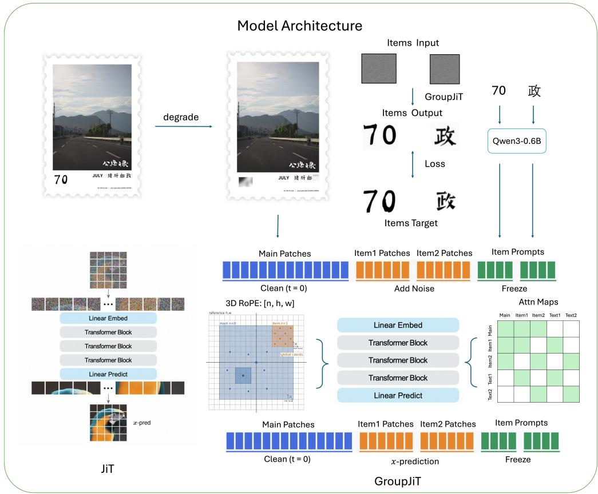  
Figure 8: Architecture of the text-region inpainting model for Stage-3 relative pair construction. Three token groups, namely the full image, multiple target crops and character embeddings from Qwen3-0.6B (Yang et al., 2025), are concatenated along the sequence dimension. Custom attention mask and modified 3D-RoPE are adopted to enable multi-crop training with absolute positional awareness.

Specifically, since the model is capable of structuring multiple target crops together with their corresponding character-embedding prompts, we devise an attention mask as shown in figure 8. This mask ensures that when computing self-attention, each target crop can only attend to the full image, its own tokens, and its own embedding, and is prevented from attending to other crops. Furthermore, to inform the model of where each target crop is located within the full image, we modify 2D-RoPE (Heo et al., 2024). We first introduce an additional n dimension to distinguish the full image (n = 0) from target crops (n = 1). Second, we map both the full image and all target crops onto the absolute coordinate system of a large shared canvas to obtain the h and w coordinates for each patch, instead of taking the top-left corner of each individual image as the origin of the relative coordinate system as in vanilla 2D-RoPE (Heo et al., 2024). Accordingly, we supply the model with absolute position information for every patch of each target crop via 3D-RoPE, so that the model can perceive their positions inside the full image.

Its training data can be fully reused from Stage 1 without additional annotation. We repaint the same (position, target-character) triple using an early checkpoint and a late checkpoint, yielding around 0.7M pairs, as shown in figure 9. Outputs from the late checkpoint are treated as positive samples and those from the early checkpoint as negative samples. Since the labels are purely rela tive (“the late-checkpoint output is no worse than the early-checkpoint one”), Stage 3 employs the truncated-hinge loss $\mathcal { L } _ { \mathrm { h p } }$ instead of a loss with absolute thresholds.

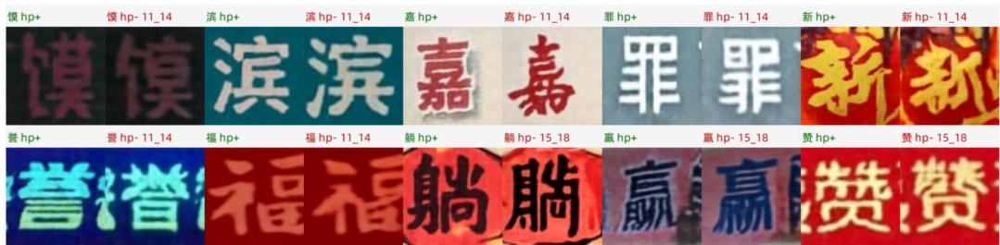  
Figure 9: The Stage-3 positive and negative samples generated from different checkpoints of the inpainting model. In each pair, the first one is the positive sample produced by the later checkpoint, and the second one is the negative sample. For each paired positive-negative sample, the positive sample exhibits better quality than its negative counterpart.

## A.5 INFERENCE READOUT AND THRESHOLD

Comparing sim $( f ( x ) , g ( c ) )$ directly is unreliable: per-character match baselines vary, and a character’s legal renderings are multi-modal, so collapsing them to one direction blurs the gaps between modes. We instead keep K image-space prototypes per character to trace its legal manifold, scoring a crop by cosine distance to the nearest prototype; the threshold δ is a high percentile (90th) of all normal-crop training scores and thus depends only on the training distribution, not the test set. For reproducibility the k-means (Lloyd, 1982) seed follows seed = K 100 + char index.

## B STRUCTURAL EVIDENCE FOR THE IDS TEXT TOWER

A label-free analysis of the trained IDS and single-character towers supports the claim (Sec. 4) that IDS yields a structured representation.

IDS decomposition (illustration). Figure 10 illustrates the IDS representation from three angles. Basic decompositions write each character uniquely as an operator applied to components (e.g. 明=日月 under a left–right operator), with components that recur across characters shown in a shared color, so that structurally related characters visibly overlap at the symbol level. The twelve structural operators cover the layouts a decomposition can take. Finally, an IDS is recursive: a character expands into a tree whose subtrees are themselves valid decompositions $\therefore \tan \angle A , C = \arctan$ 目 心), and identical subtrees are reused across characters (the subtree 相=木目 recurs in 想, 霜, and 箱). This shared, compositional structure is exactly what the IDS text tower encodes and what a single-character token discards.

Text-tower geometry. To test whether the IDS tower organizes its text space by compositional structure, rather than merely benefiting from a smaller vocabulary, we encode the full 8,189- character vocabulary with the Stage-3 IDS text tower and with the single-character-token tower of the otherwise identical checkpoint, and compare embedding geometry against symbolic structure. Using a fixed-seed, distance-stratified sample of 26,136 character pairs spanning five bins of normalized IDS token edit distance (flat Levenshtein on the IDS prefix), we correlate pair cosine with structural distance. The Spearman correlation is −0.70 for the IDS tower versus −0.34 for the single-character tower (95% character-cluster bootstrap CIs [−0.71, −0.70] and [−0.35, −0.33]; difference −0.36, CI [−0.37, −0.35]; paired permutation $p < \bar { 1 0 } ^ { - 3 } )$ . Figure 11 (left) shows where the gap comes from: IDS-tower median cosine falls monotonically from 0.65 for near-identical decompositions to 0.05 for unrelated characters, while the single-character tower remains nearly flat $( 0 . 4 6  0 . 2 3 )$ , so structural proximity organizes only the IDS space. Stratifying by top-level composition operator (right), same-operator pairs embed markedly closer than different-operator ones for the IDS tower (0.25 vs. 0.12) but not for the single-character tower (0.28 vs. 0.24). Together with the detection results, this shows that the IDS tower’s advantage is accompanied by a structurealigned representation, not merely a smaller output space.

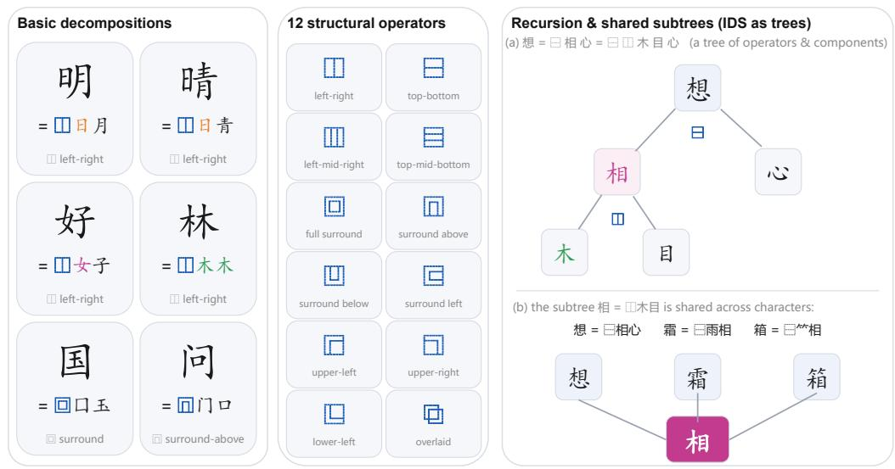  
Figure 10: The IDS representation of Chinese characters. Left: basic decompositions, where components shared across characters are color-coded (日, 女, 木), so structurally related characters overlap at the symbol level. Middle: the twelve IDS structural operators. Right: IDS is recursive— a character expands into a tree of operators and components (想=相心=木目心)—and identical subtrees are reused across characters (相=木目 recurs in 想, 霜, 箱). Structural operators are shown only inside the figure.

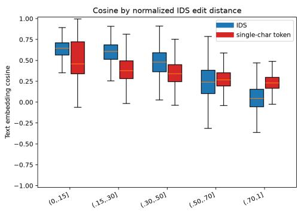

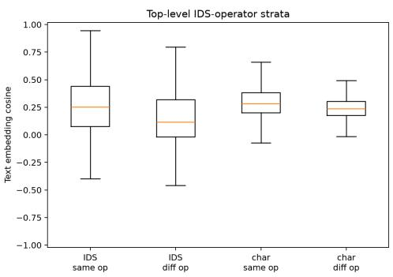  
Figure 11: Text-tower geometry versus symbolic structure (Stage-3 checkpoints). Left: textembedding cosine for 26,136 fixed-seed character pairs grouped by normalized IDS edit distance (blue: IDS tower; red: single-character tower; box = IQR, line = median). The IDS tower’s cosine falls monotonically as structural distance grows (medians 0.65 → 0.05; Spearman $\rho = - 0 . 7 0 )$ while the single-character tower is nearly flat $( 0 . 4 6  0 . 2 3 ; \rho = - 0 . 3 4 )$ . Right: the same pairs stratified by shared top-level IDS operator: same vs. different medians 0.25 vs. 0.12 (IDS) and 0.28 vs. 0.24 (single-character). Pairs form a distance-stratified diagnostic sample; distances are flat token edit distances on IDS prefixes.

## C NUMBER OF PROTOTYPES: K ABLATION

The readout clusters each character’s normal crops into K prototypes. Table 7 sweeps K on the gold test set $( N { = } 7 , 3 5 8 , 6 4 2$ positives) with the frozen 90th-percentile readout of the Stage-3 model. F1 peaks at $K { = } 1 0 \ ( 0 . 8 4 4 )$ and is flat over $K \in [ 8 , 1 6 ]$ (0.834–0.844), so the readout is insensitive to K: small K (1–2) underfits the multi-modal legal writings, while large K fragments prototypes and lowers precision. We use K=10 throughout.

Table 7: K sweep on the gold test set (N=7,358, 642 positives), frozen 90th-percentile readout, Stage-3 model.
<table><tr><td>K</td><td>δ</td><td>P</td><td>R</td><td>F1</td><td>TP/FP/FN/TN</td></tr><tr><td>1</td><td>0.0408</td><td>0.775</td><td>0.804</td><td>0.789</td><td>516/150/126/6566</td></tr><tr><td>2</td><td>0.0346</td><td>0.803</td><td>0.799</td><td>0.801</td><td>513/126/129/6590</td></tr><tr><td>4</td><td>0.0284</td><td>0.836</td><td>0.815</td><td>0.825</td><td>523/103/119/6613</td></tr><tr><td>6</td><td>0.0253</td><td>0.813</td><td>0.827</td><td>0.820</td><td>531/122/111/6594</td></tr><tr><td>8</td><td>0.0231</td><td>0.827</td><td>0.847</td><td>0.837</td><td>544/114/98/6602</td></tr><tr><td>10</td><td>0.0214</td><td>0.830</td><td>0.858</td><td>0.844</td><td>551/113/91/6603</td></tr><tr><td>12</td><td>0.0201</td><td>0.812</td><td>0.857</td><td>0.834</td><td>550/127/92/6589</td></tr><tr><td>14</td><td>0.0191</td><td>0.802</td><td>0.872</td><td>0.836</td><td>560/138/82/6578</td></tr><tr><td>16</td><td>0.0180</td><td>0.803</td><td>0.877</td><td>0.838</td><td>563/138/79/6578</td></tr><tr><td>18</td><td>0.0172</td><td>0.794</td><td>0.883</td><td>0.836</td><td>567/147/75/6569</td></tr><tr><td>20</td><td>0.0164</td><td>0.778</td><td>0.885</td><td>0.828</td><td>568/162/74/6554</td></tr></table>

## D BASELINE PROMPTS AND PROTOCOLS

The three general VLMs use one shared prompt with per-character crops; TextPecker (Zhu et al., 2026) uses its own released protocol.

General VLMs (Qwen3.8-Max (Qwen Team, 2026) / GPT-5.6-sol (OpenAI, 2026a) / Gemini 3.7 Flash (Google DeepMind, 2026b)). All three are called through their official APIs with the same target-conditioned prompt: each crop is presented together with its target character c, and the model only judges whether the crop is a correct rendering of c (yes/no), without having to recognize which character it is. This matches our verifier’s setting (both are conditioned on the target character), keeping the comparison fair. Prompt text ( CHAR is replaced by the target character at query time):

The target Chinese character for this image crop is:   
CHAR . The crop may contain parts of neighboring   
characters, background or banner graphics; ignore everything   
except the glyph of the target character itself. Judge   
whether that glyph is a CORRECT rendering of ‘‘ CHAR ’’:   
every stroke and the overall structure must match the   
standard glyph, with no missing, extra, broken or   
misplaced strokes. Font style, weight, color, texture   
and background are NOT errors, and partial marks of OTHER   
characters are NOT errors. Output strictly one JSON object:   
{"render error": true/false, "reason": "<brief reason>"}

A “rendering error” verdict is the positive class. The typical VLM failure is to call a structurally wrong glyph correct (Sec. 4, Figure 1).

TextPecker. TextPecker (Zhu et al., 2026) uses its own released evaluation protocol (crop-image input, structural anomalies flagged with special markers “< # >”); we run its two released weights (Qwen3-VL-8B and InternVL3-8B) as structural-anomaly assessors and refer to the original work for prompt details.

## E BENCHMARK ANNOTATION AND ADDITIONAL QUALITATIVE RESULTS

Annotation protocol. Annotation proceeds in two steps. A CRAFT (Baek et al., 2019) + PP-OCRv6 (Zhang et al., 2026a) pipeline first proposes a bounding box and a character identity for each glyph; annotators then verify the box, confirm the identity, and label whether the glyph is correctly rendered, counting any stroke- or component-level deviation as an error while not penalizing font, calligraphic, or artistic style. Each character thereby receives its (position, identity, correctness) triple.

More benchmark annotations. Figure 12 adds TEXTRENDERBENCH-ZH samples beyond the Sec. 4 example, covering different error types (missing/extra strokes, misplaced components, wrong characters) and layouts.

More Flow-GRPO comparisons. Figure 13 places Base (Qwen-Image (Wu et al., 2025)) / NEDonly / TextPecker (Zhu et al., 2026) / Ours side by side for several shared prompts, showing that our reward matches TextPecker (Zhu et al., 2026) on glyph correction while perturbing background, color, and layout less (consistent with the diversity and aesthetics numbers in Sec. 4.5).

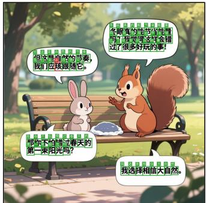

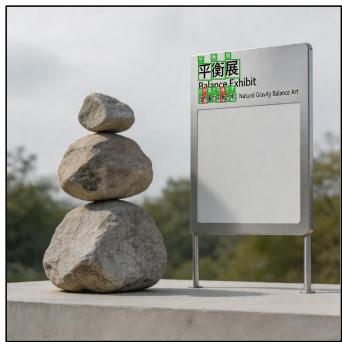

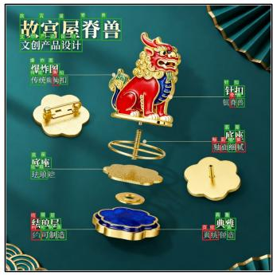

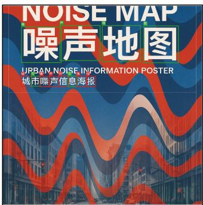

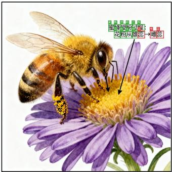

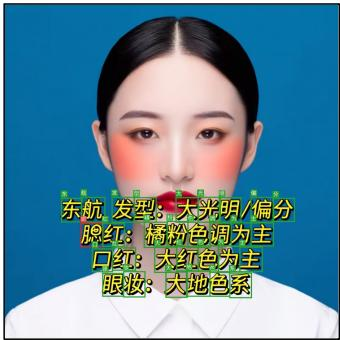

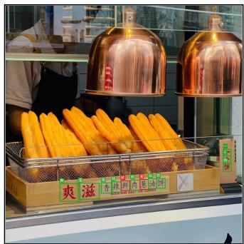

  
Figure 12: Additional TEXTRENDERBENCH-ZH annotated examples.

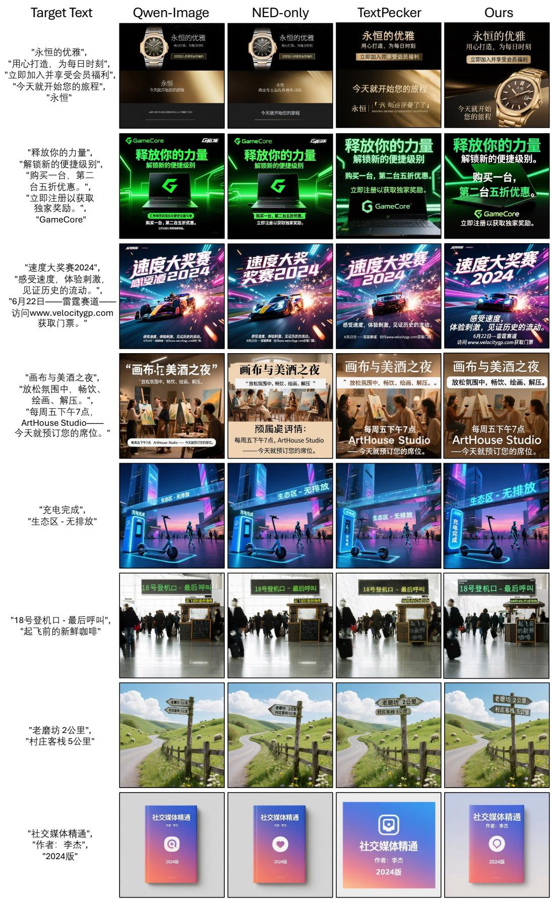  
Figure 13: Additional Flow-GRPO qualitative comparisons on oneID-ZH (Chang et al., 2025) bench. 22