# VASCUSR: ITERATIVE ANATOMY-AWARE DIFFUSION FOR CT SUPER-RESOLUTION

Hairong Ni∗†2 Jiahe Huang∗1 Minghao Guo3 Wojciech Matusik3 Rose Yu1

1University of California, San Diego 2University of Michigan 3MIT CSAIL

## ABSTRACT

Generative super-resolution (SR) can recover sharp detail in computed tomography (CT) images from severely downsampled observations, but the missing high-frequency content is not uniquely determined by the low-resolution input. Consequently, visually plausible reconstructions may contain anatomically unsupported vascular detail, such as missing, spurious, or incorrectly connected vessels. To overcome this challenge, we introduce VascuSR, an iterative anatomy-aware diffusion framework that combines image reconstruction with explicit 3D vascular guidance. First, to provide richer anatomical guidance, we use an explicit 3D vascular representation that captures structural information beyond individual slices. This representation also simplifies vascular refinement by allowing a lightweight 3D generative refiner to focus on vascular structure rather than complex CT appearance. Second, to guide slice-wise SR, a lightweight anatomy controller injects the refined structure into the diffusion decoder, while iterative feedback updates this guidance from each new SR volume. On re-annotated MSD Task08 and HVM datasets, VascuSR outperforms interpolation and learning-based SR baselines in segmentation accuracy (Dice and clDice) and 3D vascular structure (connectivity and mean centerline distance), while maintaining image quality comparable to its SR backbone. Compared with learning-based baselines, VascuSR reduces classaveraged connected-component counts by over 20% on both datasets and mean centerline distance by over 10% on MSD.

## 1 INTRODUCTION

Medical image super-resolution (SR) aims to recover image detail from low-resolution observations while preserving anatomically meaningful structure. This is particularly challenging for contrastenhanced vascular CT, where vessels are thin, highly branched, and span a wide range of diameters and curvatures: small peripheral branches may additionally exhibit weak contrast against surrounding tissue (Lesage et al., 2009). At high upsampling factors, much of this fine image detail is poorly determined by the observed low-resolution image, making the reconstruction inherently ambiguous (Ledig et al., 2017).

Recent deep SR has progressed from deterministic regression to generative reconstruction, enabling sharper and more realistic image detail (Zhang et al., 2018b; Liang et al., 2021; Ledig et al., 2017; Saharia et al., 2023; Yue et al., 2023). However, visual plausibility does not guarantee anatomical fidelity. Errors that are small in image space can be structurally significant: a short discontinuity may disconnect an otherwise continuous vessel tree, while a spurious connection may alter its branching structure. Such failures are not well characterized by conventional image-quality metrics. High SSIM, for example, can coexist with hallucinated anatomical structures in medical reconstruction (Muckley et al., 2021), and improved image-quality metrics do not necessarily translate to better downstream detection performance (Li et al., 2021). Deep-learning-based CT reconstruction may also blur or remove small vessels despite producing visually high-quality images (Koetzier et al., 2023). For tubular structures in particular, voxel-wise overlap alone does not fully characterize topological correctness, motivating connectivity-aware measures such as clDice (Shit et al., 2021). A reconstructed CT image can therefore appear locally plausible while still containing broken, missing, or incorrectly connected vessels. These challenges motivate explicitly incorporating volumetric vascular structure into the reconstruction process, rather than relying on image appearance alone.

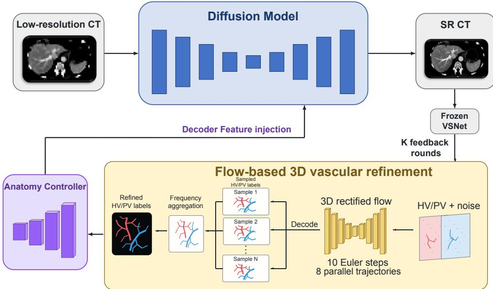  
Figure 1: Overview of VascuSR. Starting from an initial SR estimate, the recovered HV/PV anatomy is refined in three dimensions and fed back through a lightweight anatomy controller to condition the next diffusion-based reconstruction. Repeating this process for K feedback rounds progressively couples image super-resolution with volumetric vascular refinement.

To address these limitations, we propose VascuSR, an iterative anatomy-aware diffusion framework for CT SR that targets both image fidelity and vascular anatomical plausibility. Rather than relying only on individual 2D slices, VascuSR represents vascular anatomy explicitly in 3D. This representation provides richer information about vascular topology while separating vascular structure from CT intensity and organ texture, making anatomical refinement a simpler learning task. We therefore use a conditional 3D rectified flow to refine the vascular representation. A lightweight multi-scale anatomy controller then transforms the refined representation into conditioning features for the diffusion decoder. At each round, the vascular representation is re-extracted and refined from the latest SR volume to guide the next reconstruction, so that the anatomical condition and SR output are updated in turn through the feedback loop.

## Our contributions are threefold:

• We introduce explicit 3D vascular representations as anatomical guidance for slice-wise CT super-resolution. Separating vascular refinement from image reconstruction simplifies structural learning while retaining HR supervision for image fidelity.

• We develop an iterative refinement–conditioning mechanism that combines a conditional 3D rectified-flow vascular refiner with a lightweight multi-scale anatomy controller, allowing anatomical guidance to adapt to each updated SR volume.

• We evaluate VascuSR on two public vascular CT datasets across image quality, vascular overlap, and three-dimensional vascular structure. VascuSR reduces class-averaged component counts by over 20% on both datasets and class-averaged MCD by over 10% on MSD, while comparisons with direct joint optimization support the benefits of the decoupled design.

## 2 RELATED WORK

## 2.1 SUPER-RESOLUTION AND GENERATIVE INVERSE PROBLEMS

Super-resolution can be formulated as an ill-posed inverse problem, where a high-resolution signal must be recovered from a degraded low-resolution observation (Wang et al., 2021). Because multiple

HR solutions may be consistent with the same LR input, successful reconstruction requires appropriate priors over the missing fine-scale structure. Deterministic SR methods learn such priors implicitly from paired training data through a direct LR-to-HR mapping, using convolutional architectures such as SRCNN, EDSR, and RCAN (Dong et al., 2014; Lim et al., 2017; Zhang et al., 2018b), or Transformer-based models such as SwinIR and HAT (Liang et al., 2021; Chen et al., 2023). These approaches achieve strong distortion-oriented performance, but training with pixel-wise objectives can produce overly smooth reconstructions.

Generative methods instead model a distribution over plausible HR solutions. Adversarial approaches such as SRGAN use perceptual and adversarial objectives to recover sharper image detail (Ledig et al., 2017), while diffusion models provide a probabilistic reconstruction framework through iterative denoising. SR3 conditions the reverse diffusion process on the LR observation, whereas ResShift constructs a residual-shifting trajectory between LR and HR representations for more efficient sampling (Saharia et al., 2023; Yue et al., 2023). StableSR and DiffBIR further exploit pretrained latent diffusion models as generative priors for image restoration (Wang et al., 2024; Lin et al., 2024). More broadly, this coarse-to-fine inverse formulation is common across AI for Science, including medical imaging and physical-system reconstruction, where generative priors are often combined with domain-specific constraints to restrict the space of plausible solutions (Chung et al., 2023a; Huang et al., 2024; Yao et al., 2026).

## 2.2 ANATOMY- AND TASK-AWARE MEDICAL SUPER-RESOLUTION

Medical SR methods incorporate domain knowledge primarily through either observation consistency or anatomy- and task-specific priors. One line of work enforces consistency between the reconstruction and the LR input in the image or measurement domain. Chung et al. (2023b) reuse a score model trained for MR denoising for post-hoc SR, alternating reverse-diffusion steps with image-level data-consistency updates. GAN-CIRCLE regularizes bidirectional LR-HR mappings through cycle consistency (You et al., 2020), CMISR iteratively corrects re-reconstruction errors (Li et al., 2024b), and DynamicDPS applies adaptive diffusion posterior guidance to low-field MRI enhancement (Kim et al., 2025). Such constraints improve agreement with the observed image or measurement. However, this agreement alone does not ensure faithful recovery of fine anatomical structures that are poorly resolved in the input.

A complementary line incorporates structural or task-specific information. DiffMSR performs diffusion in a compact latent space to generate a high-frequency-detail prior for multi-contrast MRI SR (Li et al., 2024a), while DSDM combines image and structure streams with Hessian-derived vessel- and blob-sensitive priors for CT SR (Chu et al., 2023). The dual-guidance SR network of Chi et al. (2023) combines segmentation-derived ROI guidance with inter-slice information for CT superresolution. However, an important gap remains in how structural guidance can improve vascular anatomical fidelity, and how this fidelity should be assessed beyond conventional image-quality metrics.

## 3 METHOD

## 3.1 PROBLEM SETUP AND FRAMEWORK OVERVIEW

Given a low-resolution CT volume x, our goal is to reconstruct a high-resolution volume yb that preserves both image fidelity and vascular anatomical plausibility. As illustrated in Figure 1, VascuSR combines a slice-wise diffusion SR backbone, a 3D vascular refiner, and an anatomy controller. The backbone reconstructs high-resolution CT images, the refiner improves 3D vascular structure, and the controller injects the refined anatomy into the diffusion decoder. The backbone and controller are trained jointly with HR supervision, while the refiner learns vascular correction separately in the 3D vascular representation space, decoupling structural refinement from CT intensity reconstruction. During inference, the vascular representation extracted from the current SR volume is refined and passed through the controller to guide the next reconstruction, forming an iterative feedback loop in which the anatomical condition is updated after each SR pass. Appendix B compares this decoupled formulation with directly optimizing image and anatomical objectives in the SR generator.

## 3.2 ITERATIVE ANATOMY-AWARE DIFFUSION

Let $K \in \mathbb N$ denote the total number of feedback updates, and let $r \in \{ 0 , \ldots , K \}$ index the current state of the outer feedback loop. We write $x \in \mathbb { R } ^ { ( X \hat { / } s ) \times ( Y / s ) \times Z }$ for the LR input CT volume, where s is the in-plane super-resolution scale factor, and $\widehat { \boldsymbol { y } } ^ { ( r ) } \in \mathbb { R } ^ { X \times Y \times Z }$ for the SR volume after r feedback updates. Here, $X , Y$ , and $Z$ are the spatial dimensions of the HR volume. Thus, $\widehat { \boldsymbol y } ^ { ( 0 ) }$ is the initial SR estimate, and ${ \widehat { y } } ^ { ( K ) }$ is the final output $\widehat { y }$ introduced in Section 3.1.

Let $\theta , \phi ,$ and $\psi$ denote the parameters of the SR backbone, anatomy controller $A _ { \phi } .$ , and vascular refiner $R _ { \psi } ,$ , respectively. The backbone and controller together define the SR model $p _ { \theta , \phi }$ . We generate the initial SR volume $\widehat { \boldsymbol y } ^ { ( 0 ) }$ conditioned on an all-zero vascular mask $\mathbf { 0 } \in \{ 0 , 1 \} ^ { 2 \times X \times Y \times Z }$ , where the two channels correspond to hepatic veins (HV) and portal veins (PV):

$$
\widehat { \boldsymbol { y } } ^ { ( 0 ) } \sim p _ { \theta , \phi } ( \cdot \vert \boldsymbol { x } , A _ { \phi } ( \mathbf { 0 } ) ) .\tag{1}
$$

At each update $r \in \{ 0 , \ldots , K - 1 \}$ , the frozen VSNet segmenter $S$ (Xu et al., 2025) produces vessel probabilities $Q ^ { ( r ) }$ , which the refiner $R _ { \psi }$ converts into a binary vascular condition $M ^ { ( r ) }$

$$
\begin{array} { r l } & { Q ^ { ( r ) } = S \Big ( \widehat { y } ^ { ( r ) } \Big ) \in [ 0 , 1 ] ^ { 3 \times X \times Y \times Z } , } \\ & { M ^ { ( r ) } = R _ { \psi } \Big ( Q ^ { ( r ) } \Big ) \in \{ 0 , 1 \} ^ { 2 \times X \times Y \times Z } . } \end{array}\tag{2}
$$

In our hepatic-vessel experiments, the channels of $Q ^ { ( r ) }$ represent background, hepatic vein (HV), and portal vein (PV), while $M ^ { ( r ) }$ contains the refined HV and PV masks.

The next SR volume is generated conditioned on $M ^ { ( r ) }$ :

$$
\widehat { \boldsymbol { y } } ^ { ( r + 1 ) } \sim p _ { \boldsymbol { \theta } , \boldsymbol { \phi } } \Big ( \cdot \mid \boldsymbol { x } , \boldsymbol { A } _ { \boldsymbol { \phi } } \Big ( \boldsymbol { M } ^ { ( r ) } \Big ) \Big ) .\tag{3}
$$

The LR input x remains fixed throughout the loop, and each update follows

$$
{ \widehat { y } } ^ { ( r ) } \ { \stackrel { S } { \longrightarrow } } Q ^ { ( r ) } \ { \stackrel { R _ { \psi } } { \longrightarrow } } M ^ { ( r ) } \ \longrightarrow { \widehat { y } } ^ { ( r + 1 ) } .
$$

We use ${ \mathrm { K } } = 3$ for MSD and $\mathrm { K } = 2$ for HVM. The sensitivity to the number of feedback rounds is examined in Appendix A.2.

## 3.3 FLOW-BASED 3D VASCULAR REFINEMENT

The vascular refiner $R _ { \psi }$ learns to correct imperfect vessel predictions using conditional 3D rectified flow (Liu et al., 2023), supervised by manual HV/PV annotations. The full three-class probability volume $Q ^ { ( r ) }$ conditions refinement, while its HV and PV channels initialize the flow state. Given the paired manual label $M _ { \mathrm { G T } } \in \{ 0 , 1 \} ^ { 2 \times X \times Y \times Z }$ , we define the target and starting states as

$$
z _ { 0 } = 2 M _ { \mathrm { G T } } - 1 , \qquad z _ { 1 } ^ { ( r ) } = 2 [ Q _ { \mathrm { H V } } ^ { ( r ) } , Q _ { \mathrm { P V } } ^ { ( r ) } ] - 1 + \sigma \epsilon , \quad \epsilon \sim \mathcal { N } ( 0 , I ) .\tag{4}
$$

Let $\tau \in [ 0 , 1 ]$ denote the flow time, where $\tau = 1$ corresponds to the noisy initial state $z _ { 1 } ^ { ( r ) }$ and $\tau = 0$ corresponds to the target state $z _ { \mathrm { 0 } }$ . The parameter σ controls the noise amplitude. The mapping $a \mapsto 2 a - 1$ encodes binary labels from {0, 1} to $\{ - 1 , + 1 \}$ , allowing foreground to be decoded using a zero threshold.

During training, we sample the flow time $\tau \sim \mathcal { U } ( 0 , 1 )$ and construct $z _ { \tau } ^ { ( r ) } = ( 1 - \tau ) z _ { 0 } + \tau z _ { 1 } ^ { ( r ) }$ . A 3D U-Net $v _ { \psi }$ , with parameters ψ, predicts the velocity from this state, flow time τ , and condition $Q ^ { ( r ) }$ We train it to match the velocity $z _ { 1 } ^ { ( r ) } - z _ { 0 }$ along the linear path:

$$
\mathcal { L } _ { \mathrm { f l o w } } = \mathbb { E } \left[ \left\| v _ { \psi } ( z _ { \tau } ^ { ( r ) } , \tau \mid Q ^ { ( r ) } ) - \left( z _ { 1 } ^ { ( r ) } - z _ { 0 } \right) \right\| _ { 2 } ^ { 2 } \right] .\tag{5}
$$

The expectation is over paired training examples, flow time, and Gaussian noise.

Table 1: Quantitative results for ×8 CT super-resolution on (a) the MSD Task08 HepaticVessel test set and (b) the HVM test set. In this table, VascuSR uses $K = 3$ on MSD and $K = \bar { 2 }$ on HVM. The best and second-best results are shown in bold and with dashed underlining, respectively.
<table><tr><td rowspan="2">Method</td><td colspan="2">Dice ↑</td><td colspan="2"> $\mathrm { c l D i c e } \uparrow$ </td><td colspan="3">Image quality</td></tr><tr><td>HV</td><td>PV</td><td>HV</td><td>PV</td><td>PSNR↑</td><td>SSIM ↑ LPIPS ↓</td><td></td></tr><tr><td colspan="8">(a) Re-annotated MSD Task08 HepaticVessel</td></tr><tr><td>Bicubic</td><td>.2618.2264.2475.1956</td><td></td><td></td><td></td><td>25.31</td><td>.7742</td><td>.3872</td></tr><tr><td>RCAN</td><td></td><td></td><td>.5465.5021 .5616.4274</td><td></td><td>34.25</td><td>.9124</td><td>.1317</td></tr><tr><td>SwinIR</td><td></td><td></td><td>.5780.5623 .5862 .4626</td><td></td><td>34.44</td><td>.9164</td><td>.1262</td></tr><tr><td>HAT</td><td></td><td></td><td>.5720.5615.5782.4551</td><td></td><td>34.21</td><td>.9149</td><td>.1270</td></tr><tr><td>ResShift</td><td></td><td></td><td>.6526.5923 .5877 .4460</td><td></td><td>32.83</td><td>.8896</td><td>.0660</td></tr><tr><td>ResShift+Dice/clDice</td><td></td><td></td><td>.7010.6042.6385.4734</td><td></td><td>32.62</td><td>.8823</td><td>.0730</td></tr><tr><td>VascuSR (ours,  $K { = } 3 )$ </td><td></td><td></td><td>.7072 .6404.6446.5286</td><td></td><td>32.77</td><td>.8876</td><td>.0649</td></tr><tr><td>HR reference</td><td>.7936</td><td>.7610</td><td>.7615</td><td>.7352</td><td>一</td><td></td><td></td></tr><tr><td colspan="8">(b) HVM test set</td></tr><tr><td>Bicubic</td><td></td><td>.4888.4962 .4696.3851</td><td></td><td></td><td>19.24</td><td>.6284</td><td>.5043</td></tr><tr><td>RCAN</td><td></td><td></td><td>.5793.6751.5618.5530</td><td></td><td>24.58</td><td>.8379</td><td>.1935</td></tr><tr><td>SwinIR</td><td></td><td></td><td>.5908.6804 .5740.5588</td><td></td><td>24.76</td><td>.8410</td><td>.1875</td></tr><tr><td>HAT</td><td></td><td></td><td>.5802 .6760 .5507 .5442</td><td></td><td>24.60</td><td>.8401</td><td>.1829</td></tr><tr><td>ResShift</td><td></td><td></td><td>.5977.6914.5687.5302</td><td></td><td>23.50</td><td>.7001</td><td>.0743</td></tr><tr><td>ResShift+Dice/clDice .6104.7001 .5842</td><td></td><td></td><td></td><td>.5469</td><td>23.50</td><td>.6983</td><td>.0740</td></tr><tr><td>VascuSR (ours, K=2)</td><td></td><td>.6206.7117</td><td>.6033</td><td>.5731</td><td>23.40</td><td>.6990</td><td>.0744</td></tr><tr><td>HR reference</td><td></td><td>.7177.7917</td><td>.7122</td><td>.7149</td><td>一</td><td>一</td><td>一</td></tr></table>

At inference, we run $N = 8$ trajectories in parallel with independent initial noise and aggregate their decoded labels. Each trajectory is integrated from $\tau = 1 \mathrm { t o } \tau = 0$ using ten Euler steps, with $Q ^ { ( r ) }$ fixed throughout. Let ${ \widehat { z } } _ { 0 } ^ { ( r , n ) }$ denote the predicted endpoint of trajectory $n \in \{ 1 , \ldots , N \}$ . The deterministic decoder D applies a zero foreground threshold followed by HV/PV channel competition. For voxel j and class $c \in \mathrm { \bar { \{ H V , P V \} } }$ , the frequency of decoded class labels is

$$
F _ { c } ^ { ( r ) } ( j ) = \frac { 1 } { N } \sum _ { n = 1 } ^ { N } \mathbf { 1 } \Big [ D \Big ( \hat { z } _ { 0 } ^ { ( r , n ) } \Big ) \left( j \right) = c \Big ] .\tag{6}
$$

Applying a validation-selected frequency threshold and HV/PV class competition to $F ^ { ( r ) }$ yields $M ^ { ( r ) }$ , the anatomical condition for the next SR round.

## 3.4 MULTI-SCALE ANATOMY CONTROLLER

The vascular refiner in Section 3.3 produces the refined 3D vascular condition $M ^ { ( r ) }$ , while the anatomy controller transfers this condition to the slice-wise SR backbone.

To guide slice-wise SR with the refined 3D anatomy, a lightweight convolutional controller takes the corresponding axial mask slices from $M ^ { ( r ) }$ as input. These slices form a batch $m ^ { ( r ) } \in$ $\{ 0 , 1 \} ^  B \times 2 ^ { \bullet } \boldsymbol { H } \times \boldsymbol { W }$ , where B is the batch size, the two channels represent HV and PV, and $H \times W$ is the slice size. Let $l \in \{ 1 , \ldots , L \}$ index the decoder injection levels and t the SR diffusion step. During the next reconstruction $\widehat { y } ^ { ( r + 1 ) }$ , the controller produces an anatomical control feature at each level:

$$
c _ { l } ^ { ( r , t ) } = A _ { \phi , l } \Big ( m ^ { ( r ) } , t \Big ) \in \mathbb { R } ^ { B \times D _ { l } \times H _ { l } \times W _ { l } } .\tag{7}
$$

Here, $A _ { \phi , l }$ denotes the controller mapping at level l. Let $h _ { l } ^ { ( r + 1 , t ) }$ denote the corresponding SR decoder feature. We add the anatomical control feature to obtain the conditioned decoder feature:

$$
\begin{array} { r } { \widehat { h } _ { l } ^ { ( r + 1 , t ) } = h _ { l } ^ { ( r + 1 , t ) } + c _ { l } ^ { ( r , t ) } . } \end{array}\tag{8}
$$

Hyperparameter settings and training and inference details for the architecture described above are provided in Appendix A.1.

## 4 EXPERIMENTS AND RESULTS

## 4.1 DATASETS

We use two publicly available contrast-enhanced CT datasets for ×8 SR, pairing each $5 1 2 \times 5 1 2$ HR slice with a 64 × 64 LR input. All methods use identical preprocessing within each dataset, and all splits and analyses are patient-level to avoid leakage between correlated slices. No patient in the reported test sets is used to train the SR models, VSNet, or FlowSeg3D (the vascular refiner). Patient splits and additional implementation details are provided in Appendix A.1.

Re-annotated MSD Task08 HepaticVessel. The official Medical Segmentation Decathlon (MSD) Task08 dataset comprises 443 CT volumes: 303 labeled training volumes and 140 challenge-test volumes whose annotations are not publicly released (Antonelli et al., 2022). VSNet re-annotates the 303 training volumes with separate HV and PV masks.

HVM. The public Hepatic Vessel Map (HVM) dataset (Xie et al., 2026) contains 282 dual-center portal-venous-phase contrast-enhanced CT volumes with separate HV and PV annotations. We exclude one case with an incomplete image–label pair, leaving 281 complete CT–HV–PV triplets. Because the released volumes fall into three stored-intensity domains and are not uniformly raw-HU CT, we clip all volumes to their shared range [−40, 160] before normalization.

## 4.2 BASELINES

We compare VascuSR with four groups of baselines:

• Interpolation. Bicubic interpolation provides a non-learned reference, reconstructing HR images without learned image or anatomical priors.

• Deterministic SR. RCAN (Zhang et al., 2018b), SwinIR (Liang et al., 2021), and HAT (Chen et al., 2023) represent convolutional and Transformer-based reconstruction methods.

• Diffusion SR. ResShift (Yue et al., 2023) performs SR through residual-shifting diffusion and serves as the backbone of VascuSR.

• Joint image and anatomical optimization. Extends ResShift by adding Dice and softclDice losses, computed through a frozen VSNet segmenter, to its image reconstruction objective during fine-tuning. Details are provided in Appendix B.

Learned baselines are trained or fine-tuned on the same LR–HR training pairs within each dataset. We use each method’s official training recipe as a starting point and select hyperparameters using the validation set.

## 4.3 EVALUATION METRICS

Image reconstruction fidelity. We report peak signal-to-noise ratio (PSNR), structural similarity index (SSIM) (Wang et al., 2004), and learned perceptual image patch similarity (LPIPS) (Zhang et al., 2018a). PSNR quantifies pixel-level fidelity based on mean squared error, SSIM compares local luminance, contrast, and structure, and LPIPS measures perceptual distance in a learned feature space.

Vessel segmentation agreement. We apply the same fixed VSNet segmenter to every reconstructed volume and compare its HV and PV predictions with the reference annotations. Dice measures volumetric overlap, while clDice measures skeleton-based agreement (Shit et al., 2021).

Three-dimensional vascular structure. To complement Dice and clDice, we further assess vascular fragmentation and the spatial alignment of vessel centerlines with the reference anatomy.

We use 26-connectivity to compute connected components separately for HV and PV. For $c \in$ {HV, PV}, #CC counts components, and the largest-component fraction is $| C _ { \mathrm { m a x , } c } | / | P _ { c } |$ , where $P _ { c }$ is the predicted foreground of class c and $C _ { \operatorname* { m a x } , c }$ its largest connected component.

Mean centerline distance (MCD) measures the geometric discrepancy between predicted and reference vessel trajectories (Zhang et al., 2025). Let $C _ { P }$ and $C _ { G }$ denote centerline point sets extracted from the predicted and manual reference masks, respectively, in physical coordinates (mm). We compute

Table 2: Three-dimensional vascular structure on (a) MSD Task08 HepaticVessel test set and (b) HVM test set. Bold marks the best SR result in each column.
<table><tr><td rowspan="2">Method</td><td colspan="3">HV</td><td colspan="3">PV</td></tr><tr><td>#CC↓</td><td>Largest-CC frac ↑</td><td>MCD (mm)↓</td><td> $\# \mathbf { C } \mathbf { C } \downarrow$ </td><td>Largest-CC frac ↑</td><td>MCD (mm) ↓</td></tr><tr><td></td><td>(a) MSD Task08 HepaticVessel</td><td></td><td></td><td></td><td></td><td></td></tr><tr><td>Bicubic</td><td>27.6</td><td>.5178</td><td>18.128</td><td>13.0</td><td>.6432</td><td>18.171</td></tr><tr><td>RCAN</td><td>31.1</td><td>.7773</td><td>6.753</td><td>29.0</td><td>.6801</td><td>8.700</td></tr><tr><td>SwinIR</td><td>31.6</td><td>.8377</td><td>6.499</td><td>28.1</td><td>.7874</td><td>8.632</td></tr><tr><td>HAT</td><td>33.1</td><td>.8125</td><td>6.517</td><td>29.0</td><td>.7852</td><td>8.453</td></tr><tr><td>ResShift</td><td>31.0</td><td>.9077</td><td>6.046</td><td>26.0</td><td>.8843</td><td>8.088</td></tr><tr><td>ResShift+Dice/clDice</td><td>39.6</td><td>.8936</td><td>5.652</td><td>30.4</td><td>.8249</td><td>7.537</td></tr><tr><td>VascuSR (ours, K=3)</td><td>22.7</td><td>.9382</td><td>5.231</td><td>22.4</td><td>.8931</td><td>6.635</td></tr><tr><td>Manual GT</td><td>1.0</td><td>1.0000</td><td>0.0000</td><td>1.0</td><td>1.0000</td><td>0.0000</td></tr><tr><td></td><td></td><td>(b) HVM</td><td></td><td></td><td></td><td></td></tr><tr><td></td><td></td><td></td><td>7.507</td><td>23.3</td><td>.754</td><td></td></tr><tr><td>Bicubic</td><td>28.9</td><td>.493</td><td></td><td>69.8</td><td></td><td>7.876</td></tr><tr><td>RCAN</td><td>52.8</td><td>.456</td><td>5.732</td><td></td><td>.821</td><td>5.539</td></tr><tr><td>SwinIR</td><td>51.5</td><td>.467</td><td>5.673</td><td>65.2</td><td>.843</td><td>5.264</td></tr><tr><td>HAT</td><td>76.2</td><td>.460</td><td>5.651</td><td>96.8</td><td>.812</td><td>5.718</td></tr><tr><td>ResShift</td><td>48.7</td><td>.497</td><td>5.272</td><td>66.7</td><td>.874</td><td>5.004</td></tr><tr><td>ResShift+Dice/clDice</td><td>53.3</td><td>.494</td><td>5.233</td><td>62.8</td><td>.882</td><td>4.951</td></tr><tr><td>VascuSR (ours, K=2)</td><td>31.8</td><td>.524</td><td>5.029</td><td>45.0</td><td>.923</td><td>4.743</td></tr><tr><td>Manual GT</td><td>7.3</td><td>.601</td><td>0.0000</td><td>7.8</td><td>.996</td><td>0.0000</td></tr></table>

$$
\mathrm { M C D } ( C _ { P } , C _ { G } ) = \frac { 1 } { 2 } \left[ \frac { 1 } { | C _ { P } | } \sum _ { p \in C _ { P } } \operatorname* { m i n } _ { g \in C _ { G } } \| p - g \| _ { 2 } + \frac { 1 } { | C _ { G } | } \sum _ { g \in C _ { G } } \operatorname* { m i n } _ { p \in C _ { P } } \| g - p \| _ { 2 } \right] ,\tag{9}
$$

where lower values indicate closer centerline agreement.

## 4.4 COMPARISON WITH SUPER-RESOLUTION BASELINES

On the re-annotated MSD Task08 set, SwinIR achieves the highest PSNR and SSIM, consistent with the emphasis of regression-based SR on pixel-level fidelity. Nevertheless, VascuSR achieves the best LPIPS, which captures perceptual similarity in texture and local structure, and leads all methods across the Dice and clDice measures of anatomical fidelity. These results indicate that VascuSR focuses more on improving vascular structure recovery in SR images while preserving the backbone’s image reconstruction capability. A detailed comparative analysis of VascuSR and ResShift+Dice/clDice across local appearance, vascular topology, and other aspects is provided in Appendix B. Additional results on vessel continuity and centerline accuracy are reported in Table 2.

## 4.5 THREE-DIMENSIONAL VASCULAR STRUCTURE

Across MSD and HVM (Table 2), VascuSR reduces component counts and increases largestcomponent fractions for both classes relative to ResShift. Bicubic has the lowest PV count, but its lower largest-component fraction illustrates why a low count alone does not imply better continuity: under-segmentation can also reduce counts. On MSD, PV MCD decreases from 8.0877 mm with ResShift to 6.6351 mm, a reduction of 18.0%. These results show that VascuSR reconstructs less fragmented vascular structures with centerlines that more closely follow the reference anatomy.

Manual inspection of HVM annotations reveals isolated fragments and incomplete HV coverage at the hepatocaval junctions, where hepatic veins drain into the inferior vena cava. The resulting fragments and separate major venous subtrees explain the elevated component counts and HV largest-component fraction of approximately 0.60.

An ablation study of anatomical conditioning and iterative feedback is provided in Appendix A.2. It shows that VascuSR benefits from anatomical guidance and that Dice and clDice improve with feedback, largely stabilizing after two to three rounds.

## 4.6 QUALITATIVE ANALYSIS

We further provide qualitative visualizations to examine local vascular changes that are not fully captured by aggregate scores. Modest changes in Dice can conceal clear local structural differences. In Figure 2, the two central PV portions appear separated in the ResShift reconstruction. After three feedback rounds, VascuSR improves their visible connection and recovers additional vessel contours visible in the HR reference.

Figure 3 further shows three-dimensional vascular morphology. After three feedback rounds, the vascular trees are visibly more continuous, while several small isolated components present in the initial SR-derived segmentation are removed. Additional qualitative results on MSD and HVM are provided in Appendix A.3.

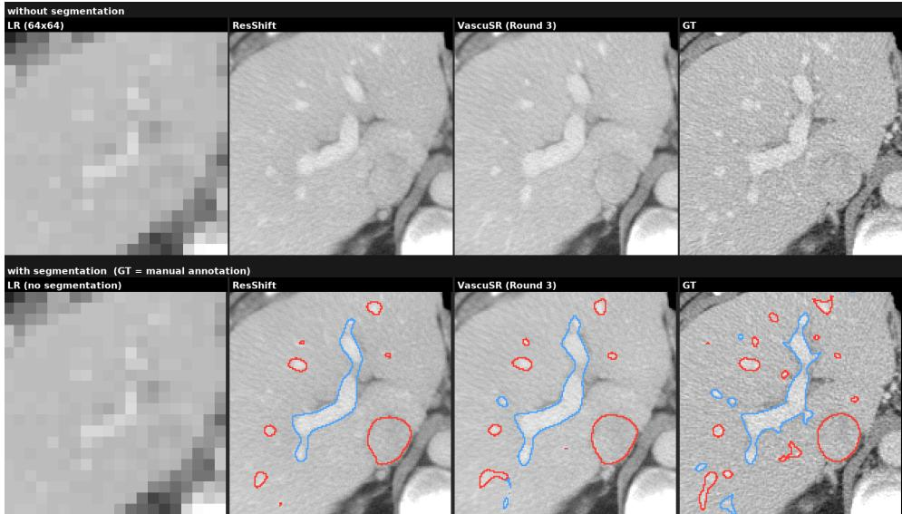

Figure 2: MSD case 416 at axial slice z = 094. Columns: LR, ResShift, VascuSR (round 3), and HR. Top: image intensities; bottom: HV (red) and PV (blue) contour overlays.  
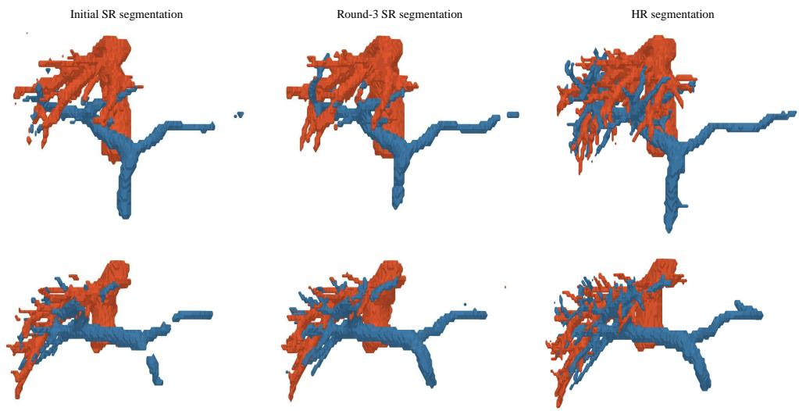  
Figure 3: Three-dimensional vascular comparison on MSD cases 416 (top) and 411 (bottom). Columns: initial SR (round 0), round-3 SR, and HR segmentations. Red: HV; blue: PV.

## 4.7 PARAMETER AND RUNTIME OVERHEAD

We report the parameter counts of the components added to the pipeline and their inference time. As shown in Table 3, the anatomy controller and FlowSeg3D introduce only modest parameter overhead relative to ResShift. With eight refinement trajectories sampled in parallel, a three-round configuration processes one volume in approximately 6 min, which is acceptable for offline volumetric analysis.

Table 3: Parameter and runtime overhead. (a) The parameter total includes the ResShift backbone, anatomy controller, and FlowSeg3D refiner; GFLOPs are measured end to end for one SR pass. (b) Runtime per three-dimensional volume; FlowSeg3D uses $N = 8$ parallel trajectories.  
(a) Parameters and SR-generation compute
<table><tr><td>Method</td><td>Backbone incl. Controller VQ-f4 (M)</td><td>(M)</td><td> $\mathrm { F l o w S e g 3 D }$  (M)</td><td>Total (M)</td><td>End-to-end GFLOPs/ SR pass</td></tr><tr><td>ResShift</td><td>172.01</td><td></td><td></td><td>172.01</td><td>6248.69</td></tr><tr><td>VascuSR</td><td>172.01</td><td>1.44</td><td>16.25</td><td>189.70</td><td>6284.01</td></tr></table>

(b) Runtime per volume (s)
<table><tr><td>Pass</td><td>SR generation</td><td>VSNet</td><td>FlowSeg3D  $( N = 8 )$ </td><td>Total</td></tr><tr><td>Initial zero-mask</td><td> $1 8 . 4 1 \pm 1 . 8 3$ </td><td></td><td></td><td> $1 8 . 4 1 \pm 1 . 8 3$ </td></tr><tr><td>Feedback round 1</td><td> $1 8 . 4 0 \pm 1 . 8 2$ </td><td> $1 . 9 4 \pm 0 . 4 3$ </td><td> $1 0 2 . 2 2 \pm 1 7 . 8 7$ </td><td> $1 2 2 . 5 6 \pm 1 7 . 5 3$ </td></tr><tr><td>Feedback round 2</td><td> $1 8 . 4 4 \pm 1 . 8 5$ </td><td> $1 . 9 5 \pm 0 . 4 3$ </td><td> $9 7 . 5 9 \pm 1 3 . 0 6$ </td><td> $1 1 7 . 9 8 \pm 1 3 . 1 9$ </td></tr><tr><td>Feedback round 3</td><td> $1 8 . 4 1 \pm 1 . 8 3$ </td><td> $1 . 9 5 \pm 0 . 4 4$ </td><td> $1 0 0 . 3 6 \pm 1 7 . 7 8$ </td><td> $1 2 0 . 7 2 \pm 1 7 . 6 3$ </td></tr></table>

## 5 CONCLUSION AND DISCUSSION

We introduced VascuSR, an iterative anatomy-aware diffusion framework for vascular CT superresolution that decouples three-dimensional vascular refinement from CT intensity reconstruction and connects them through anatomical conditioning. Across MSD Task08 and HVM, VascuSR improves Dice and clDice over the matched ResShift backbone while maintaining comparable image-level reconstruction quality. Connectivity and centerline analyses further show reduced fragmentation and closer agreement with reference vessel geometry. Further comparisons with joint optimization of image reconstruction and anatomical objectives support the benefits of our decoupled design in local image fidelity, vascular structure, and training efficiency. These findings support learning an anatomical prior in vascular label space and transferring it to SR through conditioning, while retaining HR-supervised reconstruction as the image objective.

Limitations and Future Work. The current framework performs SR slice-wise and relies on a fixed vessel segmenter and separately trained 3D refiner, which may limit volumetric consistency and allow errors to accumulate across feedback iterations. We also present exploratory results on coronary CTA in Appendix C, extending the evaluation beyond hepatic vessels. However, larger-scale evaluation across diverse vascular systems remains necessary. Future work will investigate fully volumetric and more tightly integrated reconstruction frameworks, adaptive or more efficient refinement, and broader evaluation across anatomies, acquisition settings, and downstream vascular-analysis tasks.

## ACKNOWLEDGMENTS

This work is supported in part by the U.S. Army Research Office under Army-ECASE award W911NF-07-R-0003-03, the U.S. Department Of Energy, Office of Science, ARPA-H-SOL-24-101 program, IARPA HAYSTAC Program, NSF Grants #2205093, #2146343, #2134274, #2441832 and CDC-RFA-FT-23-0069.

## REFERENCES

Michela Antonelli, Annika Reinke, Spyridon Bakas, et al. The medical segmentation decathlon. Nature Communications, 13(1):4128, 2022. doi: 10.1038/s41467-022-30695-9. URL https: //doi.org/10.1038/s41467-022-30695-9.

Xiangyu Chen, Xintao Wang, Jiantao Zhou, Yu Qiao, and Chao Dong. Activating more pixels in image super-resolution transformer. In 2023 IEEE/CVF Conference on Computer Vision and Pattern Recognition (CVPR), pp. 22367–22377. IEEE, 2023. doi: 10.1109/CVPR52729.2023.02142.

Jianning Chi, Zhiyi Sun, Tianli Zhao, Huan Wang, Xiaosheng Yu, and Chengdong Wu. Low-dose CT image super-resolution network with dual-guidance feature distillation and dual-path content communication. In Medical Image Computing and Computer Assisted Intervention – MICCAI 2023, volume 14229 of Lecture Notes in Computer Science, pp. 98–108. Springer Nature Switzerland, 2023. doi: 10.1007/978-3-031-43999-5\_10.

Yuetan Chu, Longxi Zhou, Gongning Luo, Zhaowen Qiu, and Xin Gao. Topology-preserving computed tomography super-resolution based on dual-stream diffusion model. In Medical Image Computing and Computer Assisted Intervention – MICCAI 2023, volume 14229 of Lecture Notes in Computer Science, pp. 260–270. Springer Nature Switzerland, 2023. doi: 10.1007/978-3-031-43999-5\_25.

Hyungjin Chung, Jeongsol Kim, Michael Thompson McCann, Marc Louis Klasky, and Jong Chul Ye. Diffusion posterior sampling for general noisy inverse problems. In The Eleventh International Conference on Learning Representations, 2023a. URL https://openreview.net/forum? id=OnD9zGAGT0k.

Hyungjin Chung, Eun Sun Lee, and Jong Chul Ye. MR image denoising and super-resolution using regularized reverse diffusion. IEEE Transactions on Medical Imaging, 42(4):922–934, April 2023b. doi: 10.1109/TMI.2022.3220681. URL https://doi.org/10.1109/TMI.2022. 3220681.

Chao Dong, Chen Change Loy, Kaiming He, and Xiaoou Tang. Learning a deep convolutional network for image super-resolution. In David Fleet, Tomas Pajdla, Bernt Schiele, and Tinne Tuytelaars (eds.), Computer Vision – ECCV 2014, volume 8692 of Lecture Notes in Computer Science, pp. 184–199. Springer International Publishing, 2014. doi: 10.1007/978-3-319-10593-2\_13.

Jiahe Huang, Guandao Yang, Zichen Wang, and Jeong Joon Park. DiffusionPDE: Generative PDE-solving under partial observation. In Advances in Neural Information Processing Systems, volume 37, pp. 130291–130323, 2024. doi: 10.52202/079017-4140.

Seunghoi Kim, Henry F. J. Tregidgo, Matteo Figini, Chen Jin, Sarang Joshi, and Daniel C. Alexander. Tackling hallucination from conditional models for medical image reconstruction with DynamicDPS. In Medical Image Computing and Computer Assisted Intervention – MICCAI 2025, volume 15963 of Lecture Notes in Computer Science, pp. 593–603. Springer Nature Switzerland, 2025. doi: 10.1007/978-3-032-04965-0\_56.

Lennart R. Koetzier, Domenico Mastrodicasa, Timothy P. Szczykutowicz, Niels R. van der Werf, Adam S. Wang, Veit Sandfort, Aart J. van der Molen, Dominik Fleischmann, and Martin J. Willemink. Deep learning image reconstruction for CT: Technical principles and clinical prospects. Radiology, 306(3):e221257, 2023. doi: 10.1148/radiol.221257.

Christian Ledig, Lucas Theis, Ferenc Huszar, Jose Caballero, Andrew Cunningham, Alejandro Acosta, Andrew P. Aitken, Alykhan Tejani, Johannes Totz, Zehan Wang, and Wenzhe Shi. Photo-realistic single image super-resolution using a generative adversarial network. In IEEE Conference on Computer Vision and Pattern Recognition (CVPR), pp. 105–114. IEEE Computer Society, 2017. doi: 10.1109/CVPR.2017.19.

David Lesage, Elsa D. Angelini, Isabelle Bloch, and Gareth Funka-Lea. A review of 3D vessel lumen segmentation techniques: Models, features and extraction schemes. Medical Image Analysis, 13 (6):819–845, 2009. doi: 10.1016/j.media.2009.07.011.

Guangyuan Li, Chen Rao, Juncheng Mo, Zhanjie Zhang, Wei Xing, and Lei Zhao. Rethinking diffusion model for multi-contrast MRI super-resolution. In Proceedings ofthe IEEE/CVF Confer ence on Computer Vision and Pattern Recognition (CVPR), pp. 11365–11374, June 2024a. doi: 10.1109/CVPR52733.2024.01080.

Honggui Li, Nahid Md Lokman Hossain, Maria Trocan, Dimitri Galayko, and Mohamad Sawan. CMISR: Circular medical image super-resolution. Engineering Applications of Artificial Intelligence, 133:108222, 2024b. doi: 10.1016/j.engappai.2024.108222.

Kaiyan Li, Weimin Zhou, Hua Li, and Mark A. Anastasio. Assessing the impact of deep neural network-based image denoising on binary signal detection tasks. IEEE Transactions on Medical Imaging, 40(9):2295–2305, 2021. doi: 10.1109/TMI.2021.3076810.

Jingyun Liang, Jiezhang Cao, Guolei Sun, Kai Zhang, Luc Van Gool, and Radu Timofte. SwinIR: Image restoration using swin transformer. In IEEE/CVF International Conference on Computer Vision Workshops (ICCVW), pp. 1833–1844. IEEE, 2021. doi: 10.1109/ICCVW54120.2021.00210.

Bee Lim, Sanghyun Son, Heewon Kim, Seungjun Nah, and Kyoung Mu Lee. Enhanced deep residual networks for single image super-resolution. In Proceedings ofthe IEEE Conference on Computer Vision and Pattern Recognition Workshops, pp. 136–144, 2017.

Xinqi Lin, Jingwen He, Ziyan Chen, Zhaoyang Lyu, Bo Dai, Fanghua Yu, Yu Qiao, Wanli Ouyang, and Chao Dong. DiffBIR: Toward blind image restoration with generative diffusion prior. In Computer Vision – ECCV 2024, volume 15117 of Lecture Notes in Computer Science, pp. 430–448. Springer Nature Switzerland, 2024. doi: 10.1007/978-3-031-73202-7\_25.

Xingchao Liu, Chengyue Gong, and Qiang Liu. Flow straight and fast: Learning to generate and transfer data with Rectified Flow. In The Eleventh International Conference on Learning Representations, 2023. URL https://openreview.net/forum?id=XVjTT1nw5z.

Matthew J. Muckley, Bruno Riemenschneider, Alireza Radmanesh, Sunwoo Kim, Geunu Jeong, Jingyu Ko, Yohan Jun, Hyungseob Shin, Dosik Hwang, Mahmoud Mostapha, Simon Arberet, Dominik Nickel, Zaccharie Ramzi, Philippe Ciuciu, Jean-Luc Starck, Jonas Teuwen, Dimitrios Karkalousos, Chaoping Zhang, Anuroop Sriram, Zhengnan Huang, Nafissa Yakubova, Yvonne W. Lui, and Florian Knoll. Results of the 2020 fastMRI challenge for machine learning MR image reconstruction. IEEE Transactions on Medical Imaging, 40(9):2306–2317, 2021. doi: 10.1109/ TMI.2021.3075856.

Chitwan Saharia, Jonathan Ho, William Chan, Tim Salimans, David J. Fleet, and Mohammad Norouzi. Image super-resolution via iterative refinement. IEEE Transactions on Pattern Analysis and Machine Intelligence, 45(4):4713–4726, 2023. doi: 10.1109/TPAMI.2022.3204461.

Suprosanna Shit, Johannes C. Paetzold, Anjany Sekuboyina, Ivan Ezhov, Alexander Unger, Andrey Zhylka, Josien P. W. Pluim, Ulrich Bauer, and Bjoern H. Menze. clDice – a novel topologypreserving loss function for tubular structure segmentation. In IEEE Conference on Computer Vision and Pattern Recognition (CVPR), pp. 16560–16569. Computer Vision Foundation / IEEE, 2021. doi: 10.1109/CVPR46437.2021.01629.

Jianyi Wang, Zongsheng Yue, Shangchen Zhou, Kelvin C. K. Chan, and Chen Change Loy. Exploiting diffusion prior for real-world image super-resolution. International Journal of Computer Vision, 132:5929–5949, 2024. doi: 10.1007/s11263-024-02168-7.

Zhihao Wang, Jian Chen, and Steven C. H. Hoi. Deep learning for image super-resolution: A survey. IEEE Transactions on Pattern Analysis and Machine Intelligence, 43(10):3365–3387, 2021. doi: 10.1109/TPAMI.2020.2982166.

Zhou Wang, Alan C. Bovik, Hamid R. Sheikh, and Eero P. Simoncelli. Image quality assessment: From error visibility to structural similarity. IEEE Transactions on Image Processing, 13(4): 600–612, April 2004. doi: 10.1109/TIP.2003.819861.

Jakob Wasserthal, Hanns-Christian Breit, Manfred T. Meyer, Maurice Pradella, Daniel Hinck, Alexander W. Sauter, Tobias Heye, Daniel T. Boll, Joshy Cyriac, Shan Yang, Michael Bach, and Martin Segeroth. TotalSegmentator: Robust segmentation of 104 anatomic structures in CT images. Radiology: Artificial Intelligence, 5(5):e230024, 2023. doi: 10.1148/ryai.230024.

Tingting Xie, Xunqi Li, Linyu Zhang, Xuankai Huang, Ziwei Liu, Chunlan Huang, Qi Cai, Zixin Zhang, Chao Wang, Xilun Ma, Ruibin Huang, Zhendong Luo, Guanxun Cheng, Demin Xu, Zaiyi Liu, and Cheng Lu. Hepatic vessel map (HVM): An expert-annotated CT dataset for clinically applicable AI in liver vascular segmentation and surgical planning. Scientific Data, 13(1), June 2026. doi: 10.1038/s41597-026-07550-3. URL https://doi.org/10.1038/ s41597-026-07550-3.

Jichen Xu, Anqi Dong, Yang Yang, Shuo Jin, Jianping Zeng, Zhengqing Xu, Wei Jiang, Liang Zhang, Jiahong Dong, and Bo Wang. VSNet: Vessel structure-aware network for hepatic and portal vein segmentation. Medical Image Analysis, 101:103458, 2025. doi: 10.1016/j.media.2025.103458. URL https://doi.org/10.1016/j.media.2025.103458.

Jiachen Yao, Zi-Siang Hsu, Xi Deng, Aditi Gupta, Xin Ju, Sally M Benson, Gege Wen, and Anima Anandkumar. Posteriorbench: From point estimates to posterior matching in evaluating generative inverse solvers. arXiv preprint arXiv:2609.20794, 2026.

Chenyu You, Guang Li, Yi Zhang, Xiaoliu Zhang, Hongming Shan, Mengzhou Li, Shenghong Ju, Zhen Zhao, Zhuiyang Zhang, Wenxiang Cong, Michael W. Vannier, Punam K. Saha, Eric A. Hoffman, and Ge Wang. CT super-resolution GAN constrained by the identical, residual, and cycle learning ensemble (GAN-CIRCLE). IEEE Transactions on Medical Imaging, 39(1):188–203, 2020. doi: 10.1109/TMI.2019.2922960.

Zongsheng Yue, Jianyi Wang, and Chen Change Loy. ResShift: Efficient diffusion model for image super-resolution by residual shifting. In Advances in Neural Information Processing Systems, volume 36, 2023. URL https://papers.nips.cc/paper\_files/paper/2023/hash/ 2ac2eac5098dba08208807b65c5851cc-Abstract-Conference.html.

An Zeng, Chunbiao Wu, Meiping Huang, Jian Zhuang, Shanshan Bi, Dan Pan, Najeeb Ullah, Kaleem Nawaz Khan, Tianchen Wang, Yiyu Shi, Xiaomeng Li, Guisen Lin, and Xiaowei Xu. ImageCAS: A large-scale dataset and benchmark for coronary artery segmentation based on computed tomography angiography images. Computerized Medical Imaging and Graphics, 109: 102287, 2023. doi: 10.1016/j.compmedimag.2023.102287.

Jin Zhang, Wen Wang, Jinhua Dong, Xiong Yang, Shuwei Bai, Jiaqi Tian, Bo Li, Xiao Li, Jianjian Zhang, Hangyu Wu, Xiaoxi Zeng, Yongqiang Ye, Shenghao Ding, Jieqing Wan, Ke Wu, Yufei Mao, Cheng Li, Na Zhang, Jianrong Xu, Yongming Dai, Feng Shi, Beibei Sun, Yan Zhou, and Huilin Zhao. Rapid vessel segmentation and reconstruction of head and neck angiograms from MR vessel wall images. npj Digital Medicine, 8(1):483, 2025. doi: 10.1038/s41746-025-01866-x. URL https://www.nature.com/articles/s41746-025-01866-x.

Richard Zhang, Phillip Isola, Alexei A. Efros, Eli Shechtman, and Oliver Wang. The unreasonable effectiveness of deep features as a perceptual metric. In Proceedings of the IEEE Conference on Computer Vision and Pattern Recognition, pp. 586–595, 2018a.

Yulun Zhang, Kunpeng Li, Kai Li, Lichen Wang, Bineng Zhong, and Yun Fu. Image super-resolution using very deep residual channel attention networks. In Computer Vision – ECCV 2018, volume 11211 of Lecture Notes in Computer Science, pp. 294–310. Springer, 2018b. doi: 10.1007/ 978-3-030-01234-2\_18.

## A APPENDIX

## A.1 TRAINING AND INFERENCE DETAILS

Patient splits. Table 4 reports the patient-level dataset partitions. For MSD, 81 of the 243 training patients are used to train FlowSeg3D and the remaining 162 to train the joint SR/controller model. For HVM, the corresponding counts are 75 and 148 out of 223 training patients. The VSNet is trained on all patients of the training sets.

Table 4: Patient-level dataset partitions.
<table><tr><td>Dataset</td><td>Training</td><td>Validation</td><td>Test</td></tr><tr><td>Re-annotated MSD Task08</td><td>243</td><td>30</td><td>30</td></tr><tr><td>HVM</td><td>223</td><td>29</td><td>29</td></tr></table>

Controller training conditions. During joint training of the SR backbone and anatomy controller, we sample anatomical conditions from three sources: raw VSNet labels from HR images, FlowSeg3Drefined labels from SR images, and an all-zero mask. The corresponding sampling probabilities are 0.35, 0.35, and 0.30 on MSD, and 0.425, 0.425, and 0.15 on HVM, respectively.

SR training objective. The backbone and controller are jointly trained from scratch with the official ResShift objective. The VQ-f4 autoencoder remains frozen, and the LPIPS reference is its round-trip reconstruction of the HR target.

SR optimization and inference. We use AdamW with a learning rate of $5 \times 1 0 ^ { - 5 }$ and a global batch size of 16, and use the checkpoint at 50,000 updates. Training and inference use the four-step ResShift diffusion process. Training is performed with DDP on four NVIDIA RTX PRO 6000 Blackwell GPUs.

FlowSeg3D inputs and training. On both datasets, the velocity network is a 3D U-Net with 24 base channels, trained on 128 × 128 × 96 patches with batch size 2 and an 80% probability of foreground-centered sampling. We use AdamW with learning rate $2 \times 1 0 ^ { - 4 }$ , 500 warm-up iterations, and EMA decay 0.999, optimizing the velocity MSE in Equation 5. The noise amplitude in Equation 4 is σ = 1.0 during both training and inference on MSD and HVM.

FlowSeg3D inference. The region of interest is the VSNet-predicted vessel bounding box expanded by 24 voxels. Velocity predictions use sliding windows with 50% overlap. We integrate $N = 8$ independent-noise trajectories in parallel from τ = 1 to τ = 0 with ten Euler steps, keeping the probability condition fixed. After hard decoding, class frequencies are aggregated as in Equation 6. We retain frequencies strictly above 0.3 on MSD and 0.4 on HVM, corresponding to at least three and four votes out of eight, respectively. These thresholds are selected separately on the validation set of each dataset. If both classes pass, the higher frequency wins, with ties assigned to HV.

## A.2 ABLATION STUDY: ITERATIVE ANATOMICAL FEEDBACK

We examine how anatomical fidelity and image quality change over successive feedback rounds. On MSD (Table 5), all five feedback rounds improve the reported Dice and clDice scores over ResShift. These metrics largely stabilize by round 3, with later rounds showing fluctuations rather than consistent gains. Image-quality metrics remain similar across feedback rounds.

Table 5: Effect of iterative anatomical feedback on the MSD Task08 HepaticVessel test set. The 0-mask setting retains the controller architecture without anatomical conditioning. The best result in each column is shown in bold, including ties.
<table><tr><td rowspan="2">Arm</td><td colspan="2">Dice ↑</td><td colspan="2">clDice ↑</td><td colspan="3">Image quality</td></tr><tr><td>HV</td><td>PV</td><td>HV</td><td>PV</td><td>PSNR↑</td><td>SSIM↑</td><td>LPIPS ↓</td></tr><tr><td>ResShift (baseline)</td><td>.6526</td><td>.5923</td><td>.5877</td><td>.4460</td><td>32.83</td><td>.8896</td><td>.0660</td></tr><tr><td>0-mask</td><td>.6587</td><td>.5644</td><td>.5909</td><td>.4286</td><td>32.78</td><td>.8877</td><td>.0650</td></tr><tr><td>VascuSR, round 1</td><td>.7077</td><td>.6334</td><td>.6381</td><td>.5158</td><td>32.77</td><td>.8876</td><td>.0649</td></tr><tr><td>VascuSR, round 2</td><td>.7050</td><td>.6337</td><td>.6431</td><td>.5267</td><td>32.77</td><td>.8876</td><td>.0649</td></tr><tr><td>VascuSR, round 3</td><td>.7072</td><td>.6404</td><td>.6446</td><td>.5286</td><td>32.77</td><td>.8876</td><td>.0649</td></tr><tr><td>VascuSR, round 4</td><td>.6932</td><td>.6365</td><td>.6410</td><td>.5203</td><td>32.77</td><td>.8876</td><td>.0650</td></tr><tr><td>VascuSR, round 5</td><td>.7039</td><td>.6370</td><td>.6503</td><td>.5235</td><td>32.77</td><td>.8876</td><td>.0650</td></tr></table>

Table 6 reports the corresponding HVM ablation. HVM reaches its strongest overall results around rounds 2–3.

Table 6: Effect of iterative anatomical feedback on HVM. The 0-mask setting (R0) retains the controller architecture without anatomical conditioning. The best result in each column is shown in bold.
<table><tr><td rowspan="2">Arm</td><td colspan="2">Dice ↑</td><td colspan="2">clDice ↑</td><td colspan="3">Image quality</td></tr><tr><td>HV</td><td>PV</td><td>HV</td><td>PV</td><td>PSNR↑</td><td>SSIM↑</td><td>LPIPS ↓</td></tr><tr><td>ResShift (baseline)</td><td>.5977</td><td>.6914</td><td>.5687</td><td>.5302</td><td>23.50</td><td>.7001</td><td>.0743</td></tr><tr><td>0-mask (R0)</td><td>.5928</td><td>.6888</td><td>.5637</td><td>.5289</td><td>23.40</td><td>.6990</td><td>.0744</td></tr><tr><td>VascuSR, round 1</td><td>.6191</td><td>.7113</td><td>.5980</td><td>.5689</td><td>23.41</td><td>.6990</td><td>.0744</td></tr><tr><td>VascuSR, round 2</td><td>.6206</td><td>.7117</td><td>.6033</td><td>.5731</td><td>23.40</td><td>.6990</td><td>.0744</td></tr><tr><td>VascuSR, round 3</td><td>.6191</td><td>.7111</td><td>.6028</td><td>.5768</td><td>23.40</td><td>.6990</td><td>.0745</td></tr><tr><td>VascuSR, round 4</td><td>.6168</td><td>.7088</td><td>.6012</td><td>.5722</td><td>23.40</td><td>.6990</td><td>.0745</td></tr><tr><td>VascuSR, round 5</td><td>.6149</td><td>.7069</td><td>.5979</td><td>.5724</td><td>23.40</td><td>.6990</td><td>.0745</td></tr></table>

The 0-mask setting retains the additional controller parameters but does not consistently improve Dice or clDice over ResShift. This indicates that VascuSR’s anatomical gains depend on anatomical conditioning rather than increased model capacity alone.

## A.3 ADDITIONAL QUALITATIVE RESULTS

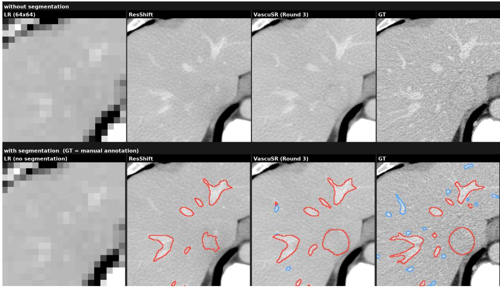  
Figure 4: Additional qualitative comparison on held-out MSD case 416 at axial slice $z = 1 1 4$ Columns show LR, ResShift, VascuSR after three feedback rounds, and the HR reference (GT). The upper row shows intensity crops; the lower row adds vascular contours to the reconstructed and HR images. Red and blue denote HV and PV, respectively.

In Figure 4, a low-contrast, approximately circular HV cross-section in the lower-right region is only weakly and irregularly delineated by ResShift. Anatomical feedback makes its boundary more regular and the predicted contour closer to the manual annotation.

(a)  
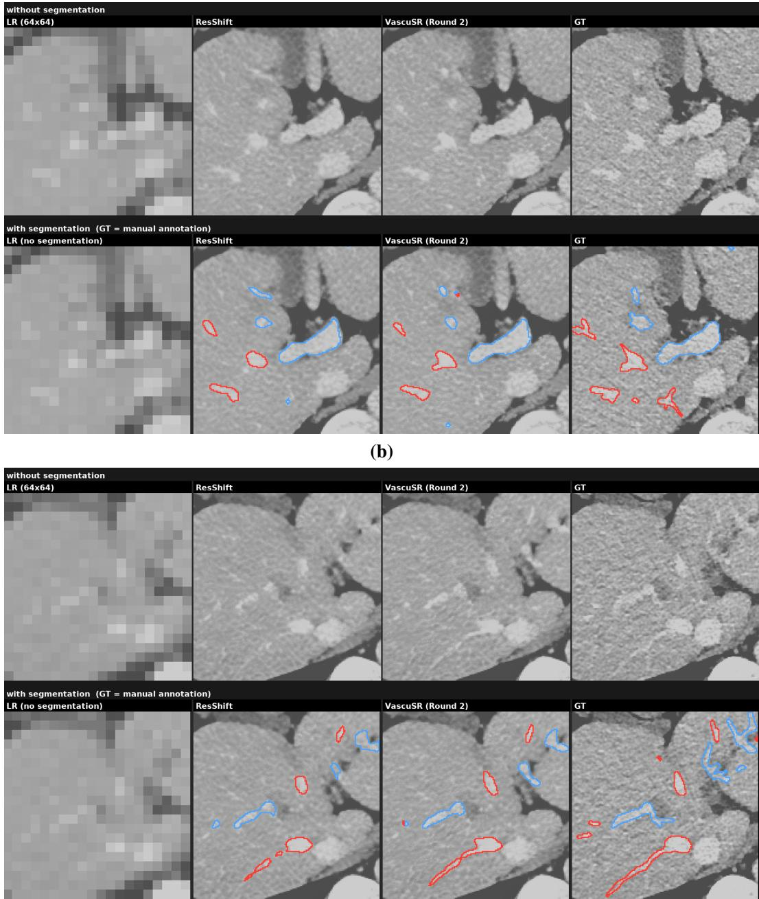  
Figure 5: Additional qualitative comparison on held-out HVM case 109 at axial slices $\mathrm { ( a ) } z = 1 7 9$ and $( \mathbf { b } ) \ z = 2 0 4$ . Columns show LR, ResShift, VascuSR after two feedback rounds, and the HR reference (GT). The upper row of each panel shows intensity crops; the lower row adds vascular contours to the reconstructed and HR images. Red and blue denote HV and PV, respectively; HR contours are manual annotations.

In panel (a), the central HV cross-section appears rounded in ResShift, whereas VascuSR recovers a more angular shape that more closely resembles the HR reference. In panel (b), the elongated HV and PV structures near the center appear interrupted in ResShift and become more continuous with VascuSR.

HVM vessel segmentation front view (HV red / PV blue)

Initial SR segmentation

Round-2 SR segmentation

HR segmentation

m \_c1 \_09 m \_c2 \_02 m \_c2 \_13 m \_c1 \_07

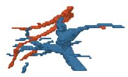

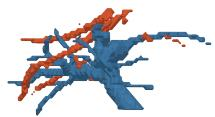

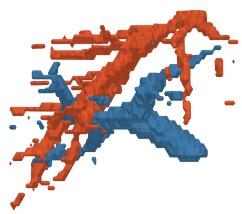

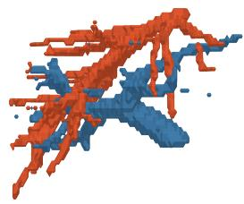

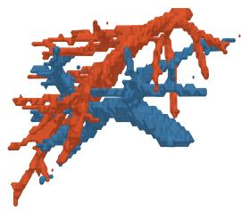

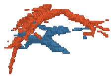

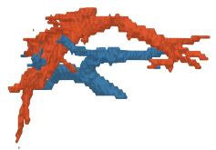

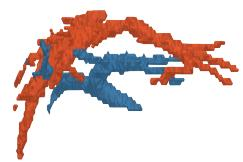

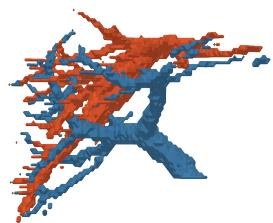

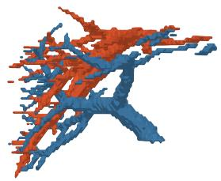

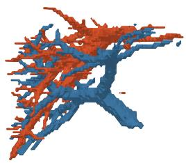

Figure 6: Three-dimensional qualitative comparison on four held-out HVM cases. Columns show the initial SR segmentation, round-2 SR segmentation, and segmentation of the HR reference. Red and blue denote HV and PV, respectively.

## B WHY ANATOMICAL CONDITIONING RATHER THAN SEGMENTATION-LOSS FINE-TUNING?

VascuSR starts from two requirements for vascular CT super-resolution: reconstruct CT images that are faithful to the HR reference while preserving vascular anatomical plausibility. A diffusion reconstruction objective addresses the first requirement, but spatially averaged image agreement alone does not ensure that the reconstructed vasculature is anatomically plausible. A 3D vessel representation is therefore a useful source of supervision: it captures continuity and branching across slices and, with more fine-grained segmentation, can also provide vessel categories. The design question is how to turn this structural supervision into a learning signal, and which architecture should carry it.

The most direct approach is to add Dice and soft-clDice to the SR objective and fine-tune the image generator through a frozen segmenter. This approach works: on MSD it improves Dice and clDice over ResShift (Table 1). To explain why we use anatomical conditioning rather than direct fine-tuning, we first compare the two training strategies, then examine the limitations of this fine-tuning baseline and the advantages of VascuSR in image fidelity in the vessel neighborhood, vascular structure, and training cost.

## B.1 TWO WAYS TO INTRODUCE ANATOMICAL SUPERVISION

We seek an SR image Y with both image fidelity and anatomically plausible vessels. These requirements can be expressed by the conceptual objective

$$
\operatorname* { m i n } _ { Y } \left[ \underbrace { \mathcal { L } _ { \mathrm { i m a g e } } ( Y ; X ) } _ { \mathrm { i m a g e f i d e l i t y } } + \lambda \underbrace { \Phi ( T ( Y ) ) } _ { \mathrm { a n a t o m i c a l p l a u s i b i l i t y } } \right] .\tag{10}
$$

Here $X$ is the LR input, $T$ extracts the vascular representation from $Y$ , and Φ penalizes anatomically implausible structure. The two strategies below differ in how they address these image and anatomy requirements.

Direct fine-tuning with Dice and soft-clDice. Fine-tuning implements the two requirements through the joint objective

$$
\begin{array} { r l } { \underset { \omega } { \operatorname* { m i n } } } & { \mathcal { L } _ { \mathrm { i m a g e } } ( Y _ { \omega } ; X ) } \\ & { + \lambda \left[ \mathcal { L } _ { \mathrm { D i c e } } ( T ( Y _ { \omega } ) , V ^ { \star } ) + \alpha \mathcal { L } _ { \mathrm { s o f t - c l D i c e } } ( T ( Y _ { \omega } ) , V ^ { \star } ) \right] . } \end{array}\tag{11}
$$

Here $Y _ { \omega }$ is the SR output, $V ^ { \star }$ is the task-specific reference segmentation, and ω denotes the generator parameters. The image and anatomy losses update the same generator, with $T$ frozen.

We evaluate checkpoints after 1,200 optimizer updates on MSD and 2,000 optimizer updates on HVM, using learning rates of $1 0 ^ { - 5 }$ and $5 \times 1 0 ^ { - 6 }$ , respectively. In both settings, α is gradually increased from 0 to 0.5. Small learning rates are used to preserve the pretrained reconstruction behavior, while the warm-up introduces skeleton supervision gradually.

Implicit anatomical regularization through conditioning. VascuSR addresses Equation 10 through two separately supervised tasks: the SR model learns image fidelity from HR, while the refiner learns vascular correction toward the manual reference $V ^ { \star }$ through its flow loss (Equation 5). In this supervised interpretation, write the anatomical penalty as $\Phi ( { \bar { V } } ) = d ( V , V ^ { \star } )$ , where d is a metric on the shared vascular representation, such as voxelwise $L _ { 1 }$ . For the refined condition $\widetilde { V } = R _ { \psi } ( T ( Y _ { 0 } ) )$ and its conditioned reconstruction $Y _ { 1 }$

$$
\Phi ( T ( Y _ { 1 } ) ) = \underbrace { d ( T ( Y _ { 1 } ) , V ^ { \star } ) } _ { \mathrm { f i n a l ~ v a s c u l a r \mathrm { e r r o r } } } \le \underbrace { d ( \widetilde { V } , V ^ { \star } ) } _ { \mathrm { r e f i n e m e n t \mathrm { e r r o r } } } + \underbrace { d ( T ( Y _ { 1 } ) , \widetilde { V } ) } _ { \mathrm { t r a n s f e r \mathrm { e r r o r } } } ,\tag{12}
$$

Thus, the final vascular error is the anatomical penalty in Equation 10. When conditioning keeps the transfer error small, reducing refinement error tightens the bound on that penalty. Image reconstruction and vascular refinement therefore address the two terms through separate supervised objectives, with conditioning linking them.

## B.2 IMAGE FIDELITY NEAR VESSELS

We assess whether improved vascular segmentation is accompanied by faithful CT reconstruction near vessels. Table 7 compares final SR images with HR within a 3 mm dilation of the manual HV/PV union. SSIM and spatial LPIPS are sampled within the ROI from maps computed on full, unmasked slices.

Table 7: Image quality within the 3 mm vessel ROI on the MSD test set. Values are patient-macro means; PSNR is in dB. This comparison uses VascuSR R3.
<table><tr><td>Method</td><td>ROI PSNR ↑</td><td>ROI SSIM ↑</td><td>ROI spatial-LPIPS ↓</td></tr><tr><td>ResShift</td><td>34.5933</td><td>0.815880</td><td>0.155418</td></tr><tr><td>ResShift+Dice/clDice</td><td>33.0302</td><td>0.786745</td><td>0.160075</td></tr><tr><td>VascuSR, round 3</td><td>34.4383</td><td>0.815435</td><td>0.147031</td></tr></table>

VascuSR R3 improves all three ROI image-quality metrics over fine-tuning. For a complementary assessment of absolute CT intensity, Table 8 reports MAE, RMSE, and signed bias against native HR within a 3 mm dilation of the manual HV/PV union. For N ROI voxels, let $e _ { i }$ be the SR intensity minus the HR intensity at voxel i. Then $\begin{array} { r } { \mathrm { M A E } = N ^ { - 1 } \sum _ { i } \left| e _ { i } \right| } \end{array}$ $\begin{array} { r } { \mathrm { R M S E } = \sqrt { N ^ { - 1 } \sum _ { i } e _ { i } ^ { 2 } } } \end{array}$ , and signed bias $\textstyle = { \frac { 1 } { N } } \sum _ { i = 1 } ^ { N } e _ { i }$

Table 8: Image fidelity within the 3 mm vessel ROI on the MSD test set. Values are in HU; positive bias indicates overestimated intensity.
<table><tr><td>Method</td><td>MAE↓</td><td>RMSE↓</td><td>Signed bias (→ 0)</td></tr><tr><td>ResShift</td><td>21.97</td><td>29.61</td><td>+1.95</td></tr><tr><td>VascuSR, round 3</td><td>22.21</td><td>29.86</td><td>+4.14</td></tr><tr><td>ResShift+Dice/clDice</td><td>26.49</td><td>34.40</td><td>+12.59</td></tr></table>

Tables 7 and 8 show that VascuSR largely preserves ResShift’s regional image quality (PSNR, SSIM, and spatial LPIPS) and image fidelity (MAE, RMSE, and signed bias), with modest degradation in some measures. We consider this an acceptable trade-off for pursuing anatomical plausibility alongside image fidelity, supported by the structural improvements in Tables 1 and 5. In contrast, ResShift+Dice/clDice worsens all six regional measures, indicating that direct fine-tuning improves Dice and clDice at the expense of substantially reduced local vascular image fidelity.

## B.3 CROSS-SEGMENTER EVALUATION AND LOCAL APPEARANCE

On the MSD test set, ResShift+Dice/clDice raises VSNet HV Dice from ResShift’s 0.6526 to 0.7010, close to VascuSR R3 at 0.7072 (Tables 1 and 5). To test whether this gain extends beyond VSNet, we evaluate the same reconstructions with frozen TotalSegmentator (TS 2.13.0) (Wasserthal et al., 2023). Fine-tuning falls below ResShift, whereas VascuSR R3 improves by 2.71 percentage points (Table 9). Low absolute scores may partly reflect a coverage mismatch: the manual GT includes large-caliber extrahepatic venous segments not captured by these TS predictions.

Table 9: TS vessel Dice on the MSD test set.
<table><tr><td>Method</td><td>TS vessel Dice ↑</td></tr><tr><td>ResShift</td><td>.2912</td></tr><tr><td>VascuSR, round 3</td><td>.3183</td></tr><tr><td>ResShift+Dice/clDice</td><td>.2803</td></tr></table>

Figure 7 examines the corresponding image appearance on MSD case 416. VascuSR restores the visible connection between the two vessel portions in the central PV, whereas fine-tuning does not visibly improve this connection. In the fine-tuned CT, the vessel portions are conspicuously bright, while the predicted blue contour still spans their connection. A segmentation contour can therefore look plausible even where the underlying intensity profile appears discontinuous.

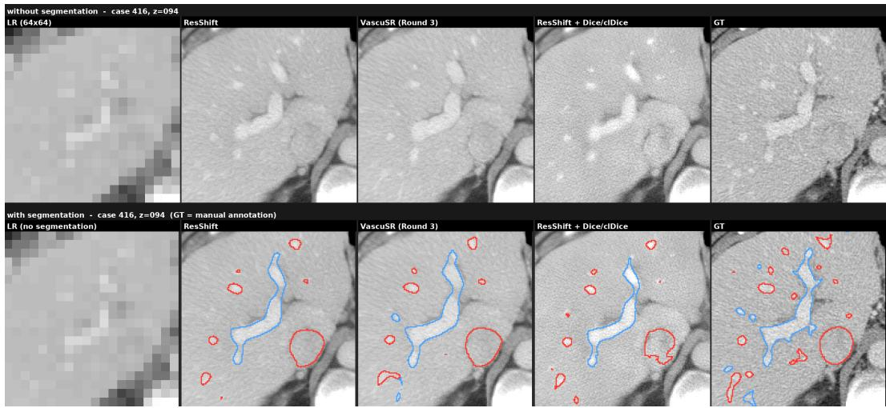  
Figure 7: Qualitative comparison on MSD case 416, axial slice z = 094. Columns show LR, ResShift, VascuSR after three feedback rounds, ResShift+Dice/clDice, and the HR reference. The upper row shows CT images; the lower row adds vascular contours, with HV in red and PV in blue. HR contours are manual annotations.

The brightening of vessel regions is also supported by quantitative intensity measurements: ResShift+Dice/clDice has a 3 mm ROI signed bias of +12.59 HU, compared with +1.95 HU for ResShift and +4.14 HU for VascuSR R3 (Table 8).

When evaluated with TS, fine-tuning shows no Dice improvement and instead scores slightly below ResShift (Table 9). Together with vessel brightening and the qualitative intensity–contour mismatch (Figure 7), this suggests that the model may have learned a segmenter-specific appearance shortcut, making vessels easier for VSNet to segment without improving their image fidelity. Its explicit Dice/clDice loss (Equation 11) directly rewards such segmentation gains. VascuSR instead learns structural correction in vascular label space and transfers it through anatomical conditioning (Equation 12), while retaining HR-supervised reconstruction as the image generator’s training objective. Without backpropagating a Dice loss through the generator, this design removes the direct Dice-based incentive to exploit a segmenter’s response and encourages the generator to use the refined anatomical condition to improve vascular topology and reconstruction.

## B.4 VASCULAR TOPOLOGY

Tables 10 and 11 compare vascular continuity and centerline accuracy on the same MSD test set.   
Connectivity uses 3D 26-neighborhoods.

Table 10: MSD vascular continuity for the three relevant methods, reproduced from Table 2.
<table><tr><td rowspan="2">Method</td><td colspan="2">HV</td><td colspan="2">PV</td></tr><tr><td>#CC↓</td><td>Largest-CC frac ↑</td><td>#CC↓</td><td>Largest-CC frac ↑</td></tr><tr><td>ResShift</td><td>31.0</td><td>.9077</td><td>26.0</td><td>.8843</td></tr><tr><td>ResShift+Dice/clDice</td><td>39.6</td><td>.8936</td><td>30.4</td><td>.8249</td></tr><tr><td>VascuSR, round 3</td><td>22.7</td><td>.9382</td><td>22.4</td><td>.8931</td></tr></table>

Table 11: Class-wise MSD MCD values (mm) from Table 2, with their HV/PV mean additionally reported.
<table><tr><td>Method</td><td>HV↓</td><td>PV↓</td><td>HV/PV mean ↓</td></tr><tr><td>ResShift</td><td>6.0457</td><td>8.0877</td><td>7.0667</td></tr><tr><td>VascuSR, round 3</td><td>5.2311</td><td>6.6351</td><td>5.9331</td></tr><tr><td>ResShift+Dice/clDice</td><td>5.6521</td><td>7.5368</td><td>6.5944</td></tr></table>

VascuSR improves both connectivity measures over ResShift+Dice/clDice, which even produces more components than ResShift; MCD also favors VascuSR on both MSD and HVM (Tables 11 and 2). One possible contributor to the poorer connectivity is the gap between soft supervision and binary structure. Soft-clDice encourages skeleton continuity using a differentiable soft-skeleton approximation (Shit et al., 2021). Optimizing this relaxed objective does not directly enforce every connection in the thresholded mask, so local breaks can remain after binarization.

Together, the connectivity and MCD results highlight a limitation of direct fine-tuning: anatomy is specified through manually selected differentiable penalties (Equation 11). These can favor the chosen scores while prompting repeated additions of constraints and weight tuning, without fully capturing what makes a vascular structure anatomically plausible.

VascuSR instead decouples vascular refinement from CT intensity reconstruction, removing organ texture and other high-frequency image details from the structural learning task. In this simpler 3D label space, the lightweight refiner uses a single conditional rectified-flow velocity-matching loss to learn the mapping from noisy imperfect predictions to GT (Equation 5). It thereby learns vascular spatial dependencies and implicitly models a conditional distribution of plausible vessel structures from paired annotations, without additional Dice, clDice, or other morphology-specific losses. The refinement–conditioning loop transfers this learned anatomical prior to SR while retaining HR reconstruction as the image objective (Equation 12).

## B.5 COMPUTATIONAL CONSEQUENCES OF DECOUPLING

Direct fine-tuning is also computationally expensive. Because the segmenter operates in 3D, each update must generate multiple SR slices, assemble them into a volume, compute Dice and soft-clDice from the segmentation, and backpropagate through the segmenter and SR generator. This repeated computation makes fine-tuning slow in practice.

Table 12: Training costs on HVM, excluding validation. The refiner is trained to the selected 50k checkpoint; ResShift+Dice/clDice is trained for 2,000 effective optimizer updates. For VascuSR, we report the training cost of the 3D vascular refiner.
<table><tr><td>Training stage</td><td>Wall time (h)</td><td>GPU-hours</td></tr><tr><td>VascuSR refiner</td><td>≈9.80</td><td>≈ 24.60</td></tr><tr><td>ResShift+Dice/clDice</td><td>29.33</td><td>94.93</td></tr></table>

Table 12 shows that VascuSR’s vascular refiner requires less training time and fewer GPU-hours than direct fine-tuning. Restricting refinement to vascular representation space simplifies the learning task, allowing a lightweight generative refiner to learn effective structural correction with substantially less training time than direct fine-tuning. In addition, training the ResShift backbone jointly with the anatomy controller takes approximately the same time as training the backbone alone.

## C EXTENSION TO CORONARY CTA ON IMAGECAS

Dataset and evaluation scope. We extend our evaluation beyond hepatic vessels to ImageCAS, a coronary CT angiography dataset (Zeng et al., 2023). We use a 300-case subset with 200 training, 50 validation, and 50 test cases.

Coronary segmenter. We initialize from the pretrained Dataset509 coronary model in TotalSegmentator 2.13 (Wasserthal et al., 2023) and fine-tune the entire network on the 200 training HR CT volumes and their manual binary coronary annotations. Training uses 1283 patches, batch size 2, and SGD with an initial learning rate of 0.001, momentum 0.99, Nesterov acceleration, weight decay $3 \times 1 0 ^ { - 5 }$ , and polynomial learning-rate decay.

Table 13: Coronary CTA results on the ImageCAS test set. Bold marks the best SR result in each column.
<table><tr><td>Method</td><td>Dice ↑</td><td>clDice ↑</td><td>PSNR (dB) ↑</td><td>SSIM↑</td></tr><tr><td>RCAN</td><td>0.7699</td><td>0.8432</td><td>31.29</td><td>0.8079</td></tr><tr><td>SwinIR</td><td>0.7702</td><td>0.8409</td><td>31.41</td><td>0.8096</td></tr><tr><td>ResShift</td><td>0.7658</td><td>0.8376</td><td>29.94</td><td>0.7647</td></tr><tr><td>VascuSR (Round 3)</td><td>0.7763</td><td>0.8530</td><td>29.84</td><td>0.7629</td></tr><tr><td>HR reference</td><td>0.8033</td><td>0.8610</td><td>∞</td><td>1.0000</td></tr></table>

Results and interpretation. Table 13 shows that VascuSR achieves the highest Dice and clDice among the evaluated SR methods. The absolute Dice and clDice gains over ResShift in Table 13 are modest, which may be caused by the fact that coronary vessel configurations are less complex than those in the hepatic setting, leaving less room for anatomical correction. Moreover, ResShift already performs close to the HR segmentation reference. VascuSR closes 28.0% of the ResShift-to-HR gap in Dice and 65.8% of that gap in clDice. In particular, its clDice reaches 0.8530, approaching the HR score of 0.8610.

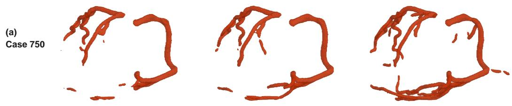

Three-dimensional qualitative comparison. Figure 8 compares coronary segmentations on cases 750, 986, and 902 at 8× in-plane super-resolution. These examples illustrate improved overlap and centerline agreement.

Initial

Round 3

HR

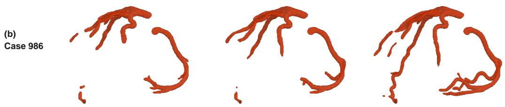

(c) Case 902

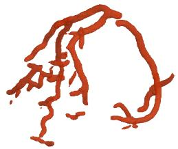

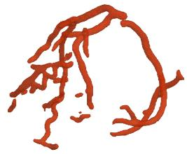

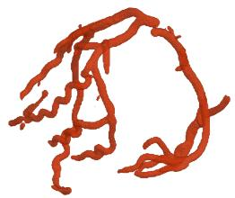  
Figure 8: Three-dimensional coronary-artery segmentations for ImageCAS cases (a) 750, (b) 986, and (c) 902. Columns show Initial (ResShift), Round 3 (VascuSR), and HR segmentations.

Axial qualitative comparison. Figure 9 shows an axial slice from ImageCAS case 750. In the upper-right region, VascuSR after three feedback rounds recovers a very small coronary vessel contour that is present in the manual annotation but missed by ResShift.

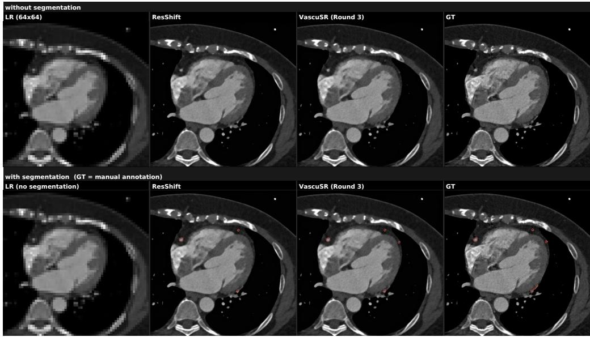  
Figure 9: Axial qualitative comparison on ImageCAS case 750 at $z = 1 3 5$ and 8× in-plane superresolution. Columns show LR, ResShift, VascuSR after three feedback rounds, and the HR reference. The upper row shows CT images and the lower row adds red coronary contours. HR contours are manual annotations.