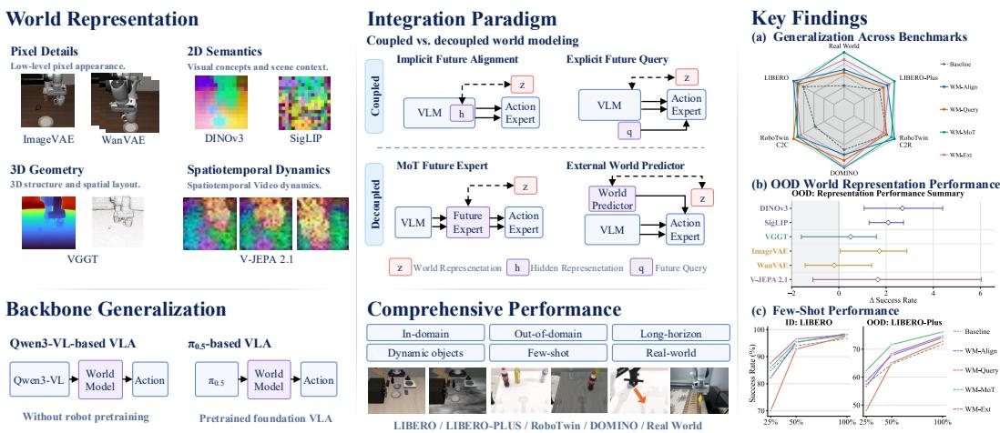
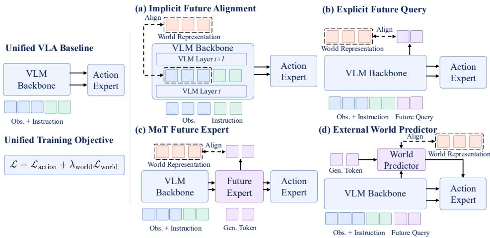
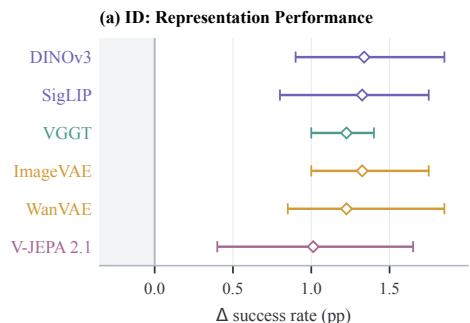
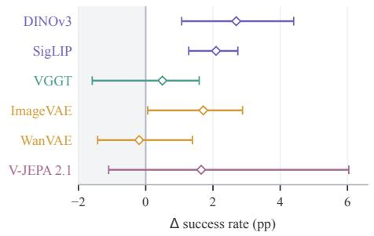
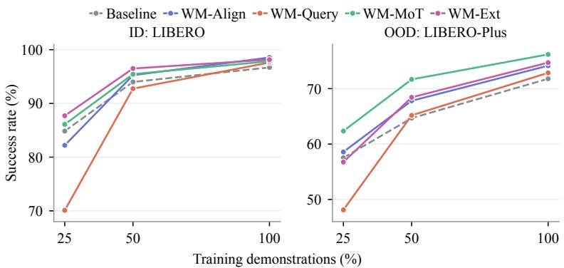
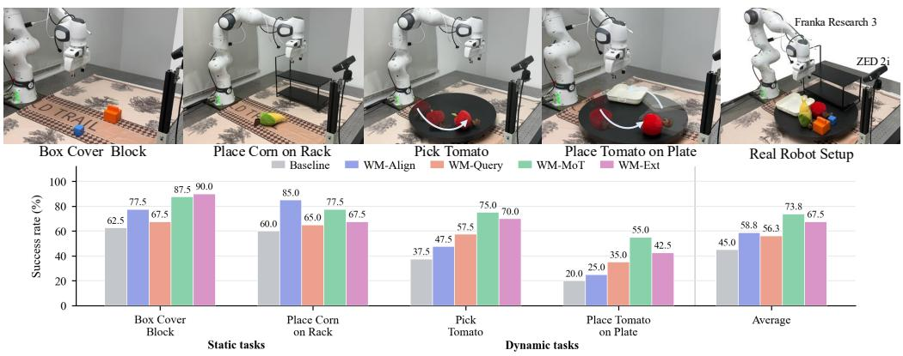
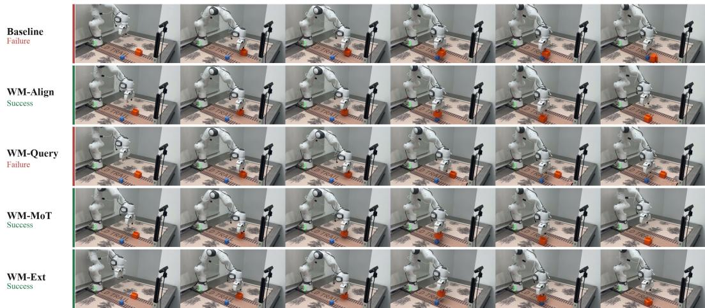
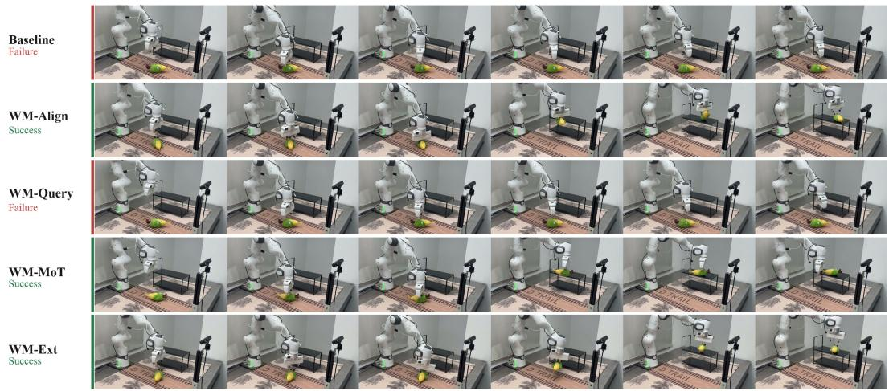
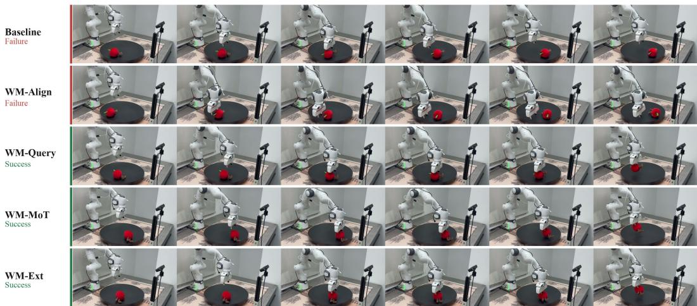
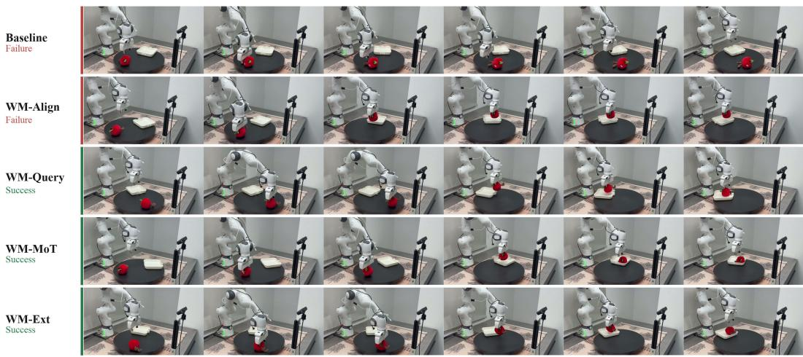

# WHAT MATTERS FOR WORLD MODELING IN VISION-LANGUAGE-ACTION MODELS?

Qisen Ma1,2 Yixiang Chen1,2 Yuan Xu1,2 Peiyan Li1,2 Jiabing Yang1,2

Kai Wang1,2 Jianhua Yang1,2 Jianlou Si3 Jun Huang3

Jing Liu4 Nianfeng Liu4 Yan Huang1,2,4 Liang Wang1,2

1New Laboratory of Pattern Recognition (NLPR),

Institute of Automation, Chinese Academy of Sciences

2School of Artificial Intelligence, University of Chinese Academy of Sciences

3Alibaba Group 4FiveAges

## ABSTRACT

Integrating world models into Vision-Language-Action models (VLAs) has emerged as a promising direction, enabling policies to anticipate future dynamics beyond reactive observation-to-action mapping. However, existing approaches vary simultaneously in their world representations, integration paradigms, and policy backbones, making it difficult to determine what truly matters for effective world model integration. To disentangle these factors, we categorize existing efforts into four representative paradigms, namely Implicit Future Alignment, Explicit Future Query, MoT Future Expert, and External World Predictor. We instantiate each within a unified framework and systematically evaluate these paradigms with diverse world representations and policy backbones across in-domain, out-of-domain, long-horizon, dynamic, few-shot, and real-world settings. Our study yields four main findings: 1) world representation effectiveness is paradigm-dependent, whereas 2D semantic representations offer robust, cross-paradigm gains; 2) no single paradigm is universally optimal, yet the decoupled MoT Future Expert offers competitive overall performance, particularly in OOD robustness; 3) world modeling consistently benefits policies built on standard VLMs, while decoupled designs exhibit greater compatibility with pretrained VLAs; and 4) world modeling improves performance over action-only baselines across multiple settings, with notable gains on long-horizon and dynamic tasks. Project page and video demonstrations are available at https: //dylanmqs.github.io/WM-in-VLAs/.

## 1 INTRODUCTION

Vision-Language-Action models (VLAs) (Zitkovich et al., 2023; Kim et al., 2024; Intelligence et al., 2025) have achieved notable success in robotic manipulation by adapting pretrained Vision-Language Models (VLMs) to continuous physical control. However, standard VLAs mainly predict actions from the current observation. Without modeling how the scene evolves under robot interaction, they struggle in long-horizon tasks and fail to adapt to distribution shifts or dynamic environments (Yang et al., 2026b; Chen et al., 2026b; Lyu et al., 2026).

To overcome this limitation, a promising direction is to integrate world models into VLAs to anticipate world dynamics (Cen et al., 2025; Zheng et al., 2025b). By incorporating world dynamics, such models have demonstrated improved long-horizon execution (Chen et al., 2026a), dynamic manipulation (Fang et al., 2026), environmental robustness (Sun et al., 2026), and sample efficiency (Chen et al., 2026b). Despite these empirical successes, existing studies adopt heterogeneous world representations, integration paradigms, and policy backbones. Specifically, they combine representations ranging from pixel details to semantic latents with designs such as implicit alignment and explicit conditioning across different VLA backbones (Zheng et al., 2025b; Lv et al., 2025; Su et al., 2026; Sun et al., 2026). Consequently, the true sources of empirical gains remain obscured, leaving it unclear which design choices fundamentally matter when integrating world modeling into VLAs.

Among these challenges, four core questions stand out: (1) World Representation: Is there a universally optimal world representation for robot policy learning, or is representation effectiveness fundamentally coupled with the integration paradigm? (2) Integration Paradigm: What are the performance trade-offs among different integration paradigms, and is coupled or decoupled world modeling more effective? (3) Backbone Generalization: Do world modeling integration paradigms remain effective across policy backbones, spanning models without robot pretraining and pretrained foundation VLAs? (4) Comprehensive Performance: How do different world modeling integration paradigms perform under diverse task conditions?

  
Figure 1: Systematic empirical investigation of world modeling in vision-language-action policies across four core dimensions, spanning world representation, integration paradigms, backbone generalization, and comprehensive performance across diverse settings.

In this work, we present the first systematic, controlled empirical investigation of world modeling in VLA policies, as shown in Figure 1. To isolate world modeling choices, we conduct our study under a unified pipeline with a shared policy backbone and training protocol within each com parison, systematically addressing the four core questions: First, to answer World Representation, we examine diverse world representations spanning pixel details (ImageVAE (Tian et al., 2024), WanVAE (Wan et al., 2025)), 2D semantics (DINOv3 (Simeoni et al., 2025), SigLIP (Zhai et al.,´ 2023)), 3D spatial geometry (VGGT (Wang et al., 2025)), and spatiotemporal video dynamics (V-JEPA 2.1 (Mur-Labadia et al., 2026)). Second, to answer Integration Paradigm, we formalize existing architectures into four integration paradigms defined by how world dynamics are conditioned on and decoupled from the policy, namely Implicit Future Alignment, Explicit Future Query, MoT Future Expert, and External World Predictor. We instantiate these paradigms as representative designs within our unified framework. Third, to answer Backbone Generalization, we benchmark world modeling paradigms across representative policy backbones spanning a standard VLM backbone (Qwen3-VL-2B (Bai et al., 2025)) and a dedicated robot foundation VLA (π (Intelligence et al., 2025)). Finally, to answer Comprehensive Performance, we evaluate these integration paradigms across diverse settings spanning in-domain and out-of-domain distributions, long horizons, dynamic objects, few-shot data, as well as real-world experiments.

Our extensive experiments yield four primary findings corresponding to our core questions: (1) World Representation: No single world representation is universally optimal. Pixel-level features do not consistently translate in-domain gains into OOD robustness, while geometric and spatiotemporal representations are sensitive to the integration paradigm. DINOv3 and SigLIP provide consistent gains across paradigms. (2) Integration Paradigm: No paradigm dominates across all settings, yet the decoupled MoT Future Expert offers competitive overall performance, particularly in OOD robustness. Implicit Future Alignment is lightweight but less effective on dynamic tasks, while Explicit Future Query is more task-dependent. The External World Predictor achieves the best low-data in-domain performance. (3) Backbone Generalization: Integration effective ness differs across policy backbones. World modeling generally benefits policies built on standard VLMs, whereas decoupled designs offer substantially better compatibility when adapting pretrained foundation VLAs. (4) Comprehensive Performance: World modeling provides clear gains over action-only policies, particularly on long-horizon and dynamic tasks. We believe these systematic findings provide actionable design principles for integrating world modeling into VLA systems.

## 2 RELATED WORK

Vision-Language-Action Models. Vision-Language-Action models (VLAs) (Kim et al., 2025; Intelligence et al., 2025; Ye et al., 2026) build on pretrained Vision-Language Models (VLMs) to predict robotic actions from a language instruction and the current observation. These models have shifted from autoregressive discrete token decoding (Zitkovich et al., 2023; Kim et al., 2024) to continuous diffusion- or flow-based action heads (Liu et al., 2024; Black et al., 2024; Intelligence et al., 2025). To enhance policy capabilities, parallel efforts inject 3D priors (Zhen et al., 2024; Qu et al., 2025; Li et al., 2025b;a), adopt dual-system architectures (Bjorck et al., 2025; Chen et al., 2025a; Cui et al., 2025), insert chain-of-thought reasoning before action generation (Zhao et al., 2025; Huang et al., 2026; Zhong et al., 2026; Wang et al., 2026), incorporate latent actions (Bu et al., 2025; Lin et al., 2026b), or train on heterogeneous data mixtures (Bu et al., 2025; Zheng et al., 2025a; 2026; Luo et al., 2026a). Despite these advances, standard VLAs inherit the static image–text pretraining of VLMs, lacking the temporal and physical dynamics priors essential for complex manipulation. This motivates recent efforts to integrate world modeling into policy learning.

World Modeling in VLAs. To overcome the limitations of reactive policies, recent works integrate world models to provide VLAs with physical dynamics. Depending on how world dynamics are conditioned on and decoupled from the policy, existing approaches can be organized into four paradigms: (1) Implicit Future Alignment uses world representations as auxiliary supervision to refine the VLM backbone without feeding predictions directly to the action head (Su et al., 2026; Xu et al., 2026; Sun et al., 2026; Lin et al., 2026a). (2) Explicit Future Query introduces ded icated query tokens into the VLM to predict future latents, serving as explicit context for action generation (Zhang et al., 2025b; Lin et al., 2025; Liu et al., 2026; Chen et al., 2026b; Luo et al., 2026b; Ma et al., 2026). (3) MoT Future Expert co-optimizes parallel action and future experts within a Mixture-of-Transformers architecture, conditioning action generation on the future expert’s intermediate hidden states (Lv et al., 2025; Zhang et al., 2025a; Bi et al., 2025; Won et al., 2025; Ma et al., 2026; Hu et al., 2026). (4) External World Predictor decouples prediction by employing a standalone world predictor, supplying predicted future states as visual subgoals for the policy (Chen et al., 2026a). However, the field still lacks a systematic and controlled comparison of these paradigms, leaving it unclear how different paradigms choices affect the effectiveness of world modeling in VLAs.

## 3 METHOD

## 3.1 PRELIMINARIES

Standard VLAs typically combine a pretrained VLM backbone with a trainable action expert to map observations and instructions into robot actions. Given an input observation $o _ { t } \in \mathbb { R } ^ { H \times \dot { W } \times 3 }$ and an instruction $c ,$ the backbone embeds them into visual and language tokens, $x _ { 1 : N } ^ { V }$ and $x _ { 1 : M } ^ { L } ,$ respectively. These tokens are processed across successive VLM attention layers to yield joint multimodal representations, from which the action expert decodes a continuous action chunk $\hat { a } _ { t : t + K - 1 }$

Based on this formulation, we establish a primary baseline by pairing a Qwen3-VL-2B (Bai et al., 2025) backbone with a layer-wise cross-DiT action expert, while $\pi _ { 0 . 5 }$ (Intelligence et al., 2025) is additionally used to evaluate backbone generalization. The action expert first projects a noisy action chunk into K action tokens $x _ { 1 : K } ^ { A }$ , which cross-attend to the visual and language tokens at each layer:

$$
\widetilde { x } _ { 1 : K } ^ { A } = \mathrm { C r o s s A t t n } \big ( x _ { 1 : K } ^ { A } , [ x _ { 1 : N } ^ { V } ; x _ { 1 : M } ^ { L } ] \big ) .\tag{1}
$$

Following Black et al. (2024), the VLM backbone and action expert are jointly trained using the flow-matching objective $\mathcal { L } _ { \mathrm { a c t i o n } }$

The following foresight strategies share this unified baseline, differing in how they integrate world modeling into action generation. To provide a unified supervision target across all strategies, a frozen encoder $E$ extracts the world representation $z _ { t : t + T }$ from future observations $\scriptstyle O _ { t : t + T } :$

$$
\begin{array} { r } { z _ { t : t + T } = E \bigl ( o _ { t : t + T } \bigr ) . } \end{array}\tag{2}
$$

All encoders receive the same future frames, ensuring identical temporal coverage. For image encoders, $E$ processes sampled frames independently, whereas for video encoders, it encodes the sequence jointly. Each strategy produces a predicted world representation $\hat { z } _ { t : t + T }$ , trained to maximize

  
Figure 2: Overview of the four representative world modeling integration paradigms for visionlanguage-action models: (a) Implicit Future Alignment, (b) Explicit Future Query, (c) MoT Future Expert, and (d) External World Predictor, categorized by how world dynamics are conditioned on and decoupled from the policy.

its alignment with the target $z _ { t : t + T }$ via a cosine similarity objective:

$$
\mathcal { L } _ { \mathrm { w o r l d } } = 1 - \cos ( \hat { z } _ { t : t + T } , z _ { t : t + T } ) ,\tag{3}
$$

The entire framework is optimized with a joint objective:

$$
\begin{array} { r } { \mathcal { L } = \mathcal { L } _ { \mathrm { a c t i o n } } + \lambda _ { \mathrm { w o r l d } } \mathcal { L } _ { \mathrm { w o r l d } } . } \end{array}\tag{4}
$$

## 3.2 STRATEGY 1: IMPLICIT FUTURE ALIGNMENT

Implicit Future Alignment introduces no dedicated architectural modules, but instead formulates world modeling as an auxiliary representation learning objective that infuses world dynamics directly into the VLM’s hidden representations (Su et al., 2026; Xu et al., 2026; Sun et al., 2026; Lin et al., 2026a), as illustrated in Fig. 2(a).

Specifically, this strategy supervises the VLM’s visual representations to capture predictive world dynamics. Formally, given visual tokens $x _ { 1 : N } ^ { V }$ from an intermediate layer, a lightweight MLP predictor projects them to align with the target world representation $z _ { t : t + T } .$

$$
\mathcal { L } _ { \mathrm { w o r l d } } = 1 - \cos \bigl ( \mathrm { M L P } ( x _ { 1 : N } ^ { V } ) , z _ { t : t + T } \bigr ) .\tag{5}
$$

Under this predictive supervision, the intermediate visual representations absorb future world dynamics while preserving current semantic context. Through the framework’s standard crossattention (Eq. 1), action tokens $x _ { 1 : K } ^ { A }$ naturally inherit physical foresight by attending to dynamicsenriched visual representations. At inference, the auxiliary predictor is discarded, leaving the policy deployment identical to the baseline.

## 3.3 STRATEGY 2: EXPLICIT FUTURE QUERY

Explicit Future Query performs world modeling through a compact set of learnable future query tokens $x _ { 1 : Q } ^ { Q }$ appended to the input sequence (Zhang et al., 2025b; Lin et al., 2025; Liu et al., 2026; Chen et al., 2026b; Luo et al., 2026b; Ma et al., 2026), as illustrated in Fig. 2(b). Positioned at the end of the sequence, these queries attend across preceding visual and textual tokens to aggregate task-relevant multimodal context into compact predictive representations. Whereas Implicit Future Alignment retains the standard cross-attention context for the action expert, this strategy explicitly augments the context with the future query tokens $x _ { 1 : Q } ^ { Q }$ at each layer:

$$
\widetilde { x } _ { 1 : K } ^ { A } = \mathrm { C r o s s A t t n } \Big ( x _ { 1 : K } ^ { A } , [ x _ { 1 : N } ^ { V } ; x _ { 1 : M } ^ { L } ; x _ { 1 : Q } ^ { Q } ] \Big ) .\tag{6}
$$

To enforce world modeling on these future query tokens, their final-layer representations are fed into a lightweight decoder D, which reconstructs dense features to align with the target world representation $z _ { t : t + T } :$

$$
\mathcal { L } _ { \mathrm { w o r l d } } = 1 - \cos \Bigl ( D ( x _ { 1 : Q } ^ { Q } ) , z _ { t : t + T } \Bigr ) .\tag{7}
$$

This predictive objective encourages the future query tokens to capture compact, task-conditioned world dynamics during training. At inference, the dense decoder $D$ is discarded, allowing the action expert to directly leverage these learned dynamics without incurring extra predictive overhead.

## 3.4 STRATEGY 3: MOT FUTURE EXPERT

The third strategy instantiates world modeling via a dedicated Future Expert that operates as a parallel Mixture-of-Transformers (MoT) stream alongside the VLM backbone and the Action Expert (Lv et al., 2025; Zhang et al., 2025a; Bi et al., 2025; Won et al., 2025; Ma et al., 2026; Hu et al., 2026), as illustrated in Fig. 2(c). This paradigm decouples the world modeling task from the VLM backbone, enabling the Action Expert to progressively interact with the Future Expert across all layers to leverage intermediate world dynamics.

Specifically, the Future Expert is trained from scratch as a dedicated stream operating on a set of generation tokens $x _ { 1 : P } ^ { G } .$ . These tokens are initialized with visual features extracted from the current observation $o _ { t }$ via the frozen encoder $E ,$ and are progressively refined to decode the target world representation. At each layer, the Future Expert refines these generation tokens $x _ { 1 : P } ^ { G }$ via crossattention exclusively with the VLM tokens, remaining isolated from the action tokens:

$$
\widetilde { x } _ { 1 : P } ^ { G } = \mathrm { C r o s s A t t n } \left( x _ { 1 : P } ^ { G } , [ x _ { 1 : N } ^ { V } ; x _ { 1 : M } ^ { L } ] \right) .\tag{8}
$$

Rather than conditioning solely on the final predicted representation, the Action Expert interacts with both the VLM and the Future Expert across all intermediate layers to absorb evolving world dynamics:

$$
\widetilde { x } _ { 1 : K } ^ { A } = \mathrm { C r o s s A t t n } \big ( x _ { 1 : K } ^ { A } , [ x _ { 1 : N } ^ { V } ; x _ { 1 : M } ^ { L } ; \widetilde { x } _ { 1 : P } ^ { G } ] \big ) .\tag{9}
$$

For world model supervision, a lightweight MLP projects the final-layer generation tokens $x _ { 1 : P } ^ { G }$ to align with the target world representation $z _ { t : t + T }$ :

$$
\mathcal { L } _ { \mathrm { w o r l d } } = 1 - \cos \bigl ( \mathrm { M L P } ( x _ { 1 : P } ^ { G } ) , z _ { t : t + T } \bigr ) .\tag{10}
$$

At inference, this auxiliary projection head is discarded, while the Future Expert is retained as an internal world model stream to guide action generation.

## 3.5 STRATEGY 4: EXTERNAL WORLD PREDICTOR

The fourth strategy, External World Predictor, decouples world modeling into a standalone module and explicitly conditions action generation on the final predicted world representation (Chen et al., 2026a), as illustrated in Fig. 2(d).

Specifically, this strategy employs a dedicated multi-layer Transformer as the external world predictor. The predictor operates on a sequence of generation tokens $x _ { 1 : P } ^ { G }$ initialized with visual features from the current observation $o _ { t }$ via the frozen encoder E. To capture task-conditioned dynamics, $Q$ future query tokens $x _ { 1 : Q } ^ { Q }$ are inserted into the VLM backbone, whose final-layer representations modulate the world predictor via Adaptive Layer Normalization (AdaLN):

$$
\hat { z } _ { t : t + T } = \mathrm { W o r l d P r e d i c t o r } \left( x _ { 1 : P } ^ { G } , x _ { 1 : Q } ^ { Q } \right) .\tag{11}
$$

To guide action generation with the predicted world representation $\hat { z } _ { t : t + T }$ , the Action Expert integrates it directly into the cross-attention context:

$$
\widetilde { x } _ { 1 : K } ^ { A } = \mathrm { C r o s s A t t n } \big ( x _ { 1 : K } ^ { A } , \big [ x _ { 1 : N } ^ { V } ; x _ { 1 : M } ^ { L } ; \hat { z } _ { t : t + T } \big ] \big ) .\tag{12}
$$

The world model supervision is applied to the external world predictor by aligning with the target world representation $z _ { t : t + T } .$

$$
\mathcal { L } _ { \mathrm { w o r l d } } = 1 - \cos ( \hat { z } _ { t : t + T } , z _ { t : t + T } ) .\tag{13}
$$

At inference, the external world predictor is retained to explicitly supply the predicted world representation $\hat { z } _ { t : t + T }$ for policy execution.

## 4 EXPERIMENTS

## 4.1 EXPERIMENTAL SETUP

We evaluate on LIBERO (Liu et al., 2023) for multi-task manipulation, LIBERO-Plus (Fei et al., 2025) for OOD robustness, RoboTwin 2.0 (Chen et al., 2025b) for bimanual manipulation across task horizons, and DOMINO (Fang et al., 2026) for dynamic manipulation. The four paradigms are abbreviated as WM-Align, WM-Query, WM-MoT, and WM-Ext. Our primary comparisons share the Qwen3-VL-2B backbone and training protocol; $\pi _ { 0 . 5 }$ experiments additionally examine transfer to a pretrained VLA. Across all paradigms, frozen encoders extract world supervision targets, and additionally provide current visual features to initialize generative tokens in WM-MoT and WM-Ext, following (Zhang et al., 2025a; Lv et al., 2025; Chen et al., 2026a). Implementation details and disaggregated results appear in Appendix A.

## 4.2 WORLD REPRESENTATION ANALYSIS ACROSS PARADIGMS

(b) ID: Representation x Paradigm Gain
<table><tr><td rowspan=1 colspan=1>+1.85</td><td rowspan=1 colspan=1>+0.90</td><td rowspan=1 colspan=1>+1.15</td><td rowspan=1 colspan=1>+1.45</td></tr><tr><td rowspan=1 colspan=1>+0.80</td><td rowspan=1 colspan=1>+1.75</td><td rowspan=1 colspan=1>+1.70</td><td rowspan=1 colspan=1>+1.05</td></tr><tr><td rowspan=1 colspan=1>+1.40</td><td rowspan=1 colspan=1>+1.00</td><td rowspan=1 colspan=1>+1.10</td><td rowspan=1 colspan=1>+1.40</td></tr><tr><td rowspan=1 colspan=1>+1.25</td><td rowspan=1 colspan=1>+1.00</td><td rowspan=1 colspan=1>+1.75</td><td rowspan=1 colspan=1>+1.30</td></tr><tr><td rowspan=1 colspan=1>+1.10</td><td rowspan=1 colspan=1>+1.10</td><td rowspan=1 colspan=1>+1.85</td><td rowspan=1 colspan=1>+0.85</td></tr><tr><td rowspan=1 colspan=1>+1.65</td><td rowspan=1 colspan=1>+0.85</td><td rowspan=1 colspan=1>+1.15</td><td rowspan=1 colspan=1>+0.40</td></tr></table>

(c) OOD: Representation Performance  

(d) OOD: Representation x Paradigm Gains
<table><tr><td rowspan=1 colspan=1>+2.36</td><td rowspan=1 colspan=1>+1.07</td><td rowspan=1 colspan=1>+4.40</td><td rowspan=1 colspan=1>+2.94</td></tr><tr><td rowspan=1 colspan=1>+1.87</td><td rowspan=1 colspan=1>+1.28</td><td rowspan=1 colspan=1>+2.48</td><td rowspan=1 colspan=1>+2.74</td></tr><tr><td rowspan=1 colspan=1>+1.59</td><td rowspan=1 colspan=1>+1.19</td><td rowspan=1 colspan=1>+0.80</td><td rowspan=1 colspan=1>-1.59</td></tr><tr><td rowspan=1 colspan=1>+2.04</td><td rowspan=1 colspan=1>+0.06</td><td rowspan=1 colspan=1>+2.88</td><td rowspan=1 colspan=1>+1.87</td></tr><tr><td rowspan=1 colspan=1>+0.60</td><td rowspan=1 colspan=1>-1.34</td><td rowspan=1 colspan=1>+1.39</td><td rowspan=1 colspan=1>-1.43</td></tr><tr><td rowspan=1 colspan=1>+0.75</td><td rowspan=1 colspan=1>+0.91</td><td rowspan=1 colspan=1>+6.04</td><td rowspan=1 colspan=1>-1.10</td></tr></table>

Figure 3: World-representation performance across integration paradigms. Success rate gains over the baseline on LIBERO (ID, top) and LIBERO-Plus (OOD, bottom). In (a, c), horizontal bars and diamonds indicate the min–max range and mean across the four paradigms, respectively. In (b, d), heatmaps display individual representation–paradigm gains.

Finding 1: World representation rankings reverse across integration paradigms. As shown in Figure 3, no single world representation universally dominates across architectures; instead, their relative rankings reverse across paradigms. For example, V-JEPA 2.1 provides the strongest OOD gain for WM-MoT, yet falls below the baseline when paired with WM-Ext, where DINOv3 and SigLIP perform best. Similarly, VGGT benefits WM-Align but degrades WM-Ext. Furthermore, WM-Align is relatively insensitive to the representation choice, whereas WM-MoT and WM-Ext exhibit high variance, making encoder selection consequential for decoupled designs.

Finding 2: 2D semantic representations offer robust, cross-paradigm gains. DINOv3 and SigLIP consistently improve both ID and OOD averages across all four paradigms. In contrast, pixel-level representations are generally vulnerable to visual distribution shifts, causing WanVAE to underperform OOD; however, ImageVAE retains comprehensive spatial details with minimal information loss, still providing modest gains across paradigms. Meanwhile, VGGT captures low-level spatial geometry rather than high-level task semantics, rendering its utility fragile and architecturedependent. Between the two semantic representations, DINOv3 and SigLIP perform comparably in-domain, whereas DINOv3 attains both the higher average gain and the higher upper bound across paradigms out-of-domain (Figure $3 ( \mathrm { a } , \mathrm { c } ) )$ . We therefore adopt DINOv3 as the default world representation for subsequent comparisons.

## 4.3 MAIN RESULTS ACROSS MANIPULATION BENCHMARKS

Table 1: LIBERO and LIBERO-Plus performance across world modeling paradigms. Scores report success rates (%), with parenthesized arrows indicating gains over the action-only baseline. Bold and underline denote best and second-best results, respectively.
<table><tr><td rowspan="2">Method</td><td rowspan="2">LIBERO</td><td colspan="8">LIBERO-Plus</td></tr><tr><td>Camera</td><td>Robot</td><td>Language</td><td>Light</td><td>Background</td><td>Noise</td><td>Layout</td><td> $\operatorname { A v g } .$ </td></tr><tr><td>OpenVLA-OFT</td><td>97.1</td><td>56.4</td><td>31.9</td><td>79.5</td><td>88.7</td><td>93.3</td><td>75.8</td><td>74.2</td><td>69.6</td></tr><tr><td>Fast-WAM</td><td>97.6</td><td>18.8</td><td>45.7</td><td>70.1</td><td>83.2</td><td>45.7</td><td>29.8</td><td>62.7</td><td>49.1</td></tr><tr><td>4D-WAM</td><td>98.6</td><td>45.2</td><td>64.3</td><td>90.6</td><td>94.3</td><td>57.7</td><td>69.1</td><td>79.2</td><td>71.0</td></tr><tr><td>Baseline</td><td>96.7</td><td>48.2</td><td>51.4</td><td>91.4</td><td>96.0</td><td>92.9</td><td>65.3</td><td>71.3</td><td>71.8</td></tr><tr><td>WM-Align</td><td> $\mathbf { 9 8 . 6 } _ { ( \uparrow 1 . 9 ) }$ </td><td>58.0 (↑ 9.8)</td><td> $4 9 . 7 \left( \downarrow 1 . 7 \right)$ </td><td> $8 9 . 5 ( \downarrow 1 . 9 )$ </td><td> $9 4 . 6 ( \downarrow 1 . 4 ) $ </td><td> $9 3 . 5 \left( \uparrow 0 . 6 \right)$ </td><td> $7 1 . 8 ( \uparrow 6 . 5 )$ </td><td> $7 3 . 9 ( \uparrow 2 . 6 ) $ </td><td> $7 4 . 1 \ : ( \uparrow 2 . 3 )$ </td></tr><tr><td>WM-Query</td><td> $9 7 . 6 ( \uparrow 0 . 9 ) $ </td><td> $5 4 . 4 ( \uparrow 6 . 2 )$ </td><td> $5 0 . 6 ( \downarrow 0 . 8 )$ </td><td> $8 8 . 5 ( \downarrow 2 . 9 ) $ </td><td> $9 5 . 1 \left( \downarrow 0 . 9 \right)$ </td><td> $\mathbf { 9 6 . 3 } ( \uparrow 3 . 4 )$ </td><td> $6 9 . 5 ( \uparrow 4 . 2 ) $ </td><td> $6 9 . 5 ( \downarrow 1 . 8 )$ </td><td> $7 2 . 9 ( \uparrow 1 . 1 ) $ </td></tr><tr><td> ${ \bf W M - M o T } ^ { \mathrm { ~ ~ } }$ </td><td> $9 7 . 9 ( \uparrow 1 . 2 ) $ </td><td> ${ \pmb 5 9 . 7 } \mathrm { ( \uparrow 1 1 . 5 ) }$ </td><td> ${ \underline { { 5 3 . 5 } } } ( \uparrow 2 . 1 )$ </td><td> $\mathbf { 9 1 . 6 } _ { ( \uparrow 0 . 2 ) }$ </td><td> $\mathbf { 9 7 . 6 } ( \uparrow 1 . 6 )$ </td><td> $9 5 . 9 ( \uparrow 3 . 0 ) $ </td><td> $7 2 . 3 ( \uparrow 7 . 0 )$ </td><td> $7 5 . 2 ( \uparrow 3 . 9 )$ </td><td> $7 6 . 2 ( \uparrow 4 . 4 )$ </td></tr><tr><td> ${ \bf W M - E x t }$ </td><td> ${ \underline { { 9 8 . 2 } } } ( \uparrow 1 . 5 )$ </td><td> $5 5 . 7 ( \uparrow 7 . 5 )$ </td><td> $4 6 . 8 ( \downarrow 4 . 6 )$ </td><td> $9 1 . 2 ( \downarrow 0 . 2 ) $ </td><td> $9 6 . 8 ( \uparrow 0 . 8 ) $ </td><td> $9 5 . 5 ( \uparrow 2 . 6 ) $ </td><td> ${ \underline { { 7 4 . 2 } } } ( \uparrow 8 . 9 )$ </td><td> $\underline { { 7 5 . 9 } } ( \uparrow 4 . 6 )$ </td><td> $\underline { { 7 4 . 7 } } ( \uparrow 2 . 9 )$ </td></tr></table>

Finding 3: World modeling improves overall performance and visual robustness. As shown in Table 1, all four paradigms consistently improve success over the action-only baseline across in-domain LIBERO and out-of-domain LIBERO-Plus. Notably, while our action-only baseline already matches or exceeds competitive references like OpenVLA-OFT (Kim et al., 2025) and 4D-WAM (Yang et al., 2026a) out-of-domain, world modeling provides substantial further gains across all paradigms. In-domain, WM-Align reaches the highest score of 98.6% by enriching individual visual tokens with fine-grained local dynamics through patch-wise alignment. Across out-of-domain perturbations, performance gains are shared on camera shifts, sensor noise, and background vari ations, with WM-MoT providing the largest overall boost of 4.4% and improving across all seven categories. Controlled ablations confirm that future predictive supervision yields a larger gain than adding MoT capacity and generative token inputs alone, as detailed in Appendix B.2. Meanwhile, under linguistic perturbations, the decoupled WM-MoT and WM-Ext avoid notable drops, whereas coupled paradigms degrade by up to 2.9%, suggesting that separating future prediction may mitigate interference with the VLM’s pretrained language knowledge.

Table 2: RoboTwin 2.0 performance under Clean2Clean and Clean2Random evaluation. Scores report success rates (%), with parenthesized arrows indicating gains over the action-only baseline. Horizons are categorized by average demonstration length: short (≤ 200), medium (200–300), and long (> 300 steps). Bold and underline denote best and second-best results, respectively.
<table><tr><td rowspan="2">Method</td><td colspan="4">Clean2Clean</td><td colspan="4">Clean2Random</td></tr><tr><td>Short</td><td>Medium</td><td>Long</td><td> $\operatorname { A v g } .$ </td><td>Short</td><td>Medium</td><td>Long</td><td> $\operatorname { A v g } .$ </td></tr><tr><td>starVLA</td><td>49.7</td><td>51.9</td><td>28.8</td><td>46.5</td><td>4.0</td><td>3.2</td><td>0.6</td><td>3.2</td></tr><tr><td>AHA-WAM</td><td>60.3</td><td>76.7</td><td>59.1</td><td>64.3</td><td>2.6</td><td>5.8</td><td>1.2</td><td>3.2</td></tr><tr><td>GalaxeaVLA</td><td>63.0</td><td>71.6</td><td>48.9</td><td>62.7</td><td>11.5</td><td>19.6</td><td>6.7</td><td>12.7</td></tr><tr><td>Baseline</td><td>53.4</td><td>65.0</td><td>30.7</td><td>52.3</td><td>13.4</td><td>15.4</td><td>6.6</td><td>12.7</td></tr><tr><td>WM-Align</td><td> $6 2 . 0 ( \uparrow 8 . 6 ) $ </td><td> $7 2 . 4 ( \uparrow 7 . 4 )$ </td><td> $4 8 . 8 ( \uparrow 1 8 . 1 ) $ </td><td> $6 2 . 3 \left( \uparrow 1 0 . 0 \right)$ </td><td> $1 5 . 3 ( \uparrow 1 . 9 )$ </td><td> $1 7 . 9 ( \uparrow 2 . 5 )$ </td><td> $8 . 9 ( \uparrow 2 . 3 )$ </td><td> $\mathbf { 1 4 . 8 } ( \uparrow 2 . 1 )$ </td></tr><tr><td>WM-Query</td><td> $6 1 . 1 \ : ( \uparrow 7 . 7 )$ </td><td> $7 7 . 8 ( \uparrow 1 2 . 8 )$ </td><td> ${ \underline { { 5 7 . 0 } } } ( \uparrow 2 6 . 3 )$ </td><td> ${ \bf 6 4 . 7 } \left( \uparrow 1 2 . 4 \right)$ </td><td> $1 1 . 9 ( \downarrow 1 . 5 )$ </td><td> $1 5 . 8 ( \uparrow 0 . 4 )$ </td><td> $\mathbf { 1 0 . 3 } ( \uparrow 3 . 7 )$ </td><td> $1 2 . 6 ( \downarrow 0 . 1 )$ </td></tr><tr><td>WM-MoT</td><td> $6 0 . 3 \ : ( \uparrow 6 . 9 )$ </td><td> $7 4 . 1 ( \uparrow 9 . 1 )$ </td><td> $5 2 . 9 ( \uparrow 2 2 . 2 ) $ </td><td> $6 2 . 6 ( \uparrow 1 0 . 3 )$ </td><td> $1 2 . 6 ( \downarrow 0 . 8 )$ </td><td> ${ \bf 2 0 . 1 } \left( \uparrow 4 . 7 \right)$ </td><td> $\underline { { 9 . 8 } } ( \uparrow 3 . 2 )$ </td><td> $\underline { { 1 4 . 0 ( \uparrow 1 . 3 ) } }$ </td></tr><tr><td>WM-Ext</td><td> $5 8 . 9 ( \uparrow 5 . 5 ) $ </td><td> $7 3 . 8 ( \uparrow 8 . 8 ) $ </td><td> $4 7 . 2 \left( \uparrow 1 6 . 5 \right)$ </td><td> $6 0 . 7 ( \uparrow 8 . 4 )$ </td><td> $1 0 . 9 ( \downarrow 2 . 5 )$ </td><td> $1 6 . 4 ( \uparrow 1 . 0 )$ </td><td> $7 . 9 ( \uparrow 1 . 3 )$ </td><td> $1 1 . 8 ( \downarrow 0 . 9 )$ </td></tr></table>

Finding 4: World modeling yields substantial gains on long-horizon tasks. As reported in Table 2, world modeling consistently enhances RoboTwin 2.0 manipulation performance, especially as task horizons extend. Under Clean2Clean, all paradigms achieve notable improvements that progressively increase with horizon length, yielding gains of 5.5% to 8.6% on short tasks, 7.4% to 12.8% on medium tasks, and 16.5% to 26.3% on long tasks. Under Clean2Random, all four paradigms improve long-horizon success by 1.3% to 3.7%. In contrast, on short tasks, only WM-Align improves by 1.9%, while the other three drop by 0.8% to 2.5%. This indicates that short tasks rely

primarily on immediate visual feedback, where predicting future states offers little benefit and can even introduce slight noise under visual shifts.

## 4.4 PERFORMANCE UNDER DYNAMIC ENVIRONMENTS AND DATA SCARCITY

Finding 5: Decoupled predictive designs achieve stronger gains in dynamic manipulation. Table 3 reports DOMINO Level 1 results alongside representative VLAs, including InternVLA-M1 (Chen et al., 2025c), Isaac-GR00T (Bjorck et al., 2025), OpenVLA-OFT (Kim et al., 2025), and $\pi _ { 0 . 5 }$ (Intelligence et al., 2025). While all four paradigms outperform prior models and the 10.6% actiononly baseline, their gains vary across architectures. WM-Align and WM-Query achieve 11.9% and 13.5% success, respectively, whereas decoupled predictive designs such as WM-Ext and WM-MoT reach 15.1% and 15.5% success. One possible explanation is that enforcing token-wise patch alignment or bottleneck queries on shared represen-

Table 3: Performance on DOMINO Level 1 dynamic manipulation. Scores report success rate (SR, %) and manipulation score (MS).
<table><tr><td>Method</td><td>SR</td><td>MS</td></tr><tr><td>InternVLA-M1</td><td>5.4</td><td>27.6</td></tr><tr><td>Isaac-GR00T</td><td>6.1</td><td>28.6</td></tr><tr><td>OpenVLA-OFT</td><td>9.1</td><td>24.1</td></tr><tr><td>π0.5</td><td>9.6</td><td>26.2</td></tr><tr><td>Baseline</td><td>10.6</td><td>29.1</td></tr><tr><td>WM-Align</td><td>11.9 (↑1.3)</td><td>30.1 (↑ 1.0)</td></tr><tr><td>WM-Query</td><td>13.5 (↑2.9)</td><td> $3 2 . 0 ( \uparrow 2 . 9 )$ </td></tr><tr><td>WM-MoT</td><td>15.5 (↑4.9)</td><td> $\underline { { 3 2 . 9 } } ( \uparrow 3 . 8 )$ </td></tr><tr><td>WM-Ext</td><td>15.1 (↑4.5)</td><td> $3 3 . 0 ( \uparrow 3 . 9 )$ </td></tr></table>

tations provides limited capacity for dynamic modeling, whereas dedicated predictive modules can more flexibly capture continuous object motion.

  
Figure 4: Data scaling on LIBERO and LIBERO-Plus. Absolute success rates using 25%, 50%, and 100% of the training demonstrations.

Finding 6: Decoupled paradigms retain stronger performance under data scarcity. We compare policies trained with 25%, 50%, and 100% demonstrations on LIBERO and LIBERO-Plus, as illustrated in Figure 4 and detailed in Tables C.3–C.4. Overall, decoupled architectures such as WM-Ext and WM-MoT maintain strong performance under data scarcity. In contrast, WM-Query degrades sharply in low-data settings, likely because the added query tokens require sufficient demonstrations to learn compact and effective world representations. Between the two decoupled designs, their relative advantages differ across domains. Specifically, WM-Ext achieves the highest in-domain sample efficiency, reaching 96.5% success at 50% data, while WM-MoT provides the strongest out-of-distribution robustness, leading all alternatives with 62.4% success at 25% data.

## 4.5 COMPATIBILITY WITH PRE-TRAINED FOUNDATION VLAS

Finding 7: Decoupled designs show better compatibility with the pretrained VLA. To examine how world modeling integrates into foundation VLAs, we incorporate all four paradigms into $\pi _ { 0 . 5 }$ and evaluate them on RoboTwin 2.0 under Clean2Clean and Clean2Random settings, as reported in Table 4. Decoupled architectures transfer more favorably to the pretrained backbone, as both WM-MoT and WM-Ext improve overall success rates under in-domain and out-of-distribution conditions. Between the two, WM-Ext achieves the largest in-domain gain, while WM-MoT provides the strongest out-of-distribution robustness. In contrast, coupled designs do not exhibit consistent gains. Specifically, WM-Query performs slightly below the baseline, while WM-Align degrades policy performance, dropping success rates by over 5% across both settings. A plausible reason is that WM-Align imposes auxiliary predictive objectives directly onto the shared visual representations, which can distort the pretrained feature space and disrupt the manipulation priors established during pretraining.

Table 4: $\pi _ { 0 . 5 }$ performance on RoboTwin 2.0 under Clean2Clean and Clean2Random evaluation. Scores report success rates (%), with parenthesized arrows indicating gains over the $\pi _ { 0 . 5 }$ baseline. Bold and underline denote best and second-best results, respectively.
<table><tr><td rowspan="2">Method</td><td colspan="4">Clean2Clean</td><td colspan="4">Clean2Random</td></tr><tr><td>Short</td><td>Medium</td><td>Long</td><td>Avg.</td><td>Short</td><td>Medium</td><td>Long</td><td>Avg.</td></tr><tr><td>π0.5</td><td>67.9</td><td>72.5</td><td>68.2</td><td>69.1</td><td>45.6</td><td>53.3</td><td>39.0</td><td>46.4</td></tr><tr><td> $\pi _ { 0 . 5 } + \mathrm { W M - A l i g n }$ </td><td> $6 4 . 1 \left( \downarrow . 3 . 8 \right)$ </td><td> $6 6 . 8 ( \downarrow 5 . 7 )$ </td><td> $5 7 . 6 ( \downarrow 1 0 . 6 )$ </td><td> $6 3 . 6 ( \downarrow 5 . 5 )$ </td><td> $3 9 . 9 ( \downarrow 5 . 7 )$ </td><td> $4 7 . 2 ( \downarrow 6 . 1 )$ </td><td> $3 5 . 9 ( \downarrow 3 . 1 )$ </td><td> $4 1 . 0 ( \downarrow 5 . 4 )$ </td></tr><tr><td> $\pi _ { 0 . 5 } + \mathrm { W M } \mathrm { - Q u e r y }$ </td><td> $6 7 . 8 ( \downarrow 0 . 1 )$ </td><td> $7 2 . 4 ( \downarrow 0 . 1 )$ </td><td> $6 6 . 0 ( \downarrow 2 . 2 )$ </td><td> $6 8 . 7 ( \downarrow 0 . 4 )$ </td><td> $4 5 . 4 ( \downarrow 0 . 2 )$ </td><td> $5 0 . 7 \left( \downarrow 2 . 6 \right)$ </td><td>42.3 (↑3.3)</td><td> $4 6 . 2 \left( \downarrow 0 . 2 \right)$ </td></tr><tr><td> $\pi _ { 0 . 5 } + \mathrm { W M - M o T }$ </td><td> ${ \underline { { 6 9 . 6 } } } ( \uparrow 1 . 7 )$ </td><td> ${ \bf 7 6 . 8 } ( \uparrow 4 . 3 )$ </td><td> ${ \bf 6 8 . 6 } _ { ( \uparrow 0 . 4 ) }$ </td><td> $\underline { { 7 1 . 3 } } ( \uparrow 2 . 2 )$ </td><td> ${ \bf 4 9 . 6 ( \uparrow 4 . 0 ) }$ </td><td> $5 1 . 5 ( \downarrow 1 . 8 )$ </td><td>47.2 (↑ 8.2)</td><td> $\mathbf { 4 9 . 7 } \left( \uparrow 3 . 3 \right)$ </td></tr><tr><td> $\pi _ { 0 . 5 } + \mathrm { W M - E x t }$ </td><td> $\mathbf { 7 1 . 5 } \left( \uparrow 3 . 6 \right)$ </td><td> $\underline { { 7 4 . 9 } } ( \uparrow 2 . 4 )$ </td><td> $6 7 . 9 ( \downarrow 0 . 3 )$ </td><td> ${ \bf 7 1 . 7 } ( \uparrow 2 . 6 )$ </td><td> $4 8 . 1 ( \uparrow 2 . 5 )$ </td><td> ${ \underline { { 5 2 . 4 } } } ( \downarrow 0 . 9 )$ </td><td>44.1 (↑ 5.1)</td><td> $4 8 . 5 ( \uparrow 2 . 1 ) $ </td></tr></table>

## 4.6 REAL WORLD EXPERIMENTS

  
Figure 5: Real-world experimental setup and manipulation tasks.

Finding 8: World modeling consistently improves real-world manipulation performance. Across the four real-world tasks illustrated in Figure 5, all four world modeling paradigms consistently outperform the action-only baseline, raising the average success rate from 45.0% to 56.3– 73.8%, with detailed experimental setups provided in Appendix A and full per-task numerical results in Table C.8 (Appendix C.6). On static tasks, all paradigms achieve steady improvements over the baseline, with WM-Ext achieving 90.0% on box cover block and WM-Align reaching 85.0% on placing corn. On dynamic tasks, performance gains differ noticeably across architectures. While WM-Align yields modest improvements, decoupled designs such as WM-MoT and WM-Ext pro vide substantial gains. Specifically, WM-MoT reaches 75.0% on dynamic picking and 55.0% on tomato placement, achieving the highest overall average of 73.8%.

## 5 CONCLUSION

In this paper, we presented a systematic empirical investigation of world modeling in Vision-Language-Action policies across diverse world representations, four representative integration paradigms, and distinct policy backbones. First, 2D semantic representations provide reliable gains across paradigms, whereas pixel and 3D representations are more sensitive to integration architectures. Second, integration paradigms present distinct trade-offs, where coupled designs offer compact representations for static manipulation, while decoupled architectures provide superior robustness under distribution shifts and dynamic manipulation. Finally, decoupled integration shows better compatibility when adapting pretrained foundation VLAs. We hope our unified framework and design principles provide valuable guidance for future research on integrating world modeling into robot foundation models.

## LLM USAGE DISCLOSURE

In this work, generative AI and LLMs were used solely to aid and polish paper writing. The authors have reviewed and edited all content and take full responsibility for the final submission.

## REFERENCES

Shuai Bai, Yuxuan Cai, Ruizhe Chen, Keqin Chen, Xionghui Chen, Zesen Cheng, Lianghao Deng, Wei Ding, Chang Gao, Chunjiang Ge, et al. Qwen3-vl technical report. arXiv preprint arXiv:2511.21631, 2025.

Hongzhe Bi, Hengkai Tan, Shenghao Xie, Zeyuan Wang, Shuhe Huang, Haitian Liu, Ruowen Zhao, Yao Feng, Chendong Xiang, Yinze Rong, et al. Motus: A unified latent action world model. arXiv preprint arXiv:2512.13030, 2025.

Johan Bjorck, Fernando Castaneda, Nikita Cherniadev, Xingye Da, Runyu Ding, Linxi Fan,˜ Yu Fang, Dieter Fox, Fengyuan Hu, Spencer Huang, et al. Gr00t n1: An open foundation model for generalist humanoid robots. arXiv preprint arXiv:2503.14734, 2025.

Kevin Black, Noah Brown, Danny Driess, Adnan Esmail, Michael Equi, Chelsea Finn, Niccolo Fusai, Lachy Groom, Karol Hausman, Brian Ichter, et al. π0: A vision-language-action flow model for general robot control. arXiv preprint arXiv:2410.24164, 2024.

Qingwen Bu, Yanting Yang, Jisong Cai, Shenyuan Gao, Guanghui Ren, Maoqing Yao, Ping Luo, and Hongyang Li. Univla: Learning to act anywhere with task-centric latent actions. arXiv preprint arXiv:2505.06111, 2025.

Jun Cen, Chaohui Yu, Hangjie Yuan, Yuming Jiang, Siteng Huang, Jiayan Guo, Xin Li, Yibing Song, Hao Luo, Fan Wang, et al. Worldvla: Towards autoregressive action world model. arXiv preprint arXiv:2506.21539, 2025.

Hao Chen, Jiaming Liu, Chenyang Gu, Zhuoyang Liu, Renrui Zhang, Xiaoqi Li, Xiao He, Yandong Guo, Chi-Wing Fu, Shanghang Zhang, et al. Fast-in-slow: A dual-system foundation model unifying fast manipulation within slow reasoning. arXiv preprint arXiv:2506.01953, 2025a.

Jialei Chen, Kai Wang, Kang Chen, Shuaihang Chen, Feng Gao, Wenhao Tang, Zhiyuan Li, Weilin Liu, Zhuyu Yao, Boxun Li, et al. Lawam: Latent world action models for efficient dynamicsaware robot policies. arXiv preprint arXiv:2606.15768, 2026a.

Tianxing Chen, Zanxin Chen, Baijun Chen, Zijian Cai, Yibin Liu, Zixuan Li, Qiwei Liang, Xianliang Lin, Yiheng Ge, Zhenyu Gu, et al. Robotwin 2.0: A scalable data generator and benchmark with strong domain randomization for robust bimanual robotic manipulation. arXiv preprint arXiv:2506.18088, 2025b.

Xinyi Chen, Yilun Chen, Yanwei Fu, Ning Gao, Jiaya Jia, Weiyang Jin, Hao Li, Yao Mu, Jiangmiao Pang, Yu Qiao, et al. Internvla-m1: A spatially guided vision-language-action framework for generalist robot policy. arXiv preprint arXiv:2510.13778, 2025c.

Yi Chen, Yuying Ge, Hui Zhou, Mingyu Ding, Yixiao Ge, and Xihui Liu. Dial: Decoupling intent and action via latent world modeling for end-to-end vla. arXiv preprint arXiv:2603.29844, 2026b.

Can Cui, Pengxiang Ding, Wenxuan Song, Shuanghao Bai, Xinyang Tong, Zirui Ge, Runze Suo, Wanqi Zhou, Yang Liu, Bofang Jia, et al. Openhelix: A short survey, empirical analysis, and open-source dual-system vla model for robotic manipulation. arXiv preprint arXiv:2505.03912, 2025.

Heng Fang, Shangru Li, Shuhan Wang, Xuanyang Xi, Dingkang Liang, and Xiang Bai. Towards generalizable robotic manipulation in dynamic environments. In European Conference on Computer Vision, pp. 314–333. Springer, 2026.

Senyu Fei, Siyin Wang, Junhao Shi, Zihao Dai, Jikun Cai, Pengfang Qian, Li Ji, Xinzhe He, Shiduo Zhang, Zhaoye Fei, et al. Libero-plus: In-depth robustness analysis of vision-language-action models. arXiv preprint arXiv:2510.13626, 2025.

Yucheng Hu, Jianke Zhang, Yuanfei Luo, Yanjiang Guo, Xiaoyu Chen, Xinshu Sun, Kun Feng, Qingzhou Lu, Sheng Chen, Yangang Zhang, et al. Bagelvla: Enhancing long-horizon manipulation via interleaved vision-language-action generation. arXiv preprint arXiv:2602.09849, 2026.

Chi-Pin Huang, Yunze Man, Zhiding Yu, Min-Hung Chen, Jan Kautz, Yu-Chiang Frank Wang, and Fu-En Yang. Fast-thinkact: Efficient vision-language-action reasoning via verbalizable latent planning. arXiv preprint arXiv:2601.09708, 2026.

Physical Intelligence, Kevin Black, Noah Brown, James Darpinian, Karan Dhabalia, Danny Driess, Adnan Esmail, Michael Equi, Chelsea Finn, Niccolo Fusai, et al. π : A vision-language-action model with open-world generalization. arXiv preprint arXiv:2504.16054, 2025.

Moo Jin Kim, Karl Pertsch, Siddharth Karamcheti, Ted Xiao, Ashwin Balakrishna, Suraj Nair, Rafael Rafailov, Ethan Foster, Grace Lam, Pannag Sanketi, et al. Openvla: An open-source vision-language-action model. arXiv preprint arXiv:2406.09246, 2024.

Moo Jin Kim, Chelsea Finn, and Percy Liang. Fine-tuning vision-language-action models: Optimizing speed and success. arXiv preprint arXiv:2502.19645, 2025.

Fuhao Li, Wenxuan Song, Han Zhao, Jingbo Wang, Pengxiang Ding, Donglin Wang, Long Zeng, and Haoang Li. Spatial forcing: Implicit spatial representation alignment for vision-languageaction model. arXiv preprint arXiv:2510.12276, 2025a.

Peiyan Li, Yixiang Chen, Hongtao Wu, Xiao Ma, Xiangnan Wu, Yan Huang, Liang Wang, Tao Kong, and Tieniu Tan. Bridgevla: Input-output alignment for efficient 3d manipulation learning with vision-language models. arXiv preprint arXiv:2506.07961, 2025b.

Minghui Lin, Pengxiang Ding, Shu Wang, Zifeng Zhuang, Yang Liu, Xinyang Tong, Wenxuan Song, Shangke Lyu, Siteng Huang, and Donglin Wang. Hif-vla: Hindsight, insight and foresight through motion representation for vision-language-action models. arXiv preprint arXiv:2512.09928, 2025.

Yihan Lin, Jiawei He, Shifeng Bao, Chen Zhao, Yang Li, Xiaobo Wang, Yan Wang, Cheng Chi, and Jing Zhang. Jepa-wam: Learning vision-language-action policies with joint-embedding world modeling. arXiv preprint arXiv:2608.09381, 2026a.

Yihan Lin, Haoyang Li, Yang Li, Haitao Shen, Yihan Zhao, Chao Shao, and Jing Zhang. From pixels to tokens: A systematic study of latent action supervision for vision-language-action models. arXiv preprint arXiv:2605.04678, 2026b.

Bo Liu, Yifeng Zhu, Chongkai Gao, Yihao Feng, Qiang Liu, Yuke Zhu, and Peter Stone. Libero: Benchmarking knowledge transfer for lifelong robot learning. Advances in Neural Information Processing Systems, 36:44776–44791, 2023.

Songming Liu, Lingxuan Wu, Bangguo Li, Hengkai Tan, Huayu Chen, Zhengyi Wang, Ke Xu, Hang Su, and Jun Zhu. Rdt-1b: a diffusion foundation model for bimanual manipulation. arXiv preprint arXiv:2410.07864, 2024.

Zhuoyang Liu, Jiaming Liu, Hao Chen, Jiale Yu, Ziyu Guo, Chengkai Hou, Chenyang Gu, Xiangju Mi, Renrui Zhang, Kun Wu, et al. LaST0: Latent Spatio-Temporal Chain-of-Thought for Robotic Vision-Language-Action Model. arXiv preprint arXiv:2601.05248, 2026.

Hao Luo, Ye Wang, Wanpeng Zhang, Haoqi Yuan, Yicheng Feng, Haiweng Xu, Sipeng Zheng, and Zongqing Lu. Joint-aligned latent action: Towards scalable vla pretraining in the wild. arXiv preprint arXiv:2602.21736, 2026a.

Hao Luo, Wanpeng Zhang, Yicheng Feng, Sipeng Zheng, Haiweng Xu, Chaoyi Xu, Ziheng Xi, Yuhui Fu, and Zongqing Lu. Being-h0. 7: A latent world-action model from egocentric videos. arXiv preprint arXiv:2605.00078, 2026b.

Qi Lv, Weijie Kong, Hao Li, Jia Zeng, Zherui Qiu, Delin Qu, Haoming Song, Qizhi Chen, Xiang Deng, and Jiangmiao Pang. F1: A vision-language-action model bridging understanding and generation to actions. arXiv preprint arXiv:2509.06951, 2025.

Jiangran Lyu, Kai Liu, Xuheng Zhang, Haoran Liao, Yusen Feng, Wenxuan Zhu, Tingrui Shen, Jiayi Chen, Jiazhao Zhang, Yifei Dong, et al. Lda-1b: Scaling latent dynamics action model via universal embodied data ingestion. arXiv preprint arXiv:2602.12215, 2026.

Haoxiang Ma, Junhao Cai, Xiaoxu Xu, Hao Li, Yuyin Yang, Yang Tian, Jiafei Cao, Hongrui Zhu, Zherui Qiu, Yuqiang Yang, et al. Internvla-a1. 5: Unifying understanding, latent foresight, and action for compositional generalization. arXiv preprint arXiv:2607.04988, 2026.

Lorenzo Mur-Labadia, Matthew Muckley, Amir Bar, Mido Assran, Koustuv Sinha, Mike Rabbat, Yann LeCun, and Nicolas Ballas. V-jepa 2.1: Unlocking dense features in video self-supervised learning. In European Conference on Computer Vision, pp. 671–689. Springer, 2026.

Delin Qu, Haoming Song, Qizhi Chen, Yuanqi Yao, Xinyi Ye, Yan Ding, Zhigang Wang, JiaYuan Gu, Bin Zhao, Dong Wang, et al. Spatialvla: Exploring spatial representations for visuallanguage-action model. arXiv preprint arXiv:2501.15830, 2025.

Oriane Simeoni, Huy V Vo, Maximilian Seitzer, Federico Baldassarre, Maxime Oquab, Cijo Jose,´ Vasil Khalidov, Marc Szafraniec, Seungeun Yi, Michael Ramamonjisoa, et al. Dinov3.¨ arXiv preprint arXiv:2508.10104, 2025.

Yue Su, Sijin Chen, Haixin Shi, Mingyu Liu, Zhengshen Zhang, Ningyuan Huang, Weiheng Zhong, Zhengbang Zhu, Yuxiao Liu, and Xihui Liu. World guidance: World modeling in condition space for action generation. arXiv preprint arXiv:2602.22010, 2026.

Jingwen Sun, Wenyao Zhang, Zekun Qi, Shaojie Ren, Zezhi Liu, Hanxin Zhu, Guangzhong Sun, Xin Jin, and Zhibo Chen. Vla-jepa: Enhancing vision-language-action model with latent world model. arXiv preprint arXiv:2602.10098, 2026.

Keyu Tian, Yi Jiang, Zehuan Yuan, Bingyue Peng, and Liwei Wang. Visual autoregressive modeling: Scalable image generation via next-scale prediction. Advances in neural information processing systems, 37:84839–84865, 2024.

Team Wan, Ang Wang, Baole Ai, Bin Wen, Chaojie Mao, Chen-Wei Xie, Di Chen, Feiwu Yu, Haiming Zhao, Jianxiao Yang, et al. Wan: Open and advanced large-scale video generative models. arXiv preprint arXiv:2503.20314, 2025.

Chaoyang Wang, Wenrui Bao, Sicheng Gao, Bingxin Xu, Yu Tian, Yogesh S Rawat, Yunhao Ge, and Yuzhang Shang. Vla-thinker: Boosting vision-language-action models through thinkingwith-image reasoning. arXiv preprint arXiv:2603.14523, 2026.

Jianyuan Wang, Minghao Chen, Nikita Karaev, Andrea Vedaldi, Christian Rupprecht, and David Novotny. Vggt: Visual geometry grounded transformer. In Proceedings of the Computer Vision and Pattern Recognition Conference, pp. 5294–5306, 2025.

John Won, Kyungmin Lee, Huiwon Jang, Dongyoung Kim, and Jinwoo Shin. Dual-stream diffusion for world-model augmented vision-language-action model. arXiv preprint arXiv:2510.27607, 2025.

Xiaoxu Xu, Hao Li, Jinhui Ye, Yilun Chen, Jia Zeng, Xinyi Chen, Linning Xu, Dahua Lin, Weixin Li, and Jiangmiao Pang. Futurevla: Joint visuomotor prediction for vision-language-action model. arXiv preprint arXiv:2603.10712, 2026.

Lishan Yang, Wenxuan Song, Xi Wang, Pingyue Sheng, Zheng Fang, Ziyang Zhou, Junjie He, Haodong Yan, Jiayi Chen, Nan Sun, et al. 4d-wam: Infusing spatiotemporal awareness into world action models through trajectory fields. arXiv preprint arXiv:2608.08023, 2026a.

Yi Yang, Xueqi Li, Yiyang Chen, Jin Song, Yihan Wang, Zipeng Xiao, Jiadi Su, You Qiaoben, Pengfei Liu, and Zhijie Deng. Mantis: A versatile vision-language-action model with disentangled visual foresight. In Proceedings of the IEEE/CVF Conference on Computer Vision and Pattern Recognition, pp. 42505–42515, 2026b.

Jinhui Ye, Ning Gao, Senqiao Yang, Jinliang Zheng, Zixuan Wang, Yuxin Chen, Pengguang Chen, Yilun Chen, Shu Liu, and Jiaya Jia. Starvla-α: Reducing complexity in vision-language-action systems. arXiv preprint arXiv:2604.11757, 2026.

Xiaohua Zhai, Basil Mustafa, Alexander Kolesnikov, and Lucas Beyer. Sigmoid loss for language image pre-training. In 2023 IEEE/CVF International Conference on Computer Vision (ICCV), pp. 11941–11952. IEEE, 2023.

Jianke Zhang, Yucheng Hu, Yanjiang Guo, Xiaoyu Chen, Yichen Liu, Wenna Chen, Chaochao Lu, and Jianyu Chen. Unijepa: Enhancing robot policy via unified continuous and discrete representation learning. arXiv preprint arXiv:2510.10642, 2025a.

Wenyao Zhang, Hongsi Liu, Zekun Qi, Yunnan Wang, Xinqiang Yu, Jiazhao Zhang, Runpei Dong, Jiawei He, Fan Lu, He Wang, et al. Dreamvla: a vision-language-action model dreamed with comprehensive world knowledge. arXiv preprint arXiv:2507.04447, 2025b.

Qingqing Zhao, Yao Lu, Moo Jin Kim, Zipeng Fu, Zhuoyang Zhang, Yecheng Wu, Zhaoshuo Li, Qianli Ma, Song Han, Chelsea Finn, et al. Cot-vla: Visual chain-of-thought reasoning for visionlanguage-action models. In Proceedings of the Computer Vision and Pattern Recognition Conference, pp. 1702–1713, 2025.

Haoyu Zhen, Xiaowen Qiu, Peihao Chen, Jincheng Yang, Xin Yan, Yilun Du, Yining Hong, and Chuang Gan. 3d-vla: A 3d vision-language-action generative world model. arXiv preprint arXiv:2403.09631, 2024.

Jinliang Zheng, Jianxiong Li, Zhihao Wang, Dongxiu Liu, Xirui Kang, Yuchun Feng, Yinan Zheng, Jiayin Zou, Yilun Chen, Jia Zeng, et al. X-vla: Soft-prompted transformer as scalable crossembodiment vision-language-action model. arXiv preprint arXiv:2510.10274, 2025a.

Ruijie Zheng, Jing Wang, Scott Reed, Johan Bjorck, Yu Fang, Fengyuan Hu, Joel Jang, Kaushil Kundalia, Zongyu Lin, Loic Magne, et al. Flare: Robot learning with implicit world modeling. arXiv preprint arXiv:2505.15659, 2025b.

Ruijie Zheng, Dantong Niu, Yuqi Xie, Jing Wang, Mengda Xu, Yunfan Jiang, Fernando Castaneda,˜ Fengyuan Hu, You Liang Tan, Letian Fu, et al. Egoscale: Scaling dexterous manipulation with diverse egocentric human data. arXiv preprint arXiv:2602.16710, 2026.

Linqing Zhong, Yi Liu, Yifei Wei, Ziyu Xiong, Maoqing Yao, Si Liu, and Guanghui Ren. Acot-vla: Action chain-of-thought for vision-language-action models. arXiv preprint arXiv:2601.11404, 2026.

Brianna Zitkovich, Tianhe Yu, Sichun Xu, Peng Xu, Ted Xiao, Fei Xia, Jialin Wu, Paul Wohlhart, Stefan Welker, Ayzaan Wahid, et al. Rt-2: Vision-language-action models transfer web knowledge to robotic control. In Conference on Robot Learning, pp. 2165–2183. PMLR, 2023.

## APPENDIX OVERVIEW

The appendix is organized into three parts:

A Experimental Setup and Implementation Details. Benchmarks, representation encoders, policy backbones, training specifications, evaluation protocols, and computational costs.

B Controlled Ablations, Robustness, and Diagnostic Analyses. Multi-seed replications, controlled supervision ablations, sensitivity sweeps, and methodological scope of claims.

C Detailed Benchmark Results and Per-Task Breakdowns. Complete results for LIBERO, LIBERO-Plus, RoboTwin, DOMINO, and real-world robot manipulation.

## A EXPERIMENTAL SETUP AND IMPLEMENTATION DETAILS

This section provides comprehensive specifications for the simulation benchmarks, target world representation encoders, policy backbones and world modeling integration paradigms, training hyperparameter configurations, evaluation protocols, and computational and deployment costs.

## A.1 BENCHMARKS AND EVALUATION TASKS

We evaluate all world modeling strategies and baselines across four simulation benchmarks (LIBERO, LIBERO-Plus, RoboTwin 2.0, and DOMINO) and a physical Franka Research 3 robotic setup:

LIBERO. LIBERO (Liu et al., 2023) is a widely adopted benchmark designed for multi-task robotic manipulation, featuring procedural tabletop scenes in MuJoCo. We evaluate policies across all four official benchmark suites:

• Spatial (10 tasks): Evaluates transferring knowledge of spatial relationships, where tasks share the same set of objects but require distinguishing identical objects based on their locations and spatial configurations.

• Object (10 tasks): Evaluates transferring knowledge of object categories, where tasks require manipulating distinct object types with varied geometries and visual appearances.

• Goal (10 tasks): Evaluates transferring knowledge of task goals, where tasks share identical ob jects and spatial layouts but require executing different motions and behavioral goals specified by language.

• Long (10 tasks): Evaluates long-horizon manipulation requiring sequential decision-making and multi-stage skill execution.

LIBERO-Plus. To evaluate out-of-distribution (OOD) robustness under realistic distribution shifts, we benchmark on LIBERO-Plus (Fei et al., 2025), which introduces seven perturbation dimensions to the LIBERO environments: (1) Camera Viewpoints: shifts in camera distance, spher ical position, and orientation; (2) Robot Initial States: perturbations to the arm’s initial joint angles $( q _ { \mathrm { p o s } } ) ;$ (3) Language Instructions: LLM-based rewrites with contextual distractions and paraphrasing; (4) Light Conditions: variations in lighting directions, diffuse colors, and specular highlights; (5) Background Textures: randomized surface and environment textures; (6) Sensor Noise: optical and photometric distortions such as Gaussian blur and fog; and (7) Object Layout: unseen distractor objects and target pose variations.

RoboTwin 2.0. RoboTwin 2.0 (Chen et al., 2025b) is a dual-arm tabletop manipulation platform. All policies are trained on 50 clean expert demonstrations per task. Following the official benchmark protocol, evaluation is conducted with 100 rollouts per task under two evaluation settings: (1) Clean2Clean (C2C, corresponding to the Easy setting), where policies trained on clean data are evaluated in clean environments; and (2) Clean2Random (C2R, corresponding to the Hard setting), where policies trained on clean data are evaluated in domain-randomized environments (featuring variations in clutter, lighting, textures, and tabletop height) to test out-of-distribution robustness. To diagnose compounding errors across varying temporal scales, tasks are categorized into three horizon tiers based on average demonstration completion steps: Short Horizon (≤ 200 steps), Medium Horizon (200–300 steps), and Long Horizon (> 300 steps).

DOMINO. DOMINO (Fang et al., 2026) benchmarks dynamic manipulation in non-stationary environments. We evaluate on Level 1 under the clean dynamic regime, where target objects continuously move across the table, requiring policies to anticipate future target positions for successful interaction.

Real-World Setup. Our physical experiments are conducted on a single-arm Franka Research 3 equipped with a third-person ZED 2i stereo camera. Visual observations are supplied by the camera, and actions are executed as end-effector deltas along with an absolute gripper command. We evaluate four manipulation tasks covering both static and dynamic settings, including two static tasks (Box Cover Block and Place Corn on Rack) and two dynamic tasks (Pick Tomato and Place Tomato on Plate). For each task, we collect 50 demonstrations for training. During evaluation, we run 40 trials per setting and report the average success rate.

## A.2 TARGET WORLD REPRESENTATION ENCODERS

To supervise predictive dynamics across all paradigms, all six encoders construct targets using the same four future timesteps (t + 4, t + 8, t + 12, and t + 16). Image encoders process these frames independently, whereas video encoders encode them jointly over the identical prediction horizon.

We investigate six representative frozen target encoders E spanning four distinct representation classes:

• ImageVAE (Tian et al., 2024) (Pixel-level): A multi-scale visual autoregressive VAE trained for generative image modeling, producing dense spatial latent grids.

• WanVAE (Wan et al., 2025) (Pixel-level): The 3D video autoencoder from Wan2.1, compressing spatio-temporal video chunks to capture continuous motion and dense visual appearance.

• DINOv3 (Simeoni et al., 2025) ´ (2D Semantic): A self-supervised vision transformer capturing patch-level semantic correspondence and object boundaries, using ViT-B/16 pooled to an $8 \times 8$ grid.

• SigLIP (Zhai et al., 2023) (2D Semantic): A language-image pre-trained transformer encoding high-level visual semantics aligned with language instructions.

• VGGT (Wang et al., 2025) (3D Geometric): A feedforward geometry transformer predicting 3D point maps and camera poses, yielding spatially structured geometric tokens.

• V-JEPA 2.1 (Mur-Labadia et al., 2026) (Spatiotemporal): A joint-embedding predictive architecture trained on video sequences by predicting masked latent features, providing motion-aware dynamic representations.

Design Rationale on Input and Target Pairing. In our cross-paradigm comparisons, WM-Align and WM-Query receive standard visual tokens from the VLM and interact with encoder E solely through the future auxiliary loss. In contrast, WM-MoT and WM-Ext utilize E both to extract current observation features for generation token initialization and to construct future supervision targets. This configuration follows established world modeling practices such as UniJEPA and LAWAM, where a predictive world model naturally operates within a homogeneous semantic feature space from current states to future transitions. Consequently, swapping encoder E in decoupled architectures alters both the current input conditioning space and the future predictive target. The observed representation rankings in Section 4.2 thus characterize the holistic system-level compatibility of each representation space when serving as both the current perceptual grounding and the future predictive target, rather than isolating future supervision alone.

## A.3 POLICY BACKBONES AND BASELINE IMPLEMENTATION

Primary VLA Testbed (Qwen3-VL-2B + Cross-DiT). Our primary base policy pairs a pretrained Qwen3-VL-2B (Bai et al., 2025) vision-language model with a layer-wise Diffusion Transformer (cross-DiT) Action Expert (Black et al., 2024):

• Visual and Language Encoding: Multi-view camera inputs $( 2 2 4 \times 2 2 4 )$ are embedded by Qwen3- VL’s ViT into N visual tokens, while task instructions are embedded into M language tokens.

• Action Expert: Continuous action chunks are parameterized by K action tokens $x _ { 1 : K } ^ { A }$ . The Action Expert comprises 28 Transformer layers matching the depth of the VLM backbone. At each

layer, per-layer projections map the multimodal context into the Action DiT latent space for crossattention.

• Flow Matching Objective: The policy is optimized using standard conditional flow matching with optimal transport paths:

$$
\mathcal { L } _ { \mathrm { a c t i o n } } = \mathbb { E } _ { t , a _ { 0 } , a _ { 1 } } \left\| v _ { \theta } ( a _ { t } , t , c ) - ( a _ { 1 } - a _ { 0 } ) \right\| ^ { 2 } ,\tag{14}
$$

where $a _ { 0 } \sim \mathcal { N } ( 0 , I ) , a _ { 1 }$ is the ground-truth action chunk, and $a _ { t } = t a _ { 1 } + ( 1 - t ) a _ { 0 }$

Pretrained Foundation VLA $( \pi _ { 0 . 5 } ) . \quad \pi _ { 0 . 5 }$ (Intelligence et al., 2025) is a 3B parameter foundation VLA pre-trained on diverse web-scale robotic demonstrations. It integrates a Vision-Language-Action backbone with flow-matching action decoding. When fine-tuning with world modeling paradigms, we preserve its original tokenization and action projection configurations.

## Implementation of World Modeling Strategies.

• Implicit Future Alignment (WM-Align, Strategy 1): Because Qwen3-VL and $\pi _ { 0 . 5 }$ have different backbone depths, we attach supervision to a backbone-specific middle-to-late layer rather than forcing the same absolute index: layer 18 for Qwen3-VL and layer 12 for $\pi _ { 0 . 5 }$ . These locations are fixed across tasks and evaluation conditions. A two-layer MLP projection head maps the selected visual patch tokens to the target feature space of $E .$ The cosine similarity loss ${ \mathcal { L } } _ { \mathrm { w o r l d } }$ is computed per patch and averaged across all spatial tokens. The projection head is removed during inference.

• Explicit Future Query (WM-Query, Strategy 2): $Q = 1 6$ learnable future query tokens $x _ { 1 : Q } ^ { Q }$ are appended to the input token sequence as standalone parameters. At each layer, they attend to all preceding visual and language tokens. A cross-attention decoder D reconstructs spatial future representations from the final-layer query representations to compute ${ \mathcal { L } } _ { \mathrm { w o r l d } }$ . During inference, D is discarded and the Action DiT directly cross-attends to the learned future queries alongside visual and language tokens.

• MoT Future Expert (WM-MoT, Strategy 3): The Future Expert is implemented as a 28-layer Transformer stream trained from scratch. Generation tokens $x _ { 1 : P } ^ { \dot { G } } \ : ( P = \mathrm { 6 4 } )$ are initialized from current observation features extracted by encoder E. At each layer, they perform self-attention and cross-attend to the VLM visual and text tokens. The Action Expert cross-attends to the concatenated context $[ x ^ { V } ; x ^ { L } ; \widetilde { x } ^ { G } ] .$ A two-layer prediction MLP maps the final-layer generation tokens to the target feature space for ${ \mathcal { L } } _ { \mathrm { w o r l d } }$

• External World Predictor (WM-Ext, Strategy 4): Employs a standalone 12-layer Transformer decoder conditioned via adaptive layer normalization (AdaLN). The $Q = 8$ query representations from the VLM backbone are projected via a two-layer conditioning MLP to modulate the AdaLN layers. The decoder iteratively updates the visual features of the current observation $o _ { t }$ to predict future representation $\hat { z } _ { t : t + T }$ , which is concatenated into the cross-attention context of the Action Expert.

## A.4 HYPERPARAMETER AND TRAINING SPECIFICATIONS

Table A.1 summarizes the Qwen-based LIBERO configuration used for the main DINOv3 comparison and the cost measurements in Table A.2. We detail this configuration explicitly, as RoboTwin, DOMINO, and $\pi _ { 0 . 5 }$ adopt benchmark-specific action horizons and batch sizes. All LIBERO models in this comparison are trained on eight NVIDIA H100 GPUs with identical optimization schedules.

Shared Training Protocol as a Controlled Design Choice. Our study evaluates how different representation-integration pairs perform under a common training protocol. Within each controlled comparison, the world-supervised variants share the cosine world-loss formulation, its loss weight, future-frame sampling, and optimization schedule. Holding these hyperparameters fixed ensures that each architecture’s intrinsic compatibility with the auxiliary objective is directly evaluated. Because distinct architectures route predictive gradients through different submodules and target representations possess varying feature geometries, these cross-paradigm dynamics constitute a central focus of our analysis. The resulting rankings thus characterize relative performance under a unified protocol, precluding confounding factors from disparate tuning schedules.

Random Seeds and Controlled Experimental Protocol. To maintain controlled comparisons across architectural and representation choices, our primary benchmarks are trained under a unified random seed that fixes the demonstration sampling order, batch sequencing, and weight initializa tion, while sharing identical optimization schedules across all methods. Evaluation rollouts are similarly executed with identical, deterministic environment seed sequences across all evaluated models. Given the extensive rollout volume of our evaluation suite, including 10,030 closed-loop rollouts per model on LIBERO-Plus and 2,000 on LIBERO, each evaluated checkpoint is measured with high empirical precision. To further verify that the observed architectural trends generalize beyond training stochasticity, Appendix B.1 complements the primary benchmarks with multi-seed training replications across central findings, confirming the consistent recurrence of key phenomena (such as the out-of-domain degradation of WM-Ext with V-JEPA).

Table A.1: Hyperparameters and architectural configurations for the Qwen-based LIBERO main comparison and compute-cost measurements.
<table><tr><td>Hyperparameter / Component</td><td>Specification</td></tr><tr><td>Training &amp; Optimization</td><td></td></tr><tr><td>Optimizer</td><td>AdamW  $( \beta _ { 1 } = 0 . 9 , \beta _ { 2 } = 0 . 9 5 , \epsilon = 1 0 ^ { - 8 } )$ </td></tr><tr><td>Learning rate schedule</td><td>Cosine annealing with 5,000-step linear warmup</td></tr><tr><td>Peak learning rate</td><td> $1 \times 1 0 ^ { - 5 } \mathrm { ( V L M ) } , 1 \times 1 0 ^ { - 4 }$  (action/future modules)</td></tr><tr><td>Batch size</td><td>16 per GPU; 128 global (8 GPUs, no accumulation)</td></tr><tr><td>Precision</td><td>Mixed BF16</td></tr><tr><td>Observation resolution</td><td>224 × 224 pixels</td></tr><tr><td>Action chunk size (K)</td><td>8</td></tr><tr><td>Future prediction horizon (T)</td><td>16 timesteps</td></tr><tr><td>World loss weight (λworld)</td><td>0.1</td></tr><tr><td>Diffusion steps (training / inference)</td><td>Continuous flow matching / 4 Euler ODE steps</td></tr><tr><td>Training iterations</td><td>50,000 steps</td></tr><tr><td>Hardware</td><td>8× NVIDIA H100 (80GB SXM5)</td></tr><tr><td>Architectural Configurations</td><td></td></tr><tr><td>Action Expert</td><td>28 layers, hidden dim 1024, 16 heads</td></tr><tr><td>WM-Align Projection Head</td><td>2-layer MLP, hidden dim 4096, GELU</td></tr><tr><td>WM-Query Decoder D</td><td>8-head cross-attention, hidden dim 512, Q = 16 queries</td></tr><tr><td>WM-MoT Future Expert</td><td>28 layers, hidden dim 512, 8 heads, 2-layer MLP (dim 2048)</td></tr><tr><td>WM-Ext World Predictor</td><td>12 layers, hidden dim 1024, 16 heads, AdaLN (2-layer MLP)</td></tr></table>

## A.5 EVALUATION PROTOCOL AND METRICS

For each benchmark, all methods are evaluated using checkpoints from the same training step, while the training step may differ across benchmarks. For each model, the same checkpoint is used for both in-domain and out-of-domain evaluation. All simulated and real-world experiments follow standardized closed-loop rollout protocols:

• LIBERO and LIBERO-Plus: LIBERO uses 50 independent episodes per task (2,000 episodes across 40 tasks), while LIBERO-Plus uses 10,030 episodes per model across the seven perturbation axes. We record the binary Success Rate (SR, %) per task and compute suite-level and perturbation-level averages. Perturbation categories in LIBERO-Plus contain different numbers of episodes. Following prior work, the overall average success rate is computed as $1 0 0 \times \frac { \sum _ { c = 1 } ^ { 7 } S _ { c } } { \sum _ { c = 1 } ^ { 7 } N _ { c } } .$ where $S _ { c }$ and $N _ { c }$ denote the numbers of successful and total episodes in category c, respectively.

• RoboTwin 2.0: Evaluated over 100 rollouts per task under each of the Clean2Clean (C2C) and Clean2Random (C2R) conditions. Performance is stratified across Short (≤ 200), Medium (200– 300), and Long (> 300) completion step categories. We report task-level SR (%) and averages across tasks within each horizon group and overall.

• DOMINO: Tested across 100 episodes per task on Level 1. We report Success Rate (SR, %) and Manipulation Score (MS, [0, 100]), which provides a fine-grained continuous metric measuring intermediate task progression even in the event of terminal task failure.

• Real-World Robot: Real-world evaluations follow the physical setup described in Section 4.1, with 40 independent trials per task. We report per-task SR (%) along with static, dynamic, and overall averages in Table C.8.

Table A.2: Computational and deployment efficiency across world modeling paradigms (8× NVIDIA H100). Training time is measured over 50k steps. Deployment parameters include the frozen DINOv3 encoder (85.7M) when required. Latencies are per-step batch-1 medians: “Policy” measures policy forward pass, “Encode” isolates online visual feature extraction, and “E2E” denotes end-to-end latency.
<table><tr><td>Method</td><td>Train Params. (B)</td><td>50k Train Time (h [GPU-h])</td><td>Deploy Params. (B)</td><td>Policy (ms)</td><td>Encode (ms)</td><td>E2E (ms)</td></tr><tr><td>Baseline</td><td>2.608</td><td>8.71 (69.7)</td><td>2.608</td><td>103.3</td><td>一</td><td>103.3</td></tr><tr><td>WM-Align</td><td>2.629</td><td>9.13 (73.0)</td><td>2.608</td><td>103.0</td><td>一</td><td>103.0</td></tr><tr><td>WM-Query</td><td>2.613</td><td>9.04 (72.3)</td><td>2.608</td><td>105.4</td><td>一</td><td>105.4</td></tr><tr><td>WM-MoT</td><td>2.866</td><td>10.53 (84.2)</td><td>2.952</td><td>129.8</td><td>6.3</td><td>136.1</td></tr><tr><td>WM-Ext</td><td>2.908</td><td>9.59 (76.7)</td><td>2.994</td><td>112.9</td><td>6.3</td><td>119.3</td></tr></table>

## A.6 COMPUTE AND DEPLOYMENT COST

To accurately reflect computational overhead across paradigms rather than equating training steps to identical compute, Table A.2 reports empirical training and deployment measurements. We measure 50k-step wall-clock time on an identical server node equipped with eight NVIDIA H100 (80GB SXM5) GPUs and a per-GPU batch size of 16. Policy latency is benchmarked using one 224×224 RGB observation, BF16 policy weights, the configured four flow-matching steps, 5 warm-up iterations, and 30 timed runs with CUDA synchronization on a single H100 GPU. Online DINOv3 encoding is measured separately in FP32 over 50 timed iterations following 5 warm-up steps. Training time excludes one-time DINOv3 feature precomputation, which is shared by the four worldsupervised variants in this comparison and amortized across runs. The main LIBERO success rates use the same action horizon, four-step Euler solver, and DINOv3 ViT-B/16 encoder, so the accuracy and latency numbers correspond to the same deployment configuration. All policy latencies are measured on architecture-matched checkpoints, ensuring identical computation graphs and tensor profiles.

Training parameters account for all modules updated during optimization, whereas deployment parameters exclude the auxiliary decoders of WM-Align and WM-Query (which are discarded at inference) and incorporate the frozen 85.7M DINOv3 encoder required online by WM-MoT and WM-Ext. Consequently, WM-Align returns to the baseline parameter count and latency after training. WM-Query also has near-baseline deployment cost, while retaining its future query tokens in the VLM.

Comparison Scope and Parameter Budgets. Our cross-paradigm study aims to evaluate the relative strengths and weaknesses across different world modeling paradigms and world representations under controlled settings by sharing the base backbone, demonstrations, loss formulation, and optimization protocol. Under this setting, disparities in deployment parameter budgets are an inherent consequence of each paradigm’s architectural design. In particular, both WM-Align and WM-Query introduce virtually no additional parameters during inference because the projection head and decoder are discarded and query tokens represent a negligible footprint, whereas WM-MoT and WM-Ext inherently require dedicated predictive modules to be retained for online foresight. To verify that the advantages of higher-capacity paradigms like WM-MoT stem from genuine future predictive dynamics rather than mere capacity expansion, our controlled ablation in Appendix B.2 isolates this factor by fixing the architecture and current-feature inputs while comparing no auxiliary supervision, current-feature supervision, and future-feature supervision. This within-architecture control confirms an explicit performance gain specifically attributable to future-state supervision in WM-MoT, demonstrating that our cross-paradigm comparisons reflect the inherent architectural and predictive trade-offs of each complete design rather than being dominated solely by parameter scale.

## B CONTROLLED ABLATIONS, ROBUSTNESS, AND DIAGNOSTIC ANALYSES

This section presents targeted control experiments to evaluate empirical reliability, factor isolation, and optimization behavior, including multi-seed replications, supervision ablations, factorial encoder isolation, and hyperparameter sensitivity sweeps.

## B.1 MULTI-SEED TRAINING VERIFICATION AND REPLICATIONS

To characterize optimization stochasticity beyond single-run checkpoints, we conduct an independent 3-seed replication study (across random seeds 42, 100, and 2024) across our central empirical findings. Each seed undergoes full 50k-step optimization followed by comprehensive closed-loop rollouts (10,030 episodes per model on LIBERO-Plus; 2,000 on LIBERO; 100 rollouts per task under each setting on RoboTwin). Results are reported as mean ± standard deviation in Table B.1.

Table B.1: Multi-seed training verification across central positive and negative findings. All models are trained across three independent seeds. Results report individual run outcomes alongside the Mean ± Std aggregated over the full benchmark suites.
<table><tr><td>Finding / Evaluation Setting</td><td>Benchmark</td><td>Seed 1 (Default)</td><td>Seed 2</td><td>Seed 3</td><td> $\mathbf { M e a n } \pm \mathbf { S t d }$ </td></tr><tr><td colspan="6">1. Out-of-Domain Superiority of WM-MoT</td></tr><tr><td>Action-Only Baseline</td><td>LIBERO-Plus (OOD)</td><td>71.8%</td><td>71.4%</td><td>71.1%</td><td> $7 1 . 4 \pm 0 . 4 \%$ </td></tr><tr><td>WM-MoT (DINOv3)</td><td>LIBERO-Plus (OOD)</td><td>76.2%</td><td>77.4%</td><td>75.5%</td><td> ${ \bf 7 6 . 4 \pm 1 . 0 \% }$ </td></tr><tr><td colspan="6">2. Representation Ranking Stability (DINOv3 vs. SigLIP)</td></tr><tr><td>WM-MoT + DINOv3</td><td>LIBERO-Plus (OOD)</td><td>76.2%</td><td>77.4%</td><td>75.5%</td><td> ${ \bf 7 6 . 4 \pm 1 . 0 \% }$ </td></tr><tr><td> $\mathbf { W M - M o T + S i g L I P }$ </td><td>LIBERO-Plus (OOD)</td><td>74.3%</td><td>73.8%</td><td>74.6%</td><td> $7 4 . 2 \pm 0 . 4 \%$ </td></tr><tr><td> $\mathbf { W } \mathbf { M } \mathbf { - A } \mathbf { l i g n } + \mathbf { D } \mathbf { I N O v } 3$ </td><td>LIBERO-Plus (OOD)</td><td>74.1%</td><td>74.8%</td><td>73.7%</td><td> $\mathbf { 7 4 . 2 \pm 0 . 6 \% }$ </td></tr><tr><td> $\mathrm { W M \mathrm { - } A l i g n + S i g L I P }$ </td><td>LIBERO-Plus (OOD)</td><td>73.7%</td><td>73.2%</td><td>73.6%</td><td> $7 3 . 5 \pm 0 . 3 \%$ </td></tr><tr><td colspan="6">3. Pretrained πo.5 Foundation Policy Adaptation</td></tr><tr><td>π0.5 Baseline (Clean2Clean)</td><td>RoboTwin 2.0 (C2C)</td><td>69.1%</td><td>68.2%</td><td>69.8%</td><td></td></tr><tr><td> $\pi _ { 0 . 5 } + \mathrm { W M - A l i g n } \ : ( \mathrm { C 2 C } )$ </td><td>RoboTwin 2.0 (C2C)</td><td>63.6%</td><td>64.9%</td><td>62.0%</td><td> $6 9 . 0 \pm 0 . 8 \%$   $6 3 . 5 \pm 1 . 5 \%$ </td></tr><tr><td> $\pi _ { 0 . 5 } + \mathrm { W M - Q u e r y } \ : ( \mathrm { C } 2 \mathrm { C } )$ </td><td>RoboTwin 2.0 (C2C)</td><td>68.7%</td><td>68.1%</td><td>69.0%</td><td> $6 8 . 6 \pm 0 . 5 \%$ </td></tr><tr><td> $\pi _ { 0 . 5 } + \mathbf { W M - M o T } \left( \mathbf { C } 2 \mathbf { C } \right)$ </td><td>RoboTwin 2.0 (C2C)</td><td>71.3%</td><td>72.5%</td><td>70.3%</td><td> $7 1 . 4 \pm 1 . 1 \%$ </td></tr><tr><td> $\pi _ { 0 . 5 }$  Baseline (Clean2Random)</td><td>RoboTwin 2.0 (C2R)</td><td>46.4%</td><td>47.3%</td><td>46.0%</td><td></td></tr><tr><td> $\pi _ { 0 . 5 } + \mathbf { W M - A l i g n } \left( \mathbf { C } 2 \mathbf { R } \right)$ </td><td>RoboTwin 2.0 (C2R)</td><td>41.0%</td><td>39.3%</td><td>42.1%</td><td> $4 6 . 6 \pm 0 . 7 \%$   $4 0 . 8 \pm 1 . 4 \%$ </td></tr><tr><td> $\pi _ { 0 . 5 } + \mathrm { W M - Q u e r y } \left( \mathbf { C } 2 \mathbf { R } \right)$ </td><td>RoboTwin 2.0 (C2R)</td><td>46.2%</td><td>45.1%</td><td>46.8%</td><td> $4 6 . 0 \pm 0 . 9 \%$ </td></tr><tr><td> $\pi _ { 0 . 5 } + \mathbf { W M - M o T } \left( \mathbf { C } 2 \mathbf { R } \right)$ </td><td>RoboTwin 2.0 (C2R)</td><td>49.7%</td><td>51.1%</td><td>48.9%</td><td> ${ \bf 4 9 . 9 \pm 1 . 1 \% }$ </td></tr><tr><td colspan="6">4. Data Scarcity Vulnerability (WM-Query Collapse under 25% Data)</td></tr><tr><td>25% Action-Only Baseline</td><td>LIBERO Suite</td><td>84.9%</td><td></td><td>85.3%</td><td></td></tr><tr><td>25% WM-Query (Suite Avg)</td><td>LIBERO Suite</td><td>70.1%</td><td>84.1% 71.7%</td><td>68.9%</td><td> $8 4 . 8 \pm 0 . 6 \%$ </td></tr><tr><td>25% WM-Query (Goal-Only)</td><td>LIBERO-Goal</td><td>28.8%</td><td>30.5%</td><td>26.6%</td><td> ${ \bf 7 0 . 2 \pm 1 . 4 \% }$   $2 8 . 6 \pm 2 . 0 \%$ </td></tr><tr><td colspan="6"></td></tr><tr><td>5. Negative Transfer Recurrence (WM-Ext with V-JEPA) Action-Only Baseline</td><td>LIBERO-Plus (OOD)</td><td></td><td></td><td></td><td></td></tr><tr><td>WM-Ext (V-JEPA 2.1)</td><td>LIBERO-Plus (OOD)</td><td>71.8% 70.7%</td><td>71.4% 71.3%</td><td>71.1% 69.7%</td><td> $7 1 . 4 \pm 0 . 4 \%$ </td></tr><tr><td>Action-Only Baseline</td><td>LIBERO (ID)</td><td>96.7%</td><td>97.1%</td><td>96.5%</td><td> $7 0 . 6 \pm 0 . 8 \%$   $9 6 . 8 \pm 0 . 3 \%$ </td></tr><tr><td>WM-Ext (V-JEPA 2.1)</td><td>LIBERO (ID)</td><td>97.1%</td><td>96.6%</td><td>97.4%</td><td> $9 7 . 0 \pm 0 . 4 \%$ </td></tr></table>

As presented in Table B.1, standard deviations across independent runs consistently range between 0.3% and 1.5% on multi-task benchmarks (and up to 2.0% in the catastrophic collapse regime). Across the central findings:

1. WM-MoT OOD Gain: WM-MoT consistently outperforms the baseline across all seeds $( 7 6 . 4 \pm$ 1.0% vs. Baseline $7 1 . 4 \pm 0 . 4 \%$ , confirming a reliable gain of +5.0%.

2. Representation Ranking Stability: DINOv3 leads SigLIP in every seed under both paradigms, but by +2.2% in WM-MoT $( 7 6 . 4 \pm 1 . 0 \%$ vs. $7 4 . 2 \pm 0 . 4 \%$ against only +0.7% in WM-Align $( 7 4 . 2 \pm 0 . 6 \% \mathrm { { v s } }$ $7 3 . 5 \pm 0 . 3 \%$ ). This corroborates Finding 1 in Section 4.2: WM-Align is comparatively insensitive to representation choice, whereas decoupled designs like WM-MoT exhibit representation sensitivity.

3. $\pi _ { 0 . 5 }$ Adaptation: On RoboTwin 2.0, WM-Align consistently drops below the $\pi _ { 0 . 5 }$ baseline on both Clean2Clean (63.5 ± 1.5% vs. $6 9 . 0 \pm 0 . 8 \hat { \% } )$ and Clean2Random $( 4 0 . 8 \pm 1 . 4 \%$ vs. 46.6 ± 0.7%). Conversely, WM-MoT delivers consistent positive gains under both C2C (+2.4%) and

C2R (+3.3%). WM-Query performs close to the baseline $( 6 8 . 6 \pm 0 . 5 \% \ 0 \mathrm { n C 2 C } , 4 6 . 0 \pm 0 . 9 \%$ on C2R).

4. 25% Data Regime: WM-Query exhibits a severe and consistent performance collapse across all seeds on both the overall LIBERO suite $( 7 0 . 2 \pm 1 . 4 \%$ vs. $8 \bar { 4 } . 8 \pm 0 . 6 \%$ and Goal tasks $( 2 8 . 6 \pm 2 . 0 \%$ vs. 77.6% single-run baseline).

5. Negative Transfer Recurrence: Under external latent conditioning, WM-Ext with V-JEPA consistently drops below the action-only baseline on LIBERO-Plus across independent training runs $( 7 0 . 6 \dot { \pm } 0 . 8 \dot { \% } \ \mathrm { v s . } \ 7 1 . 4 \pm 0 . 4 \% )$ , while in-domain execution remains stable $( 9 7 . 0 \pm 0 . 4 \%$ vs. $9 6 . 8 \pm 0 . 3 \% )$ . This confirms that the observed negative transfer is a reproducible property of the architecture-representation pairing rather than a single-run optimization artifact.

## B.2 CONTROLLED EVALUATION OF AUXILIARY DINOV3 CURRENT-FRAME INPUT

In standard decoupled world modeling designs (WM-MoT and WM-Ext), generative tokens are initialized using visual features $x _ { 1 : P } ^ { G } \overset { = } { = } E ( o _ { t } )$ from the frozen target encoder (DINOv3 ViT-B/16), whereas coupled paradigms and the baseline do not receive this stream. To isolate the effect of this auxiliary perceptual input from predictive world modeling, Table B.2 evaluates all methods on LIBERO-Plus with and without the current-frame DINOv3 stream fused into action generation.

As shown in Table B.2, simply fusing current DINOv3 features into the Action Expert improves the baseline from 71.8% to 72.5% (+0.7%), and unconstrained WM-MoT $( \lambda _ { \mathrm { w o r l d } } ~ = ~ 0 )$ reaches 73.6%. Crucially, adding the future world loss drives WM-MoT to 76.2% (+2.6% over $\lambda = 0 )$ , confirming that predictive foresight is the primary contributor to robustness. In contrast, unconstrained WM-Ext $( \lambda _ { \mathrm { w o r l d } } = 0 )$ achieves only 71.1% (dropping below the DINOv3-augmented baseline due to bottleneck modulation drift) and reaches 74.7% with future supervision (+3.6%). When coupled paradigms are likewise trained with the DINOv3 stream, WM-Align improves slightly from 74.1% to 74.5% (+0.4%, reflecting saturation with its existing patch alignment), while WM-Query improves from 72.9% to 73.7% (+0.8%). Under equalized DINOv3 access, WM-MoT maintains a consistent advantage over both coupled and decoupled alternatives (+1.5% over WM-Ext, +1.7% over WM-Align, and +2.5% over WM-Query), particularly under camera viewpoints and layout shifts.

Table B.2: Controlled evaluation of auxiliary DINOv3 current-frame input on LIBERO-Plus (OOD). All paradigms use DINOv3 ViT-B/16. Policies are evaluated with versus without the frozen DINOv3 current-frame feature stream fused into action generation. Success rates (%) are reported across the seven perturbation dimensions and on average.
<table><tr><td rowspan="2">Method / Paradigm</td><td rowspan="2">Current DINOv3 Feature Stream</td><td colspan="8">LIBERO-Plus</td></tr><tr><td>Camera</td><td>Robot</td><td>Language</td><td>Light</td><td>Background</td><td>Noise</td><td>Layout</td><td>Average</td></tr><tr><td colspan="9">Action Baselines and Capacity Ablations  $( \lambda _ { \mathrm { w o r l d } } = 0 )$ </td></tr><tr><td>Action-Only Baseline</td><td>No</td><td>48.2</td><td>51.4</td><td>91.4</td><td>96.0</td><td>92.9</td><td>65.3</td><td>71.3</td><td>71.8</td></tr><tr><td>Action-Only Baseline (+ DINOv3 stream)</td><td>Yes</td><td>49.9</td><td>51.7</td><td>91.3</td><td>96.1</td><td>93.3</td><td>67.0</td><td>71.7</td><td>72.5</td></tr><tr><td>WM-Ext  $( \lambda _ { \mathrm { { w o r l d } } } = 0 ,$  w/o world loss)</td><td>Yes</td><td>47.5</td><td>46.0</td><td>90.2</td><td>95.5</td><td>93.8</td><td>68.5</td><td>70.8</td><td>71.1</td></tr><tr><td>WM-MoT  $( \lambda _ { \mathrm { { w o r l d } } } = 0 ,$  w/o world loss)</td><td>Yes</td><td>56.5</td><td>52.7</td><td>89.7</td><td>95.2</td><td>93.6</td><td>69.1</td><td>71.2</td><td>73.6</td></tr><tr><td>WM-MoT (Current-target supervision)</td><td>Yes</td><td>55.2</td><td>54.9</td><td>91.7</td><td>95.8</td><td>92.7</td><td>69.0</td><td>71.3</td><td>74.0</td></tr><tr><td colspan="9">Coupled World Modeling Paradigms</td></tr><tr><td>WM-Query (Standard)</td><td>No</td><td>54.4</td><td>50.6</td><td>88.5</td><td>95.1</td><td>96.3</td><td>69.5</td><td>69.5</td><td>72.9</td></tr><tr><td>WM-Query (+ DINOv3 stream)</td><td>Yes</td><td>55.8</td><td>51.4</td><td>88.7</td><td>95.3</td><td>96.5</td><td>71.2</td><td>70.5</td><td>73.7</td></tr><tr><td>WM-Align (Standard)</td><td>No</td><td>58.0</td><td>49.7</td><td>89.5</td><td>94.6</td><td>93.5</td><td>71.8</td><td>73.9</td><td>74.1</td></tr><tr><td>WM-Align (+ DINOv3 stream)</td><td>Yes</td><td>58.7</td><td>49.9</td><td>89.6</td><td>94.8</td><td>93.7</td><td>72.5</td><td>74.2</td><td>74.5</td></tr><tr><td colspan="9">Decoupled World Modeling Paradigms (Full Future Foresight)</td></tr><tr><td>WM-Ext (Full future target)</td><td>Yes</td><td>55.7</td><td>46.8</td><td>91.2</td><td>96.8</td><td>95.5</td><td>74.2</td><td>75.9</td><td>74.7</td></tr><tr><td>WM-MoT (Full future target)</td><td>Yes</td><td>59.7</td><td>53.5</td><td>91.6</td><td>97.6</td><td>95.9</td><td>72.3</td><td>75.2</td><td>76.2</td></tr></table>

## B.3 FACTOR ISOLATION: DISENTANGLING CURRENT INPUT FROM FUTURE SUPERVISORYTARGET

To evaluate whether the ranking inversion between DINOv3 and V-JEPA 2.1 across architectures is driven by current input features or future predictive supervision, Table B.3 presents a $2 \times 2$ factorial cross-encoder ablation replicated across three random seeds.

Table B.3: Factorial isolation of current-input versus future-supervisory encoders. Evaluated on LIBERO (ID, 2,000 episodes) and LIBERO-Plus (OOD, 10,030 episodes). Success Rate (%). Results reported as 3-seed Mean ± Std for OOD. “Same” denotes that the supervisory target uses the same encoder as the input $( E _ { \mathrm { t a r g e t } } = E _ { \mathrm { i n } } )$ . ∆ is computed relative to the respective baseline with identical input and target encoders.
<table><tr><td>Paradigm</td><td>Input  $E _ { \mathrm { i n } }$ </td><td>Target  $E _ { \mathrm { t a r g e t } }$ </td><td>ID (%)</td><td>OOD (%)</td><td> $\Delta _ { \mathbf { 0 0 D } }$ </td></tr><tr><td>WM-MoT</td><td>DINOv3</td><td>DINOv3 (Same)</td><td>97.9%</td><td> $7 6 . 4 \pm 1 . 0 \%$ </td><td></td></tr><tr><td></td><td>DINOv3</td><td>V-JEPA 2.1</td><td>97.8%</td><td> $7 5 . 8 \pm 0 . 7 \%$ </td><td>-0.6%</td></tr><tr><td></td><td>V-JEPA 2.1</td><td>DINOv3</td><td>97.6%</td><td> $7 4 . 7 \pm 1 . 3 \%$ </td><td>-2.9%</td></tr><tr><td></td><td>V-JEPA 2.1</td><td>V-JEPA 2.1 (Same)</td><td>97.9%</td><td> $7 7 . 6 \pm 0 . 6 \%$ </td><td></td></tr><tr><td>WM-Ext</td><td>DINOv3</td><td>DINOv3 (Same)</td><td>98.2%</td><td> $7 4 . 6 \pm 0 . 4 \%$ </td><td></td></tr><tr><td></td><td>DINOv3</td><td>V-JEPA 2.1</td><td>97.8%</td><td> ${ \bf 7 1 . 1 \pm 0 . 6 \% }$ </td><td>-3.5%</td></tr><tr><td></td><td>V-JEPA 2.1</td><td>DINOv3</td><td>97.4%</td><td> $7 2 . 8 \pm 0 . 7 \%$ </td><td>+2.2%</td></tr><tr><td></td><td>V-JEPA 2.1</td><td>V-JEPA 2.1 (Same)</td><td>97.1%</td><td> $7 0 . 6 \pm 0 . 8 \%$ </td><td></td></tr></table>

Analysis and Attribution. Table B.3 reveals two key empirical findings across the factorial combinations. First, under homogeneous configurations $( \dot { E _ { \mathrm { i n } } } = \mathbf { \bar { \mathit { E } } } _ { \mathrm { t a r g e t } } )$ , the two architectures display opposite representation preferences: homogeneous V-JEPA yields the peak performance in WM-MoT (77.6% vs. 76.4% for DINOv3), whereas in WM-Ext, DINOv3 substantially outperforms V-JEPA (74.6% vs. 70.6%). Second, cross-encoder configurations demonstrate that both components constrain execution. In WM-MoT, cross-space pairings degrade performance relative to homogeneous V-JEPA (dropping to 75.8% with DINOv3 input and 74.7% with DINOv3 target), indicating that translating between static spatial features and temporal video dynamics incurs an alignment cost. In WM-Ext, whenever the supervisory target is V-JEPA, policy performance remains severely depressed near or below the action-only baseline (71.1% with DINOv3 input and 70.6% with V-JEPA input), confirming that the negative transfer observed in Finding 5 is primarily governed by the supervisory target representation.

## B.4 HYPERPARAMETER SENSITIVITY ANALYSES

To examine whether the degradation of WM-Align on $\pi _ { 0 . 5 }$ and the vulnerability of WM-Query under low-data regimes are sensitive to specific hyperparameters or reflect broader architectural tendencies, we conduct targeted sensitivity sweeps.

Supervision Depth and Loss Weight in $\pi _ { 0 . 5 } + \mathbf { W M - A l i g n } .$ . Table B.4 evaluates whether varying the auxiliary loss weight $\lambda _ { \mathrm { w o r l d } } \in \{ 0 . 0 1 , 0 . 0 5 , 0 . 1 0 , 0 . 2 0 \}$ or changing the alignment depth (Layer 6, Layer 12, or All Layers) can recover baseline performance on RoboTwin 2.0.

Table B.4: Hyperparameter sensitivity of π0.5 + WM-Align on RoboTwin 2.0 (Success Rate $\% ) .$
<table><tr><td>Configuration</td><td>Supervision Layer</td><td> $\lambda _ { \mathrm { w o r l d } }$ </td><td>C2C (%)</td><td> $\Delta _ { \mathrm { C 2 C } } \mathrm { \ v s } .$  Base</td><td>C2R (%)</td><td>∆C2R Vs. Base</td></tr><tr><td> $\pi _ { 0 . 5 }$  Action Baseline</td><td>一</td><td>一</td><td>69.1%</td><td>一</td><td>46.4%</td><td>一</td></tr><tr><td rowspan="4">Varying Loss Weight λ</td><td>Layer 12 (Default)</td><td>0.01</td><td>67.8%</td><td>-1.3%</td><td>45.2%</td><td>-1.2%</td></tr><tr><td>Layer 12 (Default)</td><td>0.05</td><td>65.4%</td><td>-3.7%</td><td>43.1%</td><td>-3.3%</td></tr><tr><td>Layer 12 (Default)</td><td>0.10</td><td>63.6%</td><td>-5.5%</td><td>41.0%</td><td>-5.4%</td></tr><tr><td>Layer 12 (Default)</td><td>0.20</td><td>60.2%</td><td>-8.9%</td><td>37.8%</td><td>-8.6%</td></tr><tr><td rowspan="2">Varying Supervision Depth</td><td>Layer 6 (Intermediate)</td><td>0.10</td><td>60.8%</td><td>-8.3%</td><td>38.5%</td><td>-7.9%</td></tr><tr><td>All Layers (Dense)</td><td>0.10</td><td>58.7%</td><td>-10.4%</td><td>36.2%</td><td>-10.2%</td></tr></table>

As shown in Table B.4, reducing $\lambda _ { \mathrm { w o r l d } }$ to 0.01 partially mitigates negative transfer (improving C2C from 63.6% to 67.8%), yet performance remains consistently below the baseline across all tested values. Moreover, supervising earlier intermediate layers (Layer 6) or applying dense supervision across all layers further exacerbates the performance degradation (to 60.8% and 58.7% on C2C). This confirms that imposing the future-alignment target directly on the visual tokens of a pretrained foundation VLA consistently degrades downstream policy execution across tested hyperparameter configurations. This confirms that directly constraining the backbone’s visual token space distorts pretrained representations, whereas tuning loss weights or supervision depth cannot fundamentally resolve this representational conflict.

Query Bottleneck Capacity in Low-Data WM-Query. Table B.5 examines whether constraining the query token count $N _ { q } \in \{ 4 , 8 , 1 6 , 3 2 \}$ and loss weight $\lambda _ { \mathrm { w o r l d } } \in \{ 0 . 0 2 , 0 . 0 5 , 0 . 1 0 \}$ prevents catastrophic collapse on 25% LIBERO demonstrations.

Table B.5: Hyperparameter sensitivity of WM-Query under 25% data on LIBERO (Success Rate %).
<table><tr><td>Configuration</td><td>Query Count  $N _ { q }$ </td><td> $\lambda _ { \mathrm { w o r l d } }$ </td><td>Suite Avg. (%)</td><td>Goal Avg. (%)</td><td>∆ vs. 25% Base</td></tr><tr><td>25% Action Baseline</td><td>一</td><td>一</td><td>84.9%</td><td>77.6%</td><td>一</td></tr><tr><td rowspan="4">Varying Query Tokens  $N _ { q }$ </td><td> $N _ { q } = 4$ </td><td>0.10</td><td>78.4%</td><td>56.2%</td><td>-6.5% (Suite) / -21.4% (Goal)</td></tr><tr><td> $N _ { q } = 8$ </td><td>0.10</td><td>74.2%</td><td>41.5%</td><td>-10.7% (Suite) / -36.1% (Goal)</td></tr><tr><td> $N _ { q } = 1 6 \mathrm { ( D e f a u l t ) }$ </td><td>0.10</td><td>70.1%</td><td>28.8%</td><td>-14.8% (Suite) / -48.8% (Goal)</td></tr><tr><td> $N _ { q } = 3 2$ </td><td>0.10</td><td>62.5%</td><td>18.2%</td><td>-22.4% (Suite) / -59.4% (Goal)</td></tr><tr><td rowspan="2">Varying Loss Weight λ</td><td> $N _ { q } = 1 6$ </td><td>0.05</td><td>73.8%</td><td>38.0%</td><td>-11.1% (Suite) / -39.6% (Goal)</td></tr><tr><td> $N _ { q } = 1 6$ </td><td>0.02</td><td>77.2%</td><td>49.6%</td><td>-7.7% (Suite) / -28.0% (Goal)</td></tr></table>

As presented in Table B.5, restricting the bottleneck to $N _ { q } = 4$ partially mitigates this severe degradation (Goal success improves from 28.8% to 56.2%), but performance remains substantially be hind the action-only baseline (84.9% Suite / 77.6% Goal). This demonstrates that while tuning the capacity bottleneck can alleviate extreme overfitting, the sample-efficiency deficit of global query conditioning persists across varied configurations.

## B.5 SCOPE OF CLAIMS AND LIMITATIONS

To maintain empirical rigor, we explicitly outline the applicable scope, boundaries, and limitations of our findings:

• Scope of World Modeling in VLAs. Following representative VLA literature (Su et al., 2026; Zhang et al., 2025b; Zheng et al., 2025b; Chen et al., 2026b; Sun et al., 2026), we conceptualize world modeling as task-conditioned predictive foresight learning, focusing on anticipating future visual representations under demonstration trajectories to condition action generation.

• No Universal Architectural Winner. While decoupled world modeling (e.g., WM-MoT) generally exhibits greater robustness under dynamic and long-horizon tasks, coupled approaches remain competitive in static settings or under certain domain-randomized variations; for instance, under the Qwen backbone, WM-Align slightly outperforms WM-MoT on RoboTwin Clean2Random (14.8% vs. 14.0%). The optimal architectural choice is governed by task horizon, visual shift, and demonstration volume rather than a single dominant paradigm.

• Confounders Across Base VLA Policies. The empirical differences between Qwen-based policies and $\pi _ { 0 . 5 }$ stem from multiple concurrent design choices—including model capacity, vision encoders, and action generation heads—in addition to robotics-specific pretraining. We caution against attributing performance divergences solely to pretraining history, as they reflect holistic system-level differences between distinct VLA backbones.

• Continuous Representation Trade-offs. While semantically rich representations (DINOv3, SigLIP) deliver the strongest out-of-distribution transfer, generative targets $( \mathrm { e . g . }$ ., ImageVAE) still provide consistent gains over pure action baselines. Predictive utility is best understood as a tradeoff between semantic abstraction and fine-grained spatial fidelity, rather than a strict dichotomy between pixel and feature spaces.

Table C.1: Detailed in-domain LIBERO success rates (%).
<table><tr><td>Methods</td><td>Spatial</td><td>Object</td><td>Goal</td><td>Long</td><td>Average</td></tr><tr><td>Baseline</td><td>97.6</td><td>98.8</td><td>97.4</td><td>92.8</td><td>96.7</td></tr><tr><td>WM-Align + DINOv3</td><td>99.2</td><td>98.8</td><td>98.0</td><td>98.2</td><td>98.6</td></tr><tr><td>WM-Align + SigLIP</td><td>98.6</td><td>99.0</td><td>97.4</td><td>95.0</td><td>97.5</td></tr><tr><td>WM-Align + VGGT</td><td>99.6</td><td>99.4</td><td>98.2</td><td>95.2</td><td>98.1</td></tr><tr><td>WM-Align + ImageVAE</td><td>99.0</td><td>98.8</td><td>98.4</td><td>95.6</td><td>98.0</td></tr><tr><td>WM-Align + WanVAE</td><td>99.0</td><td>98.2</td><td>98.6</td><td>95.4</td><td>97.8</td></tr><tr><td>WM-Align + V-JEPA 2.1</td><td>99.0</td><td>99.2</td><td>98.8</td><td>96.4</td><td>98.4</td></tr><tr><td>WM-Query + DINOv3</td><td>98.6</td><td>98.6</td><td>99.0</td><td>94.2</td><td>97.6</td></tr><tr><td>WM-Query + SigLIP</td><td>99.4</td><td>99.4</td><td>98.8</td><td>96.2</td><td>98.5</td></tr><tr><td>WM-Query + VGGT</td><td>99.0</td><td>99.4</td><td>98.6</td><td>93.8</td><td>97.7</td></tr><tr><td>WM-Query + ImageVAE</td><td>97.8</td><td>99.2</td><td>98.0</td><td>95.8</td><td>97.7</td></tr><tr><td>WM-Query + WanVAE</td><td>99.2</td><td>99.2</td><td>97.6</td><td>95.2</td><td>97.8</td></tr><tr><td>WM-Query + V-JEPA 2.1</td><td>98.6</td><td>98.4</td><td>98.4</td><td>94.8</td><td>97.6</td></tr><tr><td>WM-MoT + DINOv3</td><td>99.2</td><td>99.2</td><td>99.4</td><td>93.6</td><td>97.9</td></tr><tr><td>WM-MoT + SigLIP</td><td>98.8</td><td>98.8</td><td>98.4</td><td>97.6</td><td>98.4</td></tr><tr><td>WM-MoT + VGGT</td><td>99.0</td><td>99.0</td><td>97.8</td><td>95.4</td><td>97.8</td></tr><tr><td>WM-MoT + ImageVAE</td><td>99.4</td><td>99.2</td><td>99.0</td><td>96.2</td><td>98.5</td></tr><tr><td>WM-MoT + WanVAE</td><td>99.6</td><td>98.8</td><td>98.4</td><td>97.4</td><td>98.6</td></tr><tr><td>WM-MoT + V-JEPA 2.1</td><td>98.6</td><td>99.0</td><td>98.2</td><td>95.6</td><td>97.9</td></tr><tr><td>WM-Ext + DINOv3</td><td>98.6</td><td>99.2</td><td>98.8</td><td>96.0</td><td>98.2</td></tr><tr><td>WM-Ext + SigLIP</td><td>98.6</td><td>99.0</td><td>99.2</td><td>94.2</td><td>97.8</td></tr><tr><td>WM-Ext + VGGT</td><td>98.8</td><td>98.4</td><td>98.2</td><td>97.0</td><td>98.1</td></tr><tr><td>WM-Ext + ImageVAE</td><td>99.0</td><td>99.4</td><td>98.0</td><td>95.6</td><td>98.0</td></tr><tr><td>WM-Ext + WanVAE</td><td>99.0</td><td>98.6</td><td>98.4</td><td>94.2</td><td>97.6</td></tr><tr><td>WM-Ext + V-JEPA 2.1</td><td>98.6</td><td>99.8</td><td>98.8</td><td>91.2</td><td>97.1</td></tr></table>

## C DETAILED BENCHMARK RESULTS AND PER-TASK BREAKDOWNS

This section compiles the comprehensive per-suite, per-task, and per-perturbation breakdown tables supporting all aggregate figures and findings presented in the main text.

## C.1 DETAILED LIBERO RESULTS FOR REPRESENTATION ANALYSIS

Tables C.1 and C.2 provide the complete suite- and perturbation-level success rates underlying Figure 3.

## C.2 FEW-SHOT DATA SCALING RESULTS

Tables C.3 and C.4 report the complete suite- and perturbation-level results at 25%, 50%, and 100% of the training demonstrations underlying Figure 4. At each training-data fraction, all methods use exactly the same subset of training demonstrations.

## C.3 DETAILED ROBOTWIN RESULTS

Table C.5 reports the task-level success rates for the baseline and world-modeling variants underlying Table 2.

## C.4 DETAILED π0.5 ROBOTWIN RESULTS

Table C.6 reports the task-level success rates underlying Table 4.

Table C.2: Detailed LIBERO-Plus success rates (%) under seven perturbations.
<table><tr><td>Methods</td><td>Camera</td><td>Robot</td><td>Language</td><td>Light</td><td>Background</td><td>Noise</td><td>Layout</td><td>Average</td></tr><tr><td>Baseline</td><td>48.2</td><td>51.4</td><td>91.4</td><td>96.0</td><td>92.9</td><td>65.3</td><td>71.3</td><td>71.8</td></tr><tr><td>WM-Align + DINOv3</td><td>58.0</td><td>49.7</td><td>89.5</td><td>94.6</td><td>93.5</td><td>71.8</td><td>73.9</td><td>74.1</td></tr><tr><td>WM-Align + SigLIP</td><td>55.4</td><td>52.3</td><td>90.1</td><td>95.4</td><td>93.2</td><td>69.6</td><td>72.1</td><td>73.7</td></tr><tr><td>WM-Align + VGGT</td><td>57.3</td><td>48.5</td><td>88.5</td><td>96.2</td><td>94.1</td><td>70.6</td><td>71.5</td><td>73.4</td></tr><tr><td>WM-Align + ImageVAE</td><td>56.0</td><td>51.4</td><td>86.8</td><td>93.7</td><td>89.9</td><td>75.4</td><td>74.4</td><td>73.8</td></tr><tr><td>WM-Align + WanVAE</td><td>46.1</td><td>48.1</td><td>91.0</td><td>96.1</td><td>95.1</td><td>71.3</td><td>73.4</td><td>72.4</td></tr><tr><td>WM-Align + V-JEPA 2.1</td><td>52.5</td><td>49.4</td><td>90.4</td><td>96.8</td><td>94.0</td><td>68.6</td><td>69.9</td><td>72.5</td></tr><tr><td>WM-Query + DINOv3</td><td>54.4</td><td>50.6</td><td>88.5</td><td>95.1</td><td>96.3</td><td>69.5</td><td>69.5</td><td>72.9</td></tr><tr><td>WM-Query + SigLIP</td><td>55.0</td><td>52.7</td><td>91.3</td><td>93.4</td><td>94.8</td><td>68.1</td><td>69.0</td><td>73.1</td></tr><tr><td>WM-Query + VGGT</td><td>53.5</td><td>51.0</td><td>88.4</td><td>96.0</td><td>92.5</td><td>69.6</td><td>72.8</td><td>73.0</td></tr><tr><td>WM-Query + ImageVAE</td><td>48.9</td><td>51.6</td><td>88.2</td><td>95.5</td><td>94.3</td><td>66.3</td><td>72.2</td><td>71.8</td></tr><tr><td>WM-Query + WanVAE</td><td>47.0</td><td>49.4</td><td>88.9</td><td>96.2</td><td>92.6</td><td>62.6</td><td>71.2</td><td>70.4</td></tr><tr><td>WM-Query + V-JEPA 2.1</td><td>54.4</td><td>46.1</td><td>90.8</td><td>94.8</td><td>94.2</td><td>69.8</td><td>72.1</td><td>72.7</td></tr><tr><td>WM-MoT + DINOv3</td><td>59.7</td><td>53.5</td><td>91.6</td><td>97.6</td><td>95.9</td><td>72.3</td><td>75.2</td><td>76.2</td></tr><tr><td>WM-MoT + SigLIP</td><td>56.1</td><td>53.1</td><td>89.9</td><td>96.1</td><td>93.9</td><td>69.3</td><td>74.1</td><td>74.3</td></tr><tr><td>WM-MoT + VGGT</td><td>47.7</td><td>51.1</td><td>90.6</td><td>95.6</td><td>94.6</td><td>70.0</td><td>72.3</td><td>72.6</td></tr><tr><td>WM-MoT + ImageVAE</td><td>56.0</td><td>54.7</td><td>91.4</td><td>91.3</td><td>93.6</td><td>72.6</td><td>74.0</td><td>74.7</td></tr><tr><td>WM-MoT + WanVAE</td><td>56.7</td><td>51.6</td><td>91.8</td><td>91.9</td><td>89.7</td><td>67.7</td><td>73.6</td><td>73.2</td></tr><tr><td>WM-MoT + V-JEPA 2.1</td><td>61.1</td><td>54.7</td><td>91.9</td><td>96.4</td><td>95.4</td><td>79.9</td><td>76.1</td><td>77.8</td></tr><tr><td>WM-Ext + DINOv3</td><td>55.7</td><td>46.8</td><td>91.2</td><td>96.8</td><td>95.5</td><td>74.2</td><td>75.9</td><td>74.7</td></tr><tr><td>WM-Ext + SigLIP</td><td>57.2</td><td>50.6</td><td>90.3</td><td>96.1</td><td>92.3</td><td>75.2</td><td>71.7</td><td>74.5</td></tr><tr><td>WM-Ext + VGGT</td><td>49.1</td><td>45.4</td><td>89.7</td><td>96.3</td><td>91.5</td><td>63.3</td><td>70.6</td><td>70.2</td></tr><tr><td>WM-Ext + ImageVAE</td><td>51.5</td><td>47.2</td><td>90.1</td><td>97.1</td><td>92.8</td><td>78.0</td><td>71.5</td><td>73.7</td></tr><tr><td>WM-Ext + WanVAE</td><td>42.9</td><td>47.2</td><td>85.9</td><td>95.3</td><td>86.3</td><td>73.5</td><td>73.8</td><td>70.4</td></tr><tr><td>WM-Ext + V-JEPA 2.1</td><td>45.2</td><td>49.7</td><td>90.2</td><td>96.2</td><td>91.9</td><td>64.0</td><td>71.9</td><td>70.7</td></tr></table>

## C.5 DETAILED DOMINO RESULTS

Table C.7 reports the task-level success rate and manipulation score underlying Table 3.

Table C.3: Detailed LIBERO data-scaling success rates (%). Within each training-data fraction, best and second-best results are bolded and underlined, respectively.
<table><tr><td>Data</td><td>Model</td><td>Spatial</td><td>Object</td><td>Goal</td><td>Long</td><td>Average</td></tr><tr><td rowspan="5">25%</td><td>Baseline</td><td>89.4</td><td>94.2</td><td>77.6</td><td>78.2</td><td>84.9</td></tr><tr><td>WM-Align</td><td>87.6</td><td>92.4</td><td>70.4</td><td>78.4</td><td>82.2</td></tr><tr><td>WM-Query</td><td>85.0</td><td>94.6</td><td>28.8</td><td>72.0</td><td>70.1</td></tr><tr><td>WM-MoT</td><td>89.0</td><td>93.2</td><td>85.2</td><td>77.0</td><td>86.1</td></tr><tr><td>WM-Ext</td><td>93.2</td><td>93.4</td><td>86.8</td><td>77.4</td><td>87.7</td></tr><tr><td rowspan="5">50%</td><td>Baseline</td><td>97.4</td><td>99.4</td><td>87.2</td><td>92.0</td><td>94.0</td></tr><tr><td>WM-Align</td><td>97.6</td><td>98.6</td><td>92.0</td><td>92.8</td><td>95.3</td></tr><tr><td>WM-Query</td><td>95.8</td><td>97.2</td><td>84.8</td><td>93.2</td><td>92.8</td></tr><tr><td>WM-MoT</td><td>97.8</td><td>98.6</td><td>93.6</td><td>91.8</td><td>95.5</td></tr><tr><td>WM-Ext</td><td>98.2</td><td>99.6</td><td>95.4</td><td>92.8</td><td>96.5</td></tr><tr><td rowspan="5">100%</td><td>Baseline</td><td>97.6</td><td>98.8</td><td>97.4</td><td>92.8</td><td>96.7</td></tr><tr><td>WM-Align</td><td>99.2</td><td>98.8</td><td>98.0</td><td>98.2</td><td>98.6</td></tr><tr><td>WM-Query</td><td>98.6</td><td>98.6</td><td>99.0</td><td>94.2</td><td>97.6</td></tr><tr><td>WM-MoT</td><td>99.2</td><td>99.2</td><td>99.4</td><td>93.6</td><td>97.9</td></tr><tr><td>WM-Ext</td><td>98.6</td><td>99.2</td><td>98.8</td><td>96.0</td><td>98.2</td></tr></table>

Table C.4: Detailed LIBERO-Plus data-scaling success rates (%) under seven perturbations. Within each training-data fraction, best and second-best results are bolded and underlined, respectively.
<table><tr><td>Data</td><td>Model</td><td>Camera</td><td>Robot</td><td>Language</td><td>Light</td><td>Background</td><td>Noise</td><td>Layout</td><td>Average</td></tr><tr><td rowspan="5">25%</td><td>Baseline</td><td>37.7</td><td>32.4</td><td>75.2</td><td>82.8</td><td>79.1</td><td>52.1</td><td>57.6</td><td>57.5</td></tr><tr><td>WM-Align</td><td>35.6</td><td>29.9</td><td>78.1</td><td>86.6</td><td>77.3</td><td>60.1</td><td>56.5</td><td>58.6</td></tr><tr><td>WM-Query</td><td>26.4</td><td>27.0</td><td>69.6</td><td>75.8</td><td>63.0</td><td>41.5</td><td>46.3</td><td>48.1</td></tr><tr><td>WM-MoT</td><td>41.7</td><td>37.5</td><td>80.9</td><td>87.6</td><td>84.3</td><td>59.8</td><td>59.0</td><td>62.4</td></tr><tr><td>WM-Ext</td><td>37.4</td><td>28.9</td><td>76.3</td><td>81.8</td><td>73.8</td><td>56.2</td><td>55.5</td><td>56.8</td></tr><tr><td rowspan="5">50%</td><td>Baseline</td><td>46.2</td><td>41.9</td><td>84.0</td><td>87.9</td><td>85.9</td><td>53.6</td><td>67.0</td><td>64.7</td></tr><tr><td>WM-Align</td><td>54.0</td><td>38.6</td><td>84.2</td><td>88.6</td><td>89.0</td><td>65.9</td><td>66.9</td><td>67.8</td></tr><tr><td>WM-Query</td><td>42.4</td><td>39.2</td><td>85.2</td><td>92.3</td><td>87.6</td><td>61.5</td><td>63.0</td><td>65.2</td></tr><tr><td>WM-MoT</td><td>57.5</td><td>47.7</td><td>85.1</td><td>93.5</td><td>88.9</td><td>71.6</td><td>68.8</td><td>71.7</td></tr><tr><td>WM-Ext</td><td>46.6</td><td>39.4</td><td>83.1</td><td>93.4</td><td>88.5</td><td>72.3</td><td>69.2</td><td>68.4</td></tr><tr><td rowspan="5">100%</td><td>Baseline</td><td>48.2</td><td>51.4</td><td>91.4</td><td>96.0</td><td>92.9</td><td>65.3</td><td>71.3</td><td>71.8</td></tr><tr><td>WM-Align</td><td>58.0</td><td>49.7</td><td>89.5</td><td>94.6</td><td>93.5</td><td>71.8</td><td>73.9</td><td>74.1</td></tr><tr><td>WM-Query</td><td>54.4</td><td>50.6</td><td>88.5</td><td>95.1</td><td>96.3</td><td>69.5</td><td>69.5</td><td>72.9</td></tr><tr><td>WM-MoT</td><td>59.7</td><td>53.5</td><td>91.6</td><td>97.6</td><td>95.9</td><td>72.3</td><td>75.2</td><td>76.2</td></tr><tr><td>WM-Ext</td><td>55.7</td><td>46.8</td><td>91.2</td><td>96.8</td><td>95.5</td><td>74.2</td><td>75.9</td><td>74.7</td></tr></table>

Table C.5: Per-task success rates (%) for the action-only baseline and world-modeling variants on RoboTwin 2.0. Group and overall averages correspond to the respective rows in Table 2.
<table><tr><td rowspan="2">Task</td><td colspan="5">Clean2Clean</td><td colspan="5">Clean2Random</td></tr><tr><td></td><td>Baseline WM-Align</td><td>WM-Query</td><td>WM-MoT</td><td>WM-Ext</td><td></td><td>Baseline WM-Align</td><td>WM-Query</td><td>WM-MoT</td><td>WM-Ext</td></tr><tr><td colspan="9">Short-horizon tasks</td><td></td></tr><tr><td>adjust_bottle</td><td>100</td><td>100</td><td>100</td><td>100</td><td>99</td><td>8</td><td>13</td><td>3</td><td>4</td><td>32</td></tr><tr><td>beat_block_hammer</td><td>58</td><td>87</td><td>84</td><td>67</td><td>69</td><td>1</td><td>6</td><td>9</td><td>2</td><td></td></tr><tr><td>click_alarmclock</td><td>9</td><td>3</td><td>2</td><td>2</td><td>2</td><td>71</td><td>63</td><td>47</td><td>61</td><td>55</td></tr><tr><td>click_bell</td><td>3</td><td>19</td><td>8</td><td>33</td><td>11</td><td>64</td><td>61</td><td>41</td><td>54</td><td>38</td></tr><tr><td>grab_roller</td><td>99</td><td>100</td><td>97</td><td>100</td><td>100</td><td>65</td><td>56</td><td>49</td><td>25</td><td>43</td></tr><tr><td>lift_pot</td><td>80</td><td>90</td><td>86</td><td>83</td><td>79</td><td>5</td><td>2</td><td>5</td><td>6</td><td>2</td></tr><tr><td>move_can_pot</td><td>22</td><td>48</td><td>40</td><td>39</td><td>46</td><td>1</td><td>6</td><td>1</td><td>1</td><td>2</td></tr><tr><td>move_pillbottle_pad</td><td>39</td><td>75</td><td>66</td><td>62</td><td>67</td><td>0</td><td>3</td><td>0</td><td>3</td><td>1</td></tr><tr><td>move_playingcard_away</td><td>81</td><td>85</td><td>86</td><td>85</td><td>86</td><td>3</td><td>5</td><td>5</td><td>1</td><td>3</td></tr><tr><td>move_stapler_pad</td><td>20</td><td>24</td><td>20</td><td>27</td><td>20</td><td>0</td><td>0</td><td>0</td><td>0</td><td>0</td></tr><tr><td>pick_diverse_bottles</td><td>28</td><td>49</td><td>49</td><td>35</td><td>38</td><td>9</td><td>12</td><td>11</td><td>12</td><td>9</td></tr><tr><td>pick_dual_bottles</td><td>50</td><td>68</td><td>69</td><td>54</td><td>61</td><td>8</td><td>18</td><td>11</td><td>20</td><td>24</td></tr><tr><td>place_a2b_left</td><td>39</td><td>39</td><td>41</td><td>35</td><td>30</td><td>5</td><td>8</td><td>8</td><td>9</td><td>533</td></tr><tr><td>place_a2b_right</td><td>33</td><td>32</td><td>35</td><td>36</td><td>30</td><td>5</td><td>12</td><td></td><td>5</td><td></td></tr><tr><td>place_bread_skillet</td><td>69</td><td>73</td><td>76</td><td>81</td><td>75</td><td>4</td><td>7</td><td>33</td><td>9</td><td></td></tr><tr><td>place_container_plate</td><td>95</td><td>99</td><td>98</td><td>97</td><td>98</td><td>25</td><td>30</td><td>31</td><td>34</td><td>26</td></tr><tr><td>place_empty_cup</td><td>96</td><td>98</td><td>96</td><td>97</td><td>96</td><td>12</td><td>18</td><td>19</td><td>14</td><td>10</td></tr><tr><td>place_fan</td><td>36</td><td>54</td><td>52</td><td>54</td><td>56</td><td>1</td><td>1</td><td>1</td><td>3</td><td>1</td></tr><tr><td>place_mouse_pad</td><td>27</td><td>35</td><td>44</td><td>34</td><td>27</td><td>0</td><td>1</td><td>2</td><td>1</td><td>0</td></tr><tr><td>place_object_scale</td><td>38</td><td>45</td><td>49</td><td>48</td><td>51</td><td>1</td><td>2</td><td>27</td><td>2</td><td>1</td></tr><tr><td>place_object_stand</td><td>72</td><td>80</td><td>79</td><td>76</td><td>79</td><td>8</td><td>14</td><td></td><td>14</td><td>5</td></tr><tr><td>place_phone_stand</td><td>25</td><td>40</td><td>27</td><td>36</td><td>22</td><td>1</td><td>3</td><td>2</td><td>3</td><td>2</td></tr><tr><td>place_shoe</td><td>80</td><td>75</td><td>78</td><td>80</td><td>77</td><td>9</td><td>12</td><td>9</td><td>9</td><td>6</td></tr><tr><td>press_stapler</td><td>94</td><td>95</td><td>95</td><td>91</td><td>94</td><td>57</td><td>60</td><td>47</td><td>49</td><td>55</td></tr><tr><td>rotate_qrcode</td><td>62</td><td>74</td><td>80</td><td>81</td><td>76</td><td>2</td><td>2</td><td>2</td><td>1</td><td>1</td></tr><tr><td>scan_object</td><td>64</td><td>73</td><td>71</td><td>77</td><td>77</td><td>6</td><td>6</td><td>23</td><td>5</td><td>4</td></tr><tr><td>stamp_seal</td><td>42</td><td>47</td><td>42</td><td>45</td><td>46</td><td>1</td><td>1</td><td></td><td>0</td><td>0</td></tr><tr><td>turn_switch</td><td>35</td><td>30</td><td>41</td><td>34</td><td>37</td><td>3</td><td>6</td><td>9</td><td>6</td><td>1</td></tr><tr><td>Group average</td><td>53.4</td><td>62.0</td><td>61.1</td><td>60.3</td><td>58.9</td><td>13.4</td><td>15.3</td><td>11.9</td><td>12.6</td><td>10.9</td></tr><tr><td colspan="9">Medium-horizon tasks</td><td></td><td></td></tr><tr><td>dump_bin_bigbin</td><td>88</td><td>96</td><td>97</td><td>89</td><td>96</td><td>51</td><td>49</td><td>32</td><td>63</td><td>37</td></tr><tr><td>handover_block</td><td>34</td><td>34</td><td>51</td><td>51</td><td>27</td><td>0</td><td>0</td><td>0</td><td>0</td><td>0</td></tr><tr><td>handover_mic</td><td>67</td><td>85</td><td>89</td><td>95</td><td>89</td><td>1</td><td>4</td><td>2</td><td>3</td><td>2</td></tr><tr><td>open_laptop</td><td>82</td><td>81</td><td>90</td><td>84</td><td>88</td><td>8</td><td>7</td><td>12</td><td>10</td><td>8</td></tr><tr><td>place_bread_basket</td><td>66</td><td>71</td><td>74</td><td>68</td><td>68</td><td>7</td><td>20</td><td>18</td><td>10</td><td>10</td></tr><tr><td>place_burger_fries</td><td>91 19</td><td>94 33</td><td>98 46</td><td>96 41</td><td>96 39</td><td>8 0</td><td>17 4</td><td>4 4</td><td>18 6</td><td>335</td></tr><tr><td>place_can_basket</td></table>

Table C.6: Per-task success rates (%) for the $\pi _ { 0 . 5 }$ experiments on RoboTwin 2.0 under Clean2Clean and Clean2Random evaluation. Group and overall averages correspond to Table 4.
<table><tr><td rowspan="2">Task</td><td colspan="5">Clean2Clean</td><td colspan="5">Clean2Random</td></tr><tr><td>π0.5</td><td>WM-Align</td><td>WM-Query</td><td>WM-MoT</td><td>WM-Ext</td><td>π0.5</td><td>WM-Align</td><td>WM-Query</td><td>WM-MoT</td><td>WM-Ext</td></tr><tr><td>Short-horizon tasks</td><td></td><td></td><td></td><td></td><td></td><td></td><td></td><td></td><td></td><td></td></tr><tr><td>adjust_bottle</td><td>100</td><td>100</td><td>100</td><td>100</td><td>100</td><td>90</td><td>90</td><td>96</td><td>93</td><td>97</td></tr><tr><td>beat_block_hammer</td><td>83</td><td>89</td><td>92</td><td>92</td><td>90</td><td>29</td><td>21</td><td>25</td><td>37</td><td>27</td></tr><tr><td>click_alarmclock</td><td>63</td><td>50</td><td>49</td><td>56</td><td>58</td><td>57</td><td>50</td><td>56</td><td>52</td><td>60</td></tr><tr><td>click_bell</td><td>59</td><td>24</td><td>44</td><td>46</td><td>57</td><td>44</td><td>25</td><td>34</td><td>46</td><td>48</td></tr><tr><td>grab_roller</td><td>99</td><td>100</td><td>99</td><td>100</td><td>100</td><td>98</td><td>96</td><td>96</td><td>98</td><td>100</td></tr><tr><td>lift_pot</td><td>94</td><td>96</td><td>95</td><td>95</td><td>97</td><td>39</td><td>22</td><td>35</td><td>48</td><td>42</td></tr><tr><td>move_can_pot</td><td>70</td><td>71</td><td>75</td><td>65</td><td>81</td><td>29</td><td>19</td><td>21</td><td>32</td><td>30</td></tr><tr><td>move_pillbottle_pad</td><td>42</td><td>26</td><td>47</td><td>44</td><td>54</td><td>31</td><td>23</td><td>28</td><td>36</td><td>38</td></tr><tr><td>move_playingcard_away</td><td>81</td><td>70</td><td>71</td><td>85</td><td>81</td><td>55</td><td>61</td><td>60</td><td>65</td><td>59</td></tr><tr><td>move_stapler_pad</td><td>25</td><td>23</td><td>21</td><td>22</td><td>24</td><td>19</td><td>19</td><td>21</td><td>17</td><td>20</td></tr><tr><td>pick_diverse_bottles</td><td>71</td><td>64</td><td>71</td><td>69</td><td>72</td><td>44</td><td>42</td><td>47</td><td>47</td><td>49</td></tr><tr><td>pick_dual_bottles</td><td>77</td><td>86</td><td>78</td><td>76</td><td>83</td><td>58</td><td>62</td><td>55</td><td>66</td><td>62</td></tr><tr><td>place_a2b_left</td><td>67</td><td>64</td><td>66</td><td>73</td><td>75</td><td>30</td><td>44</td><td>40</td><td>43</td><td>44</td></tr><tr><td>place_a2b_right</td><td>64</td><td>59</td><td>69</td><td>70</td><td>71</td><td>34</td><td>19</td><td>35</td><td>38</td><td>36</td></tr><tr><td>place_bread_skillet</td><td>60</td><td>52</td><td>64</td><td>76</td><td>63</td><td>36</td><td>29</td><td>31</td><td>39</td><td>37</td></tr><tr><td>place_container_plate</td><td>95</td><td>97</td><td>96</td><td>97</td><td>9596</td><td>79</td><td>74</td><td>80</td><td>83</td><td></td></tr><tr><td>place_empty_cup</td><td>96</td><td>92</td><td>94</td><td>93</td><td></td><td>81</td><td>73</td><td>81</td><td>77</td><td>79</td></tr><tr><td>place_fan</td><td>60</td><td>56</td><td>60</td><td>69</td><td></td><td>36</td><td>30</td><td>33</td><td>46</td><td>38</td></tr><tr><td>place_mouse_pad</td><td>29</td><td>22</td><td>25</td><td>28</td><td>31</td><td>27</td><td>20</td><td>20</td><td>29</td><td>25</td></tr><tr><td>place_object_scale</td><td>68</td><td>61</td><td>71</td><td>71</td><td>74</td><td>44</td><td>33</td><td>46</td><td>46</td><td>47</td></tr><tr><td>place_object_stand</td><td>82</td><td>77</td><td>81</td><td>85</td><td>85</td><td>55</td><td>44</td><td>64</td><td>63</td><td>64</td></tr><tr><td>place_phone_stand</td><td>50</td><td>38</td><td>52</td><td>59</td><td>46</td><td>41</td><td>34</td><td>40</td><td>43</td><td>39</td></tr><tr><td>place_shoe</td><td>69</td><td>67</td><td>74</td><td>68</td><td>71</td><td>65</td><td>54</td><td>59</td><td>62</td><td>61</td></tr><tr><td>press_stapler</td><td>83</td><td>89</td><td>85</td><td>81</td><td>89</td><td>59</td><td>52</td><td>64</td><td>71</td><td>65</td></tr><tr><td>rotate_qrcode</td><td>87</td><td>89</td><td>84</td><td>89</td><td>92</td><td>32</td><td>26</td><td>32</td><td>32</td><td>33</td></tr><tr><td>scan_object</td><td>29</td><td>31</td><td>29</td><td>40</td><td>30</td><td>20</td><td>14</td><td>25</td><td>26</td><td>20</td></tr><tr><td>stamp_seal</td><td>48</td><td>54</td><td>52</td><td>49</td><td>54</td><td>23</td><td>21</td><td>26</td><td></td><td>24</td></tr><tr><td>turn_switch</td><td>50</td><td>48</td><td>55</td><td>51</td><td>66</td><td>21</td><td>19</td><td>21</td><td>323</td><td>25</td></tr><tr><td>Group average</td><td>67.9</td><td>64.1</td><td>67.8</td><td>69.6</td><td>71.5</td><td>45.6</td><td>39.9</td><td>45.4</td><td>49.6</td><td>48.1</td></tr><tr><td>Medium-horizon tasks</td><td></td><td></td><td>89</td><td></td><td></td><td></td><td></td><td></td><td></td><td></td></tr><tr><td>dump_bin_bigbin</td><td>90 55</td><td>88 41</td><td>63</td><td>95 49</td><td>93 49</td><td>73</td><td>74</td><td>66</td><td>75</td><td>74</td></tr><tr><td>handover_block</td><td>97</td><td>95</td><td>95</td><td>94</td><td>95</td><td>23 12</td><td>11</td><td>19</td><td>17</td><td>20</td></tr><tr><td>handover_mic</td><td>91</td><td>89</td><td>91</td><td>88</td><td>95</td><td>78</td><td>20</td><td>11</td><td>15</td><td>14</td></tr><tr><td>open_laptop</td><td>65</td><td>47</td><td>49</td><td></td><td>60</td><td></td><td>51</td><td>72</td><td>73</td><td>74</td></tr><tr><td>place_bread_basket</td><td>69</td><td>68</td><td>65</td><td>68</td><td>73</td><td>55 77</td><td>41 72</td><td>56 68</td><td>59 68</td><td>53 76</td></tr><tr><td>place_burger_fries place_can_basket</td><td>55</td><td>68</td><td>67</td><td>81 64</td></table>

Table C.7: Per-task performance on DOMINO Level 1 under the clean dynamic setting, reported as success rate (SR) and manipulation score (MS).
<table><tr><td rowspan="2">Task</td><td colspan="2">Baseline</td><td colspan="2">WM-Align</td><td colspan="2">WM-Query</td><td colspan="2">WM-MoT</td><td colspan="2">WM-Ext</td></tr><tr><td>SR</td><td>MS</td><td>SR</td><td>MS</td><td>SR</td><td>MS</td><td>SR</td><td>MS</td><td>SR</td><td>MS</td></tr><tr><td>adjust_bottle</td><td>63</td><td>77.60</td><td>59</td><td>74.60</td><td>51</td><td>71.40</td><td>69</td><td>80.80</td><td>63</td><td>76.50</td></tr><tr><td>beat_block_hammer</td><td>9</td><td>21.70</td><td>7</td><td>18.00</td><td>4</td><td>16.60</td><td>6 18.40</td><td></td><td>8</td><td>21.70</td></tr><tr><td>click_alarmclock</td><td>12</td><td>18.00</td><td>11</td><td>17.00</td><td>11</td><td>16.80</td><td>14</td><td>18.60</td><td>16</td><td>21.30</td></tr><tr><td>click_bell</td><td>2</td><td>11.90</td><td>0</td><td>11.20</td><td>1</td><td>10.70</td><td>0</td><td>9.00</td><td>0</td><td>11.00</td></tr><tr><td>dump_bin_bigbin</td><td>19</td><td>35.00</td><td>28</td><td>38.80</td><td>12</td><td>33.00</td><td>29</td><td>43.00</td><td>34</td><td>46.60</td></tr><tr><td>grab_roller</td><td>22</td><td>47.30</td><td>30</td><td>54.30</td><td>29</td><td>53.30</td><td>27</td><td>53.50</td><td>29</td><td>54.30</td></tr><tr><td>handover_block</td><td>3</td><td>48.70</td><td>1</td><td>45.90</td><td>6</td><td>59.00</td><td>10</td><td>54.50</td><td>4</td><td>47.60</td></tr><tr><td>handover_mic</td><td>5</td><td>32.30</td><td>8</td><td>35.20</td><td>8</td><td>36.50</td><td>15</td><td>40.60</td><td>13</td><td>38.50</td></tr><tr><td>hanging_mug</td><td>7</td><td>37.00</td><td>6</td><td>36.80</td><td>5</td><td>38.40</td><td>7</td><td>37.30</td><td>6</td><td>36.50</td></tr><tr><td>move_can_pot</td><td>16</td><td>44.80</td><td>22</td><td>45.90</td><td>19</td><td>52.10</td><td>23</td><td>50.20</td><td>23</td><td>51.00</td></tr><tr><td>move_pillbottle_pad</td><td>5</td><td>16.60</td><td>4</td><td>13.80</td><td>4</td><td>14.60</td><td>6</td><td>16.10</td><td>6</td><td>17.20</td></tr><tr><td>move_playingcard_away</td><td>1</td><td>24.10</td><td>3</td><td>26.40</td><td>8</td><td>28.80</td><td>7</td><td>29.40</td><td>7</td><td>28.30</td></tr><tr><td>move_stapler_pad</td><td>1</td><td>14.30</td><td>0</td><td>10.90</td><td>0</td><td>11.90</td><td>1</td><td>14.10</td><td>2</td><td>14.50</td></tr><tr><td>place_a2b_left</td><td>1</td><td>25.30</td><td>0</td><td>25.50</td><td>2</td><td>28.10</td><td>4</td><td>25.20</td><td>3</td><td>27.70</td></tr><tr><td>place_a2b_right</td><td>0</td><td>23.80</td><td>2</td><td>25.50</td><td>1</td><td>25.40</td><td>2</td><td>28.80</td><td>2</td><td>26.90</td></tr><tr><td>place_bread_basket</td><td>6</td><td>18.60</td><td>6</td><td>18.40</td><td>20</td><td>30.80</td><td>20</td><td>29.80</td><td>21</td><td>30.10</td></tr><tr><td>place_bread_skillet</td><td>15</td><td>30.90</td><td>14</td><td>30.50</td><td>14</td><td>30.40</td><td>18</td><td>31.60</td><td>17</td><td>33.10</td></tr><tr><td>place_can_basket</td><td>8</td><td>33.90</td><td>10</td><td>37.30</td><td>12</td><td>41.70</td><td>10</td><td>37.10</td><td>10</td><td>37.90</td></tr><tr><td>place_container_plate</td><td>21</td><td>27.60</td><td>16</td><td>23.40</td><td>25</td><td>31.30</td><td>32</td><td>37.80</td><td>26</td><td>33.10</td></tr><tr><td>place_empty_cup</td><td>5</td><td>16.50</td><td>9</td><td>22.10</td><td>4</td><td>16.10</td><td>7</td><td>18.60</td><td>6</td><td>18.70</td></tr><tr><td>place_fan</td><td>1</td><td>8.30</td><td>1</td><td>9.90</td><td>3</td><td>9.80</td><td>4</td><td>11.30</td><td>5</td><td>11.70</td></tr><tr><td>place_mouse_pad</td><td>1</td><td>15.00</td><td>0</td><td>14.10</td><td>3</td><td>15.70</td><td>5</td><td>18.50</td><td>3</td><td>16.30</td></tr><tr><td>place_object_basket</td><td>4</td><td>25.10</td><td>11</td><td>33.00</td><td>15</td><td>33.40</td><td>15</td><td>35.60</td><td>18</td><td>36.70</td></tr><tr><td>place_object_scale</td><td>0</td><td>12.10</td><td>0</td><td>11.80</td><td>0</td><td>11.80</td><td>0</td><td>11.70</td><td>2</td><td>13.10</td></tr><tr><td>place_object_stand</td><td>2</td><td>11.60</td><td>0</td><td>10.40</td><td>4</td><td>13.60</td><td>3</td><td>12.60</td><td>4</td><td>14.20</td></tr><tr><td>place_phone_stand</td><td>0</td><td>17.10</td><td>0</td><td>16.70</td><td>0</td><td>17.00</td><td>2</td><td>17.20</td><td>4</td><td>18.60</td></tr><tr><td>place_shoe</td><td>10</td><td>23.80</td><td>15</td><td>27.90</td><td>18</td><td>30.20</td><td>21</td><td>32.90</td><td>23</td><td>35.50</td></tr><tr><td>press_stapler</td><td>10</td><td>21.90</td><td>13</td><td>25.10</td><td>15</td><td>23.20</td><td>14</td><td>23.60</td><td>12</td><td>23.70</td></tr><tr><td>put_bottles_dustbin</td><td>23</td><td>43.20</td><td>26</td><td>47.20</td><td>36</td><td>55.70</td><td>39</td><td>54.20</td><td>31</td><td>51.00</td></tr><tr><td>put_object_cabinet</td><td>15</td><td>53.70</td><td>14</td><td>51.60</td><td>24</td><td>58.10</td><td>22</td><td>57.60</td><td>23</td><td>57.50</td></tr><tr><td>rotate_qrcode</td><td>4</td><td>25.00</td><td>8</td><td>28.10</td><td>9</td><td>29.80</td><td>9</td><td>29.40</td><td>12</td><td>31.30</td></tr><tr><td>scan_object</td><td>2</td><td>28.80</td><td>5</td><td>31.50</td><td>4</td><td>29.20</td><td>5</td><td>34.20</td><td>4</td><td>31.20</td></tr><tr><td>shake_bottle</td><td>32</td><td>49.70</td><td>44</td><td>55.90</td><td>49</td><td>61.70</td><td>39</td><td>53.50</td><td>39</td><td>56.00</td></tr><tr><td>shake_bottle_horizontally</td><td>44</td><td>60.40</td><td>40</td><td>59.00</td><td>49</td><td>64.00</td><td>53</td><td>66.10</td><td>45</td><td>62.90</td></tr><tr><td>stamp_seal</td><td>3</td><td>17.90</td><td>5</td><td>19.50</td><td>8</td><td>21.40</td><td>6</td><td>20.40</td><td>8</td><td>22.20</td></tr><tr><td>Average</td><td>10.6</td><td>29.1</td><td>11.9</td><td>30.1</td><td>13.5 32.0</td></table>

## C.6 DETAILED REAL-ROBOT RESULTS

Table C.8 reports the complete per-task success rates across the static and dynamic tasks evaluated on the physical Franka Research 3, corresponding to the real-world findings in Section 4.6. Each task is evaluated over 40 trials per method.

Table C.8: Real-world manipulation success rates (%) on the physical Franka Research 3. Each task is evaluated over 40 trials. Bold and underline denote the best and second-best results, respectively.
<table><tr><td rowspan="2">Method</td><td colspan="3">Static Tasks</td><td colspan="3">Dynamic Tasks</td><td rowspan="2">Overall</td></tr><tr><td>Box Cover Block</td><td>Place Corn on Rack</td><td>Avg.</td><td>Pick Tomato</td><td>Place Tomato on Plate</td><td>Avg.</td></tr><tr><td>Baseline</td><td>62.5</td><td>60.0</td><td>61.3</td><td>37.5</td><td>20.0</td><td>28.8</td><td>45.0</td></tr><tr><td>WM-Align</td><td>77.5</td><td>85.0</td><td>81.3</td><td>47.5</td><td>25.0</td><td>36.3</td><td>58.8</td></tr><tr><td>WM-Query</td><td>67.5</td><td>65.0</td><td>66.3</td><td>57.5</td><td>35.0</td><td>46.3</td><td>56.3</td></tr><tr><td>WM-MoT</td><td>87.5</td><td>77.5</td><td>82.5</td><td>75.0</td><td>55.0</td><td>65.0</td><td>73.8</td></tr><tr><td>WM-Ext</td><td>90.0</td><td>67.5</td><td>78.8</td><td>70.0</td><td>42.5</td><td>56.3</td><td>67.5</td></tr></table>

## C.7 QUALITATIVE REAL-ROBOT ROLLOUTS

Figures 6–9 show representative physical-robot rollouts for all four tasks. Each row contains six uniformly sampled frames from one trajectory.

  
Figure 6: Qualitative real-robot rollouts for Box Cover Block. Each row shows one selected rollout, with its method and outcome indicated on the left.

  
Figure 7: Qualitative real-robot rollouts for Place Corn on Rack. Each row shows one selected rollout, with its method and outcome indicated on the left.

  
Figure 8: Qualitative real-robot rollouts for Pick Tomato. Each row shows one selected rollout, with its method and outcome indicated on the left.

  
Figure 9: Qualitative real-robot rollouts for Place Tomato on Plate. Each row shows one selected rollout, with its method and outcome indicated on the left.