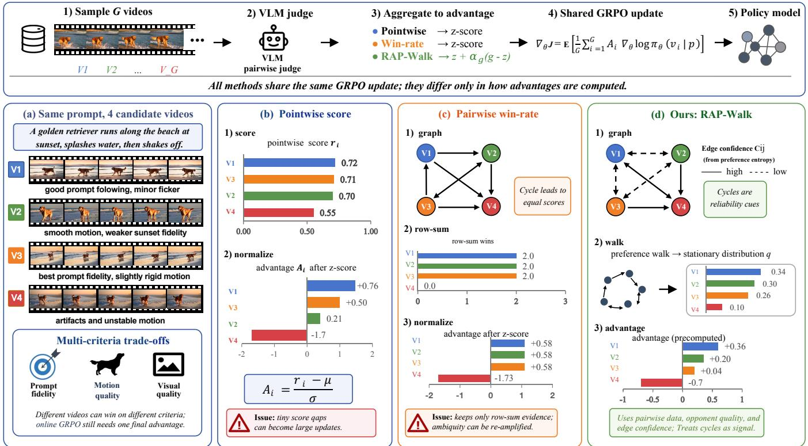
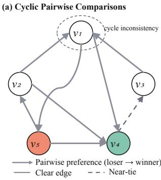
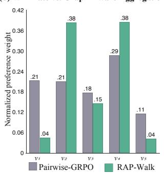
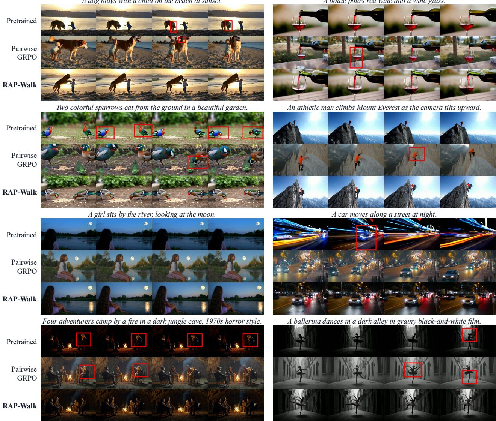

# When Pairwise Preferences Cycle: A Reliability-Anchored Preference Walk for Video GRPO

Xinrui Lin1, Fan Li2,\*, Shumin Wang1, Dehong Kong2, Yanyong Zhang1,\*

1University of Science and Technology of China, Hefei, China 2Huawei Noah’s Ark Lab

## Abstract

Pairwise preference feedback has become a widely adopted supervision signal for reinforcement learning in video generation models, as pairwise comparisons provide a more reliable alternative than pointwise scalar ratings for evaluating the quality of generated videos. Specifically, we define a preference graph for each GRPO group under a pairwise evaluator, where nodes represent sampled rollouts and edges encode pairwise preferences. Auditing 6,976 on-policy comparison graphs, we find that cyclic preferences are prevalent and persist throughout training. Naive pairwise reward aggregation based on average win rates discards the underlying comparison structures and treats each rollout independently, which may introduce unreliable advantage estimates for certain rollouts and consequently afect reinforcement learning optimization. Therefore, we propose the Reliability-Anchored Preference Walk (RAP-Walk), a graph-aware advantage aggregation method that strengthens the global preference signal from win rates with reliable relational evidence from cyclic preference graphs through a reliability-guided preference walk. Under matched evaluator, comparison protocol, group size, prompt schedule, and query budget, RAP-Walk requires no additional evaluator queries beyond the observed comparisons within each rollout group and improves over Pairwise-GRPO across controlled comparisons, transfer settings, and blind human evaluations.

## Introduction

Reinforcement learning based methods such as Flow-GRPO and DanceGRPO (Liu et al. 2025a; Xue et al. 2025) have become important techniques for optimizing video generation models. Early approaches commonly adopt pointwise rewards, which assign an independent scalar score to each generated video. However, video quality isjointly determined by multiple dimensions, including prompt fidelity, visual appearance, motion quality, and temporal consistency, making absolute scores dificult to estimate and calibrate reliably. Pairwise rewards (Wang et al. 2025c,a, 2026c) instead evaluate the relative quality of two candidate videos, avoiding the need to define a consistent absolute scoring scale. Consequently, they have recently gained widespread popularity for their improved robustness and interpretability.

Pairwise reward naturally induces a preference graph, where each rollout is represented as a node and each directed edge encodes both the preference direction and confidence between two videos. Unlike pointwise rewards, this graph representation preserves rich relational information beyond individual scores. However, GRPO ultimately requires a scalar advantage for each rollout, creating a fundamental graph-to-advantage mapping challenge:

How can we reliably reduce a structured preference graph into the scalar advantages required by GRPO while preserving its relational information?

A naive implementation of Pairwise-GRPO (Wang et al. 2025b) addresses this challenge by assigning each rollout a normalized average win rate against the other rollouts. While this aggregation is simple and stable, it projects the entire preference graph onto one scalar per rollout, implicitly treating pairwise outcomes as if they could be adequately summarized by a globally consistent ordering. In practice, however, video quality is jointly determined by multiple factors, including prompt fidelity, visual appearance, motion quality, and temporal consistency, and pairwise judgments need not be transitive. For example, an evaluator may prefer video 1 over video 2, video 2 over video 3, and video 3 over video 1. Such preference cycles should not necessarily be interpreted as evaluator failures; instead, they may reflect meaningful trade-ofs among diferent quality dimensions. Naive win-rate aggregation cannot preserve this structure: comparison graphs with diferent opponent relationships and cyclic patterns may collapse to identical scalar advantages.

This phenomenon is substantial in practice. We audit 6,976 complete on-policy comparison graphs and find that the proportion of cyclic groups under the zero-margin definition increases from 79.7% in the early stage of training to 89.0% in the late stage (Table 1), while edge clarity simultaneously decreases. These observations show that preference cycles are not rare anomalies but a persistent structure in online video preference optimization.

To address this graph-to-advantage bottleneck, we propose the Reliability-Anchored Preference Walk (RAP-Walk), a graph-aware advantage aggregation method for Pairwise-GRPO. Rather than replacing average win rate, RAP-Walk preserves its standardized advantage as a stable optimization anchor and uses the preference graph to construct a controlled structural correction. Specifically, preference evidence is propagated from defeated videos to preferred videos, allowing each video’s advantage to depend not only on its direct outcomes but also on opponent strength and multihop comparison paths. To avoid amplifying ambiguous or strongly non-transitive evidence, the propagation is modulated by edge reliability and local cyclic inconsistency. The resulting graph proposal is then combined with the original win-rate advantage according to the overall reliability of the comparison graph.

  
Figure 1: Overview of RAP-Walk. Top: methods share the Pairwise-GRPO pipeline and difer only in advantage construction. Bottom: (a) same-prompt videos exhibit quality trade-ofs; (b) pointwise rewards are normalized independently; (c) v1, v2, and v3 form a directed cycle yet have identical row-wise win rates, so win-rate aggregation assigns them identical advantages; (d) RAP-Walk uses reliable edges and multi-hop paths to correct the win-rate anchor.

In this way, RAP-Walk treats preference cycles as informative relational structure rather than errors to be removed, while incorporating graph information only to the extent supported by edge- and group-level reliability. Our contributions are as follows:

• We reveal that cyclic preference structures naturally emerge in Pairwise-GRPO for video generation and show that win-rate aggregation collapses structurally diferent preference graphs into identical scalar advantages.

• We propose RAP-Walk, a reliability-aware graph aggregation method that preserves the stable win-rate advantage while recovering trustworthy edge and path information from cyclic preference graphs.

• We validate RAP-Walk through matched training comparisons, component ablations, transfer across videogeneration backbones, and blind human preference evaluations.

## Related Work

Reinforcement learning for video generation. GRPO was introduced for group-relative policy optimization and later adapted to flow and difusion generators by Flow-GRPO and DanceGRPO (Shao et al. 2024; Liu et al. 2025a; Xue et al. 2025). Recent video methods study exploration, trust regions, and trajectory-level alignment (Zheng et al. 2026; Wang et al. 2026b). These works assume that evaluator feedback has been reduced to scalar rewards or advantages; we study the underexplored mapping from a prompt-local pairwise graph to GRPO advantages.

Preference optimization and aggregation. Visual generators now span controllable editing and interleaved synthesis (Li et al. 2024; Wang et al. 2026a). Preference alignment includes DPO variants for image and video generation (Wallace et al. 2023; Li et al. 2026a; Liu et al. 2024; Zhang et al. 2024; Wu et al. 2025b) and scorer-driven GRPO for image editing (Li et al. 2026b), while UnifiedReward supplies pointwise and pairwise evaluation (Wang et al. 2025c,a, 2026c). RewardDance selects a reference by pairwise win counts and evaluates new samples against it during ReFL (Wu et al. 2025a). Closest to our setting, Pref-GRPO uses each sample’s within-group win rate as reward (Wang et al. 2025b), discarding opponent relations, paths, and cycles. Classical methods use win counts, graph decompositions, or random walks (Shah and Wainwright 2015; Jiang et al. 2011; Negahban, Oh, and Shah 2012); GPM and NLHF/SPO model cycles with richer representations or game-theoretic objectives (Zhang et al. 2025; Munos et al. 2024; Swamy et al. 2024). We instead keep the evaluator and standard GRPO objective fixed, studying only the preference-graph-to-advantage mapping, whose magnitudes and reliability directly shape policy updates.

## Preliminaries: Pairwise-GRPO

We first review Pairwise-GRPO, which provides the baseline formulation and notation used throughout this work. Given a text prompt c, the current policy samples a group of G videos, denoted by $X = \{ x _ { i } \} _ { i = 1 } ^ { G } \dot { . } \mathbf { A }$ fixed pairwise evaluator compares every unordered pair $\{ x _ { i } , x _ { j } \}$ in the group. Throughout this work, we query each pair in both presentation orders, align the resulting predictions, and average their soft preference scores. This produces a reciprocal soft preference matrix $\mathbf { W } \in [ 0 , 1 ] ^ { G \times \mathbf { \dot { G } } }$

$$
W _ { i j } = P ( x _ { i } \succ x _ { j } \mid c ) , \qquad W _ { j i } = 1 - W _ { i j } \quad ( i \neq j ) ,\tag{1}
$$

with $W _ { i i } = 0$ . Here, $W _ { i j }$ quantifies the evaluator’s support for $x _ { i }$ over $x _ { j } .$ . Accordingly, W can be viewed as a weighted directed comparison graph whose nodes are the sampled videos; under the loser-to-winner convention used later, $W _ { i j }$ represents soft preference evidence directed from $x _ { j }$ to $x _ { i } .$ Bidirectional querying is used to mitigate presentation-order bias, but it does not impose transitivity on the resulting comparison graph.

Although the evaluator produces relational feedback, the GRPO update requires one scalar advantage for each rollout. Pairwise-GRPO performs this graph-to-scalar reduction by averaging the of-diagonal entries in each row of W and standardizing the resulting win rates within the group:

$$
R _ { i } = \frac { 1 } { G - 1 } \sum _ { j , j \neq i } W _ { i j } , \qquad A _ { i } = \frac { R _ { i } - \mathrm { { m e a n } ( { \bf R } ) } } { \mathrm { s t d } ( { \bf R } ) + \epsilon } ,\tag{2}
$$

where $\mathbf { R } = \{ R _ { i } \} _ { i = 1 } ^ { G }$ denotes the win-rate-based rewards, and $\mathbf { A } = \{ A _ { i } \} _ { i = 1 } ^ { G }$ denotes the corresponding standardized advantages. The resulting advantages are used in the standard GRPO objective; the only modification introduced by RAP-Walk is the construction of the advantage signal.

This row-mean reduction is simple and incorporates every direct comparison, but only through the row sums of W. Consequently, it discards opponent identities and higherorder relational structure, including comparison paths and preference cycles.

## Reliability-Anchored Preference Walk

Reliability-Anchored Preference Walk (RAP-Walk) augments the standard Pairwise-GRPO advantage by constructing a reliability-controlled graph proposal from the preference graph. The key idea of RAP-Walk is to treat graph propagation as a controlled correction rather than a replacement of the standard GRPO signal:

$$
\widetilde { \mathbf { A } } = ( 1 - \alpha _ { g } ) \mathbf { A } + \alpha _ { g } \mathbf { g } .
$$

Here, A preserves the stable win-rate based optimization signal, while g injects relational information recovered from the preference graph.

  
Figure 2: Five-node illustration of cyclic preference propagation. (a) A cyclic preference graph with reliability-aware propagation. (b) Normalized preference credits from rowwise win-rate aggregation and RAP-Walk. Win-rate aggregation only considers direct comparison outcomes, while RAP-Walk exploits reliable multi-hop support and reduces the influence of conflicting local structures.

## Reliability-Aware Graph Proposal

RAP-Walk views the sampled videos as states of a random walk. The walk propagates preference mass over the pairwise comparison graph. The walk moves toward a video $x _ { j }$ when the evaluator prefers $x _ { j }$ over $x _ { i }$ . Through repeated propagation, a video receives more credit when it defeats opponents that themselves receive strong support. The walk therefore captures opponent strength and multi-step preference paths that are discarded by row-wise win-rate aggregation.

This propagation is specified by a row-stochastic transition matrix T. In the simplest form, the transition from video $x _ { i }$ to video $x _ { j }$ is proportional to the probability that $x _ { j }$ is preferred over $x _ { i } { : }$

$$
T _ { i j } ^ { \mathrm { b a s e } } \propto W _ { j i } , \qquad i \ne j .\tag{3}
$$

The use of $W _ { j i }$ establishes a loser-to-winner direction: preference mass leaves the current video $x _ { i }$ and flows toward videos that are more likely to defeat it.

However, direct preference probabilities may be unreliable: a near-tie comparison can be ambiguous, and clear individual comparisons can form cyclically inconsistent structures. We therefore introduce a transition-reliability factor $r _ { i j }$ that modulates the base transition using edge clarity and local cyclic inconsistency. We next define these reliability signals before giving the complete transition matrix.

Edge clarity. We measure the clarity of each pairwise comparison using normalized Bernoulli entropy:

$$
\begin{array} { c } { { c _ { i j } = 1 - \displaystyle \frac { H _ { b } ( W _ { i j } ) } { \log 2 } , } } \\ { { H _ { b } ( p ) = - p \log p - ( 1 - p ) \log ( 1 - p ) . } } \end{array}\tag{4}
$$

The clarity $c _ { i j }$ approaches zero when $W _ { i j }$ is close to 0.5 and increases as $W _ { i j }$ approaches either 0 or 1, measuring the decisiveness of a comparison rather than calibrated correctness.

Cycle inconsistency. Edge clarity evaluates individual comparisons but cannot detect inconsistency that emerges jointly along preference cycles. We first write the antisymmetric log-odds of each comparison as $\begin{array} { r } { l _ { i j } = \log \frac { { W _ { i j } } } { 1 - W _ { i j } } } \end{array}$ where $l _ { j i } = - l _ { i j } .$ . Since the comparison graph is complete, its shortest nontrivial cycles are triangles. For a triangle $( i , j , k )$ , we define its short-cycle log-odds as

$$
\begin{array} { r } { L _ { i j k } = l _ { i j } + l _ { j k } + l _ { k i } . } \end{array}\tag{5}
$$

If comparisons are induced by scalar utilities, $l _ { i j } = u _ { i } - u _ { j }$ then ${ \cal L } _ { i j k } \ = \ 0 ;$ nonzero value indicates local preference structure beyond a single scalar ranking. We summarize the cyclic inconsistency around video xi by

$$
L _ { i } = \operatorname* { m e a n } _ { j < k } | L _ { i j k } | .\tag{6}
$$

We standardize $\{ L _ { i } \} _ { i = 1 } ^ { G }$ across the group in the same manner as Eq. (2) and, for notational simplicity, reuse $L _ { i }$ for the standardized score. A larger $L _ { i }$ therefore indicates stronger cyclic inconsistency around video $x _ { i }$ relative to the other videos in the group.

Although cyclic structures contain useful relational information, high local inconsistency indicates that preference credit should be propagated more cautiously through that region.

Reliability-weighted transition. We combine edge clarity and local cyclic inconsistency through the transitionreliability factor

$$
r _ { i j } = \exp ( - L _ { j } ) \left( c _ { i j } + \epsilon \right) ^ { 1 / 4 } , \qquad i \neq j .\tag{7}
$$

The factor $\exp ( - L _ { j } )$ down-weights nodes in highly nontransitive local structures, preventing over-amplification of preference credit supported by conflicting relations while retaining the cyclic evidence.

The fractional power of $c _ { i j }$ softly discounts ambiguous comparisons without suppressing them completely.

To retain the strong first-order signal of Pairwise-GRPO, we use the standardized win-rate advantage $A _ { j }$ from Eq. (2) as a direct-support prior for each destination node. The rowstochastic transition matrix is then

$$
T _ { i j } = \frac { W _ { j i } \exp ( A _ { j } ) r _ { i j } } { \sum _ { k \ne i } W _ { k i } \exp ( A _ { k } ) r _ { i k } } , \qquad T _ { i i } = 0 .\tag{8}
$$

The exponential prior provides a first-order preference orientation for propagation rather than fixing the stationary ranking. The resulting stationary credit still depends on opponent identities, edge reliability, and multi-hop paths, which row-wise aggregation does not represent. Therefore, g is not a reparameterization of A; it incorporates relational information that is invariant under row-sum-preserving changes of the preference graph. Under this construction, preference mass flows toward videos that are more likely to defeat the current video, while ambiguous comparisons and locally inconsistent regions contribute less strongly. Preference cycles are not removed or directly converted into negative rewards; instead, they reduce the confidence with which preference credit is propagated through the corresponding regions.

## Graph Proposal from Stationary Preference Credit

We initialize the preference mass uniformly over the sampled videos and propagate it using the transition matrix:

$$
\pi ^ { ( 0 ) } = { \frac { 1 } { G } } { \bf 1 } , \qquad \pi ^ { ( t + 1 ) } = \pi ^ { ( t ) } T .\tag{9}
$$

Repeated propagation approaches a stationary support distribution satisfying

$$
\pi = \pi T .\tag{10}
$$

The stationary mass $\pi _ { i }$ represents the long-run preference credit assigned to video i. Unlike the row-mean win rate, this credit depends not only on how often i is preferred, but also on which opponents it defeats and whether reliable multi-step preference paths lead to it.

A finite comparison graph can produce an overly concentrated stationary distribution. To prevent excessively sharp graph corrections, we define the normalized entropy

$$
\mathcal { H } _ { \mathrm { n o r m } } ( p ) = - \frac { 1 } { \log G } \sum _ { i = 1 } ^ { G } p _ { i } \log p _ { i } .\tag{11}
$$

We then apply the minimum power-tempering calibration required to satisfy the entropy floor:

$$
q = \mathcal { P } _ { \xi } ( \pi ) , \qquad \mathcal { H } _ { \mathrm { n o r m } } ( q ) \geq \xi .\tag{12}
$$

Specifically, $\mathcal { P } _ { \xi }$ applies power tempering: $q _ { i } \propto \pi _ { i } ^ { a }$ with $a \in$ [0, 1], where the largest exponent satisfying $\mathcal { H } _ { \mathrm { n o r m } } ( q ) \geq \xi$ is selected. When the stationary distribution already satisfies the entropy floor, $a = 1$ and no calibration is applied.

Finally, we express the calibrated preference credit relative to the uniform level:

$$
g _ { i } = G q _ { i } - 1 .\tag{13}
$$

Because $\textstyle \sum _ { i } q _ { i } = 1$ , the resulting graph proposal satisfies $\textstyle \sum _ { i } g _ { i } = { \overline { { 0 } } } $ , with positive (negative) $g _ { i }$ indicating above (below) uniform graph support. The proposal $\mathbf { g } = \{ g _ { i } \} _ { i = 1 } ^ { G }$ is not used directly as a rollout reward; it provides a graphaware correction to the Pairwise-GRPO advantage.

## Reliability-Anchored Advantage

The reliability of the graph proposal varies across rollout groups. We summarize the overall clarity of a comparison graph by averaging its edge clarity:

$$
\bar { c } _ { g } = \frac { 1 } { G ( G - 1 ) } \sum _ { i \neq j } c _ { i j } .\tag{14}
$$

We then map this quantity to a group-level reliability coeficient:

$$
\alpha _ { g } = \mathrm { p r o j } _ { [ \alpha _ { - } , \alpha _ { + } ] } \left( \bar { c } _ { g } \right) ,\tag{15}
$$

where $[ \alpha _ { - } , \alpha _ { + } ] \subseteq [ 0 , 1 ]$ is a fixed trust interval. When most comparisons are near ties, $\alpha _ { g }$ is small and limits the graph proposal’s influence; clearer comparisons increase $\alpha _ { g }$ , with $\alpha _ { + }$ bounding its maximum contribution.

Using the standardized Pairwise-GRPO advantage A as the optimization anchor, we define the corrected advantage as

$$
\widetilde { \mathbf { A } } = \mathbf { A } + \alpha _ { g } ( \mathbf { g } - \mathbf { A } ) = ( 1 - \alpha _ { g } ) \mathbf { A } + \alpha _ { g } \mathbf { g } .\tag{16}
$$

The corrected advantage is then standardized within the rollout group (Eq. (2)) before being passed to the standard GRPO objective. All compared aggregation methods use the same standardization; policy-ratio, clipping, and regularization remain unchanged.

Illustrative example. Figure 2 contrasts RAP-Walk with row-wise win-rate aggregation on a five-node cyclic graph.

## Experiments

## Experimental Setup

Datasets and models. Following the data protocol of DanceGRPO (Xue et al. 2025), we curate 10,000 training prompts and an additional disjoint set of 1,000 evaluation prompts from VidProM (Wang and Yang 2024). The same training and test splits are used for all methods. We employ the Wan family (Wan et al. 2025; Wan Team 2025) as our foundation models, validating our method on the 1.3B and 14B variants of Wan2.1, as well as Wan2.2-TI2V-5B. We instantiate the reward evaluator with frozen Qwen3-VL models (30B and 235B) (Bai et al. 2025).

Implementation details. We train all models for 200 steps using LoRA and AdamW with a learning rate of $3 \times 1 0 ^ { - 4 }$ and group size G = 12. We generate 41-frame videos at 480p for Wan2.1 and 720p for Wan2.2, using 30 denoising steps and a guidance scale of 3. Each evaluator uniformly samples 10 frames from every video. Within each generator, all compared methods share the initialization and training budget. For Wan2.2-TI2V-5B, we use the TI2V checkpoint in text-to-video mode.

Evaluation metrics. For quantitative evaluation, we report six VBench dimensions (Huang et al. 2023): subject consistency (Subj.), background consistency (Back.), motion smoothness (Smooth.), aesthetic quality (Aesth.), imaging quality (Image), and dynamic degree (Dyn.). We additionally use VideoReward (Liu et al. 2025b), an evaluation model independent of the Qwen3-VL evaluator used during training, to measure visual quality (VQ), motion quality (MQ), and text alignment (TA); higher scores indicate better performance. Dynamic degree measures motion magnitude rather than perceptual motion quality.

## Preference Cycles Identification

Table 1 summarizes 6,976 on-policy preference graphs logged during Pairwise-GRPO training over three stages. Cycle statistics at margin m retain directed edges with $\begin{array} { r } { \dot { W } _ { i j } > . 5 + m ; } \end{array}$ near ties satisfy $| W _ { i j } - . 5 | \le . 1$

At m = 0, the any-cycle rate rises from 79.7% to 89.0%, while cyclic-triangle density remains near 5%. At m = .05, the rates are 24.8/18.0/19.3%; meanwhile, clarity falls from 0.261 to 0.132 as the near-tie share rises from 52.6% to 67.3%. In fixed-graph replay, holding W fixed and toggling cycle modulation shifts the lowest- $L _ { i }$ third by +0.616 and the highest by −0.544, isolating its efect from on-policy policy drift.

<table><tr><td></td><td>Node</td><td>Edge</td><td></td><td>Triangle</td><td>Groups with a cycle</td></tr><tr><td>Progress</td><td> $L _ { i }$  ratio</td><td>Clarity</td><td>Tie@0.10 Dens.@0</td><td>@0</td><td>@0.025 @0.05</td></tr><tr><td>0-33%</td><td>1.34×</td><td>0.261</td><td>52.6%</td><td>4.66% 79.7%</td><td>59.5% 24.8%</td></tr><tr><td>33-66%</td><td>1.31×</td><td>0.162</td><td>67.6%</td><td>5.30% 87.6%</td><td>62.1% 18.0%</td></tr><tr><td>66-100%</td><td>1.32×</td><td>0.132</td><td>67.3%</td><td>5.22% 89.0%</td><td>65.0% 19.3%</td></tr></table>

Table 1: Preference-graph structure over training. The $L _ { i }$ ratio is the group-averaged maximum-to-mean ratio of unstandardized node inconsistency.

## Main Results of RAP-Walk

Comparison across evaluator capacities. Table 2 compares pointwise GRPO (Liu et al. 2025a; Xue et al. 2025) with four pairwise aggregators: win rate (Wang et al. 2025b), Bradley–Terry (Bradley and Terry 1952), Rank Centrality (Negahban, Oh, and Shah 2012), and RAP-Walk. All trained methods share the evaluator, group size, prompt schedule, and training budget; pairwise methods also share the comparison protocol and query count. RAP-Walk adds no queries beyond the observed graph.

Relative to win rate, RAP-Walk improves eight of nine metrics with both evaluators; only smoothness regresses marginally. Independent VideoReward gains are +0.199/ + 0.294/+ 0.147 (VQ/MQ/TA, 30B) and +0.267/+ 0.366/+ 0.065 (235B). Meanwhile, dynamic degree recovers from 10.00/28.60 to 27.60/29.80, with first- or second-place results on every non-dynamic VBench metric. Rank Centrality and Bradley–Terry can retain more motion but lose perceptual quality, suggesting that global graph ranking alone is insuficient without reliability control and anchoring.

Generalization across generator backbones. With matched schedules and budgets, Table 3 extends the 1.3B setting in Table 2(b) to two additional generators. Against win rate, RAP-Walk improves eight of nine metrics on both, with only background consistency (Wan2.1-14B) or smoothness (Wan2.2-TI2V-5B) regressing. The former gains 10.00 dynamic-degree points and 0.238 TA; the latter gains 1.43 aesthetic points and 0.300/0.079/0.135 VQ/MQ/TA. With the evaluator fixed, this repeated pattern supports a backboneagnostic mapping.

## Ablation Study

Table 4 ablates graph-proposal construction and reliability anchoring. Graph proposal only standardizes g directly instead of using Eq. (16). Fixed group reliability sets $\alpha _ { g }$ to its full-model mean, preserving average correction strength while removing group adaptivity. Zero reliability floor sets α− = 0; w/o entropy floor additionally sets q = π in this matched zero-floor setting.

Graph proposal and anchoring. Used alone, g ranks first or second on all five non-dynamic VBench dimensions, yet trails the full model by 12.60 dynamic-degree points and 0.262/0.137/0.243 VQ/MQ/TA. Thus, graph propagation provides useful relational signal but is better used to correct than replace win rate. Mean-matched fixed reliability gains 3.40 dynamic-degree points but lowers every non-dynamic VBench and VideoReward metric, supporting group-adaptive correction strength.

(a) Qwen3-VL-30B evaluator
<table><tr><td></td><td colspan="2">VBench</td><td colspan="2">VideoReward</td></tr><tr><td>Method</td><td></td><td>Subj. Back. Smooth. Aesth. Image</td><td>Dyn. VQ MQ</td><td>TA</td></tr><tr><td>Pretrained (no LoRA) 94.60 95.50</td><td></td><td></td><td>98.4656.7362.3750.001.988 0.552 0.530</td><td></td></tr><tr><td>Pointwise GRPO</td><td>97.58 96.67</td><td></td><td>99.3159.8266.94 23.80 2.091 0.732 0.686</td><td></td></tr><tr><td colspan="2">Pairwise aggregation baselines</td><td></td><td></td><td></td></tr><tr><td>Rank Centrality</td><td>96.94 95.40</td><td></td><td>98.71 58.9868.79 62.60 1.911 0.165 0.862</td><td></td></tr><tr><td>Bradley-Terry</td><td></td><td>97.27 96.84</td><td></td><td>99.1661.3069.23 37.40 2.049 0.325 1.141</td></tr><tr><td>Win rate</td><td></td><td>97.76 97.17</td><td>99.52 62.30</td><td>67.78 10.002.126 0.2991.142</td></tr><tr><td>RAP-Walk</td><td></td><td>98.37 98.13</td><td>99.42 63.56</td><td>69.2227.602.325 0.5931.289</td></tr></table>

(b) Qwen3-VL-235B evaluator
<table><tr><td rowspan="2">Method</td><td colspan="2">VBench</td><td rowspan="2">VideoReward</td></tr><tr><td>Subj. Back. Smooth. Aesth. Image</td><td>Dyn.</td></tr><tr><td>Pretrained (no LoRA) 94.60 95.50</td><td></td><td>98.4656.7362.3750.001.9880.552 0.530</td><td></td></tr><tr><td>Pointwise GRPO</td><td>97.00 96.65</td><td>99.16 61.60 64.41 6.00 2.1110.759 0.716</td><td></td></tr><tr><td colspan="2">Pairwise aggregation baselines</td><td></td><td></td></tr><tr><td>Rank Centrality</td><td>95.12 94.40</td><td>98.7459.16 68.81 61.401.8630.140 0.876</td><td></td></tr><tr><td>Bradley-Terry</td><td>96.34 95.82</td><td>99.1761.4169.2639.402.0590.3581.162</td><td></td></tr><tr><td>Win rate</td><td>96.56 95.91</td><td>99.53 61.94</td><td>68.2428.602.1300.2891.173</td></tr><tr><td>RAP-Walk</td><td>97.02 96.51</td><td>99.26 63.2670.09 29.80 2.3970.6551.238</td><td></td></tr></table>

Table 2: Quantitative comparison on Wan2.1-T2V-1.3B with Qwen3-VL-30B/235B evaluators. Within each evaluator, runs share group size, prompt schedule, and budget; pairwise methods also share the bidirectional comparison protocol and query count. Best/second-best are bolded/underlined.

<table><tr><td rowspan="2">Method</td><td colspan="2">VBench</td><td colspan="2">VideoReward</td></tr><tr><td colspan="4">Subj. Back. Smooth. Aesth. Image Dyn. VQ MQ</td></tr><tr><td>Wan2.1-T2V-14B Pretrained Pointwise GRPO 96.68 96.75</td><td>95.43 95.92</td><td>99.05</td><td>95.9260.6865.4747.202.2660.7501.289 61.6463.2934.202.5561.0511.211</td><td></td></tr><tr><td>Win-rate Pairwise 97.0396.93 RAP-Walk</td><td>97.42 96.57</td><td>99.03 62.70</td><td>66.4236.402.435 0.8641.347 99.1163.1367.3946.402.540 0.8971.585</td><td></td></tr><tr><td>Wan2.2-TI2V-5B</td><td></td><td></td><td></td><td></td></tr><tr><td>Pretrained</td><td>96.53 96.98</td><td></td><td>98.9457.7865.97 40.60 2.164 0.4451.025</td><td></td></tr><tr><td>Pointwise GRPO Win-rate Pairwise 97.22 97.37</td><td>96.88 97.26</td><td>99.3059.09</td><td>99.0158.5166.70 38.602.2310.4301.054 67.9738.00 2.006 0.3671.171</td><td></td></tr></table>

Table 3: Results across generator backbones with a fixed Qwen3-VL-235B evaluator. Best/second-best values are bolded/underlined per generator.

Transition terms and calibration. Removing the winrate prior lowers dynamic degree by 8.60 points and all three VideoReward metrics; removing edge clarity lowers aesthetics and imaging by 1.76 and 3.33 points; removing cycle modulation lowers dynamic degree by 9.20 points and all three VideoReward metrics. These changes support the direct-support prior, ambiguity discount, and $L _ { i }$ modulation in Eq. (8). With a zero reliability floor, dynamic degree and all three VideoReward metrics decline despite a 0.27 imaging gain. Relative to this matched variant, removing entropy calibration trades +5.80 dynamic degree and +0.067 TA for losses on all five non-dynamic VBench dimensions plus VQ and MQ. The full configuration therefore gives the strongest VQ/MQ balance, whereas individual ablations can improve dynamic degree or imaging at the expense of broader quality.

## User Study

We finally test whether evaluator-independent human judgments corroborate the automatic metrics. In a blind study, 10 raters each evaluated 50 matched-prompt pairs for each baseline comparison on visual quality, motion quality, and text alignment; method identities were hidden and display order was randomized. Against Pairwise/Pointwise GRPO, RAP-Walk achieves win rates of 64.6%/78.2% for visual quality, 49.6%/59.0% for motion quality, and 53.4%/64.2% for text alignment. Motion is the closest comparison, yet its win– loss margin over win-rate Pairwise-GRPO remains positive at 13.4 points.

<table><tr><td></td><td colspan="2">VBench</td></tr><tr><td>Method</td><td>Subj. Back. Smooth. Aesth. Image Dyn.</td><td>VQ MQ TA</td></tr><tr><td>Win-rate Pairwise</td><td>96.56 95.91</td><td>99.5361.9468.2428.602.1300.2891.173</td></tr><tr><td colspan="3">Graph proposal construction</td></tr><tr><td>w/o win-rate prior</td><td>97.54 96.13</td><td>99.3162.4868.8821.202.2830.6331.109</td></tr><tr><td>w/o edge clarity</td><td>96.63 96.03</td><td>99.2661.5066.7630.802.2030.6241.128</td></tr><tr><td>w/o cycle modulation</td><td>97.68 96.46</td><td>99.3563.2169.2620.602.3420.561 1.084</td></tr><tr><td>Graph proposal only</td><td>97.74 97.14</td><td>99.3664.0870.4117.202.1350.518 0.995</td></tr><tr><td colspan="3">Reliability anchoring</td></tr><tr><td>Fixed group reliability 96.47 95.69</td><td></td><td>99.1160.2467.6133.202.0450.3501.054</td></tr><tr><td>Zero reliability floor</td><td>96.91 96.39</td><td>99.2063.26 70.3628.602.1860.4711.196</td></tr><tr><td>w/o entropy floor</td><td>96.43 95.59</td><td>99.1161.1369.1534.402.1440.3251.263</td></tr><tr><td>RAP-Walk</td><td>97.02 96.51</td><td>99.2663.2670.09 29.80 2.3970.6551.238</td></tr></table>

Table 4: Ablation study on Wan2.1-T2V-1.3B with Qwen3- VL-235B. Win-rate Pairwise-GRPO is the reference; best/second-best values are bolded/underlined.

These preferences suggest that the gains are not specific to the Qwen evaluator or the reported automatic metrics;

<table><tr><td>vs. Pairwise &lt;</td><td>vs. Pointwise</td></tr><tr><td>Aspect 》 V ≈</td><td>《 》 V ≈ &lt; 《</td></tr><tr><td>Visual quality27.8 36.82.020.2 13.2 46.8 31.41.87.412.6</td><td></td></tr><tr><td></td><td>Motion quality 17.831.8 14.2 22.6 13.6 32.6 26.4 14.69.417.0</td></tr><tr><td>Text alignment 29.8 23.6 18.813.214.6 44.0 20.2 13.0 6.616.2</td><td></td></tr></table>

Table 5: Blind user study (%). Columns ≫, >, ≈, <, and ≪ range from strong RAP-Walk preference to strong baseline preference.

A bottle pours red wine into a wine glass  
  
Figure 3: Qualitative comparison across eight prompts. Each prompt shows four frames from videos generated by Pretrained, Pairwise GRPO, and RAP-Walk. Pretrained denotes the original Wan2.1-T2V-1.3B model without LoRA post-training. All methods use matched prompts and initial noise.

the more moderate motion margin also matches the intended conservative correction to the win-rate anchor.

## Visual Comparison

Figure 3 compares Pretrained, Pairwise-GRPO, and RAP-Walk across eight prompts. The baselines show temporal artifacts such as inconsistent dog, child geometry, distorted wine-glass structure, deformed birds, and unstable human or vehicle shapes (red boxes). In contrast, RAP-Walk preserves object identity and spatial layout across frames while maintaining coherent interactions and motion in the climber, campsite, and ballerina sequences. These results demonstrate improved visual fidelity and temporal consistency without sacrificing scene dynamics or stylistic diversity.

## Conclusion

Pairwise feedback avoids calibrating absolute video-quality scores, yet converting structured preference relations into scalar advantages remains challenging. Our audit of 6,976 on-policy comparison graphs shows that cyclic preference structures emerge during training, indicating that opponent relationships and comparison paths provide information beyond win rates. We introduced RAP-Walk, a reliabilityanchored graph aggregation method that preserves win-rate advantages as anchors while recovering relational evidence through graph correction. Across matched comparisons, evaluators, backbones, ablations, and blind human evaluations, RAP-Walk improves over win-rate Pairwise-GRPO without additional evaluator queries. These results highlight the importance of preserving relational structure when transforming pairwise feedback into optimization signals.

## References

Bai, S.; Cai, Y.; Chen, R.; Chen, K.; Chen, X.; Cheng, Z.; Deng, L.; Ding, W.; Gao, C.; Ge, C.; Ge, W.; Guo, Z.; Huang, Q.; Huang, J.; Huang, F.; Hui, B.; Jiang, S.; Li, Z.; Li, M.; Li, M.; Li, K.; Lin, Z.; Lin, J.; Liu, X.; Liu, J.; Liu, C.; Liu, Y.; Liu, D.; Liu, S.; Lu, D.; Luo, R.; Lv, C.; Men, R.; Meng, L.; Ren, X.; Ren, X.; Song, S.; Sun, Y.; Tang, J.; Tu, J.; Wan, J.; Wang, P.; Wang, P.; Wang, Q.; Wang, Y.; Xie, T.; Xu, Y.; Xu, H.; Xu, J.; Yang, Z.; Yang, M.; Yang, J.; Yang, A.; Yu, B.; Zhang, F.; Zhang, H.; Zhang, X.; Zheng, B.; Zhong, H.; Zhou, J.; Zhou, F.; Zhou, J.; Zhu, Y.; and Zhu, K. 2025. Qwen3-VL Technical Report. arXiv:2511.21631.

Bradley, R. A.; and Terry, M. E. 1952. Rank Analysis of Incomplete Block Designs: I. The Method of Paired Comparisons. Biometrika, 39(3/4): 324–345.

Huang, Z.; He, Y.; Yu, J.; Zhang, F.; Si, C.; Jiang, Y.; Zhang, Y.; Wu, T.; Jin, Q.; Chanpaisit, N.; Wang, Y.; Chen, X.; Wang, L.; Lin, D.; Qiao, Y.; and Liu, Z. 2023. VBench: Comprehensive Benchmark Suite for Video Generative Models. arXiv:2311.17982.

Jiang, X.; Lim, L.-H.; Yao, Y.; and Ye, Y. 2011. Statistical Ranking and Combinatorial Hodge Theory. Mathematical Programming, 127(1): 203–244.

Li, B.; Wang, Z.; Li, F.; Xu, J.; Guo, J.; Pei, R.; Li, X.; and Chen, Z. 2026a. ColorFLUX: A Structure-Color Decoupling Framework for Old Photo Colorization. In Proceedings of the IEEE/CVF Conference on Computer Vision and Pattern Recognition, 15574–15584.

Li, F.; Wang, C.; Lei, L.; Qiu, Y.; Xu, J.; Jiang, J.; Qin, X.; Chen, Z.; Song, F.; Wang, Z.; Pei, R.; and Zuo, W. 2026b. HP-Edit: A Human-Preference Post-Training Framework for Image Editing. In Proceedings of the IEEE/CVF Conference on Computer Vision and Pattern Recognition, 43113–43123.

Li, F.; Zhang, Z.; Huang, Y.; Liu, J.; Pei, R.; Shao, B.; and Xu, S. 2024. MagicEraser: Erasing Any Objects via Semantics-Aware Control. In European Conference on Computer Vision, 215–231.

Liu, J.; Liu, G.; Liang, J.; Li, Y.; Liu, J.; Wang, X.; Wan, P.; Zhang, D.; and Ouyang, W. 2025a. Flow-GRPO: Training Flow Matching Models via Online RL. arXiv:2505.05470.

Liu, J.; Liu, G.; Liang, J.; Yuan, Z.; Liu, X.; Zheng, M.; Wu, X.; Wang, Q.; Xia, M.; Wang, X.; Liu, X.; Yang, F.; Wan, P.; Zhang, D.; Gai, K.; Yang, Y.; and Ouyang, W. 2025b. Improving Video Generation with Human Feedback. In Advances in Neural Information Processing Systems.

Liu, R.; Wu, H.; Ziqiang, Z.; Wei, C.; He, Y.; Pi, R.; and Chen, Q. 2024. VideoDPO: Omni-Preference Alignment for Video Difusion Generation. arXiv:2412.14167.

Munos, R.; Valko, M.; Calandriello, D.; Gheshlaghi Azar, M.; Rowland, M.; Guo, Z. D.; Tang, Y.; Geist, M.; Mesnard, T.; Fiegel, C.; Michi, A.; Selvi, M.; Girgin, S.; Momchev, N.; Bachem, O.; Mankowitz, D. J.; Precup, D.; and Piot, B. 2024. Nash Learning from Human Feedback. In Proceedings of the 41st International Conference on Machine Learning, volume 235 of Proceedings of Machine Learning Research, 36743–36768.

Negahban, S.; Oh, S.; and Shah, D. 2012. Rank Centrality: Ranking from Pair-Wise Comparisons. arXiv:1209.1688.

Shah, N. B.; and Wainwright, M. J. 2015. Simple, Robust and Optimal Ranking from Pairwise Comparisons. arXiv:1512.08949.

Shao, Z.; Wang, P.; Zhu, Q.; Xu, R.; Song, J.; Bi, X.; Zhang, H.; Zhang, M.; Li, Y. K.; Wu, Y.; and Guo, D. 2024. DeepSeekMath: Pushing the Limits of Mathematical Reasoning in Open Language Models. arXiv:2402.03300.

Swamy, G.; Dann, C.; Kidambi, R.; Wu, S.; and Agarwal, A. 2024. A Minimaximalist Approach to Reinforcement Learning from Human Feedback. In Proceedings of the 41st International Conference on Machine Learning, volume 235 of Proceedings of Machine Learning Research, 47345– 47377.

Wallace, B.; Dang, M.; Rafailov, R.; Zhou, L.; Lou, A.; Purushwalkam, S.; Ermon, S.; Xiong, C.; Joty, S.; and Naik, N. 2023. Difusion Model Alignment Using Direct Preference Optimization. arXiv:2311.12908.

Wan, T.; Wang, A.; Ai, B.; Wen, B.; Mao, C.; Xie, C.-W.; Chen, D.; Yu, F.; Zhao, H.; Yang, J.; Zeng, J.; Wang, J.; Zhang, J.; Zhou, J.; Wang, J.; Chen, J.; Zhu, K.; Zhao, K.; Yan, K.; Huang, L.; Feng, M.; Zhang, N.; Li, P.; Wu, P.; Chu, R.; Feng, R.; Zhang, S.; Sun, S.; Fang, T.; Wang, T.; Gui, T.; Weng, T.; Shen, T.; Lin, W.; Wang, W.; Wang, W.; Zhou, W.; Wang, W.; Shen, W.; Yu, W.; Shi, X.; Huang, X.; Xu, X.; Kou, Y.; Lv, Y.; Li, Y.; Liu, Y.; Wang, Y.; Zhang, Y.; Huang, Y.; Li, Y.; Wu, Y.; Liu, Y.; Pan, Y.; Zheng, Y.; Hong, Y.; Shi, Y.; Feng, Y.; Jiang, Z.; Han, Z.; Wu, Z.-F.; and Liu, Z. 2025. Wan: Open and Advanced Large-Scale Video Generative Models. arXiv:2503.20314.

Wan Team. 2025. Wan2.2: Open and Advanced Large-Scale Video Generative Models. https://github.com/Wan-Video/ Wan2.2.

Wang, C.; Chen, Z.; Wang, C.; Wan, Y.; Yang, J.; Wang, Z.; Zhang, W.; Xu, J.; Pei, R.; Wu, X.; Li, F.; and Zuo, W. 2026a. Illuminating Unified Multimodal Model for Free-form Interleaved Text-Image Generation. In European Conference on Computer Vision.

Wang, J.; Lu, J.; Xu, G.; Chen, C.; Yang, H.; Wang, L.; Chen, P.; Chen, M.; Hu, Z.; Wu, L.; Shao, S.; Lu, Q.; and Luo, P. 2026b. TAGRPO: Boosting GRPO on Image-to-Video Generation with Direct Trajectory Alignment. arXiv:2601.05729.

Wang, W.; and Yang, Y. 2024. VidProM: A Million-scale Real Prompt-Gallery Dataset for Text-to-Video Difusion Models. In Advances in Neural Information Processing Systems, volume 37.

Wang, Y.; Li, Z.; Zang, Y.; Wang, C.; Lu, Q.; Jin, C.; and Wang, J. 2025a. Unified Multimodal Chain-of-Thought Reward Model through Reinforcement Fine-Tuning. arXiv:2505.03318.

Wang, Y.; Li, Z.; Zang, Y.; Zhou, Y.; Bu, J.; Wang, C.; Lu, Q.; Jin, C.; and Wang, J. 2025b. Pref-GRPO: Pairwise Preference Reward-Based GRPO for Stable Text-to-Image Reinforcement Learning. arXiv:2508.20751.

Wang, Y.; Zang, Y.; Han, F.; Bu, J.; Zhou, Y.; Jin, C.; and Wang, J. 2026c. Unified Personalized Reward Model for Vision Generation. arXiv:2602.02380.

Wang, Y.; Zang, Y.; Li, H.; Jin, C.; and Wang, J. 2025c. Unified Reward Model for Multimodal Understanding and Generation. arXiv:2503.05236.

Wu, J.; Gao, Y.; Ye, Z.; Li, M.; Li, L.; Guo, H.; Liu, J.; Xue, Z.; Hou, X.; Liu, W.; Zeng, Y.; and Huang, W. 2025a. RewardDance: Reward Scaling in Visual Generation. arXiv:2509.08826.

Wu, Z.; Kag, A.; Skorokhodov, I.; Menapace, W.; Mirzaei, A.; Gilitschenski, I.; Tulyakov, S.; and Siarohin, A. 2025b. DenseDPO: Fine-Grained Temporal Preference Optimization for Video Difusion Models. arXiv:2506.03517.

Xue, Z.; Wu, J.; Gao, Y.; Kong, F.; Zhu, L.; Chen, M.; Liu, Z.; Liu, W.; Guo, Q.; Huang, W.; and Luo, P. 2025. DanceGRPO: Unleashing GRPO on Visual Generation. arXiv:2505.07818.

Zhang, J.; Wu, J.; Chen, W.; Ji, Y.; Xiao, X.; Huang, W.; and Han, K. 2024. OnlineVPO: Align Video Difusion Model with Online Video-Centric Preference Optimization. arXiv:2412.15159.

Zhang, Y.; Zhang, G.; Wu, Y.; Xu, K.; and Gu, Q. 2025. Beyond Bradley–Terry Models: A General Preference Model for Language Model Alignment. In Proceedings of the 42nd International Conference on Machine Learning, volume 267 of Proceedings of Machine Learning Research, 76939–76965.

Zheng, M.; Kong, W.; Wu, Y.; Jiang, D.; Ma, Y.; He, X.; Lin, B.; Gong, K.; Zhong, Z.; Bo, L.; Chen, Q.; and Yang, H. 2026. Manifold-Aware Exploration for Reinforcement Learning in Video Generation. arXiv:2603.21872.