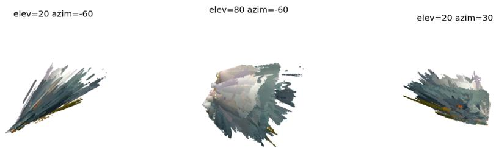
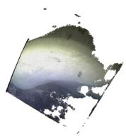
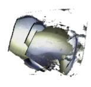
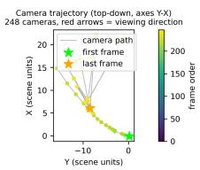
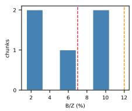

# Why 3D Reconstruction Breaks Down on Under-Ice AUV Video, and How to Predict It

Ana-Stefania Kogălniceanu1, Klára Orbán1, Ashwin Nedungadi2, Stefan Lüdtke2, and Kuderna-Iulian Benta1

1 Babes,-Bolyai University, Cluj-Napoca, Romania

{ana.kogalniceanu,klara.orban}@stud.ubbcluj.ro, kuderna.benta@ubbcluj.ro 2 University of Rostock, Germany {ashwin.nedungadi,stefan.luedtke}@uni-rostock.de

Abstract. Reconstruction of 3D structures using under-ice AUV video footage has been inaccurate, although it is not certain whether this is due to shortcomings in the methods or an inherent deficiency of the capture system. We test four diferent models for reconstruction on the same Antarctic under-ice AUV video (Icefin, Kamb Ice Stream): classical feature matching SfM, diferentiable photometric splatting, volumetric depth fusion, and a pose-free feed-forward foundation model. All four fail, each in a distinct way: near-total registration yielding almost no structure, geometrically broken output despite healthy photometric metrics, a persistent coverage artifact, and unstable cross-chunk scale. We show that all four are consistent with the same capture regime, a small camera-baseline-to-scene-depth ratio. Following our analysis, we propose a detection system that flags this type of failure in minutes, rather than hours of wasted compute.

Keywords: under-ice 3D reconstruction · autonomous underwater vehicles · narrow-baseline photogrammetry · 3D Gaussian Splatting · textureusability estimation

## 1 Introduction

3D reconstruction from under-ice AUV video is persistently unreliable: turbidity and backscatter flatten contrast, while the ice underside is often smooth and weakly textured [1, 8]. Although mitigations exist, it remains unclear whether the residual failures reflect the shortcomings of any one method or a deeper limitation of the capture geometry itself. Slow-moving AUVs sampled at low frame rates produce near-converging camera trajectories with limited translation between viewpoints, unlike the wide-baseline, well-distributed views on which most reconstruction pipelines are designed and validated. In practice, researchers face large collections of such footage where reconstruction success is dificult to anticipate, and substantial compute is routinely spent on batches that converge to geometrically fragmented output, with the failure only apparent after the fact.

Prior work in this space has largely evaluated individual pipelines in isolation [5, 11, 13], without asking whether failures across structurally diferent methods share a common, measurable cause. This distinction matters: if failure is methodspecific, the fix is method-specific tuning; if failure is geometric, the fix is a single early warning system that generalizes across pipelines.

This work tests four structurally unrelated reconstruction approaches: classical feature-matching SfM, diferentiable photometric splatting, volumetric depth fusion, and a pose-free feed-forward foundation model – on the same under-ice AUV footage (Icefin, Kamb Ice Stream, USAP-DC 601975 [15]), and shows that all four fail for reasons traceable to the same capture regime. The main contributions of this work are:

• identification of a single quantified geometric predictor: a narrow camera baseline-to-scene-depth ratio that explains the distinct failure modes of four structurally diferent reconstruction methods on the same footage,

• a lightweight baseline-to-depth check, derived directly from foundation-model camera poses, that flags likely failure in minutes rather than hours,

• a negative control against the competing hypothesis that reconstructability is predictable from image content, rather than capture geometry: a textureusability score, tested against altimeter ground truth, did not hold up.

## 2 Related work

Classical Structure-from-Motion methods such as COLMAP [11] recover camera poses and sparse structure through incremental feature matching and bundle adjustment, with dense surfaces typically obtained through volumetric depth fusion into a signed-distance field [3]. While these pipelines are well validated for widebaseline, well-distributed captures, their behavior under narrow-baseline, nearconverging viewpoints remains comparatively unexplored. 3D Gaussian Splatting (3DGS) [5] replaces explicit correspondence search with diferentiable photometric optimization, achieving high-quality novel-view synthesis without directly guaranteeing geometric consistency, a limitation that underwater adaptations have had to address [16]. Feed-forward foundation models such as DUSt3R [14] and its more scalable successor VGGT [13] instead predict camera poses and dense point maps directly from images, avoiding iterative optimization but introducing a diferent failure mode: maintaining consistent scale and pose across inference chunks.

AUV-based seafloor mapping has similarly reported reconstruction gaps and weakly reconstructed regions caused by platform motion and uneven illumination [12]. Icefin-based surveys demonstrate the scientific value of under-ice observation [6], but the reliability of 3D reconstruction from such footage remains largely unaddressed. A smaller body of work has explored predicting reconstruction quality before running a full pipeline, including models linking UAV image characteristics such as blur, exposure, and noise to point-cloud accuracy [7], no-reference image-quality measures based on photogrammetric descriptors [10], and preprocessing strategies for blurred or texture-poor imagery [4]. However, these approaches primarily assess 2D image quality rather than 3D capture geometry.

## 3 Dataset and Capture Setup

We use video footage collected by the Icefin autonomous underwater vehicle (AUV) during dive ICE03\_037 in the Kamb Ice Stream, Antarctica , available through the U.S. Antarctic Program Data Center (USAP-DC 601975) [15]. The dataset consists of downward- and forward-facing HD and SD video recorded as the vehicle moved slowly through the subglacial ice channel. For reconstruction experiments, frames were sampled at 1–4 fps from the box1 and box6 video clips, providing sequences with varying amounts of usable ice-surface texture. The footage presents a challenging reconstruction setting because the vehicle moves slowly and predominantly toward the observed surface, producing short camera baselines relative to scene depth and near-converging viewpoints.

## 4 Convergent Failure Across Four Methods

To test whether the reconstruction limitations were algorithm-specific, we evaluated the same under-ice footage using four structurally diferent approaches. Despite substantially diferent failure modes, all four are consistent with one capture regime: insuficient camera baseline relative to scene depth.

## 4.1 Classical SfM: Registration Without Reconstruction

We first evaluated COLMAP [11] on a 1 fps sequence of 62 frames from the box6 clip; exhaustive matching registered only 2 of 62 images. Increasing the sampling rate to 4 fps and using COLMAP’s sequential matcher with loop closure substantially improved registration, with 247 of 248 frames successfully registered. Registration rate, however, measures completeness rather than reconstruction quality: the model contains only 817 points across 248 images (3.3/image, versus 40.4/image for box1 processed identically), with a median track length of 4, so most features persist across only a handful of near-identical consecutive frames rather than being observed from distinct viewpoints. Mean reprojection error is 0.76 px: the bundle adjustment is well satisfied, but by a sparse set of correspondences that does not constrain scene geometry. Denser sampling recovers registration without recovering structure.

## 4.2 Photometric Splatting: Healthy Metrics, Broken Geometry

We next trained 3D Gaussian Splatting (3DGS) [5] using the COLMAP reconstruction, so 3DGS inherits COLMAP’s camera poses rather than constituting an independent pose estimate. The resulting model was applied on box6 and achieved a test PSNR of 24.75 after 30,000 iterations, suggesting that the model reproduced the training-view appearance efectively. However, this metric concealed severe geometric degradation. When the reconstruction was rendered from a free viewpoint outside the original camera trajectory, the scene contained elongated, needle-like Gaussians extending away from the observed surface. The result demonstrates that photometric agreement from a narrow range of viewpoints does not necessarily imply geometrically valid reconstruction: with insuficient baseline, degenerate geometry can reproduce the observed images without being constrained by meaningful multi-view triangulation.

  
Fig. 1: TSDF fusion of box1 after increasing voxel size and truncation distance, reducing the surface from 15.0M to 667K vertices (22× consolidation). The fan-like silhouette persists, indicating a limitation of viewpoint overlap rather than fusion parameters.

## 4.3 Depth Fusion: Bounded by Real Overlap

To test whether replacing photometric optimization with explicit depth fusion avoided the problem, we estimated per-frame depth with Depth Anything 3 (DA3) [9] in monocular mode, back-projected the estimates into the reconstructed camera coordinate system, and fused them volumetrically using a TSDF. An initial configuration produced almost no consolidation, since the truncation band was too narrow relative to the disagreement between depth maps. Widening the voxel size and truncation distance reduced the surface from 15.0 million to 667,000 vertices, a substantial consolidation, yet the characteristic fan-like silhouette remained. Monocular depth carries per-frame scale and shift ambiguity, which contributes to this disagreement independently of baseline; DA3’s pose-conditioned and multi-view modes would separate the two contributions, and we leave that comparison to future work.

## 4.4 Foundation Models: Local Success, Global Failure

Finally, we evaluated VGGT [13], which predicts camera poses and dense point maps directly from images without iterative feature matching or bundle adjustment. On the box6 frame sequence for which COLMAP initially registered only two images, VGGT produced valid local reconstructions for all 62 frames. Individual inference chunks showed coherent geometry, demonstrating that the model can extract useful local structure even when classical feature matching fails. However, independently processed chunks could not be reliably combined into a common reconstruction. Similarity alignment of adjacent chunks produced relative scale factors ranging from 0.43 to 1.73, rather than the approximately unit scale expected for consistent reconstructions. Increasing the overlap between chunks did not resolve this instability, indicating that the problem is not simply insuficient overlap redundancy but the lack of suficient translational baseline to constrain relative scale.

  
(a) Single chunk

(b) Four chunks merged  
  
(c) Camera centers

  
(d) Per-chunk B/Z  
Fig. 2: VGGT on the 62-frame box6 sequence. Chunks are locally coherent (a) but merge inconsistently, with scale factors 0.43–1.73× (b). The recovered trajectory (c) advances predominantly toward the surface. Per-chunk baseline-to-depth ratios (d), with the 7% and 12% tier thresholds marked (dashed).

## 4.5 Camera-Pose Quality Control

The diferent failure modes become consistent when considered in terms of the recovered camera trajectory. Across the evaluated sequences, the maximum camera-center translation within VGGT inference chunks was only approximately 1–12% of the scene depth, with most measurements below 10% (Figure 2c). This narrow baseline-to-depth ratio is therefore a useful diagnostic description of the capture regime associated with failure in our experiments: COLMAP recovers few well-triangulated points, 3DGS can satisfy photometric observations using degenerate geometry, depth fusion cannot force independently estimated surfaces to agree, and VGGT cannot reliably determine a common scale across local reconstructions.

One confound should be noted. Icefin’s lighting is rigidly coupled to the camera, so irradiance at a fixed surface point varies with range, violating the static-illumination assumption all four pipelines share. This covaries with the geometry we measure – forward-dominant motion drives both – and our data cannot separate them, though VGGT’s scale drift is not readily explained by illumination, since relative scale is fixed by triangulation. We therefore treat baseline-to-depth as a proxy for the capture regime rather than an isolated cause.

## 5 A Pre-Flight Baseline-Depth Check

Section 4 identified camera baseline-to-scene-depth ratio as a common failureassociated characteristic across the evaluated methods, computable from VGGT camera poses alone without dense reconstruction or ground truth. We therefore use the ratio as a practical diagnostic for the failure regime observed in our experiments, while leaving broader thresholds for future validation. Reconstruction failed throughout the full 1–12% range observed on our footage, so we anchor only a red tier (below 7%, where failures cluster densely) to evidence; the 7–12% yellow and ≥12% green tiers are untested extrapolations, not validated thresholds.Computing the ratio takes ∼4 minutes (VGGT runtime), versus hours to discover the failure through COLMAP, 3DGS, or TSDF fusion. box6 (measured 1.5–10.4% per chunk) falls in the red tier, consistent with its observed failure.

## 6 Discussion and Limitations

We also tested whether reconstructability could be predicted from image content rather than capture geometry. A texture-usability score showed negligible agreement with the internal validators it was meant to complement (Spearman $r = 0 . 0 9 4 , n = 1 5 5 , p = 0 . 2 4 3 )$ ) and correlated with self-consistency in the wrong direction $( r = - 0 . 5 4 ~ \mathrm { t o } \ - 0 . 6 4$ across three formulations, $n = 1 5 5 , p < 0 . 0 0 1 ) . \ddot { }$ Against altimeter ground truth4, the pooled correlation with DA3 depth error was weak $( r = - 0 . 0 9 5 , n = 3 9 1 , p = 0 . 0 6 1 )$ ; re-fitting as a linear mixed-efects model with window as a random efect [2] left the efect indistinguishable from noise $( p = 0 . 8 3 8 )$ . On this footage the binding constraint is capture geometry, not image content.

Several limitations remain: evidence from a single dive, so the tier thresholds are anchored to one platform and ice regime; a pinhole model throughout, though Icefin’s flat port makes the imaging refractive; VGGT’s relative pose accuracy unvalidated under near-axial motion; and altimeter data used only to test the texture score, not to evaluate reconstruction accuracy metrically. We also lack a positive control, footage that passes the check and reconstructs successfully.

## 7 Conclusion

Four structurally unrelated reconstruction methods – classical SfM, photometric splatting, volumetric depth fusion, and a pose-free feed-forward model – fail on the same under-ice AUV footage in four distinct ways, with all four experiments exhibiting a camera baseline of only 1–12% of scene depth. Because this is computable from feed-forward camera poses alone, it supports a pre-run check that flags this footage as unreconstructable in minutes rather than hours, though only the failure tier is anchored to evidence here. Our attempt to predict reconstructability from image content instead did not survive validation against altimeter ground truth – on this footage, the binding constraint is where the camera went, not what it saw. Extending the check across more dives, and deploying it onboard during a survey so that flagged geometry can be corrected while the vehicle is still in the water, remains future work.

## References

1. Akkaynak, D., Treibitz, T.: A revised underwater image formation model. In: IEEE/CVF Conference on Computer Vision and Pattern Recognition (CVPR). pp. 6723–6732 (2018)

2. Bates, D., Mächler, M., Bolker, B., Walker, S.: Fitting linear mixed-efects models using lme4. Journal of Statistical Software 67(1), 1–48 (2015). https://doi.org/ 10.18637/jss.v067.i01

3. Curless, B., Levoy, M.: A volumetric method for building complex models from range images. In: Proceedings of SIGGRAPH ’96. pp. 303–312 (1996). https: //doi.org/10.1145/237170.237269

4. Gaiani, M., Remondino, F., Apollonio, F.I., Ballabeni, A.: An advanced preprocessing pipeline to improve automated photogrammetric reconstructions of architectural scenes. Remote Sensing 8(3) (2016). https://doi.org/10.3390/ rs8030178, https://www.mdpi.com/2072-4292/8/3/178

5. Kerbl, B., Kopanas, G., Leimkühler, T., Drettakis, G.: 3d gaussian splatting for real-time radiance field rendering (2023), https://arxiv.org/abs/2308.04079

6. Lawrence, J., Washam, P., Stevens, C., Hulbe, C., Horgan, H., Dunbar, G., Calkin, T., Stewart, C., Robinson, N., Mullen, A., Meister, M., Hurwitz, B., Quartini, E., Dichek, D., Spears, A., Schmidt, B.: Crevasse refreezing and signatures of retreat observed at kamb ice stream grounding zone. Nature Geoscience 16, 1–6 (03 2023). https://doi.org/10.1038/s41561-023-01129-y

7. Leem, J., Kim, J., Kang, I.S., Choi, J., Song, J.J., Mehrishal, S., Shao, Y.: Practical error prediction in uav imagery-based 3d reconstruction: assessing the impact of image quality factors. International Journal of Remote Sensing 46(3), 1000–1030 (2025). https://doi.org/10.1080/01431161.2025.2450561, https://doi.org/ 10.1080/01431161.2025.2450561

8. Li, T., Zhang, B., Cheng, X., Westoby, M.J., Li, Z., Ma, C., Hui, F., Shokr, M., Liu, Y., Chen, Z., Zhai, M., Li, X.: Resolving fine-scale surface features on polar sea ice: A first assessment of UAS photogrammetry without ground control. Remote Sensing 11(7), 784 (2019). https://doi.org/10.3390/rs11070784

9. Lin, H., Chen, S., Liew, J., Chen, D.Y., Li, Z., Shi, G., Feng, J., Kang, B.: Depth anything 3: Recovering the visual space from any views. arXiv preprint arXiv:2511.10647 (2025)

10. Matuzevičius, D., Urbanavičius, V., Miniotas, D., Mikučionis, Š., Laptik, R., Ušinskas, A.: Key-point-descriptor-based image quality evaluation in photogrammetry workflows. Electronics 13(11) (2024). https : / / doi . org / 10 . 3390 / electronics13112112, https://www.mdpi.com/2079-9292/13/11/2112

11. Schönberger, J.L., Frahm, J.M.: Structure-from-motion revisited. In: Conference on Computer Vision and Pattern Recognition (CVPR) (2016)

12. She, M., Song, Y., Nakath, D., Köser, K.: Semihierarchical reconstruction and weak-area revisiting for robotic visual seafloor mapping. Journal of Field Robotics 41(8), 2749–2770 (2024). https://doi.org/https://doi.org/10.1002/rob. 22390, https://onlinelibrary.wiley.com/doi/abs/10.1002/rob.22390

13. Wang, J., Chen, M., Karaev, N., Vedaldi, A., Rupprecht, C., Novotny, D.: Vggt: Visual geometry grounded transformer (2025), https://arxiv.org/abs/2503. 11651

14. Wang, S., Leroy, V., Cabon, Y., Chidlovskii, B., Revaud, J.: Dust3r: Geometric 3d vision made easy (2024), https://arxiv.org/abs/2312.14132

15. Washam, P., Schmidt, B.E.: Icefin and hydrographic profile data, and noble gas water samples from the kamb ice stream subglacial channel cavity (2025). https: //doi.org/10.15784/601975, https://doi.org/10.15784/601975

16. Xing, W., Chen, J., Yang, Z., Lin, C., Dong, J., Chen, C., Zhou, X., Han, M.: Uw-3dgs: Underwater 3d reconstruction with physics-aware gaussian splatting (2025), https://arxiv.org/abs/2508.06169