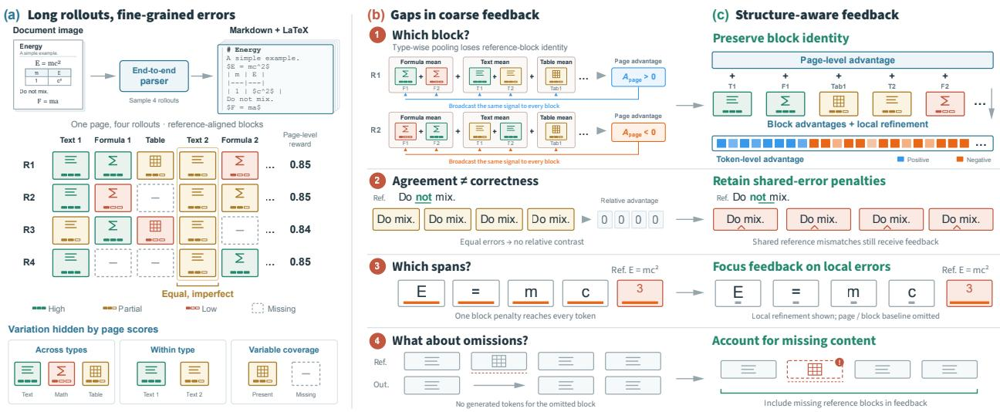
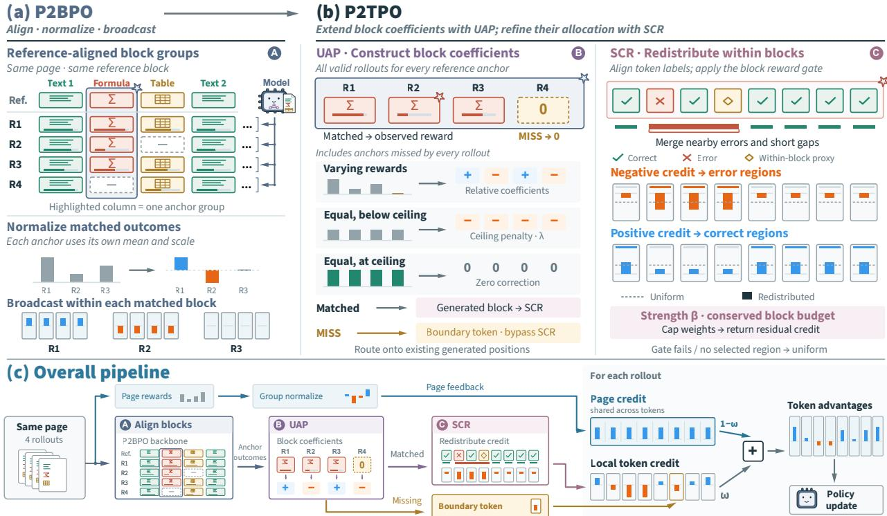
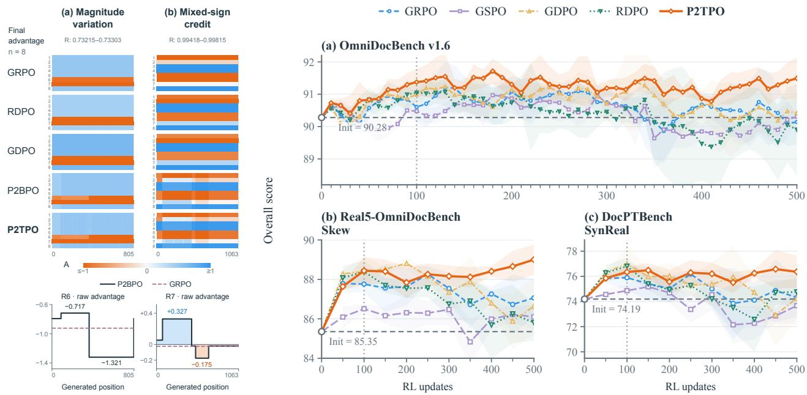
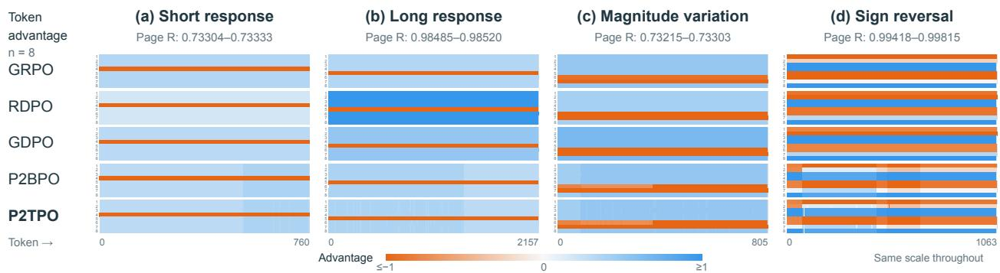
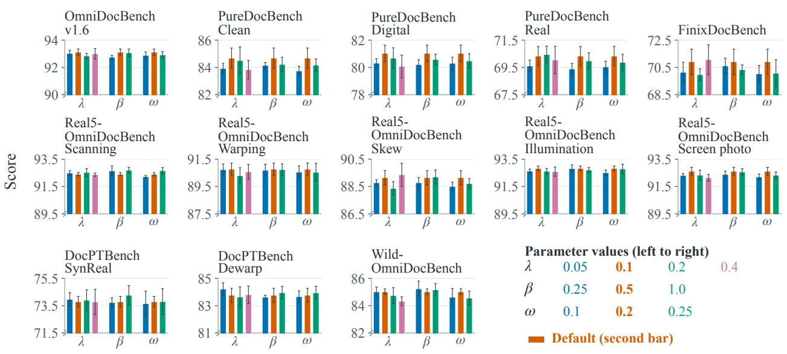
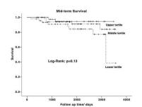
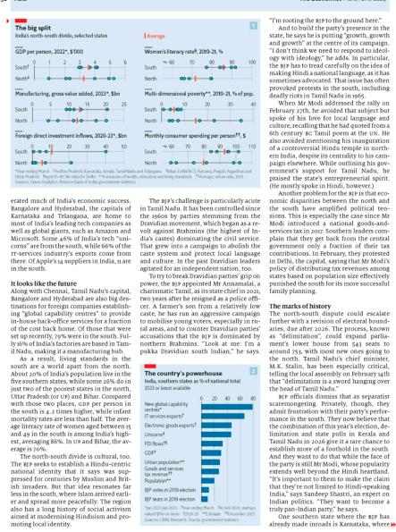

# P2TPO: Structure-Aligned Page-to-Token Credit Assignment for Full-Page Document Parsing

Yong Zu§‡1,2, Ninghua Yang§1, Zezhong Tan1, Xinhong Ma1, Ziqiang Dong∗1 and Yang Yang†1 1Qwen Business Unit, Alibaba, 2Xidian University

§Core contributors. ∗Project lead. †Team lead. ‡Work done during an internship at Alibaba.

End-to-end full-page document parsing must preserve the content and structure of heterogeneous elements, yet otherwise accurate outputs can contain local errors and omissions. A single page-level advantage does not explicitly identify which elements difer in quality across sampled outputs or where their errors occur. We introduce Page-to-Token Policy Optimization (P2TPO), a structure-aligned credit-assignment framework that operates on full-page policy trajectories. Reference-element alignment first associates block-level quality contrasts with generated spans. Unified Anchor Pricing (UAP) incorporates matched and missing element outcomes and provides feedback relative to a fixed quality ceiling when sampled outputs receive identical but imperfect scores for a reference element. Within matched blocks, Span Credit Redistribution (SCR) redistributes existing block credit according to aligned correct and erroneous spans, using boundary proxies for within-block omissions while preserving the total block-derived advantage across its tokens. Under a fixed-weight additive page utility, we show that element-indexed contrasts retain local quality diferences that page-level aggregation can cancel out. In the main experimental comparison, P2TPO outperforms all evaluated policy optimization baselines in seed-averaged scores on each of the six document parsing benchmarks. Additional experiments demonstrate gains across model scales and initializations.

## 1. Introduction

End-to-end document parsers transcribe images of digital documents, scans, and photographs into a single structured sequence in reading order (Blecher et al., 2024; Taghadouini et al., 2026; Ouyang et al., 2025; Du et al., 2025). We study full-page Markdown transcription, with faithful text, LATEX formulas, and HTML tables. Dense heterogeneous content, skew, warping, and uneven illumination challenge accuracy and com- pleteness (Ouyang et al., 2025; Zhou et al., 2026). Errors are often local: an otherwise accurate output may corru t a formula, omit words, or miss an entire element.

Supervised next-token learning serves as the foundation for these parsers, while reinforcement learning (RL) is used for post-training optimization of reference-based measures for fully generated documents. These measures evaluate content accuracy, structural fidelity, and completeness. Recent parsers highlight the ef- fectiveness of reinforcement learning in post-training through layout-aware rewards and verifiable unit tests (Wang et al., 2025; Chen et al., 2025; Poznanski et al., 2025). A key question for full-page transcription is how to convert these measurements into feedback that corrects missing or corrupted content while preserving correctly transcribed sections.

With page-level outcome rewards, GRPO assigns one response advantage to all generated tokens (Shao et al., 2024). Yet two outputs of the same page can receive similar overall scores while making opposite local errors: one transcribes a formula correctly but omits a table, whereas the other recovers the table and corrupts the formula (Figure 1(a)). A shared response coeficient does not preserve these element-specific contrasts. GDPO normalizes reward dimensions separately before combining them into a shared response coeficient (Liu et al., 2026b); CSPO routes table-wide functional-attribute advantages to corresponding tokens (Yang et al., 2026). Our focus is the remaining reference-instance question: how to compare corresponding individual elements across full-page outputs, include missing outcomes, and allocate their signed credit to generated positions.

We analyze this phenomenon at three levels. First, reference identity maintains contrasts between individual elements, including instances of the same type. Second, element-wise comparisons must account for missing outcomes and retain feedback when all outcomes are equally imperfect: an omitted element lacks a generated span, and centering tied scores diminishes its relative signal. Third, feedback must diferentiate erroneous positions from correct content within a matched block, rather than assigning uniform credit across the block. Together, the four failure modes illustrated in Figure 1(b) highlight three key requirements: preserve element identity, complete the comparison outcomes, and control where credit is assigned.

  
Figure 1 | Schematic motivation for structure-aware feedback. (a) Similar page rewards hide local diferences. (b) Coarse feedback obscures block identity, shared errors, and error/omission locations. (c) Structure-aware feedback retains element identity and assigns local credit. Rewards and serialized content are illustrative; training outputs use HTML tables.

We introduce Page-to-Token Policy Optimization (P2TPO), which assigns local credit while retaining full-page generation and page-level feedback (Figure 1(c)). It first aligns each output to reference elements so that corresponding instances can be compared across rollouts. Unified Anchor Pricing (UAP) completes these comparisons with missing outcomes and uses a quality ceiling to retain feedback at imperfect consensus. Matched coeficients act on generated blocks; whole-element omissions act through existing boundary tokens. Span Credit Redistribution (SCR) then reallocates an eligible matched block’s coeficient toward aligned errors when negative and correct positions when positive, preserving its sign and total credit mass. The final update combines this local feedback with the shared page term.

Our contributions are fourfold:

• Reference-element credit assignment. We retain individual element identities across full-page rollouts and characterize the local quality contrasts that aggregation can erase under a fixed-weight additive page utility.

• Complete outcome feedback. We propose the UAP, which outlines a unified set of rules for handling matches, managing missing values, and addressing uniformly imperfect outcomes. This includes a feedback mechanism for instances where an entire element is absent.

• Budget-preserving intra-block redistribution. We developed the SCR mechanism, which reallocates block credits while preserving both the sign and the total amount of matched block credits. We proved the conservation of credits and specified the conditions under which informative masks can increase the allocation to the target position.

• Empirical efectiveness and generality. Using a shared supervised checkpoint, matched update budgets, and a five-seed run, P2TPO outperforms four response-level baselines on all 13 primary splits across six benchmarks that include digital documents, scanned pages, and real-world photographs. In addition, across three diferent model and initialization settings, it achieves the highest mean in 37 out of 39 comparisons of splits and settings.

  
Figure 2 | P2TPO overview. (a) P2BPO aligns reference elements, normalizes matched outcomes, and broadcasts block credit. (b) UAP incorporates missing outcomes and imperfect-consensus feedback; SCR redistributes matched-block credit under a conserved budget. (c) The complete pipeline combines local token credit with page feedback. Missing-block coeficients reach boundary tokens directly, bypassing SCR.

## 2. Method

Given a page image, its reference document, and a set of sampled full-page outputs, P2TPO assigns a single coeficient to each generated token. Reference alignment identifies corresponding elements across outputs. UAP converts matched and missing outcomes into element coeficients; SCR redistributes eligible matched coeficients within their generated blocks, while whole-element omissions use a separate boundary route. These local terms combine with a shared page coeficient and enter the policy update. Generation and policy updates retain full-page autoregressive conditioning.

## 2.1. Reference-element comparisons

Given a page image � and prompt $p ,$ , we follow GRPO’s group sampling protocol (Shao et al., 2024) and draw � full-page outputs $y _ { i } \sim \pi _ { \theta _ { \mathrm { o l d } } } ( \cdot \mid x , p )$ . Predictions and references are parsed into ordered text, formula, and table blocks. Content-based sequence alignment permits insertions and deletions while preserving reading order. We index each matched prediction by its corresponding reference block $y _ { k } ^ { \star }$ , rather than its position in the generated sequence. Thus, diferent instances of the same category remain distinct across rollouts, even when preceding elements are omitted.

Let $i , k ,$ and � index rollouts, reference elements, and tokens. A matched block has a type-specific quality score $s _ { i , k } \in [ 0 , c _ { k } ]$ and a generated-token support $\mathcal { B } _ { i , k }$ of length $L _ { i , k }$ . The implementation uses normalized scores with $c _ { k } = 1$ and maps generated block boundaries to disjoint token spans. For each reference � with a valid match, let $\mathcal { T } _ { k }$ contain its valid matched rollouts, and let $\mu _ { k } ^ { \mathrm { { \dot { B } } } }$ and $\sigma _ { k } ^ { \mathrm { B } }$ be the mean and population standard deviation of their scores.

Page-to-Block Policy Optimization (P2BPO) normalizes each matched reference group independently:

$$
A _ { i , k } ^ { \mathtt { B } } = \left\{ \begin{array} { l l } { ( s _ { i , k } - \mu _ { k } ^ { \mathtt { B } } ) / \sigma _ { k } ^ { \mathtt { B } } , } & { \sigma _ { k } ^ { \mathtt { B } } > \epsilon , } \\ { 0 , } & { \sigma _ { k } ^ { \mathtt { B } } \leq \epsilon , } \end{array} \right. \quad i \in { \mathcal { I } } _ { k } .\tag{1}
$$

Here $\epsilon \geq 0$ is a numerical tolerance. Each coeficient is broadcast over $\mathcal { B } _ { i , k }$ (see Fig. 2(a)), so blocks within one response can receive diferent signs and magnitudes. Reference-wise comparisons retain contrasts that page- or category-level pooling can cancel. However, unmatched references have no coeficient, while a singleton or tied matched group produces zero credit. UAP addresses these two gaps. Appendix B.1 summarizes the algorithm inputs.

## 2.2. UAP: complete outcomes and retain quality deficits

Unified Anchor Pricing (UAP) completes each reference element’s outcomes across valid rollouts $\mathcal { V } _ { k } \colon Q _ { i , k } = s _ { i , k }$ when matched and $Q _ { i , k } = 0$ when missing. With mean $\mu _ { k }$ and population standard deviation $\sigma _ { k } ,$ its coeficient uses relative comparison when outcomes difer and ceiling-gap feedback when dispersion is negligible:

$$
\begin{array} { r } { A _ { i , k } ^ { \mathrm { U } } = \left\{ \begin{array} { l l } { ( Q _ { i , k } - \mu _ { k } ) / \sigma _ { k } , } & { \sigma _ { k } > \epsilon , } \\ { - \lambda h ( \mu _ { k } , c _ { k } ) , } & { \sigma _ { k } \leq \epsilon , } \end{array} \right. \qquad h ( u , c ) = \operatorname* { m a x } ( 0 , c - u ) . } \end{array}\tag{2}
$$

Here $\lambda \geq 0$ weights the ceiling gap; the same tolerance � separates the two branches. For $\lambda > 0 _ { ; }$ , both fully matched imperfect ties and all-missing groups receive negative coeficients, whereas a ceiling-quality tie receives zero. Thus a single element-indexed rule retains feedback for missing and uniformly imperfect outcomes.

In a mixed group, zero-valued omissions and observed block scores jointly determine the mean and dispersion, so outcome completion can change coeficients for both matched and missing outcomes.

Outcome completion includes missing scores in the reference-wise comparison. Matched coeficients act on generated blocks, while missing-element coeficients are routed to existing boundary tokens through $\nu _ { i , k } ( t ) \geq 0$ where $\begin{array} { r } { \sum _ { t } \nu _ { i , k } ( t ) = 1 } \end{array}$ , bypassing SCR. Appendix B.2 details how we construct the coeficients.

## 2.3. SCR: redistribute credit under a conserved budget

Span Credit Redistribution (SCR) reallocates an available block coeficient under a conserved budget, concentrating negative credit in error regions and positive credit in correct regions.

Quality gating restricts redistribution to high-scoring, type-matched blocks, focusing local allocation on residual defects within otherwise accurate elements. For eligible matched blocks, SCR creates edit-based masks based on both the prediction and the reference. Insertions and replacements identify error locations. SCR assigns deleted reference content within a matched block to a nearby generated position. Whole-element omissions follow UAP’s separate boundary route. Further details appear in Appendix B.1. A binary mask $u _ { i , t }$ selects errors for negative credit and correct positions for positive credit (see Fig. 2(b)). For a nonempty mask of size $\begin{array} { r } { N _ { i , k } = \sum _ { t \in \mathcal { B } _ { i , k } } u _ { i , t } } \end{array}$ the redistribution has the form

$$
d _ { i , t } = 1 - \eta _ { i , k } + \eta _ { i , k } \frac { L _ { i , k } u _ { i , t } } { N _ { i , k } } , \qquad \sum _ { t \in \mathcal { B } _ { i , k } } d _ { i , t } = L _ { i , k } .\tag{3}
$$

The implementation mixes uniform and selected-token allocation, applies a pre-rebate cap to concentrated weights, and returns the removed mass uniformly. This determines the efective strength $\eta _ { i , k } ~ \in ~ [ 0 , 1 ]$ in Appendix B.2.2. Nonnegative weights preserve the coeficient’s sign, while their unit mean preserves both the signed and absolute block-credit budgets. Blocks ineligible for redistribution or with empty masks retain uniform weights $d _ { i , t } ~ = ~ 1$ . Appendix D.3 provides details on the resulting increase in target allocation for informative masks.

## 2.4. Page-to-token composition

Let $\mathcal { K } _ { i }$ and $M _ { i }$ index matched and missing reference elements, respectively. For each rollout, we clip raw page-reward dimensions to [0, 1] and average over the available dimensions. Normalizing these scalar rewards across rollouts for the same prompt gives $A _ { i } ^ { \check { \mathsf { P } } }$ (Appendix B.1). Combining the two local contributions with page feedback gives

$$
C _ { i , t } ^ { \mathrm { U S } } = \sum _ { k \in \mathcal { K } _ { i } } A _ { i , k } ^ { \mathrm { U } } \mathbf { 1 } [ t \in \mathcal { B } _ { i , k } ] d _ { i , t } + \sum _ { k \in \mathcal { M } _ { i } } A _ { i , k } ^ { \mathrm { U } } \nu _ { i , k } ( t ) ,\tag{4}
$$

$$
A _ { i , t } ^ { \mathrm { U S } } = ( 1 - \omega ) A _ { i } ^ { \mathrm { P } } + \omega C _ { i , t } ^ { \mathrm { U S } } , \qquad \omega \in [ 0 , 1 ] .
$$

The page term is shared across generated positions, while local terms vary with reference identity and within- block location. Tokens outside local supports retain the page term. The mixing weight � balances these feedback scopes before the policy update. Alignments and the resulting $A _ { i , t } ^ { \mathrm { U S } }$ remain fixed during the clipped policy update; token probabilities retain the full autoregressive page context. Appendix B.2 provides the complete coeficient construction, component variants, and policy loss; Appendix C.1.3 lists parameter settings.

## 3. Related Work

Document parsing and reinforcement post-training. End-to-end parsers such as Donut and Nougat generate structured documents directly from images (Kim et al., 2022; Blecher et al., 2024). Recent systems extend this setting to diverse layouts and capture conditions (Cai et al., 2026; Lu et al., 2026). Reinforcement post-training introduces rewards for transcription, layout, reading order, output validity, and structural fidelity (Wang et al., 2025; Huang et al., 2026; Chen et al., 2025; Poznanski et al., 2025; Wang et al., 2026a; Hunyuan Vision Team et al., 2025; Zhang et al., 2026). Table- and element-specific approaches further tailor the prediction unit and reward to local content (Zhang et al., 2025; Li et al., 2026a; Wang et al., 2026c). These systems motivate heterogeneous quality measures, while P2TPO studies how feedback for individual reference elements reaches tokens within a full-page rollout. Appendix A.1 compares reward units and optimization supports.

Group-relative optimization and reward normalization. GRPO and RLOO construct response advantages from sampled groups without a learned critic (Shao et al., 2024; Ahmadian et al., 2024). GSPO uses sequencelevel importance weighting and clipping, while DAPO and Dr. GRPO revise sampling, clipping, reduction, or normalization (Zheng et al., 2025; Yu et al., 2025a; Liu et al., 2025). GDPO, RDPO, and GD2PO address the normalization and interaction of multiple reward dimensions (Liu et al., 2026b; Bai et al., 2026; Liu et al., 2026a). NGRPO combines virtual-maximum calibration with asymmetric clipping to learn from homogeneous failures (Nan et al., 2025). UAP shares ceiling-informed feedback, while unifying missing outcomes and imperfect reward consensus within reference-element comparisons and routing their feedback to generated tokens. Appendix C.1.4 details the evaluated baselines; Appendix A.1 compares reward interfaces.

Structured and local credit assignment. Process su ervision evaluates reasonin ste s (Li htman et al., 2024; Wang et al., 2024); GiGPO compares repeated environment states while retaining trajectory feedback (Feng et al., 2025). CSPO extends GRPO with table-wide functional-attribute rewards whose normalized advantages are routed to corresponding tokens alongside global feedback (Yang et al., 2026). P2TPO performs local comparisons for individual reference-block instances in full-page rollouts, preserving quality diferences between elements of the same type and supporting omission feedback and intra-block redistribution. Functional-attribute assessment and reference-instance comparison are complementary; Appendix A.2 discusses possible adaptations.

## 4. Experiments

Unless otherwise specified, “seeds” refers to distinct RL training runs rather than repeated evaluations of a fixed checkpoint. The reported means and standard deviations summarize benchmark scores across these training runs. The experiments test whether reference-element feedback improves full-page parsing, whether UAP and SCR contribute to those gains, and whether alignment-informed placement matters beyond nonuniform weighting. Additional settings assess applicability across initializations, model scales, and backbones; parameter swee s and a 500-u date stud examine sensitivit to credit arameters and trainin horizon.

## 4.1. Experimental setup

Baselines. We com are P2TPO with four res onse-level olic o timization baselines: GRPO (Shao et al. 2024), GSPO (Zheng et al., 2025), GDPO (Liu et al., 2026b), and RDPO (Bai et al., 2026). P2BPO and its +UAP and +SCR variants serve as component ablations. Appendix C.1.4 details the comparison methods.

Benchmarks. We evaluate on six benchmarks with 13 splits: OmniDocBench v1.6 (Ouyang et al., 2025; OmniDocBench contributors, 2026) for heterogeneous full-page parsing; PureDocBench (Li et al., 2026c) for Clean, Digital, and Real conditions; FinixDocBench (Wang et al., 2026b) for digital and photographed documents; Real5-OmniDocBench (Zhou et al., 2026) for five capture conditions; DocPTBench (Du et al.,

2025) for photographed and dewarped pages; and Wild-OmniDocBench (Li et al., 2026b) for real-world captures. Scores compare methods within each benchmark: five benchmarks use the shared OmniDocBench evaluator, while FinixDocBench ools its Di ital and Photo tracks usin its oficial evaluator. Real5 and Wild reuse OmniDocBench source pages and assess capture robustness. Appendix C.1.5 specifies the evaluated scope and score definitions, including the adapted DocPTBench composite.

Implementation details. We use converted Infinit -Doc2-5M annotations (Huan et al., 2026) for document SFT followed by RL. SFT provides the initial checkpoint: Qwen3.5-2B trained on 700K pages in the primary setting, with additional settings covering 50K-page checkpoints, Qwen3.5-4B, and Qwen3-VL-2B-Instruct. Within each setting, all RL methods start from the same checkpoint and share the update budget. Init reports its measured benchmark score before RL. Table 1 reports primary RL Overall scores as means ± standard deviations over five seeds. Appendices C.1.1, C.1.3, and C.4 provide further details.

## 4.2. Cross-benchmark performance

Table 1 reports Overall scores for the primary Qwen3.5-2B/700K setting across all six benchmarks and 13 evaluation splits.

Table 1 | Cross-benchmark Overall scores (↑, 0–100) from Qwen3.5-2B initialized by SFT on 700K pages. Init reports pre-RL scores; RL entries report mean ± standard deviation over five seeds after 100 updates.
<table><tr><td>Benchmark</td><td>Split</td><td>Init GRPO</td><td>GSPO</td><td>GDPO RDPO</td><td>P2BPO +UAP</td><td>+SCR</td><td>P2TPO</td></tr><tr><td>OmniDocBench</td><td>v1.6</td><td></td><td> $9 2 . 1 7 \ 9 2 . 2 5 + 0 . 3 4 \ 9 2 . 3 8 + 0 . 1 8 \ 9 2 . 3 1 + 0 . 2 4 \ 9 2 . 3 2 + 0 . 3 5 \ 9 2 . 4 8 + 0 . 1 5 \ 9 2 . 8 4 + 0 . 3 0 \ 9 2 . 5 6 + 0 . 2 1 \ 9 3 . 1 2 + 0 . 2 3$ </td><td></td><td></td><td></td><td></td></tr><tr><td rowspan="3">PureDocBench</td><td>Clean</td><td></td><td> $8 1 . 2 8 \ 8 3 . 1 9 \pm 0 . 7 0 \ 8 3 . 4 4 \pm 0 . 3 1 \ 8 2 . 6 8 \pm 0 . 6 5 \ 8 3 . 1 0 \pm 0 . 5 4 \ 8 4 . 1 6 \pm 0 . 6 2 \ 8 3 . 9 8 \pm 0 . 3 7 \ 8 3 . 7 8 \pm 0 . 4 0 \ 8 4 . 6 8 \pm 0 . 7 4$ </td><td></td><td></td><td></td><td></td></tr><tr><td>Digital</td><td>76.66</td><td> $7 9 . 8 9 \pm 0 . 4 8 7 9 . 5 0 \pm 0 . 3 3 7 9 . 2 4 \pm 0 . 5 0 7 9 . 2 6 \pm 0 . 5 0 \underbrace { 8 0 . 3 1 } _ { \mathrm { ~ } \mathrm { ~ } \mathrm { ~ } \mathrm { ~ } \mathrm { ~ } \mathrm { ~ } } \pm 0 . 4 8 \mathrm { ~ } 8 0 . 2 6 \pm 0 . 3 9 \mathrm { ~ } 7 9 . 7 9 \pm 0 . 3 1$ </td><td></td><td></td><td></td><td>81.03± 0.60</td></tr><tr><td>Real</td><td>63.29</td><td> $6 8 . 8 9 \pm 0 . 6 4 6 7 . 6 4 \pm 0 . 3 8 \ 6 8 . 2 3 \pm 0 . 6 9 \ 6 8 . 2 7 \pm 0 . 2 8 \ 6 9 . 3 6 \pm 0 . 4 6 \ 6 9 . 8 7 \pm 0 . 4 9 \ 6 9 . 0 8 \pm 0 . 3 5 \ 7 0 . 3 3 \pm 0 . 7 0$ </td><td></td><td></td><td></td><td></td></tr><tr><td rowspan="4">FinixDocBench</td><td>一</td><td></td><td> $6 5 . 3 0 ~ 6 9 . 3 6 \pm 0 . 4 9 ~ 6 9 . 2 4 \pm 0 . 4 4 ~ 6 9 . 2 1 \pm 1 . 4 2 ~ 6 8 . 1 5 \pm 0 . 7 4 ~ 7 0 . 0 3 \pm 0 . 7 7 ~ 7 0 . 2 9 \pm 0 . 6 2 ~ 6 9 . 3 7 \pm 0 . 4 4 ~ 7 0 . 9 2 \pm 0 . 4 4 ~ 7 0 . 2 4$ </td><td></td><td></td><td></td><td>92</td></tr><tr><td>Scanning</td><td>91.06</td><td> $9 2 . 0 7 \pm 0 . 2 0 9 2 . 0 0 \pm 0 . 1 7 9 2 . 0 0 \pm 0 . 2 1 9 1 . 9 0 \pm 0 . 2 8 9 2 . 4 4 \pm 0 . 2 9 9 2 . 5 2 \pm 0 . 1 6 9 2 . 2 5 \pm 0 . 3 1$ </td><td></td><td></td><td></td><td></td></tr><tr><td>Warping</td><td>86.50</td><td> $9 0 . 4 5 _ { \pm } 0 . 5 3 8 9 . 3 6 _ { \pm } 0 . 2 9 9 9 0 . 1 1 _ { \pm } 0 . 1 5 8 9 . 9 2 _ { \pm } 0 . 3 7 \overline { { 9 0 . 4 4 } } \oplus 0 . 5 7 \ 9 0 . 5 9 _ { \pm } 0 . 3 0 \ 9 0 . 3 1 _ { \pm } 0 . 4 6 \ 9 0 . 7 7 \mp 0 . 4 5 \ $ </td><td></td><td></td><td></td><td>92.40±0.12</td></tr><tr><td>Skew</td><td>81.77</td><td> $8 8 . 2 6 \pm 0 . 4 8 8 8 . 4 7 \pm 0 . 3 4 8 8 . 0 9 \pm 0 . 3 9 8 8 . 4 7 \pm 0 . 4 2 8 8 . 8 2 \pm 0 . 6 4 8 8 . 7 8 \pm 0 . 3 8 8 . 5 6 \pm 0 . 6 1 8 9 . 1 5 \pm 0 . 5 2 4 4 . 0 9 8 . 4 7 \pm 0 . 6 4 4 . 0 9 8 . 4 7 \pm 0 . 4 4 2 8 . 5 2 \pm 0 . 4 4 4 . 0 9 8$ </td><td></td><td></td><td></td><td>2</td></tr><tr><td rowspan="3">DocPTBench</td><td></td><td>Illumination 91.23</td><td> $9 2 . 4 1 \div 0 . 1 2 9 1 . 9 8 \div 0 . 2 6 9 2 . 2 2 \div 0 . 2 0 9 2 . 3 5 \div 0 . 0 9 9 2 . 5 9 \div 0 . 2 0 9 2 . 6 2 \div 0 . 1 9 9 2 . 4 1 \div 0 . 2 8$ </td><td></td><td></td><td></td><td>92.83± 0.17</td></tr><tr><td>Screen photo</td><td></td><td> $9 0 . 3 2 ~ 9 2 . 0 4 \pm 0 . 1 7 ~ 9 1 . 7 6 \pm 0 . 3 1 ~ 9 1 . 7 5 \pm 0 . 3 0 ~ 9 1 . 5 2 \pm 0 . 2 8 ~ 9 2 . 3 3 \pm 0 . 3 0 ~ 9 2 . 2 8 \pm 0 . 1 2 ~ 9 2 . 2 0 \pm 0 . 5 0 ~ 9 2 . 6 2 \pm 0 . 2 9$ </td><td></td><td></td><td></td><td></td></tr><tr><td>SynReal Dewarp</td><td>6</td><td> $9 . 2 . 2 7 \ 7 3 . 2 1 \pm 0 . 6 7 \ 7 2 . 8 5 \pm 0 . 6 5 \ 7 2 . 5 9 \pm 0 . 5 4 \ 7 2 . 8 0 \pm 0 . 2 6 \ 7 3 . 6 1 \pm 0 . 5 6 \ 7 3 . 6 0 \pm 0 . 4 5 \ 7 3 . 8 1 \pm 1 . 1 4 \ 7 3 . 7 9 \pm 0 . 3 9$ </td><td></td><td></td><td></td><td></td></tr><tr><td>Wild-OmniDocBench</td><td></td><td>79.66 80.04</td><td> $8 3 . 5 7 _ { \pm 0 . 2 9 } 8 2 . 8 5 _ { \pm 0 . 3 6 } 8 3 . 1 2 _ { \pm 0 . 3 0 } 8 3 . 2 9 _ { \pm 0 . 8 2 } 8 3 . 9 5 _ { \pm 0 . 4 4 } 8 3 . 9 9 _ { \pm 0 . 4 2 } 8 3 . 3 6 _ { \pm 0 . 5 0 } 8 3 . 7 6 _ { \pm 0 . 5 1 }$   $8 4 , 6 7 \pm 0 . 1 8 \ 8 3 . 4 8 \pm 0 . 2 0 \ 8 4 . 2 8 \pm 0 . 2 0 \ 8 4 . 5 0 \pm 0 . 2 9 \ 8 4 . 7 2 \pm 0 . 4 7 \ 8 4 . 6 8 \pm 0 . 5 4 \ 8 4 . 5 5 \pm 0 . 5 6 \ 8 5 . 0 2 \pm 0 . 2 1$ </td><td></td><td></td><td></td><td></td></tr></table>

Note. Init is the shared SFT-initialized check oint no standard deviation is re orted for Init. P2BPO is the matched-element reference confi uration +UAP and +SCR enable one component at a time. Bold and underlined values mark the best and second-best RL means, respectively. — denotes an aggregate benchmark score.

On the primary OmniDocBench v1.6 benchmark, P2TPO reaches 93.12 ± 0.23, a gain of 0.95 points from its pre-RL score and 0.74 points over the strongest response-level baseline. It also exceeds the strongest response-level mean on all 12 external splits, with margins from 0.19 points on DocPTBench Dewarp to 1.56 points on FinixDocBench. The next-largest margins occur on PureDocBench Real (+1.44) and Clean (+1.24), and the gains hold across all five Real5-OmniDocBench capture conditions.

## 4.3. Component ablations and credit diagnostics

Reference-element routing. Matched-element comparisons account for a substantial part of the gain: P2BPO exceeds the strongest response-level baseline in mean Overall score on 12 of 13 splits, with the largest margins on PureDocBench Clean (+0.72 points) and FinixDocBench (+0.67 points; Table 1). All diferences below are in mean Overall-score points.

SCR is more consistently beneficial with UAP. SCR benefits most consistently from UAP’s completed and calibrated feedback. With UAP enabled, adding SCR improves the mean on 11 of 13 splits, led by PureDocBench Digital (+0.77) and Clean (+0.70); without UAP, it improves two of 13 splits. Adding UAP to P2BPO + SCR improves 12 of 13 splits. Full P2TPO attains the highest mean among the four component configurations on ten splits (Table 1). These descriptive five-seed comparisons support the complementarity of feedback construction and token allocation.

Internal UAP interventions. We retain outcome completion and SCR while separately disabling consensus feedback (� = 0) or omission routing. Table 2(a) shows that full P2TPO exceeds the former in mean score on eight of 13 splits and the latter on 11. Full P2TPO also has lower observed across-seed standard deviations than the � = 0 configuration on all 13 splits. These interventions assess UAP’s feedback and delivery rules; Appendix C.2.1 gives their definitions and detailed comparisons.

SCR allocation controls. To isolate the contribution of token placement, we preserve each eligible block’s coeficient values and selected-token count while randomizing their positions. Aligned SCR exceeds random support in mean score on 12 of 13 splits and circular shift on ten (Table 2(b)). Random support and circular shift exceed uniform allocation on two and three splits, respectively. These comparisons support alignment-informed placement beyond nonuniform weighting alone; Appendix C.2.2 gives the protocols and detailed results.

Table 2 | UAP ablations and SCR allocation controls across six benchmarks and 13 splits. Entries report mean Overall score (↑, 0–100) ± standard deviation over five runs; settings follow Table 1.
<table><tr><td rowspan="2">Benchmark</td><td rowspan="2">Split</td><td rowspan="2">Full P2TPO</td><td colspan="2">(a) UAP interventions</td><td rowspan="2">w/o UAP</td><td colspan="2">(b) SCR allocation controls</td><td rowspan="2">w/o SCR</td></tr><tr><td>feedback</td><td>w/o consensus w/o omission routing</td><td>Circular shift</td><td>Random support</td></tr><tr><td>OmniDocBench</td><td>v1.6</td><td> $9 3 . 1 2 \pm 0 . 2 3 $ </td><td> $9 2 . 9 2 \pm 0 . 4 5$ </td><td> $9 2 . 8 6 \pm 0 . 2 3 $ </td><td> $9 2 . 5 6 \pm 0 . 2 1$ </td><td> $9 2 . 7 3 \pm 0 . 1 7$ </td><td> $9 2 . 8 2 \pm 0 . 2 5$ </td><td> $9 2 . 8 4 \pm 0 . 3 0$ </td></tr><tr><td rowspan="2">PureDocBench</td><td>Clean</td><td> $8 4 . 6 8 { \scriptstyle \pm 0 . 7 4 }$ </td><td> $8 4 . 3 8 \pm 0 . 9 4$ </td><td> $8 3 . 7 4 \pm 0 . 3 5$ </td><td> $8 3 . 7 8 \pm 0 . 4 0$ </td><td> $8 3 . 8 5 \pm 0 . 7 9$ </td><td> $8 3 . 8 4 \pm 0 . 1 6$ </td><td> $8 3 . 9 8 \pm 0 . 3 7$ </td></tr><tr><td>Digital</td><td> $\mathbf { 8 1 . 0 3 } \pm 0 . 6 0$ </td><td> $8 0 . 7 9 { \scriptstyle \pm 0 . 8 8 }$ </td><td> $8 0 . 1 5 { \scriptstyle \pm 0 . 3 6 }$ </td><td> $7 9 . 7 9 { \scriptstyle \pm 0 . 3 1 }$ </td><td> $8 0 . 0 8 \pm 0 . 7 3$ </td><td> $8 0 . 4 3 { \scriptstyle \pm 0 . 4 5 }$ </td><td> $8 0 . 2 6 \pm 0 . 3 9$ </td></tr><tr><td></td><td>Real</td><td> $7 0 . 3 3 { \scriptstyle \pm 0 . 7 0 }$ </td><td> $7 0 . 0 5 \pm 0 . 9 3$ </td><td> $6 9 . 6 7 \pm 0 . 6 4$ </td><td> $6 9 . 0 8 \pm 0 . 3 5$ </td><td> $6 9 . 6 9 { \scriptstyle \pm 0 . 7 8 }$ </td><td> $6 9 . 3 3 \pm 0 . 4 7$ </td><td> $6 9 . 8 7 { \scriptstyle \pm 0 . 4 9 }$ </td></tr><tr><td rowspan="2">FinixDocBench</td><td>一</td><td> $7 0 . 9 2 \substack { \pm 0 . 9 2 }$ </td><td> $7 0 . 4 2 \pm 1 . 3 6$ </td><td> $7 0 . 0 5 \pm 0 . 8 0$ </td><td> $6 9 . 3 7 { \scriptstyle \pm 0 . 4 4 }$ </td><td> $7 0 . 9 8 \pm 1 . 2 2$ </td><td> $7 0 . 0 3 \pm 1 . 0 9$ </td><td> $7 0 . 2 9 { \scriptstyle \pm 0 . 6 2 }$ </td></tr><tr><td>Scanning</td><td> $9 2 . 4 0 \pm 0 . 1 2$ </td><td> $9 2 . 4 8 \pm 0 . 3 5$ </td><td> $9 2 . 4 5 \pm 0 . 1 9$ </td><td> $9 2 . 2 5 { \scriptstyle \pm 0 . 3 1 }$ </td><td> $9 2 . 2 6 \pm 0 . 4 1$ </td><td> $9 2 . 3 6 \pm 0 . 2 3 $ </td><td> $9 2 . 5 2 { \scriptstyle \pm 0 . 1 6 }$ </td></tr><tr><td rowspan="5">Real5- OmniDocBench</td><td>Warping</td><td> $9 0 . 7 7 { \scriptstyle \pm 0 . 4 5 }$ </td><td> $9 0 . 6 8 \pm 0 . 7 7$ </td><td> $9 0 . 4 5 \pm 0 . 3 9$ </td><td> $9 0 . 3 1 \pm 0 . 4 6$ </td><td> $9 0 . 4 1 \pm 0 . 3 5$ </td><td> $9 0 . 2 5 \pm 0 . 4 8$ </td><td> $9 0 . 5 9 { \scriptstyle \pm 0 . 3 0 }$ </td></tr><tr><td>Skew</td><td> $\mathbf { 8 9 . 1 5 } \pm 0 . 5 2$ </td><td> $8 8 . 9 2 \substack { \pm 0 . 8 1 }$ </td><td> $8 8 . 8 0 { \scriptstyle \pm 0 . 3 1 }$ </td><td> $8 8 . 5 6 \pm 0 . 6 1$ </td><td> $8 8 . 7 0 { \scriptstyle \pm 0 . 4 6 }$ </td><td> $8 8 . 4 2 \substack { \pm 0 . 2 8 }$ </td><td> $8 8 . 7 8 { \scriptstyle \pm 0 . 3 8 }$ </td></tr><tr><td>Illumination</td><td> $9 2 . 8 3 \pm 0 . 1 7$ </td><td> $9 2 . 8 4 { \scriptstyle \pm 0 . 3 8 }$ </td><td> $9 2 . 5 9 { \scriptstyle \pm 0 . 1 6 }$ </td><td> $9 2 . 4 1 \pm 0 . 2 8 $ </td><td> $9 2 . 5 2 \pm 0 . 4 5$ </td><td> $9 2 . 4 5 \pm 0 . 1 6$ </td><td> $9 2 . 6 2 { \scriptstyle \pm 0 . 1 9 }$ </td></tr><tr><td>Screen photo</td><td> $9 2 . 6 2 { \scriptstyle \pm 0 . 2 9 }$ </td><td> $9 2 . 6 7 { \scriptstyle \pm 0 . 6 4 }$ </td><td> $9 2 . 4 5 \pm 0 . 1 4$ </td><td> $9 2 . 2 0 { \scriptstyle \pm 0 . 5 0 }$ </td><td> $9 2 . 1 9 { \scriptstyle \pm 0 . 2 7 }$ </td><td> $9 2 . 5 2 \pm 0 . 5 6$ </td><td> $9 2 . 2 8 \pm 0 . 1 2$ </td></tr><tr><td> $\mathtt { S y n R e a l }$ </td><td> $7 3 . 7 9 { \scriptstyle \pm 0 . 3 9 }$ </td><td> $7 4 . 4 9 \pm 1 . 2 3$ </td><td> $7 4 . 1 0 { \scriptstyle \pm 0 . 5 5 }$ </td><td> $7 3 . 8 1 \pm 1 . 1 4$ </td><td> $7 4 . 2 1 \pm 1 . 1 7$ </td><td> $7 3 . 3 3 \pm 0 . 6 0$ </td><td> $7 3 . 6 0 { \scriptstyle \pm 0 . 4 5 }$ </td></tr><tr><td rowspan="2">DocPTBench</td><td>Dewarp</td><td> $8 3 . 7 6 \pm 0 . 5 1$ </td><td> $8 3 . 9 2 \substack { \pm 0 . 6 1 }$ </td><td> $8 3 . 6 9 _ { \pm 0 . 1 3 }$ </td><td> $8 3 . 3 6 \pm 0 . 5 0$ </td><td> $8 3 . 9 4 \pm 1 . 0 9$ </td><td> $8 3 . 8 3 \pm 0 . 4 8$ </td><td> $8 3 . 9 9 { \scriptstyle \pm 0 . 4 2 }$ </td></tr><tr><td>1</td><td> $\mathbf { 8 5 . 0 2 } \pm 0 . 2 1$ </td><td>84.79±0.57</td><td> $8 4 . 8 1 \pm 0 . 7 5$ </td><td> $8 4 . 5 5 { \scriptstyle \pm 0 . 5 6 }$ </td><td> $8 4 . 7 4 { \scriptstyle \pm 0 . 3 7 }$ </td><td> $8 4 . 2 8 \pm 0 . 3 8$ </td><td> $8 4 . 6 8 \pm 0 . 5 4$ </td></tr></table>

Note. Bold marks the highest mean per split. w/o UAP: P2BPO + SCR; w/o SCR: P2BPO + UAP. — denotes an aggregate benchmark score.

Table 3 | Component diagnostics on OmniDocBench v1.6 after 100 RL updates from the shared 700K-page SFT initialization. Parsing metrics report five-seed means ± standard deviations; best and second-best values are bold and underlined, respectively.
<table><tr><td></td><td colspan="5">Parsing metrics</td><td colspan="2">Omission rates (%)</td></tr><tr><td>Method</td><td>Text ED↓</td><td>Formula CDM↑</td><td>Formula ED↓</td><td>Table TEDS↑</td><td>Order ED↓</td><td>Element↓</td><td>Local↓</td></tr><tr><td>P2BPO</td><td> $0 . 0 3 6 0 { \scriptstyle \pm 0 . 0 0 1 8 }$ </td><td> $0 . 9 3 4 0 { \scriptstyle \pm 0 . 0 0 2 8 }$ </td><td> $0 . 1 2 7 9 { \scriptstyle \pm 0 . 0 0 2 0 }$ </td><td> $0 . 8 7 6 5 { \scriptstyle \pm 0 . 0 0 4 6 }$ </td><td> $0 . 0 4 7 5 { \scriptstyle \pm 0 . 0 0 2 5 }$ </td><td>1.09</td><td>6.72</td></tr><tr><td> $\mathrm { P 2 B P O + U A P }$ </td><td> $\mathbf { 0 . 0 3 3 3 } _ { \pm 0 . 0 0 1 7 }$ </td><td> $\underline { { 0 . 9 3 9 8 } } { \pm 0 . 0 0 4 2 }$ </td><td> $\underline { { 0 . 1 2 6 1 } } \pm 0 . 0 0 4 1$ </td><td> $0 . 8 7 8 6 { \scriptstyle \pm 0 . 0 0 5 9 }$ </td><td> $\underline { { 0 . 0 4 5 9 } } \pm 0 . 0 0 2 0$ </td><td>1.01</td><td>5.59</td></tr><tr><td> $\mathrm { P 2 B P O } + \mathrm { S C R }$ </td><td> $0 . 0 3 6 4 \substack { \pm 0 . 0 0 0 8 }$ </td><td> $0 . 9 3 2 5 { \scriptstyle \pm 0 . 0 0 4 6 }$ </td><td> $0 . 1 2 7 5 { \scriptstyle \pm 0 . 0 0 3 1 }$ </td><td> $\underline { { 0 . 8 8 0 7 } } \pm 0 . 0 0 8 0$ </td><td> $0 . 0 5 0 0 { \scriptstyle \pm 0 . 0 0 1 7 }$ </td><td>1.08</td><td>5.99</td></tr><tr><td>P2TPO</td><td> $\underline { { 0 . 0 3 4 3 } } \pm 0 . 0 0 1 5$ </td><td> $\mathbf { 0 . 9 4 4 6 { \scriptstyle \pm 0 . 0 0 2 7 } }$ </td><td> $\mathbf { 0 . 1 2 1 2 } _ { \pm 0 . 0 0 2 3 }$ </td><td> $\mathbf { 0 . 8 8 3 3 } _ { \pm 0 . 0 0 6 1 }$ </td><td> $\mathbf { 0 . 0 4 2 3 } \pm 0 . 0 0 2 4$ </td><td>0.95</td><td>5.53</td></tr></table>

Note. ED: edit distance. Parsing metrics use [0, 1]; omission rates use [0, 100]. Element omission counts missing eligible reference elements; local omission counts omitted characters within matched text blocks and excludes whole-element omissions. Omission-rate standard deviations are unavailable. Appendix C.1.5 gives the complete definitions.

Parsing accuracy and omissions. On OmniDocBench, adding UAP to P2BPO reduces the observed elementomission rate from 1.09% to 1.01% and local omission from 6.72% to 5.59% (Table 3). Full P2TPO records the lowest observed omission rates and the best formula, table, and reading-order metrics among the four component configurations; P2BPO + UAP gives the lowest Text ED. SCR’s Formula CDM and reading-order gains occur with UAP enabled, matching the conditional pattern in the Overall-score ablation. Appendix C.1.5 specifies the omission denominators and reporting scope.

  
Figure 3 | Frozen-response credit assignment (� = 8 per case; no policy update). Heatmaps saturate beyond ±1. Lower profiles compare GRPO and P2BPO for (a) R6 and (b) R7; y-scales difer.  
Figure 4 | Extended Qwen3.5-2B/50K training with 64,000 RL records. Lines show unsmoothed five-run means; bands denote ±1 SD. Markers and ticks indicate evaluations every ten updates in (a) and every 50 in $^ { ( \mathrm { b , c } ) }$ . Each panel starts at its measured Init (dashed line), with SD bands beginning at the first evaluation. Panel-specific y-axis ranges truncate some SD bands; vertical guides mark update 100.

Figure 3 illustrates the routing resolution of reference-element feedback using two frozen eight-response groups (no policy update; Appendix C.3). On the common sampled responses, P2BPO produces block-dependent magnitudes and mixed-sign coeficients, while GRPO uses a uniform coeficient within each response.

## 4.4. Generality across initialization, scale, and backbone

Table 4 complements the primary Qwen3.5-2B/700K results with three additional SFT initialization settings: Qwen3.5-2B/50K, Qwen3.5-4B/50K, and Qwen3-VL-2B-Instruct/700K. Within each setting, all RL methods share the starting checkpoint and 100-update budget, with five runs using distinct RL data seeds. The table reports means on the same six benchmarks and 13 splits as Table 1; Appendix C.4 provides standard deviations and model-setting details.

In the three additional model and initialization settings evaluated, P2TPO achieves the highest mean in 37 out of 39 split-setting comparisons. This includes all 13 comparisons with Qwen3.5-4B/50K, and P2TPO also outperforms GSPO in all 39 cases. These results demonstrate its efectiveness across the tested initial policies, model scales, and backbones. Full details, including means, standard deviations, and split-specific comparisons, can be found in the Appendix C.4.

## 4.5. Hyperparameter sensitivity and extended training

Hyperparameter sensitivity. Across one-at-a-time sweeps, all configurations stay within 0.95 points of the default on each split and exceed the strongest response-level baseline on at least 11 of 13 splits, indicating robustness within the tested ranges (Table 10, Appendix C.5).

Extended training horizon. The 500-update study uses Qwen3.5-2B/50K, 64,000 RL records, and five runs per method, with OmniDocBench v1.6 evaluated every ten updates and the other 12 splits every 50. At update 500, P2TPO attains the highest mean on all 13 splits. On Real5-OmniDocBench Skew and DocPTBench SynReal, its final margins over the strongest response-level baseline are 1.94 and 1.60 points, respectively (Figure 4).

Table 4 | Cross-benchmark RL mean scores (↑) across three SFT-initialized checkpoints. Benchmark names and splits follow Table 1.
<table><tr><td rowspan=1 colspan=12>Qwen3.5-2B                   Qwen3.5-4B              Qwen3-VL-2B-InstructInitial Conditions                       SFT data: 50K pages            SFT data: 50K pages           SFT data: 700K pagesBenchmark         Split       GRPO GSPO GDPO RDPO P2TPO GRPO GSPO GDPO RDPO P2TPO GRPOGSPO GDPO RDPO P2TPO</td></tr><tr><td rowspan=1 colspan=12>OmniDocBench      v1.6        91.00 90.39 91.05 90.8591.6292.13 91.99 92.07 91.5492.5390.45 90.55 90.57 88.2591.29</td></tr><tr><td rowspan=1 colspan=2>Clean       80.83 81.01</td><td rowspan=1 colspan=1>81.02</td><td rowspan=1 colspan=1>79.7581.98</td><td rowspan=1 colspan=1>84.41</td><td rowspan=1 colspan=3>84.28 84.07 82.9084.95</td><td rowspan=1 colspan=4>81.81 81.80 81.75 79.67 81.95</td></tr><tr><td rowspan=1 colspan=2>PureDocBench      Digital      78.26 78.11 7</td><td rowspan=1 colspan=1>7.85</td><td rowspan=1 colspan=1>77.2779.16</td><td rowspan=1 colspan=1>81.80</td><td rowspan=1 colspan=3>81.06 81.47 80.1482.34</td><td rowspan=1 colspan=4>76.08 76.29 76.57 73.9876.51</td></tr><tr><td rowspan=1 colspan=3>Real        69.82 68.66 69.58</td><td rowspan=1 colspan=1>69.2071.01</td><td rowspan=1 colspan=1>73.55</td><td rowspan=1 colspan=2>72.52 73.61 71.86</td><td rowspan=1 colspan=1>74.48</td><td rowspan=1 colspan=4>65.45 65.4465.7663.5366.25</td></tr><tr><td rowspan=1 colspan=1>FinixDocBench</td><td rowspan=1 colspan=1>69.45 70.11</td><td rowspan=1 colspan=1>70.95</td><td rowspan=1 colspan=1>70.9573.01</td><td rowspan=1 colspan=1>74.33 7</td><td rowspan=1 colspan=2>4.43 73.59 69.38</td><td rowspan=1 colspan=1>76.74</td><td rowspan=1 colspan=1>67.68 67.75</td><td rowspan=1 colspan=1>67.95</td><td rowspan=1 colspan=2>65.18 68.23</td></tr><tr><td rowspan=1 colspan=1>Scanning</td><td rowspan=1 colspan=1>90.66 90.239</td><td rowspan=1 colspan=1>0.97</td><td rowspan=1 colspan=1>90.9791.29</td><td rowspan=1 colspan=1>92.04 9</td><td rowspan=1 colspan=2>1.89 91.81 91.52</td><td rowspan=1 colspan=1>92.23</td><td rowspan=1 colspan=1>90.07 89.42</td><td rowspan=1 colspan=1>89.89</td><td rowspan=1 colspan=1>87.79</td><td rowspan=1 colspan=1>90.46</td></tr><tr><td rowspan=1 colspan=1>Warping</td><td rowspan=1 colspan=1>89.56 89.06</td><td rowspan=1 colspan=1>89.47</td><td rowspan=1 colspan=1>89.5389.86</td><td rowspan=1 colspan=1>91.02 9</td><td rowspan=1 colspan=1>0.84 91.18</td><td rowspan=1 colspan=1>90.22</td><td rowspan=1 colspan=1>91.45</td><td rowspan=1 colspan=3>85.1984.17 85.62 84.46</td><td rowspan=1 colspan=1>86.37</td></tr><tr><td rowspan=1 colspan=1>Real5-OmniDocBench Skew</td><td rowspan=1 colspan=1>88.02 87.04</td><td rowspan=1 colspan=1>88.11</td><td rowspan=1 colspan=1>87.6188.44</td><td rowspan=1 colspan=1>90.95</td><td rowspan=1 colspan=1>90.40 90.78</td><td rowspan=1 colspan=1>90.02</td><td rowspan=1 colspan=1>91.33</td><td rowspan=1 colspan=1>76.83 77.74 7</td><td rowspan=1 colspan=1>7.82</td><td rowspan=1 colspan=1>76.66</td><td rowspan=1 colspan=1>79.79</td></tr><tr><td rowspan=1 colspan=1>Illumination</td><td rowspan=1 colspan=1>90.81 90.35</td><td rowspan=1 colspan=1>91.10</td><td rowspan=1 colspan=1>90.8391.23</td><td rowspan=1 colspan=1>92.48</td><td rowspan=1 colspan=1>92.33 92.59</td><td rowspan=1 colspan=1>91.71</td><td rowspan=1 colspan=1>92.80</td><td rowspan=1 colspan=1>89.26 88.79 </td><td rowspan=1 colspan=1>89.38</td><td rowspan=1 colspan=1>87.15</td><td rowspan=1 colspan=1>89.65</td></tr><tr><td rowspan=1 colspan=1>Screen phot</td><td rowspan=1 colspan=1>o89.79 89.36</td><td rowspan=1 colspan=1>90.43</td><td rowspan=1 colspan=1>90.24 90.50</td><td rowspan=1 colspan=1>91.91</td><td rowspan=1 colspan=1>91.71 91.87</td><td rowspan=1 colspan=1>91.08</td><td rowspan=1 colspan=1>92.16</td><td rowspan=1 colspan=1>88.46 88.09</td><td rowspan=1 colspan=3>88.39 86.0189.33</td></tr><tr><td rowspan=2 colspan=2>SynReal     75.57 75.21DocPTBenchDewarp</td><td rowspan=1 colspan=1>76.47</td><td rowspan=1 colspan=2>76.2376.3177.86</td><td rowspan=1 colspan=2>76.51 77.76 76.37</td><td rowspan=1 colspan=1>78.19</td><td rowspan=1 colspan=4>67.80 67.18 67.23 65.91 68.94</td></tr><tr><td rowspan=1 colspan=1>82.4382.47</td><td rowspan=1 colspan=1>83.26</td><td rowspan=1 colspan=2>83.6384.02</td><td rowspan=1 colspan=2>83.98 84.11 83.23</td><td rowspan=1 colspan=1>84.88</td><td rowspan=1 colspan=3>78.28 77.38 77.97 76.16 7</td><td rowspan=1 colspan=1>9.34</td></tr><tr><td rowspan=1 colspan=1>Wild-OmniDocBench</td><td rowspan=1 colspan=1>83.67 82.99</td><td rowspan=1 colspan=1>83.62</td><td rowspan=1 colspan=2>84.2784.4886.04</td><td rowspan=1 colspan=3>85.34 85.83 85.1086.28</td><td rowspan=1 colspan=4>79.20 78.58 79.6577.7880.32</td></tr></table>

Note. Best and second-best RL means within each initial condition and split are bold and underlined, respectively. All scores are measured after 100 RL updates. Pre-RL scores (Init) and full mean ± standard deviation results appear in Table 9. — denotes an aggregate benchmark score.

These panels illustrate improvement and retention relative to this series’ update-100 checkpoints. Appendix C.6 provides the separate-run protocol, trajectories, and all additional checkpoints.

## 5. Theoretical Analysis

What is lost in aggregation? P2BPO compares individual reference blocks; element-group feedback pools multiple blocks, such as those of the same type, and page feedback pools the groups. For common matched rollouts, let Q contain scores of � blocks, H center across rollouts, and B = HQ. With fixed positive normalized weights, M pools blocks into � nonempty groups and � combines their scores into an additive page utility:

(5)

When $1 < C < K ,$ both maps are non-invertible: grouping can cancel opposing block contrasts, while page aggregation can additionally cancel contrasts between groups. Retaining reference-block identity preserves distinctions that these aggregations can erase before normalization. Appendix D.1 proves this result (Proposition D.1) and quantifies the coeficient-reconstruction error imposed by coarser routing (Lemma D.2).

Appendix D.2 establishes how UAP activates and routes feedback for omitted or uniformly imperfect outcomes. A endix D.3 roves SCR’s source-block bud et conservation and the conditions on redistribution strength and mask precision under which more credit reaches the intended targets.

## 6. Discussion and Limitations

P2TPO constructs element-level feedback from ground-truth references, so its alignment and quality scores depend on annotation accuracy and serialization conventions. Annotation noise, repeated text, and alternative valid serializations can introduce ambiguity into element matching and token labels. Reliable references and alignment procedures are therefore important conditions for applying the framework. Our experiments focus on text, formulas, and tables; code and figures are not evaluated as distinct element types. Extending the framework to these elements requires suitable representations, alignment procedures, and quality measures. Future work could investigate their joint optimization within an end-to-end reinforcement learning framework. Finally, SCR currently allocates credit between aligned correct and erroneous token regions, with a shared redistribution weight within each region. Quality gating and cap-and-rebate redistribution bound concentration while preserving the source block’s credit budget. Distinguishing individual token contributions within these regions is a direction for finer localization, with its efects on optimization to be evaluated.

## 7. Conclusion

We introduced P2TPO for structure-aligned RL post-training of full-page document parsers. It preserves reference-element identity, completes feedback for missing outcomes and imperfect consensus through UAP, and localizes matched-block credit through budget-preserving SCR. Our analysis characterizes local quality contrasts that fixed additive aggregation can erase. From a shared supervised checkpoint, P2TPO exceeds four response-level baselines in five-seed mean score on all 13 primary splits across six benchmarks, including a 0.74-point gain over the strongest baseline on OmniDocBench v1.6. Additional settings and ablations support its applicability and the complementarity of outcome feedback and alignment-informed token allocation.

## AI Use Statement

During the preparation of this manuscript, we utilized generative artificial intelligence tools to assist with literature search and discovery, the drafting of certain sections, linguistic refinement and optimization of expression, the review of some figures and tables, and the generation of illustrative material, as well as the construction of proofs for mathematical propositions. We did not use generative artificial intelligence to formulate research questions, develop core research ideas or design research methods. The authors reviewed and verified all content generated or revised with the assistance of artificial intelligence, including confirming that the revised wording retains the original meaning, cross-checking cited references against their sources, and verifying the validity of mathematical arguments and the assumptions on which they rely. The authors assume full responsibility for the final content of this study, including the text, references, mathematical arguments, illustrative material, and the reported results and conclusions.

## References

Arash Ahmadian, Chris Cremer, Matthias Gallé, Marzieh Fadaee, Julia Kreutzer, Olivier Pietquin, Ahmet Üstün, and Sara Hooker. Back to basics: Revisiting REINFORCE-style optimization for learning from human feedback in LLMs. In Proceedings of the 62nd Annual Meeting of the Association for Computational Linguistics (Volume 1: Long Papers), pp. 12248–12267, Bangkok, Thailand, 2024. Association for Computational Linguistics. doi: 10.18653/v1/2024.acl-long.662. URL https://aclanthology.org/2024.acl-long.662/.

Yang Bai, Kaiyuan Liu, Ziyuan Zhuang, Jiahong Zhou, Rongxiang Weng, Xin Chen, Jingang Wang, and Xunliang Cai. Multi-objective and mixed-reward reinforcement learning via reward-decorrelated policy optimization. arXiv preprint arXiv:2605.13641, 2026. URL https://arxiv.org/abs/2605.13641.

Lukas Blecher, Guillem Cucurull, Thomas Scialom, and Robert Stojnic. Nougat: Neural optical understanding for academic documents. In The Twelfth International Conference on Learning Representations, 2024. URL https://openreview.net/forum?id=fUtxNAKpdV.

Peng Cai, Zhaofan Zou, Shifa Liu, Yikun Wang, Jiawei Tang, Kaicheng Yang, Meng Tong, Zhongjiang He, and Hao Sun. NaviDC-OCR: Navigating document parsing across digital and camera-captured documents. arXiv preprint arXiv:2608.12898v2, 2026. URL https://arxiv.org/abs/2608.12898.

Xiangyang Chen, Shuzhao Li, Xiuwen Zhu, Yongfan Chen, Fan Yang, Cheng Fang, Lin Qu, Xiaoxiao Xu, Hu Wei, and Minggang Wu. Logics-Parsing technical report. arXiv preprint arXiv:2509.19760, 2025. URL https://arxiv.org/abs/2509.19760.

DocPTBench authors. Oficial document-parsing evaluation instructions, 2025. URL https://github.com/ Topdu/DocPTBench/blob/main/docs/parsing.md. Accessed September 19, 2026.

Yongkun Du, Pinxuan Chen, Xuye Ying, and Zhineng Chen. DocPTBench: Benchmarking end-to-end photographed document parsing and translation. arXiv preprint arXiv:2511.18434, 2025. URL https: //arxiv.org/abs/2511.18434.

Lang Feng, Zhenghai Xue, Tingcong Liu, and Bo An. Group-in-group policy optimization for LLM agent training. arXiv preprint arXiv:2505.10978, 2025.

Zuming Huang, Jun Huang, Kexuan Ren, Baode Wang, Weizhen Li, Jianming Feng, Yu Wang, Yichen Yao, Shijun Lin, Yige Tang, Cheng Peng, Weidi Xu, Wei Chu, Yinghui Xu, and Yuan Qi. Infinity-Parser2 technical report. arXiv preprint arXiv:2607.07836, 2026. URL https://arxiv.org/abs/2607.07836.

Hunyuan Vision Team et al. HunyuanOCR technical report. arXiv preprint arXiv:2511.19575, 2025.

inclusionAI. FinixDocBench public release: Dataset card and Markdown evaluation protocol, 2026. URL https://huggingface.co/datasets/inclusionAI/FinixDocBench. Accessed September 19, 2026.

Geewook Kim, Teakgyu Hong, Moonbin Yim, Jeongyeon Nam, Jinyoung Park, Jinyeong Yim, Wonseok Hwang, Sangdoo Yun, Dongyoon Han, and Seunghyun Park. OCR-free document understanding transformer. In European Conference on Computer Vision, pp. 155–172. Springer, 2022. doi: 10.1007/978-3-031-19815-1\_9. URL https://arxiv.org/abs/2111.15664.

Gengluo Li et al. StrucTab: A structured optimization framework for table parsing. arXiv preprint arXiv:2606.29905, 2026a.

Gengluo Li et al. Towards real-world document parsing via realistic scene synthesis and document-aware training. arXiv preprint arXiv:2603.23885, 2026b. URL https://arxiv.org/abs/2603.23885.

Zhiheng Li et al. How far is document parsing from solved? PureDocBench: A source-traceable benchmark across clean, degraded, and real-world settings. arXiv preprint arXiv:2605.07492, 2026c. URL https: //arxiv.org/abs/2605.07492.

Hunter Lightman, Vineet Kosaraju, Yura Burda, Harri Edwards, Bowen Baker, Teddy Lee, Jan Leike, John Schulman, Ilya Sutskever, and Karl Cobbe. Let’s verify step by step. In The Twelfth International Conference on Learning Representations, 2024. URL https://openreview.net/forum?id=v8L0pN6EOi.

Haotian Liu et al. GD2PO: Mitigating multi-reward conflicts via group-dynamic reward-decoupled policy optimization. arXiv preprint arXiv:2606.16771, 2026a. URL https://arxiv.org/abs/2606.16771.

Shih-Yang Liu, Xin Dong, Ximing Lu, Shizhe Diao, Peter Belcak, Mingjie Liu, Min-Hung Chen, Hongxu Yin, Yu-Chiang Frank Wang, Kwang-Ting Cheng, Yejin Choi, Jan Kautz, and Pavlo Molchanov. GDPO: Group reward-decoupled normalization policy optimization for multi-reward RL optimization. In Proceedings of the 43rd International Conference on Machine Learning, 2026b. URL https://openreview.net/forum?id= Y1rHxA58If.

Zichen Liu, Changyu Chen, Wenjun Li, Penghui Qi, Tianyu Pang, Chao Du, Wee Sun Lee, and Min Lin. Understanding R1-Zero-like training: A critical perspective. In Conference on Language Modeling, 2025. URL https://openreview.net/forum?id=5PAF7PAY2Y.

Shiyin Lu, Yinglun Li, Yu Xia, Yuhui Chen, An-Yang Ji, Jun-Peng Jiang, Qing-Guo Chen, Jianshan Zhao, En Lin, Haijun Li, Cheng Qin, Zhao Xu, and Weihua Luo. OvisOCR2 technical report. arXiv preprint arXiv:2607.13639, 2026. URL https://arxiv.org/abs/2607.13639.

Gongrui Nan, Siye Chen, Jing Huang, Mengyu Lu, Dexun Wang, Chunmei Xie, Weiqi Xiong, Xianzhou Zeng, Qixuan Zhou, Yadong Li, and Xingzhong Xu. NGRPO: Negative-enhanced group relative policy optimization. arXiv preprint arXiv:2509.18851, 2025. URL https://arxiv.org/abs/2509.18851.

OmniDocBench contributors. OmniDocBench oficial repository and evaluation protocol, 2026. URL https: //github.com/opendatalab/OmniDocBench. Accessed September 19, 2026.

Linke Ouyang, Yuan Qu, Hongbin Zhou, Jiawei Zhu, Rui Zhang, Qunshu Lin, Bin Wang, Zhiyuan Zhao, Man Jiang, Xiaomeng Zhao, Jin Shi, Fan Wu, Pei Chu, Minghao Liu, Zhenxiang Li, Chao Xu, Bo Zhang, Botian Shi, Zhongying Tu, and Conghui He. OmniDocBench: Benchmarking diverse PDF document parsing with comprehensive annotations. In Proceedings of the IEEE/CVF Conference on Computer Vision and Pattern Recognition, 2025. URL https://openaccess.thecvf.com/content/CVPR2025/html/Ouyang\_OmniDocBench\_ Benchmarking\_Diverse\_PDF\_Document\_Parsing\_with\_Comprehensive\_Annotations\_CVPR\_ 2025\_paper.html.

Jake Poznanski, Luca Soldaini, and Kyle Lo. olmOCR 2: Unit test rewards for document OCR. arXiv preprint arXiv:2510.19817, 2025.

PureDocBench authors. Oficial inference and scoring instructions, 2026. URL https://github.com/ zhihengli-casia/PureDocBench/blob/main/docs/INFERENCE\_SCORING.md. Accessed September 19, 2026.

John Schulman, Filip Wolski, Prafulla Dhariwal, Alec Radford, and Oleg Klimov. Proximal policy optimization algorithms. arXiv preprint arXiv:1707.06347, 2017. URL https://arxiv.org/abs/1707.06347.

Zhihong Shao et al. DeepSeekMath: Pushing the limits of mathematical reasoning in open language models. arXiv preprint arXiv:2402.03300, 2024. URL https://arxiv.org/abs/2402.03300.

Said Taghadouini, Adrien Cavaillès, and Baptiste Aubertin. LightOnOCR: A 1b end-to-end multilingual vision- language model for state-of-the-art OCR. arXiv preprint arXiv:2601.14251, 2026.

Baode Wang, Biao Wu, Weizhen Li, Meng Fang, Zuming Huang, Jun Huang, Haozhe Wang, Yanjie Liang, Ling Chen, Wei Chu, and Yuan Qi. Infinity Parser: Layout aware reinforcement learning for scanned document parsing. arXiv preprint arXiv:2506.03197, 2025. URL https://arxiv.org/abs/2506.03197.

Chengye Wang, Lin Fu, Zexi Kuang, and Yilun Zhao. TexOCR: Advancing document OCR models for compilable page-to-LaTeX reconstruction. arXiv preprint arXiv:2604.22880, 2026a.

Hang Wang et al. FinixDoc: Rethinking financial document parsing beyond saturated benchmarks. arXiv preprint arXiv:2608.22842, 2026b. URL https://arxiv.org/abs/2608.22842.

Peiyi Wang, Lei Li, Zhihong Shao, R. X. Xu, Damai Dai, Yifei Li, Deli Chen, Yu Wu, and Zhifang Sui. Math-Shepherd: Verify and reinforce LLMs step-by-step without human annotations. In Proceedings of the 62nd Annual Meeting of the Association for Computational Linguistics (Volume 1: Long Papers), pp. 9423–9439. Association for Computational Linguistics, 2024. URL https://aclanthology.org/2024.acl-long. 510/.

Yunhao Wang, Binghong Wu, Zhenyu Huang, Jiacheng Shi, Shuo Huang, Tinghao Yu, and Feng Zhang. DocPO: Advancing document policy optimization via tailored step-aware rewards. arXiv preprint arXiv:2608.00536, 2026c.

Junyu Xiong, Yonghui Wang, Weichao Zhao, Chenyu Liu, Bing Yin, Wengang Zhou, and Houqiang Li. DocR1: Evidence page-guided GRPO for multi-page document understanding. arXiv preprint arXiv:2508.07313, 2025. URL https://arxiv.org/abs/2508.07313.

Yunfan Yang, Cuiling Lan, Jitao Sang, and Yan Lu. CSPO: Alleviating reward ambiguity for structured table-to-LaTeX generation. In Proceedings of the 64th Annual Meeting of the Associationfor Computational Linguistics (Volume 1: Long Papers), pp. 25374–25391. Association for Computational Linguistics, 2026. doi: 10.18653/v1/2026.acl-long.1163. URL https://aclanthology.org/2026.acl-long.1163/.

Qiying Yu et al. DAPO: An open-source LLM reinforcement learning system at scale. arXiv preprint arXiv:2503.14476, 2025a. URL https://arxiv.org/abs/2503.14476.

Wenwen Yu, Zhibo Yang, Yuliang Liu, and Xiang Bai. DocThinker: Explainable multimodal large language models with rule-based reinforcement learning for document understanding. arXiv preprint arXiv:2508.08589, 2025b. URL https://arxiv.org/abs/2508.08589.

Jiarui Zhang et al. MonkeyOCR v1.5 technical report: Unlocking robust document parsing for complex patterns. arXiv preprint arXiv:2511.10390, 2025.

Zelun Zhang et al. PaddleOCR-VL-1.6: Expanding the frontier of document parsing with under-optimized region refinement and progressive post-training. arXiv preprint arXiv:2606.03264, 2026.

Chujie Zheng, Shixuan Liu, Mingze Li, Xiong-Hui Chen, Bowen Yu, Chang Gao, Kai Dang, Yuqiong Liu, Rui Men, An Yang, Jingren Zhou, and Junyang Lin. Group sequence policy optimization. arXiv preprint arXiv:2507.18071, 2025. URL https://arxiv.org/abs/2507.18071.

Changda Zhou, Ziyue Gao, Xueqing Wang, Tingquan Gao, Cheng Cui, Jing Tang, and Yi Liu. Real5- OmniDocBench: A full-scale physical reconstruction benchmark for robust document parsing in the wild. arXiv preprint arXiv:2603.04205, 2026. URL https://arxiv.org/abs/2603.04205.

## Appendix overview

The supplementary material presents reward-interface comparisons, method details and algorithms, experi- mental protocols and results, theoretical analysis, and qualitative case studies, in that order. Section titles and page numbers below link directly to their destinations.

Contents Page   
A Supplementary Related Work and Reward Interfaces 15   
A.1 Reward targets and optimizer signals 15   
A.2 Com lementar mechanisms and ossible ada tations 15   
A.3 Scope of reported parsing recipes 16   
B Credit Construction and Policy Update Algorithms 16   
B.1 Algorithmic inputs and credit flow 16   
B.2 Credit construction and policy update 17   
C Experimental Details and Supplementary Results 18   
C.1 Experimental protocols 19   
C.2 Component ablations 22   
C.3 Credit-assignment diagnostics 23   
C.4 Generality across initialization, scale, and backbone 23   
C.5 Robustness to hyperparameter choices 24   
C.6 Extended training over 500 updates 24   
C.7 Computational cost 28   
D Supplementary Theoretical Analysis 28   
D.1 What is lost in aggregation? 28   
D.2 How does UAP restore missing feedback? 29   
D.3 When does SCR direct feedback to efective targets? 30   
E Qualitative Case Studies 32

## A. Supplementary Related Work and Reward Interfaces

This section compares reward targets and optimizer signals, discusses CSPO-inspired table scoring as a possible extension of reference-instance feedback, and clarifies the scope of the reported parsing recipes. The evaluated baselines and component interventions are specified in Appendix C.1.4; the proposed scoring extension is not part of the reported experiments.

## A.1. Reward targets and optimizer signals

Table 5 compares the prediction targets, reward construction, and optimizer signals of the reported document- parsing RL recipes. Each target label denotes the task used by that recipe, and each signal label denotes how its rewards reach generated tokens. GRPO-based optimization can accommodate diferent reward interfaces; the table classifies the interfaces used in the cited recipes.

Table 5 | RL targets and optimizer signals in document parsing. The signal column distinguishes response aggregation, functional-attribute routing, and reference-block credit assignment. Target and signal labels are defined below.
<table><tr><td>Work</td><td>Target</td><td>RL algorithm</td><td>Reward construction</td><td>Optimizer signal</td></tr><tr><td>Infinity-Parser (Wang et al., 2025)</td><td>end2end</td><td>GRPO</td><td>Edit similarity + paragraph count + reading order</td><td>Sum → Scalar</td></tr><tr><td>Logics-Parsing (Chen et al., 2025)</td><td>end2end</td><td>GRPO</td><td>Text similarity + box localization + reading order</td><td>Sum → Scalar</td></tr><tr><td>olmOCR 2 (Poznanski et al. 2025)</td><td>end2end</td><td>GRPO</td><td>Unit-test pass rate + termination and metadata checks</td><td>Sum → Scalar</td></tr><tr><td>HunyuanOCR (Hunyuan Vision Team et al., 2025)</td><td>end2end</td><td>GRPO</td><td>Parsing: NED-based similarity; format/length validity Scalar gate</td><td></td></tr><tr><td>LightOnOCR (Taghadouini et al., 2026)</td><td>end2end</td><td>GRPO</td><td>OCR: unit-test pass rate with repetition, termination, Scalar math, and format checks</td><td></td></tr><tr><td>TexOCR (Wang et al., 2026a) end2end Infinity-Parser2 (Huang et al., 2026)</td><td>end2end; table;</td><td>GRPO-style GRPO</td><td>Pass rate of binary tests derived from nine metrics Task-selected EDS/TEDS/CDM; doc2json sums</td><td>Scalar Scalar;</td></tr><tr><td>MonkeyOCR v1.5 (Zhang</td><td>formula table</td><td>GRPO</td><td>spatial mIoU and text EDS Rule check and learned render-and-compare VLM</td><td>Sum → Scalar (doc2json) Scalar</td></tr><tr><td>et al., 2025) StrucTab (Li et al., 2026a)</td><td>table</td><td>GRPO</td><td>reward Weighted validity + prefix structure + destylized</td><td>Sum → Scalar</td></tr><tr><td>CSPO (Yang et al., 2026)</td><td>table</td><td>GRPO-based</td><td>content Table-wide functional-attribute rewards; global TEDS</td><td>Attribute → Token</td></tr><tr><td>DocPO (Wang et al., 2026c)</td><td>text; formula;</td><td>GRPO-style</td><td>+ compilation Type-specific patch rewards with training-step</td><td>(+ global) Scalar</td></tr><tr><td>PaddleOCR-VL-1.6 (Zhang</td><td>table element</td><td>GRPO</td><td>sharpening Task-specific Valid×Struct×Similarity</td><td>Product → Scalar</td></tr><tr><td>et al., 2026)</td><td></td><td></td><td></td><td></td></tr><tr><td>P2TPO (ours)</td><td>end2end</td><td>P2TPO</td><td>Type-specific scores for individual matched/missing reference blocks; global page reward</td><td>Element type → Ref. block → Token</td></tr></table>

Target. end2end: complete heterogeneous page transcription; table, formula, text: recognition of the specified content type. element is reserved for a shared, type-prompted region recognizer within a staged page parser; each call transcribes only that region. It does not denote P2TPO’s internal reference elements. A single-type RL recipe retains its specific target label, e.g., MonkeyOCR’s table recipe.  
Optimizer signal. Scalar: one normalized response advantage broadcast over its tokens; a test pass rate still belongs here. Sum/Product → Scalar: aggregate reward components before normalization. Attribute → Token: CSPO normalizes one reward per functional attribute class across rollouts and routes its advantage to that class’s code tokens. Element type → Ref. block → Token: type selects the scoring rule; each reference-block identity defines its own comparison group; UAP completes missing outcomes and routes their credit; SCR redistributes matched-block credit within its span. Both token-routing methods retain global feedback. Infinity-Parser2 selects a task-specific reward function.

Here ANLS is average normalized Levenshtein similarity, RoI is region of interest, IoU is intersection over union, mIoU is mean IoU, NED is normalized edit distance, EDS is edit-distance similarity, TEDS is tree-edit-distance similarity, and CDM is character detection matching; VLM denotes a vision-language model.

## A.2. Complementary mechanisms and possible adaptations

Attribute-informed block scoring. A table-block scorer could use CSPO-inspired functional attributes (Yang et al., 2026) to assess content and structure, then supply the resulting block scores to P2TPO’s reference-instance comparisons. This would refine evaluation within aligned table blocks while retaining UAP and SCR.

## A.3. Scope of reported parsing recipes

Recipe scope and auxiliary tasks. HunyuanOCR’s row describes its document-parsing RL recipe, not every task supported by the model. LightOnOCR’s row covers its OCR recipe; its separate bounding-box recipe uses IoU-based localization rewards and is not element transcription. PaddleOCR-VL-1.6 uses layout detection followed by task-prompted region recognition; its RL tasks include text, formulas, and tables as well as charts, seals, and spotting. DocPO’s row covers mixed text/formula/table patch recognition. Its step-aware sharpening follows the training step and still yields one response coeficient.

Document question answering. DocR1 (Xiong et al., 2025) and DocThinker (Yu et al., 2025b) optimize answers and reasoning rather than page transcriptions, so they are outside the table’s parsing targets. DocR1’s EviGRPO sums format, answer ANLS, and evidence-page F1 rewards. DocThinker combines format, answer accuracy, RoI IoU, and question-rephrasing rewards before GRPO. Both use a Sum → Scalar interface.

## B. Credit Construction and Policy Update Algorithms

This appendix specifies the procedures underlying Section 2: coeficient construction (Algorithm 1), SCR redistribution (Algorithm 2), and the policy update (Algorithm 3). Appendix C.1.3 provides the training settings.

## B.1. Algorithmic inputs and credit flow

For each page’s rollout group, the evaluation interface supplies raw page-reward dimensions $\boldsymbol { z } _ { i , d }$ and availability masks $\nu _ { i , d }$ , reference-indexed scores $s _ { i , k } \in [ 0 , 1 ]$ , matched and missing index sets $\mathcal { K } _ { i }$ and $M _ { i }$ , and generated- token supports $\mathcal { B } _ { i , k }$ . SCR additionally receives disjoint correct- and error-span masks for eligible blocks. Missing-element contributions use the normalized routing weights $\nu _ { i , k } ( t )$ defined in Section 2.4.

Page-reward construction. Let $\nu _ { i , d } \in \{ 0 , 1 \}$ indicate whether raw reward dimension $z _ { i , d }$ is available for rollout �. For rollouts with at least one available dimension, define

$$
r _ { i } = \frac { \sum _ { d } \nu _ { i , d } \mathrm { c l i p } ( z _ { i , d } , 0 , 1 ) } { \sum _ { d } \nu _ { i , d } } .
$$

Let $\mathcal { G }$ contain the valid, nonempty rollouts for the same prompt with at least one available reward dimension. For $| \mathcal { G } | \ge 2$ , let $\mu _ { \mathcal { G } }$ and $\sigma _ { \mathcal { G } }$ be the mean and population standard deviation of $( r _ { i } ) _ { i \in \mathcal { G } }$ . We set $A _ { i } ^ { \mathrm { P } } = ( r _ { i } - \mu _ { \mathcal { G } } ) / \sigma _ { \mathcal { G } }$ when $\sigma _ { \mathcal { G } } > 1 0 ^ { - 8 }$ and $A _ { i } ^ { \mathrm { P } } = r _ { i } - \mu _ { \mathcal { G } }$ otherwise. Excluded rollouts and groups with fewer than two eligible rollouts receive zero page advantage.

SCR mask construction. For type-matched text, formula, and table blocks, we compare predicted token pieces with pieces from the aligned reference using SequenceMatcher with autojunk=False. Comparison keys strip leading and trailing whitespace from each piece. Equal pieces receive label +1, and inserted or replaced predicted pieces receive −1. A reference deletion assigns −1 to the next predicted token, or the final token at the block boundary, overriding any earlier match label. For nonempty reference-piece sequences, whites ace-onl ieces and standalone dis la -math delimiter ieces are then assi ned 0.

Error labels seed the error mask. We merge error runs separated by at most � non-error tokens, including the intervening tokens in the merged mask. Positive labels outside this mask form the correct mask. SCR selects the error mask for a negative block coeficient and the correct mask for a positive coeficient. Redistribution requires the raw block reward to be at least its type-specific quality threshold. Algorithm 2 converts the selected mask into nonnegative weights with unit mean over the block.

Token mapping. Predicted pieces use response-text token ofsets; reference pieces use tokenizer ofsets without special tokens, with per-token decoding as a fallback. Reference formula delimiters are removed before piece construction. Packed token endpoints determine each block’s span.

## B.2. Credit construction and policy update

## B.2.1. Page-to-token coeficients

All comparisons are performed within a page’s rollout group. Binary switches � and � enable UAP and SCR: $( U , S ) = ( 0 , 0 )$ gives P2BPO, (1, 0) adds UAP, (0, 1) adds SCR, and (1, 1) gives full P2TPO. With UAP, the comparison set $S _ { k }$ contains all valid rollouts; otherwise it contains only rollouts matching reference �. Setting $\lambda = 0$ removes consensus feedback while retaining outcome completion and routing; setting $\beta = 0$ gives uniform block allocation.

Algorithm 1 Construct page-to-token coeficients   
Input: Raw page-reward dimensions and availability masks, reference outcomes, token supports, masks, and   
routing weights   
Input: Switches $U , S ;$ weights $\omega , \lambda ;$ dis ersion tolerance �   
Output: Token advantages � for the sampled responses   
1: for each page’s rollout group do   
2: Clip raw page-reward dimensions to [0, 1] and compute masked means �� (Appendix B.1)   
3: Normalize $( r _ { i } ) _ { i }$ within the eligible same-prompt group to obtain $A _ { i } ^ { \mathrm { P } }$   
4: Initialize local contributions $C _ { i , t } \gets 0$   
5: for each reference � with nonempty comparison set $S _ { k }$ do   
6: $Q _ { i , k } \gets s _ { i , k }$ if matched, otherwise 0, for $i \in S _ { k }$   
7: $( \mu _ { k } , \sigma _ { k } ) \gets$ mean and population standard deviation of $( Q _ { i , k } ) _ { i \in S _ { k } }$   
8: if $\sigma _ { k } > \epsilon$ then   
9: $a _ { i , k } \gets ( Q _ { i , k } - \mu _ { k } ) / \sigma _ { k }$ for $i \in S _ { k }$   
10: else   
11: $a _ { i , k } \gets - U \lambda$ max $\left( 0 , 1 - \mu _ { k } \right)$ for $i \in S _ { k }$   
12: end if   
13: for each $i \in S _ { k }$ do   
14: if $k \in \mathcal { K } _ { i }$ then   
15: $d \gets \mathsf { S C R } ( ( i , k ) , a _ { i , k } , S )$ ⊲ Algorithm 2   
16: $C _ { i , t } \gets C _ { i , t } + a _ { i , k } d _ { t }$ for $t \in \mathcal { B } _ { i , k }$   
17: else   
18: $C _ { i , t } \gets C _ { i , t } + a _ { i , k } \nu _ { i , k } ( t )$ for response tokens �   
19: end if   
20: end for   
21: end for   
22: $A _ { i , t } \gets ( 1 - \omega ) A _ { i } ^ { \mathrm { P } } + \omega C _ { i , \cdot }$ � for response tokens �   
23: end for   
24: return �, held fixed during policy optimization

## B.2.2. Span credit redistribution

Algorithm 2 selects the error-span mask for negative coeficients and the correct-span mask for positive coeficients. It mixes uniform and selected-token allocation with strength $\beta \in [ 0 , 1 ]$ , applies a pre-rebate cap $D > 1$ , and uniformly restores the removed coeficient mass. For a nonempty selected fraction $p _ { i , k } = N _ { i , k } / L _ { i , k }$ this is equivalent to Equation 3 with

$$
\eta _ { i , k } = \operatorname* { m i n } \{ \beta , p _ { i , k } ( D - 1 + \beta ) \} .\tag{6}
$$

The resulting weights have unit mean and preserve the block’s signed and absolute credit budgets. Proposi- tion D.4 in Appendix D.3 establishes this equivalence and the conservation identities.

Algorithm 2 Redistribute matched-block credit with SCR   
Input: Block (�, �) of length �, coeficient �, and switch �   
Input: Eligibility and correct/error masks (Appendix B.1), strength $\beta ,$ and pre-rebate cap �   
Output: Nonnegative weights � with $\textstyle \sum _ { t } d _ { t } = L$   
1: function $\mathsf { S C R } ( ( i , k ) , a , S )$   
2: if $S = 0 , a = 0 ,$ or the block is ineligible then   
3: return $\mathbf { 1 } _ { L }$   
4: end if   
5: Select error mask � if $a < 0 ,$ otherwise select correct mask �   
6: $\textstyle N \gets \sum _ { t = 1 } ^ { L } u _ { t }$   
7: if $N = 0$ then   
8: return $\mathbf { 1 } _ { L }$   
9: end if   
10: $d _ { t } ^ { 0 } \gets 1 - \beta + \beta L u _ { t } / N$ for each �   
11: $\hat { \nu _ { t } } \gets \operatorname* { m i n } ( d _ { t } ^ { 0 } , D )$ for each �   
12: $\begin{array} { r } { d _ { t } \gets \nu _ { t } + 1 - L ^ { - 1 } \sum _ { j = 1 } ^ { L } \nu _ { j } } \end{array}$ for each �   
13: return �   
14: end function

## B.2.3. Policy objective and update

The policy update uses the clipped PPO surrogate (Schulman et al., 2017). For sampled tokens, the importance ratio is $\rho _ { i , t } ( \theta ) = \pi _ { \theta } ( y _ { i , t } \mid x , p , y _ { i , < t } ) / \pi _ { \theta _ { \mathrm { o l d } } } ( y _ { i , t } \mid x , p , y _ { i , < t } )$ . With clipping width � and dual-clip factor $\gamma ,$ define

$$
f ( \rho , A ) = \operatorname* { m i n } \{ \rho A , \mathrm { c l i p } ( \rho , 1 - \varepsilon , 1 + \varepsilon ) A \} ,
$$

$$
f _ { \mathrm { d u a l } } ( \rho , A ) = \left\{ { \begin{array} { l l } { \operatorname* { m a x } \{ f ( \rho , A ) , \gamma A \} , } & { A < 0 , } \\ { f ( \rho , A ) , } & { A \geq 0 . } \end{array} } \right.\tag{7}
$$

For minibatch D and response-token mask $m _ { i , t ; }$ , the objective averages over active response tokens:

$$
\widehat { \mathcal { T } } ( \theta ) = \frac { 1 } { N _ { \mathrm { a c t } } } \sum _ { i \in \mathcal { D } } \sum _ { t = 1 } ^ { T _ { i } } m _ { i , t } f _ { \mathrm { d u a l } } \Big ( \rho _ { i , t } ( \theta ) , A _ { i , t } ^ { \mathrm { U S } } \Big ) , \qquad N _ { \mathrm { a c t } } = \sum _ { i \in \mathcal { D } } \sum _ { t = 1 } ^ { T _ { i } } m _ { i , t } .\tag{8}
$$

Advantages and old-policy probabilities remain fixed while diferentiating this objective. Component variants use the same loss with their corresponding token coeficients; Table 6 gives the optimization settings.

Algorithm 3 Optimize the shared clipped policy objective   
Input: Sam led res onses, old- olic robabilities, token advanta es $A ,$ and masks �   
Input: Current policy $\pi _ { \theta } ,$ , clipping width �, and dual-clip factor �   
Output: Updated policy parameters �   
1: for each optimizer minibatch D do   
2: Evaluate current-policy probabilities and form importance ratios $\rho _ { i , t } ( \boldsymbol { \theta } )$   
3: Compute $f _ { \mathrm { d u a l } } ( \rho _ { i , t } , A _ { i , t } )$ with fixed advantages and old probabilities   
4: ${ \mathcal { L } } \gets - { \widehat { \mathcal { T } } } ( \theta )$ using the response-token mean in Equation 8   
5: Update � by an optimizer step using $\nabla _ { \boldsymbol { \theta } } \mathcal { L }$   
6: end for   
7: return �

## C. Experimental Details and Supplementary Results

Appendix C.1 collects the shared data, training, comparison, and evaluation protocols. The supplementary results then follow Section 4: component interventions and credit diagnostics, generality, sensitivity, and extended training, followed by computational cost. Reward-interface comparisons appear in Appendix A.

## C.1. Experimental protocols

## C.1.1. Training data construction and selection

Source data and serialization. We constructed the training corpus by converting the original Infinity-Doc2- 5M Document\_Parsing/doc2json annotations into full-page Markdown (Huang et al., 2026). Equations are written in LATEX, and tables are written in HTML. Appendix C.1.2 provides the shared SFT and RL parsing prompt.

SFT data selection. We randomly sampled 700K and 50K page-level records from the transformed corpus as subsets for supervised fine-tuning. These subsets provide the SFT initialization settings reported in Tables 1 and 4.

RL data selection. We used an expert model to re-annotate the transformed corpus and compared its annotations with the corresponding original labels. We ranked records by annotation agreement as a proxy for label quality and retained the 100,000 records with the highest agreement. Expert annotations were used solely for quality assessment and sample selection; RL training retained the original annotations. We sampled 12,800 and 64,000 records from this pool for the 100-update and 500-update experiments, respectively.

## C.1.2. Document parsing prompt

The following prompt is used for both supervised fine-tuning and reinforcement-learning rollouts. Our prepro- cessing converts the Document\_Parsing/doc2json annotations into targets that follow this serialization.

Listing 1 | Full-page document parsing prompt.   
DOC\_PARSE\_PROMPT = (   
"\nExtract all readable content from the image in natural human reading II   
"order and output the result as a single Markdown document. Format formulas   
"as LaTeX. Format tables as HTML: <table>...</table>. Transcribe all other II   
"text as standard Markdown. Preserve the original text without translation   
"or paraphrasing."   
)

## C.1.3. Training configuration and run provenance

Training rewards construct optimization coeficients; benchmark metrics evaluate the resulting transcriptions. Table 6 specifies the configuration for P2TPO and its component variants. Within each setting, methods share the initialization, data and evaluation pipelines, sampling settings, and training budget. Baseline-specific normalization, importance weighting, and clipping follow Appendix C.1.4; the P2TPO policy objective is specified in Appendix B.

Run aggregation. Primary RL Overall scores and type-specific parsing metrics are summarized across five seeds. Each additional initialization, model-scale, and backbone setting also uses five RL runs, varying the RL data seed. The two UAP ablations in Table 2 use the same five paired seeds as full P2TPO.

Study configurations. Table 7 distinguishes the experimental series. All trained comparisons use 128 page prompts per update and the common data, sampling, and optimizer settings in Table 6, with method-specific objectives and the stated interventions. The 100- and 500-update studies share an SFT initialization where indicated, but use separate RL datasets and runs.

## C.1.4. Comparison methods

The evaluated response-level baselines are GRPO, GSPO, GDPO, and RDPO; P2BPO, +UAP, and +SCR are component controls (Table 1).

Response-level baselines. GRPO (Shao et al., 2024) standardizes scalar page rewards within each prompt’s rollout group and broadcasts the resulting advantage across each response. GSPO (Zheng et al., 2025) retains group-relative response advantages while using length-normalized sequence importance ratios and sequence- level clipping. GDPO (Liu et al., 2026b) normalizes each reward dimension separately within the rollout group, aggregates the normalized dimensions, and applies batch-wise advantage normalization. RDPO (Bai et al., 2026) applies magnitude-aware quantile normalization followed by Mahalanobis whitening within active reward subspaces before aggregation. Each evaluated interface produces one advantage per sampled response.

Table 6 | Training configuration for P2TPO and its component variants, which share optimizer and loss settings. Baseline-specific policy objectives are described in Appendix C.1.4.
<table><tr><td>Setting</td><td>Specification</td></tr><tr><td>Training framework</td><td>veRL with Megatron actor training and asynchronous vLLM generation; BF16.</td></tr><tr><td>RL budget</td><td>100 updates; 128 page prompts per update; G = 8 responses per prompt.</td></tr><tr><td>PPO minibatch</td><td>128 prompts, expanded to 1,024 responses; one PPO epoch.</td></tr><tr><td>Sequence limits</td><td>8,192 prompt tokens (including image tokens) and 8,192 response tokens; total model length 16,384.</td></tr><tr><td>Rollout sampling</td><td>Temperature 1.0, top-p = 1, top-k disabled.</td></tr><tr><td>Optimizer</td><td>Megatron Adam; learning rate  $1 0 ^ { - 6 }$  , moments (0.9, 0.999), weight decay 0.01, constant schedule, no warmup.</td></tr><tr><td>Clipping and reduction</td><td>Gradient norm limit 1.0; PPO ratio bounds [0.8, 1.2] and dual-clip factor 3; global response-token mean.</td></tr><tr><td>Numerical ratio safeguard</td><td>Clamp the log importance ratio to [-20, 20] before exponentiation.</td></tr><tr><td>Regularization Memory and parallelism</td><td>No KL reward or loss; entropy coefficient 0. Offloading disabled; vLLM GPU-memory utilization 0.6; tensor, context, and pipeline parallel sizes</td></tr><tr><td></td><td></td></tr><tr><td>Hardware</td><td>High-performance computing cards: 8 for RL and 64 for SFT; also used for evaluation.  $( \lambda , \beta , \omega ) = ( 0 . 1 , 0 . 5 , 0 . 2 )$  ; pre-rebate cap  $D = 8 ;$  dispersion tolerance  $\epsilon = 1 0 ^ { - 8 } ;$  SCR thresholds</td></tr><tr><td>Default credit parameters</td><td>0.8/0.8/0.8 for text/formula/table; error runs separated by at most  $g = 3$  intervening tokens are merged.</td></tr></table>

Table 7 | Configuration of each experimental series. SFT counts specify initialization data; RL counts specify training records. “All splits” denotes the six benchmarks and 13 splits in Table 1. Overall scores are summarized by means and standard deviations across five runs.
<table><tr><td>Study</td><td>Initialization</td><td>RL records / updates</td><td>Summary</td><td>Evaluation</td></tr><tr><td>Primary comparison and UAP/SCR combinations</td><td>Qwen3.5-2B; 700K SFT</td><td>12,800 / 100</td><td>µ ± σ; 5 runs</td><td>All splits; content and omission di- agnostics on OmniDocBench</td></tr><tr><td>Internal UAP interventions</td><td>Qwen3.5-2B; 700K SFT</td><td>12,800 / 100</td><td>µ ± σ; 5 paired runs</td><td>All splits</td></tr><tr><td>SCR allocation controls</td><td>Qwen3.5-2B; 700K SFT</td><td>12,800 / 100</td><td>µ ± σ; 5 runs</td><td>All splits</td></tr><tr><td>Initialization and scale</td><td>Qwen3.5-2B and 4B; same 50K SFT manifest</td><td>12,800 / 100</td><td>µ ± σ; 5 data seeds</td><td>All splits</td></tr><tr><td>Additional backbone</td><td>Qwen3-VL-2B-Instruct; 700K SFT</td><td>12,800 / 100</td><td>µ ± σ; 5 data seeds</td><td>All splits</td></tr><tr><td>Parameter sensitivity</td><td>Qwen3.5-2B; 700K SFT</td><td>12,800 / 100</td><td>µ ± σ; 5 runs</td><td>All splits</td></tr><tr><td>Extended training</td><td>Qwen3.5-2B; 50K SFT</td><td>64,000 / 500</td><td>µ ± σ; 5 runs</td><td>OmniDocBench v1.6 every ten up- dates; other 12 splits every 50</td></tr></table>

Note. The extended-training series is separate from the 100-update comparisons. Frozen-response diagnostics involve no training update and are specified separately in Appendix C.3.

Component ablations. P2BPO assigns relative advantages to matched reference blocks alongside page feedback. Its +UAP variant adds outcome completion, consensus feedback, and omission routing; +SCR redistributes matched-block credit w/o UAP. Full P2TPO combines both components (Appendix B.2).

## C.1.5. Benchmark protocols and score conventions

We evaluate frozen checkpoints w/o benchmark-specific fine-tuning. OmniDocBench v1.6, Real5- OmniDocBench, Wild-OmniDocBench, DocPTBench, and PureDocBench all use the repository’s OmniDocBench v1.6 evaluation engine. FinixDocBench alone uses its oficial Markdown evaluator through the repository adapter. Prompts, decoding, preprocessing, and post-processing are fixed across methods within each benchmark. All headline scores range from 0 to 100, with higher values better.

Table 8 | Benchmark scope and evaluation engines. Page counts specify the evaluated sets. Engine names identify the shared OmniDocBench v1.6 engine or the oficial FinixDocBench Markdown evaluator.
<table><tr><td>Benchmark</td><td>Pages</td><td>Evaluated Scope</td><td>Engine</td></tr><tr><td>OmniDocBench v1.6 (Ouyang et al., 2025; OmniDocBench contributors, 2026)</td><td>1,651</td><td>Official v1.6 ground truth, including 1,355 v1.5 OmniDocBench pages.</td><td>v1.6</td></tr><tr><td>Real5-OmniDocBench (Zhou et al., 2026)</td><td>1,355 per condition</td><td>Scanning, Warping, Skew, Illumination, Screen OmniDocBench photo; shared v1.5 ground truth.</td><td>v1.6</td></tr><tr><td>Wild-OmniDocBench (Li et al., 2026b)</td><td>1,350</td><td>Real captures of a subset of v1.5 pages.</td><td>OmniDocBench v1.6</td></tr><tr><td>DocPTBench SynReal (Du et al., 1,381 2025; DocPTBench authors,</td><td></td><td>Photographed set: simulated and real captures. OmniDocBench</td><td>v1.6</td></tr><tr><td>2025) DocPTBench Dewarp (Du et al., 1,381 2025; DocPTBench authors, 2025)</td><td></td><td>Unwarping set: rectified Photographed images. OmniDocBench</td><td>v1.6</td></tr><tr><td>PureDocBench (Li et al., 2026c; 1,475 per</td><td>condition</td><td>Clean, Digital, Real; ground truth uses the v1.6 OmniDocBench</td><td></td></tr><tr><td>PureDocBench authors, 2026) FinixDocBench (Wang et al.,</td><td>542</td><td>page schema. Track 1 Digital (242) and Track 2 Photo (300). FinixDocBench</td><td>v1.6</td></tr></table>

Datasets and evaluated scope. We evaluate the com lete ublished DocPTBench Photo ra hed (S nReal) and Unwarping (Dewarp) sets, each containing 1,381 images (Du et al., 2025; DocPTBench authors, 2025). SynReal comprises 981 simulated captures and 400 real photographs of 100 source documents under four conditions; Dewarp rectifies the entire Photographed set. Only parsing is evaluated: translation metrics such as BLEU, chrF, METEOR, and STEDS are not used.

FinixDocBench combines the 242 Digital pages and 300 Photo pages into one 542-page evaluation set; Track 3 Huge is excluded. We report pooled metrics for this combined set, rather than separate track scores or an equal-weight mean of two track-level scores. Real5-OmniDocBench and Wild-OmniDocBench reuse OmniDocBench source pages and should be interpreted as related robustness evaluations.

Metric definitions and aggregation. For each benchmark evaluated with the OmniDocBench v1.6 engine, the headline composite is

$$
\mathrm { O v e r a l l } _ { \mathrm { O m n i D o c B e n c h } } = \frac { 1 0 0 } { 3 } \bigl [ ( 1 - E _ { \mathrm { t e x t } } ) + S _ { \mathrm { C D M } } + S _ { \mathrm { T E D S } } \bigr ] ,\tag{9}
$$

where all three input metrics lie in [0, 1] (OmniDocBench contributors, 2026). Text edit distance first pools edit operations within an eligible page, dividing by the sum of maximum prediction/reference lengths, then averages across eligible pages. CDM and TEDS first average element scores within a page and then macro-average across eligible pages. The report reads the evaluator’s page-level CDM and TEDS outputs, rather than the raw global element averages. Ground-truth formula/table pages w/o scored records receive zero page similarity.

DocPTBench images and annotations are passed through this same engine. Its Overall is the composite in Eq. (9), not a numerical conversion of a native DocPTBench headline score. The $1 - E _ { \mathrm { t e x t } }$ term is part of the OmniDocBench composite definition. Formula edit distance and reading-order edit distance retain their lower-is-better directions and are reported separately; they do not enter this composite. Table 3 presents CDM and TEDS on the normalized [0, 1] scale.

For FinixDocBench, the oficial evaluator and adapter use

$$
S _ { \mathrm { F i n i x D o c B e n c h } } = \frac { 1 0 0 ( 1 - E _ { \mathrm { t e x t } } ) + 1 0 0 ( 1 - E _ { \mathrm { o r d e r } } ) + S _ { \mathrm { T E D S , 1 0 0 } } } { 3 } ,\tag{10}
$$

with the adapter clipping the result to [0, 100] (inclusionAI, 2026). Text and text-only reading-order edit distances are macro-averaged over applicable page groups after within-page pooling; TEDS is averaged over table samples and reported on a [0, 100] scale. FinixDocBench therefore replaces the formula component with reading-order accuracy. Headline scores are compared between methods within a benchmark, not directly across benchmarks with diferent composites.

Omission diagnostics and uncertainty. Element omission is the fraction of eligible reference elements that are missing. Local omission is the fraction of omitted reference characters within matched text blocks and excludes whole-element omissions. Table 3 reports observed omission rates. Across-seed standard deviations describe variability in final evaluation scores. The metric definitions and aggregation rules above specify the inspected evaluation implementation.

## C.2. Component ablations

Table 1 compares reference-element routing and the UAP/SCR combinations; Table 2 reports the complete intervention results as means ± standard deviations under the configurations in Table 7. This section supplements those results with intervention definitions, protocols, and detailed comparisons.

Reference configurations. Full P2TPO, w/o UAP (P2BPO + SCR), and w/o SCR (P2BPO + UAP) reproduce Table 1. The w/o UAP configuration retains SCR while removing outcome completion, consensus feedback, and omission routing; all other configurations retain outcome completion. Scores and standard deviations are rounded to two decimal places, while score diferences are computed before display rounding.

## C.2.1. Internal UAP interventions

Ablation protocol. The UAP ablations in Table 2 follow the primary configuration in Table 7, using full P2TPO’s five paired seeds and keeping the mixing weight � fixed.

• P2TPO w/o consensus feedback (� = 0). Setting � = 0 removes the advantage assigned at imperfect reward consensus. Outcome completion, relative normalization for non-consensus groups, omission routing, and SCR are retained.

• P2TPO w/o omission routing. Missing reference elements retain zero-valued outcomes in the group statistics, while their token-level advanta e contributions are omitted from E uation 4. The removed contributions are not redistributed; consensus feedback and SCR remain enabled.

Feedback activation and omission delivery. Full P2TPO has higher means than the no-consensus and no-routing variants on eight and 11 of 13 splits, respectively (Table 2). These comparisons assess imperfect-consensus feedback and delivery of missing-element coeficients as distinct parts of UAP. The higher means without consensus feedback occur on Real5-OmniDocBench Scanning, Illumination, and Screen photo and both DocPTBench splits; without omission routing, they occur on Scanning and SynReal. The evidence supports benefits across most tested splits, with split-dependent efects.

## C.2.2. SCR allocation controls

Removing SCR (� = 0) eliminates both nonuniform weighting and its alignment with token correctness. We therefore compare aligned SCR with two controls that retain the redistribution strength while changing where credit is assigned. The existing full P2TPO and P2TPO w/o SCR (P2BPO + UAP) results in Table 1 provide the aligned and uniform reference configurations.

Experimental protocol. Both controls follow the primary five-run configuration in Table 7, retaining UAP, page feedback, and the remaining training settings. Perturbations operate only on valid tokens within eligible matched blocks, after SCR has computed its final coeficients. The original mask selects error spans for negative block credit and correct positions for positive block credit.

• Circular shift. We jointly rotate the selected-token mask and its coeficient sequence by an ofset sampled uniformly from $\{ 0 , \ldots , L - 1 \}$ , where � is the valid-token count. This preserves cyclic order and spacing while randomizing alignment with the original token labels. The zero ofset is included.

• Random support. We sample the same number of valid positions uniformly w/o replacement. Existing selected and unselected coeficient values are copied to the new support and its complement, respectively. This randomizes token correspondence and disrupts the original cyclic span structure.

Both controls preserve the selected-token count and complete multiset of final coeficient values within each block, including the cap-and-rebate results. Hence $\begin{array} { r } { \sum _ { t } \widetilde { d } _ { t } = \sum _ { t } d _ { t } = L } \end{array}$ , and the signed and absolute source-block credit budgets are unchanged. Reference-derived correct/error labels and the response-validity mask remain fixed; only the SCR support and its associated coeficients are reassigned among valid tokens within the same block. A fixed mask seed makes assignments repeatable for each rollout block at a given training step, using a separate random stream from rollout sampling.

Comparing aligned SCR with these controls examines the contribution of alignment-informed placement at the same per-block coeficient budget; comparing circular shifts with random support examines the role of cyclic span structure. The uniform reference measures the efect of removing redistribution altogether.

Results and analysis. The SCR columns of Table 2 compare the two controls with aligned SCR and uniform allocation. Diferences below are in mean Overall-score points.

• Alignment-informed placement. The largest gains over random support occur on PureDocBench Real (+1.00), FinixDocBench (+0.89), and PureDocBench Clean (+0.84); over circular shift, the largest gains occur on PureDocBench Digital/Clean (+0.95/+0.83).

• Comparison with uniform allocation. Together with the cross-split counts in Section 4.3, these comparisons show that preserving coeficient values and selected-token counts generally does not reproduce aligned SCR’s gains. Alignment-informed placement contributes beyond nonuniform weighting alone.

• Control-specific patterns. Circular shifts outperform random support in mean scores across nine splits. Additionally, they surpass aligned SCR on FinixDocBench (+0.06) and on DocPTBench SynReal/Dewarp (+0.42/+0.18), respectively. Furthermore, random support exceeds aligned SCR on Dewarp (+0.07). Among these configurations, uniform allocation yields the highest mean score on Real5-OmniDocBench Scanning and DocPTBench Dewarp.

## C.3. Credit-assignment diagnostics

  
Figure 5 | Frozen responses / no policy update. Final token-wise advantages on four selected saved roll-out groups. Methods are evaluated on common responses; each method row contains eight rollout bands. Horizontal position indexes generated tokens, and panel headers give page-reward ranges. Red/blue denote negative/positive advantages on a shared zero-centered scale, with colors saturating beyond ±1. Panels show (a,b) shorter/longer responses, (c) magnitude variation across rollouts, and (d) within-response sign changes.

The responses in Figure 5 were sampled from a frozen checkpoint. Its panels $( \mathrm { c } , \mathrm { d } )$ supply the heatmaps in Figure 3(a,b), respectively; the corresponding lower profiles show responses R6 and R7. P2TPO uses the default credit parameters in Table 6, and RDPO’s covariance is fitted to each source batch.

Output-level diagnostics. Table 3 evaluates trained outputs, complementing the coeficient comparisons on fixed outputs in Figure 5. Appendix C.1.5 defines the content and omission metrics and their uncertainty reporting.

## C.4. Generality across initialization, scale, and backbone

Table 9 supplements Table 4 with pre-RL scores and standard deviations for the three additional model and SFT initialization settings. Each method is evaluated over five RL runs using distinct data seeds under the configurations in Table 7. The two comparisons in which GDPO has the higher mean are Qwen3.5-2B/50K on DocPTBench SynReal (76.47 versus 76.31) and Qwen3-VL-2B-Instruct/700K on PureDocBench Digital (76.57 versus 76.51).

Initialization and model scale. The Qwen3.5-2B experiments use initial checkpoints obtained by SFT on 50K or 700K pages. For the model-scale experiments, Qwen3.5-2B and Qwen3.5-4B checkpoints are prepared using the same 50K-page SFT manifest. Each checkpoint defines a separate setting for comparing RL algorithms, assessing their applicability across initial policies and model scales.

Generality across backbones. Qwen3-VL-2B-Instruct receives document SFT on 700K pages to obtain its initial checkpoint, followed by the same 100-update RL budget. Comparing RL methods from this shared checkpoint evaluates their applicability to another backbone.

## C.5. Robustness to hyperparameter choices

We vary one parameter at a time around the default P2TPO configuration $( \lambda , \beta , \omega ) = ( 0 . 1 , 0 . 5 , 0 . 2 )$ while holding the other two fixed (Figure 6; Table 10). Here � controls imperfect-consensus feedback, � controls SCR concentration, and � controls the local contribution relative to page feedback. Entries report means ± standard deviations over five seeds; the default column reproduces Table 1.

  
Figure 6 | One-at-a-time sensitivity of P2TPO to the imperfect-consensus strength �, span-concentration strength $\beta ,$ and page–local mixing weight �. In each sweep, the other two parameters remain at their default values. Bars show five-seed means; error bars show standard deviations.

The sweeps cover $\lambda \in \{ 0 . 0 5 , 0 . 1 , 0 . 2 , 0 . 4 \}$ $\beta \in \{ 0 . 2 5 , 0 . 5 , 1 . 0 \}$ , and $\omega \in \{ 0 . 1 , 0 . 2 , 0 . 2 5 \}$ . For any fixed split, the maximum diference between tested values is at most 1.10 points for � and 0.94 points for either $\beta$ or �; every reported mean remains within 0.95 points of its default. All eight distinct RL configurations improve upon their shared pre-RL scores on every split, and each exceeds the strongest response-level baseline on at least 11 of 13 splits (Table 10). These bounded score changes and retained cross-benchmark gains indicate robustness within the tested one-at-a-time ranges.

## C.6. Extended training over 500 updates

GRPO, GSPO, GDPO, RDPO, and full P2TPO (UAP and SCR) each start from the same Qwen3.5-2B checkpoint obtained by SFT on 50K pages and undergo 500 RL updates. The extension uses 64,000 RL records, 128 page prompts per update, and five runs per method with distinct RL data seeds. All 13 splits use this initialization and training protocol; OmniDocBench v1.6 is evaluated every ten updates, and the other 12 splits every 50. The measured pre-RL Overall scores are 90.28 on OmniDocBench v1.6, 85.35 on Real5-OmniDocBench Skew, and 74.19 on DocPTBench SynReal; these provide the Init references in Figure 4. As summarized in Table 7, this series uses separate RL runs and data from the 100-update experiments in Tables 1 and $4 ;$ changes below use its own checkpoint means. Figure 4(a) shows the OmniDocBench v1.6 trajectory; Table 11 reports selected checkpoints and temporal averages. The additional evaluations span updates 50 through 500. Table 12 reports all 120 additional split–checkpoint results, with means and standard deviations across five runs. Metrics and split definitions follow Table 1.

Table 9 | Cross-benchmark RL evaluation across model scales and SFT-initialized checkpoints. Metrics and splits follow Table 1. Within each panel, Init reports pre-RL scores and RL methods share the starting checkpoint and 100-update budget.
<table><tr><td>Benchmark</td><td>Split</td><td>Init</td><td>GRPO</td><td>GSPO</td><td>GDPO</td><td>RDPO</td><td>P2TPO</td></tr><tr><td colspan="8">(a) Qwen3.5-2B SFT data: 50K pages</td></tr><tr><td>OmniDocBench</td><td> $\mathtt { v } 1 . 6$ </td><td>90.28</td><td> $9 1 . 0 0 { \scriptstyle \pm 0 . 4 4 }$ </td><td> $9 0 . 3 9 { \scriptstyle \pm 0 . 2 2 }$ </td><td> $\underline { { 9 1 . 0 5 } } { \pm 0 . 3 6 }$ </td><td> $9 0 . 8 5 \pm 0 . 2 5$ </td><td> $9 1 . 6 2 \substack { \pm 0 . 3 0 }$ </td></tr><tr><td></td><td>Clean</td><td>80.60</td><td> $8 0 . 8 3 { \scriptstyle \pm 1 . 1 9 }$ </td><td> $8 1 . 0 1 { \scriptstyle \pm 0 . 5 3 }$ </td><td> $\underline { { 8 1 . 0 2 } } \pm 1 . 0 0 $ </td><td> $7 9 . 7 5 \pm 1 . 1 5$ </td><td> $\mathbf { 8 1 . 9 8 \bot 0 . 6 2 }$ </td></tr><tr><td>PureDocBench</td><td>Digital</td><td>76.20</td><td> $7 8 . 2 6 \pm 1 . 3 0 $ </td><td> $7 8 . 1 1 \pm 0 . 4 4$ </td><td> $7 7 . 8 5 \pm 0 . 7 7$ </td><td> $7 7 . 2 7 \pm 1 . 0 8$ </td><td> $7 9 . 1 6 { \scriptstyle \pm 0 . 5 9 }$ </td></tr><tr><td></td><td>Real</td><td>64.64</td><td> $\underline { { 6 9 . 8 2 } } \pm 1 . 4 2 $ </td><td> $6 8 . 6 6 \pm 0 . 7 0$ </td><td> $6 9 . 5 8 \pm 0 . 8 1$ </td><td> $6 9 . 2 0 { \scriptstyle \pm 0 . 8 6 }$ </td><td> $7 1 . 0 1 { \scriptstyle \pm 0 . 7 2 }$ </td></tr><tr><td>FinixDocBench</td><td></td><td>69.46</td><td> $6 9 . 4 5 \pm 1 . 9 3 $ </td><td> $7 0 . 1 1 \pm 0 . 3 6$ </td><td> $\underline { { 7 0 . 9 5 } } { \pm 1 . 1 2 }$ </td><td> $\underline { { 7 0 . 9 5 } } \pm 2 . 8 9$ </td><td> $7 3 . 0 1 { \scriptstyle \pm 1 . 7 2 }$ </td></tr><tr><td></td><td>Scanning</td><td>89.27</td><td> $9 0 . 6 6 \pm 0 . 3 7$ </td><td> $9 0 . 2 3 { \scriptstyle \pm 0 . 1 2 }$ </td><td> $9 0 . 9 7 { \scriptstyle \pm 0 . 2 3 }$ </td><td> $9 0 . 9 7 { \scriptstyle \pm 0 . 3 0 }$ </td><td> $9 1 . 2 9 \pm 0 . 2 5$ </td></tr><tr><td>Real5-OmniDocBench</td><td>Warping</td><td>87.66</td><td> $\underline { { 8 9 . 5 6 } } { \pm 0 . 3 3 }$ </td><td> $8 9 . 0 6 \pm 0 . 2 6$ </td><td> $8 9 . 4 7 { \scriptstyle \pm 0 . 5 0 }$ </td><td> $8 9 . 5 3 { \scriptstyle \pm 0 . 4 2 }$ </td><td> $\mathbf { 8 9 . 8 6 } _ { \pm 0 . 1 9 }$ </td></tr><tr><td></td><td>Skew</td><td>85.35</td><td> $8 8 . 0 2 { \scriptstyle \pm 0 . 7 5 }$ </td><td> $8 7 . 0 4 \pm 0 . 3 5$ </td><td> $\underline { { 8 8 . 1 1 } } \pm 0 . 4 8 $ </td><td> $8 7 . 6 1 \pm 0 . 6 8$ </td><td> $8 8 . 4 4 \substack { \pm 0 . 2 9 }$ </td></tr><tr><td></td><td>Illumination</td><td>89.51</td><td> $9 0 . 8 1 \pm 0 . 4 9$ </td><td> $9 0 . 3 5 { \scriptstyle \pm 0 . 3 3 }$ </td><td> $9 1 . 1 0 { \scriptstyle \pm 0 . 2 8 }$ </td><td> $9 0 . 8 3 \pm 0 . 2 4$ </td><td> $9 1 . 2 3 { \scriptstyle \pm 0 . 2 7 }$ </td></tr><tr><td></td><td>Screen photo</td><td>88.45</td><td> $8 9 . 7 9 { \scriptstyle \pm 0 . 4 4 }$ </td><td> $8 9 . 3 6 \pm 0 . 3 3$ </td><td> $9 0 . 4 3 \pm 0 . 3 7$ </td><td> $9 0 . 2 4 \pm 0 . 3 3$ </td><td> $9 0 . 5 0 { \scriptstyle \pm 0 . 2 1 }$ </td></tr><tr><td>DocPTBench</td><td>SynReal</td><td>74.19</td><td> $7 5 . 5 7 { \scriptstyle \pm 0 . 5 4 }$ </td><td> $7 5 . 2 1 \pm 0 . 3 9$ </td><td> $7 6 . 4 7 { \scriptstyle \pm 0 . 4 8 }$ </td><td> $7 6 . 2 3 \pm 1 . 0 2$ </td><td> $\underline { { 7 6 . 3 1 \pm 0 . 4 3 } }$ </td></tr><tr><td></td><td>Dewarp</td><td>81.72</td><td> $8 2 . 4 3 { \scriptstyle \pm 0 . 7 9 }$ </td><td> $8 2 . 4 7 { \scriptstyle \pm 0 . 3 6 }$ </td><td> $8 3 . 2 6 { \scriptstyle \pm 0 . 7 1 }$ </td><td> $8 2 . 9 0 { \scriptstyle \pm 0 . 7 9 }$ </td><td> $8 3 . 6 3 { \scriptstyle \pm 0 . 4 0 }$ </td></tr><tr><td>Wild-OmniDocBench</td><td></td><td>80.60</td><td> $8 3 . 6 7 \pm 0 . 2 2$ </td><td> $8 2 . 9 9 { \scriptstyle \pm 0 . 3 7 }$ </td><td> $8 3 . 6 2 \pm 0 . 4 1$ </td><td> $\underline { { 8 4 . 2 7 } } \pm 0 . 6 2$ </td><td> $8 4 . 4 8 \pm 0 . 3 1$ </td></tr><tr><td colspan="8">(b) Qwen3.5-4B 3SFT data: 50K pages</td></tr><tr><td>OmniDocBench</td><td>v1.6</td><td>91.45</td><td> $9 2 . 1 3 { \scriptstyle \pm 0 . 4 1 }$ </td><td> $9 1 . 9 9 \pm 0 . 2 9 $ </td><td> $9 2 . 0 7 { \scriptstyle \pm 0 . 2 1 }$ </td><td> $9 1 . 5 4 \pm 0 . 7 0$ </td><td> $9 2 . 5 3 { \scriptstyle \pm 0 . 2 6 }$ </td></tr><tr><td></td><td>Clean</td><td>83.50</td><td> $\underline { { 8 4 . 4 1 } } \pm 0 . 4 1$ </td><td> $8 4 . 2 8 \pm 0 . 4 4$ </td><td> $8 4 . 0 7 { \scriptstyle \pm 0 . 3 7 }$ </td><td> $8 2 . 9 0 \pm 1 . 3 2 $ </td><td> $8 4 . 9 5 { \scriptstyle \pm 0 . 4 8 }$ </td></tr><tr><td>PureDocBench</td><td>Digital</td><td>79.46</td><td> $\overline { { 8 1 . 8 0 } } \pm 0 . 6 2$ </td><td> $8 1 . 0 6 \pm 0 . 3 8$ </td><td> $8 1 . 4 7 { \scriptstyle \pm 0 . 2 0 }$ </td><td> $8 0 . 1 4 \pm 1 . 4 5$ </td><td> $8 2 . 3 4 { \scriptstyle \pm 0 . 4 8 }$ </td></tr><tr><td></td><td>Real</td><td>68.77</td><td> $7 3 . 5 5 { \scriptstyle \pm 0 . 5 3 }$ </td><td> $7 2 . 5 2 \pm 0 . 4 4$ </td><td> $\underline { { 7 3 . 6 1 } } \pm 0 . 2 6$ </td><td> $7 1 . 8 6 \pm 1 . 7 7$ </td><td> $7 4 . 4 8 \substack { \pm 0 . 4 8 }$ </td></tr><tr><td>FinixDocBench</td><td></td><td>71.55</td><td> $7 4 . 3 3 \pm 1 . 6 5$ </td><td> $\underline { { 7 4 . 4 3 } } { \pm 0 . 4 9 }$ </td><td> $7 3 . 5 9 \pm 1 . 3 7$ </td><td> $6 9 . 3 8 \pm 7 . 1 4$ </td><td> $7 6 . 7 4 \substack { \pm 1 . 4 9 }$ </td></tr><tr><td></td><td>Scanning</td><td>91.18</td><td> $9 2 . 0 4 \pm 0 . 3 4$ </td><td> $9 1 . 8 9 { \scriptstyle \pm 0 . 2 2 }$ </td><td> $9 1 . 8 1 \pm 0 . 1 8$ </td><td> $9 1 . 5 2 { \scriptstyle \pm 0 . 6 0 }$ </td><td> $9 2 . 2 3 { \scriptstyle \pm 0 . 1 0 }$ </td></tr><tr><td>Real5-OmniDocBench</td><td>Warping</td><td>89.41</td><td> $\overline { { 9 1 . 0 2 } } \pm 0 . 3 6$ </td><td> $9 0 . 8 4 \substack { \pm 0 . 4 3 }$ </td><td> $9 1 . 1 8 \pm 0 . 2 5$ </td><td> $9 0 . 2 2 \pm 0 . 7 3 $ </td><td>91.45±0.44</td></tr><tr><td></td><td>Skew</td><td>89.64</td><td> $9 0 . 9 5 { \scriptstyle \pm 0 . 2 3 }$ </td><td> $9 0 . 4 0 { \scriptstyle \pm 0 . 3 1 }$ </td><td> $9 0 . 7 8 \pm 0 . 3 0$ </td><td> $9 0 . 0 2 \substack { \pm 0 . 6 7 }$ </td><td> $9 1 . 3 3 \pm 0 . 3 3 $ </td></tr><tr><td></td><td>Illumination</td><td>91.13</td><td> $9 2 . 4 8 \pm 0 . 3 9$ </td><td> $9 2 . 3 3 { \scriptstyle \pm 0 . 1 3 }$ </td><td> $9 2 . 5 9 { \scriptstyle \pm 0 . 1 4 }$ </td><td> $9 1 . 7 1 { \scriptstyle \pm 0 . 6 6 }$ </td><td> $9 2 . 8 0 { \scriptstyle \pm 0 . 3 0 }$ </td></tr><tr><td></td><td>Screen photo</td><td>90.15</td><td> $\underline { { 9 1 . 9 1 } } { \pm 0 . 2 6 }$ </td><td> $9 1 . 7 1 \pm 0 . 2 3 $ </td><td> $9 1 . 8 7 { \scriptstyle \pm 0 . 2 3 }$ </td><td> $9 1 . 0 8 { \scriptstyle \pm 0 . 7 7 }$ </td><td> $9 2 . 1 6 { \scriptstyle \pm 0 . 2 8 }$ </td></tr><tr><td>DocPTBench</td><td>SynReal</td><td>73.86</td><td> $7 7 . 8 6 \pm 0 . 8 6$ </td><td> $7 6 . 5 1 \pm 0 . 7 3$ </td><td> $7 7 . 7 6 \pm 0 . 7 2$ </td><td> $7 6 . 3 7 \pm 1 . 2 2$ </td><td> $7 8 . 1 9 { \scriptstyle \pm 0 . 4 0 }$ </td></tr><tr><td></td><td>Dewarp</td><td>82.55</td><td> $8 4 . 0 2 { \scriptstyle \pm 0 . 6 5 }$ </td><td> $8 3 . 9 8 \pm 0 . 2 8$ </td><td> $\underline { { 8 4 . 1 1 } } \pm 0 . 6 6 $ </td><td> $8 3 . 2 3 \pm 1 . 2 5$ </td><td> $\mathbf { 8 4 . 8 8 \pm 0 . 5 8 }$ </td></tr><tr><td>Wild-OmniDocBench</td><td></td><td>82.93</td><td> $\underline { { 8 6 . 0 4 } } \pm 0 . 7 8$ </td><td> $8 5 . 3 4 \pm 0 . 3 0$ </td><td> $8 5 . 8 3 \pm 0 . 3 7$ </td><td> $8 5 . 1 0 { \scriptstyle \pm 0 . 7 7 }$ </td><td> $8 6 . 2 8 \substack { \pm 0 . 2 0 }$ </td></tr><tr><td colspan="8">(c) Qwen3-VL-2B-Instruct SFT data: 700K pages</td></tr><tr><td>OmniDocBench</td><td>v1.6</td><td>90.27</td><td> $9 0 . 4 5 \pm 0 . 2 4$ </td><td> $9 0 . 5 5 { \scriptstyle \pm 0 . 1 6 }$ </td><td> $9 0 . 5 7 { \scriptstyle \pm 0 . 2 3 }$ </td><td> $8 8 . 2 5 \pm 1 . 1 7 $ </td><td> $9 1 . 2 9 { \scriptstyle \pm 0 . 0 9 }$ </td></tr><tr><td></td><td>Clean</td><td>78.32</td><td> $\underline { { 8 1 . 8 1 } } \pm 0 . 2 0$ </td><td> $8 1 . 8 0 { \scriptstyle \pm 0 . 2 4 }$ </td><td> $8 1 . 7 5 { \scriptstyle \pm 0 . 3 0 }$ </td><td> $7 9 . 6 7 \pm 0 . 8 9$ </td><td> $\mathbf { 8 1 . 9 5 } \pm 0 . 3 3$ </td></tr><tr><td>PureDocBench</td><td>Digital</td><td>71.77</td><td> $7 6 . 0 8 \pm 0 . 2 9$ </td><td> $7 6 . 2 9 { \scriptstyle \pm 0 . 1 3 }$ </td><td> $7 6 . 5 7 { \scriptstyle \pm 0 . 2 0 }$ </td><td> $7 3 . 9 8 \pm 1 . 0 7$ </td><td> ${ \underline { { 7 6 . 5 1 } } } \pm 0 . 2 8$ </td></tr><tr><td></td><td>Real</td><td>59.72</td><td> $6 5 . 4 5 { \scriptstyle \pm 0 . 4 5 }$ </td><td> $6 5 . 4 4 \substack { \pm 0 . 3 0 }$ </td><td> $6 5 . 7 6 { \scriptstyle \pm 0 . 2 5 }$ </td><td> $6 3 . 5 3 { \scriptstyle \pm 0 . 9 6 }$ </td><td> $6 6 . 2 5 { \scriptstyle \pm 0 . 2 9 }$ </td></tr><tr><td>FinixDocBench</td><td></td><td>64.55</td><td> $6 7 . 6 8 \pm 0 . 6 3$ </td><td> $6 7 . 7 5 { \scriptstyle \pm 0 . 6 1 }$ </td><td> $\underline { { 6 7 . 9 5 } } \pm 0 . 4 3$ </td><td> $6 5 . 1 8 \pm 1 . 4 1$ </td><td> ${ \bf 6 8 . 2 3 } \pm 0 . 2 4$ </td></tr><tr><td></td><td>Scanning</td><td>89.11</td><td> $9 0 . 0 7 { \scriptstyle \pm 0 . 2 1 }$ </td><td> $8 9 . 4 2 \pm 0 . 2 1$ </td><td> $8 9 . 8 9 { \scriptstyle \pm 0 . 3 2 }$ </td><td> $8 7 . 7 9 { \scriptstyle \pm 0 . 8 0 }$ </td><td> $9 0 . 4 6 { \scriptstyle \pm 0 . 3 2 }$ </td></tr><tr><td></td><td>Warping</td><td>84.41</td><td> $8 5 . 1 9 { \scriptstyle \pm 0 . 7 5 }$ </td><td> $8 4 . 1 7 { \scriptstyle \pm 0 . 4 7 }$ </td><td> $\underline { { 8 5 . 6 2 } } \pm 0 . 6 7$ </td><td> $8 4 . 4 6 \pm 0 . 4 3$ </td><td> $8 6 . 3 7 { \scriptstyle \pm 0 . 5 2 }$ </td></tr><tr><td>Real5-OmniDocBench</td><td>Skew</td><td>76.94</td><td> $7 6 . 8 3 \pm 1 . 4 8$ </td><td> $7 7 . 7 4 \substack { \pm 0 . 6 2 }$ </td><td> $7 7 . 8 2 \pm 0 . 9 5$ </td><td> $7 6 . 6 6 \pm 1 . 5 2$ </td><td> $7 9 . 7 9 { \scriptstyle \pm 1 . 2 4 }$ </td></tr><tr><td></td><td>Illumination</td><td>87.81</td><td> $8 9 . 2 6 \pm 0 . 3 5$ </td><td> $8 8 . 7 9 { \scriptstyle \pm 0 . 3 6 }$ </td><td> $\underline { { 8 9 . 3 8 } } { \pm 0 . 4 5 }$ </td><td> $8 7 . 1 5 { \scriptstyle \pm 0 . 5 5 }$ </td><td> $\mathbf { 8 9 . 6 5 \pm 0 . 2 3 }$ </td></tr><tr><td></td><td>Screen photo</td><td>87.42</td><td> $8 8 . 4 6 \pm 0 . 4 6 $ </td><td> $8 8 . 0 9 { \scriptstyle \pm 0 . 3 0 }$ </td><td> $8 8 . 3 9 { \scriptstyle \pm 0 . 4 6 }$ </td><td> $8 6 . 0 1 \pm 1 . 0 5$ </td><td> $\mathbf { 8 9 . 3 3 } \pm 0 . 3 5$ </td></tr><tr><td>DocPTBench</td><td>SynReal</td><td>62.70</td><td> $6 7 . 8 0 { \scriptstyle \pm 0 . 6 7 }$ </td><td> $6 7 . 1 8 \pm 0 . 8 5$ </td><td> $6 7 . 2 3 \pm 0 . 9 7$ </td><td> $6 5 . 9 1 \pm 1 . 4 1$ </td><td> $6 8 . 9 4 { \scriptstyle \pm 0 . 5 9 }$ </td></tr><tr><td></td><td>Dewarp</td><td>77.02</td><td> $7 8 . 2 8 \pm 0 . 5 4$ </td><td> $7 7 . 3 8 \pm 0 . 2 3$ </td><td> $7 7 . 9 7 { \scriptstyle \pm 0 . 6 7 }$ </td><td> $7 6 . 1 6 \pm 0 . 4 2$ </td><td> $7 9 . 3 4 \pm 0 . 5 3$ </td></tr><tr><td>Wild-OmniDocBench</td><td></td><td>76.47</td><td> $7 9 . 2 0 { \scriptstyle \pm 0 . 5 8 }$ </td><td> $7 8 . 5 8 \pm 0 . 1 3$ </td><td> $\underline { { 7 9 . 6 5 } } { \pm 0 . 4 0 }$ </td><td> $7 7 . 7 8 \pm 0 . 3 8$ </td><td> $\mathbf { 8 0 . 3 2 } \pm 0 . 1 9$ </td></tr></table>

Note. Init reports the measured pre-RL score of the shared SFT-initialized checkpoint; no standard deviation is reported. RL entries are mean ± standard deviation over five runs with distinct RL data seeds; best and second-best RL means are bold and underlined, respectively. All panels use 100 RL updates with 128 page prompts per update (12,800 page-prompt presentations). The Qwen3.5-2B/700K setting is reported in Table 1.

Performance retention. At update 500, P2TPO reaches 91.49 on OmniDocBench v1.6, 1.21 points above Init and a reported 0.12-point gain over update 100 using unrounded scores. It has the highest mean score at

Table 10 | One-at-a-time parameter sensitivity. Benchmark names and splits follow Table 1. The default column uses $( \lambda , \beta , \omega ) = ( 0 . 1 , 0 . 5 , 0 . 2 )$ . The $\lambda , \beta ,$ and � columns vary the indicated parameter while keeping the other two at their default values.
<table><tr><td></td><td></td><td>Default</td><td colspan="2">λ sweep</td><td colspan="2"></td><td colspan="2"></td><td colspan="2">ω sweep</td></tr><tr><td>Benchmark</td><td>Split</td><td>(0.1,0.5,0.2)</td><td>0.05</td><td>0.2</td><td>0.4</td><td>0.25</td><td></td><td>1.0</td><td>0.1</td><td>0.25</td></tr><tr><td>OmniDocBench</td><td>v1.6</td><td> $9 3 . 1 2 \pm 0 . 2 3 $ </td><td> $9 3 . 0 2 \pm 0 . 2 4 9 2 . 8 4 \pm 0 . 1 9 9 3 . 0 0 \pm 0 . 3 8 9 2 . 7 5 \pm 0 . 1 3 9 3 . 0 7 \pm 0 . 2 8 9 2 . 8 8 \pm 0 . 2 5 9 2 . 9 2 \pm 0 . 2 3$ </td><td></td><td></td><td></td><td></td><td></td><td></td><td></td></tr><tr><td></td><td>Clean</td><td> $8 4 . 6 8 \pm 0 . 7 4$ </td><td> $8 3 . 9 2 \pm 0 . 3 8 \ 8 4 . 5 1 \pm 0 . 9 9 \ 8 3 . 8 4 \pm 0 . 6 7 \ 8 4 . 1 5 \pm 0 . 2 1 \ 8 4 . 2 2 \pm 0 . 5 2 \ 8 3 . 7 4 \pm 0 . 3 4 \ 8 4 . 1 7 \pm 0 . 4 5 \ 0 . 7 1 .$ </td><td></td><td></td><td></td><td></td><td></td><td></td><td></td></tr><tr><td>PureDocBench</td><td>Digital</td><td> $8 1 . 0 3 { \scriptstyle \pm 0 . 6 0 }$ </td><td> $8 0 . 3 1 \pm 0 . 3 3 8 0 . 6 8 \pm 0 . 7 6 \ 8 0 . 0 8 \pm 0 . 8 2 \ 8 0 . 2 1 \pm 0 . 3 5 \ 8 0 . 5 8 \pm 0 . 3 9 \ 8 0 . 3 0 \pm 0 . 4 4 \ 8 . 0 9 \ 8 . 0 9 2 $ </td><td></td><td></td><td></td><td></td><td></td><td></td><td>0.48±0.53</td></tr><tr><td></td><td>Real</td><td> $7 0 . 3 3 \pm 0 . 7 0$ </td><td> $6 9 . 6 1 \pm 0 . 4 2 7 0 . 4 4 \pm 0 . 6 2 7 0 . 0 4 \pm 1 . 0 0 6 9 . 3 9 \pm 0 . 4 0 6 9 . 9 8 \pm 0 . 5 9 6 9 . 5 4 \pm 0 . 4 1 6 9 . 8 7 \pm 0 . 5 9 6 9 . 2 7 1 .$ </td><td></td><td></td><td></td><td></td><td></td><td></td><td></td></tr><tr><td>FinixDocBench</td><td></td><td> $7 0 . 9 2 \substack { \pm 0 . 9 2 }$ </td><td> $7 0 . 1 4 \pm 0 . 7 4 6 9 . 9 7 \pm 0 . 4 2 7 1 . 0 7 \pm 1 . 0 9 7 0 . 6 2 \pm 0 . 5 6 7 0 . 3 4 \pm 0 . 3 4 7 0 . 0 3 \pm 0 . 6 1 7 0 . 0 7 \pm 0 . 9 9 4 . 0 9 7 0 . 0 9 7 0 . 0 9 7 0 8$ </td><td></td><td></td><td></td><td></td><td></td><td></td><td></td></tr><tr><td></td><td>Scanning</td><td> $9 2 . 4 0 { \scriptstyle \pm 0 . 1 2 }$ </td><td> $9 2 . 4 9 \pm 0 . 1 7 9 2 . 5 3 \pm 0 . 2 8 9 2 . 3 7 \pm 0 . 1 2 9 2 . 6 5 \pm 0 . 3 6 9 2 . 7 0 \pm 0 . 2 1 9 2 . 2 2 \pm 0 . 0 9 9 2 . 6 6 \pm 0 . 2 3$ </td><td></td><td></td><td></td><td></td><td></td><td></td><td></td></tr><tr><td>Real5-</td><td>Warping</td><td> $9 0 . 7 7 { \scriptstyle \pm 0 . 4 5 }$ </td><td> $9 0 . 7 4 \pm 0 . 4 1 9 0 . 2 9 \pm 0 . 5 9 9 0 . 5 8 \pm 0 . 5 5 9 0 . 7 0 \pm 0 . 4 4 9 0 . 7 4 \pm 0 . 4 2 9 0 . 5 6 \pm 0 . 4 5 9 0 . 5 4 \pm 0 . 6 5 9 0 . 4 4$ </td><td></td><td></td><td></td><td></td><td></td><td></td><td></td></tr><tr><td>OmniDocBench</td><td>Skew</td><td> $8 9 . 1 5 { \scriptstyle \pm 0 . 5 2 }$ </td><td> $8 8 . 7 8 \pm 0 . 2 2 \ 8 8 . 3 7 \pm 0 . 4 9 \ 8 9 . 3 6 \pm 0 . 8 4 \ 8 8 . 7 8 \pm 0 . 3 8 \ 8 9 . 2 0 \pm 0 . 5 2 \ 8 8 . 5 1 \pm 0 . 3 1 \ 8 8 . 7 2 \pm 0 . 3 6 \ 0 . 4 7 \ 1 .$ </td><td></td><td></td><td></td><td></td><td></td><td></td><td></td></tr><tr><td></td><td>Illumination</td><td> $9 2 . 8 3 \pm 0 . 1 7$ </td><td> $9 2 . 6 3 \pm 0 . 1 5 9 2 . 6 2 \pm 0 . 2 1 9 2 . 5 9 \pm 0 . 3 4 9 2 . 8 2 \pm 0 . 2 7 9 2 . 7 1 \pm 0 . 1 8 9 2 . 5 1 \pm 0 . 2 0 9 2 . 7 9 \pm 0 . 3 5 $ </td><td></td><td></td><td></td><td></td><td></td><td></td><td></td></tr><tr><td></td><td>Screen photo</td><td></td><td></td><td> $9 2 . 6 2 \pm 0 . 2 9 9 2 . 3 1 \pm 0 . 1 4 9 2 . 3 4 \pm 0 . 3 6 9 2 . 1 4 \pm 0 . 2 5 9 2 . 3 9 \pm 0 . 2 4 9 2 . 5 7 \pm 0 . 2 3 9 2 . 2 1 \pm 0 . 2 1 9 2 . 3 2 \pm 0 . 2 4$ </td><td></td><td></td><td></td><td></td><td></td><td></td></tr><tr><td>DocPTBench</td><td>SynReal</td><td> $7 3 . 7 9 { \scriptstyle \pm 0 . 3 9 }$ </td><td></td><td> $7 3 . 9 6 \pm 0 . 4 9 7 3 . 9 0 \pm 0 . 7 6 7 3 . 7 7 \pm 0 . 9 3 7 3 . 7 3 \pm 0 . 3 4 7 4 . 2 6 \pm 0 . 7 1 7 3 . 6 5 \pm 0 . 9 1 0 9 3 . 7 3 6 \pm 0 . 9 1 0 9 3$ </td><td></td><td></td><td></td><td></td><td></td><td> $7 3 . 8 0 { \scriptstyle \pm 0 . 9 4 }$ </td></tr><tr><td></td><td>Dewarp</td><td> $8 3 . 7 6 \pm 0 . 5 1$ </td><td></td><td> $8 4 . 2 2 \pm 0 . 4 6 \ 8 3 . 6 3 \pm 0 . 7 5 \ 8 3 . 8 0 \pm 0 . 6 4 \ 8 3 . 6 2 \pm 0 . 1 5 \ 8 3 . 9 5 \pm 0 . 4 6 \ 8 3 . 6 6 \pm 0 . 4 2 \ 8 3 . 9 4 \pm 0 . 4 8 5 \ .$ </td><td></td><td></td><td></td><td></td><td></td><td></td></tr><tr><td>Wild-OmniDocBench —</td><td></td><td> $8 5 . 0 2 \substack { \pm 0 . 2 1 }$ </td><td></td><td> $8 5 . 0 1 \pm 0 . 3 5 8 4 . 7 4 \pm 0 . 5 8 8 4 . 3 3 \pm 0 . 3 2 8 5 . 2 3 \pm 0 . 5 7 8 5 . 1 6 \pm 0 . 4 5 8 4 . 6 2 \pm 0 . 6 3 8 4 . 5 6 \pm 0 . 5 0 9 8 4 . 2 5 6 \pm 0 . 4 4 0 8 5 . 2 2 \times 0 . 4 4 0 8 . 3 2 \times 0 . 4 4 0 8 . 3 2 \times 0 . 4 4 0 8 . 2 2 \times 0 . 4 4 0 8 . 2 2 \times 0 . 4 4 0 8 . 2 2 \times 0 . 4 4 0 8 . 2 2 \times 0 . 4 4 0 8$ </td><td></td><td></td><td></td><td></td><td></td><td></td></tr></table>

Table 11 | Five-run checkpoint scores (mean ± standard deviation) and temporal averages. Δ is update 500 minus update 100, computed before rounding. Early and late windows average the ten checkpoint means at updates 110–200 and 410–500, respectively; these summarize repeated evaluations of the same runs.
<table><tr><td>Method</td><td>Update 100</td><td>Update 500</td><td>Δ</td><td>Early window</td><td>Late window</td></tr><tr><td>GRPO</td><td> $9 0 . 6 0 \pm 0 . 4 8$ </td><td> $9 0 . 1 4 \pm 0 . 7 0$ </td><td>-0.46</td><td>90.89</td><td>90.45</td></tr><tr><td>GSPO</td><td> $9 0 . 4 8 \pm 0 . 2 8$ </td><td> $9 0 . 3 1 \pm 0 . 1 0$ </td><td>-0.17</td><td>90.66</td><td>89.95</td></tr><tr><td>GDPO</td><td> $9 0 . 9 9 \pm 0 . 3 2$ </td><td> $9 0 . 4 2 \pm 0 . 6 5$ </td><td>-0.57</td><td>90.99</td><td>90.41</td></tr><tr><td>RDPO</td><td> $9 1 . 0 5 \pm 0 . 2 6$ </td><td> $8 9 . 9 1 \pm 1 . 4 2 $ </td><td>-1.14</td><td>90.86</td><td>89.86</td></tr><tr><td>P2TPO</td><td> $9 1 . 3 8 \pm 0 . 4 2$ </td><td> $9 1 . 4 9 \pm 0 . 6 5$ </td><td>+0.12</td><td>91.44</td><td>91.24</td></tr></table>

45 of the 50 evaluated checkpoints. Its early- and late-window means are 91.44 and 91.24, compared with decreases of 0.44, 0.71, 0.58, and 0.99 points for GRPO, GSPO, GDPO, and RDPO (Table 11). The trajectory is nonmonotonic, ranging from a peak of 91.72 at update 180 to 90.78 at update 410 before the final checkpoint (Figure 4(a)). These comparisons support retaining the measured gain under the longer budget.

Performance across additional splits. P2TPO has the highest mean at update 500 on all 12 additional splits, with margins of 0.25–1.94 points over the strongest response-level baseline in each split. It strictly leads at 78 of the 120 evaluated split–checkpoint pairs and ties for the highest mean at two more. Figure $^ { 4 ( \mathrm { b } , \mathrm { c } ) }$ presents complementary patterns: Real5-OmniDocBench Skew improves from 88.44 to 89.00 between updates 100 and 500, whereas DocPTBench SynReal remains nearly unchanged at 76.34 versus 76.36. Their final margins over the strongest baseline are 1.94 and 1.60 points, respectively. Skew also rises across the final four evaluations (88.12, 88.41, 88.66, and 89.00), while SynReal fluctuates around its earlier performance.

Across the 12 additional splits, P2TPO’s update-500 mean is higher than its update-100 mean on seven splits and lower on five. Changes over this interval vary across methods and splits: all five methods improve on FinixDocBench, and GSPO improves on the three PureDocBench splits. Together with Table 12, these trends support the final comparative-performance claim while documenting the nonmonotonic, task-dependent trajectories.

Relation to the component studies. The longer-horizon study assesses comparative parsing performance under a 500-update budget. The UAP interventions and SCR allocation controls in Appendix C.2 separately assess feedback construction and alignment-informed placement; the longer-horizon results complement those component comparisons.

Table 12 | Complete checkpoint results on the 12 additional splits during 500-update Qwen3.5-2B/50K training. Columns denote RL updates. Entries are Overall scores (mean ± standard deviation over five runs), evaluated every 50 updates. Bold denotes the highest mean at each checkpoint, determined before rounding.
<table><tr><td colspan="11" rowspan="1">Method   50      100      150     200     250     300      350     400      450      500</td></tr><tr><td colspan="11" rowspan="1">PureDocBench: CleanGRPO 80.69±0.60 80.64±1.14 80.54±0.60 79.88 ±0.90 80.23 ±0.48 79.99 ±1.06 80.26±1.58 80.49±0.79 79.93 ±2.10 79.59 ±1.37</td></tr><tr><td colspan="4" rowspan="1">GSPO 79.86 ± 0.30 79.97 ± 0.63 80.24 ± 0.49</td><td colspan="7" rowspan="2">79.86±0.30 79.97±0.63 80.24±0.4980.49±0.59 80.17 ±0.83 80.93 ±1.02 79.70±1.39 79.80±0.96 78.99 ±1.16 80.34±0.42GDPO 80.29±0.44 81.03±2.25 81.09±1.23 81.95±0.78 80.68±0.63 79.93±1.63 80.96±1.53 80.87±0.81 78.51 ±1.36 79.37±1.23RDPO 80.03±0.67 80.68±0.48 80.58±0.79 80.42±1.04 80.94±1.35 79.68±0.78 79.81 ±0.42 78.91 ±1.30 78.85 ±2.06 78.97 ±0.46P2TPO80.51 ±0.52 81.72±0.8081.45±0.28 80.36±0.82 81.20±0.3981.24±0.6181.06±0.71 81.69±0.7782.02±1.5081.28±0.38</td></tr><tr><td colspan="4" rowspan="1"></td><td colspan="1" rowspan="1">81.95±0.78</td></tr><tr><td colspan="11" rowspan="2">PureDocBench: Digital77.41±0.67 77.62±1.35 77.82±0.66 77.75±0.80 77.77±0.64 77.37±1.23 77.40±1.63 77.53±1.01 77.59±1.83 77.06±1.19</td></tr><tr><td colspan="2" rowspan="1">GRPO 77.41 ± 0.67</td><td colspan="1" rowspan="1">77.62±1.35</td><td colspan="1" rowspan="1">77.82±0.66</td><td colspan="1" rowspan="1">77.75±0.80</td><td colspan="2" rowspan="1">77.77±0.64 77.37±1.23</td><td colspan="1" rowspan="1">77.40±1.63</td></tr><tr><td colspan="2" rowspan="1">GSPO 76.63 ± 0.507</td><td colspan="1" rowspan="1">6.65 ± 0.73 7</td><td colspan="1" rowspan="1">7.06 ± 0.43</td><td colspan="1" rowspan="1">77.79 ± 0.41</td><td colspan="2" rowspan="1">77.43 ± 0.90 78.28 ± 0.98</td><td colspan="1" rowspan="1">76.18 ±1.54 7</td><td colspan="3" rowspan="1">6.94 ± 1.04 76.35 ±1.05 77.43 ± 0.40</td></tr><tr><td colspan="2" rowspan="1">GDPO 77.56±0.45 7</td><td colspan="2" rowspan="1">8.67±2.21 78.18±1.36 7</td><td colspan="1" rowspan="1">9.09±0.667</td><td colspan="2" rowspan="1">7.94±0.54 77.17±1.41 7</td><td colspan="1" rowspan="1">8.34±1.76 7</td><td colspan="3" rowspan="1">8.24±0.72 75.43 ±1.36 77.00 ±1.11</td></tr><tr><td colspan="2" rowspan="1">RDPO 77.42±0.87 7</td><td colspan="2" rowspan="1">8.56±0.40 77.69±0.62 7</td><td colspan="1" rowspan="1">7.46±1.10 7</td><td colspan="6" rowspan="2">8.26±1.34 77.20±0.54 76.48±0.60 75.98±1.21 76.05±1.93 76.56±0.5677.58±0.79 79.26±0.93 78.82±0.23 77.80±0.80 78.64±0.4678.66±1.06 78.15±0.53 78.77±0.72 79.09±1.44 78.27±0.34</td></tr><tr><td colspan="2" rowspan="1">P2TPO</td><td colspan="1" rowspan="1">79.26±0.93</td><td colspan="1" rowspan="1">78.82±0.23</td><td colspan="1" rowspan="1">77.80±0.80</td><td colspan="2" rowspan="1">78.64±0.4678.66±1.06</td></tr><tr><td colspan="2" rowspan="1">PureDocBench: Real</td><td colspan="1" rowspan="1"></td><td colspan="1" rowspan="1"></td><td colspan="1" rowspan="1"></td><td colspan="2" rowspan="1"></td><td colspan="4" rowspan="2">69.03±1.91 69.86±0.59 69.73±2.15 69.08±1.40</td></tr><tr><td colspan="2" rowspan="1">GRPO</td><td colspan="1" rowspan="1">69.77 ± 0.85</td><td colspan="1" rowspan="1">69.93±0.55</td><td colspan="1" rowspan="1">69.23±0.52</td><td colspan="1" rowspan="1">70.25± 0.22</td><td colspan="1" rowspan="1">69.71±0.87</td><td colspan="1" rowspan="1">69.03±1.91</td></tr><tr><td colspan="2" rowspan="1">GSPO  67.52±0.42 6</td><td colspan="1" rowspan="1">7.41±0.66 6</td><td colspan="1" rowspan="1">8.50±0.57</td><td colspan="1" rowspan="1">69.12±0.26</td><td colspan="1" rowspan="1">68.82±0.80 6</td><td colspan="1" rowspan="1">9.24±1.16</td><td colspan="1" rowspan="1">67.65±1.46 6</td><td colspan="2" rowspan="1">8.20±1.18 68.19±0.69</td><td colspan="1" rowspan="1">68.64±0.54</td></tr><tr><td colspan="2" rowspan="1">GDPO 69.32±0.36 6</td><td colspan="1" rowspan="1">9.98±1.96 7</td><td colspan="1" rowspan="1">0.19±0.95 7</td><td colspan="1" rowspan="1">1.31±0.70 7</td><td colspan="1" rowspan="1">0.16±0.67 7</td><td colspan="1" rowspan="1">0.06±1.39 7</td><td colspan="1" rowspan="1">0.70±1.55 6</td><td colspan="2" rowspan="1">9.75±0.77 67.44±1.58</td><td colspan="1" rowspan="1">68.86±1.14</td></tr><tr><td colspan="2" rowspan="1">RDPO 68.65±0.00 6</td><td colspan="1" rowspan="1">9.77 ±0.93 6</td><td colspan="1" rowspan="1">9.96±1.11 6</td><td colspan="1" rowspan="1">9.22±1.46 7</td><td colspan="1" rowspan="1">0.30 ±1.42 6</td><td colspan="1" rowspan="1">9.60 ±0.606</td><td colspan="1" rowspan="1">8.57±0.77 6</td><td colspan="1" rowspan="1">7.93 ±1.26</td><td colspan="1" rowspan="1">68.15 ±1.45</td><td colspan="1" rowspan="1">68.94±0.75</td></tr><tr><td colspan="2" rowspan="1">P2TPO69.16±0.42 7</td><td colspan="1" rowspan="1">0.60±0.75 7</td><td colspan="1" rowspan="1">0.74±0.42</td><td colspan="1" rowspan="1">70.23±1.03</td><td colspan="1" rowspan="1">70.78±0.51</td><td colspan="1" rowspan="1">70.99±1.05</td><td colspan="1" rowspan="1">70.52±0.91</td><td colspan="1" rowspan="1">70.94±0.84</td><td colspan="1" rowspan="1">70.99±1.09</td><td colspan="1" rowspan="1">70.49±0.53</td></tr><tr><td colspan="2" rowspan="1">FinixDocBench</td><td colspan="1" rowspan="1"></td><td colspan="1" rowspan="1"></td><td colspan="1" rowspan="1"></td><td colspan="1" rowspan="1"></td><td colspan="1" rowspan="1"></td><td colspan="1" rowspan="1"></td><td colspan="1" rowspan="1"></td><td colspan="2" rowspan="3">71.25±120 71.38 120</td></tr><tr><td colspan="2" rowspan="1">GRPO</td><td colspan="1" rowspan="1">69.71 ± 0.70</td><td colspan="1" rowspan="1">70.47±0.56</td><td colspan="1" rowspan="1">69.88±1.18</td><td colspan="1" rowspan="1">69.90±1.01</td><td colspan="1" rowspan="1">69.44±1.56</td><td colspan="1" rowspan="1">70.22±0.45</td><td colspan="1" rowspan="1">70.84±0.48</td><td colspan="1" rowspan="1">71.25±1.20</td></tr><tr><td colspan="2" rowspan="1">GSPO</td><td colspan="1" rowspan="1">68.87±0.06</td><td colspan="1" rowspan="1">69.31±0.50</td><td colspan="1" rowspan="1">70.13±0.43</td><td colspan="1" rowspan="1">70.64±0.94</td><td colspan="1" rowspan="1">70.87±1.19</td><td colspan="1" rowspan="1">68.65±0.86</td><td colspan="1" rowspan="1">69.13±1.39</td><td colspan="1" rowspan="1">68.77±1.25</td></tr><tr><td colspan="2" rowspan="1">GDPO 69.35±0.51 6</td><td colspan="1" rowspan="1">9.18±1.66 6</td><td colspan="1" rowspan="1">9.39±1.28 7</td><td colspan="1" rowspan="1">1.71 ±1.06 6</td><td colspan="1" rowspan="1">9.35 ±2.11 6</td><td colspan="1" rowspan="1">9.79±1.93 7</td><td colspan="1" rowspan="1">0.63 ±1.27 7</td><td colspan="1" rowspan="1">0.41 ±0.86</td><td colspan="1" rowspan="1">69.29±0.28</td><td colspan="1" rowspan="1">69.59±1.19</td></tr><tr><td colspan="2" rowspan="1">RDPO 69.46±0.80 6</td><td colspan="1" rowspan="1">9.76±1.28 6</td><td colspan="1" rowspan="1">9.18±1.05 6</td><td colspan="1" rowspan="1">9.74±1.59 7</td><td colspan="1" rowspan="1">1.64±0.73 7</td><td colspan="1" rowspan="1">1.18±1.47 6</td><td colspan="1" rowspan="1">8.29±1.48 6</td><td colspan="1" rowspan="1">9.41 ±0.61</td><td colspan="1" rowspan="1">69.74±1.27</td><td colspan="1" rowspan="1">69.80±0.88</td></tr><tr><td colspan="2" rowspan="1">P2TPO69.46±0.42 7</td><td colspan="1" rowspan="1">1.13±0.72 7</td><td colspan="1" rowspan="1">1.86±0.897</td><td colspan="1" rowspan="1">0.60±1.02 7</td><td colspan="1" rowspan="1">1.12±0.35 7</td><td colspan="1" rowspan="1">2.18±1.18 7</td><td colspan="1" rowspan="1">2.18±1.87 7</td><td colspan="1" rowspan="1">0.95±0.50 7</td><td colspan="1" rowspan="1">1.19±1.19</td><td colspan="1" rowspan="1">71.63±1.28</td></tr><tr><td colspan="2" rowspan="1">DocPTBench: SynReal</td><td colspan="1" rowspan="1"></td><td colspan="1" rowspan="1"></td><td colspan="1" rowspan="1"></td><td colspan="1" rowspan="1"></td><td colspan="1" rowspan="1"></td><td colspan="1" rowspan="1"></td><td colspan="1" rowspan="1"></td><td colspan="1" rowspan="1"></td><td colspan="1" rowspan="2">74.32±1.57</td></tr><tr><td colspan="2" rowspan="1">GRPO  75.83 ± 0.39 7</td><td colspan="1" rowspan="1">5.89 ± 0.97</td><td colspan="1" rowspan="1">75.41 ±1.33</td><td colspan="1" rowspan="1">75.03 ± 1.09</td><td colspan="1" rowspan="1">76.18 ± 0.35</td><td colspan="1" rowspan="1">75.01 ±1.50</td><td colspan="1" rowspan="1">73.85 ±2.83</td><td colspan="1" rowspan="1">74.11 ± 1.34</td><td colspan="1" rowspan="1">74.87 ±2.50</td></tr><tr><td colspan="2" rowspan="1">GSPO  74.56±0.42 7</td><td colspan="1" rowspan="1">4.86±0.54 7</td><td colspan="1" rowspan="1">5.17±0.89 7</td><td colspan="1" rowspan="1">4.69±0.83 7</td><td colspan="1" rowspan="1">3.37 ±1.04 7</td><td colspan="1" rowspan="1">4.54±1.23 7</td><td colspan="1" rowspan="1">2.15±1.48 7</td><td colspan="1" rowspan="1">2.28±1.31 7</td><td colspan="1" rowspan="1">2.85 ±0.57</td><td colspan="1" rowspan="1">73.67±1.50</td></tr><tr><td colspan="2" rowspan="1">GDPO 76.33 ±0.11 7</td><td colspan="1" rowspan="1">6.99 ±1.397</td><td colspan="1" rowspan="1">5.97 ± 0.61 7</td><td colspan="1" rowspan="1">6.03 ±1.09 7</td><td colspan="1" rowspan="1">5.31 ±0.82 7</td><td colspan="1" rowspan="1">5.36 ±1.74 7</td><td colspan="1" rowspan="1">5.95 ±2.47 7</td><td colspan="1" rowspan="1">4.73 ±1.21</td><td colspan="1" rowspan="1">72.93 ±2.45</td><td colspan="1" rowspan="1">74.26 ±1.75</td></tr><tr><td colspan="2" rowspan="1">RDPO 76.28±0.59 7</td><td colspan="1" rowspan="1">6.80±0.69 7</td><td colspan="1" rowspan="1">5.40±0.51 7</td><td colspan="1" rowspan="1">4.94±1.03 7</td><td colspan="1" rowspan="1">5.27±0.80 7</td><td colspan="1" rowspan="1">4.21 ±0.53 7</td><td colspan="1" rowspan="1">3.51±1.88 7</td><td colspan="1" rowspan="1">2.58±2.58</td><td colspan="1" rowspan="1">74.72±0.98</td><td colspan="1" rowspan="1">74.76±1.03</td></tr><tr><td colspan="2" rowspan="1">P2TPO75.85 ±0.24 7</td><td colspan="1" rowspan="1">6.34±0.45 7</td><td colspan="1" rowspan="1">6.48±0.58 7</td><td colspan="1" rowspan="1">5.57 ±0.93 7</td><td colspan="1" rowspan="1">6.29 ±1.01 7</td><td colspan="1" rowspan="1">6.20±0.89 7</td><td colspan="1" rowspan="1">5.51 ±0.85 7</td><td colspan="1" rowspan="1">6.25 ±0.29</td><td colspan="1" rowspan="1">76.57 ±1.53</td><td colspan="1" rowspan="1">76.36±1.28</td></tr><tr><td colspan="2" rowspan="1">DocPTBench: Dewarp</td><td colspan="1" rowspan="1"></td><td colspan="1" rowspan="1"></td><td colspan="1" rowspan="1"></td><td colspan="1" rowspan="1"></td><td colspan="1" rowspan="1"></td><td colspan="1" rowspan="1"></td><td colspan="1" rowspan="1"></td><td colspan="1" rowspan="1"></td><td colspan="1" rowspan="2">81.62±1.57</td></tr><tr><td colspan="2" rowspan="1">GRPO 82.87±0.34 8</td><td colspan="1" rowspan="1">2.31±0.79 8</td><td colspan="1" rowspan="1">2.46±1.26 8</td><td colspan="1" rowspan="1">2.43±0.79 8</td><td colspan="1" rowspan="1">2.88±0.52 8</td><td colspan="1" rowspan="1">2.02±1.06 8</td><td colspan="1" rowspan="1">1.51 ±1.86 8</td><td colspan="1" rowspan="1">1.77±0.48</td><td colspan="1" rowspan="1">80.58±2.03</td></tr><tr><td colspan="2" rowspan="1">GSPO 80.99±0.64 8</td><td colspan="1" rowspan="1">1.41 ±0.52 8</td><td colspan="1" rowspan="1">1.89±0.37</td><td colspan="1" rowspan="1">82.62±1.05 8</td><td colspan="1" rowspan="1">2.44±0.39 8</td><td colspan="1" rowspan="1">2.46±0.688</td><td colspan="1" rowspan="1">0.61 ±1.35 8</td><td colspan="1" rowspan="1">0.55 ±1.17</td><td colspan="1" rowspan="1">80.65±0.37</td><td colspan="1" rowspan="1">80.99±0.78</td></tr><tr><td colspan="2" rowspan="1">GDPO 83.22±0.21 8</td><td colspan="1" rowspan="1">3.48±0.778</td><td colspan="1" rowspan="1">3.49±0.54 8</td><td colspan="1" rowspan="1">3.63±0.42 8</td><td colspan="1" rowspan="1">2.69±0.42 8</td><td colspan="1" rowspan="1">2.09±1.6782</td><td colspan="1" rowspan="1">.74±1.35 8</td><td colspan="1" rowspan="1">1.93 ±0.54 8</td><td colspan="1" rowspan="1">0.71 ±1.73</td><td colspan="1" rowspan="1">80.97±1.61</td></tr><tr><td colspan="2" rowspan="1">RDPO 82.85±0.37 8</td><td colspan="1" rowspan="1">3.28±0.52 8</td><td colspan="1" rowspan="1">2.71 ±0.66 8</td><td colspan="1" rowspan="1">2.02±0.68 8</td><td colspan="1" rowspan="1">2.21 ±1.35</td><td colspan="1" rowspan="1">81.16±0.88 8</td><td colspan="1" rowspan="1">0.77±1.05 8</td><td colspan="1" rowspan="1">0.26±1.63</td><td colspan="1" rowspan="1">81.56±0.93</td><td colspan="1" rowspan="1">80.76±1.38</td></tr><tr><td colspan="2" rowspan="1">P2TPO82.93±0.598</td><td colspan="1" rowspan="1">3.78±0.78 8</td><td colspan="1" rowspan="1">3.13 ±0.43 8</td><td colspan="1" rowspan="1">3.01 ±0.828</td><td colspan="1" rowspan="1">2.95±0.84 8</td><td colspan="1" rowspan="1">2.41 ±0.38</td><td colspan="1" rowspan="1">82.65 ±0.54</td><td colspan="1" rowspan="1">82.54±0.30</td><td colspan="1" rowspan="1">83.15±1.328</td><td colspan="1" rowspan="1">3.24±1.09</td></tr><tr><td colspan="2" rowspan="1">Real5-OmniDocBench:</td><td colspan="1" rowspan="1">Scanning</td><td colspan="1" rowspan="1"></td><td colspan="1" rowspan="1"></td><td colspan="1" rowspan="1"></td><td colspan="1" rowspan="1"></td><td colspan="1" rowspan="1"></td><td colspan="1" rowspan="1"></td><td colspan="1" rowspan="1"></td><td colspan="1" rowspan="1"></td></tr><tr><td colspan="2" rowspan="1">GRPO 90.83 ± 0.22 9</td><td colspan="1" rowspan="1">0.63 ± 0.25</td><td colspan="1" rowspan="1">90.67 ±0.48</td><td colspan="1" rowspan="1">90.53 ±0.39</td><td colspan="1" rowspan="1">90.70 ±0.26 9</td><td colspan="1" rowspan="1">0.40 ±0.25 8</td><td colspan="1" rowspan="1">9.13 ±1.08 9</td><td colspan="1" rowspan="1">0.41 ± 0.38</td><td colspan="1" rowspan="1">89.75 ±1.08 8</td><td colspan="1" rowspan="1">9.77 ± 0.71</td></tr><tr><td colspan="2" rowspan="1">GSPO 89.98±0.22 9</td><td colspan="1" rowspan="1">0.10±0.21 9</td><td colspan="1" rowspan="1">0.36±0.14 9</td><td colspan="1" rowspan="1">0.07±0.66 9</td><td colspan="1" rowspan="1">0.17±0.57 8</td><td colspan="1" rowspan="1">9.88±0.52 8</td><td colspan="1" rowspan="1">8.83±0.97 8</td><td colspan="1" rowspan="1">9.27±0.61 8</td><td colspan="1" rowspan="1">9.63±0.15</td><td colspan="1" rowspan="1">89.42±0.36</td></tr><tr><td colspan="1" rowspan="1">GDPO</td><td colspan="1" rowspan="1">91.44±0.16 9</td><td colspan="1" rowspan="1">1.28±0.43 9</td><td colspan="1" rowspan="1">1.17±0.21 9</td><td colspan="1" rowspan="1">0.98±0.36 9</td><td colspan="1" rowspan="1">0.68±0.38 9</td><td colspan="1" rowspan="1">0.44±0.65 9</td><td colspan="1" rowspan="1">0.33±0.61 9</td><td colspan="1" rowspan="1">0.16±0.30 8</td><td colspan="1" rowspan="1">9.76±0.87</td><td colspan="1" rowspan="1">89.94±0.91</td></tr><tr><td colspan="1" rowspan="1">RDPO</td><td colspan="1" rowspan="1">90.98±0.22 9</td><td colspan="1" rowspan="1">1.25±0.31 9</td><td colspan="1" rowspan="1">0.68±0.31 9</td><td colspan="1" rowspan="1">0.06±0.48 8</td><td colspan="1" rowspan="1">9.87±0.66 8</td><td colspan="1" rowspan="1">9.29±0.82 8</td><td colspan="1" rowspan="1">9.65 ±0.79 8</td><td colspan="1" rowspan="1">9.70±0.54</td><td colspan="1" rowspan="1">89.70±0.46</td><td colspan="1" rowspan="1">89.27±0.35</td></tr><tr><td colspan="2" rowspan="1">P2TPO90.87 ± 0.32</td><td colspan="1" rowspan="1">91.21 ± 0.41</td><td colspan="1" rowspan="1">90.83 ±0.27</td><td colspan="1" rowspan="1">91.18±0.60</td><td colspan="1" rowspan="1">90.95±0.21</td><td colspan="1" rowspan="1">90.77 ±0.24</td><td colspan="1" rowspan="1">90.42±0.24</td><td colspan="1" rowspan="1">90.74±0.08</td><td colspan="1" rowspan="1">90.78±0.57</td><td colspan="1" rowspan="1">91.40±0.75</td></tr><tr><td colspan="2" rowspan="1">Real5-OmniDocBench</td><td colspan="1" rowspan="1">: Warping</td><td colspan="1" rowspan="1"></td><td colspan="1" rowspan="1"></td><td colspan="1" rowspan="1"></td><td colspan="1" rowspan="1"></td><td colspan="1" rowspan="1"></td><td colspan="1" rowspan="1"></td><td colspan="1" rowspan="1"></td><td colspan="1" rowspan="1"></td></tr><tr><td colspan="2" rowspan="1">GRPO 89.09±0.35 8</td><td colspan="1" rowspan="1">9.08±0.58 8</td><td colspan="1" rowspan="1">9.40 ±0.67 8</td><td colspan="1" rowspan="1">8.99±0.50 8</td><td colspan="1" rowspan="1">9.93 ±0.35 8</td><td colspan="1" rowspan="1">9.07 ±0.47 8</td><td colspan="1" rowspan="1">8.53 ±1.19 8</td><td colspan="1" rowspan="1">9.07±0.37 8</td><td colspan="1" rowspan="1">8.59±1.36 8</td><td colspan="1" rowspan="1">8.43 ±0.93</td></tr><tr><td colspan="2" rowspan="1">GSPO 87.84± 0.41 8</td><td colspan="1" rowspan="1">8.43 ± 0.41 8</td><td colspan="1" rowspan="1">8.78 ± 0.28 8</td><td colspan="1" rowspan="1">8.41 ± 0.75</td><td colspan="1" rowspan="1">88.51 ± 0.49</td><td colspan="1" rowspan="1">89.00 ± 0.488</td><td colspan="1" rowspan="1">7.01 ± 0.91 8</td><td colspan="1" rowspan="1">7.59 ±0.76 8</td><td colspan="1" rowspan="1">7.95 ± 0.75</td><td colspan="1" rowspan="1">87.64± 0.42</td></tr><tr><td colspan="2" rowspan="1">GDPO 89.47±0.06 8</td><td colspan="1" rowspan="1">9.93±0.31 8</td><td colspan="1" rowspan="1">9.76±0.31 9</td><td colspan="1" rowspan="1">0.03±0.34 8</td><td colspan="1" rowspan="1">9.68 ±0.64 8</td><td colspan="1" rowspan="1">8.85 ±0.95 8</td><td colspan="1" rowspan="1">9.32±1.008</td><td colspan="1" rowspan="1">9.31 ±0.25 8</td><td colspan="1" rowspan="1">7.99 ±1.40</td><td colspan="1" rowspan="1">88.52±1.25</td></tr><tr><td colspan="2" rowspan="1">RDPO 88.93±0.52 8</td><td colspan="1" rowspan="1">9.39±0.26 8</td><td colspan="1" rowspan="1">9.01 ±0.38 8</td><td colspan="1" rowspan="1">8.81 ±0.71 8</td><td colspan="1" rowspan="1">8.98 ±0.40 8</td><td colspan="1" rowspan="1">8.10±0.53 8</td><td colspan="1" rowspan="1">8.35±0.77 8</td><td colspan="1" rowspan="1">7.53 ±1.23 8</td><td colspan="1" rowspan="1">8.21 ±0.89 8</td><td colspan="1" rowspan="1">8.01 ±0.45</td></tr><tr><td colspan="2" rowspan="1">P2TPO89.25 ± 0.29 8</td><td colspan="1" rowspan="1">9.82 ± 0.49</td><td colspan="1" rowspan="1">89.75 ±0.38</td><td colspan="1" rowspan="1">89.49 ± 0.61</td><td colspan="1" rowspan="1">89.99 ±0.618</td><td colspan="1" rowspan="1">9.96± 0.31 8</td><td colspan="1" rowspan="1">9.99 ± 0.578</td><td colspan="1" rowspan="1">9.68 ± 0.258</td><td colspan="1" rowspan="1">9.71 ± 0.66 9</td><td colspan="1" rowspan="1">0.00 ± 0.88</td></tr><tr><td colspan="2" rowspan="1">Real5-OmniDocBench</td><td colspan="1" rowspan="1">: Skew</td><td colspan="1" rowspan="1"></td><td colspan="1" rowspan="1"></td><td colspan="1" rowspan="1"></td><td colspan="1" rowspan="1"></td><td colspan="1" rowspan="1"></td><td colspan="1" rowspan="1"></td><td colspan="1" rowspan="1"></td><td colspan="1" rowspan="2">87.06±0.96</td></tr><tr><td colspan="2" rowspan="1">GRPO 87.79±0.41 8</td><td colspan="1" rowspan="1">7.76±0.43 8</td><td colspan="1" rowspan="1">7.56±1.22 8</td><td colspan="1" rowspan="1">7.63±0.95 8</td><td colspan="1" rowspan="1">8.26±0.43 8</td><td colspan="1" rowspan="1">7.54±0.78 8</td><td colspan="1" rowspan="1">6.72±1.20 8</td><td colspan="1" rowspan="1">7.26±0.35</td><td colspan="1" rowspan="1">86.73±1.51</td></tr><tr><td colspan="2" rowspan="1">GSPO 86.09±0.56 8</td><td colspan="1" rowspan="1">6.51±0.24 8</td><td colspan="1" rowspan="1">6.16±0.42 8</td><td colspan="1" rowspan="1">6.31 ±0.90 8</td><td colspan="1" rowspan="1">6.29 ±0.62 8</td><td colspan="1" rowspan="1">6.47±0.81 8</td><td colspan="1" rowspan="1">4.83 ±1.11 8</td><td colspan="1" rowspan="1">5.99 ±0.56</td><td colspan="1" rowspan="1">86.22±0.41</td><td colspan="1" rowspan="1">86.10±0.62</td></tr><tr><td colspan="2" rowspan="1">GDPO 88.28±0.20 8</td><td colspan="1" rowspan="1">8.39±0.78 8</td><td colspan="1" rowspan="1">8.52±0.12 8</td><td colspan="1" rowspan="1">8.81 ±0.25 8</td><td colspan="1" rowspan="1">8.16±0.43 8</td><td colspan="1" rowspan="1">7.35 ±0.85 8</td><td colspan="1" rowspan="1">7.88±1.25 8</td><td colspan="1" rowspan="1">6.80±0.38 8</td><td colspan="1" rowspan="1">5.88 ±1.42</td><td colspan="1" rowspan="1">86.64±1.42</td></tr><tr><td colspan="2" rowspan="1">RDPO 88.08±0.59 8</td><td colspan="1" rowspan="1">8.39±0.57 8</td><td colspan="1" rowspan="1">7.69±0.37 8</td><td colspan="1" rowspan="1">7.55 ±0.49 8</td><td colspan="1" rowspan="1">7.57 ±0.47 8</td><td colspan="1" rowspan="1">6.75±0.64 8</td><td colspan="1" rowspan="1">6.90 ±1.12 8</td><td colspan="1" rowspan="1">5.69±1.74 8</td><td colspan="1" rowspan="1">6.25 ±1.48 8</td><td colspan="1" rowspan="1">5.81 ±0.92</td></tr><tr><td colspan="2" rowspan="1">P2TPO87.64± 0.2088</td><td colspan="1" rowspan="1">.44±0.698</td><td colspan="1" rowspan="1">8.40 ±0.61 8</td><td colspan="1" rowspan="1">7.84±0.798</td><td colspan="1" rowspan="1">8.26±0.558</td><td colspan="1" rowspan="1">8.16±0.558</td><td colspan="1" rowspan="1">8.12±0.508</td><td colspan="1" rowspan="1">8.41 ±0.268</td><td colspan="1" rowspan="1">8.66±0.798</td><td colspan="1" rowspan="1">9.00± 0.77</td></tr><tr><td>Method</td><td>50</td><td>100</td><td>150</td><td>200</td><td>250</td><td>300</td><td>350</td><td>400</td><td>450</td><td colspan="9">500</td></tr><tr><td colspan="19">Real5-OmniDocBench: Illumination</td></tr><tr><td>GRPO</td><td></td><td></td><td></td><td></td><td></td><td></td><td></td><td>90.22±0.3090.47±0.3990.79±0.6390.24±0.67 90.85±0.21 90.36±0.5090.09±1.0790.64±0.4789.65±0.9489.87 ±0.85</td><td></td><td colspan="9"></td></tr><tr><td>GSPO</td><td></td><td></td><td></td><td>89.42±0.20 89.58±0.18 90.36±0.41 90.03 ±0.46 90.31 ±0.49 90.47 ±0.43 88.68±0.74 88.99 ±0.71 89.75 ±0.16 89.57 ±0.35</td><td></td><td></td><td></td><td></td><td></td><td colspan="9"></td></tr><tr><td>GDPO</td><td></td><td></td><td></td><td>90.79±0.1990.84±0.35 90.90±0.3891.10±0.3991.22±0.61 90.09±0.9890.49±1.02 90.37±0.2189.49 ±0.94 90.35 ±0.66</td><td></td><td></td><td></td><td></td><td></td><td colspan="9"></td></tr><tr><td>RDPO</td><td></td><td></td><td></td><td>90.46±0.17 91.00±0.48 90.75±0.27 90.56±0.57 90.78±0.49 90.17±0.21 90.32±0.61 89.15±0.44 89.78±0.36 90.01 ±0.21</td><td></td><td></td><td></td><td></td><td></td><td colspan="9"></td></tr><tr><td>P2TPO</td><td></td><td></td><td></td><td></td><td></td><td></td><td></td><td>90.32± 0.3691.38±0.4291.28±0.1890.97±0.5991.32±0.4990.90±0.2690.87 ±0.4790.44±0.2790.84±0.5590.85±0.55</td><td></td><td colspan="9"></td></tr><tr><td colspan="9">Real5-OmniDocBench: Screen photo</td><td colspan="10"></td></tr><tr><td>GRPO</td><td></td><td></td><td></td><td>89.94±0.2789.82±0.4089.97±0.5789.75±0.54 90.04±0.15 89.81 ±0.48 89.17±1.2090.06±0.3989.39±1.19 89.66±0.86</td><td></td><td></td><td></td><td></td><td></td><td colspan="9"></td></tr><tr><td>GSPO</td><td></td><td></td><td></td><td>88.74±0.41 89.19±0.22 89.59±0.26 89.58±0.41 89.16±0.24 89.29±0.29 87.88±0.82 88.67 ±0.71 88.60±0.36 88.74±0.22</td><td></td><td></td><td></td><td></td><td></td><td colspan="9"></td></tr><tr><td>GDPO</td><td></td><td></td><td></td><td>90.18±0.2590.44±0.6489.98 ±0.4090.55±0.3090.18±0.2389.65±0.9589.92±0.8389.80±0.1088.53 ±1.2489.97 ±1.04</td><td></td><td></td><td></td><td></td><td></td><td colspan="9"></td></tr><tr><td>RDPO</td><td></td><td></td><td></td><td>89.90 ± 0.33 90.06± 0.15 89.89 ±0.43 89.66±0.6489.75 ±0.47 89.28 ±0.47 89.02±0.85 88.25 ±0.93 89.22 ±0.52 89.34±0.18</td><td></td><td></td><td></td><td></td><td></td><td colspan="9"></td></tr><tr><td>P2TPO</td><td></td><td></td><td></td><td></td><td></td><td></td><td></td><td>89.74± 0.1490.33 ± 0.3190.29±0.2290.31 ± 0.4890.74±0.6090.35±0.2990.25±0.4090.19±0.2490.10±0.3190.49±0.33</td><td></td><td colspan="9"></td></tr><tr><td colspan="9">Wild-OmniDocBench</td><td colspan="10"></td></tr><tr><td>GRPO</td><td></td><td></td><td></td><td>83.77±0.3683.36±0.33 83.44±0.9583.49 ±0.6384.38±0.7983.45±0.6882.55 ±1.2483.33 ±0.5182.19 ±1.1982.70 ±0.64</td><td></td><td></td><td></td><td></td><td></td><td colspan="9"></td></tr><tr><td>GSPO</td><td></td><td></td><td></td><td></td><td></td><td></td><td>81.70±0.2882.35±0.4583.05±0.1282.63±0.9682.64±0.5682.88±0.54 81.26±1.3281.81 ±1.1782.51 ±1.33 82.09±1.01</td><td></td><td></td><td colspan="9"></td></tr><tr><td>GDPO</td><td></td><td></td><td></td><td></td><td></td><td></td><td>84.32±0.4484.30±0.7684.47±0.3384.40±0.5583.98 ±0.4983.38±0.8983.18±1.1382.94±0.4782.37 ±1.2383.16±1.03</td><td></td><td></td><td colspan="9"></td></tr><tr><td>RDPO</td><td></td><td></td><td></td><td></td><td></td><td></td><td></td><td></td><td></td><td colspan="9">83.71 ± 0.1184.25 ± 0.6083.22± 0.8783.13 ±0.3583.20 ± 0.4682.44± 0.6183.21 ± 0.9282.27 ± 0.6882.32 ± 0.6582.20 ± 0.79</td></tr><tr><td>P2TPO</td><td></td><td></td><td></td><td></td><td></td><td></td><td></td><td></td><td></td><td colspan="9">83.75 ± 0.1684.00 ± 0.4884.31 ± 0.35 84.10 ± 0.6084.29 ± 0.4884.23 ± 0.1383.94± 0.4884.14± 0.3183.83 ± 0.4184.36± 0.65</td></tr></table>

## C.7. Computational cost

The primary 100-update P2TPO run requires approximately 60 GPU-hours on eight high-performance computing cards. The full credit-assignment mechanism takes 1.215 s/update, compared with 0.707 s/update for GRPO, adding 0.51 s/update, equivalent to approximately 0.19% of per-update wall time. The recorded advantage- computation shares are 0.465% for P2TPO and 0.265% for GRPO. Generation and actor-update timing distributions are comparable to GRPO.

## D. Supplementary Theoretical Analysis

We establish three properties of the credit construction: the information lost by aggregation, the feedback restored by UAP, and the conditions under which SCR increases allocation to efective targets. Alignments, token supports, and masks are held fixed. The aggregation model uses common matched rollouts and a fixed additive utility; the UAP and SCR results concern the coeficients defined in Section 2.

## D.1. What is lost in aggregation?

Consider $G \geq 2$ rollouts in which all � reference blocks are matched, and let $\mathbf { Q } \in [ 0 , 1 ] ^ { G \times K }$ contain their scores. Partition the blocks into � nonempty element groups $\mathcal { T } _ { c } ,$ , with $1 < C < K$ . Here a group can contain several blocks of the same element type; it is coarser than an individual reference element. Let $M _ { k , c } > 0$ for $k \in \mathcal { T } _ { c }$ and $M _ { k , c } = 0$ otherwise, with $\begin{array} { r } { \sum _ { k \in \mathcal { T } _ { c } } M _ { k , c } = 1 } \end{array}$ . Let $\alpha _ { c } > 0$ and $\textstyle \sum _ { c } \alpha _ { c } = 1$ . Group scores are R = QM and the additive page utility is r = R�. Define $\mathbf { H } = \mathbf { I } _ { G } - G ^ { - 1 } \mathbf { 1 } _ { G } \mathbf { 1 } _ { G } ^ { \top }$ and the unstandardized block contrasts B = HQ.

Proposition D.1 (Strict hierarchy of aggregation losses). Block contrasts determine group contrasts HR = BM, which determine page contrasts Hr = BM�. Each reverse determination is impossible in general. More precisely, on the space of centered matrices $\mathcal { B } = \{ \mathbf { B } \in \mathbb { R } ^ { G \times K } : \mathbf { H } \mathbf { B } = \mathbf { B } \}$ ,

$$
\{ \mathbf { 0 } \} \ \subset \ \{ \mathbf { B } \in { \mathcal { B } } : \mathbf { B M } = \mathbf { 0 } \} \ \subsetneq \ \{ \mathbf { B } \in { \mathcal { B } } : \mathbf { B M } \alpha = \mathbf { 0 } \} .\tag{11}
$$

Both strict losses occur for scores in [0, 1]. Consequently, deterministic processing ofpooled rewards alone cannot recover all distinctions available at the preceding resolution.

Proof. The contrast identities follow by linearity. For the first strict inclusion, choose two blocks $k , \ell$ in the same group $c ,$ and a vector x with $x _ { k } = M _ { \ell , c } , x _ { \ell } = - M _ { k , c }$ , and all other entries zero. Then ${ \bf x } \ne 0$ but $\mathbf { x } ^ { \top } \mathbf { M } = 0$ For the second, choose two distinct groups �, � and a vector $\mathbf { v } \in \mathbb { R } ^ { C }$ with $\nu _ { c } = \alpha _ { d } , \nu _ { d } = - \alpha _ { c } $ , and other entries zero. Set $x _ { k } = \nu _ { j }$ for $k \in \mathcal { T } _ { j }$ . Column normalization gives $\mathbf { x } ^ { \top } \mathbf { M } = \mathbf { v } ^ { \top } \neq 0$ but $\mathbf { v } ^ { \top } { \pmb { \alpha } } = 0 .$ . In either construction, take a nonzero centered vector u $\in \mathbb { R } ^ { G }$ and set $\mathbf { B } = \mathbf { u } \mathbf { x } ^ { \top }$ . For suficiently small $\delta > 0 _ { : }$ , the two score matrices $\begin{array} { r } { { \bf Q } _ { 0 } = \frac { 1 } { 2 } { \bf 1 } _ { G } { \bf 1 } _ { K } ^ { \top } } \end{array}$ and ${ \bf Q } _ { 1 } = { \bf Q } _ { 0 } + \delta { \bf B }$ lie in $[ 0 , 1 ] ^ { G \times K }$ . In the first construction they have identical group scores but diferent block contrasts; in the second they have identical page scores but diferent group contrasts. A deterministic function of these identical pooled inputs cannot distinguish the respective pair. □

This hierarchy concerns scores before standardization. Separate block normalization retains within-block contrasts when their dispersion exceeds the tolerance, but does not preserve their original scales. No information ordering is asserted after independent standardization. The result applies to a page reward only when it has the stated fixed additive form; it does not assume that every evaluation metric or training reward has this form.

Auxiliary routing lemma. Fix one rollout with disjoint nonempty block supports of lengths $L _ { k } ,$ , and let $b _ { k }$ be its normalized P2BPO coeficients. Their broadcast token vector on the union of these matched-block supports, before page/local composition, is the reconstruction target. Let $D _ { \mathrm { B } } , D _ { \mathrm { E } }$ , and $D _ { \mathrm { P } }$ be the minimum squared token errors using unrestricted coeficients per block, per element group, and per page, respectively. Thus

$$
D _ { \mathrm { E } } = \operatorname* { m i n } _ { \gamma } \sum _ { c } \sum _ { k \in \mathcal { I } _ { c } } L _ { k } ( b _ { k } - \gamma _ { c } ) ^ { 2 } , \qquad D _ { \mathrm { P } } = \operatorname* { m i n } _ { \nu } \sum _ { k } L _ { k } ( b _ { k } - \nu ) ^ { 2 } .
$$

Write $\begin{array} { r } { N _ { c } = \sum _ { k \in \mathcal { T } _ { c } } L _ { k } , \bar { b } _ { c } = N _ { c } ^ { - 1 } \sum _ { k \in \mathcal { T } _ { c } } L _ { k } b _ { k } , \mathrm { a n d } \bar { b } = ( \sum _ { k } L _ { k } ) ^ { - 1 } \sum _ { k } L _ { k } b _ { k } . } \end{array}$

Lemma D.2 (Resolution of block, element-group, and page routing). The optimal reconstruction errors satisfy

$$
\begin{array} { l } { { D _ { \mathrm { B } } = 0 , \qquad D _ { \mathrm { E } } = \displaystyle \sum _ { c } \sum _ { k \in \mathcal { T } _ { c } } L _ { k } ( b _ { k } - \bar { b } _ { c } ) ^ { 2 } , } } \\ { { \qquad D _ { \mathrm { P } } = D _ { \mathrm { E } } + \displaystyle \sum _ { c } N _ { c } ( \bar { b } _ { c } - \bar { b } ) ^ { 2 } . } } \end{array}\tag{12}
$$

Hence $D _ { \mathsf { B } } \leq D _ { \mathsf { E } } \leq D _ { \mathsf { P } }$ . The first inequality is strict exactly when some group contains unequal block coeficients; the second is strict exactly when the group means are not all equal.

Proof. Independent block coeficients reproduce the target. Minimizing each group sum gives $\gamma _ { c } = \bar { b } _ { c }$ , and minimizing the page sum gives $\nu = \bar { b } .$ . Expanding $b _ { k } - { \bar { b } } = ( b _ { k } - { \bar { b } } _ { c } ) + ( { \bar { b } } _ { c } - { \bar { b } } )$ , the cross terms vanish because $\begin{array} { r } { \sum _ { k \in \mathcal { T } _ { c } } L _ { k } \big ( b _ { k } - \bar { b } _ { c } \big ) = 0 } \end{array}$ . The decomposition and strictness conditions follow from positivity of the lengths. □

Both inequalities can be strict for actual P2BPO coeficients. With equal block lengths of one, groups {1, 2} and {3}, and rollout scores $( 0 . 9 , 0 . 2 , 0 . 9 )$ and $( 0 . 2 , 0 . 9 , 0 . 2 )$ , population normalization gives $\boldsymbol { \mathbf { b } } = ( 1 , - 1 , 1 )$ in the first rollout when $\epsilon < 0 . 3 5$ . The errors are $0 < 2 < 8 / 3$ . A global coeficient cannot distinguish blocks within a shared group, while routing indexed by individual reference blocks matches P2BPO’s resolution. The minima allow free coeficients: a particular reward-normalization rule need not attain them, and its actual reconstruction errors need not follow this ordering. The lemma compares coeficient expressivity, not policy performance or the optimality of the chosen target coeficients.

## D.2. How does UAP restore missing feedback?

For one reference block, consider $n \geq 1$ valid rollouts with completed outcomes $Q _ { i } \in [ 0 , c ]$ , where $c > 0$ is fixed and missing outcomes equal zero. Let � and � be their mean and population standard deviation. The algorithm uses the unit-ceiling specialization $c = 1$ . Outcome completion makes omissions available to the comparison, while the ceiling gap supplies feedback when dispersion is too small for relative normalization.

Proposition D.3 (Feedback activation and delivery by UAP). Let $\lambda > 0$ and $\epsilon \geq 0$ . UAP has the following properties.

1. $I f 0 < m < n$ matched rollouts all have score $s > 0$ and the other $n - m$ outcomes are missing, then $\mu = m s / n$ and $\sigma = s \sqrt { m ( n - m ) } / n$ . When $\sigma > \epsilon ,$

$$
A _ { \mathrm { m a t c h e d } } ^ { \mathrm { U } } = { \sqrt { \frac { n - m } { m } } } , \qquad A _ { \mathrm { m i s s i n g } } ^ { \mathrm { U } } = - { \sqrt { \frac { m } { n - m } } } .\tag{13}
$$

Matched-only centering instead gives zero feedback to all matched rollouts and no coeficient for omissions.

2. Whenever $\sigma \leq \epsilon ,$ every valid rollout receives $A _ { i } ^ { \mathrm { U } } = - \lambda ( c - \mu )$ . This coeficient is negative exactly when $\mu < c$ and vanishes at ceiling quality. In particular, an imperfect tie at $r < c r e c e i { \nu } e s - \lambda ( c - r )$ and an all-missing group receives −��.

3. A missing outcome with coeficient � and routing weights $\begin{array} { r } { \nu _ { t } \geq 0 , \sum _ { t } \nu _ { t } = 1 } \end{array}$ , contributes $a \nu _ { t }$ at generated tokens, preserving its signed and absolute mass:

$$
\sum _ { t } a \nu _ { t } = a , \qquad \sum _ { t } | a \nu _ { t } | = | a | .\tag{14}
$$

Proof. For the mixed group, direct evaluation gives $\sigma ^ { 2 } = m ( n - m ) s ^ { 2 } / n ^ { 2 }$ . Substitution of the matched score � and missing score zero into $( Q _ { i } - \mu ) / c$ yields Eq. (13); the matched-only scores are constant. For the low-dispersion branch, $0 \leq \mu \leq c$ implies $h ( \mu , c ) = c - \mu$ , proving the signs and special cases. Since every $Q _ { i } \leq c , \mu = c$ holds only when all outcomes equal �. More generally, centered outcomes alone cannot distinguish $r \mathbf { 1 } _ { n }$ from $c \mathbf { 1 } _ { n } .$ as both center to zero; UAP retains their distinct uncentered means. Finally, nonnegative normalized routing weights give Eq. (14) by summation. □

With unequal matched scores, omissions receive negative coeficients in the relative branch when $\mu > 0 ,$ while a matched coeficient is positive only if its score exceeds �. In the low-dispersion branch, all coeficients share the ceiling-gap value, even if an individual outcome reaches the ceiling. The routing identities hold before loss masking and composition; mass assigned to inactive tokens does not enter the masked objective.

## D.3. When does SCR direct feedback to efective targets?

Assume SCR is enabled. Fix an eligible matched block of length $L \ge 2$ with coeficient $A \neq 0$ , redistribution strength $\beta \in \left[ 0 , 1 \right]$ , and pre-rebate cap $D > 1$ . Its selected mask � targets errors when $A < 0$ and correct positions when $A > 0$ . Assume $p = | S | / L \in ( 0 , 1 )$ . Let E be an externally specified target set (no statistical independence from � is assumed), $q = | \mathcal { E } | / L$ its prevalence, and $\varrho = | S \cap \mathcal { E } | / | S |$ the mask precision. Thus efectiveness is evaluated against the intended target, rather than defined by membership in $S .$

Proposition D.4 (Validity and target allocation of SCR). Algorithm 2’s cap-and-rebate operation yields

$$
d _ { t } = 1 - \eta + \frac { \eta } { p } { \bf 1 } [ t \in S ] , \qquad \eta = \operatorname * { m i n } \{ \beta , p ( D - 1 + \beta ) \} \in [ 0 , \beta ] .\tag{15}
$$

The weights are nonnegative and preserve the signed and absolute source-block budgets:

$$
\sum _ { t = 1 } ^ { L } A d _ { t } = L A , \qquad \sum _ { t = 1 } ^ { L } | A d _ { t } | = L | A | .\tag{16}
$$

The target’s share of absolute coeficient mass satisfies

$$
F _ { \mathcal { E } } = \frac { \sum _ { t \in \mathcal { E } } \left| A d _ { t } \right| } { L | A | } = q + \eta ( \varrho - q ) .\tag{17}
$$

It exceeds uniform allocation exactly when $\eta > 0$ and $\varrho > q .$

Proof. Before capping, selected and unselected weights are $1 - \beta + \beta / p$ and $1 - \beta$ . Since $D > 1 ,$ , only selected weights can be capped. Set � = min $\{ 1 - \beta + \beta / p , D \}$ and $b = 1 - \beta$ . Adding the uniform rebate $1 - p a - ( 1 - p ) b$ gives selected weight $1 + ( 1 - p ) ( a - b )$ and unselected weight $1 - p ( a - b )$ . With � = �(�−�) = min $\{ \beta , p ( D - 1 + \beta ) \}$ these equal Eq. (15). Because $0 \leq \eta \leq \beta \leq 1$ , weights are nonnegative, and their sum is $L ( 1 - \eta ) + | S | \eta / p = L$ Multiplication by � or |�| proves conservation. Finally,

$$
\frac { 1 } { L } \sum _ { t \in \mathcal { E } } d _ { t } = q ( 1 - \eta ) + \frac { | S \cap \mathcal { E } | } { L } \frac { \eta } { p } = q + \eta ( \varrho - q ) .
$$

Subtracting the uniform share � proves the strict-improvement condition.

Disabling SCR, empty or full masks, ineligible blocks, and zero coeficients leave allocation uniform; $\beta = 0$ also gives uniform weights. The cap applies before the rebate, so final weights can exceed $D ;$ they satisfy ${ d _ { t } } \le D + \beta$ . With the target set, mask size, and redistribution parameters fixed, a uniformly random mask has expected precision � and expected target allocation �. SCR strictly improves on this expectation when $\eta > 0$ and its mask is more precise than the target’s prevalence.

For an eligible reference block matched in every valid rollout with identical scores $0 \leq r < c ,$ let $\lambda > 0$ $\mathrm { U A P }$ supplies $A = - \lambda ( c - r )$ while matched-only normalization supplies zero. Substituting this coeficient into $\operatorname { E q . } \left( 1 7 \right)$ , SCR changes the target’s absolute mass relative to uniform UAP by $L \lambda ( c - r ) \eta ( \varrho - q )$ . This change is strictly positive when $\eta > 0$ and $\varrho > q .$ , linking feedback activation to localization under an informative mask. All conservation and allocation statements concern the source block before composition with page or omission contributions.

The mean period of ventilation post transplant was 302.7 (SD 617.8), median 102 h (IQR298), On Spearman's rank correl ation, this was not associated with the donor/recipient weight ratio (Fig 3) (p = -0.12, p = 0.14). Even when excluding the 11 patients who had been intubated for more than 100 h, there was no association (p = -0.10, p = 0.38) [Fig. 4]. The mean period of ITU stay was 448 h (SD 749.2), median 184 h (IQR374). On Spearman's rank correlation, this was also not related to the weight ratio (p = -0.04, p = 0.58) (Fig. 5). Azain. if the six patients who were in the ITU for more than 2000 h were excluded, there was sill no association (p < 0.01, p = 0.98).

## E. Qualitative Case Studies

Figures 7–9 supplement Section 4.3 with selected OmniDocBench v1.6 outputs from separate GRPO and P2TPO runs after 100 training updates. Each figure places the source page on the left and reference excerpts, generated excerpts, and per-page edit distances (ED; lower is better) on the right. References come from the evaluator’s ground-truth records, and generated excerpts come from saved model outputs. Ellipses indicate abridgment; italic annotations identify omitted content and are not generated text. These examples illustrate output diferences without isolating individual credit-assignment components.

<table><tr><td colspan="5">condition of hospital discharge Table 3: The frequency of in-hospital mortality, right-ventricular failure and the 1- and 5-year actuarial survival and survival on</td></tr><tr><td></td><td>Lower tertile</td><td>Middle tertile</td><td>Upper tersle</td><td>p Value</td></tr><tr><td>In-hospital mortality % (no. avalable)</td><td></td><td></td><td>25</td><td></td></tr><tr><td>     </td><td>565</td><td>2 65 )</td><td>18 2</td><td>0.4</td></tr><tr><td>1-yuar actuarial suntal %</td><td></td><td>100</td><td>100</td><td>See Fig, 1</td></tr><tr><td>5-μear actuarial suninal %</td><td></td><td>912</td><td>228</td><td>See Fig 1</td></tr><tr><td>1-pear actuarial sunival on condition of hospital discharge %</td><td></td><td></td><td></td><td></td></tr><tr><td>S-par atul sunal on condition of hospital dscarge %</td><td></td><td>902</td><td></td><td></td></tr><tr><td colspan="5"></td></tr></table>

perod (ig 2 and Table 3) showed that there was no statistically significant difference in long-term survival between the three tertile groups (log-rank p = 0.13)

Of the 104 patients who had received an ambulatory blood pressure anahysis during their follow-up period, 25 (18.4%) were hypertensive and receiving treatment for it. On Kaplan-Meier analysis of freedom from hypertension from the time of hospita discharge to date of last ambulatory blood-pressure measure ment, there was no difference between the three weight groups (log-rankp = 0.39) (Fig. 3).

## Secondary outcome measure

161 patients. Thirty-eight patients (24%) developed RV failure. In the lower tertile group, 18.9% developed postoperative Ry failure, in the middle group 24.5% and in the upper tertile group 28.8%; this was not statistically different (p = 0.48) (Table 3).

  
pital The plots wee not sgricanty terent g-ank 013

## Extreme mismatch subgroup

There were nine patients in whom the donor-recipient weight mismatch was 3 or greater (5.5%). By the end of the follow-up period, there was only 11% (1/9) mortality, compared with 18.2% (23/126) for those with a ratio of <3 (p= 0.76). At the end of the follow-up period, of the six patients with extreme' mismatch who had been investigated with ambulatory blood-pressure measurement, only one was being treated for

## Clinical article: omission of a heading and paragraph

## Reference excerpt

Secondary outcome measures   
Data on postoperative RV function was available in 158 out of 161 patients. Thirty-eight patients (24%) developed RV failure. ...

## GRPO output excerpt

Figure 1: Kaplan-Meier survival plots ...

The intervening text, including the heading and paragraph shown above, is absent.

Figure 2: Kaplan-Meier survival plots of the midterm survival ...

## P2TPO output excerpt

Secondary outcome measures

Data on postoperative RV function was available in 158 out of 161 patients. Thirty-eight patients (24%) developed RV failure. ...

Comparison. GRPO skips the displayed heading and paragraph between two figure captions; P2TPO transcribes both. The table edit distance is unchanged.

<table><tr><td>Metric ↓</td><td>GRPO</td><td>P2TPO</td></tr><tr><td>Text ED</td><td>0.4780</td><td>0.0000</td></tr><tr><td>Reading-order ED</td><td>0.5000</td><td>0.0000</td></tr><tr><td>Table ED</td><td>0.0663</td><td>0.0663</td></tr></table>

Figure 7 | Qualitative comparison of heading and paragraph transcription in a clinical article from OmniDocBench v1.6 (scihub\_j.ejcts.2011.04.042.pdf\_3).

## The Economist March 2nd 2024

## Magazine article: omission within a multi-column page

## Reference excerpt

It looks like the future Along with Chennai, Tamil Nadu’s capital, Bangalore and Hyderabad are also big destinations for foreign companies establishing “global capability centres”

## GRPO output excerpt

Monthly consumer spending per person... The subheading and accompanying text shown above are absent. The BJP’s challenge is particularly acute in Tamil Nadu. ...

## P2TPO output excerpt

It looks like the future Along with Chennai, Tamil Nadu’s capital, Bangalore and Hyderabad are also big destinations for foreign companies establishing “global capability centres”

Comparison. GRPO omits the displayed subheading and accompanying text, resuming with the paragraph beginning “The BJP’s challenge.” P2TPO retains the passage.

<table><tr><td>Metric ↓</td><td>GRPO</td><td>P2TPO</td></tr><tr><td>Text ED</td><td>0.2721</td><td>0.0153</td></tr><tr><td>Reading-order ED</td><td>0.4286</td><td>0.0000</td></tr></table>

Figure 8 | Qualitative comparison of text coverage in a multi-column magazine page from OmniDocBench v1.6 (magazine\_TheEconomist.2024.03.02\_page\_032).

## Scheme 1

viscosification of the copolymers [5]. In this work the polyelectrolyte poly[acrylamide-acrylic acid-N (4-butyl)phenylacrylamide] [P(AM–AA-BPAM)] was synthesized. The rheological properties were investigatec in more detailed. Pyrene probe fluorescene, dynamic lighy to explore the conformational behaviors which are dependent on the electrostatic and hydrophobic interactions

## Experimental

## Materials and synthesis of monomers and polymers Materials and synthesis of monomers and polymers

was usod as received. AA was puriied by recrystalization from

## Monomer rynthesis

BPAM was synthesized from the reaction of 4-butylaniline with acryloyl chloride, with triethylamine as the acid receptor, using the method described by MeCormick et al. [6]. The crude product was obtained. The melting point uas 92-93 C. FTIR (K Br) C-C-H 3,079, 3.029 cm1; N-H 3.283 cm−: C=C 1.636 cm C=0 1,662 cm−1: phenol 1.608 cm−1; CH3 2.952, 2,.870 cm−1; CH2 2,927.

Table 1 Synthesis parameters of APA terpolymers
<table><tr><td>Sample</td><td>concentration Acrylamide (mol%)</td><td>Acrylic acid concentration (mol%)</td><td>phenylacrylamide N-(4-Butyl) concentration (mol%)</td><td>Monomer concentration (%)</td><td>concentration Initiatcr (mol%)</td><td>dodecyl sulfate Sodium concentration (%)</td><td>Temperature (°C)</td></tr><tr><td>APA-0</td><td>275</td><td></td><td></td><td></td><td></td><td></td><td></td></tr><tr><td>APA-1</td><td></td><td></td><td></td><td></td><td></td><td></td><td></td></tr><tr><td>APA-2</td><td>84.5</td><td></td><td>22</td><td></td><td>2322</td><td>2</td><td></td></tr><tr><td>APA-3</td><td>84.5</td><td></td><td>932322</td><td></td><td>0.5</td><td></td><td></td></tr><tr><td>APA-4</td><td>84.5</td><td></td><td></td><td></td><td></td><td></td><td>00808088</td></tr><tr><td>APA-5</td><td>74.5</td><td></td><td></td><td></td><td>0.5</td><td></td><td></td></tr><tr><td>APA-6</td><td>74.5</td><td>213151515225</td><td></td><td></td><td>0.5</td><td>01222n</td><td></td></tr><tr><td>APA-7</td><td>94.5</td><td></td><td>0.5</td><td>90000 000 000 90</td><td>0.5</td><td>3.25</td><td></td></tr></table>

2,855 cm−1. 1H NMR(CDCl3): CH2= 6.3947, 6.2463; −CH 5.7740; NH 7.2239: benzy1-CH, 7.1266, 7.4601; CH. 0.9177; CH-CH2 1.3244; CH2-CH2-CH2 1.5782; CH2-CH2-CH2-CH2 2.5798.

## Poljmer sywthesis

A micellar polymerization technique was used to prepare poly mers using sdum dodecy sulfate (SDS) as the surfactant and potassium persulfate as the free-radical initiator [6]. The appropriate amount of ionizable monomer (AA) was dissolved in deionized water and the pH was adjusted to 9–10 with NaOH to form the water-soluble sodium salt (sodium acrylate), AM. BPAM. and SD e added respctiely and sed uder until a clear solution was observed. The solution was then heated to 50 C, and the initiator was added. The polymerization wus conducted for 12 h. The polsmer mistures were diluted with water and precipitated into acetone and then washed with acetone. The polymer was dried under roduced pressure at 40 C o 4 h. The polymers (abbreviation ApAsv, Scheme 1) used in thè

## Measurements

Elemental analysis was performed with a Elementar-CHNO-Rapio to determine the carbon, nitrogen, and hydrogen content. The Fourier transform IR measurement was condacted psing a Biorad/ Digah FTS40 and the H NM measuements were carried out on the BPAM solution in CDCl using a Bruker Ac250. UV spectra were obtained with a Spekäralnhotometer DMR 10. Pyrene fuorescence studies were performed with a Shimadzu RF-S301 PC spectrouorophoometer (x=335 nm I =373 nm, I2 = 384 nm). Viscosity measurements and oscillatory rheological measurements were conducted with a Bohlin CS rheometer with a cone/plate or double-gap concentric cylinder measuring geometry with a cons anele of 4° and a dameter of 40 mm. The doubie-gan device is applicabke for loa-viscosity liquids The zero-shear viscovty i délute solution was measured with a Paar OCR-D oscillating canillary rheometer, The measurgment temperature was 25 C, and shear rate was é s-1 unless otherwise noted. The atom force electron controller with a Dimension 310 microscope, and all measurements were performed in tapping mode. Mica wafers were employed as the substrate for the measurements and the sample was prepared by dipcoating and drying up. Dynamic lght scattering with a Brookhaven Instruments BI-2030AT autocorrelator. Effec-CONTIN and assnciated softnang.

## Chemistry article: omissions and mathematical notation

## Reference excerpt

Measurements Elemental analysis was performed with a Elementar-CHNO-Rapiol to determine the carbon, nitrogen, and hydrogen content. ...

## GRPO output excerpt

2,855 cm -1 . 1 H NMR(CDCl 3 ): ...   
The “Measurements” heading and elemental-analysis paragraph are absent.

## P2TPO output excerpts

2,855 cm\$ˆ{-1}\$. ...

## Measurements

Elemental analysis was performed with a Elementar-CHNO-Rapiol to determine the carbon, nitrogen, and hydrogen content. ...

Comparison. P2TPO retains the displayed “Measurements” heading and paragraph and uses inline LATEX notation for the superscript. The corresponding GRPO excerpt omits the passage and renders the superscript as plain text. The per-page metrics below show the accompanying text and reading-order diferences and retain the table result for context.

<table><tr><td>Metric ↓</td><td>GRPO</td><td>P2TPO</td></tr><tr><td>Text ED</td><td>0.4625</td><td>0.0427</td></tr><tr><td>Reading-order ED</td><td>0.5833</td><td>0.0000</td></tr><tr><td>Table ED</td><td>0.0734</td><td>0.1152</td></tr></table>

Figure 9 | Qualitative comparison of text coverage and superscript notation in a chemistry article from OmniDocBench v1.6 (docstructbench\_llm-raw-scihub-o.O-s00396-003-0935-9.pdf\_2).