# PERCEIVE, PREDICT, AND PLAN: A UNIFIED WORLD ACTION MODEL FOR EGOCENTRIC DEXTEROUS MANIPULATION

Zirui Wu1 Chen Guo2\* Tianjian Jiang3 Zeren Jiang4 Zeming Li5 Lingchen Yang2 Longteng Duan2 Ying Xue2 Handi Yin1 Shenyuan Gao5 Martin R. Oswald6 Jun Zhang5 Ping Tan5† Jie Song1,5†

1 HKUST (GZ) 2 Primatix 3 ETH Zurich 4 Visual Geometry Group, University of Oxford   
5 HKUST 6 University of St. Gallen Project lead † Corresponding authors

https://p3-wam.pages.dev/

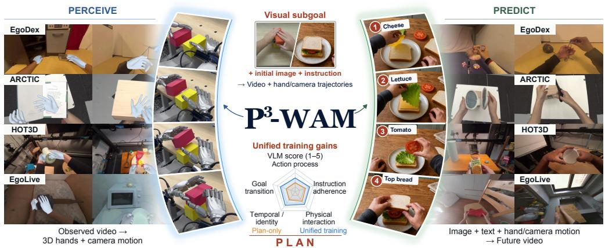  
Figure 1: P3-WAM unifies perception, prediction, and planning. PERCEIVE recovers hand motion from video; PREDICT generates video under prescribed motion; PLAN jointly generates motion and video guided by text instructions and optional visual goals.

## ABSTRACT

We introduce P3-WAM, a unified world action model for egocentric dexterous manipulation that learns 3D perception, action-conditioned prediction, and goaldirected planning through three complementary modes: PERCEIVE, which reconstructs articulated hand motion and camera trajectories from video; PREDICT, which generates visual futures under prescribed actions; and PLAN, which jointly generates action trajectories and their anticipated visual consequences conditioned on an initial image, a language instruction, and an optional visual goal. Our model integrates a compact, structured 3D action representation into a pretrained video diffusion transformer through a mixture-of-transformers architecture with shared base weights, modality-specific adaptation, and bidirectional visual–action attention. Randomized modality visibility lets video and 3D actions serve as either conditioning context or prediction targets across the three modes. Experiments show that unified training improves all three capabilities over single-mode training, including gains in planning quality under a vision–language model evaluation. Through unified training, our model outperforms specialized baselines on 3D hand reconstruction and action-conditioned video prediction across four datasets, while producing goal-directed manipulation videos with stronger instruction adherence and action progression than video-generation baselines.

## 1 INTRODUCTION

Dexterous manipulation requires more than mapping pixels directly to actions. An embodied model must answer three complementary questions: What happened in an observed interaction? What will happen under a specified action? What should be done to accomplish a desired goal? These questions correspond to three fundamental capabilities: perceiving the 3D motion underlying observed interactions, predicting action-conditioned world dynamics, and planning actions together with their anticipated consequences. Infants can use what they learn from observing adults’ actions to guide their own behavior (Hauf & Aschersleben, 2008). Through their own interactions, they learn to predict action outcomes and use those expected outcomes to select actions (Verschoor et al., 2013) and organize movements toward a goal (Claxton et al., 2003). Together, these findings suggest that perception, prediction, and planning are linked by knowledge of actions and their consequences.

Despite these connections, prior work on egocentric manipulation has developed along three closely related but largely separate lines. Egocentric reconstruction methods recover structured 3D interaction information, such as hand motion and camera trajectories, from observed videos (Pavlakos et al., 2024; Yu et al., 2025). Action-conditioned world models predict future observations under prescribed motion trajectories (Hao et al., 2026; Wang et al., 2026b; Sun et al., 2026). World action models jointly generate actions and future observations for goal-directed control (Ye et al., 2026). These capabilities, however, are still largely learned in isolation or coupled only in subsets.

To close this loop, we introduce $\mathbf { P } ^ { 3 } \mathbf { - W A M } .$ , a unified world action model for egocentric dexterous manipulation that integrates three complementary modes: 3D interaction reconstruction (PERCEIVE), action-conditioned world prediction (PREDICT), and joint action–future planning (PLAN). Reconstruction develops the model’s capacity for 3D perception by recovering 3D motion from observed interactions. Prediction teaches the model to anticipate the visual consequences of prescribed actions. Together, these capabilities provide the foundation for world–action planning, in which the model learns to jointly generate goal-directed hand action trajectories and their anticipated visual futures. We learn all three modes through unified training. Figure 1 illustrates these three modes.

We build $\mathrm { P } ^ { 3 } \mathrm { - } \mathrm { W A M }$ on a pretrained video diffusion transformer (Wan et al., 2025) to draw on its rich visual and motion priors. We represent each action by the articulated poses of both hands and the camera pose, and encode these states as compact tokens alongside the video tokens. We integrate this representation into the video backbone through a mixture-of-transformers (MoT) architecture with a dedicated action expert, which shares the backbone’s base weights while incorporating modalityspecific low-rank adaptation (LoRA) (Hu et al., 2022). To train this architecture across all three modes, we randomly vary the visibility of visual observations and actions: providing video while withholding actions supports perception, providing actions while withholding future video supports prediction, and withholding actions and video supports joint action–future planning, exposing the model to complete modes and partially observed interactions. Over long sequences, successive visual subgoals specify the target arrangement for each planning window.

Unified training improves all three modes over single-mode training. Our model outperforms the evaluated baselines in PERCEIVE and PREDICT. Its PLAN videos receive higher VLM scores for action process and instruction adherence. Robot demonstrations illustrate how generated human-hand motion can be transferred to a dexterous robot. Our main contributions are:

• A unified world action model, $\mathbf { P } ^ { 3 } \mathbf { - W A M } .$ , for egocentric dexterous manipulation that integrates 3D interaction reconstruction, action-conditioned world prediction, and goal-guided world–action planning. We will release our code and model checkpoints.

• A unified training framework that connects pretrained video priors with structured 3D actions through a mixture-of-transformers architecture and randomized modality visibility, enabling complementary learning across perception, prediction, and planning.

• Extensive experiments indicating that perception, prediction, and planning reinforce one another through unified training, outperforming state-of-the-art baselines across all three tasks. Robot demonstrations further illustrate the transfer of generated human-hand motion to a dexterous robot.

## 2 RELATED WORK

Video World Models and World Action Models. Action-conditioned world models predict single images (Sudhakar et al., 2024) or roll out videos (Akkerman et al., 2025; DreamX Team et al., 2026;

  
Figure 2: Task modes and unified training. Colored tiles denote observed video V and actions A; gray tiles denote missing inputs. Unified training samples these patterns across clips and time.

Gao et al., 2026a). Wan (Wan et al., 2025) and Cosmos 3 (NVIDIA, 2026) provide pretrained video priors. For action representation, Dexterous World Models (Kim et al., 2026) uses rendered scenes and hand-mesh trajectories, while DreamDojo (Gao et al., 2026b) learns latent actions from human videos for robot-world rollouts. Explicit scene and camera geometry can also help maintain spatial consistency. EgoSim (Hao et al., 2026) combines video generation with an updatable 3D scene and shared human–robot keypoints, and EgoGenesis (Yan et al., 2026b) uses camera-aware 3D action embeddings and online projective memory for autoregressive rollout.

World action models generate actions alongside anticipated visual dynamics through causal video prediction and inverse dynamics, as in LingBot-VA (Li et al., 2026a), or joint video–action flow matching, as in DreamZero (Ye et al., 2026). Fast-WAM (Yuan et al., 2026), Foresight Without Seeing (Huang et al., 2026), and RIFT (Zhang et al., 2026) study predictive visual information for control without a complete iterative visual rollout at deployment.

Monocular Hand Reconstruction. Recovering 3D hand motion from video requires estimating hand articulation while accounting for a moving camera. Single-image methods provide hand pose and shape estimates: HaMeR (Pavlakos et al., 2024) scales transformer capacity and heterogeneous training data, while WiLoR (Potamias et al., 2025) integrates localization, handedness estimation, and image-aligned mesh refinement. For egocentric sequences, HaWoR (Zhang et al., 2025) and Dyn-HaMR (Yu et al., 2025) combine hand-motion estimation with SLAM to recover global trajectories, using temporal infilling or interacting-hand priors and optimization. Concurrent work MINT (Zhu et al., 2026) jointly estimates camera and hand motion.

Video generative models offer another source of information about hand motion. Concurrent works ViDiHand (Wang et al., 2026a) and ACE-Ego-Hand (Liu et al., 2026) use video diffusion features for hand motion recovery. We train reconstruction jointly with future prediction and planning, allowing the model to learn from how hand interactions unfold as well as from observed video. This joint training improves 3D hand reconstruction in our single-mode comparison (Sec. 4.1).

Unified Multimodal Models. A shared model can connect these tasks by changing which modalities are observed and which are generated. Unified World Models (Zhu et al., 2025a) couples video and action diffusion for forward, inverse, policy, and video inference. Language provides a further interface for world modeling and control: Motus (Bi et al., 2026) combines language, video, and latent actions, while MotuBrain (MotuBrain Team et al., 2026) jointly models text, video, and embodimentspecific actions. Geometric modalities extend this shared formulation to spatial reasoning. Flexπ (Yan et al., 2026a) includes pointmap and feature streams alongside RGB and actions, and Aether (Zhu et al., 2025b) unifies 4D reconstruction, camera-conditioned prediction, and goal-imageconditioned visual planning. $\mathrm { P } ^ { 3 } \mathrm { - } \mathrm { W A M }$ applies joint reconstruction, prediction, and planning to articulated hand interaction. It plans hand and camera trajectories together with video and supports visual goals to preserve spatial targets across a task.

## 3 METHOD

## 3.1 UNIFIED TASK FORMULATION

We consider an egocentric video ${ \mathbf V } = \{ { \mathbf I } _ { t } \} _ { t = 1 } ^ { T }$ with aligned hand states ${ \mathbf { H } } = \{ { \mathbf { h } } _ { t } \} _ { t = 1 } ^ { T }$ and camera states $\mathbf { P } = \{ \mathbf { P } _ { t } \} _ { t = 1 } ^ { \widetilde { T } }$ , which encode rotation and translation relative to the first frame. We define the 3D action sequence as $\mathbf { A } = \{ \mathbf { a } _ { t } \} _ { t = 1 } ^ { T } = \{ \langle \mathbf { h } _ { t } , \mathbf { P } _ { t } \rangle \} _ { t = 1 } ^ { T }$ . Action tokens ${ \bf z } _ { a }$ encode the aligned hand and camera observations. The text instruction $\mathbf { c } _ { \mathrm { t e x t } }$ and initial image $\mathbf { c } _ { \mathrm { r e f } } = \mathbf { I } _ { 1 }$ are always given. For planning, the goal image ${ \bf c } _ { \mathrm { g o a l } } = { \bf I } _ { T }$ specifies the desired terminal observation.

Figure 2 defines the three modes through the information supplied to the same model. PERCEIVE recovers hands and camera motion from a complete video. PREDICT generates future video given hand and camera trajectories. PLAN generates video together with those trajectories guided by the text instruction and the optional visual goal. During training, we sample visibility patterns per clip and across temporal positions. We keep observed video latents clean, add noise to frames that the model must generate, and represent missing actions with learnable query embeddings.

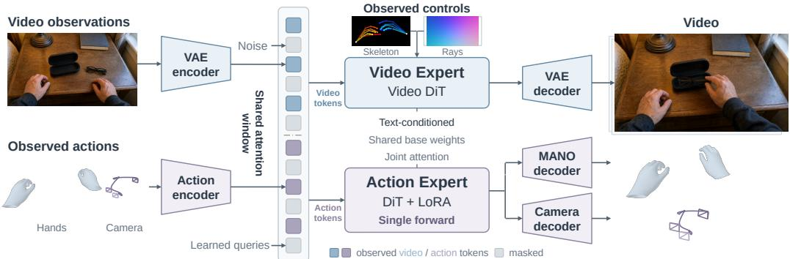  
Figure 3: $\mathrm { P } ^ { 3 } \mathrm { - } \mathrm { W A M }$ couples video and action streams through joint attention and shared base weights. The action expert adds low-rank adaptation and directly predicts hand and camera states.

## 3.2 JOINT VIDEO–ACTION MODELING

We build the model on top of the pretrained Wan2.2-Fun-A14B-Control model (Alibaba PAI, 2025). We retain its latent video representation, text and first-frame conditioning, skeleton-based control pathway, and high- and low-noise diffusion experts as the RGB generation backbone.

Observed actions enter through two complementary paths: rendered hand skeletons and camera-ray maps provide spatially aligned controls for hand placement and viewpoint, while compact action tokens carry the corresponding states into joint attention.

Specifically, the RGB sequence is encoded into a spatiotemporal latent using the Wan2.1 VAE (Wan et al., 2025). The temporally aligned hand trajectory is rendered as a 2D skeleton video and encoded by the same VAE (Fig. 3). The resulting control latent is concatenated with the noisy RGB latent before DiT patch embedding. For camera conditioning, we express all camera-to-world poses in the first camera coordinate frame, making the first pose the identity, and construct per-pixel Plücker ray maps (Plücker, 1865) from the relative poses and camera intrinsics. After temporal packing to the video-latent frame rate, a lightweight convolutional adapter maps the Plücker representation into the DiT patch-feature space. Its output is then added to the joint RGB–hand patch embeddings. The same conditioning interfaces are used by both diffusion experts.

P3-WAM represents RGB and action as coupled latent streams (Fig. 3). A separately pretrained action autoencoder, frozen during joint training, encodes hand and camera observations into compact tokens that are appended to the video tokens. Within each transformer block, the RGB and action experts share the base projection weights. The action expert adds action-specific low-rank updates and normalization. Both streams attend to the combined RGB and action keys and values, allowing bidirectional information exchange. We optimize both the shared base weights and action-specific adaptations. This modality split is used within each of Wan’s high- and low-noise experts, which operate at different diffusion noise levels. Appendix A specifies the shared layers and token encoding.

## 3.3 ACTION REPRESENTATION

We represent hands with MANO (Romero et al., 2017), a parametric model that maps hand pose and shape to an articulated 3D mesh. For each hand, the model predicts global and local rotations $\hat { \mathbf { R } } _ { t }$ sequence-level shape ${ \hat { \beta } } ,$ , camera-space root position $\hat { \mathbf { r } } _ { t } .$ , and hand-presence probability $\hat { p } _ { t }$ . The frozen action decoder also outputs a visibility probability $\hat { v } _ { t , j }$ for each joint. A fixed, differentiable MANO layer reconstructs camera-space joints $\hat { \mathbf { J } } _ { t }$ from the rotations and shape, placing the wrist at $\hat { \mathbf { r } } _ { t }$

Observed hand states and camera states are encoded into compact tokens by a pretrained, frozen action autoencoder. A shared hand encoder embeds each hand independently, while a separate encoder embeds the camera state. Each frame is represented by three tokens: one for the camera and one for each hand. Appendix B specifies the detailed architecture of the action encoder.

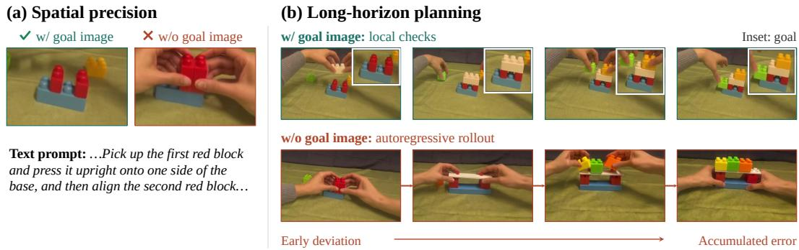  
Figure 4: Visual goals specify spatial targets. (a) A goal image specifies how far apart the red blocks should be. (b) Intermediate goal images guide the block arrangement at each stage of a longer task; without them, placement errors accumulate.

Unlike the video branch, which generates frames through iterative denoising, the action branch predicts the full hand and camera trajectory in one forward pass. We therefore represent missing actions with learned query embeddings rather than noisy action states. Each query corresponds to a frame and one of three action types (camera, left hand, or right hand). Through attention to the video and observed action tokens, the model predicts the states at these query positions.

## 3.4 OPTIMIZATION

We train video generation with flow matching (Lipman et al., 2023), restricting the loss to unobserved video latents:

$$
\mathcal { L } _ { \mathrm { v i d e o } } = \mathbb { E } _ { \tau , \epsilon , \mathbf { m } } \left[ \frac { w ( \tau ) } { \operatorname* { m a x } ( 1 , | \mathcal { U } _ { v } | ) } \sum _ { k \in \mathcal { U } _ { v } } \big \lVert \hat { \mathbf { v } } _ { \theta , k } - ( \epsilon _ { k } - \mathbf { z } _ { v , k } ) \big \rVert _ { 2 } ^ { 2 } \right] ,\tag{1}
$$

where $\mathcal { U } _ { v }$ contains the unobserved video-latent elements and $w ( \tau )$ is the diffusion training weight. The action objectives supervise MANO parameters, spatial joint positions, temporal hand motion, hand presence, and camera states. The total objective is

$$
{ \mathcal { L } } = { \mathcal { L } } _ { \mathrm { v i d e o } } + { \mathcal { L } } _ { \mathrm { p a r a m } } + { \mathcal { L } } _ { \mathrm { s p a t i a l } } + { \mathcal { L } } _ { \mathrm { t e m p o r a l } } + { \mathcal { L } } _ { \mathrm { p r e s e n c e } } + { \mathcal { L } } _ { \mathrm { c a m e r a } } .\tag{2}
$$

Appendix A.4 provides the further individual loss definitions.

## 3.5 INFERENCE

PERCEIVE reads the observed video and predicts the full action sequence in one forward pass. In PREDICT and PLAN, we iteratively denoise the unobserved RGB latents while keeping observed images fixed. For PLAN, we keep the generated video and the action trajectory predicted at the final denoising step. The VAE decoder reconstructs the video frames. The MANO decoder and fixed MANO layer recover the hand motion, and the camera decoder recovers the camera motion.

Long tasks require several manipulation steps, each with its own target arrangement. We use an image generator to create visual subgoals for these steps. Each planning window takes its starting observation, instruction, and goal image as input and generates the video and action trajectory between the observed images.

Figure 4(a) illustrates the spatial control provided by a visual target: the goal image specifies the separation between the red blocks, which the text instruction leaves ambiguous. In the longer task in Figure 4(b), successive visual subgoals specify the block arrangement at each stage. The generated sequence follows these arrangements across planning windows, while the example without goa images accumulates placement errors and departs from the intended structure.

## 4 EXPERIMENTS

We first examine whether unified training benefits each mode (Sec. 4.1), then compare PERCEIVE, PREDICT, and PLAN with specialized baselines on their respective tasks. We also evaluate whether the planned human actions can be transferred to a real-world dexterous robot (Sec. 4.4).

Table 1: Unified versus single-mode training on PERCEIVE and PREDICT.
<table><tr><td colspan="2"></td><td colspan="3">PERCEIVE (mm)</td><td colspan="4">PREDICT (full frame)</td></tr><tr><td>Dataset</td><td>Training setting</td><td>MPJPE↓</td><td>RR-MPJPE↓</td><td>PA-MPJPE↓</td><td>PSNR ↑</td><td>SSIM ↑</td><td>LPIPS↓</td><td>FVD↓</td></tr><tr><td rowspan="2">EgoDex-MANO</td><td>Single mode</td><td>52.491</td><td>29.170</td><td>12.577</td><td>23.106</td><td>0.8178</td><td>0.3090</td><td>757.06</td></tr><tr><td>Unified training</td><td>47.587</td><td>25.637</td><td>12.184</td><td>23.668</td><td>0.8182</td><td>0.3096</td><td>653.49</td></tr><tr><td rowspan="2">ARCTIC</td><td>Single mode</td><td>227.608</td><td>27.335</td><td>13.144</td><td>12.431</td><td>0.5501</td><td>0.4940</td><td>1144.02</td></tr><tr><td>Unified training</td><td>150.501</td><td>22.946</td><td>12.154</td><td>13.431</td><td>0.5687</td><td>0.4661</td><td>1035.38</td></tr><tr><td rowspan="2">HOT3D</td><td>Single mode</td><td>80.656</td><td>31.318</td><td>12.317</td><td>14.917</td><td>0.4151</td><td>0.5189</td><td>1466.68</td></tr><tr><td>Unified training</td><td>60.775</td><td>25.164</td><td>11.348</td><td>15.857</td><td>0.4508</td><td>0.5024</td><td>1302.88</td></tr><tr><td rowspan="2">EgoLive</td><td>Single mode</td><td>93.392</td><td>35.905</td><td>13.836</td><td>18.968</td><td>0.6768</td><td>0.4067</td><td>1056.03</td></tr><tr><td>Unified training</td><td>88.728</td><td>32.376</td><td>13.238</td><td>19.597</td><td>0.6872</td><td>0.4008</td><td>1047.61</td></tr><tr><td rowspan="2">Macro</td><td>Single mode</td><td>113.537</td><td>30.932</td><td>12.969</td><td>17.356</td><td>0.6150</td><td>0.4321</td><td>1105.95</td></tr><tr><td>Unified training</td><td>86.898</td><td>26.531</td><td>12.231</td><td>18.138</td><td>0.6312</td><td>0.4197</td><td>1009.84</td></tr></table>

Table 2: VLM scores for videos from PLAN-only and unified models (1–5; higher is better).
<table><tr><td></td><td></td><td></td><td></td><td>Training setting Action process Instruction adherence Physical interaction Temporal / identity</td><td>Goal transition</td></tr><tr><td>PLAN-only</td><td>1.88</td><td>2.27</td><td>2.52</td><td>2.15</td><td>1.98</td></tr><tr><td>Unified training</td><td>2.89</td><td>3.22</td><td>3.32</td><td>3.57</td><td>3.29</td></tr></table>

## 4.1 DOES UNIFIED TRAINING BENEFIT EACH MODE?

We initialize the single-mode and unified models from Wan2.2-Fun A14B-Control and evaluate them at 5,000 total training steps, with all other training variables held fixed. Evaluation covers EgoDex (Hoque et al., 2026), ARCTIC (Fan et al., 2023), HOT3D (Banerjee et al., 2025), and EgoLive (Li et al., 2026b). Tables 1 and 2 compare perception, prediction, and planning under these matched training conditions. Unified training improves both global hand placement and local articulation in PERCEIVE, reducing camera-space, root-relative, and PA errors by 23.46%, 14.23%, and 5.69%, respectively. In PREDICT, PSNR increases from 17.356 to 18.138 dB and FVD decreases from 1105.95 to 1009.84, indicating gains in both pixel accuracy and video feature similarity. The PLAN-only baseline is trained with visual subgoals. At evaluation, both models receive the same initial image, instruction, and goal image. We use matched generation settings and score the complete video, including the goal-conditioned ending, for both models. Unified training improves PLAN’s VLM scores across all five dimensions (Table 2). The largest gains are in temporal/identity consistency (2.15 to 3.57) and goal transition (1.98 to 3.29), while higher action-process and physical-interaction scores reflect more coherent manipulation sequences. Appendices C, E, and G.1 give mode exposure, evaluation details, supplementary human ratings, and qualitative comparisons.

## 4.2 PERCEIVE EVALUATION

We compare video-based 3D hand reconstruction with HaMeR (Pavlakos et al., 2024) and Dyn-HaMR (Yu et al., 2025) on the same four datasets. Following ViDiHand (Wang et al., 2026a), we report presence-aware joint errors in camera space, after wrist alignment (RR), and after Procrustes alignment (PA) to assess global placement and local pose, using the protocol in Appendix D.3.

Our model achieves the lowest presence-aware reconstruction error on all four datasets (Table 3). Average camera-space MPJPE-p is 63.05 mm, compared with 145.34 mm for HaMeR and 231.54 mm for Dyn-HaMR. Root-relative error is 22.54 mm, compared with 46.61 mm for HaMeR and 45.25 mm for Dyn-HaMR, while PA error is 11.79 mm, compared with 16.75 and 32.94 mm, respectively. Our model also achieves the highest hand-visibility F1 on all four datasets. Appendix F.1 separates joint accuracy from missing-hand penalties, and Appendix F.2 evaluates reconstruction against the original EgoDex joints.

Qualitative results. As can be seen in Figure 5, our predictions show more consistent hand placement and articulation, while HaMeR and Dyn-HaMR miss or misplace hands, and left/righthand confusion. We interpret our model’s consistency as a benefit of combining a generative prior over plausible motions with full-video context, since surrounding frames help resolve ambiguity when a single frame admits several possible hand poses.

T MANO OverGT MANO  
Table 3: Presence-aware PERCEIVE reconstruction, measured by camera-space, root-relative (RR), and Procrustes-aligned (PA) MPJPE-p in mm (↓), and hand-visibility F1 in percent (↑).
<table><tr><td>Dataset</td><td>Method</td><td>MPJPE-p ↓</td><td>RR-MPJPE-p ↓</td><td>PA-MPJPE-p ↓</td><td>F1↑</td></tr><tr><td>EgoDex-MANO</td><td>Ours</td><td>32.92</td><td>31.58</td><td>13.12</td><td>99.96</td></tr><tr><td rowspan="4">ARCTIC</td><td>HaMeR</td><td>112.92</td><td>44.35</td><td>16.22</td><td>91.48</td></tr><tr><td>Dyn-HaMR</td><td>115.53</td><td>36.66</td><td>18.29</td><td>98.17</td></tr><tr><td>Ours</td><td>45.29</td><td>13.08</td><td>7.64</td><td>99.72</td></tr><tr><td>HaMeR</td><td>85.34</td><td>28.87</td><td>11.51</td><td>97.31</td></tr><tr><td rowspan="4">HOT3D</td><td>Dyn-HaMR</td><td>317.46</td><td>48.28</td><td>39.40</td><td>89.88</td></tr><tr><td>Ours</td><td>132.09</td><td>26.81</td><td>16.63</td><td>98.10</td></tr><tr><td>HaMeR</td><td>202.02</td><td>57.14</td><td>28.52</td><td>84.78</td></tr><tr><td>Dyn-HaMR</td><td>257.99</td><td>62.26</td><td>50.57</td><td>81.55</td></tr><tr><td rowspan="3">EgoLive</td><td>Ours</td><td>41.92</td><td>18.70</td><td>9.76</td><td>98.87</td></tr><tr><td>HaMeR</td><td>181.09</td><td>56.09</td><td>10.75</td><td>93.55</td></tr><tr><td>Dyn-HaMR</td><td>235.20</td><td>33.80</td><td>23.49</td><td>89.14</td></tr><tr><td rowspan="3">Macro</td><td>Ours</td><td>63.05</td><td>22.54</td><td>11.79</td><td>99.16</td></tr><tr><td>HaMeR</td><td>145.34</td><td>46.61</td><td>16.75</td><td>91.78</td></tr><tr><td>Dyn-HaMR</td><td>231.54</td><td>45.25</td><td>32.94</td><td>89.68</td></tr></table>

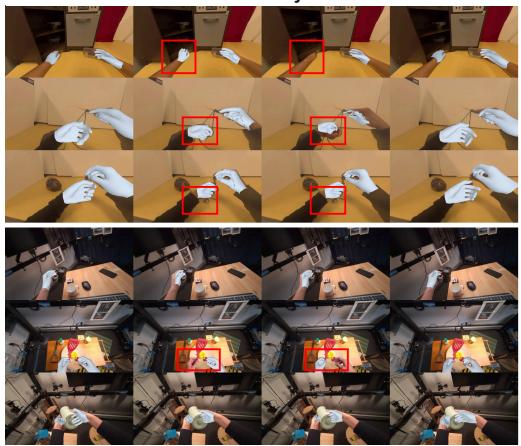

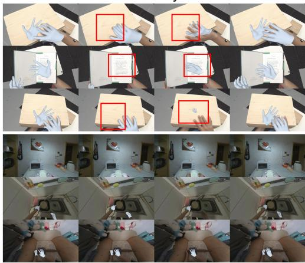  
Figure 5: Qualitative PERCEIVE comparisons across EgoDex, ARCTIC, HOT3D, and EgoLive. Red boxes highlight missed hands or local pose errors in baseline predictions.

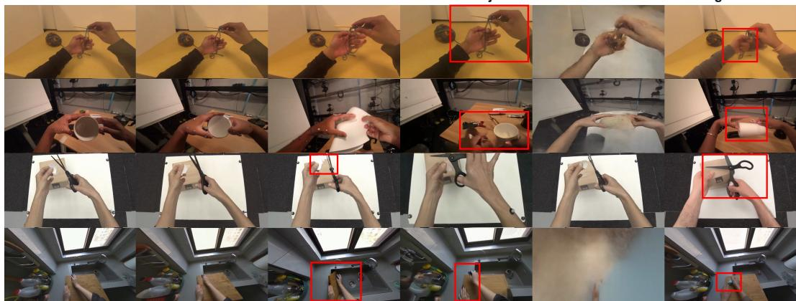  
Figure 6: Qualitative PREDICT comparisons on EgoDex, HOT3D, ARCTIC, and EgoLive.

## 4.3 PREDICT EVALUATION

We evaluate action-conditioned video prediction on four datasets using each method’s native conditioning protocol, comparing with Wan2.2-Fun-Control (Alibaba PAI, 2025), DreamDojo (Gao et al., 2026b), Hand2World (Wang et al., 2026b), and EgoSim (Hao et al., 2026). Full-frame metrics measure

scene fidelity, while hand-region metrics measure the accuracy of generated hands and their placement. Appendix D.1 summarizes the conditioning inputs; Appendix D.2 details the evaluation protocol. Table 4: Action-conditioned video prediction across four datasets. CLIP-I measures image-feature similarity and IoU measures hand-box overlap. Darker greens mark the top three results.
<table><tr><td colspan="2"></td><td colspan="4">Full frame</td><td colspan="5">Hand region</td></tr><tr><td>Dataset</td><td>Method</td><td>PSNR ↑</td><td>SSIM ↑</td><td>LPIPS↓</td><td>CLIP-I↑</td><td>FVD</td><td>PSNR ↑</td><td>SSIM↑</td><td>LPIPS↓ CLIP-I↑</td><td>IoU↑</td></tr><tr><td rowspan="5">EgoDex</td><td>Ours</td><td>24.511</td><td>0.8462</td><td>0.2679</td><td>0.9448</td><td>401.26 21.498</td><td>0.7265</td><td>0.3362</td><td>0.9203</td><td>0.7082</td></tr><tr><td>Wan2.2-Fun-Control</td><td>20.304</td><td>0.7570</td><td>0.3682 0.9254</td><td>719.66</td><td>18.016</td><td>0.6342</td><td>0.4488</td><td>0.8923</td><td>0.6306</td></tr><tr><td>DreamDojo</td><td>19.561</td><td>0.7583</td><td>0.3781 0.8868</td><td>931.96</td><td>17.498</td><td>0.6285</td><td>0.4842</td><td>0.8537</td><td>0.3005</td></tr><tr><td>Hand2World</td><td>13.287</td><td>0.6639</td><td>0.6656</td><td>0.7894 3028.61</td><td>12.290</td><td>0.5506</td><td>0.6580</td><td>0.8011</td><td>0.5296</td></tr><tr><td>EgoSim</td><td>21.331</td><td>0.8189</td><td>0.2955</td><td>0.9242</td><td>649.87</td><td>19.447 0.6982</td><td>0.3647</td><td>0.9078</td><td>0.6474</td></tr><tr><td rowspan="5"></td><td>ARCTIC Ours</td><td>14.106</td><td>0.5785</td><td>0.4411</td><td>0.8988</td><td>778.41 14.025</td><td>0.5951</td><td>0.4602</td><td>0.8571</td><td>0.7213</td></tr><tr><td>Wan2.2-Fun-Control</td><td>12.875</td><td>0.5560</td><td>0.4681</td><td>0.8854 1576.14</td><td>13.229</td><td>0.5793</td><td>0.4753</td><td>0.8403</td><td>0.7262</td></tr><tr><td>DreamDojo</td><td>10.811</td><td>0.5560</td><td>0.5677</td><td>0.7864 2430.63</td><td>11.246</td><td>0.5421</td><td>0.5867</td><td>0.7605</td><td>0.3128</td></tr><tr><td>Hand2World</td><td>12.915</td><td>0.5752</td><td>0.4837</td><td>0.8873</td><td>2012.16 13.910</td><td>0.6165</td><td>0.4650</td><td>0.8188</td><td>0.5644</td></tr><tr><td>EgoSim</td><td>12.874</td><td>0.5545</td><td>0.4968</td><td>0.8840 1525.60</td><td>13.780</td><td>0.5972</td><td>0.5084</td><td>0.8301</td><td>0.7035</td></tr><tr><td rowspan="6">HOT3D</td><td>Ours</td><td>15.912</td><td>0.4637</td><td>0.4990</td><td>0.8845 761.35</td><td>15.390</td><td>0.4948</td><td>0.4991</td><td>0.8675</td><td>0.5921</td></tr><tr><td>Wan2.2-Fun-Control</td><td>12.521</td><td>0.3299</td><td>0.6107</td><td>0.8490</td><td>1458.29 11.869</td><td>0.4025</td><td>0.6036</td><td>0.8357</td><td>0.5095</td></tr><tr><td>DreamDojo</td><td>12.152</td><td>0.3679</td><td>0.6509 0.7270</td><td>1629.88</td><td>11.628</td><td>0.3632</td><td>0.6727</td><td>0.7698</td><td>0.1366</td></tr><tr><td>Hand2World</td><td>13.211</td><td>0.4065</td><td>0.6448</td><td>0.7608 2769.91</td><td>12.826</td><td>0.4644</td><td>0.6282</td><td>0.7825</td><td>0.4975</td></tr><tr><td>EgoSim</td><td>12.906</td><td>0.3266</td><td>0.6389 0.8002</td><td>1915.92</td><td>12.745</td><td>0.3894</td><td>0.6344</td><td>0.7985</td><td>0.2590</td></tr><tr><td>EgoLive Ours</td><td>21.551</td><td>0.7302</td><td>0.3483</td><td>0.9373</td><td>545.89</td><td>22.316</td><td>0.6744</td><td>0.3443 0.9030</td><td>0.6621</td></tr><tr><td rowspan="4"></td><td>Wan2.2-Fun-Control</td><td>18.009</td><td>0.6582</td><td>0.4410 0.9150</td><td>1116.16</td><td>19.909</td><td>0.6265</td><td>0.4130</td><td>0.8902</td><td>0.6050</td></tr><tr><td>DreamDojo</td><td>18.764</td><td>0.6977</td><td>0.4359 0.8747</td><td>914.66</td><td>19.409</td><td>0.6185</td><td>0.4958</td><td>0.8546</td><td>0.3233</td></tr><tr><td>Hand2World</td><td>13.229</td><td>0.6378 0.5882</td><td>0.7238</td><td>3700.35</td><td>13.377</td><td>0.5742</td><td>0.5766</td><td>0.7988</td><td>0.1479</td></tr><tr><td>EgoSim</td><td>14.423</td><td>0.5459 0.5582</td><td>0.8531</td><td>1749.79</td><td>16.631</td><td>0.5249</td><td>0.5842</td><td>0.8311</td><td>0.1697</td></tr><tr><td rowspan="2">Macro</td><td>Ours</td><td>19.020</td><td>0.6547</td><td>0.3891</td><td>0.9163</td><td>621.73</td><td>18.307</td><td>0.6227</td><td>0.4099 0.8870</td><td>0.6709</td></tr><tr><td>∆</td><td>+3.093+0.0597-0.0829+0.0227</td><td></td><td></td><td></td><td></td><td></td><td></td><td></td><td>-595.83+2.551+0.0621-0.0752+0.0223+0.0531</td></tr></table>

Our model achieves the best full-frame results on all four datasets (Table 4). Compared with our Wan2.2-Fun-Control backbone, average PSNR rises from 15.927 to 19.020 dB and FVD falls from 1217.56 to 621.73. Hand-region LPIPS decreases from 0.4852 to 0.4099, and hand-box IoU increases from 0.6178 to 0.6709. Our model leads on all five hand-region metrics in EgoDex, HOT3D, and EgoLive, and on hand PSNR, LPIPS, and CLIP-I in ARCTIC.

Qualitative results. At matched frames, our model preserves the manipulated objects while following the prescribed hand–camera motion (Figure 6). DreamDojo changes object shape or identity, and EgoSim distorts hands and objects in the cup and scissors examples. In the cutting-board example, Wan2.2-Fun-Control deviates from the prescribed motion as the viewpoint changes. Hand2World also shifts non-ARCTIC scenes toward ARCTIC-like backgrounds. The comparisons suggest that explicit hand and camera conditioning helps preserve the scene as the interaction progresses.

## 4.4 PLAN EVALUATION

PLAN jointly generates a manipulation video and hand and camera trajectories. We compare PLAN’s generated videos with Wan2.2 I2V-A14B (Wan Team, 2025) and Cosmos 3-Nano (NVIDIA, 2026). A method-blind VLM judge (Qwen3.8-Max (Qwen Team, 2026)) rates action process, instruction adherence, physical interaction, temporal/identity consistency, and goal transition on a 1–5 scale. The rubric assesses the intermediate action sequence as well as progress toward the goal. Appendices E.4 and G.2 give the scoring protocol, uncertainty estimates, and no-goal ablation. Our generated videos receive higher VLM scores than all four baseline settings in action process, instruction adherence, physical interaction, and goal transition (Table 5).

Qualitative results. Figure 7 compares goal-conditioned planning. Our model places and releases the plate at the target position within the generated part of the video. At t = 77, the last generated frame before the supplied goal frames (t = 78–81), both baselines still leave the plate near the middle of the mat. In the jar example, our model sets down the scoop and replaces the lid, whereas Wan2.2 still holds the scoop and Cosmos changes the wooden lid into a glass-like lid.

Table 5: VLM comparison of PLAN-generated videos with video-generation baselines. ∆ compares Ours with the best baseline score for each metric across the four baseline settings.
<table><tr><td>Method</td><td>Goal image</td><td>Action process</td><td>Instruction adherence</td><td>Physical interaction</td><td>Temporal / identity consistency</td><td>Goal transition</td></tr><tr><td>Cosmos 3-Nano</td><td>√</td><td>2.279</td><td>2.703</td><td>3.190</td><td>2.852</td><td>2.080</td></tr><tr><td>Cosmos 3-Nano</td><td>x</td><td>2.725</td><td>2.817</td><td>4.146</td><td>4.684</td><td>2.732</td></tr><tr><td>Wan2.2 I2V-A14B</td><td>√</td><td>2.647</td><td>2.847</td><td>3.251</td><td>2.741</td><td>2.273</td></tr><tr><td>Wan2.2 I2V-A14B</td><td>x</td><td>3.120</td><td>3.119</td><td>4.119</td><td>4.406</td><td>3.178</td></tr><tr><td>Ours</td><td>√</td><td>3.591</td><td>3.739</td><td>4.350</td><td>4.651</td><td>3.841</td></tr><tr><td>∆</td><td>1</td><td>+0.471</td><td>+0.620</td><td>+0.205</td><td>-0.033</td><td>+0.663</td></tr></table>

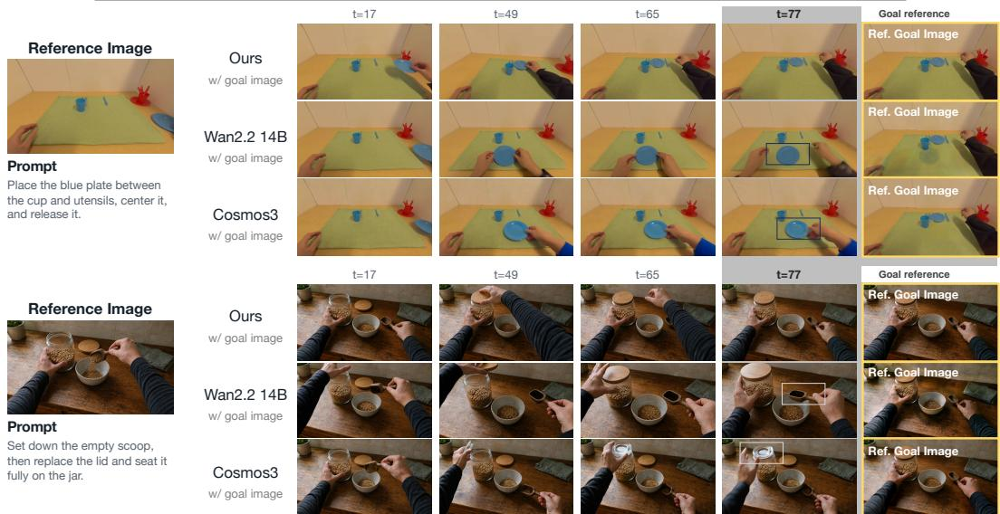

Figure 7: Goal-conditioned PLAN comparisons.  
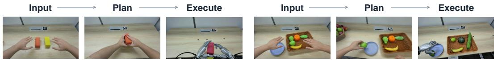  
Figure 8: Robot deployment. Each example shows the initial observation, generated human motion, and robot execution after retargeting.

Appendix G.2 compares all methods without goal images, showing our model’s hand–object consistency during manipulation. Appendix F.3 measures agreement between predicted trajectories and hands reconstructed from the generated videos.

Robot Deployment. We retarget PLAN-generated human-hand motion to dexterous robot commands following Do as I Do (Paliwal et al., 2026) and execute them on the physical robot. Figure 8 illustrates two examples, showing the initial observation, generated motion, and execution.

## 5 CONCLUSION

We introduced P3-WAM, a unified world action model for egocentric dexterous manipulation that integrates perception, prediction, and planning. A coupled video–action transformer connects visual generation with explicit hand and camera trajectories and supports all three modes within the same model. Through extensive experiments, we show that unified training benefits hand reconstruction, action-conditioned video prediction, and planning.

Limitations. Estimating the global 3D hand position from monocular video is inherently ambiguous. Incorporating tactile or depth sensing could provide stronger geometric constraints. Our robot experiments currently rely on open-loop execution. Introducing closed-loop feedback would allow the robot to correct its motion online, potentially improving robustness over longer-horizon interactions.

## AI USE DISCLOSURE

Generative AI assisted with manuscript drafting and editing, figure development, and research-code development and debugging. AI-generated images also serve as planning inputs in the examples identified as generated in the paper. A VLM provides evaluation scores under the protocol in Appendix E; human ratings are collected separately. The authors are responsible for reviewing the assisted material and for the accuracy, originality, and attribution of the final submission.

## REPRODUCIBILITY STATEMENT

Section 3 and Appendices A–C describe the architecture, objectives, codec, and training. Appendix D specifies preprocessing, baseline interfaces, and metrics; Appendix E gives the human/VLM rubric and bootstrap procedure. Additional measurements appear in Appendix F.

## REFERENCES

Rick Akkerman, Haiwen Feng, Michael J. Black, Dimitrios Tzionas, and Victoria Fernández Abrevaya. Interdyn: Controllable interactive dynamics with video diffusion models. In Proceedings of the Computer Vision and Pattern Recognition Conference, pp. 12467–12479, 2025.

Alibaba PAI. Wan2.2-Fun-A14B-Control. Model card, 2025. URL https://huggingface. co/alibaba-pai/Wan2.2-Fun-A14B-Control.

Prithviraj Banerjee, Sindi Shkodrani, Pierre Moulon, Shreyas Hampali, Shangchen Han, Fan Zhang, Linguang Zhang, Jade Fountain, Edward Miller, Selen Basol, Richard Newcombe, Robert Wang, Jakob Julian Engel, and Tomas Hodan. HOT3D: Hand and object tracking in 3D from egocentric multi-view videos. In Proceedings ofthe IEEE/CVF Conference on Computer Vision and Pattern Recognition, 2025. URL https://arxiv.org/abs/2411.19167.

Hongzhe Bi, Hengkai Tan, Shenghao Xie, Zeyuan Wang, Shuhe Huang, Haitian Liu, Ruowen Zhao, Yao Feng, Chendong Xiang, Yinze Rong, Hongyan Zhao, Hanyu Liu, Zhizhong Su, Lei Ma, Hang Su, and Jun Zhu. Motus: A unified latent action world model. In Proceedings of the IEEE/CVF Conference on Computer Vision and Pattern Recognition, pp. 35101–35113, June 2026.

Laura J. Claxton, Rachel Keen, and Michael E. McCarty. Evidence of motor planning in infant reaching behavior. Psychological Science, 14(4):354–356, 2003. doi: 10.1111/1467-9280.24421.

DreamX Team, Rui Chen, Xiangxiang Chu, Geng Li, Jifan Li, Qingfeng Shi, Datao Tang, Jing Tang, Jun Wang, and Pengfei Zhang. DreamX-Phi 1.0: Action-conditioned video world model for robotic manipulation. arXiv preprint arXiv:2608.13489, 2026. URL https://arxiv.org/abs/2608.13489.

Zicong Fan, Omid Taheri, Dimitrios Tzionas, Muhammed Kocabas, Manuel Kaufmann, Michael J. Black, and Otmar Hilliges. ARCTIC: A dataset for dexterous bimanual hand-object manipulation. In Proceedings of the IEEE/CVF Conference on Computer Vision and Pattern Recognition, 2023. URL https://arxiv.org/abs/2204.13662.

Quankai Gao, Jiawei Yang, Qiangeng Xu, Le Chen, and Yue Wang. LOME: Learning human-object manipulation with action-conditioned egocentric world model. arXiv preprint arXiv:2603.27449, 2026a.

Shenyuan Gao, William Liang, Kaiyuan Zheng, Ayaan Malik, Seonghyeon Ye, Sihyun Yu, Wei-Cheng Tseng, Yuzhu Dong, Kaichun Mo, Chen-Hsuan Lin, Jiannan Xiang, Yuqi Xie, Ruijie Zheng, Dantong Niu, Pooya Jannaty, Jinwei Gu, Jun Zhang, Jitendra Malik, Pieter Abbeel, Ming-Yu Liu, Yuke Zhu, Joel Jang, and Jim Fan. DreamDojo: A real-time robot world model from large-scale human videos. In Proceedings ofthe International Conference on Machine Learning, 2026b. URL https://icml.cc/virtual/2026/poster/65193.

Jinkun Hao, Mingda Jia, Xudong Xu, Ruiyan Wang, Xihui Liu, Ran Yi, Lizhuang Ma, and Jiangmiao Pang. EgoSim: Egocentric world simulator for embodiment interaction generation. In Proceedings of the European Conference on Computer Vision, 2026. URL https://eccv.ecva.net/ virtual/2026/poster/3429.

Petra Hauf and Gisa Aschersleben. Action–effect anticipation in infant action control. Psychological Research, 72(2):203–210, 2008. doi: 10.1007/s00426-006-0101-3.

Ryan Hoque, Peide Huang, David J. Yoon, Mouli Sivapurapu, and Jian Zhang. EgoDex: Learning dexterous manipulation from large-scale egocentric video. In The Fourteenth International Conference on Learning Representations, 2026. URL https://openreview.net/forum?id=FFxkFMU89E.

Edward J. Hu, Yelong Shen, Phillip Wallis, Zeyuan Allen-Zhu, Yuanzhi Li, Shean Wang, Lu Wang, and Weizhu Chen. LoRA: Low-rank adaptation of large language models. In International Conference on Learning Representations, 2022. URL https://arxiv.org/abs/2106.09685.

Jiakai Huang, Zhongbo Wu, Zheng Zhang, Zihan Wang, Shan You, and Tao Huang. Foresight without seeing: Latent futures for world action models. arXiv preprint arXiv:2608.11605, 2026. URL https://arxiv.org/abs/2608.11605.

Byungjun Kim, Taeksoo Kim, Junyoung Lee, and Hanbyul Joo. Dexterous world models. In Proceedings of the IEEE/CVF Conference on Computer Vision and Pattern Recognition, pp. 29663–29673, June 2026.

Lin Li, Qihang Zhang, Yiming Luo, Shuai Yang, Ruilin Wang, Luyao Zhang, Mingrui Yu, Zelin Gao, Nan Xue, Boyu Zhou, Xing Zhu, Mingyu Ding, Yujun Shen, and Yinghao Xu. Causal world modeling for robot control. In Proceedings of Robotics: Science and Systems, July 2026a. doi: 10.15607/RSS.2026.XXII.016.

Yihang Li, Xuelong Wei, Jingzhou Luo, Yingjing Xiao, Yibo Bai, Guangyuan Zhou, Teng Zou, Chenguang Gui, Jiajun Wen, He Zhang, Kangliang Chen, Xing Pan, Shuaiyan Liu, Daming Wang, Tao An, Jiayi Li, Shibo Jin, Wanwan Zhang, Tianyu Wang, Boren Wei, Zhixuan Huang, Fangsheng Liu, Ruodai Li, Hui Zhang, Anson Li, Yicheng Gong, Peng Cao, Jiaming Liang, and Liang Lin. EgoLive: A large-scale egocentric dataset from real-world human tasks. arXiv preprint arXiv:2604.23570, 2026b. URL https://arxiv.org/abs/2604.23570.

Yaron Lipman, Ricky T. Q. Chen, Heli Ben-Hamu, Maximilian Nickel, and Matthew Le. Flow matching for generative modeling. In The Eleventh International Conference on Learning Representations, 2023. URL https://openreview.net/forum?id=PqvMRDCJT9t.

Yufei Liu, Xixi Wang, Hao Li, Ganlong Zhao, Kaitong Cai, Chengkai Jin, Chunxiao Liu, Jianbo Liu, Siyuan Huang, Xingang Pan, and Hongsheng Li. ACE-Ego-Hand: Repurposing video diffusion models for occlusion-robust egocentric 3d hand motion recovery. arXiv preprint arXiv:2608.20308, 2026.

MotuBrain Team, Chendong Xiang, Fan Bao, Haitian Liu, Hengkai Tan, Hongzhe Bi, James Li, Jiabao Liu, Jingrui Pang, Kiro Jing, Louis Liu, Mengchen Cai, Rongxu Cui, Ruowen Zhao, Runqing Wang, Shuhe Huang, Yao Feng, Yinze Rong, Zeyuan Wang, and Jun Zhu. MotuBrain: An advanced world action model for robot control. arXiv preprint arXiv:2604.27792, 2026. URL https://arxiv.org/abs/2604.27792.

NVIDIA. Cosmos 3: Omnimodal world models for physical AI. arXiv preprint arXiv:2606.02800, 2026. URL https://arxiv.org/abs/2606.02800.

Bhawna Paliwal, Haritheja Etukuru, William Liang, Pieter Abbeel, Nur Muhammad Mahi Shafiullah, and Jitendra Malik. Do as I Do: Dexterous manipulation data from everyday human videos. arXiv preprint arXiv:2606.19333, 2026. URL https://arxiv.org/abs/2606.19333.

Georgios Pavlakos, Dandan Shan, Ilija Radosavovic, Angjoo Kanazawa, David Fouhey, and Jitendra Malik. Reconstructing hands in 3D with transformers. In Proceedings ofthe IEEE/CVF Conference on Computer Vision and Pattern Recognition, pp. 9826–9836, June 2024.

Julius Plücker. XVII. on a new geometry of space. Philosophical Transactions of the Royal Society ofLondon, 155:725–791, 1865. doi: 10.1098/rstl.1865.0017.

Rolandos Alexandros Potamias, Jinglei Zhang, Jiankang Deng, and Stefanos Zafeiriou. WiLoR: End-to-end 3D hand localization and reconstruction in-the-wild. In Proceedings of the IEEE/CVF Conference on Computer Vision and Pattern Recognition, pp. 12242–12254, June 2025. doi: 10.1109/CVPR52734.2025.01143.

Qwen Team. Qwen3.8-Max: A new bar for coding and cowork, August 2026. URL https: //qwen.ai/blog?id=qwen3.8.

Alec Radford, Jong Wook Kim, Chris Hallacy, Aditya Ramesh, Gabriel Goh, Sandhini Agarwal, Girish Sastry, Amanda Askell, Pamela Mishkin, Jack Clark, Gretchen Krueger, and Ilya Sutskever. Learning transferable visual models from natural language supervision. In Proceedings ofthe 38th International Conference on Machine Learning, volume 139 of Proceedings of Machine Learning Research, pp. 8748–8763. PMLR, 2021. URL https://proceedings.mlr.press/ v139/radford21a.html.

Javier Romero, Dimitrios Tzionas, and Michael J. Black. Embodied hands: Modeling and capturing hands and bodies together. ACM Transactions on Graphics, 36(6):245:1–245:17, 2017. doi: 10.1145/3130800.3130883.

Ivan Skorokhodov, Sergey Tulyakov, and Mohamed Elhoseiny. StyleGAN-V: A continuous video generator with the price, image quality and perks of StyleGAN2. In Proceedings of the IEEE/CVF Conference on Computer Vision and Pattern Recognition, pp. 3626–3636, 2022. URL https://openaccess.thecvf.com/content/CVPR2022/html/Skorokhodov\_ StyleGAN-V\_A\_Continuous\_Video\_Generator\_With\_the\_Price\_Image\_ Quality\_CVPR\_2022\_paper.html.

Sruthi Sudhakar, Ruoshi Liu, Basile Van Hoorick, Carl Vondrick, and Richard Zemel. Controlling the world by sleight of hand, 2024. URL https://arxiv.org/abs/2408.07147.

Zhihao Sun, Zhiying Du, Xitong Yang, and Zuxuan Wu. HandWorld: Hand-centric unified video action generation. In Proceedings ofthe IEEE/CVF Conference on Computer Vision and Pattern Recognition, pp. 15976–15985, June 2026.

Thomas Unterthiner, Sjoerd van Steenkiste, Karol Kurach, Raphael Marinier, Marcin Michalski, and Sylvain Gelly. Towards accurate generative models of video: A new metric & challenges. arXiv preprint arXiv:1812.01717, 2018. URL https://arxiv.org/abs/1812.01717.

Stephan A. Verschoor, Michiel Spapé, Szilvia Biro, and Bernhard Hommel. From outcome prediction to action selection: Developmental change in the role of action-effect bindings. Developmental Science, 16(6):801–814, 2013. doi: 10.1111/desc.12085.

Team Wan, Ang Wang, Baole Ai, Bin Wen, Chaojie Mao, Chen-Wei Xie, Di Chen, Feiwu Yu, Haiming Zhao, Jianxiao Yang, Jianyuan Zeng, Jiayu Wang, Jingfeng Zhang, Jingren Zhou, Jinkai Wang, Jixuan Chen, Kai Zhu, Kang Zhao, Keyu Yan, Lianghua Huang, Mengyang Feng, Ningyi Zhang, Pandeng Li, Pingyu Wu, Ruihang Chu, Ruili Feng, Shiwei Zhang, Siyang Sun, Tao Fang, Tianxing Wang, Tianyi Gui, Tingyu Weng, Tong Shen, Wei Lin, Wei Wang, Wei Wang, Wenmeng Zhou, Wente Wang, Wenting Shen, Wenyuan Yu, Xianzhong Shi, Xiaoming Huang, Xin Xu, Yan Kou, Yangyu Lv, Yifei Li, Yijing Liu, Yiming Wang, Yingya Zhang, Yitong Huang, Yong Li, You Wu, Yu Liu, Yulin Pan, Yun Zheng, Yuntao Hong, Yupeng Shi, Yutong Feng, Zeyinzi Jiang, Zhen Han, Zhi-Fan Wu, and Ziyu Liu. Wan: Open and advanced large-scale video generative models. arXiv preprint arXiv:2503.20314, 2025. URL https://arxiv.org/abs/2503.20314.

Wan Team. Wan2.2: Open and advanced large-scale video generative models. Official model repository, 2025. URL https://github.com/Wan-Video/Wan2.2.

Yuxi Wang, Chengkai Jin, Yufei Liu, Wenqi Ouyang, Tianyi Wei, Zhiwei Zeng, Siyuan Huang, Zhiqi Shen, and Xingang Pan. The surprising effectiveness of video diffusion models for hand motion reconstruction. arXiv preprint arXiv:2606.30308, 2026a. URL https://arxiv.org/abs/2606.30308.

Yuxi Wang, Wenqi Ouyang, Tianyi Wei, Yi Dong, Zhiqi Shen, and Xingang Pan. Hand2World: Autoregressive egocentric interaction generation via free-space hand gestures. arXiv preprint arXiv:2602.09600, 2026b. URL https://arxiv.org/abs/2602.09600.

Zhou Wang, Alan C. Bovik, Hamid R. Sheikh, and Eero P. Simoncelli. Image quality assessment: From error visibility to structural similarity. IEEE Transactions on Image Processing, 13(4): 600–612, 2004. doi: 10.1109/TIP.2003.819861.

Ge Yan, Jinghao Liu, Yuzhi Fan, Lei Cai, Minwen Liao, Jesse Zhang, and Dieter Fox. Flex-π: A multi-stream world-action model with compute flexibility. arXiv preprint arXiv:2608.10860, 2026a. URL https://arxiv.org/abs/2608.10860.

Zexuan Yan, Yuzhou Wu, Yue Ma, Zonghang He, Kaibo Yin, Xiaobing Tu, Yinggui Wang, Jinkui Ren, Xiantao Zhang, Shijian Wang, Jinghong Liu, and Linfeng Zhang. EgoGenesis: Egocentric world-action modeling with online anchored projective memory and Action-3D RoPE. arXiv preprint arXiv:2607.28243, 2026b. URL https://arxiv.org/abs/2607.28243.

Seonghyeon Ye, Yunhao Ge, Kaiyuan Zheng, Shenyuan Gao, Sihyun Yu, George Kurian, Suneel Indupuru, You Liang Tan, Chuning Zhu, Jiannan Xiang, Ayaan Malik, Kyungmin Lee, William Liang, Nadun Ranawaka, Jiasheng Gu, Yinzhen Xu, Guanzhi Wang, Fengyuan Hu, Avnish Narayan, Johan Bjorck, Jing Wang, Gwanghyun Kim, Dantong Niu, Ruijie Zheng, Yuqi Xie, Jimmy Wu, Qi Wang, Ryan Julian, Danfei Xu, Yilun Du, Yevgen Chebotar, Scott Reed, Jan Kautz, Yuke Zhu, Linxi Jim Fan, and Joel Jang. World action models are zero-shot policies. arXiv preprint arXiv:2602.15922, 2026. URL https://arxiv.org/abs/2602.15922.

Zhengdi Yu, Stefanos Zafeiriou, and Tolga Birdal. Dyn-HaMR: Recovering 4D interacting hand motion from a dynamic camera. In Proceedings ofthe IEEE/CVF Conference on Computer Vision and Pattern Recognition, pp. 27716–27726, 2025.

Tianyuan Yuan, Zibin Dong, Yicheng Liu, and Hang Zhao. Fast-WAM: Do world action models need test-time future imagination? arXiv preprint arXiv:2603.16666, 2026. URL https://arxiv.org/abs/2603.16666.

Chushan Zhang, Jinguang Tong, Xuesong Li, Yikai Wang, and Hongdong Li. Keep the future, drop the rollout: RIFT for world action models. arXiv preprint arXiv:2608.11521, 2026. URL https://arxiv.org/abs/2608.11521.

Jinglei Zhang, Jiankang Deng, Chao Ma, and Rolandos Alexandros Potamias. HaWoR: World-space hand motion reconstruction from egocentric videos. In Proceedings of the IEEE/CVF Conference on Computer Vision and Pattern Recognition, pp. 1805–1815, June 2025.

Richard Zhang, Phillip Isola, Alexei A. Efros, Eli Shechtman, and Oliver Wang. The unreasonable effectiveness of deep features as a perceptual metric. In Proceedings of the IEEE Conference on Computer Vision and Pattern Recognition, 2018. URL https://openaccess.thecvf.com/content\_cvpr\_2018/html/Zhang\_The\_ Unreasonable\_Effectiveness\_CVPR\_2018\_paper.html.

Chuning Zhu, Raymond Yu, Siyuan Feng, Benjamin Burchfiel, Paarth Shah, and Abhishek Gupta. Unified world models: Coupling video and action diffusion for pretraining on large robotic datasets. In Proceedings of Robotics: Science and Systems, June 2025a. doi: 10.15607/RSS.2025.XXI.015.

Haoyi Zhu, Yifan Wang, Jianjun Zhou, Wenzheng Chang, Yang Zhou, Zizun Li, Junyi Chen, Chunhua Shen, Jiangmiao Pang, and Tong He. Aether: Geometric-aware unified world modeling. In Proceedings of the IEEE/CVF International Conference on Computer Vision, pp. 8535–8546, October 2025b.

Zijie Zhu, Weiren Cai, Yizhou Wang, Zhenjie Yang, Yide Liu, Jiahao Chen, and Guanqi He. MINT: A unified model for world-space camera and hand motion estimation from scalable egocentric pipeline supervision. arXiv preprint arXiv:2609.04958, 2026.

## A ADDITIONAL METHOD DETAILS

## A.1 SHARED WEIGHTS AND MODALITY-SPECIFIC ADAPTATION

Within each diffusion expert, RGB and action use the same base self-attention Q/K/V and output projections and the same two FFN projections. The action branch adds low-rank updates to these six projections and to the text cross-attention Q and output projections. Text keys and values are shared. Each update has the form $\Delta W _ { a } = ( \alpha / r ) \bar { B _ { a } } A _ { a }$ , with rank $r = 1 2 8$ and $\alpha = 1 2 8 . \ A _ { a }$ uses Kaiming initialization and $B _ { a }$ starts at zero. The pretrained base weights remain trainable.

The action branch has separate affine Q/K normalization in self-attention, Q normalization and pre-normalization in text cross-attention, and adaptive normalization parameters, initialized from the RGB branch. The parameter-free layer normalizations retain the same operation in both branches. The high- and low-noise diffusion experts each have their own base weights and action adaptations. The video VAE, text encoder, and action codec are frozen.

## A.2 ATTENTION AND TOKEN ENCODING

Self-attention uses the concatenated RGB and action keys and values:

$$
\mathrm { A t t n } ( Q _ { m } , K , V ) = \mathrm { s o f t m a x } \left( \frac { Q _ { m } [ K _ { v } ; K _ { a } ] ^ { \top } } { \sqrt { d } } \right) [ V _ { v } ; V _ { a } ] , \qquad m \in \{ v , a \} .
$$

Thus, each query normalizes over a common set of tokens from both modalities. Learned role, handedness, and frame embeddings distinguish the camera, left-hand, and right-hand tokens. Action RoPE uses the fractional video-latent time $( t - 1 ) / 4$ and the center of the spatial patch grid, with the same temporal offset as any prepended RGB reference. Unobserved action is replaced by learned query tokens while retaining these positions and identities. Observed RGB tokens remain clean and receive a zero-noise timestep; the hand and camera masks also gate their visual control inputs.

## A.3 MASKED INPUT CONSTRUCTION

Mask value one denotes an observed input and zero denotes a withheld input. The base patterns $( m _ { v } , m _ { h } , m _ { P } )$ are (1, 0, 0) for PERCEIVE, (0, 1, 1) for PREDICT, and $( 0 , 0 , 0 )$ for PLAN. The initial image and optional PLAN goal are applied separately.

Temporal mode sampling. We use the video, hand, and camera visibility masks in Fig. 2, written at latent frame ℓ as $( m _ { v , \ell } , m _ { h , \ell } , m _ { P , \ell } )$ . For the unified-training ablation, the probabilities of PERCEIVE, PREDICT, and PLAN are 0.2, 0.5, and 0.3. With probability 0.5, we draw one mode for the whole clip; otherwise, we draw modes independently at each latent position. This exposes the model to complete tasks and temporally mixed observations. The hand and camera masks are expanded to their temporally aligned frames.

Masked input construction. For RGB, we define the effective observation mask $\bar { m } _ { v , \ell }$ by preserving the sampled mask and always setting $\bar { m } _ { v , 1 } = 1$ . When $\mathbf { c } _ { \mathrm { g o a l } } \neq \emptyset$ , its aligned terminal RGB latent is also marked as observed. Given a noise level τ and Gaussian noise $\epsilon _ { \ell } \sim \mathcal { N } ( 0 , \mathbf { I } )$ , the video input and its per-frame noise level are

$$
\begin{array} { r l } & { \mathbf { \tilde { z } } _ { v , \ell } = \bar { m } _ { v , \ell } \mathbf { z } _ { v , \ell } + ( 1 - \bar { m } _ { v , \ell } ) \left[ ( 1 - \tau ) \mathbf { z } _ { v , \ell } + \tau \epsilon _ { \ell } \right] , } \\ & { \tau _ { v , \ell } = ( 1 - \bar { m } _ { v , \ell } ) \tau . } \end{array}\tag{3}
$$

Thus, observed video latents remain clean and receive clean-state timestep embeddings, while unobserved positions receive the sampled corruption level.

For action, let ${ \bf z } _ { a , t }$ contain the encoded camera, left-hand, and right-hand tokens at frame $t ,$ and let $\mathbf { m } _ { a , t }$ contain their aligned visibility masks, broadcast over token channels. We construct

$$
\begin{array} { r } { \tilde { \mathbf { z } } _ { a , t } = \mathbf { m } _ { a , t } \odot \mathbf { z } _ { a , t } + \left( 1 - \mathbf { m } _ { a , t } \right) \odot \mathbf { e } _ { a , t } ^ { \mathrm { q u e r y } } , } \end{array}\tag{4}
$$

where $\mathbf { e } _ { a , t } ^ { \mathrm { q u e r y } }$ contains learned query tokens for unavailable action. The same visibility masks gate the rendered-hand and camera-control pathways. Video flow matching is applied only to unobserved RGB positions, while hand and camera predictions are supervised using the available target annotations across all three modes.

## A.4 ACTION OBJECTIVES

The hand objectives supervise the MANO predictions and reconstructed joints defined in Sec. 3.3. Here, $\rho$ is the element-wise smooth-L1 penalty, $d _ { R }$ is rotation geodesic distance, and ⟨·⟩ averages over valid annotations. Batch and hand indices are omitted for clarity.

MANO parameters. We jointly supervise global orientation, local articulation, and hand shape:

$$
\mathcal { L } _ { \mathrm { p a r a m } } = \left. \frac { 1 } { N _ { j } } \sum _ { j = 1 } ^ { N _ { j } } \lambda _ { j } d _ { R } ( \hat { \mathbf { R } } _ { t , j } , \mathbf { R } _ { t , j } ) \right. + \lambda _ { \mathrm { s h a p e } } \left. \rho ( \hat { \beta } - \beta ) \right. .\tag{5}
$$

Here, $N _ { j }$ counts the global and local MANO rotations, and $\lambda _ { j }$ specifies their fixed supervision weights. Shape parameters are shared across frames.

Spatial joint positions. We supervise MANO-derived joints in 3D camera space and the image plane:

$$
\begin{array} { r } { \mathcal { L } _ { \mathrm { s p a t i a l } } = \lambda _ { 3 \mathrm { D } } \left. \rho ( \hat { \mathbf { J } } _ { t } - \mathbf { J } _ { t } ) \right. + \lambda _ { 2 \mathrm { D } } \left. \rho \Big ( \pi _ { K _ { t } } ( \hat { \mathbf { J } } _ { t } ) - \pi _ { K _ { t } } ( \mathbf { J } _ { t } ) \Big ) \right. . } \end{array}\tag{6}
$$

Reference joints are reconstructed from the annotated MANO parameters using the same layer. The projection $\pi _ { K _ { t } }$ uses the camera intrinsic matrix $K _ { t }$ and normalizes coordinates by image size.

Temporal motion. We supervise articulated motion and root trajectories at several temporal scales:

$$
{ \mathcal { L } } _ { \mathrm { t e m p o r a l } } = \lambda _ { \mathrm { a r t } } { \mathcal { L } } _ { \mathrm { a r t } } + \lambda _ { \mathrm { t r a j } } { \mathcal { L } } _ { \mathrm { t r a j } } .\tag{7}
$$

$\mathcal { L } _ { \mathrm { a r t } }$ combines losses on local rotation changes and root-relative joint displacements, while $\mathcal { L } _ { \mathrm { t r a j } }$ combines losses on root displacements and accelerations. Both match predicted motion to annotated motion over valid temporal intervals.

Hand presence. We supervise hand presence using binary cross-entropy:

$$
\mathcal { L } _ { \mathrm { p r e s e n c e } } = - \lambda _ { \mathrm { p r e s e n c e } } \left. p _ { t } \log \hat { p } _ { t } + ( 1 - p _ { t } ) \log ( 1 - \hat { p } _ { t } ) \right. ,\tag{8}
$$

averaged over known hand-level presence labels.

Camera parameters. For camera states $\mathbf { P } _ { t }$ , we supervise rotation ${ \bf R } _ { t } ^ { \mathrm { c a m } }$ , translation $\mathbf { t } _ { t } ^ { \mathrm { { c a m } } }$ , and field of view ϕt:

$$
\mathcal { L } _ { \mathrm { c a m e r a } } = \lambda _ { \mathrm { c a m } , R } \left. \| \hat { \mathbf { R } } _ { t } ^ { \mathrm { c a m } } - \mathbf { R } _ { t } ^ { \mathrm { c a m } } \| _ { F } ^ { 2 } \right. + \lambda _ { \mathrm { c a m } , t } \left. \| \hat { \mathbf { t } } _ { t } ^ { \mathrm { c a m } } - \mathbf { t } _ { t } ^ { \mathrm { c a m } } \| _ { 2 } ^ { 2 } \right. + \lambda _ { \mathrm { f o r } } \left. \| \hat { \phi } _ { t } - \phi _ { t } \| _ { 2 } ^ { 2 } \right. .\tag{9}
$$

Camera poses are expressed relative to the first frame. The vector $\phi _ { t }$ contains horizontal and vertical fields of view.

## B ACTION CODEC DETAILS

Architecture and training. The deterministic action autoencoder represents each frame with three 64-dimensional tokens: camera, left hand, and right hand. A shared hand encoder takes the 21-joint observation for each hand, and a separate camera encoder takes rotation, translation, and field of view. Encoders and decoders use residual MLPs of width 512 with three residual blocks. Training minimizes masked reconstruction losses for joints, image coordinates, depth, visibility, and camera states. We use AdamW with learning rate $\mathrm { \check { 1 } 0 ^ { - 3 } }$ and a global batch of 128. Codec training takes approximately 110 H100 GPU-hours. The codec is frozen during video–action training.

Table 6 reports held-out reconstruction on EgoDex, ARCTIC, HOT3D, and EgoLive, matching the main reporting datasets. The multi-domain codec achieves camera-space joint errors of 0.868–2.600 mm and image-space errors of 0.323–0.882 pixels. These measurements characterize compression of annotated actions before video-model prediction.

Table 6: Multi-domain action-codec reconstruction quality on held-out validation data. All values are dataset means; lower is better.
<table><tr><td>Evaluation</td><td>Cam. (mm)</td><td>World (mm)</td><td>RR (mm)</td><td>UV (px)</td><td>Depth (mm)</td></tr><tr><td>EgoDex</td><td>0.868</td><td>1.048</td><td>0.967</td><td>0.323</td><td>0.432</td></tr><tr><td>ARCTIC</td><td>2.600</td><td>4.212</td><td>2.543</td><td>0.882</td><td>1.137</td></tr><tr><td>HOT3D</td><td>1.336</td><td>2.088</td><td>1.406</td><td>0.580</td><td>0.691</td></tr><tr><td>EgoLive</td><td>1.498</td><td>1.627</td><td>1.573</td><td>0.470</td><td>0.891</td></tr></table>

## C IMPLEMENTATION AND TRAINING DETAILS

Optimization. We initialize the video backbone from Wan2.2-Fun-A14B-Control and train the base transformer weights, camera adapter, action adaptations, and MANO head. The video VAE, text encoder, and pretrained action codec remain frozen. Training uses bfloat16, fully sharded data parallelism, and gradient checkpointing. The final unified training recipe uses 16 H100 GPUs, one clip per GPU, and a global batch of 16. Clips contain 81 frames at 16 fps and 848 × 480 resolution.

We use AdamW with $( \beta _ { 1 } , \beta _ { 2 } ) = ( 0 . 9 , 0 . 9 9 9 )$ , weight decay 0.01, and a backbone learning rate of $1 0 ^ { - 5 }$ , held constant after 200 warmup updates. We clip video gradients at norm 1 and use an exponential moving average with decay 0.999 for evaluation. We train the model on 16 H100 GPUs for approximately 450 hours in total.

Training-mode exposure. The single-mode and unified ablations use the same architecture, initialization, data mixture, and total number of optimizer updates. Single-mode training assigns every clip to its designated mode. Unified training uses the mixture in Appendix A.3: 20%, 50%, and 30% of latent positions are assigned to PERCEIVE, PREDICT, and PLAN in expectation. The whole-clip branch accounts for 10%, 25%, and 15% of clips, respectively; the other 50% use independently sampled modes across time. These are sampling probabilities, so matching total updates does not match the exposure to any one complete mode. Action supervision uses available annotations in every mode, while video flow matching supervises unobserved RGB positions. The shared transformer weights receive gradients from both objectives, connecting action reconstruction and video generation across the sampled tasks.

Sampling. PERCEIVE uses one action prediction from the clean video at zero noise. PREDICT and PLAN use 50 denoising steps, with the high-/low-noise expert boundary at $\tau = 0 . 9$ . Text guidance is 6 for the main PREDICT comparison and 2 for PLAN evaluation. Observed initial and goal latents stay fixed throughout sampling; Appendix D.4 specifies their encoding. Paired comparisons use matched inputs and seeds.

## D DATASET AND EVALUATION PROTOCOLS

Data and preprocessing. We train on the training splits of EgoDex, EgoLive, and ARCTIC. We apply field-of-view augmentation during training.

Evaluation protocol. Methods receive temporally aligned source observations through their native interfaces. Dataset means are macro-averaged with equal weights. The following sections specify detection, joint association, and image metrics; Appendix E gives the PLAN protocol and statistical analysis.

## D.1 PREDICT CONDITIONING

The methods use the following motion inputs.
<table><tr><td>Method</td><td>Motion conditioning</td></tr><tr><td>Ours</td><td>Hand-skeleton latents, Plücker camera rays, and hand/camera tokens.</td></tr><tr><td>Wan2.2-Fun-Control</td><td>A hand-control video through its native control encoder.</td></tr><tr><td>DreamDojo</td><td>Latent actions encoded from the source video with its released action model.</td></tr><tr><td>Hand2World</td><td>MANO renders and camera parameters through its native interface.</td></tr><tr><td>EgoSim</td><td>Rendered hand skeletons and scene/mask videos along its camera path.</td></tr></table>

## D.2 PREDICT RGB AND HAND-REGION METRICS

For full-frame and hand-region CLIP-I (Radford et al., 2021), we compute paired image-feature cosine similarity using OpenAI ViT-B/32 with its standard bicubic short-edge resize to 224, center crop, and normalization. FVD (Unterthiner et al., 2018) uses the StyleGAN-V (Skorokhodov et al., 2022) Kinetics-400 I3D TorchScript model’s 400-dimensional pre-softmax features, bilinear resizing to 224 × 224, pixel scaling to [−1, 1], and one feature vector per video. We use unbiased empirical covariances and an exact low-rank Fréchet-distance calculation.

Hand-region metrics use WiLoR detections with confidence threshold 0.3 and NMS IoU threshold 0.7. We expand ground-truth boxes by 1.5×, clip them to the image boundary, and apply the same crop to the reference and prediction. Crop PSNR, SSIM (Wang et al., 2004), and VGG-LPIPS (Zhang et al., 2018) are measured at the native crop resolution, with small boundary crops padded for LPIPS.

For IoU, we match unexpanded boxes by maximum total IoU within handedness classes. We divide the matched IoU sum by the larger detection count, so unmatched detections contribute zero. Frames with no detections on either side are omitted; one-sided detections receive zero. Crop metrics average hands within a frame, valid frames within a window, and then windows within a dataset/method. Crop metrics use frames with a valid GT hand detection. FVD is computed separately for each dataset/method. The Macro block reports the arithmetic mean of the four dataset-level scores for each method and metric, using unrounded values and equal dataset weights.

## D.3 PERCEIVE TARGETS AND METRICS

Following ViDiHand (Wang et al., 2026a), we report presence-aware MPJPE-p in camera-space, rootrelative, and Procrustes-aligned coordinates. A reference hand is eligible when at least one annotated joint lies inside the image at camera depth greater than 0.01 m. This is also the positive GT definition for hand visibility. Joint errors use the valid annotated joints of each eligible hand; RR requires a valid wrist, and PA additionally requires at least three joints and a nondegenerate prediction.

Association and missing-hand penalties. Our model emits a hand prediction when its maximum joint-visibility probability is at least 0.5; HaMeR and Dyn-HaMR use their released hand detections. All methods are matched to reference hands of the same side by descending mesh-box IoU, using a 1.1× enlarged reference box and an IoU threshold of 0.1. An eligible hand without a match receives a canonical MANO hand in the penalized metrics. Its camera-space and RR penalties are the corresponding canonical-hand errors; its PA penalty uses the canonical RR error without Procrustes fitting. The same matching and missing-hand penalties apply to all three methods. Ordinary errors for each method use its own successfully matched eligible hands, rather than a common intersection across methods.

For EgoDex-MANO, we fit MANO to the annotated 3D joints of each hand, optimizing global orientation, finger articulation, and shape with pose and shape regularization. The annotated wrist anchors the hand position. We reconstruct the fitted MANO21 joints in camera coordinates and use them as the common evaluation targets for all methods. ARCTIC, HOT3D, and EgoLive use their provided 3D hand annotations. We average windows within each dataset and then average the four datasets equally.

HaMeR camera recovery. For HaMeR, we recover camera-space translation using known dataset intrinsics. Native predictions follow the official demo’s crop-to-full conversion with image-scaled focal length 5000 max(W, H)/256 (16562.5 pixels for our 848 × 480 inputs). For each detected hand in each frame, let ${ \bf q } _ { j }$ be its predicted wrist-relative 3D joints and $\mathbf { u } _ { j }$ its native full-image 2D projections. We fit t by minimizing $\begin{array} { r } { \sum _ { j } \| \boldsymbol { \pi } _ { K } ( \mathbf { q } _ { j } + \mathbf { t } ) - \mathbf { u } _ { j } \| _ { 2 } ^ { 2 } } \end{array}$ using the dataset intrinsic matrix K, including both focal lengths and the principal point, transformed to the evaluation image. Rotation, articulation, shape, and metric scale remain fixed; fitting uses only HaMeR’s own 2D predictions, with reference joints used only for scoring. We retain the native 2D detections, mesh-overlap assignments, and missed-hand penalties, so RR, PA, and visibility scores are unchanged. EgoLive’s provided 2D and 3D annotations retain a median 1.62-pixel reprojection residual under the released intrinsics; we use those intrinsics without fitting them to the reference annotations.

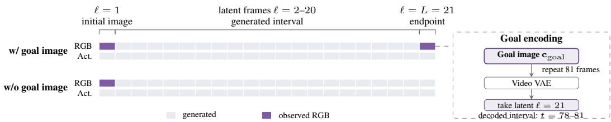  
Figure 9: PLAN conditioning masks and goal encoding. Both settings observe the initial image; the default also fixes a terminal latent encoded from repeated copies of the goal image. Hand and camera trajectories are predicted for all frames.

Hand visibility. We evaluate whether each hand is in view at each frame, using the reference-hand eligibility defined above. For Ours, the frozen action decoder’s joint-visibility probabilities $\hat { v } _ { t , j }$ give a positive hand prediction when maxj $\hat { v } _ { t , j } \ge 0 . 5$ . This is separate from the MANO head’s hand-level presence output $\hat { p } _ { t }$ and its presence loss. Baselines use their same-side hand detections whose projected mesh boxes intersect the image. We pool these hand-frame decisions to compute precision, recall, and F1, without an IoU matching requirement. For Ours, these visibility decisions also select the action predictions before mesh-overlap matching. Visibility F1 measures hand-in-frame classification; joint errors additionally evaluate the spatially matched hand states.

## D.4 GOAL-IMAGE CONDITIONING

Both PLAN settings receive the task instruction and initial image. The default additionally conditions on ${ \bf c } _ { \mathrm { g o a l } } = { \bf I } _ { T } ;$ ; the w/o goal image setting uses $\mathbf { c } _ { \mathrm { { g o a l } } } = \emptyset .$ . The goal image fixes the terminal video latent during sampling, while hand and camera trajectories are generated jointly. Figure 9 shows the conditioning masks.

Encoding the reference images. At inference, we repeat the goal image into an 81-frame constant clip and encode it with the video VAE, starting with a fresh temporal cache. Its final latent supplies the terminal observation at ℓ = 21. The initial image is encoded separately in the same way, using its first latent at ℓ = 1. These encodes use the two reference images alone. Both observed latents stay fixed during denoising, and the VAE decodes the entire output video. The terminal latent corresponds to frames $t = 7 8 – 8 1$ ; the intervening frames $t = 2 – 7 7$ are freely generated. The final column of Figure 7 shows the supplied goal image as a reference.

During training, observation masks select clean latents from VAE-encoded training clips. The same mask construction keeps observed positions clean and excludes them from the video loss. Action supervision uses the annotations aligned to all video frames, including the terminal interval. At inference, hand and camera trajectories are predicted from queries for all frames.

Evaluation interval. The VLM evaluates the complete video, including its transition into the goal segment, with the goal image supplied separately as a reference. Our qualitative analysis compares object placement before this segment begins. Appendix F.3 also reports video–action consistency over the freely generated interval.

## E HUMAN AND VLM EVALUATION

Table 7 reports the complete human and VLM comparison of PLAN-only and unified training, including 95% confidence intervals for the gains. Table 2 in the main text shows the VLM means.

## E.1 HUMAN EVALUATION

All participants in the human evaluation provided informed consent. We compare a PLAN-only model with a model learned through unified training after 5,000 steps. Both receive the same initial image, goal image, and task instruction, and use the same generation settings and seeds. The study covers 17 task categories, with 188 generated videos per model. Each video contains 81 frames at 16 fps, generated with CFG 2.

Table 7: Human and VLM evaluation of PLAN-only and unified training. Human scores use 21 pairs across 15 tasks; VLM scores use 188 pairs across 17 tasks. Scores range from 1 to 5. Unified training gains include 95% bootstrap confidence intervals.
<table><tr><td></td><td colspan="3">Human</td><td colspan="3">VLM</td></tr><tr><td>Dimension</td><td>PLAN-only</td><td>Unified training</td><td>Gain [95% CI]</td><td>PLAN-only</td><td>Unified training</td><td>Gain [95% CI]</td></tr><tr><td>Action process</td><td>2.23</td><td>3.12</td><td>+0.88 [0.37, 1.42]</td><td>1.88</td><td>2.89</td><td>+1.01 [0.73, 1.33]</td></tr><tr><td>Instruction adherence</td><td>2.18</td><td>3.02</td><td>+0.83 [0.43, 1.23]</td><td>2.27</td><td>3.22</td><td>+0.94 [0.62, 1.28]</td></tr><tr><td>Physical interaction</td><td>1.98</td><td>2.90</td><td>+0.92 [0.53, 1.33]</td><td>2.52</td><td>3.32</td><td>+0.80 [0.46, 1.13]</td></tr><tr><td>Temporal / identity</td><td>2.05</td><td>3.30</td><td>+1.25 [0.73, 1.77]</td><td>2.15</td><td>3.57</td><td>+1.42 [1.08, 1.76]</td></tr><tr><td>Goal transition</td><td>1.72</td><td></td><td>3.55 +1.83 [1.33, 2.30]</td><td>1.98</td><td>3.29</td><td>+1.30 [1.03, 1.60]</td></tr></table>

Reviewers watch one video at a time alongside its instruction and reference images, with the method label hidden. After watching the video, they score five dimensions independently on a 1–5 scale. Videos can be replayed; insufficient visual evidence is marked unobservable and excluded from the corresponding score. Method comparisons pair ratings from the same reviewer account for identical input conditions and generation seeds.

Aggregation and agreement. The human means in Table 7 use 21 complete pairs across 15 task categories. We average seeds within a window, windows within a source clip, and clips within a task, then weight tasks equally. VLM means use all 188 generated pairs with the same averaging procedure. For the unified training gains, we obtain 95% percentile confidence intervals from 10,000 bootstrap resamples of task categories, preserving the paired methods and the within-task averaging above. Human–VLM agreement is measured by pooled Spearman correlation on 100 videos with both human and VLM ratings. It captures ranking agreement across both training settings, including their difference in mean quality. The correlations are 0.528, 0.371, 0.515, 0.597, and 0.396 for action process, instruction adherence, physical interaction, temporal/identity consistency, and goal transition, respectively.

Sensitivity analysis. The human-score gains remain positive after removing cases used to develop the VLM rubric. Excluding the 17 development pairs leaves 86 rated videos and 17 complete human pairs, with pooled correlations of 0.491/0.338/0.530/0.631/0.372 in rubric order. Removing two conditions with ambiguous instructions or reference images as well gives 0.498/0.335/0.534/0.639/0.366 on 85 videos, with the same 17 complete human pairs.

## E.2 SCORING RUBRIC

Humans and the VLM use the five dimensions and score anchors in Table 8. Scores 2 and 4 indicate intermediate performance. Action process and instruction adherence are the primary criteria. Reviewers assess the manipulation sequence and its transition toward the specified goal, including the required intermediate actions, visible contact, and consistency of hands and objects.

## E.3 VLM EVALUATION

We use qwen3.8-max (Qwen Team, 2026) at temperature 0 for independent, method-blind video scoring. Each request contains the initial and goal images, the task instruction, and time-ordered frames from one anonymous video. We sample 16 uniformly spaced frames and the final eight consecutive frames, yielding 22 frames after deduplication. The denser sampling near the end captures the transition into the goal state. Frame indices and timestamps accompany the images.

The judge applies the shared rubric to each dimension and returns a score, instruction checks, and supporting frame indices. It evaluates the visible action sequence, marks insufficient evidence as unobservable, and flags conflicts between instructions and reference images. Returned frame indices are checked against the supplied frames. Both the human-alignment study and the external-baseline comparison use independent single-video scores.

Table 8: Shared human/VLM score anchors. Unobservable dimensions are recorded as missing.
<table><tr><td>Dimension</td><td>1: Severe failure</td><td>3: Partial completion</td><td>5: Good visible performance</td></tr><tr><td>Action process (primary)</td><td>No effective action, wrong direction, or arrival through a sudden jump.</td><td>Some necessary actions are visible, but key steps are missing or transitions are flawed.</td><td>Necessary actions occur clearly in a plausible order; intermediate states support the outcome.</td></tr><tr><td>Instruction adherence (primary)</td><td>Core instruction is not executed, or the stopping condition is seriously violated.</td><td>Some instructions are executed, with visible omissions or constraint violations.</td><td>Observable requirements and constraints are met, with the correct stopping point.</td></tr><tr><td>Physical interaction</td><td>Severe penetration, self-moving or disappearing objects, or invalid interaction.</td><td>Clear local problems in contact or shape.</td><td>Observed contact, grasping, movement, and shape changes are plausible.</td></tr><tr><td>Temporal / identity consistency</td><td>Severe jumps or changes in object count or identity.</td><td>Local discontinuities or shape drift.</td><td>Observed hands, objects, and background remain consistent across frames.</td></tr><tr><td>Goal transition</td><td>No approach to the goal, or sudden replacement at the end.</td><td>Partly natural approach, with clear late corrections or discontinuities.</td><td>Natural transition across the final frames, with the required relationships established.</td></tr></table>

## E.4 COMPARISON WITH VIDEO-GENERATION BASELINES

Table 5 compares our goal-conditioned model with Wan2.2 I2V-A14B and Cosmos 3-Nano, each evaluated with and without a goal image condition. All five settings use the same scoring rubric and evaluation tasks. The Goal image column indicates whether a goal image is provided to the model.

Each setting is evaluated on 188 videos across 17 task categories. We use the frame sampling and judging procedure above. Scores assess progress through each video, accounting for the native playback rates of 16 fps for Ours and Wan2.2 and 24 fps for Cosmos 3-Nano. We average seeds, windows, and source clips in sequence, then give each task equal weight. Ours-minus-baseline differences are computed on matched inputs and seeds. We estimate 95% confidence intervals with 2,000 bootstrap resamples of source clips within each task, keeping their windows and seeds together.

Table 9: Ours-minus-baseline VLM score differences with 95% bootstrap intervals. Positive differences indicate higher scores for Ours.
<table><tr><td>Baseline</td><td></td><td>Goal image</td><td>Action process</td><td></td><td>Instruction adherence</td><td></td></tr><tr><td></td><td>Cosmos 3-Nano Cosmos 3-Nano</td><td>√ x</td><td>1.311 [1.190, 1.439]</td><td></td><td>1.036 [0.874, 1.189]</td><td></td></tr><tr><td>Wan2.2 I2V-A14B</td><td></td><td></td><td>0.865 [0.661, 1.060]</td><td></td><td>0.922 [0.657, 1.178]</td><td></td></tr><tr><td></td><td>Wan2.2 I2V-A14B</td><td>√ x</td><td></td><td>0.944 [0.743, 1.143] 0.471 [0.245, 0.703]</td><td>0.892 [0.669, 1.107]</td><td></td></tr><tr><td></td><td></td><td></td><td></td><td></td><td>0.620 [0.364, 0.875]</td><td></td></tr><tr><td>Baseline</td><td>Goal image</td><td>Physical interaction</td><td></td><td>Temporal / identity consistency</td><td></td><td>Goal transition</td></tr><tr><td>Cosmos 3-Nano</td><td>√</td><td>1.161 [1.047, 1.277]</td><td></td><td></td><td>1.799 [1.686, 1.909]</td><td></td><td>1.761 [1.614, 1.917]</td></tr><tr><td>Cosmos 3-Nano</td><td>x</td><td></td><td>0.205 [0.070, 0.331]</td><td>-0.033</td><td>[-0.162, 0.088]</td><td></td><td>1.109 [0.860, 1.347]</td></tr><tr><td>Wan2.2 I2V-A14B</td><td>√</td><td></td><td>1.099 [0.955, 1.250]</td><td></td><td>1.909 [1.728, 2.082]</td><td></td><td>1.567 [1.343, 1.783]</td></tr><tr><td>Wan2.2 I2V-A14B</td><td>x</td><td></td><td>0.232 [0.124, 0.337]</td><td></td><td>0.245 [0.137, 0.354]</td><td></td><td>0.663 [0.438, 0.887]</td></tr></table>

Table 9 shows consistent gains in action process, instruction adherence, physical interaction, and goal transition against every baseline. In particular, the action-process and instruction-adherence intervals are positive for all four comparisons. Excluding the two conditions with ambiguous instructions or reference images preserves the four-dimension lead.

## E.5 REAL-WORLD EXECUTION EVALUATION

In addition to evaluating the generated videos perceptually, we test whether the predicted manipulation behaviors can be transferred to and executed by a physical robot. We conduct two real-world experiments in which the model-generated action sequences are converted into executable robot trajectories and replayed in the corresponding physical environments. This evaluation tests whether the generated behavior captures sufficiently accurate object interactions and action ordering to support downstream robot execution.

Starting from a generated manipulation video, we reconstruct the relevant objects and scene and recover their motion over time. The reconstructed hand motion is then retargeted to the robot hand to obtain an initial robot trajectory. The resulting action sequence is then deployed on the physical robot without further modification.

Thus, the complete evaluation pipeline is generated video → scene and object reconstruction → robot retargeting → real-world execution. This follows do-as-I-do Paliwal et al. (2026) evaluation paradigm, in which a visual demonstration is converted into an executable robot behavior.

For both experiments, we report whether execution reproduces the intended manipulation process and reaches the specified task outcome. These real-world trials complement the human and VLM evaluations above: whereas the perceptual metrics measure whether an action appears correct and physically plausible in the generated video, real-world execution provides a direct test of whether the predicted interaction can be grounded into a physically executable manipulation trajectory.

## E.6 QUESTIONNAIRE INTERFACE

Figures 10 and 11 show the study interface, including video presentation and the five rating controls.

## F ADDITIONAL QUANTITATIVE RESULTS

## F.1 PERCEIVE JOINT ERRORS AND HAND VISIBILITY

Table 10 reports joint errors from the same predictions and targets as Table 3, without adding canonical-hand penalties for missed detections. Our model achieves the lowest mean camera-space error (47.77 mm, versus 95.17 mm for HaMeR), the lowest root-relative error on every dataset, and the lowest mean PA error (9.94 mm). On HOT3D, HaMeR has lower camera-space error (71.22 versus 84.54 mm); HaMeR also achieves the lowest PA error on HOT3D and EgoLive. Our model also achieves the highest visibility F1 on every dataset, with an overall F1 of 99.17%, compared with 92.14% for HaMeR and 89.95% for Dyn-HaMR.

Table 10: Joint reconstruction and hand visibility in PERCEIVE mode. We report camera-space, root-relative (RR), and Procrustes-aligned (PA) joint errors without missing-hand penalties, alongside separately scored hand-in-frame precision, recall, and F1.
<table><tr><td></td><td></td><td colspan="3">Joint error (mm)</td><td colspan="3">Hand visibility (%)</td></tr><tr><td>Dataset</td><td>Method</td><td>MPJPE↓</td><td>RR-MPJPE↓</td><td>PA-MPJPE↓</td><td>Precision ↑</td><td>Recall ↑</td><td>F1↑</td></tr><tr><td>EgoDex-MANO</td><td>Ours</td><td>32.92</td><td>31.58</td><td>13.12</td><td>99.92</td><td>100.00</td><td>99.96</td></tr><tr><td></td><td>HaMeR</td><td>106.86</td><td>43.49</td><td>14.80</td><td>84.98</td><td>99.06</td><td>91.48</td></tr><tr><td></td><td>Dyn-HaMR</td><td>103.58</td><td>33.82</td><td>15.05</td><td>99.52</td><td>96.86</td><td>98.17</td></tr><tr><td>ARCTIC</td><td>Ours</td><td>42.31</td><td>13.03</td><td>7.57</td><td>99.93</td><td>99.51</td><td>99.72</td></tr><tr><td></td><td>HaMeR</td><td>51.36</td><td>27.36</td><td>9.42</td><td>99.23</td><td>95.47</td><td>97.31</td></tr><tr><td></td><td>Dyn-HaMR</td><td>202.67</td><td>21.27</td><td>9.60</td><td>100.00</td><td>81.62</td><td>89.88</td></tr><tr><td>HOT3D</td><td>Ours</td><td>84.54</td><td>20.11</td><td>9.33</td><td>99.22</td><td>97.00</td><td>98.10</td></tr><tr><td></td><td>HaMeR</td><td>71.22</td><td>45.44</td><td>9.32</td><td>95.21</td><td>76.40</td><td>84.78</td></tr><tr><td></td><td>Dyn-HaMR</td><td>92.79</td><td>28.40</td><td>11.15</td><td>95.64</td><td>71.08</td><td>81.55</td></tr><tr><td>EgoLive</td><td>Ours</td><td>31.32</td><td>18.70</td><td>9.76</td><td>99.55</td><td>98.19</td><td>98.87</td></tr><tr><td></td><td>HaMeR</td><td>151.25</td><td>54.90</td><td>8.36</td><td>96.55</td><td>90.73</td><td>93.55</td></tr><tr><td></td><td>Dyn-HaMR</td><td>116.80</td><td>20.46</td><td>8.63</td><td>99.96</td><td>80.43</td><td>89.14</td></tr><tr><td>Overall</td><td>Ours</td><td>47.77</td><td>20.85</td><td>9.94</td><td>99.66</td><td>98.69</td><td>99.17</td></tr><tr><td></td><td>HaMeR</td><td>95.17</td><td>42.80</td><td>10.47</td><td>93.71</td><td>90.62</td><td>92.14</td></tr><tr><td></td><td>Dyn-HaMR</td><td>128.96</td><td>25.99</td><td>11.11</td><td>98.96</td><td>82.45</td><td>89.95</td></tr></table>

Overall averages joint errors equally across datasets and pools hand-frame decisions for visibility metrics. HaMeR’s camera-space translation is fitted to its own 2D projections using dataset intrinsics, with pose and scale fixed; no reference joints enter fitting. Protocols are in Appendix D.3.

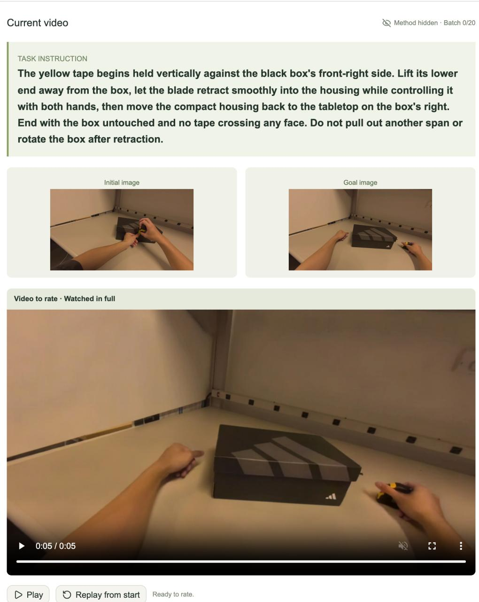  
Figure 10: Interface of the questionnaire. Reviewers see the instruction, initial and goal images, and one anonymous video.

  
Figure 11: Questionnaire response interface. Each dimension has a 1–5 rating and an unobservable option, with optional notes.

## F.2 RECONSTRUCTION AGAINST ORIGINAL EGODEX JOINTS

We also evaluate all three methods against the original EgoDex 3D joint annotations, mapped to the common 21-joint hand ordering (Table 11). We use the same predictions and evaluation windows as the EgoDex-MANO comparison. Our model achieves the lowest error in all three coordinate settings, both with and without presence penalties. Camera-space error is 30.07 mm and root-relative error is 19.02 mm, compared with 114.58 and 27.45 mm for Dyn-HaMR under presence-aware scoring. PA error is 10.98 mm, compared with 13.70 mm for HaMeR.

Table 11: Reconstruction against original EgoDex joint annotations. Errors are in mm (lower is better); p denotes presence penalties.
<table><tr><td rowspan="2">Method</td><td colspan="3">Without presence penalties</td><td colspan="3">With presence penalties</td></tr><tr><td>MPJPE</td><td>RR-MPJPE</td><td>PA-MPJPE</td><td>MPJPE-p</td><td>RR-MPJPE-p</td><td>PA-MPJPE-p</td></tr><tr><td>HaMeR</td><td>106.23</td><td>39.75</td><td>11.98</td><td>112.30</td><td>40.90</td><td>13.70</td></tr><tr><td>Dyn-HaMR</td><td>102.62</td><td>24.20</td><td>12.26</td><td>114.58</td><td>27.45</td><td>15.86</td></tr><tr><td>Ours</td><td>30.07</td><td>19.02</td><td>10.98</td><td>30.07</td><td>19.02</td><td>10.98</td></tr></table>

## F.3 PLAN VIDEO–ACTION CONSISTENCY

We reconstruct each PLAN-generated video with PERCEIVE and compare the recovered hand joints with the hand trajectory predicted by PLAN. This measures agreement between the two outputs of the same model. We use four EgoDex image pairs and four generated image pairs, and average camera-space and wrist-relative joint distances over both hands, frames, and examples.

The camera-space discrepancy is 4.79 mm for EgoDex and 4.99 mm for generated images; wristrelative discrepancies are 2.31 and 2.76 mm (Table 12). The results remain similar over frames 2–77, before the goal-conditioned terminal interval.

Table 12: Agreement between PLAN hand trajectories and PERCEIVE reconstructions of the generated videos. MPJPE is in mm (lower is better).
<table><tr><td></td><td colspan="2">Frames 2–81</td><td colspan="2">Frames 2–77</td></tr><tr><td>Image source</td><td>MPJPE</td><td>RR-MPJPE</td><td>MPJPE</td><td>RR-MPJPE</td></tr><tr><td>EgoDex</td><td>4.79</td><td>2.31</td><td>4.78</td><td>2.32</td></tr><tr><td>Generated images</td><td>4.99</td><td>2.76</td><td>4.96</td><td>2.79</td></tr></table>

## F.4 ACTION-GUIDANCE SENSITIVITY

We vary the strength of action conditioning by combining RGB velocity predictions with and without the prescribed hand and camera trajectories:

$$
\hat { \mathbf { v } } _ { \gamma } = \hat { \mathbf { v } } _ { \varnothing } + \gamma \big ( \hat { \mathbf { v } } _ { \mathrm { a c t } } - \hat { \mathbf { v } } _ { \varnothing } \big ) .\tag{10}
$$

Both branches use the same video latent, noise level, text instruction, and initial image. Here, $\gamma = 0$ omits action conditioning, $\gamma = 1$ uses the conditional prediction, and $\gamma > 1$ adds guidance beyond that prediction. The main PREDICT comparison in Table 4 uses $\gamma = 1$

Table 13 separates the benefit of action conditioning from additional guidance. Increasing γ from 0 to 1 raises full-image PSNR from 20.644 to 25.327 dB and hand PSNR from 16.764 to 23.724 dB. Additional guidance at $\gamma = 1 . 5$ raises hand PSNR by 0.175 dB to 23.899 dB, while full-image PSNR is 25.271 dB. The hand-region improvement occurs on 13 of 20 windows, with a paired 95% bootstrap interval of [+0.002, +0.342] dB.

## F.5 BACKBONE COMPARISON WITH EGOSIM

For a fair backbone comparison with EgoSim (Hao et al., 2026), we conduct an additional experiment by retraining our model from Wan2.1-Fun-Control with EgoSim’s training setting. We evaluate this model on the benchmarks of Tables 4 and 3, alongside our main Wan2.2 model.

Table 13: Action-guidance sensitivity for PREDICT on 20 EgoDex windows. Full-image PSNR is measured on native 848×480 frames 2–81. Hand PSNR is measured inside 128×128 GT-pose crops using GT-only SAM3 hand pixels with at least 20% crop coverage. Higher is better.
<table><tr><td>Scale γ</td><td>Full-image PSNR ↑</td><td>SAM3 20% hand PSNR ↑</td></tr><tr><td>0.0</td><td>20.644</td><td>16.764</td></tr><tr><td>0.5</td><td>23.726</td><td>21.008</td></tr><tr><td>1.0</td><td>25.327</td><td>23.724</td></tr><tr><td>1.5</td><td>25.271</td><td>23.899</td></tr><tr><td>2.0</td><td>25.035</td><td>23.651</td></tr></table>

Video prediction. With the matched Wan2.1 backbone, our model achieves mean PSNR 18.020 dB, SSIM 0.6319, and LPIPS 0.4251, compared with 15.384 dB, 0.5615, and 0.4974 for EgoSim (Table 14), improving all three dataset-averaged video metrics. Our main Wan2.2 model reaches 19.020 dB, 0.6547, and 0.3891, respectively.

Table 14: PREDICT results with Wan2.2 and Wan2.1 backbones, alongside EgoSim. Full-frame metrics follow Table 4. Macro averages the four datasets equally. Bold entries denote the best result for each dataset.
<table><tr><td>Dataset</td><td>Method</td><td>PSNR ↑</td><td>SSIM↑</td><td>LPIPS ↓</td></tr><tr><td>EgoDex</td><td>Ours (Wan2.2)</td><td>24.511</td><td>0.8462</td><td>0.2679</td></tr><tr><td rowspan="5">ARCTIC</td><td>Ours (Wan2.1)</td><td>23.540</td><td>0.8262</td><td>0.2984</td></tr><tr><td>EgoSim</td><td>21.331</td><td>0.8189</td><td>0.2955</td></tr><tr><td>Ours (Wan2.2)</td><td>14.106</td><td>0.5785</td><td>0.4411</td></tr><tr><td>Ours (Wan2.1)</td><td>13.921</td><td>0.5903</td><td>0.4437</td></tr><tr><td>EgoSim</td><td>12.874</td><td>0.5545</td><td>0.4968</td></tr><tr><td>HOT3D</td><td>Ours (Wan2.2)</td><td>15.912</td><td>0.4637</td><td>0.4990</td></tr><tr><td rowspan="5">EgoLive</td><td>Ours (Wan2.1)</td><td>14.394</td><td>0.4075</td><td>0.5672</td></tr><tr><td>EgoSim</td><td>12.906</td><td>0.3266</td><td>0.6389</td></tr><tr><td>Ours (Wan2.2)</td><td>21.551</td><td>0.7302</td><td>0.3483</td></tr><tr><td>Ours (Wan2.1)</td><td>20.226</td><td>0.7036</td><td>0.3912</td></tr><tr><td>EgoSim</td><td>14.423</td><td>0.5459</td><td>0.5582</td></tr><tr><td rowspan="3">Macro</td><td>Ours (Wan2.2)</td><td>19.020</td><td>0.6547</td><td>0.3891</td></tr><tr><td>Ours (Wan2.1)</td><td>18.020</td><td>0.6319</td><td>0.4251</td></tr><tr><td>EgoSim</td><td>15.384</td><td>0.5615</td><td>0.4974</td></tr></table>

Hand reconstruction. We also report hand reconstruction for this additional run (Table 15). The Wan2.1 model achieves mean camera-space, root-relative, and PA errors of 51.43, 18.78, and 9.77 mm, respectively. The corresponding Wan2.2 results are 48.58, 20.85, and 9.96 mm.

Table 15: PERCEIVE results with Wan2.2 and Wan2.1 backbones. We report ordinary camera-space, root-relative (RR), and Procrustes-aligned (PA) MANO joint errors in millimeters. Wan2.2 entries evaluate the dense predictions from Table 3 before visibility filtering and mesh matching. Macro averages the four datasets equally.
<table><tr><td>Dataset</td><td>Method</td><td>MPJPE↓</td><td>RR-MPJPE↓</td><td>PA-MPJPE↓</td></tr><tr><td rowspan="2">EgoDex</td><td>Ours (Wan2.2)</td><td>32.92</td><td>31.58</td><td>13.12</td></tr><tr><td>Ours (Wan2.1)</td><td>30.31</td><td>18.79</td><td>10.88</td></tr><tr><td rowspan="2">ARCTIC</td><td>Ours (Wan2.2)</td><td>42.47</td><td>12.99</td><td>7.55</td></tr><tr><td>Ours (Wan2.1)</td><td>38.99</td><td>13.14</td><td>8.36</td></tr><tr><td rowspan="2">HOT3D</td><td>Ours (Wan2.2)</td><td>87.07</td><td>20.12</td><td>9.42</td></tr><tr><td>Ours (Wan2.1)</td><td>109.99</td><td>24.86</td><td>10.05</td></tr><tr><td rowspan="2">EgoLive</td><td>Ours (Wan2.2)</td><td>31.86</td><td>18.70</td><td>9.76</td></tr><tr><td>Ours (Wan2.1)</td><td>26.44</td><td>18.36</td><td>9.78</td></tr><tr><td rowspan="2">Macro</td><td>Ours (Wan2.2)</td><td>48.58</td><td>20.85</td><td>9.96</td></tr><tr><td>Ours (Wan2.1)</td><td>51.43</td><td>18.78</td><td>9.77</td></tr></table>

Wan2.1 root-position errors are 22.63, 33.48, 112.07, and 23.10 mm on EgoDex, ARCTIC, HOT3D, and EgoLive, respectively; the four-dataset mean is 47.82 mm.

(a) Perceive  
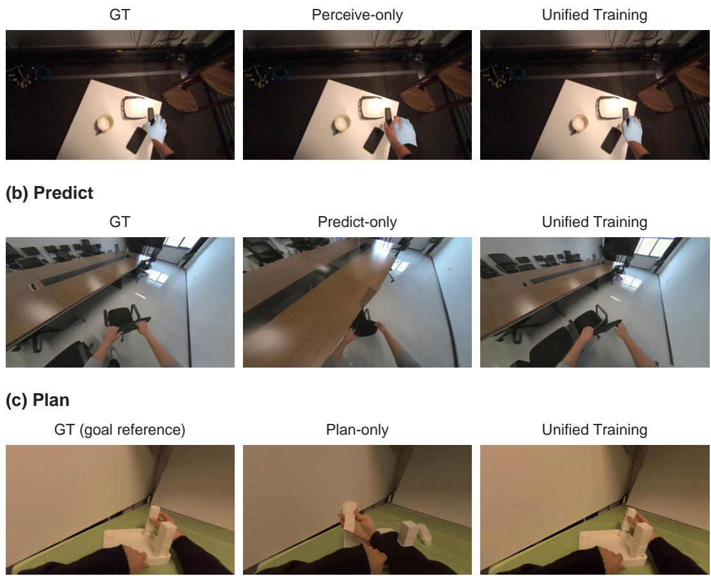  
Figure 12: Qualitative comparison of single-mode and unified training. PERCEIVE: unified training places the reconstructed palm closer to the observed hand. PREDICT: the table extent and viewpoint more closely match GT. PLAN: the narrow support is positioned beside the fixed broad post. The left column shows GT for PERCEIVE and PREDICT, and the goal-image reference for PLAN.

## G ADDITIONAL QUALITATIVE RESULTS

The qualitative examples cover three complementary settings. Figures 6 and 5 compare generated videos and reconstructed hands across the four reporting datasets. Figure 7 compares goal-conditioned planning, while Figure 4 uses successive visual targets to specify spatial arrangements in longer tasks. Figure 8 connects the generated human trajectory to physical execution. For goal-conditioned examples, motion before the terminal observed interval shows the generated transition; Appendix D.4 defines this interval.

## G.1 SINGLE-MODE VERSUS UNIFIED TRAINING

The PLAN-only baseline is trained with visual subgoals. At evaluation, both it and the unified model receive the same initial image, instruction, and goal image, and retain the goal condition throughout generation. We use the same scoring procedure for both models. The rubric evaluates the intermediate action sequence and the transition toward the goal, including contact and object motion.

Figure 12 compares single-mode and unified training across PERCEIVE, PREDICT, and PLAN. The selected frames illustrate differences in hand placement, scene perspective, and object arrangement, respectively.

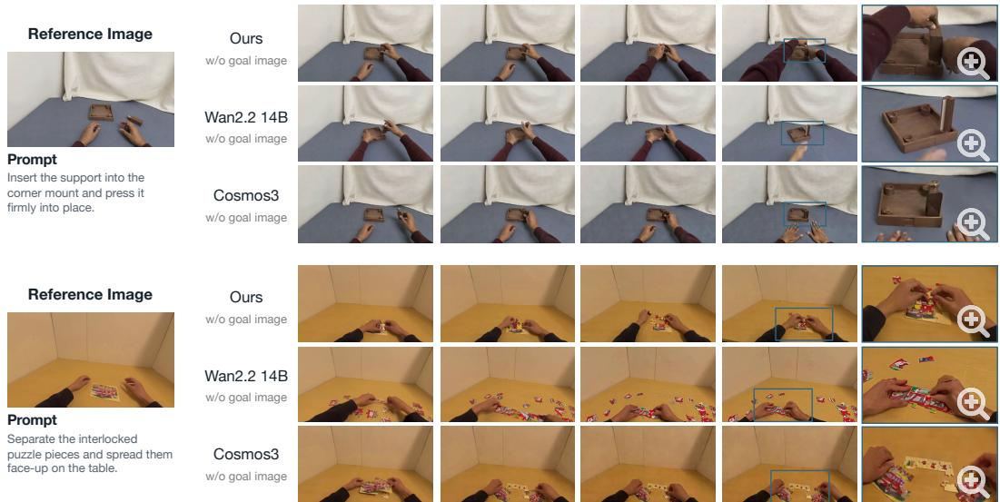  
f16 f48 f64 f76 f77t=17 t=49 t=65 t=77 t=78Figure 13: PLAN and video-generation baselines without a goal image. All methods receive only Reference Image  the initial image and instruction. Our model maintains the support’s shape during placement and the identities of the puzzle pieces during separation. The close-ups show deformations in the baseline outputs.

## Prompt w/ Goal Cond.w/ goal imageG.2 GOAL-CONDITIONING ABLATION AND BASELINE COMPARISONS

and release it. Cosmos3The default PLAN task is conditioned on a visual goal. The w/o goal image configuration removes w/ Goal Cond.w/ goal imagethis image while retaining the initial image and instruction; hand and camera trajectories remain f16 f48 f64 f76 f77t=17 t=49 t=65 t=77 t=78outputs. For multiple windows, visual subgoals are the goal images specifying intermediate stage Ref. Goal Imagetargets. Removing the goal image from every window is distinct from retaining a final visual goal Ourswhile removing only intermediate subgoals.

Matched condition-ablation protocol. The with/without-goal corpus contains 188 paired genera-w/ goal imagetions over 94 windows, with two matched seeds per window. Both settings use the same checkpoint, initial images, instructions, and sampling settings, including 50 denoising steps and CFG 2. Each then replace the lid and seat it window starts from its reference initial image. Only the goal-image condition is removed; the no-goal w/ Goal Cond.w/ goal imagemodel does not receive future hand or camera states.

Comparisons without a goal image. Figure 13 compares our model with Wan2.2 and Cosmos when all three methods receive only the initial image and instruction. Our model maintains the shape of the wooden support as the hands place it into the corner mount. In the puzzle example, it keeps individual pieces identifiable as the hands separate them. Wan2.2 stretches the puzzle pieces, while Cosmos deforms the support and merges puzzle pieces into elongated strips. These examples show hand–object consistency during manipulation without a supplied terminal image.

A visual goal adds control over the desired arrangement beyond the instruction. Figure 4, for example, uses the goal image to specify the separation between the red blocks.

Spatial targets and multiwindow behavior. Figure 4 illustrates the task information supplied by visual goals. The no-goal example places the blocks differently and the autoregressive rollout accumulates placement errors. The goal-conditioned windows use prescribed reference starts and guidance 2; the no-goal rollout uses generated starts and text guidance 6. This execution-strategy comparison is separate from the matched condition ablation above. The subgoals provide stage targets; these comparisons do not evaluate closed-loop error detection or correction.

## H RESPONSIBLE USE AND ASSET DOCUMENTATION

## H.1 SOURCE ASSETS AND INTENDED USE

The reporting datasets are EgoDex (Hoque et al., 2026), ARCTIC (Fan et al., 2023), HOT3D (Banerjee et al., 2025), and EgoLive (Li et al., 2026b). Their video, action annotations, and calibration remain subject to the respective providers’ access and redistribution terms. Wan model weights and the MANO assets retain their upstream terms. Derived annotations and visualizations should preserve source attribution; access-controlled raw data and model assets should be obtained from their providers.

Intended use. P3-WAM supports research on visual prediction, 3D perception, and robot manipulation. Its benchmark coverage reflects the activities, cameras, hands, and environments in the source datasets. Performance across broader populations and embodiments requires additional evaluation.

## H.2 ETHICAL CONSIDERATIONS

Egocentric video can reveal bystanders, personal spaces, and daily activities. Use and sharing of these data should follow the source datasets’ access and consent terms, with identifying information minimized in released examples. Generated interaction videos should be labeled as synthetic. Motion generated from visual goals requires embodiment-specific validation and supervised execution before use on physical robots.