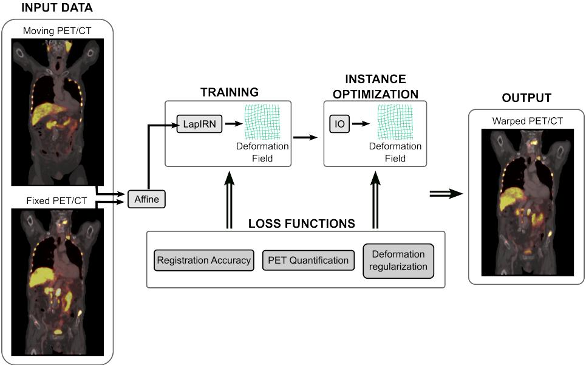
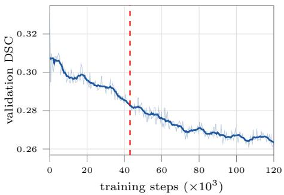
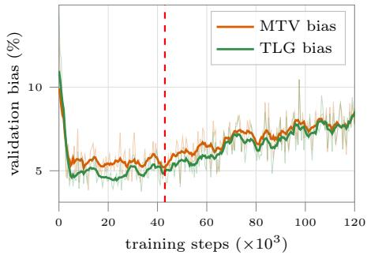
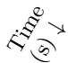
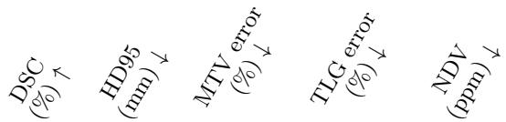

# PET Quantification-Preserving Registration for Longitudinal Whole-Body PSMA PET/CT

Fryderyk Kögl1,2,3, Anna Reithmeir1,2,3, Daniel M. Lang1, Emily Chan1,2, Rickmer Braren4, and Julia A. Schnabel1,2,3,5

1 Helmholtz Munich, 2 Technical University of Munich, 3 Munich Center for Machine Learning,

University Medical Center Hamburg-Eppendorf, 5 King’s College London

Abstract. We adapt the difeomorphic coarse-to-fine LapIRN architecture for longitudinal whole-body PSMA PET/CT registration in the Learn2Reg 2026 PSMAReg challenge. The method combines afine preregistration, multi-modal deformable registration, and test-time instance optimization. We further introduce PET biomarker preservation losses for metabolic tumor volume (MTV) and total lesion glycolysis (TLG), including Jacobian-based constraints, and a per-structure rigidity regularization for skeletal structures. The submitted configuration achieved 81.0% DSC and 6.17 mm HD95, with MTV and TLG errors of 3.3% and 3.3%, respectively, on our evaluation protocol. Code is available at https://github.com/koegl/psmareg.

Keywords: Deformable image registration · PSMA PET/CT · Longitudinal imaging · Biomarker preservation.

## 1 Introduction

Prostate-specific membrane antigen (PSMA) PET/CT has become a central imaging modality for staging, treatment planning, radiopharmaceutical therapy, and post-therapy response assessment in prostate cancer [6]. In these settings, patients often undergo multiple scans over time, comprising a baseline scan before therapy and one or more follow-up scans. Accurate baseline-to-follow-up registration can support the comparison of disease burden, the localization of uptake changes, the assessment of lesion progression or response, dose accumulation, and quantitative longitudinal analysis [13]. For such analyses, the deformation should align anatomy without introducing artificial changes in PET-derived tumor burden measures. The Learn2Reg 2026 PSMAReg challenge [9,8,11] formalizes this problem as the estimation of a dense displacement field that warps each follow-up (moving) scan to its baseline (fixed) scan. The challenge evaluates registration accuracy using organ overlap and boundary distance, deformation regularity, and preservation of two PET-derived biomarkers: metabolic tumor volume (MTV) and total lesion glycolysis (TLG).

Deformable registration can be formulated as iterative optimization of a regularized objective functional [23,1,20], which can achieve high accuracy but is computationally demanding for whole-body images. Learning-based methods instead amortize this optimization into network weights and replace per-pair iteration with a single forward pass at inference [3,5,4]. We therefore build on LapIRN [17], whose coarse-to-fine Laplacian pyramid is well suited to recovering the large deformations expected between longitudinal whole-body scans while maintaining smooth and invertible transformations.

  
Fig. 1. Overview of the proposed registration pipeline. The moving (follow-up) and fixed (baseline) PET/CT scans are first coarsely aligned by an afine pre-registration, and the resulting pair is then passed to the coarse-to-fine LapIRN network, which predicts a dense deformation field (green grid). Finally, after the LapIRN stage, we refine this field per pair by instance optimization (IO) and resample the moving scan with it into the fixed space (warped PET/CT). Both stages are driven by the same objective, a weighted sum of three groups of terms: registration accuracy, PET quantification, and deformation regularization (Sec. 2.3).

In this work, we adapt LapIRN to longitudinal whole-body PSMA PET/CT registration and extend it with PET biomarker preservation losses, local bone rigidity regularization, and test-time instance optimization.

## 2 Methods

## 2.1 Data and Preprocessing

We used the PSMAReg dataset of the Learn2Reg 2026 challenge [13], a longitudinal whole-body PSMA PET/CT cohort in which each subject provides a baseline scan and one or more follow-up scans. Each scan contains CT and

PSMA PET channels; follow-up scans were treated as moving images and baseline scans as fixed images. The images are provided at 2.7344×2.7344×3.27 mm resolution and cropped to 192×192×288 voxels. We therefore applied no further geometric preprocessing. CT was clipped to [−1000, 1500] HU and PET SUV to [0, 20], followed by rescaling to [0, 1].

Of the 358 released training cases, we used the 146 paired cases and split them patient-wise into 117 training and 29 validation cases. The 20 challenge validation cases, for which no labels are released, were used as our test set. For training and validation, we used the CT organ and PET lesion labels provided by the organizers. For the test set, we generated surrogate CT organ labels using TotalSegmentator [24] and PET lesion labels using the winning autoPET III submission [19]. Following the ConvexAdam [21] baseline provided by the challenge organizers, we additionally removed the patient bed and normalized the CT images.

## 2.2 Registration Pipeline

Our pipeline consists of CT-based afine pre-registration, LapIRN-based deformable registration, and optional test-time instance optimization (Fig. 1). Throughout, I denotes the moving PET image, M its lesion mask, φaf the afine pre-registration, φθ the network-predicted deformation, and φ their composition. W is the lesion mask warped into the fixed frame.

Step 1: Afine pre-registration. For each pair, ANTs [2] estimates an afine transform from the CT images alone, using body masks, CT windowing to [−1000, 1000] HU, half-resolution images, and Mattes mutual information. The transform is converted to a dense displacement field and applied to the moving scan.

Step 2: Deformable registration. The deformable stage uses LapIRN [17], with three pyramid levels operating at quarter, half, and full resolution. Each level predicts a stationary velocity field, adds it to the upsampled velocity from the coarser level, and exponentiates the result by scaling and squaring to obtain a difeomorphic φ . To handle PSMA PET/CT, each sub-network receives four channels: fixed CT and PET, and afinely aligned moving CT and PET. The similarity loss is computed only on CT, because PET uptake may change after therapy; PET is used as input and in the preservation terms of Sec. 2.3. The levels are trained sequentially, with each finer level initialized from the previous one.

Step 3: Instance optimization. At test time, each pair is refined by optimizing a residual stationary velocity field on top of the network prediction. The residual is initialized to zero and exponentiated by scaling and squaring, preserving difeomorphism while only correcting the predicted field. Optimization uses the training objective (Sec. 2.3); each iterate is scored by DSC, HD95, MTV, and TLG, and the best-scoring iterate is retained.

## 2.3 Training Loss Function for deformable stage

We use a weighted sum of three loss groups, one per evaluation criterion:

$$
\begin{array} { r l } & { \mathcal { L } = \underbrace { \lambda _ { \mathrm { N C C } } ~ \mathcal { L } _ { \mathrm { N C C } } + \lambda _ { \mathrm { D S C } } ~ \mathcal { L } _ { \mathrm { D S C } } } _ { \mathrm { r e g i s t r a t i o n ~ a c c u r a c y } } } \\ & { ~ + \underbrace { \lambda _ { \mathrm { M T V } } ~ \mathcal { L } _ { \mathrm { M T V } } + \lambda _ { \mathrm { M T V - } } ~ \mathcal { L } _ { \mathrm { M T V - } } { + } } _ { \mathrm { P E T ~ q u a n t i f i c a t i o n } } + \lambda _ { \mathrm { j a c } } \mathcal { L } _ { \mathrm { j a c } } + \lambda _ { \mathrm { T L G } } \mathcal { L } _ { \mathrm { T L G } } } \\ & { ~ + \underbrace { \lambda _ { \mathrm { r i g i d } } ~ \mathcal { L } _ { \mathrm { r i g i d } } + \lambda _ { \mathrm { s m o o t h } } \mathcal { L } _ { \mathrm { s m o o t h } } + \lambda _ { \mathrm { N D V } } ~ \mathcal { L } _ { \mathrm { N D V } } } _ { \mathrm { d e f o r m a t i o n ~ r e g u l a r i z a t i o n } } . } \end{array}\tag{1}
$$

Each group is described below. All terms are evaluated on the composed transformation $\varphi .$ Only the full-resolution level is trained with the complete objective. The two coarser levels (quarter and half resolution) use only the similarity, label, and regularization terms; thus $\lambda _ { \mathrm { M T V } } = \lambda _ { \mathrm { M T V - J } } = \lambda _ { \mathrm { j a c } } = \lambda _ { \mathrm { T L G } } = \lambda _ { \mathrm { r i g i d } } = 0 .$ . We omit the PET and bone-specific terms at these resolutions because downsampled lesions and thin ribs span only a few voxels, so volume ratios and per-structure rigid fits mainly reflect interpolation rather than anatomy.

Registration Accuracy. Image similarity is measured using local normalized cross-correlation (NCC), computed as a multi-resolution sum over as many scales as the respective pyramid level has resolutions, i.e. one scale at the coarsest and three at the full-resolution level. NCC is computed on the CT channel only, since PET uptake can change substantially between time points, and a PET similarity term could therefore encourage matching disease-related uptake rather than anatomy. We additionally use a DSC loss for weak supervision from the CT organ labels.

Preservation of PET quantification. The challenge evaluates the net change in metabolic tumor volume (MTV) and total lesion glycolysis (TLG) under the estimated transformation. All terms are evaluated on the composed transformation $\varphi$ and the original moving lesion mask M.

To additionally constrain the deformation within the lesion, we use $\mathcal { L } _ { \mathrm { M T V - J } } .$ which penalizes deviations of the mean Jacobian determinant over the warped lesion region W from one. A third term, $\mathcal { L } _ { \mathrm { j a c } } . _ { }$ , penalizes per-voxel deviations of the Jacobian determinant from one and therefore discourages local compensating compression and expansion.

TLG is penalized analogously by $\mathcal { L } _ { \mathrm { T L G } }$ , the relative change in PET intensity mass within the lesion before and after warping. Because both the PET image and the lesion mask are transformed, this term captures changes in lesion volume and in intensity interpolation. All four PET preservation terms are used during training and instance optimization.

Bone rigidity. Many lesions lie within skeletal structures, where rigid motion is physiologically plausible and preserves both volume and intensity (det $J _ { \varphi } = 1 )$ . We therefore constrain each skeletal structure to undergo rigid motion. For the 61 skeletal TotalSegmentator labels, we fit the displacement of each structure independently with a rigid transformation using closed-form Kabsch alignment [12,22] and penalize the residual. This constrains the deformation within each structure while allowing independent motion between structures.

Deformation regularization. We regularize the displacement field using a difusion term, Lsmooth, defined as the mean squared spatial gradient of the displacement, together with a penalty for non-difeomorphic voxels. For the latter, we diferentiably reproduce the challenge’s non-difeomorphic volume (NDV) metric, which decomposes each voxel into six tetrahedra and accumulates the negative part of their Jacobian determinants over the body mask [14]. The resulting LNDV directly corresponds to the scored percentage of non-difeomorphic volume and provides gradients at the locations where folding occurs.

## 2.4 Submission container

The submitted container must produce all labels required by instance optimization and register each pair within the 90 s time limit. It therefore difers from the validation configuration only in this final stage. PET lesion masks are predicted by a nnU-Net [10] trained on the challenge dataset with progressive patchsize growing [7]. CT organ labels are generated with TotalSegmentator in fast mode. Instance optimization runs until the time limit is reached. The afine and network-predicted deformable fields are unchanged. We report both configurations separately in Sec. 3.1, since only the validation setting is unconstrained by runtime.

## 2.5 Model Selection

We use the challenge composite ranking score for model selection, which combines registration accuracy, PET biomarker preservation, and deformation regularity with weights of 0.4, 0.4, and 0.2, respectively. This score is used for both checkpoint and final variant selection. As shown in Fig. 2, validation DSC continues to improve after MTV and TLG errors reach their minima, making registration accuracy alone unsuitable for model selection.

## 2.6 Baselines

We compare against two references and two competing methods, all evaluated on the same pairs and under the same protocol as in Sec. 3.1.

As a classical iterative baseline, we ran NiftyReg [16,15], using reg\_aladin for the afine stage followed by reg\_f3d initialized with it, both with default parameters. As a learning-free optimization baseline we ran ConvexAdam, in the form provided by the challenge organizers as the oficial baseline of the task.

  
Fig. 2. Registration accuracy and biomarker preservation peak at diferent checkpoints. Validation CT Dice (left) continues to improve after MTV and TLG bias (right) reach their minima. The red dashed line indicates the checkpoint selected using the challenge composite ranking score.

## 2.7 Implementation Details

Augmentations were chosen to mimic longitudinal variability: left–right flipping $( p = 0 . 5 )$ , CT intensity shifting by ±0.02 in the normalized window (about ±50 HU), CT scaling from 0.9 to 1.1, and PET scaling from 0.85 to 1.15 without additive shifts. To simulate a field-of-view mismatch, we crop up to 40 axial slices from either end of both scans, followed by independent moving and fixed crops of up to 10 additional slices.

The three pyramid levels are trained sequentially with Adam for 60k, 60k and 120k steps, using learning rates of $3 \cdot 1 0 ^ { - 4 } , 2 \cdot 1 0 ^ { - 4 }$ and $2 . 5 \cdot 1 0 ^ { - 4 }$ , batch size one, and gradient accumulation over four steps. Each level uses a five-epoch linear warmup; the preceding level is frozen for the first ten epochs and then finetuned jointly. The convolutional trunk runs in bfloat16, while transformations and losses remain in single precision to avoid numerical errors in scaling and squaring and Jacobian computations. The loss weights were chosen by the sweep of Sec. 3.1.

All models were trained and evaluated on a single NVIDIA H100 80 GB HBM3 GPU (driver 610.57.04) using Python 3.11, PyTorch 2.6.0 [18], CUDA 12.4, ANTsPy 0.6.3 [2], NiBabel 5.4.2, NumPy 2.4.4 and SciPy 1.17.1. Training all three levels took 2d 6h 7m 6s.

## 3 Results

## 3.1 Evaluation Protocol

We report three configurations of our method. Ours (container) is the submitted method of Sec. 2.4; it is the configuration evaluated against the baselines because it matches the hidden-test submission. Ours (validation) uses the unconstrained pipeline of Sec. 2.2, while ours (no IO) removes instance optimization to isolate

Table 1. Our method against the baselines on the oficial challenge validation set (n = 20 cases), evaluated against the surrogate labels of Sec. 3.1. Every cell is a mean over the cases, runtime included: DSC and the MTV/TLG errors in %, NDV in ppm, and time in seconds per image pair on the hardware of Sec. 2.7. Bold marks the best value in each column.  marks metrics on which ours (container) is significantly better than the baseline in that row (paired Wilcoxon signed-rank, Holm-corrected within each metric, $p \ : < \ : 0 . 0 5 )$ ; runtime is not tested. Dashes mark metrics undefined for a baseline.  

## Method

<table><tr><td>Initial Affine ConvexAdam</td><td>14.8* 52.9* 63.0*</td><td>30.9* 11.7* 8.41*</td><td>5.47 5.10</td><td>4.70 4.15</td><td>100</td><td> ${ \bf 1 9 . 1 \pm 0 . 9 2 0 }$   $2 2 . 8 \pm 1 . 0 6$ </td></tr><tr><td>NiftyReg</td><td>73.3*</td><td>7.09*</td><td>4.46</td><td>8.68*</td><td>1525*</td><td> $4 9 . 7 \pm 0 . 4 8 0$ </td></tr><tr><td>Ours (no IO)</td><td>76.5</td><td>6.65</td><td>3.22</td><td>5.08</td><td>0.00</td><td> $1 9 . 5 \pm 1 . 0 2$ </td></tr><tr><td>Ours (container)</td><td>81.0</td><td>6.17</td><td>3.29</td><td>3.31 2.13</td><td>864 70.9</td><td> $8 9 . 8 \pm 2 . 6 9$ </td></tr><tr><td>Ours (validation)</td><td>88.3</td><td>4.80</td><td>1.37</td><td></td><td></td><td> $3 8 3 \pm 7 . 7 7$ </td></tr></table>

its contribution. Significance markers are shown only for comparisons between ours (container) and the baselines.

Table 1 is evaluated on the 20 oficial challenge validation cases using our surrogate labels and local evaluator. These results are therefore separate from the oficial Codabench validation leaderboard, which uses the organizers’ scoring setup.

## 3.2 Comparison against Baselines

We swept the loss weights and the instance-optimization settings and selected the one reported below with the challenge ranking of Sec. 2.5, applied to the surrogate protocol above. Table 1 places the three configurations against the baselines. The container configuration improves DSC from 73.3% (NiftyReg, the strongest baseline) to 81.0% and reduces HD95 from 7.09 to 6.17 mm, while also reducing the MTV and TLG errors and the non-difeomorphic volume from 1525 to 864 ppm.

## 3.3 Leaderboard Performance

These leaderboard numbers are reported separately because they were computed by the oficial evaluation server rather than by our surrogate-label protocol. On the validation leaderboard, our method (Ours (validation)) achieved a Dice score of $0 . 7 8 9 \pm 0 . 0 3 8 1$ , HD95 of 5.99 ± 2.39 mm, MTV error of $1 . 5 6 \pm 1 . 2 2 \%$ , TLG error of $4 . 1 8 \pm 2 . 4 9 \%$ , and NDV of $0 . 0 0 4 1 \pm 0 . 0 0 2 4 \%$

## 4 Discussion

This work adapts a difeomorphic coarse-to-fine registration pipeline to longitudinal whole-body PSMA PET/CT, with an explicit focus on preserving PETderived biomarkers. Although checkpoint selection shows that registration accuracy alone is not suficient for model selection, the final submitted configuration improves both alignment and PET preservation compared with the baselines. Relative to the strongest baseline, it improves DSC and HD95 while reducing MTV and TLG bias, as well as non-difeomorphic volume. The biomarker terms are applied consistently during training and instance optimization, while the per-structure rigid fit constrains skeletal structures without relying on finitediference stencils that may extend into surrounding soft tissue.

Several limitations qualify these results. Evaluation relies on automatically generated surrogate labels, and the loss weights were selected on the same 20 cases used for comparison. The reported results should therefore be interpreted as exploratory rather than confirmatory. Hidden test-set results were unavailable at the time of writing. The rigidity term also depends on the quality of the skeletal segmentations and is primarily intended for structures that are thin relative to the image resolution.

Finally, the 90s runtime constraint reduces the accuracy of the submitted container configuration, largely due to the segmentations required for instance optimization. Future work will therefore focus on faster, more accurate segmentation and on evaluating biomarker preservation per lesion rather than only at the aggregate MTV and TLG levels.

Disclosure of Interests. The authors have no competing interests to declare that are relevant to the content of this article.

## References

1. Avants, B., Epstein, C., Grossman, M., et al.: Symmetric difeomorphic image registration with cross-correlation: Evaluating automated labeling of elderly and neurodegenerative brain. Medical Image Analysis 12(1), 26–41 (2008), special Issue on The Third International Workshop on Biomedical Image Registration – WBIR 2006

2. Avants, B.B., Tustison, N.J., Song, G., et al.: A reproducible evaluation of ants similarity metric performance in brain image registration. NeuroImage 54(3), 2033– 2044 (2011)

3. Balakrishnan, G., Zhao, A., Sabuncu, M.R., et al.: An unsupervised learning model for deformable medical image registration. In: Proceedings of the IEEE Conference on Computer Vision and Pattern Recognition (CVPR) (June 2018)

4. Chen, J., Frey, E.C., He, Y., et al.: Transmorph: Transformer for unsupervised medical image registration. Medical Image Analysis 82, 102615 (2022)

5. Dalca, A.V., Balakrishnan, G., Guttag, J., et al.: Unsupervised learning for fast probabilistic difeomorphic registration. In: Frangi, A.F., Schnabel, J.A., Davatzikos, C., et al. (eds.) Medical Image Computing and Computer Assisted Intervention – MICCAI 2018. pp. 729–738. Springer International Publishing, Cham (2018)

6. Fendler, W.P., Eiber, M., Beheshti, M., et al.: 68Ga-PSMA PET/CT: Joint EANM and SNMMI procedure guideline for prostate cancer imaging: version 1.0. European Journal of Nuclear Medicine and Molecular Imaging 44(6), 1014–1024 (Jun 2017)

7. Fischer, S.M., Kiechle, J., Daza, L., et al.: Progressive growing of patch size: Curriculum learning for accelerated and improved medical image segmentation (2025)

8. Hansen, L., Heyer, W., Großbröhmer, C., et al.: Learn2reg 2024: New benchmark datasets driving progress on new challenges. Machine Learning for Biomedical Imaging 3, 775–791 (2025)

9. Hering, A., Hansen, L., Mok, T.C.W., et al.: Learn2reg: Comprehensive multi-task medical image registration challenge, dataset and evaluation in the era of deep learning. IEEE Transactions on Medical Imaging 42(3), 697–712 (2023)

10. Isensee, F., Jaeger, P.F., Kohl, S.A.A., et al.: nnu-net: a self-configuring method for deep learning-based biomedical image segmentation. Nature Methods 18(2), 203–211 (Feb 2021)

11. Jeblick, K., Schönberg, S.O., et al.: A whole-body PSMA-PET/CT dataset with manually annotated tumor lesions (PSMA-PET-CT-Lesions). The Cancer Imaging Archive (2024), version 1

12. Kabsch, W.: A solution for the best rotation to relate two sets of vectors. Foundations of Crystallography 32(5), 922–923 (1976)

13. Learn2Reg Consortium: Learn2Reg 2026 – PSMAReg: Registration of pre-therapy and follow-up whole-body PSMA PET/CT scans. Codabench challenge (2026), https://www.codabench.org/competitions/15724/

14. Liu, Y., Chen, J., Wei, S., et al.: On finite diference jacobian computation in deformable image registration. International Journal of Computer Vision 132(9), 3678–3688 (Sep 2024)

15. Modat, M., Cash, D.M., Daga, P., et al.: Global image registration using a symmetric block-matching approach. Journal of Medical Imaging 1(2), 024003 (2014)

16. Modat, M., Ridgway, G.R., Taylor, Z.A., et al.: Fast free-form deformation using graphics processing units. Computer Methods and Programs in Biomedicine 98(3), 278–284 (2010), hP-MICCAI 2008

17. Mok, T.C.W., Chung, A.C.S.: Large deformation difeomorphic image registration with laplacian pyramid networks. In: Martel, A.L., Abolmaesumi, P., Stoyanov, D., et al. (eds.) Medical Image Computing and Computer Assisted Intervention – MICCAI 2020. pp. 211–221. Springer International Publishing, Cham (2020)

18. Paszke, A., Gross, S., Massa, F., et al.: Pytorch: An imperative style, highperformance deep learning library. In: Wallach, H., Larochelle, H., Beygelzimer, A., et al. (eds.) Advances in Neural Information Processing Systems. vol. 32. Curran Associates, Inc. (2019)

19. Rokuss, M., Kovacs, B., Kirchhof, Y., et al.: From fdg to psma: A hitchhiker’s guide to multitracer, multicenter lesion segmentation in pet/ct imaging. ArXiv (2024)

20. Rueckert, D., Sonoda, L., Hayes, C., et al.: Nonrigid registration using free-form deformations: application to breast mr images. IEEE Transactions on Medical Imaging 18(8), 712–721 (1999)

21. Siebert, H., Hansen, L., Heinrich, M.P.: Fast 3d registration with accurate optimisation and little learning for learn2reg 2021. In: Aubreville, M., Zimmerer, D., Heinrich, M. (eds.) Biomedical Image Registration, Domain Generalisation and Out-of-Distribution Analysis. pp. 174–179. Springer International Publishing, Cham (2022)

22. Umeyama, S.: Least-squares estimation of transformation parameters between two point patterns. IEEE Transactions on Pattern Analysis and Machine Intelligence 13(4), 376–380 (1991)

23. Vercauteren, T., Pennec, X., Perchant, A., et al.: Difeomorphic demons: Eficient non-parametric image registration. NeuroImage 45(1, Supplement 1), S61–S72 (2009)

24. Wasserthal, J., Breit, H.C., Meyer, M.T., et al.: Totalsegmentator: Robust segmentation of 104 anatomic structures in CT images. Radiology: Artificial Intelligence 5(5), e230024 (2023)