# Perception or Reasoning? Diagnosing and Tackling Reinforcement Learning Bottlenecks in VLMs

Zeyuan Yang1,† Zhuohao Chen1,† Jiaben Chen1 Yao Zhang2 Maohao Shen3 Chuang Gan1 1 UMass Amherst 2 UIUC 3 MIT

## Abstract

Reinforcement learning has brought strong gains to language model reasoning, but its improvements on visual tasks remain less consistent. One difficulty is that visual task failures can arise from different sources: the same benchmark may be limited by perception for one model and by reasoning for another. We introduce Perception and Reasoning Attribution (PARA), which measures the remaining perceptual and reasoning headroom of each model–benchmark pair by comparing how many current errors are recovered with more accurate visual information versus a stronger reasoner. Across 4 vision-language models and 17 multimodal benchmarks, PARA broadly agrees with the expected characteristics of existing benchmarks while revealing substantial model-specific variation. More importantly, it shows that RL gains become smaller as perceptual headroom increases, but larger when reasoning explains more of the recoverable errors, suggesting that current RL exploits reasoning headroom more effectively than perceptual headroom. Motivated by this gap, we analyze how existing RL objectives affect visual perception and find that reward- and token-level signals influence visual attention only indirectly. We therefore propose GRAD, a group-relative attention distillation objective that uses the best rollout in each group to directly guide the visual attention of weaker rollouts. GRAD consistently improves performance across two model scales and seven benchmarks, and further complements existing RL methods.

## 1 Introduction

Reinforcement learning (RL) has become a key post-training paradigm for large language models (LLMs) and vision-language models (VLMs), producing substantial gains in mathematical, coding, and multimodal reasoning tasks [Shao et al., 2024, DeepSeek-AI et al., 2025, Huang et al., 2026b, Shen et al., 2025, Liu et al., 2025, Yu et al., 2025]. Yet these gains remain less consistent on visual tasks. A prevailing explanation is that RL improves reasoning more readily than perception, leaving access to visual evidence as a persistent bottleneck [Xiao et al., 2025, Li et al., 2026c, Wu et al., 2026b]. However, this observation does not reveal what limits a particular model on a particular task. As illustrated in Fig. 1, the same problem may fail because a model misperceives the necessary evidence or because it fails to reason from correctly perceived evidence. Existing analyses largely rely on benchmark characteristics, controlled interventions, or manual inspection [Wang et al., 2025, Li et al., 2026c, Wu et al., 2026b], leaving no general way to quantify how much improvement remains available from perception versus reasoning at the model–benchmark level.

Motivated by this gap, we introduce Perception and Reasoning Attribution ( PARA), an intervention-based framework that measures how much of a model’s current errors is recoverable through stronger perception versus stronger reasoning. It estimates these two headroom by selectively strengthening visual information or reasoning while preserving the other one. Across 4 VLMs and 17 benchmarks, PARA reveals broad benchmark-level trends alongside substantial modelspecific variation.

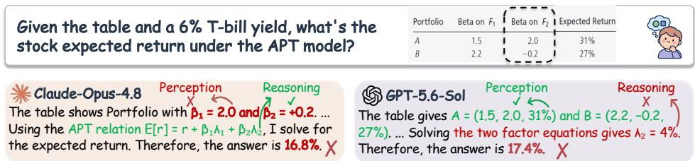  
Figure 1: The same task can expose different failure modes across models. One model may fail to perceive the relevant evidence, while another perceives it correctly but fails to reason from it.

Leveraging PARA, we further reveal a consistent asymmetry in visual RL: gains decrease with perceptual headroom but increase with reasoning-related headroom, suggesting that current RL exploits reasoning more effectively than perception. We show that reward- and token-level perceptual signals affect visual attention only indirectly, whereas direct attention supervision responds more systematically to perceptual headroom. Together, these results identify visual attention as a more direct optimization interface for perception.

Direct attention supervision, however, still requires a reliable target because outcome rewards conflate perception and reasoning. We therefore propose GRAD, Group-Relative Attention Distillation, which uses the best sibling within each on-policy rollout group as a positive visual-attention target for weaker rollouts. Across two model scales and seven benchmarks, GRAD consistently improves performance, strengthens perception, and remains complementary to existing RL methods, without requiring external teachers or additional annotations. Our contributions are threefold:

• Diagnosing model-specific perception and reasoning bottlenecks. We introduce PARA, an intervention-based measure of recoverable perceptual and reasoning headroom. Across four VLMs and 17 benchmarks, PARA reveals substantial model-specific variation that cannot be inferred from benchmark labels alone.

• Explaining perception–reasoning asymmetry of visual RL. We show that RL gains decrease with perceptual headroom but increase with reasoning, and connect this asymmetry to indirect optimization path from reward- or token-level signals to visual attention.

• Tackling perceptual bottlenecks with group-relative attention distillation. We propose GRAD, which distills visual attention from the best on-policy sibling into weaker rollouts. GRAD improves performance across models and benchmarks without external teachers or additional annotations, while remaining complementary to existing RL objectives.

## 2 Related Work

Post-Training Vision-Language Models. Post-training has become central to adapting visionlanguage models for instruction following and complex reasoning. Recent work extends reinforcement learning with verifiable rewards from language models to VLMs, combining GRPO-style optimization with answer- and format-based rewards, task-specific verifiers, multimodal cold starts, or structured visual reasoning traces [Shao et al., 2024, DeepSeek-AI et al., 2025, Yu et al., 2025, Huang et al., 2026b, Shen et al., 2025, Liu et al., 2025, Xia et al., 2025, Yang et al., 2025, Lu et al., 2026, Zeng et al., 2026]. Although these approaches substantially improve downstream performance, their outcome-level feedback does not identify whether a failure originates from perception or reasoning. Recent methods therefore introduce more informative perception supervision, including visual-description rewards, perception checklists, explicit visual–textual grounding signals, and perception-centric process rewards [Xiao et al., 2025, Li et al., 2026e, Ding et al., 2025, Zhang et al., 2026a, Min et al., 2026, Kumar et al., 2026, Li et al., 2026d, Tian et al., 2026b], or perception-first training curricula [Wu et al., 2026a]. Other methods refine the learning signal through visual-dependency-aware trajectory and token weighting [Huang et al., 2026a, Wang et al., 2026b, Li et al., 2026b, Wang et al., 2026a], or regularize output distributions under altered visual evidence [Wang et al., 2026c, Zhang et al., 2026b, Rezaei et al., 2026]. Controlled studies likewise show that post-training improves reasoning more readily than perception, attributing this asymmetry in RL to the weak coupling between rewards and perception [Wu et al., 2026b, Ye et al., 2026, Zhou et al., 2026]. These reward- and token-level objectives act through scalar returns, policy gradients, or output distributions and are complementary to our attention-level objective. Our work measures the perception and reasoning bottlenecks of each model–benchmark pair and uses this diagnosis to directly optimize visual-attention distributions. Complementary work intervenes in vision representations or supervises visual-token attention [Song et al., 2026b, Li et al., 2026c, Song et al., 2026a, Li et al., 2026a, Hu et al., 2026, Berger et al., 2026, Song et al., 2026c]. Unlike formulations that rely on a separate teacher or annotated visual evidence, our attention targets are constructed from the model’s own on-policy rollout groups.

On-Policy Distillation. Conventional knowledge distillation matches a student’s output distributions or sequences to those of a teacher on fixed data [Hinton et al., 2015, Kim and Rush, 2016]. MiniLLM and GKD instead distill teacher logits on student-generated trajectories, reducing the discrepancy between training and inference distributions [Gu et al., 2024, Agarwal et al., 2024]. This logit-level formulation has been extended to VLMs: VOLD transfers reasoning from a textonly teacher [Bousselham et al., 2026]; Vision-OPD uses a crop-conditioned model as a privileged teacher [Yuan et al., 2026]; and VA-OPD and ViCuR focus distillation on visually dependent tokens or recoverable visual cues [Liu et al., 2026, Tian et al., 2026a, Zhang et al., 2026c]. Attention provides a complementary distillation target because it explicitly captures how output tokens attend to visual evidence. OPAD jointly matches a teacher’s output logits and internal attention distributions on student rollouts [Li et al., 2026a], while related attention-supervision methods optimize visual-token routing or align attention with annotated evidence regions [Song et al., 2026a, Hu et al., 2026]. Most prior formulations therefore require either an expert teacher or additional annotated or privileged data, such as reasoning traces, evidence regions, crops, or visual cues. In contrast, our method performs group-relative attention distillation using targets constructed within each rollout group, without a separate teacher or extra region and rationale annotations.

## 3 Diagnosing Perception and Reasoning Bottlenecks in Vision-Language Model RL

Visual task failures can arise from insufficient perception, insufficient reasoning, or both. Importantly, the dominant limitation is not determined by the benchmark alone: the same task may expose different bottlenecks for different models. We therefore introduce PARA, a model–benchmark specific framework for measuring how much of a model’s current error set is recoverable through stronger perception versus stronger reasoning. We first define these two forms of recoverable headroom, then validate the description-based proxy underlying the measurement, and finally use PARA to characterize how perception and reasoning bottlenecks vary across models and benchmarks.

## 3.1 PARA: Perception and Reasoning Attribution

Visual Benchmarks are often characterized by the capabilities they are designed to assess, but such labels do not identify what limits a particular model. For example, one model may fail on a visual reasoning problem because it misperceives a relevant object, whereas another may perceive the same evidence correctly but fail to reason from it. We therefore define PARA at the model–benchmark level and measure two intervention-based quantities: perceptual headroom, corresponding to failures recoverable with stronger visual information while retaining the target model’s own reasoning, and reasoning headroom, corresponding to failures recoverable with stronger reasoning while retaining the target model’s own perceived visual information. Fig. 2(a) illustrates this construction.

Formally, let $F ^ { M , B }$ denote the set of examples in benchmark B that model M answers incorrectly, and let $\dot { n } _ { F } ^ { M , B } = | F ^ { M , B } |$ . We estimate the two forms of headroom by selectively strengthening one capability while preserving the other as much as possible.

Perceptual Intervention. To estimate perceptual headroom, a stronger reference model $M ^ { o , i }$ generates a detailed description of the image without seeing the question. The target model M then answers the original question using this additional visual information. The subset of current failures corrected under this intervention is denoted

$$
P _ { i } ^ { M , B } \subseteq F ^ { M , B } .\tag{1}
$$

To reduce sensitivity to information loss or noise in the description, we evaluate the target model both from the description alone and from the original image augmented with the same description, and count a failure as recovered if either condition succeeds.

Reasoning Intervention. To estimate reasoning headroom, we reverse the intervention. The target model M first generates its own question-blind description of the image, which serves as a proxy for the visual information it has retained. The stronger reference model $\breve { M } ^ { o , i }$ then answers the original question using this description. The corresponding recovered failures form

$$
R _ { i } ^ { M , B } \subseteq F ^ { M , B } .\tag{2}
$$

We include an example in $R _ { i } ^ { M , B }$ only when the reference model can also answer it correctly from the original image. This solvability check prevents failures beyond the reference model’s own capability from being incorrectly attributed to the target model’s reasoning. Using multiple reference models, we aggregate the recovered examples as

$$
P ^ { M , B } = \bigcup _ { i = 1 } ^ { | \mathcal { M } ^ { o } | } P _ { i } ^ { M , B } , \qquad R ^ { M , B } = \bigcup _ { i = 1 } ^ { | \mathcal { M } ^ { o } | } R _ { i } ^ { M , B } .\tag{3}
$$

We use the term reference model operationally: these models provide stronger intervention capabilities but are not assumed to be infallible. In our experiments, we instantiate $\mathcal { M } ^ { o }$ with two frontier APIs, Claude-Opus-4.8

## and GPT-5.6-Luna

The framework naturally extends to additional or stronger reference models. We then define the perceptual and reasoning headroom as

$$
\mathrm { P A R A } _ { \mathrm { P H } } ^ { M , B } = \frac { | P ^ { M , B } | } { n _ { F } ^ { M , B } } , \qquad \mathrm { P A R A } _ { \mathrm { R H } } ^ { M , B } = \frac { | R ^ { M , B } | } { n _ { F } ^ { M , B } } .\tag{4}
$$

Where $\mathrm { P A R A } _ { \mathrm { P H } } ^ { M , B }$ measures the fraction of the target model’s current failures recoverable through stronger perceptual information, and $\mathrm { P A R A } _ { \mathrm { R H } } ^ { M , B }$ measures the fraction recoverable through stronger reasoning given the visual information retained by the target model. These quantities measure recoverable headroom, rather than assigning an intrinsic perception or reasoning label to the benchmark.

## 3.2 Validating Question-Blind Descriptions as a Perception Proxy.

The reasoning intervention relies on the target model’s question-blind description as a proxy for the visual information it has extracted from the image. Because textual descriptions may discard visual information and thereby impair downstream reasoning [Wang et al., 2023], we evaluate how faithfully this representation preserves the target model’s effective perceptual capability. Specifically, for each model and benchmark, we compare two conditions using the same question-answering instruction. In the direct-image condition, the model answers directly from the original image. In the self-description condition, the model first generates a question-blind description and subsequently answers the question from that description alone. If the description preserves most of visual information available to the model, performance in two conditions should closely correlate one another.

As shown in Fig. 3(a), self-description accuracy closely follows direct-image accuracy across models and benchmarks. Pooling the model–benchmark pairs yields a fitted slope above 0.90 with $R ^ { 2 } = 0 . 9 7$ , while the mean accuracy decrease across benchmarks ranges from only 0.1 to 3.4 points across the four models. These results indicate that question-blind descriptions preserve sufficient visual information to serve as an reliabe proxy for the perceptual capability of the evaluated VLMs.

## 3.3 Bottlenecks Are Model–Benchmark Specific

PARA reveals broad benchmark-level trends, but also substantial variation across models on the same benchmark. Fig. 2(b) shows representative results, while complete measurements across all 17 benchmarks and four models are provided in Appx. A.

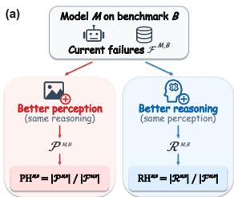

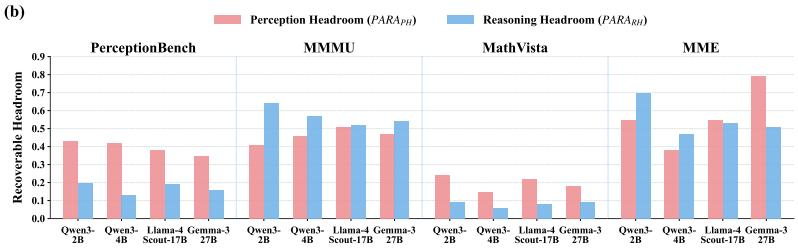  
Figure 2: (a) Illustration of PARA. Starting from a model’s current failures, PARA measures the fractions recoverable by selectively strengthening perception or reasoning. (b) Representative Headroom Measurements. Results exhibit broad benchmark-level trends but substantial modelspecific variation, showing that effective bottlenecks cannot be inferred by benchmark labels alone.

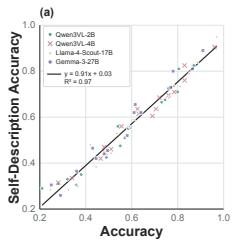

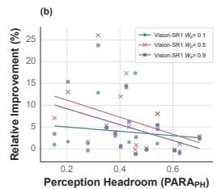

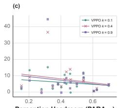

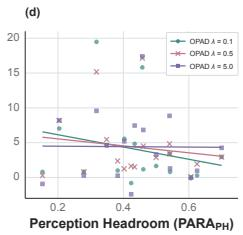  
Figure 3: (a) PARA validation. Self-description accuracy closely tracks direct image accuracy. (b)(c)(d) Perceptual supervision comparison. Only direct attention supervision exhibits a coefficient-dependent response to perceptual headroom PARA .

At a coarse level, the measured headroom is consistent with the intended characteristics of several benchmarks. For example, PerceptionBench exhibits greater perceptual than reasoning headroom, whereas MMMU generally exhibits greater reasoning headroom as expected. However, benchmark characteristics do not determine the model-specific bottleneck. On MME, reasoning headroom is larger for both Qwen models, perceptual and reasoning headroom are comparable for Llama-4- Scout-17B, and perceptual headroom is substantially larger for Gemma-3-27B. Thus, even on the same benchmark, different models can leave qualitatively different opportunities for improvement.

The mismatch can be even more pronounced for benchmarks conventionally viewed as reasoningoriented. On MathVista, perceptual headroom exceeds reasoning headroom for all four evaluated models despite the benchmark’s emphasis on multimodal reasoning. This implies that a model’s failures on a reasoning benchmark might not primarily reflect its insufficient reasoning capabilities.

Together, these results indicate that perception and reasoning headroom depend jointly on the model and benchmark, and bottlenecks should instead be diagnosed at the model–benchmark level.

## 4 Understanding the Perception–Reasoning Asymmetry in Visual RL

Having established that perception and reasoning headroom vary substantially across model– benchmark pairs, we next ask whether these diagnosed bottlenecks help explain why reinforcement learning produces uneven gains across visual tasks.

## 4.1 RL Exploits Reasoning Headroom More Than Perceptual Headroom

Reinforcement learning has produced substantial gains in language-model reasoning [Shao et al., 2024, Yu et al., 2025], yet improvements in visual perception remain more limited and inconsistent [Xiao et al., 2025, Li et al., 2026c, Wu et al., 2026b]. Prior work has observed that post-training improves reasoning more readily than perception, but has primarily characterized this asymmetry through manual error analysis or controlled interventions. With PARA, we can instead relate RL gains to model–benchmark-specific perception and reasoning headroom under a common measurement framework. To characterize the relative contribution of reasoning among recoverable failures, we define the directional reasoning bottleneck index

$$
\operatorname { P A R A } _ { \mathrm { B I } _ { R } } ^ { M , B } = { \frac { | R ^ { M , B } | } { | P ^ { M , B } \cup R ^ { M , B } | } } .\tag{5}
$$

This quantity measures how broadly the reasoning intervention covers the union of failures recoverable through either intervention. Because $P ^ { M , \breve { B } }$ and $R ^ { M , B }$ may overlap, $\mathrm { P A R A } _ { \mathrm { B I } _ { R } }$ should be interpreted as a directional coverage measure rather than as a decomposition of the error set.

We compare the relative improvement of model after RL over its corresponding base model with two quantities measured on base model: perceptual headroom PARA and reasoning bottleneck index $\mathrm { P A R A } _ { \mathrm { B I } _ { R } } .$ . As in Fig. 4, the same directional trends hold across both RL algorithms and model scales. RL gains decrease as $\mathrm { P A R A _ { P H } }$ increases, but increase with $\mathrm { P A R A } _ { \mathrm { B I } _ { R } }$ . In other words, RL tends to yield smaller improvements when a larger fraction of the base model’s failures is recoverable through stronger perception, while yielding larger improvements when reasoning intervention covers more of the recoverable failure set.

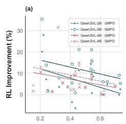

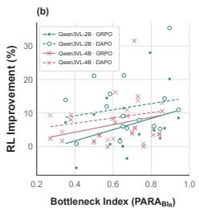  
Figure 4: Asymmetric RL gains. Across models and algorithms , RL gains (a) decrease with perceptual headroom $\mathrm { P A R A _ { P H } }$ and (b) increase with the reasoning bottleneck index $\mathrm { P A R A } _ { \mathrm { B I } _ { R } }$

We interpret these relationships as cross-

benchmark directional trends rather than predictions for individual tasks. Nevertheless, their consistency across algorithms and models reveals a clear asymmetry: current RL objectives appear to exploit reasoning headroom more effectively than perceptual.

## 4.2 Existing RL Objectives Indirectly Optimize Visual Attention

Existing methods that target visual perception during RL primarily modify either the reward assigned to a rollout or the allocation of policy updates across output tokens [Li et al., 2026e, Huang et al., 2026a]. Although these approaches differ operationally, both ultimately modify the effective advantage used by the policy-gradient objective. We therefore examine how such advantage-level signals propagate to the model’s visual-attention pathway.

Given a rollout $\tau$ and output token $t ,$ let $\rho _ { t } ( \theta )$ denote the importance ratio and $ { \widetilde { A } } _ { t } ( \tau )$ the effective advantage. For simplicity, we write the GRPO objective as

$$
\mathcal { L } ( \theta ) = \mathbb { E } _ { \tau , t } \left[ \ell \Big ( \rho _ { t } ( \theta ) , \widetilde { A } _ { t } ( \tau ) \Big ) \right] .\tag{6}
$$

Reward-level methods modify the value of $\widetilde { A } _ { t }$ , while token-level methods redistribute it across output tokens. In either case, $\widetilde { A } _ { t }$ is treated as fixed during a policy update.

Within a VLM attention block, let visual contribution to the representation of generated token t be

$$
h _ { t } ^ { \mathrm { v i s } } = \sum _ { j \in \mathcal { V } } a _ { t , j } v _ { j } ,\tag{7}
$$

where $v _ { j }$ denotes the value representation of visual token $j$ and $a _ { t , j }$ the attention from output token t to visual token $j .$ . Collecting the visual representations and attention weights as $h ^ { \mathrm { v i s } }$ and $^ { a , }$ respectively, the loss along this pathway has the composition $\mathcal { L } ( z ( h ^ { \mathrm { v i s } } ( a ) ) ; \widetilde { A } )$ . By the chain rule,

$$
\nabla _ { a } \mathscr { L } = \left( \frac { \partial h ^ { \mathrm { v i s } } } { \partial a } \right) ^ { \top } \left( \frac { \partial z } { \partial h ^ { \mathrm { v i s } } } \right) ^ { \top } \nabla _ { z } \mathscr { L } .\tag{8}
$$

Eq. 8 makes the optimization path to visual attention explicit. The term $\nabla _ { z } \mathcal { L }$ determines the update to the output logits, $\partial z / \partial h ^ { \mathrm { v i s } }$ propagates this signal to the visual contribution, and $\partial h ^ { \mathrm { v i s } } / \partial a$ further propagates it to the attention allocation. Thus, reward- and token-level perceptual signals can influence visual attention, but only through their downstream effect on the output logits. The objective contains no separate term that directly evaluates or supervises the visual-attention distribution itself.

We examine this distinction empirically using Vision-SR1 [Li et al., 2026e] and VPPO [Huang et al., 2026a] as representative reward-level and token-level methods, respectively. Vision-SR1 rescales the rollout advantage using a perceptual reward weight $W _ { p } ,$ , whereas VPPO redistributes token-level advantages through a trajectory weight $\alpha ( \tau )$ and a visual mask $m _ { t } ( k )$ . Both therefore alter the strength or allocation of $\ddot { A } _ { t }$ without directly supervising visual attention.

As shown in Fig. 3(b) and 3(c), strengthening these perceptual modifications, either by increasing $W _ { p }$ for Vision-SR1 or decreasing the mask-token ratio k for VPPO, does not systematically produce larger gains on benchmarks with greater perceptual headroom $\mathrm { P A R A _ { P H } }$ . Meanwile, increasing the strength of either intervention does not consistently rotate the fitted relationship toward a more positive slope. These results do not imply that advantage-level methods fail to improve overall performance; rather, they suggest that increasing their perceptual signal does not systematically translate into greater benefit on tasks with more available perceptual headroom.

## 4.3 Visual Attention Provides a Direct Optimization Interface

The preceding analysis suggests that directly supervising visual attention provides a more immediate optimization path to the model’s visual pathway. Suppose we augment the RL objective with an auxiliary regularizer ${ \mathcal { R } } ( a )$ on the attention distribution, weighted by λ. The resulting gradient with respect to attention becomes

$$
\nabla _ { a } \mathscr { L } ^ { a } = \left( \frac { \partial h ^ { \mathrm { v i s } } } { \partial a } \right) ^ { \top } \left( \frac { \partial z } { \partial h ^ { \mathrm { v i s } } } \right) ^ { \top } \nabla _ { z } \mathscr { L } + \lambda \nabla _ { a } \mathscr { R } ( a ) .\tag{9}
$$

Unlike advantage-level supervision, the additional term $\lambda \nabla _ { a } \mathcal { R } ( a )$ acts directly on the attention distribution rather than reaching it only through the output logits.

We examine this direct pathway using On-Policy Attention Distillation (OPAD) from RAL [Li et al., 2026a]. Let $p _ { t } ^ { \theta }$ denote the current visual-attention distribution for token t, and let $p _ { t } ^ { \mathrm { o l d } }$ denote the corresponding distribution recorded during rollout generation. OPAD uses the regularizer

$$
\mathcal { R } ( a ) = \mathbb { E } _ { \tau , t } [ \widetilde { A } _ { t } ( \tau ) D _ { \mathrm { J S } } ( p _ { t } ^ { \theta }  p _ { t } ^ { \mathrm { o l d } } ) ] ,\tag{10}
$$

where $D _ { \mathrm { J S } }$ denotes the Jensen–Shannon divergence. Positive advantages encourage preservation of attention patterns associated with successful rollouts, whereas negative advantages push the current policy away from attention patterns associated with unsuccessful rollouts.

As shown in Fig. 3(d), increasing the coefficient λ systematically changes the relationship between performance gain and perceptual headroom: the fitted slope moves from negative toward approximately flat, reducing the performance disadvantage associated with larger $\mathrm { P \bar { A } R A _ { \mathrm { P H } } }$ . Together, the theoretical and empirical results suggest that visual attention provides a more direct interface for addressing the perceptual headroom identified by PARA.

## 5 GRAD: Group-Relative Attention Distillation for Perception

Sec. 4.3 identifies visual attention as a direct optimization interface for addressing perceptual bottlenecks. However, direct attention supervision alone does not guarantee a reliable update direction. Existing attention-level objectives remain coupled to rollout outcomes: they preserve the old-policy attention of successful rollouts while pushing unsuccessful rollouts away from their previous attention patterns. This coupling is ambiguous because an outcome reward jointly reflects perception and reasoning. A rollout may fail because of incorrect reasoning despite attending to the relevant visual evidence, in which case pushing away from its attention pattern could penalize valid perception.

Consistent with this limitation, while OPAD changes the perception-dependent trend in Fig. 3(d), it still yields only moderate overall gains relative to other methods in Fig. 3(b)(c). These observations suggest that attention provides the appropriate optimization interface, but effective perceptual supervision requires a more careful objective design.

We therefore propose GRAD, Group-Relative Attention Distillation. Rather than using each rollout’s own old-policy attention as its reference, GRAD constructs a positive attention target from the best sibling within the same on-policy rollout group. For a rollout group g generated from the

same image and prompt, we select

$$
b ( g ) = \arg \operatorname* { m a x } _ { j \in g _ { \mathrm { v } } } r _ { j } ,\tag{11}
$$

where $r _ { j }$ is the reward of rollout $j$ and $g _ { \mathrm { v } }$ denotes the subset of rollouts with valid attention distributions. When multiple siblings attain the same maximal reward, we select the rollout with the shortest trajectory. We then treat negative-advantage rollouts as students and distill the best sibling’s visual-attention pattern into them. For rollout i, we define the adaptive supervision weight

$$
w _ { i } = \operatorname* { m a x } ( - A _ { i } , 0 ) ,\tag{12}
$$

such that supervision is activated only when $A _ { i } ~ < ~ 0$ and becomes stronger as the advantage decreases. Groups with identical rewards are therefore naturally excluded because they contain no negative-advantage students. Importantly, $w _ { i }$ is always nonnegative, so minimizing the distillation objective consistently pulls a student’s attention toward the best sibling rather than pushing it away from its own previous attention. This converts outcome feedback into a positive attention target without requiring an external teacher or additional annotation.

To focus the auxiliary objective specifically on perception, we perform alignment only over visual tokens. For rollout i, let $\overline { { p } } _ { i } ^ { \theta }$ denote its visual-attention distribution, obtained by renormalizing attention over visual tokens and pooling across response tokens and attention heads. Because sibling rollouts share the same visual input, their resulting visual-attention distributions are directly comparable even when their generated responses have different lengths. Let $\widehat { p } _ { g }$ denote the corresponding visual-attention distribution of the best sibling $b ( g )$ . The GRAD objective is

$$
\mathcal { L } _ { \mathrm { G R A D } } = \frac { 1 } { | \mathcal { T } | } \sum _ { ( g , i ) \in \mathcal { T } } w _ { i } D _ { \mathrm { J S } } ( \boldsymbol { \bar { p } } _ { i } ^ { \theta }  \boldsymbol { \widehat { p } } _ { g } ) ,\tag{13}
$$

where I denotes the set of valid negative-advantage students.

The complete training objective combines standard GRPO objective with outcome reward and group-relative attention distillation tailored for mitigating perception bottleneck:

$$
\begin{array} { r } { \mathcal { L } _ { \mathrm { t o t a l } } = \mathcal { L } _ { \mathrm { G R P O } } + \lambda \mathcal { L } _ { \mathrm { G R A D } } , } \end{array}\tag{14}
$$

where λ controls the strength of attention supervision. By constructing perceptual supervision directly from on-policy sibling rollouts, GRAD requires no external teacher, additional annotations, extra rollouts, or inference-time modifications.

## 6 Experiments

## 6.1 Experimental Setup

Dataset and Benchmarks. Following VisionSR1 [Li et al., 2026e], we use Vision-SR1-47K as the training dataset for RL. We evaluate on 7 visual benchmarks, including MME [Fu et al., 2023], MMMU [Yue et al., 2024], MMMU-Pro [Yue et al., 2025], MATH-Vision [Wang et al., 2024], PerceptionBench [Lin et al., 2026], ScienceQA [Lu et al., 2022], and VisNumBench [Weng et al., 2025]. We report MME on its original scale and normalize it to a 100-point scale only when computing the average score. We follow the official evaluation protocol and metric for each benchmark.

Baselines. Beyond GRPO [Shao et al., 2024], we compare against baselines spanning diverse visual supervision. VisionSR1 [Li et al., 2026e] introduces a perception reward, VPPO [Huang et al., 2026a] reallocates policy updates across response tokens, and OPAD [Li et al., 2026a] directly regularizes visual attention with old policy. We additionally use DAPO [Yu et al., 2025] to test whether our method complements other RL algorithms.

Implementation Details. We use Qwen3-VL-2B-Instruct and Qwen3-VL-4B-Instruct [Bai et al., 2025] and perform full fine-tuning on four NVIDIA H200 GPUs with random seed 2026. We use a global batch size of 128 and sample eight rollouts per prompt. Details are provided in Appx. B.

Table 1: Results across seven visual benchmarks. MME is reported on its native scale, while Avg. rescales it with 1/28. The best and second-best results are shown in bold and underline, respectively.
<table><tr><td></td><td>Method</td><td>MME</td><td>MMMU</td><td>MMMU-Pro</td><td>MathVis</td><td>PercepBench</td><td>ScienceQA</td><td>VisNum.</td><td>Avg.</td></tr><tr><td rowspan="5">w--2B</td><td>Base</td><td>2044.0</td><td>46.6</td><td>30.8</td><td>13.5</td><td>22.7</td><td>86.1</td><td>35.1</td><td>44.0</td></tr><tr><td>GRPO</td><td>2217.6</td><td>49.1</td><td>34.3</td><td>18.1</td><td>21.3</td><td>88.2</td><td>35.3</td><td>46.5</td></tr><tr><td>Vision-SR1</td><td>2223.2</td><td>48.3</td><td>34.8</td><td>20.7</td><td>23.7</td><td>87.5</td><td>41.1</td><td>47.9</td></tr><tr><td>VPPO</td><td>2212.0</td><td>50.8</td><td>33.8</td><td>19.1</td><td>22.8</td><td>88.2</td><td>37.6</td><td>47.3</td></tr><tr><td>OPAD</td><td>2256.8</td><td>49.6</td><td>32.9</td><td>16.1</td><td>20.3</td><td>87.1</td><td>36.3</td><td>46.1</td></tr><tr><td></td><td>Ours</td><td>2290.4</td><td>52.1</td><td>35.1</td><td>21.1</td><td>24.4</td><td>90.3</td><td>40.8</td><td>49.4</td></tr><tr><td rowspan="6">---4B</td><td>Base</td><td>2248.4</td><td>60.1</td><td>45.6</td><td>30.3</td><td>24.8</td><td>91.7</td><td>49.7</td><td>54.6</td></tr><tr><td>GRPO</td><td>2240.0</td><td>62.1</td><td>48.4</td><td>37.1</td><td>25.7</td><td>93.9</td><td>52.1</td><td>57.0</td></tr><tr><td>Vision-SR1</td><td>2332.4</td><td>60.6</td><td>47.9</td><td>38.2</td><td>29.1</td><td>94.3</td><td>53.7</td><td>58.2</td></tr><tr><td>VPPO</td><td>2315.6</td><td>62.9</td><td>48.6</td><td>35.5</td><td>25.9</td><td>94.3</td><td>52.9</td><td>57.5</td></tr><tr><td>OPAD</td><td>2279.2</td><td>63.1</td><td>48.0</td><td>37.8</td><td>25.1</td><td>94.4</td><td>51.4</td><td>57.3</td></tr><tr><td>Ours</td><td>2349.2</td><td>64.3</td><td>49.8</td><td>40.5</td><td>27.9</td><td>95.0</td><td>55.0</td><td>59.5</td></tr></table>

Table 2: Complementarity with existing methods. Each entry reports the performance integrating GRAD to corresponding baseline on Qwen3-VL-2B. The largest gain at each benchmark is bolded.
<table><tr><td>Method</td><td>MME</td><td>MMMU</td><td>MMMU-Pro</td><td>MathVis</td><td>PercepBench</td><td>ScienceQA</td><td>VisNum.</td><td>Avg.</td></tr><tr><td>Vision-SR1 w/ Ours</td><td>+44.8</td><td>+2.8</td><td>+0.2</td><td>+4.3</td><td>+0.8</td><td>+2.4</td><td>+2.6</td><td>+2.1</td></tr><tr><td>VPPO w/ Ours</td><td>+19.6</td><td>+0.5</td><td>+0.5</td><td>+1.3</td><td>-0.9</td><td>+1.6</td><td>+1.3</td><td>+0.7</td></tr><tr><td>DAPO w/ Ours</td><td>+123.2</td><td>-0.2</td><td>+0.6</td><td>+2.3</td><td>+1.7</td><td>+2.3</td><td>+1.8</td><td>+1.9</td></tr></table>

## 6.2 Experimental Results

Main Results. In Tab. 1, we compare GRAD with baselines across seven visual benchmarks. GRAD achieves the highest average performance for both models, outperforming GRPO by 2.9 and 2.5 points, respectively. On MME, GRAD improves over GRPO by 72.8 and 109.2 points, respectively. OPAD performs comparably to GRPO overall, whereas GRAD improves upon OPAD by 3.3 and 2.2 points, highlighting the benefit of our group-relative design. Moreover, although VPPO and Vision-SR1 improve through objectives orthogonal to ours, GRAD exceeds both by at least 1.5 points at 2B and 1.3 points at 4B on average, demonstrating our overall effectiveness.

Analysis of Perceptual Improvement. In Fig. 5(b), we further visualize inference attention in representative cases from PerceptionBench and VisNumBench. In the upper case, GRAD shifts attention from the fish’s eye to its tail, and in the lower case, it focuses on Object A rather than the irrelevant Object D, enabling the correct volume comparison. These cases provide qualitative evidence that GRAD improves perception by direct visual attention supervision.

Given GRAD aiming to improve perception, we further investigate how it changes the residual headroom. As shown in Fig. 5(a), GRAD reduces PARA on five benchmarks, while GRPO reduces only two. On MMMU-Pro, PerceptionBench, and ScienceQA, GRAD reverses the increase into a reduction. Across the remaining four benchmarks, GRAD further increases PARARH by a substantially larger margin, indicating that stronger perception preserves more usable visual evidence and allows the same reasoning intervention to recover a larger fraction of failures. Together, the reduction in perceptual headroom and increase in reasoning headroom provide complementary evidence that GRAD directly strengthens perception during RL.

Complementarity with Existing Methods. Furthermore, we evaluate whether GRAD can be combined with existing methods. As shown in Tab. 2, integrating our objective improves the average scores of Vision-SR1, VPPO, and DAPO by 2.1, 0.7, and 1.9 points, respectively. The combinations improve all seven benchmarks for Vision-SR1 and six of seven for both VPPO and DAPO. These gains demonstrate that our attention-level objective complements methods at the reward, token, and policy levels, and can be readily integrated with existing methods.

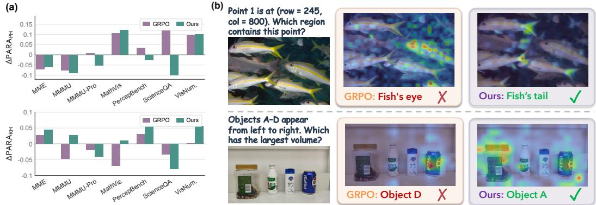  
Figure 5: (a) Changes in perception and reasoning headroom relative to Qwen3-VL-4B. GRAD reduces perceptual headroom consistently over GRPO while making more residual errors recoverable through reasoning intervention. (b) Visualization of visual attention map. GRAD focuses on the correct visual evidence while GRPO fails.

Table 3: Ablation study results. Both components work jointly to achieve better performance.
<table><tr><td>Method</td><td>MME</td><td>MMMU</td><td>MMMU-Pro</td><td>MathVis</td><td>PercepBench</td><td>ScienceQA</td><td>VisNum.</td><td>Avg.</td></tr><tr><td>Ours</td><td>2290.4</td><td>52.1</td><td>35.1</td><td>21.1</td><td>24.4</td><td>90.3</td><td>40.8</td><td>49.4</td></tr><tr><td>- w/ Attention Mass.</td><td>2265.2</td><td>50.7</td><td>34.6</td><td>21.2</td><td>21.7</td><td>88.8</td><td>40.2</td><td>48.3</td></tr><tr><td>- w/o Percep. Only</td><td>2228.8</td><td>52.7</td><td>34.2</td><td>19.1</td><td>21.2</td><td>90.1</td><td>38.2</td><td>47.9</td></tr><tr><td>- w/o Best Šibling</td><td>2284.8</td><td>50.7</td><td>32.4</td><td>13.5</td><td>19.1</td><td>87.3</td><td>33.6</td><td>45.5</td></tr></table>

## 6.3 Ablation Studies

Method Components. Tab. 3 examines each component of GRAD. On Qwen3-VL-2B, removing the perception-only restriction lowers the average score by 1.5 points, yet the resulting variant remains above GRPO, indicating that our objective supplies the perceptual signal missing from plain RL. Further removing best sibling supervision, randomly choosing a target sibling instead, reduces the score to 45.5, confirming the importance of a reliable group-relative target. In addition, we evaluate the performance of keeping only the tokens attribute to top 50% attention in the best sibling. Adding this constraints has only modest effects on most benchmarks and lowers the average by 1.1 points. Together, these results support our perceptual and group-relative attention design.

Hyper-parameters. Following Li et al. [2026a], we set λ = 1.0 and supervise only the last decoder layer throughout our experiments. Setting λ = 0.2 or λ = 5.0 lowers the average score by about 2 points, although both configurations remain better than GRPO. Extending supervision to the top 4 or 8 layers also underperforms the last layer setting, while applying it to the top 16 or all layers leads to substantially larger performance drops. These denser targets appear more difficult to optimize, suggesting that effective multi-layer supervision requires a dedicated design. Detailed results of ablation study are provided in Appx. B.2.

## 7 Conclusion

In this work, we examine how much perceptual and reasoning headroom remains for VLMs across visual benchmarks, and how these two forms of headroom relate to the gains from RL post-training. We introduce PARA, a quantitative measure that estimates, for each model–benchmark pair, how many current errors can be recovered with better visual information versus better reasoning. Across diverse models and benchmarks, PARA reveals substantial model-specific variation and a consistent asymmetry in RL: gains decrease with greater perceptual headroom but increase as reasoning accounts for more recoverable errors. We further show that reward- and token-level objectives affect visual attention only indirectly, motivating more direct attention-level supervision. Accordingly, we propose GRAD, a group-relative attention distillation objective that consistently improves performance and remains complementary to existing RL methods. Together, our results connect modelspecific bottleneck measurement with targeted optimization for improving visual RL.

## References

Rishabh Agarwal, Nino Vieillard, Yongchao Zhou, Piotr Stanczyk, Sabela Ramos, Matthieu Geist, and Olivier Bachem. On-policy distillation of language models: Learning from self-generated mistakes. In International Conference on Learning Representations, 2024.

Shuai Bai, Yuxuan Cai, Ruizhe Chen, Keqin Chen, Xionghui Chen, Zesen Cheng, Lianghao Deng, Wei Ding, Chang Gao, et al. Qwen3-VL technical report. arXiv preprint arXiv:2511.21631, 2025.

Uri Berger, Gal Chechik, and Gal Dalal. Look where you say you’re looking: Self-grounded attention for visual reasoning. arXiv preprint arXiv:2610.05023, 2026.

Walid Bousselham, Hilde Kuehne, and Cordelia Schmid. VOLD: Reasoning transfer from LLMs to vision-language models via on-policy distillation. In Proceedings of the IEEE/CVF Conference on Computer Vision and Pattern Recognition, 2026.

Lin Chen, Jinsong Li, Xiaoyi Dong, Pan Zhang, Yuhang Zang, Zehui Chen, Haodong Duan, Jiaqi Wang, Yu Qiao, Dahua Lin, and Feng Zhao. Are we on the right way for evaluating large visionlanguage models? In Advances in Neural Information Processing Systems, 2024.

Zhuohao Chen, Zeng Li, Yifei Zhang, Chang Liu, and Yu Zhou. Masked next-scale prediction for self-supervised scene text recognition. In Proceedings of the IEEE/CVF Conference on Computer Vision and Pattern Recognition, 2026.

DeepSeek-AI, Daya Guo, Dejian Yang, et al. DeepSeek-R1: Incentivizing reasoning capability in LLMs via reinforcement learning. arXiv preprint arXiv:2501.12948, 2025.

Yizhuo Ding, Mingkang Chen, Zhibang Feng, Tong Xiao, Wanying Qu, Wenqi Shao, and Yanwei Fu. VTPerception-R1: Enhancing multimodal reasoning via explicit visual and textual perceptual grounding. arXiv preprint arXiv:2509.24776, 2025.

Chaoyou Fu, Peixian Chen, Yunhang Shen, Yulei Qin, Mengdan Zhang, Xu Lin, Jinrui Yang, Xiawu Zheng, Ke Li, Xing Sun, Yunsheng Wu, Rongrong Ji, Caifeng Shan, and Ran He. MME: A comprehensive evaluation benchmark for multimodal large language models. arXiv preprint arXiv:2306.13394, 2023.

Xingyu Fu, Yushi Hu, Bangzheng Li, Yu Feng, Haoyu Wang, Xudong Lin, Dan Roth, Noah A. Smith, Wei-Chiu Ma, and Ranjay Krishna. BLINK: Multimodal large language models can see but not perceive. In Proceedings of the European Conference on Computer Vision, 2024.

Gemma Team, Aishwarya Kamath, Johan Ferret, Shreya Pathak, Nino Vieillard, Ramona Merhej, Sarah Perrin, Tatiana Matejovicova, Alexandre Rame, Morgane Rivi´ ere, et al. Gemma 3 Technical\` Report. arXiv preprint arXiv:2503.19786, 2025.

Yuxian Gu, Li Dong, Furu Wei, and Minlie Huang. MiniLLM: On-policy distillation of large language models. In International Conference on Learning Representations, 2024.

Tianrui Guan, Fuxiao Liu, Xiyang Wu, Ruiqi Xian, Zongxia Li, Xiaoyu Liu, Xijun Wang, Lichang Chen, Furong Huang, Yaser Yacoob, Dinesh Manocha, and Tianyi Zhou. HallusionBench: An advanced diagnostic suite for entangled language hallucination and visual illusion in large visionlanguage models. In Proceedings of the IEEE/CVF Conference on Computer Vision and Pattern Recognition, pages 14375–14385, 2024.

Geoffrey Hinton, Oriol Vinyals, and Jeff Dean. Distilling the knowledge in a neural network. arXiv preprint arXiv:1503.02531, 2015.

Ruina Hu, Chen Wang, Lai Wei, Jionghao Bai, Bin Yu, Weiran Huang, Kai Wang, and Yue Wang. Attend to evidence: Evidence-anchored spatial attention supervision for multimodal RLVR. In Proceedings of the 2026 Conference on Empirical Methods in Natural Language Processing, 2026.

Siyuan Huang, Xiaoye Qu, Yafu Li, Yun Luo, Zefeng He, Daizong Liu, and Yu Cheng. Spotlight on token perception for multimodal reinforcement learning. In International Conference on Learning Representations, 2026a.

Wenxuan Huang, Bohan Jia, Zijie Zhai, Shaosheng Cao, Zheyu Ye, Fei Zhao, Zhe Xu, Xu Tang, Yao Hu, and Shaohui Lin. Vision-R1: Incentivizing reasoning capability in multimodal large language models. In International Conference on Learning Representations, 2026b.

Yoon Kim and Alexander M. Rush. Sequence-level knowledge distillation. In Proceedings of the 2016 Conference on Empirical Methods in Natural Language Processing, pages 1317–1327, 2016.

Raja Kumar, Rajat Koner, Ritwick Chaudhry, Zhuowei Li, Nishant Sankaran, and Yifan Xing. SPLIT-RL: Staged perception-language reasoning training with claim-level advantages. arXiv preprint arXiv:2610.10889, 2026.

Bangzheng Li, Jianmo Ni, Chen Qu, Ian Miao, Liu Yang, Xingyu Fu, Muhao Chen, and Derek Zhiyuan Cheng. Reinforced attention learning. arXiv preprint arXiv:2602.04884, 2026a.

Qiming Li, Tianlun Li, Xiaolong Cheng, Hangyu Li, Ruiyan Gong, Kangning Niu, Kaitao Jiang, and Mu Xu. PRPO: Perception-reinforced policy optimization via token-level dynamic advantage reshaping. arXiv preprint arXiv:2606.08708, 2026b.

Xirui Li, Ming Li, and Tianyi Zhou. What does RL improve for visual reasoning? a frankensteinstyle analysis. arXiv preprint arXiv:2602.12395, 2026c.

Yueying Li, Jingxuan Fan, Kiante Brantley, Sham M. Kakade, and Hanlin Zhang. Unsupervised´ multimodal reward modeling. arXiv preprint arXiv:2610.12707, 2026d.

Zongxia Li, Wenhao Yu, Chengsong Huang, Zhenwen Liang, Rui Liu, Fuxiao Liu, Jingxi Che, Dian Yu, Jordan Boyd-Graber, Haitao Mi, and Dong Yu. Self-rewarding vision-language model via reasoning decomposition. In International Conference on Learning Representations, 2026e.

Zichao Lin, Yifeng Xie, Bowen Qu, Haiming Wang, Jia Li, Haoning Wu, Yuhao Dong, Zuhao Yang, Jinguo Zhu, Haoyu Lu, et al. PerceptionBench: Evaluating atomic visual perception in multimodal large language models. arXiv preprint arXiv:2607.24957, 2026.

Ruiqi Liu, Xiaolei Lv, Gengsheng Li, Ximo Zhu, Zhiheng Wang, Zhengbo Zhang, Junkai Chen, Zhiheng Li, Bo Li, Jun Gao, and Shu Wu. Visual-advantage on-policy distillation for visionlanguage models. arXiv preprint arXiv:2605.21924, 2026.

Yuan Liu, Haodong Duan, Yuanhan Zhang, Bo Li, Songyang Zhang, Wangbo Zhao, Yike Yuan, Jiaqi Wang, Conghui He, Ziwei Liu, Kai Chen, and Dahua Lin. MMBench: Is your multi-modal model an all-around player? In Proceedings of the European Conference on Computer Vision, 2024.

Ziyu Liu, Zeyi Sun, Yuhang Zang, Xiaoyi Dong, Yuhang Cao, Haodong Duan, Dahua Lin, and Jiaqi Wang. Visual-rft: Visual reinforcement fine-tuning. In Proceedings of the IEEE/CVF International Conference on Computer Vision, pages 2034–2044, 2025.

Meng Lu, Ligeng Zhu, Olivia Xiao, Yuchen Zhuang, Zihan Wang, Kuncheng Wu, Bangya Liu, Yu Wang, Charles Fleming, Wenqi Shi, and Xuan Wang. VICO: Visual environments co-evolving for vision-language model reasoning. arXiv preprint arXiv:2610.10782, 2026.

Pan Lu, Swaroop Mishra, Tony Xia, Liang Qiu, Kai-Wei Chang, Song-Chun Zhu, Oyvind Tafjord, Peter Clark, and Ashwin Kalyan. Learn to explain: Multimodal reasoning via thought chains for science question answering. In Advances in Neural Information Processing Systems, 2022.

Pan Lu, Hritik Bansal, Tony Xia, Jiacheng Liu, Chunyuan Li, Hannaneh Hajishirzi, Hao Cheng, Kai-Wei Chang, Michel Galley, and Jianfeng Gao. MathVista: Evaluating mathematical reasoning of foundation models in visual contexts. In International Conference on Learning Representations, 2024.

Ahmed Masry, Do Xuan Long, Jia Qing Tan, Shafiq Joty, and Enamul Hoque. ChartQA: A benchmark for question answering about charts with visual and logical reasoning. In Findings of the Association for Computational Linguistics: ACL 2022, pages 2263–2279, 2022.

Meta AI. The Llama 4 herd: The beginning of a new era of natively multimodal AI innovation. Meta AI Blog, 2025. URL https://ai.meta.com/blog/llama-4-multimodal-intelligence/.

Yingqian Min, Kun Zhou, Yifan Li, Yuhuan Wu, Han Peng, Yifan Du, Wayne Xin Zhao, Min Yang, and Ji-Rong Wen. Improving vision-language models with perception-centric process reward models. In Proceedings of the IEEE/CVF Conference on Computer Vision and Pattern Recognition, 2026.

Ahmad Rezaei, Mohsen Gholami, Saeed Ranjbar Alvar, Kevin Cannons, Mohammad Asiful Hossain, Weimin Zhou, Shunbo Zhou, Yong Zhang, and Mohammad Akbari. CPPO: Contrastive perception for vision language policy optimization. arXiv preprint arXiv:2601.00501, 2026.

Zhihong Shao, Peiyi Wang, Qihao Zhu, Runxin Xu, Junxiao Song, Xiao Bi, Haowei Zhang, Mingchuan Zhang, Y. K. Li, Y. Wu, and Daya Guo. DeepSeekMath: Pushing the limits of mathematical reasoning in open language models. arXiv preprint arXiv:2402.03300, 2024.

Haozhan Shen, Peng Liu, Jingcheng Li, Chunxin Fang, Yibo Ma, Jiajia Liao, Qiaoli Shen, Zilun Zhang, Kangjia Zhao, Qianqian Zhang, Ruochen Xu, and Tiancheng Zhao. VLM-R1: A stable and generalizable R1-style large vision-language model. arXiv preprint arXiv:2504.07615, 2025.

Junha Song, Byeongho Heo, Geonmo Gu, Jaegul Choo, Dongyoon Han, and Sangdoo Yun. Learning to see what you need: Gaze attention for multimodal large language models. arXiv preprint arXiv:2605.13080, 2026a.

Junha Song, Sangdoo Yun, Dongyoon Han, Jaegul Choo, and Byeongho Heo. RL makes MLLMs see better than SFT. In International Conference on Learning Representations, 2026b.

Xinxin Song, Siyuan Li, Tingxiong Xiao, and Jinli Suo. Anchoring what matters: A dual-level learning framework for visually-grounded multimodal reasoning. arXiv preprint arXiv:2609.18057, 2026c.

Kanghui Tian, Siyuan Liu, Ziang Yan, Sheng Xia, Shuai Dong, and Yi Wang. ViCuR: Visual cues as recoverable privilege for multimodal on-policy distillation. arXiv preprint arXiv:2606.05718, 2026a.

Shulin Tian, Minglun Li, Yuhao Dong, Hao Ding, Jiarui Yao, Haiwen Diao, Jingkang Yang, Hongyuan Zhu, and Ziwei Liu. V-Rubrics: Visual faithfulness via rubric-based reinforcement learning. arXiv preprint arXiv:2608.25580, 2026b.

Ke Wang, Junting Pan, Weikang Shi, Zimu Lu, Mingjie Zhan, and Hongsheng Li. Measuring multimodal mathematical reasoning with the MATH-Vision dataset. In Advances in Neural Information Processing Systems Datasets and Benchmarks Track, 2024.

Shuning Wang, Zhiheng Wu, Xun Zhou, Chongyang Cui, Chen Jia, Bowen Liu, Chuanjie Li, Xiang Chen, Yi Yang, Yumeng Zhang, and Wenjie Huang. TTRSD: Test-time reinforcement learning with self-distillation for vision-language models. arXiv preprint arXiv:2609.33414, 2026a.

Xinhe Wang, Jin Huang, Xingjian Zhang, Tianhao Wang, and Jiaqi W. Ma. Your reasoning benchmark may not test reasoning: Revealing perception bottleneck in abstract reasoning benchmarks. arXiv preprint arXiv:2512.21329, 2025.

Zengbin Wang, Feng Xiong, Liang Lin, Xuecai Hu, Yong Wang, Yanlin Wang, Man Zhang, and Xiangxiang Chu. Visually-guided policy optimization for multimodal reasoning. In Proceedings of the 64th Annual Meeting of the Association for Computational Linguistics, pages 6646–6664, 2026b.

Zhenhailong Wang, Xuehang Guo, Sofia Stoica, Haiyang Xu, Hongru Wang, Hyeonjeong Ha, Xiusi Chen, Yangyi Chen, Ming Yan, Fei Huang, and Heng Ji. Perception-aware policy optimization for multimodal reasoning. In International Conference on Learning Representations, 2026c.

Ziyue Wang, Chi Chen, Peng Li, and Yang Liu. Filling the image information gap for VQA: Prompting large language models to proactively ask questions. In Findings of the Association for Com putational Linguistics: EMNLP 2023, pages 2874–2890, 2023.

Tengjin Weng, Jingyi Wang, Wenhao Jiang, and Zhong Ming. VisNumBench: Evaluating number sense of multimodal large language models. In Proceedings of the IEEE/CVF International Conference on Computer Vision, 2025.

Juncheng Wu, Hardy Chen, Haoqin Tu, Xianfeng Tang, Freda Shi, Hui Liu, Hanqing Lu, Cihang Xie, and Yuyin Zhou. From seeing to thinking: Decoupling perception and reasoning improves post-training of vision-language models. In International Conference on Machine Learning, 2026a.

Xueqing Wu, Yu-Chi Lin, Kai-Wei Chang, and Nanyun Peng. On asymmetric optimization of reasoning and perception in vision-language model post-training. arXiv preprint arXiv:2605.29496, 2026b.

xAI. Grok-1.5 Vision Preview. xAI Blog, 2024. URL https://x.ai/news/grok-1.5v.

Jiaer Xia, Yuhang Zang, Peng Gao, Sharon Li, and Kaiyang Zhou. Visionary-R1: Mitigating shortcuts in visual reasoning with reinforcement learning. arXiv preprint arXiv:2505.14677, 2025.

Tong Xiao, Xin Xu, Zhenya Huang, Hongyu Gao, Quan Liu, Qi Liu, and Enhong Chen. Perception-R1: Advancing multimodal reasoning capabilities of MLLMs via visual perception reward. arXiv preprint arXiv:2506.07218, 2025.

Yijia Xiao, Edward Sun, Tianyu Liu, and Wei Wang. LogicVista: Multimodal LLM logical reasoning benchmark in visual contexts. arXiv preprint arXiv:2407.04973, 2024.

Jie Yang, Feipeng Ma, Zitian Wang, Dacheng Yin, Kang Rong, Fengyun Rao, and Ruimao Zhang. WeThink: Toward general-purpose vision-language reasoning via reinforcement learning. arXiv preprint arXiv:2506.07905, 2025.

Haocun Ye, Xinlong Jiang, Qile Chen, Bingyu Wang, Teng Zhang, Shubai Chen, Tingyu Wu, Zhenkun Zheng, and Yiqiang Chen. Same reward, different skills: When multimodal rl learns to look. arXiv preprint arXiv:2610.01908, 2026.

Qiying Yu, Zheng Zhang, Ruofei Zhu, Yufeng Yuan, Xiaochen Zuo, Yu Yue, Weinan Dai, et al. DAPO: An open-source LLM reinforcement learning system at scale. arXiv preprint arXiv:2503.14476, 2025.

Weihao Yu, Zhengyuan Yang, Linjie Li, Jianfeng Wang, Kevin Lin, Zicheng Liu, Xinchao Wang, and Lijuan Wang. MM-Vet: Evaluating large multimodal models for integrated capabilities. arXiv preprint arXiv:2308.02490, 2023.

Qianhao Yuan, Jie Lou, Xing Yu, Hongyu Lin, Le Sun, Xianpei Han, and Yaojie Lu. Vision-OPD: Learning to see fine details for multimodal LLMs via on-policy self-distillation. arXiv preprint arXiv:2605.18740, 2026.

Weizhe Yuan, Richard Yuanzhe Pang, Kyunghyun Cho, Xian Li, Sainbayar Sukhbaatar, Jing Xu, and Jason Weston. Self-rewarding language models. arXiv preprint arXiv:2401.10020, 2024.

Xiang Yue, Yuansheng Ni, Kai Zhang, Tianyu Zheng, Ruoqi Liu, Ge Zhang, Samuel Stevens, Dongfu Jiang, Weiming Ren, Yuxuan Sun, et al. MMMU: A massive multi-discipline multimodal understanding and reasoning benchmark for expert AGI. In Proceedings ofthe IEEE/CVF Conference on Computer Vision and Pattern Recognition, 2024.

Xiang Yue, Tianyu Zheng, Yuansheng Ni, Yubo Wang, Kai Zhang, Shengbang Tong, Yuxuan Sun, Botao Yu, Ge Zhang, Huan Sun, Yu Su, Wenhu Chen, and Graham Neubig. MMMU-Pro: A more robust multi-discipline multimodal understanding benchmark. In Proceedings ofthe 63rd Annual Meeting ofthe Associationfor Computational Linguistics, 2025.

Yirong Zeng, Zhang Sai, Yuxian Wang, Yutai Hou, Yufei Liu, Xiao Ding, and Bibo Cai. Towards scalable rlvr: Multimodal instruction following data synthesis and distillation. arXiv preprint arXiv:2609.16059, 2026.

Chi Zhang, Haibo Qiu, Qiming Zhang, Yufei Xu, Zhixiong Zeng, Siqi Yang, Peng Shi, Lin Ma, and Jing Zhang. Perceptual-evidence anchored reinforced learning for multimodal reasoning. In Proceedings of the IEEE/CVF Conference on Computer Vision and Pattern Recognition, pages 41111–41120, 2026a.

Kongcheng Zhang, Qi Yao, Shunyu Liu, Yingjie Wang, Baisheng Lai, Jieping Ye, Mingli Song, and Dacheng Tao. Consistent paths lead to truth: Self-rewarding reinforcement learning for LLM reasoning. arXiv preprint arXiv:2506.08745, 2025.

Renrui Zhang, Dongzhi Jiang, Yichi Zhang, Haokun Lin, Ziyu Guo, Pengshuo Qiu, Aojun Zhou, Pan Lu, Kai-Wei Chang, Peng Gao, and Hongsheng Li. MathVerse: Does your multi-modal LLM truly see the diagrams in visual math problems? In Proceedings of the European Conference on Computer Vision, 2024.

Shuoshuo Zhang, Yizhen Zhang, Jingjing Fu, Lei Song, Jiang Bian, Yujiu Yang, and Rui Wang. See less, see right: Bi-directional perceptual shaping for multimodal reasoning. In Proceedings ofthe IEEE/CVF Conference on Computer Vision and Pattern Recognition, 2026b.

Zhihao Zhang, Mingqi Wu, Qiaole Dong, Enyu Zhou, Shuo Li, Boyang Liu, Jiazheng Zhang, Honglin Guo, Xin Guo, Shaofan Liu, Junzhe Wang, Dingwei Zhu, Minlong Peng, Yuan Hua, Zhiheng Xi, Qi Zhang, Tao Gui, and Xuanjing Huang. Redraft, don’t just distill: Referencedriven revision for continual vllm post-training. arXiv preprint arXiv:2609.16639, 2026c.

Pengfei Zhou, Zhiwei Tang, Xiaopeng Peng, Chenrui Zhou, Lama Moukheiber, Yixing Ma, Bin Xu, Jiajun Song, Zhenglin Wan, Wangbo Zhao, Jiasheng Tang, Bohan Zhuang, Fan Wang, and Yang You. Improving generalization robustness of multimodal RLVR. arXiv preprint arXiv:2608.08802, 2026.

## A PARA Results

## A.1 Full Benchmark Results

Tab. 4 reports the full PARA results for all 17 benchmarks across the four models evaluated in Sec. 3.1, including Qwen3-VL-2B and Qwen3-VL-4B [Bai et al., 2025], Llama-4-Scout-17B [Meta AI, 2025], and Gemma-3-27B [Gemma Team et al., 2025].

Table 4: Full PARA results across models and benchmarks. PH and RH denote perception and reasoning headroom, and $\mathrm { B I } _ { P }$ and $\mathrm { B I } _ { R }$ denote their directional bottleneck indices. The complete results further support the benchmark-level trends alongside distinct patterns across models.
<table><tr><td rowspan="2">Benchmark</td><td colspan="4">Qwen3-VL-2B</td><td colspan="4">Qwen3-VL-4B</td><td colspan="4">Llama-4-Scout-17B</td><td colspan="4">Gemma-3-27B</td></tr><tr><td>PH</td><td>RH</td><td>BIP</td><td>BIR</td><td>PH</td><td>RH</td><td>BIP</td><td>BIR</td><td>PH</td><td>RH</td><td>BIP</td><td>BIR</td><td>PH</td><td>RH</td><td>BIP</td><td>BIR</td></tr><tr><td>BLINK</td><td>0.54</td><td>0.35</td><td>0.77</td><td>0.50</td><td>0.54</td><td>0.24</td><td>0.86</td><td>0.38</td><td>0.62</td><td>0.26</td><td>0.96</td><td>0.40</td><td>0.61</td><td>0.39</td><td>0.85</td><td>0.54</td></tr><tr><td>VisNumBench</td><td>0.54</td><td>0.42</td><td>0.76</td><td>0.58</td><td>0.54</td><td>0.42</td><td>0.79</td><td>0.61</td><td>0.53</td><td>0.46</td><td>0.74</td><td>0.64</td><td>0.60</td><td>0.44</td><td>0.81</td><td>0.59</td></tr><tr><td>RealWorldQA</td><td>0.54</td><td>0.31</td><td>0.97</td><td>0.57</td><td>0.46</td><td>0.46</td><td>0.73</td><td>0.73</td><td>0.50</td><td>0.33</td><td>0.86</td><td>0.57</td><td>0.67</td><td>0.42</td><td>0.98</td><td>0.61</td></tr><tr><td>PerceptionBench</td><td>0.43</td><td>0.20</td><td>0.89</td><td>0.41</td><td>0.42</td><td>0.13</td><td>0.87</td><td>0.27</td><td>0.38</td><td>0.19</td><td>0.86</td><td>0.42</td><td>0.35</td><td>0.16</td><td>0.80</td><td>0.37</td></tr><tr><td>MMStar</td><td>0.62</td><td>0.49</td><td>0.83</td><td>0.65</td><td>0.50</td><td>0.32</td><td>0.83</td><td>0.53</td><td>0.47</td><td>0.31</td><td>0.81</td><td>0.53</td><td>0.58</td><td>0.36</td><td>0.88</td><td>0.56</td></tr><tr><td>ChartQA</td><td>0.33</td><td>0.35</td><td>0.68</td><td>0.74</td><td>0.35</td><td>0.35</td><td>0.71</td><td>0.71</td><td>0.23</td><td>0.13</td><td>1.00</td><td>0.57</td><td>0.46</td><td>0.35</td><td>0.91</td><td>0.70</td></tr><tr><td>HallusionBench</td><td>0.73</td><td>0.55</td><td>0.86</td><td>0.65</td><td>0.62</td><td>0.42</td><td>0.86</td><td>0.57</td><td>0.58</td><td>0.30</td><td>0.93</td><td>0.48</td><td>0.68</td><td>0.39</td><td>0.94</td><td>0.53</td></tr><tr><td>MME</td><td>0.55</td><td>0.70</td><td>0.74</td><td>0.94</td><td>0.38</td><td>0.47</td><td>0.68</td><td>0.84</td><td>0.55</td><td>0.53</td><td>0.88</td><td>0.83</td><td>0.79</td><td>0.51</td><td>0.98</td><td>0.63</td></tr><tr><td>MMBench</td><td>0.65</td><td>0.65</td><td>0.81</td><td>0.81</td><td>0.61</td><td>0.58</td><td>0.80</td><td>0.76</td><td>0.48</td><td>0.36</td><td>0.92</td><td>0.69</td><td>0.46</td><td>0.38</td><td>0.85</td><td>0.69</td></tr><tr><td>ScienceQA</td><td>0.73</td><td>0.73</td><td>0.85</td><td>0.85</td><td>0.70</td><td>0.70</td><td>0.70</td><td>0.70</td><td>0.90</td><td>0.60</td><td>1.00</td><td>0.60</td><td>0.46</td><td>0.54</td><td>0.60</td><td>0.70</td></tr><tr><td>MM-Vet</td><td>0.25</td><td>0.17</td><td>0.91</td><td>0.64</td><td>0.28</td><td>0.16</td><td>0.85</td><td>0.50</td><td>0.33</td><td>0.22</td><td>0.78</td><td>0.53</td><td>0.30</td><td>0.25</td><td>0.84</td><td>0.71</td></tr><tr><td>MMMU</td><td>0.41</td><td>0.64</td><td>0.56</td><td>0.87</td><td>0.46</td><td>0.57</td><td>0.65</td><td>0.81</td><td>0.51</td><td>0.52</td><td>0.75</td><td>0.77</td><td>0.47</td><td>0.54</td><td>0.69</td><td>0.78</td></tr><tr><td>MMMU-Pro</td><td>0.46</td><td>0.45</td><td>0.67</td><td>0.66</td><td>0.43</td><td>0.41</td><td>0.72</td><td>0.67</td><td>0.32</td><td>0.40</td><td>0.58</td><td>0.73</td><td>0.31</td><td>0.45</td><td>0.52</td><td>0.77</td></tr><tr><td>LogicVista</td><td>0.41</td><td>0.41</td><td>0.67</td><td>0.67</td><td>0.40</td><td>0.31</td><td>0.78</td><td>0.60</td><td>0.55</td><td>0.39</td><td>0.75</td><td>0.54</td><td>0.60</td><td>0.23</td><td>0.86</td><td>0.33</td></tr><tr><td>MathVista</td><td>0.24</td><td>0.09</td><td>0.92</td><td>0.35</td><td>0.15</td><td>0.06</td><td>0.83</td><td>0.33</td><td>0.22</td><td>0.08</td><td>0.94</td><td>0.32</td><td>0.18</td><td>0.09</td><td>0.90</td><td>0.43</td></tr><tr><td>MathVerse</td><td>0.21</td><td>0.34</td><td>0.56</td><td>0.90</td><td>0.20</td><td>0.29</td><td>0.60</td><td>0.86</td><td>0.19</td><td>0.21</td><td>0.59</td><td>0.66</td><td>0.19</td><td>0.23</td><td>0.63</td><td>0.77</td></tr><tr><td>MATH-Vision</td><td>0.22</td><td>0.43</td><td>0.41</td><td>0.79</td><td>0.32</td><td>0.30</td><td>0.76</td><td>0.71</td><td>0.27</td><td>0.39</td><td>0.48</td><td>0.71</td><td>0.41</td><td>0.34</td><td>0.75</td><td>0.61</td></tr><tr><td>Mean</td><td>0.46</td><td>0.43</td><td>0.76</td><td>0.68</td><td>0.43</td><td>0.36</td><td>0.77</td><td>0.62</td><td>0.45</td><td>0.33</td><td>0.81</td><td>0.59</td><td>0.48</td><td>0.36</td><td>0.81</td><td>0.61</td></tr></table>

## A.2 Prompt Templates and Evaluation Pipeline

We acknowledge that evaluating every example in each benchmark would yield more accurate measurements. Due to computational resource constraints, in this work, we use 200 examples per benchmark as an estimate and apply exact-match evaluation to the boxed final answer. The nine natively multiple-choice benchmarks use the multiple-choice answer format. We apply the same answer instruction to the base condition and all corresponding intervention conditions. The self-description validation uses the same instruction for both inputs so that the image and description conditions differ only in their visual input modality.

Tab. 5 summarizes the templates used in our evaluation. The oracle and target model descriptions use the same question-blind instruction, and no condition uses a separate system prompt.

Table 5: Prompt templates used for PARA.
<table><tr><td>Template</td><td>Prompt</td></tr><tr><td>Question answering</td><td>You FIRST think about the reasoning process as an internal monologue and then provide the final answer. The reasoning process MUST BE enclosed within &lt;think&gt; &lt;/think&gt; tags. The final answer MUST BE put in \boxed{}. For multiple-choice questions, put the letter of the correct option in \boxed{}, e.g., \boxed{A}.</td></tr><tr><td>Question-blind description</td><td>Describe this image in exhaustive detail for someone who cannot see it. Report every object, text, number, axis label, chart value, spatial relationship, color, and fine visual detail you can discern. Do NOT answer any question or guess what is being asked—only describe what is literally visible.</td></tr><tr><td>Description- conditioned answer</td><td>Visual description: [visual description] Question: [question]</td></tr></table>

Tab. 6 presents representative question-blind self-descriptions from the four benchmarks highlighted in the main text. These examples show that the descriptions capture visible content in detail without introducing question-conditioned reasoning or answer information. Tabs. 7 and 8 additionally show descriptions from Claude Opus 4.8 and GPT-5.6-Luna on the same benchmarks using distinct examples. Tab. 9 presents a perception-recovery case in which the GPT-5.6-Luna description changes Qwen3-VL-4B’s answer from A to the correct answer C.

Table 6: Representative examples of question-blind descriptions. Each description is generated by Qwen3-VL-4B without seeing the question.
<table><tr><td>Visual Input</td><td></td><td>Question-blind Description</td></tr><tr><td></td><td></td><td>The image is a 3 × 4 grid composed of 12 distinct black shapes on a plain white background. Each cell contains a single solid black shape. The top row contains a circle, square, upward-pointing triangle, and diamond. The middle row contains a circle, diamond, upward-pointing triangle, and square. The bottom row repeats the middle row: a circle, diamond, upward-pointing triangle, and square. Each shape is centered within its cell, and the shapes do not overlap.</td></tr><tr><td></td><td></td><td></td></tr><tr><td>MMMU</td><td></td><td>The image displays a table with two rows and six columns. The top row is labeled by the values –  $^ { - 1 , - 0 . 6 , - 0 . 2 , 0 . 2 }$  and 0.6. The bottom row is labeled  $f ^ { \prime } ( x )$  corresponding values  $1 , 2 , - 0 . 5 , - 1 . 5 .$  and 1.2. The values are centered in their cells, with black 0.6</td></tr><tr><td>x -1 -0.6 f&#x27;(x) 1 2</td><td>-0.2 0.2 -0.5 -1.5</td><td>text and lines on a white background.</td></tr><tr><td>MathVista</td><td></td><td>The image displays a single solid-colored rectangle centered on a plain white background. The rectangle is filled with a uniform muted purple color and is wider than it is tall. The top and bottom sides are each labeled “3 cm,&quot; while the left and right sides are each labeled “2 cm.&quot; The labels are positioned outside the corresponding sides, and the rectangle has sharp right-angled corners.</td></tr><tr><td>MME</td><td></td><td>The image displays a broom resting on a green grassy surface. It has a long, slender, light-colored</td></tr><tr><td></td><td></td><td>wooden handle with a bright yellow rounded cap. The handle connects to a wide, dark-blue rect- angular head with a raised central joint. Densely packed, light-colored straw bristles fan outward below the head and appear slightly worn at their tips. The grass contains scattered brown patches, and a partially visible dark object with a small red or orange area appears near the upper-right edge.</td></tr></table>

For the perception intervention, each oracle first generates a question-blind description. The target model then answers from the image augmented with the same description. A previous failure is included in $P _ { i } ^ { M , B }$ if the base model succeeds with either oracle model description. For the reasoning intervention, the target model first generates its own question-blind description, with which the oracle answers the original question. A previous failure is included in $R _ { i } ^ { M , B }$ only if the oracle also answers correctly from the original image. We take the item-level union over Claude Opus 4.8 and GPT-5.6-Luna as defined in Eq. 3.

Descriptions are generated with a 1024 token budget. Target model answers use up to 4096 tokens. Decoding is greedy for the locally served models. Claude Opus 4.8 and GPT-5.6-Luna use the default configurations, with no explicit stop strings used.

## A.3 Reasoning Share

Beyond the directional $\mathrm { B I } _ { P }$ and $\mathrm { B I } _ { R }$ reported in the main paper, we further report Reasoning Share (RS) in Tab. 10 as an alternative normalized comparison of the two measured headrooms.

$$
\mathrm { R S } ^ { M , B } = \frac { | R ^ { M , B } | } { | P ^ { M , B } | + | R ^ { M , B } | } .\tag{15}
$$

Table 7: Representative question-blind descriptions from Claude Opus 4.8.
<table><tr><td colspan="7">Visual Input</td></tr><tr><td colspan="7">PerceptionBench</td></tr><tr><td></td><td colspan="6"></td></tr><tr><td></td><td></td><td>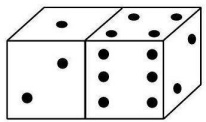</td><td></td><td></td><td></td></tr><tr><td></td><td></td><td></td><td></td><td></td><td></td></tr><tr><td></td><td></td><td></td><td></td><td></td><td></td></tr><tr><td colspan="6">MMMU</td></tr><tr><td></td><td></td><td></td><td></td><td></td><td> $( \$ )$  Project and  $C _ { 0 }$  through  $C _ { 5 } .$  Project A contains  $\mathrm { \Omega _ { \beta } } - 1 , 0 0 0 , + 1 , 0 0 0 .$  tains −2,000, +1,000, +1,000, +4,000, +1,000, and +1,000. Project C contains −3,000,</td></tr><tr><td></td><td></td><td></td><td></td><td></td><td></td></tr><tr><td></td><td></td><td>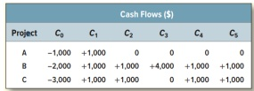</td><td></td><td></td><td></td></tr><tr><td></td><td></td><td></td><td></td><td></td><td></td></tr><tr><td></td><td></td><td></td><td></td><td></td><td></td></tr><tr><td>MathVista</td><td></td><td></td><td></td><td></td><td>The image is a horizontal bar chart titled “Title.&quot; Three medium-blue bars correspond to “bull,&quot; “wish,&quot; and “heap.&quot; The x-axis is labeled “Values&quot; and runs from 0 to 10 in increments of 2. The</td></tr><tr><td></td><td></td><td></td><td></td><td></td><td>bars reach approximately 4, 9, and 1, respectively. The white plotting area contains faint grid lines and a rectangular border.</td></tr><tr><td></td><td></td><td></td><td></td><td></td><td></td></tr><tr><td></td><td></td><td>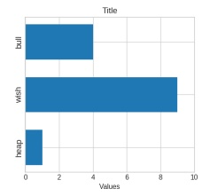</td><td></td><td></td><td></td></tr><tr><td></td><td></td><td></td><td></td><td></td><td></td></tr><tr><td></td><td></td><td></td><td></td><td></td><td></td></tr><tr><td></td><td></td><td></td><td></td><td></td><td></td></tr><tr><td></td><td></td><td></td><td></td><td></td><td></td></tr><tr><td>MME</td><td></td><td></td><td></td><td></td><td>The image shows off-white ruled paper with two gray dashed horizontal guide lines. Centered  $\cdots 4 + 5 = ^ { \circ }$ </td></tr><tr><td></td><td></td><td></td><td></td><td></td><td>between them is the handwritten expression in dark ink. The handwriting is informal, and the space to the right of the equals sign is blank. No other text, numbers, or objects are visible.</td></tr><tr><td></td><td></td><td></td><td></td><td></td><td></td></tr><tr><td></td><td></td><td>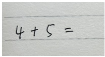</td><td></td><td></td><td></td></tr></table>

RS directly measures their relative balance. $\mathrm { R S } = 0 . 5$ when $P = R ,$ while values above 0.5 indicate greater reasoning than perceptual headroom. This symmetric normalization is easy to interpret, but represents the two channels as complementary shares and therefore obscures their overlap. In contrast, the bottleneck indices $\mathrm { B I } _ { P }$ and $\mathrm { B I } _ { R }$ normalize each channel by $| P \cup R | .$ , measuring how broadly each intervention covers the distinct recoverable error set. Both indices can be high when the two interventions recover many of the same failures, thereby preserving information about their overlap. We therefore use BI in the main paper, while RS provides an alternative normalization that preserves the ordering and exhibits the same broad trends. The values below use the same results over the two oracles as Tab. 4.

## B Experimental Details

## B.1 Datasets and Implementation Details

Training dataset. Following Vision-SR1 [Li et al., 2026e], we train all methods on Vision-SR1- 47K, which contains approximately 47K image question–answer pairs collected from 24 opensource datasets. The data span multimodal mathematical reasoning, commonsense knowledge, and general visual understanding. We use the same training split across all methods to isolate the effect of their learning objectives.

Benchmarks. We list all benchmarks evaluated in this work. The first seven benchmarks below are used in our post-training experiments, and we extend extra ten benchmarks for evaluation of PARA.

• MME [Fu et al., 2023] evaluates both perceptual and cognitive abilities through a broad collection of visual tasks.

Table 8: Representative question-blind descriptions from GPT-5.6-Luna.
<table><tr><td>Visual Input</td><td>GPT-5.6-Luna Description</td></tr><tr><td>PerceptionBench Test Patient&#x27;s Value Reference Range pH 7.20 7.35-7.45</td><td>The image is a rectangular table with a dark-gray header and three data rows. The first and third data rows have light-gray backgrounds, while the middle row is white. Its columns are &quot;Test,&quot; &quot;Patient&#x27;s Value,&quot; and &quot;Reference Range.&quot; The rows report pH as 7.20 and 7.35–7.45; Bicarbonate as 20 mEq/L and 22–29 mEq/L; and Creatinine as 1.80 mg/dL and 0.62–1.10 mg/dL.</td></tr><tr><td>Bicarbonate 20 mEq/L 22-29 mEq/L Creatinine 1.80 mg/dL 0.62-1.10 mg/dL MMMU</td><td>The image is a black-and-white chemical reaction diagram. “Glyceraldehyde 3-phosphate + H2O&quot; appears to the left of a horizontal reaction arrow, while “3-phosphoglycerate&quot; appears below the</td></tr><tr><td>Glyceraldehyde 3-phosphate + H2O 3-phosphoglycerate</td><td>product side. Above the arrow, NAD+ and NADH + H+ are connected by a curved arrow that bends downward and rises toward NADH + H+. All text and lines are dark against a plain white background. The image shows a large upright triangle centered on a white background. Its interior is uniformly</td></tr><tr><td>3 cm 3 cm</td><td>light blue, with a brighter blue outline. The triangle is approximately equilateral, with a sharp top vertex and a horizontal base. Each of its three sides is labeled “3 cm&quot; in dark-gray text, and no other objects or chart elements are visible.</td></tr><tr><td>MME</td><td>The image is a wide photograph of a lake under an overcast sky. Layered gray and lavender clouds fill the upper half. A tree-covered shoreline and low rounded ridge extend across the center, with</td></tr><tr><td>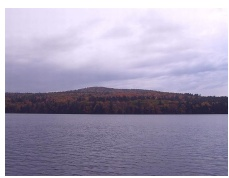</td><td>autumn foliage in green, brown, rust, orange, and muted red. Blue-gray water with fine horizontal ripples fills the foreground; no people, buildings, or boats are visible.</td></tr></table>

• MMMU [Yue et al., 2024] assesses expert-level multimodal understanding and reasoning across academic disciplines.

• MMMU-Pro [Yue et al., 2025] strengthens MMMU with more challenging questions and redesigned multiple-choice settings.

• MATH-Vision [Wang et al., 2024] evaluates mathematical problem solving grounded in diagrams and other visual contexts.

• PerceptionBench [Lin et al., 2026] targets fine-grained atomic visual perception across diverse visual attributes.

• ScienceQA [Lu et al., 2022] evaluates multimodal science question answering using image and textual context.

• VisNumBench [Weng et al., 2025] tests numerical understanding and reasoning grounded in visual content.

• BLINK [Fu et al., 2024] evaluates core visual perception skills, including depth, correspondence, and multi-view reasoning.

• ChartQA [Masry et al., 2022] measures visual and logical reasoning over real-world charts.

• HallusionBench [Guan et al., 2024] diagnoses visual illusion, language hallucination, and image-context reasoning in VLMs.

• LogicVista [Xiao et al., 2024] evaluates visually grounded logical reasoning across multiple reasoning types.

• MathVerse [Zhang et al., 2024] tests whether multimodal models understand and use diagrams when solving visual mathematics problems.

• MathVista [Lu et al., 2024] evaluates mathematical reasoning across charts, diagrams, figures, and other visual contexts.

• MMBench [Liu et al., 2024] provides a systematic multiple-choice evaluation of broad multimodal capabilities.

Table 9: Example of perception recovery. Qwen3-VL-4B answers the same MMMU question before and after receiving the question-blind description generated by GPT-5.6-Luna, recovering the perception failure.

Visual Input

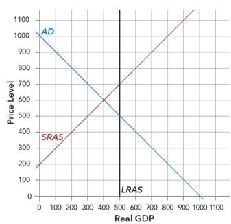  
What is the size of real GDP in the short-run equilibrium? (A) 500 (B) 450 (C) 400 (D) 600

## Base Model Generation

The short-run equilibrium occurs where the aggregate demand (AD) curve intersects the short-run aggregate supply (SRAS) curve. The intersection appears at (500, 600), so the size of real GDP is 500 billion. Therefore, the answer is A .

## GPT-5.6-Luna Description

The image is a square economic graph on a white background. The vertical axis is labeled “Price Level,” and the horizontal axis is labeled “Real GDP.” Both axes have tick marks and numeric labels at intervals of 100. A blue downward-sloping line labeled “AD” begins at approximately (0, 1000), passes through approximately (400, 600), and crosses the horizontal axis at approximately (1000, 0). A red upward-sloping line labeled “SRAS” begins at approximately (0, 200) and passes through approximately (400, 600). A vertical black line labeled ${ \mathrm {  ~ \ddot {  ~ \ L R A S } ~ } } ^ { \mathrm { \scriptsize { 1 } } }$ is located at real GDP 500

## Recovered Answer

The short-run equilibrium occurs where the AD and SRAS curves intersect. The description places their intersection at (400, 600), so th size of real GDP is 400 billion. Therefore, the answer is C

• MMStar [Chen et al., 2024] evaluates six core multimodal capabilities using visiondependent samples with reduced data leakage.

• MM-Vet [Yu et al., 2023] evaluates integrated capabilities that require combinations of recognition, OCR, knowledge, generation, mathematics, and spatial understanding.

• RealWorldQA [xAI, 2024] measures spatial understanding of real world scenes.

We use each benchmark’s official metric and evaluation protocol. MME is reported on its original scale in the result tables and normalized to a 100-point scale only when computing the crossbenchmark average.

Training setup. We perform full-parameter fine-tuning of Qwen3-VL-2B-Instruct and Qwen3- VL-4B-Instruct on four NVIDIA H200 GPUs using fully sharded data parallelism and gradient checkpointing. We train with one PPO epoch per batch, a global batch size of 128, and eight rollouts per prompt. We report the results of the 270 step checkpoints. We use AdamW with a learning rate of $\mathrm { \bar { 1 } } \times \mathrm { \bar { 1 } } 0 ^ { - 6 }$ , weight decay 0.01, and maximum gradient norm 1.0. Following GRPO, we use a standard binary accuracy reward from a rule-based verifier, rather than self-rewarding signals based on model judgments or reasoning consistency [Yuan et al., 2024, Zhang et al., 2025]. The final answer is extracted from the generated \boxed{} and compared with the ground-truth answer. Following the official Vision-SR1 implementation, we use a low-variance KL penalty with coefficient $\beta = 0 . 0 1$ asymmetric clipping ratios $\epsilon _ { \mathrm { l o w } } ~ = ~ 0 . 2$ and $\epsilon _ { \mathrm { h i g h } } ~ = ~ 0 . 3$ During training, rollouts are sampled with temperature 1.0 and $\mathrm { t o p } \mathrm { - } p = 0 . 9 9$ , with a maximum response length of 4096 tokens. We use a constant learning-rate schedule without warmup. The attention loss coefficient λ is 1.0, and supervision is applied to the last decoder layer. All experiments use random seed 2026, and input images are capped at 1,003,520 pixels $( 1 2 8 0 \times 2 8 \times 2 8 )$ .

Implementation details and efficiency. The student attention is recomputed with gradients during the current policy forward pass, requiring no additional forward pass. We use generated response tokens as queries and visual tokens as keys. Attention is first normalized over visual keys independently for each head and averaged uniformly across heads. Padding tokens are excluded and different response lengths are handled by response-wise pooling. Siblings share the same image and therefore the same visual token layout.

Table 10: Reasoning Share across models. RS reports $R / ( P + R )$ for the four models and 17 benchmarks in the main PARA evaluation. † represents multiple-choice benchmarks.
<table><tr><td>Benchmark</td><td>Qwen3-VL-2B</td><td>Qwen3-VL-4B</td><td>Llama-4-Scout-17B</td><td>Gemma-3-27B</td></tr><tr><td>BLINK†</td><td>0.39</td><td>0.30</td><td>0.30</td><td>0.39</td></tr><tr><td>VisNumBench†</td><td>0.43</td><td>0.44</td><td>0.46</td><td>0.42</td></tr><tr><td>RealWorldQA</td><td>0.37</td><td>0.50</td><td>0.40</td><td>0.38</td></tr><tr><td>PerceptionBench</td><td>0.31</td><td>0.24</td><td>0.33</td><td>0.32</td></tr><tr><td>MMStar†</td><td>0.44</td><td>0.39</td><td>0.40</td><td>0.39</td></tr><tr><td>ChartQA</td><td>0.52</td><td>0.50</td><td>0.36</td><td>0.43</td></tr><tr><td>HallusionBench</td><td>0.43</td><td>0.40</td><td>0.34</td><td>0.36</td></tr><tr><td>MME</td><td>0.56</td><td>0.55</td><td>0.49</td><td>0.39</td></tr><tr><td>MMBench†</td><td>0.50</td><td>0.49</td><td>0.43</td><td>0.45</td></tr><tr><td>ScienceQA†</td><td>0.50</td><td>0.50</td><td>0.40</td><td>0.54</td></tr><tr><td>MM-Vet</td><td>0.41</td><td>0.37</td><td>0.41</td><td>0.46</td></tr><tr><td>MMMU†</td><td>0.61</td><td>0.55</td><td>0.51</td><td>0.53</td></tr><tr><td> $\mathbf { M M U - P r o } ^ { \dagger }$ </td><td>0.49</td><td>0.48</td><td>0.56</td><td>0.60</td></tr><tr><td>LogicVista†</td><td>0.50</td><td>0.44</td><td>0.42</td><td>0.28</td></tr><tr><td> $\mathbf { M a t h V i s t a } ^ { \dagger }$ </td><td>0.28</td><td>0.29</td><td>0.26</td><td>0.33</td></tr><tr><td>MathVerse</td><td>0.61</td><td>0.59</td><td>0.53</td><td>0.55</td></tr><tr><td>MATH-Vision</td><td>0.66</td><td>0.48</td><td>0.60</td><td>0.45</td></tr><tr><td>Mean</td><td>0.47</td><td>0.44</td><td>0.42</td><td>0.43</td></tr></table>

## B.2 Additional Ablation Results

In Sec. 6.3, we discuss the effectiveness of our method components and the robustness of our default coefficient and supervision scope. In this section, we further provide more details.

Grounding penalty. The grounding variant in Tab. 3 derives a visual support set $G _ { g }$ from the best sibling’s pooled attention distribution ${ \widehat { p } } _ { g } ,$ instead of the full attention map [Chen et al., 2026]. Specifically, we sort the visual tokens by $\widehat { p } _ { g }$ and select the smallest prefix whose cumulative probability above a threshold γ. We then penalize the current rollout attention mass outside this support:

$$
\mathcal { L } _ { \mathrm { g r o u n d } } = \frac { 1 } { | \mathcal { T } | } \sum _ { ( g , i ) \in \mathcal { T } } w _ { i } \sum _ { j \notin G _ { g } } \bar { p } _ { i } ^ { \theta } ( j ) .\tag{16}
$$

The variant adds $\beta \mathcal { L } _ { \mathrm { g r o u n d } }$ to the sibling alignment objective, using the same configurations as GRAD. $G _ { g }$ is a sample-specific subset of the existing visual tokens. We report the coefficient comparison results in Tab. 11, and layer supervision comparison in Tab. 12.

Table 11: Sensitivity to the attention-loss coefficient. We vary λ on Qwen3-VL-2B.
<table><tr><td>λ</td><td>MME</td><td>MMMU</td><td>MMMU-Pro</td><td>MathVis</td><td>PercepBench</td><td>ScienceQA</td><td>VisNum.</td><td>Avg.</td></tr><tr><td>0.2</td><td>2248.4</td><td>52.7</td><td>34.2</td><td>19.1</td><td>20.6</td><td>90.1</td><td>38.2</td><td>47.9</td></tr><tr><td>1.0</td><td>2290.4</td><td>52.1</td><td>35.1</td><td>21.1</td><td>24.4</td><td>90.3</td><td>40.8</td><td>49.4</td></tr><tr><td>5.0</td><td>2228.8</td><td>49.4</td><td>34.5</td><td>19.7</td><td>20.9</td><td>88.8</td><td>36.1</td><td>47.0</td></tr></table>

Table 12: Effect of supervised attention layers. We extend the final-layer objective to the top 4, 8, 16, or all layers of Qwen3-VL-2B.
<table><tr><td></td><td>MME</td><td>MMMU</td><td>MMMU-Pro</td><td>MathVis</td><td>PercepBench</td><td>ScienceQA</td><td>VisNum.</td><td>Avg.</td></tr><tr><td>Final layer</td><td>2290.4</td><td>52.1</td><td>35.1</td><td>21.1</td><td>24.4</td><td>90.3</td><td>40.8</td><td>49.4</td></tr><tr><td>Top 4</td><td>2259.6</td><td>48.0</td><td>34.3</td><td>18.4</td><td>19.5</td><td>88.5</td><td>36.3</td><td>46.5</td></tr><tr><td>Top 8</td><td>2242.8</td><td>50.9</td><td>33.9</td><td>20.4</td><td>20.1</td><td>89.7</td><td>36.1</td><td>47.3</td></tr><tr><td>Top 16</td><td>2245.6</td><td>47.1</td><td>29.9</td><td>14.8</td><td>18.8</td><td>85.9</td><td>33.2</td><td>44.3</td></tr></table>