# REKI: REGISTERING KNOWLEDGE IN VLAS

Juliette Marrie<sup>1</sup>, Paul Pacaud<sup>2</sup>, Adrien Ramanana Rahary<sup>3</sup>, Shizhe Chen<sup>2</sup>, and Moritz Böhle<sup>1</sup> <sup>1</sup>Kyutai · <sup>2</sup>Inria · <sup>3</sup>École nationale des ponts et chaussées

## ABSTRACT

We introduce REKI, a 2.4B vision-language-action model (VLA) pretrained exclusively on public data that sets a new Pareto frontier between performance and model size: on LIBERO-Plus, RoboTwin Clean2Rand and RoboCasa365, it is outperformed only by models about twice its size. REKI consists of a vision–language model (VLM) followed by a flow-matching action expert, and is pretrained on a curated mixture of public robot, egocentric human and vision–language data. Additionally, we endow it with a memory that gives the policy access to its recent past at negligible cost: a few register tokens in the action expert summarise the output of the VLM at each frame and persist in the expert’s cache. This memory improves success in simulation and on real robots, and makes oscillations between poses about four times rarer. REKI uses a simple model design and training paradigm, and is optimised to be efficient at training and inference. We release the full code across data curation, training, inference and evaluation, deployment, and all pretrained and finetuned model weights: github.com/kyutai-labs/reki.

## 1 INTRODUCTION

Vision-language-action models (VLAs) have become an effective paradigm for language-conditioned robot control. A pretrained vision–language model (VLM) encodes camera views and instruction, based on which a smaller action expert predicts the next actions (Black et al., 2024; Physical Intelligence et al., 2025; Bjorck et al., 2025; Shukor et al., 2025; Yuan et al., 2026; Ma et al., 2026).

The strongest VLAs today are pretrained partly on proprietary data, and neither these data nor the pretraining pipelines are released (Physical Intelligence et al., 2025; Yuan et al., 2026), making it hard to reproduce their results. Since each new model changes architecture, data and training recipe at once, gains cannot be traced back to a single choice. With REKI, we release the full pipeline, from data curation to deployment. REKI has a simple design, is pretrained on public data only and sets a new Pareto frontier between performance and model size. It pairs a VLM with a flow-matching action expert, and a memory mechanism gives the policy access to its recent past.

Preserving past context can improve control (Octo Model Team et al., 2024; Liu et al., 2025; Chi et al., 2025), yet most VLAs predict actions from the current observation alone (Kim et al., 2024; Black et al., 2024; Physical Intelligence et al., 2025; Bjorck et al., 2025; Shukor et al., 2025; Lee et al., 2025; Qu et al., 2025; Liu et al., 2026). Existing ways of incorporating such context, however, often introduce substantial overhead (Fig. 2): feeding past frames to the VLM adds their image tokens to every VLM pass (Jang et al., 2025; Yuan et al., 2026), recurrent methods require sequential training (Cherepanov et al., 2026; Jiang et al., 2026), and others introduce additional, dedicated memory modules to the policy (Shi et al., 2026; Koo et al., 2026).

REKI summarises past context through a small set of registers (Darcet et al., 2024) in the action expert. The registers of each frame are cached across chunks (Fig. 3). Each frame is thus encoded only once and no separate module, sequential unroll during training or test-time update mechanisms are necessary. This yields clear gains at almost no overhead, and our 2.4B model REKI ranks first among VLAs pretrained on public data on LIBERO-Plus, RoboTwin Clean2Rand and RoboCasa365 (Fig. 1), and generalises to real robots.

Our ablations show that memory consistently improves performance, with the most pronounced gains for the first past frame (Fig. 5a). Beyond task success, we find that memory stabilises action generation: without memory, the policy often oscillates between poses across action chunks, while with memory, such oscillations are about four times rarer (Fig. 5b).

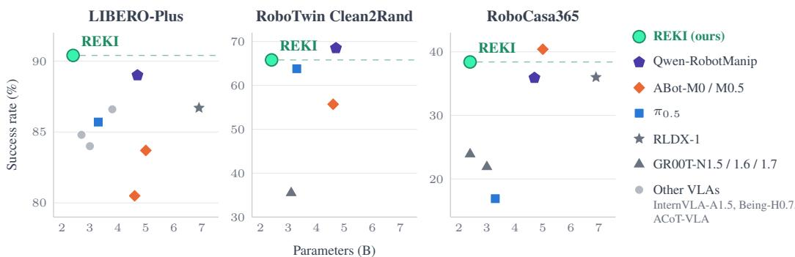  
Figure 1: Success rate against model size. REKI sets a new Pareto frontier between performance and model size: it scores highest on LIBERO-Plus, and is only outperformed by models about twice its size on RoboTwin Clean2Rand and RoboCasa365. We report full results in Fig. 4.

Our contributions are thus three-fold: (i) We introduce REKI, a 2.4B-parameter VLA pretrained on public data, which sets a new Pareto frontier between performance and model size. (ii) We introduce register tokens in the action expert to act as a memory, which can be cached efficiently, and analyse how this reduces the failure modes of the memoryless policy. We hope REKI serves as a strong and accessible baseline for future VLA research. To foster VLA research, we release the model weights and our optimised training and inference code, from data curation to deployment on a real robot.

## 2 RELATED WORK

Open pretraining. Many VLAs release their weights, and often their finetuning code, but not the code or the exact data mixture used for pretraining (Physical Intelligence, 2025; Bjorck et al., 2025; Liu et al., 2026; Zheng et al., 2025; Chen et al., 2026). The strongest VLAs are pretrained partly on proprietary data, collected (Physical Intelligence et al., 2025; Wang et al., 2026a; Liu et al., 2026) or synthesised (Yuan et al., 2026), and several have no public weights (Physical Intelligence et al., 2026; Wang et al., 2026a; Yuan et al., 2026). OpenVLA, Octo and RDT-1B released their full pipeline on public data such as Open X-Embodiment (Kim et al., 2024; Octo Model Team et al., 2024; Liu et al., 2025), followed by SmolVLA, MolmoAct and MolmoAct2, which also releases bimanual data collected by its authors (Shukor et al., 2025; Lee et al., 2025; Fang et al., 2026). These releases have helped the research community pretrain models again, change their data or design, and compare them under the same conditions. Models pretrained on larger in-house data, with more recent design choices, have nonetheless kept a lead on most benchmarks. Building on this line of work, REKI is pretrained on a broad mixture of public robot, egocentric human and vision–language data, and released in full, from data curation to deployment on a real robot. It reaches the best results among VLAs pretrained on public data on three benchmarks (§6.1), and is optimised for fast inference (§6.3).

Memory in VLAs. Most of these models act on the current observation alone, yet past context helps a policy identify the task state and recover from failed attempts (Shi et al., 2026; Torne et al., 2026; Gao et al., 2026), and methods differ in where they pay for it (Fig. 2). The most direct approach stacks or compresses past frames in the VLM (Yuan et al., 2026; Torne et al., 2026; Physical Intelligence et al., 2026; Jang et al., 2025). Its cost then grows with the window, at least in the vision encoder (Koo et al., 2026). A recurrent state (Cherepanov et al., 2026; Xiao et al., 2026) or fast weights (Jiang et al., 2026) keep the input short, but must be unrolled step by step in training. Others store past features or keyframes in an extra module (Shi et al., 2026; Koo et al., 2026; Mark et al., 2026; Sridhar et al., 2026). Like $\mu \mathrm { V L A }$ and HAMLET, REKI carries the past in a few learnable tokens, but as registers (Darcet et al., 2024) in the action expert. The VLM encodes each frame once, a training window is one batched pass, and at inference memory adds under 1% to the prediction time of a model without memory (K=1, Appendix A.1). Without memory, a policy can also switch between modes at each new action chunk (Agarwal et al., 2026; Lian et al., 2026), which is attributed to perceptual aliasing in reinforcement learning (Whitehead & Ballard, 1991; Singh et al., 1994; McCallum, 1996). In REKI, memory makes such switches about four times rarer (§6.2), without the extra policy queries of temporal ensembling or bidirectional decoding (Zhao et al., 2023b; Liu et al., 2024b).

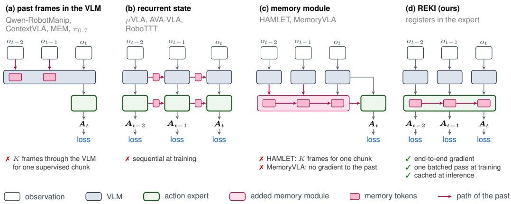  
Figure 2: How VLAs carry the past. Each panel shows one training window of three frames, with a loss under each frame that receives one. (a) Past frames enter the VLM with the current one, in full (Yuan et al., 2026), compressed (Torne et al., 2026; Physical Intelligence et al., 2026) or from a cache (Jang et al., 2025). The VLM takes the whole window as input, and only the last frame is supervised. (b) A state is written at each step and read at the next, in the backbone (Cherepanov et al., 2026; Xiao et al., 2026) or as fast weights in the head (Jiang et al., 2026). Each step needs the output of the previous one, so the window is unrolled step by step. (c) Each frame is encoded on its own, and an added module mixes the memory tokens of past frames into the prediction for the current one. HAMLET (Koo et al., 2026) supervises the last frame only, and MemoryVLA (Shi et al., 2026) every frame, with the bank entries stored without gradient. (d) In REKI, the memory tokens are registers in the action expert. Their keys and values are kept across frames and read by the self-attention already present. The window is one batched pass, and every frame receives a loss.

## 3 BACKGROUND

Problem formulation. At each decision step t we predict the chunk $\boldsymbol { A } _ { t } \in \mathbb { R } ^ { H \times d _ { a } }$ of the next H actions of an embodied system, conditioned on the current context $c _ { t }$ with

$$
c _ { t } = ( z _ { t } , o _ { t } , s _ { t } ) ,\tag{1}
$$

which gathers a text prompt $z _ { t } ,$ , camera observations $o _ { t }$ and the current robot state $\boldsymbol { s } _ { t } \in \mathbb { R } ^ { d _ { s } }$ . More generally, a policy may condition on every context observed so far, $c _ { 1 : t }$

The camera observations $o _ { t } = \{ o _ { t } ^ { 1 } , \ldots , o _ { t } ^ { V } \}$ gather the V available views, static or embodied. The robot state $\mathbf { } _ { s _ { t } }$ is expressed as absolute joint angles or an absolute end-effector pose, and the actions as absolute joint angles or delta end-effector poses and yield the next H states at a given control frequency. Action and state dimensions $( d _ { a } , d _ { s } )$ vary across embodiments and control modes.

## 3.1 DIFFUSION POLICY

Following prior work (Chi et al., 2025; Black et al., 2024), the action expert generates the chunk by flow matching (Lipman et al., 2023). Write $A = A$ for the chunk generated at step t and $c = c _ { 1 : t }$ for the contexts observed up to it; the index t is fixed in this subsection and omitted. Given noise $\epsilon \sim \mathcal { N } ( 0 , I )$ and a flow time $\tau \sim p ( \tau )$ , the interpolant $A ^ { \tau } = \left( { 1 - \tau } \right) A + \tau \epsilon$ moves from the clean chunk at $\tau = 0$ to noise at $\tau = 1$ , and the expert $v _ { \theta }$ is trained to regress its constant velocity $\epsilon - A$

$$
\ell _ { \mathrm { f m } } ( \theta ; A , c ) = \mathbb { E } _ { \tau , \epsilon } \Bigl [ \bigl \| v _ { \theta } ( A ^ { \tau } , \tau \mid c ) - ( \epsilon - A ) \bigr \| _ { 2 } ^ { 2 } \Bigr ] .\tag{2}
$$

The squared error is averaged over the valid steps and action dimensions of the chunk, so that every embodiment has the same weight whatever its number of action dimensions. The action loss is the expectation of this term over the dataset D of (context, chunk) pairs,

$$
\mathcal { L } _ { \mathrm { a c t } } ( \theta ) = \mathbb { E } _ { ( c , \boldsymbol { A } ) \sim \mathcal { D } } \left[ \ell _ { \mathrm { f m } } ( \theta ; \boldsymbol { A } , c ) \right] .\tag{3}
$$

At inference, $A ^ { 1 } \sim \mathcal { N } ( \mathbf { 0 } , I )$ is integrated from $\tau = 1$ to 0 in ten Euler steps.

## 3.2 CONDITIONING

The action expert is conditioned on the camera observations, the text instruction and the robot state, through two separate paths. The observations and the instruction are variable-length token sequences. An encoder embeds them into an encoded context

$$
\pmb { { E } } _ { t } = \operatorname { E n c } _ { \phi } ( z _ { t } , o _ { t } ) \in \mathbb { R } ^ { L _ { t } \times d } ,\tag{4}
$$

whose tokens the expert reads as keys and values in its cross-attention blocks. The state is a single low-dimensional vector. It is pooled into one state embedding $\pmb { g } _ { t } = \mathrm { P o o l } _ { \psi } ( \pmb { s } _ { t } ) \in \mathbb { R } ^ { d _ { e } }$ , which modulates the expert through its adaptive normalisation (Peebles & Xie, 2023), alongside the flowtime embedding. Since $\mathbf { \nabla } _ { \mathbf { \boldsymbol { g } } _ { t } }$ does not depend on $\tau ,$ it is computed once per frame for all Euler steps.

Encoded context. Following recent practice (Yuan et al., 2026; Yang et al., 2026), $\scriptstyle { E _ { t } }$ is the finallayer hidden states of a VLM, read by cross-attention. This keeps the encoder and the action expert independent, and is reported to match or outperform alternatives such as processing the encoded context jointly with the noisy chunk by self-attention (Wang et al., 2026a), or attending the backbone at single or all layers (Black et al., 2024; Physical Intelligence et al., 2025; Shukor et al., 2025; Bjorck et al., 2025). We use Qwen3.5-2B (Qwen Team, 2026) and pack the prompt and the camera views into a single stream (Appendix Fig. 9). The prompt $z _ { t }$ carries the language instruction, the embodiment, the control mode, the control frequency and a binned episode length (Appendix A). The embodiment, control-frequency and episode-length fields are dropped with probability 0.15, 0.2 and 0.2 during training. Each view $o _ { t } ^ { v }$ is preceded by a learned camera-role token (side, overhead, wrist left, wrist right) and embedded by the VLM’s visual encoder at native resolution. Views above $4 \dot { 4 } 8 ^ { 2 }$ pixels are first downscaled with their aspect ratio preserved. Views are shuffled and randomly dropped during training.

State embedding. Poo $- \psi$ is one linear layer with a GELU per state layout, followed by a shared zero-initialised projection at the expert’s width. Its output modulates the expert through the adaptive normalisation. The state is dropped with probability 0.2 during training.

## 4 REKI MODEL

Building on the policy of §3, REKI gives the action expert a memory of prior frames through registers (§4.1), which are trained end to end with the flow-matching objective and cached at inference (§4.2).

## 4.1 PRESERVING PAST CONTEXT

Standard VLAs condition on the current context $c _ { t }$ alone. We give the expert access to the preceding frames through $n _ { r }$ memory tokens per frame, implemented as registers (Darcet et al., 2024). The registers of frame t cross-attend the encoded prompt and views of that frame, self-attend the registers of the earlier frames, and persist as keys and values in the expert’s cache, implemented as a rolling window over the $K - 1$ preceding frames with $K = 3 ( \ S 4 . 2 )$ . Since they do not attend the action tokens and skip the adaptive normalisation, they depend only on the observations and can be shared across frames and denoising steps.

Cost and consistency. The memory is added without changing the encoder, which still processes one frame at a time, so the encoder cost is that of a memoryless policy. During training, the frames are encoded in a single batched pass with no recurrence to unroll, and each frame is supervised on its own chunk (Cherepanov et al., 2026; Jiang et al., 2026), so a window of K frames yields K training signals rather than one (Fig. 2).

Registers. As in Qwen-RobotManip (Yuan et al., 2026), n<sub>r</sub> learnable register tokens $M \in \mathbb { R } ^ { n _ { r } \times d _ { \epsilon } }$ are prepended to the noisy actions in the expert’s stream, so that frame t enters it as $X _ { t } = [ M ; A _ { t } ^ { \tau } ]$ with the actions linearly projected to the expert’s width $d _ { e } ;$ ; we write $M _ { t }$ for the register tokens of frame t. While Qwen-RobotManip discards the registers after each forward pass, we keep their keys and values across frames, giving the action expert access to past observations.

Attention. Every token of $X _ { t }$ cross-attends $\scriptstyle { E _ { t } }$ . In self-attention, writing $\operatorname { A t t n } ( Q ; V )$ for attention with queries $Q$ over the tokens of V as keys and values,

$$
M _ { t } \gets \mathrm { A t t n } \big ( M _ { t } ; [ M _ { 1 } ; . . . ; M _ { t } ] \big ) , \qquad A _ { t } ^ { \tau } \gets \mathrm { A t t n } \big ( A _ { t } ^ { \tau } ; [ M _ { 1 } ; . . . ; M _ { t } ; A _ { t } ^ { \tau } ] \big ) .\tag{5}
$$

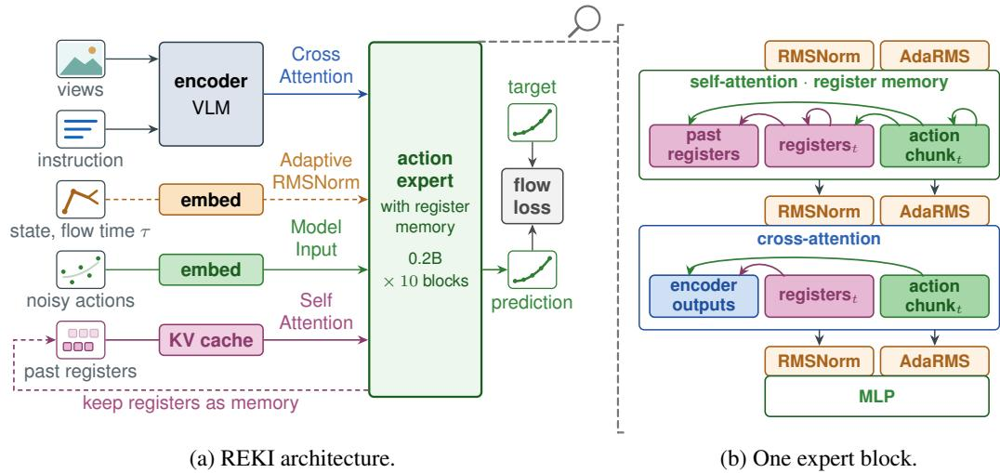  
Figure 3: REKI. (a) Camera views and instruction are encoded as context $\scriptstyle { E _ { t } }$ , which every expert block reads by cross-attention. The state embedding $\mathbf { \nabla } _ { \mathbf { \boldsymbol { g } } _ { t } }$ and the flow time modulate the actions through adaptive normalisation. The noisy chunk enters the expert’s stream, and the flow loss compares the predicted velocity with its target. The register keys and values of past frames are kept in a cache and read by self-attention, which is the memory of §4.1. (b) One of the ten blocks, holding $n _ { r } = 3 2$ registers and the action tokens of the current frame. Arrows run from a query to what it reads. Action tokens read the current and past registers and themselves, and registers never read them.

The history thus enters the velocity field through the attention support alone (Fig. 3b).

Positions. Self-attention positions are 2D, the frame index and the slot within the frame, encoded by the temporal and spatial axes of the VLM’s multimodal rotary embedding (Appendix A).

## 4.2 TRAINING AND INFERENCE

Objective. A training sample is a window of K frames from one episode, taken at a 1 s stride and indexed from 1, the oldest, to K, the most recent. At the start of an episode, a window holds fewer frames. Each frame t has its own chunk $\pmb { A } _ { t }$ , and its contexts $c _ { 1 : t }$ cover the frames up to it, without past states. The loss averages the flow-matching loss of Eq. (2) over the chunks of all frames, each conditioned on the contexts up to its frame,

$$
\mathcal { L } _ { \mathrm { a c t } } ( \theta ) = \mathbb { E } _ { ( c _ { 1 : K } , A _ { 1 : K } ) \sim \mathcal { D } } \left[ \frac { 1 } { K } \sum _ { t = 1 } ^ { K } \ell _ { \mathrm { f m } } ( \theta ; A _ { t } , c _ { 1 : t } ) \right] .\tag{6}
$$

Since every later frame of the window reads the registers of a frame, these registers receive gradient from all of their losses. At pretraining, the LM head of the VLM is also trained to predict the subtask when one is annotated and the answers of the vision–language data, with a cross-entropy loss of weight 0.1 (Appendix Fig. 9).

Multi-draw variance reduction. The loss of Eq. (2) is an expectation over the flow time and the noise, and a single (τ, ϵ) draw per frame gives a noisy estimate of it. An extra draw costs one pass of the expert, whereas the context and the registers it reads cost one pass of the encoder, which dominates the cost of a training step. As in Yuan et al. (2026) and Allshire et al. (2026), we therefore estimate the expectation from eight independent draws per frame. The eight noisy chunks share the encoded context and the registers of their frame, so the encoder runs once for all of them. The registers of frame s thus receive gradient from the eight draws of every frame from s to K.

Implementation. The frames of a window are packed into a single batch and kept independent in the backbone by cu\_seqlens boundaries. In the expert, the self-attention of Eq. (5) is computed by one variable-length FLASHATTENTION call. For this, the keys and values that each group of queries reads are gathered into one sequence: the register tokens $\bar { M _ { 1 : t } }$ for the registers of frame t, and $M _ { 1 } .$ followed by the action tokens of one noisy chunk for the queries of that chunk (Appendix Fig. 9b).

Inference. At inference, each frame needs one encoder pass over the current observation and ten Euler steps on the action tokens. The registers do not read the action tokens and skip adaptive normalisation (§4.1), so neither they nor the context depend on the flow time τ or on the state. The registers of the current frame are thus computed together with the action tokens in the first Euler step, and their keys and values are reused at the nine others. The register keys and values are also kept for the frames that follow, $\left( K - 1 \right) n _ { r }$ pairs per expert block. The cache is a rolling window, so the registers of the oldest frame are dropped when those of a new frame enter (Appendix Fig. 10). At training, each window of K frames is processed in isolation. At inference, the cached registers were themselves computed with the registers of earlier frames, so information can persist beyond the window. The VLM prefill and the expert are each compiled into a single CUDA graph. With two 256×256 images and a chunk of ten actions, REKI predicts a chunk in 21.8 ms on one H100 at K=3, the lowest latency among the VLAs compared in §6.3. In the measurement of Fig. 5d, the VLM prefill takes 9.5 ms and the Euler steps 8.1 ms, and reading the cached registers adds 0.1 ms.

## 5 EXPERIMENTAL SETUP

## 5.1 PRETRAINING DATA

Robot manipulation. We train on a broad mixture of public teleoperation datasets: RoboSet (Bharadhwaj et al., 2024), Galaxea (Jiang et al., 2025), AgiBot World 2026 (AgiBot World Team, 2026), RoboCOIN (Wu et al., 2025b), RoboMIND (Wu et al., 2025a), RDT-1B (Liu et al., 2025), DROID (Khazatsky et al., 2024), BridgeData V2 (Walke et al., 2023), and twelve datasets of Open X-Embodiment (Open X-Embodiment Collaboration, 2024) including RT-1 (Brohan et al., 2023) and BC-Z (Jang et al., 2022) (Appendix B.1), complemented by motion-planned simulation from InternData-A1 (Tian et al., 2026) and GR00T-X-Embodiment-Sim (Bjorck et al., 2025) and bimanual YAM demonstrations from ABC (Allshire et al., 2026). These span single-arm, bimanual, mobile, and humanoid platforms across tabletop, in-the-wild, and loco-manipulation settings (Appendix Table 1). Action and state dimensions, control conventions and units vary across sources, and a robot may appear under several conventions. Following Qwen-VLA (Wang et al., 2026a), we keep each dataset’s native control convention rather than remapping to a shared action space, normalise each action dimension to [−1, 1] by per-dataset quantiles, and zero-pad actions to a common width under a loss mask. States are absolute, actions are absolute joint positions or delta end-effector poses, and rotations are harmonised to one Euler parameterisation. The prompt and the per-layout state projections of §3.2 tell the policy which convention a sample follows. In the spirit of Qwen-RobotManip’s multi-stage filtering (Yuan et al., 2026), we curate every source before training: we keep only the degrees of freedom the policy commands, discard static and near-zero-variance episodes, and correct per-dataset sign conventions. Appendix B.2 gives the curation stages and the action representation.

Egocentric human manipulation. We add three egocentric human manipulation datasets, EgoDex (Hoque et al., 2026), EgoVerse (Punamiya et al., 2026) and Xperience (Ropedia, 2026), recorded from head-mounted or hand-held cameras. They contribute ∼350k episodes and 170M frames. The action target follows Qwen-VLA’s 32D bimanual layout (Wang et al., 2026a), wrist motion and hand articulation per hand, here with the wrist expressed in the camera frame; no proprioceptive state is used, and each is resampled to the pace of robot teleoperation (Yuan et al., 2026). Appendix B.4 gives the sources, target definition and resampling.

Vision–language data. We train on the FineVision (Wiedmann et al., 2025) and LLaVA-OneVision-1.5 (An et al., 2025) datasets most relevant for spatial reasoning (Appendix B.5), as well as targeted spatial-grounding and pointing corpora: RoboPoint (Yuan et al., 2024), RefSpatial (Zhou et al., 2025), and PixMo (Deitke et al., 2025). This auxiliary supervision preserves the backbone’s perception and spatial reasoning, and is mixed in at a small ratio with the robot and egocentric data.

## 5.2 MODELS

REKI pairs the Qwen3.5-2B vision–language backbone with an action expert of 10 blocks of width 768, 32 registers per frame and a memory window of K=3 frames. It is pretrained on the mixture above for 200k steps on 32 H100 GPUs with a global batch of 2,880 samples, then finetuned on each benchmark separately. The backbone is trained at 0.1× the learning rate of the expert, and 10% of the training samples are vision–language data. Finetuning steps, node counts and the number of evaluation rollouts per task are in Appendix Table 3, the remaining hyperparameters in Appendix Table 2. Rows marked scratch skip the pretraining and finetune the initialised model directly on the benchmark.

## 5.3 VISUAL DATA AUGMENTATION

We apply data augmentation to make the model robust to visual variations: colour jittering, mild random cropping, random camera dropout and shuffled camera order. When finetuning on RoboTwin, RoboCasa365 and RoboCasa-GR1, we add a mirroring augmentation, which extends the horizontal flip common in image classification to robot data. With probability 0.5, a sample is replaced by its left-right mirror image. The images are flipped, the state and the actions are reflected through the same plane, the arms of a two-arm robot are swapped, and the prompt marks the sample as mirrored (Appendix C.2). The augmentations and other training settings, such as the state dropout rate, have a large effect on robustness: on LIBERO-Plus, disabling camera dropout or the image augmentations lowers the success under camera-viewpoint changes by more than 20 points, and disabling state dropout lowers the success under changes of the initial robot state by 8.1 points (Appendix D.2).

## 6 EXPERIMENTS

## 6.1 RESULTS

Benchmarks. LIBERO (Liu et al., 2023a) has four suites of ten single-arm tabletop tasks, and LIBERO-Plus (Fei et al., 2025) perturbs its 40 tasks along seven dimensions, from the camera viewpoint and the initial robot state to lighting and object layout. The models are finetuned on the four suites and evaluated on both. RoboTwin 2.0 (Chen et al., 2025b) has 50 tasks on the dual-arm AgileX ALOHA, in clean scenes and in scenes with a randomised background, lighting, clutter and table height. For the out-of-distribution evaluation (Clean2Rand; Yuan et al., 2026), the models are finetuned on clean scenes only and evaluated under six conditions: on clean scenes (Easy), under each randomisation alone and under all four together (Hard). The Clean2Rand score is the mean over these six conditions. RoboCasa365 (Nasiriany et al., 2026) has kitchen tasks for a Franka arm on a mobile base. The models are trained on the human demonstrations of its 300 pretraining tasks and evaluated on 50 target tasks: 18 atomic tasks, 16 composite tasks seen in training and 16 composite tasks unseen in training. RoboCasa-GR1 (Bjorck et al., 2025) has 24 tabletop tasks for the Fourier GR-1 humanoid, with 1000 demonstrations per task. We compare mainly with VLAs of similar complexity, which pair a VLM with an action expert, such as $\pi _ { 0 . 5 } ,$ , GR00T, ABot-M0 and InternVLA-A1.5. As a gauge of the current upper bound on these benchmarks, we also report larger models pretrained on in-house data, Qwen-RobotManip, RLDX-1 and Xiaomi-Robotics-1, and the world-action model ABot-M0.5, built on a video generation model. They are trained under different conditions, with more or proprietary data or a video model, so they are a reference rather than a like-for-like comparison. Figure 4 summarises the results across benchmarks, and Appendix Tables 4 to 6 list them in full.

Out of distribution. REKI stands out most when the test conditions differ from training. On LIBERO-Plus and Clean2Rand, it ranks first among the VLAs pretrained on public data, despite having the fewest parameters (2.4B, Figs. 4a and 4c). It leads the next of these models by 5.6 points on LIBERO-Plus (InternVLA-A1.5, 84.8) and by 10.1 points on Clean2Rand (ABot-M0, 55.7). On the composite tasks of RoboCasa365 unseen in training, it is on par with Qwen-RobotManip (14.1 against 14.9) and behind Xiaomi-Robotics-1 (32.1), both larger and pretrained on in-house data.

In distribution. When trained and evaluated on the same tasks, REKI is competitive with larger models. On RoboCasa365, it reaches 38.4, ahead of the larger RLDX-1 (36.0) and Qwen-RobotManip (35.9), both pretrained on in-house data (Fig. 4d), and on RoboCasa-GR1 it reaches 58.6, on par with the larger RLDX-1 (58.7) and ABot-M0 (58.3) (Fig. 4e). On LIBERO, it reaches 97.5, where most models lie between 97.6 and 99.4. REKI is weakest on RoboTwin, where it reaches 85.9 and 84.6, below the similarly sized InternVLA-A1.5 (93.3 / 93.0), which is supervised by an additional video generation model during training and uses a more complex, multi-stage pretraining (Fig. 4b).

(b) RoboTwin in distribution

## (a) LIBERO-Plus

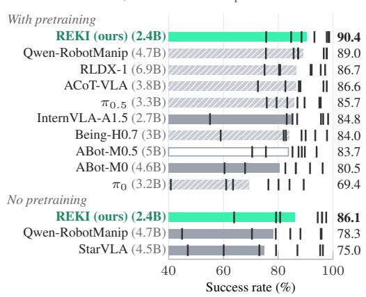

## (c) RoboTwin Clean2Rand

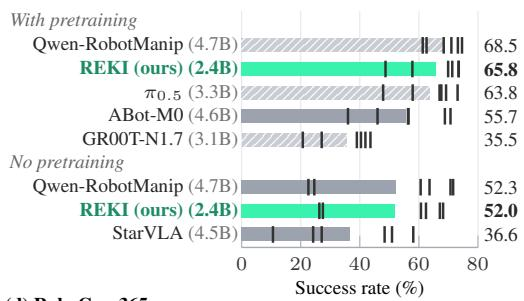

## (d) RoboCasa365

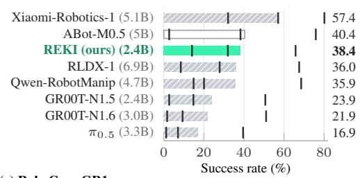

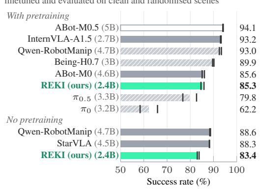  
(e) RoboCasa-GR1

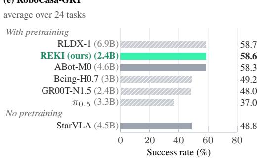  
Figure 4: Benchmark results. Out of distribution, on LIBERO-Plus (a) and RoboTwin Clean2Rand (c), REKI leads the compared VLAs pretrained on public data; in distribution, on RoboTwin (b), RoboCasa365 (d) and RoboCasa-GR1 (e), it is competitive with larger models. Hatched bars mark models pretrained on in-house data and outlined bars world-action models. Each bar gives the overall score and the ticks the subset scores. Full results for (a) to (d) are in Appendix Tables 4 to 6.

Pretraining gains. Trained from scratch on each benchmark, REKI reaches 52.0 on Clean2Rand, on par with Qwen-RobotManip (52.3) and ahead of StarVLA (36.6), which both have larger VLMs (4.5B and 4.4B). REKI is ahead of both under the Hard condition (26.3 against 22.6 and 10.6). On LIBERO-Plus it leads with 86.1, ahead of Qwen-RobotManip (78.3) and StarVLA (75.0). Pretraining on public data benefits REKI most out of distribution, and in particular under the RoboTwin randomisations (Appendix Tables 4 and 5). In distribution, it adds 2.9 and 0.8 points on RoboTwin and 1.0 on LIBERO. Out of distribution, it adds 13.8 points on Clean2Rand and 4.3 on LIBERO-Plus, and the gain grows where REKI without pretraining fails most, with 30.3 points under clutter and 22.4 under the Hard condition. On LIBERO-Plus, the gain is also largest under perturbed robot states (11.7).

Additional data or supervision. REKI is outperformed by several larger and more recent models that add data or supervision to the vanilla recipe, with large in-house data collections (Xiaomi Robotics Team, 2026) or video generation models (Song et al., 2026; Zhang et al., 2026). Similarly, InternVLA A1.5 uses the same VLM as REKI, with an additional video generation model, a larger action expert (24 layers vs 10 for REKI) and a multi-stage pretraining, and is ahead in distribution on RoboTwin (93.3 vs 85.9). Out of distribution, it is behind on LIBERO-Plus (84.8 vs 90.4). Qwen-RobotManip, pretrained with additional synthetic data, gains more from pretraining than REKI (16.2 vs 13.8 points on Clean2Rand). REKI reaches its lead out of distribution without such additions, and we expect it to (a) Success rate against the memory window at finetuning and evaluation

LIBERO-Plus

(c) Oscillating episodes by task class  
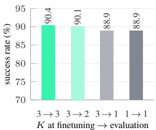  
RoboTwin Clean

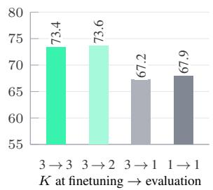  
RoboCasa365

(b) Oscillating episodes  
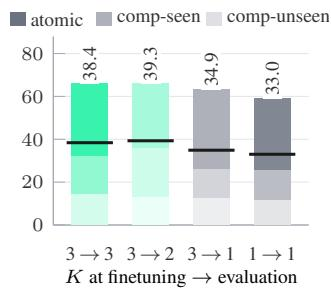  
(d) Time per chunk

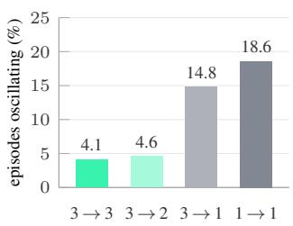  
K at finetuning evaluation

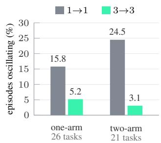

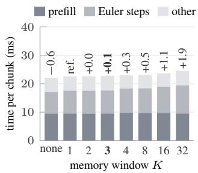  
Figure 5: Memory window, oscillation and inference cost. REKI trained with K=3 and evaluated with $K = 3 , 2 , 1 ( 3  3 , 3  2 , 3  1 )$ , and a memoryless model (1 → 1). (a) On RoboCasa365, the black line gives the average. (b) RoboTwin Clean episodes in which an arm reverses its motion at three or more consecutive chunks (50 tasks, 20 matched seeds each). (c) Two-arm tasks move both arms in at least 80% of the successful episodes with memory, one-arm tasks a single arm. The three other tasks are left out. (d) On one H100. The numbers give the difference to K=1 in ms.

benefit similarly from additional data, be it real (Xiaomi Robotics Team, 2026), synthetic (Yuan et al., 2026) or generated by a world model (Kim et al., 2026; GigaBrain Team et al., 2026).

## 6.2 ABLATION

Memory window. Figure 5a varies the memory window of REKI at finetuning and at evaluation, on LIBERO-Plus after finetuning on LIBERO, on RoboTwin Clean and on RoboCasa365. Finetuned and evaluated with three frames (3 → 3), REKI reaches 90.4 on LIBERO-Plus, 73.4 on RoboTwin and 38.4 on RoboCasa365, against 88.9, 67.9 and 33.0 without memory (1 → 1). Most of the gain already comes with the first past frame (3 → 2: 90.1, 73.6 and 39.3). As every frame of a training window is supervised (Eq. (6)), the model finetuned with memory also learns to act without it. Evaluated without memory (3 → 1), it performs close to the model finetuned at K=1 (88.9, 67.2 and 34.9), so the gain comes mainly from reading the past frames at inference, not from training on windows.

Oscillation. For each arm, we compare how it moves during one chunk with how it moved during the previous one, ignoring small movements. Figure 5b counts the episodes in which an arm moves in roughly the opposite direction at three or more consecutive chunks, that is, it goes back and forth at least twice (Fig. 7). We set this criterion on 16 of the 50 tasks and confirmed the effect of memory on the other 34. Fewer than 5% of these episodes succeed. With the same weights, removing the past frames at evaluation raises their share from 4.1% to 14.8%, and one past frame already brings it down to 4.6%. Trained without memory, REKI oscillates in 18.6% of the episodes, and in half of those that fail. The difference is largest in two-arm tasks (Fig. 5c).

Why memory helps. A policy without memory maps the current observation to the next chunk. If two poses A and B each look like demonstration states that continue towards the other, the chunk predicted at A leads to B, and the chunk predicted at B leads back to A. We attribute the oscillation to this form of perceptual aliasing, under which memoryless policies are known to fail (Whitehead &

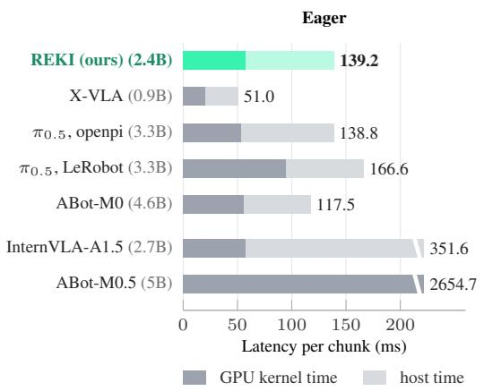

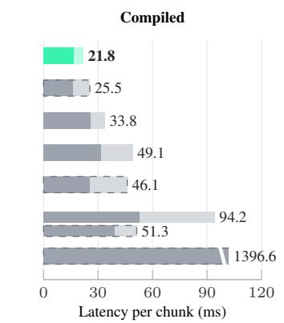  
Figure 6: Inference latency (H100), from the raw observation to the actions of one chunk, with LIBERO inputs, without compilation (left) and compiled (right). Dashed bars are compiled code that we built. ABot-M0.5 runs with its RoboCasa365 weights, the only ones released, and with its own LIBERO setting, which takes two 128×128 images.

Ballard, 1991; Singh et al., 1994; McCallum, 1996). A short history resolves the ambiguity, since a window that has just come from B does not match demonstrations that move towards B. In two-arm tasks, the most frequent cycle is an arm swap, in which one arm reaches while the other retracts (65 against 1 of 1000 episodes without and with memory, top row of Fig. 7). It typically starts a few seconds after a release. Memory does not rescue all these episodes: where the policy without memory oscillates, the policy with memory succeeds on 45% of the seeds.

## 6.3 INFERENCE LATENCY

Protocol. We measure the latency of one call, from the raw observation to the unnormalised actions of one chunk, including preprocessing and the transfers between host and device. This latency bounds how quickly a policy can react to a new observation and how often it can replan, whatever the number of actions it predicts. In practice, policies replan well before the end of a long chunk, typically in under a second, since executing more actions open loop makes them slower to react (Black et al., 2024; Chi et al., 2025; Liu et al., 2024b). Each model predicts one chunk from two 256×256 images (128×128 for ABot-M0.5), the robot state and a fixed prompt, at batch size one, with its released checkpoint and inference code. Each value in Fig. 6 is the median over 320 chunks (80 for ABot-M0.5) and three repetitions, each on its own GPU of a node reserved for the timing (Appendix D.4).

Compilation. Most of the compared models are released without a compiled path, or with one that can be further optimised. Without compilation, all models are slow (Fig. 6, left): REKI, π<sub>0.5</sub> with openpi (Physical Intelligence, 2025) and ABot-M0 (Yang et al., 2026) take 118 to 139 ms per chunk, InternVLA-A1.5 (Ma et al., 2026) 352 ms, and X-VLA (0.9B; Zheng et al., 2025) 51 ms. In most of these runs, the GPU is busy less than half of the time, so compiling the prediction, which removes most of the host time, makes it two to seven times faster (Fig. 6, right). We compile REKI entirely into CUDA graphs, including its memory (Appendix A.1). For a fair comparison, we also compile X-VLA, ABot-M0, InternVLA-A1.5 and ABot-M0.5 (Chen et al., 2026) without changing their computation, and report both their released path and ours.

Results. With compilation, REKI is the fastest of the compared models (Fig. 6, right): it predicts a chunk in 21.8 ms, against 25.5 ms for X-VLA, 33.8 ms for π with openpi, 46.1 ms for ABot-M0 and 51.3 ms for InternVLA-A1.5. Its GPU time per chunk, 16.5 ms, is on par with that of X-VLA (16.1 ms) and below that of the other models, which need at least 25.3 ms. InternVLA-A1.5 uses the same VLM as REKI, and the difference lies in its action expert, which runs at each of the ten Euler steps: with 0.5B parameters in 24 layers against 0.2B in 10, its Euler steps take 34.9 ms against 8.2 ms for REKI (Appendix Table 10). ABot-M0.5 generates future video latents before it predicts actions, and takes 2.7 s per chunk without compilation and 1.4 s with the CUDA graphs that we built.

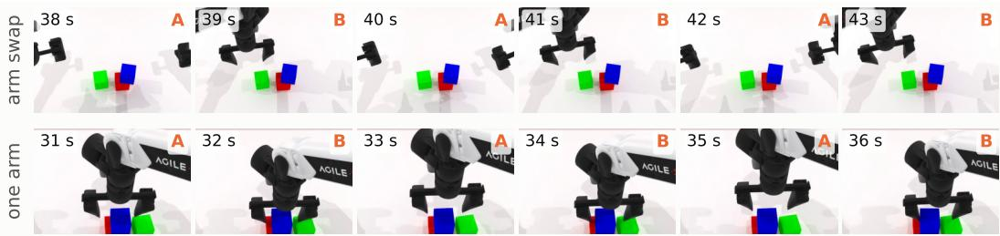  
Figure 7: Oscillation without memory. Two RoboTwin rollouts of REKI trained without memory, stacking three blocks. Frames are one chunk apart (1 s), and A and B mark the two poses the arm alternates between. In the top row, the two arms swap at every chunk, one reaching while the other retracts. In the bottom row, a single arm moves back and forth. The blocks do not move in either row.

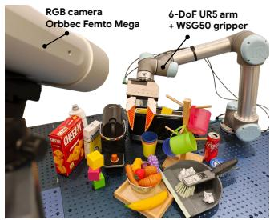

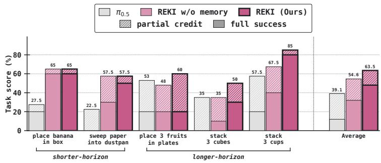  
Figure 8: Real-robot experiments. Left: the UR5 arm with a WSG50 gripper, observed by a fixed Orbbec Femto Mega RGB camera, with the task objects and distractors. Right: task score of REKI with and without memory and of $\pi _ { 0 . 5 }$ (Physical Intelligence et al., 2025) on two shorter- and three longer-horizon tasks, over 10 episodes each. Solid bars give full successes, hatched bars partial credit.

## 7 REAL ROBOT EXPERIMENTS

Experimental setup. We use a 6-DoF UR5 robotic arm with a Weiss WSG50 gripper and UMI-style parallel jaws. The action loop runs at 15 Hz. The robot operates over a 1 m×1 m tabletop workspace observed by a fixed Orbbec Femto Mega RGB camera, see Fig. 8, left. Observations include an RGB image, and a 7D absolute joint state. Actions are specified as 7D absolute joint state.

Tasks and protocol. We evaluate performance across five manipulation tasks, and report task success rates and partial subtask success rates. Tasks span diverse action primitives, including pick, place, stack, and sweep. The tasks and partial success scores are defined in Appendix E. We collect 50 training episodes per task with a Meta Quest controller, and evaluate on 10 test episodes per task, with randomised initial object placements and distractors in each episode.

Baselines. We finetune the pretrained checkpoints of REKI and $\pi _ { 0 . 5 }$ on the five tasks for 3,000 optimiser steps, with a global batch of 360 samples. Both models use a learning rate of $5 \times 1 0 ^ { - 5 }$ held constant after warmup. The action chunk has 50 steps (3.3 s) for $\pi _ { 0 . 5 } ,$ fixed by its pretraining, and 30 steps (2 s) for REKI. In both models, only the last four vision encoder blocks are trained. The backbone is trained at $0 . 1 \times$ the learning rate of the action expert. REKI is finetuned with a memory window of $K = 3$ and without memory $( K { = } 1 )$ $\pi _ { 0 . 5 }$ has no memory.

Results. Across the five tasks, REKI outperforms $\pi _ { 0 . 5 }$ by 7 to 37.5 percentage points (Fig. 8, right). Removing the memory leaves performance on the shorter-horizon tasks mainly unchanged (65 against 65 and 57.5 against 57.5), but consistently degrades it on the longer-horizon tasks, where REKI outperforms its memoryless variant by 12 to 17.5 percentage points, supporting that memory matters most when tasks require tracking progress over many steps. For qualitative examples, see Fig. 12.

## 8 DISCUSSION

A vanilla VLA. REKI follows a standard VLA recipe: a VLM’s last hidden states are read by a flow-matching action expert, pretrained in a single stage on public robot, egocentric human and vision–language data, and then finetuned on each benchmark. It uses no proprietary data (cf. Yuan et al., 2026; Kim et al., 2026), no world model (cf. Chen et al., 2026) and no additional training stages. Even so, it can compete with, and often outperform, VLAs of similar size pretrained on in-house data, and it leads the compared VLAs pretrained on public data out of distribution (Fig. 4), where pretraining adds 13.8 points on Clean2Rand and 4.3 on LIBERO-Plus (§6.1). Many of the strongest entries on current leaderboards take the other route: they are world-action models built on video generation models (Chen et al., 2026; Wang et al., 2026b; Zhang et al., 2026; Song et al., 2026) or VLAs pretrained on large proprietary data (Xiaomi Robotics Team, 2026; GigaBrain Team et al., 2026). These models set the current state of the art, but they can be costly to run (§6.3). Their pretraining is also hard to reproduce, which makes it difficult to separate the effects of data scale, model size, modelling choices and additional supervision such as world modelling. We intend REKI to serve as an open reference on which each of these factors can be tested in isolation.

An efficient open baseline. We release REKI with its full pipeline, from data curation to deployment, and the checkpoints of every benchmark, so that new architectures, data mixtures or training objectives can be pretrained and compared against it under fixed conditions. The simplicity of the recipe and the efficiency of the code keep such comparisons affordable: finetuning REKI takes 8 H100 GPU-hours on our real-robot tasks and 40 to 400 on the benchmarks (Tables 3 and 11). The memory adds no cost at training (§4.2) and less than 1% of the inference time, so REKI is an efficient starting point for studying memory in embodied AI. In the released code, REKI runs entirely as CUDA graphs, memory included, and predicts an action chunk from the LIBERO inputs in 21.8 ms on one H100. It stays the fastest of the compared models even when their released code is compiled (§6.3).

Why inference speed matters. Inference speed matters not only at deployment, where it bounds how quickly a policy can react (§6.3), but also for training. VLAs are increasingly post-trained with reinforcement learning, in simulation (Li et al., 2025; Chen et al., 2025a; Zang et al., 2026) or in learned world models (Zhu et al., 2025; Sharma et al., 2026), where the policy is queried for every action chunk of every rollout, so that its inference time is multiplied across the whole training run. At 21.8 ms per chunk, REKI offers a strong open starting point for such post-training and lowers the barrier to it, a step towards making it accessible beyond the few groups with large compute budgets.

Memory. In REKI, a few register tokens in the action expert summarise each frame and stay in the expert’s cache, so the VLM still sees each frame only once. Even this short memory helps: with three frames, success rises by 1.5 to 5.5 points on LIBERO-Plus, RoboTwin and RoboCasa365, and by 12 to 17.5 points on the longer real-robot tasks. Most of the gain comes from a single past frame, which in particular reduces repetitive oscillations between two poses, suggesting that a little temporal context is enough to tell apart observations that look alike (§6.2). A memory of a few seconds therefore appears sufficient for most tasks in standard benchmarks. Whether the registers can also carry the much longer context of tasks that depend on events far in the past remains to be tested.

## REFERENCES

Manoj Acharya, Kushal Kafle, and Christopher Kanan. TallyQA: Answering complex counting questions. In Proc. AAAI Conf. Artif. Intell., 2019.

Abhinav Agarwal, Adam Wei, Taylan Kargin, Michael Zeng, Cole Becker, Arif Kerem Dayı, Pablo Parrilo, Asuman Ozdaglar, and Russ Tedrake. Training and evaluating diffusion policies with long context lengths. arXiv:2606.16447, 2026.

AgiBot World Team. AgiBot World 2026. Hugging Face dataset, 2026. URL https://huggin gface.co/datasets/agibot-world/AgiBotWorld2026.

Arthur Allshire, Himanshu Gaurav Singh, Ritvik Singh, Adam Rashid, Hongsuk Choi, David McAllister, Justin Yu, Yiyuan Chen, Huang Huang, Pieter Abbeel, et al. Scalable behavior cloning with open data, training, and evaluation. arXiv:2606.27375, 2026.

Xiang An, Yin Xie, Kaicheng Yang, Wenkang Zhang, Xiuwei Zhao, Zheng Cheng, Yirui Wang, Songcen Xu, Changrui Chen, Chunsheng Wu, et al. LLaVA-OneVision-1.5: Fully open framework for democratized multimodal training. arXiv:2509.23661, 2025.

Homanga Bharadhwaj, Jay Vakil, Mohit Sharma, Abhinav Gupta, Shubham Tulsiani, and Vikash Kumar. RoboAgent: Generalization and efficiency in robot manipulation via semantic augmentations and action chunking. In Proc. IEEE Int. Conf. Robot. Autom., 2024.

Ali Furkan Biten, Ruben Tito, Andres Mafla, Lluis Gomez, Marçal Rusinol, Ernest Valveny, C. V. Jawahar, and Dimosthenis Karatzas. Scene text visual question answering. In Proc. IEEE/CVF Int. Conf. Comput. Vis., 2019.

Johan Bjorck, Fernando Castañeda, Nikita Cherniadev, Xingye Da, Runyu Ding, Linxi Fan, Yu Fang, Dieter Fox, Fengyuan Hu, et al. GR00T N1: An open foundation model for generalist humanoid robots. arXiv:2503.14734, 2025.

Kevin Black, Noah Brown, Danny Driess, Adnan Esmail, Michael Equi, Chelsea Finn, Niccolo Fusai, Lachy Groom, Karol Hausman, Brian Ichter, et al. π : A vision-language-action flow model for general robot control. arXiv:2410.24164, 2024.

Anthony Brohan, Noah Brown, Justice Carbajal, Yevgen Chebotar, Joseph Dabis, Chelsea Finn, Keerthana Gopalakrishnan, Karol Hausman, Alex Herzog, Jasmine Hsu, et al. RT-1: Robotics transformer for real-world control at scale. In Robotics: Science and Systems, 2023.

Remi Cadene, Simon Alibert, Alexander Soare, Quentin Gallouedec, Adil Zouitine, Steven Palma, Pepijn Kooijmans, Michel Aractingi, Mustafa Shukor, Dana Aubakirova, Martino Russi, Francesco Capuano, Caroline Pascal, Jade Choghari, Khalil Meftah, Maxime Ellerbach, Jess Moss, and Thomas Wolf. LeRobot: State-of-the-art machine learning for real-world robotics in PyTorch. https://github.com/huggingface/lerobot, 2024.

Jimmy Carter. TextOCR-GPT4V. Hugging Face dataset, 2024. URL https://huggingface. co/datasets/jimmycarter/textocr-gpt4v.

Guiming Hardy Chen, Shunian Chen, Ruifei Zhang, Junying Chen, Xiangbo Wu, Zhiyi Zhang, Zhihong Chen, Jianquan Li, Xiang Wan, and Benyou Wang. ALLaVA: Harnessing GPT4Vsynthesized data for lite vision-language models. arXiv:2402.11684, 2024a.

Kang Chen, Zhihao Liu, Tonghe Zhang, Zhen Guo, Si Xu, Hao Lin, Hongzhi Zang, Xiang Li, Quanlu Zhang, Zhaofei Yu, et al. $\pi _ { \tt r l }                  \tt :$ Online RL fine-tuning for flow-based vision-language-action models. arXiv:2510.25889, 2025a.

Lin Chen, Jinsong Li, Xiaoyi Dong, Pan Zhang, Conghui He, Jiaqi Wang, Feng Zhao, and Dahua Lin. ShareGPT4V: Improving large multi-modal models with better captions. In Proc. Eur. Conf. Comput. Vis., 2024b.

Ronghan Chen, Yandan Yang, Zuojin Tang, Dongjie Huo, Tong Lin, Haoning Wu, Haoyun Liu, Yuzhi Chen, Lulu Zheng, Botai Yuan, et al. ABot-M0.5: Unified mobility-and-manipulation world action model. arXiv:2607.00678, 2026.

Tianxing Chen, Zanxin Chen, Baijun Chen, Zijian Cai, Yibin Liu, Zixuan Li, Qiwei Liang, Xianliang Lin, Yiheng Ge, Zhenyu Gu, et al. RoboTwin 2.0: A scalable data generator and benchmark with strong domain randomization for robust bimanual robotic manipulation. arXiv:2506.18088, 2025b.

Egor Cherepanov, Nikita Kachaev, Daniil Zelezetsky, Aydar Bulatov, Artem Pshenitsyn, Yuri Kuratov, Alexey Skrynnik, Aleksandr I Panov, and Alexey K Kovalev. µVLA: On recurrent memory for partially observable manipulation in VLA models. arXiv:2606.12497, 2026.

Cheng Chi, Zhenjia Xu, Siyuan Feng, Eric Cousineau, Yilun Du, Benjamin Burchfiel, Russ Tedrake, and Shuran Song. Diffusion policy: Visuomotor policy learning via action diffusion. Int. J. Robot. Res., 44(10-11):1684–1704, 2025.

Chee Kheng Chng, Yuliang Liu, Yipeng Sun, Chun Chet Ng, Canjie Luo, Zihan Ni, ChuanMing Fang, Shuaitao Zhang, Junyu Han, and Errui Ding. ICDAR2019 robust reading challenge on arbitrary-shaped text (RRC-ArT). In Proc. Int. Conf. Doc. Anal. Recognit., 2019.

Timothée Darcet, Maxime Oquab, Julien Mairal, and Piotr Bojanowski. Vision transformers need registers. In Int. Conf. Learn. Represent., 2024.

Matt Deitke, Christopher Clark, Sangho Lee, Rohun Tripathi, Yue Yang, Jae Sung Park, Mohammadreza Salehi, Niklas Muennighoff, Kyle Lo, Luca Soldaini, et al. Molmo and PixMo: Open weights and open data for state-of-the-art vision-language models. In Proc. IEEE/CVF Conf. Comput. Vis. Pattern Recognit., 2025.

Haoquan Fang, Jiafei Duan, Donovan Clay, Sam Wang, Shuo Liu, Weikai Huang, Xiang Fan, Wei-Chuan Tsai, Shirui Chen, Yi Ru Wang, et al. MolmoAct2: Action reasoning models for real-world deployment. arXiv:2605.02881, 2026.

Senyu Fei, Siyin Wang, Junhao Shi, Zihao Dai, Jikun Cai, Pengfang Qian, Li Ji, Xinzhe He, Shiduo Zhang, Zhaoye Fei, et al. LIBERO-Plus: In-depth robustness analysis of vision-language-action models. arXiv:2510.13626, 2025.

Yihuai Gao, Jeff Jinyun Liu, Shuang Li, and Shuran Song. Gated memory policy: In-context memorization and adaptation. arXiv:2604.18933, 2026.

GigaBrain Team, Angen Ye, Axiang Sun, Can Jin, Chenxi Cheng, Chong Shi, Dengke Shang, Dingqian Zhang, Guan Huang, Guangqiang Wang, et al. GigaBrain-0.7: Scaling embodied foundation models to emergent capabilities with a three-system architecture. arXiv:2608.15875, 2026.

Yash Goyal, Tejas Khot, Douglas Summers-Stay, Dhruv Batra, and Devi Parikh. Making the V in VQA matter: Elevating the role of image understanding in visual question answering. In Proc. IEEE/CVF Conf. Comput. Vis. Pattern Recognit., 2017.

Jack Hessel, Jena D. Hwang, Jae Sung Park, Rowan Zellers, Chandra Bhagavatula, Anna Rohrbach, Kate Saenko, and Yejin Choi. The abduction of Sherlock Holmes: A dataset for visual abductive reasoning. In Proc. Eur. Conf. Comput. Vis., 2022.

Ryan Hoque, Peide Huang, David J. Yoon, Mouli Sivapurapu, and Jian Zhang. EgoDex: Learning dexterous manipulation from large-scale egocentric video. In Int. Conf. Learn. Represent., 2026.

Drew A. Hudson and Christopher D. Manning. GQA: A new dataset for real-world visual reasoning and compositional question answering. In Proc. IEEE/CVF Conf. Comput. Vis. Pattern Recognit., 2019.

Eric Jang, Alex Irpan, Mohi Khansari, Daniel Kappler, Frederik Ebert, Corey Lynch, Sergey Levine, and Chelsea Finn. BC-Z: Zero-shot task generalization with robotic imitation learning. In Proc. Conf. Robot Learn., pp. 991–1002, 2022.

Huiwon Jang, Sihyun Yu, Heeseung Kwon, Hojin Jeon, Younggyo Seo, and Jinwoo Shin. ContextVLA: Vision-language-action model with amortized multi-frame context. arXiv:2510.04246, 2025.

Harsh Jhamtani and Taylor Berg-Kirkpatrick. Learning to describe differences between pairs of similar images. In Proc. Conf. Empir. Methods Nat. Lang. Process., 2018.

Tao Jiang, Tianyuan Yuan, Yicheng Liu, Chenhao Lu, Jianning Cui, Xiao Liu, Shuiqi Cheng, Jiyang Gao, Huazhe Xu, and Hang Zhao. Galaxea open-world dataset and G0 dual-system VLA model. arXiv:2509.00576, 2025.

Yunfan Jiang, Yevgen Chebotar, Ruijie Zheng, Fengyuan Hu, Yunhao Ge, Jimmy Wu, Tianyuan Dai, Scott Reed, Li Fei-Fei, Yuke Zhu, et al. RoboTTT: Context scaling for robot policies. arXiv:2607.15275, 2026.

Hazal Karakus. MSCOCO-ControlNet-Canny-Less-Colors. Hugging Face dataset, 2024. URL https://huggingface.co/datasets/hazal-karakus/mscoco-controlne t-canny-less-colors.

Alexander Khazatsky, Karl Pertsch, Suraj Nair, Ashwin Balakrishna, Sudeep Dasari, Siddharth Karamcheti, Soroush Nasiriany, Mohan Kumar Srirama, Lawrence Yunliang Chen, Kirsty Ellis, et al. DROID: A large-scale in-the-wild robot manipulation dataset. In Robotics: Science and Systems, 2024.

Dongyoung Kim, Huiwon Jang, Myungkyu Koo, Suhyeok Jang, Taeyoung Kim, Beomjun Kim, Byungjun Yoon, Changsung Jang, Daewon Choi, Dongsu Han, et al. RLDX-1 technical report. arXiv:2605.03269, 2026.

Moo Jin Kim, Karl Pertsch, Siddharth Karamcheti, Ted Xiao, Ashwin Balakrishna, Suraj Nair, Rafael Rafailov, Ethan Foster, Grace Lam, Pannag Sanketi, et al. OpenVLA: An open-source vision-language-action model. arXiv:2406.09246, 2024.

Myungkyu Koo, Daewon Choi, Taeyoung Kim, Kyungmin Lee, Changyeon Kim, Younggyo Seo, and Jinwoo Shin. HAMLET: Switch your vision-language-action model into a history-aware policy. In Int. Conf. Learn. Represent., 2026.

LAION. GPT4V-Dataset. Hugging Face dataset, 2023. URL https://huggingface.co/dat asets/laion/gpt4v-dataset.

Hugo Laurençon, Léo Tronchon, Matthieu Cord, and Victor Sanh. What matters when building vision-language models? In Adv. Neural Inf. Process. Syst., 2024.

Jason Lee, Jiafei Duan, Haoquan Fang, Yuquan Deng, Shuo Liu, Boyang Li, Bohan Fang, Jieyu Zhang, Yi Ru Wang, Sangho Lee, et al. MolmoAct: Action reasoning models that can reason in space. arXiv:2508.07917, 2025.

Paul Lerner, Olivier Ferret, Camille Guinaudeau, Hervé Le Borgne, Romaric Besançon, José G. Moreno, and Jesús Lovón Melgarejo. ViQuAE, a dataset for knowledge-based visual question answering about named entities. In Proc. Int. ACM SIGIR Conf. Res. Dev. Inf. Retr., 2022.

Haozhan Li, Yuxin Zuo, Jiale Yu, Yuhao Zhang, Zhaohui Yang, Kaiyan Zhang, Xuekai Zhu, Yuchen Zhang, Tianxing Chen, Ganqu Cui, et al. SimpleVLA-RL: Scaling VLA training via reinforcement learning. arXiv:2509.09674, 2025.

Xiaotong Li, Fan Zhang, Haiwen Diao, Yueze Wang, Xinlong Wang, and Lingyu Duan. DenseFusion-1M: Merging vision experts for comprehensive multimodal perception. In Adv. Neural Inf. Process. Syst., 2024.

Zhuowan Li, Xingrui Wang, Elias Stengel-Eskin, Adam Kortylewski, Wufei Ma, Benjamin Van Durme, and Alan L. Yuille. Super-CLEVR: A virtual benchmark to diagnose domain robustness in visual reasoning. In Proc. IEEE/CVF Conf. Comput. Vis. Pattern Recognit., 2023.

Shijie Lian, Bin Yu, Xiaopeng Lin, Zhaolong Shen, Laurence Tianruo Yang, Yurun Jin, Haishan Liu, Changti Wu, Hang Yuan, Cong Huang, and Kai Chen. IntentVLA: Short-horizon intent modeling for aliased robot manipulation. arXiv:2605.14712, 2026.

Adam Dahlgren Lindström and Savitha Sam Abraham. CLEVR-Math: A dataset for compositional language, visual and mathematical reasoning. arXiv:2208.05358, 2022.

Yaron Lipman, Ricky T. Q. Chen, Heli Ben-Hamu, Maximilian Nickel, and Matt Le. Flow matching for generative modeling. In Int. Conf. Learn. Represent., 2023.

Bo Liu, Yifeng Zhu, Chongkai Gao, Yihao Feng, Qiang Liu, Yuke Zhu, and Peter Stone. LIBERO: Benchmarking knowledge transfer for lifelong robot learning. In Adv. Neural Inf. Process. Syst., 2023a.

Fangyu Liu, Guy Emerson, and Nigel Collier. Visual spatial reasoning. Trans. Assoc. Comput. Linguist., 11:635–651, 2023b.

Fuxiao Liu, Kevin Lin, Linjie Li, Jianfeng Wang, Yaser Yacoob, and Lijuan Wang. Mitigating hallucination in large multi-modal models via robust instruction tuning. In Int. Conf. Learn. Represent., 2024a.

Haotian Liu, Chunyuan Li, Qingyang Wu, and Yong Jae Lee. Visual instruction tuning. In Adv. Neural Inf. Process. Syst., 2023c.

Songming Liu, Lingxuan Wu, Bangguo Li, Hengkai Tan, Huayu Chen, Zhengyi Wang, Ke Xu, Hang Su, and Jun Zhu. RDT-1B: A diffusion foundation model for bimanual manipulation. In Int. Conf. Learn. Represent., 2025.

Songming Liu, Bangguo Li, Kai Ma, Lingxuan Wu, Hengkai Tan, Xiao Ouyang, Hang Su, and Jun Zhu. RDT2: Exploring the scaling limit of UMI data towards zero-shot cross-embodiment generalization. arXiv:2602.03310, 2026.

Yuejiang Liu, Jubayer Ibn Hamid, Annie Xie, Yoonho Lee, Maximilian Du, and Chelsea Finn. Bidirectional decoding: Improving action chunking via guided test-time sampling. arXiv:2408.17355, 2024b.

Pan Lu, Swaroop Mishra, Tanglin Xia, Liang Qiu, Kai-Wei Chang, Song-Chun Zhu, Oyvind Tafjord, Peter Clark, and Ashwin Kalyan. Learn to explain: Multimodal reasoning via thought chains for science question answering. In Adv. Neural Inf. Process. Syst., 2022.

Yujie Lu, Dongfu Jiang, Wenhu Chen, William Yang Wang, Yejin Choi, and Bill Yuchen Lin. WildVision: Evaluating vision-language models in the wild with human preferences. In Adv. Neural Inf. Process. Syst., 2024.

Hao Luo, Wanpeng Zhang, Yicheng Feng, Sipeng Zheng, Haiweng Xu, Chaoyi Xu, Ziheng Xi, Yuhui Fu, and Zongqing Lu. Being-H0.7: A latent world-action model from egocentric videos. arXiv:2605.00078, 2026.

Run Luo, Haonan Zhang, Longze Chen, Ting-En Lin, Xiong Liu, Yuchuan Wu, Min Yang, Minzheng Wang, Pengpeng Zeng, Lianli Gao, et al. MMEvol: Empowering multimodal large language models with Evol-Instruct. arXiv:2409.05840, 2024.

Haoxiang Ma, Junhao Cai, Xiaoxu Xu, Hao Li, Yuyin Yang, Yang Tian, Jiafei Cao, Hongrui Zhu, Zherui Qiu, Zhaxizhuoma, et al. InternVLA-A1.5: Unifying understanding, latent foresight, and action for compositional generalization. arXiv:2607.04988, 2026.

Max Sobol Mark, Jacky Liang, Maria Attarian, Chuyuan Fu, Debidatta Dwibedi, Dhruv Shah, and Aviral Kumar. BPP: Long-context robot imitation learning by focusing on key history frames. arXiv:2602.15010, 2026.

Andrew Kachites McCallum. Reinforcement Learning with Selective Perception and Hidden State. PhD thesis, University of Rochester, 1996.

Anand Mishra, Shashank Shekhar, Ajeet Kumar Singh, and Anirban Chakraborty. OCR-VQA: Visual question answering by reading text in images. In Proc. Int. Conf. Doc. Anal. Recognit., 2019.

Soroush Nasiriany, Sepehr Nasiriany, Abhiram Maddukuri, and Yuke Zhu. RoboCasa365: A largescale simulation framework for training and benchmarking generalist robots. In Int. Conf. Learn. Represent., 2026. arXiv:2603.04356.

Octo Model Team, Dibya Ghosh, Homer Walke, Karl Pertsch, Kevin Black, Oier Mees, Sudeep Dasari, Joey Hejna, Tobias Kreiman, Charles Xu, et al. Octo: An open-source generalist robot policy. In Robotics: Science and Systems, 2024.

Open X-Embodiment Collaboration. Open X-Embodiment: Robotic learning datasets and RT-X models. In Proc. IEEE Int. Conf. Robot. Autom., 2024.

OpenGVLab. ShareGPT-4o, 2024. URL https://sharegpt4o.github.io/.

William Peebles and Saining Xie. Scalable diffusion models with transformers. In Proc. IEEE/CVF Int. Conf. Comput. Vis., 2023.

Physical Intelligence. openpi: Open-source models and packages for robotics. https://github .com/Physical-Intelligence/openpi, 2025.

Physical Intelligence, Kevin Black, Noah Brown, James Darpinian, Karan Dhabalia, Danny Driess, Adnan Esmail, Michael Equi, Chelsea Finn, Niccolo Fusai, et al. π<sub>0.5</sub>: A vision-language-action model with open-world generalization. arXiv:2504.16054, 2025.

Physical Intelligence, Bo Ai, Ali Amin, Raichelle Aniceto, Ashwin Balakrishna, Greg Balke, Kevin Black, George Bokinsky, Shihao Cao, Thomas Charbonnier, et al. π : A steerable generalist robotic foundation model with emergent capabilities. arXiv:2604.15483, 2026.

Renjie Pi, Jianshu Zhang, Jipeng Zhang, Rui Pan, Zhekai Chen, and Tong Zhang. Image textualization: An automatic framework for creating accurate and detailed image descriptions. arXiv:2406.07502, 2024.

Jordi Pont-Tuset, Jasper Uijlings, Soravit Changpinyo, Radu Soricut, and Vittorio Ferrari. Connecting vision and language with localized narratives. In Proc. Eur. Conf. Comput. Vis., 2020.

Ryan Punamiya, Simar Kareer, Zeyi Liu, Josh Citron, Ri-Zhao Qiu, Xiongyi Cai, Alexey Gavryushin, Jiaqi Chen, Davide Liconti, Lawrence Y. Zhu, et al. EgoVerse: An egocentric human dataset for robot learning from around the world. arXiv:2604.07607, 2026.

Delin Qu, Haoming Song, Qizhi Chen, Yuanqi Yao, Xinyi Ye, Yan Ding, Zhigang Wang, Jiayuan Gu, Bin Zhao, Dong Wang, and Xuelong Li. SpatialVLA: Exploring spatial representations for visual-language-action model. In Robotics: Science and Systems, 2025.

Ariadna Quattoni and Antonio Torralba. Recognizing indoor scenes. In Proc. IEEE/CVF Conf. Comput. Vis. Pattern Recognit., 2009.

Qwen Team. Qwen3.5: Towards native multimodal agents, February 2026. URL https://qwen .ai/blog?id=qwen3.5.

Mengye Ren, Ryan Kiros, and Richard Zemel. Exploring models and data for image question answering. In Adv. Neural Inf. Process. Syst., 2015.

Ropedia. Xperience-10M: A large-scale egocentric multimodal dataset of human experience. Hugging Face dataset, 2026. URL https://huggingface.co/datasets/ropedia-ai/xper ience-10m.

Dustin Schwenk, Apoorv Khandelwal, Christopher Clark, Kenneth Marino, and Roozbeh Mottaghi. A-OKVQA: A benchmark for visual question answering using world knowledge. In Proc. Eur. Conf. Comput. Vis., 2022.

Shuai Shao, Zeming Li, Tianyuan Zhang, Chao Peng, Gang Yu, Xiangyu Zhang, Jing Li, and Jian Sun. Objects365: A large-scale, high-quality dataset for object detection. In Proc. IEEE/CVF Int. Conf. Comput. Vis., 2019.

Ansh Kumar Sharma, Yixiang Sun, Ninghao Lu, Yunzhe Zhang, Jiarao Liu, and Sherry Yang. World Gymnast: Training robots with reinforcement learning in a world model. arXiv:2602.02454, 2026.

Hao Shi, Bin Xie, Yingfei Liu, Lin Sun, Fengrong Liu, Tiancai Wang, Erjin Zhou, Haoqiang Fan, Xiangyu Zhang, and Gao Huang. MemoryVLA: Perceptual-cognitive memory in vision-languageaction models for robotic manipulation. In Int. Conf. Learn. Represent., 2026.

Mohit Shridhar, Xingdi Yuan, Marc-Alexandre Côté, Yonatan Bisk, Adam Trischler, and Matthew Hausknecht. ALFWorld: Aligning text and embodied environments for interactive learning. In Int. Conf. Learn. Represent., 2021.

Mustafa Shukor, Dana Aubakirova, Francesco Capuano, Pepijn Kooijmans, Steven Palma, Adil Zouitine, Michel Aractingi, Caroline Pascal, Martino Russi, Andres Marafioti, et al. SmolVLA: A vision-language-action model for affordable and efficient robotics. arXiv:2506.01844, 2025.

Oleksii Sidorov, Ronghang Hu, Marcus Rohrbach, and Amanpreet Singh. TextCaps: A dataset for image captioning with reading comprehension. In Proc. Eur. Conf. Comput. Vis., 2020.

Chonghao Sima, Katrin Renz, Kashyap Chitta, Li Chen, Hanxue Zhang, Chengen Xie, Jens Beißwenger, Ping Luo, Andreas Geiger, and Hongyang Li. DriveLM: Driving with graph visual question answering. In Proc. Eur. Conf. Comput. Vis., 2024.

Oriane Siméoni, Huy V. Vo, Maximilian Seitzer, Federico Baldassarre, Maxime Oquab, Cijo Jose, Vasil Khalidov, Marc Szafraniec, Seungeun Yi, Michaël Ramamonjisoa, et al. DINOv3. arXiv:2508.10104, 2025.

Amanpreet Singh, Vivek Natarajan, Meet Shah, Yu Jiang, Xinlei Chen, Dhruv Batra, Devi Parikh, and Marcus Rohrbach. Towards VQA models that can read. In Proc. IEEE/CVF Conf. Comput. Vis. Pattern Recognit., 2019.

Satinder P. Singh, Tommi Jaakkola, and Michael I. Jordan. Learning without state-estimation in partially observable Markovian decision processes. In Proc. Int. Conf. Mach. Learn., pp. 284–292, 1994.

Wenxuan Song, Jiayi Chen, Jingbo Wang, Shuai Zhou, Xicheng Gong, Zehua Fan, Ziyang Zhou, Junwu E, Haodong Yan, Fuhao Li, et al. UniWAM: Unified world-action model. arXiv:2610.02054, 2026.

Ajay Sridhar, Jennifer Pan, Satvik Sharma, and Chelsea Finn. MemER: Scaling up memory for robot control via experience retrieval. In Int. Conf. Learn. Represent., 2026.

StarVLA Community. StarVLA: A Lego-like codebase for vision-language-action model developing. arXiv:2604.05014, 2026.

Alane Suhr, Mike Lewis, James Yeh, and Yoav Artzi. A corpus of natural language for visual reasoning. In Proc. Annu. Meet. Assoc. Comput. Linguist., 2017.

Yang Tian, Yuyin Yang, Yiman Xie, Zetao Cai, Xu Shi, Ning Gao, Hangxu Liu, Xuekun Jiang, Zherui Qiu, Feng Yuan, et al. InternData-A1: Pioneering high-fidelity synthetic data for pre-training generalist policy. In Proc. IEEE/CVF Conf. Comput. Vis. Pattern Recognit., 2026.

Shengbang Tong, Ellis Brown, Penghao Wu, Sanghyun Woo, Manoj Middepogu, Sai Charitha Akula, Jihan Yang, Shusheng Yang, Adithya Iyer, Xichen Pan, et al. Cambrian-1: A fully open, vision-centric exploration of multimodal LLMs. In Adv. Neural Inf. Process. Syst., 2024.

Marcel Torne, Karl Pertsch, Homer Walke, Kyle Vedder, Suraj Nair, Brian Ichter, Allen Z Ren, Haohuan Wang, Jiaming Tang, Kyle Stachowicz, et al. MEM: Multi-scale embodied memory for vision language action models. arXiv:2603.03596, 2026.

Haoqin Tu, Chenhang Cui, Zijun Wang, Yiyang Zhou, Bingchen Zhao, Junlin Han, Wangchunshu Zhou, Huaxiu Yao, and Cihang Xie. How many unicorns are in this image? A safety evaluation benchmark for vision LLMs. arXiv:2311.16101, 2023.

Andreas Veit, Tomas Matera, Lukas Neumann, Jiri Matas, and Serge Belongie. COCO-Text: Dataset and benchmark for text detection and recognition in natural images. arXiv:1601.07140, 2016.

Homer Rich Walke, Kevin Black, Tony Z. Zhao, Quan Vuong, Chongyi Zheng, Philippe Hansen-Estruch, Andre Wang He, Vivek Myers, Moo Jin Kim, Max Du, et al. BridgeData V2: A dataset for robot learning at scale. In Proc. Conf. Robot Learn., pp. 1723–1736, 2023.

Junke Wang, Lingchen Meng, Zejia Weng, Bo He, Zuxuan Wu, and Yu-Gang Jiang. To see is to believe: Prompting GPT-4V for better visual instruction tuning. arXiv:2311.07574, 2023.

Qiuyue Wang, Mingsheng Li, Jian Guan, Jinhui Ye, Sicheng Xie, Yitao Liu, Junhao Chen, Zhixuan Liang, Jie Zhang, Xintong Hu, et al. Qwen-VLA: Unifying vision-language-action modeling across tasks, environments, and robot embodiments. arXiv:2605.30280, 2026a.

Tianheng Wang, Zhou Xie, Heng Jia, Jianhua Xu, Tong Zhang, and Kaicheng Yu. An action is worth one patch: Unified world-action modeling with PatchWAM. arXiv:2609.25961, 2026b.

Xinyu Wang, Yuliang Liu, Chunhua Shen, Chun Chet Ng, Canjie Luo, Lianwen Jin, Chee Seng Chan, Anton van den Hengel, and Liangwei Wang. On the general value of evidence, and bilingual scene-text visual question answering. In Proc. IEEE/CVF Conf. Comput. Vis. Pattern Recognit., 2020.

Tobias Weyand, Andre Araujo, Bingyi Cao, and Jack Sim. Google Landmarks Dataset v2: A largescale benchmark for instance-level recognition and retrieval. In Proc. IEEE/CVF Conf. Comput. Vis. Pattern Recognit., 2020.

Steven D. Whitehead and Dana H. Ballard. Learning to perceive and act by trial and error. Machine Learning, 7(1):45–83, 1991.

Luis Wiedmann, Orr Zohar, Amir Mahla, Xiaohan Wang, Rui Li, Thibaud Frere, Leandro von Werra, Aritra Roy Gosthipaty, and Andrés Marafioti. FineVision: Open data is all you need. arXiv:2510.17269, 2025.

Kun Wu, Chengkai Hou, Jiaming Liu, Zhengping Che, Xiaozhu Ju, Zhuqin Yang, Meng Li, Yinuo Zhao, Zhiyuan Xu, Guang Yang, et al. RoboMIND: Benchmark on multi-embodiment intelligence normative data for robot manipulation. In Robotics: Science and Systems, 2025a.

Shihan Wu, Xuecheng Liu, Shaoxuan Xie, Pengwei Wang, Xinghang Li, Bowen Yang, Zhe Li, Kai Zhu, Hongyu Wu, Yiheng Liu, et al. RoboCOIN: An open-sourced bimanual robotic data COllection for INtegrated manipulation. arXiv:2511.17441, 2025b.

Lei Xiao, Jifeng Li, Juntao Gao, Feiyang Ye, Yan Jin, Jingjing Qian, Jing Zhang, Yong Wu, and Xiaoyuan Yu. AVA-VLA: Improving vision-language-action models with active visual attention. In Proc. IEEE/CVF Conf. Comput. Vis. Pattern Recognit., 2026.

Xiaomi Robotics Team. Xiaomi-Robotics-1: Scaling vision-language-action models with over 100K hours of real-world trajectories. arXiv:2607.15330, 2026.

Guowei Xu, Peng Jin, Ziang Wu, Hao Li, Yibing Song, Lichao Sun, and Li Yuan. LLaVA-CoT: Let vision language models reason step-by-step. In Proc. IEEE/CVF Int. Conf. Comput. Vis., 2025.

Zhiyang Xu, Chao Feng, Rulin Shao, Trevor Ashby, Ying Shen, Di Jin, Yu Cheng, Qifan Wang, and Lifu Huang. Vision-Flan: Scaling human-labeled tasks in visual instruction tuning. arXiv:2402.11690, 2024.

Kaiyu Yang, Olga Russakovsky, and Jia Deng. SpatialSense: An adversarially crowdsourced benchmark for spatial relation recognition. In Proc. IEEE/CVF Int. Conf. Comput. Vis., 2019.

Yandan Yang, Shuang Zeng, Tong Lin, Xinyuan Chang, Dekang Qi, Junjin Xiao, Haoyun Liu, Ronghan Chen, Yuzhi Chen, Dongjie Huo, et al. ABot-M0: VLA foundation model for robotic manipulation with action manifold learning. arXiv:2602.11236, 2026.

Haoqi Yuan, Zhixuan Liang, Anzhe Chen, Ye Wang, Haoyang Li, Pei Lin, Yiyang Huang, Zixing Lei, Tong Zhang, Jiazhao Zhang, et al. Qwen-RobotManip technical report: Alignment unlocks scale for robotic manipulation foundation models. arXiv:2606.17846, 2026.

Wentao Yuan, Jiafei Duan, Valts Blukis, Wilbert Pumacay, Ranjay Krishna, Adithyavairavan Murali, Arsalan Mousavian, and Dieter Fox. RoboPoint: A vision-language model for spatial affordance prediction in robotics. In Proc. Conf. Robot Learn., 2024.

Hongzhi Zang, Mingjie Wei, Si Xu, Yongji Wu, Zhen Guo, Yuanqing Wang, Hao Lin, Peihong Wang, Liangzhi Shi, Yuqing Xie, et al. RLinf-VLA: A unified and efficient framework for reinforcement learning of vision-language-action models. In Robotics: Science and Systems, 2026.

Xiaohua Zhai, Basil Mustafa, Alexander Kolesnikov, and Lucas Beyer. Sigmoid loss for language image pre-training. In Proc. IEEE/CVF Int. Conf. Comput. Vis., 2023.

Fei Zhang, Zhaochong An, Duncan Frost, Yikai Wang, Pengfei Liu, Ya Zhang, Michal Drozdzal, and Amir Bar. World action modeling with progressive visual planning. arXiv:2610.02508, 2026.

Bo Zhao, Boya Wu, Muyang He, and Tiejun Huang. SVIT: Scaling up visual instruction tuning. arXiv:2307.04087, 2023a.

Tony Z. Zhao, Vikash Kumar, Sergey Levine, and Chelsea Finn. Learning fine-grained bimanual manipulation with low-cost hardware. In Robotics: Science and Systems, 2023b.

Jinliang Zheng, Jianxiong Li, Zhihao Wang, Dongxiu Liu, Xirui Kang, Yuchun Feng, Yinan Zheng, Jiayin Zou, Yilun Chen, Jia Zeng, Ya-Qin Zhang, Jiangmiao Pang, Jingjing Liu, Tai Wang, and Xianyuan Zhan. X-VLA: Soft-prompted transformer as scalable cross-embodiment visionlanguage-action model. arXiv:2510.10274, 2025.

Linqing Zhong, Yi Liu, Yifei Wei, Ziyu Xiong, Maoqing Yao, Si Liu, and Guanghui Ren. ACoT-VLA: Action chain-of-thought for vision-language-action models. arXiv:2601.11404, 2026.

Enshen Zhou, Jingkun An, Cheng Chi, Yi Han, Shanyu Rong, Chi Zhang, Pengwei Wang, Zhongyuan Wang, Tiejun Huang, Lu Sheng, and Shanghang Zhang. RoboRefer: Towards spatial referring with reasoning in vision-language models for robotics. In Adv. Neural Inf. Process. Syst., 2025.

Fangqi Zhu, Zhengyang Yan, Zicong Hong, Quanxin Shou, Xiao Ma, and Song Guo. WMPO: World model-based policy optimization for vision-language-action models. arXiv:2511.09515, 2025.

Yuke Zhu, Oliver Groth, Michael Bernstein, and Li Fei-Fei. Visual7W: Grounded question answering in images. In Proc. IEEE/CVF Conf. Comput. Vis. Pattern Recognit., 2016.

## APPENDIX

A Model details 21   
A.1 Inference cost and caching . . 21   
B Data 23   
B.1 Robot embodiments 23   
B.2 Data curation . . 23   
B.3 Sampling weights . 24   
B.4 Egocentric data . 24   
B.5 Vision–language data . 25   
C Training configuration 25   
C.1 Camera selection . 25   
C.2 Mirroring . 26   
D Full benchmark results 27   
D.1 Pretraining steps. . 27   
D.2 Finetuning ablations 28   
D.3 Training budgets of the compared methods . 29   
D.4 Inference latency of the compared methods . 29   
E Real robot experiments 30   
E.1 Tasks and scoring . 30   
E.2 Finetuning details . . 31

## A MODEL DETAILS

Figure 9 shows how the prompt and the camera views are packed into one stream for the VLM of §3.

Prompt. The prompt z<sub>t</sub> of §3.2 is a structured user turn carrying one field: value per line:

```yaml
embodiment: gr1
instruction: grasp the mug
speed: 2
fps: 20
control mode: absolute joint
```

The speed field is the length of the episode in frames divided by 100 and rounded, so that a smaller value marks a shorter demonstration. It is left out at evaluation. Episodes of ABC (Allshire et al., 2026) that are labelled with their outcome also carry a success field.

Positions. In the expert’s self-attention, register i of a frame sits at slot i and action step j at slot n<sub>r</sub> + j, so that the registers of each frame carry their own temporal encoding. The frame and slot axes reuse the temporal and spatial axes of the VLM’s multimodal rotary embedding.

## A.1 INFERENCE COST AND CACHING

What is cached. One chunk is an encoder pass, then N Euler steps over the action tokens, the first of which also computes the register tokens of the current frame (Fig. 10). Only the noisy actions change from one Euler step to the next, so four quantities are reused across the N steps.

1. The encoded context E<sub>t</sub> of Eq. (4).

2. Its projection to keys and values, one pair per expert block.

3. The keys and values of the register tokens M<sub>t</sub> of the current frame, one pair per expert block.

4. The register keys and values of the K − 1 preceding frames, carried over from earlier chunks.

The first three are built the same way at training and at inference, while the fourth is not: the first registers of a window hold memory from earlier registers at inference, and none at training.

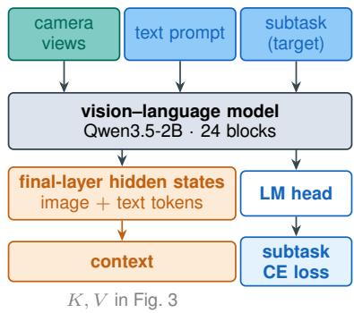  
(a) The VLM encoder

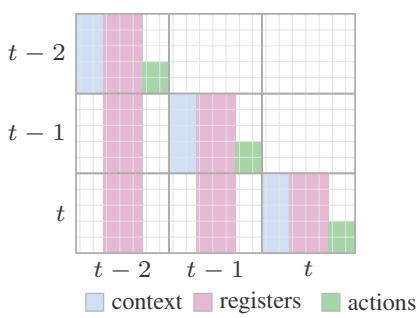  
(b) Attention pattern, K =3  
Figure 9: (a) The VLM encoder. It feeds the expert of Fig. 3 the encoded context. A vision–language model encodes the views and the prompt; its final-layer hidden states are the encoded context and its LM head predicts the subtask. (b) The registers and noisy action tokens of a frame cross-attend the context of that frame and self-attend the registers of the K frames up to it, so the past reaches the current chunk only through the registers, and only these are kept for later frames.

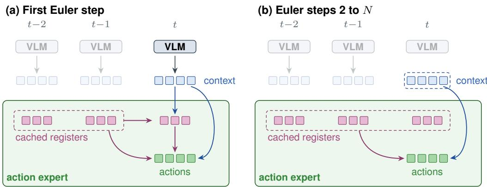  
Figure 10: Register cache at inference (K=3). (a) In the first Euler step of a chunk, the VLM encodes the current frame t. The registers of frame t read its context and the cached registers of frames t−1 and t−2. The action tokens read the context and the registers of the three frames; past frames are not encoded again. (b) In the N−1 other Euler steps, only the action tokens are updated, and they read the context and the register keys and values from the cache. The registers do not read the action tokens and skip adaptive normalisation, so they do not depend on the flow time and are computed once per frame. When the next frame enters, the registers of frame t−2 are dropped.

What it costs. Figure 5d gives the measurement. On one H100, a chunk takes 22.1 ms without registers, 22.6 ms at K=1 and 22.8 ms at K=3, the window used for training and evaluation. Even at $K { = } 3 2$ , a chunk takes only 24.6 ms. The cache adds about 2 MiB of GPU memory per past frame, 4 MiB at $K { = } 3 .$ , on a policy of 4.7 GiB.

Protocol. Every measurement is taken on one H100, with two 256×256 cameras, a chunk of 10 actions and N=10 Euler steps, in bf16, with the expert and the VLM prefill run as CUDA graphs. Each value is the median of two interleaved repetitions of 200 chunks. The split by phase comes from a separate pass with a synchronisation after each phase, scaled to the median total. The model is trained and evaluated at $K { = } 3$ . The longer windows are used only for these measurements.

Table 1: Robot embodiments in the training mixture. “EE” = end-effector pose; “J” = joint angles; “∆” = delta (relative) commands, otherwise absolute; “G” = parallel gripper; “DH” = dexterous hand; “W” = waist/torso; “B” = mobile base. A robot may appear under several conventions across its source datasets.
<table><tr><td>Robot</td><td>Action type</td><td>Sources</td></tr><tr><td>Single-arm</td><td></td><td></td></tr><tr><td>WidowX</td><td> $\Delta \mathrm { E E } + \mathbf { G }$ </td><td>(Walke et al., 2023)</td></tr><tr><td>Google Robot</td><td> $\Delta \mathrm { E E } + \mathbf { G }$ </td><td>(Brohan et al., 2023; Jang et al., 2022)</td></tr><tr><td>Franka Panda</td><td> $\Delta \mathrm { E E } + \mathrm { G } ; \mathrm { J } + \mathrm { G }$ </td><td>(Open X-Embodiment Collaboration, 2024; Bharadhwaj et al., 2024; Wu et al., 2025a; Khazatsky</td></tr><tr><td>UR5e</td><td> $\mathbf { J } + \mathbf { G }$ </td><td>et al., 2024; Tian et al., 2026) (Wu et al., 2025a)</td></tr><tr><td>Dual-arm</td><td></td><td></td></tr><tr><td>AgileX Cobot Magic</td><td> $\mathbf { J } + \mathbf { G }$ </td><td>(Wu et al., 2025b;a; Liu et al., 2025)</td></tr><tr><td>ALOHA</td><td> $\mathbf { J } + \mathbf { G }$ </td><td>(Tian et al., 2026)</td></tr><tr><td>AgiBot G1</td><td> $\mathbf { J } + \mathbf { G }$ </td><td>(Tian et al., 2026)</td></tr><tr><td>AgiBot G2A</td><td> $\begin{array} { r } { \mathbf { J } + \mathbf { G } + \mathbf { W } } \end{array}$ </td><td>(AgiBot World Team, 2026)</td></tr><tr><td>Galaxea R1 Lite</td><td> $\mathbf { J } + \mathbf { G } + \mathbf { W } + \mathbf { B } ; \mathbf { J } + \mathbf { G }$ </td><td>(Jiang et al., 2025; Wu et al., 2025b)</td></tr><tr><td>Dual Franka FR3</td><td> $\mathbf { J } + \mathbf { G }$ </td><td>(Wu et al., 2025a)</td></tr><tr><td>AgiBot A2D</td><td> $\mathbf { J } + \mathbf { G }$ </td><td>(Wu et al., 2025b)</td></tr><tr><td>Galbot G1</td><td> $\mathbf { J } + \mathbf { G }$ </td><td>(Wu et al., 2025b)</td></tr><tr><td>RealMan RMC-AIDA-L</td><td> $\mathbf { J } + \mathbf { G }$ </td><td>(Wu et al., 2025b)</td></tr><tr><td>AI2 AlphaBot 2 YAM</td><td> $\mathbf { J } + \mathbf { G }$   $\mathbf { J } + \mathbf { G }$ </td><td>(Wu et al., 2025b)</td></tr><tr><td>Bimanual Panda</td><td></td><td>(Allshire et al., 2026)</td></tr><tr><td>Fourier GR-1</td><td> $\Delta E E + \bf G ; \Delta \Delta E E + D H$ </td><td>(Bjorck et al., 2025)</td></tr><tr><td>TienKung</td><td> $\mathrm { J + D H }$ </td><td>(Bjorck et al., 2025)</td></tr><tr><td></td><td> $\mathbf { J } + \mathbf { G } ; \mathbf { J } + \mathbf { D } \mathbf { H }$ </td><td>(Wu et al., 2025a)</td></tr><tr><td>AIRBOT MMK2</td><td> $\mathrm { J + D H }$ </td><td>(Wu et al., 2025b)</td></tr><tr><td>Unitree G1</td><td> $\mathrm { J + D H }$ </td><td>(Wu et al., 2025b)</td></tr><tr><td>Kuavo</td><td> $\mathrm { J + D H }$ </td><td>(Wu et al., 2025b)</td></tr><tr><td>Human</td><td></td><td></td></tr><tr><td>Real Human</td><td> $\Delta \mathrm { E E } + \mathrm { e i g e n g r a s p }$ </td><td>(Hoque et al., 2026; Punamiya et al., 2026; Ropedia, 2026)</td></tr></table>

## B DATA

## B.1 ROBOT EMBODIMENTS

Table 1 lists the robots of the pretraining mixture with their action conventions and source datasets. From Open X-Embodiment, the mixture uses twelve datasets: Taco Play, Stanford Hydra, NYU Franka Play, BC-Z, RT-1, Furniture Bench, Austin Sailor, Austin BUDS, UT Austin MUTEX, Berkeley Cable Routing, VIOLA and Berkeley RPT. The joint-delta actions of Berkeley RPT and RoboSet are converted to end-effector deltas by forward kinematics. A robot appears under several conventions when its datasets command it differently, joint angles in one and end-effector deltas in another. The state projection of §3.2 is selected by state layout and control convention, and the action statistics of §5.1 are per dataset, so no source is remapped to another’s convention. A state layout is the ordered list of state channels a dataset records, for example the joint angles and gripper opening of each arm, and fixes the input width $d _ { s }$ of its projection.

## B.2 DATA CURATION

Aggregating data across embodiments, simulators, and collection pipelines introduces heterogeneous noise: sensor outliers, temporal state-action misalignment, and inconsistent conventions across datasets sharing a robot.

• Channel selection. We keep only the degrees of freedom the policy commands, dropping derived or uncontrolled channels: forward-kinematic end-effector poses, joint velocities, efforts, IMU readings, and telepresence-parked head, waist, and leg joints.

• Degenerate episodes. We discard static and near-zero-variance recordings, including episodes whose follower arm never moves, a failure mode Qwen-RobotManip reports for ∼81% of RoboMIND’s UR subset.

• Sudden jumps. We fit a smooth trend to each channel with median and Savitzky–Golay filters, and flag a frame when its residual and its acceleration or jerk exceed a per-channel threshold, the larger of 0.05 in raw units and four times the pooled 95th percentile. Grippers are exempt. Whole episodes are removed only from InternData-A1, where simulator collisions cause the jumps (6.3% of its episodes).

• Action representation. Rotations are harmonised to one Euler parameterisation; other conventions are kept as the source provides them. Each action dimension is mapped to [−1, 1] from its per-dataset 1st and 99th percentiles (Wang et al., 2026a), which removes scale differences across embodiments while preserving relative motion within each source.

• Convention correction. We fix per-dataset sign conventions that would otherwise break cross-dataset consistency $( e . g .$ , a sign-flipped elbow joint in InternData); differing scales and encodings are then absorbed by the per-dataset normalisation.

## B.3 SAMPLING WEIGHTS

During pretraining, each dataset d is sampled with probability proportional to $F _ { d } ^ { 0 . 5 } L _ { d } ^ { 0 . 5 } V _ { d } ^ { 0 . 3 5 }$ (Table 2). $F _ { d }$ is its number of frames, and $L _ { d }$ and $V _ { d }$ are its language and vision diversity, each divided by its median over the datasets. Datasets from the same source are grouped before weighting.

Both diversities are the effective rank of a set of L2-normalised embeddings, $2 ^ { H ( p ) }$ with $p _ { i } ~ =$ $\sigma _ { i } ^ { 2 } / \sum _ { j } \sigma _ { j } ^ { 2 }$ , where $\sigma _ { i }$ are the singular values of the embedding matrix. The embeddings are not centred, so that a dataset with two distinct instructions does not collapse to rank one. For the language diversity, the rows are the SigLIP (Zhai et al., 2023) text embeddings of the distinct episode task strings, each scaled by the square root of the fraction of frames it covers. For the vision diversity, the rows are the DINOv3 (Siméoni et al., 2025) class tokens of every 15th frame of the main external camera, at most 50,000 frames per dataset.

The RoboCOIN and InternData-A1 collections are further weighted by 0.5, and the weights are capped so that no dataset is seen more than four times.

## B.4 EGOCENTRIC DATA

Sources. The three egocentric sources differ in capture conditions: EgoDex is seated tabletop recordings on Apple Vision Pro, EgoVerse head-mounted rigs, and Xperience in-the-wild movingcamera footage. Frame rates range from 20 to 30 Hz and are left unaltered; the differences are absorbed by the per-dataset quantile normalisation of §5.1.

Action target. We follow the layout of Qwen-VLA’s egocentric target (Wang et al., 2026a): per hand, a 6-dimensional wrist motion as translation and axis-angle rotation, and 10 articulation coefficients, 32 dimensions in total. Unlike Qwen-VLA, which expresses the wrist relative to its own initial pose, we express it in the observation camera frame through the rigid transform $T _ { \mathrm { c a m } } ^ { - 1 } T _ { \mathrm { w r i s t } }$ . The articulation coefficients are the first 10 principal components (“eigengrasps”) of the finger-joint configuration under a PCA basis shared across our three sources. The target is defined relative to the frame that opens each action chunk, so it is composed at load time from the stored world-frame wrist poses and per-frame camera poses rather than precomputed.

State and pacing. The egocentric data have no proprioceptive state, and the policy receives a learned null state in its place. Human hands move faster than a teleoperated robot, so the human actions are slowed down in time (Yuan et al., 2026). Waypoint i of a chunk is the hand pose at time $i \rho / f$ after the observation, where $f$ is the frame rate of the recording and $\rho \leq 1$ a per-source pace (Table 2). The pose is interpolated between the two nearest frames. A one-second chunk at $\rho = 0 . 2 5$ thus holds a quarter of a second of human motion.

## B.5 VISION–LANGUAGE DATA

REKI is co-trained on vision–language data at 10% of the training samples (Table 2). The pool is every FineVision (Wiedmann et al., 2025) dataset except the text-only ones, plus the LLaVA-OneVision-1.5 (An et al., 2025) datasets that FineVision does not already contain, ∼20.2M samples. We keep the datasets covering the tasks most relevant to manipulation: natural-scene objects and attributes, spatial relations, counting, grounding, captioning, scene text, and knowledge and commonsense VQA. Documents, charts, tables, mathematics, code, transcription, GUI grounding, memes and puzzles are dropped. 60 datasets remain, 7.64M samples or 37.8% of the pool. One question–answer pair is drawn per sample and sampling is uniform over samples, so exposure is proportional to the size of a dataset.

The 51 kept from FineVision are a\_okvqa (Schwenk et al., 2022), alfworldgpt (Shridhar et al., 2021), allava\_laion (Chen et al., 2024a), allava\_vflan (Chen et al., 2024a), aokvqa (Schwenk et al., 2022), art (Chng et al., 2019), cambrian(filtered)\_processed (Tong et al., 2024), clevr (Lindström & Abraham, 2022), clevr\_math (Lindström & Abraham, 2022), coco\_colors (Karakus, 2024), cocoqa (Ren et al., 2015), cocotext (Veit et al., 2016), densefusion\_1m (Li et al., 2024), drivelm (Sima et al., 2024), est\_vqa (Wang et al., 2020), google\_landmarks (Weyand et al., 2020), image\_textualization(filtered) (Pi et al., 2024), indoor\_qa (Quattoni & Torralba, 2009), laion\_gpt4v (LAION, 2023), LLaVA\_Instruct\_150K (Liu et al., 2023c), lnqa (Pont-Tuset et al., 2020), localized\_narratives (Pont-Tuset et al., 2020), lrv\_normal(filtered) (Liu et al., 2024a), lvis\_instruct4v (Wang et al., 2023), mimic\_cgd (Laurençon et al., 2024), mmevol (Luo et al., 2024), nlvr2 (Suhr et al., 2017), objects365\_qa (Shao et al., 2019), ocrvqa (Mishra et al., 2019), oodvqa (Tu et al., 2023), scienceqa (Lu et al., 2022), scienceqa(nona\_context) (Lu et al., 2022), sharegpt4o (OpenGVLab, 2024), sharegpt4v(coco) (Chen et al., 2024b), sharegpt4v(knowledge) (Chen et al., 2024b), sharegpt4v(llava) (Chen et al., 2024b), sharegpt4v(sam) (Chen et al., 2024b), sketchyvqa (Tu et al., 2023), spatialsense (Yang et al., 2019), spot\_the\_diff (Jhamtani & Berg-Kirkpatrick, 2018), st\_vqa (Biten et al., 2019), super\_clevr(mathv360k) (Li et al., 2023), tallyqa (Acharya et al., 2019), textcaps (Sidorov et al., 2020), textocr(gpt4v) (Carter, 2024), textvqa (Singh et al., 2019), vision\_flan(filtered) (Xu et al., 2024), visual7w (Zhu et al., 2016), vqav2 (Goyal et al., 2017), vsr (Liu et al., 2023b), and wildvision (Lu et al., 2024). The nine kept from LLaVA-OneVision-1.5 are gqa (Hudson & Manning, 2019), llava\_cot\_100k (Xu et al., 2025), llava\_wild (Liu et al., 2023c), llrv\_gpt4v (Liu et al., 2024a), sherlock (Hessel et al., 2022), svit (Zhao et al., 2023a), viquae (Lerner et al., 2022), vision\_oritented, and visual\_chat.

To these we add the object- and free-space-reference splits of RoboPoint (Yuan et al., 2024), the 2D and 3D splits of RefSpatial (Zhou et al., 2025), and PixMo-Points (Deitke et al., 2025) rewritten as pointing and counting questions, all with coordinates on a [0, 1000] grid.

## C TRAINING CONFIGURATION

Table 2 lists the training configuration. Table 3 gives the node count, the number of steps and the settings that differ between pretraining and the five finetuning runs. Settings absent from Table 3 are those of Table 2 in every run.

## C.1 CAMERA SELECTION

In pretraining, two rules remove cameras from a sample after the random camera dropout. When two or more side cameras remain, one of them is kept at random and the others are removed. On a two-arm robot with both wrist cameras present, the wrist camera of a static arm is removed. An arm is static when, over the action chunk, every action dimension of the arm varies by less than 0.1 of its standard deviation in the dataset. Both rules keep at least one camera other than the overhead camera. Finetuning uses neither rule. Random camera dropout never removes the overhead camera, except in LIBERO finetuning (Table 3).

Table 2: Training configuration.
<table><tr><td>Setting</td><td>Value</td></tr><tr><td>Encoder</td><td></td></tr><tr><td>Vision-language backbone</td><td>Qwen3.5-2B (18 gated-DeltaNet + 6 full-attention layers)</td></tr><tr><td>Image resolution</td><td>native, up to 448×448</td></tr><tr><td>Expert conditioning</td><td>cross-attention to the final-layer backbone states in every expert block</td></tr><tr><td>Trainable components</td><td>backbone at a reduced LR (Table 3), last 4 vision blocks, expert</td></tr><tr><td>Vision-language co-training</td><td>10%: FineVision (subset), LLaVA-OneVision-1.5 (subset), RoboPoint, RefSpatial, PixMo</td></tr><tr><td>Text loss (subtask, vision-language data)</td><td>cross-entropy, weight 0.1, pretraining only</td></tr><tr><td>Prompt-field dropout</td><td>0.15 (embodiment), 0.2 (control frequency, speed)</td></tr><tr><td>Action expert</td><td></td></tr><tr><td>Size</td><td>10 blocks, 768 hidden, 12 heads, 3072 MLP</td></tr><tr><td>Precision</td><td>bfloat16, flow heads in fp32</td></tr><tr><td>Proprioception</td><td>per-layout linear layer with GELU, shared zero-initialised projection, summed into the adaptive-normalisation conditioning</td></tr><tr><td>Proprioception dropout</td><td>0.2</td></tr><tr><td>Registers per frame Window</td><td>32</td></tr><tr><td></td><td>K = 3 frames at a 1 s stride</td></tr><tr><td>Action generation</td><td></td></tr><tr><td>Action chunk Objective</td><td>1 s (round(control freq.) steps)</td></tr><tr><td></td><td>flow matching, DoF-balanced</td></tr><tr><td>Time-step distribution Flow draws per forward pass</td><td>Beta</td></tr><tr><td></td><td>8</td></tr><tr><td>Data</td><td>OXE, DROID, AgiBot, RoboMIND, Galaxea, RoboSet, RDT,</td></tr><tr><td>Robot corpora</td><td>RoboCOIN, GR00T, InternData, ABC</td></tr><tr><td>Egocentric human video</td><td>EgoDex, EgoVerse, Xperience</td></tr><tr><td>Sampling weight</td><td>∝ {#frames }0.5 {language diversity }0.5 {vision diversity }0.35 (Appendix B.3)</td></tr><tr><td>Normalisation</td><td>quantile (1st / 99th percentile)</td></tr><tr><td>Action-speed alignment</td><td>EgoDex 0.6, EgoVerse 0.25, Xperience 1 (unchanged)</td></tr><tr><td>Vision &amp; augmentation</td><td></td></tr><tr><td>Camera dropout</td><td>0.15 per camera in pretraining, 0.2 in finetuning; at least one camera kept</td></tr><tr><td>Camera order</td><td>shuffled</td></tr><tr><td>Colour jitter</td><td>brightness, contrast, saturation × U(0.8, 1.2), drawn for each frame of the window and shared by all cameras of the frame</td></tr><tr><td>Random crop</td><td>overhead and side cameras, scale U(0.95, 1), one box per camera for the window; pretraining and LIBERO only</td></tr><tr><td>Optimisation</td><td></td></tr><tr><td>Learning rate</td><td>expert:  $1 \times 1 0 ^ { - 4 }$  , VLM: 1× 10−5 to 3× 10−5 (Table 3)</td></tr><tr><td>Weight decay</td><td>0</td></tr><tr><td>Gradient clipping</td><td>1.0</td></tr><tr><td>Schedule</td><td>constant with warmup (1,000 steps when finetuning the pretrained model, 5,000 otherwise), then decay over the last 5,000 steps</td></tr><tr><td></td><td>(finetuning only)</td></tr><tr><td>Weight averaging</td><td>EMA, decay 0.999</td></tr><tr><td>Gradient checkpointing</td><td>√</td></tr></table>

## C.2 MIRRORING

A sample is mirrored with probability 0.5 in the finetuning runs on RoboTwin, RoboCasa365 and RoboCasa-GR1 (Table 3). The images are flipped horizontally, and the state and the actions are reflected through the same plane. On a two-arm robot, the two arms and their wrist cameras are swapped. The prompt of a mirrored sample starts with [MIRROR WORLD], and its state goes through a separate projection with separate normalisation statistics. The policy is evaluated in the unmirrored world only.

Table 3: Per-run setup of REKI for pretraining and the five finetuning runs, and the number of evaluation rollouts per task. The two RoboTwin runs are finetuned on the Clean demonstrations alone (Clean2Rand) and on Clean and Randomised together (in-distribution). ∗Multiplied by the language and vision diversity terms of Appendix B.3.
<table><tr><td rowspan="2"></td><td rowspan="2">Pretraining</td><td rowspan="2">LIBERO</td><td colspan="2">RoboTwin</td><td rowspan="2">RoboCasa365</td><td rowspan="2">RoboCasa-GR1</td></tr><tr><td>Clean</td><td>Clean+Rand</td></tr><tr><td>Nodes (8×H100)</td><td>4</td><td>1</td><td>1</td><td>3</td><td>4</td><td>3</td></tr><tr><td>Steps</td><td>200k</td><td>15k</td><td>20k</td><td>25k</td><td>25k</td><td>25k</td></tr><tr><td>Wall-clock time (h)</td><td>176</td><td>5.2</td><td>10.9</td><td>14.2</td><td>12.5</td><td>8.3</td></tr><tr><td>GPU-hours</td><td>5,632</td><td>41</td><td>87</td><td>341</td><td>401</td><td>199</td></tr><tr><td>Backbone LR (× expert LR)</td><td>0.1</td><td>0.3</td><td>0.2</td><td>0.3</td><td>0.3</td><td>0.2</td></tr><tr><td>Sampling weights ∝√#frames</td><td>√*</td><td>x</td><td>x</td><td>√</td><td>x</td><td>x</td></tr><tr><td>Overhead-camera dropout</td><td>x</td><td>√</td><td>x</td><td>x</td><td>x</td><td>x</td></tr><tr><td>Mirroring (§5.3)</td><td>x</td><td>x</td><td>√</td><td>√</td><td>√</td><td>√</td></tr><tr><td>Evaluation rollouts per task</td><td>1</td><td>50</td><td>20</td><td>20</td><td>50</td><td>50</td></tr></table>

## D FULL BENCHMARK RESULTS

Tables 4 and 5 give the per-condition results summarised in Fig. 4, together with the in-distribution results on LIBERO and RoboTwin. Each LIBERO-Plus column perturbs one dimension: the camera viewpoint, the initial robot state, the language instruction, the lighting, the background texture, the sensor noise or the object layout. The Overall column is the success rate over all 10,030 perturbed episodes, so each dimension is weighted by its number of episodes (Fei et al., 2025). For the indistribution RoboTwin results, the models are finetuned on clean and randomised scenes together and evaluated on each (Clean, Rand). For Clean2Rand, the models are finetuned on clean scenes only and evaluated on clean scenes (Easy), under a randomised background, lighting, clutter or table height applied alone, and under all four together (Hard). The baseline numbers are taken from published results, and Table 7 gives the source of each one. The Clean2Rand row of Qwen-RobotManip (Yuan et al., 2026) is its joint-space variant. The LIBERO-Plus results of $\pi _ { 0 }$ and $\pi _ { 0 . 5 }$ are from the zero-shot block of ACoT-VLA (Zhong et al., 2026), which evaluated the released checkpoints. ACoT-VLA is initialised from $\pi _ { 0 . 5 }$ , so it is grouped with the models pretrained on in-house data. The LIBERO-Plus results of StarVLA are those of its Qwen3-VL-OFT model in the StarVLA repository. For Being-H0.7 and ABot-M0.5, the LIBERO-Plus Overall is pooled from the seven published dimensions, because the published total does not match them. The RoboCasa365 leaderboard is at https://robocasa.ai/leaderboard. On RoboCasa-GR1, the result of GR00T-N1.5 is that of the released checkpoint in the Isaac-GR00T repository (https://github.com/NVIDIA/Isaac-GR00T, branch n1.5-release), and the result of $\pi _ { 0 . 5 }$ is the one reported by StarVLA, which states no source for it. Parameter counts include the action expert, are rounded from exact counts and are read off the released checkpoints where available, including those of StarVLA and RLDX-1 (Kim et al., 2026). Qwen-RobotManip states no expert size; our expert follows its design, so we count 0.2B for it.

## D.1 PRETRAINING STEPS

Figure 11 gives the Clean2Rand success of REKI after 50k to 200k pretraining steps, and without pretraining. All models are finetuned on clean RoboTwin scenes as in Table 5, but with a backbone learning rate of 0.1 instead of 0.2 times the expert learning rate, and without learning-rate decay. The mean success rises from 53.7 without pretraining to 61.9 after 50k steps, and then by 3.4 points more up to 200k steps. The first 50k steps add most under clutter (19.5 points) and under the Hard condition (11.7 points).

Table 4: LIBERO and LIBERO-Plus results. All models are finetuned on LIBERO; LIBERO-Plus evaluates out-of-distribution robustness across seven perturbation dimensions. Italic: model not released at the time of writing. Bold: best in each column within each block, italic rows excluded. †Pooled from the seven reported dimensions, which the published total does not match.
<table><tr><td rowspan="2">Method</td><td colspan="2">#Params</td><td rowspan="2">LIBERO</td><td colspan="8">LIBERO-Plus</td></tr><tr><td>VLM</td><td>Expert</td><td>Camera</td><td>Robot</td><td>Language</td><td>Light</td><td>Backgd</td><td>Noise</td><td>Layout</td><td>Overall</td></tr><tr><td>No pretraining</td><td></td><td></td><td></td><td></td><td></td><td></td><td></td><td></td><td></td><td></td><td></td></tr><tr><td>StarVLA (StarVLA Community, 2026)</td><td>4.4B</td><td>0.1B</td><td>98.0</td><td>47.0</td><td>60.1</td><td>87.0</td><td>96.3</td><td>95.3</td><td>73.1</td><td>79.2</td><td>75.0</td></tr><tr><td>Qwen-RobotManip-scratch (Yuan et al., 2026)</td><td>4.5B</td><td>0.2B</td><td>98.2</td><td>70.4</td><td>44.9</td><td>88.1</td><td>95.8</td><td>95.5</td><td>84.4</td><td>79.1</td><td>78.3</td></tr><tr><td>REKI (ours) scratch</td><td>2.2B</td><td>0.2B</td><td>96.5</td><td>94.4</td><td>63.9</td><td>80.7</td><td>97.5</td><td>96.0</td><td>96.0</td><td>79.2</td><td>86.1</td></tr><tr><td>With pretraining – in-house data</td><td></td><td></td><td></td><td></td><td></td><td></td><td></td><td></td><td></td><td></td><td></td></tr><tr><td>π0 (Black et al., 2024)</td><td>2.9B</td><td>0.3B</td><td>94.4</td><td>61.0</td><td>40.8</td><td>63.5</td><td>89.3</td><td>84.1</td><td>80.1</td><td>76.4</td><td>69.4</td></tr><tr><td>π0.5 (Physical Intelligence et al., 2025)</td><td>2.9B</td><td>0.4B</td><td>97.6</td><td>75.8</td><td>79.4</td><td>83.3</td><td>95.5</td><td>95.0</td><td>89.6</td><td>87.0</td><td>85.7</td></tr><tr><td>ACoT-VLA (Zhong et al., 2026)</td><td>2.9B</td><td>0.9B</td><td>98.5</td><td>72.6</td><td>82.6</td><td>87.5</td><td>97.7</td><td>96.5</td><td>87.8</td><td>88.1</td><td>86.6</td></tr><tr><td>Being-H0.7 (Luo et al., 2026)</td><td>3B</td><td></td><td>99.2</td><td>82.0</td><td>59.0</td><td>82.8</td><td>97.8</td><td>90.0</td><td>93.5</td><td>88.5</td><td>84.0^†</td></tr><tr><td>Qwen-RobotManip (Yuan et al., 2026)</td><td>4.5B</td><td>0.2B</td><td>99.1</td><td>87.2</td><td>75.5</td><td>85.6</td><td>96.6</td><td>97.7</td><td>97.7</td><td>87.3</td><td>89.0</td></tr><tr><td>RLDX-1 (Kim et al., 2026)</td><td>5.3B</td><td>1.6B</td><td>97.8</td><td>75.0</td><td>91.8</td><td>92.2</td><td>97.1</td><td>95.5</td><td>80.3</td><td>80.7</td><td>86.7</td></tr><tr><td>With pretraining – public data only</td><td></td><td></td><td></td><td></td><td></td><td></td><td></td><td></td><td></td><td></td><td></td></tr><tr><td>ABot-M0 (Yang et al., 2026)</td><td>4.4B</td><td>0.2B</td><td>98.6</td><td>60.4</td><td>67.9</td><td>86.4</td><td>96.2</td><td>91.6</td><td>86.4</td><td>82.6</td><td>80.5</td></tr><tr><td>ABot-M0.5 (Chen et al., 2026)</td><td>5B</td><td>一</td><td>99.4</td><td>70.5</td><td>87.4</td><td>88.6</td><td>94.0</td><td>89.7</td><td>75.5</td><td>85.2</td><td>83.7†</td></tr><tr><td>InternVLA-À1.5 (Ma et al., 2026)</td><td>2.2B</td><td>0.5B</td><td>98.9</td><td>83.1</td><td>55.1</td><td>86.9</td><td>96.4</td><td>98.2</td><td>95.6</td><td>85.2</td><td>84.8</td></tr><tr><td>REKI (ours)</td><td>2.2B</td><td>0.2B</td><td>97.5</td><td>93.2</td><td>75.6</td><td>88.5</td><td>97.7</td><td>98.4</td><td>98.6</td><td>84.7</td><td>90.4</td></tr></table>

Table 5: RoboTwin results. Left: in-distribution results for models finetuned on clean and randomised scenes. Right: out-of-distribution evaluation on RoboTwin Clean2Rand, where models are finetuned on the Clean dataset only and tested under various environment randomisations. Italic: model not released at the time of writing. Bold: best in each column within each block, italic rows excluded.
<table><tr><td rowspan="2">Method</td><td colspan="2">#Params</td><td colspan="2">RoboTwin</td><td colspan="6">RoboTwin Clean2Rand</td></tr><tr><td>VLM</td><td>Expert</td><td>Clean</td><td>Rand</td><td>Easy</td><td>Backgd</td><td>Light</td><td>Clutter</td><td>Height</td><td>Hard</td></tr><tr><td>No pretraining</td><td></td><td></td><td></td><td></td><td></td><td></td><td></td><td></td><td></td><td></td></tr><tr><td>StarVLA (StarVLA Community, 2026)</td><td>4.4B</td><td>0.1B</td><td>88.2</td><td>88.3</td><td>58.1</td><td>27.1</td><td>50.9</td><td>24.2</td><td>48.4</td><td>10.6</td></tr><tr><td>Qwen-RobotManip-scratch (Yuan et al., 2026)</td><td>4.5B</td><td>0.2B</td><td>88.7</td><td>88.4</td><td>71.6</td><td>60.6</td><td>70.7</td><td>24.6</td><td>63.6</td><td>22.6</td></tr><tr><td>REKI (ours) scratch</td><td>2.2B</td><td>0.2B</td><td>83.0</td><td>83.8</td><td>67.1</td><td>62.4</td><td>68.2</td><td>27.5</td><td>60.7</td><td>26.3</td></tr><tr><td>With pretraining – in-house data</td><td></td><td></td><td></td><td></td><td></td><td></td><td></td><td></td><td></td><td></td></tr><tr><td>π0 (Black et al., 2024)</td><td>2.9B</td><td>0.3B</td><td>65.9</td><td>58.4</td><td></td><td></td><td></td><td></td><td></td><td></td></tr><tr><td>π0.5 (Physical Intelligence et al., 2025)</td><td>2.9B</td><td>0.4B</td><td>82.7</td><td>76.8</td><td>73.1</td><td>67.0</td><td>69.2</td><td>57.9</td><td>67.6</td><td>47.9</td></tr><tr><td>GR00T-N1.7 (Bjorck et al., 2025)</td><td>1.5B</td><td>1.6B</td><td></td><td></td><td>43.6</td><td>40.4</td><td>41.9</td><td>27.1</td><td>39.0</td><td>20.7</td></tr><tr><td>Being-H0.7 (Luo et al., 2026)</td><td>3B</td><td></td><td>90.2</td><td>89.6</td><td></td><td></td><td></td><td></td><td></td><td></td></tr><tr><td>Qwen-RobotManip (Yuan et al., 2026)</td><td>4.5B</td><td>0.2B</td><td>93.4</td><td>92.5</td><td>73.2</td><td>74.6</td><td>68.4</td><td>61.3</td><td>71.0</td><td>62.6</td></tr><tr><td>With pretraining – public data only</td><td></td><td></td><td></td><td></td><td></td><td></td><td></td><td></td><td></td><td></td></tr><tr><td>ABot-M0 (Yang et al., 2026)</td><td>4.4B</td><td>0.2B</td><td>86.1</td><td>85.1</td><td>70.7</td><td>56.5</td><td>68.8</td><td>46.0</td><td>56.3</td><td>36.0</td></tr><tr><td>ABot-M0.5 (Chen et al., 2026)</td><td>5B</td><td></td><td>94.0</td><td>94.2</td><td></td><td></td><td></td><td></td><td></td><td></td></tr><tr><td>InternVLA-A1.5 (Ma et al., 2026)</td><td>2.2B</td><td>0.5B</td><td>93.3</td><td>93.0</td><td></td><td>71.3</td><td></td><td></td><td></td><td></td></tr><tr><td>REKI (ours)</td><td>2.2B</td><td>0.2B</td><td>85.9</td><td>84.6</td><td>73.4</td><td></td><td>73.5</td><td>57.8</td><td>69.9</td><td>48.7</td></tr></table>

## D.2 FINETUNING ABLATIONS

Table 8 compares the LIBERO finetuning configuration of REKI with variants that add mirroring, remove one augmentation or lower the backbone learning rate, all evaluated on LIBERO-Plus. It also compares finetuning on RoboCasa365 with and without mirroring. All variants use a memory window of K=3 and the same number of finetuning steps.

Mirroring. On RoboCasa365, mirroring (Appendix C.2) adds 4.9 points on average, mostly on the atomic tasks (+6.2) and the seen composite tasks (+7.9). On LIBERO-Plus, mirroring improves four of the seven perturbation dimensions, by 0.2 to 1.7 points. However, it lowers the camera dimension by 6.5 points, so the overall score drops by 0.6. A possible explanation is that the policy infers whether the world is mirrored from the images as well as from the prompt. A large change of the camera viewpoint may then confuse the policy about whether the world is mirrored.

Visual augmentation. Disabling camera dropout or the image augmentations (colour jittering and random cropping) causes a large drop on the camera dimension of LIBERO-Plus, by 21.5 and 23.6 points. This suggests that these augmentations make the policy robust to changes of the camera viewpoint. They also give a small gain on the sensor noise and object layout dimensions, of 1.6 to 4.6 points. For camera dropout, a likely reason is the wrist camera: the policy is trained to act from the wrist image alone, and the camera and sensor-noise perturbations of LIBERO-Plus change only the image of the external camera (Fei et al., 2025).

Table 6: RoboCasa365 results behind Fig. 4d, on the 50 target tasks of the multi-task setting. Hatched in Fig. 4d, and marked ∗ here: pretrained on in-house data. Italic: model not released at the time of writing.
<table><tr><td rowspan="2"></td><td rowspan="2">#Params</td><td rowspan="2">Atomic</td><td colspan="2">Composite</td><td rowspan="2">Avg</td></tr><tr><td>Seen</td><td>Unseen</td></tr><tr><td>Xiaomi-Robotics-1* (Xiaomi Robotics Team, 2026)</td><td>5.1B</td><td>80.2</td><td>57.1</td><td>32.1</td><td>57.4</td></tr><tr><td>ABot-M0.5 (Chen et al., 2026)</td><td>5B</td><td>75.9</td><td>38.3</td><td>2.7</td><td>40.4</td></tr><tr><td>RLDX-1* (Kim et al., 2026)</td><td>6.9B</td><td>67.6</td><td>27.9</td><td>8.5</td><td>36.0</td></tr><tr><td>Qwen-RobotManip* (Yuan et al., 2026)</td><td>4.7B</td><td>68.6</td><td>20.1</td><td>14.9</td><td>35.9</td></tr><tr><td>GR00T-N1.5* (Bjorck et al., 2025)</td><td>2.4B</td><td>50.7</td><td>14.8</td><td>2.7</td><td>23.9</td></tr><tr><td>GR00T-N1.6* (Bjorck et al., 2025)</td><td>3.0B</td><td>51.1</td><td>9.4</td><td>1.7</td><td>21.9</td></tr><tr><td>π0.5* (Physical Intelligence et al., 2025)</td><td>3.3B</td><td>39.6</td><td>7.1</td><td>1.2</td><td>16.9</td></tr><tr><td>REKI (ours)</td><td>2.4B</td><td>65.8</td><td>32.0</td><td>14.1</td><td>38.4</td></tr></table>

Table 7: Source of each baseline result in Tables 4 to 6 and Fig. 4e. Paper: the paper of the model. The name of another model: the paper of that model, which reports the result. Checkpoint card: the card of the released checkpoint. Repository: the per-task table of the released checkpoint in the README of the repository of the model. Leaderboard: the RoboCasa365 leaderboard. –: no published result.
<table><tr><td>Method</td><td>LIBERO</td><td>LIBERO-Plus</td><td>RoboTwin Clean, Rand</td><td>RoboTwin Clean2Rand</td><td>RoboCasa365</td><td>RoboCasa-GR1</td></tr><tr><td colspan="7">No pretraining</td></tr><tr><td>StarVLA</td><td>Qwen-RobotManip</td><td>repository</td><td>checkpoint card</td><td>Qwen-RobotManip</td><td>一</td><td>paper</td></tr><tr><td>Qwen-RobotManip-scratch</td><td>paper</td><td>paper</td><td>paper</td><td>paper</td><td></td><td></td></tr><tr><td colspan="7">With pretraining – in-house data</td></tr><tr><td>π0</td><td>Qwen-RobotManip</td><td>ACoT-VLA</td><td>InternVLA-A1.5</td><td></td><td></td><td></td></tr><tr><td>π0.5</td><td>Qwen-RobotManip</td><td>ACoT-VLA</td><td>Qwen-RobotManip</td><td>Qwen-RobotManip</td><td>leaderboard</td><td>StarVLA</td></tr><tr><td>ACoT-VLA</td><td>paper</td><td>paper</td><td></td><td></td><td></td><td></td></tr><tr><td>GR00T-N1.5 GR00T-N1.6</td><td></td><td></td><td></td><td></td><td>leaderboard</td><td>repository</td></tr><tr><td>GR00T-N1.7</td><td></td><td></td><td></td><td></td><td>leaderboard</td><td></td></tr><tr><td>Being-H0.7</td><td>Qwen-RobotManip</td><td>Qwen-RobotManip</td><td>paper</td><td>Qwen-RobotManip</td><td></td><td></td></tr><tr><td>Qwen-RobotManip</td><td>paper</td><td>paper</td><td>paper</td><td></td><td>paper</td><td>paper</td></tr><tr><td>RLDX-1</td><td></td><td>paper</td><td></td><td>paper</td><td>leaderboard</td><td>paper</td></tr><tr><td>Xiaomi-Robotics-1</td><td>paper</td><td></td><td></td><td></td><td>leaderboard</td><td></td></tr><tr><td colspan="7">With pretraining – public data only</td></tr><tr><td colspan="7"></td></tr><tr><td>ABot-M0</td><td>paper</td><td>paper</td><td>paper</td><td>Qwen-RobotManip</td><td></td><td>paper</td></tr><tr><td>ABot-M0.5</td><td>paper</td><td>paper</td><td>paper</td><td></td><td>paper</td><td></td></tr><tr><td>InternVLA-A1.5</td><td>paper</td><td>paper</td><td>paper</td><td></td><td></td><td></td></tr></table>

State dropout. Disabling state dropout lowers the robot dimension by 8.1 points: state dropout makes the policy robust to changes of the initial state of the robot.

Backbone learning rate. Lowering the backbone learning rate from 0.3 to 0.1 times the expert learning rate lowers the overall score by 3.3 points. The largest drops are on the camera and robot dimensions, by 11.9 and 4.6 points.

## D.3 TRAINING BUDGETS OF THE COMPARED METHODS

Table 9 collects the training budgets published for the methods compared in Tables 4 and 5. Qwen-RobotManip, its scratch variant, ABot-M0.5 and GR00T-N1.7 state no budget for the compared runs and are left out, as is ACoT-VLA, which is built on $\pi _ { 0 . 5 }$ <sub>5</sub>. No compared method reports wall-clock time or accelerator-hours, so the success rates of those tables are not matched for training compute.

## D.4 INFERENCE LATENCY OF THE COMPARED METHODS

In §6.3, each model is timed with its released checkpoint and inference code on one H100 (driver 570, CUDA 12.8), one model per process, at batch size one. The observations are synthetic and seeded, with new images and state at every chunk. In the LIBERO setting, each model receives two 256×256 images, an 8-D state and a fixed prompt, and applies its own resizing and tokenisation. Each repetition is one warm-up episode followed by 320 timed chunks, and runs as a separate job on its own GPU of a node reserved for the timing. ABot-M0.5 takes several seconds per chunk, so each of its repetitions times 80 chunks, in four episodes of 20. The end-to-end time runs from the numpy observation to the unnormalised numpy actions. The model time starts from preprocessed tensors on the device, and the GPU time sums the CUDA kernel durations of a chunk, from a profiler pass taken last in the process. Eager runs use inference mode where the released code does, and fp32 runs enable TF32, as the LeRobot evaluation (Cadene et al., 2024) does. Every run has to load the released weights strictly, return finite actions of the right shape that change with the input, and keep at least 95% of them within the action range of the checkpoint. The official compiled path of InternVLA-A1.5 is slower than eager, and its optimized path returns non-finite actions after the first chunk, which we avoid by keeping one autocast context open for the whole process. For X-VLA, ABot-M0, InternVLA-A1.5 and ABot-M0.5, we also build a compiled path over the released code, without changing the computation. These runs show what the models can reach, not what their users get. The phase times of REKI and InternVLA-A1.5 in §6.3 come from a separate run on one exclusive node (Table 10).

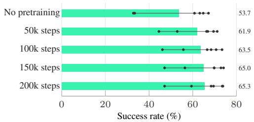  
Figure 11: Pretraining. RoboTwin Clean2Rand success rate of REKI against the number of pretraining steps. The bars give the mean over the six conditions, and the dots the individual conditions.

Table 8: Finetuning ablations, memory window K=3. Each row changes one setting of the reported configuration (bold).
<table><tr><td>LIBERO-Plus</td><td>Camera</td><td>Robot</td><td>Language</td><td>Light</td><td>Backgd</td><td>Noise</td><td>Layout</td><td>Overall</td></tr><tr><td>REKI</td><td>93.2</td><td>75.6</td><td>88.5</td><td>97.7</td><td>98.4</td><td>98.6</td><td>84.7</td><td>90.4</td></tr><tr><td>With mirroring</td><td>86.7</td><td>77.3</td><td>88.7</td><td>98.6</td><td>99.6</td><td>98.3</td><td>84.3</td><td>89.8</td></tr><tr><td>Without colour jitter and crop</td><td>69.6</td><td>74.8</td><td>90.4</td><td>97.9</td><td>97.8</td><td>96.6</td><td>80.1</td><td>85.7</td></tr><tr><td>Without camera dropout</td><td>71.7</td><td>76.5</td><td>90.8</td><td>99.0</td><td>98.4</td><td>94.7</td><td>83.1</td><td>86.8</td></tr><tr><td>Without state dropout</td><td>95.4</td><td>67.5</td><td>87.1</td><td>98.4</td><td>97.8</td><td>98.3</td><td>82.8</td><td>89.0</td></tr><tr><td>Backbone LR 0.1× expert LR</td><td>81.3</td><td>71.0</td><td>86.7</td><td>98.5</td><td>98.0</td><td>97.8</td><td>82.8</td><td>87.1</td></tr></table>

<table><tr><td rowspan="2">RoboCasa365</td><td rowspan="2">Atomic</td><td colspan="2">Composite</td><td rowspan="2">Avg</td></tr><tr><td>Seen</td><td>Unseen</td></tr><tr><td>Without mirroring</td><td>59.6</td><td>24.1</td><td>13.5</td><td>33.5</td></tr><tr><td>With mirroring</td><td>65.8</td><td>32.0</td><td>14.1</td><td>38.4</td></tr></table>

## E REAL ROBOT EXPERIMENTS

## E.1 TASKS AND SCORING

We evaluate on five tasks. Partial credit is awarded for each completed subtask, such as a successful grasp or placement. For tasks with an imposed ordering, a penalty is applied when objects are handled in the wrong order. An episode counts as a full success only when every subtask is completed in the correct order. The first two tasks involve a single object and are shorter-horizon. The remaining three require manipulating two or three objects in a prescribed order, so the policy must keep track of which steps have already been completed.

• place\_banana\_in\_box: pick the yellow banana and place it in the box. Partial credit: 0.5 for grasp; 0.5 for placement (only 0.25 if partially inside the box).

Table 9: Training budgets of the compared methods as optimiser steps, global batch size and training samples seen (batch × steps). A sample is one timestep with the action chunk that follows it. None of the methods reports accumulating gradients. –: not reported or not applicable. Values not stated in the papers are read off the released code or checkpoints. Being-H0.7 states an approximate batch of 128 packed trajectory chunks for all its finetuning runs. For REKI, the batch is K=3 frames times the number of windows. This is an upper bound, since a batch is trimmed to a token budget. A slash separates the Clean and Clean+Rand RoboTwin runs.
<table><tr><td rowspan="2">Method</td><td colspan="3">Pretraining</td><td colspan="3">LIBERO</td><td colspan="3">RoboTwin</td></tr><tr><td>Steps</td><td>Batch</td><td>Samples</td><td>Steps</td><td>Batch</td><td>Samples</td><td>Steps</td><td>Batch</td><td>Samples</td></tr><tr><td colspan="10">No pretraining</td></tr><tr><td>StarVLA (StarVLA Community, 2026)</td><td></td><td></td><td></td><td></td><td></td><td></td><td>140k</td><td>192</td><td>26.9M</td></tr><tr><td>REKI (ours), scratch</td><td>一</td><td></td><td></td><td>30k</td><td>720</td><td>21.6M</td><td>40k / 45k</td><td>720 / 2160</td><td>28.8M / 97.2M</td></tr><tr><td colspan="10">With pretraining – in-house data</td></tr><tr><td>π0 (Black et al., 2024)</td><td>700k</td><td></td><td></td><td></td><td></td><td>0.96M</td><td></td><td></td><td></td></tr><tr><td>π0.5 (Physical Intelligence et al., 2025)</td><td>280k +80k</td><td></td><td></td><td>30k 30k</td><td>32 256</td><td>7.7M</td><td></td><td></td><td></td></tr><tr><td>Being-H0.7 (Luo et al., 2026)</td><td></td><td></td><td></td><td>1</td><td>128</td><td></td><td></td><td>128</td><td></td></tr><tr><td>RLDX-1 (Kim et al., 2026)</td><td>100k</td><td>8192</td><td>819.2M</td><td>60k</td><td>256</td><td>15.4M</td><td></td><td></td><td></td></tr><tr><td colspan="10">With pretraining – public data only</td></tr><tr><td>ABot-M0 (Yang et al., 2026)</td><td>100k</td><td>1024</td><td>102.4M</td><td>40k</td><td>64</td><td>2.6M</td><td>125k</td><td>192</td><td>24.0M</td></tr><tr><td>InternVLA-A1.5 (Ma et al., 2026)</td><td>300k+600k</td><td>1024</td><td>921.6M</td><td>100k</td><td></td><td></td><td>100k</td><td>384</td><td>38.4M</td></tr><tr><td>REKI (ours) (Table 3)</td><td>200k</td><td>2880</td><td>576.0M</td><td>15k</td><td>720</td><td>10.8M</td><td></td><td></td><td>20k / 25k 720 / 2160 14.4M / 54.0M</td></tr></table>

Table 10: Phase times of one chunk with LIBERO inputs, in ms of wall time, from a separate run. REKI runs the vision encoder and the VLM prefill as one CUDA graph, timed together.
<table><tr><td rowspan="2">Phase</td><td rowspan="2">REKI compiled</td><td colspan="2">InternVLA-A1.5</td></tr><tr><td>optimized</td><td>compiled by us</td></tr><tr><td>Vision encoder</td><td>9.8</td><td>11.5</td><td>2.1</td></tr><tr><td>VLM prefill</td><td></td><td>28.7</td><td>4.7</td></tr><tr><td>Euler steps (10)</td><td>8.2</td><td>46.0</td><td>34.9</td></tr><tr><td>Other</td><td>2.0</td><td>2.9</td><td>2.7</td></tr><tr><td>Model time</td><td>19.7</td><td>88.2</td><td>44.1</td></tr></table>

• sweep\_paper\_into\_dustpan: grasp the brush and sweep the paper crumples into the dustpan. Partial credit: 0.5 for grasp; 0.25 once one crumple is inside the dustpan; 0.25 once all crumples are inside.

• arrange\_3\_fruits\_in\_plates: place the purple grapes in the yellow plate, then the yellow banana in the pink plate, then the red strawberry in the blue plate. Partial credit: 1/6 per grasp and 1/6 per placement for each of the three fruits; −1/6 for wrong order.

• stack\_3\_cubes: stack the pink cube on the yellow cube, then the green cube on the pink cube. Partial credit: 0.25 per grasp and 0.25 per placement for each of the two cubes; −0.25 for wrong order.

• stack\_3\_cups: stack the pink cup into the yellow cup, then stack the blue cup into the pink cup. Partial credit: 0.25 per grasp and 0.25 per placement for each of the two cups; −0.25 for wrong order.

## E.2 FINETUNING DETAILS

Both REKI and $\pi _ { 0 . 5 }$ are initialised from their pretrained checkpoints and finetuned jointly on the five tasks, using the hyperparameters in Table 11. The action chunk has H=30 steps (2 s) for REKI and H=50 (3.3 s) for $\pi _ { 0 . 5 }$ , which is fixed by its pretraining.

Figure 12 shows one rollout of REKI on each task, from the start to the end of the episode.

Table 11: Finetuning hyperparameters for the real-robot experiments.
<table><tr><td></td><td>REKI</td><td>π0.5</td></tr><tr><td>Optimiser steps</td><td>3,000</td><td>3,000</td></tr><tr><td>Global batch size</td><td>360</td><td>360</td></tr><tr><td>Learning rate (action expert)</td><td> $5 \times 1 0 ^ { - 5 }$ </td><td> $5 \times 1 0 ^ { - 5 }$ </td></tr><tr><td>Learning rate (backbone)</td><td> $5 \times 1 0 ^ { - 6 }$ </td><td> $5 \times 1 0 ^ { - 6 }$ </td></tr><tr><td>LR schedule</td><td>warmup, then constant</td><td>warmup, then constant</td></tr><tr><td>Trainable vision blocks</td><td>last 4</td><td>last 4</td></tr><tr><td>Action chunk size H</td><td>30 (2 s)</td><td>50 (3.3 s)</td></tr><tr><td>Memory window K</td><td>K =3 frames, 2 s apart (K =1 without memory)</td><td></td></tr></table>

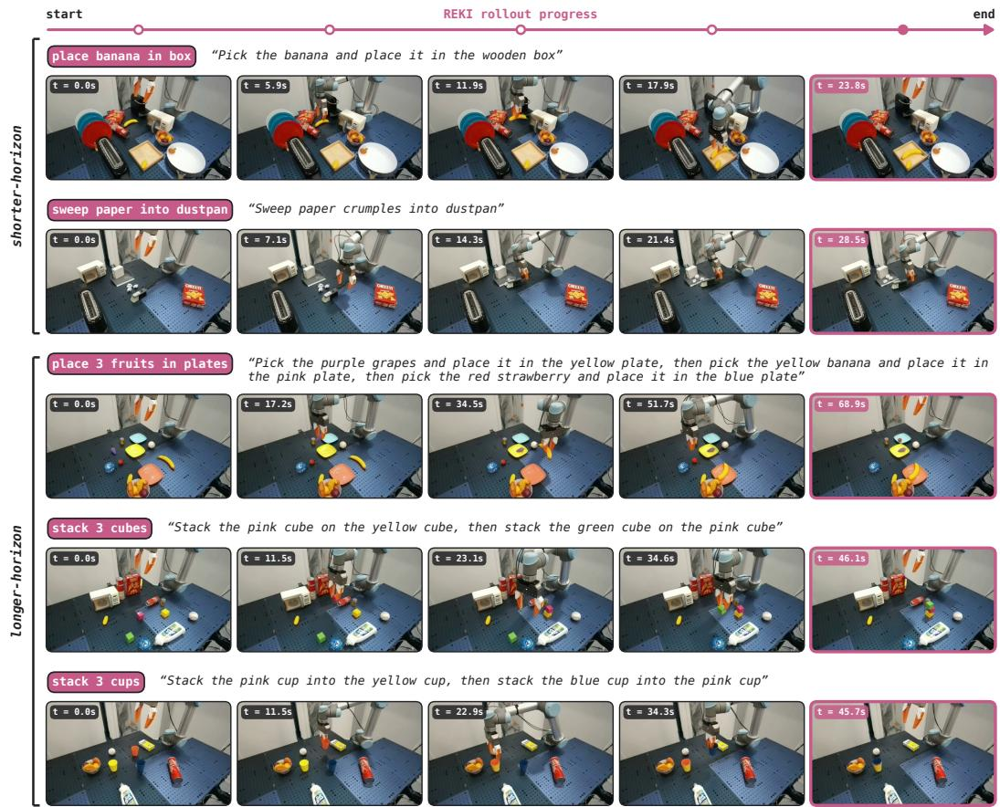  
Figure 12: Qualitative examples. Rollouts of REKI on our UR5 robotic arm across the five manipulation tasks.