# ROPE-FLOW: MONOCULAR VISION-BASED ROBOT POSE ESTIMATION VIA 2D GRAPH-CONDITIONED 3D FLOW MATCHING

Liangjing Shao1,2 Wanhao Liu2 Zhiwei Fang1 Rulin Zhou1,2 Quanlu Zhang2,3

Changjing Liu1 Beilei Cui1 Yiming Huang1 Hongliang Ren1,2∗

1Department of Electronic Engineering, The Chinese University of Hong Kong   
2EACV Research Center, Shenzhen Loop Area Institute   
3Xi’an Jiaotong University

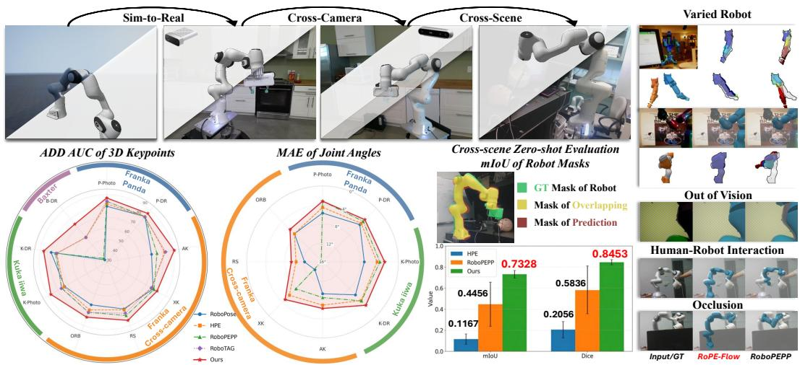  
Figure 1: Overview of our work. RoPE-Flow can reconstruct varied robot pose in diverse scenes with camera-frame 3D keypoints and joint angles estimation from monocular observation of diverse cameras even with human-robot interaction, occlusion and out-of-vision body.

## ABSTRACT

Camera-to-robot pose estimation from a monocular image is significant for visionbased robot navigation and control. However, recovering 3D structural features from 2D observations remains a challenging task. Existing camera-to-robot pose estimation methods either rely on time-consuming iterative rendering or involve sophisticated 2D–3D registration which suffers from projection ambiguity, accumulated errors for distal joints and imbalanced learning for different joints. In this work, we propose RoPE-Flow, an end-to-end flow matching-based framework for camera-to-robot pose estimation. From the predicted 2D heatmaps, we propose a Keypoint-centered Feature Extractor to obtain positional features along with contextual representations from keypoints-centered multi-scale patches. Moreover, we introduce Graph-guided Condition Generator, which embeds a learnable adjacency map to generate condition for flow matching based on correlation among keypoints. Besides, we introduce Bone Length Loss and Ray-Depth Loss for topological consistency and scale stability, with joint-wise weighting to mitigate varied prediction difficulty across joints. The proposed method outperforms

state-of-the-art methods for pose estimation across different types of robots with mutiple cameras. Besides, we establish a novel cross-scene benchmark to demonstrate the outstanding performance of RoPE-Flow on zero-shot cross-scene robot pose estimation. Meanwhile, animated visualizations are shown on the website: https://ropeflow.netlify.app/.

## 1 INTRODUCTION

Accurate pose estimation of articulated robots from monocular RGB is a core capability for visionbased navigation (Bultmann et al., 2023), human–robot collaboration (Zhang et al., 2025), closed loop manipulation (Liu et al., 2026b) and multi-robot collaboration (Yun et al., 2025). Unlike rigid object pose estimation, robot pose requires recovering the configuration of a kinematic chain whose links are self-occluding and appearance-ambiguous under changing viewpoints and lighting.

Conventional approaches perform camera-to-robot calibration using externally mounted fiducial markers such as ArUco Markers (Garrido-Jurado et al., 2014) and AprilTags (Olson, 2011). The marker’s 2D image coordinates are extracted, while its corresponding 3D position on the robot is computed via forward kinematics. With a collection of across multiple robot configurations, the camera-to-robot transformation can be recovered by Perspective-n-Point (PnP) algorithms. After calibration, both the robot base and camera are assumed to remain stationary. Therefore, calibration can drift from minor impacts or repeated operation, alongside time-varying environmental condi tions such as vibration.

To enable flexible camera-robot calibration for robot interaction in unstructured environments, render-based pipelines (Labbe et al., 2021; Zhu et al., 2025) perform iterative rendering supervised´ by segmentation masks to directly reconstruct the robot body. However, these methods rely on iterative refinement and require proper initialization for the optimization loop to converge (Li et al., 2018). To boost efficiency, end-to-end models (Lu et al., 2023; 2025; Goswami et al., 2025) de tect 2D keypoints and recover 3D structure via Perspective-n-Point (PnP), combined with robot forward kinematics (FK) and known camera intrinsics. Still, these approaches derive 3D keypoints from 2D keypoints and joint angles using PnP, with limited robustness due to high sensitivity to correspondence noise. Some recent works (Liu et al., 2026a; Ban et al., 2024) adopt 3D models for 2D–3D registration to jointly optimize 2D and 3D representations. Even so, identical 2D projections can correspond to multiple depth configurations, introducing optimization and inference ambiguity. Generative methods offer a promising alternative by modeling the conditional distribution of 3D keypoints rather than predicting single deterministic keypoints estimate(Tian et al., 2024; Zhu et al., 2025). Moreover, most existing methods lack zero-shot cross-scene generalization evaluation on real robots under varied backgrounds, they only conduct self-supervised sim-to-real training and tests on single-background real data captured by different cameras from DREAM (Lee et al., 2020).

We propose RoPE-Flow, the first conditioned flow matching-based model for camera-to-robot pose estimation. Method based on flow matching can face two major challenges. First, directly predicting 3D keypoints without PnP and forward kinematics (FK) fails to enforce rigid structural constraints, kinematic priors, and inter-joint relationships. Second, the prediction difficulty varies across different robot joints. To tackle these issues, we make the following contributions:

1. We propose a Keypoints-centered Feature Extractor to learn multi-scale contextual representations at keypoint locations together with positional embeddings.

2. We propose Graph-guided Condition Generator , which provides the condition for 3D flow matching based on keypoint-centric features and the relationships among keypoints.

3. We introduce Bone Length Loss and Ray-Depth Loss during training to guarantee rigid structural consistency and scale stability, respectively. Meanwhile, Joint-wise Weighting is adopted in loss computation to balance the varied prediction difficulty over joints.

4. The proposed model outperforms state-of-the-art models across different types of robot with various backgrounds from DREAM dataset. We also construct a novel realistic benchmark for cross-scene robot 3D pose estimation, LabRoPE, to demonstrate outstanding zeroshot generalization of RoPE-Flow.

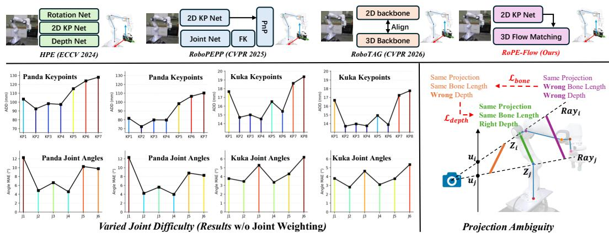  
Figure 2: Comparison with previous methods for camera-to-robot estimation (Top Row). Evidence for Varied Joint Difficulty is shown based on distribution of prediction errors along the joints and keypoints. Problem for end-to-end 3D keypoints generation: Projection Ambiguity, as well as potential solutions in this work is also visualized.

## 2 RELATED WORK

## 2.1 MARKER-BASED CAMERA-TO-ROBOT POSE ESTIMATION

The goal of Camera-to-Robot Pose Estimation is to estimate the transformation between a robot’s end-effector and its vision system. Camera-to-Robot Pose Estimation describes the setup where the camera is stationary and positioned away from the robot (Mahler et al., 2019; Park et al., 2020), in contrast to eye-in-hand setting where the camera is mounted on the robot end-effector (Morrison et al., 2018). Traditional camera-to-robot pose estimation approaches attach fiducial markers to the end-effector (Garrido-Jurado et al., 2014; Olson, 2011), move the marker to multiple known poses, detect marker locations in captured images, and then solve for the camera-to-robot transformation. While widely applicable, such classic pipeline requires a full offline recalibration whenever the camera-robot relative pose shifts, which becomes cumbersome for real-world deployment.

## 2.2 MARKERLESS CAMERA-TO-ROBOT POSE ESTIMATION

To enable flexible online camera-to-robot pose estimation for real-world deployment, DREAM (Lee et al., 2020) pioneers online markerless hand-eye calibration with a large-scale dataset. RoboPose (Labbe et al., 2021) uses iterative rendering supervised by alignment between projected robot mod-´ els and segmentation masks for pose estimation. Though accurate, its iterative optimization causes heavy computational overhead and slow inference. To resolve this bottleneck, keypoint-based methods are proposed for efficient end-to-end pose estimation. CtRNet (Lu et al., 2023) and CtRNet-X (Lu et al., 2025) predict 2D keypoints and recover robot poses via PnP given known joint angles. SGTAPose (Tian et al., 2023) exploits temporal cues through a sequential framework. RoboPEPP (Goswami et al., 2025) adopts embedding predictive pretraining on masked-joint images to mitigate occlusions, while HPE (Ban et al., 2024) integrates a depth branch to leverage 3D priors. However, all these approaches require a predefined robot ROI before inference. Moreover, pose reconstruction based on PnP and forward kinematics is still sensitive to noise which leads to limited robustness. RoboTAG (Liu et al., 2026a) incorporates 3D priors via multi-way 2D–3D alignment, yet it still suffers from occlusions and projection ambiguity. In contrast, our RoPE-Flow directly predicts cameraframe 3D pose from full image and enables uncertainty modeling for occluded joints, dealing with problems from projection ambiguity for direct 3D keypoints generation and varied difficulties for prediction of each joints shown in Fig. 2.

## 3 PROPOSED METHOD

The whole pipeline of RoPE-Flow, shown in $\mathrm { F i g }$ . 3, mainly consists of a pretrained image encoder with two groups of LoRA adapters $L o R A _ { k p }$ and $L o R A _ { q } .$ , 2D heatmap decoders HmDec

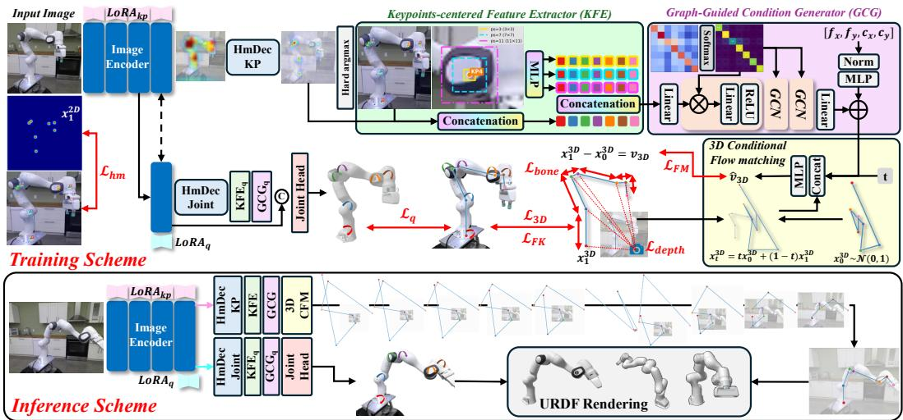  
Figure 3: Pipeline of the proposed method.

and $H m D e c _ { j o i n t }$ , Keypoints-centered Feature Extractor (KFE), Graph-guided Condition Generator (GCG), a Joint Head and a 3D conditional flow matching (3D CFM).

## 3.1 2D KEYPOINTS PREDICTION

A pretrained DINOv3 ViT-L/16 produces a spatial feature map $\mathbf { F } \in \mathbb { R } ^ { C \times h \times w } \left( C { = } 1 0 2 4 , h { = } w { = } 1 6 \right)$ The backbone remains frozen, while $L o R A _ { k p }$ of rank r=32 and scale α=32 is injected into projection layers of multi-head self-attention and MLPs of feed forward network. Spatial average pooling of $\mathbf { F } _ { i m g }$ yields a global context $\mathbf { c } _ { \mathrm { i m g } } \in \mathbb { R } ^ { C }$ that conditions heatmap flow matching during training. Four transposed convolutions followed by a 1×1 convolution produce per-keypoint belief maps $\mathbf { \tilde { H } } = \mathrm { H m D e c } ( \mathbf { \tilde { F } } _ { i m g } ) \in [ 0 , 1 ] ^ { K \times H \times W }$ . Hard argmax on channel k gives a peak coordinate to denote a position of each keypoint $\mathbf { u } _ { k } = ( u _ { k } , v _ { k } ) = \arg \operatorname* { m a x } _ { ( u , v ) } { \mathbf { H } } _ { k } ( u , v )$ , while confidence of each keypoint also comes from the predicted heatmap $s _ { k } = \mathbf { H } _ { k } ( u _ { k } , v _ { k } )$

## 3.2 KEYPOINTS-CENTERED FEATURE EXTRACTOR

Around peak ${ \bf { u } } _ { k } .$ , we bilinearly sample patches $\mathbf { P } _ { k , s }$ of sizes $S = \{ 3 , 7 , 1 1 \}$ from $\mathbf { H } _ { k } .$ . Each flattened patch is mapped by a two-layer MLP $\phi _ { s }$ , then three embeddings are concatenated and fused by an MLP ψ:

$$
\mathbf { p } _ { k } = \psi \Big ( \big [ \phi _ { 3 } ( \mathbf { P } _ { k , 3 } ) ; \phi _ { 7 } ( \mathbf { P } _ { k , 7 } ) ; \phi _ { 1 1 } ( \mathbf { P } _ { k , 1 1 } ) \big ] \Big ) .\tag{1}
$$

The final keypoint representation is $\mathbf { f } _ { k } = [ \mathbf { u } _ { k } ; s _ { k } ; \mathbf { p } _ { k } ]$ , linearly embedded to a latent code $\mathbf { F } _ { k } \in \mathbb { R } ^ { d _ { k } }$

## 3.3 GRAPH-GUIDED CONDITION GENERATOR

A shared adjacency $\mathbf { A } \in \mathbb { R } ^ { K \times K }$ , initialized as I, is processed by softmax along the row dimension. Given input feature map $\mathbf { F } _ { i n } ,$ , one graph convolution provides the processed feature map $\mathbf { F } _ { o u t }$ based on connections among keypoints $\bar { \mathbf { F } } _ { o u t } = \mathrm { s o f t m a x } ( \bar { \mathbf { A } } ) \mathbf { F } _ { i n } \mathbf { W }$

Gathering keypoints feature $\mathbf { F } \in \mathbb { R } ^ { K \times d _ { k } }$ will be processed by three graph convolution layers and flattened, linearly projected to keypoint-based condition $\mathbf { c } _ { k p } \doteq \mathbb { R } ^ { 5 1 2 }$ . Meanwhile, normalized intrinsics $\kappa = ( \bar { f _ { x } / W , ~ } f _ { y } / H , c _ { x } / \bar { W } , c _ { y } / H )$ are mapped by a two-layer MLP whose last layer is zero-initialized, then added residually to form the final condition code c for flow matching, as Eq. 2 shows.

$$
\mathbf { c } = \mathbf { c } _ { \mathrm { g c n } } + \mathrm { C a m E n c } ( \kappa ) \in \mathbb { R } ^ { 5 1 2 } .\tag{2}
$$

## 3.4 3D CONDITIONED FLOW MATCHING

Camera-frame 3D keypoints are generated under the graph condition c via conditional flow matching. Let $\mathbf { x } _ { 1 } ^ { 3 D } = \mathbf { X } ^ { \mathrm { g i } ^ { \star } } \in \mathbb { R } ^ { K \times 3 }$ and $\mathbf { x } _ { 0 } ^ { 3 D } \sim \mathcal { N } ( \mathbf { 0 } , \mathbf { I } _ { K \times 3 } ^ { - } )$ ), the interpolant $\mathbf { x } _ { t } ^ { 3 D }$ and target velocity $\mathbf { x } _ { 1 } ^ { 3 D } - \mathbf { x } _ { 0 } ^ { 3 D }$ follow Eq. 3. A four-layer velocity MLP v3D is utilized to predict velocity from concatenation of intepolant distribution, time token and condition $\lceil \mathbf { x } _ { t } ^ { 3 D } ; t ; \mathbf { \Delta c } \rceil$

$$
\mathbf { x } _ { t } ^ { 3 D } = ( 1 - t ) \mathbf { x } _ { 0 } ^ { 3 D } + t \mathbf { x } _ { 1 } ^ { 3 D }\tag{3}
$$

Sampling starts from standard Gaussian noise $\mathbf { x } _ { 0 } ^ { 3 D } \sim \mathcal { N } ( \mathbf { 0 } , \mathbf { I } _ { K \times 3 } )$ and applies N Euler steps to generate final predicted 3D Keypoints $\hat { \mathbf { X } } = \mathbf { x } _ { 1 } ^ { 3 D }$ , shown as Eq. 4

$$
\mathbf { x } _ { s + \Delta s } ^ { 3 D } = \mathbf { x } _ { s } ^ { 3 D } + \Delta s \cdot v _ { 3 D } ( \mathbf { y } _ { s } , s , \mathbf { c } ) , \quad \Delta s = 1 / N\tag{4}
$$

## 3.5 JOINT ANGLE PREDICTION

A second adapter set LoR $\mathrm { A } _ { q }$ is placed on the last 6 ViT blocks, together with a dedicated 2D keypoint decoder $H m D e c _ { q }$ and keypoint-based condition generator $\mathcal { F } _ { c g } ^ { q }$ . Different from 3D keypoints estimation, the condition for joint angle prediction is concatenation of pooled image feature $\mathbf { f } _ { \mathrm { i m g } } ^ { ( q ) }$ and keypoints-aware condition $\mathbf { z } = [ \mathbf { f } _ { \mathrm { i m g } } ^ { ( q ) } ; \mathcal { F } _ { c g } ^ { q } ( H m D e c _ { q } ( \mathbf { f } _ { \mathrm { i m g } } ^ { ( q ) } ) ) ]$ . Following RoboPEPP (Goswami et al., 2025), we use an iterative residual MLP $g _ { \phi }$ as Joint Head to perform 4-step iteration of Eq. 5, starting from $\bar { \mathbf { q } } ^ { ( 0 ) } = \mathbf { 0 } \mathrm { : }$

$$
\bar { \mathbf { q } } ^ { ( i + 1 ) } = \bar { \mathbf { q } } ^ { ( i ) } + g _ { \phi } \big ( [ \mathbf { z } ; \bar { \mathbf { q } } ^ { ( i ) } ] \big ) .\tag{5}
$$

## 3.6 TRAINING LOSSES

## 3.6.1 TRAINING ON SYNTHETIC DATA

Synthetic supervision has three training stages for 2D keypoints prediction, 3D keypoints prediction and joint angle prediction, respectively.

Stage I: 2D keypoint prediction. In stage I, only encoder-decoder architecture for 2D keypoints prediction is trained by ${ \mathcal { L } } _ { \mathrm { h m } }$ . Ground-truth locations of 2D keypoints $\{ u _ { k } ^ { g t } , v _ { k } ^ { g t } \}$ are rendered as isotropic Gaussians $\{ \mathbf { H } _ { k } ^ { \mathrm { g t } } \}$ . Following Goswami et al. (2025), we further use CornerNet-style modified focal loss (Law & Deng, 2018) to supervise 2D keypoints prediction.

Stage II: 3D keypoints prediction. In Stage II, we keep training Encoder and heatmap decoder with small learning rate, while modules in keypoint-centered feature extractor, graph-guided condition generator and 3D flow matching are mainly optimized. We utilize weighted joint-wise velocity loss of Eq. 6 to train 3D flow matching.

$$
\mathcal { L } _ { \mathrm { F M } } = \mathbb { E } _ { t , \mathbf { y } _ { 0 } } \sum _ { k = 1 } ^ { K } w _ { k } \big \| v _ { \theta _ { 2 } } ( \mathbf { y } _ { t } , t , \mathbf { c } ) _ { k } - ( \mathbf { y } _ { 1 } - \mathbf { y } _ { 0 } ) _ { k } \big \| _ { 2 } ^ { 2 } .\tag{6}
$$

Geometric loss on the predicted 3D keypoints $\hat { \mathbf X }$ consists of a weighted joint-wise 3D L1 (Eq. 7), Bone-Length Loss (Eq. 8), and FK alignment (Eq. 9).

$$
\mathcal { L } _ { \mathrm { 3 D } } = \sum _ { k = 1 } ^ { K } w _ { k } \big \| \hat { \mathbf { X } } _ { k } - \mathbf { X } _ { k } ^ { \mathrm { g t } } \big \| _ { 1 }\tag{7}
$$

$$
\mathcal { L } _ { \mathrm { b o n e } } = \frac { 1 } { | \mathcal { E } | } \sum _ { ( i , j ) \in \mathcal { E } } \left| \| \hat { \mathbf { X } } _ { i } - \hat { \mathbf { X } } _ { j } \| _ { 2 } - \| \mathbf { X } _ { i } ^ { \mathrm { g t } } - \mathbf { X } _ { j } ^ { \mathrm { g t } } \| _ { 2 } \right|\tag{8}
$$

$$
\mathcal { L } _ { \mathrm { F K } } = \left. \hat { \mathbf { X } } _ { r } - \mathrm { F K } ( \mathbf { q } ^ { \mathrm { g t } } ) \right. _ { 1 }\tag{9}
$$

where $\hat { \mathbf { X } } _ { r } = ( \mathbf { R } ^ { \mathrm { g t } } ) ^ { \top } \left( \hat { \mathbf { X } } - \mathbf { t } ^ { \mathrm { g t } } \right) , \mathrm { F K } ( \mathbf { q } ^ { \mathrm { g t } } )$ denotes URDF positions of the seven supervised links and $\mathbf { T } _ { c  } ^ { \mathrm { g t } }$ is the ground-truth extrinsics. The overall training objective for Stage II is formulated as:

$$
\begin{array} { r } { \mathcal { L } _ { \mathrm { I I } } = \lambda _ { \mathrm { h m } } ^ { \prime } \mathcal { L } _ { \mathrm { h m } } + \lambda _ { \mathrm { F M } } \mathcal { L } _ { \mathrm { F M } } + \lambda _ { \mathrm { 3 D } } \mathcal { L } _ { \mathrm { 3 D } } + \lambda _ { \mathrm { b o n e } } \mathcal { L } _ { \mathrm { b o n e } } + \lambda _ { \mathrm { F K } } \mathcal { L } _ { \mathrm { F K } } , } \end{array}\tag{10}
$$

with $( \lambda _ { \mathrm { h m } } ^ { \prime } , \lambda _ { \mathrm { F M } } , \lambda _ { \mathrm { 3 D } } , \lambda _ { \mathrm { b o n e } } , \lambda _ { \mathrm { F K } } ) = ( 0 . 2 , 1 , 2 , 1 , 1 ) .$

Stage III: joint-angle prediction head. The supervised loss of MSE in normalized joint space Eq. 11 is utilized to train the pathway for joint angles prediction, with frozen pathway for 3D keypoints prediction.

$$
\mathcal { L } _ { \mathrm { j o i n t } } = \frac { 1 } { 6 } \sum _ { j = 1 } ^ { 6 } \left( \bar { q } _ { j } - \bar { q } _ { j } ^ { \mathrm { g t } } \right) ^ { 2 } .\tag{11}
$$

## 3.6.2 SIM-TO-REAL FINE-TUNING

We firstly finetune the pathway for 3D keypoints prediction except keypoints decoder on realistic data. 3D keypoints $\hat { \mathbf X } _ { b , k }$ obtained from the model trained on synthetic data are mapped back to original-image pixels by $\hat { u } _ { b , k } = \pi ( \hat { \mathbf { X } } _ { b , k } ; \mathbf { K } )$ with predicted 3D keypoints $\hat { \bf X } .$ . The reprojection residual of the sample b is $\begin{array} { r } { r _ { b } = \frac { 1 } { K } \sum _ { k = 1 } ^ { K } \left\| \hat { \mathbf { u } } _ { b , k } - \mathbf { u } _ { b , k } \right\| _ { 1 } } \end{array}$ , where u denotes heatmap peaks predicted by synthetic-domain model. Samples with $r _ { b } < \tau _ { \mathrm { p x } } ( \ddot { \tau } _ { \mathrm { p x } } ^ { \cdot } { = } 1 0 0 )$ form the inlier set $\bar { \mathcal { V } } ,$ otherwise the lowest $\rho { = } 5 0 \%$ of finite residuals are kept. The Smooth-L1 reprojection loss is defined as:

$$
\mathcal { L } _ { \mathrm { r e p r o j } } = \frac { 1 } { | \mathcal { V } | } \sum _ { b \in \mathcal { V } } \mathrm { S m o o t h L 1 } \big ( \pi ( \hat { \mathbf { X } } _ { b } ; \mathbf { K } ) , \ : \mathbf { u } _ { b } \big ) .\tag{12}
$$

We formulate bone length loss with adjacent supervised-link distances $\ell _ { i j }$ at $\mathbf { q } { = } \mathbf { 0 }$ (pose-invariant):

$$
\mathcal { L } _ { \mathrm { b o n e } } ^ { \mathrm { S 2 R } } = \frac { 1 } { | \mathcal { E } | } \sum _ { ( i , j ) \in \mathcal { E } } \Big | \| \hat { \mathbf { X } } _ { i } - \hat { \mathbf { X } } _ { j } \| _ { 2 } - \ell _ { i j } \Big | .\tag{13}
$$

For each keypoint we take the predicted depth $z _ { k } = \hat { X } _ { k , z }$ and lift the detached 2D peak $\mathbf { u } _ { k }$ along the corresponding camera ray $\mathbf { d } _ { k } = \mathbf { K } ^ { - 1 } [ u _ { k } , v _ { k } , 1 ] ^ { \top }$ , yielding a ray-consistent point $\tilde { \mathbf { X } } _ { k } = z _ { k } \mathbf { d } _ { k }$ We then align prediction $\hat { \bf X }$ to this lift by Eq. 14 with $z _ { \mathrm { m i n } } { = } 0 . 0 5 \mathrm { m }$

$$
\mathcal { L } _ { \mathrm { d e p t h } } = \mathrm { S m o o t h L l } ( \hat { \mathbf { X } } , \tilde { \mathbf { X } } ) + \frac { 1 } { | \mathcal { E } | } \sum _ { ( i , j ) \in \mathcal { E } } \left| \| \tilde { \mathbf { X } } _ { i } - \tilde { \mathbf { X } } _ { j } \| _ { 2 } - \ell _ { i j } \right| + \frac { 1 } { K } \sum _ { k } \mathrm { R e L U } \big ( z _ { \mathrm { m i n } } - z _ { k } \big ) ,\tag{14}
$$

The final sim-to-real training loss is formulated as Eq. 15, where $\lambda _ { \mathrm { b o n e } } ^ { \mathrm { S 2 R } } = 2 0 , \lambda _ { \mathrm { d e p t h } } = 4 0$

$$
\mathcal { L } _ { \mathrm { S 2 R } } ^ { k p } = \mathcal { L } _ { \mathrm { r e p r o j } } + \lambda _ { \mathrm { b o n e } } ^ { \mathrm { S 2 R } } \mathcal { L } _ { \mathrm { b o n e } } ^ { \mathrm { S 2 R } } + \lambda _ { \mathrm { d e p t h } } \mathcal { L } _ { \mathrm { d e p t h } }\tag{15}
$$

Additionally, we adapt pathway for joint angle prediction following self-supervised sim-to-real finetuning in Goswami et al. (2025), based on 2D keypoints reprojected from 3D keypoints generated by finetuned 3D keypoints prediction pathway.

## 4 EXPERIMENTS AND RESULTS

## 4.1 IMPLEMENTATION DETAILS

Following (Goswami et al., 2025; Liu et al., 2026a), we train and evaluate our method on the DREAM dataset (Lee et al., 2020). The model is separately trained on the synthetic DR split of Franka, Kuka and Baxter. Evaluation is conducted on DR and Photos splits for Panda and Kuka, and the DR split for Baxter. For Franka, we perform sim-to-real finetuning on Azure (AK) data using DR pretrained weights, then train and test on Kinect360 (XK), RealSense (RS) and ORB data based on weights for AK.

For synthetic training, we apply random 256×256 cropping, color jitter, Gaussian blur and horizontal flipping. Staged training runs 100, 300 and 300 epochs with batch size 32 for Stage I–III under the OneCycle schedule. Joint-wise weights are [1.0, 1.0, 1.0, 1.0, 1.5, 2.0, 2.0], [1.0, 1.0, 1.0, 1.0, 1.5, 2.0, 2.0, 2.5] and [1.0, 1.0, 1.0, 1.0, 1.0, 1.2, 1.2, 1.5, 1.5, 2.0, 2.0, 2.5, 2.5, 3.0, 3.0, 3.5, 3.5] for Panda, Kuka and Baxter, respectively. Sim-to-real finetuning takes 20 epochs with batch size 16 and no augmentation. All experiments are conducted on one NVIDIA H100 GPU.

<table><tr><td rowspan="2">Methods</td><td colspan="6">Panda</td><td colspan="2">Kuka</td><td rowspan="2">Baxter DR</td><td rowspan="2">Avg</td></tr><tr><td>Photo</td><td>DR</td><td>AK</td><td>XK</td><td>RS</td><td>ORB</td><td>Photo</td><td>DR</td></tr><tr><td>DREAM-F*</td><td>79.5</td><td>81.3</td><td>68.9</td><td>24.4</td><td>76.1</td><td>61.9</td><td></td><td>/</td><td></td><td></td></tr><tr><td>DREAM-Q*</td><td>74.3</td><td>77.8</td><td>52.4</td><td>37.5</td><td>78.0</td><td>57.0</td><td>/</td><td>一</td><td>75.5</td><td>/</td></tr><tr><td>DREAM-H*</td><td>81.1</td><td>82.9</td><td>60.5</td><td>64.0</td><td>78.8</td><td>69.1</td><td>72.1</td><td>73.3</td><td></td><td></td></tr><tr><td>RoboPose†</td><td>79.7</td><td>82.9</td><td>70.4</td><td>77.6</td><td>74.3</td><td>70.4</td><td>73.2</td><td>80.2</td><td>32.7</td><td>71.3</td></tr><tr><td>HPE</td><td>82.0</td><td>82.7</td><td>82.2</td><td>76.0</td><td>75.2</td><td>75.2</td><td>73.9</td><td>75.1</td><td>58.8</td><td>75.7</td></tr><tr><td>HPE†</td><td>40.7</td><td>41.4</td><td>66.7</td><td>1</td><td>49.1</td><td>51.6</td><td>56.7</td><td>56.2</td><td>9.8</td><td>1</td></tr><tr><td>RoboPEPP†</td><td>84.1</td><td>83.0</td><td>75.3</td><td>78.5</td><td>80.5</td><td>77.5</td><td>76.1</td><td>76.2</td><td>34.4</td><td>74.0</td></tr><tr><td>RoboTAG</td><td>84.3</td><td>82.5</td><td>83.1</td><td>75.7</td><td>78.3</td><td>77.5</td><td>76.6</td><td>75.0</td><td>58.8</td><td>76.9</td></tr><tr><td>RoPE-Flow</td><td>87.1</td><td>86.6</td><td>90.9</td><td>81.6</td><td>85.1</td><td>82.1</td><td>87.3</td><td>86.9</td><td>74.1</td><td>84.6</td></tr></table>

Table 1: Comparison of robot pose estimation on DREAM dataset using AUC on the ADD metric. \*DREAM and its variants need ground-truth joint state parameters. ‡ Results with ground-truth bounding box. † Results with predicted bounding box. The Best , Second Best and Third Best results are marked by corresponding colors. Curves of ADD can be found in Appendix B.1.

## 4.2 CAMERA-FRAME POSE ESTIMATION

We compare RoPE-Flow with prior 3D keypoints prediction methods on the DREAM dataset, using the Area Under Curve (AUC) of Average Distance Distribution (ADD) as in previous works (Goswami et al., 2025; Liu et al., 2026a). Table 1 shows our method surpasses SOTA approaches on all splits across different robots and cameras in DREAM. We also adopt Mean Average Distance between predicted and ground-truth camera-frame joint positions for evaluation (Table 2). RoPE-Flow yields the most accurate joint positions without joint priors and achieves competitive results against methods using known joint states. Qualitative comparisons of 3D skeletons reconstructed from predicted keypoints are provided in the Appendix B.2.

<table><tr><td rowspan="2">Methods</td><td colspan="6">Panda</td><td colspan="2">Kuka</td><td>Baxter</td></tr><tr><td>Photo</td><td>DR</td><td>AK</td><td>XK</td><td>RS</td><td>ORB</td><td>Photo</td><td>DR</td><td>DR</td></tr><tr><td>DREAM-F</td><td>785.8</td><td>552.0</td><td>&gt;1k</td><td>&gt;1k</td><td>&gt;1k</td><td>&gt;1k</td><td></td><td>/</td><td></td></tr><tr><td>DREAM-Q</td><td>569.0</td><td>359.0</td><td>&gt;1k</td><td>&gt;1k</td><td>27.2</td><td>&gt;1k</td><td>/</td><td>/</td><td>59.0</td></tr><tr><td>DREAM-H</td><td>518.8</td><td>325.6</td><td>56.5</td><td>&gt;1k</td><td>23.6</td><td>&gt;1k</td><td>&gt;1k</td><td>&gt;1k</td><td></td></tr><tr><td>RoboPose</td><td>21.5</td><td>7.9</td><td>24.4</td><td>14.0</td><td>23.1</td><td>19.4</td><td>33.5</td><td>19.2</td><td>15.5</td></tr><tr><td>RoboPose</td><td>21.4</td><td>32.2</td><td>34.3</td><td>22.3</td><td>26.0</td><td>30.1</td><td>89.0</td><td>34.2</td><td>87.9</td></tr><tr><td>HPE</td><td>18.0</td><td>18.4</td><td>18.9</td><td>24.0</td><td>24.8</td><td>24.8</td><td>29.0</td><td>28.0</td><td>45.0</td></tr><tr><td>RoboPEPP</td><td>29.8</td><td>49.5</td><td>29.0</td><td>22.0</td><td>23.0</td><td>27.0</td><td>72.4</td><td>84.2</td><td>157.5</td></tr><tr><td>Ours</td><td>12.9</td><td>13.8</td><td>9.1</td><td>18.6</td><td>14.9</td><td>18.4</td><td>13.0</td><td>14.5</td><td>30.6</td></tr></table>

Table 2: Comparison of Mean Average Distance (mm). The best results among all methods (including methods with given joint states) are in bold, while the second best one is underlined. The Best and Second Best results among methods with no need ofjoint state parameters are marked by corresponding colors.

## 4.3 JOINT ANGLE ESTIMATION

We compare our method with RoboPose, HPE and RoboPEPP for joint angle prediction on the Panda and Kuka splits of the DREAM dataset, using the mean average error (MAE) of all joint angles. Since the last Franka joint’s rotation aligns with its corresponding 3D keypoint axis, we only compute errors for the first six joints (Goswami et al., 2025). Quantitative results are listed in Table 3, and per-joint details are given in the Appendix. Even though HPE and RoboPEPP rely on ground truth or preprocessed bounding boxes, RoPE-Flow achieves the best joint angle accuracy on both Franka and Kuka. We reconstruct robot 3D models from predicted joint angles and 3D keypoints using provided URDFs for qualitative evaluation. As shown in Fig. 4, our method yields more accurate robot models than prior SOTA approaches.

<table><tr><td rowspan="2">Methods</td><td colspan="2">Panda</td><td colspan="2">Kuka</td><td colspan="4">Panda</td></tr><tr><td>Photo</td><td>DR</td><td>Photo</td><td>DR</td><td>AK XK</td><td>RS</td><td></td><td>ORB</td></tr><tr><td>RoboPose</td><td>5.7</td><td>4.9</td><td>7.2</td><td>6.2</td><td>9.3</td><td>13.7</td><td>12.2</td><td>7.6</td></tr><tr><td>HPE</td><td>4.5</td><td>4.5</td><td>4.5</td><td>4.5</td><td>6.9</td><td>6.1</td><td>10.4</td><td>7.6</td></tr><tr><td>RoboPEPP</td><td>3.2</td><td>3.9</td><td>3.9</td><td>4.4</td><td>8.5</td><td>8.0</td><td>15.7</td><td>15.6</td></tr><tr><td>Ours</td><td>3.2</td><td>3.4</td><td>2.9</td><td>3.1</td><td>6.2</td><td>4.8</td><td>9.4</td><td>6.3</td></tr></table>

Table 3: Comparison of joint angle estimation results using average MAE (°) of joint angles. Detailed MAE on each joint can be found in Appendix B.3. The Best and Second Best results are marked by corresponding colors.

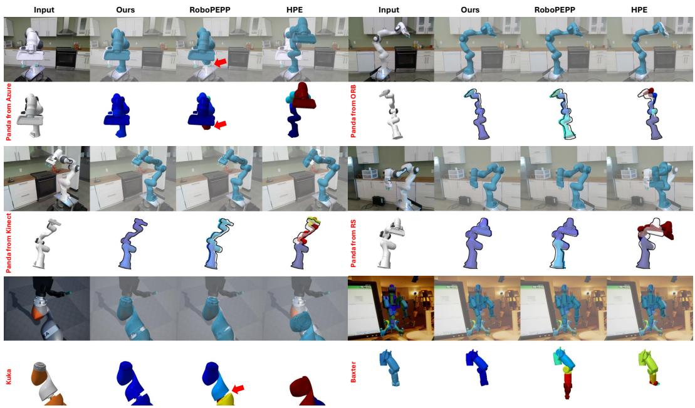  
Figure 4: Qualitative comparison on URDF-based reconstructed models. More qualitative results can be found in Appendix B.4. Results on videos can be found in Supplementary Material.

## 4.4 ZERO-SHOT CROSS-SCENE ESTIMATION

We build LabRoPE (details in Appendix A), a novel zero-shot benchmark containing 50 samples captured by RealSense from diverse views, to complement DREAM’s realistic singlebackground scenes. Inspired by Robo-Pose (Labbe et al., 2021), we adopt ´ mIoU and Dice coefficient between robot masks of input image and masks

<table><tr><td>Methods</td><td>mIoU</td><td>Dice</td></tr><tr><td>HPE RoboPEPP Ours</td><td> $\overline { { 0 . 1 1 6 7 \pm 0 . 0 4 9 } }$   $0 . 4 4 5 6 \pm 0 . 2 1 1$   $\mathbf { 0 . 7 3 2 8 \pm 0 . 0 3 6 }$ </td><td> $\overline { { 0 . 2 0 5 6 \pm 0 . 0 7 7 } }$   $0 . 5 8 3 6 \pm 0 . 2 2 9$ </td></tr></table>

Table 4: Quantitative comparison on zero-shot crossscene dataset.

from reconstructed 3D models for zero-shot evaluation. We compare RoPE-Flow with two publicly available SOTA methods, RoboPEPP and HPE. Table 4 verifies our method’s strong zero-shot generalization, and qualitative results are presented in Fig. 5.

## 4.5 ABLATION STUDIES

We conduct ablation experiments on the Keypoints Feature Extraction (KFE) module using single patches of varying sizes (N×N Patch) instead of multi-scale patches. We also evaluate patchwise contextual feature extraction (w/o Patch), position embedding (w/o Position), graph convolution (w/o GCN). Moreover, we replace the 3D CFM pathway with FK and PnP from RoboPEPP (Goswami et al., 2025) (w/o CFM) to validate the effect of flow matching. Besides, we ablate core loss components including the proposed Bone Length Loss $\mathcal { L } _ { b o n e }$ and Joint-wise Weighting wk.

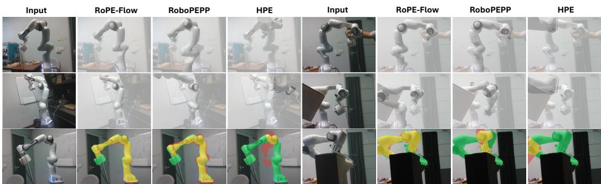  
Figure 5: Qualitative comparison for zero-shot cross-scene samples. At last row, we use green mask to denote the ground truth, while yellow mask represents overlapping area and red mask is the mask of reconstructed robot. More examples can be found in Appendix B.5.

<table><tr><td rowspan="2">Ablations</td><td colspan="6">Panda</td><td colspan="2">Kuka</td><td>Baxter</td><td rowspan="2">Avg</td></tr><tr><td>Photo</td><td>DR</td><td>AK</td><td>XK</td><td>RS</td><td>ORB</td><td>Photo</td><td>DR</td><td>DR</td></tr><tr><td>Full Model</td><td>87.1</td><td>86.6</td><td>90.9</td><td>81.6</td><td>85.1</td><td>82.1</td><td>87.3</td><td>86.9</td><td>74.1</td><td>84.6</td></tr><tr><td colspan="11">Keypoints-centered Feature Extraction</td></tr><tr><td>3×3 Patch</td><td>86.0</td><td>85.8</td><td>89.3</td><td>81.4</td><td>84.6</td><td>76.4</td><td>86.8</td><td>86.2</td><td>70.8</td><td>83.0</td></tr><tr><td>7×7 Patch</td><td>86.6</td><td>86.3</td><td>90.2</td><td>79.4</td><td>84.6</td><td>79.4</td><td>86.9</td><td>86.5</td><td>69.9</td><td>83.3</td></tr><tr><td>11×11 Patch</td><td>87.0</td><td>86.7</td><td>89.0</td><td>75.5</td><td>77.2</td><td>79.7</td><td>87.6</td><td>87.2</td><td>74.2</td><td>82.7</td></tr><tr><td>w/o Patch</td><td>83.2</td><td>83.2</td><td>89.3</td><td>78.2</td><td>83.9</td><td>80.5</td><td>84.8</td><td>84.2</td><td>73.3</td><td>82.3</td></tr><tr><td>w/o Position</td><td>39.6</td><td>38.2</td><td>0.0</td><td>0.0</td><td>0.0</td><td>0.0</td><td>45.4</td><td>45.7</td><td>29.7</td><td>22.1</td></tr><tr><td colspan="11">2D Graph-guided 3D Flow Matching</td></tr><tr><td>w/o CFM</td><td>83.4</td><td>83.2</td><td>88.8</td><td>75.6</td><td>84.2</td><td>79.0</td><td>67.2</td><td>63.5</td><td>54.1</td><td>75.4</td></tr><tr><td>w/o GCN</td><td>84.1</td><td>83.8</td><td>88.6</td><td>76.0</td><td>85.0</td><td>78.9</td><td>83.5</td><td>83.1</td><td>72.7</td><td>81.7</td></tr><tr><td colspan="10">Loss Function</td></tr><tr><td>w/o  $\mathcal { L } _ { b o n e }$ </td><td>87.0</td><td>86.5</td><td>88.9</td><td>66.1</td><td>83.0</td><td>80.1</td><td>87.2</td><td>86.6</td><td>74.0</td><td>82.2</td></tr><tr><td>w/o  $\mathcal { L } _ { F K }$ </td><td>86.3</td><td>86.1</td><td>90.1</td><td>76.4</td><td>83.2</td><td>79.7</td><td>87.2</td><td>86.7</td><td>73.7</td><td>83.3</td></tr><tr><td>w/o  $\mathcal { L } _ { 3 D }$ </td><td>60.8</td><td>54.9</td><td>50.1</td><td>34.2</td><td>4.5</td><td>42.8</td><td>56.5</td><td>53.7</td><td>66.9</td><td>47.2</td></tr><tr><td>wlo wk</td><td>63.0</td><td>57.6</td><td>45.6</td><td>23.1</td><td>0.2</td><td>34.9</td><td>66.3</td><td>63.2</td><td>43.9</td><td>44.2</td></tr></table>

Table 5: Results of ablations on feature extraction, condition generation, flow matching and loss functions. The Best , Second Best and Third Best results are marked by corresponding colors.

Ablation results in Table 5 show larger single patches perform better on synthetic data while smaller patches favor sim-to-real fine-tuning. The full model with multi-scale patches and position embeddings achieves optimal overall performance. Graph-guided 3D flow matching outperforms the PnP-FK pipeline, and every loss component contributes substantially to the performance. Qualitative ablation results and flow matching step ablations are provided in Appendix C.3 and C.1, while ablation results for zero-shot estimation on LabRoPE dataset can be found in Appendix C.2.

Besides, different from RoboPEPP, we introduce Bone Length Loss $\mathcal { L } _ { b o n e } ^ { S 2 R }$ and Ray-depth Loss $\mathcal { L } _ { d e p t h }$ for sim-to-real. Therefore, we implement ablation studies on these two losses for sim-to-real fine-tuning. Results in Table 6 demonstrates the positive effect of $\mathcal { L } _ { b o n e } ^ { S 2 R }$ and $\mathcal { L } _ { d e p t h }$ for robot pose estimation on realistic data.

<table><tr><td>Ablations</td><td>AK</td><td>XK</td><td>RS</td><td>ORB</td><td>Avg</td></tr><tr><td>Full Model</td><td>90.9</td><td>81.6</td><td>85.1</td><td>82.1</td><td>84.9</td></tr><tr><td>w/o  $\mathcal { L } _ { b o n e } ^ { S 2 R }$ </td><td>90.9</td><td>76.7</td><td>84.5</td><td>81.5</td><td>83.4</td></tr><tr><td>w/o  $\mathcal { L } _ { d e p t h }$ </td><td>82.5</td><td>70.1</td><td>76.5</td><td>62.0</td><td>72.8</td></tr></table>

Table 6: Results of ablations on Sim-to-Real Tuning.

## 5 CONCLUSION

In this work, we propose RoPE-Flow, the first flow matching-based approach for camera-to-robot pose estimation using monocular RGB images. Leveraging keypoint feature extraction from multiscale keypoint-centered patches alongside graph-guided flow matching, RoPE-Flow outperforms existing methods by delivering highly accurate predictions of robot poses and joint angles. Furthermore, we introduce a novel benchmark for evaluating zero-shot generalization, which further validates the superior practical performance of RoPE-Flow compared with state-of-the-art (SOTA) approaches. Despite achieving outstanding results, our method still leaves room for future optimization, particularly regarding the prediction of self-rotating joints and distant joints, as well as inference efficiency.

## REFERENCES

Shikun Ban, Juling Fan, Xiaoxuan Ma, Wentao Zhu, Yu Qiao, and Yizhou Wang. Real-time holistic robot pose estimation with unknown states. In European Conference on Computer Vision, pp. 1–17. Springer, 2024.

Simon Bultmann, Raphael Memmesheimer, and Sven Behnke. External camera-based mobile robot pose estimation for collaborative perception with smart edge sensors. In 2023 IEEE International Conference on Robotics and Automation (ICRA), pp. 8194–8200. IEEE, 2023.

Sergio Garrido-Jurado, Rafael Munoz-Salinas, Francisco Jos˜ e Madrid-Cuevas, and Manuel Jes´ us´ Mar´ın-Jimenez. Automatic generation and detection of highly reliable fiducial markers under´ occlusion. Pattern Recognition, 47(6):2280–2292, 2014.

Raktim Gautam Goswami, Prashanth Krishnamurthy, Yann LeCun, and Farshad Khorrami. Robopepp: Vision-based robot pose and joint angle estimation through embedding predictive pretraining. In 2025 IEEE/CVF Conference on Computer Vision and Pattern Recognition (CVPR), pp. 6930–6939. IEEE, 2025.

Yann Labbe, Justin Carpentier, Mathieu Aubry, and Josef Sivic. Single-view robot pose and joint´ angle estimation via render & compare. In 2021 IEEE/CVF Conference on Computer Vision and Pattern Recognition (CVPR), pp. 1654–1663. IEEE, 2021.

Hei Law and Jia Deng. Cornernet: Detecting objects as paired keypoints. In Proceedings of the European conference on computer vision (ECCV), pp. 734–750, 2018.

Timothy E Lee, Jonathan Tremblay, Thang To, Jia Cheng, Terry Mosier, Oliver Kroemer, Dieter Fox, and Stan Birchfield. Camera-to-robot pose estimation from a single image. In 2020 IEEE international conference on robotics and automation (ICRA), pp. 9426–9432. IEEE, 2020.

Yi Li, Gu Wang, Xiangyang Ji, Yu Xiang, and Dieter Fox. Deepim: Deep iterative matching for 6d pose estimation. In Proceedings of the European conference on computer vision (ECCV), pp. 683–698, 2018.

Shilong Liu, Zhaoyang Zeng, Tianhe Ren, Feng Li, Hao Zhang, Jie Yang, Qing Jiang, Chunyuan Li, Jianwei Yang, Hang Su, et al. Grounding dino: Marrying dino with grounded pre-training for open-set object detection. In European conference on computer vision, pp. 38–55. Springer, 2024.

Yifan Liu, Fangneng Zhan, Wanhua Li, Haowen Sun, Katerina Fragkiadaki, and Hanspeter Pfister. Robotag: End-to-end robot pose estimation via topological alignment graph. In Proceedings of the IEEE/CVF Conference on Computer Vision and Pattern Recognition, pp. 35146–35155, 2026a.

Ze’an Liu, Xuanyin Wang, Ziyue Hao, and Jiaqi Sun. Eevs: Monocular end-effector pose estimation-based visual servoing against uncertainties. Journal of Field Robotics, 43(2):1033– 1047, 2026b.

Jingpei Lu, Florian Richter, and Michael C Yip. Markerless camera-to-robot pose estimation via self-supervised sim-to-real transfer. In 2023 IEEE/CVF Conference on Computer Vision and Pattern Recognition (CVPR), pp. 21296–21306. IEEE, 2023.

Jingpei Lu, Zekai Liang, Tristin Xie, Florian Richter, Shan Lin, Sainan Liu, and Michael C Yip. Ctrnet-x: Camera-to-robot pose estimation in real-world conditions using a single camera. In 2025 IEEE International Conference on Robotics and Automation (ICRA), pp. 1914–1920. IEEE, 2025.

Jeffrey Mahler, Matthew Matl, Vishal Satish, Michael Danielczuk, Bill DeRose, Stephen McKinley, and Ken Goldberg. Learning ambidextrous robot grasping policies. Science robotics, 4(26): eaau4984, 2019.

Douglas Morrison, Peter Corke, and Jurgen Leitner. Closing the loop for robotic grasping: a real-¨ time, generative grasp synthesis approach. In Robotics: Science and Systems, 2018. doi: 10. 15607/RSS.2018.XIV.021.

Edwin Olson. Apriltag: A robust and flexible visual fiducial system. In 2011 IEEE international conference on robotics and automation, pp. 3400–3407. IEEE, 2011.

Dongwon Park, Yonghyeok Seo, and Se Young Chun. Real-time, highly accurate robotic grasp detection using fully convolutional neural network with rotation ensemble module. In 2020 IEEE international conference on robotics and automation (ICRA), pp. 9397–9403. IEEE, 2020.

Nikhila Ravi, Valentin Gabeur, Yuan-Ting Hu, Ronghang Hu, Chaitanya Ryali, Tengyu Ma, Haitham Khedr, Roman Radle, Chloe Rolland, Laura Gustafson, et al. Sam 2: Segment anything in images¨ and videos. In International Conference on Learning Representations, volume 2025, pp. 28085– 28128, 2025.

Yang Tian, Jiyao Zhang, Zekai Yin, and Hao Dong. Robot structure prior guided temporal attention for camera-to-robot pose estimation from image sequence. In 2023 IEEE/CVF Conference on Computer Vision and Pattern Recognition (CVPR), pp. 8917–8926. IEEE, 2023.

Yang Tian, Jiyao Zhang, Guowei Huang, Bin Wang, Ping Wang, Jiangmiao Pang, and Hao Dong. Robokeygen: robot pose and joint angles estimation via diffusion-based 3d keypoint generation. In 2024 IEEE International Conference on Robotics and Automation (ICRA), pp. 5375–5381. IEEE, 2024.

Yanpu Yun, Guohao Peng, Yichen Zhou, Jun Zhang, Yiyao Liu, Kaimin Mao, and Danwei Wang. Overlapping free: Anchorless uwb-assisted relative pose estimation for multi-robot systems. In 2025 IEEE International Conference on Robotics and Automation (ICRA), pp. 12586–12592. IEEE, 2025.

Chuye Zhang, Xiaoxiong Zhang, Linfang Zheng, Wei Pan, and Wei Zhang. Generative visual foresight meets task-agnostic pose estimation in robotic table-top manipulation. In Joseph Lim, Shuran Song, and Hae-Won Park (eds.), Proceedings of The 9th Conference on Robot Learning, volume 305 of Proceedings of Machine Learning Research, pp. 2823–2846. PMLR, 27–30 Sep 2025.

Kangjian Zhu, Haobo Jiang, Yigong Zhang, Jianjun Qian, Jian Yang, and Jin Xie. Monose (3)- diffusion: A monocular se (3) diffusion framework for robust camera-to-robot pose estimation. IEEE Robotics and Automation Letters, 2025.

## APPENDIX

## A DETAILS OF PROPOSED DATASET LabRoPE

To construct a dataset for zero-shot cross-scene robot pose estimation, we use Intel RealSense Camera to capture 50 images within a Franka Emika Panda robot from 5 different views with varied backgrounds in a laboratory. Moreover, to create a more complex situation, we replace the standard grasper on Franka with a DIY laser transmitter. Besides, we consider human-robot interaction and occlusion in the proposed dataset to further evaluate the robustness of methods. The gap between the proposed LabRoPE and existing dataset DREAM is shown in Fig. 6. We use GroundingDINO (Liu et al., 2024) and SAM2 (Ravi et al., 2025) to detect and segement the ground truth masks of the robot for zero-shot evaluation.

Similar Scene/View No Interaction No OcclusionCross Camera but Specific Tuning Standard End-effector  
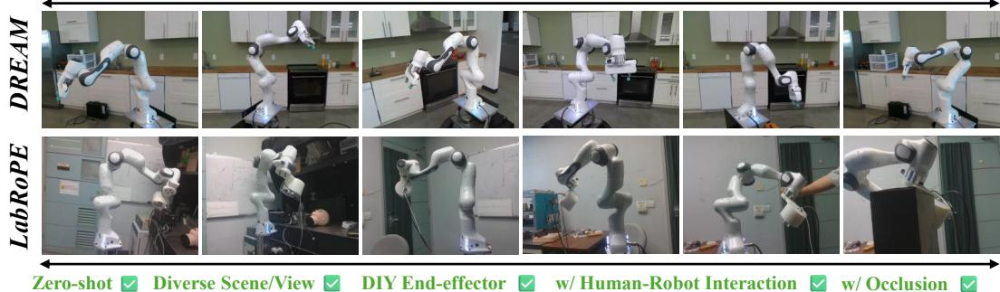  
Figure 6: Comparison of LabRoPE and DREAM.

## B SUPPLEMENTARY COMPARISON RESULTS

## B.1 CURVES OF ADD AUC

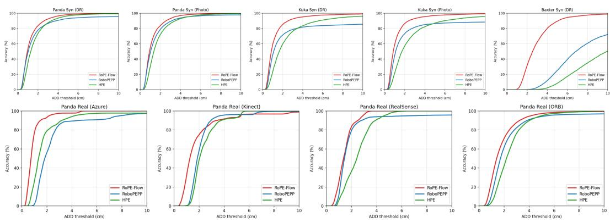  
Figure 7: Curves of ADD.

With different thresholds $\tau ,$ we calculate the proportion of predicted results with Average Distance (ADD) lower than threshold, named as Accuracy (ACC). Given such formulation $\operatorname { A c c } ( \tau ) =$ $\frac { | \{ i | A D D ( \hat { X _ { i } } , X _ { i } ) < \tau \} | } { \textsf { n m } }$ , we can draw Accuracy-Threshold Acc − τ curves on each split of DREAM dataset, shown in Fig. 7.

## B.2 QUALITATIVE COMPARISON OF 3D KEYPOINTS PREDICTION

Based on 3D keypoints, we reconstruct the skeleton with keypoints and compare results from RoPE-Flow with results from RoboPEPP and HPE in Fig. 8, which can more intuitively demonstrate the outstanding performance of RoPE-Flow for 3D keypoints prediction.

Input / GT  
RoPE-Flow  
RoboPEPP  
HPE  
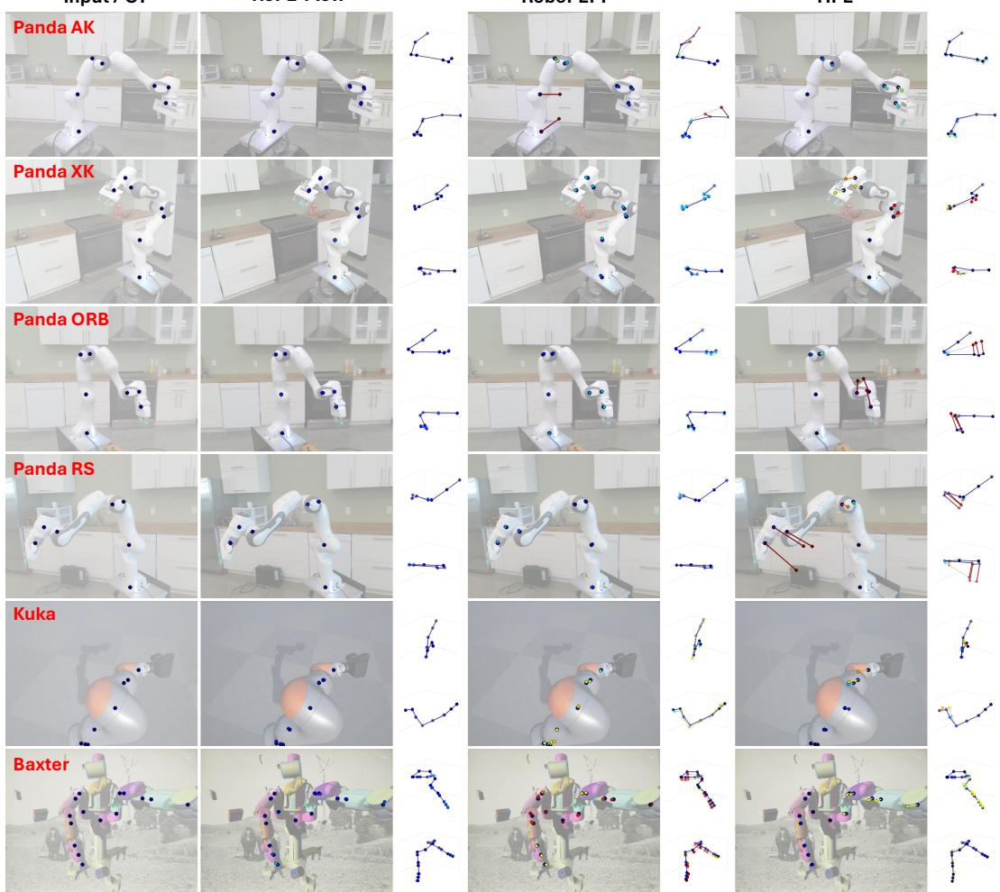  
Figure 8: Qualitative Comparison of 3D Keypoints Prediction.

## B.3 JOINT-WISE ERROR FOR JOINT ANGLES PREDICTION

Due to varied difficulties for prediction of different joints, we evaluate the mean average error on each joint of robot predicted by RoPE-Flow and SOTA competitors. The experimental results are shown in Table 7. We find that the proposed method may provide relatively inaccurate results on several joints of Franka, but still achieve best performance on average error and all joints prediction for Kuka robot.

## B.4 SUPPLEMENTARY EXAMPLES FROM DREAM

We randomly select 5 samples from each split of DREAM dataset including Franka Panda DR, Photo, Azure(AK), Kinect360(XK), Realsense (RS), ORB, Kuka DR, Kuka Photo and Baxter DR. The supplementary qualitative results are shown in Fig. 9

Input / GT  
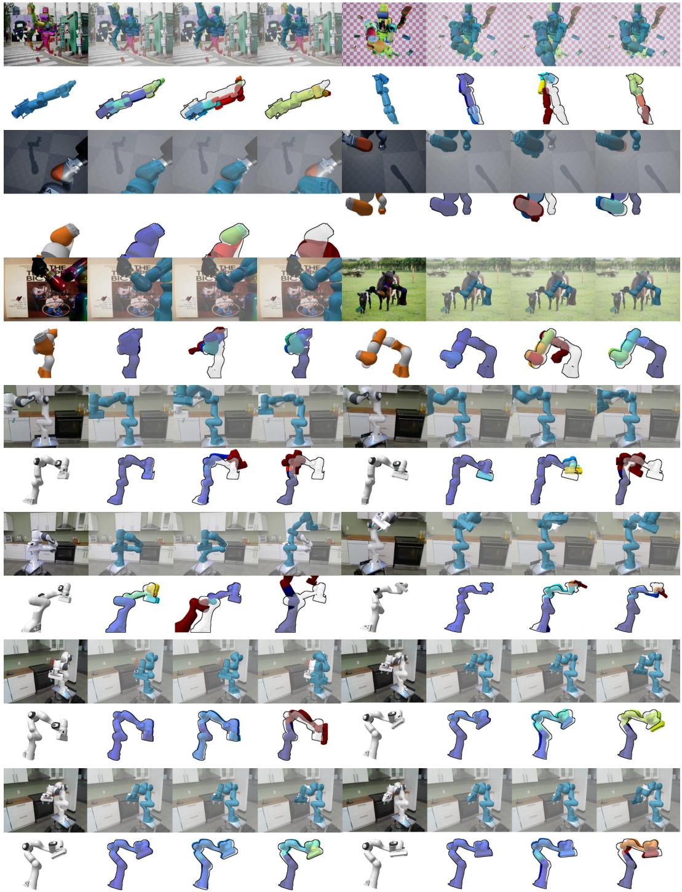  
Figure 9: Supplementary qualitative results from DREAM dataset.

<table><tr><td rowspan="3">Comp</td><td colspan="13">Franka</td></tr><tr><td colspan="6">Photo</td><td></td><td colspan="6">DR</td></tr><tr><td></td><td>J1 J2</td><td>J3</td><td>J4</td><td>J5</td><td>J6</td><td>Avg</td><td>J1</td><td>J2</td><td>J3</td><td>J4</td><td>J5</td><td>J6</td><td>Avg</td></tr><tr><td>Pose</td><td>7.7</td><td>3.5</td><td>4.3</td><td>3.4</td><td>7.3</td><td>8.1</td><td>5.7</td><td>6.1</td><td>2.7</td><td>3.6</td><td>2.5</td><td>6.3</td><td>8.1</td><td>4.9</td></tr><tr><td>HPE</td><td>6.1</td><td>2.2</td><td>3.6</td><td>2.0</td><td>6.2</td><td>6.6</td><td>4.5</td><td>6.2</td><td>2.2</td><td>3.9</td><td>1.9</td><td>5.9</td><td>6.6</td><td>4.5</td></tr><tr><td>PEPP</td><td>4.4</td><td>1.8</td><td>2.2</td><td>1.8</td><td>4.4</td><td>4.8</td><td>3.2</td><td>4.9</td><td>2.4</td><td>2.9</td><td>2.4</td><td>5.2</td><td>5.6</td><td>3.9</td></tr><tr><td>Ours</td><td>3.2</td><td>1.7</td><td>2.5</td><td>1.6</td><td>4.9</td><td>5.2</td><td>3.2</td><td>3.6</td><td>1.7</td><td>2.9</td><td>1.7</td><td>4.9</td><td>5.5</td><td>3.4</td></tr><tr><td></td><td></td><td></td><td></td><td>AK</td><td></td><td></td><td></td><td></td><td></td><td></td><td>XK</td><td></td><td></td><td></td></tr><tr><td>HPE</td><td>11.1</td><td>7.0</td><td>11.3</td><td>3.1</td><td>4.9</td><td>4.0</td><td>6.9</td><td>10.7</td><td>4.8</td><td>4.7</td><td>2.8</td><td>6.6</td><td>6.7</td><td>6.1</td></tr><tr><td>PEPP</td><td>29.0</td><td>3.1</td><td>3.5</td><td>1.5</td><td>6.0</td><td>8.0</td><td>8.5</td><td>31.2</td><td>4.8</td><td>3.9</td><td>2.4</td><td>4.1</td><td>2.0</td><td>8.0</td></tr><tr><td>Ours</td><td>10.7</td><td>8.1</td><td>12.0</td><td>1.5</td><td>2.2</td><td>2.6</td><td>6.2</td><td>10.2</td><td>3.7</td><td>4.5</td><td>3.1</td><td>3.7</td><td>3.4</td><td>4.8</td></tr><tr><td></td><td></td><td></td><td></td><td>RS</td><td></td><td></td><td></td><td></td><td></td><td></td><td>ORB</td><td></td><td></td><td></td></tr><tr><td>HPE</td><td>34.6</td><td>7.0</td><td>6.4</td><td>5.3</td><td>5.7</td><td>3.3</td><td>10.4</td><td>18.2</td><td>3.9</td><td>8.2</td><td>3.8</td><td>5.0</td><td>6.6</td><td>7.6</td></tr><tr><td>PEPP</td><td>77.6</td><td>2.8</td><td>4.5</td><td>2.2</td><td>3.8</td><td>3.0 1.8</td><td>15.7 9.4</td><td>77.6 18.0</td><td>2.8 3.9</td><td>4.5 5.9</td><td>2.2</td><td>3.8</td><td>3.0</td><td>15.6</td></tr><tr><td>Ours</td><td colspan="14">34.0 6.2 7.4 3.9 3.2</td></tr><tr><td rowspan="3">Comp</td><td></td><td></td><td></td><td></td><td></td><td></td><td>Kuka</td><td></td><td></td><td></td><td></td><td></td><td></td><td></td></tr><tr><td></td><td></td><td></td><td>Photo</td><td></td><td></td><td></td><td></td><td></td><td></td><td>DR</td><td></td><td></td><td></td></tr><tr><td>J1</td><td>J2</td><td>J3</td><td>J4</td><td>J5</td><td>J6</td><td>Avg</td><td>J1</td><td>J2</td><td>J3</td><td>J4</td><td>J5</td><td>J6</td><td>Avg</td></tr><tr><td>Pose</td><td>4.9</td><td>5.1</td><td>6.7</td><td>6.0</td><td>10.8</td><td>9.6</td><td>7.2</td><td>4.4</td><td>2.8</td><td>5.4</td><td>3.4</td><td>12.5</td><td>8.5</td><td>6.2</td></tr><tr><td>HPE</td><td>4.8</td><td>3.8</td><td>5.0</td><td>2.8</td><td>4.9</td><td>5.9</td><td>4.5</td><td>4.6</td><td>3.6</td><td>4.9</td><td>2.8</td><td>5.2</td><td>6.1</td><td>4.5</td></tr><tr><td>PEPP</td><td>3.8</td><td>2.8</td><td>4.6</td><td>3.1</td><td>3.8</td><td>5.4</td><td>3.9</td><td>3.7</td><td>3.5</td><td>5.1</td><td>3.5</td><td>4.1</td><td>6.2</td><td>4.4</td></tr><tr><td>Ours</td><td>3.1</td><td>1.7</td><td>3.4</td><td>1.8</td><td>3.2</td><td>4.6</td><td>2.9</td><td>3.1</td><td>1.8</td><td>3.5</td><td>1.8</td><td>3.5</td><td>4.8</td><td>3.1</td></tr></table>

Table 7: Comparison of mean MAE (°) on each joint of robot.

## B.5 SUPPLEMENTARY EXAMPLES FROM LABROPE

We randomly select 2 samples from each view of proposed LabRoPE dataset. The supplementary qualitative results are shown in Fig. 10. Specially, we also include some samples with human-robot interaction and occlusion in qualitative comparison.

## C SUPPLEMENTARY RESULTS OF ABLATION STUDIES

## C.1 QUALITATIVE COMPARISON FOR ABLATION STUDIES

Firstly, we compare some qualitative results of sim-to-real finetuning without Bone Length Loss or Ray-depth Loss in Fig. 11. We observe that the results without ray-depth loss are relatively accurate under the original camera view but degrade significantly when viewed from a different perspective. This verifies the projection ambiguity that motivates our work.

Furthermore, we compare results from multi-scale patch embedding with single patch embedding in Fig. 12. As a results, full model with multi-scale patch-based keypoint-centered feature extraction can provide the most accurate pose estimation compared with model with single-scale patch embedding.

## C.2 ZERO-SHOT ABLATION STUDIES ON LABROPE DATASET

We select ablation settings with best performance on split captured by RealSense in DREAM dataset for zero-shot ablation studies on LabRoPE dataset. The experimental results are shown in Table 8 and Fig. 13, demonstrating that ablated components indeed critically influence the generalization of the proposed RoPE-Flow.

## C.3 ABLATION STUDIES ON FLOW MATCHING STEPS

We set flow matching steps to 1/2/5/10/12/15/20, respectively implementing experiments on Panda and Kuka splits on DREAM dataset. Based on experimental results in Table 9, 10-step flow matching can provide the best results compared with other settings of steps.

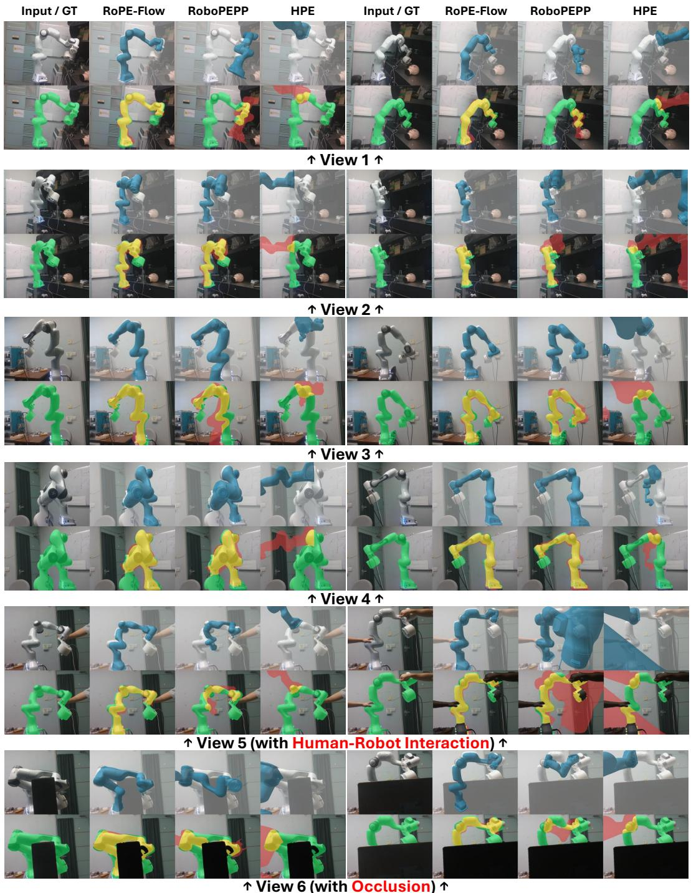  
Figure 10: Supplementary qualitative results from LabRoPE dataset.

RoPE-Flow

w/o ������

w/o �����

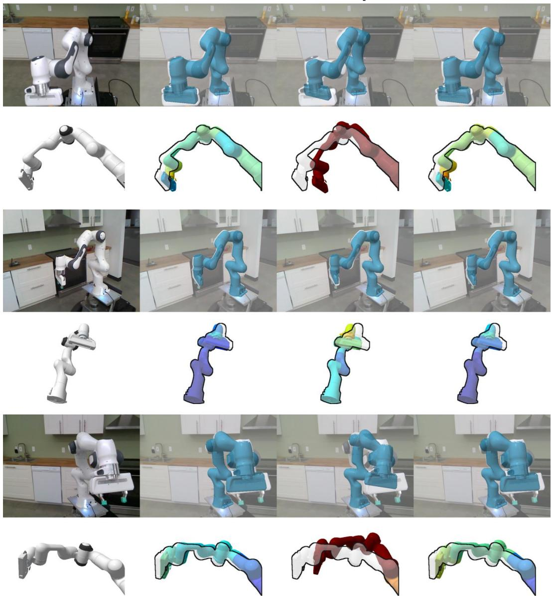

Figure 11: Qualitative results of sim-to-real finetuning with or without Bone Length Loss or Raydepth Loss
<table><tr><td>Methods</td><td>mIoU</td><td>Dice</td></tr><tr><td>Full Model</td><td> $\mathbf { 0 . 7 3 2 8 \pm 0 . 0 3 6 }$ </td><td> $\mathbf { 0 . 8 4 5 3 \pm 0 . 0 2 4 }$ </td></tr><tr><td> $\overline { { 3 \times 3 ~ } } \mathbf { P a t c h }$  7×7 Patch</td><td> $\overline { { 0 . 3 9 8 6 \pm 0 . 0 6 6 } }$ </td><td> $\overline { { 0 . 5 6 6 8 \pm 0 . 0 6 7 } }$ </td></tr><tr><td>11×11 Patch</td><td> $0 . 4 2 3 6 \pm 0 . 0 6 7$ </td><td> $0 . 5 9 2 0 \pm 0 . 0 6 7$ </td></tr><tr><td></td><td> $0 . 3 7 2 7 \pm 0 . 0 6 4$ </td><td> $0 . 5 3 9 9 \pm 0 . 0 6 8$ </td></tr><tr><td>No Graph</td><td> $0 . 4 0 6 4 \pm 0 . 0 7 7$ </td><td> $0 . 5 7 3 6 \pm 0 . 0 8 0$ </td></tr><tr><td>w/o  $\mathcal { L } _ { b o n e }$ </td><td> $0 . 3 9 2 9 \pm 0 . 0 8 7$ </td><td> $0 . 5 5 7 6 \pm 0 . 1 0 5$ </td></tr><tr><td>w/o  $\mathcal { L } _ { d e p t h }$ </td><td> $0 . 3 9 9 6 \pm 0 . 0 6 5$ </td><td> $0 . 5 6 7 9 \pm 0 . 0 6 7$ </td></tr><tr><td>w/o  $\mathcal { L } _ { F K }$ </td><td> $0 . 4 4 1 5 \pm 0 . 0 9 4$ </td><td> $0 . 6 0 5 9 \pm 0 . 1 0 3$ </td></tr><tr><td></td><td></td><td></td></tr></table>

Table 8: Ablation results of zero-shot pose estimation on LabRoPE dataset.

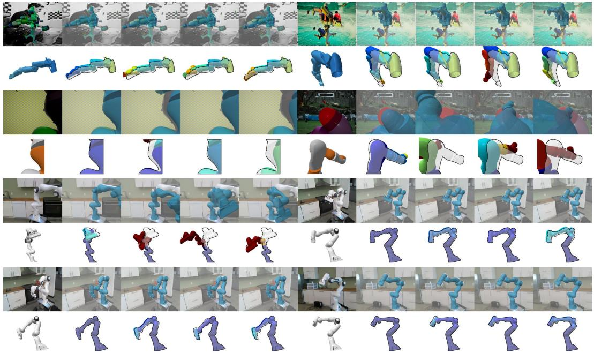  
Figure 12: Results from multi-scale patch embedding with single patch embedding.

Input/GT  
Full Model  
3×3 Patch  
7×7 Patch  
11×11 Patch  
w/o Graph  
w/o �����  
w/o ������  
w/o ���  
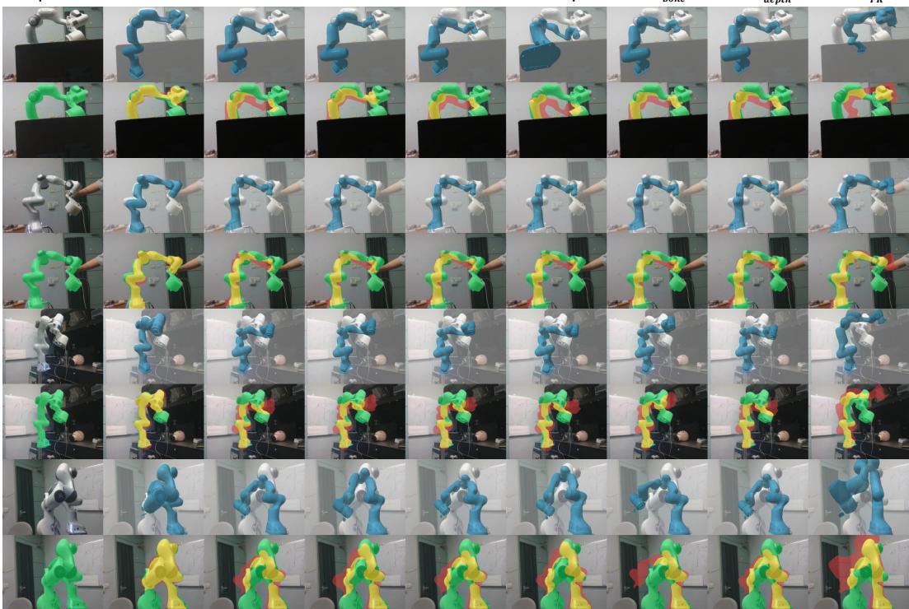  
Figure 13: Qualitative results of ablation studies on LabRoPE dataset.

<table><tr><td rowspan=2 colspan=1>Data Splits</td><td rowspan=1 colspan=3>Flow Matching Steps</td></tr><tr><td rowspan=1 colspan=3>1        2       5      10      12     15     20</td></tr><tr><td rowspan=1 colspan=1></td><td rowspan=1 colspan=3>ADD AUC for 3D Keypoints Prediction</td></tr><tr><td rowspan=5 colspan=1>Panda DRPanda PhotoKuka DRKuka PhotoPanda AKPanda XKPanda RS</td><td rowspan=1 colspan=3>29.02   74.29   83.68  86.64  86.53  86.00  85.66</td></tr><tr><td rowspan=1 colspan=3>29.12   74.47   84.08  87.09  86.99  86.43  86.08</td></tr><tr><td rowspan=1 colspan=2>28.86</td><td rowspan=1 colspan=2>75.31   83.87  86.92  86.87  86.58  86.2828.89   75.66   84.34  87.34  87.30  87.04  86.73</td></tr><tr><td rowspan=1 colspan=3>1.42    51.00   83.91  90.93  90.65  89.71  89.020      0.04   63.72  81.61  80.21  78.18  76.34</td></tr><tr><td rowspan=1 colspan=3>0      0.23   69.98  85.29  82.91  79.80  76.85</td></tr><tr><td rowspan=1 colspan=1>Panda ORB</td><td rowspan=1 colspan=3>0      0.01   65.43  82.13  80.80  78.67  76.46</td></tr><tr><td rowspan=1 colspan=1>Mean</td><td rowspan=1 colspan=3>Average Distance of Predicted 3D Keypoints</td></tr><tr><td rowspan=5 colspan=1>Panda DRPanda PhotoKuka DRKuka PhotoPanda AKPanda XKPanda RSPanda ORB</td><td rowspan=1 colspan=3>77.21    26.11   16.72  13.75  13.88  14.42  14.73</td></tr><tr><td rowspan=1 colspan=3>76.55   25.58   15.95  12.93  13.03  13.59  13.95</td></tr><tr><td rowspan=1 colspan=2>76.9</td><td rowspan=1 colspan=1>76.99</td><td rowspan=1 colspan=1>9   25.64   17.04  13.97  14.05  14.35  14.65</td></tr><tr><td rowspan=1 colspan=2>76.90</td><td rowspan=1 colspan=2>25.06   16.37  13.37  13.43  13.68  14.00140.77  48.99   16.08  9.06   9.34   10.28  10.97486.69  151.55  36.74  18.55  19.93  21.95  23.78405.94  132.62  30.01  14.70  17.08  20.19  23.14</td></tr><tr><td rowspan=1 colspan=3>651.80  168.31  35.09  18.38  19.72  21.86  24.07</td></tr></table>

Table 9: Results of 3D Keypoints Prediction and Joint Angle Prediction on different data splits from DREAM dataset.

## D RUNTIME AND COMPUTATIONAL COST

We calculate the inference speed and computational cost of the proposed method and compare with previous works in Table 10. Although with lower efficiency, RoPE-Flow still can achieve real-time requirement (around 30 FPS) on a relative low GPU memory (4.3GB).

<table><tr><td>Methods</td><td>Latency (ms)</td><td>FPS</td><td>Mem (MB)</td><td>Params (M)</td><td>GFLOPs</td></tr><tr><td>RoPE-Flow</td><td>36.5</td><td>27.4</td><td>4330</td><td>813.38</td><td>206.4</td></tr><tr><td>RoboPEPP</td><td>19.0</td><td>52.6</td><td>2446</td><td>334.90</td><td>132.0</td></tr><tr><td>HPE</td><td>35.7</td><td>28.0</td><td>379</td><td>79.62</td><td>35.0</td></tr></table>

Table 10: Comparison of runtime and computational cost.