# ROUTING POLICY OPTIMIZATION FOR ONLINE DIFFU-SION REINFORCEMENT LEARNING

Qiuhong Shen1 Yiding Yang2 Yuxin Zhang2 Xinwei Huang2 Minxuan Lin2 Bo Liu2 Hao Kang2 Haotian Yang2 Yizhi Wang2 Chongyang Ma2 Xinchao Wang1∗

1National University of Singapore 2ByteDance

## ABSTRACT

Reinforcement learning can align visual generators with reward signals beyond their pretraining objectives, but existing score-function methods typically introduce stochasticity by perturbing the reverse denoising trajectory, leading to costly rollout-based optimization. We instead ask whether stochastic exploration can be introduced inside the generator while preserving its original sampler. Routing Policy Optimization (RPO) answers this question by turning attention routing into a stochastic exploration action. At a few selected denoising levels, each query block keeps its own block and samples further key blocks in proportion to the generator’s native attention mass, or keeps dense attention. The sampled route perturbs the velocity of that transition, and a Gaussian likelihood around the dense velocity scores the perturbation with a score-function objective. RPO further uses a controlled two-rollout estimator: two rollouts share the same prompt, initial latent, routed denoising levels, and dense anchor layers, differing only in their sampled attention routes. Their reward difference provides an advantage signal for the routed transitions. Because the likelihood differentiates the dense velocity itself, the learned updates remain effective after routing is removed. At inference, RPO restores dense attention and retains the original deterministic sampler. Experiments on text-to-image and text-to-video generation show that RPO improves generation quality while achieving nearly 4× higher training efficiency than Flow-GRPO-style methods. Please see our project page for visual results.

## 1 INTRODUCTION

Diffusion and flow models now generate high-quality images and videos from natural-language prompts (Shen et al., 2026b; Li & Wang, 2026). DDPM establishes stochastic reverse denoising, while DDIM exposes a deterministic sampling path under the same training objective (Ho et al., 2020; Song et al., 2021). Flow matching and rectified flow instead learn vector fields for continuous transport (Lipman et al., 2023; Liu et al., 2023; Esser et al., 2024). In parallel, latent diffusion, Diffusion Transformers, and video diffusion models make high-resolution visual generation tractable at scale (Rombach et al., 2021; Peebles & Xie, 2022; Yang et al., 2024; Wan Team et al., 2025; Yu et al., 2026). Learned preference models then expose alignment objectives beyond likelihood and reconstruction (Xu et al., 2023; Kirstain et al., 2023; Ma et al., 2025).

Online reinforcement learning can optimize these objectives, but its central bottleneck is the policy. DDPO and DPOK treat stochastic denoising transitions as actions (Black et al., 2024; Fan et al., 2023). Flow-GRPO and DanceGRPO extend this construction to deterministic flow models by converting their ODE samplers into stochastic SDEs (Liu et al., 2025a; Xue et al., 2025b). Temporal windows, shared branches, and one-step updates reduce the resulting rollout cost (Li et al., 2025a; He et al., 2025; Li et al., 2025b; He et al., 2026), while dense credit and regulated clipping improve how terminal rewards shape sampler transitions (Deng et al., 2026; Shen et al., 2026a; Yang et al., 2026; Wang et al., 2025a). Forward-matching objectives avoid reverse-trajectory likelihoods, but they also remove the explicit sampled action (Zheng et al., 2026; Luo et al., 2026; Xue et al., 2025a; Xu et al., 2026c; Choi et al., 2026). What remains missing is an explicit, tractable policy that preserves the original deterministic sampler for both image and video generators.

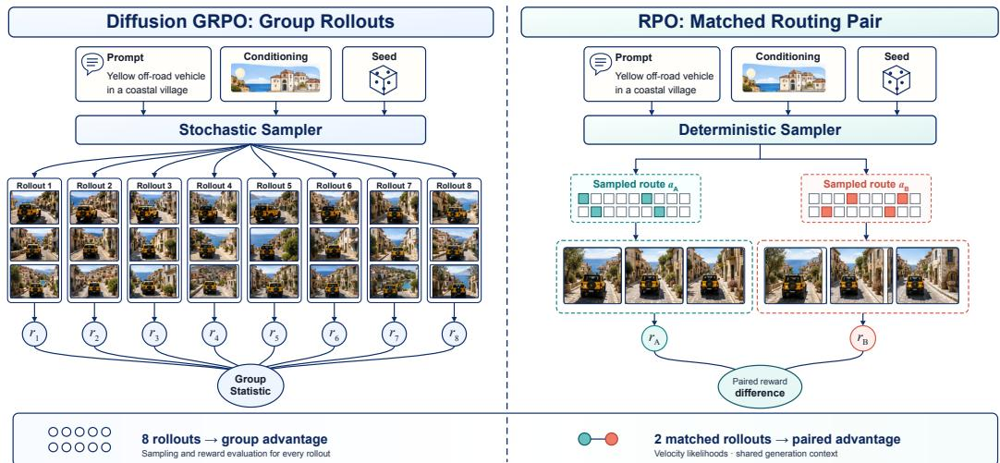  
Figure 1: A controlled routing pair replaces a large sampler-noise group. Sampler-space GRPO injects continuous noise into the reverse process and estimates an advantage from many complete visual rollouts. RPO retains the original deterministic sampler and pairs two rollouts that share the prompt, initial visual latent, routed denoising levels, and anchor layers. They differ only in their sampled attention routes, so their reward difference measures the aggregate effect of the two recorded routed trajectories. Generated visual outputs are schematic.

Our key insight is that stochastic exploration need not perturb the denoising trajectory. A diffusion transformer splits each latent into visual tokens, and its attention layers already decide how much each token attends to the others. If we group neighboring tokens into blocks, each query block can attend to a sampled subset of key blocks instead of all of them as dense attention does. We call thi choice of visible key blocks a route. Sampling routes exposes a stochastic action without adding a policy head or modifying the sampler. We introduce Routing Policy Optimization (RPO), which samples attention routes from the generator’s own attention mass at a few denoising levels. Each sampled route perturbs the velocity of its transition, and a Gaussian likelihood around the dense velocity scores this perturbation. This likelihood supplies a score-function surrogate for the dense generator itself.

The routing action also enables a controlled two-rollout estimator, as Figure 1 illustrates. Both members share every non-routing source of variation and differ only in their sampled routes. Their signed reward difference therefore provides a leave-one-out advantage for the two routed trajectories. During replay, each routed transition is scored from its recorded input, so later levels condition on earlier routes.

Routing serves only as a training interface. The pass that proposes routes carries no gradient, and the likelihood differentiates the dense velocity. The update therefore acts on the same velocity field that dense inference evaluates. After training, we remove all masks and evaluate the updated generator with dense attention and its original deterministic sampler. The central empirical question is whether reward learned through temporary routing transfers to the dense image or video generator used at inference.

We evaluate this question on Stable Diffusion 3.5 Medium and Wan2.2-TI2V-5B (Wan Team et al., 2025), covering text-to-image and text-to-video generation. Across both settings, RPO improves reward-aligned generation quality while retaining dense inference. On Stable Diffusion 3.5, RPO exceeds the final dense validation reward of Flow-GRPO within 25 of 50 training steps and ends 1.1 points higher. On Wan2.2, RPO attains the strongest overall VBench score among the evaluated checkpoints while using 24.1 GPU-hours, compared with 75.4 for Flow-GRPO and 102.3 for Dance GRPO. This corresponds to 3.1× and 4.2× lower training cost, respectively. Our contributions can be summarized as following:

• We introduce a sampler-preserving formulation for online alignment of continuous visual generators. Its exploration action is a training-time attention route sampled from native attention mass, with no auxiliary policy head or SDE conversion.

• We score each routed transition with a Gaussian velocity likelihood around the dense velocity and optimize it with a controlled two-rollout surrogate that holds the non-routing generation context fixed.

• Because this likelihood updates the dense velocity directly, we remove routing at inference and preserve the original image or video sampler.

• We validate RPO on Stable Diffusion 3.5 and Wan2.2, demonstrating improved reward-aligned quality across image and video generation together with substantially lower training cost than sampler-space baselines.

## 2 RELATED WORK

Reward alignment methods for visual generators differ mainly in where the learning signal enters the generator. We organize prior work along this axis, from the sampler trajectory to the attention computation.

Sampler-space policy gradients. DDPO and DPOK first treated stochastic denoising transitions as policy actions (Black et al., 2024; Fan et al., 2023). Flow-GRPO and DanceGRPO carried this view to flow matching and video by converting the deterministic sampler into an SDE and estimating group-relative advantages (Liu et al., 2025a; Xue et al., 2025b). Follow-up work lowers the cost of these stochastic trajectories. Temporal windows, shared-prefix branches, and one-step updates reduce the number or cost of stochastic transitions (Li et al., 2025a;b; He et al., 2026). TempFlow-GRPO concentrates stochasticity at designated branch points for temporal credit assignment (He et al., 2025), and TAGRPO aligns trajectories that start from identical initial noise (Wang et al., 2026). Dense temporal and spatial credit or regulated clipping further improve how a terminal reward shapes each transition (Deng et al., 2026; Shen et al., 2026a; Yang et al., 2026; Wang et al., 2025a). These methods keep the action inside the sampler, so exploration still perturbs the reverse trajectory.

Objectives without sampler actions. A second family avoids sampler actions. Direct reward fine tuning backpropagates through differentiable image or video rewards (Clark et al., 2023; Prabhudesai et al., 2024). For black-box rewards, DiffusionNFT, DGPO, and advantage-weighted matching replace reverse-trajectory likelihoods with forward-process or preference objectives (Zheng et al., 2026; Luo et al., 2026; Xue et al., 2025a). Adjoint matching, ELBO surrogates, path-space value gradients, and velocity matching pursue the same goal through native regression targets (Bergmeister et al., 2026; Tang et al., 2026; Xu et al., 2026c; Choi et al., 2026). For few-step generators, a hybrid scheme combines distribution matching, GRPO on stochastic intermediate transitions, and reward backpropagation through the final step (Huang et al., 2026). Offline preference optimization removes online rollouts altogether, ranging from Diffusion-DPO to multidimensional and temporally dense video preferences (Wallace et al., 2024; Liu et al., 2024; 2025b; Wu et al., 2025b). These objectives leave inference untouched, but they give up an explicit sampled action. In contrast, RPO keeps a score-function policy with a recorded action and places that action inside attention.

Discrete actions and attention routing. Discrete policies already exist in visual generation. MaskGRPO, Mask-GRPO, and MaskFocus optimize token corruption, unmasking, or mask schedules in natively discrete image generators (Ma et al., 2026; Luo et al., 2025; Zhang et al., 2025a). Structured attention sparsity is also well studied, although mainly for efficiency. Q/K-derived block gates and training-free compression expose attention redundancy (Gao et al., 2024; Yuan et al., 2024; Xi et al., 2025; Chen et al., 2025). VSA, trainable dynamic routing, and hierarchical sparse attention learn such sparsity inside image and video generators (Zhang et al., 2025b; Zhao et al., 2025; Zhou et al., 2025; Lv et al., 2026; Xu et al., 2026a). Reinforcement learning has also selected sparse-attention levels or recomputation schedules for acceleration (Zhao et al., 2026; Aliev et al., 2026). KVPO comes closest to alignment. It explores through stochastic historical-key routing in autoregressive video and scores branches with a velocity-energy surrogate (Zhang et al., 2026). Other work optimizes attention allocation for multimodal reasoning or routes preference credit through diffusion attention (Li et al., 2026; Xu et al., 2026b). Dropout-GRPO samples Bernoulli masks to diversify deterministic latent reasoning (Jung, 2026). Our paired estimator also builds on common random numbers and group-relative baselines (Asmussen & Glynn, 2007; Shao et al., 2024), and 2-GRPO shows that two language-model rollouts can retain most of a larger group’s performance (Wu et al., 2025a). RPO combines these ingredients through a new interface. Its action is a block route sampled from native attention mass inside a bidirectional diffusion transformer, its Gaussian velocity likelihood updates the dense generator, and the route disappears before inference.

## 3 PRELIMINARIES

RPO fine-tunes a pretrained visual generator that already has a deterministic sampler. This section fixes the notation for the sampler and the reward, introduces attention over token blocks, and defines where RPO routes attention.

Denoising trajectory and reward. Let c denote a text prompt, and let N denote both the number of denoising transitions and the largest noise level. Rollout i starts from Gaussian noise and follows the deterministic sampler:

$$
\tau _ { i } = ( x _ { i } ^ { N } , x _ { i } ^ { N - 1 } , \ldots , x _ { i } ^ { 0 } ) , \qquad x _ { i } ^ { N } \sim \mathcal { N } ( 0 , I ) , \qquad y _ { i } = \mathrm { D e c } ( x _ { i } ^ { 0 } ) .\tag{1}
$$

Here $\tau _ { i }$ is the reverse trajectory, and the noise level $t \in \{ N , \ldots , 0 \}$ decreases during generation. Each transition is an Euler step of the learned velocity field, $\boldsymbol { x } _ { i } ^ { t - 1 } = \boldsymbol { x } _ { i } ^ { t } + \Delta _ { t } \boldsymbol { v } _ { \theta } ( \boldsymbol { x } _ { i } ^ { t } , t , c )$ , where $v _ { \theta }$ is the velocity predicted by the generator with trainable parameters θ and $\Delta _ { t } < 0$ is the step of the noise schedule. The frozen decoder Dec maps the terminal latent $x _ { i } ^ { 0 }$ to the visual output $y _ { i }$ , which is an image or a video. A black-box reward model $R _ { d }$ then scores the output on reward dimension $d ,$ giving $r _ { i , d } = R _ { d } ( y _ { i } , c )$ . Training uses these reward values but never differentiates through $R _ { d }$

Attention over token blocks. The generator is a diffusion transformer that splits each latent into M visual tokens, one per spatial patch of an image or spatiotemporal patch of a video. In every self-attention layer and head, each token emits a query, a key, and a value vector. The attention weights of a query are a softmax over its scaled inner products with the keys. Dense attention lets every query attend to every key. Block-sparse attention coarsens this pattern. It arranges the tokens in a sequence, cuts the sequence into $\bar { Q }$ contiguous token blocks of $B$ tokens, and applies a binary block mask $\mu \in \{ 0 , 1 \} ^ { Q \times Q }$ . A query token in block $q$ attends only to the key tokens of blocks j with $\mu _ { q , j } = 1$ , and its softmax renormalizes over those keys. We order the tokens along a locality-preserving Gilbert curve, so each block is a compact image or video patch, and both generators use $B = 1 2 8$ . We call the set of key blocks that query block $q$ keeps its route, and the choice of routes routing. Sparse-attention methods choose routes to save computation. RPO instead samples routes as its exploration action during training and restores dense attention at inference.

Routing sites and units. Routing acts at a small fixed set of noise levels ${ \mathcal { T } } _ { \mathrm { r o u t e } } \subseteq \{ 1 , \dots , N \}$ the routed levels, which every rollout shares. These are early levels, where a route can still change the final output, and every other level runs dense attention. At each routed level, every query block makes one routing decision, and all routed attention layers and heads apply it. A random subset of transformer blocks, the anchor layers, stays dense at each routed level. A routing unit is one such decision, namely the route of query block q at level $t ,$ written $u = ( t , q )$ . Each query block keeps a deterministic safety set $S _ { q } = \{ q \}$ , its own block. The remaining blocks form the candidate set:

$$
C _ { q } = \{ 1 , \ldots , Q \} \setminus S _ { q } .\tag{2}
$$

The route of every unit contains $S _ { q } .$ . The policy decides which blocks of $C _ { q }$ it adds, or whether query block $q$ attends densely at that level. Every query therefore keeps its local context, and its softmax never runs over an empty set. Appendix A details the traversal, the blocks, and the executed mask. This setup confines all stochasticity to a few routed transitions, while the prompt, the sampler, and the safety block stay deterministic.

## 4 ROUTING POLICY OPTIMIZATION

Sampler-space methods explore by injecting noise into the reverse trajectory. RPO instead explores by routing attention at the routed levels. We first define how the generator’s own attention proposes routes (Section 4.1), then score each routed transition with a Gaussian likelihood around the dense velocity (Section 4.2), and finally turn the reward difference of a matched pair into a policy-gradient update (Section 4.3). Figure 2 summarizes this path.

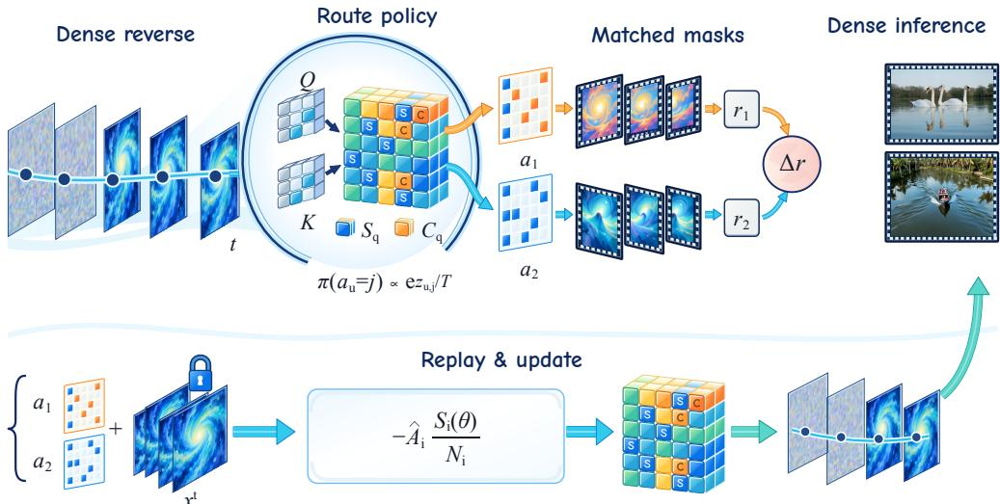  
Figure 2: A temporary route perturbs training rollouts, and a velocity likelihood updates the dense generator. At each routed level $t ,$ the native attention mass of every query block over the key blocks defines a categorical draw over the candidate blocks $C _ { q }$ and a dense option, while the safety block $S _ { q }$ stays active. Two matched rollouts record independent routes under the same prompt, content seed, routed levels, and anchor layers. Replay recomputes the dense velocity at every recorded routed latent, and the reward difference weights a Gaussian likelihood of the routed step around it. At inference, RPO removes all masks and runs dense attention with the original deterministic sampler.

## 4.1 ATTENTION-MASS ROUTING

The central challenge is to expose a stochastic action without adding a policy head or perturbing the sampler. A routed attention layer already decides how much each query attends to each key, so we let this attention propose the routes. At routed level t, a scoring pass runs the dense attention of every routed layer $\bar { \ell \in \bar { \mathcal L } }$ and measures how much attention query block q places on key block $j .$ For rollout i and unit $u = ( t , q )$ , the route logits and the draw are

$$
\begin{array} { l } { { \displaystyle m _ { i , \ell , q , j } = \frac { 1 } { B H } \sum _ { h = 1 } ^ { H } \sum _ { p \in \mathcal { Q } _ { q } } \sum _ { p ^ { \prime } \in \mathcal { K } _ { j } } \alpha _ { i } ^ { \ell , h } ( p , p ^ { \prime } ) } , \quad \quad \quad \hfill z _ { i , u , j } = \frac { 1 } { | \mathcal { L } | } \sum _ { \ell \in \mathcal { L } } \log m _ { i , \ell , q , j } , }  \\ { { \displaystyle z _ { i , u , * } = \log \sum _ { j ^ { \prime } = 1 } ^ { Q } \exp ( z _ { i , u , j ^ { \prime } } ) } , \quad \quad \quad \quad \pi ( a _ { i , u } = j ) = \frac { \exp ( z _ { i , u , j } / T ) } { \sum _ { j ^ { \prime } \in { \cal C } _ { q } \cup \{ * \} } \exp ( z _ { i , u , j ^ { \prime } } / T ) } . }  \end{array}\tag{3}
$$

Here $\alpha _ { i } ^ { \ell , h } ( p , p ^ { \prime } )$ is the dense attention weight from query token $p$ to visual key token $p ^ { \prime }$ in head h of layer $\ell ,$ renormalized over the visual keys, H is the number of heads, and $\mathcal { Q } _ { q }$ and $\kappa _ { j }$ hold the tokens of blocks $q$ and $j$ . Thus $m _ { i , \ell , q , j }$ is the share of block $q ^ { * } { \bf s }$ attention that falls on block $j ,$ , and $z _ { i , u , j }$ averages its logarithm over the routed layers, so one decision serves all of them. The dense option ∗ takes the log of the total mass as its logit. The action $a _ { i , u } \in C _ { q } \cup \{ * \}$ picks a candidate block or dense attention, and $T > 0$ is a temperature. Intuitively, candidate blocks that already receive much attention are likely to be picked, while the random draw still explores alternatives. For a single routed layer at $T = 1$ , the dense option has probability $1 / ( 2 - m _ { i , \ell , q , q } ) .$ , so a query block whose attention is already local mostly stays dense. The scoring pass carries no gradient. The draw is therefore an exploration proposal that changes only as the generator itself changes.

A keep ratio κ sets the number of candidates $K _ { u } = \lceil \kappa ( \left| C _ { q } \right| + 1 ) \rceil$ that a sparse query block keeps, where $\dot { | C _ { q } | } + 1$ counts the options of the draw. We perturb every logit in Equation 3 with independent Gumbel noise and rank the options. If the dense option ranks first, query block q attends densely. Otherwise it keeps its safety block and the $K _ { u }$ highest-ranked candidates. For $K _ { u } = 1$ , this is an exact draw from π, and for larger $K _ { u }$ it extends the draw to $K _ { u }$ candidates without replacement. The executed mask $\mu _ { i } ^ { t }$ applies these routes in every routed layer and head, while the anchor layers stay dense. The generator’s own attention thus decides which blocks stay visible, and no extra parameters define the action.

## 4.2 VELOCITY LIKELIHOOD OF A ROUTED TRANSITION

A route changes the velocity of one transition, so the policy gradient needs the likelihood of that change. At a routed level, rollout i steps with the routed velocity $\tilde { v } _ { i } ^ { t }$ , the velocity of the generator under mask $\mu _ { i } ^ { t }$ , so that $\boldsymbol { x } _ { i } ^ { t - 1 } = \boldsymbol { x } _ { i } ^ { t } + \boldsymbol { \Delta } _ { t } \bar { \boldsymbol { v } } _ { i } ^ { t }$ . On Stable Diffusion 3.5, a centered variant instead steps with the dense velocity plus half the difference of two independently routed velocities, which keeps the rollout close to the dense path (Appendix B). We score the step with a Gaussian centered on the dense velocity:

$$
\log q _ { \theta } \big ( x _ { i } ^ { t - 1 } \mid x _ { i } ^ { t } \big ) = - \frac { \big \| \tilde { v } _ { i } ^ { t } - v _ { \theta } ( x _ { i } ^ { t } , t , c ) \big \| ^ { 2 } } { 2 D s _ { t } ^ { 2 } } , \qquad s _ { t } ^ { 2 } = \frac { 1 } { | \mathcal { B } | } \sum _ { k \in \mathcal { B } } \frac { \big \| \tilde { v } _ { k } ^ { t } - v _ { \theta _ { \mathrm { o l d } } } ( x _ { k } ^ { t } , t , c _ { k } ) \big \| ^ { 2 } } { D } .\tag{4}
$$

Here $D$ is the number of latent entries, B is the current batch of rollouts, $c _ { k }$ is the prompt of rollout $k ,$ and $\theta _ { \mathrm { o l d } }$ are the collecting parameters. The fixed width $s _ { t } ^ { 2 }$ is the mean squared routing deviation at level t, so log qθ stays of order one however strongly routing perturbs that level. Replay recovers $\tilde { v } _ { i } ^ { t } = ( x _ { i } ^ { t - 1 } - x _ { i } ^ { t } ) / \Delta _ { t }$ from the recorded latents and recomputes the dense velocity $v _ { \theta } \bar { ( } x _ { i } ^ { t } , t , c )$ with gradient. The rollout total and its normalizer are

$$
S _ { i } ( \theta ) = \sum _ { t \in \mathcal { T } _ { \mathrm { r o u t e } } } w _ { t } \log q _ { \theta } \left( x _ { i } ^ { t - 1 } \mid x _ { i } ^ { t } \right) , \qquad N _ { i } = \left| \mathcal { T } _ { \mathrm { r o u t e } } \right| .\tag{5}
$$

Here $w _ { t } > 0$ weights routed level $t ,$ and $N _ { i }$ never depends on the sampled routes. Equation 5 treats each routed transition as a sample of a Gaussian policy, the same form that sampler-space methods use for an SDE step. Here, however, the deviation comes from attention routing, so the sampler stays deterministic and the perturbation follows the attention structure of the image or video. Each level starts from its recorded input, so later levels condition on the routes before them. The gradient $\nabla _ { \theta }$ log $q _ { \theta } = ( \tilde { v } _ { i } ^ { t } - v _ { \theta } ) ^ { \top } \nabla _ { \theta } v _ { \theta } / \top ( D s _ { t } ^ { 2 } )$ pulls the dense velocity toward the recorded routed velocity. $S _ { i }$ is a surrogate, because the routed deviation is not exactly Gaussian and $S _ { i }$ omits the probability of the sampled route, and Appendix E returns to this gap. As a result, the update acts directly on the dense velocity field that the sampler evaluates at inference.

## 4.3 CONTROLLED TWO-ROLLOUT OBJECTIVE

A score-function update is only as informative as its advantage. A reward difference between unrelated rollouts mixes the effect of routing with changes in content. We therefore generate each prompt group as a matched pair with $G = 2$ . Both members share the prompt c and a content seed that fixes the initial latent, the anchor layers, and every non-routing source of randomness. Only their routing seeds differ:

$$
\xi _ { \mathrm { c o n t e n t } } ^ { 1 } = \xi _ { \mathrm { c o n t e n t } } ^ { 2 } , \qquad \xi _ { \mathrm { r o u t e } } ^ { 1 } \neq \xi _ { \mathrm { r o u t e } } ^ { 2 } .\tag{6}
$$

Because the sampler is deterministic, the two members diverge only through their routes. For member $i \in \{ 1 , 2 \}$ , let ¯i denote the other member of the pair. The partner reward then serves as a leave-one-out baseline:

$$
A _ { i , d } ^ { \mathrm { p a i r } } = r _ { i , d } - r _ { \bar { i } , d } ^ { } .\tag{7}
$$

Given the shared context, $r _ { \bar { i } , d }$ does not depend on member i’s routes, so it is a valid score-function baseline. The two advantages have equal magnitude and opposite signs. Before replay, we winsorize the pair differences of each reward dimension, divide them by a robust interquartile scale, and sum the dimensions with weights $w _ { d }$ . A stop-gradient turns the result into a fixed replay weight $\widehat { A } _ { i }$ , and the processing preserves pair antisymmetry (Appendix C). The per-rollout loss and the pair objective are:

$$
\mathcal { L } _ { i } ^ { \mathrm { p g } } ( \theta ) = - \widehat { A } _ { i } \frac { S _ { i } ( \theta ) } { N _ { i } } , \qquad \mathcal { L } ^ { \mathrm { R P O } } ( \theta ) = \frac { 1 } { 2 } \sum _ { i = 1 } ^ { 2 } \mathcal { L } _ { i } ^ { \mathrm { p g } } ( \theta ) .\tag{8}
$$

Here $S _ { i }$ is the velocity likelihood from Equation 5, and $N _ { i }$ is its route-independent normalizer, so $N _ { 1 } = N _ { 2 }$ . The update then pulls the dense velocity toward the routed transitions of the higher-reward member and away from those of the lower-reward member, in proportion to their processed reward gap.

From routed training to dense inference. Routing enters training only through the recorded transitions, and the loss differentiates the dense velocity vθ that the sampler evaluates at inference. After training, we therefore remove every mask and run the updated generator with dense attention and its original deterministic sampler.

(a) DrawBench Generations  
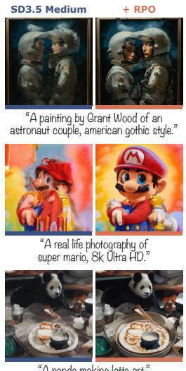

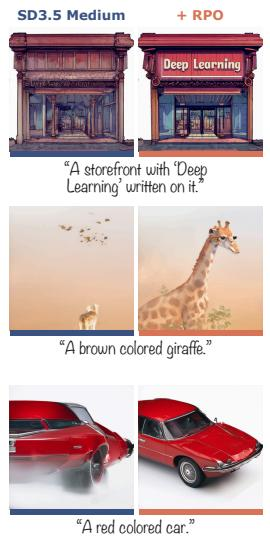

(b) Image Quality  
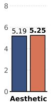  
(c) Preference Score

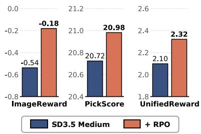  
Figure 3: RPO on Stable Diffusion 3.5 Medium. (a) Samples before and after RPO on DrawBench prompts. Each pair shares the prompt and initial noise. (b, c) DrawBench scores over 1,000 images from 200 prompts with 5 seeds, generated without classifier-free guidance. RPO improves desired property across all five reported metrics.

## 5 EXPERIMENTS

Our experiments test whether reward learned through temporary routing transfers to the dense generator used at inference. After the setup, we evaluate text-to-image generation (Section 5.2), compare learning speed with sampler-space RL (Section 5.3), and measure VBench transfer and training cost on video (Section 5.4).

## 5.1 SETUP

Image setting. We train Stable Diffusion 3.5 Medium (Esser et al., 2024) on prompts from the PickScore SFW split (Kirstain et al., 2023). Each rollout generates a 512 × 512 image with a deterministic 10-step flow sampler and no classifier-free guidance. The training reward is HPSv3 (Ma et al., 2025) scaled by 0.1. After training, we evaluate the dense model on DrawBench prompts (Saharia et al., 2022). An aesthetic score and DeQA-Score (You et al., 2025) measure image quality, while ImageReward (Xu et al., 2023), PickScore, and UnifiedReward (Wang et al., 2025b) measure preference. During training, we evaluate the dense model every 5 steps on 64 fixed validation prompts with a 28-step sampler.

Video setting. We train Wan2.2-TI2V-5B (Wan Team et al., 2025), a text-to-video flow-matching generator, on a curated creative prompt distribution. Each rollout renders 13 frames at 704 × 1280 with a 10-step sampler and classifier-free guidance scale 5. The reward is HPSv3 scaled by 0.1 and is computed on every fourth frame.

Baselines and training. On SD3.5, we compare against Flow-GRPO (Liu et al., 2025a). It trains the same LoRA adapters with the same HPSv3 reward and the same 10-step training sampler, but it explores by sampling SDE trajectories. On Wan2.2, we compare against Flow-GRPO and DanceGRPO (Xue et al., 2025b). Both baselines train the same generator with the same HPSv3 reward and also explore through SDE trajectories. DanceGRPO uses groups of G = 8 and updates the full model. On both generators, RPO instead collects 64 matched pairs (G = 2) per training step. Appendix B lists the routing and optimization settings for both generators. Appendix D details the evaluation protocols.

## 5.2 TEXT-TO-IMAGE GENERATION

Figure 3 first compares SD3.5 Medium before and after RPO training on DrawBench. RPO improves all five metrics, although none of them is the training reward. The preference metrics show the clearest gains. ImageReward rises from −0.54 to −0.18, and UnifiedReward rises from 2.10 to 2.32. Image quality also improves, with DeQA-Score rising from 3.35 to 3.56. In the samples, the trained model writes the requested storefront text and renders a clear brown giraffe, whereas the base model misses both. Because each pair shares its prompt, initial noise, and sampler, these gains come from the updated weights of the dense generator alone.

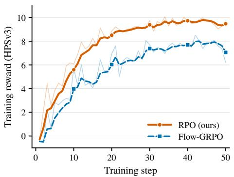  
(a) HPSv3 reward on each method’s training rollouts.

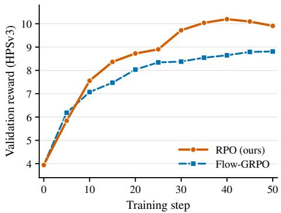  
(b) HPSv3 reward of the dense model on validation prompts.  
Figure 4: RPO learns faster than Flow-GRPO on Stable Diffusion 3.5 Medium. Both methods train the same LoRA adapters with HPSv3 reward and a 10-step training sampler for 50 steps from the same base model. (a) Mean raw HPSv3 of each step’s training rollouts (faint) and its exponential moving average with smoothing weight 0.6 (bold). (b) Raw HPSv3 of the dense model on 64 fixed validation prompts with a 28-step sampler, measured every 5 steps from step 0.

## 5.3 LEARNING SPEED AGAINST SAMPLER-SPACE RL

Online RL pays for every rollout, so the reward gained per training step matters as much as the final score. Figure 4 tracks RPO and Flow-GRPO over 50 training steps on SD3.5 Medium. Both runs start from the same base model, which scores 3.94 and 3.96 on their shared validation. Figure 4a reports the reward of the rollouts that each method samples during training. The smoothed RPO reward rises above 9 by step 30 and stays near 9.5, whereas the smoothed Flow-GRPO reward stays below 8. However, RPO scores routed rollouts and Flow-GRPO scores SDE rollouts, so neither curve measures the dense model used at inference.

Figure 4b therefore reports the decisive comparison on the dense model. Flow-GRPO starts slightly faster at step 5, but RPO leads from step 10 onward. RPO reaches 8.90 at step 25, which already exceeds the step-50 score of Flow-GRPO, 8.81. It peaks at 10.20 at step 40 and ends at 9.91. Over the full run, RPO gains +5.97 over its step-zero score, whereas Flow-GRPO gains +4.86. RPO thus matches the final dense reward of Flow-GRPO in half the training steps and ends 1.1 points higher. Both curves come from one training seed, and Appendix D lists the remaining differences between the two runs. Exploration through attention routing therefore turns each training step into more dense-model reward than exploration through SDE trajectories.

## 5.4 VBENCH TRANSFER AND TRAINING COST

A single reward scalar compresses appearance and semantics, so reward gains alone do not establish broad video quality. We therefore evaluate the base model and the three trained checkpoints on VBench, which decomposes video generation into 16 fine-grained dimensions with tailored prompts and evaluation procedures (Huang et al., 2024). Each model generates 6,220 13-frame videos from shared prompts and initial noise with a deterministic sampler (Appendix D).

Table 1 lists the 8 dimensions where RPO exceeds both RL baselines, together with the overall score and training cost. The largest gains over the base model are semantic. Object class improves by +4.40, human action by +4.80, scene by +3.43, and multiple objects by +2.15. RPO also improves aesthetic quality, imaging quality, subject consistency, and motion smoothness over the base model. It is the only trained checkpoint above the base model overall. Moreover, it trains with 24.1 GPU-hours, which is 3.1× less than Flow-GRPO and 4.2× less than DanceGRPO, although the runs are not compute-matched.

Table 1: Comparison on VBench across multiple dimensions with DanceGRPO and Flow-GRPO, plus overall score and training cost. Scores are percentages. The Wan2.2 rows share one generation configuration. CogVideoX-5B and HunyuanVideo use the same prompts, frame count, denoising steps, and scoring, but keep their native resolution and guidance. Training GPU-hours are measured on H100 GPUs.
<table><tr><td>Method</td><td>Train GPU-h</td><td>Aesthetic quality</td><td>Imaging quality</td><td>Subject consistency</td><td>Motion smoothness</td><td>class</td><td>Object Multiple objects</td><td>Human action</td><td>Scene</td><td>Overall score</td></tr><tr><td>CogVideoX-5B</td><td>=</td><td>60.17</td><td>61.92</td><td>96.50</td><td>97.42</td><td>82.44</td><td>57.29</td><td>86.40</td><td>42.73</td><td>81.30</td></tr><tr><td>HunyuanVideo</td><td>一</td><td>63.05</td><td>63.78</td><td>98.76</td><td>99.42</td><td>65.79</td><td>56.46</td><td>83.20</td><td>27.01</td><td>78.69</td></tr><tr><td>Wan2.2-TI2V-5B</td><td></td><td>61.91</td><td>67.71</td><td>98.37</td><td>98.76</td><td>81.01</td><td>59.15</td><td>79.40</td><td>37.41</td><td>81.61</td></tr><tr><td>RPO</td><td>24.1</td><td>62.64</td><td>68.65</td><td>98.69</td><td>99.06</td><td>85.41</td><td>61.30</td><td>84.20</td><td>40.84</td><td>82.00</td></tr><tr><td>DanceGRPO</td><td>102.3</td><td>61.74</td><td>67.69</td><td>98.38</td><td>98.75</td><td>80.81</td><td>59.34</td><td>80.00</td><td>36.95</td><td>81.46</td></tr><tr><td>Flow-GRPO</td><td>75.4</td><td>60.09</td><td>67.43</td><td>97.59</td><td>97.88</td><td>79.10</td><td>59.98</td><td>81.80</td><td>36.73</td><td>81.19</td></tr></table>

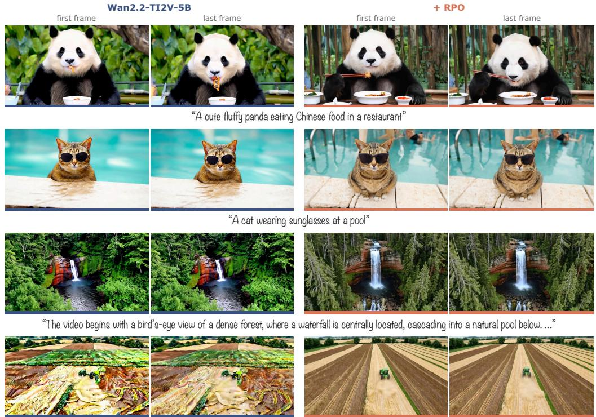  
“The video presents a continuous aerial view of an agricultural landscape, … a small green tractor-like vehicle and the surrounding fields. …”

Figure 5: Text-to-video samples from Wan2.2-TI2V-5B before and after RPO. Each row shows one prompt. For each model we show the first and last of the 13 generated frames (1280 × 704, 50 sampling steps). Both models use the same prompt and initial noise. RPO follows the prompt more closely and replaces distorted, painterly textures with coherent, realistic scenes.

The remaining dimensions reveal trade-offs. RPO lowers color and appearance style relative to the base model, although it still leads the trained baselines on color. Flow-GRPO raises dynamic degree by 12.50 points but loses consistency, smoothness, aesthetic quality, color, and object-class accuracy. RPO therefore transfers reward mainly through semantic alignment, whereas Flow-GRPO trades visual quality for motion. The four Wan2.2 overall scores span only 0.81 points on one seed set, so we read the aggregate ranking as directional. CogVideoX-5B (Yang et al., 2024) and HunyuanVideo (Kong et al., 2024) serve as external references under matched prompts and scoring.

Figure 5 makes these semantic gains visible on four held-out prompts, where the RPO videos follow the prompts more closely. Both checkpoints run dense attention with the same prompt, initial noise, and sampler, so they differ only in their weights. Across image and video, the gains learned through routing persist after the masks are removed.

## 6 DISCUSSION AND LIMITATIONS

RPO places its policy action inside attention, and this design choice also defines its current limits. First, the framework is confined to attention. Its action is a mask over key-value blocks, so it requires a backbone that computes attention. We have not yet generalized routing to other architectures, where no attention mass exists to propose routes. Second, the routing proposal and its likelihood are coarse. Each route logit averages the attention mass of a whole block over every routed layer and head, which hides token-level and layer-specific structure. Moreover, the velocity likelihood treats the routed deviation as Gaussian, although a discrete route produces it. A finer proposal and a likelihood that also credits the route choice could give the policy a more faithful view of which blocks matter. Finally, RPO currently adapts to an existing generator rather than shaping it. Co-designing the network architecture with RPO is a promising direction for achieving both higher efficiency and larger RL gains.

## 7 CONCLUSION

In this work, we addressed the cost of online reinforcement learning for visual generators without perturbing their reverse denoising trajectories. We introduced Routing Policy Optimization, a samplerpreserving method that samples block-wise attention routes from the generator’s native attention mass at a few selected denoising levels. A controlled pair holds the non-routing generation context fixed, so its reward difference weights a Gaussian velocity likelihood of the two recorded routed trajectories. Because this likelihood updates the dense velocity field, inference removes the masks and restores dense attention under the original deterministic sampler. Experiments on Stable Diffusion 3.5 and Wan2.2 demonstrate improved reward-aligned quality across text-to-image and text-to-video generation while requiring substantially less training compute than sampler-space baselines. By moving stochastic exploration from the sampler into attention, RPO provides an efficient policy interface for reward-aligned visual generation without altering the inference process.

## REFERENCES

Mishan Aliev, Eva Neudachina, Ilya Bykov, Aleksandr Oganov, Kirill Struminsky, Aibek Alanov, and Denis Rakitin. ReCache: Learning Budget-Aware Caching Schedules for Diffusion Models via REINFORCE, 2026.

Søren Asmussen and Peter W. Glynn. Stochastic Simulation: Algorithms and Analysis, volume 57 of Stochastic Modelling and Applied Probability. Springer, 2007. ISBN 978-0-387-30679-7. doi: 10.1007/978-0-387-69033-9.

Andreas Bergmeister, Stefanie Jegelka, Nikolas Nusken, Carles Domingo-Enrich, and Jakiw Pidstri-¨ gach. Reinforce Adjoint Matching: Scaling RL Post-Training of Diffusion and Flow-Matching Models, 2026.

Kevin Black, Michael Janner, Yilun Du, Ilya Kostrikov, and Sergey Levine. Training diffusion models with reinforcement learning. In International Conference on Learning Representations (ICLR), 2024.

Pengtao Chen, Xianfang Zeng, Maosen Zhao, Peng Ye, Mingzhu Shen, Wei Cheng, Gang Yu, and Tao Chen. Sparse-vDiT: Unleashing the Power of Sparse Attention to Accelerate Video Diffusion Transformers, 2025.

Jaemoo Choi, Wei Guo, Yuchen Zhu, Arash Vahdat, Molei Tao, Julius Berner, and Yongxin Chen. Scaling Reinforcement Learning for Diffusion Models via Velocity Matching, 2026.

Kevin Clark, Paul Vicol, Kevin Swersky, and David J Fleet. Directly Fine-Tuning Diffusion Models on Differentiable Rewards, 2023.

Haoyou Deng, Keyu Yan, Chaojie Mao, Xiang Wang, Yu Liu, Changxin Gao, and Nong Sang. DenseGRPO: From Sparse to Dense Reward for Flow Matching Model Alignment, 2026.

Patrick Esser, Sumith Kulal, Andreas Blattmann, Rahim Entezari, Jonas Muller, Harry Saini, Yam¨ Levi, Dominik Lorenz, Axel Sauer, Frederic Boesel, Dustin Podell, Tim Dockhorn, Zion English, Kyle Lacey, Alex Goodwin, Yannik Marek, and Robin Rombach. Scaling Rectified Flow Transformers for High-Resolution Image Synthesis, 2024.

Ying Fan, Olivia Watkins, Yuqing Du, Hao Liu, Moonkyung Ryu, Craig Boutilier, Pieter Abbeel, Mohammad Ghavamzadeh, Kangwook Lee, and Kimin Lee. Dpok: Reinforcement learning for fine-tuning text-to-image diffusion models. In Advances in Neural Information Processing Systems (NeurIPS), 2023.

Yizhao Gao, Zhichen Zeng, Dayou Du, Shijie Cao, Peiyuan Zhou, Jiaxing Qi, Junjie Lai, Hayden Kwok-Hay So, Ting Cao, Fan Yang, and Mao Yang. SeerAttention: Learning Intrinsic Sparse Attention in Your LLMs, 2024.

Xiaoxuan He, Siming Fu, Yuke Zhao, Wanli Li, Jian Yang, Dacheng Yin, Fengyun Rao, and Bo Zhang. TempFlow-GRPO: When Timing Matters for GRPO in Flow Models, 2025.

Xiaoxuan He, Siming Fu, Zeyue Xue, Weijie Wang, Ruizhe He, Yuming Li, Dacheng Yin, Shuai Dong, Haoyang Huang, Hongfa Wang, Nan Duan, and Bohan Zhuang. Flash-GRPO: Efficient Alignment for Video Diffusion via One-Step Policy Optimization, 2026.

Jonathan Ho, Ajay Jain, and Pieter Abbeel. Denoising diffusion probabilistic models. In Advances in Neural Information Processing Systems (NeurIPS), 2020.

Yushi Huang, Xiangxin Zhou, Ruoyu Wang, Chi Zhang, Jun Zhang, and Tianyu Pang. Reinforcing Few-step Generators via Reward-Tilted Distribution Matching, 2026.

Ziqi Huang, Yinan He, Jiashuo Yu, Fan Zhang, Chenyang Si, Yuming Jiang, Yuanhan Zhang, Tianxing Wu, Qingyang Jin, Nattapol Chanpaisit, Yaohui Wang, Xinyuan Chen, Limin Wang, Dahua Lin, Yu Qiao, and Ziwei Liu. VBench: Comprehensive benchmark suite for video generative models. In Proceedings of the IEEE/CVF Conference on Computer Vision and Pattern Recognition (CVPR), pp. 21807–21818, 2024. doi: 10.1109/CVPR52733.2024.02060.

Wooil Jung. Dropout-GRPO: Variational stochasticity for continuous latent reasoning, 2026.

Yuval Kirstain, Adam Polyak, Uriel Singer, Shahbuland Matiana, Joe Penna, and Omer Levy. Picka-pic: An open dataset of user preferences for text-to-image generation. In Advances in Neural Information Processing Systems (NeurIPS), 2023.

Weijie Kong, Qi Tian, Zijian Zhang, Rox Min, Zuozhuo Dai, Jin Zhou, Jiangfeng Xiong, Xin Li, Bo Wu, Jianwei Zhang, Kathrina Wu, Qin Lin, Junkun Yuan, Yanxin Long, Aladdin Wang, Andong Wang, Changlin Li, Duojun Huang, Fang Yang, Hao Tan, Hongmei Wang, Jacob Song, Jiawang Bai, Jianbing Wu, Jinbao Xue, Joey Wang, Kai Wang, Mengyang Liu, Pengyu Li, Shuai Li, Weiyan Wang, Wenqing Yu, Xinchi Deng, Yang Li, Yi Chen, Yutao Cui, Yuanbo Peng, Zhentao Yu, Zhiyu He, Zhiyong Xu, Zixiang Zhou, Zunnan Xu, Yangyu Tao, Qinglin Lu, Songtao Liu, Dax Zhou, Hongfa Wang, Yong Yang, Di Wang, Yuhong Liu, Jie Jiang, and Caesar Zhong. HunyuanVideo: A systematic framework for large video generative models, 2024.

Bangzheng Li, Jianmo Ni, Chen Qu, Ian Miao, Liu Yang, Xingyu Fu, Muhao Chen, and Derek Zhiyuan Cheng. Reinforced Attention Learning, 2026.

Junzhe Li, Yutao Cui, Tao Huang, Weijie Kong, Yiming Cheng, Chuxuan Zeng, Yinping Ma, Chun Fan, Miles Yang, Zhao Zhong, and Liefeng Bo. Mixgrpo: Unlocking flow-based grpo efficiency with mixed ode-sde, 2025a.

Qi Li and Xinchao Wang. Jeva: System one models from first principles. arXiv preprint arXiv:2610.18773, 2026.

Yuming Li, Yikai Wang, Yuying Zhu, Zhongyu Zhao, Ming Lu, Qi She, and Shanghang Zhang. BranchGRPO: Stable and Efficient GRPO with Structured Branching in Diffusion Models, 2025b.

Yaron Lipman, Ricky T. Q. Chen, Heli Ben-Hamu, Maximilian Nickel, and Matt Le. Flow matching for generative modeling. In International Conference on Learning Representations (ICLR), 2023.

Jie Liu, Gongye Liu, Jiajun Liang, Yangguang Li, Jiaheng Liu, Xintao Wang, Pengfei Wan, Di Zhang, and Wanli Ouyang. Flow-grpo: Training flow matching models via online rl. In Advances in Neural Information Processing Systems (NeurIPS), 2025a.

Jie Liu, Gongye Liu, Jiajun Liang, Ziyang Yuan, Xiaokun Liu, Mingwu Zheng, Xiele Wu, Qiulin Wang, Menghan Xia, Xintao Wang, Xiaohong Liu, Fei Yang, Pengfei Wan, Di Zhang, Kun Gai, Yujiu Yang, and Wanli Ouyang. Improving video generation with human feedback. In Advances in Neural Information Processing Systems (NeurIPS), 2025b.

Runtao Liu, Haoyu Wu, Ziqiang Zheng, Chen Wei, Yingqing He, Renjie Pi, and Qifeng Chen. VideoDPO: Omni-Preference Alignment for Video Diffusion Generation, 2024.

Xingchao Liu, Chengyue Gong, and Qiang Liu. Flow straight and fast: Learning to generate and transfer data with rectified flow. In International Conference on Learning Representations (ICLR), 2023.

Yifu Luo, Xinhao Hu, Keyu Fan, Haoyuan Sun, Zeyu Chen, Bo Xia, Tiantian Zhang, Yongzhe Chang, and Xueqian Wang. Reinforcement Learning Meets Masked Generative Models: Mask-GRPO for Text-to-Image Generation, 2025.

Yihong Luo, Tianyang Hu, and Jing Tang. Reinforcing diffusion models by direct group preference optimization. In International Conference on Learning Representations (ICLR), 2026.

Chengtao Lv, Yumeng Shi, Yushi Huang, Ruihao Gong, Shen Ren, and Wenya Wang. Light Forcing: Accelerating Autoregressive Video Diffusion via Sparse Attention, 2026.

Tianren Ma, Mu Zhang, Yibing Wang, and Qixiang Ye. Consolidating reinforcement learning for multimodal discrete diffusion models. In International Conference on Learning Representations (ICLR), 2026.

Yuhang Ma, Xiaoshi Wu, Keqiang Sun, and Hongsheng Li. HPSv3: Towards wide-spectrum human preference score. In IEEE/CVF International Conference on Computer Vision, ICCV 2025, Honolulu, HI, USA, October 19-25, 2025, pp. 15086–15095. IEEE, 2025. doi: 10.1109/ICCV51701. 2025.01400. URL https://doi.org/10.1109/ICCV51701.2025.01400.

William Peebles and Saining Xie. Scalable Diffusion Models with Transformers, 2022.

Mihir Prabhudesai, Russell Mendonca, Zheyang Qin, Katerina Fragkiadaki, and Deepak Pathak. Video Diffusion Alignment via Reward Gradients, 2024.

Robin Rombach, Andreas Blattmann, Dominik Lorenz, Patrick Esser, and Bjorn Ommer. High-¨ Resolution Image Synthesis with Latent Diffusion Models, 2021.

Chitwan Saharia, William Chan, Saurabh Saxena, Lala Li, Jay Whang, Emily Denton, Kamyar Ghasemipour, Raphael Gontijo Lopes, Burcu Karagol Ayan, Tim Salimans, Jonathan Ho, David Fleet, and Mohammad Norouzi. Photorealistic text-to-image diffusion models with deep language understanding. In Advances in Neural Information Processing Systems 35 (NeurIPS 2022), pp. 36479–36494, 2022. doi: 10.52202/068431-2643.

Zhihong Shao, Peiyi Wang, Qihao Zhu, Runxin Xu, Junxiao Song, Xiao Bi, Haowei Zhang, Mingchuan Zhang, Y. K. Li, Y. Wu, and Daya Guo. Deepseekmath: Pushing the limits of mathematical reasoning in open language models, 2024.

Jinjie Shen, Wei Deng, Xian Hu, Daiguo Zhou, and Jian Luan. STAR: SpatioTemporal Adaptive Reward Allocation for Text-to-Image RL Post-Training, 2026a.

Qiuhong Shen, Shihua Zhang, Yue Liao, Qi Li, Zhenxiong Tan, Shizun Wang, Shuicheng Yan, and Xinchao Wang. World action models: A survey. arXiv preprint arXiv:2606.20781, 2026b.

Jiaming Song, Chenlin Meng, and Stefano Ermon. Denoising diffusion implicit models. In International Conference on Learning Representations (ICLR), 2021.

Bingda Tang, Yuhui Zhang, Xiaohan Wang, Jiayuan Mao, Ludwig Schmidt, and Serena Yeung-Levy. V-GRPO: Online Reinforcement Learning for Denoising Generative Models Is Easier than You Think, 2026.

Bram Wallace, Meihua Dang, Rafael Rafailov, Linqi Zhou, Aaron Lou, Senthil Purushwalkam, Stefano Ermon, Caiming Xiong, Shafiq Joty, and Nikhil Naik. Diffusion model alignment using direct preference optimization. In Proceedings ofthe IEEE/CVF Conference on Computer Vision and Pattern Recognition (CVPR), 2024.

Wan Team, Ang Wang, Baole Ai, Bin Wen, Chaojie Mao, Chen-Wei Xie, Di Chen, Feiwu Yu, Haiming Zhao, Jianxiao Yang, Jianyuan Zeng, Jiayu Wang, Jingfeng Zhang, Jingren Zhou, Jinkai Wang, Jixuan Chen, Kai Zhu, Kang Zhao, Keyu Yan, Lianghua Huang, Mengyang Feng, Ningyi Zhang, Pandeng Li, Pingyu Wu, Ruihang Chu, Ruili Feng, Shiwei Zhang, Siyang Sun, Tao Fang, Tianxing Wang, Tianyi Gui, Tingyu Weng, Tong Shen, Wei Lin, Wei Wang, Wei Wang, Wenmeng Zhou, Wente Wang, Wenting Shen, Wenyuan Yu, Xianzhong Shi, Xiaoming Huang, Xin Xu, Yan Kou, Yangyu Lv, Yifei Li, Yijing Liu, Yiming Wang, Yingya Zhang, Yitong Huang, Yong Li, You Wu, Yu Liu, Yulin Pan, Yun Zheng, Yuntao Hong, Yupeng Shi, Yutong Feng, Zeyinzi Jiang, Zhen Han, Zhi-Fan Wu, and Ziyu Liu. Wan: Open and advanced large-scale video generative models, 2025.

Jin Wang, Jianxiang Lu, Guangzheng Xu, Comi Chen, Haoyu Yang, Linqing Wang, Peng Chen, Mingtao Chen, Zhichao Hu, Longhuang Wu, Shuai Shao, Qinglin Lu, and Ping Luo. TAGRPO: Boosting GRPO on Image-to-Video Generation with Direct Trajectory Alignment, 2026.

Jing Wang, Jiajun Liang, Jie Liu, Henglin Liu, Gongye Liu, Jun Zheng, Wanyuan Pang, Ao Ma, Zhenyu Xie, Xintao Wang, Meng Wang, Pengfei Wan, and Xiaodan Liang. GRPO-Guard: Mitigating Implicit Over-Optimization in Flow Matching via Regulated Clipping, 2025a.

Yibin Wang, Yuhang Zang, Hao Li, Cheng Jin, and Jiaqi Wang. Unified reward model for multimodal understanding and generation, 2025b.

Yihong Wu, Liheng Ma, Lei Ding, Muzhi Li, Xinyu Wang, Kejia Chen, Zhan Su, Zhanguang Zhang, Chenyang Huang, Yingxue Zhang, Mark Coates, and Jian-Yun Nie. It takes two: Your GRPO is secretly DPO, 2025a.

Ziyi Wu, Anil Kag, Ivan Skorokhodov, Willi Menapace, Ashkan Mirzaei, Igor Gilitschenski, Sergey Tulyakov, and Aliaksandr Siarohin. DenseDPO: Fine-Grained Temporal Preference Optimization for Video Diffusion Models, 2025b.

Haocheng Xi, Shuo Yang, Yilong Zhao, Chenfeng Xu, Muyang Li, Xiuyu Li, Yujun Lin, Han Cai, Jintao Zhang, Dacheng Li, Jianfei Chen, Ion Stoica, Kurt Keutzer, and Song Han. Sparse VideoGen: Accelerating Video Diffusion Transformers with Spatial-Temporal Sparsity, 2025.

Boxun Xu, Yuming Du, Zichang Liu, Siyu Yang, Ziyang Jiang, Siqi Yan, Rajasi Saha, Albert Pumarola, Wenchen Wang, and Peng Li. Sparse Forcing: Native Trainable Sparse Attention for Real-time Autoregressive Diffusion Video Generation, 2026a.

Jiazheng Xu, Xiao Liu, Yuchen Wu, Yuxuan Tong, Qinkai Li, Ming Ding, Jie Tang, and Yuxiao Dong. ImageReward: Learning and Evaluating Human Preferences for Text-to-Image Generation, 2023.

Juntao Xu, Shihong Li, Hoi Fan Au, and Ning Zhu. ToPO: Token-Conditioned Preference Routing for Attention-Based Latent Diffusion Models, 2026b.

Yixian Xu, Yuanrui Zhang, Shengjie Luo, Liwei Wang, and Di He. Designing Reinforcement Learning for Diffusion Models: A Unified Path-Space View, 2026c.

Shuchen Xue, Chongjian Ge, Shilong Zhang, Yichen Li, and Zhi-Ming Ma. Advantage Weighted Matching: Aligning RL with Pretraining in Diffusion Models, 2025a.

Zeyue Xue, Jie Wu, Yu Gao, Fangyuan Kong, Lingting Zhu, Mengzhao Chen, Zhiheng Liu, Wei Liu, Qiushan Guo, Weilin Huang, and Ping Luo. Dancegrpo: Unleashing grpo on visual generation, 2025b.

Yankai Yang, Yancheng Long, Wei Chen, Xingyu Lu, Hongyang Wei, Bin Wen, Fan Yang, Tingting Gao, Han Li, and Shuo Yang. SpatialFlow-GRPO: Where Spatial Credit Drives Image Editing, 2026.

Zhuoyi Yang, Jiayan Teng, Wendi Zheng, Ming Ding, Shiyu Huang, Jiazheng Xu, Yuanming Yang, Wenyi Hong, Xiaohan Zhang, Guanyu Feng, Da Yin, Yuxuan Zhang, Weihan Wang, Yean Cheng, Bin Xu, Xiaotao Gu, Yuxiao Dong, and Jie Tang. Cogvideox: Text-to-video diffusion models with an expert transformer, 2024.

Zhiyuan You, Xin Cai, Jinjin Gu, Tianfan Xue, and Chao Dong. Teaching large language models to regress accurate image quality scores using score distribution. In Proceedings of the IEEE/CVF Conference on Computer Vision and Pattern Recognition (CVPR), pp. 14483–14494, 2025. doi: 10.1109/CVPR52734.2025.01350.

Ruonan Yu, Zhenxiong Tan, Zigeng Chen, Songhua Liu, and Xinchao Wang. Vifeedit: A video-free tuner of your video diffusion transformer. arXiv preprint arXiv:2603.15478, 2026.

Zhihang Yuan, Hanling Zhang, Pu Lu, Xuefei Ning, Linfeng Zhang, Tianchen Zhao, Shengen Yan, Guohao Dai, and Yu Wang. DiTFastAttn: Attention Compression for Diffusion Transformer Models, 2024.

Guohui Zhang, Hu Yu, Xiaoxiao Ma, Yaning Pan, Hang Xu, and Feng Zhao. MaskFocus: Focusing Policy Optimization on Critical Steps for Masked Image Generation, 2025a.

Peiyuan Zhang, Yongqi Chen, Haofeng Huang, Will Lin, Zhengzhong Liu, Ion Stoica, Eric Xing, and Hao Zhang. VSA: Faster Video Diffusion with Trainable Sparse Attention, 2025b.

Ruicheng Zhang, Kaixi Cong, Jun Zhou, Zhizhou Zhong, Zunnan Xu, Shuiyang Mao, Wei Liu, and Xiu Li. KVPO: ODE-native GRPO for autoregressive video alignment via KV semantic exploration, 2026.

Yuechen Zhang, Jinbo Xing, Bin Xia, Shaoteng Liu, Bohao Peng, Xin Tao, Pengfei Wan, Eric Lo, and Jiaya Jia. Training-free efficient video generation via dynamic token carving. In Advances in Neural Information Processing Systems 38 (NeurIPS 2025), pp. 90947–90980, 2025c. doi: 10.52202/085713-2738.

Wangbo Zhao, Yizeng Han, Jiasheng Tang, Kai Wang, Hao Luo, Yibing Song, Gao Huang, Fan Wang, and Yang You. DyDiT++: Diffusion Transformers with Timestep and Spatial Dynamics for Efficient Visual Generation, 2025.

Wangbo Zhao, Yizeng Han, Zhiwei Tang, Jiasheng Tang, Pengfei Zhou, Kai Wang, Bohan Zhuang, Zhangyang Wang, Fan Wang, and Yang You. RAPID3: Tri-level reinforced acceleration policies for diffusion transformer. In International Conference on Learning Representations (ICLR), 2026.

Kaiwen Zheng, Huayu Chen, Haotian Ye, Haoxiang Wang, Qinsheng Zhang, Kai Jiang, Hang Su, Stefano Ermon, Jun Zhu, and Ming-Yu Liu. Diffusionnft: Online diffusion reinforcement with forward process. In International Conference on Learning Representations (ICLR), 2026.

Yifan Zhou, Zeqi Xiao, Tianyi Wei, Shuai Yang, and Xingang Pan. Trainable Log-linear Sparse Attention for Efficient Diffusion Transformers, 2025.

## A GILBERT BLOCKS AND THE SAFETY SET

Section 3 places every routing decision on a block of visual tokens and protects a safety set $S _ { q }$ . This appendix gives the full construction that both generators use. We first explain why the token order matters and define the frame-sliced Gilbert order. We then define the blocks, the safety set, and the executed attention mask, and we report the resulting block and candidate counts for Wan2.2 and Stable Diffusion 3.5.

Why the token order matters. A routing unit covers a contiguous run of tokens, and one draw keeps or drops a whole run as a key block. Both generators store visual tokens in raster order, which scans each latent frame row by row. A contiguous raster run is therefore a thin horizontal strip. On the 32 × 32 token grid of Stable Diffusion 3.5, a 128-token run spans four entire image rows. Its attention mass mixes tokens that lie far apart, while its vertical neighbors lie whole rows away in the sequence. As a result, a route decision on a raster run couples unrelated content, and a small spatial neighborhood cannot be expressed as a few runs. The token order should instead turn every contiguous run into a compact spatial patch.

(a) Raster order  
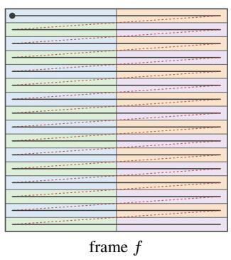

(b) Frame-sliced Gilbert order  
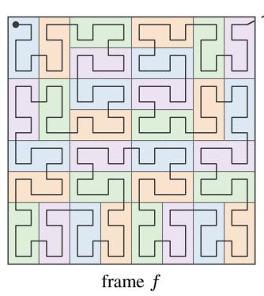

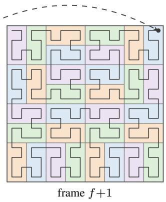

(c) Route of one query block with own-block safety  
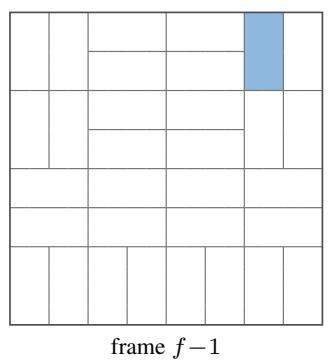

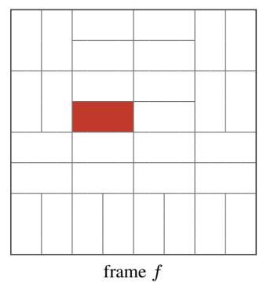

$$
S _ { q } = \{ q \}
$$

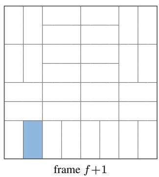  
other candidates in $C _ { q }$  
Figure 6: Gilbert blocks and the safety set on toy $1 6 \times 1 6$ frames with 8-token blocks. (a) Raster order turns each block into a horizontal strip and jumps back at every row end (red dotted segments). (b) The frame-sliced Gilbert order turns each block into a compact $2 \times 4 ~ \mathrm { o r } 4 \times 2 ~ \mathrm { p a t c h }$ . The curve continues from the end of frame $f$ to the same position in frame $f { + } 1$ (dashed arrow) and traverses that frame in a reflected direction. (c) The route of one query block $q .$ The block is its own safety set $S _ { q } = \{ q \}$ , and a sampled route adds candidate blocks from any frame, here two (blue). All other blocks remain in the candidate set $C _ { q }$ but stay masked for this draw.

## A.1 FRAME-SLICED GILBERT ORDER

A generalized Hilbert curve, or Gilbert curve, visits every cell of a rectangle of arbitrary size exactly once and moves to an adjacent cell at every step. Jenga (Zhang et al., 2025c) partitions video tokens along such a curve for block-sparse attention, and we adopt the frame-sliced variant of its released implementation. Let the visual latent contain F frames of $H \times W$ tokens, so it holds $M = F H W$ tokens. Token $p = ( f , m , n )$ lies in frame $f \in \{ 0 , \ldots , F - 1 \}$ , row $m ,$ and column n. The order assigns each token a rank:

$$
\gamma ( f , m , n ) = f H W + g _ { H , W } \big ( \phi _ { f } ( m , n ) \big ) .\tag{9}
$$

Here $g _ { H , W }$ assigns the ranks $1 , \ldots , H W$ along the two-dimensional Gilbert curve of an $H \times W$ grid, which starts and ends at the two corners of one longer side. The map $\phi _ { f }$ reflects the rows, the columns, or both, so that frame $f$ starts at the corner nearest to the end of frame $f - 1$ . The first map $\phi _ { 0 }$ is the identity, and the offset $f H W$ keeps every frame contiguous. Intuitively, the curve fills one frame, steps to the same spatial position in the next frame, and fills that frame in a reflected direction. Every step therefore moves to a neighboring token, including the step across a frame boundary. Figure 6 contrasts this order with the raster order.

Contiguous runs of this order are compact patches. On the $3 2 \times 3 2 ~ \mathrm { g r i d }$ of Stable Diffusion 3.5, every 128-token run is a $1 6 \times 8 ~ \mathrm { o r } ~ 8 \times 1 6$ rectangle, whereas the same run in raster order spans four full rows. On the $2 2 \times 4 0$ frames of Wan2.2, a 128-token run covers about one seventh of a frame, and a run that crosses a frame boundary continues at the same spatial position in the next frame.

Bidirectional attention. Both generators denoise all visual tokens jointly with bidirectional selfattention, so every query can attend to every frame. The order therefore depends only on the latent grid and not on a generation schedule. We compute it once per resolution and reuse it for all routed layers, heads, noise levels, and rollouts.

Reordering inside attention. The order acts only inside each routed self-attention layer. After the native projections, query-key normalization, and rotary position embedding where the generator uses one, we permute the queries, keys, and values into Gilbert order. We then apply the routed mask and permute the output back to raster order. Dense attention is equivariant to a shared permutation of its queries, keys, and values, and every positional signal is attached before the permutation. The reordering thus changes which token pairs share a routing decision, but it leaves positions and the dense computation unchanged. At inference, RPO runs the stock dense attention without any reordering.

## A.2 BLOCKS, SAFETY SET, AND EXECUTED MASK

Both generators cut the Gilbert sequence into blocks of $B = 1 2 8$ tokens and use the same partition for queries, keys, and safety:

$$
\mathcal { Q } _ { q } = K _ { q } = \{ p : \lceil \gamma ( p ) / B \rceil = q \} , \qquad q \in \{ 1 , \ldots , Q \} , \qquad Q = \lceil M / B \rceil .\tag{10}
$$

Here $\gamma ( p )$ is the Gilbert rank of token p from Equation 9, and the last block may be shorter. The attention mass $m _ { i , \ell , q , j }$ in Equation 3 sums the dense attention weights from the tokens of $\mathcal { Q } _ { q }$ to those of $\kappa _ { j }$ , so a compact patch of 128 tokens is the unit of both the score and the action. Each query block keeps its own block as its safety set, $S _ { q } = \{ q \}$ , so every query token attends at least to the other tokens of its own patch. The candidate set $C _ { q }$ contains every other block of the image or video, in any frame. Because attention is bidirectional, a route can add context from earlier and later frames alike.

The executed mask combines the safety block with the sampled route. Let $R _ { i , u } \subseteq C _ { q }$ be the $K _ { u }$ candidates that unit $u = ( t , q )$ keeps when it does not choose the dense option. For query token $p \in \mathcal { Q } _ { q }$ and key token $p ^ { \prime } \in { \cal K } _ { j }$ , the mask of rollout i at a routed layer of level t is

$$
\begin{array} { r } { \mu _ { i } ^ { t } ( p , p ^ { \prime } ) = \frac { \int 1 , \quad } { \int 1 \big [ j \in S _ { q } \cup R _ { i , u } \big ] , \quad \mathrm { o t h e r w i s e . } } } \end{array}\tag{11}
$$

Here $\mu _ { i } ^ { t } ( p , p ^ { \prime } ) = 1$ means that query token p attends to key token $p ^ { \prime } ,$ and $\mathbf { 1 } [ \cdot ]$ is the indicator function. Anchor layers use $\mu _ { i } ^ { t } \equiv 1$ . Every query token keeps its own block, so the softmax stays defined for every draw. One decision per query block serves all routed layers and heads, so each routed level needs a single block mask. Figure 6(c) shows one such route. Intuitively, the route decides which non-local context each query block sees, while its own patch always stays visible.

Text conditioning. Routing acts only on visual self-attention. Stable Diffusion 3.5 runs a joint attention over image and text tokens, and we route only the image-to-image pairs. Every pair that involves a text token stays dense, so each image query keeps the full text band in addition to its route. The second, image-only self-attention of Stable Diffusion 3.5 has no text band and relies on its route alone. Wan2.2 injects text through cross-attention, which is never routed.

## A.3 BLOCK COUNTS IN THE REFERENCE CONFIGURATIONS

Table 2 reports the token grid, the block counts, and the routing options of both reference configurations. For Wan2.2, the video autoencoder compresses 13 frames at $7 0 4 \times 1 2 8 0$ by a factor of 4 in time and 16 in space, and patchification halves each spatial side, which gives $\mathbf { a } ~ 4 \times 2 2 \times 4 0$ token grid. For Stable Diffusion 3.5, a 512 × 512 image gives a $3 2 \times 3 2$ image grid. The text tokens are never routed, so the counts exclude them. On Stable Diffusion 3.5, a sparse query block keeps its own block and one of seven candidates, so it sees a quarter of the image. On Wan2.2, it keeps its own block and one of 27 candidates, so it sees about $7 \%$ of the video. The dense option and the anchor layers keep the remaining computation dense. The route thus removes most non-local context from a sparse query block, while the rest of the network still runs the original attention.

Table 2: Token grids, blocks, and routing options of the reference configurations. Counts cover visual tokens only. Routed levels index the transitions of the 10-step training sampler, counted from 0.
<table><tr><td></td><td>Wan2.2</td><td>Stable Diffusion 3.5</td></tr><tr><td>Output size</td><td> $1 3 \times 7 0 4 \times 1 2 8 0$ </td><td> $5 1 2 \times 5 1 2$ </td></tr><tr><td>Token grid  $F \times H \times W$ </td><td> $4 \times 2 2 \times 4 0$ </td><td> $1 \times 3 2 \times 3 2$ </td></tr><tr><td>Visual tokens M</td><td>3,520</td><td>1,024</td></tr><tr><td>Block size B</td><td>128</td><td>128</td></tr><tr><td>Blocks Q</td><td>28</td><td>8</td></tr><tr><td>Safety set  $| S _ { q } |$ </td><td>1</td><td>1</td></tr><tr><td>Candidate set  $| C _ { q } |$ </td><td>27</td><td> $^ { 7 }$ </td></tr><tr><td>Keep ratio κ</td><td>0.03</td><td> $1 / 3 2$ </td></tr><tr><td>Kept candidates  $K _ { u }$ </td><td>1</td><td>1</td></tr><tr><td>Routed levels</td><td>2,4</td><td> $2 , 3 , 4$ </td></tr><tr><td>Anchor layers per level</td><td>20 of 30</td><td>16 of 24</td></tr></table>

## B IMPLEMENTATION DETAILS

This appendix lists the settings behind Section 5.1. The routing proposal and objective are identical for both generators. Only the routing hyperparameters, the rollout step, and the optimization settings differ.

Stable Diffusion 3.5. The reference configuration routes levels 2, 3, and 4 of the 10-step training sampler with level weights wt of 1, 0.76, and 0.5 and temperature $T = 1$ . Each 128-token query block keeps its own block and one candidate, or attends densely $( \kappa = 1 / 3 2 , K _ { u } = 1 )$ . One draw per query block serves all 24 joint-attention layers and the 13 image-only self-attention layers, and 16 of the 24 transformer blocks act as anchor layers at each routed level. Rollouts use the centered routed step. At a routed level, the rollout draws a second, unrecorded route and steps with $v _ { \theta } \big ( x ^ { t } , t , c \big ) + \big ( \tilde { v } ^ { t , ( 1 ) } - \tilde { v } ^ { t , ( 2 ) } \big ) / 2$ , where $\tilde { v } ^ { t , ( 1 ) }$ and $\tilde { v } ^ { t , ( 2 ) }$ are the velocities under the two routes. The perturbation then has zero mean, so the rollout stays close to the dense path, and the likelihood of Equation 4 applies unchanged to the recovered velocity. Each wave contains 64 prompt groups at $G = 2 .$ , split into two optimizer minibatches of 32 groups. We train rank-32 LoRA adapters with $\alpha = 6 4$ on the eight attention projections, with learning rate $1 . 4 \times 1 0 ^ { - 4 }$ , weight decay $1 0 ^ { \dot { - } 4 }$ , and no warmup. Advantage processing uses 5% winsorization and batch-IQR scaling with floor 0.03, and no pair is gated. Training runs for 50 steps on one node with eight H100 GPUs, with evaluation every 5 steps.

Wan2.2. The reference configuration trains on 13-frame videos. It routes levels 2 and 4 of the 10-step training sampler with level weights of 1 and 0.5 and temperature $T = 1$ . Each 128-token query block keeps its own block and one of its 27 candidates, or attends densely $( \kappa = 0 . 0 3 , K _ { u } = 1 )$ One draw per query block serves every self-attention layer and head, and 20 of the 30 transformer blocks act as anchor layers at each routed level. Rollouts use classifier-free guidance with scale 5. Both guidance branches apply the same route, and Equation 4 scores the guided velocity. Rollouts step with the routed velocity itself, without centering. We train all transformer parameters except the output normalization, the output projection, and the root modulation table, with learning rate $1 0 ^ { - 5 }$ , 8 warmup updates, and weight decay $1 0 ^ { - 4 }$ . Each wave contains 64 prompt groups at $\bar { G } = 2$ and is divided into two disjoint optimizer minibatches of 32 groups. Advantage processing uses 5% winsorization and batch-IQR scaling with floor 0.02, and no pair is gated. Training runs for 50 steps on two nodes with eight H100 GPUs each.

Optimizer safeguards. Three generic safeguards stabilize optimization. They are not components of RPO. First, the second minibatch uses standard PPO ratio clipping with width $3 \times 1 0 ^ { - 4 }$ for both generators. Let $S _ { i } ^ { \mathrm { { o l d } } }$ be the velocity likelihood under the parameters that collected the rollout. We use the ratio $\rho _ { i } ( \theta ) = \mathrm { { e x p } } ( \lambda ( S _ { i } ( \theta ) - S _ { i } ^ { \mathrm { { o l d } } } ) / N _ { i } )$ ), where the constant λ is 0.005 on Stable Diffusion 3.5 and 0.01 on Wan2.2. Because AdamW is nearly invariant to the loss scale, λ mainly sets the log-ratio relative to the clip width. Second, on Wan2.2 we subtract the batch mean of the second minibatch’s log-ratio before clipping. Third, both generators apply a global gradient-norm cap $\Gamma _ { \mathrm { g r a d } } = 1$ , which treats every trainable gradient as one concatenated vector and rescales its accumulated norm before AdamW consumes it.

## C ROBUST ADVANTAGE PROCESSING

Section 4.3 converts raw pair differences into a fixed replay weight. For each reward dimension $d ,$ we apply symmetric winsorization and an interquartile-range scale:

$$
\begin{array} { r l } & { \widetilde { A } _ { i , d } = \mathrm { c l i p } \bigg ( A _ { i , d } ^ { \mathrm { p a i r } } , L _ { d } , U _ { d } \bigg ) \ , \qquad \mathrm { S c a l e } _ { d } = \mathrm { m a x } \Bigg \{ \frac { \mathrm { Q u a n t i l e } _ { 0 , \tau \mathfrak { L } } \big ( \widetilde { A } _ { \cdot , d } \big ) - \mathrm { Q u a n t i l e } _ { 0 , 2 5 } \big ( \widetilde { A } _ { \cdot , d } \big ) } { 1 . 3 4 9 } , \epsilon _ { \mathrm { s } } \Bigg \} \ , } \\ & { \qquad \widehat { A } _ { i } = \mathrm { s g } \Bigg ( \sum _ { d \in \mathcal { D } } w _ { d } \frac { \widetilde { A } _ { i , d } } { \mathrm { S c a l e } _ { d } } \Bigg ) \ . } \end{array}\tag{12}
$$

Here $L _ { d }$ and $U _ { d }$ are the symmetric winsorization thresholds, $\mathrm { Q u a n t i l e } _ { \alpha }$ is the empirical quantile at probability $\alpha , \epsilon _ { \mathrm { s } } > 0$ is a numerical floor, and $w _ { d }$ weights reward dimension $d \in \mathcal { D }$ . The constant 1.349 converts the interquartile range into a standard-deviation scale under a Gaussian reference. The stop-gradient operator $\operatorname { s g } ( \cdot )$ makes $\widehat { A } _ { i }$ a fixed replay weight. Because the thresholds are symmetric and the processing is shared across both signs of every pair, it preserves pair antisymmetry up to numerical precision. Our experiments use a single HPSv3 dimension, so $\mathcal { D }$ contains one element.

## D EVALUATION PROTOCOLS

Comparison with DanceGRPO. The DanceGRPO run uses the same generator and reward as RPO. Three differences remain. First, DanceGRPO is full-model GRPO with $G = 8$ and a stochastic SDE sampler, whereas RPO routes two denoising transitions with $G = 2$ . Second, the two runs use different rollout backends. Third, the DanceGRPO run follows a longer 120-step schedule.

VBench. We evaluate all 16 VBench dimensions on the standard prompt suite. Each Wan2.2 model generates 6,220 videos with 13 frames at 704 × 1280 and 24 fps, using a deterministic 50-step ODE sampler with classifier-free guidance scale 5.0. The four Wan2.2 models share prompts and initial noise. CogVideoX-5B and HunyuanVideo use the same prompts, frame count, denoising steps, and scoring, but they keep their native resolution and guidance. Their rows therefore provide a reference under matched content and scoring, although their generation settings and training compute differ. Training GPU-hours use a common accounting scope and exclude VBench evaluation.

Stable Diffusion 3.5. During training, dense evaluation uses a 28-step sampler and reports raw HPSv3 on 64 held-out prompts. Early runs draw this subset with the training seed. For controlled seed comparisons, we instead use a fixed 64-prompt file and a fixed validation noise seed. The DrawBench evaluation in Figure 3 uses 1,000 images from 200 prompts and 5 seeds, generated without classifier-free guidance.

Comparison with Flow-GRPO on Stable Diffusion 3.5. The two runs in Figure 4 share the validation protocol, namely the fixed 64-prompt file, a 28-step dense sampler with guidance scale 1.0, a fixed noise seed, and raw HPSv3. Their step-zero scores are 3.941 for RPO and 3.955 for Flow-GRPO. Both runs train rank-32 LoRA adapters with $\alpha = 6 4$ on the same attention projections, use a 10-step training sampler with guidance scale 1.0 at $5 1 2 \times 5 1 2$ , and use training seed $^ { 4 2 }$ However, the two runs collect rollouts with different backends. On the base weights and the same 10-step dense sampler, the RPO backend scores 0.92 raw HPSv3, whereas the Flow-GRPO backend scores 1.38. The training rewards in Figure 4a therefore mix method and backend effects, and the dense validation in Figure 4b is the controlled comparison.

## E EXTENDED DISCUSSION

Known failure modes. Two failure modes remain open. The first is a dense-gain fade. In some runs, the dense-inference gain peaks and then decays, while the reward of the routed training rollouts keeps rising. The generator then improves its routed transitions faster than its dense ones. Centered routed steps keep the rollouts near the dense path and reduce this split on Stable Diffusion 3.5, but the mechanism is not fully isolated. The second is reward hacking against the frozen preference model. This risk is general to online RL for generative models and is not specific to RPO. Both failure modes suggest that a scalar terminal reward is a coarse supervisor for a routed exploration action.

Estimator scope. The velocity likelihood in Equation 5 is a surrogate rather than the exact likelihood of the sampled route. It models the routed deviation as an isotropic Gaussian around the dense velocity, whereas the true deviation is the effect of a discrete route on the attention output. It also omits the pathwise gradient of the generator through later denoising transitions and through the frozen reward model. Finally, the width $s _ { t } ^ { 2 }$ is re-estimated on every batch. As routing perturbs the generator less during training, $s _ { t } ^ { 2 }$ shrinks, so the same deviation produces a larger gradient.

Extensions. Two directions extend the method naturally. A likelihood that adds the probability of the sampled route to the velocity term would also credit the route choice itself, rather than only its effect on the dense velocity. Larger groups would give a leave-one-out baseline with more members. They trade part of the pair’s variance cancellation for a more stable advantage scale. Both extensions are compatible with the estimator as stated.