# ReState: Noise-Level-Aware State Correction for Training-Free Object Removal in Few-Step Diffusion Models

Donghwan Lee1,∗, Sanghyun Jo1,2,∗, Sihyun Kim1 Ziseok Lee1, Kyungsu Kim1,†

1Seoul National University 2OGQ

∗equal contribution, †corresponding authors: kyskim@snu.ac.kr

Training-free object removal commonly redirects self-attention away from the target region, but on few-step distilled diffusion models this often leaves object-shaped residuals. We identify a temporal mismatch: a structured prediction forms inside the mask at the first forward, and the short trajectory offers few later chances to revise it, while attention rerouting acts mainly in later steps. Across four distilled backbones, magnitude-matched single-forward interventions show that background-directed state correction affects the final result more than attention rerouting. We therefore propose ReState, which corrects the masked clean prediction toward background evidence retrieved from the input using a noise-level-aware weight that vanishes at the final forward. ReState retains object-excluding attention as a complementary constraint and adds no denoiser evaluations. Across two paired benchmarks and two few-step backbones, ReState achieves the best masked PSNR, SSIM, and LPIPS among training-free methods, improving PSNR by 3.17 dB on average over the strongest baseline. On OBER-Test, it also outperforms the 50-step attention-forcing reference on all three metrics at 6.7× lower latency. The same configuration transfers to two additional distilled backbones without retuning. Code will be released upon publication.

Project Page: https://tdrlee.github.io/ReState Code: https://github.com/tdrlee/ReState Lab: https://aibl.snu.ac.kr

## 1 Introduction

Object removal aims to reconstruct the background occluded by a masked object. Training-free diffusion methods leverage pretrained generative priors without task-specific fine-tuning. Most existing training-free methods pursue removal by intervening in self-attention: they suppress attention to target-region keys so that the network draws information from the surrounding context [11, 17, 30, 35]. We refer to this family of interventions as attentionforcing (Section 3.2). In their multi-step setting, these methods typically require tens of denoising forwards. Native few-step distilled models offer a substantially faster alternative, but attention forcing does not transfer cleanly to this regime: although it improves removal over no intervention, object contours and textures often remain inside the mask. The central question is therefore not only how to redirect attention, but why this intervention fails to change content that a short trajectory has already begun to commit.

To answer this question, we compare matched single-forward interventions. From the same latent at the same noise level, we either apply object-excluding attention for one forward or directly move the masked clean prediction toward retrieved background evidence by the same $\ell _ { 2 }$ norm. Sampling then continues without further intervention. Across four distilled backbones, direct correction at the first forward produces a larger terminal removal effect than attention forcing. On the Turbo backbones, the one-step effect of attention forcing at the first forward is statistically not significantly different from zero, whereas the matched direct correction is significant. These results reveal a temporal mismatch: a few-step trajectory is most revisable at its earliest forwards, where a matched correction of the predicted state is already effective, whereas the effect of attention forcing concentrates at later, lower-noise forwards and arrives after much of the masked content is committed.

So, we propose ReState, a training-free method that directly corrects the masked clean prediction toward background evidence retrieved from unmasked source regions. The correction is strongest when noise remains and vanishes at the final forward, leaving the model free to synthesize final details. Object-excluding attention is applied throughout sampling as a complementary constraint; its additional benefit is concentrated near final synthesis. The retrieval features are shared with the first generation forward, so ReState preserves the native number of denoiser evaluations. Our contributions are:

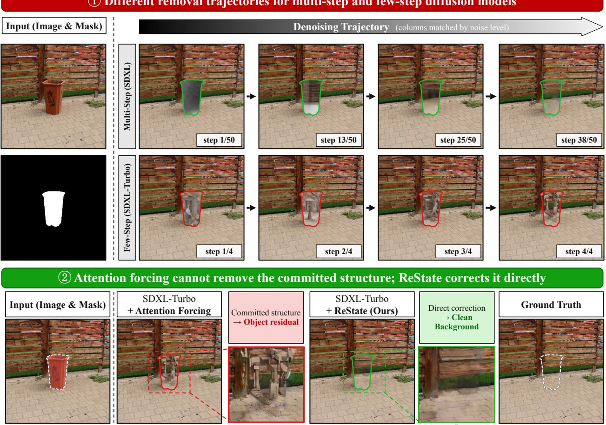  
Figure 1. Motivation. With attention forcing applied, the multi-step model (SDXL) starts diffuse and forms the background gradually along the trajectory (top), while the few-step model (SDXL-Turbo) already fixes a structured image in the mask at the first forward, and the short trajectory does not absorb it. This committed structure is what attention forcing then fails to remove, leaving a residual (bottom); ReState instead corrects the prediction directly and removes it.

• Diagnosis. We use matched single-forward interventions to show that background-directed direct correction has a larger first-forward terminal effect than attention forcing across four distilled backbones. On the Turbo family, the first-forward effect of attention forcing is not significantly different from zero.

• Method. We propose ReState, which corrects the masked clean prediction toward background evidence retrieved from the input image, with strength keyed to the remaining noise level, and keeps object-excluding attention a a route constraint. Among the compared training-free methods, ReState is the only one that writes an explicit background target into the predicted state, and it adds no denoiser evaluations beyond the native schedule.

• Results. Across two paired benchmarks and two main few-step backbones, ReState achieves the best masked PSNR, SSIM, and LPIPS among training-free methods, improving masked PSNR by 3.17 dB over the strongest baseline. On OBER-Test it surpasses every compared 50-step attention-forcing configuration in SSIM and LPIPS, runs 6.7× faster than the 50-step reference, and a single frozen configuration transfers to SDXL-Lightning and Hyper-SDXL without per-backbone tuning.

Table 1. ReState is the only training-free removal method that writes an explicit background target into the predicted state at the native few-step cost. Cells classify each method as published (Appendix B.2); they state design properties, not measured performance, which Table 2 reports. The comparison covers training-free removal methods; training-based methods are evaluated in Appendix E.1.
<table><tr><td>Property</td><td>DesignEdit AAAI&#x27;25</td><td>Attentive Eraser AdaEraser PANDORA FuLLaMa AAAI&#x27;25</td><td>ICML&#x27;26</td><td>ICME&#x27;26</td><td>WACV&#x27;26</td><td>ReState (Ours)</td></tr><tr><td>Writes an explicit background target into the predicted state</td><td>X</td><td>X</td><td>X</td><td>X</td><td>X</td><td>V</td></tr><tr><td>Adds no forwards or external models beyond the backbone</td><td>L</td><td>X</td><td>X</td><td>X</td><td>X</td><td>L</td></tr><tr><td>Operates at the native few-step schedule</td><td>X</td><td>X</td><td>X</td><td>X</td><td>X</td><td>V</td></tr></table>

## 2 Related Work

Training-based and optimization-based removal. Object removal has long been addressed as inpainting: GAN-based inpainting developed large-mask completion [15, 27, 31, 45, 52], and diffusion-based inpainting extended it with text, shape, and exemplar guidance [21, 39, 40]. Training-based object removal methods build on these priors and learn removal-specific behavior through dedicated data or adaptation. PowerPaint learns task prompts for removal [51], CLIPAway steers an inpainting latent away from the target identity [8], and SmartEraser and EntityErasure use removal-specific supervision [12, 49]. EraseLoRA adapts a low-rank adapter at test time [13], while EraDiff calibrates the diffusion trajectory for erasure [18]. OmniPaint disentangles removal from insertion with dedicated training [42], and effect-aware removal extends to video [9]. A separate line trains fast removal models that generate results in one to four forwards [34, 46]. These approaches can achieve high background fidelity, but they require removal supervision, test-time optimization, or dedicated training. ReState instead operates on a frozen pretrained model without removal-specific training.

Training-free attention-based removal. Training-free methods keep the generator frozen and modify self-attention so that image-token attention suppresses keys in the target region and draws information from surrounding context. DesignEdit [11], Attentive Eraser [30], AdaEraser [17], and PANDORA [35] instantiate this idea through different suppression rules, schedules, or guidance mechanisms; FuLLaMa additionally searches sampling parameters with derivative-free optimization [6]; attention routing also extends to dense-scene removal [32] and, combined with local in-mask perturbations, to training-free geometric editing [47]; adjacent training-free lines preserve the background while editing, through zero-shot composition with a diffusion prior [4] or key–value caching of background tokens [48]; none of these supplies an explicit background target for the masked prediction.

We use the hard object-excluding attention of this family as a complementary constraint and do not claim it as a contribution. The distinction of ReState is that it does not rely on attention rerouting alone: it directly corrects the masked clean prediction when the trajectory is most sensitive to that correction.

Direct state manipulation in diffusion sampling. Diffusion methods for inverse problems and inpainting often modify the sampling trajectory or clean prediction to enforce measurement consistency, for example through known-region replacement [1, 19], null-space projection [37], diffusion posterior sampling [5], or plug-and-play proximal correction of the clean prediction [50]. ReState likewise modifies a clean prediction, and its correction objective (Eq. 6) is an instance of the quadratic proximal data-correction of this line, with three differences: the target is a pseudo-target B retrieved from the unmasked source rather than a measured observation, no gradient of a measurement model is computed, and the correction runs on the native four-step schedule of a distilled backbone. Direct state manipulation itself is therefore not our novelty. Rather, matched intervention measurements identify direct correction toward retrieved background evidence as the effective early intervention for few-step removal and determine its noise-level-dependent schedule.

Few-step distilled diffusion. Adversarial and consistency distillation enable image generation in one to four forwards [16, 20, 24, 28]. Prior work has primarily studied generation quality and speed in this regime. Editing and inpainting are also emerging on few-step backbones, through text-based few-step editing [7] and one-step inversion for few-step inpainting [36], and the choice of early timesteps is known to steer editing outcomes [14]. We instead study whether an external removal intervention applied at a single forward survives to the terminal image. This terminal-effect analysis reveals the distinct temporal roles of attention rerouting and direct prediction correction, and motivates their combination in ReState.

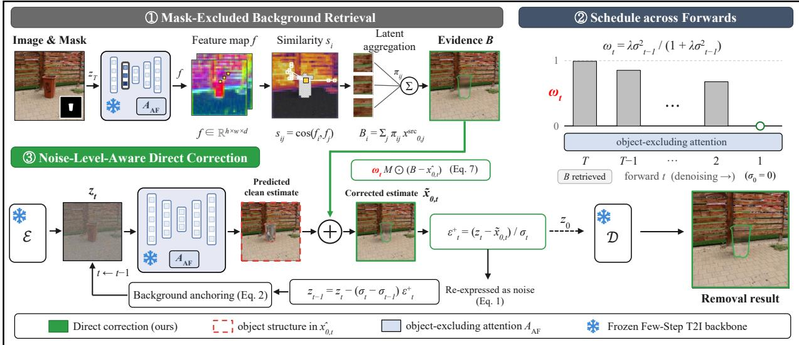  
Figure 2. Overview of ReState. Features from the first generation forward retrieve background evidence B from unmasked source regions without an additional denoiser evaluation. At each step, ReState moves the masked clean prediction $\hat { x } _ { 0 , t }$ toward B with a noise-level-aware weight $\omega _ { t }$ . The weight vanishes at the final forward, while object-excluding attention remains active throughout sampling.

## 3 Method

Figure 2 overviews ReState. The method retrieves background evidence from the first generation forward, corrects the masked clean prediction during sampling, and retains object-excluding attention as a complementary constraint throughout the native schedule.

## 3.1 Problem Setup

Given a source image $x ^ { \mathrm { s r c } }$ , a binary removal mask M, a text condition c, and a frozen few-step model with native schedule $\sigma _ { T } > \cdots > \sigma _ { 0 } = 0$ , let $\Omega _ { m }$ and $\Omega _ { b }$ denote the masked and unmasked latent positions. We use M also for the corresponding latent-grid mask. Sampling starts from the noised source latent $z _ { T } = \mathcal { E } ( x ^ { \mathrm { s r c } } ) + \sigma _ { T } \epsilon \left[ 2 5 \right]$ , with $\epsilon \sim \mathcal { N } ( 0 , I )$ . We use variance-exploding notation; the parameterization and scheduler conversions for all backbones are given in Appendix A.1.

For the ϵ-parameterized models used here, the denoiser induces the clean prediction

$$
\hat { x } _ { 0 , t } = z _ { t } - \sigma _ { t } \epsilon _ { \theta } \big ( z _ { t } , \sigma _ { t } , c ; \mathcal { A } _ { t } \big ) ,\tag{1}
$$

where $\boldsymbol { A } _ { t }$ denotes the attention used at step t. At fixed $z _ { t } ,$ correcting $\hat { x } _ { 0 , t }$ is therefore equivalent to correcting the noise prediction consumed by the native sampler. After each transition, we anchor the unmasked region to the source at the matching noise level:

$$
z _ { t - 1 } \gets M \odot z _ { t - 1 } + ( 1 - M ) \odot \left( \mathcal { E } ( x ^ { \mathrm { s r c } } ) + \sigma _ { t - 1 } \epsilon \right) .\tag{2}
$$

Thus, all mechanisms below modify only the masked region.

## 3.2 Existing Object-Excluding Attention

Existing training-free removal methods modify self-attention with a mask-dependent bias on target-region keys. We refer to this family of interventions as attentionforcing. Its hard and soft forms are

$$
\Phi _ { q , s } ^ { \mathrm { h a r d } } = \left\{ \begin{array} { l l } { - \infty , } & { s \in \Omega _ { m } , } \\ { 0 , } & { \mathrm { o t h e r w i s e } , } \end{array} \right. \quad \quad \Phi _ { q , s } ^ { \mathrm { s o f t } } = \log \eta _ { t } ( s ) , \quad \eta _ { t } ( s ) \in ( 0 , 1 ] ,\tag{3}
$$

where $\eta _ { t } ( s ) = 1$ outside the mask and the hard form is the limit as $\eta _ { t } ( s ) \to 0$ . ReState uses the hard form at every forward.

Attention forcing prevents self-attention from reading target-region keys, but it does not identify which background content a masked prediction should approach. ReState therefore uses it as a route constraint and supplies the missing target through direct correction. Appendix A.2 specifies the attention layers, mask processing, and key-column implementation.

## 3.3 Mask-Excluded Background Retrieval

ReState retrieves an explicit background proposal from the source image. Retrieving correspondences from the unmasked source to fill masked content is a classical idea [2, 41], and diffusion features are known to carry dense correspondence [33]. During the first generation forward, we capture a feature $f _ { i }$ at each latent position and reuse the same forward’s denoiser output for sampling. For each masked position $i ,$ we compare its feature with features at unmasked positions, retain the top fraction $r ,$ and aggregate their clean source latents:

$$
\mathcal { N } _ { r } ( i ) = \mathrm { T o p K } _ { j : M _ { j } = 0 } ( s _ { i j } ) , \qquad s _ { i j } = \frac { f _ { i } ^ { \top } f _ { j } } { \| f _ { i } \| _ { 2 } \| f _ { j } \| _ { 2 } } , \qquad K = \lceil r N _ { \mathrm { b g } } \rceil ,\tag{4}
$$

$$
\pi _ { i j } = \frac { \exp ( s _ { i j } / \tau ) } { \sum _ { k \in \mathcal { N } _ { r } ( i ) } \exp ( s _ { i k } / \tau ) } , \qquad B _ { i } = \sum _ { j \in \mathcal { N } _ { r } ( i ) } \pi _ { i j } x _ { 0 , j } ^ { \mathrm { s r c } } , \qquad i \in \Omega _ { m } .\tag{5}
$$

We use $r = 0 . 0 1$ . Because B is built from clean source latents outside the mask, it is a background proposal in the same space as $\hat { x } _ { 0 , t }$ rather than a ground-truth reconstruction. The feature source, temperature, and implementation details are given in Appendix ${ \mathrm { A } } . 3$

## 3.4 Noise-Level-Aware Direct Correction

The correction is defined as the solution of a proximal objective. At step $t ,$ we seek a clean prediction that remains close to the model prediction while moving the mask interior toward $B ,$ with the fidelity term weighted by the noise remaining after the upcoming transition:

$$
\widetilde { x } _ { 0 , t } = \arg \operatorname* { m i n } _ { x } \ \frac { 1 } { 2 \sigma _ { t - 1 } ^ { 2 } } \| x - \widehat { x } _ { 0 , t } \| _ { 2 } ^ { 2 } + \frac { \lambda } { 2 } \| M \odot ( x - B ) \| _ { 2 } ^ { 2 } .\tag{6}
$$

The form of Eq. 6 is the standard Gaussian combination of two estimates of the masked content: the model prediction enters with precision $\sigma _ { t - 1 } ^ { - 2 }$ , reflecting that the clean prediction becomes more reliable as the remaining noise decreases, and the retrieved evidence $B$ enters with a fixed precision λ. The quadratic form is what makes the combination viable under our constraints: the objective separates over latent positions and admits a closed-form minimizer, so the correction requires no gradient, no inner iterations, and no additional denoiser evaluations. We adopt this form as a design choice rather than a claim of optimality. Outside the mask, the minimizer is the original prediction; inside the mask, setting the coordinate-wise gradient to zero gives

$$
\tilde { x } _ { 0 , t } = \hat { x } _ { 0 , t } + \omega _ { t } M \odot ( B - \hat { x } _ { 0 , t } ) , \qquad \omega _ { t } = \frac { \lambda \sigma _ { t - 1 } ^ { 2 } } { 1 + \lambda \sigma _ { t - 1 } ^ { 2 } } .\tag{7}
$$

The update has three immediate operational properties. First, it leaves the mask exterior unchanged. Second, it contracts the masked distance to the evidence by the factor $1 - \omega _ { t }$ . Third, $0 \leq \omega _ { t } < 1$ , and the correction strength increases monotonically with the noise remaining after the transition. These properties characterize the update itself. Using $\sigma _ { t - 1 }$ rather than $\sigma _ { t }$ encodes the terminal boundary condition in the closed form. Early in the schedule, when the prediction can still be revised, the correction is strong. At the final transition, $\sigma _ { t - 1 } = \sigma _ { 0 } = 0$ and hence $\omega _ { t } = 0 ;$ : the final forward is not directly corrected toward the averaged evidence $B ,$ , but instead synthesizes final details under object-excluding attention alone. The weight profile itself is not the source of performance: a magnitude-matched constant schedule with the same terminal release is never significantly better and at most marginally worse (Appendix D.2). What the closed form contributes is that the terminal boundary and the intermediate weights follow from one objective with the single hyperparameter λ, rather than from a hand-designed temporal gate. Appendix A.4 gives the complete derivation, and Appendix D.1 and Appendix D.2 verify the strength profile and final-forward boundary. Algorithm 1 summarizes the complete procedure. ReState retrieves B once from the first generation forward, applies the correction of Eq. 7 at every step, maps the corrected clean prediction back to a noise prediction, and advances the native sampler. Sharing the first-forward features adds no denoiser evaluation.

Algorithm 1 ReState sampling   
Require: source $x ^ { \mathrm { s r c } } .$ , mask M, condition $c ;$ frozen denoiser $\epsilon _ { \theta }$ with object-excluding attention $\mathcal { A } ^ { \mathrm { A F } }$ ; native schedule   
σT $> \cdots > \sigma _ { 0 } = 0 ;$ autoencoder (E, D); parameters $\lambda , r$   
Ensure: removal result ˆI   
1: $z _ { T } \gets \xi ( x ^ { \mathrm { s r c } } ) + \sigma _ { T } \epsilon , \quad \epsilon \sim \mathcal { N } ( 0 , I )$   
2: $\hat { \epsilon } _ { T } , \{ f _ { i } \} \gets \epsilon _ { \theta } ( z _ { T } , \sigma _ { T } , c ; \mathcal { A } ^ { \mathrm { A F } } )$ ▷ shared first forward   
$\begin{array} { r } { 3 \colon B \gets \mathrm { R E T R I E V E } \big ( \{ f _ { i } \} , M \big ) } \end{array}$ ▷ Eq. 5; no additional denoiser evaluation   
4: for $t = T , \dots , 1$ do   
5: if $t < T$ then $\hat { \epsilon } _ { t } \gets \epsilon _ { \theta } ( z _ { t } , \sigma _ { t } , c ; \mathcal { A } ^ { \mathrm { A F } } )$   
6: $\hat { x } _ { 0 , t } \gets z _ { t } - \sigma _ { t } \hat { \epsilon } _ { t }$ ▷ Eq. 1   
7: $\omega _ { t }  \lambda \sigma _ { t - 1 } ^ { 2 } / ( 1 + \lambda \sigma _ { t - 1 } ^ { 2 } )$   
8: $\tilde { x } _ { 0 , t }  \hat { x } _ { 0 , t } + \omega _ { t } M \odot ( B - \hat { x } _ { 0 , t } )$ ▷ Eq. 7   
9: $z _ { t - 1 } \gets z _ { t } - ( \sigma _ { t } - \sigma _ { t - 1 } ) \left( z _ { t } - \tilde { x } _ { 0 , t } \right) / \sigma _ { t }$ ▷ native Euler step on the corrected prediction   
10: $z _ { t - 1 } \gets M \odot z _ { t - 1 } + ( 1 - M ) \odot ( \mathcal { E } ( x ^ { \mathrm { s r c } } ) + \sigma _ { t - 1 } \epsilon )$ ▷ Eq. 2   
11: end for   
12: return $\hat { I }  \mathcal { D } ( z _ { 0 } )$

Table 2. Object removal on OBER-Test and RORD: on the same frozen backbone and the same nominal 4-step schedule, ReState opens a large gap on every masked metric. Rows with + apply the method on the backbone of their block; bold is best per column. Latency is the median per image and VRAM the peak allocation in GB, both on OBER-Test (Appendix B). Effective denoiser evaluations, which differ for batch-expanded baselines, are reported in Table 5. Training-based comparisons are in Appendix E.1.
<table><tr><td rowspan="2">Method</td><td colspan="3">OBER-Test</td><td colspan="3">RORD</td><td rowspan="2"></td><td rowspan="2"></td></tr><tr><td>PSNR↑</td><td>SSIM↑</td><td>LPIPS↓</td><td>PSNR↑</td><td>SSIM↑</td><td>LPIPS↓</td></tr><tr><td>SD-Turbo (4 steps)</td><td>11.27</td><td>0.203</td><td>0.380</td><td>9.86</td><td>0.162</td><td>0.438</td><td>0.174</td><td>4.58</td></tr><tr><td>+ Attentive Eraser AAAI&#x27;25</td><td>7.28</td><td>0.063</td><td>0.516</td><td>7.22</td><td>0.060</td><td>0.555</td><td>0.200</td><td>4.58</td></tr><tr><td>+ DesignEdit AAAI&#x27;25</td><td>14.74</td><td>0.316</td><td>0.283</td><td>13.48</td><td>0.263</td><td>0.355</td><td>0.184</td><td>4.58</td></tr><tr><td>+ AdaEraser ICML&#x27;26</td><td>12.27</td><td>0.237</td><td>0.347</td><td>10.48</td><td>0.177</td><td>0.420</td><td>0.843</td><td>5.08</td></tr><tr><td>+ ReState (Ours)</td><td>18.19</td><td>0.485</td><td>0.186</td><td>16.59</td><td>0.440</td><td>0.280</td><td>0.305</td><td>4.58</td></tr><tr><td>SDXL-Turbo (4 steps)</td><td>9.86</td><td>0.133</td><td>0.435</td><td>7.55</td><td>0.074</td><td>0.516</td><td>0.247</td><td>7.1</td></tr><tr><td>+ Attentive Eraser AAAI&#x27;25</td><td>7.09</td><td>0.046</td><td>0.514</td><td>7.35</td><td>0.065</td><td>0.538</td><td>0.338</td><td>7.1</td></tr><tr><td>+ DesignEdit AAAI&#x27;25</td><td>15.50</td><td>0.348</td><td>0.269</td><td>14.34</td><td>0.326</td><td>0.334</td><td>0.281</td><td>7.1</td></tr><tr><td>+ AdaEraser ICML&#x27;26</td><td>11.71</td><td>0.205</td><td>0.372</td><td>9.47</td><td>0.122</td><td>0.462</td><td>1.145</td><td>7.1</td></tr><tr><td>+ ReState (Ours)</td><td>18.75</td><td>0.498</td><td>0.194</td><td>17.21</td><td>0.451</td><td>0.273</td><td>0.373</td><td>7.1</td></tr></table>

## 4 Experiments

Experimental setup. We evaluate on OBER-Test [44] (163 GT-paired images) and RORD [26] (343 GT-paired images), both of which provide a source image, removal mask, and object-free background. Main removal results use SDXL-Turbo and SD-Turbo [28]; SDXL at 50 steps [23] is the multi-step reference. We additionally evaluate the intervention analysis and full removal transfer on SDXL-Lightning [16] and Hyper-SDXL [24]. All training-free methods use the same forward-only removal pipeline: an empty prompt, guidance scale 0, seed 0, no inversion, and source-latent anchoring outside the mask at every step. We compare DesignEdit [11], Attentive Eraser [30], and AdaEraser [17] under the fully shared four-step pipeline; their official multi-step procedures are evaluated separately at their native step count in Appendix E.3, and training- and optimization-based comparisons are reported in Appendix E.1. These ports carry each method’s official hyperparameters onto the four-step schedule, so the comparison isolates the intervention under a shared pipeline and does not claim each baseline’s best attainable four-step performance; a limited re-tuning study is reported in Appendix E.4. We report masked PSNR, SSIM, and LPIPS [43] against the paired background, together with median end-to-end latency and effective denoiser evaluations. Metric definitions and preprocessing are in Appendix B.1. All metric differences are paired at the image level and tested with a two-sided sign-flip permutation test using 10,000 permutations; the four first-forward backbone comparisons additionally use Holm correction. Main results use a fixed seed 0; seed robustness is analyzed at the end of this section.

Main removal results. Table 2 reports the main comparison. ReState achieves the highest masked PSNR and SSIM and the lowest LPIPS in all four backbone–benchmark settings. Relative to DesignEdit, the strongest training-free baseline, it improves masked PSNR by 3.17 dB on average. Attentive Eraser falls below the no-intervention baseline at four steps because its SARG term, ported at its official scale, amplifies the noise prediction at every forward. This mechanism is calibrated for 50-step sampling: under the shared 50-step reference configuration, Attentive Eraser reaches 18.79 dB on OBER-Test, versus 7.09 dB for its four-step port (Appendix E.3). With only four forwards, the same amplification is too large for a trajectory in which each step commits a substantial fraction of the final image. Reducing only the SARG scale to 0.1× recovers the four-step port to 15.34 dB, which converges to the attention-masking level of DesignEdit and remains 3.0 to 3.4 dB below ReState in masked PSNR, significant on every masked metric (Appendix E.4).

The identical ReState configuration $( \lambda = 8 , r = 0 . 0 1$ , probe layer, and schedule keying) also transfers to SDXL-Lightning and Hyper-SDXL without per-backbone tuning. On both benchmarks, it improves over DesignEdit by 1.46 to 2.39 dB in masked PSNR, with gains on every masked metric; all stated gaps are significant under the protocol of Appendix B.1. Full results appear in Appendix E.2.

Intervention asymmetry and timing. At a chosen forward t, we start the base and intervened runs from the same state z . The attention-forcing arm applies object-excluding attention at that forward only and induces $\Delta _ { t } ^ { \mathrm { A F } } = M \odot ( \hat { x } _ { 0 , t } ^ { \mathrm { A F } } - \hat { x } _ { 0 , t } ^ { \mathrm { b a s e } } )$ The competing arm moves the same clean prediction toward retrieved background evidence by the matched norm. With $u _ { t } = M \odot ( B - \hat { x } _ { 0 , t } ^ { \mathrm { b a s e } } )$ and a small $\varepsilon > 0$

$$
\Delta _ { t } ^ { \mathrm { d i r e c t } } = \frac { \| \Delta _ { t } ^ { \mathrm { A F } } \| _ { 2 } } { \| u _ { t } \| _ { 2 } + \varepsilon } u _ { t } .\tag{8}
$$

Exactly one perturbation is applied, after which sampling continues without further intervention. Letting p(I, M) measure the source-to-GT directional residual of the output, the terminal removal effect is

$$
\begin{array} { r } { E _ { k } ( t ) = p \big ( I _ { 0 } ^ { \mathrm { b a s e } } , M \big ) - p \big ( I _ { 0 } ^ { k @ t } , M \big ) , \qquad k \in \{ \mathrm { A F } , \mathrm { d i r e c t } \} , } \end{array}\tag{9}
$$

where positive E means that the one-time intervention reduces this residual. Appendix C.1 defines p and gives the complete protocol. At the first SDXL-Turbo forward, correction toward retrieved background yields $E = + 0 . 0 2 5 1$ (permutation $p = 1 . 0 \times 1 0 ^ { - 4 } )$ , whereas random and background-orthogonal directions yield −0.0004 (permutation $p = 0 . 5 3 )$ and −0.0006 (permutation $p = 0 . 3 6 )$ , respectively. Thus, the comparison isolates the direction of state correction rather than perturbation magnitude. Table 3 shows that matched direct correction has a larger first-forward terminal effect than attention forcing on all four distilled backbones. The first-forward gaps remain significant after Holm correction (all corrected $p \leq 4 \times 1 0 ^ { - 4 } )$ . On the Turbo family, attention forcing is not significantly different from zero at the first forward $( p = 0 . 2 7$ for SDXL-Turbo and $p = 0 . 5 2$ for SD-Turbo), whereas direct correction is significant. On Lightning and Hyper-SDXL, attention forcing has a positive first-forward effect, but direct correction remains larger. For SDXL-Turbo, the terminal effect of a one-step attention intervention increases from $+ 0 . 0 0 2 \mathrm { t o } + 0 . 0 3 3$ as noise decreases, whereas direct correction is effective from the first forward. A fixed-count control on the 50-step reference likewise favors late over high-noise attention forcing (Appendix C.3). These results motivate a correction that is strong while the state remains revisable and decays before final synthesis.

Table 3 reports E across noise levels and backbones; effect magnitudes are interpreted within each backbone. At the first forward, the magnitude-matched direct correction has a larger terminal removal effect than attention forcing on every tested backbone, and the permutation tests of the appendix place every gap outside sample variation. The contrast is strongest for the Turbo family, where the first-forward effect of attention forcing is not significantly different from zero while the same-norm direct correction is clearly significant; on Lightning and Hyper both effects are positive and the gap remains. Across the schedule, the terminal effect of attention forcing rises monotonically as noise decreases (+0.002 to +0.033 on SDXL-Turbo), while the direct correction is effective from the very first forward. A fixed-count control on the 50-step reference agrees: at the same count, late placements outperform high-noise placements (Appendix C.3). The effect of attention forcing thus arrives late, which motivates decaying the direct correction as the trajectory approaches final synthesis, exactly what the weight of Eq. 7 does.

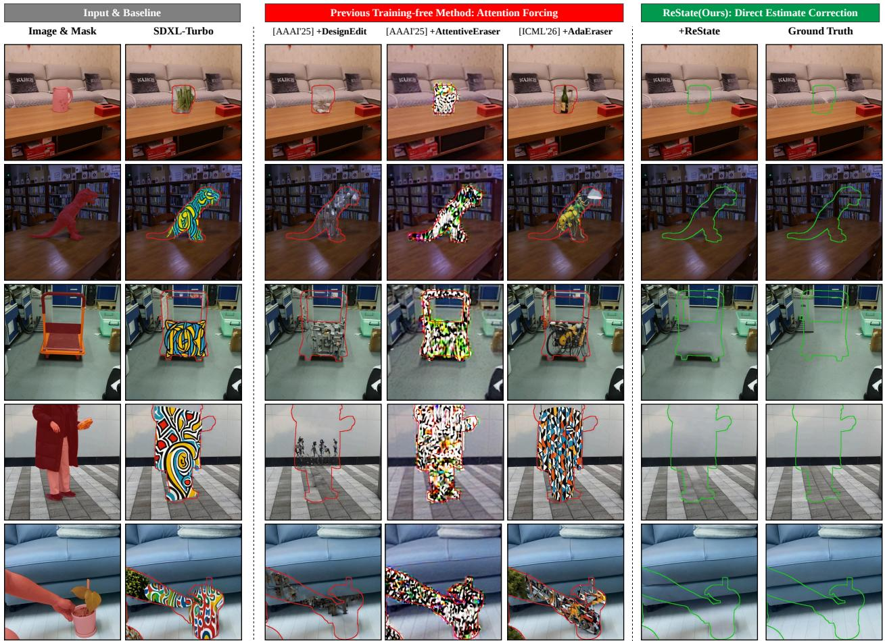  
Figure 3. Qualitative results on GT-paired benchmarks. Previous training-free methods often leave object-shaped residuals in the mask, whereas ReState more closely reconstructs the paired background.

Table 3. Direct correction acts from the first forward. Terminal effect E of a single matched intervention across noise levels and distilled backbones. Direct correction $( E _ { \mathrm { d i r e c t } } ,$ , bold) exceeds attention forcing $( E _ { \mathrm { A F } } )$ at every noise level and backbone.
<table><tr><td rowspan="2">σ</td><td colspan="2">SDXL-Turbo</td><td colspan="2">SD-Turbo</td><td colspan="2">SDXL-Lightning</td><td colspan="2">Hyper-SDXL</td></tr><tr><td> $E _ { \mathrm { A F } }$ </td><td> $E _ { \mathrm { d i r e c t } }$ </td><td> $E _ { \mathrm { A F } }$ </td><td> $E _ { \mathrm { d i r e c t } }$ </td><td> $E _ { \mathrm { A F } }$ </td><td> $E _ { \mathrm { d i r e c t } }$ </td><td> $E _ { \mathrm { A F } }$ </td><td> $E _ { \mathrm { d i r e c t } }$ </td></tr><tr><td>14.6</td><td>+.002</td><td>+.025</td><td>-.001</td><td>+.029</td><td>+.034</td><td>+.072</td><td>+.030</td><td>+.052</td></tr><tr><td>4.1</td><td>+.016</td><td>+.039</td><td>+.018</td><td>+.045</td><td>+.052</td><td>+.059</td><td>+.049</td><td>+.062</td></tr><tr><td>1.6</td><td>+.028</td><td>+.040</td><td>+.026</td><td>+.036</td><td>+.029</td><td>+.041</td><td>+.027</td><td>+.042</td></tr><tr><td>0.7</td><td>+.033</td><td>+.049</td><td>+.021</td><td>+.040</td><td>+.023</td><td>+.046</td><td>+.020</td><td>+.046</td></tr></table>

Component and timing ablation. Table 4 separates the two components on SDXL-Turbo. Direct correction alone reaches 17.62 dB, compared with 15.50 dB for full-schedule attention forcing alone. Adding attention forcing only at the final forward raises the result to 18.65 dB, and applying it throughout reaches 18.75 dB. Conversely, last-forward attention forcing without direct correction reaches only 12.15 dB, below full-schedule attention forcing. Attention forcing therefore contributes on top of a state that direct correction has already prepared; its additional benefit is concentrated late, although the full schedule retains a small significant gain (Appendix D.2). The gain is also not explained by the retrieved proposal alone: at the same B and the same four forwards, the per-forward correction outperforms writing B into the latent once (Appendix D.4). The spatial correspondence of the retrieval also contributes: replacing the retrieved B with a global background mean costs 0.59 dB (Appendix D.3).

Table 4. Component and timing ablation. Direct correction supplies most of the gain; attention forcing contributes mainly at the last forward.
<table><tr><td>Direct correction</td><td> $\mathbf { A F }$  (all forwards)</td><td> $\mathbf { A F }$  (last only)</td><td>PSNR↑</td><td>SSIM↑</td><td>LPIPS↓</td></tr><tr><td>X</td><td>X</td><td>X</td><td>9.86</td><td>0.133</td><td>0.435</td></tr><tr><td>X</td><td>X</td><td>√</td><td>12.15</td><td>0.182</td><td>0.370</td></tr><tr><td>X</td><td>V</td><td>X</td><td>15.50</td><td>0.348</td><td>0.269</td></tr><tr><td>√</td><td>X</td><td>X</td><td>17.62</td><td>0.477</td><td>0.237</td></tr><tr><td>V</td><td>X</td><td></td><td>18.65</td><td>0.495</td><td>0.196</td></tr><tr><td></td><td></td><td>X</td><td>18.75</td><td>0.498</td><td>0.194</td></tr></table>

Table 5. Cost and comparison against the multi-step reference. Latency is median per image; forwards counts the effective model passes.
<table><tr><td>Method</td><td>Forwards</td><td>Latency (s)↓</td><td>PSNR↑</td><td>SSIM↑</td><td>LPIPS↓</td></tr><tr><td>SDXL-Turbo</td><td>4</td><td>0.247</td><td>9.86</td><td>0.133</td><td>0.435</td></tr><tr><td>+ Attentive Eraser AAAI&#x27;25</td><td>8</td><td>0.338</td><td>7.09</td><td>0.046</td><td>0.514</td></tr><tr><td>+ DesignEdit AAAI&#x27;25</td><td>4</td><td>0.281</td><td>15.50</td><td>0.348</td><td>0.269</td></tr><tr><td>+ AdaEraser ICML&#x27;26</td><td>8</td><td>1.145</td><td>11.71</td><td>0.205</td><td>0.372</td></tr><tr><td>+ ReState (Ours)</td><td>4</td><td>0.373</td><td>18.75</td><td>0.498</td><td>0.194</td></tr><tr><td>SDXL + DesignEdit AAAI&#x27;25</td><td>50</td><td>2.50</td><td>17.86</td><td>0.441</td><td>0.209</td></tr><tr><td>SDXL + ReState (Ours; App. E.3)</td><td>50</td><td>2.84</td><td>18.83</td><td>0.485</td><td>0.181</td></tr></table>

Efficiency and multi-step comparison. Table 5 reports hook-measured effective denoiser evaluations and end-toend latency. ReState remains at the native four evaluations because the retrieval probe shares the first generation forward; feature matching and the masked update are its only additional operations, adding 51% latency over the no-intervention baseline on SDXL-Turbo (0.373 versus 0.247 s). Against the 50-step attention-forcing reference (SDXL with DesignEdit), ReState improves all three masked metrics at $6 . 7 \times$ lower latency. Appendix E.3 extends this comparison to every compared attention-forcing baseline at its native 50 steps: four-step ReState exceeds all of them in SSIM and LPIPS, and its PSNR is within 0.04 dB of the best.

Robustness. Re-running every training-free row of Table 2 with seeds {0, 1, 2} leaves the ranking unchanged: ReState is first on all three masked metrics for every seed, backbone, and benchmark, each per-seed gap over DesignEdit is individually significant $( p = 1 . 0 \times 1 0 ^ { - 4 }$ in all 36 tests), and ReState varies least across seeds, with a masked-PSNR standard deviation of 0.02 to 0.21 dB versus 0.31 to 0.81 dB for DesignEdit (Appendix E.5). Second, granting each baseline a limited re-tuning on the four-step schedule does not close the gap: both cross-benchmark selections converge to the same configuration per method, and the selected results remain 3.0 to 3.4 dB below ReState with every masked metric significant (Appendix E.4).

## 5 Discussion

Why ReState combines a route constraint and a state correction. The combination follows from a measured temporal mismatch: a few-step trajectory commits to its masked prediction early, while the effect of attention forcing arrives only late. At equal perturbation norm, a background-directed correction of the masked clean prediction is effective from the first forward, whereas the first-forward effect of attention forcing is not significantly different from zero on the Turbo family and rises from +0.002 to +0.033 only as noise decreases; random and background-orthogonal perturbations of the same norm have no significant terminal effect, so the gap reflects direction and timing rather than magnitude (Table 3). Commitment is equally measured: a first-forward perturbation survives to the output with slope 1.38 on the native four-step trajectory but only 0.30 on the 50-step reference (Appendix C.4, Appendix C.2). The direct correction therefore supplies the background direction, which attention forcing cannot specify, while generative freedom remains; attention forcing constrains late synthesis, with 1.03 of its 1.13 dB added benefit arriving at the final forward (Table 4, Appendix D.2): it completes the removal state that the direct correction has already established.

The native few-step schedule is an operating point, not a degraded setting. Attention-forcing baselines that degrade under the four-step port operate correctly at their native step count (Attentive Eraser: 7.09 → 18.79 dB at 50 steps; Appendix E.3). Rescaling SARG recovers part of this gap within four steps (15.34 dB, Appendix E.4), so the four-step failure decomposes into a calibration component, removable by re-tuning, and a regime component that persists at the attention-masking level. Conversely, ReState transferred unchanged to 50 steps yields 17.57 dB, since the $\sigma _ { t - 1 } { \mathrm { - k e y e d } }$ correction stays strong across the many low-noise forwards where fine texture is synthesized; a diagnostic window $( \sigma _ { t - 1 } \ge 1 . 6 1 ) $ recovers 18.83 dB, whereas on the native schedule the closed-form boundary $\omega \to 0$ already leaves the final low-noise forward uncorrected (Appendix E.3).

Scope and limitations. The asymmetry tracks the distilled denoiser and its short trajectory rather than the step count alone: original SDXL weights on the same four-step grid do not reproduce it, and densifying the Turbo schedule only shrinks the direct effect; we read these as diagnostic controls, not a causal factorization (Appendix C.3). Each claim is scoped to where it was measured: the zero first-forward effect of attention forcing to the Turbo family, the direct-correction advantage to the four distilled backbones tested, and the removal claims to two paired benchmarks and two main backbones, with full removal further verified on SDXL-Lightning and Hyper-SDXL (Appendix E.2). The clearest method limitation is the quality of the background evidence: an oracle background raises masked PSNR from 18.75 to 22.32 dB, a headroom of +3.57 dB (Table 6; protocol in Appendix D.3), and part of this headroom is already recoverable by updating the correspondence at every forward (Appendix D.6), so improving background correspondence and adding uncertainty estimation appear more promising than further attention machinery. A second, smaller residual is textural: the fill remains under-textured at 0.51× the high-band energy of the true background (Appendix C.5), and Appendix E.3 indicates that part of this reflects the limited free-synthesis budget of the coarse schedule rather than the correction itself.

Table 6. Evidence quality, not the correction mechanism, is the remaining bottleneck. Each row supplies a different evidence B to the identical correction.
<table><tr><td>Evidence B</td><td>PSNR↑</td><td>SSIM↑</td><td>LPIPS↓</td></tr><tr><td>Global background mean</td><td>18.16</td><td>0.481</td><td>0.214</td></tr><tr><td>Retrieved (default)</td><td>18.75</td><td>0.498</td><td>0.194</td></tr><tr><td>Ground-truth background (oracle)</td><td>22.32</td><td>0.588</td><td>0.133</td></tr></table>

## 6 Conclusion

Attention-based object removal on few-step distilled diffusion often leaves object-shaped residuals. Matched singleforward interventions show that background-directed clean-prediction correction has a larger terminal effect from the first forward, while attention forcing grows more effective at later noise levels. ReState therefore corrects the masked prediction toward retrieved background evidence with a noise-level-aware weight and retains object-excluding attention for late synthesis. Across two paired benchmarks and two few-step backbones, it achieves the best masked metrics among training-free methods without additional denoiser evaluations. In the settings we evaluate, few-step removal requires direct state correction while generative freedom remains, rather than attention rerouting alone.

## Acknowledgments

This work was partly supported by the KHIDI grant funded by the Korean government (MOHW) [No.RS-2025- 02307233, No.RS-2026-25613012], the NRF or IITP grants funded by the Korean government (MSIT) [No.05-26-04- 0094, No.RS-2026-25472075, No.RS-2025-02305581, No.RS-2025-25442338, and No.RS-2021-II211343], the ITIP grant funded by the Korean government (MOTIR) [No.RS-2026-25549946], the Research grant from SNU, and the Strategic Hub grant for International Research Collaboration of SNU. Kyungsu Kim is affiliated with the School of Transdisciplinary Innovations, Department of Biomedical Science, Interdisciplinary Program in AI (IPAI) & Graduate School of AI, Medical Research Center, and AI Institute at SNU.

## References

[1] Omri Avrahami, Ohad Fried, and Dani Lischinski. Blended latent diffusion. ACM Transactions on Graphics, 42 (4), 2023.

[2] Connelly Barnes, Eli Shechtman, Adam Finkelstein, and Dan B. Goldman. PatchMatch: A randomized correspondence algorithm for structural image editing. ACM Transactions on Graphics, 28(3), 2009.

[3] Black Forest Labs. Flux.1 fill [dev]. https://huggingface.co/black-forest-labs/FLUX. 1-Fill-dev, 2024.

[4] Zhekai Chen, Wen Wang, Zhen Yang, Zeqing Yuan, Hao Chen, and Chunhua Shen. FreeCompose: Generic zero shot image composition with diffusion prior. In ECCV, pages 70–87, 2024. doi: 10.1007/978-3-031-72643-9\_5.

[5] Hyungjin Chung, Jeongsol Kim, Michael T Mccann, Marc L Klasky, and Jong Chul Ye. Diffusion posterior sampling for general noisy inverse problems. In International Conference on Learning Representations, 2023.

[6] ˙Ilke Demir and Umur Aybars Çiftçi. FuLLaMa: Training-free diffusion-based object removal with context preservation. In IEEE/CVF Winter Conference on Applications ofComputer Vision (WACV), pages 8563–8573, 2026. doi: 10.1109/WACV61042.2026.00826.

[7] Gilad Deutch, Rinon Gal, Daniel Garibi, Or Patashnik, and Daniel Cohen-Or. TurboEdit: Text-based image editing using few-step diffusion models. In SIGGRAPH Asia Conference Papers, 2024.

[8] Yigit Ekin, Ahmet Burak Yildirim, Erdem Eren Caglar, Aykut Erdem, Erkut Erdem, and Aysegul Dundar.˘ Clipaway: Harmonizing focused embeddings for removing objects via diffusion models. In Advances in Neural Information Processing Systems (NeurIPS), volume 37, pages 17572–17601, 2024.

[9] Yang Fu, Yike Zheng, Ziyun Dai, and Henghui Ding. EffectErase: Joint video object removal and insertion for high-quality effect erasing. In CVPR, pages 2005–2014, 2026.

[10] Jonathan Ho and Tim Salimans. Classifier-free diffusion guidance. arXiv preprint arXiv:2207.12598, 2022.

[11] Yueru Jia, Aosong Cheng, Yuhui Yuan, Chuke Wang, Ji Li, Huizhu Jia, and Shanghang Zhang. Designedit: Unify spatial-aware image editing via training-free inpainting with a multi-layered latent diffusion framework. In Proceedings ofthe AAAI Conference on Artificial Intelligence, volume 39, pages 3958–3966, 2025.

[12] Longtao Jiang, Zhendong Wang, Jianmin Bao, Wengang Zhou, Dongdong Chen, Lei Shi, Dong Chen, and Houqiang Li. Smarteraser: Remove anything from images using masked-region guidance. In Proceedings ofthe IEEE/CVF Conference on Computer Vision and Pattern Recognition (CVPR), pages 24452–24462, 2025.

[13] Sanghyun Jo, Donghwan Lee, Eunji Jung, Seong Je Oh, and Kyungsu Kim. Eraselora: Mllm-driven foreground exclusion and background subtype aggregation for dataset-free object removal. In European Conference on Computer Vision (ECCV), volume 17069 of Lecture Notes in Computer Science, pages 376–393. Springer, 2026. doi: 10.1007/978-3-032-37023-5\_21.

[14] Joowon Kim, Ziseok Lee, Donghyeon Cho, Sanghyun Jo, Yeonsung Jung, Kyungsu Kim, and Eunho Yang. Early timestep zero-shot candidate selection for instruction-guided image editing. In ICCV, pages 18844–18854, 2025.

[15] Wenbo Li, Zhe Lin, Kun Zhou, Lu Qi, Yi Wang, and Jiaya Jia. MAT: Mask-aware transformer for large hole image inpainting. In CVPR, pages 10758–10768, 2022.

[16] Shanchuan Lin, Anran Wang, and Xiao Yang. Sdxl-lightning: Progressive adversarial diffusion distillation. arXiv preprint arXiv:2402.13929, 2024.

[17] Dingming Liu. Adaeraser: Training-free object removal via adaptive attention suppression. In Proceedings of the International Conference on Machine Learning (ICML), volume 306 of Proceedings of Machine Learning Research, 2026.

[18] Yi Liu, Hao Zhou, Benlei Cui, Wenxiang Shang, and Ran Lin. Erase diffusion: Empowering object remova through calibrating diffusion pathways. In Proceedings ofthe IEEE/CVF Conference on Computer Vision and Pattern Recognition (CVPR), 2025.

[19] Andreas Lugmayr, Martin Danelljan, Andres Romero, Fisher Yu, Radu Timofte, and Luc Van Gool. Repaint: Inpainting using denoising diffusion probabilistic models. In Proceedings of the IEEE/CVF Conference on Computer Vision and Pattern Recognition (CVPR), pages 11461–11471, 2022.

[20] Simian Luo, Yiqin Tan, Longbo Huang, Jian Li, and Hang Zhao. Latent consistency models: Synthesizing high-resolution images with few-step inference. arXiv preprint arXiv:2310.04378, 2023.

[21] Hayk Manukyan, Andranik Sargsyan, Barsegh Atanyan, Zhangyang Wang, Shant Navasardyan, and Humphrey Shi. HD-Painter: High-resolution and prompt-faithful text-guided image inpainting with diffusion models. In ICLR, pages 96301–96330, 2025.

[22] Chenlin Meng, Yutong He, Yang Song, Jiaming Song, Jiajun Wu, Jun-Yan Zhu, and Stefano Ermon. SDEdit: Guided image synthesis and editing with stochastic differential equations. In International Conference on Learning Representations, 2022.

[23] Dustin Podell, Zion English, Kyle Lacey, Andreas Blattmann, Tim Dockhorn, Jonas Müller, Joe Penna, and Robin Rombach. SDXL: Improving latent diffusion models for high-resolution image synthesis. In International Conference on Learning Representations (ICLR), 2024.

[24] Yuxi Ren, Xin Xia, Yanzuo Lu, Jiacheng Zhang, Jie Wu, Pan Xie, Xing Wang, and Xuefeng Xiao. Hyper-sd: Trajectory segmented consistency model for efficient image synthesis. In Advances in Neural Information Processing Systems (NeurIPS), volume 37, pages 117340–117362, 2024.

[25] Robin Rombach, Andreas Blattmann, Dominik Lorenz, Patrick Esser, and Björn Ommer. High-resolution image synthesis with latent diffusion models. In Proceedings ofthe IEEE/CVF Conference on Computer Vision and Pattern Recognition (CVPR), pages 10684–10695, 2022.

[26] Min-Cheol Sagong, Yoon-Jae Yeo, Seung-Won Jung, and Sung-Jea Ko. RORD: A real-world object removal dataset. In British Machine Vision Conference (BMVC), 2022.

[27] Andranik Sargsyan, Shant Navasardyan, Xingqian Xu, and Humphrey Shi. MI-GAN: A simple baseline for image inpainting on mobile devices. In ICCV, pages 7335–7345, 2023.

[28] Axel Sauer, Dominik Lorenz, Andreas Blattmann, and Robin Rombach. Adversarial diffusion distillation. In European Conference on Computer Vision (ECCV), pages 87–103. Springer, 2024.

[29] Jiaming Song, Chenlin Meng, and Stefano Ermon. Denoising diffusion implicit models. In International Conference on Learning Representations, 2021.

[30] Wenhao Sun, Xue-Mei Dong, Benlei Cui, and Jingqun Tang. Attentive eraser: Unleashing diffusion model’s object removal potential via self-attention redirection guidance. In Proceedings of the AAAI Conference on Artificial Intelligence, volume 39, pages 20734–20742, 2025.

[31] Roman Suvorov, Elizaveta Logacheva, Anton Mashikhin, Anastasia Remizova, Arsenii Ashukha, Aleksei Silvestrov, Naejin Kong, Harshith Goka, Kiwoong Park, and Victor Lempitsky. Resolution-robust large mask inpainting with fourier convolutions. In WACV, pages 2149–2159, 2022.

[32] Haitong Tang, Haipeng Liu, and Yang Wang. DORS: Dynamic attention routing for diffusion-based object removal in dense scenes. In Proceedings of the ACM International Conference on Multimedia (ACM MM), 2026.

[33] Luming Tang, Menglin Jia, Qianqian Wang, Cheng Perng Phoo, and Bharath Hariharan. Emergent correspondence from image diffusion. In NeurIPS, 2023.

[34] Yixin Tang, Jiawei Guo, Junxian Li, Zhiteng Li, Jixin Zhao, Bingya Zhang, Chenbo Wang, Yulun Zhang, and Shangchen Zhou. FlashClear: Ultra-fast image content removal via efficient step distillation and feature caching, 2026.

[35] Dinh-Khoi Vo, Van-Loc Nguyen, Tam V. Nguyen, Minh-Triet Tran, and Trung-Nghia Le. PANDORA: Pixel-wise attention dissolution and latent guidance for zero-shot object removal. In IEEE International Conference on Multimedia and Expo (ICME), 2026.

[36] Duc Vu, Kien Nguyen, Trong-Tung Nguyen, Ngan Nguyen, Phong Nguyen, Khoi Nguyen, Cuong Pham, and Anh Tran. InverFill: One-step inversion for enhanced few-step diffusion inpainting. In CVPR, 2026.

[37] Yinhuai Wang, Jiwen Yu, and Jian Zhang. Zero-shot image restoration using denoising diffusion null-space model. In International Conference on Learning Representations, 2023.

[38] Zhou Wang, Alan C. Bovik, Hamid R. Sheikh, and Eero P. Simoncelli. Image quality assessment: From error visibility to structural similarity. IEEE Transactions on Image Processing, 13(4):600–612, 2004.

[39] Shaoan Xie, Zhifei Zhang, Zhe Lin, Tobias Hinz, and Kun Zhang. SmartBrush: Text and shape guided object inpainting with diffusion model. In CVPR, pages 22428–22437, 2023.

[40] Binxin Yang, Shuyang Gu, Bo Zhang, Ting Zhang, Xuejin Chen, Xiaoyan Sun, Dong Chen, and Fang Wen. Paint by Example: Exemplar-based image editing with diffusion models. In CVPR, pages 18381–18391, 2023.

[41] Jiahui Yu, Zhe Lin, Jimei Yang, Xiaohui Shen, Xin Lu, and Thomas S. Huang. Generative image inpainting with contextual attention. In CVPR, pages 5505–5514, 2018.

[42] Yongsheng Yu, Ziyun Zeng, Haitian Zheng, and Jiebo Luo. OmniPaint: Mastering object-oriented editing via disentangled insertion-removal inpainting. In ICCV, pages 17324–17334, 2025.

[43] Richard Zhang, Phillip Isola, Alexei A Efros, Eli Shechtman, and Oliver Wang. The unreasonable effectiveness of deep features as a perceptual metric. In Proceedings ofthe IEEE Conference on Computer Vision and Pattern Recognition, 2018.

[44] Jixin Zhao, Zhouxia Wang, Peiqing Yang, and Shangchen Zhou. Precise object and effect removal with adaptive target-aware attention. In CVPR, 2026.

[45] Shengyu Zhao, Jonathan Cui, Yilun Sheng, Yue Dong, Xiao Liang, Eric I Chang, and Yan Xu. Large scale image completion via co-modulated generative adversarial networks. In ICLR, 2021.

[46] Qinming Zhou, Chenxi Sun, Deyang Kong, Junhao He, Xiangheng Tang, Peike Yu, Haotian Wu, Leilei Cao, and Linfeng Zhang. OSOR: One-step diffusion inpainting for effect-aware object removal. In European Conference on Computer Vision (ECCV), 2026.

[47] Hanshen Zhu, Zhen Zhu, Kaile Zhang, Yiming Gong, Yuliang Liu, and Xiang Bai. Training-free geometric image editing on diffusion models. In Proceedings of the IEEE/CVF International Conference on Computer Vision (ICCV), pages 19130–19140, 2025.

[48] Tianrui Zhu, Shiyi Zhang, Jiawei Shao, and Yansong Tang. KV-Edit: Training-free image editing for precise background preservation. In ICCV, pages 16607–16617, 2025.

[49] Yixing Zhu, Qing Zhang, Yitong Wang, Yongwei Nie, and Wei-Shi Zheng. Entityerasure: Erasing entity cleanly via amodal entity segmentation and completion. In Proceedings ofthe IEEE/CVF Conference on Computer Vision and Pattern Recognition (CVPR), pages 28274–28283, 2025.

[50] Yuanzhi Zhu, Kai Zhang, Jingyun Liang, Jiezhang Cao, Bihan Wen, Radu Timofte, and Luc Van Gool. Denoising diffusion models for plug-and-play image restoration. In CVPR Workshops, 2023.

[51] Junhao Zhuang, Yanhong Zeng, Wenran Liu, Chun Yuan, and Kai Chen. A task is worth one word: Learning with task prompts for high-quality versatile image inpainting. In European Conference on Computer Vision (ECCV), pages 195–211. Springer, 2024.

[52] Zhiwen Zuo, Lei Zhao, Ailin Li, Zhizhong Wang, Zhanjie Zhang, Jiafu Chen, Wei Xing, and Dongming Lu. Generative image inpainting with segmentation confusion adversarial training and contrastive learning. In AAAI, volume 37, pages 3888–3896, 2023. doi: 10.1609/aaai.v37i3.25502.

## Appendix

## Contents

Method Details   
A.1 Exact Diffusion Parameterizati 15   
A.2 Object-Excluding Attention Details 15   
A.3 Background Retrieval Details 16   
A.4 Derivation of the Closed-Form Correction 16   
B Experimental Details 17   
B.1 Metrics and Statistics 18   
B.2 Auxiliary-Pass Accounting of Baselines 19   
C Intervention Analysis   
C.1 Complete First-Forward Analysis 19   
C.2 Multi-Step Reference Intervention 20   
C.3 Diagnostic Schedule Controls 20   
C.4 Retention Analysis 22   
C.5 Residual-Frequency Analysis 22   
D Method Ablations 22   
D.1 Correction Strength 23   
D.2 Correction Timing and Schedule Structure 23   
D.3 Background Evidence Source 24   
D.4 Per-Forward Correction versus One-Shot Latent Initialization 24   
D.5 Retrieval Ratio 25   
D.6 Probe Feature Source 25   
E Additional Result 27   
E.1 Full Quantitative Tables 2   
E.2 Full Removal on Additional Distilled Backbones 27   
E.3 Multi-Step Baseline Comparison 28   
E.4 Limited Re-tuning of Baselines at Four Steps 29   
E.5 Seed Robustness 30   
E.6 Qualitative Results on OBER 31   
E.7 Qualitative Results on RORD 32

## A Method Details

## A.1 Exact Diffusion Parameterization

We state the clean-prediction and sampler relations of Section 3.1 in a backbone-independent form. A clean latent i corrupted as

$$
z _ { t } = x _ { 0 } + \sigma _ { t } \epsilon \mathrm { ( V E ) } , \qquad z _ { t } = \sqrt { \bar { \alpha } _ { t } } x _ { 0 } + \sqrt { 1 - \bar { \alpha } _ { t } } \epsilon \mathrm { ( V P ) } ,\tag{A1}
$$

and the VP form matches the VE form under $\sigma _ { t } = \sqrt { ( 1 - \bar { \alpha } _ { t } ) / \bar { \alpha } _ { t } }$ after rescaling. The network output enters only through its parameterization, and the clean prediction is

$$
\hat { x } _ { 0 , t } = \left\{ \begin{array} { l l } { z _ { t } - \sigma _ { t } \epsilon _ { \theta } \big ( z _ { t } \big ) } & { ( \epsilon \mathrm { - p r e d i c t i o n } ) , } \\ { \sqrt { \bar { \alpha } _ { t } } z _ { t } - \sqrt { 1 - \bar { \alpha } _ { t } } v _ { \theta } \big ( z _ { t } \big ) } & { ( v \mathrm { - p r e d i c t i o n } , \mathrm { V P ~ c o o r d i n a t e s } ) , } \\ { x _ { \theta } \big ( z _ { t } \big ) } & { ( \mathrm { s a m p l e - p r e d i c t i o n } ) . } \end{array} \right.\tag{A2}
$$

In every case the correction of Eq. 7 is applied to $\hat { x } _ { 0 , t }$ in this clean space, and the corrected prediction $\tilde { \boldsymbol { x } } _ { 0 , t }$ is mapped back to the native output type by inverting the same relation, e.g.

$$
\epsilon _ { t } ^ { + } = \frac { z _ { t } - \tilde { x } _ { 0 , t } } { \sigma _ { t } }\tag{A3}
$$

for an ϵ-parameterization, so the scheduler transition to $z _ { t - 1 }$ runs unmodified. The method is therefore defined at the level of the clean prediction and is agnostic to the output parameterization and to the deterministic or stochastic form of the sampler.

Per-backbone instantiation. All four distilled backbones, SDXL-Turbo, SD-Turbo, SDXL-Lightning, and Hyper-SDXL,1 are ϵ-parameterized and run the identical native four-step schedule of the Euler discrete scheduler with trailing timesteps (999, 749, 499, 249), giving σ = 14.617, 4.082, 1.613, 0.693 with $\sigma _ { 0 } = 0 ;$ these are the four noise levels of the intervention grid in Table 3. SDXL-Turbo and SD-Turbo operate at $5 1 2 ^ { 2 }$ and SDXL-Lightning and Hyper-SDXL at $1 0 2 4 ^ { 2 }$ . The scheduler exposes VE-form noise levels directly, so no explicit VP-to-VE conversion is performed at sampling time. At the final transition $\sigma _ { 0 } = 0$ no special-casing is required: the correction weight vanishes by the structure of the objective (Appendix A.4), and the sampler returns the clean prediction itself.

## A.2 Object-Excluding Attention Details

With projected queries, keys, and values Q, K, V and key dimension $d ,$ an attention-forcing layer adds the bias Φ of Eq. 3 to the logits and reads

$$
\tilde { A } = \mathrm { s o f t m a x } \Big ( Q K ^ { \top } / \sqrt { d } + \Phi \Big ) , \qquad h _ { q } = \sum _ { s } \tilde { a } _ { q , s } v _ { s } ,\tag{A4}
$$

where $\tilde { a } _ { q , s }$ are the entries of ${ \tilde { A } } ;$ the members of Section 3.2 differ only in Φ.

Attention convention. As implemented, the bias Φ acts on the key axis: the columns of object image keys, $s \in \Omega _ { m }$ at the layer’s token grid, receive $\phi _ { \cdot , s } = \log \eta _ { t } ( s )$ , which is −∞ in the hard form, and background key columns receive zero. The same key-column bias is shared by all query rows, so background queries are likewise prevented from referencing object keys, and it is broadcast across all heads of a layer. Cross-attention layers are never modified.

The intervention covers every self-attention layer operating on the image-token grid; at $5 1 2 ^ { 2 }$ this is 70 layers of the SDXL UNet, 10 at the $3 2 ^ { 2 }$ grid and 60 at the $1 6 ^ { 2 }$ grid, and the $1 0 2 4 ^ { 2 }$ backbones are covered at their correspondingly scaled grids. The latent-resolution mask is downsampled to each token grid by max-pooling, so a cell counts as object if any of its pixels is masked. ReState applies the hard form at all four forwards; the soft form appears only in the baselines of Section 3.2. Algorithm 2 summarizes the per-layer computation.

Algorithm 2 Object-excluding self-attention at one layer   
Require: projected $Q , K , V$ on the image-token grid; token-grid mask m; suppression $\eta _ { t }$   
1: $b _ { s } \gets \log \eta _ { t } ( s )$ for keys s with $m _ { s } = 1 ,$ , else $b _ { s } \gets 0$ $\triangleright - \infty$ in the hard form   
2: return softmax $\left( Q K ^ { \top } / \sqrt { d } + \mathbf { 1 } b ^ { \top } \right)$ V ▷ key-column bias, shared by all query rows and heads

## A.3 Background Retrieval Details

Feature source. Features $f _ { i }$ are taken from the output of the first up-block of the UNet during the probe forward. The probe is the first generation forward itself: its features are captured by a hook and its noise prediction is reused at the first sampling step, so retrieval adds no auxiliary pass and the pipeline stays at four denoiser evaluations. The native resolution of this map at $5 1 2 ^ { 2 }$ is $3 2 \times 3 2$ ; it is bilinearly resampled to the $6 4 \times 6 4$ grid of the latent, so each latent position receives one feature vector for matching.

Matching. For each masked position $i \in \Omega _ { m }$ , cosine similarities between the $\ell _ { 2 } { \mathrm { - n o r m a l i z e d } }$ feature $f _ { i }$ and all background features $\{ f _ { j } : j \in \Omega _ { b } \}$ are computed. The top $r = 1 \%$ of background positions are retained, $k =$ $\left\lceil 0 . 0 1 \left| \Omega _ { b } \right| \right\rceil$ , which is between 26 and 41 positions with a median of 38 on OBER-Test, and their weights are the softmax of the retained similarities at temperature $\tau = 0 . 1$

Evidence space. The evidence is $\begin{array} { r } { B _ { i } = \sum _ { k } w _ { k } \mathcal { E } ( x ^ { \mathrm { s r c } } ) _ { s _ { k } } } \end{array}$ , the weighted average of the clean source latents at the retrieved positions. B therefore lives in the same clean latent space as $\hat { x } _ { 0 , t }$ , and Eq. 7 mixes commensurable quantities.

## A.4 Derivation of the Closed-Form Correction

Setting. Fix a step t with $\sigma _ { t - 1 } > 0$ and drop the step index. The objective of Eq. 6 is

$$
J ( x ) \ = \ \frac { 1 } { 2 \sigma _ { t - 1 } ^ { 2 } } \| x - \hat { x } _ { 0 } \| _ { 2 } ^ { 2 } \ + \ \frac { \lambda } { 2 } \| M \odot ( x - B ) \| _ { 2 } ^ { 2 } .\tag{A5}
$$

Proposition 1 (Closed-form correction). For $\sigma _ { t - 1 } > 0 ,$ , J is strictly convex and has a unique minimizer $x ^ { * }$ , given   
coordinate-wise by $x _ { i } ^ { * } = { \hat { x } } _ { 0 , i } f o r i \notin { \Omega } _ { m }$ and   
$x _ { i } ^ { * } = \hat { x } _ { 0 , i } + \omega _ { t } \left( B _ { i } - \hat { x } _ { 0 , i } \right) , \qquad \omega _ { t } = \frac { \lambda \sigma _ { t - 1 } ^ { 2 } } { 1 + \lambda \sigma _ { t - 1 } ^ { 2 } } ,$ (A6)   
for $i \in \Omega _ { m } ,$ , which is Eq. 7. Moreover:   
(i) Mask-exterior invariance: $\left( 1 - M \right) \odot x ^ { * } = \left( 1 - M \right) \odot \hat { x } _ { 0 } .$   
(ii) Contraction: $x _ { i } ^ { * } - B _ { i } = \left( 1 - \omega _ { t } \right) \left( \hat { x } _ { 0 , i } - B _ { i } \right) f o r i \in \Omega _ { m } .$ , with the fixed factor $1 - \omega _ { t } = 1 / ( 1 + \lambda \sigma _ { t - 1 } ^ { 2 } )$   
(iii) Bounds and monotonicity: $0 \le \omega _ { t } < 1 ; \omega _ { t }$ is increasing in $\sigma _ { t - 1 } ,$ , equals 0 at $\sigma _ { t - 1 } = 0 ,$ , and approaches 1   
only as $\sigma _ { t - 1 } \to \infty .$

Proof. J is a sum of two convex quadratics whose Hessian is diagonal with entries $1 / \sigma _ { t - 1 } ^ { 2 } + \lambda M _ { i } > 0$ , so J is strictly convex and the unique minimizer is characterized by $\nabla J ( x ^ { * } ) = 0$ . The objective separates over coordinates. For $i \notin \Omega _ { m }$ the second term vanishes and $x _ { i } ^ { * } = \hat { x } _ { 0 , i }$ , which gives (i). For $i \in \Omega _ { m }$ , stationarity reads

$$
\frac { x _ { i } ^ { * } - \hat { x } _ { 0 , i } } { \sigma _ { t - 1 } ^ { 2 } } + \lambda \left( x _ { i } ^ { * } - B _ { i } \right) = 0 \quad \Longrightarrow \quad x _ { i } ^ { * } = \frac { \hat { x } _ { 0 , i } + \lambda \sigma _ { t - 1 } ^ { 2 } B _ { i } } { 1 + \lambda \sigma _ { t - 1 } ^ { 2 } } ,\tag{A7}
$$

which rearranges to Eq. A6. Subtracting $B _ { i }$ from both sides gives (ii), and (iii) follows from $\omega _ { t } = 1 - 1 / ( 1 + \lambda \sigma _ { t - 1 } ^ { 2 } )$

Remark (Final transition). At the last step $\sigma _ { t - 1 } = \sigma _ { 0 } = 0$ the fidelity weight $1 / \sigma _ { t - 1 } ^ { 2 }$ diverges and the minimizer degenerates to $x ^ { * } = { \hat { x } } _ { 0 } ;$ equivalently $\omega _ { t }  0$ in the closed form. The final forward therefore receives no correction by the structure of the objective rather than by an added rule, and synthesis at that step is constrained only by the object-excluding attention of $\mathrm { E q . \ A 4 }$

With the schedule of SDXL-Turbo and $\lambda = 8$ the realized weights are $\omega = 0 . 9 9 3 , \ 0 . 9 5 4 , \ 0 . 7 9 4$ , 0 over the four forwards. Sensitivity of removal quality to λ, together with the realized ω profile at each value, is reported with the method ablations in Table D1. The necessity of the boundary itself is verified in Table D2: keying ω to $\sigma _ { t }$ leaves the final forward a correction and collapses perceptual quality.

## B Experimental Details

Datasets. OBER-Test is the GT-paired removal benchmark released with ObjectClear [44]: each sample pairs a source image containing the target object with a ground-truth background image in which the object is absent, together with the removal mask. We use the released set as is, without filtering or re-annotation; the 163 images constitute the full benchmark.

RORD [26] is released as $1 9 2 0 \times 1 0 8 0$ video sequences: each sequence contains frames with the removable objects present, a single object-free ground-truth frame of the same scene, and per-frame polygon annotations of those objects. From each of the 343 sequences we select one frame containing a single removal target, filtering candidates with the released annotations and confirming each choice by manual review, and pair it with the sequence’s ground-truth frame; the removal mask is the binary union of the selected frame’s object polygons.

Each triplet is then converted to $5 1 2 ^ { 2 }$ by a mask-centered square crop rather than a full-frame downsample: the crop side is the smallest square that contains the mask with a 10% margin per side, floored at 512 pixels, the identical window is applied to the image, the mask, and the ground truth, and the crop is area-resized to $5 1 2 ^ { 2 }$ . Small objects are therefore evaluated at native resolution, and large objects incur only the minimal downsampling.

Baselines. All three training-free baselines run on the identical forward-only removal pipeline as ReState, so the comparison isolates the intervention: the prompt is the empty string, few-step sampling is guidance-free (scale 0.0), the seed is fixed to $0 ,$ and no inversion is used. The official DesignEdit aligns the source through DDIM inversion [29], while AdaEraser constructs its reference from the noised source latent at the matching noise level; our few-step port re-injects the clean source latent outside the mask at every step, which anchors the background in latent space while only the masked region is synthesized.

DesignEdit is instantiated as the hard key-masking of Section 3.2 over all self-attention layers and forwards $( \mathsf { A p - }$ pendix A.2). Attentive Eraser retains its official hyperparameters on the few-step backbone; SARG replaces classifierfree guidance [10], so its guidance is disabled by construction. AdaEraser runs its adaptive suppression with a reference forward alongside each target forward; the official implementation concatenates the two into one batched call, whereas our port runs them sequentially, which is mathematically identical since batch elements do not interact in the denoiser, and is counted as two forwards in Appendix B.2. Training-based comparisons use released checkpoints with their official default inference settings; the exact checkpoints, steps, and guidance scales are listed with the full tables in Appendix E.1.

Training data of the comparisons. Table B1 lists the training or adaptation data of every training-based removal method compared in Appendix E.1; the two base inpainting models (SDXL-Inpainting and FLUX.1-Fill) are omitted [3], as they carry web-scale pretraining rather than removal supervision. Overlap with a benchmark is judged at the datasetfamily level regardless of split, from the training data stated in each paper or from a release that precedes the benchmark: OBER (2025) postdates every method except OSOR, and RORD (2022) precedes every method, so the RORD column rests on the stated training data alone.

Table B1. Training data of the training-based removal methods and its overlap with the evaluation benchmarks. ✓: stated to include the benchmark family; ✗: no stated overlap.
<table><tr><td>Method</td><td>Training or adaptation data</td><td>OBER</td><td>RORD</td></tr><tr><td>PowerPaint ECCV&#x27;24</td><td>OpenImages v6 (seg. subset) + LAION-Aesthetics v2 5+</td><td>X</td><td>X</td></tr><tr><td>CLIPAway NeurIPS&#x27;24</td><td>frozen base; embedding projection trained on COCO</td><td>X</td><td>X</td></tr><tr><td>EntityErasure CVPR&#x27;25</td><td>Open Images V7, about 1.75M (pseudo-labeled)</td><td>X</td><td>X</td></tr><tr><td>SmartEraser CVPR&#x27;25</td><td>Syn4Removal, 1M (Open Images v7, SAM, COCONut)</td><td>X</td><td>X</td></tr><tr><td>EraseLoRA ECCV&#x27;26</td><td>none (dataset-free test-time adaptation)</td><td>X</td><td>X</td></tr><tr><td>OSOR (SDXL-Inp.) ECCV&#x27;26</td><td>CORNE, 280K pairs (curated from NHR-Edit)</td><td>X</td><td>X</td></tr><tr><td>OSOR (FLUX.1-Fill) ECCV&#x27;26</td><td>CORNE + refinement on the captured subset of OBER</td><td></td><td>X</td></tr></table>

Runtime protocol. Latencies in Table 5 are measured on a single NVIDIA A100 80GB in fp16 at batch size 1 with seed 0. Each entry is the median per-image end-to-end wall-clock over OBER-Test with the first three images excluded as warmup: the timed call spans the full generation, including the VAE encode, the text-encoder pass, all denoising forwards, and the VAE decode, and excludes only one-time model loading. Forward counts are measured with a pre-forward hook on the denoiser backbone: the nominal count is the number of backbone calls, and the effective count sums the batch sizes of those calls, so batch duplication inside one call is counted (Appendix B.2). All experiments run in fp16 with PyTorch 2.7.1, diffusers 0.37.0.dev0, and CUDA 12.8; LPIPS uses the AlexNet backbone of Zhang et al. [43] at its released weights, and every run fixes seed 0.

## B.1 Metrics and Statistics

Metrics. All metrics are computed at each backbone’s operating resolution (Appendix A.1): the result R, the ground truth G, and the mask M are resized to that resolution, with area interpolation for images and nearest-neighbor for the mask, which is then binarized. A 4-pixel border is excluded from all PSNR and SSIM computations. Masked PSNR averages the squared error over masked pixels and the three RGB channels on the 8-bit scale,

$$
\mathrm { M S E } _ { M } = \frac { 1 } { 3 \left| M \right| } \sum _ { i : M _ { i } = 1 } \sum _ { c = 1 } ^ { 3 } \left( R _ { i , c } - G _ { i , c } \right) ^ { 2 } , \qquad \mathrm { P S N R } _ { M } = 1 0 \log _ { 1 0 } \frac { 2 5 5 ^ { 2 } } { \mathrm { M S E } _ { M } } ,\tag{B1}
$$

where $| M |$ is the number of masked pixels. Masked SSIM [38] computes the standard SSIM map $S _ { c }$ of each channel on the full image, using an $1 1 \times 1 1$ Gaussian window with $\sigma = 1 . 5$ and stabilizers $C _ { 1 } = ( 0 . 0 1 \cdot 2 5 5 ) ^ { 2 } , C _ { 2 } = ( 0 . 0 3 \cdot 2 5 5 ) ^ { 2 }$ and averages the map over the masked positions,

$$
\mathrm { S S I M } _ { M } = \frac { 1 } { 3 } \sum _ { c = 1 } ^ { 3 } \frac { 1 } { | M ^ { \prime } | } \sum _ { i : M _ { i } ^ { \prime } = 1 } S _ { c } ( i ) ,\tag{B2}
$$

where $M ^ { \prime }$ restricts the mask to the valid region of the windowed map. LPIPS admits no pixel-wise restriction, so masked LPIPS is computed on a composite that differs from the ground truth only inside the mask,

$$
X = M \odot R + ( 1 - M ) \odot G , \qquad { \mathrm { L P I P S } } _ { M } = { \mathrm { L P I P S } } { \big ( } X | _ { \beta } , G | _ { \beta } { \big ) } ,\tag{B3}
$$

where $\beta$ is the bounding box of M padded by 32 pixels with a minimum side of 64, and LPIPS uses the AlexNet backbone [43]. All metrics are computed per image and averaged over the benchmark. Masked PSNR reads only masked pixels and the LPIPS composite equals the ground truth outside the mask; masked SSIM averages the SSIM map over masked positions, but each map value is computed on an 11 × 11 window that can include pixels outside the mask near its boundary. Discrepancies outside the mask, such as lighting drift or passers-by in RORD’s separately captured ground-truth frames, therefore do not enter PSNR or LPIPS, and affect SSIM only through these boundary windows.

Statistics. All effects and metric differences are paired at the image level. Significance statements in the main text and this appendix use a paired sign-flip permutation test over images with 10,000 permutations; where a family of related tests is reported (the four backbone gaps of Table C1), Holm correction is applied and all conclusions survive it. Tests backing main-text claims are confirmatory; the sweep and ablation tests of this appendix are exploratory and reported without multiplicity correction. Unless stated otherwise, every run uses seed 0; seed robustness is measured in Appendix E.5.

## B.2 Auxiliary-Pass Accounting of Baselines

Effective forwards. We count the number of network forward passes each method performs per removal, measured with a forward hook on the denoiser rather than taken from the nominal step count. Table B2 reports the hook-measured counts for the methods run in our pipeline on the native four-step schedule. Attentive Eraser duplicates the batch to evaluate the suppressed and unsuppressed branches of its redirection guidance inside one call, doubling the effective computation at every step; AdaEraser runs a separate reference forward alongside each target forward; DesignEdit modifies attention inside the existing forwards and adds none.

ReState reuses the first-forward features for retrieval, so it likewise stays at the native count. For the two methods of Table 1 that are not run in our pipeline, the auxiliary-pass classification follows the published procedures: PANDORA combines a stored-latent pass with its latent guidance, and FuLLaMa refines an initial removal through repeated diffusion passes, scoring each iterate with LVLM and CLIP evaluations during its runtime parameter search.

Table B2. ReState adds no auxiliary pass and stays at the native forward count. Hook-measured on the denoiser under the native four-step schedule: nominal counts backbone calls and effective sums their batch sizes (Appendix B), so the two doubling mechanisms differ; Attentive Eraser duplicates the batch, AdaEraser calls twice. ReState’s retrieval probe is shared with the first generation forward and adds none.
<table><tr><td>Method</td><td>Nominal</td><td>Effective</td><td>Auxiliary pass</td></tr><tr><td>SDXL-Turbo</td><td>4</td><td>4</td><td>none</td></tr><tr><td>+ Attentive Eraser AAAI&#x27;25</td><td>4</td><td>8</td><td>SARG branch pair</td></tr><tr><td>+ DesignEdit AAAI&#x27;25</td><td>4</td><td>4</td><td>none</td></tr><tr><td>+ AdaEraser ICML&#x27;26</td><td>8</td><td>8</td><td>reference forward</td></tr><tr><td>+ ReState (Ours)</td><td>4</td><td>4</td><td>none</td></tr></table>

## C Intervention Analysis

## C.1 Complete First-Forward Analysis

Protocol. For a chosen forward t, the base and intervened runs start from the identical state $z _ { t }$ under the identical seed. The attention-forcing arm replaces $\boldsymbol { A } _ { t }$ by $\mathcal { A } ^ { \mathrm { A F } }$ at that single forward; the direct arm perturbs the clean prediction by $\Delta _ { t } ^ { \mathrm { d i r e c t } }$ , rescaled to $\| \Delta _ { t } ^ { \mathrm { A F } } \| _ { 2 }$ up to numerical tolerance, as in the main text, and the perturbed prediction is re-expressed as a noise prediction through Eq. 1 before the sampler update. All subsequent forwards run without any intervention The source-to-GT directional residual $p ( I , M )$ involves no learned scorer; the only model is the VAE encoder. With $z = \mathcal { E } ( I ) , z _ { \mathrm { s r c } } = \mathcal { E } ( x ^ { \mathrm { s r c } } )$ , and $z _ { \mathrm { g t } }$ the encoding of the object-free ground truth, it is the scalar projection of the output onto the source-to-ground-truth direction over the latent positions of the mask,

$$
p ( I , M ) = \frac { \langle z - z _ { \mathrm { g t } } , z _ { \mathrm { s r c } } - z _ { \mathrm { g t } } \rangle _ { M } } { \| z _ { \mathrm { s r c } } - z _ { \mathrm { g t } } \| _ { M } ^ { 2 } } ,\tag{C1}
$$

so $p = 1$ when the output matches the source and $p = 0$ when the output matches the object-free ground truth. Effects are averaged over $n = 1 6 3$ images. All p-values in this appendix are from a paired sign-flip permutation test over images with 10,000 permutations; $p = 1 . 0 \times 1 0 ^ { - 4 }$ is the smallest value expressible at this count.

Direction controls. The matched norm alone does not produce removal. Keeping the perturbation norm fixed and changing only its direction gives, at the first forward on SDXL-Turbo: toward retrieved background +0.0251 $( p = 1 . 0 \times 1 0 ^ { - 4 } )$ ; toward the ground-truth background (oracle direction) $+ 0 . 0 4 8 7 ( p = 1 . 0 \times 1 0 ^ { - 4 } )$ ; random direction $- 0 . 0 0 0 4 \ : ( p = 0 . 5 3 ) $ direction orthogonal to the background direction −0.0006 (p = 0.36). Equal-norm perturbations therefore reduce the source-to-GT residual only when they point toward background content, which validates the norm-matched comparison of the main text. The terminal effect also tracks realized quality at the image level: across the first-forward runs, the per-image gap $\Delta E$ between the direct and attention arms correlates with the corresponding masked PSNR and LPIPS changes of the same outputs (Spearman $\rho = 0 . 4 6$ and 0.38 over $n { = } 1 6 3$ images, both $p < 1 0 ^ { - 6 } )$ , and among the 133 of 163 images with $\Delta E > 0$ , 94.7% also improve in masked PSNR and 93.2% in LPIPS.

Full first-forward results. Table C1 reports the means of Table 3 with their tests: the permutation p-value that the effect of attention forcing is zero, and that the gap d is zero. The gaps of all four distilled backbones remain significant after Holm correction across the four tests (all corrected p-values $\leq 4 \times 1 0 ^ { - 4 } )$ , while the first-forward effect of attention forcing on the Turbo family is not significantly different from zero. With the original SDXL weights on the same grid both interventions act symmetrically and the gap vanishes. Figure C1 shows the same comparison at the image level: on the four distilled backbones 71 to 82 percent of images lie above the diagonal, while the weight control sits at 49 percent, not significantly different from chance.

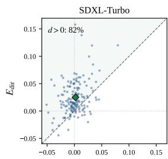

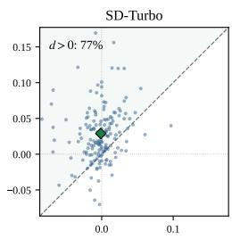

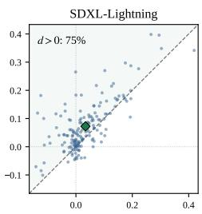

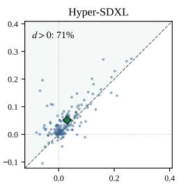

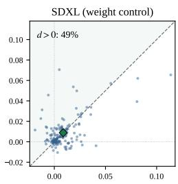  
Figure C1. The first-forward asymmetry holds image by image on the distilled backbones and vanishes with the original weights. Each point is one image; the diamond marks the mean of Table C1, and $d > 0$ is the fraction of images above the diagonal, where the direct correction wins. Axes are clipped at the 0.5th and 99.5th percentiles and scaled per panel, as the backbones operate at different resolutions.

Table C1. At the first forward, attention forcing is not significantly different from zero on the Turbo family, while the direct correction and the gap $d = E _ { \mathrm { d i r e c t } } - E _ { \mathrm { A F } }$ are not. Means restate the first row of Table 3 at full precision. The p-values are paired permutation tests (Appendix B.1), whose resolution floor is $1 . 0 \times 1 0 ^ { - 4 }$ ; the original-SDXL row is the weight control.
<table><tr><td>Backbone</td><td> $E _ { \mathrm { A F } }$ </td><td> $E _ { \mathrm { d i r e c t } }$ </td><td>d</td><td> $p ( E _ { \mathrm { A F } } { = } 0 )$ </td><td> $p ( d \mathrm { = } 0 )$ </td></tr><tr><td>SDXL-Turbo</td><td>+0.0020</td><td>+0.0251</td><td>+0.0231</td><td>0.27</td><td> $1 . 0 \times 1 0 ^ { - 4 }$ </td></tr><tr><td>SD-Turbo</td><td>-0.0013</td><td>+0.0289</td><td>+0.0303</td><td>0.52</td><td> $1 . 0 \times 1 0 ^ { - 4 }$ </td></tr><tr><td>SDXL-Lightning</td><td>+0.0339</td><td>+0.0723</td><td>+0.0384</td><td> $1 . 0 \times 1 0 ^ { - 4 }$ </td><td> $1 . 0 \times 1 0 ^ { - 4 }$ </td></tr><tr><td>Hyper-SDXL</td><td>+0.0302</td><td>+0.0516</td><td>+0.0214</td><td> $1 . 0 \times 1 0 ^ { - 4 }$ </td><td> $1 . 0 \times 1 0 ^ { - 4 }$ </td></tr><tr><td>Original SDXL (4-step grid)</td><td>+0.0087</td><td>+0.0088</td><td>+0.0001</td><td> $1 . 0 \times 1 0 ^ { - 4 }$ </td><td>0.91</td></tr></table>

## C.2 Multi-Step Reference Intervention

Applying the identical matched single-forward protocol along the 50-step SDXL reference trajectory yields Table C2. Both interventions have terminal effects an order of magnitude smaller than on the native four-step trajectory, and no first-forward asymmetry comparable to Table C1 appears: a single early intervention, of either kind, is largely absorbed by the remaining trajectory. This is the reference behavior against which the few-step results should be read. Figure C2 places the two trajectories side by side.

## C.3 Diagnostic Schedule Controls

Together with Tables C1 and C2, the two controls of this section complete a two-by-two design over the weight (distilled or original) and the schedule (four-step or dense): the intervention asymmetry appears only where distilled weights meet the coarse schedule. Both control configurations run outside the native inference regime of the respective model and are therefore diagnostic rather than a causal factorization. First, the original SDXL weights on the same four-step grid do not reproduce the intervention gap: both interventions act moderately and symmetrically (last row of Table C1). Second, densifying the same SDXL-Turbo weights to 8 and 16 denoising evaluations shrinks the terminal effect of the first direct correction monotonically while the effect of attention forcing stays at its floor (Table C3): additional denoising opportunities reduce how much a single early correction survives to the output, and do not unlock an early effect of attention forcing.

Table C2. On the reference trajectory both single-forward interventions stay an order of magnitude below the few-step effects. Exact values at the eight probed noise levels; the corresponding curves are the right panel of Figure C2.
<table><tr><td>Forward index</td><td>Noise level σ</td><td> $E _ { \mathrm { A F } }$ </td><td> $E _ { \mathrm { d i r e c t } }$ </td></tr><tr><td>1</td><td>13.12</td><td>+0.0015</td><td>+0.0012</td></tr><tr><td>4</td><td>9.34</td><td>+0.0024</td><td>+0.0020</td></tr><tr><td>8</td><td>6.20</td><td>+0.0030</td><td>+0.0033</td></tr><tr><td>13</td><td>3.95</td><td>+0.0036</td><td>+0.0040</td></tr><tr><td>19</td><td>2.46</td><td>+0.0028</td><td>+0.0036</td></tr><tr><td>25</td><td>1.62</td><td>+0.0027</td><td>+0.0033</td></tr><tr><td>31</td><td>1.09</td><td>+0.0021</td><td>+0.0029</td></tr><tr><td>38</td><td>0.67</td><td>+0.0014</td><td>+0.0025</td></tr></table>

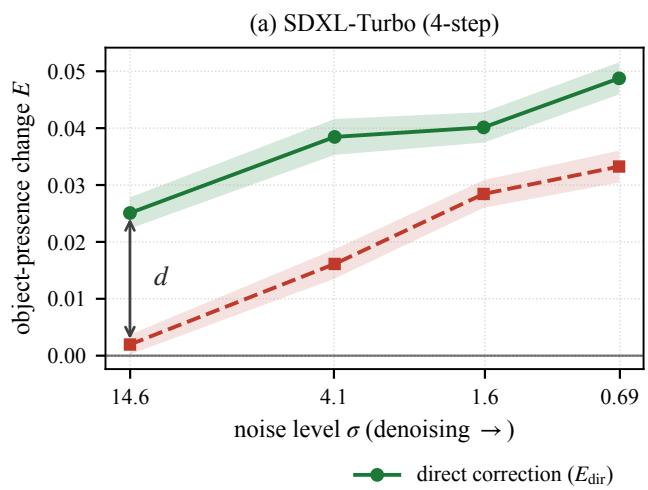

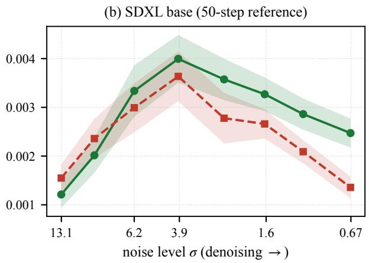  
Figure C2. On the reference trajectory both interventions are an order of magnitude weaker and the first-forward asymmetry vanishes. Terminal intervention effect E of a single intervened forward at each noise level; bands are ±1 standard error over n = 163 images. The left panel plots the SDXL-Turbo column of Table 3; the right panel plots Table C2, on a vertical scale an order of magnitude smaller.

Table C3. Densifying the same Turbo weights shrinks the direct effect and does not unlock attention forcing. First-forward effects at 4, 8, and 16 denoising evaluations; the native row anchors to Table C1.
<table><tr><td>Denoising evaluations</td><td> $E _ { \mathrm { A F } }$ </td><td> $p ( E _ { \mathrm { A F } } { = } 0 )$ </td><td> $E _ { \mathrm { d i r e c t } }$ </td><td> $p ( E _ { \mathrm { d i r e c t } } { = } 0 )$ </td></tr><tr><td>4</td><td>+0.0020</td><td>0.27</td><td> $+ 0 . 0 2 5 1$ </td><td> $1 . 0 \times 1 0 ^ { - 4 }$ </td></tr><tr><td>8</td><td>+0.0018</td><td>0.21</td><td> $+ 0 . 0 1 2 2$ </td><td> $1 . 0 \times 1 0 ^ { - 4 }$ </td></tr><tr><td>16</td><td>+0.0018</td><td>0.09</td><td> $+ 0 . 0 0 5 9$ </td><td> $1 . 0 \times 1 0 ^ { - 4 }$ </td></tr></table>

On the 50-step reference we additionally fix the number of forced forwards and vary only their placement, so that any difference is attributable to timing rather than to the amount of intervention; the main text quotes the direction of this control, and Table C4 gives the configurations and numbers. The two eight-forward windows sit at the extremes of the schedule, $\sigma \in [ 1 3 . 1 , 6 . 2 ]$ and $\sigma \in [ 0 . 4 4 , 0 . 0 4 ]$ , and the late window wins by 0.9 dB. Both fall far short of the sustained configurations: extending attention forcing over the last 38 forwards recovers most of the reference quality, and only the full schedule reaches it. Timing matters at a fixed budget, but on the dense trajectory attention forcing needs sustained application to act at all.

Table C4. At a fixed count, late attention forcing beats high-noise placement, and only the full schedule reaches the reference. 50-step SDXL with the guidance of the reference configuration; the all-50 row is the 50-step attention-forcing reference of Table 5.
<table><tr><td>Placement</td><td>σ range</td><td>PSNR↑</td><td>SSIM↑</td><td>LPIPS↓</td></tr><tr><td>8 forwards, high-noise range</td><td> $1 3 . 1  6 . 2$ </td><td>11.57</td><td>0.255</td><td>0.399</td></tr><tr><td>8 forwards, late range</td><td> $0 . 4 4  0 . 0 4$ </td><td>12.47</td><td>0.284</td><td>0.353</td></tr><tr><td>Last 38 forwards</td><td> $3 . 9 5  0 . 0 4$ </td><td>17.17</td><td>0.429</td><td>0.221</td></tr><tr><td>All 50 forwards</td><td> $1 3 . 1  0 . 0 4$ </td><td>17.86</td><td>0.441</td><td>0.209</td></tr></table>

## C.4 Retention Analysis

Retention. We measure how much a perturbation injected at the first forward survives to the final output. At forward k the predicted clean latent is pushed a fraction $\beta = 0 . 1$ toward the ground-truth background inside the mask, $\hat { x } _ { 0 } ^ { \prime } = \left( 1 - \beta \right) \hat { x } _ { 0 } + \beta z _ { \mathrm { g t } }$ , re-expressed as a noise prediction, and the trajectory then runs without further intervention. Retention is the ratio of the final to the immediate displacement between the injected and base runs, $s _ { k } = \lVert \hat { x } _ { 0 } ^ { \mathrm { f i n a l , i n j } } - \hat { x } _ { 0 } ^ { \mathrm { f } }$ final,base $\| _ { M } / \| z ^ { \mathrm { i n j } } - z ^ { \mathrm { b a s e } } \| _ { M }$ , with masked RMS norms and the denominator measured at the input of forward k+1. The ratio is verified to be independent of the dose $\beta ,$ so it is the slope of the linear displacement response and applies to small perturbations along this direction. At the first forward the median over images is 1.38 on the native four-step SDXL-Turbo trajectory and 0.30 on the 50-step reference: the few-step trajectory preserves, and can even amplify, what the first forward establishes, while the dense trajectory attenuates it.

## C.5 Residual-Frequency Analysis

We compare the high-band energy of the masked region against the ground-truth background. The band is the radial range [0.45, 1.0) of Nyquist of the two-dimensional FFT power, computed on the grayscale bounding-box crop of the mask resized to $\mathrm { 1 2 8 ^ { 2 } }$ under a Hann window; the ground-truth crop is processed identically, and each image contribute the ratio of the two. Table C5 reports geometric means over images. Without intervention the masked region carries 8.3× the high-band energy of the true background, the spectral signature of the object itself. Attention forcing alone reduces this only to 1.92×: the residual is object-shaped high-frequency structure. The direct correction alone lands at 0.30×, below parity, as expected from evidence B that averages background latents. ReState recovers to 0.51×: the object-shaped excess is eliminated, and the attention-constrained late forwards restore part of the missing texture. The remaining gap to parity is a smoother-than-real fill, not residual object structure, which is the opposite failure mode of attention forcing.

Table C5. Attention forcing leaves object-shaped high-frequency structure; ReState eliminates it. Masked high-band energy as a per-image ratio to the identically processed ground truth, geometric mean over OBER-Test (SDXL-Turbo).
<table><tr><td>Output High-band ratio to ground truth</td></tr><tr><td>No intervention 8.34</td></tr><tr><td>Attention forcing only 1.92</td></tr><tr><td>Direct correction only 0.30</td></tr><tr><td>ReState 0.51</td></tr></table>

## D Method Ablations

Each ablation in this section varies one component of the default ReState configuration (Appendix B) on SDXL-Turbo and reports masked PSNR, SSIM, and LPIPS on OBER-Test. Tables report point estimates, and every statistical

statement in the text is a two-sided paired permutation test against the default configuration under the protocol of Appendix B.1.

## D.1 Correction Strength

Table D1 sweeps λ over a 32× range with all other settings fixed. Removal quality is flat: masked PSNR varies by at most 0.14 dB across the sweep, and the default λ = 8 is within 0.01 dB of the optimum. The realized weights $\omega _ { t }$ shift substantially with λ, so the insensitivity is a property of the correction itself rather than of a narrow operating point.

This flatness is a statement about the strength profile within the structure that the closed form imposes, with strong corrections while noise remains and none at the final forward; that the structure itself is necessary is shown in Section D.2.

Table D1. Removal quality is insensitive to the correction strength λ. Realized weights $\omega _ { t } = \lambda \sigma _ { t - 1 } ^ { 2 } / ( 1 + \lambda \sigma _ { t - 1 } ^ { 2 } )$ at the first three forwards; $\omega _ { 4 } = 0$ for all λ by the closed form. The default λ = 8 is highlighted.
<table><tr><td rowspan="2">λ</td><td colspan="3">Realized ω</td><td colspan="3">OBER-Test</td></tr><tr><td>ω1</td><td>ω2</td><td>ω3</td><td>PSNR↑</td><td>SSIM↑</td><td>LPIPS↓</td></tr><tr><td>1</td><td>0.943</td><td>0.722</td><td>0.325</td><td>18.61</td><td>0.487</td><td>0.194</td></tr><tr><td>2</td><td>0.971</td><td>0.839</td><td>0.490</td><td>18.70</td><td>0.492</td><td>0.193</td></tr><tr><td>4</td><td>0.985</td><td>0.912</td><td>0.658</td><td>18.74</td><td>0.496</td><td>0.194</td></tr><tr><td>8</td><td>0.993</td><td>0.954</td><td>0.794</td><td>18.75</td><td>0.498</td><td>0.194</td></tr><tr><td>16</td><td>0.996</td><td>0.977</td><td>0.885</td><td>18.73</td><td>0.498</td><td>0.195</td></tr><tr><td>32</td><td>0.998</td><td>0.988</td><td>0.939</td><td>18.72</td><td>0.498</td><td>0.195</td></tr></table>

## D.2 Correction Timing and Schedule Structure

Table D2 restricts the direct correction to subsets of the four forwards, with object-excluding attention active at every forward in all rows. The windows are ordered primarily by the last corrected forward: windows ending at the third forward reach 18.47 to 18.75 dB on OBER-Test, windows ending at the second reach 18.18 to 18.35 dB, and correcting only the first forward reaches 16.85 dB. Within a fixed last forward, earlier corrections add a secondary refinement (+0.27 dB from {3} to {2, 3}, +0.17 dB from {2} to {1, 2}). This ordering follows from state propagation: every uncorrected forward re-predicts the masked content with whatever generative freedom the remaining noise allows, so the final result is governed by the freedom that remains after the last applied correction. The same absorption principle governs trajectory length in Appendix C.3, where additional denoising evaluations reduce how much a single early correction survives to the output. These windows measure deployed quality with the remaining schedule uncorrected; the persistence of a single matched perturbation is the separate measurement of Appendix C.4. The two measurements are consistent: limited absorption (Appendix C.4) means an early correction survives, and the ordering by the last corrected forward follows because every uncorrected forward re-predicts the masked content; the window ordering is therefore a consequence of the same absorption principle, not a counterexample to it.

Within this pattern the first-forward correction becomes redundant once the later forwards are corrected: the {2, 3} window is not significantly different from the full schedule on PSNR and LPIPS $( p = 0 . 5 4$ and $p = 0 . 9 0 )$ , with a marginal SSIM difference (0.496 versus 0.498, $p = 0 . 0 0 2 )$ . ReState nevertheless keeps the full schedule, because the closed form of Eq. 7 assigns every forward its weight without a window hyperparameter, and pruning to {2, 3} would introduce a discrete rule for no measurable gain.

The last row removes the boundary condition instead: keying ω to $\sigma _ { t }$ rather than $\sigma _ { t - 1 }$ leaves the final forward a correction of $\omega _ { 4 } \approx 0 . 7 9$ , whose corrected prediction is the final output. Quality collapses perceptually, with LPIPS degrading from 0.194 to 0.284 and PSNR losing 1.49 dB (both $p = 1 . 0 \times 1 0 ^ { - 4 } )$ . This row also answers why the schedule does not shift weight toward the later forwards although single late windows imprint best: a late correction locks in whatever it writes, including the smoothness of the averaged evidence B, so the correction should be strong while the prediction is still revisable and absent once it is not. The final forward is left uncorrected, and the $\sigma _ { t - 1 }$ keying supplies exactly this as a boundary condition of the objective rather than as an added rule.

Restoring that boundary by hand under $\sigma _ { t }$ keying, with an explicit final-forward skip, is statistically not significantly different from the default on every metric (18.71 versus 18.75 dB, $p = 0 . 2 3 ;$ ; LPIPS 0.195 versus 0.194, $p = 0 . 0 8 )$ The keying is therefore not a performance choice: $\sigma _ { t - 1 }$ absorbs the final-forward exception into the closed form. A complementary sweep isolates the terminal weight: with $\omega _ { 1 } { - } \omega _ { 3 }$ fixed at their closed-form values, raising $\omega _ { 4 }$ from 0 to 0.2, 0.5, and 0.794 degrades masked LPIPS monotonically from 0.194 to 0.210, 0.251, and 0.283 (significant from $\omega _ { 4 } = 0 . 2 , p = 1 . 0 \times 1 0 ^ { - 4 } )$ , with PSNR and SSIM following from $\omega _ { 4 } \geq 0 . 5$ . The benefit of the terminal release is therefore separable from the earlier weights: a terminal direct correction pulls the output toward the smoothness of the averaged evidence B exactly where fine texture is synthesized.

A constant-strength schedule isolates the weight profile itself: $\omega _ { 1 } = \omega _ { 2 } = \omega _ { 3 } = c$ with $\omega _ { 4 } = 0$ , so the terminal release is kept and only the profile changes. With c matched to the mean of the closed-form weights $_ { ( c = 0 . 9 1 4 ) }$ , the default is never significantly worse on any metric and is significantly better in three of six benchmark–metric cells (masked LPIPS 0.1940 versus 0.1951 on OBER-Test, p=0.027; PSNR 17.21 versus 17.18, $p { = } 9 . 0 \times 1 0 ^ { - 4 }$ , and LPIPS 0.2728 versus $0 . 2 7 4 0 , p { = } 1 . 0 \times 1 0 ^ { - 4 }$ , on RORD); the differences are at most 0.03 dB and 0.0012 LPIPS. An exploratory sweep over $c \in \{ 0 . 5 , 0 . 7 9 4 , 1 . 0 \}$ gives the same picture: quality is flat for c between 0.794 and 1.0 — the setting $c { = } \omega _ { 3 }$ is itself marginally better than the default on RORD PSNR and LPIPS while worse on SSIM — and degrades clearly at $c { = } 0 . 5$ . The weight profile is therefore not where the performance comes from; the operative factors are the terminal release and an adequate overall strength, and the closed form of Eq. 7 supplies both from one objective with the single hyperparameter $\lambda ,$ with no window or constant to tune. At the one-step extreme $( T { = } 1 )$ , every forward is terminal and the correction vanishes identically; this is the boundary condition operating as intended, and the removal claims of this paper are for the four-step schedule.

Table D2. The correction is cumulative and the final forward is left uncorrected. The direct correction is applied only at the listed forwards; object-excluding attention stays active at every forward in all rows. The last row keys ω to $\sigma _ { t } ,$ so the final forward retains a correction of $\omega _ { 4 } \approx 0 . 7 9$ whose output is final. Constant rows replace the closed-form weights by a single constant c while keeping $\omega _ { 4 } = 0$
<table><tr><td>Corrected forwards</td><td>PSNR↑</td><td>SSIM↑</td><td>LPIPS↓</td></tr><tr><td>None (attention forcing only)</td><td>15.50</td><td>0.348</td><td>0.269</td></tr><tr><td>{1}</td><td>16.85</td><td>0.411</td><td>0.237</td></tr><tr><td>{2}</td><td>18.18</td><td>0.469</td><td>0.203</td></tr><tr><td>{3}</td><td>18.47</td><td>0.482</td><td>0.200</td></tr><tr><td>{1,2}</td><td>18.35</td><td>0.477</td><td>0.198</td></tr><tr><td>{2,3}</td><td>18.74</td><td>0.496</td><td>0.194</td></tr><tr><td>{1, 2, 3} (default)</td><td>18.75</td><td>0.498</td><td>0.194</td></tr><tr><td>Constant c=0.914 (mean-matched), {1, 2, 3}</td><td>18.73</td><td>0.497</td><td>0.195</td></tr><tr><td>Constant c=0.5, {1, 2, 3}</td><td>18.53</td><td>0.486</td><td>0.197</td></tr><tr><td>Constant c=0.794 (= ω3), {1, 2, 3}</td><td>18.76</td><td>0.496</td><td>0.194</td></tr><tr><td>Constant c=1.0, {1, 2, 3}</td><td>18.68</td><td>0.497</td><td>0.196</td></tr><tr><td>{1, 2, 3, 4} (ω keyed to σt)</td><td>17.26</td><td>0.466</td><td>0.284</td></tr></table>

## D.3 Background Evidence Source

Replacing the retrieved B (Table 6) shows both directions of the dependence: a global background mean, which removes spatial correspondence, costs 0.59 dB, while the ground-truth background as an oracle target gains 3.57 dB. The correction mechanism is therefore not the bottleneck; the quality of the evidence is.

## D.4 Per-Forward Correction versus One-Shot Latent Initialization

The preceding ablations vary the evidence and the schedule; this one varies only how the same evidence enters sampling, and asks whether the gain of ReState is explained by obtaining a good proposal B alone. Both configurations share the first generation forward, the retrieved proposal B, the seed, and the noise realization, and both run four denoiser evaluations with identical attention forcing and anchoring. ReState applies its per-forward correction as in the main text.

The initialization alternative instead writes B into the trajectory once [22]: at the noise level $\sigma _ { \mathrm { n e x t } }$ entering the second forward, the masked region is re-initialized as $z ^ { \mathrm { i n i t } } = M \odot ( B + \sigma _ { \mathrm { n e x t } } \epsilon ) + ( 1 - M ) \odot ( z _ { \mathrm { s r c } } + \sigma _ { \mathrm { n e x t } } \epsilon )$ , after which the remaining three forwards run without any prediction correction. This differs from the {1} window of Appendix D.2, which corrects the clean prediction and lets the sampler form the next latent; the initialization reconstructs the noisy latent itself, so the two are separate measurements. Masked LPIPS was declared the primary metric before the runs, since a one-shot fill can favor PSNR through smoothing. Table D3 reports the outcome: ReState is better on the primary metric on both benchmarks $( p = 1 . 0 \times 1 0 ^ { - 4 } )$ ; per-image win rate 62.0% on OBER-Test, 62.7% on RORD), and on masked PSNR and SSIM as well (win rates 69–90%). The gain of ReState is therefore not explained by the background proposal alone: at the same target and the same budget, applying the proposal as a per-forward prediction correction outperforms writing it into the latent once.

Table D3. Per-forward correction versus one-shot latent initialization: the correction procedure itself adds value. Both rows share the retrieved proposal B, the first generation forward, the noise realization, attention forcing, and anchoring, and use four denoiser evaluations. The initialization row writes B into the noisy latent once before the second forward; ReState applies it as a per-forward prediction correction. The last row reports ReState minus initialization; masked LPIPS is the pre-declared primar metric, and every gain is significant under the protocol of Appendix B.1.  
Paired gains are computed from unrounded per-image values.
<table><tr><td colspan="3"></td><td colspan="3">OBER-Test</td><td colspan="3">RORD</td></tr><tr><td>Method</td><td>Same B</td><td>NFE</td><td>PSNR↑</td><td>SSIM↑</td><td>LPIPS↓</td><td>PSNR↑</td><td>SSIM↑</td><td>LPIPS↓</td></tr><tr><td>Initialization with B</td><td>V</td><td>4</td><td>17.90</td><td>0.454</td><td>0.211</td><td>16.39</td><td>0.417</td><td>0.284</td></tr><tr><td>ReState (Ours)</td><td>√</td><td>4</td><td>18.75</td><td>0.498</td><td>0.194</td><td>17.21</td><td>0.451</td><td>0.273</td></tr><tr><td>Paired gain</td><td></td><td></td><td>+0.85</td><td>+0.044</td><td>-0.017</td><td>+0.83</td><td>+0.033</td><td>-0.012</td></tr></table>

## D.5 Retrieval Ratio

Figure D1 widens the retained fraction r over three orders of magnitude, up to the softmax-weighted average over the entire background. Below the default the bank is too small: $r = 0 . 0 0 1$ loses 0.33 dB $( p = 1 . 0 \times 1 0 ^ { - 4 } )$ and $r = 0 . 0 0 5$ still registers $( p = 0 . 0 1 0 )$ . Above the default the sweep locates only a shallow numerical optimum: PSNR peaks around $r = 0 . 1 \mathrm { t o } 0 . 2 5$ , at most 0.15 dB above the default and not significant on any metric $( p \ge 0 . 0 8 )$ , while LPIPS is never significantly better than at the default (all $p \geq 0 . 1 5 )$ and is numerically worst at the full bank. We retain $r = 0 . 0 1$ : the peak is not statistically distinguishable from it, and adopting a peak located on the evaluation benchmark would in any case amount to selecting r on the test set.

The sweep separates the two design choices of the retrieval. Even the full-bank softmax average stays at the level of the default on PSNR (18.80) while its LPIPS is the worst in the sweep, whereas removing the weighting entirely, the unweighted global mean of Table 6, costs 0.59 dB. The robustness to r is therefore a property of the similarity weighting rather than of a tuned retained fraction: across the entire range $r \in [ 0 . 0 0 5 , 1 ]$ , masked PSNR stays within 0.15 dB of the default.

## D.6 Probe Feature Source

The background bank is built from features captured at the first generation forward $( \sigma = 1 4 . 6 $ , object-excluding attention active), at the output of the first up-block of the denoiser; the native resolution of this map at $5 1 2 ^ { 2 } { \mathrm { ~ i s ~ } } 3 2 \times 3 2$ , and it is bilinearly resampled to the $6 4 \times 6 4$ correspondence grid of the latent. Table D4 rebuilds the bank from alternative feature sources and regenerates with the otherwise identical pipeline.

Every variant harvests its features in a separate pass of the diagnostic harness, so the generation trajectory itself is identical across rows and stays at the native four evaluations. For the suppression-off and noise-level rows this pass is required by construction: in the default the probe and the first generation forward are the same pass, run under suppression at $\sigma = 1 4 . 6 $ , so changing the probe condition inside that forward would change the generation as well. The layer rows need no such pass in principle and could share the generation forward exactly as the default does.

The shared probe is robust to the attention intervention under which it runs. Harvesting the same features without object-excluding attention changes nothing measurable (18.72 versus 18.75 dB, $p \geq 0 . 4 6$ on every metric). Keeping the suppression active therefore costs nothing, and it requires no separate pass.

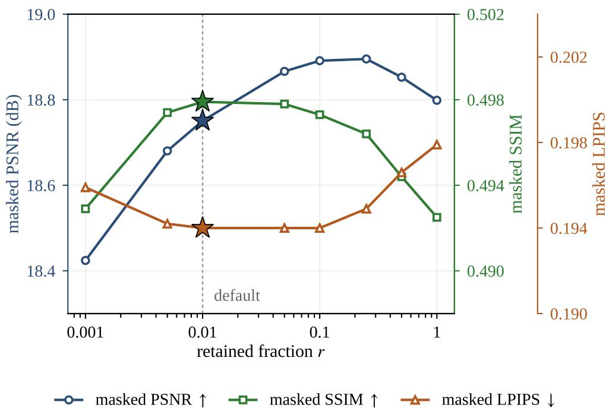  
Figure D1. Removal quality is insensitive to the retained fraction r across three orders of magnitude. Masked metrics on OBER-Test with the bank widened up to the similarity-weighted average over the entire background $( r = 1 ) $ ; the stars mark the default $r = 0 . 0 1$ . Exact test statistics are given in the text.

The noise level of the probe input, in contrast, is functional rather than incidental. Harvesting from a nearly clean input, $\mathcal { E } ( x _ { \mathrm { s r c } } ) + \sigma _ { \mathrm { m i n } } \epsilon$ at $\sigma _ { \mathrm { m i n } } = 0 . 6 9 3$ , degrades sharply to 17.44 dB and LPIPS 0.214 (all $p = 1 . 0 \times 1 0 ^ { - 4 } )$ , while features from the second forward $( \sigma = 4 . 0 8 )$ remain at par $\left( p \geq 0 . 3 3 \right)$ . This pattern is consistent with heavy noise acting as content suppression on the probe input.

At high σ the source object is largely erased from the input, so masked-position features are driven by surrounding context, whereas at low σ the object remains present and reaches the masked features through convolutional receptive fields that attention suppression does not gate, and the retrieval then favors background patches resembling the object. We advance this as the consistent reading of the pattern rather than as an isolated causal claim.

The layer rows separate semantic depth from resolution. Mid-block features at native $1 6 \times 1 6$ are not significantly different from the default $( p \geq 0 . 6 2$ on every metric), while the encoder-side block at the same $3 2 \times 3 2$ native resolution as the default degrades strongly (17.96 dB, LPIPS 0.216, $p \leq 0 . 0 0 2 )$ , and the decoder block with native $6 4 \times 6 4$ resolution also loses (18.42 dB, LPIPS 0.207; $p \leq 0 . 0 0 2$ on SSIM and LPIPS, $p = 0 . 1 4$ on PSNR). Correspondence quality therefore tracks where the features sit in the denoiser rather than their native resolution, and the bilinear resampling of the default is not the limiting factor: the block that needs no resampling performs worse than the resampled default.

The bank values are fixed to clean source latents, so the only quantity that can change during sampling is the correspondence itself. Re-computing the similarity weights at every generation forward from its own shared features, with no auxiliary pass and the evidence space unchanged, raises quality slightly (19.02 versus 18.75 dB, LPIPS 0.190 versus 0.194), while the retrieved positions change substantially (mean top-k overlap of 0.39 to 0.43 against the first-forward matching).

The gain is consistent with the content-suppression reading above: features from the later forwards are harvested from a trajectory whose masked content has already been corrected toward background, so the probe input is object-free by prior correction rather than by noise. The default retains the single shared harvest as the minimal-intervention configuration, and we read the per-step update as the most immediate route toward the evidence headroom of Table 6.

Table D4. The shared noisy probe is the operative choice: near-clean inputs contaminate the bank, while attention suppression and the feature layer admit slack. Each row rebuilds the background bank from a different feature source and regenerates with the identical four-forward pipeline; every variant harvests its features in a separate diagnostic pass, so the deployed method stays at the native count.
<table><tr><td>Feature source</td><td>PSNR↑</td><td>SSIM↑</td><td>LPIPS↓</td></tr><tr><td>Shared first forward (default)</td><td>18.75</td><td>0.498</td><td>0.194</td></tr><tr><td>No attention suppression</td><td>18.72</td><td>0.497</td><td>0.194</td></tr><tr><td>Near-clean input (σ = 0.693)</td><td>17.44</td><td>0.474</td><td>0.214</td></tr><tr><td>Second forward (σ = 4.08)</td><td>18.87</td><td>0.499</td><td>0.193</td></tr><tr><td>Encoder block (native 322)</td><td>17.96</td><td>0.475</td><td>0.216</td></tr><tr><td>Mid block (native 162)</td><td>18.75</td><td>0.499</td><td>0.194</td></tr><tr><td>Decoder block (native 642)</td><td>18.42</td><td>0.482</td><td>0.207</td></tr></table>

## E Additional Results

## E.1 Full Quantitative Tables

Table E1 collects the full quantitative comparison on both benchmarks: the training-free block repeats the SDXL-Turbo rows of Table 2, and the lower block adds the training- and optimization-based methods, each run from its released checkpoint under the official default inference settings (Appendix B). SDXL-Inpainting and FLUX.1-Fill operate and are evaluated at 10242, and all remaining methods at 5122. Latency is the median per-image end-to-end wall-clock on OBER-Test and VRAM is the peak allocation, both measured on a single A100 80GB for every row.

OSOR [46] fine-tunes SDXL-Inpainting and FLUX.1-Fill on CORNE, a set of 280K removal pairs curated from single-edit instruction triplets, and additionally refines the FLUX variant for 1K steps on the captured subset of OBER. This refinement is described only for the FLUX variant; because both variants share the same training pipeline, we conservatively treat the same refinement as possible for the SDXL-Inpainting release as well, so out-of-distribution evaluation on OBER-Test is not guaranteed for either variant, and OSOR is excluded from the matched comparison of Table E1.

For reference, its SDXL-Inpainting variant reaches 23.19 dB masked PSNR on OBER-Test and 18.77 dB on RORD at 0.40 s and 7.2 GiB under the identical protocol. The training data of every training-based comparison is classified in Table B1.

## E.2 Full Removal on Additional Distilled Backbones

Table E2 extends the full removal comparison of Table 2 to SDXL-Lightning and Hyper-SDXL under the identical frozen configuration: the same $\lambda = 8 , r = 0 . 0 1$ , probe layer, and schedule keying, with no per-backbone tuning. On both backbones and both benchmarks ReState improves over DesignEdit, the strongest training-free baseline of Table 2, on every metric, by +1.46 to +2.39 dB masked PSNR, and over the no-intervention baseline by 6.9 to 7.3 dB; every difference is significant at $p = 1 . 0 \times 1 0 ^ { - 4 }$ under the protocol of Appendix B.1.

The margins over attention forcing are smaller than on the Turbo family (+3.25 dB on SDXL-Turbo), in the direction the intervention analysis predicts. On Lightning and Hyper-SDXL the first-forward terminal effect of attention forcing is already positive (+0.034 and +0.030, Table C1) rather than not significantly different from zero as on the Turbo family, so attention forcing recovers part of the removal on its own and the relative advantage of the direct correction narrows. On both benchmarks the ordering of the four ReState margins follows the ordering of that first-forward effect across the four distilled backbones; we read this as consistency with the diagnosis rather than as a causal prediction test.

The removal pipeline is unchanged; the two backbones operate and are evaluated at $1 0 2 4 ^ { 2 }$ (Appendix B.1), so absolute metric levels are not comparable to the $5 1 2 ^ { 2 }$ backbones and comparisons are within each backbone, as in Table 3. Attentive Eraser and AdaEraser are omitted from this extension: both already fall below DesignEdit or the no-intervention baseline on the Turbo backbones of Table 2.

Table E1. Without any training, ReState remains competitive with the training-based methods at the lowest latency. Latency and VRAM are measured as described in the text; the training-free rows repeat the SDXL-Turbo block of Table 2.
<table><tr><td rowspan="2">Method</td><td colspan="3">OBER-Test</td><td colspan="3">RORD</td><td rowspan="2"></td><td rowspan="2">VRAM</td></tr><tr><td>PSNR↑</td><td>SSIM↑</td><td>LPIPS↓</td><td>PSNR↑</td><td>SSIM↑</td><td>LPIPS↓</td></tr><tr><td colspan="7">Training/Optimization-based methods</td><td>Lat. (s)</td><td></td></tr><tr><td>SDXL-Inpainting</td><td>11.65</td><td>0.365</td><td>0.391</td><td>10.57</td><td>0.348</td><td>0.403</td><td>3.75</td><td>9.0GB</td></tr><tr><td>FLUX.1-Fill</td><td>11.04</td><td>0.376</td><td>0.405</td><td>12.33</td><td>0.415</td><td>0.366</td><td>15.9</td><td>33.8GB</td></tr><tr><td>PowerPaint ECCV&#x27;24</td><td>14.89</td><td>0.463</td><td>0.255</td><td>14.91</td><td>0.438</td><td>0.282</td><td>3.86</td><td>5.1GB</td></tr><tr><td>CLIPAway NeurIPS&#x27;24</td><td>15.71</td><td>0.426</td><td>0.246</td><td>14.84</td><td>0.406</td><td>0.268</td><td>7.83</td><td>9.8GB</td></tr><tr><td>EntityErasure CVPR&#x27;25</td><td>15.70</td><td>0.496</td><td>0.222</td><td>15.70</td><td>0.460</td><td>0.247</td><td>3.21</td><td>12.5GB</td></tr><tr><td>SmartEraser CVPR&#x27;25</td><td>18.67</td><td>0.510</td><td>0.170</td><td>17.81</td><td>0.463</td><td>0.193</td><td>6.12</td><td>7.7GB</td></tr><tr><td>EraseLoRA ECCV&#x27;26</td><td>18.78</td><td>0.481</td><td>0.175</td><td>16.77</td><td>0.433</td><td>0.237</td><td>198s</td><td>33.5GB</td></tr><tr><td colspan="7">Training-free methods</td><td></td><td></td></tr><tr><td>SDXL-Turbo (4 steps)</td><td>9.86</td><td>0.133</td><td>0.435</td><td>7.55</td><td>0.074</td><td>0.516</td><td>0.247</td><td>7.1GB</td></tr><tr><td>+ Attentive Eraser AAAI&#x27;25</td><td>7.09</td><td>0.046</td><td>0.514</td><td>7.35</td><td>0.065</td><td>0.538</td><td>0.338</td><td>7.1GB</td></tr><tr><td>+ DesignEdit AAAI&#x27;25</td><td>15.50</td><td>0.348</td><td>0.269</td><td>14.34</td><td>0.326</td><td>0.334</td><td>0.281</td><td>7.1GB</td></tr><tr><td>+ AdaEraser ICML&#x27;26</td><td>11.71</td><td>0.205</td><td>0.372</td><td>9.47</td><td>0.122</td><td>0.462</td><td>1.145</td><td>7.1GB</td></tr><tr><td>+ ReState (Ours)</td><td>18.75</td><td>0.498</td><td>0.194</td><td>17.21</td><td>0.451</td><td>0.273</td><td>0.373</td><td>7.1GB</td></tr></table>

Table E2. The single frozen configuration transfers: ReState improves every masked metric on two further distilled backbones. Full removal at $1 0 2 4 ^ { 2 }$ with the identical hyperparameters as Table 2 and no per-backbone tuning; rows with + apply the method on the backbone of their block. Bold is best per column within a block; test statistics are given in the text.
<table><tr><td rowspan="2">Method</td><td colspan="3">OBER-Test</td><td colspan="3">RORD</td></tr><tr><td>PSNR↑</td><td>SSIM↑</td><td>LPIPS↓</td><td>PSNR↑</td><td>SSIM↑</td><td>LPIPS↓</td></tr><tr><td>SDXL-Lightning (4 steps)</td><td>10.51</td><td>0.393</td><td>0.424</td><td>9.60</td><td>0.318</td><td>0.445</td></tr><tr><td>+ DesignEdit AAAI&#x27;25</td><td>15.95</td><td>0.517</td><td>0.296</td><td>15.08</td><td>0.475</td><td>0.325</td></tr><tr><td>+ ReState (Ours)</td><td>17.51</td><td>0.578</td><td>0.271</td><td>16.54</td><td>0.528</td><td>0.308</td></tr><tr><td>Hyper-SDXL (4 steps)</td><td>10.21</td><td>0.346</td><td>0.434</td><td>9.21</td><td>0.273</td><td>0.455</td></tr><tr><td>+ DesignEdit AAAI&#x27;25</td><td>15.20</td><td>0.487</td><td>0.315</td><td>14.14</td><td>0.434</td><td>0.358</td></tr><tr><td>+ ReState (Ours)</td><td>17.49</td><td>0.574</td><td>0.273</td><td>16.53</td><td>0.527</td><td>0.315</td></tr></table>

## E.3 Multi-Step Baseline Comparison

Table E3 runs the attention-forcing baselines of Table 2 at their native 50-step count, under the identical reference configuration as Table C4 (same guidance, seed, and background anchoring); the DesignEdit row is the 50-step reference of Table 5. The methods that degrade under the four-step port operate correctly at their native step count: Attentive Eraser reaches 18.79 dB against 7.09 dB in Table 2, and AdaEraser 15.66 against 11.71 dB. The few-step failures of Section 4 are therefore consistent with a regime effect rather than a port artifact, and the recovery of Attentive Eraser is exactly the calibration argument of the main text: its SARG amplification is calibrated for 50-step sampling and acts as intended there.

Against this 50-step field, ReState at its native four steps (18.75 dB, SSIM 0.498, LPIPS 0.194) exceeds every 50-step attention configuration on SSIM and LPIPS, and sits within 0.04 dB of the best attention-configuration PSNR (Attentive Eraser), at 6.7× lower latency (Table 5).

Transferring ReState unchanged to the 50-step schedule under-performs (17.57 dB, LPIPS 0.231): the $\sigma _ { t - 1 }$ -keyed weight keeps the correction strong across the many low-noise forwards, so the smooth evidence B is imprinted repeatedly in the range where fine texture is synthesized.

Restricting the correction to transitions with $\sigma _ { t - 1 } \geq \theta$ recovers quality: over θ = ∞, 4.08, 1.61, 0.693, 0.1, 0 masked

PSNR moves as 17.86, 18.82, 18.83, 18.21, 17.57, 17.57, a plateau at $\theta = 4 . 0 8 \mathrm { t o } 1 . 6 1$ that recovers past the naive transfer to the level of the strongest 50-step attention configuration. We report the sweep in full; the windowed row of the table is the plateau configuration and is a diagnostic, not part of the method. Notably, its LPIPS (0.181) improves on the four-step default (0.194), indicating that part of the under-textured residual of Appendix C.5 reflects the limited free-synthesis budget of the coarse schedule rather than the correction itself.

This behavior refines, and is predicted by, the schedule principle of Appendix D.2: what must be preserved is uncorrected synthesis freedom before terminal rendering. On the native coarse schedule the closed-form boundary ω → 0 provides exactly this, because a single low-noise forward remains; on a dense schedule the boundary condition and the freedom requirement separate, and an explicit window substitutes for it. This is one more reason the operating point of the method is the native few-step schedule.

Table E3. Attention forcing recovers in its 50-step regime, and 4-step ReState matches the strongest 50-step configuration at 6.7× lower latency. OBER-Test under the 50-step reference configuration; the 4-step port numbers of the same methods are in Table 2, and the correction-window sweep is given in the text.
<table><tr><td>Configuration at 50 steps</td><td>PSNR↑</td><td>SSIM↑</td><td>LPIPS↓</td></tr><tr><td>+ DesignEdit AAAI&#x27;25 (reference)</td><td>17.86</td><td>0.441</td><td>0.209</td></tr><tr><td>+ Attentive Eraser AAAI&#x27;25</td><td>18.79</td><td>0.462</td><td>0.225</td></tr><tr><td>+ AdaEraser ICML&#x27;26</td><td>15.66</td><td>0.399</td><td>0.274</td></tr><tr><td>+ ReState, every forward corrected</td><td>17.57</td><td>0.479</td><td>0.231</td></tr><tr><td>+ ReState, corrections at  $\sigma _ { t - 1 } \geq 1 . 6 1$ </td><td>18.83</td><td>0.485</td><td>0.181</td></tr><tr><td>ReState on SDXL-Turbo (4 steps; Table 2)</td><td>18.75</td><td>0.498</td><td>0.194</td></tr></table>

## E.4 Limited Re-tuning of Baselines at Four Steps

The shared-pipeline ports of Table 2 carry each method’s official hyperparameters onto the four-step schedule. This section measures how much a limited re-tuning recovers, with one pre-registered knob per method: the SARG scale of Attentive Eraser, swept over {1.0, 0.5, 0.25, 0.1}× its official value of 9.0, and the set of forwards at which the hard key-masking of DesignEdit is applied, from the full schedule down to the last forward. All configurations run on SDXL-Turbo with seed 0 over both complete benchmarks (Table E4).

To separate configuration selection from evaluation, the best configuration by masked PSNR is selected on one benchmark and reported on the other. Both directions select the same configuration for each method — the 0.1× scale for Attentive Eraser and the official full-schedule masking for DesignEdit — so the selection is stable. Rescaling SARG recovers Attentive Eraser from 7.09 to 15.34 dB on OBER-Test, while DesignEdit degrades monotonically as the masking window shrinks, so its official port is already its best four-step configuration. Against ReState, the selected configurations remain 3.03 to 3.41 dB lower in masked PSNR, and every gap on every masked metric is significant. The recovery pattern supports the calibration reading of the main text. As the SARG scale approaches the unamplified setting, Attentive Eraser reduces to hard key-masking with its first-step suppression, and its scores converge to those of DesignEdit (an auxiliary run at an absolute scale of 1.0 reaches 15.51 dB versus 15.50 dB for DesignEdit on OBER-Test). Re-tuning therefore removes the mis-calibrated amplification rather than adding a separate gain: the re-tuned baseline returns to the attention-masking level, and the remaining gap to ReState is the regime component discussed in Section 5.

Table E4. Limited re-tuning does not close the gap: the best four-step configuration of each baseline remains about 3 dB below ReState in masked PSNR. One pre-registered knob per method (SARG scale for Attentive Eraser; masked-forward window for DesignEdit), SDXL-Turbo, seed 0, full benchmarks. Configuration selection is cross-benchmark by masked PSNR and both directions select the same configuration (marked).
<table><tr><td rowspan="2">Method</td><td rowspan="2">Configuration</td><td colspan="3">OBER-Test</td><td colspan="3">RORD</td></tr><tr><td>PSNR↑</td><td>SSIM↑</td><td>LPIPS↓</td><td>PSNR↑</td><td>SSIM↑</td><td>LPIPS↓</td></tr><tr><td rowspan="4">Attentive Eraser AAAI&#x27;25</td><td>SARG 9.0 (1.0×, official port)</td><td>7.09</td><td>0.046</td><td>0.514</td><td>7.35</td><td>0.065</td><td>0.538</td></tr><tr><td>SARG 4.5 (0.5×)</td><td>7.61</td><td>0.054</td><td>0.509</td><td>7.54</td><td>0.056</td><td>0.537</td></tr><tr><td>SARG 2.25 (0.25×)</td><td>12.92</td><td>0.264</td><td>0.377</td><td>12.56</td><td>0.277</td><td>0.416</td></tr><tr><td>SARG 0.9 (0.1×, selected)</td><td>15.34</td><td>0.335</td><td>0.277</td><td>14.18</td><td>0.310</td><td>0.342</td></tr><tr><td rowspan="4">DesignEditAAAI&#x27;25</td><td>all 4 forwards (official port, selected)</td><td>15.50</td><td>0.348</td><td>0.269</td><td>14.34</td><td>0.326</td><td>0.334</td></tr><tr><td>last 3 forwards</td><td>15.48</td><td>0.345</td><td>0.270</td><td>14.31</td><td>0.323</td><td>0.336</td></tr><tr><td>last 2 forwards</td><td>14.09</td><td>0.270</td><td>0.313</td><td>12.91</td><td>0.213</td><td>0.383</td></tr><tr><td>last 1 forward</td><td>12.15</td><td>0.183</td><td>0.370</td><td>10.28</td><td>0.105</td><td>0.444</td></tr><tr><td>ReState (Ours)</td><td>default</td><td>18.75</td><td>0.498</td><td>0.194</td><td>17.21</td><td>0.451</td><td>0.273</td></tr></table>

## E.5 Seed Robustness

All main-text numbers use seed 0, which fixes the initial noise shared by every method. To measure the dependence on this choice, every training-free row of Table 2 is re-run with seeds {0, 1, 2} on both main backbones and both benchmarks; the seed-0 runs reproduce Table 2 exactly. Table E5 reports means and standard deviations over the three seeds. The ranking is unchanged in every cell: ReState is first on all three masked metrics for every seed, backbone, and benchmark (36 of 36 cells), and its paired advantage over DesignEdit is individually significant for each seed (36 tests, all $p = 1 . 0 \times 1 0 ^ { - 4 } )$ . ReState also varies least across seeds: its masked-PSNR standard deviation is 0.02 to 0.21 dB, versus 0.31 to 0.81 dB for DesignEdit.

Table E5. The ranking is stable across seeds: ReState is first on every masked metric for every seed, backbone, and benchmark. Mean ± sample standard deviation over seeds {0, 1, 2}. Per-seed ReState–DesignEdit paired differences are individually significant in all 36 tests.
<table><tr><td rowspan="2">Method</td><td colspan="3">OBER-Test</td><td colspan="3">RORD</td></tr><tr><td>PSNR↑</td><td>SSIM↑</td><td>LPIPS↓</td><td>PSNR↑</td><td>SSIM↑</td><td>LPIPS↓</td></tr><tr><td>SDXL-Turbo (4 steps)</td><td>9.91 ± 0.67</td><td> $0 . 1 3 8 \pm 0 . 0 3 2$ </td><td> $0 . 4 3 1 \pm 0 . 0 2 5$ </td><td> $7 . 5 2 \pm 0 . 2 5$ </td><td> $0 . 0 6 5 \pm 0 . 0 1 7$ </td><td> $0 . 5 1 9 \pm 0 . 0 0 7$ </td></tr><tr><td>+ DesignEdit AAAI&#x27;25</td><td>15.39 ± 0.69</td><td>0.344 ± 0.031</td><td>0.272 ± 0.016</td><td>14.16 ± 0.34</td><td>0.308 ± 0.035</td><td>0.340 ± 0.011</td></tr><tr><td>+ Attentive Eraser AAAI&#x27;25</td><td>7.14 ± 0.09</td><td>0.047 ± 0.005</td><td>0.514 ± 0.002</td><td>7.39 ± 0.07</td><td>0.060 ± 0.005</td><td>0.538 ± 0.001</td></tr><tr><td>+ AdaEraser ICML&#x27;26</td><td>11.66 ± 0.48</td><td>0.203 ± 0.026</td><td>0.376 ± 0.014</td><td>9.25 ± 0.43</td><td>0.108 ± 0.027</td><td>0.472 ± 0.014</td></tr><tr><td>+ ReState (Ours)</td><td>18.77±0.13</td><td>0.496±0.005</td><td>0.192±0.002</td><td>17.19±0.02</td><td>0.447 ±0.004</td><td>0.271 ± 0.002</td></tr><tr><td>SD-Turbo (4 steps)</td><td>11.17 ± 0.69</td><td>0.198 ± 0.007</td><td>0.379 ± 0.008</td><td>9.99 ± 0.30</td><td>0.168 ± 0.012</td><td>0.436 ± 0.002</td></tr><tr><td>+ DesignEdit AAAI&#x27;25</td><td>14.73 ± 0.81</td><td>0.319 ± 0.010</td><td>0.281 ± 0.016</td><td>13.51 ± 0.31</td><td>0.270 ± 0.006</td><td>0.354 ± 0.007</td></tr><tr><td>+ Attentive Eraser AAAI&#x27;25</td><td>7.23 ± 0.15</td><td>0.064 ± 0.003</td><td>0.517 ± 0.003</td><td>7.28 ± 0.06</td><td>0.057 ± 0.003</td><td>0.554 ± 0.001</td></tr><tr><td>+ AdaEraser ICML&#x27;26</td><td>12.28 ±0.85</td><td>0.236 ± 0.009</td><td>0.346 ± 0.013</td><td>10.56 ± 0.36</td><td>0.181 ± 0.008</td><td>0.420 ± 0.004</td></tr><tr><td>+ ReState (Ours)</td><td>18.02 ± 0.21</td><td>0.485 ±0.004</td><td>0.189 ± 0.004</td><td>16.46±0.11</td><td>0.438±0.002</td><td>0.281 ± 0.002</td></tr></table>

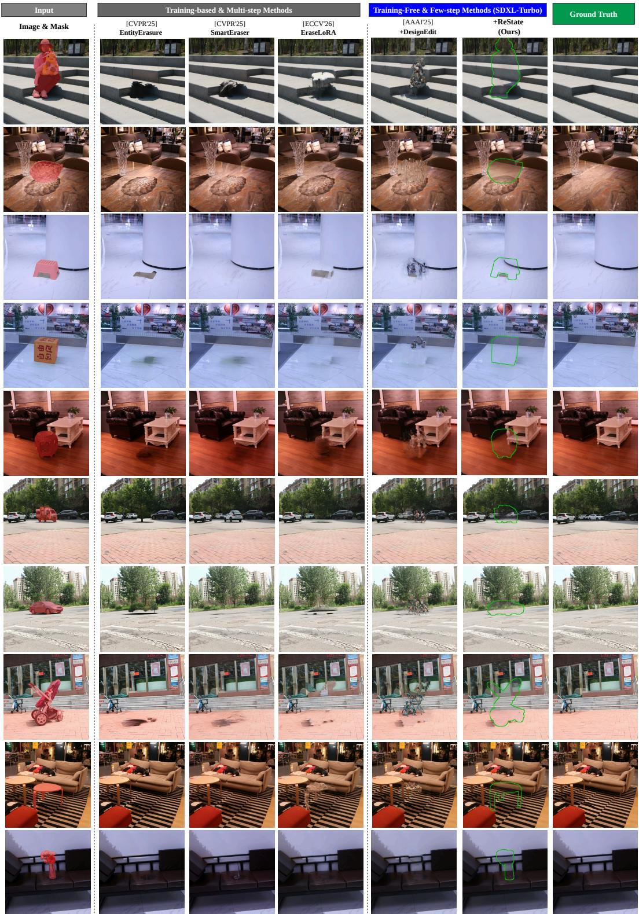  
Figure E1. Qualitative results on OBER-Test.

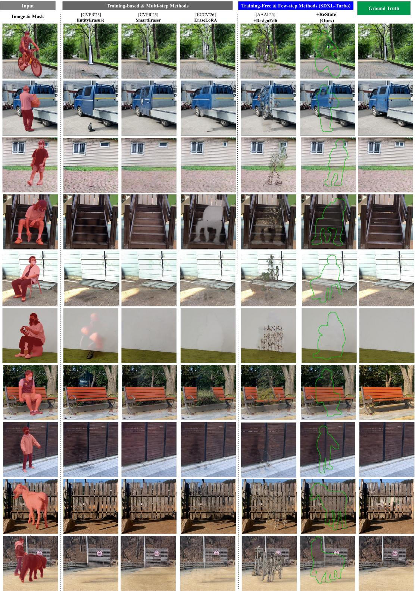  
Figure E2. Qualitative results on RORD.