# Rethinking Classifier-Free Guidance for TI2I Flow Matching

Andreas Floros⋆, ‡ Elena Koritska‡ Teofilo de Campos‡

Christoph Vogel‡ Chu-Tak Li‡ Anuj Sharma‡ Alexandros Neophytou‡

⋆Imperial College London ‡Microsoft

andreas.floros18@imperial.ac.uk

## Abstract

We study Text-and-Image-to-Image (TI2I) flow matching methods for controllable image editing. In a broader generative modeling context, Classifier-Free Guidance (CFG) is established as a key component responsible for high quality outputs. However, we argue that its role in TI2I modeling is poorly understood. Specifically, we make the surprising observation that the CFG mechanism is implicitly harmful for editing in the noisy phase of flow modeling, hindering instruction following and controllability. We propose a simple correction in the early flow steps, enabling a richer alignment-preservation tradeof at no extra cost. The efectiveness of our approach is demonstrated on both pixel-space and latent TI2I flows.

  
age the woman while keeping her smile and surroundings

  
turn the misty bog into cracked desert ground

  
turn the haunted manor into a gingerbread house

  
make the bike pastel pink

  
make the piano ivory

  
make the sunflower petals red

  
cover the donut in rainbow sprinkles

  
light the scene by candlelight

  
turn the scene into paper origami

  
make the scene a bioluminescent night

  
turn the muddy jungle into a glass forest

Figure 1: We propose a simple modification in TI2I flows that substantially improves source preservation while maintaining text alignment. In the examples above, source images are on the left, baseline edits in the middle (we evaluate Qwen, FLUX.2 and PixelGen models) and editing with our correction on the right.

## 1 Introduction

Text-and-Image-to-Image (TI2I) editing is the task of modifying a source image according to a text prompt while retaining the source wherever no change is intended. The source image provides the concrete visual instance, including scene, object identity, composition, appearance and incidental details. The prompt instead serves as an instruction specifying how that instance should change. Crucially, a successful edit must apply the requested changes without reopening the rest of the image for synthesis.

TI2I editing methods studied in the literature typically adapt pretrained Text-to-Image (T2I) models. These methods are often training-free, so their design space concentrates on inference-time mechanisms (Kulikov et al., 2025; Yang & Ye, 2026). This adaptation paradigm has produced a broad and useful set of techniques but it also inherits limitations from models trained primarily for T2I generation. In parallel, a newer line of systems trains text-and-image-conditioned flows directly for editing (Wu et al., 2025; Black Forest Labs, 2025a). These models are increasingly important yet their properties remain comparatively underexplored.

In this paper, we study this setting of bespoke TI2I flow matching, rather than editing through adaptation of a T2I generator. Specifically, we focus on the nuance of Classifier-Free Guidance (CFG), which is a central mechanism of modern generative flows (Ho & Salimans, 2021). In T2I generation, increasing the CFG weight, $\omega ,$ is commonly understood as improving text alignment at the cost of sample diversity and, at large values, visual naturalness (Zheng & Lan, 2024; Karras et al., 2024). In editing, however, the relevant tradeof is alignment versus preservation with respect to the source. In that case, we find that CFG produces a poorly shaped guidance tradeof. That is, small ω weakens instruction following but may not reliably reduce distortion, while large ω is often essential for alignment but tends to amplify unnecessary changes.

We identify the source of this ineficiency and attribute it to the well-established and widely adopted recipe of Ho & Salimans (2021). As demonstrated in Figure 1, we propose a simple inference-time correction that largely mitigates the issue. Our intervention requires no additional evaluations, leaves the trained model unchanged and recovers a richer set of operating points as ω varies. We show this in two settings. For a controlled analysis, we use a PixelGen (Ma et al., 2026b) finetune for pixel-space editing. We then demonstrate our approach in more general editing, benchmarking via Qwen-Image-Edit (Wu et al., 2025) and FLUX.2 (Black Forest Labs, 2025a), representative of-the-shelf latent flows tailored for the task.

## 2 Background

We give a brief overview of literature on modern generative flows, techniques for TI2I modeling and CFG.

## 2.1 Flow Matching

Flows perform generative modeling through Ordinary Diferential Equations (ODEs) (Chen et al., 2018). Letting $p$ represent the target distribution on $\mathbb { R } ^ { D }$ , they correspond to the following transport dynamics:

$$
\mathrm { d } x _ { t } = v _ { \theta } ( x _ { t } , t ) \mathrm { d } t , \quad t \in [ 0 , 1 ] , \quad x _ { 1 } \sim p ,\tag{1}
$$

where ${ \pmb v } _ { \pmb \theta }$ : R ${ \bf \Phi } _ { \times } ^ { p } \mathbb { R }  \mathbb { R } ^ { D }$ denotes a velocity field parameterized by θ. In principle, there are several transport paths that satisfy Equation 1. In practice, Lipman et al. (2023) propose to model a linear interpolation between a tractable standard Gaussian distribution and the desired $p .$ The ODE then defines marginal distributions, $q _ { t } .$ , subject to the constraints. The corresponding flow matching objective is as follows:

$$
\operatorname* { m i n } _ { \theta } \mathbb { E } _ { t , x _ { 1 } \sim p , x _ { 0 } \sim N ( \mathbf { 0 } , I ) } \left\{ \left\| v _ { \theta } \left[ \psi _ { t } ( x _ { 0 } ; x _ { 1 } ) , t \right] - \frac { \mathrm { d } } { \mathrm { d } t } \psi _ { t } ( x _ { 0 } ; x _ { 1 } ) \right\| _ { 2 } ^ { 2 } \right\} , \quad \psi _ { t } ( x _ { 0 } ; x _ { 1 } ) : = ( 1 - t ) x _ { 0 } + t x _ { 1 } ,\tag{2}
$$

where $\psi _ { t }$ denotes the conditional flow and its time derivative yields the associated conditional velocity. Note that this formulation is closely related to score-based generative models (Song et al., 2021). That is, letting Id denote the identity map, scores are expressed in terms of velocity as $\nabla _ { \pmb { x } } \log q _ { t } = ( 1 - t ) ^ { - 1 } [ t \pmb { v _ { \theta } } ( \cdot , t ) - \mathrm { I d } ]$

## 2.2 Text-and-Image-to-Image Modeling

TI2I models generate edit candidates conditioned jointly on a source image, $c ^ { \mathrm { i m g } }$ , and a text prompt or instruction $c ^ { \mathrm { t x t } }$ . That is, the target distribution here is of the form $p ( \cdot \mid c ^ { \mathrm { i m g } } , c ^ { \mathrm { t x t } } )$ . Unlike T2I generation, which has weaker conditioning, sampling from $p ( \cdot \mid c ^ { \mathrm { t x t } } )$ , TI2I editing requires balancing two competing guiding signals and goals. Namely, adherence to the requested edit and preservation of source content.

Most editing methods in the literature do not train TI2I editing models directly. Instead, they adapt pretrained T2I models at inference time, efectively exploiting their strong generative priors while avoiding additional optimization costs (Meng et al., 2022; Rout et al., 2025; Kulikov et al., 2025; Yang & Ye, 2026).

Alternatively, it is also possible to train a generator directly for image editing. Early difusion-based examples include Brooks et al. (2023), which learns to follow natural-language editing instructions from paired editing data. More recently, large-scale multimodal flow models have been trained natively with both image and text conditioning, enabling direct modeling of the TI2I distribution (Wu et al., 2025; Black Forest Labs, 2025a). Notably, in these systems, the source image enters the model as a first-class conditioning signal. In particular, for flow matching models, conditioning is typically incorporated into the velocity field, $v _ { \theta } ( x _ { t } , t , c ^ { \mathrm { i m g } } , c ^ { \mathrm { t x t } } )$ , so that the sampling trajectory is jointly determined by the current state, source image and textual instruction.

## 2.3 Classifier-Free Guidance

Ho & Salimans (2021) introduced CFG as a principled way to trade mode coverage for alignment in conditional models. Intuitively, CFG aims to sample from tilted distributions, $q _ { t , \omega } ( \cdot \mid c ) \propto q _ { t } ^ { 1 - \omega } ( \cdot \mid \mathcal { D } ) q _ { t } ^ { \omega } ( \cdot \mid c )$ where the guidance weight, ω, controls the tradeof and ∅ denotes an empty condition. Note, this corresponds to a linear interpolation of score functions. That is, taking logarithms and diferentiating, we write:

$$
\begin{array} { r } { \nabla _ { \pmb { x } } \log q _ { t , \omega } ( \cdot \mid \pmb { c } ) = ( 1 - \omega ) \nabla _ { \pmb { x } } \log q _ { t } ( \cdot \mid \emptyset ) + \omega \nabla _ { \pmb { x } } \log q _ { t } ( \cdot \mid \pmb { c } ) . } \end{array}\tag{3}
$$

Therefore, given the equivalence of scores with velocities, the implementation requires training both an unconditional and a conditional model. In practice, this is done by dropping conditioning information during training for a fraction of the iterations, efectively unifying the two flows under a single parameterization. Despite the theoretical elegance of CFG, subtle technical details make it a non-trivial mechanism, with more nuanced dynamics and interpretation than the original motivation suggests (Zheng & Lan, 2024; Karras et al., 2024). Moreover, its design in the presence of multimodal conditioning remains relatively unexplored.

## 3 Methodology

Before proceeding with analysis, we summarize our experimental setup. For completeness, we consider both pixel-space and latent-space TI2I models. In particular, pixel-space modeling enables a controlled and more interpretable setup. To this end, we produce a TI2I finetune of PixelGen (Ma et al., 2026b) at $5 1 2 \times 5 1 2$ resolution. For latent-space modeling, we experiment with Qwen-Image-Edit (Wu et al., 2025) and the FLUX.2 family (Black Forest Labs, 2025a) at 256 256, 512 512 and 1024 1024 image resolutions.

Throughout the paper, we use synthetic datasets, created by existing foundation models. After quality control, each contains approximately 200 entries. Specifically, we first generate text triplets of source image descriptions, edit instructions and post-edit descriptions via Claude Opus 4.7. Source descriptions are then used to generate source images via FLUX.2. Additionally, for local editing with PixelGen, we constrain the text triplets to describe scenarios where changes are expected to be strictly confined within specific regions in the images. In that case, we use the Segment Anything Model (SAM) of Carion et al. (2026) to automatically obtain corresponding segmentation masks. For latent-space editing with Qwen and FLUX.2, which we found to be significantly more capable, we allow general and challenging triplets to efectively test limitations.

Further details on infrastructure, data, model configurations and hyperparameters are given in Appendix A.

## 3.1 Understanding Guidance & Its Design Space in TI2I Flows

Our goal is understanding when editing failures emerge and how to interpret them, with the expectation that this will lead to actionable insights. Concretely, here we investigate TI2I flow modeling under CFG. Following the equivalence with score matching, this corresponds to the following ODE dynamics:

$$
\mathrm { d } x _ { t } = v _ { \theta , \omega } ( x _ { t } , t , c ) \mathrm { d } t , \quad v _ { \theta , \omega } ( \cdot , t , c ) : = v _ { \theta } ( \cdot , t , \mathcal { Q } ) + \omega \Delta v _ { \theta } ( \cdot , t , c ) , \quad x _ { 0 } \sim \mathcal { N } ( \mathbf { 0 } , I ) ,\tag{4}
$$

where we abbreviate joint conditioning as $c = c ^ { \mathrm { i m g } } , c ^ { \mathrm { t x t } }$ and $\begin{array} { r } { \Delta { v _ { \theta } } ( \cdot , t , c ) : = v _ { \theta } ( \cdot , t , c ^ { \mathrm { t x t } } ) - v _ { \theta } ( \cdot , t , \mathcal { O } ) } \end{array}$ is the diferential velocity. Importantly, following the documentation of modern TI2I models (Wu et al., 2025; Black Forest Labs, 2025a), CFG is only applied with respect to text conditioning. That is, all terms appearing in $\pmb { v } _ { \pmb { \theta } , \omega } ( \cdot , t , \pmb { c } )$ and $\Delta v _ { \theta } ( \cdot , t , c )$ , where we have slightly abused notation for compactness, should be understood as being implicitly conditioned on $c ^ { \mathrm { i m g } }$ . In that case, ∅ represents an empty text prompt and text-unconditional modeling, that remains conditioned on $c ^ { \mathrm { i m g } }$ . We adopt these conventions for the remainder of the paper.

“repaint the hand-painted ceramic garden gnome in solid silver”

“repaint the black helicopter in bright rescue orange”

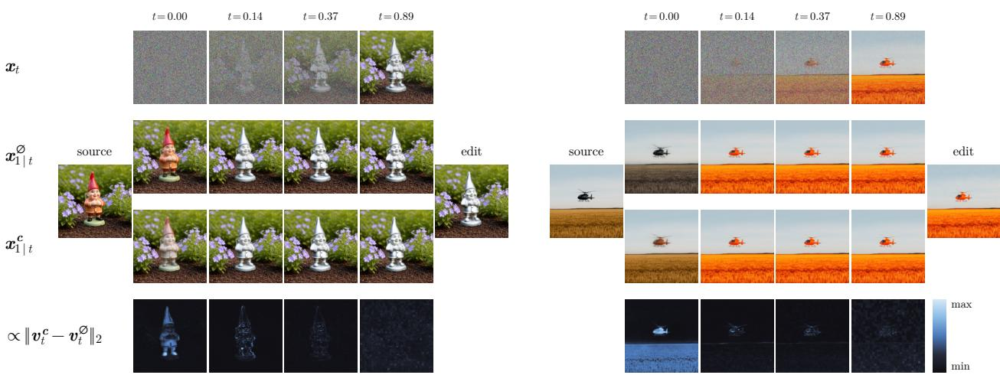  
Figure 2: Visualization of two representative TI2I modeling scenarios with our PixelGen finetune. The first rows show the iterates $\mathbf { \Delta } _ { \mathbf { \mathcal { X } } _ { t } }$ . The second and third rows show the unconditional and conditional predictions of the network for the output edit image given $\mathbf { \Delta } \mathbf { x } _ { t } .$ , which can be derived given knowledge of the corresponding velocities. The last rows show the evolution of the diferential velocity, equivalent to the diference of the second and third rows. Specifically, we visualize its magnitude as a heatmap that is normalized for each t. In both cases, the results of the last row concentrate on the edit regions near $t = 0$ and become less localized and noisy as $t  1$ . Moreover, the failure in the right example is evident immediately at $t = 0$ and we can intuitively attribute it to the unconditional prediction of the second row, where the field has been repainted.

Specifically for this section, we focus on pixel-space and strictly local editing with PixelGen. Our motivation for this is two-fold. First, since transport dynamics unfold in data space here, we are able to gain visual intuition for how flow modeling works by directly inspecting intermediate results. Equipped with this knowledge, we may then test our findings in more general environments, not amenable to the same analysis. In fact, this enables our controlled local editing analysis. Importantly, our second argument for studying pixel-space models is that we avoid confounders that emerge from autoencoding and latentspace design, ensuring that our analysis is grounded in dynamics arising solely due to flow modeling.

Having motivated our setting, we set out to study the fundamental quantity of CFG in Equation 4, namely, the diferential velocity $\Delta \boldsymbol { v } _ { \boldsymbol { \theta } } ( \cdot , t , \boldsymbol { c } )$ . As a first step, we visualize its evolution along with intermediate results over flow modeling in Figure 2. The examples we have selected here are representative of a general trend. That is, we observe that the diferential velocity is localized in the early steps of flow modeling, becoming less local and noisy as t  1. In particular, we are able to quantify this phenomenon via the localization gain, defined as follows:

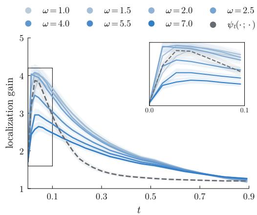  
Figure 3: Average localization gain ( the standard error) for our PixelGen finetune. We use SAM 3 (Carion et al., 2026) for the oracle masks. Results labeled as $\psi _ { t } ( \cdot ; \cdot )$ correspond to using the analytical flow model, previously discussed in Section 2.1.

$$
\mathrm { L G } ( \cdot , t , c ) : = \mathbb { E } _ { u \sim \mathcal { U } ( \Omega _ { M } ) } \big | \big | [ \Delta v _ { \theta } ( \cdot , t , c ) ] _ { u } \big | \big | _ { 2 } \Big / \mathbb { E } _ { u \sim \mathcal { U } ( \Omega ) } \big | \big | [ \Delta v _ { \theta } ( \cdot , t , c ) ] _ { u } \big | \big | _ { 2 } ,\tag{5}
$$

where Ω represents the image (pixel) domain, the set $\Omega _ { M } \subseteq \Omega$ is determined via an oracle binary mask, M, with no support outside the intended edit region and $[ \cdot ] _ { u }$ is evaluation at pixel u. In words, LG compares the mean per-pixel magnitude of $\Delta \boldsymbol { v } _ { \boldsymbol { \theta } } ( \cdot , t , \boldsymbol { c } )$ inside the edit region against its mean over the complete image.

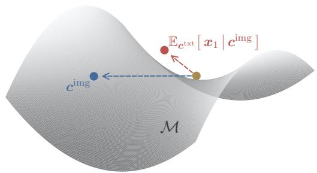  
Figure 4: Consider a data manifold, $\mathcal { M } \subseteq \mathbb { R } ^ { D }$ , and an arbitrary point in ambient space. The theoretical text-unconditional velocity, in blue, pushes points on $\mathcal { M } .$ , toward source $c ^ { \mathrm { i m g } }$ . The CFG-trained velocity, in red, steers toward the mean edit, which need not $\in { \mathcal { M } } .$

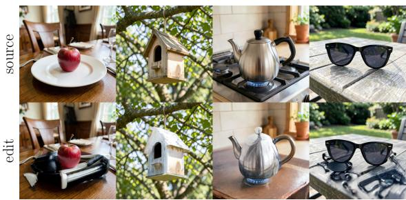  
Figure 5: Results with our TI2I PixelGen finetune for text-unconditional editing, equivalent to setting the CFG weight $\omega = 0$ The top row shows source, input images. The outputs, shown on the bottom row, are distorted and we do not have faithful reconstruction of the inputs.

If $\mathrm { L G } \approx 1$ then the diferential velocity is spatially uniform whereas $\mathrm { L G } \gtrless 1$ implies it concentrates inside or outside of $\Omega _ { M }$ respectively. To investigate, in Figure 3 we report this quantity averaged across our dataset as a function of t. The curves confirm quantitatively what Figure 2 suggests. Namely, LG generally decreases as $t  1$ , with $\Delta \boldsymbol { v } _ { \boldsymbol { \theta } } ( \cdot , t , \boldsymbol { c } )$ becoming increasingly uniform. Curiously, however, we see that localization consistently rises from $t = 0$ before peaking early. To probe whether this profile reflects the trained model or is prescribed by our particular sampling and discretization procedure, we additionally evaluate LG along the analytical flow, $\psi _ { t } ( \cdot ; \cdot )$ , from Section 2.1, where $\mathbf { \Delta } _ { \mathbf { \mathcal { X } } _ { t } }$ is drawn directly from the linear interpolant rather than rolled out by the reverse ODE. In that case, we observe a similar trend, $\mathrm { i . e . } .$ the temporal profile of LG is inherent to the model, not an artifact of a particular trajectory taken by sampling.

We conclude this section by emphasizing the key findings of the above experiments. First, our locality analysis suggests that edit-relevant signal is concentrated in the noisy phase. That is, the spatial structure of $\Delta \boldsymbol { v } _ { \boldsymbol { \theta } } ( \cdot , t , \boldsymbol { c } )$ efectively encodes where the edit will land before any detail has been resolved in $\mathbf { \nabla } _ { \mathbf { x } _ { t } . }$ Second, as Figure 2 illustrates anecdotally, intermediate predictions in this same phase are already predictive of the final outcome, i.e., we expect a successful edit and an over-aggressive one to diverge early. Taken together, this identifies the noisy phase as the regime in which TI2I editing is efectively decided, and in which any corrective intervention is likely to be both necessary and suficient. We turn to such an intervention next.

## 3.2 The Unconditional Branch Pathology and a Simple Remedy

One interpretation of non-monotonic localization profiles observed in Figure 3 is that they reflect a modeling defect. Specifically, edit failures, as shown on the right in Figure 2, may substantially degrade the average LG in early stages of flow modeling by placing support outside of $\Omega _ { M }$ . Then, as t increases, reparation of the profiles intuitively requires dispersing this excess mass, causing LG to initially increase before collapsing. Given this reasoning and the analysis of Section 3.1, suggesting that the observed trend is independent from sampling dynamics, we are therefore motivated to investigate model-intrinsic failure cases near $t = 0$

Our insight is that, while TI2I models are trained for editing, they are only implicitly taught to preserve the source’s structure. In particular, we can formalize this phenomenon by examining the text-unconditional velocity, $\boldsymbol { v } _ { \boldsymbol { \theta } } ( \cdot , t , \boldsymbol { \emptyset } )$ , which, given no text instruction, we intuitively interpret as a no-edit flow toward the source. Concretely, for $t \approx 0$ , say $t \ < \ \tau$ for some $\tau > 0$ , we expect this to be well-approximated by $( c ^ { \mathrm { i m g } } - \mathrm { I d } ) / ( 1 - t )$ , since noisy inputs in this regime carry little information. However, as illustrated in Figure 4, this no-edit constraint is not necessarily captured during training. Instead, CFG trains the textunconditional branch to approximate the same target as the conditional branch, efectively forcing an edit even in the absence of a text instruction. In that case, it follows that the unconditional branch steers data toward the mean edit $\mathbb { E } _ { { \mathbf { c } } ^ { \mathrm { t x t } } } [ { \mathbf { x } } _ { 1 } \mid { \mathbf { c } } ^ { \mathrm { i m g } } ]$ , which need not reside on the data manifold. As demonstrated in Figure $5 ,$ where we perform TI2I modeling with an empty text prompt, the results are therefore not guaranteed to be close to the source. That is, our analysis suggests that CFG implicitly hurts source preservation.

To overcome this issue, we introduce a simple intervention, which we refer to as early correction in the remainder of the paper. Specifically, since we have an analytical approximation of the desired unconditional velocity for $t \approx 0$ and given the findings of Section 3.1, where we empirically find that coarse structure is determined early in the flow modeling process, we propose to augment the dynamics of Equation 4 as follows:

$$
\mathrm { d } x _ { t } = v _ { \theta , \omega , \tau } ( \boldsymbol { x } _ { t } , t , c ) \mathrm { d } t , \quad \boldsymbol { v } _ { \theta , \omega , \tau } ( \cdot , t , c ) : = v _ { \theta , \tau } ( \cdot , t , \emptyset ) + \omega \Delta v _ { \theta } ( \cdot , t , c ) , \quad \boldsymbol { x } _ { 0 } \sim \mathcal { N } ( \mathbf { 0 } , I ) .\tag{6}
$$

Here, $\boldsymbol { v } _ { \boldsymbol { \theta } , \tau } ( \cdot , t , \emptyset )$ is the early-corrected unconditional branch that we define piecewise as:

$$
\begin{array} { r } { \pmb { v } _ { \pmb { \theta } , \tau } ( \cdot , t , \emptyset ) : = \left\{ \begin{array} { l l } { \displaystyle \frac { c ^ { \mathrm { i m g } } - \mathrm { I d } } { 1 - t } } & { \mathrm { i f ~ } t < \tau } \\ { \displaystyle { v _ { \pmb { \theta } } ( \cdot , t , \emptyset ) } } & { \mathrm { o t h e r w i s e . } } \end{array} \right. } \end{array}\tag{7}
$$

In practice, τ may be rounded to the nearest sampling step to satisfy a smoothness requirement (Kynkäänniemi et al., 2024). Note that our proposed correction is valid for the isolated unconditional branch but not for the diferential velocity $\Delta \boldsymbol { v } _ { \boldsymbol { \theta } } ( \cdot , t , \boldsymbol { c } )$ . We empirically verify this in Figure 6, where the correction is successful only for our proposed configuration and otherwise results in severe distortion of the source image.

A practical explanation of this connects with Karras et al. (2024), who find benefits of CFG can be interpreted as error cancellation. In that case, the unconditional branch, $\boldsymbol { v } _ { \boldsymbol { \theta } } ( \cdot , t , \boldsymbol { \emptyset } )$ , serves as a weak predictor of conditional velocity whereas the conditional branch, ${ \pmb v } _ { \pmb \theta } ( \cdot , t , { \pmb c } ^ { \mathrm { t x t } } )$ , is a stronger predictor, having smaller but directionally consistent errors with $\boldsymbol { v } _ { \boldsymbol { \theta } } ( \cdot , t , \boldsymbol { \emptyset } )$ , i.e., $\Delta \boldsymbol { v } _ { \boldsymbol { \theta } } ( \cdot , t , \boldsymbol { c } )$ captures model-specific and meaningful errors that should be directionally preserved. In particular, full correction amounts to an implicit shift in the training distribution of the model, corresponding to a symmetrization of edit tasks such that $\mathbb { E } _ { { \pmb { c } } ^ { \mathrm { t x t } } } [ { \pmb { x } } _ { 1 } \ | \ { \pmb { c } } ^ { \mathrm { i m g } } ] = { \pmb { c } } ^ { \mathrm { i m g } }$ , but this may not be well-approximated. Instead, our correction corresponds to a still valid tradeof in terms of the symmetrized unconditional density and the preserved implicit CFG-induced classifier. That is, invoking the equivalence with score matching, roughly, we interpret this as sampling from a tilted distribution $\begin{array} { r } { q _ { t , \omega , \tau } ( \cdot \mid c ) \propto q _ { t , \tau } ( \cdot \mid \emptyset ) \left[ \frac { q _ { t } ( \cdot \mid c ) } { q _ { t } ( \cdot \mid \emptyset ) } \right] ^ { \omega } } \end{array}$

“Change the briefcase to black with chrome latches and corner protectors”  
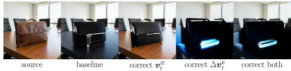  
Figure 6: We ablate the proposed correction on our PixelGen finetune with simple edit tasks, setting $\tau = 0 . 0 5$ . Of tested configurations, only the one corresponding to Equation 6 is successful.

## 3.3 Early Correction Unlocks a Richer Alignment-Preservation Tradeof

Having introduced early correction, we now turn to evaluation. As discussed in Section 1, we are interested in quantifying the alignment-preservation tradeof. We consider various proxies for each axis that are commonly adopted in the literature. Alignment is quantified by comparing the post-edit images with target post-edit descriptions via CLIP similarity (Radford et al., 2021), PickScore (Kirstain et al., 2023) and HPSv3 (Ma et al., 2025). Separately, we use the Aesthetics predictor (Schuhmann, 2022), a no-reference, unconditional human preference proxy operating only on images. For preservation, we compare post-edit images with corresponding source images via PSNR, LPIPS (Zhang et al., 2018) and DINOv2 (Oquab et al., 2024).

In Table 1 and Figure 7 we report results with the above protocol. It is evident that early correction tends to improve performance across all models, with FLUX.2 especially benefiting at resolutions $2 5 6 \times 2 5 6$ and $5 1 2 \times 5 1 2$ . Specifically for PixelGen and local editing, following the findings of Section 3.1, we consider an additional baseline, augmenting $\Delta \boldsymbol { v } _ { \boldsymbol { \theta } } ( \cdot , t , \boldsymbol { c } )$ in Equation 6 via a masking oracle for better localization as:

$$
[ \Delta v _ { \theta , M , \tau } ( \cdot , t , c ) ] _ { u } : = \left\{ \begin{array} { l l } { { [ \Delta v _ { \theta } ( \cdot , t , c ) ] _ { u } } } & { { \mathrm { i f ~ } t \geq \tau \mathrm { ~ o r ~ } u \in \Omega _ { M } \mathrm { ~ a n d ~ } t < \tau } } \\ { { } } & { { } } \\ { { 0 } } & { { \mathrm { o t h e r w i s e . } } } \end{array} \right.\tag{8}
$$

Table 1: Editing with Qwen, FLUX.2 and PixelGen. Without CFG we tend to observe strong preservation but insuficient alignment. That is, CFG is often essential for image editing. However, recommended weights, ω, tend to improve alignment while harming preservation. Early correction mitigates this tradeof by largely improving preservation while maintaining strong alignment for Qwen-Image-Edit and PixelGen. For FLUX.2, found relatively conservative at 1024 1024 resolution, it recovers part of the distortion introduced by CFG while retaining its alignment gains. Moreover, our intervention is a key ingredient for unlocking robust masked guidance, i.e., removing it in the last row of the PixelGen experiments introduces severe distortion.
<table><tr><td colspan="2"></td><td colspan="3">Preservation</td><td colspan="3">Alignment</td></tr><tr><td colspan="2">Method</td><td></td><td>PSNR ↑ LPIPS ↓</td><td>DINOv2 ↑</td><td></td><td>CLIP ↑ PickScore ↑ HPSv3 ↑</td><td></td></tr><tr><td rowspan="6">102×1024</td><td>Qwen-Image-Edit</td><td>13.06</td><td>0.4948</td><td>0.7082</td><td>0.2853</td><td>22.15</td><td>7.65</td></tr><tr><td>+ Classifier-free guidance (ω = 4.00)</td><td>11.25</td><td>0.5616</td><td>0.5750</td><td>0.2905</td><td>22.03</td><td>6.88</td></tr><tr><td>+ Early correction (τ = 0.10)</td><td>14.05</td><td>0.4159</td><td>0.6606</td><td>0.2946</td><td>22.28</td><td>7.97</td></tr><tr><td>FLUX.2 [klein] 4B Base</td><td>27.65</td><td>0.0516</td><td>0.9926</td><td>0.2389</td><td>21.63</td><td>7.92</td></tr><tr><td>+ Classifier-free guidance (ω = 4.00)</td><td>20.22</td><td>0.1973</td><td>0.9163</td><td>0.2605</td><td>21.88</td><td>7.91</td></tr><tr><td>+ Early correction (τ = 0.01)</td><td>20.33</td><td>0.1948</td><td>0.9171</td><td>0.2603</td><td>21.88</td><td>7.92</td></tr><tr><td rowspan="8">51×512</td><td>FLUX.2 [klein] 4B Base</td><td>14.07</td><td>0.4456</td><td>0.6496</td><td>0.2791</td><td>21.88</td><td>8.03</td></tr><tr><td>+ Classifier-free guidance (ω = 4.00)</td><td>12.05</td><td>0.4576</td><td>0.5973</td><td>0.2891</td><td>22.08</td><td>8.34</td></tr><tr><td>+ Early correction (τ = 0.10)</td><td>13.81</td><td>0.3523</td><td>0.6828</td><td>0.2917</td><td>22.19</td><td>8.69</td></tr><tr><td>PixelGen-XXL</td><td>19.60</td><td>0.1625</td><td>0.8647</td><td>0.2798</td><td>22.62</td><td>7.15</td></tr><tr><td>+ Classifier-free guidance (ω = 4.00) (τ = 0.05)</td><td>16.19</td><td>0.1818</td><td>0.8699</td><td>0.2970</td><td>22.88</td><td>8.10</td></tr><tr><td>+ Early correction</td><td>20.62</td><td>0.1118</td><td>0.9159</td><td>0.2907</td><td>22.94</td><td>8.64</td></tr><tr><td>+ Masked guidance</td><td>21.54</td><td>0.0960</td><td>0.9186</td><td>0.2888</td><td>22.98</td><td>8.73</td></tr><tr><td>- Early correction</td><td>13.93</td><td>0.3179</td><td>0.8430</td><td>0.2927</td><td>22.60</td><td>7.24</td></tr><tr><td rowspan="3">256×256</td><td>FLUX.2 [klein] 4B Base</td><td>14.62</td><td>0.3668</td><td>0.6573</td><td>0.2638</td><td>21.42</td><td>5.18</td></tr><tr><td>+ Classifier-free guidance (ω = 4.00)</td><td>12.04</td><td>0.4461</td><td>0.5605</td><td>0.2858</td><td>21.91</td><td>7.30</td></tr><tr><td>+ Early correction (τ = 0.10)</td><td>13.09</td><td>0.3850</td><td>0.6298</td><td>0.2884</td><td>22.04</td><td>7.84</td></tr></table>

The masking strategy, however, is not suficient. In fact, its benefits are only realized once our correction is applied and, counterintuitively, it otherwise leads to severe distortion in the outputs. This serves as evidence that early correction is a key ingredient in disentangling CFG dynamics. In particular, with reference to the left in Figure 7, SAM 3 masks appear to ofer minor gains beyond our proposed correction and tend to merely shift operating points without changing the underlying Pareto front. We interpret this to mean that our correction alone leads to better localization, efectively approximating the masked oracle.

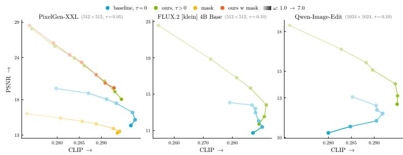  
Figure 7: Alignment-preservation tradeofs via PSNR and CLIP. We evaluate our PixelGen finetune, FLUX.2 and Qwen models. Curves form by varying ω, with faint colors given to small values. Our method redefines the Pareto front, enabling robust editing.

To show our approach is operationally distinct from CFG, we also explored the choice of early correction time τ. Figure 8 gives a qualitative summary of our findings, where small τ yield strong alignment but tend to also give somewhat generic results at large CFG weight ω. Instead, large τ tend to maintain alignment while grounding edits to the source more strongly. Crucially, this does not necessarily compromise their integrity. Indeed, Figure 9 shows our correction may simultaneously improve DINOv2, HPSv3 and Aesthetics scores.

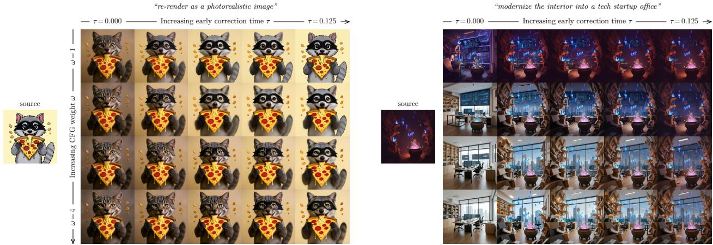  
Figure 8: Qualitative analysis showing the efect of ω and τ at 1024 1024 resolution. On the left we show edits with Qwen-Image-Edit and on the right with FLUX.2 [klein] 4B Base. The first columns use $\tau = 0 .$ i.e., no early correction. In both cases, $\tau = 0$ tends to give generic results at large ω that may disregard the source. That is, on the left the raccoon is changed to a cat and on the right, eventually, no elements from the source survive. The proposed correction, activated when $\tau > 0 .$ produces edits that are more faithful to the source without compromising instruction-following ability. See Figure 11 in Appendix B for more examples.

## 4 Discussion

We studied CFG in TI2I flows and argued the recipe of Ho & Salimans (2021) is poorly integrated. Our observation is that CFG trains the text-unconditional branch to approximate the mean edit rather than a no-edit flow, so the mechanism responsible for alignment implicitly erodes preservation. We localized this effect to the noisy phase of modeling and proposed an intervention that substitutes a no-edit velocity into the unconditional branch for $t \ < \ \tau$ . It requires no additional evaluations and recovers markedly richer alignment-preservation tradeofs.

We do not present a rule for τ . In practice, however, a uniform choice delivers consistent improvements. Moreover, we note that open TI2I models often do not provide complete information about their development, which may involve posttraining we cannot account for. In these cases, we cannot cleanly attribute the success or relative inefectiveness of our intervention to flow modeling alone.

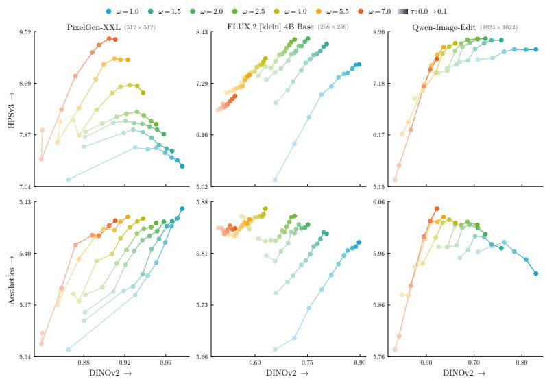  
Figure 9: We show DINOv2-HPSv3, Aesthetics tradeofs for the PixelGen, FLUX.2 and Qwen models with diferent ω and τ. Curves represent fixed ω and form by varying τ , with faint colors given to small values. A positive τ often improves all metrics.

Our findings caution against blind transfer of techniques across tasks. Despite its ubiquity, CFG is not a silver bullet and its naive application is harmful for source preservation in editing. We therefore view our work as an invitation to rethink such recipes. Instead of treating editing as T2I generation with an additional conditioning signal, we argue that TI2I modeling benefits from task-specific context, here a no-edit prior grounding generation to the source, and hope this perspective informs the design of future systems.

## References

Black Forest Labs. FLUX.2: Frontier Visual Intelligence. https://bfl.ai/blog/flux-2, 2025a.

Black Forest Labs. Flux.1 kontext: Flow matching for in-context image generation and editing in latent space, 2025b.

Tim Brooks, Aleksander Holynski, and Alexei A. Efros. Instructpix2pix: Learning to follow image editing instructions. In 2023 IEEE/CVF Conference on Computer Vision and Pattern Recognition (CVPR), pp. 18392–18402, 2023. doi: 10.1109/CVPR52729.2023.01764.

Nicolas Carion, Laura Gustafson, Yuan-Ting Hu, Shoubhik Debnath, Ronghang Hu, Didac Suris Coll-Vinent, Chaitanya Ryali, Kalyan Vasudev Alwala, Haitham Khedr, Andrew Huang, Jie Lei, Tengyu Ma, Baishan Guo, Arpit Kalla, Markus Marks, Joseph Greer, Meng Wang, Peize Sun, Roman Rädle, Triantafyllos Afouras, Efrosyni Mavroudi, Katherine Xu, Tsung-Han Wu, Yu Zhou, Liliane Momeni, RISHI HAZRA, Shuangrui Ding, Sagar Vaze, Francois Porcher, Feng Li, Siyuan Li, Aishwarya Kamath, Ho Kei Cheng, Piotr Dollar, Nikhila Ravi, Kate Saenko, Pengchuan Zhang, and Christoph Feichtenhofer. SAM 3: Segment anything with concepts. In The Fourteenth International Conference on Learning Representations, 2026.

Ricky T. Q. Chen, Yulia Rubanova, Jesse Bettencourt, and David K Duvenaud. Neural ordinary diferential equations. In S. Bengio, H. Wallach, H. Larochelle, K. Grauman, N. Cesa-Bianchi, and R. Garnett (eds.), Advances in Neural Information Processing Systems, volume 31. Curran Associates, Inc., 2018.

Jonathan Ho and Tim Salimans. Classifier-free difusion guidance. In NeurIPS 2021 Workshop on Deep Generative Models and Downstream Applications, 2021.

Tero Karras, Miika Aittala, Tuomas Kynkäänniemi, Jaakko Lehtinen, Timo Aila, and Samuli Laine. Guiding a difusion model with a bad version of itself. In The Thirty-eighth Annual Conference on Neural Information Processing Systems, 2024.

Yuval Kirstain, Adam Polyak, Uriel Singer, Shahbuland Matiana, Joe Penna, and Omer Levy. Pick-a-pic: An open dataset of user preferences for text-to-image generation. In Thirty-seventh Conference on Neural Information Processing Systems, 2023.

Vladimir Kulikov, Matan Kleiner, Inbar Huberman-Spiegelglas, and Tomer Michaeli. Flowedit: Inversionfree text-based editing using pre-trained flow models. In Proceedings of the IEEE/CVF International Conference on Computer Vision (ICCV), pp. 19721–19730, October 2025.

Maksim Kuprashevich, Grigorii Alekseenko, Irina Tolstykh, Georgii Fedorov, Bulat Suleimanov, Vladimir Dokholyan, and Aleksandr Gordeev. Nohumansrequired: Autonomous high-quality image editing triplet mining. In Proceedings of the IEEE/CVF Winter Conference on Applications of Computer Vision (WACV), pp. 6059–6068, March 2026.

Tuomas Kynkäänniemi, Miika Aittala, Tero Karras, Samuli Laine, Timo Aila, and Jaakko Lehtinen. Applying guidance in a limited interval improves sample and distribution quality in difusion models. In The Thirtyeighth Annual Conference on Neural Information Processing Systems, 2024.

Tianhong Li and Kaiming He. Back to basics: Let denoising generative models denoise. In Proceedings of the IEEE/CVF Conference on Computer Vision and Pattern Recognition (CVPR), pp. 36115–36125, June 2026.

Yaron Lipman, Ricky T. Q. Chen, Heli Ben-Hamu, Maximilian Nickel, and Matthew Le. Flow matching for generative modeling. In The Eleventh International Conference on Learning Representations, 2023.

Xu Ma, Yitian Zhang, Qihua Dong, and Yun Fu. Fine-t2i: An open, large-scale, and diverse dataset for high-quality t2i fine-tuning, 2026a.

Yuhang Ma, Xiaoshi Wu, Keqiang Sun, and Hongsheng Li. Hpsv3: Towards wide-spectrum human preference score. In Proceedings of the IEEE/CVF International Conference on Computer Vision (ICCV), pp. 15086– 15095, October 2025.

Zehong Ma, Ruihan Xu, and Shiliang Zhang. Pixelgen: Improving pixel difusion with perceptual supervision, 2026b.

Chenlin Meng, Yutong He, Yang Song, Jiaming Song, Jiajun Wu, Jun-Yan Zhu, and Stefano Ermon. SDEdit: Guided image synthesis and editing with stochastic diferential equations. In International Conference on Learning Representations, 2022.

Maxime Oquab, Timothée Darcet, Théo Moutakanni, Huy V. Vo, Marc Szafraniec, Vasil Khalidov, Pierre Fernandez, Daniel HAZIZA, Francisco Massa, Alaaeldin El-Nouby, Mido Assran, Nicolas Ballas, Wojciech Galuba, Russell Howes, Po-Yao Huang, Shang-Wen Li, Ishan Misra, Michael Rabbat, Vasu Sharma, Gabriel Synnaeve, Hu Xu, Herve Jegou, Julien Mairal, Patrick Labatut, Armand Joulin, and Piotr Bojanowski. DINOv2: Learning robust visual features without supervision. Transactions on Machine Learning Research, 2024. ISSN 2835-8856.

Alec Radford, Jong Wook Kim, Chris Hallacy, Aditya Ramesh, Gabriel Goh, Sandhini Agarwal, Girish Sastry, Amanda Askell, Pamela Mishkin, Jack Clark, Gretchen Krueger, and Ilya Sutskever. Learning transferable visual models from natural language supervision. In Marina Meila and Tong Zhang (eds.), Proceedings of the 38th International Conference on Machine Learning, volume 139 of Proceedings of Machine Learning Research, pp. 8748–8763. PMLR, 18–24 Jul 2021.

Litu Rout, Yujia Chen, Nataniel Ruiz, Constantine Caramanis, Sanjay Shakkottai, and Wen-Sheng Chu. Semantic image inversion and editing using rectified stochastic diferential equations. In The Thirteenth International Conference on Learning Representations, 2025.

Christoph Schuhmann. Laion-aesthetics. https://laion.ai/blog/laion-aesthetics, 2022.

Yang Song, Jascha Sohl-Dickstein, Diederik P Kingma, Abhishek Kumar, Stefano Ermon, and Ben Poole. Score-based generative modeling through stochastic diferential equations. In International Conference on Learning Representations, 2021.

Cong Wei, Zheyang Xiong, Weiming Ren, Xeron Du, Ge Zhang, and Wenhu Chen. Omniedit: Building image editing generalist models through specialist supervision. In The Thirteenth International Conference on Learning Representations, 2025.

Chenfei Wu, Jiahao Li, Jingren Zhou, Junyang Lin, Kaiyuan Gao, Kun Yan, Sheng ming Yin, Shuai Bai, Xiao Xu, Yilei Chen, Yuxiang Chen, Zecheng Tang, Zekai Zhang, Zhengyi Wang, An Yang, Bowen Yu, Chen Cheng, Dayiheng Liu, Deqing Li, Hang Zhang, Hao Meng, Hu Wei, Jingyuan Ni, Kai Chen, Kuan Cao, Liang Peng, Lin Qu, Minggang Wu, Peng Wang, Shuting Yu, Tingkun Wen, Wensen Feng, Xiaoxiao Xu, Yi Wang, Yichang Zhang, Yongqiang Zhu, Yujia Wu, Yuxuan Cai, and Zenan Liu. Qwen-image technical report, 2025.

Shitao Xiao, Yueze Wang, Junjie Zhou, Huaying Yuan, Xingrun Xing, Ruiran Yan, Chaofan Li, Shuting Wang, Tiejun Huang, and Zheng Liu. Omnigen: Unified image generation. In 2025 IEEE/CVF Conference on Computer Vision and Pattern Recognition (CVPR), pp. 13294–13304, 2025. doi: 10.1109/CVPR52734. 2025.01241.

Desong Yang and Mang Ye. Directedit: Step-level accurate inversion for flow-based image editing. In Forty-third International Conference on Machine Learning, 2026.

Sihyun Yu, Sangkyung Kwak, Huiwon Jang, Jongheon Jeong, Jonathan Huang, Jinwoo Shin, and Saining Xie. Representation alignment for generation: Training difusion transformers is easier than you think. In The Thirteenth International Conference on Learning Representations, 2025.

Richard Zhang, Phillip Isola, Alexei A. Efros, Eli Shechtman, and Oliver Wang. The unreasonable efectiveness of deep features as a perceptual metric. In 2018 IEEE/CVF Conference on Computer Vision and Pattern Recognition, pp. 586–595, 2018. doi: 10.1109/CVPR.2018.00068.

Candi Zheng and Yuan Lan. Characteristic guidance: Non-linear correction for difusion model at large guidance scale. In Forty-first International Conference on Machine Learning, 2024.

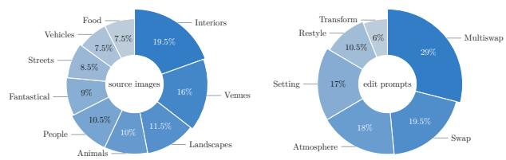

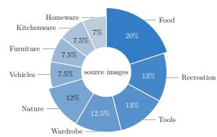

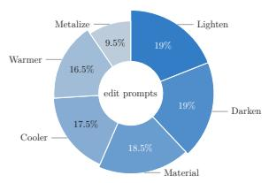  
(a) Local editing with PixelGen  
(b) General editing with Qwen and FLUX.2  
Figure 10: Compositions of our two editing benchmarks, with approximately 200 entries each. The panels pair two donuts, showing the distribution of source images on the left and of edit prompts on the right. The benchmark on the left panel targets single objects on plain backdrops with localized recolor and material edits, i.e., confined within a specific region of the image. The benchmark on the right targets complex, typically crowded scenes and was specifically designed as a stress-test of TI2I capabilities. Together, they cover the spectrum from precise local edits to scene-wide changes that must still preserve surrounding context.

## A Experimental Setup

We ran inference on Linux machines using RTX Quadro 6000, RTX A5000, H100 GPUs and CUDA 13.0.

Benchmarks were generated via Claude Opus 4.7, FLUX.2 [klein] 4B Base (Black Forest Labs, 2025a) (1024  1024, 50 steps, ω = 4, Euler) and SAM 3 (Carion et al., 2026), with compositions in Figure 10.

For TI2I editing, which consumed most of our compute budget, we used the Euler solver with 25 steps.   
Preliminary runs with the recommended 50 steps showed little diference and did not justify the extra cost.

Regarding our pixel-space experiments, we finetuned PixelGen-XXL (Ma et al., 2026b) (512 512, bf16) on NHR-Edit (Kuprashevich et al., 2026), OmniEdit (Wei et al., 2025), X2I (Xiao et al., 2025) datasets for TI2I modeling and on Fine-T2I (Ma et al., 2026a) for T2I preservation. We used the JiT flow-matching velocity loss from Li & He (2026) and LPIPS, DINOv2, REPA (Yu et al., 2025) regularizers applied similarly to the original PixelGen recipe, gated at t = 0.5. We additionally applied unconditional T2I regularization and a KL penalty (β =1e-3) against a frozen reference to preserve base generative quality. The model was trained with the AdamW optimizer, a learning rate of 1e-4 and a batch size of 128 for 20k iterations.

We note that our adaptation of PixelGen reuses the T2I backbone without introducing any new parameters. In particular, source conditioning is realized through token concatenation, following the Kontext paradigm (Black Forest Labs, 2025b). That is, source images are embedded like the noisy inputs and their tokens are appended to the noisy token sequence inside the transformer. To distinguish them, noisy tokens carry the denoising timestep whereas source tokens are marked as noise-free, i.e., t = 1. With this setup, information therefore propagates through the model’s existing joint attention, requiring no adapters or auxiliary encoders.

## B Additional Results

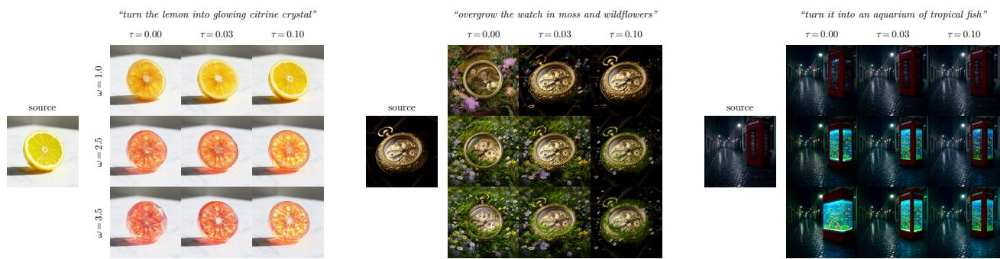  
Figure 11: Editing with FLUX.2, showing the efect of ω and τ at $5 1 2 \times 5 1 2$ resolution. Ours, with τ > 0, maintains the lemon shape (left), perspective (middle) and booth shape (right) while adhering to the text.