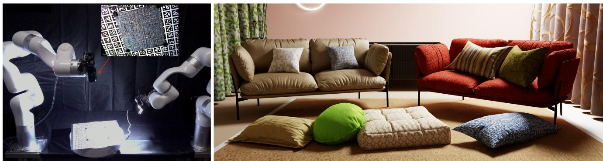
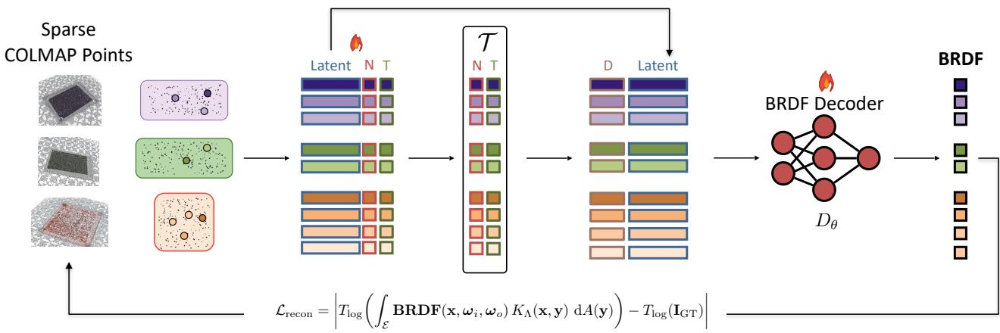
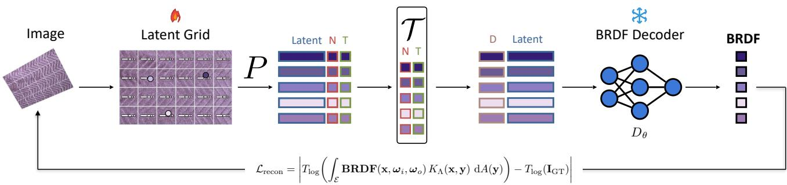
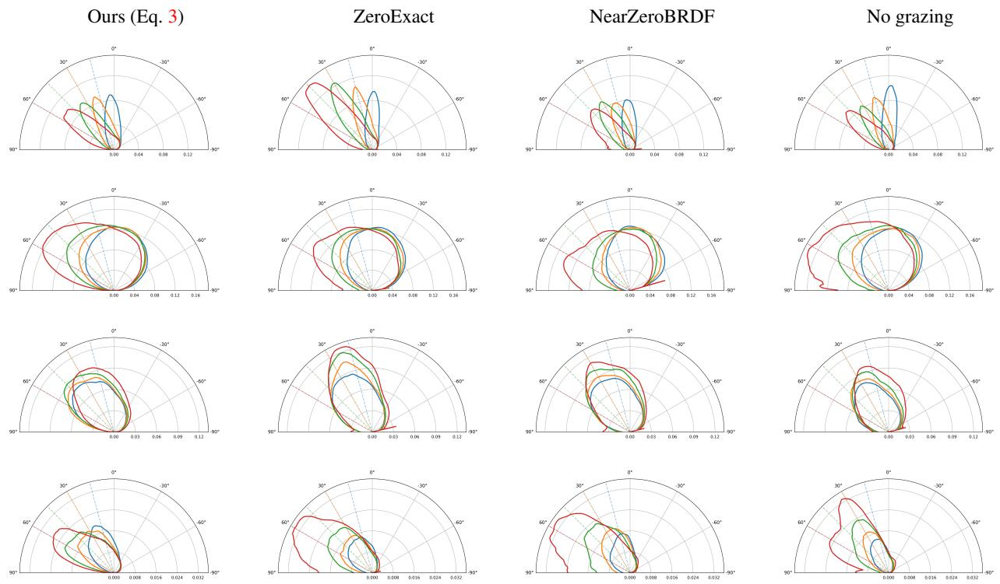
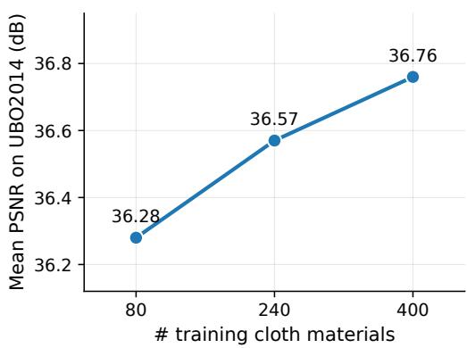
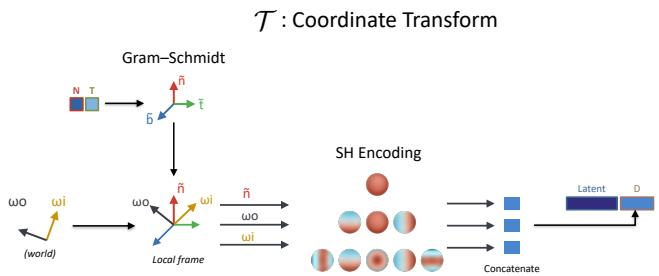
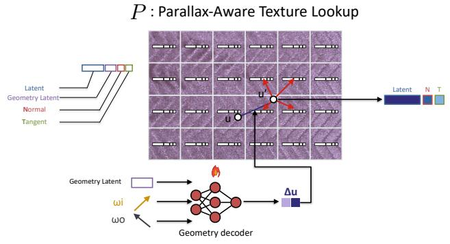

# RoboCloth: A Large-Scale Real Cloth Material Dataset for Neural Reflectance Reconstruction

Zhen (Colin) Li1∗ Haoran Qin2∗ Francesco Di Sario3,1 Daniel Rebain4,5 Andrea Tagliasacchi1,5,6

1Simon Fraser University 2Westlake University 3University of Torino 4University of British Columbia 5Wayve Labs 6University of Toronto

https://theialab.github.io/robocloth

  
Figure 1. We design a robotic system to capture a large dataset of fabric materials, so to learn a neural BRDF representation. Left: our capture system, two UFACTORY X-ARM 6 arms carrying a camera and a light source, with an example captured image shown in the inset. The photo of the rig is over-exposed so to be able to see the robotic arms, so the light saturates; captures use short exposures within the sensor’s linear range. Right: materials fitted via our learned prior on the test-set, yielding neural BRDFs that can be photo-realistically rendered with path-tracing (i.e. the BRDFs of the fabric on the sofa, curtains, pillows, and carpet).

## Abstract

We present RoboCloth, a dataset of500 real cloth materials captured underflexible, calibrated camera and lighting configurations, where both are robotically controlled during acquisition. Each material is imaged in approximately 580 high-dynamic range frames spanning a wide view-light hemisphere; camera poses are refined via structure-from-motion and aligned to the robotframe, yielding per-material sparse surface geometry and structured per-point reflectance observations readyfor neural material training. We demonstrate the value ofthis data through a two-stage neural reconstruction pipeline: Stage 1 trains a shared MLP decoder on our corpus to learn cloth material priors; Stage 2 thenfreezes the decoder andfits a dense 2048 2048 latent texture to each target material. Evaluating on held-out materialsfrom our own dataset and on the independent UBO2014 benchmark, we show that a decoder trained on our captures outperforms decoders trained on existing measured reflectance datasets and analytic PBRfitting, transferring to unseen acquisition systems without modification. The dataset, calibrationfiles,

observation tensors, and train/test splits are released under CC BY 4.0 on the Hugging Face Hub.

## 1. Introduction

Cloth is challenging to render faithfully, as real fabrics exhibit spatially varying reflectance driven by fiber microstructure, weave geometry, surface roughness, and anisotropic scattering — properties that interact nonlinearly with viewing and illumination direction and vary continuously across the surface. Recovering dense, shader-ready material representations from real observations is a prerequisite for photorealistic cloth rendering in physically based pipelines, with direct applications in virtual try-on, digital fashion, and visual effects. Recent work has shown that learning a shared neural BRDF decoder across many materials enables generalizable reflectance estimation without committing to any analytical BRDF parameterization [24, 25]. In this paradigm, a decoder maps compact per-point latent codes to reflectance values queryable by a path tracer [23, Ch. 14]; given a new material, a dense latent grid is optimized against sparse observations with the decoder frozen, producing spatially varying reflectance maps that plug directly into a physically based rendering pipeline. The decoder amortizes reflectance estimation across materials: a prior trained on sufficiently diverse and well-covered captures can generalize to unseen fabrics and recover dense representations from limited measurements, a capability that neither single material overfitting nor purely analytical models can offer.

The limiting factor is training data. Learning a generalizing decoder for cloth requires captures that simultaneously satisfy three conditions: real measured appearance to avoid real-to-synth domain gaps, diversity in the captured materials to support generalization, and dense+flexible viewlight coverage—directions sampled freely across both hemispheres rather than from a preset fixed hardware layout—to enable reliable reflectance-geometry disentanglement. Existing resources do not combine real cloth diversity with flexible view-light coverage at scale; see Table 1. Most large-scale datasets of real materials are not multi-view: each surface is observed from only one or two camera positions [17, 44]. Multi-view alternatives are either not spatially varying [5, 18], or cover fewer than a hundred materials [37]. The closest resource to ours, UBOFAB19 [20], provides 378 real fabrics with multi-view, spatially varying measurements, but its view and light directions are dictated by a preset fixed hardware layout rather than sampled freely across both hemispheres, which bounds the angular coverage of the viewlight domain. The cross-dataset results in Section 5.3 show the performance drop caused by this insufficient view-light coverage.

To fulfill these requirements, we present RoboCloth, a system designed to capture a dataset of 500 materials. Our system comprises two robot arms carrying an HDR camera and a calibrated LED area light, together with a motorized turntable, yielding  580 HDR images per material; see Figure 1. View and light directions can be sampled freely across both hemispheres, rather than being constrained to a fixed set of hardware-defined configurations. While approximate light and camera positions are controlled by the robot API, we recover accurate poses and sparse surface geometry via COLMAP [28].

Our dataset is not merely a larger image collection; it directly targets a downstream task: recovering dense, shaderready material representations from real cloth captures for a path-traced pipeline. To this end, we train a neural BRDF decoder on our data and evaluate it by fitting a dense per-pixel material map (a latent texture) to each held-out material, measuring reconstruction accuracy and appearance under path-traced rendering, and comparing against classical PBR fitting [2] and decoders trained on existing material datasets. A controlled ablation over dataset scale quantifies its contribution to downstream generalization.

To summarize, our contributions are: (1) A real cloth reflectance dataset: 500 fabric materials with 580 HDR images each, under flexible view-light coverage, with preprocessed data, splits, and loaders for neural BRDF training; see Section 3. (2) A calibrated robotic acquisition pipeline: an end-to-end capture and processing system producing aligned HDR observations, camera and light metadata, COLMAP-refined poses, and sparse surface reconstructions; see Section 3 and Section 9. (3) A neural decoder method for cloth material reconstruction: training and evaluation of a neural BRDF decoder by fitting a dense per-pixel latent texture to each held-out material, with path-traced rendering evaluation and an ablation over dataset scale; see Section 5.

<table><tr><td>Dataset</td><td>Publication Year</td><td>Dataset Scale</td><td>Cloth Specific</td><td>Real World</td><td>Spatially Varying</td><td>Multiple Views</td><td>Flexible Coverage</td></tr><tr><td>MERL [18]</td><td>2003</td><td>100</td><td>x</td><td>V</td><td>x</td><td>√</td><td>x</td></tr><tr><td>UTIA [5]</td><td>2014</td><td>150</td><td>x</td><td></td><td>x</td><td>√</td><td>x</td></tr><tr><td>UBO2014 [37]</td><td>2014</td><td>84</td><td>x</td><td>J</td><td>J</td><td>√</td><td>x</td></tr><tr><td>UBOFAB19 [20]</td><td>2019</td><td>378</td><td>J</td><td>V</td><td></td><td>√</td><td>x</td></tr><tr><td>Real-SVBRDF [1]</td><td>2020</td><td>80</td><td>x</td><td>V</td><td></td><td>x</td><td>x</td></tr><tr><td>PhotoMat [44]</td><td>2023</td><td>12,000</td><td>x</td><td></td><td></td><td>x</td><td>x</td></tr><tr><td>UMat [26]</td><td>2023</td><td>2,000</td><td></td><td></td><td></td><td>x</td><td>x</td></tr><tr><td>OpenSVBRDF [17]</td><td>2023</td><td>1,000</td><td>x</td><td>V</td><td></td><td>x</td><td>x</td></tr><tr><td>MatSynth [34]</td><td>2024</td><td>4,069</td><td>x</td><td>x</td><td>√</td><td>x</td><td>x</td></tr><tr><td>RoboCloth</td><td></td><td>500</td><td>V</td><td>V</td><td></td><td>√</td><td>V</td></tr></table>

Table 1. Comparison wrt. related works. We report whether each dataset is cloth-specific and provides real measurements, spatially varying appearance, multiple views, and flexible view-light coverage. With multiple views, we denote capture with more than two distinct viewing directions. RoboCloth is the only dataset to provide all five, and at scale.

## 2. Related Work

We group prior work into four categories: measured reflectance and material datasets, inverse-rendering and relighting datasets, neural material representations, and calibrated capture systems.

Measured reflectance and material datasets. Classical BRDF databases such as MERL [18] (100 isotropic materials) provide dense per-sample reflectance but no spatial variation across the surface. Denser angular collections are either not spatially varying or fixed to specialized hardware: the UTIA anisotropic BRDF database [5] (150 materials, 96 fabrics) stores one spatially-averaged BRDF per material rather than a per-point SVBRDF. Although its acquisition setup uses actuated camera and light arms, their motion is constrained to fixed-radius goniometric trajectories rather than arbitrary Cartesian poses, and all materials share the same uniform 81 81 directional grid. The UBO2014 BTF database [37] (84 materials, 22,801 images each) captures per-point appearance only under a fixed dome. Among cloth-specific resources, UBOFAB19 [20] provides 378 fabric materials acquired with a commercial X-Rite TAC7 scanner under a preset fixed hardware layout, providing at most 768 calibrated HDR measurements per material and Ward anisotropic SVBRDF fits in AxF format. Tang et al. [29] capture woven-fabric BSDFs from a reflectiontransmission photo pair. UMat [26] provides 2,000 real textiles for single-image high-resolution material capture, while OpenSVBRDF [17] scales to 1,000 near-planar SVBRDFs using a 16,384-LED rig and only two camera views ( 193 raw HDR images, 15 min per sample), but is not clothspecific. Real-SVBRDF [1] covers 80 real materials across 462 capture sets with only 12 images per set. Across these measured resources, none targets a large cloth corpus with flexible view-light coverage (see Kavoosighafi et al. [10] for a broader survey). Moreover, none of these works compares against other datasets by evaluating how well a prior trained on its data generalizes to new materials. On the synthetic side, MatSynth [34] (4,069 PBR materials) offers strong pre training but does not replace real, calibrated cloth captures.

Inverse rendering and relighting datasets. Several datasets provide real object-level multi-illumination bench marks useful for evaluating inverse rendering and relighting [12, 15, 22, 33, 45]. But these target object-centric capture, and are neither designed for learning cloth material priors, nor for evaluating dense shader-ready material reconstruction from near-planar samples.

Neural material representations. NeuMIP [13] represents materials as multiscale neural feature textures and has become a standard backbone for learned material models, with subsequent work extending neural reflectance representations through hierarchical architectures, efficient neural sampling, real-time appearance models, and spherically distributed primitives [4, 38, 40–42]. Unified neural BTF encod ing [25] trains a decoder shared across materials and supports encoding previously unseen materials. HyperBRDF [7] and differentiable rendering pipelines [3, 14] show that reconstruction quality is tightly coupled to training data diversity and angular coverage. PhotoMat [44] trains a strong generator from 12,000 single-flash real photos, underscoring the value of real captured data. Generative Neural Materials [24], diffusion-based generators, and single-image capture methods [26, 35, 36, 43] all depend on large, diverse, and realistic training corpora. Despite this progress, real captured datasets with cloth-specific diversity and flexible view-light coverage remain limited.

Calibrated material capture systems. Capture systems trade off hardware, coverage, and throughput: dense domes [37] and LED arrays [17] give rich angular sampling but need dedicated, non-portable hardware. Robot-based gonio-reflectometers such as ARGon3 [8] automate dense an gular measurements of individually mounted samples. Commercial scanners [20] provide high-quality fabric measurements under a preset fixed hardware layout. Lightweight rigs [1] reduce hardware cost but yield sparse per-sample observations. Our robotic system—two robot arms carrying one HDR camera and one calibrated LED area light, together with a motorized turntable—enables practical cloth acquisition with hundreds of calibrated images per sample under flexible view-light variation, without commitment to a fixed hardware geometry or analytical BRDF model.

## 3. Dataset

RoboCloth is a dataset of 500 real cloth materials, each captured under approximately 580 calibrated camera-light configurations using a robotic acquisition rig. For each material we release 16-bit linear HDR images, robot-frame-aligned sparse geometry, a structured per-point observation tensor, and the calibration metadata required to reproduce our rendering pipeline. The dataset is split into training ( 400 materials) and test ( 100) partitions and is hosted on the Hugging Face Hub under CC BY 4.0. Full construction details and ablations are provided in Section 9.

## 3.1. Acquisition

As illustrated in Figure 1, our robotic rig consists of two UFACTORY XARM 6 robot arms (one carrying the camera, one carrying an LED light source) and a ferromagnetic turntable inside a matte-black enclosure. The turntable provides a third controlled degree of freedom: rotating the sample re-orients it beneath the fixed camera-light pair, so each arm configuration is reused across several distinct sample-relative azimuths, effectively tripling the diversity of camera-light configurations reachable without moving the arms. Each cloth sample is fixed flat by corner magnets (standardizing the flattening procedure across operators), and a ChArUco fiducial [6, 27] mounted beside the sample serves for both offline calibration and per-session drift checks. The sample width and length are recorded at mounting time and later used to crop the valid material region from the sparse point cloud. Each material is acquired in a single automated session lasting approximately 20 minutes. At each of the 580 steps, the system records one raw Bayer HDR frame together with the robot-logged camera pose, light pose, and turntable angle, giving a densely paired image-andmetadata stream with no manual annotation. Each pixel then contributes a per-point radiance observation: In Section 3.2 we describe how to place surface points, cameras, and lights in a common metric world frame, and in Section 3.3 we calibrate the observed radiance to physical units.

## 3.2. Geometry calibration and reconstruction

To place every surface point, camera, and light in a single metric frame, a one-time hand-eye calibration [30] recovers the camera-to-flange transform $^ { g } T _ { c } ,$ and a separate procedure fits the turntable rotation axis in the robot base frame from checkerboard-target images. Composing these with the robot-logged arm pose gives each frame’s camera pose in a common metric $0 ^ { \circ } \cdot$ -turntable world frame:

$$
{ } ^ { w _ { 0 } } T _ { c , i } = { } ^ { w _ { 0 } } T _ { b } ( \theta _ { i } ) { } ^ { b } T _ { g , i } { } ^ { g } T _ { c } ,
$$

where $^ { w _ { 0 } } T _ { b } ( \theta _ { i } )$ is the Rodrigues rotation that undoes the turntable angle $\theta _ { i }$ about the calibrated axis, and the arm pose ${ } ^ { b } T _ { g , i }$ is read directly from the robot controller’s forward kinematics (its API) rather than estimated. To recover a sparse point cloud, we employ COLMAP [28] on low-dynamicrange (LDR) copies of the frames. Because the COLMAP reconstruction is defined only up to a similarity, we align it to the metric world frame in closed form via Umeyama [32] using matched camera centers as correspondences. Frames whose alignment residual exceeds 16 mm are discarded, and the sparse cloud is cropped to the known sample footprint and filtered in depth by the Tukey IQR rule [31].

## 3.3. Radiometric processing

To make the observed radiance physically meaningful, raw Bayer mosaics are de-mosaiced into linear-light HDR RGB using Menon et al. [19]; no gamma or tone mapping is applied, preserving the raw radiance values recorded by the sensor. We additionally calibrate a per-exposure camera factor κ (a single scalar that converts pixel values to physical radiance under our linear sensor model) and the LED directional profile $\Lambda ( \theta ) ^ { 1 }$ . A 3 3 color correction matrix is estimated from a ColorChecker capture and reported alongside the release; the distributed images ship as white-balanced sensor RGB without the matrix applied, so downstream users retain full colorimetric control.

## 3.4. Observation tensor

Our training representation bypasses per-frame image load ing entirely. We project each retained sparse point into every retained HDR frame and bilinearly sample the correspond ing RGB value, assembling a dense tensor of surface points $\mathbf { O } _ { m } \in \mathbb { R } ^ { K _ { m } \times V _ { m } \times 3 }$ , where $K _ { m }$ is the number of registered frames and $V _ { m }$ the number of points. Zero entries encode missing observations; no separate visibility mask is needed. After filtering, each material yields on average ${ \approx } 1 . 6 { \times } 1 0 ^ { 8 }$ valid RGB observations—a compact, memory-resident representation that replaces the 6–7 GB of per-material HDR frames (and their repeated per-frame decoding) with a single 1.0 GB indexed tensor of measurements.

## 4. Neural Reconstruction Pipeline

We evaluate our dataset through a two-stage neural reconstruction pipeline, as illustrated in Figures 2 and 3. Stage 1 trains a shared MLP decoder on the full training corpus to learn a material prior. Stage 2 freezes that decoder and fits a dense per-material latent texture to each unseen cloth. This freeze-and-fit scheme is similar to Generative Neural Materials [24], which trains a shared decoder on synthetic materials and fits per-material latent textures against the frozen decoder to build training data for generative modeling. The decoder architecture, renderer, and the Stage 2 training step (losses, optimizer, and training schedule) are held fixed across all comparisons.

## 4.1. Differentiable Renderer

Both stages share the same differentiable single-bounce [9] path tracer, adopting the PyTorch differentiable path-tracer implementation from FIPT [39]. Indirect illumination is omitted, as the sample sits in a matte-black enclosure with no secondary radiant sources within the camera’s dynamic range. For a surface point x with outward normal n, the outgoing radiance toward the camera is

$$
\begin{array} { c } { \displaystyle { L _ { o } ( { \bf x } , \omega _ { o } ) = \int _ { \varepsilon } f _ { r } ( { \bf x } , \omega _ { i } , \omega _ { o } ) \cdot L _ { e } ^ { \Lambda } ( { \bf y } , - \omega _ { i } ) \cdot } } \\ { \displaystyle { V ( { \bf x } , { \bf y } ) \frac { ( \omega _ { i } \cdot { \bf n } ) } { | | { \bf y } - { \bf x } | | ^ { 2 } } \mathrm { d } A ( { \bf y } ) , } } \end{array}\tag{1}
$$

where $L _ { e } ^ { \Lambda } ( \mathbf { y } , - \omega _ { i } ) { = } L _ { e } \Lambda ( \theta )$ is the constant LED radiance shaped by the calibrated directional falloff $\Lambda ( \theta )$ (Section 3.3), and the remaining terms account for geometry and visibility. Because $\Lambda ( \theta )$ already encodes the emitter’s angular falloff, no separate light-side cosine appears in the integrand. The finite-area integral is approximated with four Monte Carlo samples per surface point (S=4), which suffice given the LED’s small size relative to the working distance. The key design choice is that the neural decoder predicts only $f _ { r }$ , while cosine and geometry factors, emitter radiance, and inverse-square fall-off are all computed analytically from calibrated quantities. This separation keeps the learned representation physically grounded and makes the frozen decoder directly portable to standard physically based renderers without any modifications.

## 4.2. Stage 1: Learning a Material Prior

Stage 1 trains a single MLP decoder $D _ { \theta }$ that, conditioned on a per-point latent code and local directions, predicts the BRDF value at any queried configuration. We adopt an autodecoder formulation: each sparse surface point j of each training material m owns three directly optimizable quantities stored in aligned per-point parameter tables—a latent code $\mathbf { z } _ { m , j } \in \mathbb { R } ^ { 2 \bar { 4 } }$ , a surface normal $\mathbf { n } _ { m , j } \in \mathbb { R } ^ { 3 }$ , and a tangent vector $\mathbf { t } _ { m , j } \in \mathbb { R } ^ { 3 }$ — initialized to $( 0 , 0 , 1 )$ and (0, 1, 0) respectively, consistent with the flat mounting geometry. Before the decoder, a shared coordinate-transform operator (Figure 2) maps each point’s geometry and directions into the decoder’s input: it forms a per-point tangent-bitangentnormal (TBN) frame from $( \mathbf { n } , \mathbf { t } )$ by Gram–Schmidt, rotates the incident and outgoing directions $\omega _ { i } , \omega _ { o }$ into that frame, encodes the local directions and normal with degree-3 real spherical harmonics, and concatenates those encodings with the latent code z. The same is used in both stages; its exact construction is given in Section 10 and Figure 6. The decoder $D _ { \theta }$ is shared across all materials and all points; the per-point parameter tables (z, n, t) specialize it to each surface location and are updated by the same optimizer step as θ. Training in this stage is sparse and multi-material: each iteration draws a batch of (material, point, view) triplets sparsely sampled across many different training materials, so the single shared decoder is exposed to the full diversity of the corpus. We evaluate (1) at each sampled observation using the corresponding TBN frame, and back-propagate into both θ and the per-point parameter-table entries. We learn our priors by optimizing the training objective: $\begin{array} { r } { \mathcal { L } = \mathcal { L } _ { \mathrm { r e c o n } } + \lambda _ { \mathrm { d e c a y } } \mathcal { L } _ { \mathrm { d e c a y } } , } \end{array}$ whose terms we will now detail.

  
Figure 2. Stage 1 — learning a material prior. A single BRDF decoder, shared across all training materials, is optimized jointly (flame) with per-point tables of latent codes, normals, and tangents; see Section 4.2. N: normal, T: tangent, D: encoded local directions; each color denotes one material, with a few points drawn per material in every minibatch.

Reconstruction loss. As HDR captures span four to five orders of magnitude in radiance, and a standard $\ell _ { 1 }$ loss would be dominated by specular highlights, we use a log-relative reconstruction loss, following the log-domain mapping introduced for BRDF learning [21]:

$$
\begin{array} { r } { \mathcal { L } _ { \mathrm { r e c o n } } = \left| \log \left( \frac { \hat { \mathbf { I } } + \varepsilon } { \rho _ { \mathrm { r e f } } + \varepsilon } + 1 \right) - \log \left( \frac { \mathbf { I } _ { \mathrm { G T } } + \varepsilon } { \rho _ { \mathrm { r e f } } + \varepsilon } + 1 \right) \right| , } \end{array}\tag{2}
$$

where $\hat { \bf I }$ is the rendered image obtained by evaluating (1) at the observed configurations, $\mathbf { I } _ { \mathrm { G T } }$ is the captured HDR image, $\rho _ { \mathrm { r e f } }$ a per-dataset reference scale (Section 12), and ε a small constant for numerical stability; we write this $l o g \mathbf { - }$ relative transform as $T _ { \mathrm { l o g } } ( \cdot )$ . This gives equal weight to dark diffuse regions and bright specular highlights across the full dynamic range.

Decay loss. Since captured observations do not cover incidence angles near grazing (cos $\theta _ { i } \approx 0 )$ , the decoder is unconstrained in that region. Physically, the contribution $f _ { r }$ cos $\theta _ { i }$ must vanish as $\theta _ { i } \to 9 0 ^ { \circ }$ . At each iteration, for a shared azimuth, we sample two incident directions $\boldsymbol { \omega } _ { i } ^ { h }$ and $\omega _ { i } ^ { \ell }$ with incidence-angle cosines $c _ { h }$ and $c _ { \ell } = \alpha c _ { h } ( \alpha \in [ 0 , 1 ] )$ : the anchor $c _ { h }$ is drawn from $[ c _ { \operatorname* { m i n } } , c _ { \operatorname* { m a x } } ] ,$ just inside the most grazing observed angle, and $c _ { \ell } \leq c _ { h }$ places the second sample further toward grazing $( 9 0 ^ { \circ } )$ , in the under-constrained region. Defining $q ( \omega _ { i } ) = f _ { r } ( \omega _ { i } , \omega _ { o } )$ cos $\theta _ { i }$ , we penalize $q ( \omega _ { i } ^ { \ell } )$ whenever it exceeds the linear interpolation between a value of zero at grazing, and the anchor $q ( \omega _ { i } ^ { h } )$

$$
\mathcal { L } _ { \mathrm { d e c a y } } = \Big [ T _ { \log } \bigl ( q ^ { \ell } \bigr ) - T _ { \log } \bigl ( \alpha \overline { { q ^ { h } } } \bigr ) \Big ] _ { + } ,\tag{3}
$$

where $T _ { \mathrm { l o g } }$ is the same log-relative transform as in (2), ( ) denotes stop-gradient, and $[ \cdot ] _ { + }$ is ReLU. We ablate this loss against alternatives in Section 7. The stop-gradient treats the anchor contribution $q ^ { h }$ as a fixed target, so the loss only suppresses the more-grazing prediction $q ^ { \ell }$ . This encourages $f _ { r }$ cos $\theta _ { i }$ to decay as a concave function towards zero as we approach grazing angles, yet without forcing the raw BRDF itself to vanish.

## 4.3. Stage 2: Dense Material Reconstruction

While Stage 1 operates on sparse triplets (z, n, t) provided by COLMAP points of multiple materials, Stage 2 is dense and operates on a single material. For one target cloth, in Stage 2 we freeze $D _ { \theta }$ and densely optimize a $2 0 4 8 \times 2 0 4 8$ latent-geometry grid Z covering the full surface, where each texel stores the triplets alike those in Stage 1—latent code, normal, a tangent. Every retrieved triplet is passed through the same  and frozen decoder as in Stage 1. A progressive decaying Gaussian blur is applied to Z during optimization, acting as a coarse-to-fine regularizer that suppresses high-frequency overfitting early in training without an explicit penalty term. The detailed implementation is provided by LatentTexture.apply gaussian blur in model/neural brdf refactored.py of the sup plementary code.

  
Figure 3. Stage 2 — dense material reconstruction. For a single target material, a dense latent-geometry texture is optimized (flame) through the parallax-aware lookup P, the shared transform T, and the frozen decoder (snowflake); see Section 4.3. Notation as in Figure 2.

Texture-space displacement. As discussed in Neu-MIP [13], under a flat-surface assumption, when the mesostructure has non-negligible height the point actually visible along a given direction is laterally displaced from the ray-surface intersection coordinate. Thus, similar to NeuMIP, Stage 2 includes a parallax-aware texture lookup P (Figure 3): a small per-material geometry MLP predicts a view- and light-dependent texture-space displacement ${ \Delta \mathbf { u } ( \mathbf { u } , \omega _ { i } , \omega _ { o } ) }$ from the geometry latent at u and warps the coordinate before the point attributes are bilinearly sampled from Z. The geometry MLP and Z are optimized jointly while $D _ { \theta }$ stays frozen; the exact lookup is given in Section 10 and Figure 7. The same renderer and log-relative loss from Stage 1 are used throughout. For the sparse baseline datasets, which provide no shared surface parametrization, Stage 2 reverts to the per-point representation of Stage 1 (Section 10.1).

## 5. Experiments

To measure the value of different training corpora for Stage 1, we use a controlled experimental protocol: the decoder architecture, renderer, and Stage 2 procedure are held fixed across all comparisons, so differences in reconstruction qual ity are directly attributable to the training data. We target two key questions: Does training on our captured dataset produce a stronger material prior than training on existing reflectance datasets? Does the learned prior transfer to unseen cloth materialsfrom an independent capture system? The complete implementation of both stages is publicly available at https://github.com/theialab/ robocloth, so that every experiment reported below can be reproduced.

## 5.1. Datasets and Baselines

We compare three Stage 1 training sources, all consumed through the same auto-decoder loop: RoboCloth (our real robotic captures), Bonn [20] (the UBOFAB19 fabric SVBRDFs), and MERL [18] (real, measured isotropic BRDFs). Per-source statistics and loading details are in Section 10.1 and Table 5.

Baseline (PBR). As a non-neural reference we fit spatiallyvarying Disney principled BRDF [2] texture maps with the same renderer and optimizer as Stage 2. The model sums an anisotropic GGX specular lobe, a Burley diffuse lobe, and a sheen lobe; the optimized parameters are 2048 2048 textures of base color, ambient occlusion, roughness, metallic, IOR, anisotropy (strength and rotation), specular tint, sheen, and sheen tint, plus a normal map, at the same resolution as the neural latent grid. The full BRDF and its component definitions are given in Section 11.

## 5.2. Implementation Details

The decoder architecture, the direction encoding, the perpoint and dense representations, the two-stage optimizers, and the full training and fitting schedules are reported in Section 12. The complete code for both stages is publicly released, so that all reported experiments can be reproduced and fine-grained technical questions can be answered directly from the implementation.

## 5.3. Results

All evaluations in this section are based on Stage-2 fitting results: the only metric available in Stage 1 is the training loss on the different training datasets, so the Stage-2 fitting is needed to evaluate the decoder on the test set. We eval uate the learned material prior in three regimes, varying only the Stage 1 training source while holding the decoder, renderer, and Stage 2 fixed: cross-dataset transfer to an independent capture system (UBO2014), in-domain reconstruction on held-out materials from our own test set, and cross-dataset comparison on held-out Bonn materials. In every table the three decoder columns differ only in their Stage-1 training source (RoboCloth / Bonn / MERL); PBR is the analytic Disney principled fitting baseline. We report per-material PSNR (dB). Fitting a dense latent grid at high resolution takes a long time (up to one day of training on an RTX 6000 Ada). Thus, due to computation-resource limits, we randomly pick a subsample of materials for evaluation: 12 from UBO2014, 5 from our own held-out test set, and 5 from the Bonn test set.

<table><tr><td rowspan="2">Material</td><td colspan="3">Decoder training source</td><td colspan="2">Baseline</td></tr><tr><td>RoboCloth</td><td>Bonn</td><td>MERL</td><td>PBR</td><td>vs. best</td></tr><tr><td>Fabric02</td><td>34.57</td><td>28.56</td><td>27.88</td><td>30.96</td><td>+3.61</td></tr><tr><td>Fabric04</td><td>34.00</td><td>28.50</td><td>26.66</td><td>30.09</td><td>+3.91</td></tr><tr><td>Fabric09</td><td>39.50</td><td>36.08</td><td>33.96</td><td>36.96</td><td>+2.54</td></tr><tr><td>Fabric11</td><td>34.33</td><td>29.45</td><td>27.46</td><td>31.24</td><td>+3.09</td></tr><tr><td>Felt01</td><td>38.76</td><td>33.60</td><td>32.81</td><td>35.05</td><td>+3.71</td></tr><tr><td>Felt03</td><td>40.30</td><td>34.20</td><td>33.27</td><td>36.66</td><td>+3.64</td></tr><tr><td>Felt05</td><td>35.39</td><td>32.13</td><td>30.32</td><td>32.63</td><td>+2.76</td></tr><tr><td>Felt10</td><td>44.36</td><td>38.52</td><td>36.38</td><td>41.10</td><td>+3.26</td></tr><tr><td>Carpet02</td><td>38.87</td><td>34.82</td><td>32.56</td><td>33.75</td><td>+4.05</td></tr><tr><td>Carpet07</td><td>34.61</td><td>30.17</td><td>28.85</td><td>29.48</td><td>+4.44</td></tr><tr><td>Carpet09</td><td>33.17</td><td>31.23</td><td>29.42</td><td>29.97</td><td>+1.94</td></tr><tr><td>Carpet12</td><td>33.25</td><td>29.93</td><td>28.13</td><td>28.70</td><td>+3.32</td></tr><tr><td>Average</td><td>36.76</td><td>32.27</td><td>30.64</td><td>33.05</td><td>+3.71</td></tr></table>

Table 2. Cross-dataset transfer to UBO2014. Decoder columns differ only in Stage-1 training source; PSNR in dB (↑). The last column reports the margin of RoboCloth over the best competing column (positive means RoboCloth leads).

Cross-dataset transfer to UBO2014 – Table 2. We freeze each pretrained decoder and fit it to UBO2014. Because UBO2014 provides sparse per-point ray-camera observations rather than a continuously parametrized surface, we use the Stage-1-style per-point latent representation together with the per-channel scale β (Section 12), without the dense latent-geometry grid or parallax-aware texture lookup P (Section 4.3). We evaluate 12 materials randomly selected from the UBO2014 dataset [37]. UBO2014 provides $1 5 1 { \times } 1 5 1 \approx 2 . 3 { \times } 1 0 ^ { 4 }$ angular samples per spatial pixel at 400 400 resolution. The decoder trained on our captures attains the highest PSNR on every one of the 12 materials, leading (by a large margin) the next-best baseline (PBR) by 3.7 dB and the strongest competing decoder (Bonn) by 4.5 dB on average. This is despite never seeing a UBO2014 sample during Stage 1, and it is direct evidence that the flexible, calibrated view-light coverage of our captures yields a more transferable cloth prior than existing measured (Bonn, MERL) or analytic (PBR) alternatives.

Qualitative comparison. Relighting the held-out UBO2014 materials in a common scene (same mesh, UV tiling, lighting, and camera for every method, so any visible difference is due solely to the learned material) shows the same ordering as the table: the MERL-trained decoder, trained only on spatially-uniform isotropic BRDFs, loses the weave structure and drifts in color; the Bonn-trained decoder recovers texture but shifts the overall hue, and the analytic PBR baseline misses the fine sheen; only our decoder matches the ground-truth color while preserving both the specular highlight at the folds and the fuzzy weave detail, and it attains the highest image-space PSNR on every rendered view. All qualitative results — renders of all 12 UBO2014 materials, the per-test-set reconstructions, and image-space comparisons against the captured ground truth — are provided on the project page (https://theialab.github.io/robocloth/).

<table><tr><td colspan="3">Decoder training source</td><td colspan="2">Baseline</td></tr><tr><td>Material</td><td>RoboCloth</td><td>Bonn MERL</td><td>PBR</td><td>vs. best</td></tr><tr><td colspan="5">In-domain: RoboCloth test set (held-out)</td></tr><tr><td>226</td><td>29.24</td><td>25.63 24.24</td><td>25.35 23.98</td><td>+3.61 +2.18</td></tr><tr><td>314</td><td>26.60</td><td>24.42</td><td>22.93</td><td></td></tr><tr><td>370</td><td>29.71</td><td>29.21</td><td>27.75 29.29</td><td>+0.42</td></tr><tr><td>145</td><td>28.44</td><td>24.45</td><td>23.39</td><td>24.28 +3.99</td></tr><tr><td>452</td><td>34.15</td><td>32.91</td><td>30.89 25.84</td><td>32.06 +1.24</td></tr><tr><td>Average</td><td>29.63</td><td>27.32</td><td>26.99</td><td>+2.31</td></tr><tr><td colspan="5">Cross-domain: Bonn test set (held-out)</td></tr><tr><td>318</td><td>44.38</td><td>45.83</td><td>40.26</td><td>43.16</td><td>-1.45</td></tr><tr><td>377</td><td>16.29</td><td>16.78</td><td>15.57</td><td>15.93</td><td>-0.49</td></tr><tr><td>32</td><td>15.31</td><td>16.42</td><td>14.18</td><td>15.17</td><td>-1.11</td></tr><tr><td>226</td><td>24.14</td><td>25.09</td><td>22.46</td><td>23.92</td><td>-0.95</td></tr><tr><td></td><td></td><td>18.22</td><td>16.36</td><td></td><td>-1.19</td></tr><tr><td>37</td><td>17.03</td><td></td><td></td><td>16.75</td><td>-1.04</td></tr><tr><td>Average</td><td>23.43</td><td>24.47</td><td>21.77</td><td>22.99</td><td></td></tr></table>

Table 3. Per-material reconstruction. Top: in-domain on our held-out test set. Bottom: cross-dataset on held-out Bonn materials. The last column reports the margin of RoboCloth over the best competing column, in dB; positive means RoboCloth leads.

In-domain SVBRDF – Table 3 (top). We next evaluate dense reconstruction on materials held out from our own dataset: for each material we freeze the decoder, optimize a dense latent grid on a subset of captured views, and evaluate on held-out views and lighting. As shown in Table 3, top, the RoboCloth-trained decoder wins on every material, confirming that the prior is well matched to our capture distribution.

Cross-domain SVBRDF – Table 3 (bottom). Finally, we test transfer to the Bonn distribution. As expected, the Bonntrained decoder ranks first here, since these materials are held out from its own training distribution and the test set is therefore in-distribution for it. Our decoder is a consistent second, ahead of both the MERL-trained decoder and the PBR baseline on every material: even off-distribution, the prior learned from our captures transfers more effectively than the other non-native models. The ranking Bonn > Robo-Cloth > PBR > MERL holds on all five materials. Crucially, this transfer is asymmetric: on Bonn’s own distribution our decoder trails the native model by only 1.0 dB (23.43 vs. 24.47), whereas on our distribution the Bonn-trained decoder trails ours by 2.3 dB (27.32 vs. 29.63)—more than twice the gap. A decoder trained on RoboCloth therefore comes close to matching a Bonn-native decoder on Bonn, while the converse does not hold.

Ablations. We ablate the Stage-1 training-set size: retraining the decoder on random 100/300/500-material subsets (80/240/400 training materials), and re-running the UBO2014 transfer shows PSNR rising consistently with more data and beginning to saturate at our full corpus. Please refer to the supplementary Section 8, Fig. 5, and Tab. 4.

## 6. Conclusion

We presented RoboCloth, a dataset of 500 real cloth materials captured under flexible, calibrated camera and light coverage using a robotic acquisition system. Our end-to-end pipeline produces per-material training records — aligned HDR images, sparse surface geometry, and structured observation tensors that feed directly into neural decoder training without manual annotation. Under a controlled twostage protocol in which only the Stage 1 training data varies, a decoder trained on our captures learns a stronger cloth prior than decoders trained on existing measured reflectance datasets, recovering more faithful held-out appearance and transferring competitively to the UBO2014 benchmark.

Limitations. The dataset is cloth-specific: the acquisition protocol and evaluation are tailored to near-planar fabric samples and do not generalize to three-dimensional objects or non-textile materials. Acquisition throughput is modest: each material takes 20 minutes and needs a human operator to mount and change the sample between sessions. Thus, although in practice we have 5000 more cloth samples, throughput is currently limited by the most difficult resource to scale: the graduate student. We are therefore considering a different capture modality for faster acquisition; throughput could also clearly be scaled by adding more robot arms. Notably, the dataset-size ablation (Figure 5 in Section 8) shows that transfer PSNR still improves at the full corpus: learning has not saturated, and we stopped at 500 materials simply as a round number, given the slow capture. Since a material prior is available from previous scans, an active-capture agent could select the next-best view-light configuration for each new sample, replacing the 580 uniformly scheduled frames with a small adaptive set and directly addressing the throughput bottleneck. Finally, this work performs SVBRDF inversion for planar materials. How to integrate the resulting material priors effectively within a scene-level 3D Gaussian Splatting reconstruction [11] remains an open research direction.

## References

[1] Louis-Philippe Asselin, Denis Laurendeau, and Jean-Francois Lalonde. Deep svbrdf estimation on real materials. In 2020

International Conference on 3D Vision (3DV), pages 1157– 1166. IEEE, 2020. 2, 3

[2] Brent Burley and Walt Disney Animation Studios. Physicallybased shading at disney. 2, 6, 5

[3] Valentin Deschaintre, Miika Aittala, Fredo Durand, George Drettakis, and Adrien Bousseau. Single-image svbrdf capture with a rendering-aware deep network. ACM Transactions on Graphics (ToG), 37(4):1–15, 2018. 3

[4] Yishun Dou, Zhong Zheng, Qiaoqiao Jin, Bingbing Ni, Yugang Chen, and Junxiang Ke. Real-time neural brdf with spherically distributed primitives. In Proceedings of the IEEE/CVF Conference on Computer Vision and Pattern Recognition, pages 4337–4346, 2024. 3

[5] Jiˇr´ı Filip and R. Vavra. Template-based sampling of anisotropic brdfs. Computer Graphics Forum, 33:91–99, 2014. 2

[6] Sergio Garrido-Jurado, Rafael Munoz-Salinas, Francisco Jos˜ e´ Madrid-Cuevas, and Manuel Jesus Mar´ ´ın-Jimenez. Auto-´ matic generation and detection of highly reliable fiducial markers under occlusion. Pattern Recognition, 47(6):2280– 2292, 2014. 3

[7] Fazilet Gokbudak, Alejandro Sztrajman, Chenliang Zhou, Fangcheng Zhong, Rafal Mantiuk, and Cengiz Oztireli. Hypernetworks for generalizable brdf representation. In European Conference on Computer Vision, pages 73–89. Springer, 2024. 3

[8] Andreas Hope, Tatsiana Atamas, Dirk H¨ unerhoff, Sven Te-¨ ichert, and K-O Hauer. Argon3:“3d appearance robot-based gonioreflectometer” at ptb. Review of Scientific Instruments, 83(4), 2012. 3

[9] James T Kajiya. The rendering equation. In Proceedings of the 13th annual conference on Computer graphics and interactive techniques, pages 143–150, 1986. 4

[10] Behnaz Kavoosighafi, Saghi Hajisharif, Ehsan Miandji, Gabriel Baravdish, Wen Cao, and Jonas Unger. Deep svbrdf acquisition and modelling: A survey. In Computer Graphics Forum, page e15199. Wiley Online Library, 2024. 3

[11] Bernhard Kerbl, Georgios Kopanas, Thomas Leimkuhler,¨ George Drettakis, et al. 3d gaussian splatting for real-time radiance field rendering. ACM Trans. Graph., 42(4):139–1, 2023. 8

[12] Zhengfei Kuang, Yunzhi Zhang, Hong-Xing Yu, Samir Agarwala, Elliott Wu, Jiajun Wu, et al. Stanford-orb: a real-world 3d object inverse rendering benchmark. Advances in Neural Information Processing Systems, 36:46938–46957, 2023. 3

[13] Alexandr Kuznetsov. Neumip: Multi-resolution neural materials. ACM Transactions on Graphics (ToG), 40(4), 2021. 3, 6

[14] Zhengqin Li, Kalyan Sunkavalli, and Manmohan Chandraker. Materials for masses: Svbrdf acquisition with a single mobile phone image. In Proceedings ofthe European conference on computer vision (ECCV), pages 72–87, 2018. 3

[15] Isabella Liu, Linghao Chen, Ziyang Fu, Liwen Wu, Haian Jin, Zhong Li, Chin Ming Ryan Wong, Yi Xu, Ravi Ramamoorthi, Zexiang Xu, et al. Openillumination: A multi-illumination dataset for inverse rendering evaluation on real objects. Advances in Neural Information Processing Systems, 36:36951– 36962, 2023. 3

[16] M Ronnier Luo, Guihua Cui, and Bryan Rigg. The development of the cie 2000 colour-difference formula: Ciede2000. Color Research & Application: Endorsed by Inter-Society Color Council, The Colour Group (Great Britain), Canadian Societyfor Color, Color Science Association ofJapan, Dutch Society for the Study of Color, The Swedish Colour Centre Foundation, Colour Society ofAustralia, Centre Franc¸ais de la Couleur, 26(5):340–350, 2001. 3

[17] Xiaohe Ma, Xianmin Xu, Leyao Zhang, Kun Zhou, and Hongzhi Wu. Opensvbrdf: A database of measured spatiallyvarying reflectance. ACM Transactions on Graphics (TOG), 42(6):1–14, 2023. 2, 3

[18] Wojciech Matusik, Hanspeter Pfister, Matt Brand, and Leonard McMillan. A data-driven reflectance model. Association for Computing Machinery, 2003. 2, 6, 4

[19] Daniele Menon, Stefano Andriani, and Giancarlo Calvagno. Demosaicing with directional filtering and a posteriori decision. IEEE Transactions on Image Processing, 16(1):132– 141, 2007. 4, 3

[20] Sebastian Merzbach, Max Hermann, Martin Rump, and Reinhard Klein. Learned fitting of spatially varying brdfs. In Computer Graphics Forum, pages 193–205. Wiley Online Library, 2019. 2, 3, 6, 4

[21] Jannik Boll Nielsen, Henrik Wann Jensen, and Ravi Ramamoorthi. On optimal, minimal brdf sampling for reflectance acquisition. ACM Transactions on Graphics (TOG), 34(6):1–11, 2015. 5

[22] Fan Pei, Jinchen Bai, Xiang Feng, Zoubin Bi, Kun Zhou, and Hongzhi Wu. Opensubstance: A high-quality measured dataset of multi-view and-lighting images and shapes. In 2025 IEEE/CVF International Conference on Computer Vision (ICCV), pages 5221–5231. IEEE, 2025. 3

[23] Matt Pharr and Greg Humphreys. Physically based rendering. Elsevier, 2016. 1

[24] Nithin Raghavan, Krishna Mullia, Alexander Trevithick, Fujun Luan, Milos Ha ˇ san, and Ravi Ramamoorthi. Generativeˇ neural materials. In Proceedings of the Special Interest Group on Computer Graphics and Interactive Techniques Conference Conference Papers, pages 1–11, 2025. 1, 3, 4

[25] Gilles Rainer, Abhijeet Ghosh, Wenzel Jakob, and Tim Weyrich. Unified neural encoding of btfs. Computer Graphics Forum, 39(2):167–178, 2020. 1, 3

[26] Carlos Rodriguez-Pardo, Henar Dominguez-Elvira, David Pascual-Hernandez, and Elena Garces. Umat: Uncertaintyaware single image high resolution material capture. In 2023 IEEE/CVF Conference on Computer Vision and Pattern Recognition (CVPR), pages 5764–5774. IEEE, 2023. 2, 3

[27] Francisco J Romero-Ramirez, Rafael Munoz-Salinas, and˜ Rafael Medina-Carnicer. Speeded up detection of squared fiducial markers. Image and vision Computing, 76:38–47, 2018. 3

[28] Johannes L Schonberger and Jan-Michael Frahm. Structurefrom-motion revisited. In Proceedings of the IEEE conference on computer vision and pattern recognition, pages 4104– 4113, 2016. 2, 4

[29] Yingjie Tang, Zixuan Li, Milos Hasan, Jian Yang, and Beibei Wang. Woven fabric capture with a reflection-transmission

photo pair. In ACM SIGGRAPH 2024 Conference Papers, pages 1–10, 2024. 3

[30] Roger Y Tsai, Reimar K Lenz, et al. A new technique for fully autonomous and efficient 3 d robotics hand/eye calibration. IEEE Transactions on robotics and automation, 5(3):345–358, 1989. 3

[31] John Wilder Tukey et al. Exploratory data analysis. Springer, 1977. 4

[32] Shinji Umeyama. Least-squares estimation of transformation parameters between two point patterns. IEEE Transactions on pattern analysis and machine intelligence, 13(4):376–380, 1991. 4, 3

[33] Benjamin Ummenhofer, Sanskar Agrawal, Rene Sepulveda, Yixing Lao, Kai Zhang, Tianhang Cheng, Stephan Richter, Shenlong Wang, and German Ros. Objects with lighting: A real-world dataset for evaluating reconstruction and rendering for object relighting. In 2024 International Conference on 3D Vision (3DV), pages 137–147. IEEE, 2024. 3

[34] Giuseppe Vecchio and Valentin Deschaintre. Matsynth: A modern pbr materials dataset. In Proceedings of the IEEE/CVF conference on computer vision and pattern recognition, pages 22109–22118, 2024. 2, 3

[35] Giuseppe Vecchio, Rosalie Martin, Arthur Roullier, Adrien Kaiser, Romain Rouffet, Valentin Deschaintre, and Tamy Boubekeur. Controlmat: a controlled generative approach to material capture. ACM Transactions on Graphics, 43(5): 1–17, 2024. 3

[36] Giuseppe Vecchio, Renato Sortino, Simone Palazzo, and Concetto Spampinato. Matfuse: controllable material generation with diffusion models. In Proceedings ofthe IEEE/CVF Conference on Computer Vision and Pattern Recognition, pages 4429–4438, 2024. 3

[37] Michael Weinmann, Juergen Gall, and Reinhard Klein. Material classification based on training data synthesized using a btf database. In European Conference on Computer Vision, pages 156–171. Springer, 2014. 2, 3, 7

[38] Clement Weinreich, Leonardo De Oliveira, Antoine Houdard,´ and Georges Nader. Real-time neural materials using block compressed features. In Computer Graphics Forum, page e15013. Wiley Online Library, 2024. 3

[39] Liwen Wu, Rui Zhu, Mustafa B Yaldiz, Yinhao Zhu, Hong Cai, Janarbek Matai, Fatih Porikli, Tzu-Mao Li, Manmohan Chandraker, and Ravi Ramamoorthi. Factorized inverse path tracing for efficient and accurate material-lighting estimation. In 2023 IEEE/CVF International Conference on Computer Vision (ICCV), pages 3825–3835. IEEE, 2023. 4

[40] Bing Xu, Liwen Wu, Milos Haˇ san, Fujun Luan, Iliyanˇ Georgiev, Zexiang Xu, and Ravi Ramamoorthi. Neusample: Importance sampling for neural materials. In ACM SIG-GRAPH 2023 Conference Proceedings, pages 1–10, 2023. 3

[41] Bowen Xue, Shuang Zhao, Henrik Wann Jensen, and Zahra Montazeri. A hierarchical architecture for neural materials. In Computer Graphics Forum, page e15116. Wiley Online Library, 2024.

[42] Tizian Zeltner\*, Fabrice Rousselle\*, Andrea Weidlich\*, Petrik Clarberg\*, Jan Novak\*, Benedikt Bitterli\*, Alex Evans,´

Toma´s Davidoviˇ c, Simon Kallweit, and Aaron Lefohn. Real-ˇ time neural appearance models. ACM Transactions on Graphics, 43(3):1–17, 2024. 3

[43] Cheng Zhang, Yuanhao Wang, Francisco Vicente Carrasco, Chenglei Wu, Jinlong Yang, Thabo Beeler, and Fernando De la Torre. Fabricdiffusion: High-fidelity texture transfer for 3d garments generation from in-the-wild clothing images. arXiv preprint arXiv:2410.01801, 2024. 3

[44] Xilong Zhou, Milos Hasan, Valentin Deschaintre, Paul Guerrero, Yannick Hold-Geoffroy, Kalyan Sunkavalli, and Nima Khademi Kalantari. Photomat: A material generator learned from single flash photos. In ACM SIGGRAPH 2023 conference proceedings, pages 1–11, 2023. 2, 3

[45] Xilong Zhou, Jianchun Chen, Pramod Rao, Timo Teufel, Linjie Lyu, Tigran Minasian, Oleksandr Sotnychenko, Xiao-Xiao Long, Marc Habermann, and Christian Theobalt. Olatverse: A large-scale real-world object dataset with precise lighting control. In Proceedings ofthe IEEE/CVF Conference on Computer Vision and Pattern Recognition, pages 28848–28859, 2026. 3

# RoboCloth: A Large-Scale Real Cloth Material Dataset for Neural Reflectance Reconstruction

Supplementary Material

## Supplementary Overview

This supplementary material is organized as follows. Section 7 presents the grazing-angle supervision ablation and Section 8 the dataset-size ablation. Section 9 provides full details of the dataset construction pipeline, including the capture trajectory design, complete details of the hand-eye and turntable-axis calibration, the Umeyama similarity alignment, and the radiometric calibration procedures summarized in the main paper. Section 10 expands the two pipeline operators—the coordinate transform $\tau$ and the parallaxaware texture lookup P—that appear as labeled boxes in the main-paper pipeline figures (Figs. 2 and 3). Section 11 gives the full Disney principled BRDF used by the PBR fitting baseline. Section 12 reports the full set of implementation hyperparameters for Stage 1 and Stage 2, together with additional notes on the 8-bit Adam optimizer, the perpoint optimizable parameters, and the round-robin material sampling strategy. Section 13 documents the schema of the released Hugging Face dataset. Additional qualitative results on held-out materials and UBO2014 transfers are provided on the project page (https://theialab. $\mathtt { g i t h u b . i o / r o b o c l o t h / }$

## 7. Ablation: Grazing-Angle Supervision

Our captured observations do not cover near-grazing incidence (cos $\theta _ { i } \approx 0 )$ , leaving the decoder unconstrained there. The grazing-decay loss of (3) constrains the shape of the contribution $f _ { r }$ cos $\theta _ { i }$ to fall off smoothly to zero as $\theta _ { i } \to 9 0 ^ { \circ }$ without forcing the raw BRDF $f _ { r }$ itself to vanish. We compare it against two simpler pseudo-observation losses and a no-grazing baseline. ZeroExact adds a pseudo-observation that pins the raw BRDF to zero at exactly the grazing angle $( \theta _ { i } = 9 0 ^ { \circ } )$ ). NearZeroBRDF pins the raw BRDF to zero over a thin band just below grazing (cos $\theta _ { i } \in [ 0 . 0 0 5 , 0 . 0 3 ] \rangle$ . No grazing applies no such supervision.

To visualize the learned reflectance we use the Stage-1 BRDF-lobe plot: we select one learned point latent, freeze the decoder, fix the outgoing direction $\omega _ { o }$ (one colored curve per ${ \theta _ { o } } \in \{ 1 5 , 3 0 , 4 5 , 6 0 \} ^ { \circ } \mathrm { { } }$ ), and sweep the incident elevation $\theta _ { i }$ from $0 ^ { \circ }$ (surface normal) to $\pm 9 0 ^ { \circ }$ (grazing) at a fixed azimuth; the polar radius is the contribution $f _ { r }$ cos $\theta _ { i }$ and the dashed line marks the specular direction. Figure 4 shows four representative surface points.

Only our loss ((3)) yields lobes that taper smoothly to zero at grazing. ZeroExact fixes only the single, measurezero point $\theta _ { i } = 9 0 ^ { \circ }$ and leaves its entire neighborhood free, so the contribution balloons outward toward grazing with no smooth transition; forcing $f _ { r }$ itself to zero is also unphysical, since the raw BRDF is generally non-zero near grazing — it is the product $f _ { r }$ cos $\theta _ { i }$ that must vanish. NearZeroBRDF pins $f _ { r }$ to zero across a thin near-grazing band but cannot shape the transition between the last supervised observation and the grazing region, leaving non-physical lobes and spikes near $\pm 9 0 ^ { \circ }$ . The no-grazing baseline is unconstrained and shows the same inflation.

## 8. Ablation: Dataset Size

We ablate the size of the Stage-1 training corpus to test whether our dataset provides a sufficiently diverse distribution that the learned prior keeps improving as more materials are added. We draw random subsets of 100, 300, and 500 cloth materials and apply the same 0.8/0.2 split to each, yielding 80, 240, and 400 training materials respectively (denoted RoboCloth-100/300/500). Every subset trains a decoder for the same number of Stage-1 iterations $( 4 . 8 \times 1 0 ^ { 5 }$ steps) under the identical architecture and loss, and is then evaluated with the Stage-2 UBO2014 transfer protocol of Section 5.3: we freeze the decoder and optimize only the per-point latent and the per-channel scale $\beta$ on the same 12 UBO2014 materials for 60 epochs.

Figure 5 and Table 4 report the mean UBO2014 PSNR over all 12 transfer materials. Transfer PSNR increases monotonically with the training-set size $( 3 6 . 2 8 \to 3 6 . 5 7 \to$ 36.76 dB), and the per-material numbers improve almost everywhere: the decoder consistently benefits from more of our data, indicating that the corpus carries genuine appearance diversity rather than redundant samples. The gain also flattens toward the full set (+0.29 dB from 80 to 240 materials versus +0.19 dB from 240 to 400), suggesting that our full corpus is approaching saturation for this transfer task.

## 9. Dataset Construction: Full Details

## 9.1. Capture Trajectory

The camera viewpoints are drawn from a hemisphere above the sample, with polar angle $\phi \in [ 0 , 2 \pi / 5 ]$ and two azimuthal lobes at $\theta \ : = \ : 0$ and $\theta \ : = \pi$ The hemisphere is partitioned into 8 sectors visited in a space-filling order to minimize arm travel. Light positions are sampled by raybounding-box intersection on a wireframe cage above the sample: $N _ { \mathrm { b a s e } } = 5 0$ base positions cover the upper hemisphere uniformly, and $N _ { \mathrm { t a i l } } = 8$ additional positions provide finer angular resolution near grazing. Between consecutive frames the turntable advances by 29 19 degrees, with a uniform [0, 360) initial rotation drawn once per material.

  
Figure 4. Grazing-angle supervision. Polar BRDF-lobe plots of the learned contribution $f _ { r }$ cos $\theta _ { i }$ vs. incident elevation $\theta _ { i } \left( 0 ^ { \circ } \right.$ =normal at top, $\pm 9 0 ^ { \circ } = \mathrm { g r a z i n g }$ at the sides); each colored curve is a fixed outgoing direction (blue $\theta _ { o } = 1 5 ^ { \circ }$ , orange $3 0 ^ { \circ }$ , green $4 5 ^ { \circ }$ , red $6 0 ^ { \circ } )$ , and the dashed line marks the specular direction. Each row is a different surface point; columns are the four grazing-supervision variants. Only our loss (first column, Eq. 3) makes $f _ { r }$ cos $\theta _ { i }$ fall off smoothly to zero near grazing; ZeroExact, NearZeroBRDF and the no-grazing baseline all leave the near-grazing region uncontrolled, inflating the lobes toward ±90◦.

  
Figure 5. Transfer PSNR vs. training-set size. Mean UBO2014 transfer PSNR (over all 12 transfer materials) against the number of training cloth materials (80/240/400, i.e. the 100/300/500- material subsets). Accuracy rises consistently with more data and begins to saturate at our full corpus. The vertical axis is zoomed to make the trend visible.

<table><tr><td>Material</td><td>RoboCloth-100 (80)</td><td>RoboCloth-300 (240)</td><td>RoboCloth-500 (400)</td></tr><tr><td>fabric02</td><td>34.38</td><td>34.60</td><td>34.57</td></tr><tr><td>fabric04</td><td>33.33</td><td>33.72</td><td>34.00</td></tr><tr><td>fabric09</td><td>38.93</td><td>39.40</td><td>39.50</td></tr><tr><td>fabric11</td><td>33.76</td><td>34.04</td><td>34.33</td></tr><tr><td>felt01</td><td>38.38</td><td>38.70</td><td>38.76</td></tr><tr><td>felt03</td><td>39.75</td><td>40.29</td><td>40.30</td></tr><tr><td>felt05</td><td>34.82</td><td>35.05</td><td>35.39</td></tr><tr><td>felt10</td><td>43.62</td><td>43.91</td><td>44.36</td></tr><tr><td>carpet02</td><td>38.22</td><td>38.58</td><td>38.87</td></tr><tr><td>carpet07</td><td>34.22</td><td>34.37</td><td>34.61</td></tr><tr><td>carpet09</td><td>32.97</td><td>33.05</td><td>33.17</td></tr><tr><td>carpet12</td><td>33.01</td><td>33.11</td><td>33.25</td></tr><tr><td>Average</td><td>36.28</td><td>36.57</td><td>36.76</td></tr></table>

Table 4. Dataset-size ablation (UBO2014 transfer). Per-material PSNR (dB, ↑) for decoders trained on the 100/300/500-material subsets $( 8 0 / 2 4 0 / 4 0 0$ training materials after the 0.8/0.2 split). PSNR rises consistently with more training data.

Reproducibility is ensured by a NumPy SeedSequence keyed on the cloth identifier: light positions are shared across all materials in a 10-batch, while turntable jitter and per-step camera ϕ jitter are unique per material.

## 9.2. Hand-Eye and Turntable-Axis Calibration

Hand-eye calibration. The hand-eye transform $^ { g } T _ { c }$ is recovered from a sequence of ChArUco-board [6, 27] observations using Tsai’s formulation [30], as implemented in cv2.calibrateHandEye. For every frame the board pose $^ { c } T _ { t , i }$ is estimated with solvePnP from the detected board corners; pairing these target-to-camera poses with the robot gripper-to-base poses $\left\{ { ^ { b } { \bar { T } } _ { g , i } } \right\}$ gives the $A X = X B$ system that we solve for $^ { g } T _ { c }$ . The calibration is performed once per camera mounting and stored as a fixed transform for all subsequent captures.

Turntable-axis calibration. The turntable rotation axis $( \hat { \bf n } , { \bf c } )$ is calibrated from a capture scan itself, by aligning the COLMAP camera centers $\left\{ \mathbf { p } _ { i } \right\}$ with the robot-derived camera centers $\left\{ \mathbf { q } _ { i } \right\}$ obtained from the logged gripper poses and the hand-eye transform. Writing $R _ { i } = R ( { \hat { \mathbf { n } } } , \theta _ { i } )$ for the rotation by the logged turntable angle $\theta _ { i } ,$ we alternate three steps to convergence: (i) a Umeyama similarity fit [32] of $\left\{ \mathbf { q } _ { i } \right\}$ onto the centers predicted by the current $( \hat { \bf n } , { \bf c } )$ , giving $( s , R , { \bf t } ) ; \mathrm { ( i i ) }$ a linear least-squares update of the axis point from the stacked system $\begin{array} { r } { \left( I - R _ { i } \right) \mathbf { c } = s R \mathbf { q } _ { i } + \mathbf { t } - R _ { i } \mathbf { p } _ { i } ; } \end{array}$ and (iii) a Levenberg–Marquardt step on nˆ, parameterized in its tangent space so that it stays a unit vector. A final polish freezes the similarity and refines $( \hat { \bf n } , { \bf c } )$ alone under a Huber loss. Turntable angles are counter-clockwise about nˆ by the right-hand rule, which fixes the $\hat { \bf n } \equiv - \hat { \bf n }$ sign convention.

Derotation derivation. For completeness we derive the derotation operator used in Section 3.2. Let $R ( \hat { \mathbf { n } } , \alpha )$ denote the Rodrigues rotation by angle α about $\hat { \mathbf { n } } ,$ and define

$$
\begin{array} { r l } { \mathcal { T } ( R , { \\mathbf c } ) = \left[ { \mathbf { \Xi } } _ { { \mathbf { 0 } } } ^ { R } \right. } & { { } \left. ( I - R ) { \mathbf c } \right] { \mathbf c } } \\ { \quad } & { { } \quad 1 } \end{array}
$$

which rotates by R about the point c. The derotation transform that undoes turntable angle $\theta _ { i }$ is

$$
\begin{array} { r } { ^ { w _ { 0 } } T _ { b , i } = \mathcal { T } \big ( R ( \hat { \mathbf { n } } , - \theta _ { i } ) , \mathbf { c } \big ) , } \end{array}
$$

and the camera pose in the common $0 ^ { \circ }$ world frame is

$$
{ } ^ { w _ { 0 } } T _ { c , i } = { } ^ { w _ { 0 } } T _ { b , i } { } ^ { b } T _ { g , i } { } ^ { g } T _ { c } .
$$

## 9.3. Similarity Alignment: Umeyama Derivation

Let $\left\{ \mathbf { p } _ { i } \right\}$ be the COLMAP camera centers and $\left\{ \mathbf { q } _ { i } \right\}$ the corresponding robot-derived centers in the $0 ^ { \circ }$ frame. We solve for $( s , R , \mathbf { t } ) \ \in \ \mathrm { S i m } ( 3 )$ such that $\mathbf { q } _ { i } \approx s R \mathbf { p } _ { i } + \mathbf { t }$ Define

$$
\begin{array} { r } { \bar { \mathbf { p } } = \frac { 1 } { N } \sum _ { i } \mathbf { p } _ { i } , \quad \bar { \mathbf { q } } = \frac { 1 } { N } \sum _ { i } \mathbf { q } _ { i } , \quad \Sigma = \frac { 1 } { N } \sum _ { i } ( \mathbf { q } _ { i } - \bar { \mathbf { q } } ) ( \mathbf { p } _ { i } - \bar { \mathbf { p } } ) ^ { \top } } \end{array}
$$

The $\mathrm { S V D } \Sigma = U D V ^ { \top }$ yields

$$
\begin{array} { c } { { R = U S V ^ { \top } , \quad S = \mathrm { d i a g } ( 1 , 1 , \mathrm { d e t } ( U V ^ { \top } ) ) , } } \\ { { s = \frac { \mathrm { t r } ( D S ) } { \frac { 1 } { N } \sum _ { i } \| \mathbf { p } _ { i } - \bar { \mathbf { p } } \| ^ { 2 } } , \quad \mathbf { t } = \bar { \mathbf { q } } - s R \bar { \mathbf { p } } . } } \end{array}
$$

The correction matrix S handles the reflection ambiguity in the SVD. The mean alignment residual $\begin{array} { r } { \frac { 1 } { N } \sum _ { i } \| s R \mathbf { p } _ { i } + \| } \end{array}$ $\mathbf { t } - \mathbf { q } _ { i } \parallel$ is logged per material as a reconstruction qual ity diagnostic; frames with per-image residual exceeding $\tau = 1 6 \mathrm { m m }$ are discarded before the observation tensor is assembled.

## 9.4. Radiometric Calibration Details

Demosaicing and quantum-efficiency correction. The Spinnaker sensor outputs a 14-bit Bayer mosaic in RGGB pattern, stored left-aligned in a 16-bit PNG. We demosaic using the Menon 2007 algorithm [19] and apply a channel-wise quantum-efficiency correction $\begin{array} { r l } { ( g _ { R } , g _ { G } , g _ { B } ) = } \end{array}$ (1.5806, 1.0, 1.0659) before clipping to the 16-bit range. Both the raw mosaic and the debayered HDR PNG are retained on disk.

Camera factor calibration. The camera factor κ converts pixel values to physical radiance under the linear sensor model. It is measured once per exposure cohort by imaging a near-Lambertian white reference card while sweeping the LED through a fixed polar grid (linear hemi routine). The predicted irradiance at each step is known analytically from the robot pose and the emitter model $\Lambda ( \theta )$ ; fitting the slope of measured intensity against predicted radiance yields $\kappa .$ For our Dataset Nov11 captures, three exposure cohorts $\{ 2 0 0 0 0 , 2 0 0 0 0 , 8 0 0 0 \} \mu \mathrm { s }$ give factors $\left( \kappa _ { 1 } , \kappa _ { 2 } , \kappa _ { 3 } \right)$ satisfying $\kappa _ { 3 } = \kappa _ { 2 } \cdot ( 8 0 0 0 / 2 0 0 0 0 )$ to within the fit residual.

Emitter directional distribution. For every observation of the white reference card we compute the ratio $r =$ $I _ { \mathrm { p r e d } } ^ { \mathrm { i s o } } / I _ { \mathrm { m e a s } }$ , bin by the LED-emission angle θ in $1 ^ { \circ }$ bins over $[ \dot { 0 } ^ { \circ } , 9 0 ^ { \circ } ] ,$ , average within each bin, fill empty bins by nearestneighbor interpolation, and normalize by the maximum. The result is a single 90-entry table $\Lambda ( \theta ) \in [ 0 , 1 ]$ , shared across the three colour channels.

Color correction matrix. $\mathbf { A } 3 \times 3 \mathbf { C C M }$ is estimated from a 24-patch ColorChecker. Reference values are converted from manufacturer $\mathrm { L a b } ( D _ { 5 0 } )$ to linear $\mathrm { s R G B } ( D _ { 6 5 } )$ , where $D _ { 5 0 }$ and $D _ { 6 5 }$ are the two spaces’ reference white illuminants, via

$$
\begin{array} { r l r } & { } & { \mathrm { L a b } ( D _ { 5 0 } )  \mathrm { X Y Z } ( D _ { 5 0 } ) \xrightarrow { \mathrm { B r a d f o r d } \mathrm { C A T } } } \\ & { } & { \mathrm { X Y Z } ( D _ { 6 5 } )  \mathrm { l i n e a r } \mathrm { s R G B } ( D _ { 6 5 } ) , } \end{array}
$$

and the matrix $M = \arg \operatorname* { m i n } _ { M } \| C M - R \| _ { F } ^ { 2 }$ is solved in closed form, where $C \in \mathbb { R } ^ { 2 4 \times 3 }$ holds captured patch colors and $R \in \mathbb { R } ^ { 2 4 \times 3 }$ the references. Color accuracy is assessed .with the CIEDE2000 color difference $\Delta E _ { 0 0 } ~ [ 1 6 ]$ on the same 24 patches. The CCM is shipped alongside the data but not applied to the released images; see Section 3.3 for the rationale.

  
Figure 6. The coordinate-transform operator T. A per-point (Stage 1) or per-texel (Stage 2) normal n and tangent t are orthogonalized by Gram–Schmidt into a TBN frame $( \tilde { \mathbf { n } } , \tilde { \mathbf { t } } , \tilde { \mathbf { b } } )$ . The world-space incident and outgoing directions $\omega _ { i } , \omega _ { o }$ are rotated into this local frame; the local directions together with n˜ are then encoded with degree-3 real spherical harmonics and concatenated with the latent code before being passed to the BRDF decoder.

## 10. Pipeline Module Details

The two operators that appear as labeled boxes in the mainpaper pipeline (Figs. 2 and 3) are expanded here: the coordinate transform (Figure 6), shared by both stages, and the parallax-aware texture lookup P (Figure 7), used in Stage 2. Construction of  . Given a point’s normal n and tangent t, orthonormalizes a TBN frame by Gram–Schmidt,

$$
\tilde { \bf n } = \hat { \bf n } , \quad \tilde { \bf t } = { \bf t } - \widehat { ( { \bf t } \cdot \tilde { \bf n } ) } \tilde { \bf n } , \quad \tilde { \bf b } = \tilde { \bf n } \times \tilde { \bf t } ,
$$

rotates the incident and outgoing directions into this frame with $R \ = \ [ \tilde { \textbf { t } } \tilde { \textbf { b } } \tilde { \textbf { n } } ]$ , and encodes the rotated directions together with n˜ by degree-3 real spherical harmonics (48 dims), concatenating the latent code z to form the decoder input. The orthogonalization is differentiable, so gradients flow back into the unconstrained (n, t) tables without a projected-gradient step.

Construction of P. In Stage 2, let $[ \cdot ] _ { \mathrm { g e o m } }$ select the geometry channels of the latent-geometry grid. The initial lookup and learned displacement are

$$
\begin{array} { r l } & { \mathbf { g } ( \mathbf { u } ) = \left[ \mathrm { B i l i n e a r S a m p l e } ( \mathbf { Z } , \mathbf { u } ) \right] _ { \mathrm { g e o m } } , } \\ & { \Delta \mathbf { u } = g _ { \phi } ( \mathbf { g } ( \mathbf { u } ) , \omega _ { i } , \omega _ { o } ) \in \mathbb { R } ^ { 2 } . } \end{array}
$$

The parallax-aware texture lookup then returns the complete point attributes from the displaced coordinate,

$$
P ( \mathbf { Z } , \mathbf { u } , \omega _ { i } , \omega _ { o } ) = \mathrm { B i l i n e a r S a m p l e } ( \mathbf { Z } , \mathbf { u } + \Delta \mathbf { u } ) .
$$

The displacement shifts the sampled texel with view and light so the per-texel attributes follow the visible yarn surface; setting $\Delta { \bf u } = { \bf 0 }$ recovers a standard bilinear lookup.

  
Figure 7. Parallax-aware texture lookup P (Stage 2). An initial sample at u provides the geometry latent g(u). Together with the incident and outgoing directions $\omega _ { i } , \omega _ { o } ,$ a small geometry decoder maps it to a texture-space displacement $\Delta \mathbf { u }$ . The final point attributes are bilinearly sampled from the latent-geometry grid Z at $\mathbf { u } ^ { \prime } = \mathbf { u } + \Delta \mathbf { u } .$ , reproducing yarn-level parallax without an explicit height field.

<table><tr><td>Source</td><td>Data type</td><td># Materials</td></tr><tr><td>RoboCloth</td><td>Real robotic captures (HDR)</td><td>~400</td></tr><tr><td>Bonn</td><td>Multi-LED and linear-light-source</td><td>311</td></tr><tr><td>MERL</td><td>Measured isotropic BRDFs</td><td>100</td></tr></table>

Table 5. Training sources for the neural decoder (Stage 1). Each RoboCloth material contributes ∼580 HDR frames. Every Bonn material is measured in three modalities: PAN (panchromatic, 24 unfiltered LEDs, 388 images), POLY (polychromatic, RGB-filtered LEDs, 100 images), and LLS (linear light source, 14 angles, 280 images). MERL supplies tabulated BRDFs rather than images and is sampled directly.

## 10.1. Stage-1 Training Sources

RoboCloth is loaded from the structured $( K , V , 3 ) \uplus \mathrm { i n t } 1 6$ tensors described in Section 3.4. All retained materials are held in CPU memory and sampled uniformly across (material, point, view) triples. Bonn [20] is loaded from the released AxF files. Here the “Bonn” source is UBO FAB19 [20], the fabric release (v1) of the Bonn SVBRDF dataset; we use “Bonn” as shorthand for it throughout. PAN and POLY observations are fed to the renderer with a single emitter sample $( S = 1 )$ using the published per-LED point-light positions. LLS observations are integrated with S = 4 Monte Carlo samples drawn from the four corners of each linear light source. MERL [18] is a real, measured source: we render each of the 100 isotropic BRDFs from the Rusinkiewicz-parameterized table at random $( \theta _ { h } , \theta _ { d } , \phi _ { d } )$ triples. The renderer degenerates to a direct BRDF lookup — no emitter, no inverse-square fall-off — and the loss reduces to a direct fit on tabulated values.

When these sparse sources (and the UBO2014 test set) are used as Stage 2 reconstruction targets, they are fit with the same per-point latent representation as Stage 1—one $( \mathbf { z } , \mathbf { n } , \mathbf { t } )$ triplet per observation point, optimized with the frozen decoder and the per-channel scale β—rather than the dense latent-geometry grid and parallax-aware texture lookup P, which require the continuously parametrized surface available only for our own captures.

## 11. Disney Principled PBR Baseline

The non-neural reference of Section 5.1 fits, per material, a set of Disney principled BRDF [2] parameter maps with the same renderer and optimizer as Stage 2. At each shading point the BRDF is the sum of an anisotropic microfacet specular lobe, a Burley diffuse lobe, and a sheen lobe,

$$
f _ { r } ^ { \mathrm { P B R } } = f _ { \mathrm { s p e c } } + f _ { \mathrm { d i f f } } + f _ { \mathrm { s h e e n } } ,\tag{4}
$$

evaluated in the local TBN frame with half-vector $\textbf { h } =$ $\widehat { \omega _ { i } + \omega } _ { o }$ . We write lerp $\left( a , b , t \right) = \left( 1 - t \right) a + t b $

Specular. The specular lobe is the standard anisotropic microfacet term

$$
f _ { \mathrm { s p e c } } = \frac { D ( \mathbf { h } ) G ( \omega _ { i } , \omega _ { o } ) F ( \omega _ { o } \cdot \mathbf { h } ) } { 4 \left( \mathbf { n } \cdot \omega _ { i } \right) \left( \mathbf { n } \cdot \omega _ { o } \right) } ,\tag{5}
$$

where $D$ and $G$ are the anisotropic GGX normal-distribution and Smith masking-shadowing terms, evaluated with directional roughnesses $\alpha _ { x } = \rho \left( 1 + a \right)$ and $\alpha _ { y } = \rho \left( 1 - { \textstyle { \frac { 1 } { 2 } } } a \right)$ for roughness $\rho$ and anisotropy strength a, with the tangent frame rotated in-plane by a learned anisotropy angle. F is the Schlick Fresnel term $F = C _ { \mathrm { s p e c } } + \left( 1 - C _ { \mathrm { s p e c } } \right) ( 1 - \omega _ { o } \mathbf { { h } } ) ^ { 5 }$ with a tinted dielectric reflectance

$$
C _ { \mathrm { s p e c } } = \mathrm { l e r p } \Big ( F _ { 0 } ^ { \mathrm { d } } ~ \mathrm { l e r p } ( { \bf 1 } , C _ { \mathrm { t i n t } } , s _ { \mathrm { s p e c } } ) , ~ { \bf c } , ~ \mu \Big ) ,\tag{6}
$$

where c is the base color, $\mu$ the metallic factor, $s _ { \mathrm { s p e c } }$ the specular tint, $\begin{array} { r } { F _ { 0 } ^ { \mathrm { d } } = \left( \frac { \eta - 1 } { \eta + 1 } \right) ^ { 2 } } \end{array}$ the dielectric reflectance for IOR $\eta ,$ and $C _ { \mathrm { t i n t } } = { \bf c } / ( 0 . 3 \stackrel { \cdot } { c } _ { R } + 0 . 6 c _ { G } + 0 . 1 c _ { B } )$ the luminancenormalized hue.

Diffuse. The diffuse lobe is Burley’s roughness-dependent model,

$$
f _ { \mathrm { d i f f } } = \frac { \mathbf { c } \left( 1 - \mu \right) \mathrm { a o } } { \pi } F _ { d } ( \omega _ { i } ) F _ { d } ( \omega _ { o } ) ,\tag{7}
$$

with $F _ { d } ( \omega ) = 1 + \left( F _ { 9 0 } - 1 \right) ( 1 - \mathbf { n } . \omega ) ^ { 5 } , F _ { 9 0 } = 0 . 5 + 2 \rho \left( \omega _ { i } . \right.$ $\mathbf { h } ) ^ { 2 }$ , and ambient occlusion ao.

Sheen. The sheen lobe adds the characteristic fabric edge glow,

$$
f _ { \mathrm { s h e e n } } = ( 1 { - } \omega _ { i } { \bf \cdot h } ) ^ { 5 } w _ { \mathrm { s h e e n } } ( 1 { - } \mu ) \mathrm { l e r p } ( 1 , C _ { \mathrm { t i n t } } , s _ { \mathrm { s h e e n } } ) ,\tag{8}
$$

with sheen strength $w _ { \mathrm { s h e e n } }$ and sheen tint $s _ { \mathrm { s h e e n } }$ . The optimized parameters are per-texel maps of base color c, ambient occlusion, roughness, metallic, IOR, anisotropy (strength and rotation), specular tint, sheen, and sheen tint, together with a normal map, all at 2048 2048 to match the neural latent grid.

## 12. Implementation Details

Full hyperparameters for Stage 1 and Stage 2 are reported in Table 6. This section gives the full implementation.

Architecture and optimization. The decoder is a fourlayer MLP (width 256, LeakyReLU(0.2), skip connection at layer 2, softplus output); incident and outgoing directions use real spherical harmonics of degree $L = 3$ and the latent dimension is $d \ : = \ : 2 4$ . Stage 1 jointly trains the shared decoder and the per-point parameter tables for all 400 materials with 8-bit Adam; Stage 2 freezes the decoder and fits each held-out material with full-precision Adam. Owing to compute and memory limits, every material is trained and fit on a fixed random 10% subsample of its surface points, applied identically to all sources so the per-material budget is equal. In every Stage-2 fit we additionally optimize a per channel scale $\beta$ that aligns the frozen decoder to the target capture’s color space and radiometric calibration.

Per-point optimizable parameters. In Stage 1, each sparse surface point owns three directly optimizable quantities stored as requires grad=True tensors: the latent code $\mathbf { z } _ { m , j }$ , the surface normal $\mathbf { n } _ { m , j }$ , and the tangent $\mathbf { t } _ { m , j }$ These are updated by the same Adam step as $\theta ,$ with the learning rate for $( \mathbf { n } , \mathbf { t } )$ matching that of the latent tables $( 2 \times 1 0 ^ { - 3 } )$ . The Gram–Schmidt orthogonalization is applied in the forward pass and is fully differentiable, so gradients flow back into the unconstrained $( \mathbf { n } , \mathbf { t } )$ parameters without any projected-gradient step.

8-bit Adam in Stage 1. Storing the complete per-point latent tables for 400 materials with $V _ { m } \in \overline { { [ 1 0 ^ { 3 } , 5 \times 1 0 ^ { 3 } ] } }$ points each requires keeping 400 5000 24 4 bytes 192 GB of optimizer state in full precision. We use bitsandbytes 8-bit Adam to reduce this by 4 , fitting all optimizer states on a single node without offloading.

Round-robin material sampling. At each Stage 1 iteration, the active material set is rotated by a deterministic round-robin so that every material is touched within a fixed window of iterations. Within the active set, (point, view) pairs are sampled without replacement until the batch of $5 \times 1 0 ^ { 5 }$ rays is filled.

Validation and checkpointing. At validation time, emitter samples are accumulated in chunks of $S _ { \mathrm { c h u n k } } = 2$ to bound peak memory. We checkpoint every $1 0 ^ { 4 }$ steps and select the checkpoint at which the Bonn validation loss plateaus $( \approx 4 . 8 \times 1 0 ^ { 5 }$ steps) as the Stage 2 initialization for all crossdataset comparisons.

## 13. Dataset Schema

The dataset is released as a public Hugging Face dataset under the CC BY 4.0 license. Table 7 documents its repository layout: one folder per material under materials/, shared calibration and split files under globals/, and the dataset card, license, and Croissant metadata at the repository root. Floating-point quantities are in SI units (meters, radians) unless noted; K and V denote the per-material observation and surface-point counts introduced in Section 3.4.

Component Setting   
Direction encoding Real spherical harmonics, L = 3, 48 dims total   
Latent dimension d = 24   
Decoder MLP [256, 256, 256, 256], LeakyReLU(0.2), softplus output, skip @ layer 2   
Stage 1 optimizer 8-bit Adam, $\scriptstyle \eta _ { 1 \mathrm { a t } } = 2 ^ { \cdot } \times 1 0 ^ { - \cdot }$ , η =2 10−4   
Stage 1 batch 5 105 rays, round-robin material sampling   
Stage 1 iterations 4.8 105 steps   
Stage 1 loss Log-relative; $\rho _ { \mathrm { r e f } }$ set to each source’s median BRDF magnitude: 0.02 (Bonn), 0.057 (MERL), $1 . 5 \times 1 0 ^ { 4 }$ (RoboCloth)   
Stage 1 Monte Carlo samples S=4 (RoboCloth area emitter, Bonn LLS), S=1 (point lights)   
Stage 2 representation Dense latent–geometry grid 20482 46 (24 latent + 16 geometry + 6 TBN-frame channels), init (0, 0.12)   
Stage 2 geometry Per-pixel TBN (Gram–Schmidt) + displacement MLP [16, 16, 8]   
Stage 2 regularization Progressive Gaussian blur, $\sigma ( t ) = 2 \cdot \bar { 2 } ^ { - t / 1 5 0 0 0 }$   
Stage 2 optimizer Adam (full precision), $\mathrm { l r } { = } 2 \times 1 0 ^ { - 3 }$ (texture and geometry)   
Stage 2 epochs 60 (UBO2014 transfer) / 120 (Bonn) / 80–120 (our captures, complexity-dependent)   
Stage 2 loss Log-relative, ρ =0.05 (UBO2014 transfer)   
Per-channel scale β, init 1   
PBR baseline Disney principled, cb+ρ+m+IOR+aniso+sheen+normal at $2 0 4 8 ^ { 2 }$   
Test SPP 16   
Metrics PSNR, log-relative loss, qualitative renderings  
Table 6. Full implementation details. Settings are shared across datasets unless noted.

<table><tr><td>Path</td><td>Format</td><td>Contents</td></tr><tr><td colspan="3">materials/{id}/ — one folder per material</td></tr><tr><td>hdr.tar</td><td>TAR of 16-bit PNG NumPy NPZ</td><td>~580 cropped, polygon-masked linear-HDR frames</td></tr><tr><td>observations_structured.npz</td><td></td><td>rgbs (K, V,3) uint16 radiance tensor; xyz (V,3) float32 point positions; point_ids (V,) int32; cam_pos, light-pos (K, 3)</td></tr><tr><td>point-positions.npz</td><td>NumPy NPZ</td><td>point_ids (V,) and positions (V,3) in base frame (m)</td></tr><tr><td>rotated_camera.json</td><td>JSON</td><td>Per-frame camera-to-world pose: position and 3×3 rotation (turntable-aligned)</td></tr><tr><td>scan_log.json</td><td>JSON</td><td>Per-scan acquisition log (camera and emitter ids, exposure)</td></tr><tr><td>point_metadata.json</td><td>JSON</td><td>Surface-point count V and per-material bookkeeping</td></tr><tr><td>hdr_crop_bboxes.json</td><td>JSON</td><td>Per-frame crop box used to cut each frame to the cloth</td></tr><tr><td>bbox.json unmatched_scan_ids.json</td><td>JSON JSON</td><td>Axis-aligned bounding box of the sample (base frame, m) Scan ids excluded from cross-view matching</td></tr><tr><td colspan="3">g1obals/ — shared across all materials</td></tr><tr><td>emitter_calibration.json</td><td>JSON</td><td>Directional emitter profile Λ(θ)</td></tr><tr><td>camera_factor.json</td><td>JSON</td><td>Radiometric scale κ per exposure cohort</td></tr><tr><td>sample_size.json</td><td>JSON</td><td>Physical sample size  $( w _ { m } , l _ { m } )$  per material id</td></tr><tr><td>training_list_{100,300,442,500}.txt</td><td>text</td><td>Training-split material ids at four corpus sizes</td></tr><tr><td>test_list-{100,300,442,500}.txt</td><td>text</td><td>Held-out test material ids at four corpus sizes</td></tr><tr><td colspan="3">Repository root</td></tr><tr><td>README.md,LICENSE,croissant.jsonld</td><td></td><td>Dataset card, CC BY 4.0 license, and Croissant (RAI) metadata</td></tr></table>

Table 7. Released Hugging Face dataset schema. {id} is the integer material id; K and V are the per-material observation and surface-point counts (Section 3.4).