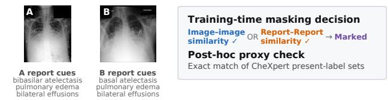

# SCCL-DT: Semantic-Conflict-Aware Contrastive Learning with Dual-Rule Teacher Distillation for Zero-Shot Chest X-Ray Diagnosis

Ting Liu1,2 Haoran Lai1,2 HaobinChen1,2 Ming Liu1,2 S Kevin Zhou1,2

1School of Biomedical Engineering, Division of Life Sciences and Medicine,

2Suzhou Institute for Advanced Research, University of Science and Technology of China, Suzhou, Jiangsu, 215123, P.R. China

## Abstract

Contrastive vision–language pre-training supports zeroshot chest X-ray diagnosis, but standard objectives treat every off-diagonal image–report pair in a batch as a negative. In radiology, recurring findings across patients mean that instance mismatch need not imply semantic incompatibility, creating false-negative supervision that we term a semantic conflict. A training-trace audit shows that pair-observations selected by the online mask used during training are enriched for report-derived finding agreement, although this proxy analysis does not establish clinical equivalence. Fixed thresholds can become miscalibrated as similarity distributions evolve, while soft reweighting leaves residual repulsive gradients. We therefore propose Semantic-Conflict-Aware Contrastive Learning (SCCL), which tracks modality-specific similarity distributions with exponential-moving-average (EMA) statistics, derives adaptive thresholds, and hard-masks flagged candidates before softmax normalization. Inclusive (OR) and consensus (AND) rules define two SCCL teachers, whose bidirectional cross-modal rankings are consolidated through standard distillation into a single deployable student, SCCL-DT. Acrossfive public chest X-ray benchmarks, SCCL-DT achieves a mean zero-shot AUC of 0.850, compared with 0.837for the strongest evaluated baseline in our comparison. Code will be made publicly available soon.

## 1. Introduction

Vision–language pre-training (VLP) has emerged as a promising paradigm for zero-shot chest X-ray diagnosis. By aligning radiographs with their free-text reports, VLP models learn joint representations that can be queried with disease prompts at inference without requiring task-specific annotations [12, 27, 37]. Most medical VLP approaches optimize a batch-wise contrastive objective [23, 25]: within a mini-batch of B image–report pairs, matched pairs are treated as positives, whereas all off-diagonal pairs are treated as negatives. This formulation inherits a key assumption from instance-level contrastive learning: every unmatched pair is a valid negative.

## a Traced training pair

## b In-batch proxy-label matches

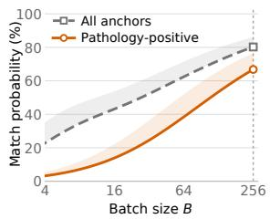

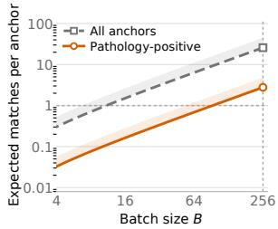

c Online-mask enrichment  
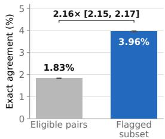

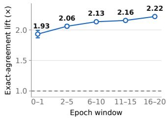  
Figure 1. Motivation and label-based analysis of candidate semantic conflicts. (a) Online inclusive masking excludes an offdiagonal candidate from the negative set when either its image– image or report–report similarity exceeds the adaptive threshold. (b) Anchor-level probability and expected count of cross-patient matches with identical present-label sets. (c) Exact present-labelset agreement for flagged versus all eligible pair-observations, overall and across training windows.

This assumption is particularly fragile in radiology, where reports from different patients frequently describe overlapping findings using similar or interchangeable expressions. As illustrated in Figure 1(a), the two batch items underlying an unmatched image–report candidate may share the same report-derived finding set. At a mini-batch size of 256, an exact corpus-level calculation under uniform random batching estimates that 66.8% of pathology-positive anchors would encounter at least one cross-patient batch mate with an identical CheXpert present-label set, with 2.78 such matches per anchor on average (Figure 1(b)). A related enrichment appears in the recorded online masking decisions. Within the trace prefix ending at the best checkpoint, the inclusive rule used in the trace—which masks an off-diagonal pair when either the corresponding image–image or report–report similarity exceeds its modality-specific adaptive threshold— flags pair-observations with 3.96% exact present-label-set agreement, compared with 1.83% across all eligible pairobservations. Here, eligibility requires different patients and at least one positive label among the 12 pathology findings in each report; exact agreement is then evaluated over all 14 labels. The resulting 2.16× enrichment remains above one throughout five consecutive training windows (Figure 1(c)). Although exact CheXpert present-label-set agreement does not establish clinical equivalence, its enrichment among flagged pair-observations suggests that this subset may contain a higher proportion of semantically compatible pairs. Consequently, semantically compatible pairs may still receive negative contrastive targets, giving rise to false-negative supervision. Such false negatives are known to degrade generic contrastive learning [5, 7]. We refer to this mismatch between semantic compatibility and the assigned contrastive target as a semantic conflict.

Prior work has attempted to mitigate false negatives by incorporating external clinical knowledge [19, 30], mining additional positive pairs from report- or study-level semantics [20, 21, 33], or softly reweighting suspected false negatives during optimization [15, 18]. Despite their effectiveness, two gaps remain. Detection: rules based on singlemodality evidence or fixed, globally normalized similarity thresholds can become miscalibrated as modality-specific similarity distributions shift during representation learning. Optimization: additional positive mining may promote partial semantic compatibility to full equivalence, whereas soft reweighting still allows suspected false negatives to exert residual repulsive gradients unless their weights become exactly zero. An effective solution must therefore identify semantic conflicts adaptively and prevent them from being pushed apart without indiscriminately relabeling them as positives.

To address both gaps, we propose Semantic-Conflict-Aware Contrastive Learning (SCCL), which dynamically flags potential semantic-conflict candidates using evidence from both modalities and removes them through adaptive hard masking. For detection, SCCL maintains separate exponential-moving-average (EMA) statistics for intrabatch image–image and report–report similarities, allowing each threshold to track its modality-specific distribution as training evolves. Flagged candidates are excluded from contrastive normalization, eliminating their probability mass and repulsive gradients rather than treating them as additional positives. To account for uncertainty in the modality-specific intra-modal cues, we instantiate two rulespecific teachers: an inclusive (OR) teacher that accepts evidence from either modality to increase candidate coverage, and a consensus (AND) teacher that requires agreement between both modality-specific cues for more conservative selection. Standard distillation then consolidates the two teachers’ cross-modal rankings into the single deployable student SCCL-DT. SCCL thus adapts candidate selection to evolving similarity distributions while explicitly preventing flagged candidates from being optimized as negatives.

Our contributions are:

• We propose SCCL, a contrastive framework that adaptively hard-masks similarity-flagged off-diagonal candidates using per-modality EMA thresholds, without adding trainable parameters to the masking module.

• We instantiate SCCL with inclusive and consensus rulespecific teachers and use standard distillation to consolidate their cross-modal rankings into SCCL-DT, a single deployable student.

• On five public chest X-ray benchmarks (Open-I, PadChest, ChestX-ray14, CheXpert, and ChestXDet10), SCCL-DT reaches a mean zero-shot AUC of 0.850, the highest among the compared methods, at single-model inference cost.

## 2. Related Work

## 2.1. Medical vision–language pre-training

Contrastive alignment of chest radiographs with their reports has driven rapid progress in label-efficient and zeroshot diagnosis. ConVIRT [37] adapts image–text contrastive learning to radiology, while MedCLIP [30] decouples images and texts to exploit unpaired data. GLo-RIA [12] and MGCA [28] introduce local, multi-granularity alignment between image regions and report tokens; BioViL [2] strengthens the text encoder through domainspecific language modeling; and CheXzero [27] demonstrates expert-level zero-shot detection. KAD [35] incorporates a medical knowledge graph, and MRM [38] combines masked image and record modeling. More recent approaches replace global dot-product similarity with finegrained cross-attention between image regions and report tokens. CARZero [16] scores pairs through cross-attention between one modality’s tokens and the other’s query, while RadZero [24] extends this paradigm toward region-level, explainable alignment. Beyond these advances in broader data utilization, stronger encoders, knowledge integration, or finer-grained alignment, SCCL addresses a distinct source of supervision error: treating semantically compatible off-diagonal pairs as negatives.

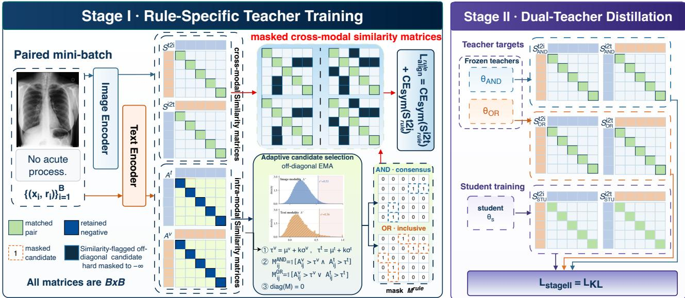  
Figure 2. Overview of the two-stage SCCL-DT framework. Stage I trains inclusive and consensus teachers by hard-masking similarity flagged off-diagonal candidates selected with modality-specific EMA thresholds. Stage II distills their image-to-text (i2t) and text-toimage (t2i) rankings into a single student using row- and column-wise Kullback–Leibler (KL) supervision. Only the student is retained for inference.

## 2.2. False negatives in contrastive learning

Instance-discrimination objectives treat unmatched samples as negatives, so semantically compatible pairs may receive repulsive gradients [4, 10, 23, 32]. Unlike valid hard negatives, false negatives should not be repelled. Prior work addresses this issue through distribution correction, hard-negative mining, progressive false-negative removal, or hardness scheduling [5, 7, 15, 26].

Medical VLP methods instead exploit clinical knowledge or report semantics. MedCLIP and MLIP construct knowledge-guided targets [19, 30]; SAT, SENSE, and FaNe use report- or study-level similarity to mine or reweight pairs [20, 21, 33]; and SAHN separates hard from false negatives using embedding and semantic similarity [18]. SCCL differs by applying modality-specific adaptive thresholds, hard-masking selected pairs without relabeling them, and distilling its rule-specific teachers into one student.

## 2.3. Knowledge distillation

flKnowledge distillation transfers predictive distributions from a teacher to a student, commonly to compress a model or retain teacher behavior in a more deployment-efficient network [11]. Deep mutual learning extends this idea to online peer supervision [36], while ALBEF uses a momentum teacher to provide stable targets for noisy image–text alignment [17]. These formulations differ in teacher construction but use distillation to transfer or stabilize predictive behavior. In SCCL, standard distillation consolidates two rule-specific teachers—an inclusive teacher and a consensus teacher—into a single student for efficient inference.

## 3. Methodology

Figure 2 summarizes the two-stage training framework of SCCL-DT, from rule-specific teacher training to singlestudent distillation.

## 3.1. Preliminaries: Batch-Contrastive Alignment

Let a mini-batch contain B image–report pairs $\{ ( x _ { i } , r _ { i } ) \} _ { i = 1 } ^ { B }$ , with global embeddings $v _ { i } , t _ { i } \in \mathbb { R } ^ { d }$ . A pairwise aligner g produces bidirectional score matrices $\mathbf { \bar { \mathbf { \Gamma } } } _ { S ^ { \mathrm { i 2 t } } , S ^ { \mathrm { t 2 i } } } ^ { \bullet } \in \mathbb { R } ^ { \mathbf { \bar { \mathbf { \Gamma } } } \times \bar { \mathbf { \Gamma } } }$ , where $S _ { i j } ^ { \mathrm { i 2 t } }$ scores image i against report j, and $S _ { i j } ^ { \mathrm { t 2 i } }$ scores report i against image j. The diagonal contains matched pairs. Because SCCL operates on these score matrices, g may be implemented by similarity, a matching head, or cross-attention; a single-matrix aligner is handled analogously.

For the bidirectional instantiation, training minimizes a symmetric cross-entropy that treats each matrix as a B-way classification with the diagonal as the target label $y _ { i } = i \colon$

$$
\begin{array} { r } { \mathrm { C E } _ { \mathrm { s y m } } ( S ) = \frac { 1 } { 2 } \big [ \mathrm { C E } ( S , y ) + \mathrm { C E } ( S ^ { \top } , y ) \big ] , } \end{array}\tag{1}
$$

$$
\mathcal { L } _ { \mathrm { a l i g n } } ( S ^ { \mathrm { i 2 t } } , S ^ { \mathrm { t 2 i } } ) = \mathrm { C E } _ { \mathrm { s y m } } ( S ^ { \mathrm { i 2 t } } ) + \mathrm { C E } _ { \mathrm { s y m } } ( S ^ { \mathrm { t 2 i } } ) .\tag{2}
$$

Every off-diagonal entry is therefore supervised as a negative. SCCL modifies this supervision only at the scorematrix level and does not alter the internal architecture of $g .$

## 3.2. Semantic-Conflict-Aware Contrastive Learning

Semantic-conflict candidates. An off-diagonal pair becomes a semantic-conflict candidate when its negative target may conflict with partial semantic compatibility. Because pair-level clinical adjudication is unavailable, SCCL treats similarity-flagged pairs only as candidates: it removes them from softmax normalization without relabeling them as positives.

Per-modality similarity. Given the batch’s global embeddings, SCCL computes intra-modal cosine-similarity matrices

$$
A _ { i j } ^ { v } = \cos ( v _ { i } , v _ { j } ) , \qquad A _ { i j } ^ { t } = \cos ( t _ { i } , t _ { j } ) .\tag{3}
$$

Let $\Omega = \{ ( i , j ) : i \neq j \}$ be the off-diagonal index set.

Adaptive thresholds via EMA. At each training step, SCCL maintains modality-specific EMA estimates of the batch mean and standard deviation of the off-diagonal similarities, using momentum m:

$$
\mu ^ { v }  m \mu ^ { v } + ( 1 - m ) \overline { { A _ { \Omega } ^ { v } } } , \quad \sigma ^ { v }  m \sigma ^ { v } + ( 1 - m ) \mathrm { s t d } ( A _ { \Omega } ^ { v } ) ,\tag{4}
$$

and analogously for $\mu ^ { t } , \sigma ^ { t }$ . The modality-specific thresholds are

$$
\tau ^ { v } = \mu ^ { v } + k \sigma ^ { v } , \quad \quad \tau ^ { t } = \mu ^ { t } + k \sigma ^ { t } ,\tag{5}
$$

where k determines how far into the upper tail an entry must fall. Separate EMA statistics allow the thresholds to follow each modality’s evolving similarity scale. The four EMA states are initialized from the first mini-batch. During the first $T _ { w }$ steps, they continue to update while masking is disabled $( M = \mathbf { 0 } )$ . Statistics and masks are stop-gradient and device-local, without cross-device gathering. Validation freezes the EMA states and counters. Thresholds are not clipped; values above the cosine ceiling simply select no candidate.

Candidate-selection rules. SCCL uses two candidateselection rules: the inclusive (OR) rule accepts evidence from either modality, whereas the consensus (AND) rule requires agreement between the two modality-specific cues:

$$
M _ { i j } ^ { \mathrm { O R } } = \mathbf { 1 } \bigl [ A _ { i j } ^ { v } > \tau ^ { v } \ \vee \ A _ { i j } ^ { t } > \tau ^ { t } \bigr ] ,\tag{6}
$$

$$
M _ { i j } ^ { \mathrm { A N D } } = \mathbf { 1 } \bigl [ A _ { i j } ^ { v } > \tau ^ { v } \ \land \ A _ { i j } ^ { t } > \tau ^ { t } \bigr ] ,\tag{7}
$$

with the diagonal forced to 0. Under identical thresholds, $M _ { i j } ^ { \mathrm { A N D } } \leq \check { M } _ { i j } ^ { \mathrm { O R } }$ , so $\mathcal { C } _ { \mathrm { A N D } } \subseteq \mathcal { C } _ { \mathrm { O R } }$ . OR therefore favors candidate coverage, whereas AND is more conservative. Without candidate-level ground truth, this is an expected coverage–precision trade-off rather than measured recall or precision.

Hard masking. For a given teacher, let $M \in$ $\{ M ^ { \mathrm { O R } } , M ^ { \mathrm { A N D } } \}$ denote its rule-specific mask. Flagged candidates are removed before the softmax:

$$
\tilde { S } _ { i j } ^ { q } = \left\{ \begin{array} { l l } { - \infty } & { M _ { i j } = 1 , } \\ { S _ { i j } ^ { q } } & { \mathrm { o t h e r w i s e } , } \end{array} \right. \qquad q \in \{ \mathrm { i 2 t } , \mathrm { t 2 i } \} ,\tag{8}
$$

where $- \infty$ is implemented $\mathrm { a s - 1 0 ^ { 4 } }$ . Because $A ^ { v }$ and $A ^ { t }$ are symmetric, both rules operate on the unordered pair $\{ i , j \}$ and yield $M _ { i j } = M _ { j i }$ . Under this symmetric pairlevel proxy, flagging $\{ i , j \}$ provides no direction-specific evidence for retaining only one cross-swapped pairing, so we exclude both $( x _ { i } , r _ { j } )$ and $( x _ { j } , r _ { i } )$ . Specifically, the former occupies $S _ { i j } ^ { \mathrm { i 2 t } }$ and $S _ { j i } ^ { \mathrm { t 2 i } }$ , while the latter occupies $S _ { j i } ^ { \mathrm { i 2 t } }$ and $S _ { i j } ^ { \mathrm { t 2 i } }$ . Hence a teacher applies the same rule-specific $M$ to both score matrices, removing these candidates from all row- and column-wise softmaxes. This does not mean that the two teachers share a mask: the inclusive and consensus teachers use $M ^ { \mathrm { O R } }$ and $M ^ { \mathrm { A N D } }$ , respectively. The training loss then replaces each $S ^ { q }$ $\tilde { S } ^ { q }$ in Eq. (2), driving the masked candidates’ softmax weights and gradients to zero. The masking module adds no trainable parameters; its cost is two $B \times B$ similarity matrices and four scalar EMA updates per step. Algorithm 1 summarizes one step.

## 3.3. Dual-Rule Teacher Distillation

Rule-specific teachers. Training with $M ^ { \mathrm { O R } }$ and $M ^ { \mathrm { A N D } }$ yields an inclusive teacher $\theta _ { \mathrm { O R } }$ and a consensus teacher $\theta _ { \mathrm { A N D } }$ , respectively. We train one teacher under each rule and use both as sources for distillation.

Dual-rule distillation. We train a single student $\theta _ { s }$ to match the ensemble of the twofrozen teachers. The student is initialized independently rather than from either teacher or an average of their parameters; teacher knowledge is transferred only through logits computed on the fly for each batch, with no logits precomputed or stored. The teacher targets are the element-wise average of the two teachers raw logits,

Algorithm 1 One training step for a rule-specific SCCL   
teacher.   
Input: logits $\overline { { S ^ { \mathrm { i 2 t } } , S ^ { \mathrm { t 2 i } } } }$ ; embeddings $\{ v _ { i } \} , \{ t _ { i } \} ;$ step s   
Param: k, momentum m, warm-up $T _ { w } ,$ rule ∈ {OR, AND}   
Output: masked loss $\mathcal { L }$   
1: $A ^ { v }  \infty ( V , V ) ; \ A ^ { t }  \infty ( T , T )$   
2: update $\mu ^ { v } , \sigma ^ { v } , \mu ^ { t } , \sigma ^ { t }$ by EMA over off-diagonal of   
$A ^ { v } , A ^ { t }$   
3: if $s < T _ { w }$ then   
4: $M \gets \mathbf { 0 }$ {warm-up: no masking}   
5: else   
6: $\tau ^ { v }  \mu ^ { v } + k \sigma ^ { v } ; \ \tau ^ { t }  \mu ^ { t } + k \sigma ^ { t }$   
7: M ← Eq. (6) or Eq. (7); set diagonal of M to 0   
8: end if   
9: $\tilde { S } ^ { \mathrm { i 2 t } }  S ^ { \mathrm { i 2 t } }$ masked by $M ; ~ \tilde { S } ^ { \mathrm { t 2 i } }  S ^ { \mathrm { t 2 i } }$ masked by M   
10: $\mathcal { L } \gets \mathrm { C E } _ { \mathrm { s y m } } ( \tilde { S } ^ { \mathrm { i 2 t } } ) + \mathbf { \dot { C } } \mathrm { E } _ { \mathrm { s y m } } ( \tilde { S } ^ { \mathrm { t 2 i } } )$   
11: return $\mathcal { L }$

$$
\begin{array} { r } { \bar { S } ^ { \mathrm { i 2 t } } = \frac 1 2 \big ( S _ { \mathrm { O R } } ^ { \mathrm { i 2 t } } + S _ { \mathrm { A N D } } ^ { \mathrm { i 2 t } } \big ) , \quad \bar { S } ^ { \mathrm { t 2 i } } = \frac 1 2 \big ( S _ { \mathrm { O R } } ^ { \mathrm { t 2 i } } + S _ { \mathrm { A N D } } ^ { \mathrm { t 2 i } } \big ) , } \end{array}\tag{9}
$$

and the student matches them with a distillation loss at temperature $\tau _ { d } ,$ using both row- and column-normalized distributions of both score matrices:

$$
\begin{array} { r l } & { \mathcal { L } _ { \mathrm { K L } } = \displaystyle \frac { \tau _ { d } ^ { 2 } } { 4 } \sum _ { \tiny \begin{array} { c } { q \in \{ \mathrm { i 2 t } , \mathrm { t 2 i } \} } \\ { a \in \{ \mathrm { r o w } , \mathrm { c o l } \} } \end{array} } } \\ & { \qquad \mathrm { K L } \Big ( \mathrm { s o f t m a x } _ { a } \big ( \bar { S } ^ { q } / \tau _ { d } \big ) \Big \Vert \mathrm { s o f t m a x } _ { a } \big ( S _ { s } ^ { q } / \tau _ { d } \big ) \Big ) , } \end{array}\tag{10}
$$

where a denotes the normalization axis. The Stage-II student is trained solely with ${ \mathcal { L } } _ { \mathrm { K L } } .$ , so the teachers’ contrastively learned bidirectional rankings provide its complete supervision. We refer to the resulting single-pass model as SCCL-DT.

Zero-shot inference. At test time, we retain only the student. For each disease $c ,$ we construct $p _ { c }$ using the fixed template “There is [disease]”. For an image x and a disease prompt $p _ { c }$ , the student encodes both inputs, including the global and any aligner-specific local features, and obtains bidirectional scores $S _ { \theta _ { s } } ^ { \mathrm { i 2 t } } \bar { ( } x , p _ { c } )$ and $S _ { \theta _ { s } } ^ { \mathrm { t 2 i } } ( p _ { c } , x )$ . The final score for disease c is

$$
\begin{array} { r } { s _ { c } ( x ) = \frac { 1 } { 2 } \big [ S _ { \theta _ { s } } ^ { \mathrm { i 2 t } } ( x , p _ { c } ) + S _ { \theta _ { s } } ^ { \mathrm { t 2 i } } ( p _ { c } , x ) \big ] . } \end{array}\tag{11}
$$

We use this raw averaged score for multi-label evaluation, without a class-wise softmax; the teachers, EMA statistics, and candidate masks are absent at inference.

## 4. Experiments

## 4.1. Setup

Implementation details. Our implementation builds on CARZero [16], which serves as the unmasked Base model. We pre-train on frontal AP/PA MIMIC-CXR images with usable reports [14]. Available report fields are concatenated and truncated or padded to 97 tokens. Images are resized and zero-padded to 256×256, cropped to 224×224, and augmented with random horizontal flips, affine transformations, and brightness/contrast jitter. Each run uses a ViT-B/16 image encoder initialized from M3AE [6, 9] and a BioClinical BERT text encoder [1]. Teachers use $k { = } 2 . 0 , \ m { = } 0 . 9 9$ , and $T _ { w } { = } 5 0 0$ , and are optimized with Adam (learning rate $5 \times 1 0 ^ { - 5 }$ , weight decay $1 0 ^ { - 6 } )$ . We halve the learning rate after five validation epochs without improvement, early-stop after ten, and select the lowestloss checkpoint. The student is trained for six epochs with Adam at $1 0 ^ { - 5 }$ , using the same weight decay and scheduler and $\tau _ { d } \mathrm { = } 2 . 0$ . All training runs are conducted on NVIDIA A800 GPUs. The masking operator itself maintains only four scalar EMA states and adds no trainable weights. The complete two-stage protocol nevertheless trains two rulespecific teachers and one student under supervision from the two frozen teachers; only the student is retained for inference.

Zero-shot evaluation. We evaluate on five public chest X-ray datasets without any fine-tuning: Open-I [8], Pad-Chest [3] (manually annotated subset), ChestX-ray14 [29], CheXpert [13], and ChestXDet10 [22]. For multi-label zero-shot classification, AUC is the primary metric; the PadChest ablations additionally report MCC, F1, and accuracy (ACC). For zero-shot grounding on ChestXDet10, we report the unweighted mean Pointing Game accuracy across ten findings. The 14×14 cross-attention map is expanded to 224×224 by patch-wise replication, and a trial is counted as a hit when a maximum-attention region overlaps an annotated lesion. Each map is independently min–max normalized for visualization.

Baselines. We compare against MedCLIP [30], Biomed-CLIP [34], GLoRIA [12], BioViL [2], CheXzero [27], Med-KLIP [31], KAD [35], CARZero [16], and RadZero [24]. For the zero-shot classification comparison in Table 1, we re-evaluate all baselines using their publicly released models on the same five official test sets.

Candidate-set analysis. Across the recorded training trace, the actual OR mask enriches report-derived exact label agreement from 1.83% among eligible pairs to 3.96% among flagged pairs (2.16×). Descriptively, the lift is above one in each of five epoch windows and is also observed for Image-only candidates; the same qualitative pattern is observed under partial-overlap measures and an alternative labeler. These analyses evaluate whether the online mask preferentially selects label-overlapping pairs; they do not measure the recall of clinically adjudicated false negatives. Full definitions, counts, and sensitivity analyses are provided in the supplementary material.

<table><tr><td>Method</td><td>Open-I</td><td>PadChest</td><td>ChestX-ray14</td><td>CheXpert</td><td>ChestXDet10</td><td>Mean</td></tr><tr><td>MedCLIP [30]</td><td>0.551</td><td>0.508</td><td>0.564</td><td>0.744</td><td>0.571</td><td>0.588</td></tr><tr><td>BiomedCLIP [34]</td><td>0.577</td><td>0.513</td><td>0.639</td><td>0.677</td><td>0.630</td><td>0.607</td></tr><tr><td>GLoRIA [12]</td><td>0.589</td><td>0.565</td><td>0.610</td><td>0.750</td><td>0.645</td><td>0.632</td></tr><tr><td>BioViL [2]</td><td>0.702</td><td>0.655</td><td>0.729</td><td>0.789</td><td>0.708</td><td>0.717</td></tr><tr><td>CheXzero [27]</td><td>0.726</td><td>0.648</td><td>0.712</td><td>0.889</td><td>0.640</td><td>0.723</td></tr><tr><td>MedKLIP [31]</td><td>0.759</td><td>0.629</td><td>0.726</td><td>0.879</td><td>0.713</td><td>0.741</td></tr><tr><td>KAD [35]</td><td>0.807</td><td>0.750</td><td>0.789</td><td>0.905</td><td>0.735</td><td>0.797</td></tr><tr><td>CARZero [16]</td><td>0.838</td><td>0.810</td><td>0.811</td><td>0.923</td><td>0.796</td><td>0.836</td></tr><tr><td>RadZero [24]</td><td>0.851</td><td>0.841</td><td>0.807</td><td>0.903</td><td>0.785</td><td>0.837</td></tr><tr><td>SCCL-DT (Ours)</td><td>0.853</td><td>0.827</td><td>0.835</td><td>0.922</td><td>0.811</td><td>0.850</td></tr></table>

Table 1. Zero-shot classification performance (AUC) on five chest X-ray benchmarks. Mean is the unweighted dataset average; higher is better. Bold and underline denote the best and second-best results in each column, respectively.

## 4.2. Main Results

Zero-shot classification. Table 1 compares SCCL-DT with published zero-shot chest X-ray classification methods across five benchmarks. The final distilled student achieves the highest mean AUC of 0.850, exceeding RadZero (0.837) and CARZero (0.836) by 0.013 and 0.014, respectively. Under this unified classification evaluation protocol, SCCL-DT achieves the highest AUC on Open-I, ChestX-ray14, and ChestXDet10, while ranking second on PadChest and CheXpert; on CheXpert, it trails the best result by only 0.001. The consistent performance across these heterogeneous datasets provides evidence of cross-dataset robustness, while inference retains a single model.

CARZero and RadZero provide the closest radiologyspecific comparisons. SCCL-DT outperforms each on four of the five datasets: relative to CARZero, the gains are +0.015 on Open-I, +0.017 on PadChest, +0.024 on ChestX-ray14, and +0.015 on ChestXDet10, whereas the two methods are nearly tied on CheXpert (0.922 vs. 0.923). Relative to RadZero, SCCL-DT performs better on all datasets except PadChest and improves the mean AUC by 0.013. Accordingly, Table 1 provides a same-test-set, public-checkpoint classification comparison under a common dataset and label scope. The controlled ablations below further isolate the effect of semantic-conflict masking within a shared implementation.

Zero-shot grounding. Table 2 reports both mean and perfinding Pointing Game accuracy on ChestXDet10. SCCL-

DT achieves the highest mean accuracy of 0.583, exceeding the CARZero (0.543) and RadZero at 224 pixels (0.537) values by 4.0 and 4.6 percentage points, respectively. Relative to each of the tabulated CARZero and RadZero rows, SCCL-DT improves on seven of ten findings, matches one, and is lower on two. Across all included methods, it obtains the highest or tied-highest accuracy on six findings. Figure 3 complements these per-finding results with six qualitative Base-versus-SCCL-DT comparisons. Since a Pointing Game hit requires a maximally attended region to overlap an annotated lesion, these results provide evidence of stronger zero-shot spatial correspondence between crossattention and radiographic abnormalities, rather than detection or segmentation performance.

## 4.3. Ablation and Diagnostic Studies

We report controlled PadChest studies under a unified evaluation protocol across AUC, MCC, F1, and accuracy (ACC). The OR/AND/KD, threshold, and similaritycue studies characterize prespecified SCCL configurations. Two-tier, count-matched Random, and Soft weighting instead serve as diagnostic controls rather than SCCL components: they examine whether a single compromise rule can replace the separate inclusive and consensus teachers, whether gains depend on structured candidate selection beyond mask quantity alone, and whether hard exclusion is preferable to soft attenuation, respectively. These results are not used for hyperparameter tuning or default-configuration selection. The five-dataset mean AUC provides a crossdataset consistency check. We retain ACC as a critical classification metric; because it remains near 0.991 across configurations, most between-configuration differences appear in AUC, MCC, and F1. Unless otherwise specified, the controlled studies use a prespecified default comprising an adaptive threshold with k=2, the inclusive rule, hard masking, and both similarity cues; Table 3 separately compares the two rule-specific teachers and the single- and dual-

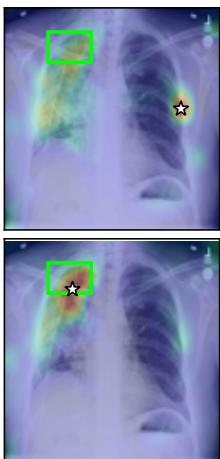

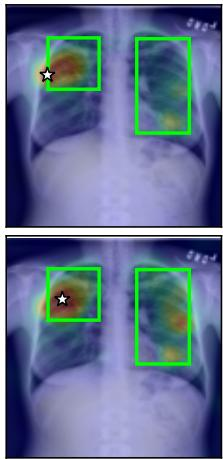  
Consolidation

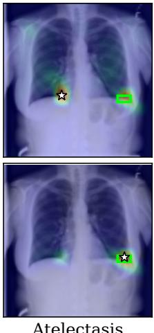

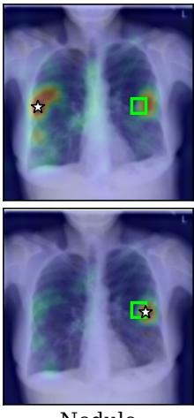

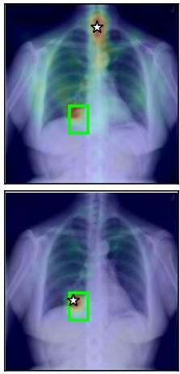

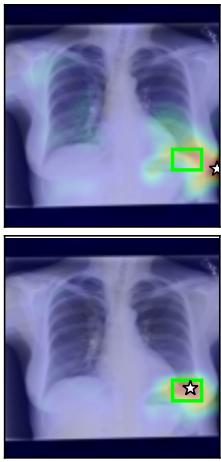

Figure 3. Qualitative zero-shot grounding on six ChestXDet10 cases. Rows show the unmasked Base model and SCCL-DT; green boxes are ground-truth lesions, white stars are Pointing Game maxima, and warmer colors indicate larger cross-attention weights. Each map is normalized independently
<table><tr><td>Method</td><td>Mean</td><td>ATE</td><td>CALC</td><td>CONS</td><td>EFF</td><td>EMPH</td><td>FIB</td><td>FX</td><td>MASS</td><td>NOD</td><td>PTX</td></tr><tr><td>GLoRIA [12]</td><td>0.368</td><td>0.479</td><td>0.053</td><td>0.737</td><td>0.528</td><td>0.667</td><td>0.366</td><td>0.013</td><td>0.533</td><td>0.156</td><td>0.143</td></tr><tr><td>MedKLIP [31]</td><td>0.481</td><td>0.625</td><td>0.132</td><td>0.837</td><td>0.675</td><td>0.734</td><td>0.305</td><td>0.224</td><td>0.733</td><td>0.312</td><td>0.229</td></tr><tr><td>KAD [35]</td><td>0.391</td><td>0.646</td><td>0.132</td><td>0.699</td><td>0.618</td><td>0.644</td><td>0.244</td><td>0.199</td><td>0.267</td><td>0.316</td><td>0.143</td></tr><tr><td>CARZero [16]</td><td>0.543</td><td>0.604</td><td>0.184</td><td>0.824</td><td>0.782</td><td>0.846</td><td>0.561</td><td>0.184</td><td>0.700</td><td>0.286</td><td>0.457</td></tr><tr><td>RadZero (224 px) [24]</td><td>0.537</td><td>0.604</td><td>0.211</td><td>0.806</td><td>0.813</td><td>0.795</td><td>0.451</td><td>0.197</td><td>0.767</td><td>0.325</td><td>0.400</td></tr><tr><td>SCCL-DT (Ours)</td><td>0.583</td><td>0.667</td><td>0.184</td><td>0.855</td><td>0.802</td><td>0.821</td><td>0.524</td><td>0.263</td><td>0.767</td><td>0.351</td><td>0.600</td></tr></table>

Table 2. Zero-shot grounding on ChestXDet10, measured by per-finding and unweighted mean Pointing Game (PG) accuracy. ATE, CALC, CONS, EFF, EMPH, FIB, FX, MASS, NOD, and PTX denote Atelectasis, Calcification, Consolidation, Effusion, Emphysema, Fibrosis, Fracture, Mass, Nodule, and Pneumothorax, respectively. Bold and underline denote the best and second-best results in each column.

teacher students.

<table><tr><td rowspan=2 colspan=1>#</td><td rowspan=2 colspan=3>ComponentsOR ANDKD</td><td rowspan=1 colspan=1>PadChest</td><td rowspan=1 colspan=1>Cross-data</td></tr><tr><td rowspan=1 colspan=1>|AUC↑MCC↑F1↑ACC ↑|</td><td rowspan=1 colspan=1>mAUC ↑</td></tr><tr><td rowspan=1 colspan=1>(a)</td><td rowspan=1 colspan=3></td><td rowspan=1 colspan=1>0.810 0.1560.1430.991</td><td rowspan=1 colspan=1>0.836</td></tr><tr><td rowspan=2 colspan=1>(b)(c)</td><td rowspan=2 colspan=2>√</td><td rowspan=2 colspan=1></td><td rowspan=1 colspan=1>0.826 0.1790.1650.991</td><td rowspan=1 colspan=1>0.840</td></tr><tr><td rowspan=1 colspan=1>0.825 0.1730.1590.991</td><td rowspan=3 colspan=1>0.8460.8460.844</td></tr><tr><td rowspan=3 colspan=1>(e)(f)</td><td rowspan=1 colspan=1>(d)</td><td rowspan=2 colspan=2>√        V</td><td rowspan=2 colspan=1>0.823 0.1780.1620.9910.822 0.169 0.1550.991</td></tr><tr><td rowspan=2 colspan=3>√   √   √</td></tr><tr><td rowspan=1 colspan=1>0.827 0.1790.1640.991</td><td rowspan=1 colspan=1>0.850</td></tr></table>

Table 3. Rule-specific teacher and knowledge-distillation analysis. OR/AND denote the teacher(s), KD denotes student distillation, and the empty setting is the unmasked Base. Cross-data mAUC averages five benchmarks; bold and underline mark best and second-best; ACC ties after rounding.

Teacher and student configurations. Both SCCL teachers improve over the unmasked Base model in PadChest AUC, MCC, and F1 (Table 3). Among the single-teacher students, distillation from the inclusive teacher obtains a higher cross-dataset mAUC than distillation from the consensus teacher (0.846 vs. 0.844; rows (d) and (e)). Using both rule-specific teachers raises mAUC to 0.850 (row (f)), while achieving the highest PadChest AUC and tying the highest MCC. The inclusive teacher remains marginally higher in F1. Distillation therefore serves model consolidation rather than the primary methodological contribution.

Controlled design analyses. Table 4 combines threshold sensitivity with diagnostic comparisons around the prespecified default configuration: adaptive k=2, inclusive selection, hard masking, and joint cues.

Threshold rule. Panel A compares the implemented fixed- and adaptive-threshold variants. Under the implemented fixed branch, thresholds $\tau ~ \leq ~ 0 . 8 0$ are omitted because early OR-mask saturation removes nearly all offdiagonal negatives and yields a degenerate near-zero loss. The adaptive rules use the device-local EMA statistics in Eq. (5), frozen during validation. Adaptive k=2 achieves an AUC/MCC/F1 of 0.826/0.179/0.165, compared with 0.814/0.156/0.138 for the strongest non-degenerate fixed threshold (τ=0.95). Figure 4 shows that the adaptive thresholds track the evolving similarity scale and converge to approximately 0.55 late in training. Among the tested adaptive settings, the prespecified k=2 gives the highest AUC, MCC, and F1 point estimates on PadChest.

<table><tr><td>Design choice</td><td>AUC↑ MCC↑</td><td></td><td>F1↑ ACC ↑</td></tr><tr><td>A. Threshold sensitivity</td><td></td><td></td><td></td></tr><tr><td>Fixed τ=0.85</td><td>0.807</td><td>0.147</td><td>0.130 0.991</td></tr><tr><td>Fixed τ=0.90</td><td>0.812</td><td>0.155</td><td>0.136 0.991</td></tr><tr><td>Fixed τ=0.95</td><td>0.814</td><td>0.156</td><td>0.138 0.991</td></tr><tr><td>Adaptive k=1.5</td><td>0.820</td><td>0.157</td><td>0.139 0.991</td></tr><tr><td>Adaptive k=2 (def.)</td><td>0.826</td><td>0.179</td><td>0.165 0.991</td></tr><tr><td>Adaptive k=2.5</td><td>0.819</td><td>0.159</td><td>0.141 0.991</td></tr><tr><td>B. Diagnostic comparisons Candidate-selection logic</td><td></td><td></td><td></td></tr><tr><td>Inclusive (def.)</td><td>0.826</td><td>0.179</td><td>0.165 0.991</td></tr><tr><td>Consensus</td><td>0.825</td><td>0.173</td><td>0.159 0.991</td></tr><tr><td>Two-tier</td><td>0.818</td><td>0.162</td><td>0.146 0.991</td></tr><tr><td>Random (count-matched)</td><td>0.817</td><td>0.156</td><td>0.139 0.991</td></tr><tr><td></td><td></td><td></td><td></td></tr><tr><td>Logit intervention</td><td></td><td></td><td>0.165 0.991</td></tr><tr><td>Hard masking (def.)</td><td>0.826</td><td>0.179</td><td></td></tr><tr><td>Soft weighting</td><td>0.820</td><td>0.161</td><td>0.139 0.991</td></tr></table>

Table 4. Controlled PadChest analyses: (A) threshold sensitivity; (B) candidate-selection and logit-intervention controls. “def.” marks the prespecified default; bold and underline mark best and second-best within each block; ACC ties after rounding.

<table><tr><td>Similarity cue</td><td>AUC↑</td><td>MCC ↑</td><td>F1↑</td><td>ACC↑</td></tr><tr><td>Image only</td><td>0.814</td><td>0.158</td><td>0.141</td><td>0.991</td></tr><tr><td>Text only</td><td>0.816</td><td>0.157</td><td>0.138</td><td>0.991</td></tr><tr><td>Both (default)</td><td>0.826</td><td>0.179</td><td>0.165</td><td>0.991</td></tr></table>

Table 5. PadChest similarity-cue ablation under the default inclusive setting. Bold and underline mark the best and second-best AUC, MCC, and F1; ACC ties at 0.991.

Candidate-selection rule. Panel B compares diagnostic controls with the prespecified references. The inclusive and consensus rules are defined in Sec. 3.2. Two-tier combines stringent single-modality evidence with moderate agreement across modalities, while Random uniformly samples off-diagonal pairs to match the total perbatch inclusive mask budget. Inclusive obtains the highest AUC/MCC/F1 point estimates of 0.826/0.179/0.165. Consensus nearly preserves AUC (0.825) but reduces MCC/F1 to 0.173/0.159, whereas Two-tier performs worse across all three metrics. Together with Table 3, this comparison supports retaining the inclusive and consensus rules as separate teachers rather than collapsing them into a single heuristic. Count-matched random masking obtains 0.817/0.156/0.139, supporting the importance of SCCL’s structured candidate selection beyond mask quantity alone. Masking operation and modality cues. Within Panel B, Soft weighting serves as a diagnostic control that attenuates likely conflicts rather than removing them. Hard masking improves AUC/MCC/F1 from 0.820/0.161/0.139 with soft weighting to 0.826/0.179/0.165, supporting complete removal of the associated probability mass under the tested setting. Combining image and text cues also outperforms either image-only or text-only selection across all three metrics (Table 5), indicating that the two modalities provide complementary evidence. Full definitions of the three diagnostic controls are provided in the supplement.

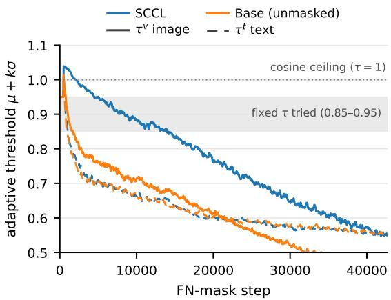  
Figure 4. Adaptive image (solid) and text (dashed) thresholds (k=2) for SCCL and the unmasked Base. Base values are logged but not applied; shading marks the fixed range 0.85–0.95 and the dotted line the cosine ceiling.

## 5. Conclusion

Standard contrastive pre-training treats all off-diagonal image–report pairs as negatives, which can introduce semantic conflicts when reports share findings. We proposed Semantic-Conflict-Aware Contrastive Learning (SCCL), which uses modality-specific adaptive thresholds to identify candidate conflicts and removes them from contrastive normalization without relabeling them as positives. Distillation consolidates the resulting rule-specific supervision into a single deployable model. The online mask is enriched for report-derived finding agreement, providing proxy evidence for the selection mechanism rather than pair-level clinical adjudication. Across five public benchmarks, SCCL-DT achieves the highest mean zeroshot AUC among the evaluated methods (0.850 vs. 0.837) and the highest mean ChestXDet10 Pointing Game accuracy (0.583). Together, these results support adaptive conflict removal as an effective alternative to indiscriminate negative supervision under the evaluated settings.

Future work should clinically adjudicate candidate pairs, study calibration across batch sizes and domains, and extend adaptive detection to local region–token alignment and other medical imaging modalities.

## References

[1] Emily Alsentzer, John R. Murphy, Willie Boag, Wei-Hung Weng, Di Jin, Tristan Naumann, and Matthew B. A. McDermott. Publicly available clinical bert embeddings, 2019.

[2] Benedikt Boecking, Naoto Usuyama, Shruthi Bannur, Daniel C. Castro, Anton Schwaighofer, Stephanie Hyland, Maria Wetscherek, Tristan Naumann, Aditya Nori, Javier Alvarez-Valle, Hoifung Poon, and Ozan Oktay. Making the Most of Text Semantics to Improve Biomedical Vision–Language Processing, page 1–21. Springer Nature Switzerland, 2022.

[3] Aurelia Bustos, Antonio Pertusa, Jose-Maria Salinas, and Maria de la Iglesia-Vaya. Padchest: A large chest x-ray im-´ age dataset with multi-label annotated reports. Medical Image Analysis, 66:101797, 2020.

[4] Ting Chen, Simon Kornblith, Mohammad Norouzi, and Geoffrey Hinton. A simple framework for contrastive learning of visual representations, 2020.

[5] Tsai-Shien Chen, Wei-Chih Hung, Hung-Yu Tseng, Shao-Yi Chien, and Ming-Hsuan Yang. Incremental false negative detection for contrastive learning, 2022.

[6] Zhihong Chen, Yuhao Du, Jinpeng Hu, Yang Liu, Guanbin Li, Xiang Wan, and Tsung-Hui Chang. Multi-modal masked autoencoders for medical vision-and-language pre-training, 2022.

[7] Ching-Yao Chuang, Joshua Robinson, Lin Yen-Chen, Antonio Torralba, and Stefanie Jegelka. Debiased contrastive learning, 2020.

[8] Dina Demner-Fushman, Marc D Kohli, Marc B Rosenman, Sonya E Shooshan, Laritza Rodriguez, Sameer Antani, George R Thoma, and Clement J McDonald. Preparing a collection of radiology examinations for distribution and retrieval. Journal of the American Medical Informatics Association, 23(2):304–310, 2016.

[9] Alexey Dosovitskiy, Lucas Beyer, Alexander Kolesnikov, Dirk Weissenborn, Xiaohua Zhai, Thomas Unterthiner, Mostafa Dehghani, Matthias Minderer, Georg Heigold, Sylvain Gelly, et al. An image is worth 16x16 words: Transformers for image recognition at scale. arXiv preprint arXiv:2010.11929, 2020.

[10] Kaiming He, Haoqi Fan, Yuxin Wu, Saining Xie, and Ross B. Girshick. Momentum contrast for unsupervised visual representation learning. In IEEE/CVF Conference on Computer Vision and Pattern Recognition (CVPR), pages 9726–9735. IEEE, 2020.

[11] Geoffrey Hinton, Oriol Vinyals, and Jeff Dean. Distilling the knowledge in a neural network, 2015.

[12] Shih-Cheng Huang, Liyue Shen, Matthew P Lungren, and Serena Yeung. Gloria: A multimodal global-local representation learning framework for label-efficient medical image recognition. In Proceedings of the IEEE/CVF International Conference on Computer Vision, pages 3942–3951, 2021.

[13] Jeremy Irvin, Pranav Rajpurkar, Michael Ko, Yifan Yu, Silviana Ciurea-Ilcus, Chris Chute, Henrik Marklund, Behzad Haghgoo, Robyn Ball, Katie Shpanskaya, Jayne Seekins, David A. Mong, Safwan S. Halabi, Jesse K. Sandberg, Ricky Jones, David B. Larson, Curtis P. Langlotz, Bhavik N. Patel, Matthew P. Lungren, and Andrew Y. Ng. Chexpert: A large chest radiograph dataset with uncertainty labels and expert comparison. Proceedings of the AAAI Conference on Artifi cial Intelligence, 33(01):590–597, 2019.

[14] Alistair EW Johnson, Tom J Pollard, Seth J Berkowitz, Nathaniel R Greenbaum, Matthew P Lungren, Chih-ying Deng, Roger G Mark, and Steven Horng. Mimic-cxr, a deidentified publicly available database of chest radiographs with free-text reports. Scientific data, 6(1):317, 2019.

[15] Myunsoo Kim, Seongwoong Shim, and Byung-Jun Lee. Falcon: False-negative aware learning of contrastive negatives in vision-language alignment. In Proceedings of the IEEE/CVF Conference on Computer Vision and Pattern Recognition (CVPR), pages 701–711, 2026.

[16] Haoran Lai, Qingsong Yao, Zihang Jiang, Rongsheng Wang, Zhiyang He, Xiaodong Tao, and S. Kevin Zhou. Carzero: Cross-attention alignment for radiology zero-shot classifica tion. In Proceedings of the IEEE/CVF Conference on Computer Vision and Pattern Recognition (CVPR), pages 11137– 11146, 2024.

[17] Junnan Li, Ramprasaath Selvaraju, Akhilesh Gotmare, Shafiq Joty, Caiming Xiong, and Steven Chu Hong Hoi. Align before fuse: Vision and language representation learning with momentum distillation. In Advances in Neural Information Processing Systems, pages 9694–9705. Curran Associates, Inc., 2021.

[18] Yongxin Li, Ying Cheng, Yaning Pan, Wen He, Qing Wang, Rui Feng, and Xiaobo Zhang. Semantic-aware hard negative mining for medical vision-language contrastive pretraining. In Proceedings of the 33rd ACM International Conference on Multimedia, pages 3133–3142, 2025.

[19] Zhe Li, Laurence T. Yang, Bocheng Ren, Xin Nie, Zhangyang Gao, Cheng Tan, and Stan Z. Li. Mlip: Enhancing medical visual representation with divergence encoder and knowledge-guided contrastive learning, 2024.

[20] Bo Liu, Donghuan Lu, Dong Wei, Xian Wu, Yan Wang, Yu Zhang, and Yefeng Zheng. Improving medi cal vision-language contrastive pretraining with semantics aware triage. IEEE Transactions on Medical Imaging, 42 (12):3579–3589, 2023.

[21] Bo Liu, Zexin Lu, and Yan Wang. Towards medical visionlanguage contrastive pre-training via study-oriented semantic exploration. In Proceedings of the 32nd ACM Interna tional Conference on Multimedia, pages 4861–4870, 2024.

[22] Jingyu Liu, Jie Lian, and Yizhou Yu. Chestx-det10: Chest x-ray dataset on detection of thoracic abnormalities, 2020.

[23] Aaron van den Oord, Yazhe Li, and Oriol Vinyals. Representation learning with contrastive predictive coding. arXiv preprint arXiv:1807.03748, 2018.

[24] Jonggwon Park, Byungmu Yoon, Soobum Kim, and Kyoyun Choi. Radzero: Similarity-based cross-attention for explainable vision-language alignment in chest x-ray with zero-shot multi-task capability. In Advances in Neural Information Processing Systems, pages 56008–56034, 2025.

[25] Alec Radford, Jong Wook Kim, Chris Hallacy, Aditya Ramesh, Gabriel Goh, Sandhini Agarwal, Girish Sastry, Amanda Askell, Pamela Mishkin, Jack Clark, Gretchen Krueger, and Ilya Sutskever. Learning transferable visual models from natural language supervision, 2021.

[26] Joshua Robinson, Ching-Yao Chuang, Suvrit Sra, and Stefanie Jegelka. Contrastive learning with hard negative samples, 2021.

[27] Ekin Tiu, Ellie Talius, Pujan Patel, Curtis P Langlotz, Andrew Y Ng, and Pranav Rajpurkar. Expert-level detection of pathologies from unannotated chest x-ray images via selfsupervised learning. Nature biomedical engineering, 6(12): 1399–1406, 2022.

[28] Fuying Wang, Yuyin Zhou, Shujun Wang, Varut Vardhanabhuti, and Lequan Yu. Multi-granularity cross-modal alignment for generalized medical visual representation learning. Advances in neural information processing systems, 35: 33536–33549, 2022.

[29] Xiaosong Wang, Yifan Peng, Le Lu, Zhiyong Lu, Mohammadhadi Bagheri, and Ronald M Summers. Chestxray8: Hospital-scale chest x-ray database and benchmarks on weakly-supervised classification and localization of common thorax diseases. In Proceedings of the IEEE conference on computer vision and pattern recognition, pages 2097–2106, 2017.

[30] Zifeng Wang, Zhenbang Wu, Dinesh Agarwal, and Jimeng Sun. Medclip: Contrastive learning from unpaired medical images and text. In Proceedings of the 2022 Conference on Empirical Methods in Natural Language Processing, pages 3876–3887, 2022.

[31] Chaoyi Wu, Xiaoman Zhang, Ya Zhang, Yanfeng Wang, and Weidi Xie. Medklip: Medical knowledge enhanced language-image pre-training for x-ray diagnosis. In 2023 IEEE/CVF international conference on computer vision (ICCV), pages 21315–21326. IEEE, 2023.

[32] Zhirong Wu, Yuanjun Xiong, Stella X Yu, and Dahua Lin. Unsupervised feature learning via non-parametric instance discrimination. In Proceedings of the IEEE conference on computer vision and pattern recognition, pages 3733–3742, 2018.

[33] Peng Zhang, Zhihui Lai, Wenting Chen, Xu Wu, and Heng Kong. Fane: Towards fine-grained cross-modal contrast with false-negative reduction and text-conditioned sparse attention. In Proceedings of the AAAI Conference on Artificial Intelligence, pages 12681–12689, 2026.

[34] Sheng Zhang, Yanbo Xu, Naoto Usuyama, Hanwen Xu, Jaspreet Bagga, Robert Tinn, Sam Preston, Rajesh Rao, Mu Wei, Naveen Valluri, et al. Biomedclip: a multimodal biomedical foundation model pretrained from fifteen million

scientific image-text pairs. arXiv preprint arXiv:2303.00915, 2023.

[35] Xiaoman Zhang, Chaoyi Wu, Ya Zhang, Weidi Xie, and Yanfeng Wang. Knowledge-enhanced visual-language pretraining on chest radiology images. Nature Communications, 14(1):4542, 2023.

[36] Ying Zhang, Tao Xiang, Timothy M Hospedales, and Huchuan Lu. Deep mutual learning. In 2018 IEEE/CVF Conference on Computer Vision and Pattern Recognition, pages 4320–4328. IEEE, 2018.

[37] Yuhao Zhang, Hang Jiang, Yasuhide Miura, Christopher D Manning, and Curtis P Langlotz. Contrastive learning of medical visual representations from paired images and text. In Machine learning for healthcare conference, pages 2–25. PMLR, 2022.

[38] Hong-Yu Zhou, Chenyu Lian, Liansheng Wang, and Yizhou Yu. Advancing radiograph representation learning with masked record modeling. arXiv preprint arXiv:2301.13155, 2023.

## Supplementary Material

This supplement documents the data and evaluation scope, the Stage-II student-distillation objective, the Pointing Game evaluation protocol, implementation-level definitions of the Two-tier, count-matched Random, and Softweighting ablations, the candidate-set analysis, and the failure mode observed for low fixed thresholds. The descriptions below distinguish the proposed SCCL components from dataset and evaluation choices that remain fixed across all model variants.

## A. Data and Evaluation Scope

## A.1. Pre-training data

We pre-train on frontal AP/PA MIMIC-CXR images with usable report content, using the archived training and validation manifests and report filters associated with the Base implementation. The same manifests, filters, and dataloading configuration are used for the Base model, both rule-specific teachers, and the distilled student. SCCL changes the treatment of candidate negatives during pretraining; it does not redefine the dataset partition or report selection.

## A.2. Downstream evaluation scope

We use the same five zero-shot evaluation sets and targetlabel mappings as in the main paper: Open-I [8]; the radiologist-annotated subset of PadChest [3]; the official NIH test split of ChestX-ray14 [29]; the CheXpert test set of 500 studies from 500 patients, evaluated on the five competition observations [13]; and the official ChestXDet10 test split with box annotations for ten findings [22]. ChestXDet10 is used for both zero-shot classification and grounding; the other four datasets are used for classification. All compared models are evaluated without fine-tuning using their publicly released checkpoints and inference code on the same benchmark subsets, target-label mappings, and metrics.

## B. Stage-II Student Distillation Objective

Let $S _ { \mathrm { O R } } ^ { q }$ and $S _ { \mathrm { A N D } } ^ { q }$ denote the raw logits from the frozen inclusive and consensus teachers for $q \in \{ \mathrm { I } \{  \mathrm { T } , \mathrm { T }  \mathrm { I } \}$ Their element-wise average defines the teacher target,

$$
\bar { S } ^ { q } = \frac { 1 } { 2 } \left( S _ { \mathrm { O R } } ^ { q } + S _ { \mathrm { A N D } } ^ { q } \right) .\tag{S1}
$$

For the student logits $S _ { s } ^ { q } .$ , we match both row- and columnnormalized distributions at temperature $\tau _ { d } \colon$

$$
\begin{array} { r l } &  \mathcal { L } _ { \mathrm { K L } } = \displaystyle \frac { \tau _ { d } ^ { 2 } } { 4 } \sum _ { \tiny \begin{array} { c } { q \in \{ \mathrm { I } \} \backslash \mathrm { T } , \mathrm { T } \backslash \mathrm { I } \} \mathrm { ~ } } \\ { \pi \in \{ \mathrm { r o w } , \mathrm { c o l } \} } \\ { \mathrm { K L } \big ( \mathrm { s o f t m a x } _ { a } ( \bar { S } ^ { q } / \tau _ { d } ) \big | \big | \mathrm { s o f t m a x } _ { a } ( S _ { s } ^ { q } / \tau _ { d } ) \big ) } \end{array} } \end{array}\tag{S2}
$$

The Stage-II objective is pure distillation,

$$
\mathcal { L } _ { \mathrm { S t a g e \ I I } } = \mathcal { L } _ { \mathrm { K L } } , \qquad \tau _ { d } = 2 . 0 ,\tag{S3}
$$

with no additional student loss. The two teachers are frozen throughout this stage, and only the student is retained for inference.

## C. Grounding Evaluation Details

We evaluate zero-shot grounding on the ChestXDet10 test set using the Pointing Game (PG). For each image–finding trial, the cross-attention map produced for the corresponding disease prompt serves as the grounding prediction. A trial is counted as a hit when a maximally attended region overlaps the annotated lesion region. We compute PG independently for each of the ten findings and report their unweighted mean. The complete mean and per-finding comparison is reported in the main paper.

## D. Diagnostic-Control Definitions and Stage-I Training Objective

This section precisely defines the Two-tier, count-matched Random, and Soft weighting controls used to interpret the main results. They are explanatory comparisons rather than removable components of SCCL: Two-tier examines a single compromise rule for the inclusive/consensus decision logic, Random controls for mask quantity, and Soft weighting contrasts attenuation with hard exclusion. Each changes only the within-batch logits passed to the contrastive crossentropy during stage-one pre-training; none changes an encoder, the fusion module, or the inference path. The definitions follow the active MLP stage-one implementation and the configuration used by each run.

For a batch of B image–report pairs, let $v _ { i }$ and $t _ { i }$ be the global image and text embeddings. We first normalize them and construct the two within-modality, rather than cross-modal, similarity matrices:

$$
\bar { v } _ { i } = \frac { v _ { i } } { \operatorname* { m a x } ( \lVert v _ { i } \rVert _ { 2 } , 1 0 ^ { - 1 2 } ) } , \qquad \bar { t } _ { i } = \frac { t _ { i } } { \operatorname* { m a x } ( \lVert t _ { i } \rVert _ { 2 } , 1 0 ^ { - 1 2 } ) } ,
$$

$$
A _ { i j } ^ { v } = \bar { v } _ { i } ^ { \top } \bar { v } _ { j } , \qquad A _ { i j } ^ { t } = \bar { t } _ { i } ^ { \top } \bar { t } _ { j } .\tag{S4}
$$

(S5)

Let $\Omega = \{ ( i , j ) : i \neq j \}$ and $N = | \Omega | = B ( B - 1 )$ Threshold-based branches compute, separately for each

modality, the batch mean and sample standard deviation over all ordered off-diagonal cells:

$$
\begin{array} { l } { \displaystyle \mu _ { s } ^ { \ell } = \frac { 1 } { N } \sum _ { ( i , j ) \in \Omega } A _ { i j } ^ { \ell } , } \\ { \displaystyle \sigma _ { s } ^ { \ell } = \sqrt { \frac { 1 } { N - 1 } \sum _ { ( i , j ) \in \Omega } ( A _ { i j } ^ { \ell } - \mu _ { s } ^ { \ell } ) ^ { 2 } } , \quad \ell \in \{ v , t \} . } \end{array}\tag{S6}
$$

Thus both $( i , j )$ and $( j , i )$ enter the statistics. The code uses PyTorch std(), i.e., a sample standard deviation. It maintains separate EMAs of the mean and of the standard deviation itself, not an EMA of variance. The first update initializes each state with the current batch statistic; subsequent updates are

$$
\begin{array} { r l } & { \widehat { \mu } _ { s } ^ { \ell } = m \widehat { \mu } _ { s - 1 } ^ { \ell } + ( 1 - m ) \mu _ { s } ^ { \ell } , } \\ & { \widehat { \sigma } _ { s } ^ { \ell } = m \widehat { \sigma } _ { s - 1 } ^ { \ell } + ( 1 - m ) \sigma _ { s } ^ { \ell } , \quad m = 0 . 9 9 . } \end{array}\tag{S7}
$$

When state updates are enabled, the current batch enters Eq. (S7) before its threshold is computed. Validation calls with frozen state reuse the latest training EMA. Variantspecific call-counting semantics are given below.

The fusion module produces two raw score matrices $S ^ { \mathrm { H } \to \mathrm { T } } , S ^ { \mathrm { T } \to \mathrm { I } } \in \mathbb { R } ^ { B \times B }$ . For any matrix X, with the batch diagonal $y _ { i } = i$ as the positive pairing, define

$$
\operatorname { C E } _ { \operatorname { r o w } } ( X ) = - \frac { 1 } { B } \sum _ { i = 1 } ^ { B } \log \frac { \exp ( X _ { i i } ) } { \sum _ { j = 1 } ^ { B } \exp ( X _ { i j } ) } ,\tag{S8}
$$

$$
\mathcal { D } (  { \boldsymbol { X } } ) = \frac { 1 } { 2 } \left[  { \boldsymbol { \mathrm { C E } } } _ { \mathrm { r o w } } (  { \boldsymbol { X } } ) +  { \boldsymbol { \mathrm { C E } } } _ { \mathrm { r o w } } (  { \boldsymbol { X } } ^ { \top } ) \right] .\tag{S9}
$$

All three variants optimize

$$
\mathcal { L } = \lambda _ { \mathrm { c e } } [ \mathcal { D } ( \widetilde { S } ^ { \mathrm { I  T } } ) + \mathcal { D } ( \widetilde { S } ^ { \mathrm { T  I } } ) ] , \qquad \lambda _ { \mathrm { c e } } = 1 .\tag{S10}
$$

The two directions are summed, not averaged; within each direction the row and column CE terms are averaged by Eq. (S9). Both directions reuse the same fusion module. The active implementation disables local/global auxiliary losses, so each variant affects Eq. (S10) only through Se.

## D.1. Two-tier: modality-asymmetric two-level rule

Two-tier uses high and low thresholds with different imageand text-side multipliers:

$$
\tau _ { H , s } ^ { v } = \widehat { \mu } _ { s } ^ { v } + 3 . 0 \widehat { \sigma } _ { s } ^ { v } , ~ \tau _ { H , s } ^ { t } = \widehat { \mu } _ { s } ^ { t } + 2 . 0 \widehat { \sigma } _ { s } ^ { t } ,\tag{S11}
$$

$$
\tau _ { L , s } ^ { v } = \widehat { \mu } _ { s } ^ { v } + 1 . 5 \widehat { \sigma } _ { s } ^ { v } , \qquad \tau _ { L , s } ^ { t } = \widehat { \mu } _ { s } ^ { t } + 1 . 0 \widehat { \sigma } _ { s } ^ { t } .\tag{S12}
$$

For an off-diagonal pair, the high tier accepts strong evidence in either modality, whereas the low tier requires agreement between modalities:

$$
M _ { s , i j } ^ { \mathrm { s t r o n g } } = \mathbf { 1 } [ A _ { i j } ^ { v } > \tau _ { H , s } ^ { v } ] \vee \mathbf { 1 } [ A _ { i j } ^ { t } > \tau _ { H , s } ^ { t } ] ,\tag{S13}
$$

$$
M _ { s , i j } ^ { \mathrm { w e a k } } = \mathbf { 1 } [ A _ { i j } ^ { v } > \tau _ { L , s } ^ { v } ] \wedge \mathbf { 1 } [ A _ { i j } ^ { t } > \tau _ { L , s } ^ { t } ] .\tag{S14}
$$

The final mask is

$$
\begin{array} { r } { M _ { s , i j } ^ { \mathrm { T T } } = \left\{ \begin{array} { l l } { M _ { s , i j } ^ { \mathrm { s t r o n g } } \lor M _ { s , i j } ^ { \mathrm { w e a k } } , } & { i \ne j , } \\ { 0 , } & { i = j . } \end{array} \right. } \end{array}\tag{S15}
$$

All comparisons are strict; equality to a threshold does not trigger. The thresholds are not clipped to [−1, 1], and there is no cap on candidate count. Because the matrices in Eq. (S5) are symmetric, $M ^ { \mathrm { T T } }$ is symmetric. The implementation nevertheless uses its transpose explicitly in the t2i branch to preserve the score-axis semantics.

The actual parameters are $m = 0 . 9 9$ and a warm-up of $T _ { w } = 5 0 0$ training masker calls. The first 500 training calls update the EMA but return an all-zero mask. The 501st call first updates the EMA and then applies Eq. (S15). The constructor parameter init threshold=0.95 is displayed in warm-up logs only and does not enter a decision. Validation freezes the EMA, step, and trigger-rate state; after warm-up, validation loss still uses the current training EMA to form a mask.

Two-tier replaces logits rather than subtracting a finite offset:

$$
\begin{array} { r l } & { \widetilde { S } _ { i j } ^ { \mathrm { I }  \mathrm { T } } = \{ \begin{array} { l l } { - 1 0 ^ { 4 } , } & { M _ { s , i j } ^ { \mathrm { T T } } = 1 , } \\ { S _ { i j } ^ { \mathrm { I }  \mathrm { T } } , } & { \mathrm { o t h e r w i s e } , } \end{array}  } \\ & { \widetilde { S } _ { i j } ^ { \mathrm { T }  \mathrm { I } } = \{ \begin{array} { l l } { - 1 0 ^ { 4 } , } & { M _ { s , j i } ^ { \mathrm { T T } } = 1 , } \\ { S _ { i j } ^ { \mathrm { T }  \mathrm { I } } , } & { \mathrm { o t h e r w i s e } . } \end{array}  } \end{array}\tag{S16}
$$

The diagonal is always preserved. Mask generation runs under no grad, so no gradient passes from the similarity decision branch to the global embeddings.

## D.2. Count-matched Random

At training call $s ,$ the reference inclusive run records the total number of unordered pairs selected in the upper triangle,

$$
K _ { s } = \sum _ { 1 \le i < j \le B _ { s } } M _ { s , i j } ^ { \mathrm { r e f } } .\tag{S17}
$$

Random replays this budget in the same training-call order. For $\mathcal { U } _ { s } = \{ \{ i , j \} : 1 \le i < j \le B _ { s } \}$ , it samples exactly $K _ { i }$ pairs uniformly without replacement:

$$
\mathcal { R } _ { s } \sim \operatorname { U n i f o r m } \{ S \subseteq \mathcal { U } _ { s } : | S | = K _ { s } \} .\tag{S18}
$$

The sampled pairs are mirrored to form a symmetric mask with a zero diagonal and are injected using the hard replacement in Eq. (S16). Sampling uses a private CPU random generator with base seed 1. The reference and Random runs otherwise use the same training configuration and batch schedule. This control exactly matches the total mask budget at every call, but not per-row or per-column counts or row degree; it therefore compares SCCL’s structured candidate selection with an unstructured count-matched mask.

## D.3. Soft weighting: continuous Noisy-OR retention

Soft weighting uses

$$
\begin{array} { r l r l } & { \tau _ { s } ^ { \ell } = \widehat { \mu } _ { s } ^ { \ell } + 2 . 0 \widehat { \sigma } _ { s } ^ { \ell } , } & & { \ell \in \{ v , t \} , } \\ & { \delta _ { s } ^ { \ell } = \operatorname* { m a x } ( \widehat { \sigma } _ { s } ^ { \ell } , 1 0 ^ { - 6 } ) . } \end{array}\tag{S19}
$$

and assigns each modality a continuous false-negative probability

$$
p _ { s , i j } ^ { \ell } = \mathrm { s i g m o i d } \left( \gamma \frac { A _ { i j } ^ { \ell } - \tau _ { s } ^ { \ell } } { \delta _ { s } ^ { \ell } } \right) , \qquad \gamma = 4 . 0 .\tag{S20}
$$

The quantity applied to logits is a retention weight, not the false-negative probability:

$$
W _ { s , i j } = ( 1 - p _ { s , i j } ^ { v } ) ( 1 - p _ { s , i j } ^ { t } ) , \quad i \neq j , \qquad W _ { s , i i } = 1 .\tag{S21}
$$

Equation (S21) is a De Morgan relaxation of hard OR: a high false-negative probability in either modality reduces retention. The configuration field T multiplies the standardized margin. We therefore denote this factor by $\gamma \colon$ mathematically, it is a slope or inverse temperature, and larger γ produces a sharper transition closer to hard masking. The experiment fixes $\gamma = 4 . 0$ with no schedule.

The weight is neither multiplied into a sample loss after CE nor multiplied directly with a raw logit. It is added in log space after the shared fusion module creates the $B \times B$ logits and before Eq. (S9):

$$
\begin{array} { l l } { \overline { { W } } _ { s , i j } = \operatorname* { m a x } ( W _ { s , i j } , 1 0 ^ { - 3 0 } ) , } & { \ b _ { s , i j } = \log \overline { { W } } _ { s , i j } , } \\ { \widetilde { S } ^ { \mathrm { I }  \mathrm { T } } = S ^ { \mathrm { I }  \mathrm { T } } + b _ { s } , } & { \ \widetilde { S } ^ { \mathrm { T }  \mathrm { I } } = S ^ { \mathrm { T }  \mathrm { I } } + b _ { s } ^ { \top } . } \end{array}\tag{S22}
$$

(S23)

Although $W _ { s }$ is theoretically symmetric, the t2i implementation still takes its transpose explicitly. Since

$$
\mathrm { e x p } ( S _ { i j } + \log \overline { { W } } _ { i j } ) = \overline { { W } } _ { i j } \mathrm { e x p } ( S _ { i j } ) ,\tag{S24}
$$

the operation exactly multiplies each negative’s exponentiated contribution to the softmax denominator by the clamped $\overline { { W } } _ { i j }$ while preserving the positive through $W _ { i i } =$ 1. A row-wise CE term is therefore

$$
- \frac { 1 } { B } \sum _ { i } \log \frac { \exp ( S _ { i i } ) } { \exp ( S _ { i i } ) + \sum _ { j \neq i } \overline { { W } } _ { i j } \exp ( S _ { i j } ) } .\tag{S25}
$$

The actual settings are $k \ = \ 2 . 0 , \ m \ = \ 0 . 9 9 , \ T _ { w } \ =$ 500, and $\gamma ~ = ~ 4 . 0$ The first 500 training get mask calls update the EMA but return an all-one weight matrix; the 501st training call first enables Eq. (S21). $\mathtt { i n i t \_ t h r e s h o l d } = 0 \ . 9 5$ remains log-only. Weights are computed under no grad, so gradients pass only through the corrected fusion logits. During validation, the EMA state and warm-up counter are frozen, and the latest training EMA is reused without advancing either state.

## D.4. Unified execution summary

The three variants follow the same high-level sequence:

1. Compute the normalized within-image and within-text matrices in Eq. (S5).

2. Compute mean/std on all ordered $i \neq j$ cells and update the modality-specific EMAs according to Eq. (S7). For all three variants, only training calls update the EMA and advance the warm-up counter; sanity and validation calls reuse the frozen training state.

3. During warm-up, use $M = 0$ for Two-tier, $W = 1$ for Soft, and read $K _ { s } = 0$ and use $M = 0$ for Random.

4. After warm-up, form M using Eqs. (S11)–(S15), sample exactly $K _ { s }$ Random pairs using Eq. (S18), or compute W using Eqs. (S20)–(S21).

5. Inject the mask/weight: Two-tier and Random replace the selected i2t and transposed t2i cells by $- 1 0 ^ { 4 }$ ; Soft adds $\log ( \operatorname* { m a x } ( W , 1 0 ^ { - 3 0 } ) )$ and its transpose.

6. Compute Eq. (S10), averaging row/column CE within each direction and summing the two directions.

All three implementations unconditionally retain positive diagonal pairs, and mask/weight computation itself is excluded from gradient propagation.

## E. Training-Time Candidate-Set Analysis

This section separates two questions represented in Fig. 1 in the main paper. First, a model-free corpus calculation asks how often uniform random batches contain cross-patient samples with matching report-derived finding sets. Second, an actual-trace analysis asks whether the inclusive OR masks used by the training loss are enriched for reportderived agreement. The latter follows the online decisions of the evolving model and EMA state; no final-checkpoin detector is reconstructed for the primary analysis.

## E.1. Corpus-level collision analysis

The filtered pre-training corpus contains $\begin{array} { r l } { N _ { \mathrm { c o r p u s } } } & { { } = } \end{array}$ 227,237 image–report items. CheXpert labels are mapped to Boolean present sets under L2/U-Zero: only a raw value of 1 is present, whereas $0 , - 1$ , and missing values are not. A pathology-positive anchor has at least one of the 12 findings remaining after excluding No Finding and Support Devices; this gives 134,937 pathology-positive anchors.

For anchor i, let $m _ { i }$ be the number of other corpus items from a different patient with the same complete 14-label present set. Conditional on placing i in a uniformly sampled batch of size B, the number of matching batch mates is hypergeometric,

$$
X _ { i } ( B ) \sim \mathrm { H y p e r g e o m } ( N _ { \mathrm { c o r p u s } } - 1 , m _ { i } , B - 1 ) .\tag{S26}
$$

<table><tr><td>Variant</td><td>Decision/sampling parameters</td><td>Logit intervention</td></tr><tr><td>Two-tier</td><td> $k _ { H } ^ { v } = 3 . 0 , k _ { H } ^ { t } = 2 . 0 ; k _ { L } ^ { v } = 1 . 5 , k _ { L } ^ { t } = 1 . 0 ; m = 0 . 9 9 ;$   $T _ { w } = 5 0 0$  training-call warm-up</td><td>Symmetric mask; i2t uses  $M ,$  t2i uses  $\dot { M } ^ { \top }$  ; selected cells replaced  $\mathrm { { b y - 1 0 ^ { 4 } } }$ </td></tr><tr><td>Count-matched Ran- OR source: dom</td><td> $k = 2 . 0 , m = 0 . 9 9 ; T _ { w } = 5 0 0$  warm-up; full upper-triangular pool; exact per-call  $K _ { s } ;$  seed = 1, mask base seed = 1</td><td>training-call Same hard replacement; matches only total global unordered-pair count, not row/column de- gree</td></tr><tr><td>Soft weighting</td><td> $k = 2 . 0 ,$   $m = 0 . 9 9 ;$   $T _ { w } = 5 0 0$  training-call warm-up;  $\gamma =$  4.0; std floor  $1 0 ^ { - 6 } ;$  pre-log clamp  $1 0 ^ { - 3 0 ^ { - } }$ </td><td>i2t adds log  $\overline { { W } } ,$  t2i its transpose, between fusion logits and CE</td></tr></table>

Table S1. Implementation semantics of the three diagnostic controls.

The collision probability and expected count are therefore

$$
\pi _ { i } ( B ) = 1 - \frac { \binom { N _ { \mathrm { c o r p u s } } - 1 - m _ { i } } { B - 1 } } { \binom { N _ { \mathrm { c o r p u s } } - 1 } { B - 1 } } ,\tag{S27}
$$

$$
e _ { i } ( B ) = ( B - 1 ) \frac { m _ { i } } { N _ { \mathrm { c o r p u s } } - 1 } .\tag{S28}
$$

Figure 1(b) in the main paper averages Eqs. (S27) and (S28) with equal weight over the prespecified anchor population. Table S2 gives the training-schedule batch sizes.

At B = 256, No Finding anchors account for 91.3% of the expected matches in the all-anchor calculation. The pathology-positive result (66.78% and 2.78 matches) therefore provides the cleaner main-text summary. As sensitivity checks, ignoring No Finding and Support Devices only in the matching criterion raises the $B \ = \ 2 5 6$ collision probabilities to 86.03% for all anchors and 76.47% for pathology-positive anchors; removing the cross-patient restriction changes each exact probability by less than 0.05 percentage point.

## E.2. Recorded online masks and analysis endpoint

The trace stores the ordered sample identities, epoch, batch index, global and mask steps, batch size, EMA statistics, thresholds, and the exact image-high, text-high, and applied masks for each training batch. Symmetric masks are represented by their strict upper triangle. For every analyzed batch, the stored applied mask equals the union of the stored image-high and text-high masks.

The lowest validation loss occurs at epoch=20-step=27504.ckpt. Its durable trace prefix ends at mask step=27504; after excluding the 500-step warm-up, the primary endpoint is therefore mask step=500,...,27504. This range contains 27,005 batches from logged epochs 0–20: 6,600 batches of size 64, 7,100 of size 128, and 13,305 of size 256. Their complete strict-upper- triangle spaces contain 505,289,600 pair-observations.

The primary CheXpert pool requires both samples to contain at least one of the 12 pathology findings and to come from different patients. This gives N = 178,150,296 pair-observations. Exact agreement compares the complete 14-label present set after the pool is selected. NegBio is evaluated both on its analogous labeler-defined pool and on the fixed CheXpert pool.

## E.3. Estimands and uncertainty

For eligible pair-observation r, let $M _ { r }$ denote the stored applied-mask decision and $A _ { r }$ exact present-set agreement. We accumulate

$$
N = \sum _ { r } 1 , \qquad F = \sum _ { r } M _ { r } ,\tag{S29}
$$

$$
G = \sum _ { r } A _ { r } , \qquad F G = \sum _ { r } M _ { r } A _ { r } .\tag{S30}
$$

The flagged agreement rate, eligible-pair baseline, lift, trigger rate, and agreement capture rate are

$$
p _ { \mathrm { f l a g } } = F G / F , \quad p _ { \mathrm { b a s e } } = G / N , \qquad L = p _ { \mathrm { f l a g } } / p _ { \mathrm { b a s e } } ,\tag{S31}
$$

$$
T = F / N , \qquad R = F G / G .\tag{S32}
$$

The baseline contains all eligible observations in the same batches and pool, including flagged observations; it is not a separately sampled control set. As a within-batch composition check, we also compute

$$
\mathbb { E } _ { 0 } [ F G ] = \sum _ { b } F _ { b } G _ { b } / N _ { b } , \qquad { \mathrm { O / E } } = { \frac { \sum _ { b } F G _ { b } } { \mathbb { E } _ { 0 } [ F G ] } } .\tag{S33}
$$

Confidence intervals are estimated by an epoch-stratified batch-level bootstrap over the recorded training trace.

## E.4. Exact-agreement results

Table S3 reports the complete primary counts. The online OR mask flags 6,613,862 of 178,150,296 CheXpert-pool observations; 261,620 of the flagged observations agree exactly. The resulting 3.9556% flagged rate, 1.8340% baseline, and 2.1568× lift give an 8.0071% capture rate. The batch-conditioned expectation is 121,400.07 agreements, compared with 261,620 observed, for O/E = 2.1550 (95% CI, 2.1455–2.1646).

<table><tr><td colspan="3">All anchors  ${ \widehat { P } } ( \geq 1 )$   ${ \widehat { E } } [ X ]$ </td><td colspan="2">Pathology-positive anchors  ${ \widehat { P } } ( \geq 1 )$ </td></tr><tr><td>B 64</td><td>62.46%</td><td>6.37</td><td>38.47%</td><td> ${ \widehat { E } } [ X ]$  0.69</td></tr><tr><td>128</td><td>72.05%</td><td>12.83</td><td>53.41%</td><td>1.38</td></tr><tr><td>256</td><td>80.21%</td><td>25.77</td><td>66.78%</td><td>2.78</td></tr></table>

Table S2. Exact cross-patient anchor-level collision statistics used in Fig. 1(b) in the main paper.
<table><tr><td>Pool / agreement</td><td>N</td><td>F</td><td>G</td><td> $_ { F G }$ </td><td>Flagged</td><td>Baseline</td><td>Lift (95% CI)</td><td>Capture</td></tr><tr><td>CheXpert / CheXpert</td><td>178,150,296</td><td>6,613,862</td><td>3,267,352</td><td>261,620</td><td>3.9556%</td><td>1.8340%</td><td>2.1568 (2.1471–2.1664)</td><td>8.0071%</td></tr><tr><td>NegBio / NegBio</td><td>170,566,834</td><td>6,323,181</td><td>3,306,661</td><td>255,078</td><td>4.0340%</td><td>1.9386%</td><td>2.0809 (2.0715–2.0902)</td><td>7.7141%</td></tr><tr><td>CheXpert / NegBio (fixed pool)</td><td>178,150,296</td><td>6,613,862</td><td>3,304,696</td><td>255,801</td><td>3.8676%</td><td>1.8550%</td><td>2.0850 (2.0755–2.0943)</td><td>7.7405%</td></tr></table>

Table S3. Best-checkpoint-aligned enrichment using the masks actually applied during training. Counts are repeated pair-observations along the trace.

## E.5. Temporal persistence

The right panel of Fig. 1(c) in the main paper groups the best-checkpoint-aligned trace into five consecutive epoch windows. Table S4 records the batch schedule and the complete strict-upper-triangle observation budget for each window. Lift ranges from 1.93 to 2.22, and every window-level bootstrap interval remains above one. Because batch size changes with epoch, the points establish persistence rather than a monotone learning trend.

## E.6. Image, text, OR, and AND rules

Table S5 evaluates four decisions on the same fixed CheXpert pool. Image and Text are the corresponding highthreshold masks, OR is their inclusive union actually used by the analyzed teacher, and AND is their intersection. Image- and text-triggered sets are not disjoint; their intersection is the AND row. The OR result is therefore not explained only by the text rule.

The mutually exclusive source partition gives imageonly, text-only, and both shares of 19.03%, 79.61%, and 1.36% of OR flags, respectively. Their exact-agreement lifts are 3.7490 (95% CI, 3.7190–3.7788), 1.7181 (1.7088– 1.7273), and 5.5483 (5.4333–5.6626). This is an associative source decomposition rather than a causal modality ablation.

## E.7. Partial finding overlap

Exact equality is intentionally strict. On the same eligible observations, the online OR set also shows greater partial overlap: 57.4% of flagged observations share at least one present finding, compared with 45.5% of all eligible observations, while mean Jaccard similarity is 0.252 versus 0.181 (Table S6). Thus the exact-agreement result is not solely a consequence of the equality threshold.

## E.8. Alternative pools and full-trace sensitivity

Enrichment remains above one under every alternative CheXpert-defined pool (Table S7). Removing the differentpatient condition changes the pathology-positive estimate only from 2.1568 to 2.1597.

Extending the descriptive calculation to the full post-warm-up trace through mask step=36374 yields 280,227,481 CheXpert-pool observations and a 2.1774× lift (3.9940% vs. 1.8343%). The analogous NegBiodefined analysis contains 268,294,947 observations and yields 2.1013× (4.0745% vs. 1.9390%). These are sensitivity estimates; the best-checkpoint-aligned prefix remains the primary endpoint.

## E.9. Interpretation

The actual online mask is persistently enriched for reportderived exact and partial finding agreement, including under image-triggered decisions and a second automatic labeler. This evidence concerns association within one recorded training trajectory. The absolute exact-agreement rate is 3.9556%, the OR capture rate is 8.0071%, and no independent manual clinical adjudication has been completed. The analysis therefore does not establish pair-level clinical equivalence or a causal downstream benefit of masking.

## F. Fixed-Threshold Mask Saturation

The implemented fixed-threshold branch returns an all-zero mask for the first 500 masker calls and then applies one shared image/text cutoff:

$$
M _ { s , i j } ^ { \mathrm { f i x } } = \mathbf { 1 } [ i \neq j ] \mathbf { 1 } [ A _ { i j } ^ { v } > \tau \lor A _ { i j } ^ { t } > \tau ] .\tag{S34}
$$

The warm-up counter follows masker calls rather than optimizer steps. Selected i2t logits are replaced by −104, t2i uses the transposed mask, and positive diagonal pairs are always retained.

<table><tr><td>Epoch window</td><td>Batch size</td><td>Batches</td><td> $\operatorname { A l l } i < j$  observations / lift</td></tr><tr><td>0-1</td><td>64</td><td>6,600</td><td>13,305,600 /1.93×</td></tr><tr><td>2-5</td><td>128</td><td>7,100</td><td>57,708,800/2.06×</td></tr><tr><td>6-10</td><td>256</td><td>4,435</td><td>144,758,400/2.13×</td></tr><tr><td>11-15</td><td>256</td><td>4,435</td><td>144,758,400/2.16×</td></tr><tr><td>16-20</td><td>256</td><td>4,435</td><td>144,758,400/2.22×</td></tr></table>

Table S4. Five-window temporal analysis displayed in Fig. 1(c) in the main paper. All window-level 95% CI lower bounds exceed one.
<table><tr><td>Rule</td><td>F</td><td>FG</td><td>Agreement</td><td>Baseline</td><td>Lift</td><td>Trigger / capture</td></tr><tr><td>Image</td><td>1,348,802</td><td>95,719</td><td>7.0966%</td><td>1.8340%</td><td>3.8694</td><td>0.7571% / 2.9296%</td></tr><tr><td>Text</td><td>5,355,304</td><td>175,084</td><td>3.2694%</td><td>1.8340%</td><td>1.7826</td><td>3.0061% / 5.3586%</td></tr><tr><td>OR</td><td>6,613,862</td><td>261,620</td><td>3.9556%</td><td>1.8340%</td><td>2.1568</td><td>3.7125% / 8.0071%</td></tr><tr><td>AND</td><td>90,244</td><td>9,183</td><td>10.1757%</td><td>1.8340%</td><td>5.5483</td><td>0.0507% / 0.2811%</td></tr></table>

Table S5. Four-rule exact CheXpert agreement on the fixed primary pool. Trigger is $F / N$ and capture is $F G / G$

<table><tr><td>Metric</td><td>Flagged</td><td>Eligible</td><td>Difference</td><td>Ratio</td></tr><tr><td>Shared any finding</td><td>57.4%</td><td>45.5%</td><td>+11.9 pp</td><td>1.26×</td></tr><tr><td>Mean Jaccard</td><td>0.252</td><td>0.181</td><td>+0.071</td><td>1.39×</td></tr></table>

Table S6. Partial-overlap checks on the fixed CheXpert primary pool.

In the executed runs with $\tau \in \{ 0 . 5 0 , 0 . 5 5 , 0 . 8 0 \}$ , activation of the fixed OR mask removed nearly all off-diagonal negatives and drove the contrastive loss close to zero. At the audited $\tau = 0 . 8 0$ representation, the image branch selected every off-diagonal pair, so any lower cutoff is no less permissive. Runs with $\tau \in \{ 0 . 8 5 , 0 . 9 0 , 0 . 9 5 \}$ remained nondegenerate. We therefore omit the saturated low-threshold settings from downstream evaluation and report $\tau = 0 . 9 5$ as the best-performing non-degenerate fixed setting.

This behavior occurs when an absolute cutoff enters the bulk of the current similarity distribution. In contrast, SCCL’s modality-specific thresholds $\begin{array} { r } { \tau _ { s } ^ { \ell } = \widehat { \mu } _ { s } ^ { \ell } + k \widehat { \sigma } _ { s } ^ { \ell } } \end{array}$ track the evolving image and text similarity scales, reducing the risk of such saturation.

Table S7. Sensitivity to the CheXpert-defined pair pool.
<table><tr><td>Pair pool</td><td>N</td><td>F</td><td>Flagged</td><td>Baseline</td><td>Lift (95% CI)</td></tr><tr><td>All eligible  $i < j$  pairs</td><td>505,289,600</td><td>27,476,966</td><td>35.6397%</td><td>10.1071%</td><td>3.5262 (3.5196–3.5329)</td></tr><tr><td>Exclude pairs where both are No Finding</td><td>444,327,034</td><td>17,348,162</td><td>2.0469%</td><td>1.0037%</td><td>2.0394 (2.0313–2.0474)</td></tr><tr><td>Both samples have No Finding  $\neq 1$ </td><td>215,233,750</td><td>7,968,418</td><td>4.4564%</td><td>2.0720%</td><td>2.1508 (2.1422–2.1593)</td></tr><tr><td>Both pathology-positive; no patient exclusion</td><td>178,166,296</td><td>6,619,910</td><td>3.9619%</td><td>1.8344%</td><td>2.1597 (2.1501–2.1693)</td></tr></table>