# SCOPE: Semantic Bounded Credit Optimization for Prompt Engineering in Text-to-image Generation

Yufei Jiao1,\*, Jinfa Huang2,\*, Zeyue Xue4, Tianyu Xie1, Yuexiao Ma3, Rongrong Ji1, Xiawu Zheng1, B, Jiebo Luo2

1Xiamen University 2University of Rochester 3Nanyang Technological University 4The University of Hong Kong

\* Equal Contributions

## ABSTRACT

Reinforcement learning (RL) enables language models to improve text-to-image (T2I) generation by rewriting prompts for a frozen image generator. Existing methods typically apply a single signal derived from the image to individual subword tokens, although objects, counts, attributes, and relations form coherent semantic spans. We propose SCOPE, an objective based on Group Relative Policy Optimization (GRPO) that aligns update weighting with this structure. The rewriter jointly generates an enhanced prompt and its semantic partition. SCOPE pools shifts in policy log probabilities within each span to derive a shared coeficient for its token losses while retaining a single advantage for each completion. It requires neither separate span rewards nor additional image renders. Across Qwen-Image, SD3, and FLUX.1-dev, SCOPE achieves average relative gains over vanilla GRPO of 9.48% on GenEval and 7.62% on T2I-CompBench. Ablation studies show that both semantic boundaries and pooling within spans contribute to these gains, supporting semantic structure as a practical inductive bias for prompt engineering with RL.

Email: Yufei Jiao yufei@stu.xmu.edu.cn, Jinfa Huang jhuang90@ur.rochester.edu Code: github.com/MAC-AutoML/SCOPE

## 1 Introduction

Text-to-image (T2I) generation models [6, 8, 15, 16, 34, 36, 40–43, 54, 55, 60] turn language into visual content, with prompts serving as the primary interface for controlling generation. Small wording changes can determine whether an image preserves object counts, binds colors correctly, or places objects in the intended spatial relation. As difusion and flow generators grow larger, retraining or lightly adapting the visual decoder is often expensive and risks image quality [1, 5, 7, 11, 12, 20, 26, 29, 30, 38, 39]. Prompt adaptation ofers a cheaper alternative by improving the language interface while keeping the image generator fixed.

Prompt optimization with a frozen generator can be formulated as a reinforcement learning problem. A language policy rewrites the input prompt, the T2I model renders an image, and an evaluator assigns a scalar reward based on the requested composition. Recent methods [15, 34, 55] exploit this feedback loop to improve T2I alignment while keeping the visual backbone fixed. GRPO converts rewards from grouped rewrites into an advantage for each completion without requiring a learned critic [28, 46]. The objective applies this advantage across token positions without accounting for semantic span boundaries.

Compositional prompt edits to objects, attributes, counts, spatial relations, and scene context form coherent phrases that can span several subword tokens. Tokenizer boundaries reflect subword segmentation and need not coincide with these semantic units. An object description can combine an identity, a count, and an attribute, while a relation phrase links multiple objects. Words expressing each edit jointly specify a compositional constraint, even across multiple subword units. The image reward evaluates the resulting composition holistically, without direct attribution to constituent spans or tokens. This exposes a fundamental credit assignment bottleneck: uniform token-level updates fragment coherent compositional edits across arbitrary subword boundaries, yet estimating dense per-span rewards incurs prohibitive rendering overhead.

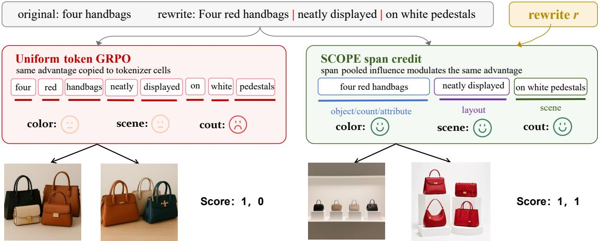  
Figure 1. Comparison of uniform token weighting in GRPO and semantic span weighting in SCOPE. A T2I evaluator provides a single reward for the image. Standard GRPO derives an advantage for the completion and applies it across token positions. However, compositional prompt edits are naturally organized into semantic phrases whose boundaries need not align with tokenizer positions. SCOPE preserves the same advantage for the completion and derives a shared coeficient for each semantic span from shifts in policy log probabilities. This coeficient modulates all token updates within the span.

To bridge this gap, we introduce Semantic Bounded Credit Optimization for Prompt Engineering (SCOPE), a GRPO-compatible objective that modulates token updates across semantic spans. The rewriter outputs a prompt rewrite and its semantic partition, mapped onto rollout tokens. SCOPE pools shifts in token log probabilities between the current and old policies within each span to derive a detached coeficient. This coeficient reweights the contribution of the shared advantage to each token loss in the clipped GRPO surrogate. The objective retains a loss for each valid token and a single advantage for each completion. SCOPE uses the existing rendering and reward pipeline, without separate rewards or advantages for individual spans, additional image renders, or a learned critic. Moreover, SCOPE serves as a strict generalization of standard GRPO, seamlessly recovering uniform token updates when span modulation is neutralized (β = 0).

Across Qwen-Image, SD3, and FLUX.1-dev, SCOPE consistently outperforms vanilla GRPO on GenEval [13] and T2I-CompBench [18]. Ablations favor pooling policy shifts within semantic spans over weighting individual tokens, and semantic boundaries over random boundaries or fixed windows. The token weighting comparison tests the contribution of pooling over semantic units. The random and fixed window controls test the contribution of semantic boundaries beyond grouping neighboring tokens. Together, these comparisons separate semantic structure from generic reweighting. Overall, we make three contributions:

• We identify semantic credit fragmentation in T2I prompt rewriting with RL. A single signal per completion, derived from the image, drives updates to tokenizer positions. Compositional edits form coherent semantic spans whose boundaries need not align with the subword boundaries imposed by the tokenizer.

• We introduce SCOPE, an objective compatible with GRPO that pools policy log probability shifts within semantic spans to assign shared token weights. It retains one advantage per completion without separate span rewards or advantages, additional image renders, or a learned critic.

• We demonstrate that SCOPE consistently outperforms the vanilla GRPO baseline on GenEval and T2I-CompBench. These gains hold across three frozen T2I backbones: Qwen-Image, SD3, and FLUX.1-dev.

## 2 Related Work

Credit Assignment for Sequence Generation. GRPO [46] optimizes autoregressive policies without a learned critic and shares an advantage across tokens in each completion. Recent work [9, 22, 25, 35, 37, 44, 48, 51] explores finer credit assignment through eligibility traces, counterfactual evaluation, and estimation over tree structures. Segment Policy Optimization (SPO) [14] partitions reasoning trajectories into segments and estimates distinct advantages for individual segments. This gives credit estimates a granularity between individual tokens and complete trajectories. FIPO [33] uses discounted future policy divergence to reweight token updates according to subsequent trajectory behavior. Our SCOPE retains a single advantage for each completion. Its contribution to token updates is modulated by shared within each semantic span, derived by pooling the policy log-probability shifts between the current and previous policies.

Prompt Optimization for T2I Generation. Prompt optimization adapts the textual input to elicit desired outputs from a pretrained T2I generator. Prior work [8, 19, 21, 23, 24, 27, 34, 36, 42, 47, 56, 57] explores search and iterative refinement strategies for improving generation quality or consistency between text and images. Learned prompt adaptation trains language models to transform user inputs into prompts that the generator prefers. Promptist [15] combines supervised initialization with RL driven by image rewards. PAG uses GFlowNets to promote efective and diverse prompt adaptation, while RePrompt uses GRPO and signals for image preference, alignment, and composition to train a rewriter augmented with reasoning [50, 55, 61]. Our SCOPE addresses the optimization objective within this setting. It incorporates the semantic structure of compositional edits into token weighting while retaining a shared advantage for the complete rewrite.

Reinforcement Learning for T2I Generation. Reinforcement learning optimizes visual generators by treating image synthesis as a sequential decision process. Prior work [2, 49, 52] optimizes difusion trajectories through policy gradients driven by image rewards or through preference optimization. Flow-GRPO [10, 28, 32, 45] optimizes denoising trajectories of flow models, while Mask-GRPO [31] treats iterative masked generation as a policy with multiple steps. B2-DifuRL [17] addresses sparse reward credit assignment within difusion trajectories through backward progressive training and sampling over branches. Our SCOPE optimizes the prompt rewriting policy through image feedback while keeping the renderer frozen.

## 3 Methodology

SCOPE organizes policy updates around semantic spans. Given a prompt x, the autoregressive policy $\pi _ { \theta }$ generates a completion y with the rewrite and its span boundaries. The cleaning operator c(·) extracts the <answer> field, removes the | separators, and concatenates the span text. A frozen image generator renders $I = f _ { \phi } ( c ( y ) )$ , which the evaluator scores against the cleaned prompt. The policy therefore receives feedback for a complete rewrite, although the compositional edits within it can span several tokens.

Figure 2 shows how SCOPE incorporates semantic spans into GRPO [46]. Grouped rollouts provide a completion advantage, while token likelihood changes determine its contribution within each semantic span. SCOPE pools these changes over aligned spans and normalizes them into shared coeficients. The detached coeficients reweight token losses in the clipped surrogate, with gradients flowing through the policy ratios.

## 3.1 Grouped Rewards and Advantages

We treat prompt rewriting as a single decision whose action is the complete rewrite. The policy maximizes the expected reward over prompts drawn from the input distribution D and completions sampled from πθ:

$$
\operatorname* { m a x } _ { \theta } \ \mathbb { E } _ { x \sim \mathcal { D } } \mathbb { E } _ { y \sim \pi _ { \theta } ( . | x ) } \left[ r ( x , y ) \right] .\tag{1}
$$

For each minibatch prompt $x _ { g } .$ , we sample $N - 1$ rewrites $\{ y _ { g , i } \} _ { i = 1 } ^ { N - 1 }$ from $\pi _ { \theta }$ and append the original prompt as $y _ { g , N }$ . This reference has $c ( y _ { g , N } ) = x _ { g }$ and contributes to advantage estimation but receives no policy update. All group members, including the reference, share a rendering seed to control renderer noise when comparing prompt edits. The reward combines image alignment and output format:

$$
r _ { g , i } = w _ { \mathrm { t 2 i } } r _ { \mathrm { t 2 i } } ( x _ { g } , c ( y _ { g , i } ) ) + w _ { \mathrm { f m t } } r _ { \mathrm { f m t } } ( y _ { g , i } ) .\tag{2}
$$

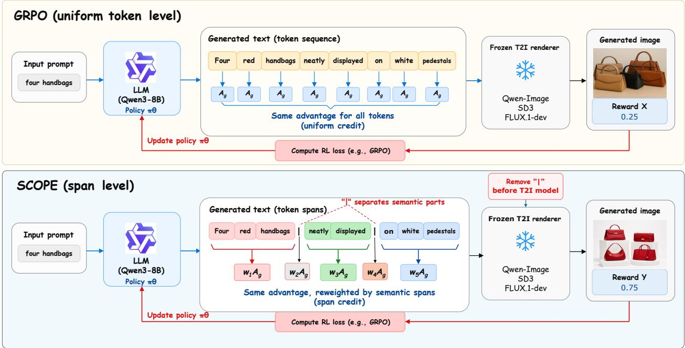  
Figure 2. Overview of SCOPE Pipeline. The rewriter generates a prompt together with its semantic spans. After removing the span separators, the frozen renderer generates an image whose score contributes to the reward for the completion. SCOPE aligns the spans to rollout tokens and pools changes in log probability between the current and old policies. The resulting coeficients reweight the shared advantage within each span. Gradients flow through the clipped GRPO surrogate while the coeficients are detached.

The alignment term $r _ { \mathrm { t 2 i } } \in [ 0 , 1 ]$ uses the GenEval and T2I-CompBench evaluation models to score the cleaned prompt and rendered image. The format term $r _ { \mathrm { f m t } } \in [ - 0 . 2 5 , 0 . 2 5 ]$ evaluates the <answer $> \cdots < _ { }$ /answer> structure and whether its spans can be extracted. This term rewards valid structured output and penalizes malformed output independently of the image alignment score used to evaluate the rewrite.

The original prompt provides a reference for advantage estimation. Let $b _ { g } ~ = ~ r _ { g , N }$ denote its reward, $\begin{array} { r } { \mu _ { g } = ( N - 1 ) ^ { - 1 } \sum _ { j = 1 } ^ { N - 1 } r _ { g , j } } \end{array}$ the mean reward of sampled rewrites, and $\begin{array} { r } { \hat { \sigma } _ { g } = \left( ( N - 1 ) ^ { - 1 } \sum _ { j = 1 } ^ { N - 1 } ( r _ { g , j } - \mu _ { g } ) ^ { 2 } \right) ^ { 1 / 2 } } \end{array}$ their standard deviation. For $i < N$ , we use threshold τ, clipping magnitude c, and numerical constant ϵ:

$$
A _ { g , i } = \left\{ \begin{array} { l l } { \mathrm { c l i p } ( r _ { g , i } - b _ { g } , - c , c ) , } & { b _ { g } < \tau , } \\ { \mathrm { c l i p } \Big ( \frac { r _ { g , i } - \mu _ { g } } { \hat { \sigma } _ { g } + \epsilon } , - c , c \Big ) , } & { b _ { g } \geq \tau , } \end{array} \right. \quad \quad A _ { g , N } = 0\tag{3}
$$

When $b _ { g } < \tau _ { ; }$ the first branch measures improvement over the original prompt. Otherwise, the second branch standardizes rewards within the group of sampled rewrites, following GRPO [28, 46].

## 3.2 Policy Optimization with GRPO

For completion $y _ { g , i } = ( y _ { g , i , 1 } , . . . , y _ { g , i , T } )$ , let $\gamma _ { g , i }$ contain its valid token positions. Each completion is sampled once from $\pi _ { \theta } .$ , and $\pi _ { \mathrm { o l d } }$ is the frozen pre-update snapshot, set equal to the current parameters on the first step. The probability ratio at position t is

$$
\rho _ { g , i , t } = \frac { \pi _ { \theta } ( y _ { g , i , t } \mid x _ { g } , y _ { g , i , < t } ) } { \pi _ { \mathrm { o l d } } ( y _ { g , i , t } \mid x _ { g } , y _ { g , i , < t } ) } , \qquad t \in \mathscr { V } _ { g , i }\tag{4}
$$

GRPO applies the shared advantage $A _ { g , i }$ to every valid token position through the clipped surrogate

$$
\ell _ { g , i } ^ { \mathrm { u n i } } = - \sum _ { t \in \mathcal { V } _ { g , i } } \operatorname* { m i n } ( \rho _ { g , i , t } A _ { g , i } , \ \mathrm { c l i p } ( \rho _ { g , i , t } , 1 - \epsilon _ { \ell } , 1 + \epsilon _ { h } ) A _ { g , i } ) .\tag{5}
$$

The ratios $\rho _ { g , i , t } = \exp ( \Delta _ { g , i , t } )$ vary across tokens, while the advantage and clipping margins $\epsilon _ { \ell } , \epsilon _ { h }$ are shared across the completion. Each token contributes separately to the objective, even when several positions describe one object or spatial relation. SCOPE assigns a shared loss weight to tokens within each semantic span.

## 3.3 Semantic Span Credit Modulation

The rewrite instruction asks the policy to preserve the request and clarify subjects, counts, colors, attributes, and spatial relations. It generates the rewrite and its boundaries in one completion, placing | only between adjacent nonempty spans. Tokenizer character ofsets link the extracted spans to the positions in the loss.

We extract the semantic partition from the rewrite by splitting the answer field at | separators and aligning the spans to rollout tokens. Let $\mathcal { T } _ { g , i , s }$ contain the valid content token positions assigned to span s. These sets are nonempty and disjoint, and together they cover the answer content. Separators and wrapper tokens lie outside the partition, so the span statistics describe the prompt passed to the renderer.

SCOPE measures the log-probability shift on the sampled completion after each update::

$$
\begin{array} { r } { \Delta _ { g , i , t } = \log \pi _ { \theta } ( y _ { g , i , t } \mid x _ { g } , y _ { g , i , < t } ) - \log \pi _ { \mathrm { o l d } } ( y _ { g , i , t } \mid x _ { g } , y _ { g , i , < t } ) . } \end{array}\tag{6}
$$

Averaging the log ratios $\Delta _ { g , i , t } = \log \rho _ { g , i , t }$ within each span removes the direct scaling with token count:

$$
b _ { g , i , s } = \frac { 1 } { | \mathcal { T } _ { g , i , s } | } \sum _ { t \in \mathcal { T } _ { g , i , s } } \Delta _ { g , i , t } .\tag{7}
$$

The exponential of $b _ { g , i , s }$ is the geometric mean of the ratios $\rho _ { g , i , t }$ within span s. The sensitivity parameter $\beta$ controls the response to this aggregated signal, with clipping limiting the raw coeficient:

$$
v _ { g , i , s } = \mathrm { c l i p } \left( \exp ( \beta b _ { g , i , s } ) , 0 . 8 , 1 . 2 \right) .\tag{8}
$$

The raw coeficients are positive and bounded in [0.8, 1.2] before normalization. For $\beta > 0$ , the raw coeficient increases with this mean change until clipping saturates, and the normalized weight redistributes the current completion advantage. The first step keeps every coeficient at one, and later steps separate spans whose mean $\Delta$ difers. The positive coeficient preserves the sign of the completion advantage and scales the token loss contributions within that span. We normalize by the mean weighted by valid token counts so that the average coeficient over the answer content equals one, regardless of how many tokens each span contains:

$$
\begin{array} { r } { w _ { g , i , s } = \frac { v _ { g , i , s } } { \underbrace { \sum _ { r } | \mathcal { T } _ { g , i , r } | v _ { g , i , r } } _ { \sum _ { r } | \mathcal { T } _ { g , i , r } | } } . } \end{array}\tag{9}
$$

Weighting this mean by span length matches the token sum in the objective and preserves ratios between span coeficients. A common multiplicative change applied to all clipped coeficients cancels under normalization. The mean modulated advantage over the answer content therefore remains $A _ { g , i }$ . The weights redistribute loss contributions across semantic spans while the completion reward supplies their shared advantage. The normalized coeficient is detached and applied to the advantage at each position in its span:

$$
\widetilde { A } _ { g , i , t } = A _ { g , i } \mathrm { s t o p g r a d } ( w _ { g , i , s } ) , \quad t \in \mathcal { T } _ { g , i , s }\tag{10}
$$

In this surrogate, detaching aggregation, clipping, and normalization restricts gradients to $\rho _ { g , i , t }$ . Valid wrapper and separator positions retain the original advantage, $\widetilde { A } _ { g , i , t } = A _ { g , i }$ , in the resulting loss:

$$
\ell _ { g , i } ^ { \mathrm { s c o p e } } = - \sum _ { t \in \mathcal { V } _ { g , i } } \operatorname* { m i n } \Bigl ( \rho _ { g , i , t } \widetilde { A } _ { g , i , t } , \ \mathrm { c l i p } ( \rho _ { g , i , t } , 1 - \epsilon _ { \ell } , 1 + \epsilon _ { h } ) \widetilde { A } _ { g , i , t } \Bigr ) .\tag{11}
$$

The positive, detached coeficients rescale both branches of each clipped token loss equally. They change how much of the loss each span receives without changing the clipping decision at a fixed $\rho _ { g , i , t }$

The policy objective averages the losses over the $N - 1$ sampled rewrites for each prompt in minibatch $B { \mathrm { : } }$

$$
\mathcal { L } _ { \mathrm { p o l } } = \frac { 1 } { | \mathcal { B } | } \sum _ { g \in \mathcal { B } } \frac { 1 } { N - 1 } \sum _ { i = 1 } ^ { N - 1 } \ell _ { g , i } ^ { \mathrm { s c o p e } } .\tag{12}
$$

Table 1. SCOPE achieves the highest overall GenEval score on each frozen backbone. RePrompt† is our Qwen-Image reproduction, while its SD3 and FLUX.1-dev scores follow Wu et al. [55]. Single and Two denote one and two objects. Cnt., Clr., Pos., and Attr. denote counting, color, position, and attribute binding. Bold marks the best score per metric and backbone.
<table><tr><td>Backbone</td><td>Method</td><td>Single</td><td>Two</td><td>Cnt.</td><td>Clr.</td><td>Pos.</td><td>Attr.</td><td>Overall↑</td></tr><tr><td rowspan="4">Qwen-Image</td><td>Baseline</td><td>0.99</td><td>0.95</td><td>0.87</td><td>0.89</td><td>0.79</td><td>0.75</td><td>0.87</td></tr><tr><td>Z-Image rewriter</td><td>0.95</td><td>0.89</td><td>0.69</td><td>0.82</td><td>0.51</td><td>0.73</td><td>0.76</td></tr><tr><td>GRPO</td><td>0.99</td><td>0.97</td><td>0.90</td><td>0.94</td><td>0.87</td><td>0.80</td><td>0.91</td></tr><tr><td>RePrompt† [55]</td><td>0.99</td><td>0.95</td><td>0.83</td><td>0.85</td><td>0.69</td><td>0.66</td><td>0.83</td></tr><tr><td></td><td>SCOPE (Ours)</td><td>1.00</td><td>0.99</td><td>0.94</td><td>0.93</td><td>0.95</td><td>0.88</td><td>0.95</td></tr><tr><td rowspan="5">SD3</td><td>Baseline</td><td>0.98</td><td>0.78</td><td>0.44</td><td>0.83</td><td>0.23</td><td>0.50</td><td>0.63</td></tr><tr><td>Z-Image rewriter</td><td>0.58</td><td>0.54</td><td>0.37</td><td>0.42</td><td>0.25</td><td>0.37</td><td>0.42</td></tr><tr><td>GRPO</td><td>0.98</td><td>0.87</td><td>0.58</td><td>0.85</td><td>0.57</td><td>0.60</td><td>0.74</td></tr><tr><td>RePrompt [55]</td><td>0.99</td><td>0.86</td><td>0.60</td><td>0.86</td><td>0.59</td><td>0.60</td><td>0.75</td></tr><tr><td>SCOPE (Ours)</td><td>1.00</td><td>0.90</td><td>0.79</td><td>0.89</td><td>0.83</td><td>0.63</td><td>0.84</td></tr><tr><td rowspan="5"></td><td>Baseline</td><td>0.99</td><td>0.80</td><td>0.72</td><td>0.80</td><td>0.16</td><td>0.46</td><td>0.65</td></tr><tr><td>Z-Image rewriter</td><td>0.53</td><td>0.50</td><td>0.56</td><td>0.42</td><td>0.30</td><td>0.36</td><td>0.44</td></tr><tr><td>FLUX.1-dev GRPO</td><td>0.98</td><td>0.85</td><td>0.72</td><td>0.82</td><td>0.62</td><td>0.56</td><td>0.76</td></tr><tr><td>RePrompt [55]</td><td>0.98</td><td>0.87</td><td>0.77</td><td>0.85</td><td>0.62</td><td>0.49</td><td>0.76</td></tr><tr><td>SCOPE (Òurs)</td><td>1.00</td><td>0.89</td><td>0.83</td><td>0.89</td><td>0.84</td><td>0.60</td><td>0.84</td></tr></table>

An optional KL penalty regularizes the policy against a frozen reference [28, 58]. Span coeficients add one forward through $\pi _ { \mathrm { o l d } }$ and require no additional model calls or image renders. Because the rewriter jointly learns structural formatting via $r _ { \mathrm { f m t } }$ , it achieves over 99.2% exact span-to-token alignment across all training rollouts (detailed in Appendix A.4). For the negligible fraction of unaligned rollouts $( < 0 . 8 \% )$ , defaulting the modulation weight to $w _ { g , i , s } = 1$ guarantees uninterrupted optimization stability.

## 4 Experiments

## 4.1 Experimental Setup

Benchmarks. We evaluate compositional prompt adherence on GenEval [13] and T2I-CompBench [18]. GenEval tests object presence, counting, color, position, and attribute binding. T2I-CompBench covers attribute binding, object relationships, and complex composition. GenEval training uses 10,000 of the 50,000 prompts organized by Flow-GRPO [28], while T2I-CompBench uses the 4200 prompts in its oficial training split. Both native benchmark evaluation sets are disjoint from the training data.

Baselines. GRPO with uniform token weights is our primary baseline and shares SCOPE’s reward pipeline and training setup. Other baselines render original prompts directly or use the Z-Image rewriter [4] without further training. We reproduce the published RePrompt [55] training and evaluation recipe on Qwen-Image with the same reward clients, rendering seeds, and benchmark harness as our runs. For SD3 and FLUX.1-dev, we use the published RePrompt scores. Appendix A.10 documents the reproduction and score sources.

Implementation details. We train Qwen3-8B [59] as the prompt rewriter with frozen Qwen-Image [53], SD3 [11], and FLUX.1-dev [3] generators. We use a learning rate of $1 0 ^ { - 6 }$ , a KL coeficient of 0.01, and a maximum completion length of 512 tokens. Each group contains $N = 8$ prompt members, including the original prompt and sampled rewrites. All members share one rendering seed to control variation from image generation within the group. Appendix A.2 includes optimization configuration and span weight normalization.

Evaluation protocol. Each backbone uses fixed resolution, denoising steps, and classifier-free guidance during training and evaluation (Appendix A.3). We average scores from four images per GenEval prompt and ten per T2I-CompBench prompt with distinct randomly selected seeds. Only training groups share seeds.

Table 2. SCOPE exceeds GRPO in every T2I-CompBench category on all three backbones. RePrompt† is our Qwen-Image reproduction. Other RePrompt scores follow Wu et al. [55]. Bold marks the best per metric and backbone.
<table><tr><td>Backbone</td><td>Method</td><td>Color</td><td>Shape</td><td>Texture</td><td>Spatial</td><td>Numeracy</td><td>Complex</td><td>Avg</td></tr><tr><td rowspan="5">Qwen-Image</td><td>Baseline</td><td>0.8352</td><td>0.5965</td><td>0.7598</td><td>0.4452</td><td>0.7340</td><td>0.3971</td><td>0.6280</td></tr><tr><td>Z-Image rewriter</td><td>0.8324</td><td>0.5930</td><td>0.7285</td><td>0.3880</td><td>0.6963</td><td>0.3922</td><td>0.6051</td></tr><tr><td>GRPO</td><td>0.8344</td><td>0.6042</td><td>0.7366</td><td>0.4487</td><td>0.7321</td><td>0.3921</td><td>0.6247</td></tr><tr><td>RePrompt [55]†</td><td>0.8337</td><td>0.6110</td><td>0.7546</td><td>0.4268</td><td>0.7332</td><td>0.3882</td><td>0.6246</td></tr><tr><td>SCOPE (Ours)</td><td>0.8633</td><td>0.6273</td><td>0.7857</td><td>0.5043</td><td>0.7713</td><td>0.4473</td><td>0.6665</td></tr><tr><td rowspan="5">SD3</td><td>Baseline</td><td>0.7886</td><td>0.5684</td><td>0.7267</td><td>0.2299</td><td>0.5761</td><td>0.3754</td><td>0.5442</td></tr><tr><td>Z-Image rewriter</td><td>0.7933</td><td>0.5846</td><td>0.7141</td><td>0.2977</td><td>0.6286</td><td>0.3876</td><td>0.5677</td></tr><tr><td>GRPO</td><td>0.7894</td><td>0.5742</td><td>0.7196</td><td>0.3312</td><td>0.6277</td><td>0.3802</td><td>0.5704</td></tr><tr><td>RePrompt [55]</td><td>0.7866</td><td>0.5891</td><td>0.7184</td><td>0.3315</td><td>0.6289</td><td>0.3744</td><td>0.5715</td></tr><tr><td>SCOPE (Óurs)</td><td>0.8213</td><td>0.6147</td><td>0.7523</td><td>0.4127</td><td>0.6963</td><td>0.3990</td><td>0.6161</td></tr><tr><td rowspan="4">FLUX.1-dev</td><td>Baseline</td><td>0.7414</td><td>0.4764</td><td>0.5937</td><td>0.2505</td><td>0.6099</td><td>0.3712</td><td>0.5072</td></tr><tr><td>Z-Image rewriter</td><td>0.7624</td><td>0.5363</td><td>0.6396</td><td>0.3162</td><td>0.6492</td><td>0.3817</td><td>0.5476</td></tr><tr><td>GRPO</td><td>0.7488</td><td>0.5289</td><td>0.6143</td><td>0.3742</td><td>0.6489</td><td>0.3742</td><td>0.5482</td></tr><tr><td>RePrompt [55]</td><td>0.7501</td><td>0.5276</td><td>0.6515</td><td>0.3301</td><td>0.6499</td><td>0.3721</td><td>0.5469</td></tr><tr><td></td><td>SCOPE (Òurs)</td><td>0.7967</td><td>0.5677</td><td>0.6637</td><td>0.4233</td><td>0.7147</td><td>0.3913</td><td>0.5929</td></tr></table>

## 4.2 Quantitative Analysis

GenEval. SCOPE achieves the highest overall GenEval score across all three frozen backbones (Table 1), boosting overall performance over vanilla GRPO from 0.91 to 0.95 on Qwen-Image (+4.4% relative), 0.74 to 0.84 on SD3 (+13.5% relative), and 0.76 to 0.84 on FLUX.1-dev (+10.5% relative). Across the three backbones, SCOPE achieves strict improvements over GRPO in 17 out of 18 category benchmarks while maintaining near-saturated color accuracy on Qwen-Image (0.93), trading a marginal 0.01 fluctuation for substantial gains in complex spatial positioning (+0.08) and attribute binding (+0.08). Moreover, the most pronounced improvements appear in object counting and spatial positioning, two persistent bottlenecks for frozen T2I generators. On SD3, SCOPE substantially outperforms GRPO in both Counting (0.58 → 0.79, +36.2%) and Position (0.57 → 0.83, +45.6%). On FLUX.1-dev, SCOPE lifts Counting by +0.11 and raises Position accuracy from the unadapted baseline of 0.16 and GRPO’s 0.62 to 0.84, representing a more than 5× gain over the base generator. These improvements also extend to multi-object synthesis and attribute binding, achieving 0.99 two-object accuracy and 0.88 attribute binding accuracy on Qwen-Image.

T2I-CompBench. SCOPE exceeds GRPO in all six reported categories on each frozen backbone (Table 2). Average scores improve by 6.7%, 8.0%, and 8.2% on Qwen-Image, SD3, and FLUX.1-dev, respectively. The gains cover appearance attributes, spatial relations, numeracy, and complex composition. Notably, on strong backbones like Qwen-Image, uniform token-level RL (e.g., GRPO and RePrompt) sufers from compositional degradation, falling below the unadapted baseline in overall T2I-CompBench score (0.6247 and 0.6246 vs. 0.6280) as well as Texture, Numeracy, and Complex composition, as uniform token updates inadvertently distort fine-grained descriptive phrases during exploration. SCOPE completely resolves this negative transfer, reaching 0.6665 overall and surpassing both the unadapted baseline and GRPO across all individual categories. Beyond achieving the highest color, shape, and texture scores on SD3 and FLUX.1-dev, SCOPE substantially improves spatial relations and numeracy over GRPO on both backbones (+0.0815 and +0.0686 on SD3; +0.0491 and +0.0658 on FLUX.1-dev). In Complex composition, it lifts Qwen-Image from 0.3921 to 0.4473 with consistent gains on SD3 and FLUX.1-dev, demonstrating robust, precise, and fine-grained control over both individual attributes and multi-constraint prompts.

## 4.3 Ablation and Mechanistic Analysis

Efect of credit weighting. Figure 3(a) compares SCOPE’s span-pooled weighting against uniform GRPO and unpooled token-level likelihood shifts. Crucially, applying likelihood shifts at individual tokens degrades performance below standard GRPO across all backbones. This confirms our core hypothesis:

GRPO Token local shift SCOPE

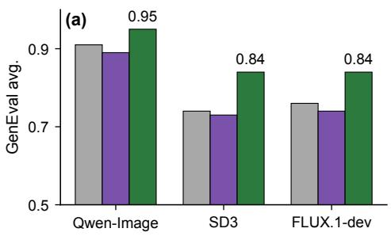

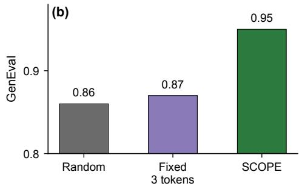

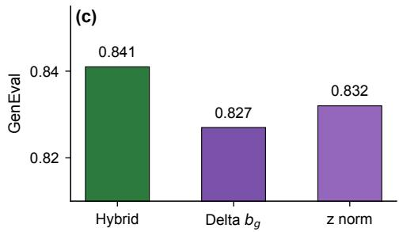

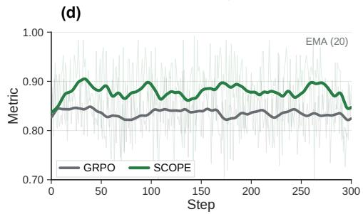  
Figure 3. Ablation and mechanistic diagnostics. (a) GenEval averages across backbones: SCOPE consistently outperforms uniform GRPO, whereas unpooled token-level shifts degrade performance. (b) Semantic boundaries substantially outperform random partitions and fixed 3-token windows on Qwen-Image. (c) SCOPE remains robust across advantage formulations on FLUX.1-dev, with all variants surpassing vanilla GRPO (0.760) and the hybrid rule achieving the peak score. (d) Training reward dynamics on Qwen-Image: SCOPE breaks through GRPO’s early saturation plateau to achieve higher asymptotic reward.

unpooled token-level modulation injects high-variance subword noise that disrupts coherent multi-token phrases, whereas pooling shifts within semantic spans stabilizes credit allocation. Furthermore, a Token local shift control, which retains semantic boundaries while applying uniform GRPO updates, yields only 0.90, 0.75, and 0.76 across backbones compared to 0.95, 0.84, and 0.84 for SCOPE. Thus, explicit credit modulation across spans (as opposed to merely structured formatting) drives the performance gain.

Efect of span boundaries. In Figure 3(b), replacing semantic partitions with random boundaries (0.86) or fixed 3-token windows (0.87) causes a severe 8–9% drop relative to SCOPE (0.95) on Qwen-Image. Arbitrary groupings sever coherent compositional phrases across window borders, proving that linguistic boundary alignment, rather than generic multi-token smoothing, which is essential for efective credit assignment.

Efect of the advantage rule. Figure 3(c) evaluates SCOPE under three completion-level advantage estimators on FLUX.1-dev: pure baseline subtraction $( \Delta b _ { g } , 0 . 8 2 7 )$ , standard group normalization (z-norm, 0.832), and our hybrid threshold rule (0.841). First, all three variants substantially outperform uniform GRPO (0.760), confirming that SCOPE’s gains stem fundamentally from semantic span modulation. Second, the hybrid rule yields an additional +0.009 boost by anchoring updates to the original prompt when initial quality is low $( b _ { g } < \tau )$ and switching to fine-grained group discrimination once generation competence is established.

Training dynamics. Figure 3(d) reports the Qwen-Image training metric over the first 300 steps, with curves smoothed by a 20-step exponential moving average. The smoothed trajectory of uniform GRPO remains lower and varies only mildly, at approximately 0.83–0.85. The smoothed trajectory of SCOPE lies above that of GRPO throughout the observed window and falls mainly in the range of approximately 0.86–0.90, whereas its unsmoothed trace exhibits substantially larger fluctuations.

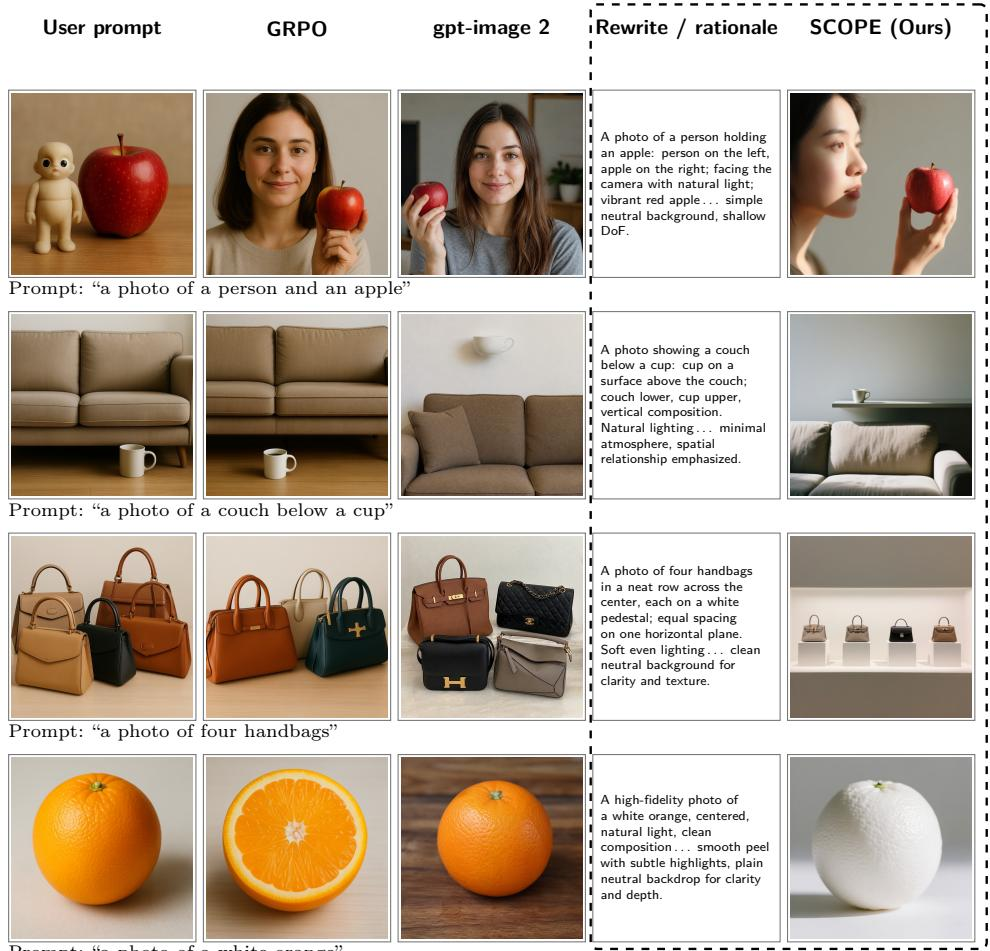  
Prompt: “a photo of a white orange”

Figure 4. Qualitative comparison on four prompts. From left to right: images from the original prompt (Qwen-Image), GRPO, and gpt-image 2, followed by the rewrite snippet and the SCOPE output (Qwen-Image).

## 4.4 Qualitative Analysis

Figure 4 targets prompts that contradict common visual priors. With the original prompt, the frozen Qwen-Image places the cup beneath the couch, draws five handbags instead of four, and renders an ordinary orange. GRPO still misses the layout, the count (three handbags), and the color. The rewriter trained with SCOPE spells out each constraint explicitly: the vertical layout (“couch lower, cup upper”), one object per position (“four handbags in a neat row. . . each on a white pedestal”), and the counterfactual color. Because SCOPE credits complete semantic spans during training, the rewriter learns to keep each constraint as an intact phrase rather than scattering it across subword tokens. This lifts a frozen open-weight Qwen-Image to the level of the commercial gpt-image 2 on layout and counting. On counterfactual attributes, SCOPE goes further: it is only model that renders a white orange, while gpt-image 2 falls back to an orange-colored prior.

## 5 Conclusion

We present SCOPE, a semantic-aware credit optimization framework for RL-based prompt engineering with frozen text-to-image generators. By pooling policy log-probability shifts within coherent semantic spans to modulate a shared completion advantage, SCOPE resolves subword credit fragmentation while requiring no separate span rewards, additional image renders, or external parsers. Across Qwen-Image, SD3, and FLUX.1-dev, SCOPE achieves substantial improvements over vanilla GRPO, delivering average relative gains of 9.48% on GenEval and 7.62% on T2I-CompBench. Accordingly, SCOPE establishes structure-aligned credit assignment as a plug-and-play paradigm for unlocking the compositional potential of frozen visual generators.

## References

[1] James Betker, Gabriel Goh, Li Jing, Tim Brooks, Jianfeng Wang, Linjie Li, Long Ouyang, Juntang Zhuang, Joyce Lee, Yufei Guo, Wesam Manassra, Prafulla Dhariwal, Casey Chu, Yunxin Jiao, and Aditya Ramesh. Improving image generation with better captions. OpenAI Technical Report, 2023. https://cdn.openai.com/papers/dall -e-3.pdf.

[2] Kevin Black, Michael Janner, Yilun Du, Ilya Kostrikov, and Sergey Levine. Training difusion models with reinforcement learning. In International Conference on Learning Representations, volume 2024, pages 4965–4987, 2024.

[3] Black Forest Labs. FLUX. https://github.com/black-forest-labs/flux, 2024.

[4] Huanqia Cai, Sihan Cao, Ruoyi Du, Peng Gao, Aiming Hao, Steven Hoi, Zhaohui Hou, Shijie Huang, Dengyang Jiang, Yuming Jiang, et al. Z-image: An eficient image generation foundation model with single-stream difusion transformer. arXiv preprint arXiv:2511.22699, 2025.

[5] Qi Cai, Jingwen Chen, Yang Chen, Yehao Li, Fuchen Long, Yingwei Pan, Zhaofan Qiu, Yiheng Zhang, Fengbin Gao, Peihan Xu, et al. Hidream-i1: A high-eficient image generative foundation model with sparse difusion transformer. arXiv preprint arXiv:2505.22705, 2025.

[6] Hila Chefer, Yuval Alaluf, Yael Vinker, Lior Wolf, and Daniel Cohen-Or. Attend-and-excite: Attention-based semantic guidance for text-to-image difusion models. ACM transactions on Graphics (TOG), 42(4):1–10, 2023.

[7] Junsong Chen, Chongjian Ge, Enze Xie, Yue Wu, Lewei Yao, Xiaozhe Ren, Zhongdao Wang, Ping Luo, Huchuan Lu, and Zhenguo Li. Pixart-σ: Weak-to-strong training of difusion transformer for 4k text-to-image generation. In European Conference on Computer Vision, pages 74–91. Springer, 2024.

[8] Ruibo Chen, Jiacheng Pan, Heng Huang, and Zhenheng Yang. Improving text-to-image generation with input-side inference-time scaling. arXiv preprint arXiv:2510.12041, 2025.

[9] Xinzhu Chen, Wei He, Huichuan Fan, Wenzhe Niu, Zhongxiang Sun, Xuanru Wang, Jiuchong Gao, Jinghua Hao, Renqing He, and Weijie Yu. Hidden states know where reasoning diverges: Credit assignment via span-level wasserstein distance. arXiv preprint arXiv:2604.23318, 2026.

[10] Zheng Ding and Weirui Ye. Treegrpo: tree-advantage grpo for online rl post-training of difusion models. In International Conference on Learning Representations, volume 2026, pages 10877–10889, 2026.

[11] Patrick Esser, Sumith Kulal, Andreas Blattmann, Rahim Entezari, Jonas Müller, Harry Saini, Yam Levi, Dominik Lorenz, Axel Sauer, Frederic Boesel, et al. Scaling rectified flow transformers for high-resolution image synthesis. In Forty-first international conference on machine learning, 2024.

[12] Yu Gao, Lixue Gong, Qiushan Guo, Xiaoxia Hou, Zhichao Lai, Fanshi Li, Liang Li, Xiaochen Lian, Chao Liao, Liyang Liu, et al. Seedream 3.0 technical report. arXiv preprint arXiv:2504.11346, 2025.

[13] Dhruba Ghosh, Hannaneh Hajishirzi, and Ludwig Schmidt. Geneval: An object-focused framework for evaluating text-to-image alignment. Advances in Neural Information Processing Systems, 36:52132–52152, 2023.

[14] Yiran Guo, Lijie Xu, Jie Liu, Dan Ye, and Shuang Qiu. Segment policy optimization: Efective segment-level credit assignment in rl for large language models. Advances in Neural Information Processing Systems, 38:114399–114431, 2026.

[15] Yaru Hao, Zewen Chi, Li Dong, and Furu Wei. Optimizing prompts for text-to-image generation. Advances in Neural Information Processing Systems, 36:66923–66939, 2023.

[16] Jonathan Ho and Tim Salimans. Classifier-free difusion guidance. arXiv preprint arXiv:2207.12598, 2022.

[17] Zijing Hu, Fengda Zhang, Long Chen, Kun Kuang, Jiahui Li, Kaifeng Gao, Jun Xiao, Xin Wang, and Wenwu Zhu. Towards better alignment: Training difusion models with reinforcement learning against sparse rewards. In 2025 IEEE/CVF Conference on Computer Vision and Pattern Recognition (CVPR), pages 23604–23614. IEEE, 2025.

[18] Kaiyi Huang, Kaiyue Sun, Enze Xie, Zhenguo Li, and Xihui Liu. T2i-compbench: A comprehensive benchmark for open-world compositional text-to-image generation. Advances in Neural Information Processing Systems, 36: 78723–78747, 2023.

[19] Zijian Huang, Jay Zhangjie Wu, Zian Wang, Tianshi Cao, Jiasi Chen, Sanja Fidler, Huan Ling, and Xuanchi Ren. APE: Agentic prompt enhancer for image generation and editing. arXiv preprint arXiv:2606.00204, 2026.

[20] Tero Karras, Miika Aittala, Timo Aila, and Samuli Laine. Elucidating the design space of difusion-based generative models. Advances in neural information processing systems, 35:26565–26577, 2022.

[21] Mohammed Abdul Hafeez Khan, Yash Jain, Siddhartha Bhattacharyya, and Vibhav Vineet. Test-time prompt refinement for text-to-image models. In Proceedings of the IEEE/CVF International Conference on Computer Vision, pages 6565–6575, 2025.

[22] Mykola Khandoga, Rui Yuan, and Vinay Kumar Sankarapu. Beyond uniform credit: Causal credit assignment for policy optimization. arXiv preprint arXiv:2602.09331, 2026.

[23] Semin Kim, Yeonwoo Cha, Jaehoon Yoo, and Seunghoon Hong. Reward-agnostic prompt optimization for text-to-image difusion models. arXiv preprint arXiv:2506.16853, 2025.

[24] Zhipeng Li, Yi-Chi Liao, and Christian Holz. Preference-guided prompt optimization for text-to-image generation. In Proceedings of the 2026 CHI Conference on Human Factors in Computing Systems, pages 1–29, 2026.

[25] Ziheng Li, Liu Kang, Feng Xiao, Luxi Xing, Qingyi Si, Zhuoran Li, Weikang Gong, Deqing Yang, Yanghua Xiao, and Hongcheng Guo. Outcome-grounded advantage reshaping for fine-grained credit assignment in mathematica reasoning. In Proceedings of the 64th Annual Meeting of the Association for Computational Linguistics (Volume 1: Long Papers), pages 24681–24693, 2026.

[26] Yaron Lipman, Ricky TQ Chen, Heli Ben-Hamu, Maximilian Nickel, and Matt Le. Flow matching for generative modeling. arXiv preprint arXiv:2210.02747, 2022.

[27] Haoyue Liu, Xiaoyu Ma, Ye Chen, Shuguang Cui, and Xiaoying Tang. One rewrite to fix them all? type-aware repair allocation for text-to-image prompt optimization. arXiv preprint arXiv:2607.18724, 2026.

[28] Jie Liu, Gongye Liu, Jiajun Liang, Yangguang Li, Jiaheng Liu, Xintao Wang, Pengfei Wan, Di Zhang, and Wanli Ouyang. Flow-grpo: Training flow matching models via online rl. Advances in neural information processing systems, 38:40783–40818, 2026.

[29] Xingchao Liu, Chengyue Gong, and Qiang Liu. Flow straight and fast: Learning to generate and transfer data with rectified flow. arXiv preprint arXiv:2209.03003, 2022.

[30] Cheng Lu, Yuhao Zhou, Fan Bao, Jianfei Chen, Chongxuan Li, and Jun Zhu. Dpm-solver: A fast ode solver for difusion probabilistic model sampling in around 10 steps. Advances in neural information processing systems, 35: 5775–5787, 2022.

[31] Yifu Luo, Xinhao Hu, Keyu Fan, Haoyuan Sun, Zeyu Chen, Bo Xia, Tiantian Zhang, Yongzhe Chang, and Xueqian Wang. Reinforcement learning meets masked generative models: Mask-grpo for text-to-image generation. Advances in Neural Information Processing Systems, 38:108460–108485, 2026.

[32] Qiang Lyu, Zicong Chen, Chongxiao Wang, Haolin Shi, Shibo Gao, Ran Piao, Youwei Zeng, Jianlou Si, Fei Ding, Jing Li, et al. Multi-grpo: Multi-group advantage estimation for text-to-image generation with tree-based trajectories and multiple rewards. arXiv preprint arXiv:2512.00743, 2025.

[33] Chiyu Ma, Shuo Yang, Kexin Huang, Jinda Lu, Haoming Meng, Shangshang Wang, Bolin Ding, Soroush Vosoughi, Guoyin Wang, and Jingren Zhou. Fipo: Eliciting deep reasoning with future-kl influenced policy optimization. arXiv preprint arXiv:2603.19835, 2026.

[34] Oscar Ma nas, Pietro Astolfi, Melissa Hall, Candace Ross, Jack Urbanek, Adina Williams, Aishwarya Agrawal, Adriana Romero-Soriano, and Michal Drozdzal. Improving text-to-image consistency via automatic prompt optimization. arXiv preprint arXiv:2403.17804, 2024.

[35] Chaoli Mou, Zhan Zhuang, Xinning Chen, and Yu Zhang. Beyond uniform credit assignment: Selective eligibility traces for rlvr. arXiv preprint arXiv:2605.05965, 2026.

[36] Khalil Mrini, Hanlin Lu, Linjie Yang, Weilin Huang, and Heng Wang. Fast prompt alignment for text-to-image generation. arXiv preprint arXiv:2412.08639, 2024.

[37] Prasanna Parthasarathi, Mathieu Reymond, Boxing Chen, Yufei Cui, and Sarath Chandar. Grpo-λ: Credit assignment improves llm reasoning. arXiv preprint arXiv:2510.00194, 2025.

[38] William Peebles and Saining Xie. Scalable difusion models with transformers. In 2023 IEEE/CVF International Conference on Computer Vision (ICCV), pages 4172–4182. IEEE, 2023.

[39] Dustin Podell, Zion English, Kyle Lacey, Andreas Blattmann, Tim Dockhorn, Jonas Müller, Joe Penna, and Robin Rombach. Sdxl: Improving latent difusion models for high-resolution image synthesis. In International Conference on Learning Representations, volume 2024, pages 1862–1874, 2024.

[40] Aditya Ramesh, Prafulla Dhariwal, Alex Nichol, Casey Chu, and Mark Chen. Hierarchical text-conditional image generation with clip latents. arXiv preprint arXiv:2204.06125, 1(2):3, 2022.

[41] Robin Rombach, Andreas Blattmann, Dominik Lorenz, Patrick Esser, and Björn Ommer. High-resolution image synthesis with latent difusion models. In 2022 IEEE/CVF conference on computer vision and pattern recognition (CVPR), pages 10674–10685. ieee, 2022.

[42] Shachar Rosenman, Vasudev Lal, and Phillip Howard. Neuroprompts: An adaptive framework to optimize prompts for text-to-image generation. In Proceedings of the 18th Conference of the European Chapter of the Association for Computational Linguistics: System Demonstrations, pages 159–167, 2024.

[43] Chitwan Saharia, William Chan, Saurabh Saxena, Lala Li, Jay Whang, Emily L Denton, Kamyar Ghasemipour, Raphael Gontijo Lopes, Burcu Karagol Ayan, Tim Salimans, et al. Photorealistic text-to-image difusion models with deep language understanding. Advances in neural information processing systems, 35:36479–36494, 2022.

[44] Ankur Samanta, Akshayaa Magesh, Ayush Jain, Youliang Yu, Daniel Jiang, Kavosh Asadi, Kaveh Hassani, Paul Sajda, Jalaj Bhandari, and Yonathan Efroni. Credit assignment with resets in language model reasoning. arXiv preprint arXiv:2605.25507, 2026.

[45] Yash Savani, Branislav Kveton, Yuchen Liu, Yilin Wang, Jing Shi, Subhojyoti Mukherjee, Nikos Vlassis, and Krishna Kumar Singh. Stepwise credit assignment for grpo on flow-matching models. arXiv preprint arXiv:2603.28718, 2026.

[46] Zhihong Shao, Peiyi Wang, Qihao Zhu, Runxin Xu, Junxiao Song, Xiao Bi, Haowei Zhang, Mingchuan Zhang, YK Li, Yang Wu, et al. Deepseekmath: Pushing the limits of mathematical reasoning in open language models. arXiv preprint arXiv:2402.03300, 2024.

[47] Guo Tang, HongJie Luo, Tianxu Wang, Ying Zhang, and Hao Wang. Prism: Prompt refinement via image-grounded self-rewarding mechanism for text-to-image generation. arXiv preprint arXiv:2607.24353, 2026.

[48] Hieu Tran, Zonghai Yao, and Hong Yu. Exploiting tree structure for credit assignment in rl training of llms. arXiv preprint arXiv:2509.18314, 2025.

[49] Bram Wallace, Meihua Dang, Rafael Rafailov, Linqi Zhou, Aaron Lou, Senthil Purushwalkam, Stefano Ermon, Caiming Xiong, Shafiq Joty, and Nikhil Naik. Difusion model alignment using direct preference optimization. In 2024 IEEE/CVF Conference on Computer Vision and Pattern Recognition (CVPR), pages 8228–8238. IEEE, 2024.

[50] Fu-Yun Wang, Han Zhang, Michael Gharbi, Hongsheng Li, and Taesung Park. Promptrl: Prompt matters in rl for flow-based image generation. arXiv preprint arXiv:2602.01382, 2026.

[51] Tao Wang, Suhang Zheng, and Xiaoxiao Xu. Rtmc: Step-level credit assignment via rollout trees. arXiv preprint arXiv:2604.11037, 2026.

[52] Yibin Wang, Zhimin Li, Yuhang Zang, Yujie Zhou, Jiazi Bu, Chunyu Wang, Qinglin Lu, Cheng Jin, and Jiaqi Wang. Pref-grpo: Pairwise preference reward-based grpo for stable text-to-image reinforcement learning. arXiv preprint arXiv:2508.20751, 2025.

[53] Chenfei Wu, Jiahao Li, Jingren Zhou, Junyang Lin, Kaiyuan Gao, Kun Yan, Sheng-ming Yin, Shuai Bai, Xiao Xu, Yilei Chen, et al. Qwen-image technical report. arXiv preprint arXiv:2508.02324, 2025.

[54] Jie Wu, Yu Gao, Zilyu Ye, Ming Li, Liang Li, Hanzhong Guo, Jie Liu, Zeyue Xue, Xiaoxia Hou, Wei Liu, et al. Rewarddance: Reward scaling in visual generation. arXiv preprint arXiv:2509.08826, 2025.

[55] Mingrui Wu, Lu Wang, Pu Zhao, Fangkai Yang, Jianjin Zhang, Jianfeng Liu, Yuefeng Zhan, Weihao Han, Hao Sun, Jiayi Ji, et al. Reprompt: Reasoning-augmented reprompting for text-to-image generation via reinforcement learning. In International Conference on Learning Representations, volume 2026, pages 14030–14057, 2026.

[56] Shiyu Wu, Mingzhen Sun, Weining Wang, Yequan Wang, and Jing Liu. Visualprompter: Semantic-aware prompt optimization with visual feedback for text-to-image synthesis. In International Conference on Learning Representations, volume 2026, pages 30578–30600, 2026.

[57] Dawei Xiang, Wenyan Xu, Kexin Chu, Tianqi Ding, Zixu Shen, Yiming Zeng, Jianchang Su, and Wei Zhang. Promptsculptor: Multi-agent based text-to-image prompt optimization. In Proceedings of the 2025 Conference on Empirical Methods in Natural Language Processing: System Demonstrations, pages 774–786, 2025.

[58] Zeyue Xue, Jie Wu, Yu Gao, Fangyuan Kong, Lingting Zhu, Mengzhao Chen, Zhiheng Liu, Wei Liu, Qiushan Guo, Weilin Huang, et al. Dancegrpo: Unleashing grpo on visual generation. arXiv preprint arXiv:2505.07818, 2025.

[59] An Yang, Anfeng Li, Baosong Yang, Beichen Zhang, Binyuan Hui, Bo Zheng, Bowen Yu, Chang Gao, Chengen Huang, Chenxu Lv, et al. Qwen3 technical report. arXiv preprint arXiv:2505.09388, 2025.

[60] Hongji Yang, Yucheng Zhou, Wencheng Han, and Jianbing Shen. Self-rewarding large vision-language models for optimizing prompts in text-to-image generation. In Findings of the Association for Computational Linguistics: ACL 2025, pages 7332–7349, 2025.

[61] Taeyoung Yun, Dinghuai Zhang, Jinkyoo Park, and Ling Pan. Learning to sample efective and diverse prompts for text-to-image generation. In 2025 IEEE/CVF Conference on Computer Vision and Pattern Recognition (CVPR), pages 23625–23635. IEEE, 2025.

## Appendix

## A.1 Implementation overview

Distributed policy training optimizes the Qwen3-8B rewriter, while separate reward and rendering workers serve the frozen T2I backbones. Qwen3-8B generates the spans during the rollout, without a separate span model or parser service. Weighting by policy shifts within spans follows Eqs. 6 to 9 in the main text. The worker layout and hardware placement do not change the objective or evaluation protocol.

## A.2 Hyperparameters

Table 3. Optimization configuration for prompt rewriting, span weighting, and normalization.
<table><tr><td>Component</td><td>Value</td></tr><tr><td>Policy model</td><td>Qwen3-8B</td></tr><tr><td>Image models</td><td>Qwen-Image, SD3, FLUX.1-dev (frozen, Sec. 4)</td></tr><tr><td>Span acquisition</td><td>Qwen3-8B jointly generates nonempty spans separated by |</td></tr><tr><td>Training data</td><td>10k selected GenEval + 4.2k T2I-CB prompts</td></tr><tr><td>Grouped samples per prompt N</td><td>8</td></tr><tr><td>Learning rate</td><td> $1 \times 1 0 ^ { - 6 }$ </td></tr><tr><td>KL coefficient  $\beta _ { \mathrm { K L } }$ </td><td>0.01</td></tr><tr><td>Max completion length</td><td>512</td></tr><tr><td>Span shift  $b _ { g , i , s }$ </td><td>mean log probability shift over valid span tokens (current minus old)</td></tr><tr><td>Span raw weight  $v _ { g , i , s }$ </td><td>clip  $( \exp ( \beta b _ { g , i , s } )$  , 0.8, 1.2)</td></tr><tr><td>Span normalization</td><td>mean weighted by valid token counts = 1, detached</td></tr></table>

Launcher defaults vs. paper. The reported runs use the configuration in Table 3. Local launcher defaults can difer. To reproduce the tables exactly, use this configuration and the same data and sampling protocol.

## A.3 Rendering configuration

Table 4 specifies the rendering configuration for training rewards and benchmark evaluation.

Table 4. Fixed rendering configuration for training rewards and benchmark evaluation in our runs.
<table><tr><td>Backbone</td><td>Resolution</td><td>Steps</td><td>CFG scale</td></tr><tr><td>Qwen-Image</td><td>512×512</td><td>20</td><td>4.0</td></tr><tr><td>FLUX.1-dev</td><td>512×512</td><td>20</td><td>3.5</td></tr><tr><td>Stable Diffusion 3 (SD3)</td><td>512×512</td><td>28</td><td>7.5</td></tr></table>

## A.4 Span Extraction and Fallbacks

The rewrite instruction preserves the request and clarifies subjects, counts, colors, attributes, and spatial relations. The rewrite and its boundaries are generated in one completion, with | appearing only between adjacent nonempty spans. The separator is not a generation stop token. Tokenizer character ofsets align each extracted span with its rollout tokens, keeping the partition consistent with the policy loss.

A valid partition requires a valid answer wrapper, nonempty spans, and full coverage of valid answer content tokens with consistent ofsets and token counts. SCOPE uses uniform GRPO token weights for malformed wrappers, empty or missing spans, and consecutive or trailing separators. Truncation, incomplete coverage, alignment failures, and token count mismatches also trigger this fallback. We handle one benign end of sequence (EOS) mismatch separately. If the completion mask has exactly one extra trailing placeholder relative to the tokenized prompt text, we retain the aligned prefix. The extra token receives zero weight. The aligned prefix determines the span statistics used to compute the shared coeficients.

Table 5 reports fallback counts and rates across benchmarks and frozen image backbones.

Table 5. Fallback frequencies in the logged training rollouts by benchmark and frozen image backbone.
<table><tr><td>Benchmark</td><td>Backbone</td><td>Fallbacks</td><td>Rollouts</td><td>Rate</td></tr><tr><td rowspan="3">GenEval</td><td>FLUX.1-dev</td><td>147</td><td>80,000</td><td>0.18%</td></tr><tr><td>SD3</td><td>165</td><td>80,000</td><td>0.21%</td></tr><tr><td>Qwen-Image</td><td>89</td><td>80,000</td><td>0.11%</td></tr><tr><td rowspan="3">T2I-CompBench</td><td>FLUX.1-dev</td><td>269</td><td>33,600</td><td>0.80%</td></tr><tr><td>SD3</td><td>247</td><td>33,600</td><td>0.74%</td></tr><tr><td>Qwen-Image</td><td>249</td><td>33,600</td><td>0.74%</td></tr></table>

## A.5 Z-Image Rewriter

These tables report the Z-Image rewriter scores for each frozen backbone under the evaluation protocol in Sec. 4. They reproduce the corresponding rows of the main tables with the same rendering configuration.

Table 6. GenEval scores for the Z-Image rewriter across the three frozen backbones. Subset of Table 1.
<table><tr><td>Backbone</td><td>1 Obj.</td><td>2 Obj.</td><td>Cnt.</td><td>Clr.</td><td>Pos.</td><td>Attr.</td><td>Avg.↑</td></tr><tr><td>Qwen-Image</td><td>0.95</td><td>0.89</td><td>0.69</td><td>0.82</td><td>0.51</td><td>0.73</td><td>0.76</td></tr><tr><td>SD3</td><td>0.58</td><td>0.54</td><td>0.37</td><td>0.42</td><td>0.25</td><td>0.37</td><td>0.42</td></tr><tr><td>FLUX.1-dev</td><td>0.53</td><td>0.50</td><td>0.56</td><td>0.42</td><td>0.30</td><td>0.36</td><td>0.44</td></tr></table>

Table 7. T2I-CompBench scores for the Z-Image rewriter by backbone. Subset of Table 2.
<table><tr><td>Backbone</td><td>Color</td><td>Shape</td><td>Texture</td><td>Spatial</td><td>1 Numeracy</td><td>Complex</td></tr><tr><td>Qwen-Image</td><td>0.8324</td><td>0.5930</td><td>0.7285</td><td>0.3880</td><td>0.6963</td><td>0.3922</td></tr><tr><td>SD3</td><td>0.7933</td><td>0.5846</td><td>0.7141</td><td>0.2977</td><td>0.6286</td><td>0.3876</td></tr><tr><td>FLUX.1-dev</td><td>0.7624</td><td>0.5363</td><td>0.6396</td><td>0.3162</td><td>0.6492</td><td>0.3817</td></tr></table>

## A.6 Compute

Policy optimization and auxiliary jobs ran on NVIDIA H200 GPUs. Exact node counts depend on the notes for each deployment. Table 4 specifies sampling for each backbone without prescribing the cluster configuration.

## A.7 Environment variables and span weighting

Reward services expose endpoints, timeouts, generation count (default 8), and reward and advantage weights. Span weighting reuses the current and old policy log probabilities from the clipped surrogate. Its sensitivity β is distinct from the KL coeficient βKL.

## A.8 Rewrite instruction

The system message asks for exactly <answer>span 1 | span 2 | span 3</answer>. Before rendering and computation of image rewards, the trainer extracts the answer field, removes every delimiter, and concatenates the span text into one natural language prompt. The format reward still evaluates the structured output.

## A.9 Reward notes

Advantages follow the hybrid rule in Eq. 3. During training, each group contains N = 8 prompt members that share one random difusion seed. This controls renderer noise when comparing rewrites within each group. Groups draw seeds independently, and training and evaluation use fresh seeds across prompts and outer loops. Section 4.1 details the data splits and evaluation protocol. Seed sharing is restricted to training groups. The hybrid rule and shared seeds require no separate reward model or estimation module.

## A.10 RePrompt: Qwen-Image reproduction

Wu et al. [55] do not report Qwen-Image results in their tables. The RePrompt† entries for Qwen-Image in Tables 1 and 2 come from our reproduction of their training and evaluation recipe. These runs use the

same reward clients, rendering seeds, and benchmark harness as our GRPO and SCOPE runs. For SD3 and FLUX.1-dev, the RePrompt rows reproduce the scores reported by Wu et al. [55].

## A.11 Training procedure

Algorithm 1 SCOPE training procedure. The renderer $f _ { \phi }$ and the evaluator stay frozen. This step   
optimizes Eq. 1 through Eq. 12. Defaults are in Table 3. Span fallbacks are in Sec. A.4.   
Require: minibatch B from $\mathcal { D } ;$ rewriter $\pi _ { \boldsymbol { \theta } } ;$ frozen renderer $f _ { \phi }$   
1: On the first step set $\pi _ { \mathrm { o l d } }  \pi _ { \theta }$ . Afterward $\pi _ { \mathrm { o l d } }$ is the pre-update snapshot.   
2: for training step $s = 1 , 2 , . . .$ . do   
3: for each prompt $x _ { g } \in B$ do   
4: Sample $y _ { g , 1 , \dots , y _ { g , N - 1 } } \sim \pi _ { \theta } ( \cdot \mid x _ { g } )$   
5: Set $y _ { g , N }  x _ { g } , \mathrm { s o } c ( y _ { g , N } ) = x _ { g } ,$ and $A _ { g , N }  0$   
6: Share one rendering seed across the N group members   
7: for $i = 1 , \ldots , N$ do   
8: $r _ { g , i }  w _ { \mathrm { t 2 i } } r _ { \mathrm { t 2 i } } + w _ { \mathrm { f m t } } r _ { \mathrm { f m t } }$ # Eq. (2)   
9: end for   
10: $A _ { g , i }$ from $b _ { g } = r _ { g , N }$ , with $\mu _ { g }$ and $\hat { \sigma } _ { g }$ over $i < N$ # Eq. (3)   
11: for $i = 1 , \ldots , N - 1$ do   
12: $\Delta _ { g , i , t } \gets \log \pi _ { \theta } - \log \pi _ { \mathrm { o l d } }$ # Eq. (6)   
13: $\rho _ { g , i , t } \gets \exp ( \Delta _ { g , i , t } )$ # Eq. (4)   
14: if the answer partition aligns to the rollout tokens then   
15: $b _ { g , i , s } \gets \mathrm { m e a n } _ { t \in \mathcal { T } _ { g , i , s } } \Delta _ { g , i , t }$ # Eq. (7)   
16: $v _ { g , i , s } \gets \mathrm { c l i p } ( \exp ( \beta b _ { g , i , s } ) , 0 . 8 , 1 . 2 )$ # Eq. (8)   
17: $w _ { g , i , s }  v _ { g , i , s } / \mathrm { m e a n } ( v )$ # Eq. (9)   
18: $\widetilde { A } _ { g , i , t }  A _ { g , i }$ stopgrad $( w _ { g , i , s } )$ # Eq. (10)   
19: $\ell _ { g , i } ^ { \mathrm { s c o p e } }$ # Eq. (11)   
20: else   
21: $\ell _ { g , i } ^ { \mathrm { u n i } }$ # Eq. (5)   
22: end if   
23: end for   
24: end for   
25: $\begin{array} { r } { \mathcal { L } _ { \mathrm { p o l } }  \vert \mathcal { B } \vert ^ { - 1 } \sum _ { g } ( N - 1 ) ^ { - 1 } \sum _ { i < N } \ell _ { g , i } } \end{array}$ # Eq. (12)   
26: Add the optional KL penalty against the frozen reference, which is distinct from $\pi _ { \mathrm { o l d } }$ , and update θ   
27: Set $\pi _ { \mathrm { o l d } }  \pi _ { \theta }$ for the next step   
28: end for   
29: return πθ

## A.12 Additional Qualitative Comparisons

Figure 5 uses the five columns in Figure 4, with matched seeds within each row. The dashed frame encloses rewrite snippets and SCOPE outputs. Rows are grouped by prompt type and evaluation setting.

User prompt

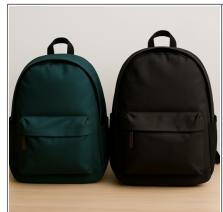  
GRPO

  
Prompt: “a photo of two backpacks”  
gpt-image 2

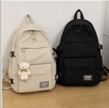  
Rewrite / rationale  
A photo of two backpacks, each on the left and right sides of the frame, with detailed textures and muted earth tones . . . soft natural lighting, shallow DoF, emphasizing the two objects.

SCOPE (Ours)

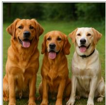

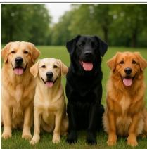  
Prompt: “a photo of four dogs”

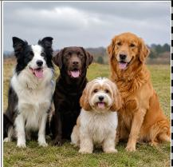  
A photo of four dogs, spaced left, center-left, center-right, and right in the frame, outdoor setting . . . soft light on fur and faces, balanced composition.

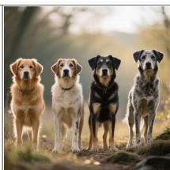

  
Prompt: “a photo of a bird below a skateboard”

  
A photo of a bird below a skateboard on the ground, board low in the frame, bird in the lower half looking up . . . spatial layout emphasized.

  
Prompt: “a photo of three cell phones”

  
Three cell phones in a loose triangle, left, center, and right . . . minimalist backdrop, soft ambient light on sleek shells, calm modern mood.

Figure 5. Additional qualitative comparisons on four prompts, using the same five columns as Figure 4.  
